# Okul Öncesi Eğitim 4 Yaş Çekirdek 3 Ders Kitabı

<!-- sayfa 0 -->

# OKUL ÖNCESİ EĞİTİM
## 4 Yaş
# Çekirdek 3
### DERS KİTABI

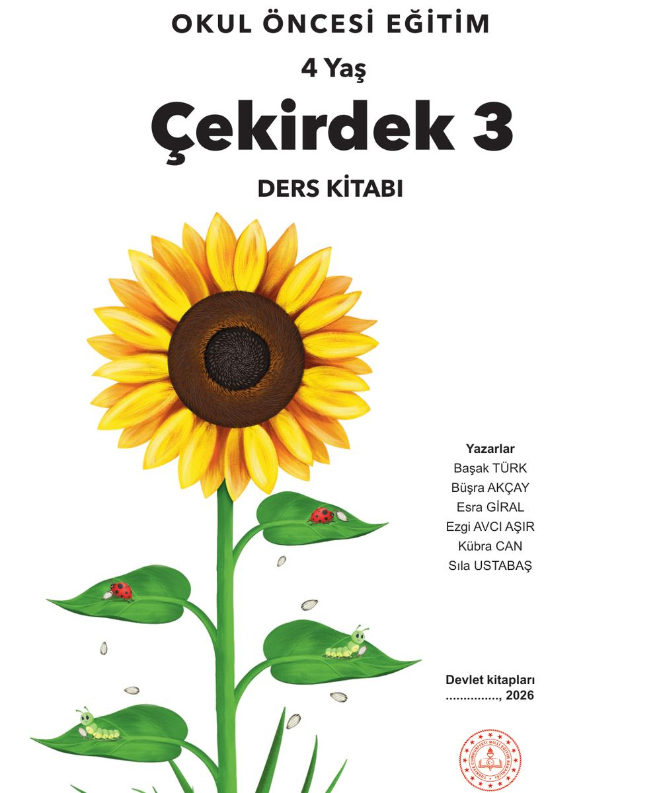

**Yazarlar**
Başak TÜRK
Büşra AKÇAY
Esra GİRAL
Ezgi AVCI AŞIR
Kübra CAN
Sıla USTABAŞ

**Devlet kitapları**
................, 2026

<!-- sayfa 1 -->

MİLLÎ EĞİTİM BAKANLIĞI YAYINLARI ......................................................................: 10738
DERS KİTAPLARI DİZİSİ ..........................................................................................: 2488

Her hakkı saklıdır ve Millî Eğitim Bakanlığına aittir. Kitabın metin, soru ve şekilleri kısmen de olsa hiçbir surette alınıp yayımlanamaz.

EDİTÖR
Burcu ÖZKANLI ERTUĞRUL

DİL UZMANI
Muhammet ŞEN

GÖRSEL TASARIMCI
Eylem YILDIRIM
Mehmet Ali KARAASLAN
Melike TURALİ
Serdar TUNCAL
Serdar TURALİ

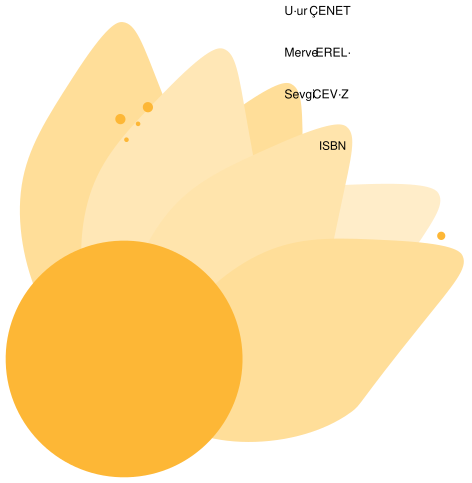
ÇOKLU ORTAM TASARIMCISI
Abidin AYDIN
Ezgi KERVAN SARINÇ
Onur TÜLÜ

PROGRAM GELİŞTİRME UZMANI
Uğur ÇENET

ÖLÇME VE DEĞERLENDİRME UZMANI
Merve ERELİ

REHBERLİK UZMANI
Sevgi CEVİZ

ISBN 978-975-11-8090-

Millî Eğitim Bakanlığı, Talim ve Terbiye Kurulu Başkanlığının 30.07.2024 tarih ve E-96732399-116.01-111152749 sayılı yazısı ile eğitim aracı olarak kabul edilmiştir. Kurulca bu kitabın kabul edilmiş olması ders kitabından yayınevi ve yazarın/yazarların sorumluluğunu kaldırmaz.

<!-- sayfa 2 -->

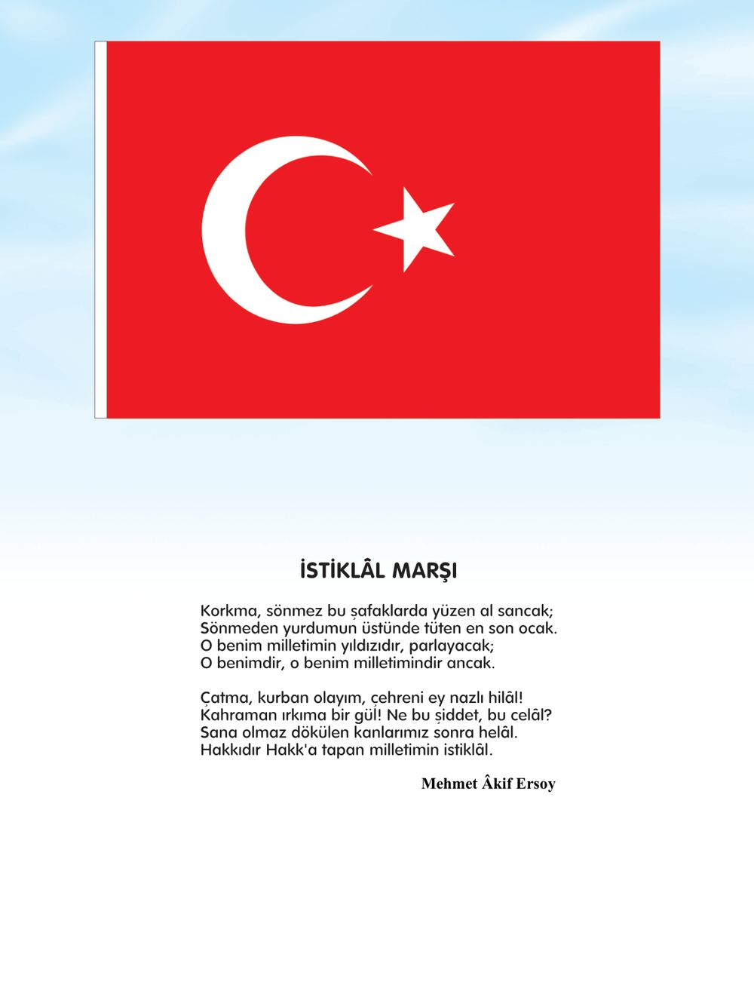

# İSTİKLÂL MARŞI

Korkma, sönmez bu şafaklarda yüzen al sancak;
Sönmeden yurdumun üstünde tüten en son ocak.
O benim milletimin yıldızıdır, parlayacak;
O benimdir, o benim milletimindir ancak.

Çatma, kurban olayım, çehreni ey nazlı hilâl!
Kahraman ırkıma bir gül! Ne bu şiddet, bu celâl?
Sana olmaz dökülen kanlarımız sonra helâl.
Hakkıdır Hakk'a tapan milletimin istiklâl.

**Mehmet Âkif Ersoy**

<!-- sayfa 3 -->

ANDIMIZ

Türküm, doğruyum, çalışkanım.

İlkem küçüklerimi korumak, büyüklerimi saymak; yurdumu, milletimi özümden çok sevmektir.
Ülküm yükselmek, ileri gitmektir.

Ey Büyük Atatürk!

Açtığın yolda, gösterdiğin hedefe durmadan yürüyeceğime ant içerim.

Varlığım Türk varlığına armağan olsun.

Ne mutlu Türküm diyene!

<!-- sayfa 4 -->

MUSTAFA KEMAL ATATÜRK

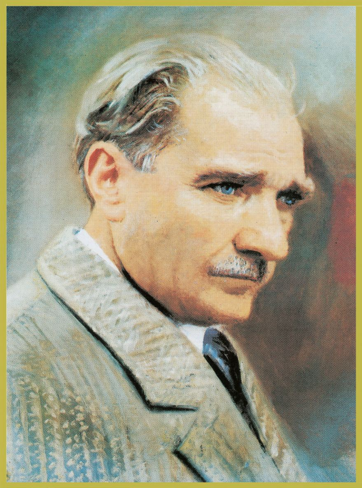
<!-- yer tutucu bulunamadı: sayfa sonuna eklendi -->

<!-- sayfa 5 -->

Verdiğiniz metin katmanı boş olduğu için (`<<< >>>` arası boş) dönüştürülecek bir içerik bulunmamaktadır. Lütfen metin katmanını içeren içeriği paylaşın, böylece talimatlarınıza uygun şekilde Markdown formatına çevirebilirim.

<!-- sayfa 6 -->

# İÇİNDEKİLER

| | |
| :--- | :---: |
| Çatalhöyük’te Keşif | 9 |
| Raftaki Eşyalar | 10 |
| Dinleyelim, Bulalım | 11 |
| 7 Rakamı | 12 |
| Toprağın Altında Yaşayan Hayvanlar | 13 |
| İstek mi, İhtiyaç mı? | 14 |
| Kitap Kapakları | 15 |
| Pangolinin Yolu | 16 |
| Parçaları Bulalım | 17 |
| Duygularımı Yönetiyorum | 18 |
| Dönüştür, Değerlendir | 19 |
| Trafik İşaretleri | 20 |
| Böcekleri Sayalım | 21 |
| Kendimi Koruyorum | 22 |
| Hangisi Yok? | 23 |
| Duyularımızı Keşfediyoruz | 24 |
| 8 Rakamı | 25 |
| 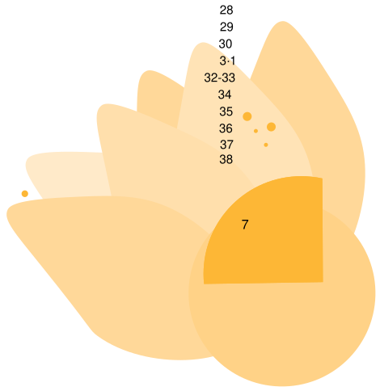 23 Nisan Ulusal Egemenlik ve Çocuk Bayramı | 26 |
| Heceliyorum | 27 |
| Tarif Defterim | 28 |
| Afet ve Acil Durum Çantam | 29 |
| Kaçıncı Yüzücü? | 30 |
| Ölçelim | 31 |
| Kültür Turizmi | 32-33 |
| Dinle ve Söyle | 34 |
| Sohbet Zamanı | 35 |
| Bu Kapıdan Kim Geçer? | 36 |
| Örüntü Duvarı | 37 |
| Denge Hareketleri | 38 |

<!-- sayfa 7 -->

# İÇİNDEKİLER

| | |
| :--- | :---: |
| 9 Rakamı | 39 |
| Çizgiyi Takip Et | 40 |
| Nesnelerin Yerlerini Hatırlayalım | 41 |
| Müze Gezisi | 42 |
| Müze Yolu | 43 |
| Karahindibanın Değişimi | 44 |
| Yerini Bul | 45 |
| Örüntü Zamanı | 46 |
| Yumuşak mı, Sert mi? | 47 |
| Bakalım, Seçelim | 48 |
| Labirent | 49 |
| Meyveleri Sayalım | 50 |
| Benzer Sesleri Bulalım | 51 |
| Zorbalığı Tanıyorum | 52 |
| Zıtlar Oyunu | 53 |
| Önünde mi, Arkasında mı? | 54 |
| Ne Zaman? | 55 |
| Dönme Dolap | 56 |
| Organik Atıklar | 57 |
| El Sanatları ile Sudoku | 58 |
| Gözlem Defterim | 59 |
| Doğadaki Desenler | 60 |
| Düşün, Hayal Et ve Çiz | 61 |
| Bir Bayram Şiiri | 62 |
| Tatil Zamanı | 63 |
| Görsel ve Genel Ağ Kaynakçası | 63 |
| Türkiye’nin Mülki İdare Bölümleri ile Kara ve Deniz Komşuları Haritası | 64 |

Etkinliklerin ilişkili olduğu beceriler ve süreç bileşenini görmek için karekodu okutunuz veya tıklayınız.
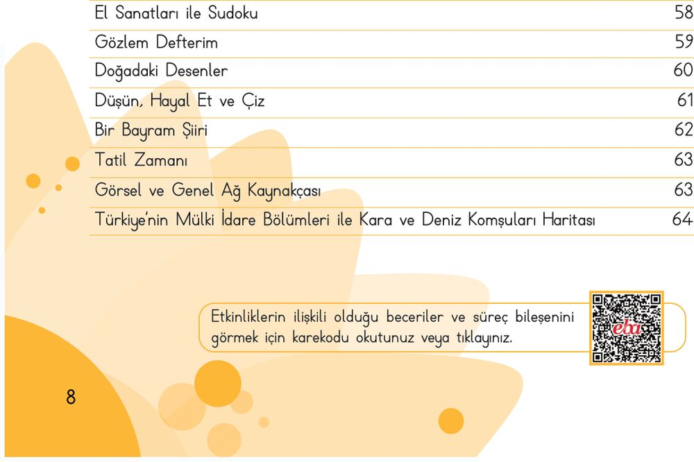

<!-- sayfa 8 -->

# ÇATALHÖYÜK'TE KEŞİF

Arkeologlar çok eski zamanlarda yaşamış insanlardan kalan yapıları ve eşyaları araştırır. Toprağın altında kalan eski eşyaları dikkatlice ortaya çıkarır. Konya Çatalhöyük'te arkeologların bulduğu nesneleri inceleyelim. Daha önce gördüğümüz nesneleri işaretleyelim.

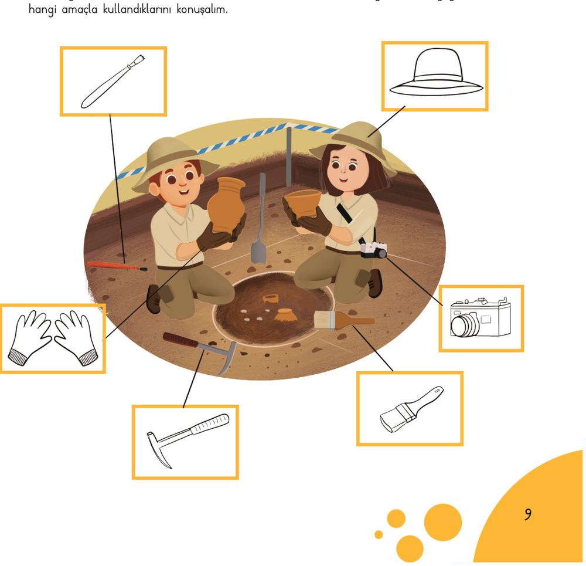

Arkeologların araştırmaları esnasında kullandıkları araçları inceleyelim ve boyayalım. Bunları hangi amaçla kullandıklarını konuşalım.

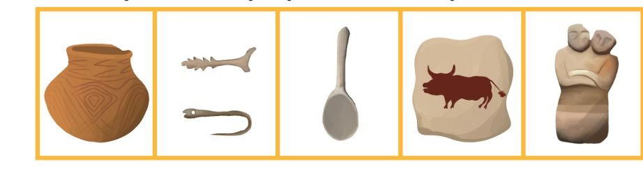

<!-- sayfa 9 -->

# RAFTAKİ EŞYALAR

Esma'nın odasındaki rafları inceleyelim. Raflardaki eşyaların isimlerini söyleyelim.

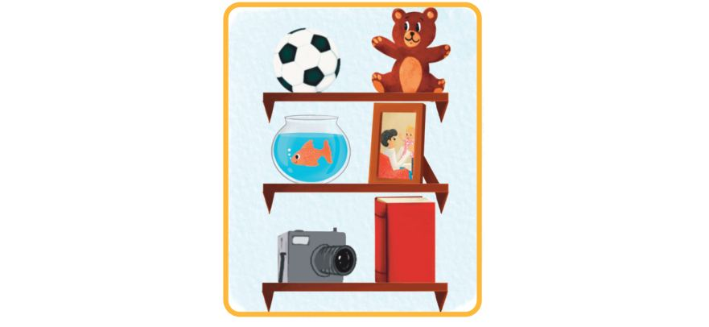

Esma, 1 ve 2 numaralı görsellerin her birinde eşyalardan birini saklamış. Esma'nın sakladığı eşyaları söyleyelim. Raflarda boş bırakılan yerlere eksik eşyaları çizelim.

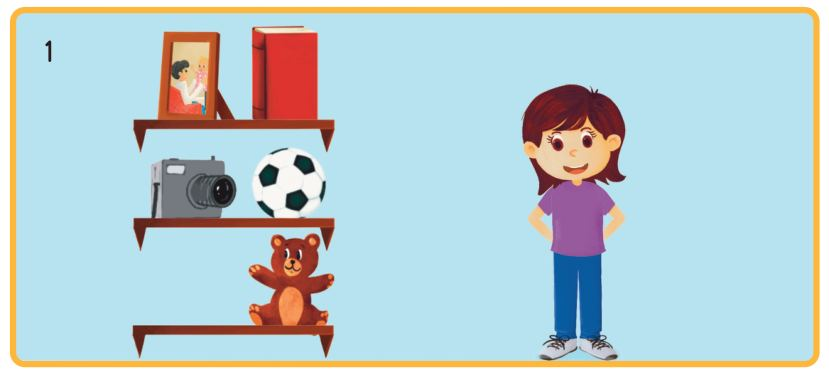

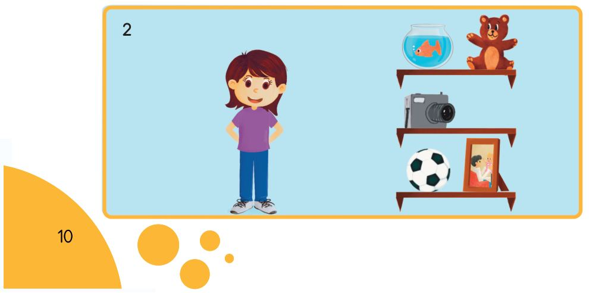

<!-- sayfa 10 -->

# DİNLEYELİM, BULALIM

![Manzara resmi]

Cümleleri dinleyelim. Görsellerin altındaki kutucukları, dinlediğimiz cümlenin başındaki renge uygun boyayalım.

| Renk | Cümle |
| :--- | :--- |
| 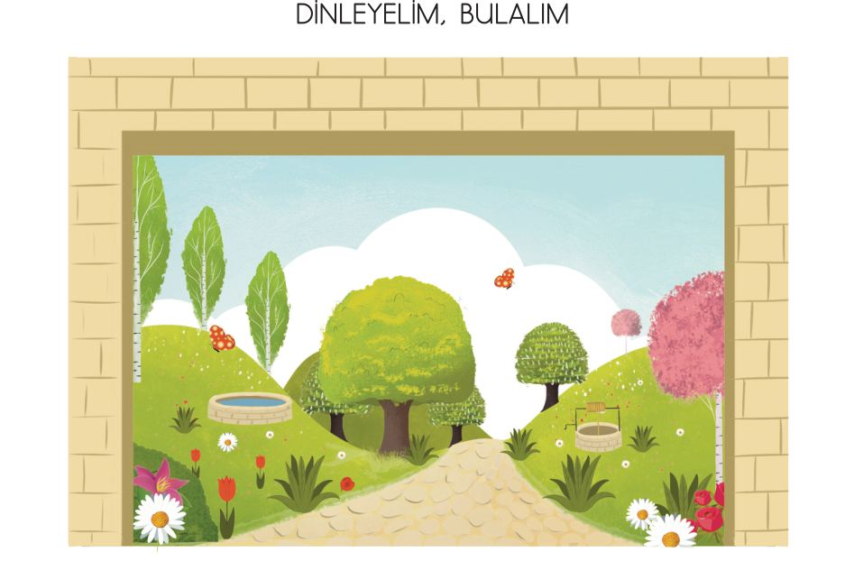 | Efe, bugün ailesiyle birlikte botanik bahçesine gideceği için mutlu uyandı ve yatağını topladı. |
| 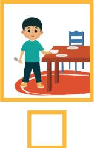 | Efe, kahvaltısını yaptıktan sonra sofranın toplanmasına yardım etti. |
| 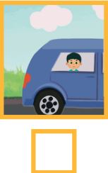 | Efe, arabanın camından dışarıyı izlerken bulutların ne kadar güzel göründüğünü fark etti. |
| 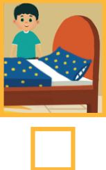 | Botanik bahçesine geldiklerinde Efe, fotoğraf makinesiyle çiçeklerin fotoğrafını çekti. |
| 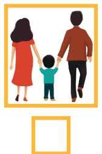 | Eve dönme zamanı geldiğinde Efe, anne ve babasının elini tutarak yola koyuldu. |

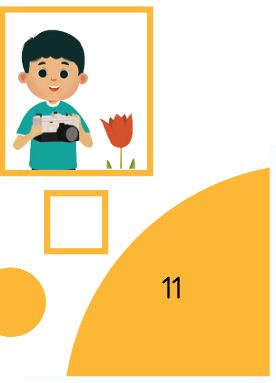    
| | | | | |
| :---: | :---: | :---: | :---: | :---: |
| [ ] | [ ] | [ ] | [ ] | [ ] |

<!-- sayfa 11 -->

# 7 RAKAMI

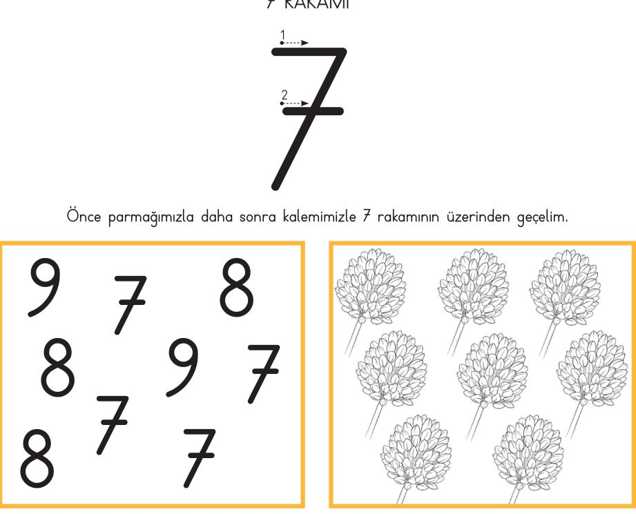

Önce parmağımızla daha sonra kalemimizle 7 rakamının üzerinden geçelim.

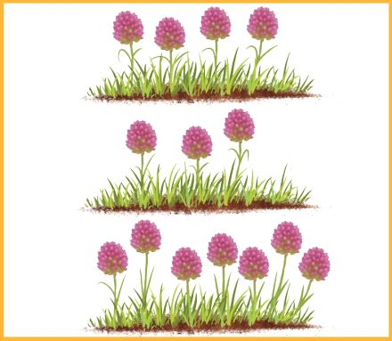
7 rakamlarını bulalım ve işaretleyelim.

Kapadokya soğanlarından 7 tanesini boyayalım. Dünyada sadece Nevşehir'de bulunan bu bitkiyi araştıralım.

Hangi sırada 7 tane Kapadokya soğanı var? İşaretleyelim.

7 rakamını kullanarak resim yapalım.

<!-- sayfa 12 -->

# TOPRAĞIN ALTINDA YAŞAYAN HAYVANLAR

Toprağın altında yaşayan hayvanların isimlerini söyleyelim. Kesik çizgileri tamamlayarak hayvanları arkadaşlarina ulaştıralım.

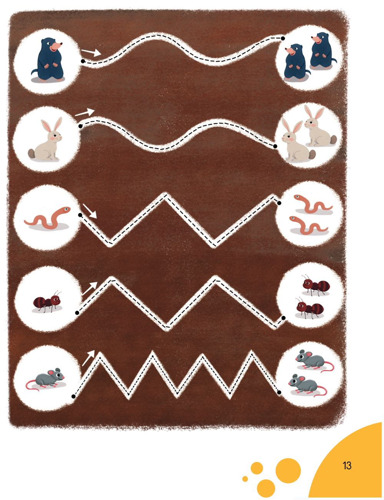

<!-- sayfa 13 -->

# İSTEK Mİ, İHTİYAÇ MI?

Esma ve ailesi alışverişe çıkmış. Esma’nın kalem, silgi ve ayakkabıya ihtiyacı var. Listeleri inceleyelim. Esma’nın ihtiyaçlarının olduğu listeyi işaretleyelim.

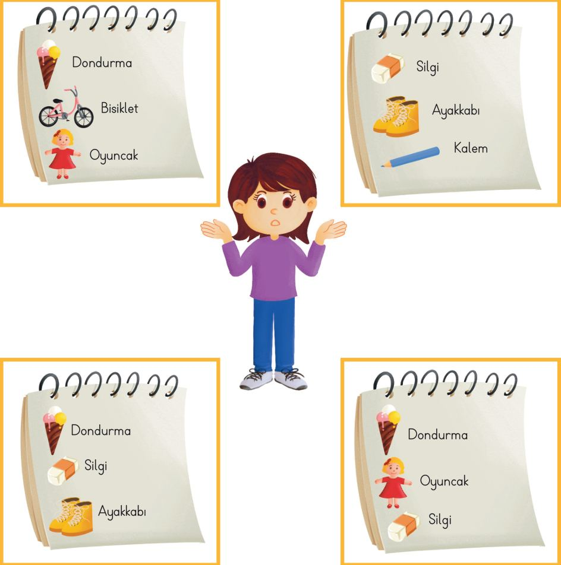

İstek ne demek? İhtiyaç ne demek? Satın alacağımız ürünlerde öncelikle isteklerimizi mi, ihtiyaçlarımızı mı dikkate almalıyız? Arkadaşlarımızla fikirlerimizi paylaşalım.

<!-- sayfa 14 -->

# KİTAP KAPAKLARI

Görselleri inceleyelim. Sayfalar hangi kitaplara ait olabilir? Sayfalarla kitap kapaklarını eşleştirelim. En sevdiğimiz hikâye kitabının adını düşünelim ve söyleyelim.

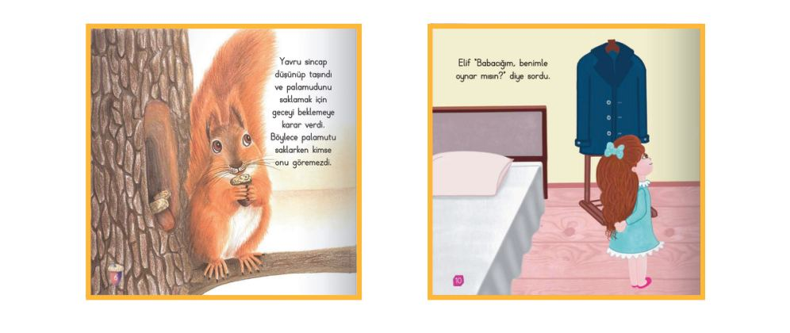
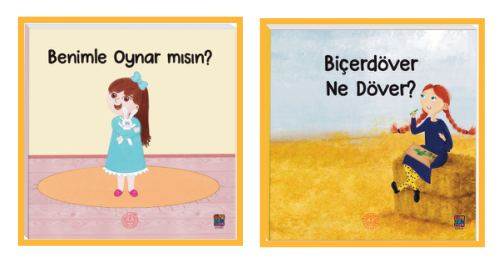
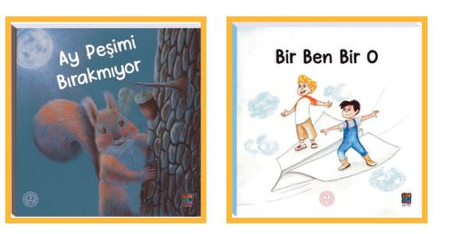

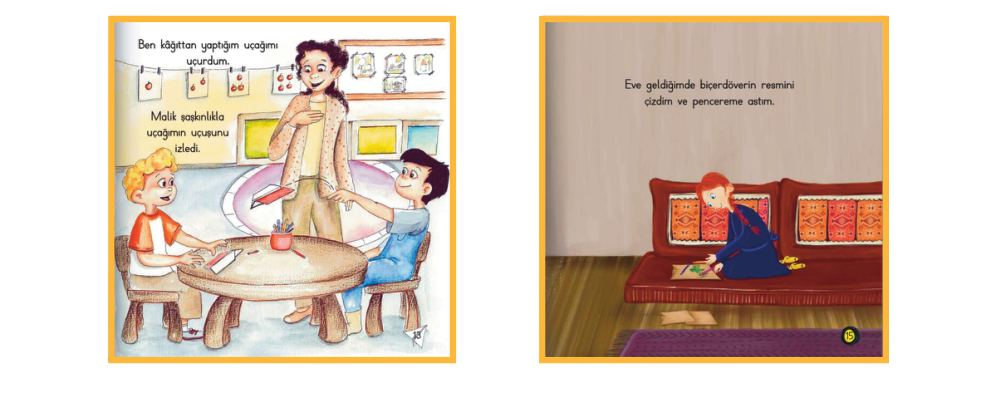

⭐ Öğretmene Not: Bu kitaplardan biri okunarak süreç desteklenebilir.

<!-- sayfa 15 -->

# PANGOLİNİN YOLU

Pangolin, arkadaşlarının yanına gitmek istiyor. Görevleri takip ederek yolu bulalım.

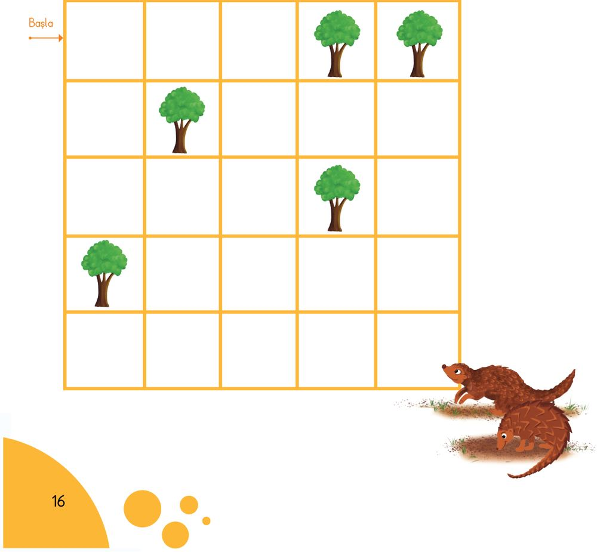
● Okun gösterdiği yerden başlayarak ileriye doğru üç kareyi boya.
● Son boyadığın karenin altındaki dört kareyi boya.
● Pangolinin arkadaşlarına ulaşması için kaç kare kaldı? Say ve söyle. Bu kareleri boyayarak pangolini arkadaşlarına ulaştır.

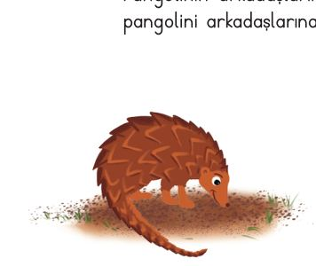
Başla $\rightarrow$ <!-- KONTROL: Marker'da karşılığı yok, uydurma olabilir -->

| | | | | |
|---|---|---|---|---|
| | | | 🌳 | 🌳 |
| | 🌳 | | | |
| | | | 🌳 | |
| 🌳 | | | | |
| | | | | |

<!-- sayfa 16 -->

# PARÇALARI BULALIM

Bloklardan yapılmış modelleri inceleyelim. Modelleri oluşturan parçaları çerçevelerin içinden bulalım ve yanındaki kutucukla aynı renge boyayalım.

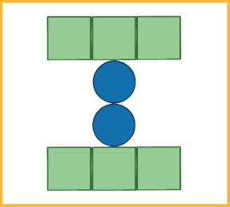 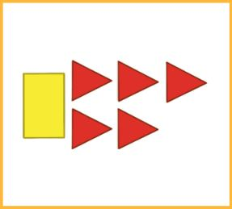 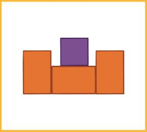
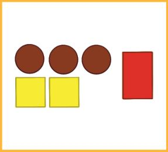 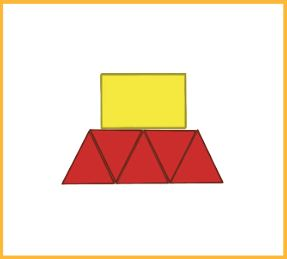 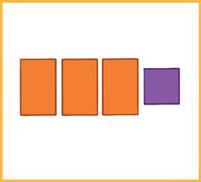
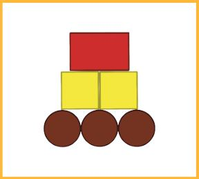 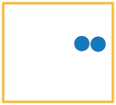 

<!-- sayfa 17 -->

# DUYGULARIMI YÖNETİYORUM

Bazen kendimizi öfkeli ya da üzgün hissedebiliriz. Sakinleşmek için bazı etkinlikler yapabiliriz. Sayı küpünü atalım. Gelen sayıyı bulup yanındaki etkinliği yapalım.

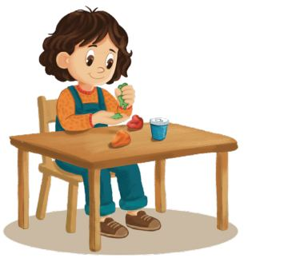
1
Bir balon şişir.

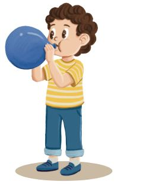
2
Oyun hamurunu 5 kere sık.

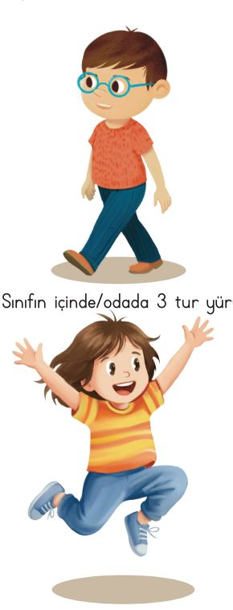
3
Güzel bir resim yap.

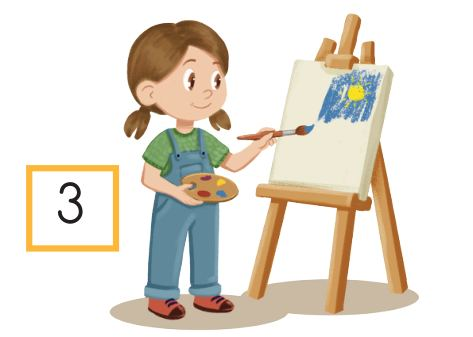
4
Sınıfın içinde/odada 3 tur yürü.

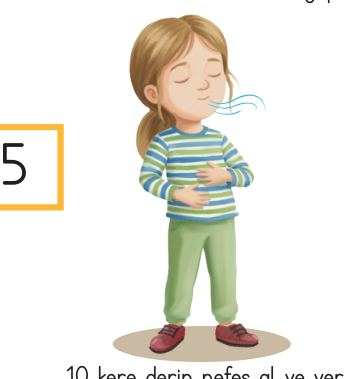
5
10 kere derin nefes al ve ver.

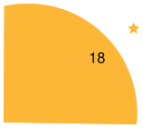
6
Yerinde 10 kere zıpla.

⭐ Öğretmene Not: Etkinliğe başlamadan önce sayı küpü temin edilmelidir.

<!-- sayfa 18 -->

# DÖNÜŞTÜR, DEĞERLENDİR

Görseldeki kişi Gizem. Elindeki de en sevdiği saksısı. Saksıda hangi renk çiçekler var? Söyleyelim.

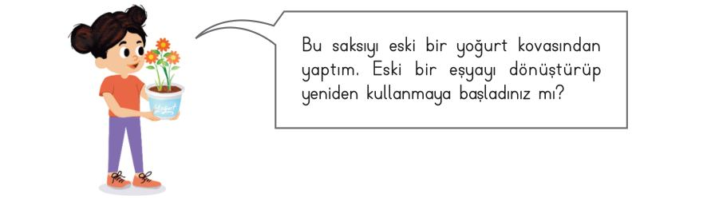

> Bu saksıyı eski bir yoğurt kovasından yaptım. Eski bir eşyayı dönüştürüp yeniden kullanmaya başladınız mı?

Birinci sıradaki eşyaların adını söyleyelim. İkinci sıradaki tasarımları inceleyelim. Birbiriyle ilişkili olanların altındaki kutucuğu aynı renge boyayalım.

1.
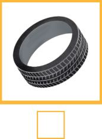   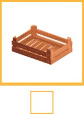

2.
 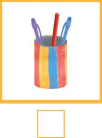 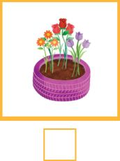 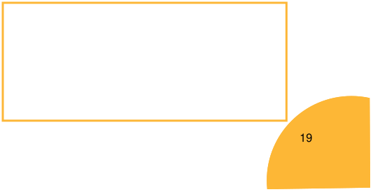

Sınıfımızda bulunan atık malzemelerden birini seçelim ve malzemeyi bir ürüne dönüştürelim. Elde ettiğimiz ürünün resmini çerçeveye çizelim.

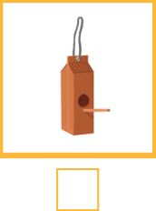

<!-- sayfa 19 -->

# TRAFİK İŞARETLERİ

Trafik işaretlerini inceleyelim. İşaretlerin ne anlama geldiğini konuşalım. Daha önce gördüğümüz trafik işaretlerinin yanındaki kutucuğu boyayalım.

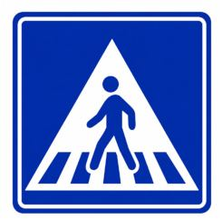 Bu işaret “yaya geçidi” işaretidir.

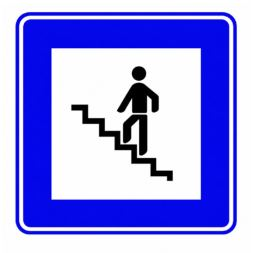 Bu işaret “üst geçit” işaretidir.

 Bu işaret “okul geçidi” işaretidir.

Kendi trafik işaretimizi tasarlayalım. Bu işareti insanların ne zaman kullanması gerektiğini anlatalım.

<!-- sayfa 20 -->

# BÖCEKLERİ SAYALIM

Görselleri inceleyelim. Her böcekten kaç tane olduğunu sayarak bulalım ve uygun kutucukları bularak işaretleyelim.

| 4 | 6 |

| 4 | 5 |

| 6 | 7 |

| 7 | 8 |

<!-- sayfa 21 -->

# KENDİMİ KORUYORUM

Hayvan görsellerini inceleyelim. Tanıdığımız hayvanların adlarını söyleyelim. Daha önce görmediğimiz hayvanları birlikte öğrenelim.

 Bu bir pangolin. Vücudu sert pullarla kaplıdır. Tehlike hissettiğinde top gibi yuvarlanarak kendini korur.

 Bu bir oklu kirpi. Vücudunda dikenleri vardır. Tehlike hissettiğinde dikenlerini kullanarak kendini korur.

 Bu bir kokarca. Tehlike hissettiğinde kötü koku üretip kokuyu püskürterek kendini korur.

 Bu bir kaplumbağa. Tehlike hissettiğinde başını ve ayaklarını kabuğunun içine çekerek kendini korur.

Dinlediğimiz bilgilerle ilgili soruları cevaplayarak sohbet edelim.
* Hayvanlar hangi durumlarda kendilerini tehlikede hissediyor olabilir?
* Tehlike karşısında kendilerini nasıl koruyorlar?
* Tehlikeli durumlara örnek verelim. Tehlike anında neler yapıyoruz? Anlatalım.

<!-- sayfa 22 -->

# HANGİSİ YOK?

Görseli inceleyelim. Görseldeki varlıkların adlarını söyleyelim. Her kartta eksik olan görseli bulalım ve görselin kutucuğunu çizgi çizerek karta ulaştıralım.

<!-- sayfa 23 -->

# DUYULARIMIZI KEŞFEDİYORUZ

Görseldeki kekin fırından yeni çıkmış olduğunu ve önümüzde durduğunu hayal edelim. Keki hangi duyu organlarımızla fark ederiz? Soruları cevaplayalım.

Bu kekin rengi var mıdır?
Bu kekin sesi var mıdır?
Bu kekin kokusu var mıdır?
Bu kekin tadı var mıdır?
Bu kek sert midir, yumuşak mıdır?

Tablodaki görselleri inceleyelim. Her satırdaki görseli duyu organlarını düşünerek örnekteki gibi işaretleyelim.

| | 🖐️ | 👀 | 👂 | 👃 | 👄 |
| :---: | :---: | :---: | :---: | :---: | :---: |
| 🥮 | ✔ | ✔ | ✖ | ✔ | ✔ |
| 🍋 | | | | | |
| 🌻 | | | | | |
| 🪨 | | | | | |
| 🐦 | | | | | |

<!-- sayfa 24 -->

# 8 RAKAMI

Önce parmağımızla daha sonra kalemimizle 8 rakamının üzerinden geçelim.

| | | |
|---|---|---|
|  |  | |

8 rakamlarını bulalım ve işaretleyelim.

Ahtapotlardan 8 tanesini boyayalım.
Ahtapotun kaç tane bacağı var? Sayalım.

8 tane bacağı olan hayvanları işaretleyelim.
8 adım atalım.

8 rakamını kullanarak resim yapalım.

<!-- sayfa 25 -->

23 NİSAN ULUSAL EGEMENLİK VE ÇOCUK BAYRAMI

Görseli inceleyelim. Çocuklar ne yapıyor olabilir? Tahmin edelim. Takım ne demek? Söyleyelim. Belirlediğimiz bir yöntemle takımlar oluşturalım. Karekodda yer alan şeritleri makasla belirtilen yerlerden kesip hazırlayalım. Şeritleri iç içe geçirip yapıştırarak takım zincirimizi oluşturalım. Sınıfımızı takımların hazırladığı zincirler ile süsleyelim.

Hangi bayram için sınıfı süslüyoruz? Tahmin edelim. Yukarıda büyük harflerle yazan yazıyı dinleyelim.

<!-- sayfa 26 -->

# HECELİYORUM

SİN - CAP

Hayvanların adlarını örnekteki gibi el çırparak heceleyelim. Adı iki heceden oluşan hayvanları işaretleyelim.

<!-- sayfa 27 -->

# TARİF DEFTERİM

Mutfakta yemek yaparken hangi araç gereçleri kullanırız? Görselleri inceleyelim ve konuşalım.

Tarif listelerindeki malzemeleri inceleyelim. Bu malzemelerle hangi içecek ve yiyecekler hazırlanabilir? Söyleyelim.

|  |  |  |
| :--- | :--- | :--- |
| Yumurta | Marul | Limon |
| Süt | Domates | Şeker |
| Şeker | Salatalık | Su |
| Un | Zeytinyağı | |
| | | |
|  |  |  |

Tarife uygun hazırladığımız içecek ve yiyeceklerin altındaki kutucuğu tarif listesinin altındaki kutucukla aynı renge boyayalım.

<!-- sayfa 28 -->

# AFET VE ACİL DURUM ÇANTAM

Hepimizin afet ve acil durum çantasına sahip olması gerekir. Evimizde afet ve acil durum çantamız var mı? Söyleyelim. Çantanın etrafındaki malzemeleri inceleyelim. Afet ve acil durum çantasında yer alması gereken malzemeleri çizgi çizerek çantaya götürelim.

Bu malzemeler dışında acil durum çantamızda olmasını istediğimiz başka bir malzeme varsa aşağıdaki çerçevenin içine çizelim.

<!-- sayfa 29 -->

# KAÇINCI YÜZÜCÜ?

1. Kaç yüzücü yarışıyor? Sayalım, işaretleyelim.
3 4 5

2. En öndeki yüzücünün bonesi ne renk? Bulalım, işaretleyelim.
🟣 🟤 🟠

3. İkinci sıradaki yüzücünün bonesi ne renk? Bulalım, işaretleyelim.
🟠 🟣 🟡

4. Dördüncü sıradaki yüzücünün bonesi ne renk? Bulalım, işaretleyelim.
🟡 🟢 🟤

<!-- sayfa 30 -->

# ÖLÇELİM

Evlerin yanındaki kutucukları boyayalım. Boyadığımız kutucukları sayalım. Hangi ev daha yüksek? Söyleyelim.

Kapıların altındaki kutucukları boyayalım. Boyadığımız kutucukları sayalım. Hangi kapı daha geniş? Söyleyelim.

Çerçevenin içine bu kapıdan daha dar bir kapı çizelim.
Çerçevenin içine bu evden daha yüksek bir ev çizelim.

<!-- sayfa 31 -->

# KÜLTÜR TURİZMİ

Harun bu yaz ailesiyle kültür turizmi için bir geziye çıkıyor. Bu gezide ülkemizdeki önemli yerleri ziyaret edecekler. Onun bu gezisine eşlik etmek için başlangıç noktasından başla. 1'den 7'ye kadar rakamları sırasıyla takip ederek görevleri tamamla. Merak ettiğin yerleri araştırmayı unutma.

1 Sultan Ahmet Camii’ne hoş geldin. Burası İstanbul’da bulunan bir camidir. Caminin içinde mavi, yeşil ve beyaz renkte İznik çinileri yer almaktadır. Haydi, şimdi bu caminin minarelerini say.

3 Safranbolu’ya hoş geldin. Burası Karabük’te bulunan bir ilçedir. Safran çiçeği, lokumları ve geleneksel evleri ile meşhurdur. Türk bayrağı asılı olan evi bul ve işaretle.

2 Pamukkale Travertenlerine hoş geldin. Burası Denizli’de bulunan doğal bir oluşumdur. Haydi, şimdi Pamukkale kelimesini el çırparak hecele.

4 Kız Kalesi’ne hoş geldin. Burası Mersin’de bulunan ve denizin ortasında duran antik bir yapıdır. Bu kalede yaşayanlar buraya nasıl ulaşıyorlardı? Düşünelim, anlatalım.

<!-- sayfa 32 -->

5
Anıtkabir'e hoş geldin. Burası başkentimiz Ankara'da bulunan bir anıttır. Mustafa Kemal Atatürk için yapılan bu anıtın içinde bir de müze bulunmaktadır. Haydi, şimdi sınıfında asılı olan Atatürk fotoğrafını göster.

6
Ani Harabeleri'ne hoş geldin. Burası Kars'ta bulunan çok eski bir yerleşim yeridir. Burada bir zamanlar pek çok insan yaşamış ve çok güzel yapılar inşa etmişler. Harabe ne demek olabilir? Tahmin edelim.

7
Göbeklitepe'ye hoş geldin. Burası Şanlıurfa'da bulunan eski bir yerleşim yeridir. Yapılan araştırmalarda buğdayın ilk olarak burada yetiştirildiği bulunmuştur. Buğdaydan elde edilen bir ürün söyle.

Kars
Şanlıurfa

<!-- sayfa 33 -->

# DİNLE VE SÖYLE

Sayfada kaç tane hediye paketi var? Sayalım. Hediye paketlerinin içinde ne olabilir? Tahmin edelim. En son kimden hediye aldığımızı, kime hediye verdiğimizi düşünelim. Hediyeleşmenin bize neler hissettirdiğini anlatalım.

Hediye paketlerinden gelen sesleri dinleyelim. Duyduğumuz ses neye ait olabilir? Söyleyelim.

⭐ Öğretmene Not: Karekodlarda sırasıyla; öksüren çocuk, hapşıran çocuk, patlamış top, damlayan su, sallanan bir su şişesi, kuş, kitap sayfalarını çevirme, üstünde yürüyen kuru yaprak ve yağmur sesi yer almaktadır.

<!-- sayfa 34 -->

# SOHBET ZAMANI

Sınıfı inceleyelim. Çocuklar neler hakkında sohbet ediyor olabilir? Konuşalım. Aşağıda verilen konulardan konuşmak istediğimizi işaretleyelim. Seçtiğimiz konu hakkında ikili eşleşerek eşimizle sohbet edelim. Sohbet ederken arkadaşlarımızı dikkatle dinlemeye ve kelimelerimizi özenle seçmeye çalışalım.

| Oyuncaklar | Uzay | Hayvanlar |
| :---: | :---: | :---: |
|  |  |  |

<!-- sayfa 35 -->

# BU KAPIDAN KİM GEÇER?

Sembolleri ve çocukları inceleyelim. Çocukların hangi sembolün olduğu kapıya gitmesi gerektiğini bulalım. Her çocuğu gitmesi gereken kapıya çizgi çizerek ulaştıralım.

    

  

<!-- sayfa 36 -->

# ÖRÜNTÜ DUVARI

Çerçevelerdeki örüntüyü inceleyelim. Alttaki kutucuklardan doğru olan örüntü kuralını işaretleyelim.

Mehmet, oturma odasının duvarlarını boyuyor. Hangi renkleri kullanmış? Söyleyelim. Renkleri örüntü kuralına uygun devam ettirerek boyamayı daha hızlı bitirmesine yardım edelim.

<!-- yer tutucu bulunamadı: sayfa sonuna eklendi -->

<!-- sayfa 37 -->

# DENGE HAREKETLERİ

Sayfada gördüğümüz denge hareketlerini müzik eşliğinde yapalım.

Harikaydınız çocuklar. O zaman dansımızı daha eğlenceli bir hâle getirelim. Aynı denge hareketlerini kollarımız iki yana açıkken yapalım. Bakalım hem müziğin ritmine uyup hem de hareketleri yaparken dengede kalabilecek miyiz?

⭐ Öğretmene Not: Hareketleri “Kaplumbağa” isimli şarkı eşliğinde yaptırabilirsiniz. Karekodu okutarak veya tıklayarak “Kaplumbağa” isimli şarkıya erişebilirsiniz.

<!-- sayfa 38 -->

# 9 RAKAMI

Önce parmağımızla daha sonra kalemimizle 9 rakamının üzerinden geçelim.

| | | |
| :---: | :---: | :---: |
| 9 | | 9 |
| 7 | 9 | |
| 8 | | |
| 8 | 9 | 7 |
| | 9 | |

Öter ardıç kuşunun yumurtalarının mavi renkte olduğunu biliyor musun? Yumurtalardan 9 tanesini mavi renge boyayalım.

İçinde 9 tane yumurta olan kuş yuvasını işaretleyelim. 9 kere kuş gibi ötelim.

9 rakamını kullanarak resim yapalım.

<!-- sayfa 39 -->

# ÇİZGİYİ TAKİP ET

Kesik çizgileri tamamlayarak hayvanları, seslerin bulunduğu kutucuklara götürelim. Sesleri dinleyelim ve taklit edelim.

 
 
 

<!-- sayfa 40 -->

# NESNELERİN YERLERİNİ HATIRLAYALIM

Tablodaki nesneleri kutulardaki yerlerine dikkat ederek inceleyelim.

Tabloyu kapatarak soruları cevaplayalım. Cevaplarımızı uygun yerlere çizelim.

| | |
| :---: | :---: |
|  | |
| | |

Çiçeğin yanında hangi nesne vardı? Çizelim.

| | |
| :---: | :---: |
| |  |
| | |

Topun altında hangi nesne vardı? Çizelim.

| | |
| :---: | :---: |
| | |
| | |

| | |
| :---: | :---: |
| | |
|  | |

Balığın üstünde hangi nesne vardı? Çizelim.

<!-- sayfa 41 -->

# MÜZE GEZİSİ

Gizem ve Ersen, okul dışı öğrenme etkinlikleri kapsamında Ankara Anadolu Medeniyetleri Müzesine geziye gidiyor. Daha önce herhangi bir müzeye gittiniz mi? Müzelerde neler görürüz?

 

(Ankara Anadolu Medeniyetleri Müzesi)

Karekodu kullanarak Ankara Anadolu Medeniyetleri Müzesi’nde sanal gezi yapalım. Sanal müze gezimiz sırasında eserlerden hangilerini gördük? Gördüğümüz eserlerin altındaki kutucukları işaretleyelim.

  

<!-- sayfa 42 -->

# MÜZE YOLU

Onur, müzeye gitmek için kullandığı yolda etrafında gördüğü varlıkları sayma oyunu oynuyor. Onur ile birlikte yolu takip edelim. Yolda gördüğümüz varlıkların adlarını söyleyelim.

Gördüğümüz her varlığın sayısını görselin altındaki kutucuklardan seçip işaretleyelim.

<!-- sayfa 43 -->

# KARAHİNDİBANIN DEĞİŞİMİ

Karahindibanın zaman içinde nasıl değiştiğini inceleyelim.

Karahindibanın bölümlerini inceleyelim. Sapların üzerine karahindiba çiçeklerini çizerek resmi tamamlayalım.

<!-- sayfa 44 -->

# YERİNİ BUL

Çerçevelerdeki hayvanları inceleyelim.

İkili hayvan gruplarını alttaki kutudan bulup örnekteki gibi işaretleyelim.

<!-- sayfa 45 -->

# ÖRÜNTÜ ZAMANI

Görsellerdeki örüntüleri inceleyelim. Her sıradaki örüntü kuralına dikkat ederek boş olan kutuya gelmesi gereken varlığı çizelim.

<!-- sayfa 46 -->

# YUMUŞAK MI, SERT Mİ?

Fatma sepetine sert nesneleri, Mert ise sepetine yumuşak nesneleri toplayacak. Sert nesneleri Fatma’nın sepetine, yumuşak nesneleri Mert’in sepetine çizgiyle götürerek iki arkadaşın nesneleri toplamasına yardımcı olalım.

Masadaki nesneleri inceleyelim. Hangi masada sert, hangi masada yumuşak nesneler var? Masaya ait olmayan nesneyi bulup işaretleyelim.

<!-- sayfa 47 -->

# BAKALIM, SEÇELİM

Çerçevedeki varlıkları inceleyelim. Her çerçevenin içinden kullanım amacı diğerlerinden farklı olan varlığı bulalım ve işaretleyelim.

Çerçevedeki boş alana buradaki görseller ile ilişkili bir varlık çizelim.

<!-- sayfa 48 -->

# LABİRENT

Karınca, yuvasına sakladığı çekirdeği bulmakta zorlanıyor. Karıncayı çekirdeğe ulaştıralım. Çekirdeğe ulaşan yolu yırtma yapıştırma tekniği kullanarak tamamlayalım.

Labirent etkinliğini tamamladığımızda arkadaşlarımızı beklerken işaret parmaklarımızı örnekteki gibi dairelerin üzerine koyarak ve iki elimizi aynı anda hareket ettirerek çizgi çalışması yapalım.

<!-- sayfa 49 -->

# MEYVELERİ SAYALIM

Görseldeki meyveleri inceleyelim. Her meyveden kaç tane olduğunu sayalım ve doğru rakamın bulunduğu kutucuğu bulup işaretleyelim.

7 | 8
---|---
7 | 9
9 | 8

<!-- sayfa 50 -->

# BENZER SESLERİ BULALIM

Çerçevelerdeki görselleri inceleyelim. Hangi sözcükler birbirine benzeyen seslerle bitiyor? Çizgi çizerek eşleştirelim.

<!-- sayfa 51 -->

# ZORBALIĞI TANIYORUM

Ali’nin arkadaşı ona kötü sözler söyleyerek onu üzüyor.

Nevzat’ın arkadaşı onu itiyor ve vuruyor.

Ece’nin arkadaşı onun resimlerini yırtıyor ve eşyalarına zarar veriyor.

Bir kişinin başka bir kişiyi bilerek üzmesine, korkutmasına ya da ona zarar vermesine zorbalık denir. Zorbalık tekrarlayan davranışlardır. Zorbalıkla karşılaştığında “Dur!” diyebilir, hoşlanmadığını söyleyebilir veya oradan uzaklaşabilirsin. Yaşadıklarını mutlaka güvendiğin bir yetişkine anlatmalı ve ondan yardım istemelisin. Zorbalıkla karşılaştığında kimlerden yardım isteyebilirsin? Görseller arasından yardım isteyebileceğimiz yetişkinleri işaretleyelim.

Öğretmen
Anne
Baba
Okul Müdürü

<!-- sayfa 52 -->

# ZITLAR OYUNU

Görselleri inceleyelim. Birbirinin zıttı olan görselleri bulup çizgi çizerek eşleştirelim.

<!-- sayfa 53 -->

# ÖNÜNDE Mİ, ARKASINDA MI?

Geometrik şekillerden oluşmuş görselleri inceleyelim.

Yeşil dairenin önünde hangi şekil var? Doğru kutucuğu bulup işaretleyelim.

Kırmızı üçgenin arkasında hangi şekil var? Doğru kutucuğu bulup işaretleyelim.

<!-- sayfa 54 -->

# NE ZAMAN?

Bazı davranışları her gün, bazılarını ise bazen yaparız. Örneğin her gün su içeriz, bazen alışverişe çıkarız. Her gün yaptığımız davranışları bulup işaretleyelim.

<!-- sayfa 55 -->

# DÖNME DOLAP

Dönme dolabın vagonlarında bulunan çocukların sohbetlerini dinleyelim. Dinlediğimiz cümlelerle ilgili duygularımızı gösteren yüz ifadelerine dokunalım.

Akşam yemeğinde en sevdiğim yemek pişti.

En sevdiğim oyuncağım kayboldu.

Kule yapmak için uğraştığım bloklar yıkıldı.

Daha önce görmediğim bir kuş gördüm.

Arkadaşımdan bir hediye aldım.

Mutlu
Üzgün
Korkmuş
Öfkeli
Şaşırmış

<!-- sayfa 56 -->

# ORGANİK ATIKLAR

Bazı atıklar zamanla parçalanarak toprağa karışabilir. Bu tür atıklara organik atık denir. Meyve ve sebze kabukları, yapraklar ve yemek artıkları bu atıklara örnektir. Görselleri inceleyelim. Organik atıkları bulup işaretleyelim.

<!-- sayfa 57 -->

# EL SANATLARI İLE SUDOKU

 Görseldeki sudokuyu inceleyelim. Sudoku her satırda ve sütunda görsellerden birer defa kullanılarak oynanan bir zeka oyunudur. Tablodaki boşluklara gelmesi gereken görselleri bulalım ve boşlukları görsellerin altındaki renge uygun boyayarak sudokuyu tamamlayalım.

| | | |
| :---: | :---: | :---: |
|  | |  |
|  |  | |
| |  |  |

| | | |
| :---: | :---: | :---: |
|  |  |  |

 Öğretmene Not: Sudoku etkinliğine başlamadan önce sınıf ortamında gerçek nesnelerle sudoku çalışmaları yapılarak çocuklar etkinliğe hazırlanabilir.

<!-- sayfa 58 -->

# GÖZLEM DEFTERİM

Beren parkta gördüğü varlıkları gözlemliyor. Görselleri inceleyelim. Hangilerinin canlı, hangilerinin cansız olduğunu söyleyelim.

Biz de kitabımızı ve kalemimizi alıp bahçeye çıkalım. Çevremizde gözlemlediğimiz canlı ve cansız varlıkları gözlem sayfamıza çizelim.

Bulduğumuz canlı ve cansız varlıkların sayısına uygun kutucukları boyayalım.

Canlı 

Cansız 

<!-- sayfa 59 -->

# DOĞADAKİ DESENLER

Doğadaki varlıklara ait görselleri inceleyelim ve isimlerini söyleyelim. Görsellerin üzerindeki desenleri parmağımızla takip edelim. Kesik çizgileri birleştirerek desenleri tamamlayalım.

<!-- sayfa 60 -->

# DÜŞÜN, HAYAL ET VE ÇİZ

Daha önce mavi ayaklı sümsük kuşu gördük mü? Düşünelim. Sümsük kuşunun nasıl göründüğünü tahmin edelim ve çizelim.

Daha önce küpe çiçeği gördük mü, küpe çiçeği nasıl bir bitki olabilir? Düşünelim. Çerçevenin içine bir küpe çiçeği çizelim.

Çizimlerimizi gerçek hâlleriyle karşılaştıralım.

⭐ Öğretmene Not: Çizimler tamamlandıktan sonra karekodlardan yararlanarak

<!-- sayfa 61 -->

# BİR BAYRAM ŞİİRİ

Şiirin içinde yer alan görselleri inceleyelim. Bu şiir ne hakkında olabilir? Tahmin edelim. Şiir okunurken parmağımızla yavaşça takip edelim ve görsellerin olduğu yere gelince duralim. Görselin ismini sesli söyleyerek şiiri birlikte tamamlayalım. Bayramlarla ilgili sevdiğimiz şeyler hakkında sohbet edelim.

Bayram sabahı erken çalar  ler,

Herkes bayramlıklarını giyer.

Büyükler  ye gider

 ler beraber  eder,

Küçükler büyüklerin  lerini öper.

Çocukların cepleri dolar ,

Sayılır  birer birer.

Bayramlarda  gülümser,

Çünkü çocuklar bayramları çok sever.

<!-- sayfa 62 -->

# TATİL ZAMANI

Okulda birçok etkinlik yaptık, oyunlar oynadık ve yeni şeyler öğrendik. Okuldaki anılarımızı düşünelim ve soruları cevaplayalım.

Okulun ilk günü ne hissettiğimizi hatırlayalım. Görseldeki duygu ifadelerinden birini işaretleyelim.

Okulda birlikte vakit geçirmekten hoşlandığımız bir arkadaşımızın resmini çizelim.

Sınıfta oynamaktan hoşlandığımız bir oyuncağın resmini çizelim.

Yaz tatilinde yapmayı planladığımız bir etkinliğin resmini çizelim.

Okullar kapandığı için kendimizi nasıl hissettiğimizi gösteren duygu ifadesini işaretleyelim.

İYİ TATİLLER!

Görsel ve Genel Ağ Kaynakçası için karekodu okutunuz

<!-- sayfa 63 -->

50°D
45°D
40°D
35°D
30°D
25°D

40°K
35°K

: TÜRKİYE'NİN MÜLKİ İDARE BÖLÜMLERİ İLE KARA VE DENİZ KOMŞULARI HARİTASI

**Lejant:**
*   BAŞKENT (Ankara)
*   İL MERKEZİ
*   GÖL
*   AKARSU
*   ÜLKE SINIRI
*   ÖZERK BÖLGE SINIRI

**Ölçek:**
0
100
200
300
400
km

**Harita Üzerindeki Yer İsimleri ve Coğrafi Unsurlar:**

**Denizler ve Göller:**
*   KARADENİZ
*   EGE DENİZİ
*   AKDENİZ
*   MARMARA DENİZİ
*   HAZAR DENİZİ
*   Van Gölü
*   Tuz Gölü
*   Urumiye Gölü

**Ülkeler ve Bölgeler:**
*   RUSYA FEDERASYONU
*   UKRAYNA
*   ROMANYA
*   BULGARİSTAN
*   YUNANİSTAN
*   GÜRCİSTAN
*   ERMENİSTAN
*   AZERBAYCAN
*   NAHÇIVAN Ö.C. (AZERBAYCAN)
*   İRAN
*   IRAK
*   SURİYE
*   LÜBNAN
*   KUZEY KIBRIS TÜRK CUMHURİYETİ
*   GÜNEY KIBRIS RUM YÖNETİMİ
*   İSRAİL
*   FİLİSTİN (Gazze Şeridi, Batı Şeria)
*   MISIR

**Şehirler ve Başkentler:**
*   Sofya
*   Bükreş
*   Tiflis
*   Erivan
*   Bağdat
*   Şam
*   Beyrut
*   Lefkoşa
*   Atina
*   Tel Aviv
*   Kudüs
*   Ankara
*   İstanbul
*   İzmir
*   Bursa
*   Antalya
*   Adana
*   ... (ve listedeki diğer tüm iller: Adıyaman, Afyonkarahisar, Ağrı, Amasya, Artvin, Aydın, Balıkesir, Bilecik, Bingöl, Bitlis, Bolu, Burdur, Çanakkale, Çankırı, Çorum, Denizli, Diyarbakır, Edirne, Elâzığ, Erzincan, Erzurum, Eskişehir, Gaziantep, Giresun, Gümüşhane, Hakkâri, Hatay, Isparta, Mersin, Kars, Kastamonu, Kayseri, Kırklareli, Kırşehir, Kocaeli, Konya, Kütahya, Malatya, Manisa, Kahramanmaraş, Mardin, Muğla, Muş, Nevşehir, Niğde, Ordu, Rize, Sakarya, Samsun, Siirt, Sinop, Sivas, Tekirdağ, Tokat, Trabzon, Tunceli, Şanlıurfa, Uşak, Van, Yozgat, Zonguldak, Aksaray, Bayburt, Karaman, Kırıkkale, Batman, Şırnak, Bartın, Ardahan, Iğdır, Yalova, Karabük, Kilis, Osmaniye, Düzce)

**Akarsular ve Diğer Unsurlar:**
*   Meriç N.
*   Sakarya N.
*   Kızılırmak N.
*   Yeşilırmak N.
*   Çoruh N.
*   Aras N.
*   Kura N.
*   Fırat N.
*   Dicle N.
*   Asi N.
*   Seyhan N.
*   Ceyhan N.
*   Göksu N.
*   Büyük Menderes N.
*   Küçük Menderes N.
*   Bakırçay N.
*   Gediz N.
*   Nil N.
*   Süveyş K.
*   Gökçeada
*   Bozcaada

Harita Genel Müdürlüğü tarafından üretilmiştir.
