# Okul Öncesi Eğitim 5 Yaş Çekirdek 1 Ders Kitabı

<!-- sayfa 0 -->

# OKUL ÖNCESİ EĞİTİM

## 5 Yaş

# Çekirdek 1

### DERS KİTABI

**Yazarlar**
Berrin TERCAN
Betül SÜREK
Esma HAYIRLIOĞLU
Ezgi AVCI AŞIR
Işıl ÖZTÜRK
Tuba Nur EROL

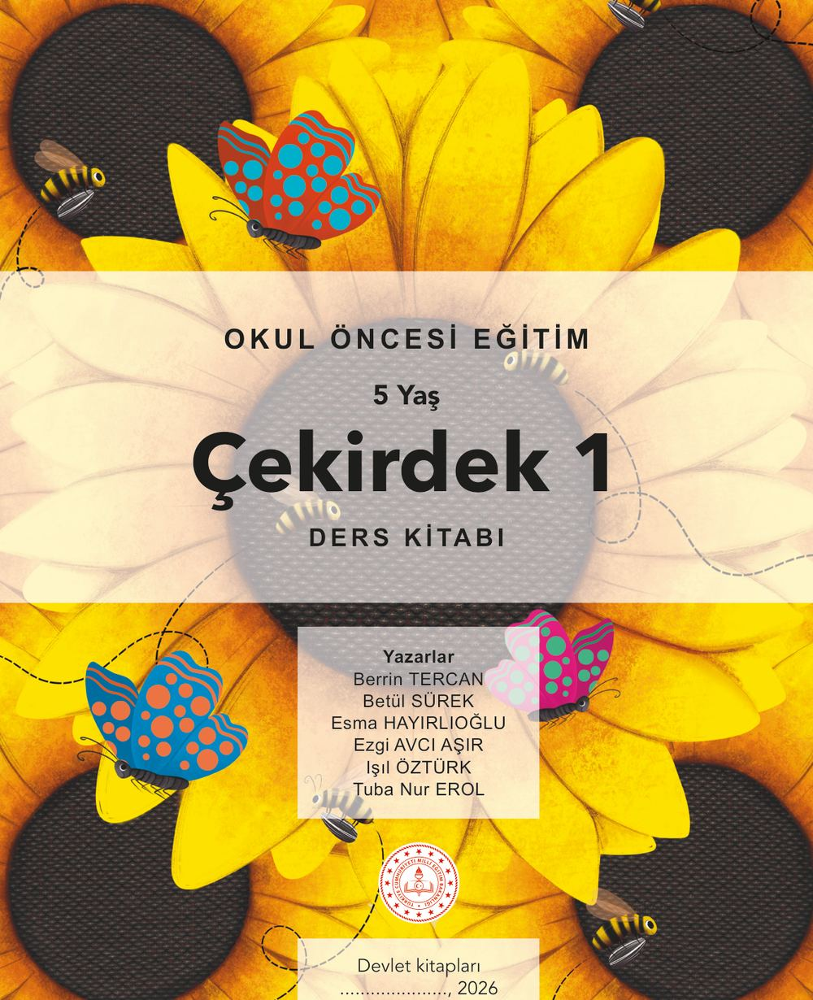

Devlet kitapları

<!-- sayfa 1 -->

DERS KİTAPLARI DİZİSİ ..........................................................................................: 2489

Her hakkı saklıdır ve Millî Eğitim Bakanlığına aittir. Kitabın metin, soru ve şekilleri kısmen de olsa hiçbir surette alınıp yayımlanamaz.

**EDİTÖR**
Burcu ÖZKANLI ERTUĞRUL

**DİL UZMANI**
Muhammet ŞEN

**GÖRSEL TASARIMCI**
Eylem YILDIRIM
Melike TURALİ
Metin BİLAL
Serdar TURALİ

**ÇOKLU ORTAM TASARIMCISI**
Abidin AYDIN
Çağdaş SEVİNÇ
Didem EROL
Ezgi SARINÇ
Ferhat DEMİRCİ
İlkay CAN
Onur TÜLÜ
Yudum CAN

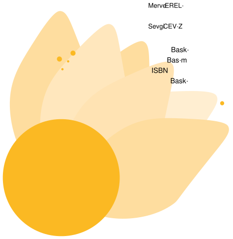

**PROGRAM GELİŞTİRME UZMANI**
Uğur ÇENET

**ÖLÇME VE DEĞERLENDİRME UZMANI**
Merve ERELİ

**REHBERLİK UZMANI**
Sevgi CEVİZ

Baskı Yılı:
Basım Adedi:
ISBN 978-975-11-8089-6
Baskı Yeri:
Adresi:

Millî Eğitim Bakanlığı, Talim ve Terbiye Kurulu Başkanlığının 30.07.2024 tarih ve E-96732399-116.01-111152749 sayılı yazısı ile eğitim aracı olarak kabul edilmiştir. Kurulca bu kitabın kabul edilmiş olması ders kitabından yayınevi ve yazarın/yazarların sorumluluğunu kaldırmaz.

<!-- sayfa 2 -->

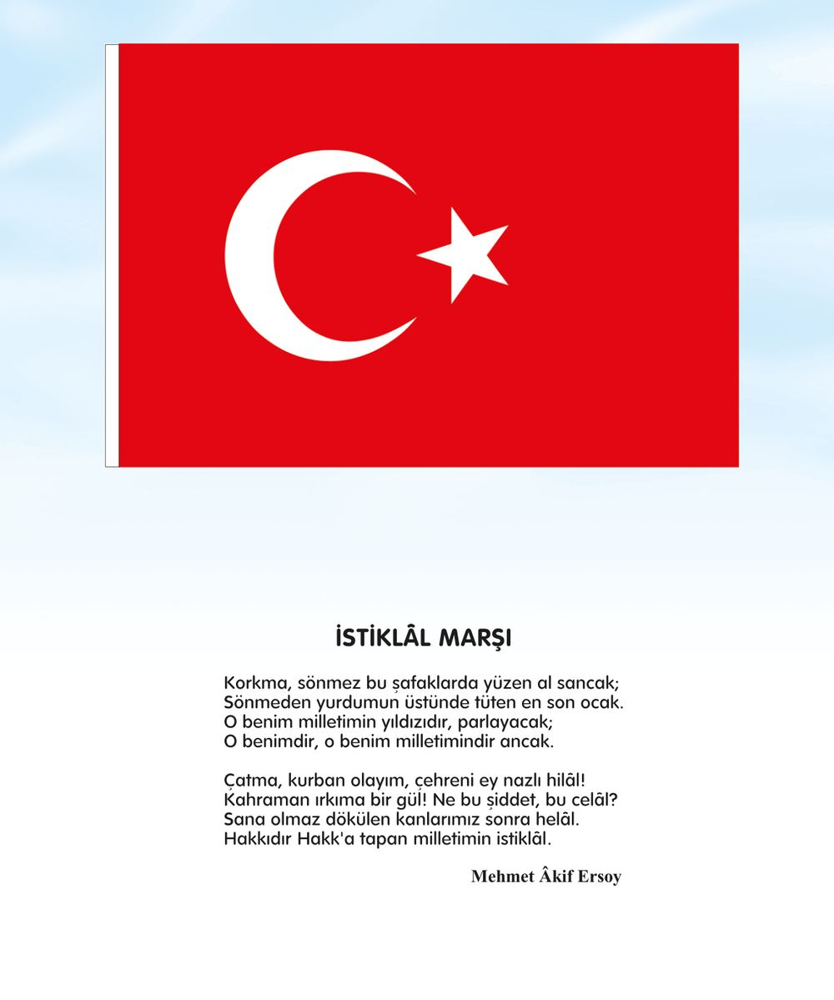

# İSTİKLÂL MARŞI

Korkma, sönmez bu şafaklarda yüzen al sancak;
Sönmeden yurdumun üstünde tüten en son ocak.
O benim milletimin yıldızıdır, parlayacak;
O benimdir, o benim milletimindir ancak.

Catma, kurban olayım, çehreni ey nazlı hilâl!
Kahraman ırkıma bir gül! Ne bu şiddet, bu celâl?
Sana olmaz dökülen kanlarımız sonra helâl.
Hakkıdır Hakk'a tapan milletimin istiklâl.

Mehmet Âkif Ersoy

<!-- sayfa 3 -->

ANDIMIZ

Türküm, doğruyum, çalışkanım.

İlkem küçüklerimi korumak, büyüklerimi saymak; yurdumu, milletimi özümden çok sevmektir.
Ülküm yükselmek, ileri gitmektir.

Ey Büyük Atatürk!

Açtığın yolda, gösterdiğin hedefe durmadan yürüyeceğime ant içerim.

Varlığım Türk varlığına armağan olsun.

Ne mutlu Türküm diyene!

<!-- sayfa 4 -->

MUSTAFA KEMAL ATATÜRK

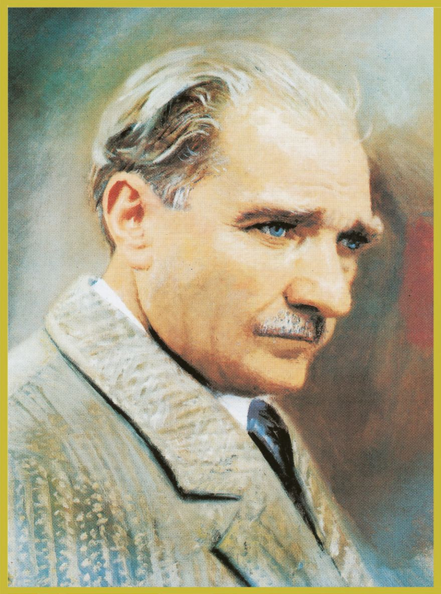
<!-- yer tutucu bulunamadı: sayfa sonuna eklendi -->

<!-- sayfa 5 -->

Verdiğiniz girdi boş olduğu için (`<<< >>>` arası boş) çevrilecek bir metin bulunmamaktadır. Lütfen işlenmesini istediğiniz metni veya görseli paylaşın.

<!-- sayfa 6 -->

# İÇİNDEKİLER

| | |
| :--- | :---: |
| Okulumda İlk Günüm | 9 |
| Ben Kimim? | 10 |
| Sınıfımızdaki Merkezler | 11 |
| Doğru Oturma Pozisyonu | 12 |
| Saklanmış Böcekleri Bulalım | 13 |
| Az-Çok | 14 |
| Benim Hakkımda | 15 |
| Bilmece Kutusu | 16 |
| Benim Duygularım | 17 |
| 1 Rakamını Öğreniyorum | 18 |
| Hayvanların İlginç Yatakları | 19 |
| Anadolu Parsı | 20 |
| Endemik Bitkiler | 21 |
| Timsah ve Ardıç Kuşu | 22 |
| Eve Giderken Neler Gördüm? | 23 |
| Ülkemizde Nesli Tükenmekte Olan Hayvanlar | 24 |
| Yaşam Döngüsünü Araştırıyorum | 25 |
| 2 Rakamını Öğreniyorum | 26 |
| İkişer Raket | 27 |
| Kaç Sözcükten Oluşuyor? | 28 |
| Meyve Bahçesi | 29 |
| Nefes Egzersizi | 30 |
| Ebru Sanatı | 31 |
| İsteklerim Engellendiği Zaman | 32 |
| Neşe’nin Kurabiyeleri | 33 |
| Hayvanlarla Sanat Çalışması | 34 |
| Çiçeklerin Renkleri | 35 |
| 3 Rakamını Öğreniyorum | 36 |
| Topları Çevirme Oyunu | 37 |
| Taşıtların Adını Heceliyorum | 38 |
| Hayvanların Benekleri | 39 |
| Kavram Parkı | 40-41 |
| Gizlenmiş Hayvanlar | 42 |
| Acil Durum Taşıtları | 43 |
| Evimde Kimler Yaşıyor? | 44 |
| Undan Ekmek Yapımı | 45 |

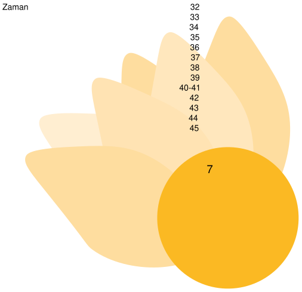
<!-- yer tutucu bulunamadı: sayfa sonuna eklendi -->

<!-- sayfa 7 -->

| Saygı Tekerlemesi | 46 |
| :--- | :--- |
| Nesneleri Hecele Alkışla | 47 |
| 4 Rakamını Öğreniyorum | 48 |
| Arabaların Tekerlekleri | 49 |
| Dikkatle Bak-Aklında Tut | 50 |
| El ve Ayak Baskısı | 51 |
| Bana Özel | 52 |
| Aile ile Mozaik Yapımı | 53 |
| Yeterli ve Dengeli Besleniyorum | 54 |
| Sesleri Takip Et ve Taklit Et | 55 |
| Hayvan Röntgenleri | 56 |
| Sevgi Albümü | 57 |
| Gün İçinde Neler Değişir? | 58 |
| 5 Rakamını Öğreniyorum | 59 |
| Beştaş Oyunu | 60 |
| Gececil Hayvanlar | 61 |
| Ev Şekli Oluşturuyorum | 62 |
| Ağaçların İsimlerini Heceliyorum | 63 |
| Noktalı Kareler | 64 |
| Kestane Ağacının Yaşam Döngüsü | 65 |
| Tartışmak Doğal, Çözmek Kolay | 66 |
| Ülkemizdeki Kuş Türleri | 67 |
| Cumhuriyet Kaç Yaşında? | 68 |
| Atatürk’ün Doğa Sevgisi | 69 |
| Zeynep Doğa Gezisinde | 70 |
| Beş Duyu Organımız | 71 |
| İstek ve İhtiyaçlarım | 72 |
| Hareket Edelim ve Çizelim | 73 |
| Ülkelere Özgü Yemekler | 74 |
| Sonbahar Yapraklarını Sayalım | 75 |
| Farklı Bölgeler-Farklı Evler | 76 |
| Hangi Sesleri Duydun? | 77 |
| Şekilleri Heceliyorum-Çiçekleri Çiziyorum | 78 |
| İrem Bahçe Keşfinde | 79 |
| Görsel ve Genel Ağ Kaynakçası | 79 |
| Türkiye’nin Mülki İdare Bölümleri ile Kara ve Deniz Komşuları Haritası | 80 |

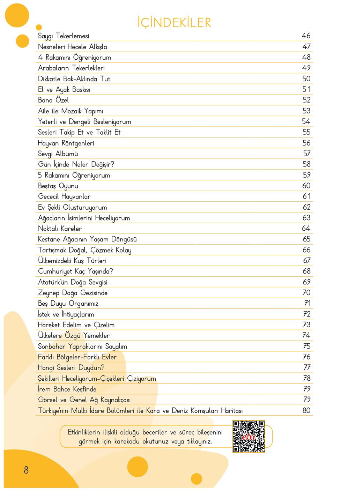 Etkinliklerin ilişkili olduğu beceriler ve süreç bileşenini görmek için karekodu okutunuz veya tıklayınız.

<!-- sayfa 8 -->

# OKULUMDA İLK GÜNÜM

Can bugün okula başlıyor. Can çok mutlu. Okula başladığımız ilk gün ne hissettiğimizi hatırlayalım. Hissettiğimiz duyguya ait görseli boyayalım.

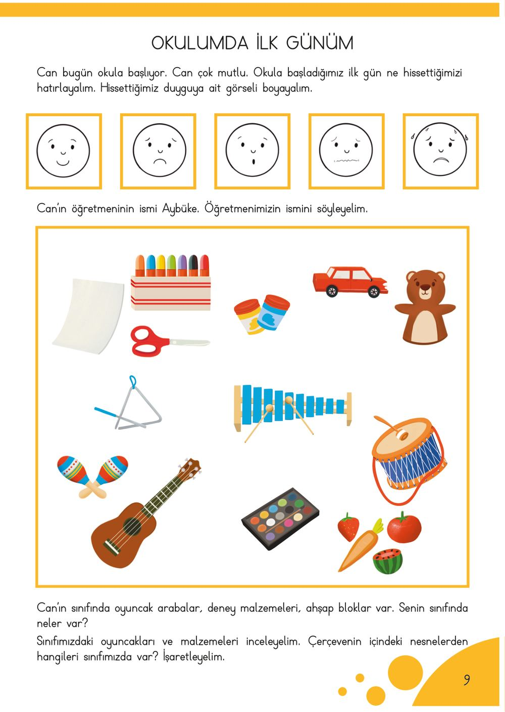

Can’ın öğretmeninin ismi Aybüke. Öğretmenimizin ismini söyleyelim.

Can’ın sınıfında oyuncak arabalar, deney malzemeleri, ahşap bloklar var. Senin sınıfında neler var?
Sınıfımızdaki oyuncakları ve malzemeleri inceleyelim. Çerçevenin içindeki nesnelerden

<!-- sayfa 9 -->

# BEN KİMİM?

Kendi resmimizi çizelim.

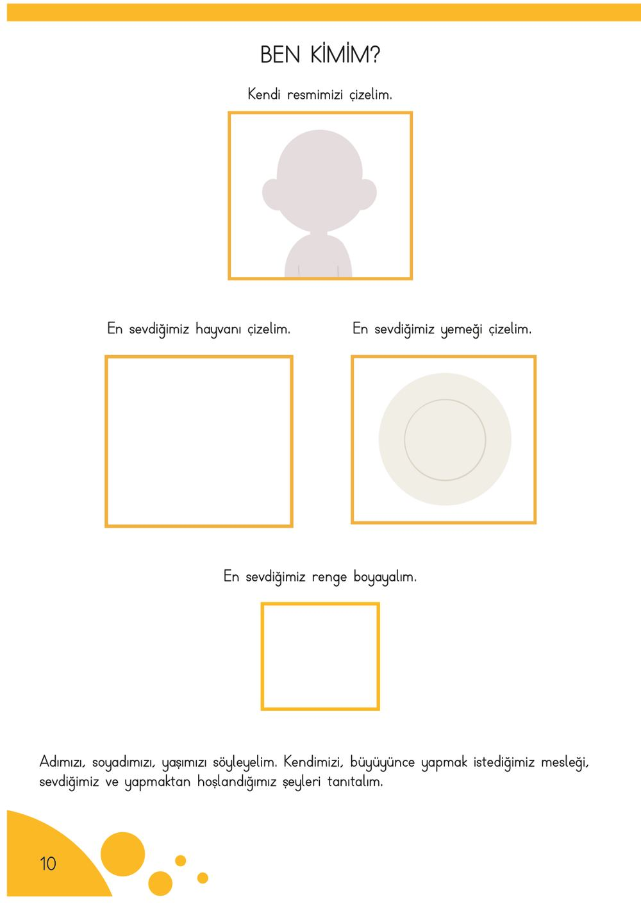

En sevdiğimiz hayvanı çizelim.

En sevdiğimiz yemeği çizelim.

En sevdiğimiz renge boyayalım.

Adımızı, soyadımızı, yaşımızı söyleyelim. Kendimizi, büyüyünce yapmak istediğimiz mesleği, sevdiğimiz ve yapmaktan hoşlandığımız şeyleri tanıtalım.

<!-- sayfa 10 -->

# SINIFIMIZDAKİ MERKEZLER

Ahmet’in sınıfta gün içinde zaman geçirdiği öğrenme merkezlerine ait gruplandırılmış görselleri inceleyelim. Görsellerin hangi merkezlere ait olabileceğini düşünelim, söyleyelim.

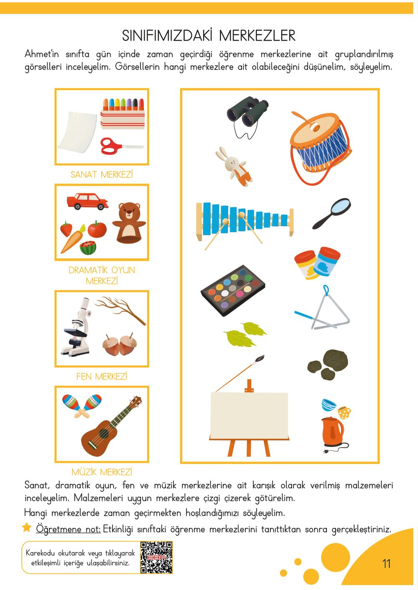

Sanat, dramatik oyun, fen ve müzik merkezlerine ait karışık olarak verilmiş malzemeleri inceleyelim. Malzemeleri uygun merkezlere çizgi çizerek götürelim.

Hangi merkezlerde zaman geçirmekten hoşlandığımızı söyleyelim.

⭐ **Öğretmene not:** Etkinliği sınıftaki öğrenme merkezlerini tanıttıktan sonra gerçekleştiriniz.

<!-- sayfa 11 -->

# DOĞRU OTURMA POZİSYONU

Görseli inceleyelim. Görseldeki çocuğun oturuşunda neler dikkatinizi çekti? Biz de sandalyemize doğru pozisyonda oturalım. Çizgileri parmağımızla takip edelim, kesik çizgileri birleştirerek çizelim.

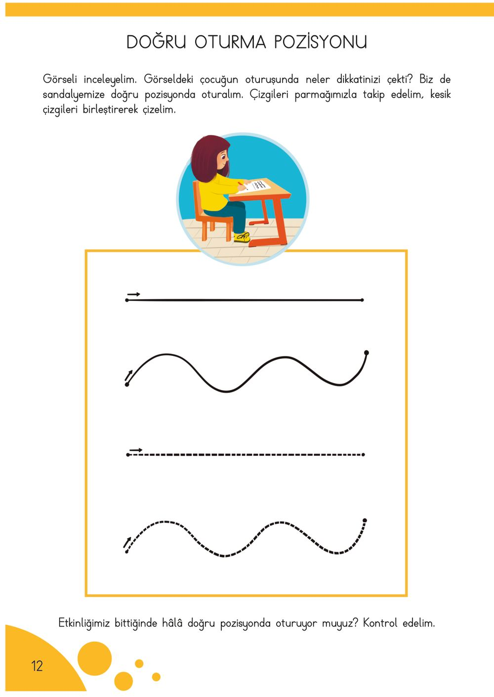

Etkinliğimiz bittiğinde hâlâ doğru pozisyonda oturuyor muyuz? Kontrol edelim.

<!-- sayfa 12 -->

# SAKLANMIŞ BÖCEKLERİ BULALIM

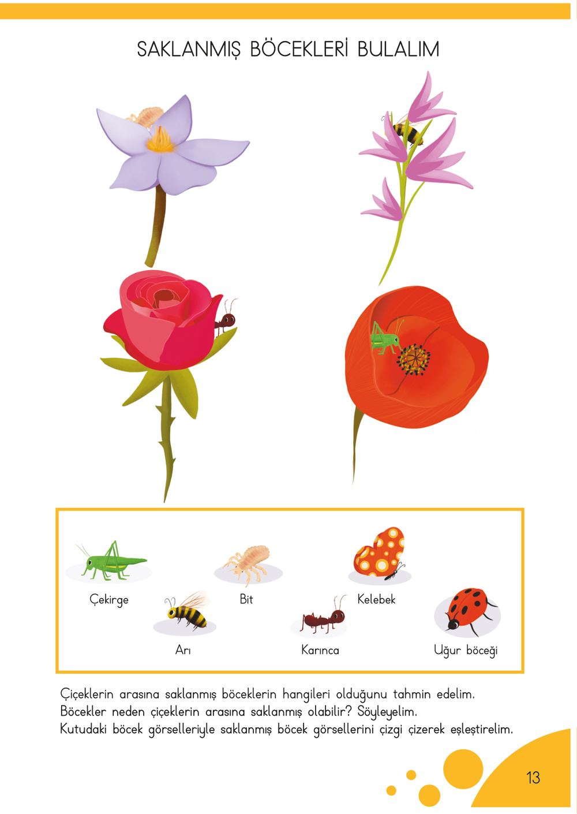

Çiçeklerin arasına saklanmış böceklerin hangileri olduğunu tahmin edelim.
Böcekler neden çiçeklerin arasına saklanmış olabilir? Söyleyelim.
Kutudaki böcek görselleriyle saklanmış böcek görsellerini çizgi çizerek eşleştirelim.

| | | | | |
| :---: | :---: | :---: | :---: | :---: |
| Çekirge | Arı | Bit | Karınca | Kelebek | Uğur böceği |

<!-- sayfa 13 -->

# AZ-ÇOK

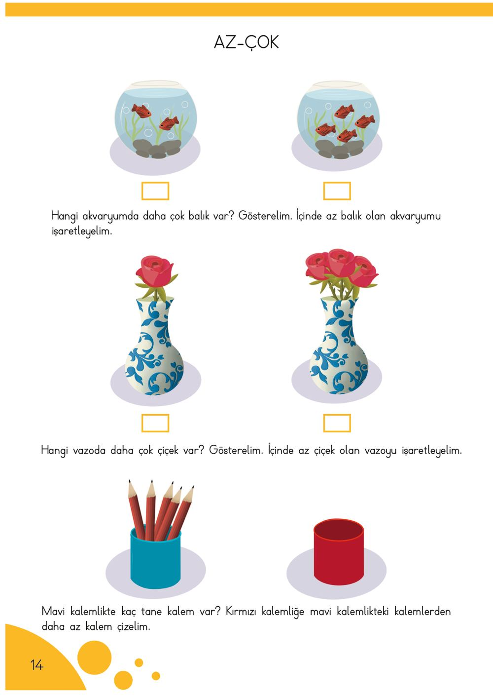

Hangi akvaryumda daha çok balık var? Gösterelim. İçinde az balık olan akvaryumu işaretleyelim.

Hangi vazoda daha çok çiçek var? Gösterelim. İçinde az çiçek olan vazoyu işaretleyelim.

Mavi kalemlikte kaç tane kalem var? Kırmızı kalemliğe mavi kalemlikteki kalemlerden daha az kalem çizelim.

<!-- sayfa 14 -->

# BENİM HAKKIMDA

Cümleleri dikkatle dinleyelim. Ardından cümleleri kendimizi tanıtacak şekilde tamamlayalım.

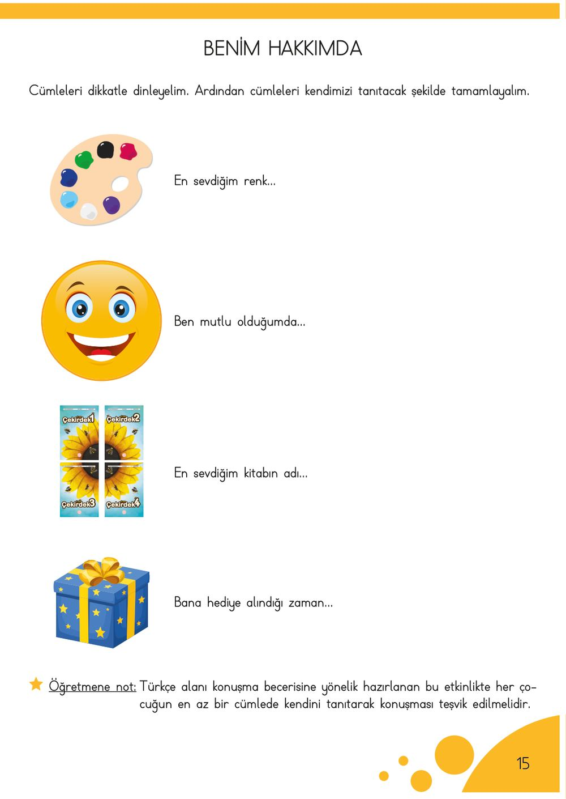 En sevdiğim renk...

 Ben mutlu olduğumda...

 En sevdiğim kitabın adı...

 Bana hediye alındığı zaman...

⭐ Öğretmene not: Türkçe alanı konuşma becerisine yönelik hazırlanan bu etkinlikte her çocuğun en az bir cümlede kendini tanıtarak konuşması teşvik edilmelidir.

<!-- sayfa 15 -->

# BİLMECE KUTUSU

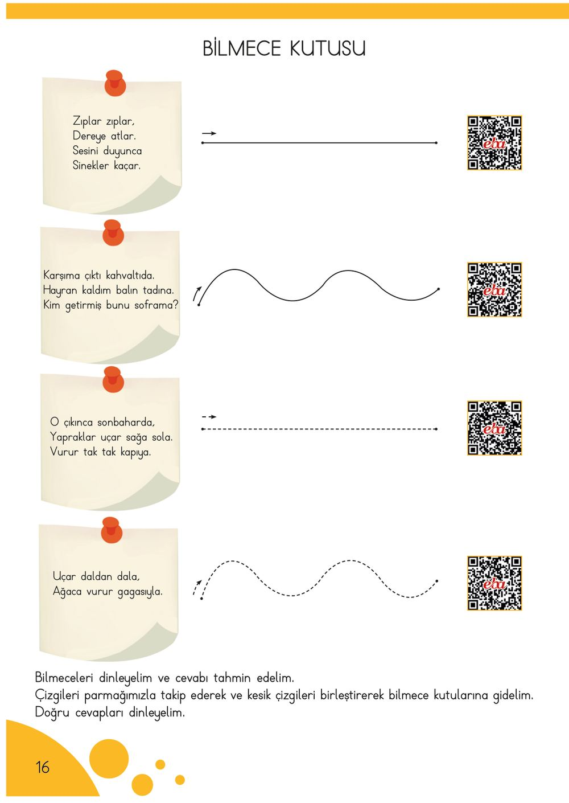
Zıplar zıplar,
Dereye atlar.
Sesini duyunca
Sinekler kaçar.

Karşıma çıktı kahvaltıda.
Hayran kaldım balın tadına.
Kim getirmiş bunu soframa?

O çıkınca sonbaharda,
Yapraklar uçar sağa sola.
Vurur tak tak kapıya.

Uçar daldan dala,
Ağaca vurur gagasıyla.

Bilmeceleri dinleyelim ve cevabı tahmin edelim.
Çizgileri parmağımızla takip ederek ve kesik çizgileri birleştirerek bilmece kutularına gidelim.
Doğru cevapları dinleyelim.

<!-- sayfa 16 -->

# BENİM DUYGULARIM

Soruları dinleyelim. Sorulan durumlar karşısında ne hissettiğimizi söyleyelim. Hissettiğimiz duyguyu gösteren görseli çizgi çizerek eşleştirelim.

1. Okulun ilk günü ne hissettin? 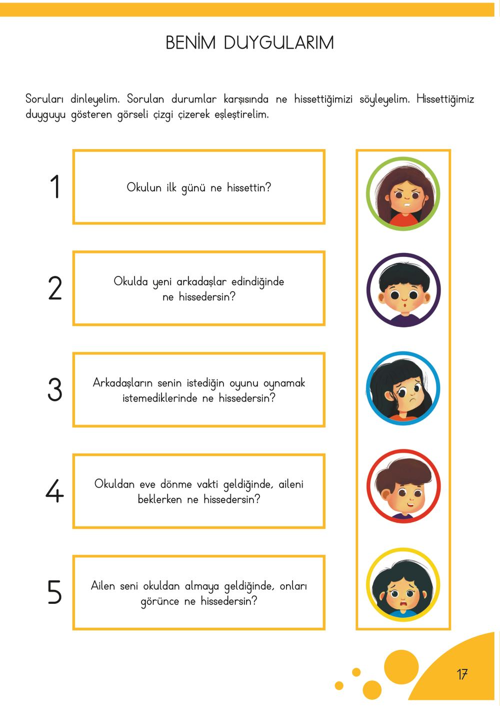
2. Okulda yeni arkadaşlar edindiğinde ne hissedersin?
3. Arkadaşların senin istediğin oyunu oynamak istemediklerinde ne hissedersin?
4. Okuldan eve dönme vakti geldiğinde, aileni beklerken ne hissedersin?
5. Ailen seni okuldan almaya geldiğinde, onları görünce ne hissedersin?

<!-- sayfa 17 -->

# 1 RAKAMINI ÖĞRENİYORUM

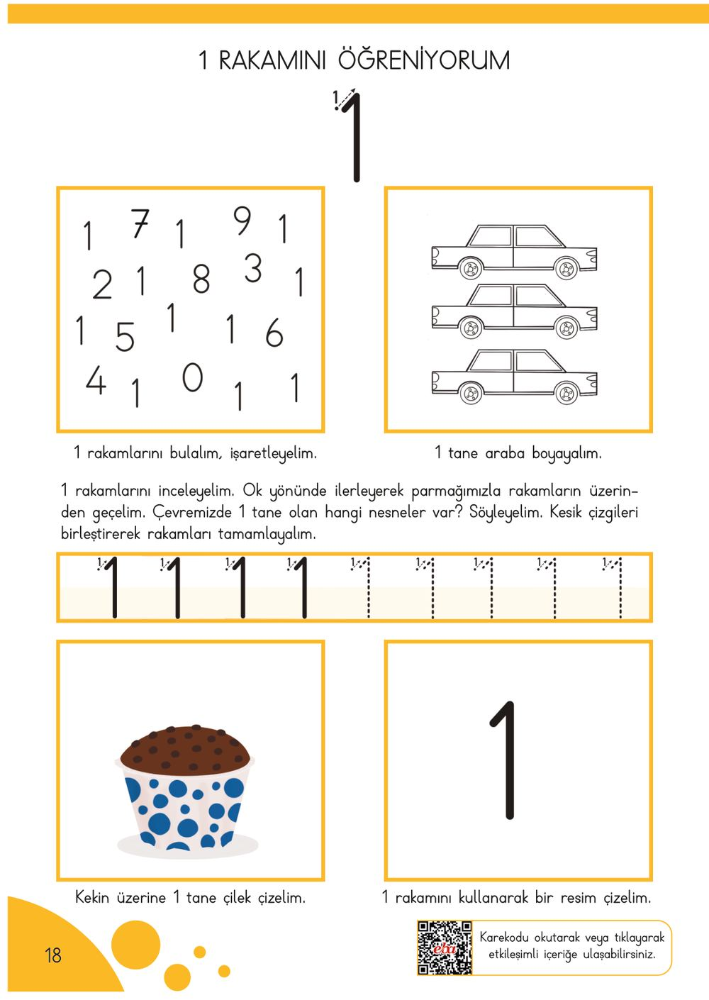

1 rakamlarını bulalım, işaretleyelim.

1 tane araba boyayalım.

1 rakamlarını inceleyelim. Ok yönünde ilerleyerek parmağımızla rakamların üzerinden geçelim. Çevremizde 1 tane olan hangi nesneler var? Söyleyelim. Kesik çizgileri birleştirerek rakamları tamamlayalım.

Kekin üzerine 1 tane çilek çizelim.

1 rakamını kullanarak bir resim çizelim.

<!-- sayfa 18 -->

# HAYVANLARIN İLGİNÇ YATAKLARI

Canlılar sağlıklı yaşam için uykuya ihtiyaç duyar. Düzenli ve yeterli uyumak beden ve zihin sağlığı için önemlidir.

Görsellerdeki hayvanları ve uyudukları ortamları inceleyelim. Bizim yatağımıza benziyor mu? Söyleyelim. Buralarda hangi hayvanların uyuduğunu tahmin edelim ve doğru cevapları işaretleyelim.

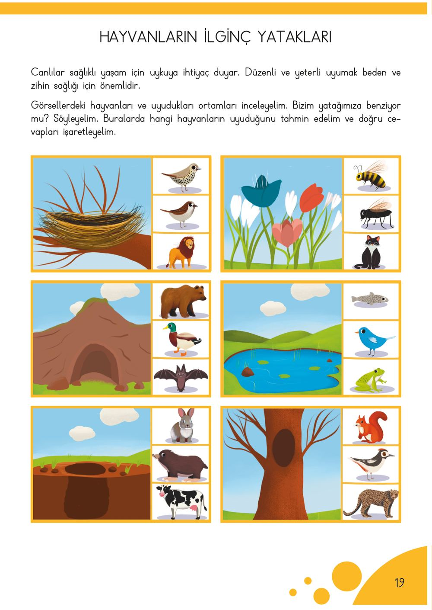

<!-- sayfa 19 -->

# ANADOLU PARSI

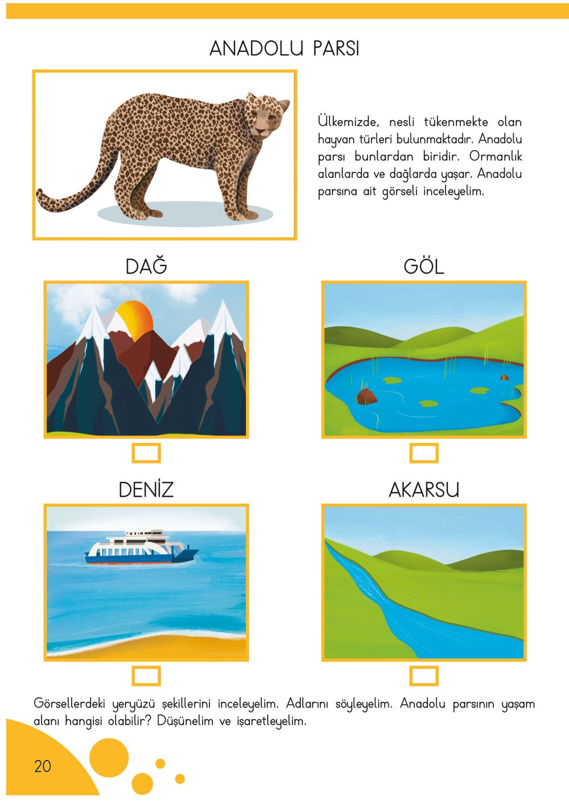 Ülkemizde, nesli tükenmekte olan hayvan türleri bulunmaktadır. Anadolu parsı bunlardan biridir. Ormanlık alanlarda ve dağlarda yaşar. Anadolu parsına ait görseli inceleyelim.

## DAĞ

$\square$ <!-- KONTROL: Marker'da karşılığı yok, uydurma olabilir -->

## GÖL

$\square$ <!-- KONTROL: Marker'da karşılığı yok, uydurma olabilir -->

## DENİZ

$\square$ <!-- KONTROL: Marker'da karşılığı yok, uydurma olabilir -->

## AKARSU

$\square$ <!-- KONTROL: Marker'da karşılığı yok, uydurma olabilir -->

Görsellerdeki yeryüzü şekillerini inceleyelim. Adlarını söyleyelim. Anadolu parsının yaşam alanı hangisi olabilir? Düşünelim ve işaretleyelim.

<!-- sayfa 20 -->

# ENDEMİK BİTKİLER

Endemik bitki sadece bulunduğu bölgenin şartlarında yetişen, başka yerde yetişme ihtimali olmayan bitkidir.

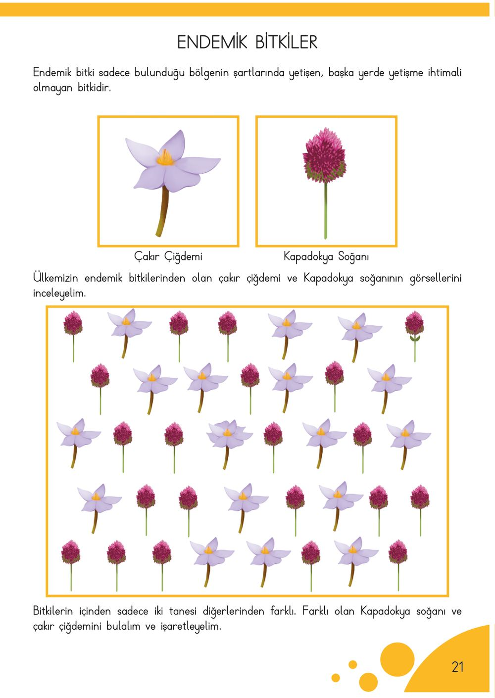

Çakır Çiğdemi $\quad$ <!-- KONTROL: Marker'da karşılığı yok, uydurma olabilir --> Kapadokya Soğanı

Ülkemizin endemik bitkilerinden olan çakır çiğdemi ve Kapadokya soğanının görsellerini inceleyelim.

Bitkilerin içinden sadece iki tanesi diğerlerinden farklı. Farklı olan Kapadokya soğanı ve çakır çiğdemini bulalım ve işaretleyelim.

<!-- sayfa 21 -->

# TİMSAH VE ARDIÇ KUŞU

Canlılar diş temizliği için farklı yöntemler kullanabilir. Timsahlar diş temizliği için ardıç kuşlarından yardım alır.

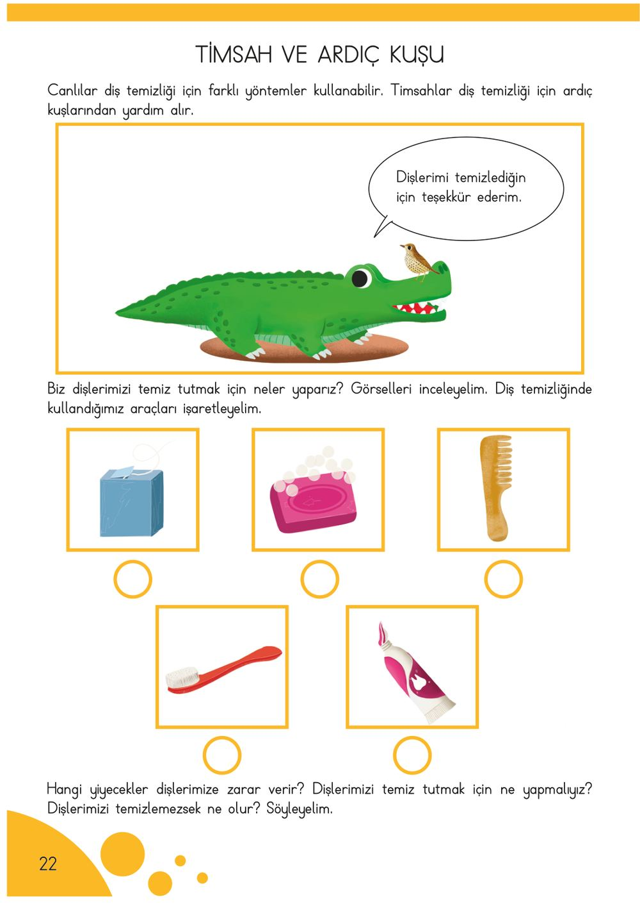

Biz dişlerimizi temiz tutmak için neler yaparız? Görselleri inceleyelim. Diş temizliğinde kullandığımız araçları işaretleyelim.

Hangi yiyecekler dişlerimize zarar verir? Dişlerimizi temiz tutmak için ne yapmalıyız? Dişlerimizi temizlemezsek ne olur? Söyleyelim.

<!-- sayfa 22 -->

# EVE GİDERKEN NELER GÖRDÜM?

Ali eve ulaşmak için hangi varlıkların yanından geçiyor, inceleyelim.

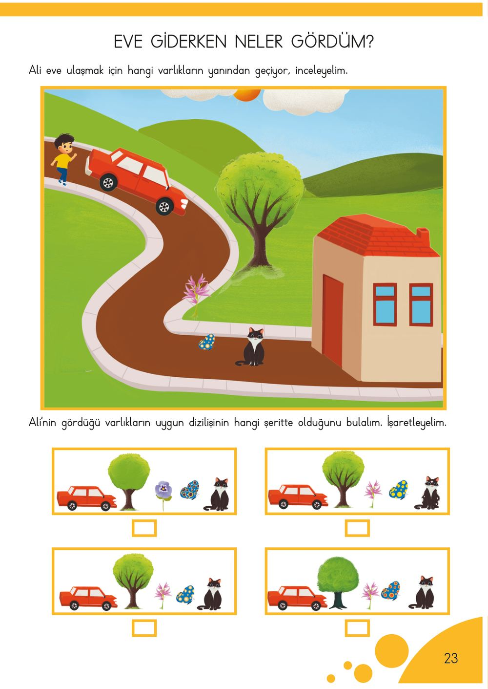

Ali'nin gördüğü varlıkların uygun dizilişinin hangi şeritte olduğunu bulalım. İşaretleyelim.

| | |
| :---: | :---: |
|  |  |
| $\square$ <!-- KONTROL: Marker'da karşılığı yok, uydurma olabilir --> | $\square$ <!-- KONTROL: Marker'da karşılığı yok, uydurma olabilir --> |
|  |  |
| $\square$ <!-- KONTROL: Marker'da karşılığı yok, uydurma olabilir --> | $\square$ <!-- KONTROL: Marker'da karşılığı yok, uydurma olabilir --> |

<!-- sayfa 23 -->

# ÜLKEMİZDE NESLİ TÜKENMEKTE OLAN HAYVANLAR

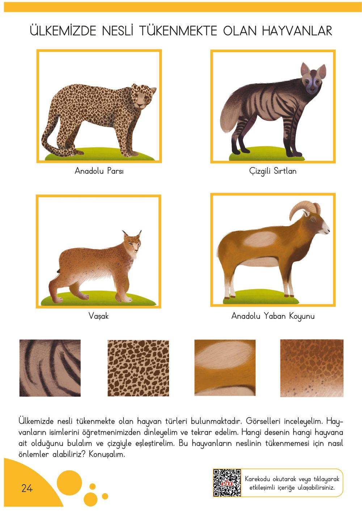

Anadolu Parsı
Çizgili Sırtlan

Vaşak
Anadolu Yaban Koyunu

Ülkemizde nesli tükenmekte olan hayvan türleri bulunmaktadır. Görselleri inceleyelim. Hayvanların isimlerini öğretmenimizden dinleyelim ve tekrar edelim. Hangi desenin hangi hayvana ait olduğunu bulalım ve çizgiyle eşleştirelim. Bu hayvanların neslinin tükenmemesi için nasıl önlemler alabiliriz? Konuşalım.

<!-- sayfa 24 -->

# YAŞAM DÖNGÜSÜNÜ ARAŞTIRIYORUM

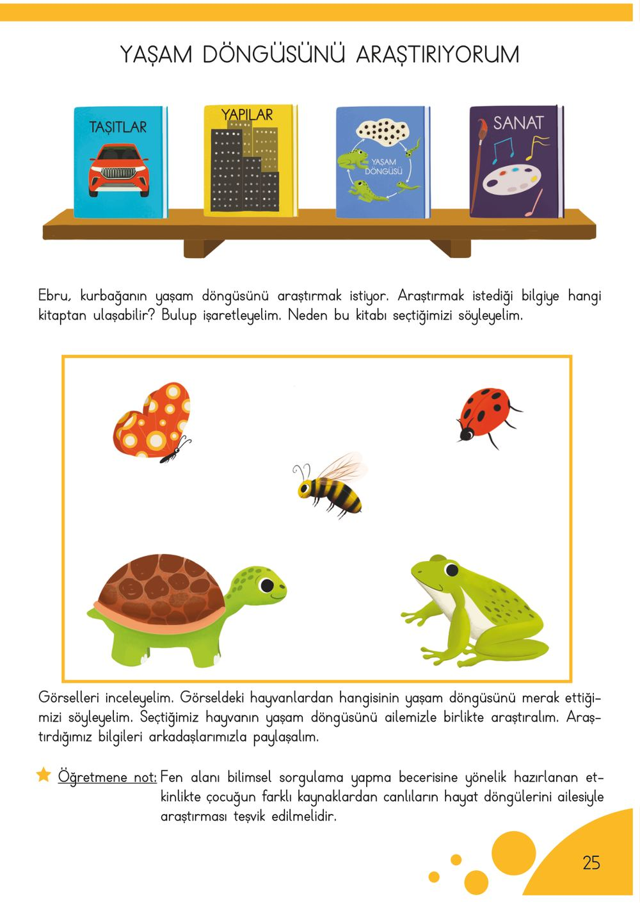

Ebru, kurbağanın yaşam döngüsünü araştırmak istiyor. Araştırmak istediği bilgiye hangi kitaptan ulaşabilir? Bulup işaretleyelim. Neden bu kitabı seçtiğimizi söyleyelim.

Görselleri inceleyelim. Görseldeki hayvanlardan hangisinin yaşam döngüsünü merak ettiğimizi söyleyelim. Seçtiğimiz hayvanın yaşam döngüsünü ailemizle birlikte araştıralım. Araştırdığımız bilgileri arkadaşlarımızla paylaşalım.

⭐ Öğretmene not: Fen alanı bilimsel sorgulama yapma becerisine yönelik hazırlanan etkinlikte çocuğun farklı kaynaklardan canlıların hayat döngülerini ailesiyle araştırması teşvik edilmelidir.

<!-- sayfa 25 -->

# 2 RAKAMINI ÖĞRENİYORUM

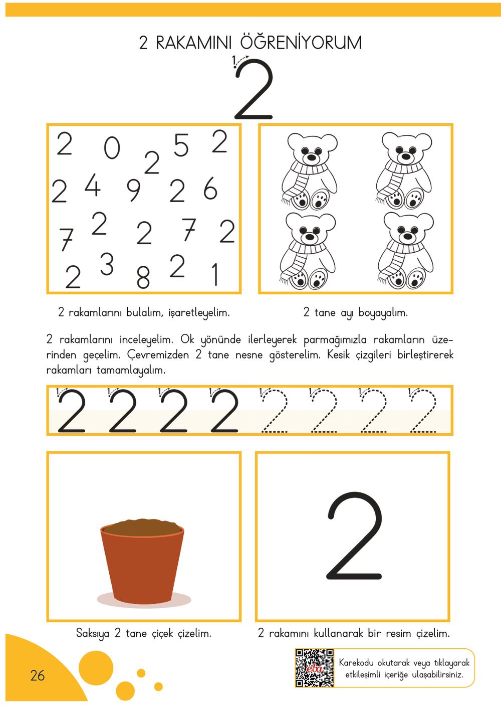

2 rakamlarını bulalım, işaretleyelim.

2 tane ayı boyayalım.

2 rakamlarını inceleyelim. Ok yönünde ilerleyerek parmağımızla rakamların üzerinden geçelim. Çevremizden 2 tane nesne gösterelim. Kesik çizgileri birleştirerek rakamları tamamlayalım.

Saksıya 2 tane çiçek çizelim.

2 rakamını kullanarak bir resim çizelim.

<!-- sayfa 26 -->

# İKİŞER RAKET

Defne ve Yiğit tenis oynamak istiyor. Tenis, bir top ve iki raket kullanılarak iki kişiyle oynanabilen bir spor dalıdır.

Görselleri inceleyelim. Tenis raketlerini ikişerli gruplayalım.

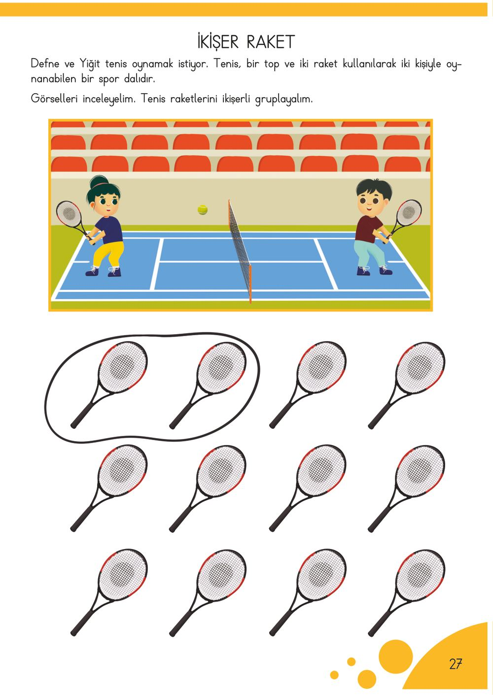

<!-- sayfa 27 -->

# KAÇ SÖZCÜKTEN OLUŞUYOR?

Cümleleri dikkatle dinleyelim. Cümlelerin kaç sözcükten oluştuğunu bulalım. Sözcükleri sayalım ve sözcük sayısı kadar alkış yapalım. Görsellerin yanındaki kutucukları örnekteki gibi sözcük sayısı kadar boyayalım.

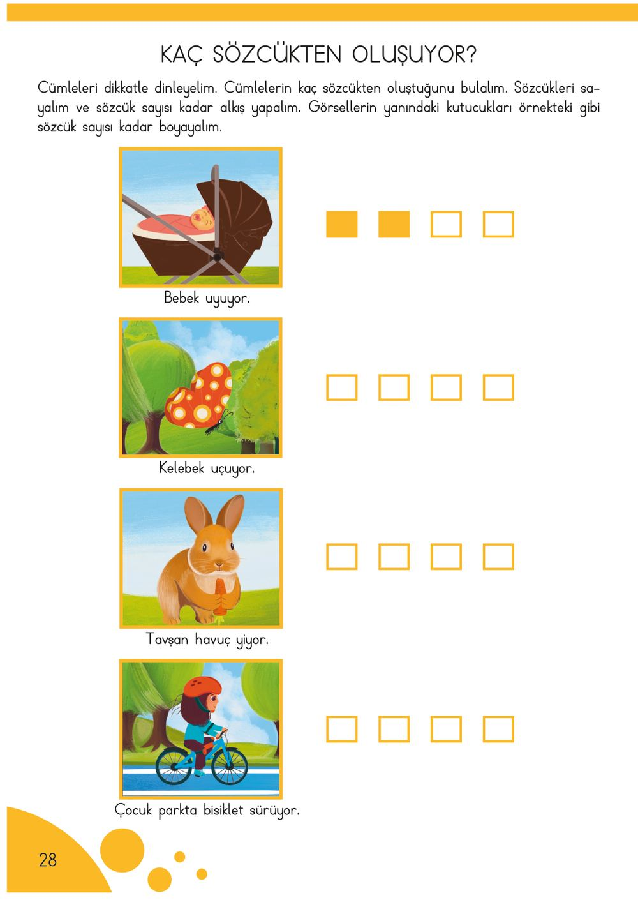
Bebek uyuyor.
$\square$ <!-- KONTROL: Marker'da karşılığı yok, uydurma olabilir --> $\square$ <!-- KONTROL: Marker'da karşılığı yok, uydurma olabilir --> $\square$ <!-- KONTROL: Marker'da karşılığı yok, uydurma olabilir --> $\square$ <!-- KONTROL: Marker'da karşılığı yok, uydurma olabilir -->

Kelebek uçuyor.
$\square$ <!-- KONTROL: Marker'da karşılığı yok, uydurma olabilir --> $\square$ <!-- KONTROL: Marker'da karşılığı yok, uydurma olabilir --> $\square$ <!-- KONTROL: Marker'da karşılığı yok, uydurma olabilir --> $\square$ <!-- KONTROL: Marker'da karşılığı yok, uydurma olabilir -->

Tavşan havuç yiyor.
$\square$ <!-- KONTROL: Marker'da karşılığı yok, uydurma olabilir --> $\square$ <!-- KONTROL: Marker'da karşılığı yok, uydurma olabilir --> $\square$ <!-- KONTROL: Marker'da karşılığı yok, uydurma olabilir --> $\square$ <!-- KONTROL: Marker'da karşılığı yok, uydurma olabilir -->

Çocuk parkta bisiklet sürüyor.
$\square$ <!-- KONTROL: Marker'da karşılığı yok, uydurma olabilir --> $\square$ <!-- KONTROL: Marker'da karşılığı yok, uydurma olabilir --> $\square$ <!-- KONTROL: Marker'da karşılığı yok, uydurma olabilir --> $\square$ <!-- KONTROL: Marker'da karşılığı yok, uydurma olabilir -->

<!-- sayfa 28 -->

# MEYVE BAHÇESİ

Hilmi amca fidanları uzundan kısaya doğru meyve bahçesine dikiyor. Görselleri inceleyelim. Hilmi amca bu sıralamaya göre mavi çerçevelerdeki fidanları, turuncu çerçevelerde nereye dikmeli? Düşünelim. Fidanların dikilmesi gereken yerleri bulalım ve çizgi çizerek fidanları toprakla buluşturalım.

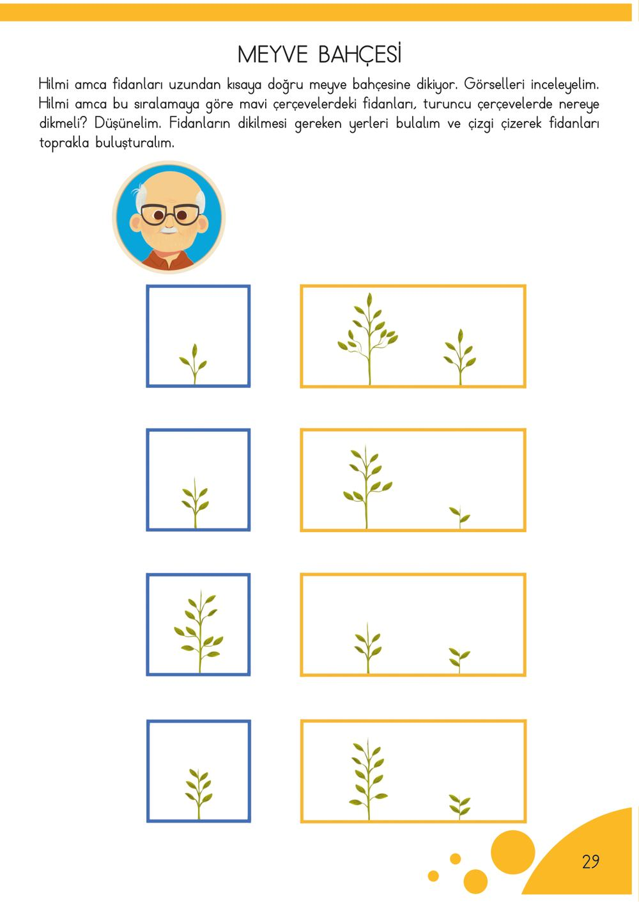

| | |
| :---: | :---: |
|  |  |
|  |  |
|  |  |
|  |  |

<!-- sayfa 29 -->

# NEFES EGZERSİZİ

Doğru nefes alıp vermek sağlığımız için çok önemlidir. Kartlardaki hareketleri sırayla önce yavaş, sonra hızlı yapalım. Nefes alıp vermemiz nasıl değişti? Konuşalım.

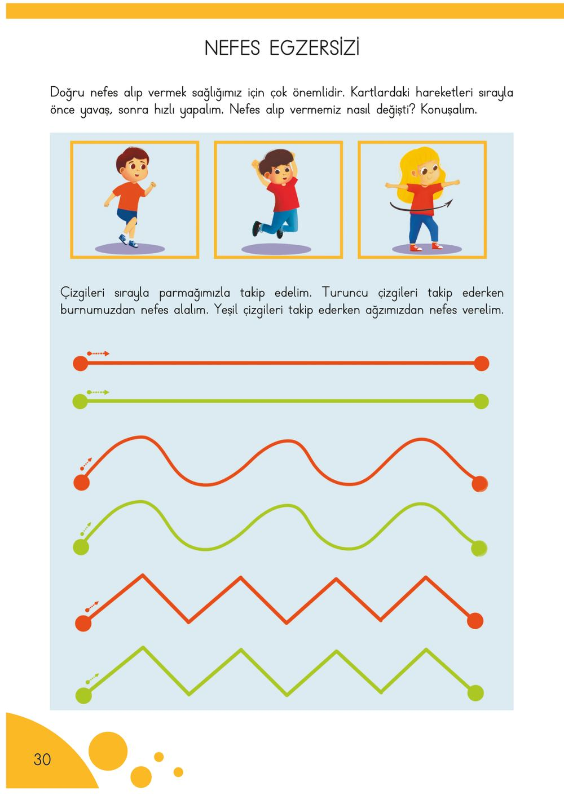

Çizgileri sırayla parmağımızla takip edelim. Turuncu çizgileri takip ederken burnumuzdan nefes alalım. Yeşil çizgileri takip ederken ağzımızdan nefes verelim.

<!-- sayfa 30 -->

# EBRU SANATI

Ebru sanatı geleneksel Türk el sanatlarından biridir. Geleneksel Türk el sanatlarıyla ilgili videoyu izleyelim. Videodaki sanat eserlerinden daha önce gördüklerimizi ve nerede gördüğümüzü söyleyelim.

Ebru sanatı ile yapılmış eserleri inceleyelim. Odamıza asmak isteyeceğimiz sanat eserini seçelim ve yanındaki kutucuğu işaretleyelim.

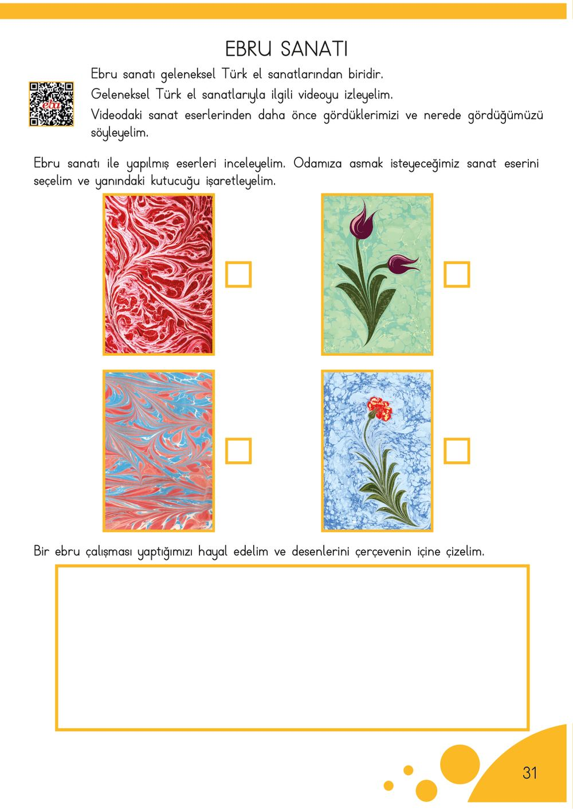

Bir ebru çalışması yaptığımızı hayal edelim ve desenlerini çerçevenin içine çizelim.

<!-- sayfa 31 -->

# İSTEKLERİM ENGELLENDİĞİ ZAMAN

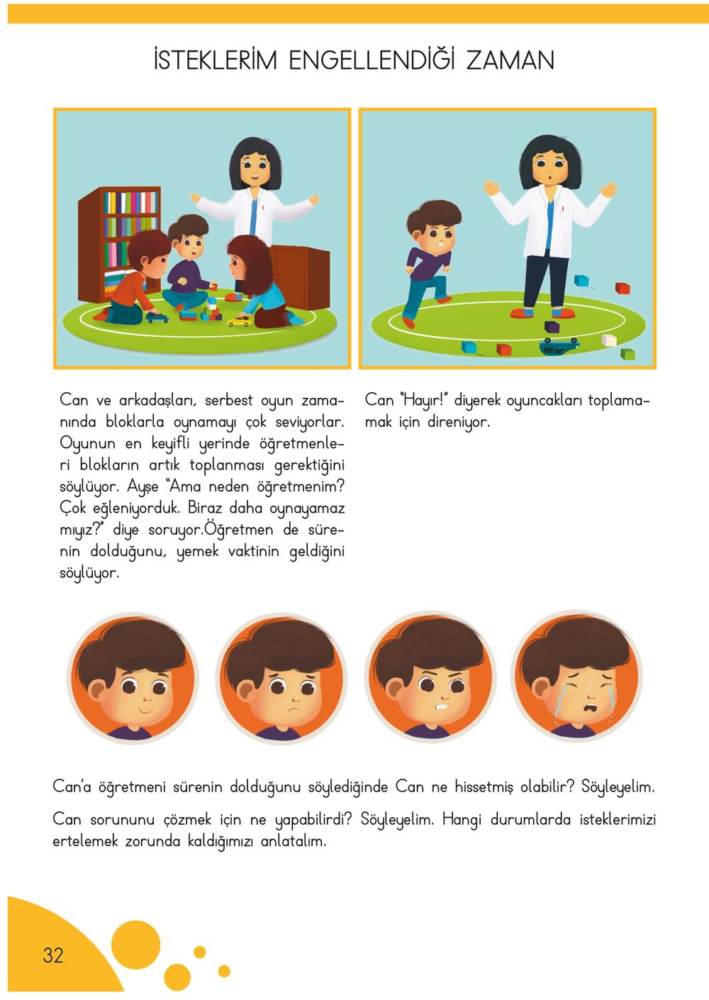

Can ve arkadaşları, serbest oyun zamanında bloklarla oynamayı çok seviyorlar. Oyunun en keyifli yerinde öğretmenleri blokların artık toplanması gerektiğini söylüyor. Ayşe "Ama neden öğretmenim? Çok eğleniyorduk. Biraz daha oynayamaz mıyız?" diye soruyor. Öğretmen de sürenin dolduğunu, yemek vaktinin geldiğini söylüyor.

Can "Hayır!" diyerek oyuncakları toplamamak için direniyor.

Can'a öğretmeni sürenin dolduğunu söylediğinde Can ne hissetmiş olabilir? Söyleyelim.
Can sorununu çözmek için ne yapabilirdi? Söyleyelim. Hangi durumlarda isteklerimizi ertelemek zorunda kaldığımızı anlatalım.

<!-- sayfa 32 -->

# NEŞENİN KURABİYELERİ

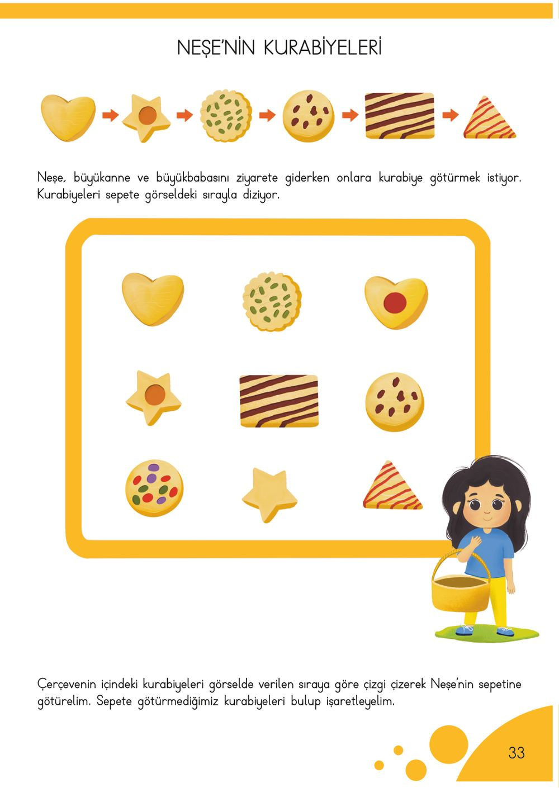

Neşe, büyükanne ve büyükbabasını ziyarete giderken onlara kurabiye götürmek istiyor. Kurabiyeleri sepete görseldeki sırayla diziyor.

Çerçevenin içindeki kurabiyeleri görselde verilen sıraya göre çizgi çizerek Neşe’nin sepetine götürelim. Sepete götürmediğimiz kurabiyeleri bulup işaretleyelim.

<!-- sayfa 33 -->

# HAYVANLARLA SANAT ÇALIŞMASI

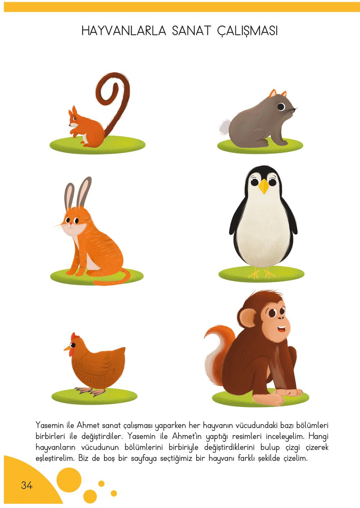

Yasemin ile Ahmet sanat çalışması yaparken her hayvanın vücudundaki bazı bölümleri birbirleri ile değiştirdiler. Yasemin ile Ahmet'in yaptığı resimleri inceleyelim. Hangi hayvanların vücudunun bölümlerini birbiriyle değiştirdiklerini bulup çizgi çizerek eşleştirelim. Biz de boş bir sayfaya seçtiğimiz bir hayvanı farklı şekilde çizelim.

<!-- sayfa 34 -->

# ÇİÇEKLERİN RENKLERİ

Çiçek görsellerini inceleyelim. Çiçeklerin isimlerini ve renklerini söyleyelim. Çiçeklerin renkli bölümlerini, renk kartındaki renklerle çizgi çizerek eşleştirelim.

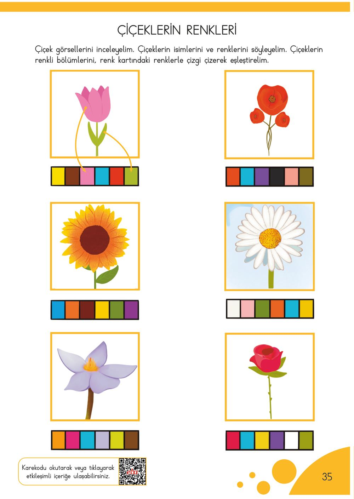

<!-- sayfa 35 -->

# 3 RAKAMINI ÖĞRENİYORUM

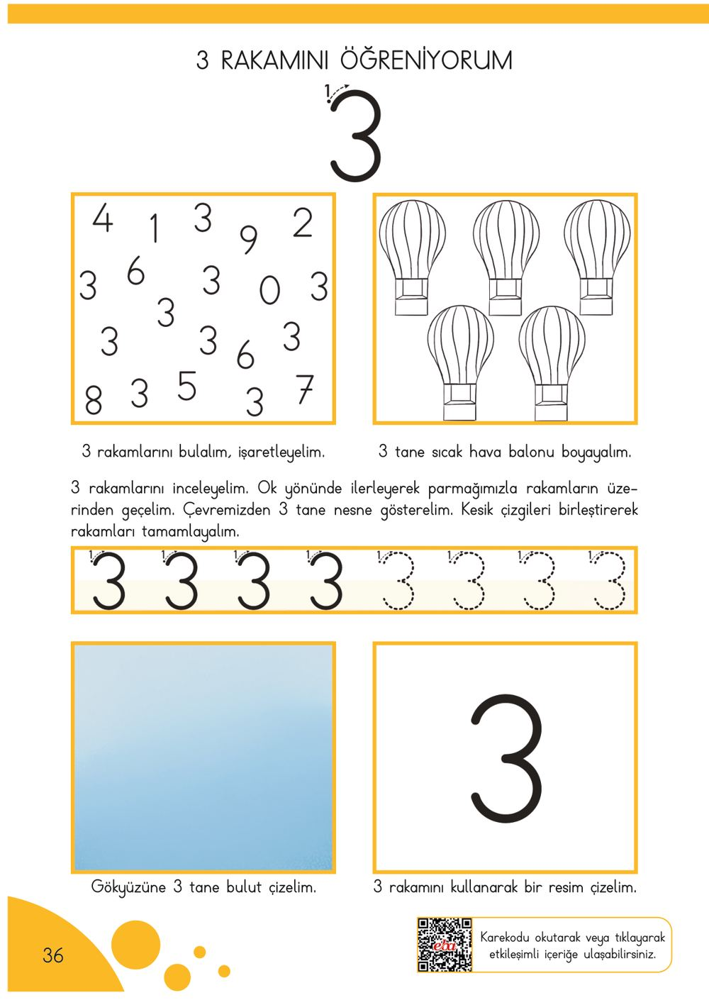

3 rakamlarını bulalım, işaretleyelim.

3 tane sıcak hava balonu boyayalım.

3 rakamlarını inceleyelim. Ok yönünde ilerleyerek parmağımızla rakamların üzerinden geçelim. Çevremizden 3 tane nesne gösterelim. Kesik çizgileri birleştirerek rakamları tamamlayalım.

Gökyüzüne 3 tane bulut çizelim.

3 rakamını kullanarak bir resim çizelim.

<!-- sayfa 36 -->

# TOPLARI ÇEVİRME OYUNU

Görseldeki çocuk, topları ardı ardına havaya atıp tutarak topları çevirme oyunu oynuyor. Görseli inceleyelim. Çocuk kaç tane topu çeviriyor? Söyleyelim. Topları üçerli gruplayalım.

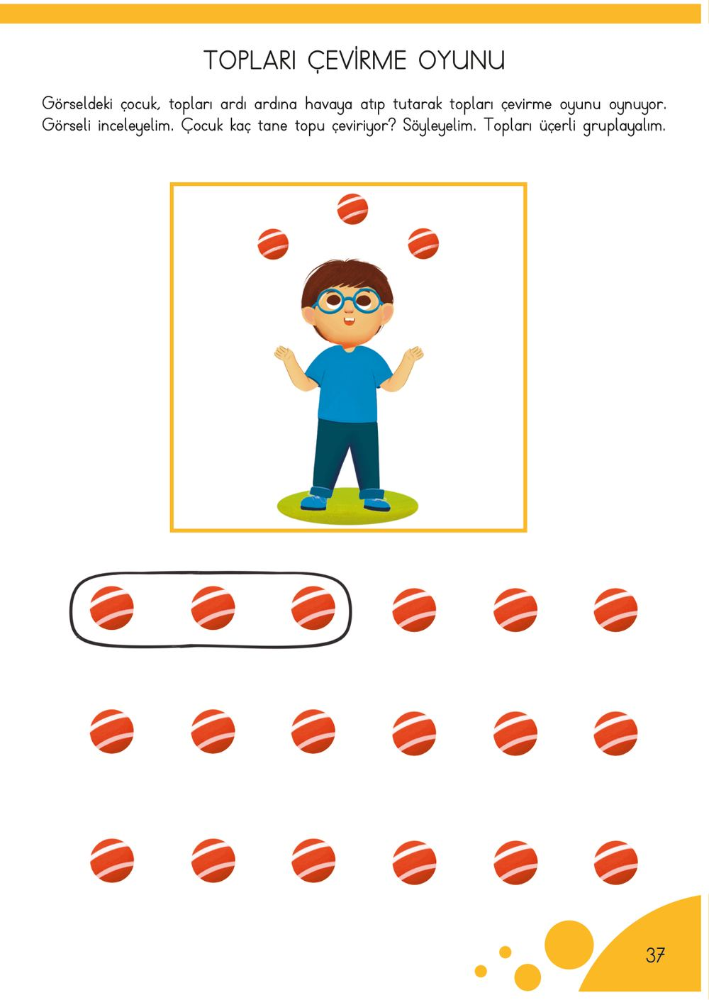

<!-- sayfa 37 -->

# TAŞITLARIN ADINI HECELİYORUM

Büşra ve ailesi kıtalar arası yolculuk yapmayı planlıyor. Görselleri inceleyelim. Bu taşıtlardan hangisi ile yolculuk yaparlarsa gitmek istedikleri yere en kısa sürede varabilirler? Gösterelim.

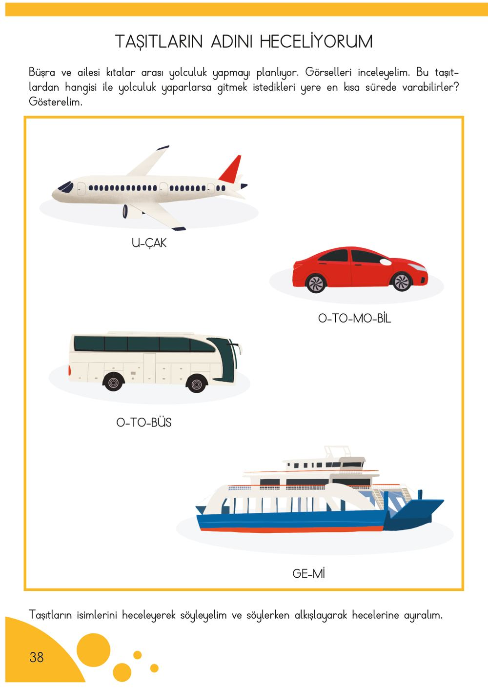: U-ÇAK, O-TO-MO-BİL, O-TO-BÜS, GE-Mİ görselleri ve altlarındaki hecelenmiş isimleri

Taşıtların isimlerini heceleyerek söyleyelim ve söylerken alkışlayarak hecelerine ayıralım.

<!-- sayfa 38 -->

# HAYVANLARIN BENEKLERİ

Bazı hayvanların vücudunda benekler bulunur. Benekleri olan hayvan görsellerini inceleyelim. Hayvanların isimlerini söyleyelim. Benekleri olan başka hangi hayvanlar var? Düşünelim, söyleyelim.

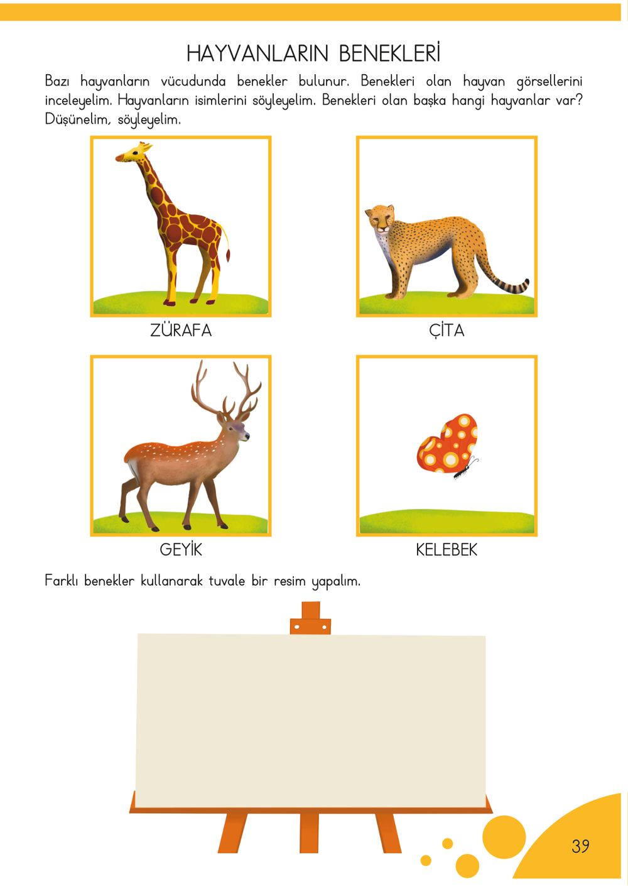
ZÜRAFA

ÇİTA

GEYİK

KELEBEK

Farklı benekler kullanarak tuvale bir resim yapalım.

<!-- sayfa 39 -->

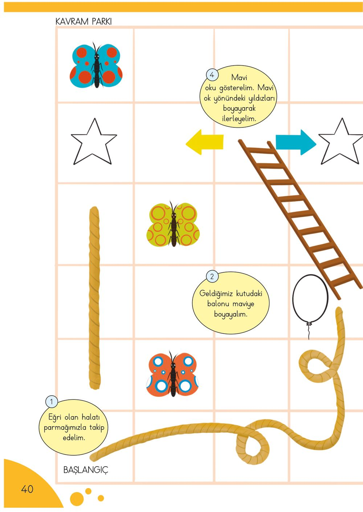 1
Eğri olan halatı 
parmağımızla takip 
edelim.

 2
Geldiğimiz kutudaki 
balonu maviye
boyayalım.

 4
Mavi 
oku gösterelim. Mavi 
ok yönündeki yıldızları 
boyayarak
ilerleyelim.

<!-- sayfa 40 -->

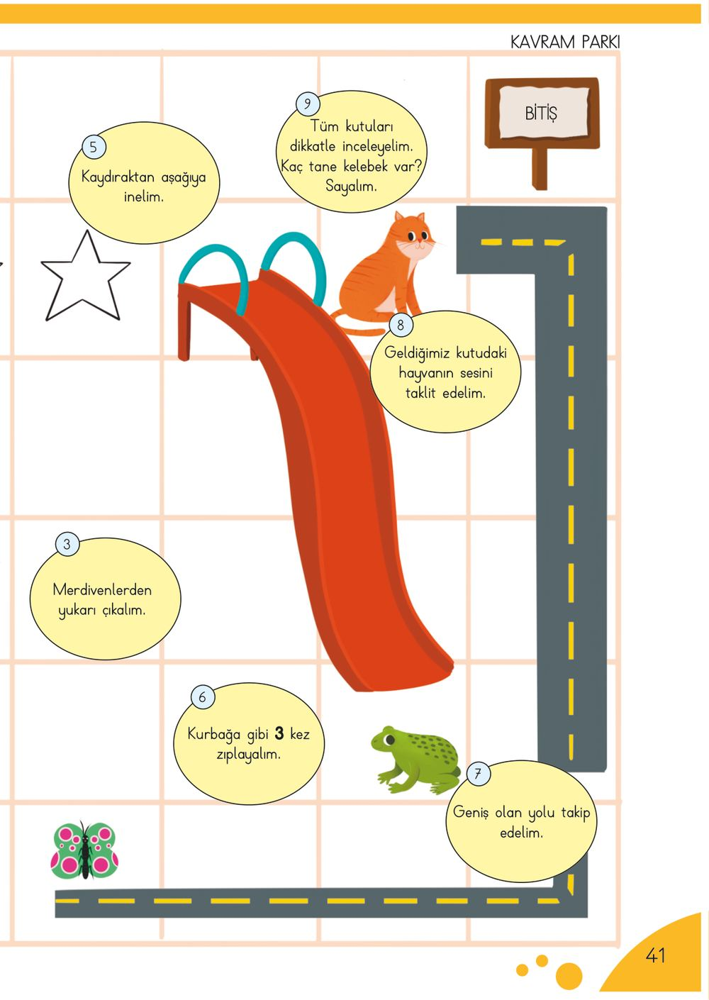

5
Kaydıraktan aşağıya inelim.

3
Merdivenlerden yukarı çıkalım.

6
Kurbağa gibi $3$ kez zıplayalım.

7
Geniş olan yolu takip edelim.

8
Geldiğimiz kutudaki hayvanın sesini taklit edelim.

9
Tüm kutuları dikkatle inceleyelim. Kaç tane kelebek var? Sayalım.

BİTİŞ

<!-- sayfa 41 -->

# GİZLENMİŞ HAYVANLAR

Hayvanların kendilerini girdikleri ortama benzeterek gizlenme yeteneği vardır. Gizlenmiş hayvanların olduğu görselleri dikkatlice inceleyelim.

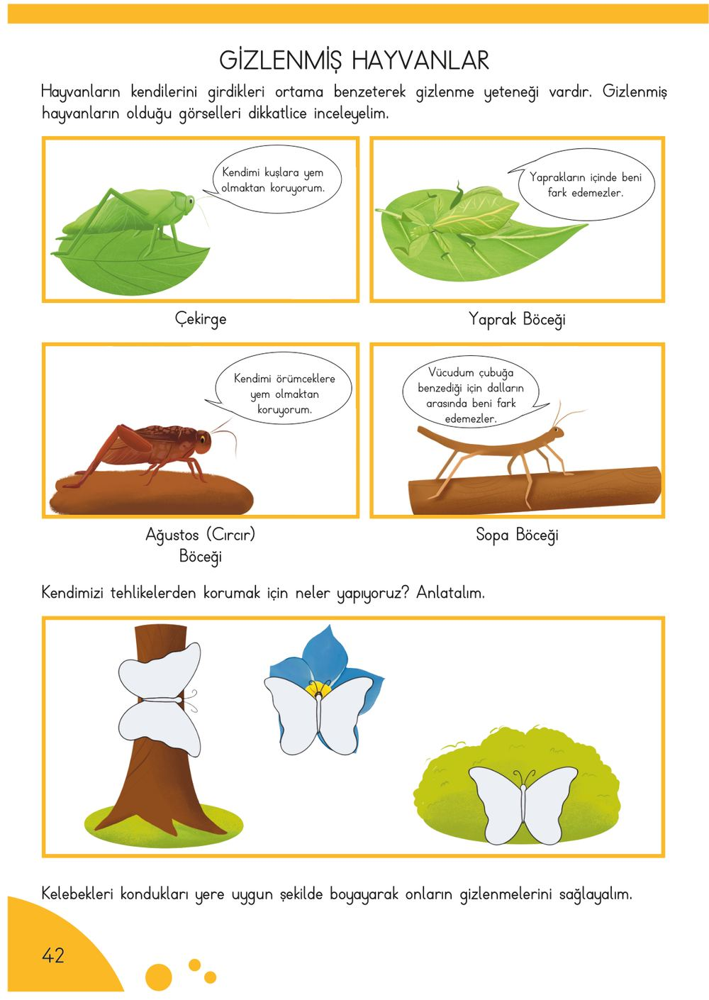

Çekirge
(Kendimi kuşlara yem olmaktan koruyorum.)

Yaprak Böceği
(Yaprakların içinde beni fark edemezler.)

Ağustos (Cırcır) Böceği
(Kendimi örümceklere yem olmaktan koruyorum.)

Sopa Böceği
(Vücudum çubuğa benzediği için dalların arasında beni fark edemezler.)

Kendimizi tehlikelerden korumak için neler yapıyoruz? Anlatalım.

Kelebekleri kondukları yere uygun şekilde boyayarak onların gizlenmelerini sağlayalım.

<!-- sayfa 42 -->

# ACİL DURUM TAŞITLARI

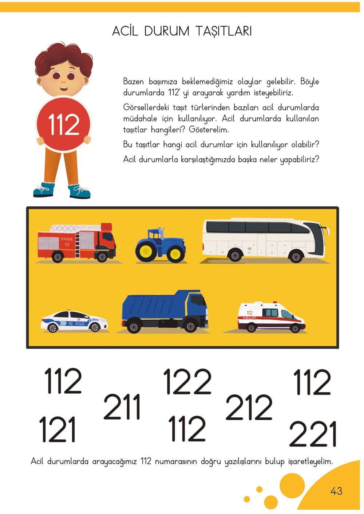

Bazen başımıza beklemediğimiz olaylar gelebilir. Böyle durumlarda 112’ yi arayarak yardım isteyebiliriz.

Görsellerdeki taşıt türlerinden bazıları acil durumlarda müdahale için kullanılıyor. Acil durumlarda kullanılan taşıtlar hangileri? Gösterelim.

Bu taşıtlar hangi acil durumlar için kullanılıyor olabilir?

Acil durumlarla karşılaştığımızda başka neler yapabiliriz?

112
121

211

122
112

212

112
221

Acil durumlarda arayacağımız 112 numarasının doğru yazılışlarını bulup işaretleyelim.

<!-- sayfa 43 -->

# EVİMDE KİMLER YAŞIYOR?

| ANNE | BABA | KIZ KARDEŞ | ERKEK KARDEŞ |
| :---: | :---: | :---: | :---: |
| 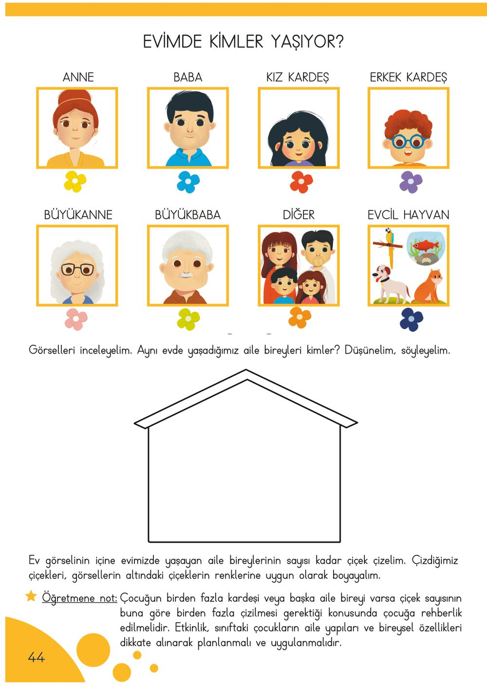 |  |  |  |
| 🌼 | 💠 | 🌺 | 🍇 |

| BÜYÜKANNE | BÜYÜKBABA | DİĞER | EVCİL HAYVAN |
| :---: | :---: | :---: | :---: |
|  |  |  |  |
| 🌸 | 🌻 | 🍊 | 💙 |

Görselleri inceleyelim. Aynı evde yaşadığımız aile bireyleri kimler? Düşünelim, söyleyelim.

Ev görselinin içine evimizde yaşayan aile bireylerinin sayısı kadar çiçek çizelim. Çizdiğimiz çiçekleri, görsellerin altındaki çiçeklerin renklerine uygun olarak boyayalım.

⭐ [Öğretmene not:](https://) Çocuğun birden fazla kardeşi veya başka aile bireyi varsa çiçek sayısının buna göre birden fazla çizilmesi gerektiği konusunda çocuğa rehberlik edilmelidir.

<!-- sayfa 44 -->

# UNDAN EKMEK YAPIMI

Buğday ve mısır, ülkemizde yaygın olarak yetiştirilen tarım ürünlerindendir. Bu bitkilerden un elde ederiz. Unun hangi aşamalardan geçerek elde edildiğini ve ekmeklerin nasıl yapıldığını “Unun Var mı?” isimli öyküyü dinleyerek öğrenelim.

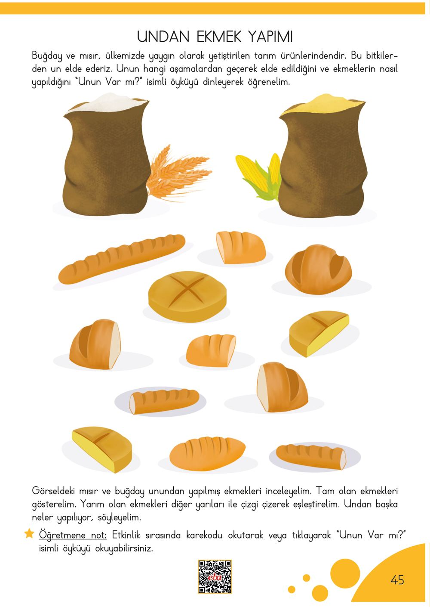

Görseldeki mısır ve buğday unundan yapılmış ekmekleri inceleyelim. Tam olan ekmekleri gösterelim. Yarım olan ekmekleri diğer yarıları ile çizgi çizerek eşleştirelim. Undan başka neler yapılıyor, söyleyelim.

⭐ **Öğretmene not:** Etkinlik sırasında karekodu okutarak veya tıklayarak “Unun Var mı?” isimli öyküyü okuyabilirsiniz.

<!-- sayfa 45 -->

# SAYGI TEKERLEMESİ

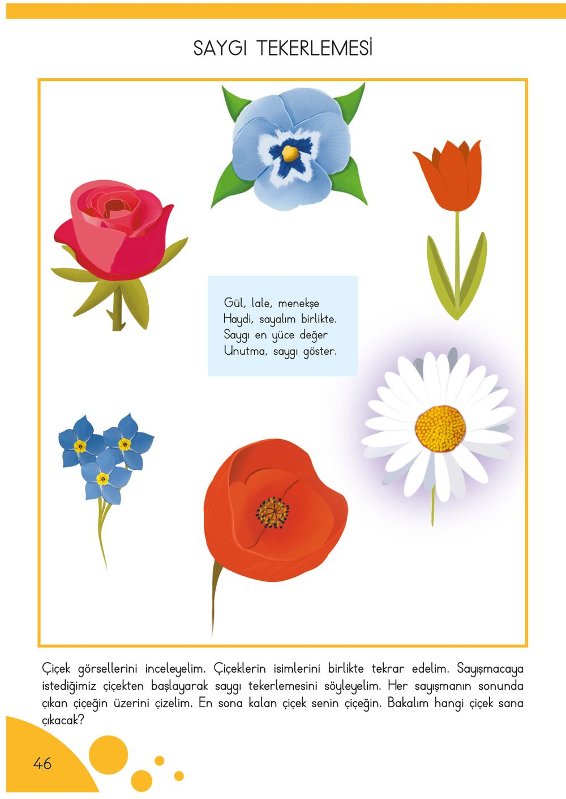

> Gül, lale, menekşe
> Haydi, sayalım birlikte.
> Saygı en yüce değer
> Unutma, saygı göster.

Çiçek görsellerini inceleyelim. Çiçeklerin isimlerini birlikte tekrar edelim. Sayışmacaya istediğimiz çiçekten başlayarak saygı tekerlemesini söyleyelim. Her sayışmanın sonunda çıkan çiçeğin üzerini çizelim. En sona kalan çiçek senin çiçeğin. Bakalım hangi çiçek sana çıkacak?

<!-- sayfa 46 -->

# NESNELERİ HECELE, ALKIŞLA

Kağan öğretmeni ile bir oyun oynuyor. Bu oyunun kuralı sözcükteki hece sayısı kadar el çırpmak.

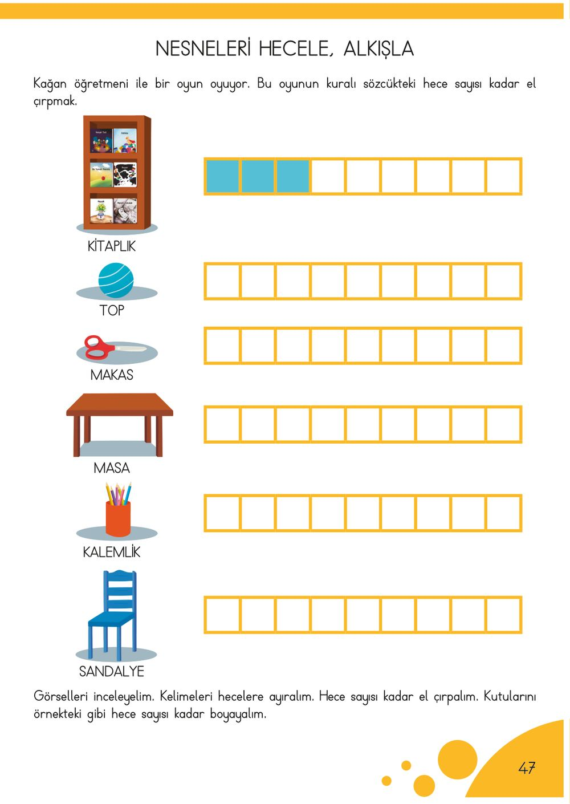 KİTAPLIK [][][][] [][][][][]

 TOP [][][][][][][][]

 MAKAS [][][][][][][][]

 MASA [][][][][][][][]

 KALEMLİK [][][][][][][][]

 SANDALYE [][][][][][][][]

Görselleri inceleyelim. Kelimeleri hecelere ayıralım. Hece sayısı kadar el çırpalım. Kutularını örnekteki gibi hece sayısı kadar boyayalım.

<!-- sayfa 47 -->

# 4 RAKAMINI ÖĞRENİYORUM

$$4_{1 \downarrow}^{2}$$
<!-- KONTROL: Marker'da karşılığı yok, uydurma olabilir -->

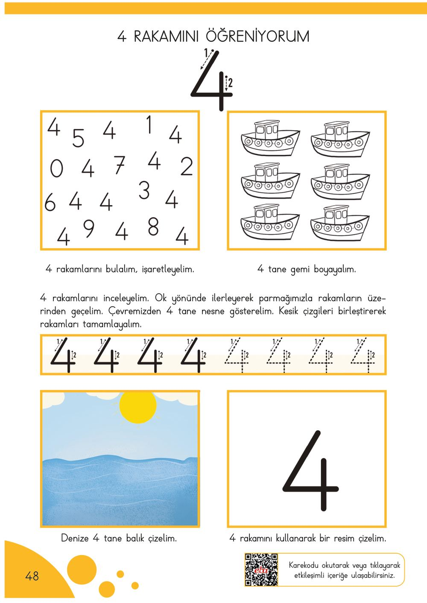
4 rakamlarını bulalım, işaretleyelim.

4 tane gemi boyayalım.

4 rakamlarını inceleyelim. Ok yönünde ilerleyerek parmağımızla rakamların üzerinden geçelim. Çevremizden 4 tane nesne gösterelim. Kesik çizgileri birleştirerek rakamları tamamlayalım.

Denize 4 tane balık çizelim.

4 rakamını kullanarak bir resim çizelim.

<!-- sayfa 48 -->

# ARABALARIN TEKERLEKLERİ

Arabaların iki tane önde iki tane arkada olmak üzere toplam dört tane tekerleği olur. 
Araba görsellerini inceleyelim. Tekerlekleri dörderli gruplayalım.

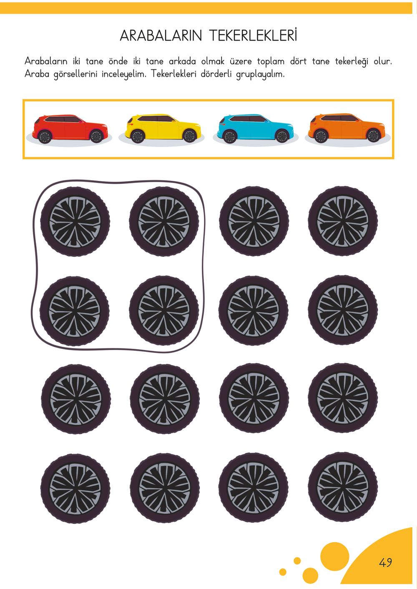

<!-- sayfa 49 -->

# DİKKATLE BAK-AKLINDA TUT

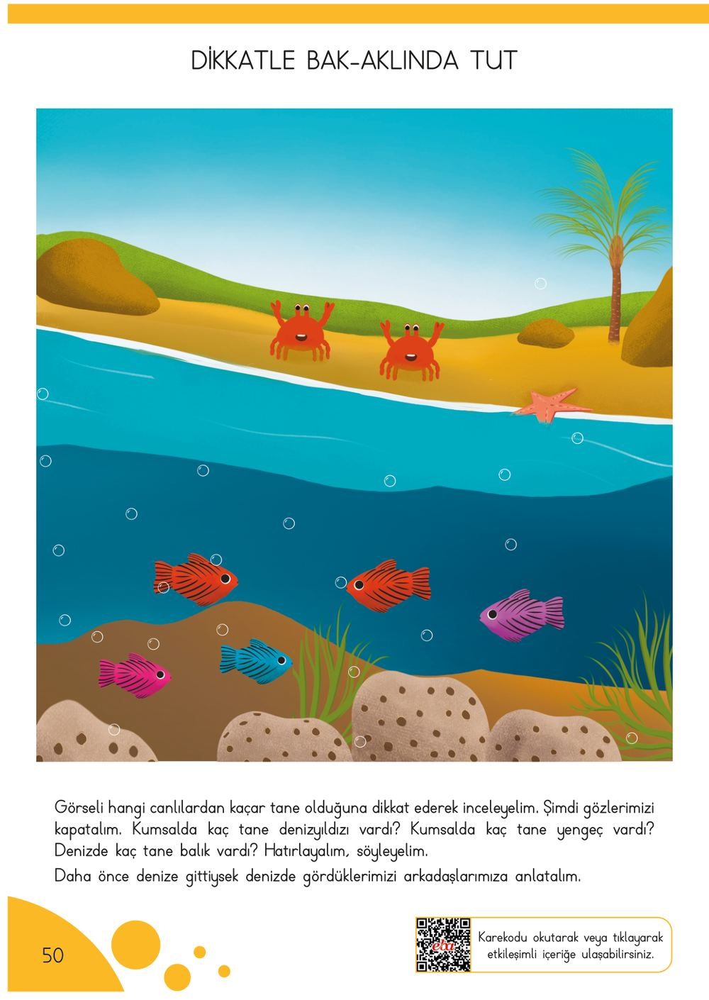

Görseli hangi canlılardan kaçar tane olduğuna dikkat ederek inceleyelim. Şimdi gözlerimizi kapatalım. Kumsalda kaç tane denizyıldızı vardı? Kumsalda kaç tane yengeç vardı? Denizde kaç tane balık vardı? Hatırlayalım, söyleyelim. 

Daha önce denize gittiysek denizde gördüklerimizi arkadaşlarımıza anlatalım.

<!-- sayfa 50 -->

# EL VE AYAK BASKISI

Tarık ve arkadaşları ellerini ve ayaklarını boyadılar. Boyalı el ve ayaklarıyla kâğıtlara baskı yaparak çeşitli hayvan figürleri oluşturdular. Tarık ve arkadaşlarının yaptıkları baskıları inceleyelim. Hangi hayvanları yapmış olabileceklerini tahmin edelim.

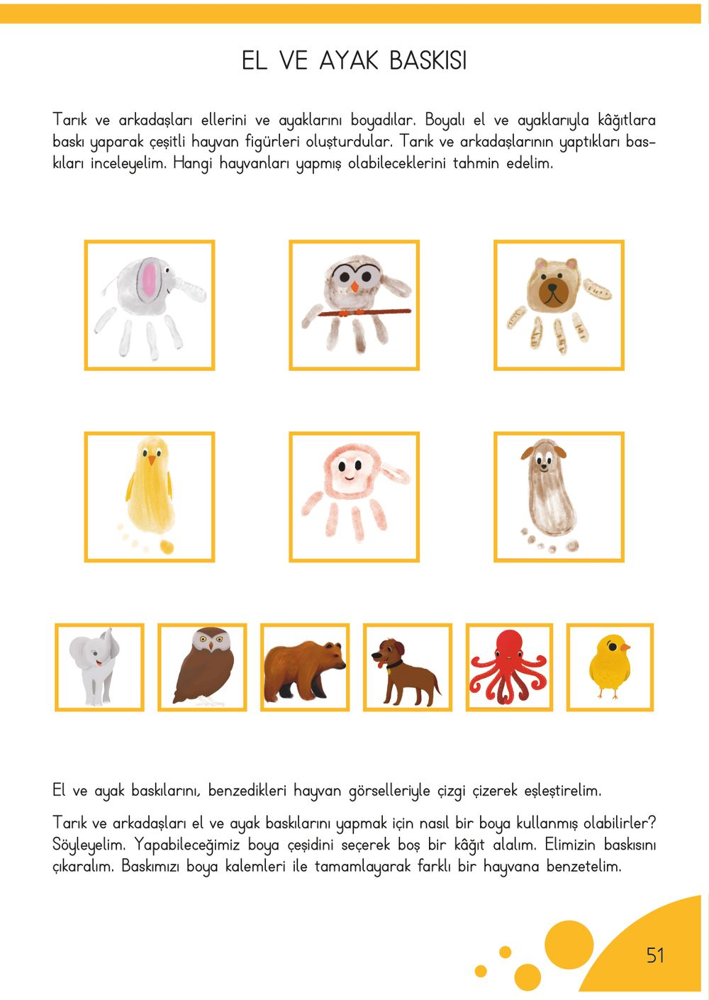

El ve ayak baskılarını, benzedikleri hayvan görselleriyle çizgi çizerek eşleştirelim.

Tarık ve arkadaşları el ve ayak baskılarını yapmak için nasıl bir boya kullanmış olabilirler? Söyleyelim. Yapabileceğimiz boya çeşidini seçerek boş bir kâğıt alalım. Elimizin baskısını çıkaralım. Baskımızı boya kalemleri ile tamamlayarak farklı bir hayvana benzetelim.

<!-- sayfa 51 -->

# BANA ÖZEL

Mahremiyet bize özel olan kişisel bilgilerimizi, bedenimizi, düşüncelerimizi ve duygularımızı gizli tutma hakkıdır.

Ece, annesiyle misafirliğe gitti. Gittiği yerde yetişkinler Ece’yle sohbet ettiler. Bir yetişkin Ece’ye sarılmak istedi. Ece ona sarılmak istemedi. Ece istemediği hâlde sarılmak zorunda mı, neden? Ece’nin yerinde olsaydık ne yapardık? Bir insanın sarılmasını istemediğimizde bunu ona nasıl söylemeliyiz? Anlatalım.

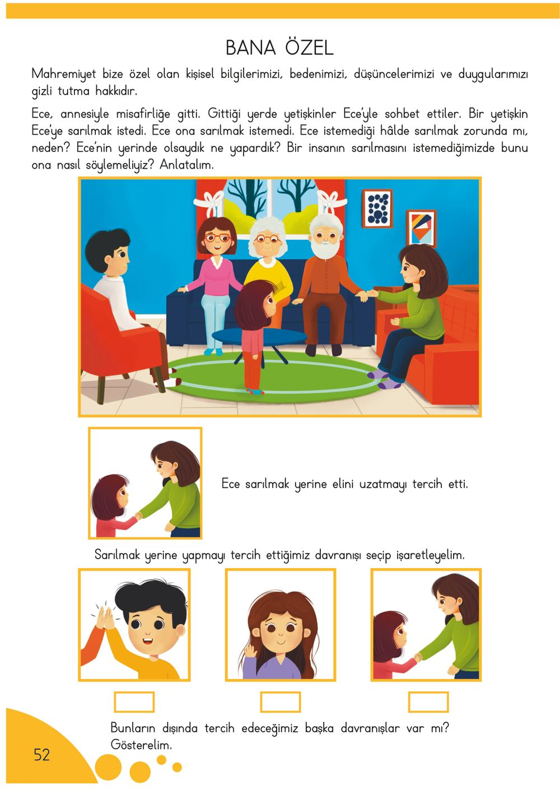

 Ece sarılmak yerine elini uzatmayı tercih etti.

Sarılmak yerine yapmayı tercih ettiğimiz davranışı seçip işaretleyelim.

[ ]

[ ]

[ ]

<!-- sayfa 52 -->

# AİLE İLE MOZAİK YAPIMI

Ali, İrem ve Atakan evlerinin salonunda futbol oynarken vazoyu kırdılar. Ailelerine haber verdiler ve aileleriyle birlikte vazonun parçalarını toplayıp salonu temizlediler. Vazo görselini inceleyelim. Vazoya ait parçaları işaretleyelim.

Çocuklar anne ve babalarıyla vazonun parçalarından resim çerçevesi yaptı. Çerçeveyi inceleyelim.

Ailemizle birlikte neler yaptığımızı anlatalım. Çerçevenin içine ailemizle birlikte yaptığımız bir şeyin resmini çizelim.

⭐ Öğretmene not: Çocuklarla sohbet ederken “aile içi iletişimin sağlayacağı yararları fark etmesine, aile içinde iş birliği yapmanın önemine” dikkat çekebilirsiniz. Karekodu okutarak veya tıklayarak “Mozaik” isimli kitabı okuyabilirsiniz.

<!-- sayfa 53 -->

# YETERLİ VE DENGELİ BESLENİYORUM

: Süt ve süt ürünleri, Et, yumurta, kuru baklagiller, Sebze ve meyveler, Ekmek ve tahıl grubu içeren besin yoncası görseli.

Yeterli ve dengeli beslenmemiz için öğünlerimizde besin yoncasının yapraklarında bulunan besinlerin her birinden tüketmeliyiz. Yeterli ve dengeli beslenmek neden önemlidir? Anlatalım. Besin yoncasını inceleyelim, besin yoncasındaki yiyeceklerin isimlerini söyleyelim.

: Boş bir tabak, çatal ve kaşık görseli.

Emre ve Ela sağlıklı besleniyor. Et, yumurta, sebze-meyve, tahıl grubu ve süt ürünlerini yeterli miktarda tüketiyor. Emre ve Ela sağlıklı besinlerden oluşan bir tabak hazırlamak istiyor. Besin yoncasının her bir yaprağındaki besinlerden birer tane seçelim, tabağa çizelim.

<!-- sayfa 54 -->

# SESLERİ TANIT VE TAKLİT ET

Defne eve giderken “telefon, çekiç, ambulans, kurbağa, uçak” sesi duyuyor. Görselleri inceleyelim. Defne hangi yoldan evine gitmiş olabilir? Söyleyelim. Defne’nin gittiği yolu takip ederek varlıkların sesini sırayla taklit edelim.

<!-- sayfa 55 -->

# HAYVAN RÖNTGENLERİ

Zoolog (hayvan bilimci), yaşayan ve nesli tükenen hayvanları bilimsel olarak inceleyen kişidir.
Zoolog Aylin, hayvanların panodaki röntgen filmini inceliyor. Görseldeki röntgen filmlerini inceleyelim. Panoda röntgen filmi olan hayvanlardan hangisinin resmi eksik? O hayvanın röntgen filmini işaretleyelim. Panoda resmi eksik olan hayvanın röntgen filmine bakarak o hayvanın vücudunun nasıl göründüğünü düşünelim. Hayvanın resmini çerçevenin içine çizelim.

<!-- sayfa 56 -->

# SEVGİ ALBÜMÜ

Sevgimizi hangi sözlerle ifade ederiz? Sevgimizi, konuşmak dışında başka hangi yollarla gösterebiliriz? Söyleyelim.

Bu bir sevgi albümü. Sevgi albümünün kapağına sevdiğimiz kişilerin resimlerini çizelim.

<!-- sayfa 57 -->

# GÜN İÇİNDE NELER DEĞİŞİR?

Görselleri inceleyelim. Resimler arasındaki 7 farkı bularak alttaki resimde işaretleyelim.

İki resim arasındaki farklılıkların nedeni ne olabilir? Konuşalım.

<!-- sayfa 58 -->

# 5 RAKAMINI ÖĞRENİYORUM

5 rakamlarını bulalım, işaretleyelim.

5 tane şemsiye boyayalım.

5 rakamlarını inceleyelim. Ok yönünde ilerleyerek parmağımızla rakamların üzerinden geçelim. Çevremizden 5 tane nesne gösterelim. Kesik çizgileri birleştirerek rakamları tamamlayalım.

Bulutun altına 5 tane yağmur damlası çizelim.

5 rakamını kullanarak bir resim çizelim.

<!-- sayfa 59 -->

# BEŞTAŞ OYUNU

“Beştaş” oyunu bir elin içine sığabilecek büyüklükte olan 5 adet taşla oynanan geleneksel bir oyundur. Oynayan kişinin seçtiği bir taşı havaya atıp tutarken yerdeki taşları toplaması gerekir. Karekodu okutarak oyunun videosunu izleyebilirsiniz.
Görseldeki taşları inceleyelim. Taşları beşerli gruplayalım.

<!-- sayfa 60 -->

# GECECİL HAYVANLAR

Hayvanlardan bazıları gündüzleri dinlenir, geceleri beslenir ve daha aktiftir. Bir belgesel için gececil hayvanların görüntüleri kaydedilmiş. Görselleri inceleyelim. Gece ışıkta bir bölümü görünen hayvanların hangileri olduğunu bulalım. Hayvan görsellerinin çerçevelerini, onları gösteren fenerlerin rengine uygun boyayalım. Gececil olmayan hayvan hangisi? Bulalım, söyleyelim.

| YEDİUYUR | KİRPİ | FİL |
| :---: | :---: | :---: |
|  |  |  |

| RAKUN | BAYKUŞ | YARASA |
| :---: | :---: | :---: |
|  |  |  |

<!-- sayfa 61 -->

# EV ŞEKLİ OLUŞTURUYORUM

Eda ve Arda renkli çubukları kullanarak ev şekli oluşturmaya çalıştılar. Oluşturdukları evleri inceleyelim. Her sırada ev modelini oluştururken eksik kalan parçaları bulup uygun renkteki kalemimizle çizerek tamamlayalım. Fazladan parça kullanılan evi bulup işaretleyelim.

<!-- sayfa 62 -->

# AĞAÇLARIN İSİMLERİNİ HECELEYORUM

Gür-gen

Kes-ta-ne

Ser-vi

Ka-vak

Ih-la-mur

Huş

Görsellerde ülkemizde yetişen ağaçlar bulunmaktadır. Ağaçların isimlerini öğretmenimizden dinleyelim ve heceleyerek söyleyelim. Her görselin hece sayısı kadar yaprak boyayalım.

<!-- sayfa 63 -->

# NOKTALI KARELER

Görselleri inceleyelim. Karelerin içinde hangi bölümlerde, hangi renkte daireler olduğuna dikkat edelim. Dairelerin renginde üç adet ponpon alalım. Aldığımız ponponları modelin karşısındaki şekle görseldeki gibi yerleştirelim. Ardından ponponlarımızı kaldırıp aynı yere boya kalemimizle ponponun renginde daireler çizelim.

<!-- sayfa 64 -->

# KESTANE AĞACININ YAŞAM DÖNGÜSÜ

Kestane ağacının yaşam döngüsü ile ilgili görselleri inceleyelim. Kestane ağacının gelişim aşamalarını boyayalım. Aşamalardaki renklere dikkat edelim. Görsellerin altlarında bulunan sembolleri örnekteki gibi aynı renkte boyayalım.

<!-- sayfa 65 -->

# TARTIŞMAK DOĞAL, ÇÖZMEK KOLAY

Görselleri inceleyelim. Görseller bize arkadaşımızla bir sorun yaşadığımızda neler yapabileceğimizi anlatıyor. Arkadaşlarımızla hangi konularda sorun yaşıyoruz? Sorumumuzu hangi yollarla ve nasıl çözüyoruz? Anlatalım.

1

Sakinleşmek için önce derin nefes al.

2

Ne hissettiğini arkadaşına anlat.

3

Arkadaşının ne hissettiğini, ne düşündüğünü sor ve onu dikkatle dinle.

4

İkinizi de mutlu edecek bir çözüm bulun ve oyuna devam edin.

<!-- sayfa 66 -->

# ÜLKEMİZDEKİ KUŞ TÜRLERİ

| İzmir Yalıçapkını | Turna | Yeşil Arı Kuşu | Anadolu Sivacısı |
| :---: | :---: | :---: | :---: |
|  |  |  |  |
|  |  |  |  |
|  |  |  |  |
|  |  |  |  |
|  |  |  |  |

Ülkemizdeki kuş türlerini gösteren görselleri inceleyelim. Altlarındaki renklere dikkat edelim. Aynı kuş türlerini tablodan bulup altlarındaki sembolleri aynı renkte boyayalım.

<!-- sayfa 67 -->

# CUMHURİYET KAÇ YAŞINDA?

Serdar 29 Ekim’de doğdu. Doğum gününü ailesiyle kutladı. Serdar beş yaşında.

Atatürk, Cumhuriyet’i 29 Ekim 1923 tarihinde ilan etti. Cumhuriyetin kaç yaşında olduğunu tahmin edelim.

Doğum günümüzü söyleyelim. Sayfadaki boş bölüme doğum günümüzü nasıl kutlamak istediğimizi anlatan bir resim çizelim.

⭐ Öğretmene not: Etkinlik sayfası yapılmadan bir gün önce çocuklardan doğum günlerini öğrenmeleri istenir.

<!-- sayfa 68 -->

# ATATÜRKÜN DOĞA SEVGİSİ

Mustafa Kemal Atatürk doğaya karşı büyük bir sevgi beslerdi. Ülkemizin ağaçlandırılmasına büyük önem verdi. Atatürk’ün doğada zaman geçirirken çektirdiği fotoğrafları inceleyelim.

Atatürk Yalova’daki köşkünün bahçesinde bulunan ağacın fazla büyümesi ve köşke zarar vermesi nedeniyle ağacın kesilmesi önerisini reddetmiştir. Bunun üzerine köşk ray üzerinden kaydırılarak yeri değiştirilmiş ve ağacın kesilmesine engel olunmuştur.

## YÜRÜYEN KÖŞK

Atatürk gibi doğada zaman geçirdiğimizi hayal edelim. Bu hayalimizi çerçevenin içine çizelim.

<!-- sayfa 69 -->

# ZEYNEP DOĞA GEZİSİNDE

Zeynep, doğa gezisine çıktı. Yolu takip ederek kulübeye ulaşacak.

Zeynep'in yol boyunca karşılaştığı varlıkları sayalım. Varlıkların sayısını örnekteki gibi grafikte boyayarak gösterelim.

| | | | | | |
| :---: | :---: | :---: | :---: | :---: | :---: |
|  | █ | █ | █ | █ | █ |
|  | | | | | |
|  | | | | | |
|  | | | | | |
|  | | | | | |
|  | | | | | |

<!-- sayfa 70 -->

# BEŞ DUYU ORGANIMIZ

Bahçeye çıkalım. Beş duyumuzu kullanarak araştırma yapalım. Bahçede gördüklerimizi, kokladıklarımızı, tadına baktıklarımızı, dokunarak hissettiklerimizi, sesini duyduklarımızı işaretleyelim. Başka neler gördük? Boş bir kâğıda çizelim.

<!-- sayfa 71 -->

# İSTEK VE İHTİYAÇLARIM

Ebru ve ailesi, Ebru’nun eksik okul malzemelerini almak için alışverişe çıkmışlar. Ebru’nun okulda kullanacağı malzeme listesi hangisi olabilir? Düşünelim. Ebru’nun ihtiyaçlarının olduğu listede silgi, okul ayakkabısı, kalem bulunuyor. Listeyi çizgi çizerek Ebru’ya götürelim. Ebru okulda başka hangi malzemelere ihtiyaç duyabilir? Söyleyelim.

* Dondurma
* Bisiklet
* Oyuncak

* Silgi
* Ayakkabı
* Kalem

(Ebru görseli)

* Dondurma
* Silgi
* Ayakkabı

* Dondurma
* Oyuncak
* Silgi

İstek ne demek? İhtiyaç ne demek? Alışverişe çıktığımız zaman alacağımız ürünlerde öncelikle isteklerimizi mi, ihtiyaçlarımızı mı dikkate almalıyız? Arkadaşlarımızla fikirlerimizi paylaşalım.
Okul çantamız yokken okul malzemelerimizi koymak için bir okul çantasına ihtiyaç duyabiliriz. Bir okul çantamız varken yeni bir okul çantasını çok beğenebiliriz. Böyle bir durumda ne yapmalıyız? Yeni bir okul çantasına ihtiyacımız var mı? Konuşalım.

<!-- sayfa 72 -->

# HAREKET EDELİM VE ÇİZELİM

3 kere zıplayalım, ardından kesik çizgileri birleştirerek tamamlayalım.

4 kere kendi etrafımızda dönelim, ardından kesik çizgileri birleştirerek tamamlayalım.

5 kere el çırpalım, ardından kesik çizgileri birleştirerek tamamlayalım.

2 kere dizlerimize vuralım, ardından kesik çizgileri birleştirerek tamamlayalım.

Çok yorulduk. Şimdi kendimize bir yer seçip dinlenelim. Yeterince dinlenmezsek ne olur? Anlatalım.

<!-- sayfa 73 -->

# ÜLKELERE ÖZGÜ YEMEKLER

Tabaklardaki yemekleri inceleyelim. Yemekler hangi malzemelerden yapılıyor? İki yemeğin de ortak malzemesini bulalım. Türkiye’ye ait olan yemeğin altındaki kutuyu işaretleyelim ve adını söyleyelim. Diğer tabaktaki yemeğin ismini ve hangi ülkeye ait olduğunu düşünelim. Suşi yemeği Japonya’ya ait olan ve pirinçle yapılan bir yemektir. Başka hangi yemeklerde pirinç var? Örnek verelim. Pirinçle yapılan diğer yemekler hakkında konuşalım. Boş tabağın içine bu yemeklerden birini çizelim.

Resmini çizdiğimiz yemeği yerken kullanabileceğimiz mutfak gerecini seçip işaretleyelim.

<!-- sayfa 74 -->

# SONBAHAR YAPRAKLARINI SAYALIM

Aybüke sonbahar yaprakları toplamak için bahçeye çıkıyor. Topladığı yaprakların sayısını kâğıda yazıyor. Daha sonra yaprakları renklerine ayırarak kavanozlara koyuyor. Aybüke’nin kavanozlara koyduğu yaprakları sayalım. Yaprakları, kâğıttaki rakamın altındaki renge uygun boyayalım.

| 4 | 1 | 3 | 5 | 2 |
| :---: | :---: | :---: | :---: | :---: |
| ![turuncu yaprak] | ![yeşil yaprak] | ![kahverengi yaprak] | ![sarı yaprak] | ![kırmızı yaprak] |

<!-- sayfa 75 -->

# FARKLI BÖLGELER-FARKLI EVLER

Farklı bölgelerde yaşayan çocukların, özelliklerini dinlediğimiz evlerini bulalım. Çocukları çizgi çizerek evleri ile eşleştirelim.

 Merhaba. Ben Moğolistan’da yaşıyorum. Benim ülkemde “yurt” adı verilen keçe ile kaplanmış çok büyük çadırlar var.

 Merhaba. Ben İzlanda’da yaşıyorum. Benim ülkemde çimlerle kaplanmış evler var.

 Merhaba. Ben Kuzey Kutbu’nda yaşıyorum. Yaşadığım yerde buzdan yapılmış evler var.

<!-- sayfa 76 -->

# HANGİ SESLERİ DUYDUN?

Karekoddaki sesleri dinleyelim. Duyduğumuz seslerin neye ait olduğunu söyleyelim ve bu sesleri taklit edelim. Kendimizi duyduğumuz seslerin olduğu yerde hayal edelim, bu hayalimizi çerçevenin içine çizelim. Çizdiklerimizi arkadaşlarımıza anlatalım.

<!-- sayfa 77 -->

# ŞEKİLLERİ HECELİYORUM-ÇİÇEKLERİ ÇİZİYORUM

Cemal amca doğa gezisinde çeşitli çiçeklerin fotoğraflarını çekiyor. Fotoğraf çerçevelerinin şeklini inceleyelim. Şekillerin isimlerini heceleyerek söyleyelim. Çerçevelerin içine hece sayısı kadar çiçek çizelim.

ÜÇGEN

KARE

DİKDÖRTGEN

<!-- sayfa 78 -->

# İREM BAHÇE KEŞFİNDE

İrem bahçede keşfe çıkmış. Bulduğu yaprakları kullanarak bir resim yapmış. Biz de bahçeden yapraklar bulalım. Yaprakları ve boya kalemlerini kullanarak bu çerçevenin içine bir resim yapalım.

Görsel ve Genel Ağ Kaynakçası için karekodu okutunuz. 

<!-- sayfa 79 -->

50°D 45°D 40°D 35°D 30°D 25°D
30°N 35°N 40°N 45°N

: Türkiye'nin mülki idare bölümleri, kara ve deniz komşularını gösteren harita.

# TÜRKİYE'NİN MÜLKİ İDARE BÖLÜMLERİ İLE KARA VE DENİZ KOMŞULARI HARİTASI

**Komşu Ülkeler ve Bölgeler:**
* ROMANYA (Sofya, Bükreş)
* UKRAYNA
* RUSYA FEDERASYONU
* GÜRCİSTAN (Tiflis)
* ERMENİSTAN (Erivan)
* NAHÇIVAN Ö.C. (AZERBAYCAN)
* AZERBAYCAN
* İRAN (Urumiye Gölü)
* IRAK (Bağdat)
* SURİYE (Şam)
* LÜBNAN (Beyrut)
* GÜNEY KIBRIS RUM YÖNETİMİ (Lefkoşa)
* KUZEY KIBRIS TÜRK CUMHURİYETİ
* İSRAİL (Tel Aviv, Kudüs)
* FİLİSTİN (Gazze Şeridi, Batı Şeria)
* MISIR (Nil N., Süveyş K.)

**Denizler ve Göller:**
* KARADENİZ
* EGE DENİZİ
* MARMARA DENİZİ
* AKDENİZ
* HAZAR DENİZİ

**Akarsular ve Göller (Harita üzerinde belirtilen bazıları):**
* Meriç N.
* Sakarya N.
* Kızılırmak N.
* Yeşilırmak N.
* Çoruh N.
* Fırat N.
* Dicle N.
* Aras N.
* Kura N.
* Asi N.
* Seyhan N.
* Ceyhan N.
* Göksu N.
* Büyük Menderes N.
* Küçük Menderes N.
* Gediz N.
* Bakırçay N.
* Van Gölü
* Tuz Gölü

**İller (Haritada yer alanlar):**
Adana, Adıyaman, Afyonkarahisar, Ağrı, Amasya, Ankara, Antalya, Artvin, Aydın, Balıkesir, Bilecik, Bingöl, Bitlis, Bolu, Burdur, Bursa, Çanakkale, Çankırı, Çorum, Denizli, Diyarbakır, Edirne, Elâzığ, Erzincan, Erzurum, Eskişehir, Gaziantep, Giresun, Gümüşhane, Hakkâri, Hatay, Isparta, Mersin, İstanbul, İzmir, Kars, Kastamonu, Kayseri, Kırklareli, Kırşehir, Kocaeli, Konya, Kütahya, Malatya, Manisa, Kahramanmaraş, Mardin, Muğla, Muş, Nevşehir, Niğde, Ordu, Rize, Sakarya, Samsun, Siirt, Sinop, Sivas, Tekirdağ, Tokat, Trabzon, Tunceli, Şanlıurfa, Uşak, Van, Yozgat, Zonguldak, Aksaray, Ardahan, Bayburt, Batman, Bartın, Karabük, Karaman, Kilis, Kırıkkale, Konya, Kütahya, Malatya, Manisa, Mardin, Muğla, Muş, Nevşehir, Niğde, Ordu, Osmaniye, Rize, Sakarya, Samsun, Siirt, Sinop, Sivas, Şırnak, Tekirdağ, Tokat, Trabzon, Tunceli, Uşak, Van, Yalova, Yozgat, Zonguldak.

**Harita Lejantı:**
* BAŞKENT (Ankara)
* İL MERKEZİ
* GÖL
* AKARSU
* ÜLKE SINIRI
* ÖZERK BÖLGE SINIRI

**Ölçek:**
0 100 200 300 400 km

Harita Genel Müdürlüğü tarafından üretilmiştir.
