# Okul Öncesi Eğitim 5 Yaş Çekirdek 2 Ders Kitabı

<!-- sayfa 0 -->

# OKUL ÖNCESİ EĞİTİM

## 5 Yaş

# Çekirdek 2

### DERS KİTABI

**Yazarlar**
Berrin TERCAN
Betül SÜREK
Esma HAYIRLIOĞLU
Ezgi AVCI AŞIR
Işıl ÖZTÜRK
Tuba Nur EROL

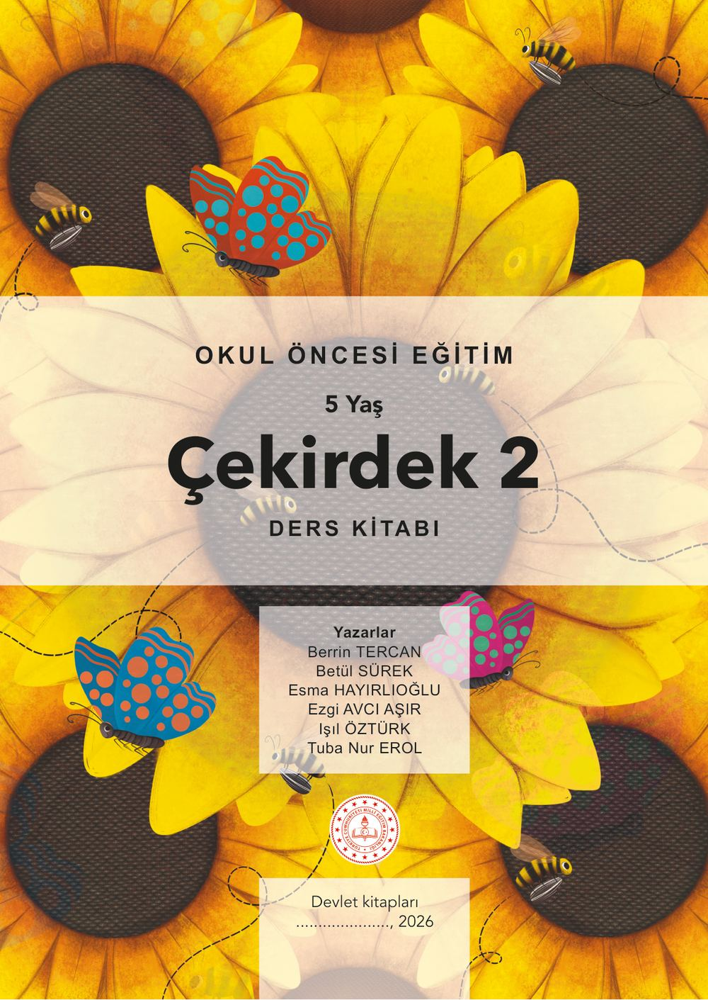

Devlet kitapları

<!-- sayfa 1 -->

DERS KİTAPLARI DİZİSİ ..........................................................................................: 2490

Her hakkı saklıdır ve Millî Eğitim Bakanlığına aittir. Kitabın metin, soru ve şekilleri kısmen de olsa hiçbir surette alınıp yayımlanamaz.

* **EDİTÖR**
  Burcu ÖZKANLI ERTUĞRUL

* **DİL UZMANI**
  Muhammet ŞEN

* **GÖRSEL TASARIMCI**
  Eylem YILDIRIM
  Melike TURALİ
  Metin BİLAL
  Serdar TURALİ

* **ÇOKLU ORTAM TASARIMCISI**
  Abidin AYDIN
  Çağdaş SEVİNÇ
  Didem EROL
  Ezgi SARINÇ
  Ferhat DEMİRCİ
  İlkay CAN
  Onur TÜLÜ
  Yudum CAN

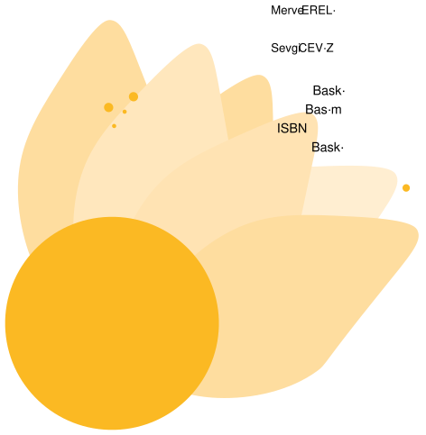

* **PROGRAM GELİŞTİRME UZMANI**
  Uğur ÇENET

* **ÖLÇME VE DEĞERLENDİRME UZMANI**
  Merve ERELİ

* **REHBERLİK UZMANI**
  Sevgi CEVİZ

Baskı Yılı:
Basım Adedi:
ISBN 978-975-11-8089-6
Baskı Yeri:
Adresi:

Millî Eğitim Bakanlığı, Talim ve Terbiye Kurulu Başkanlığının 30.07.2024 tarih ve E-96732399-116.01-111152749 sayılı yazısı ile eğitim aracı olarak kabul edilmiştir. Kurulca bu kitabın kabul edilmiş olması ders kitabından yayınevi ve yazarın/yazarların sorumluluğunu kaldırmaz.

<!-- sayfa 2 -->

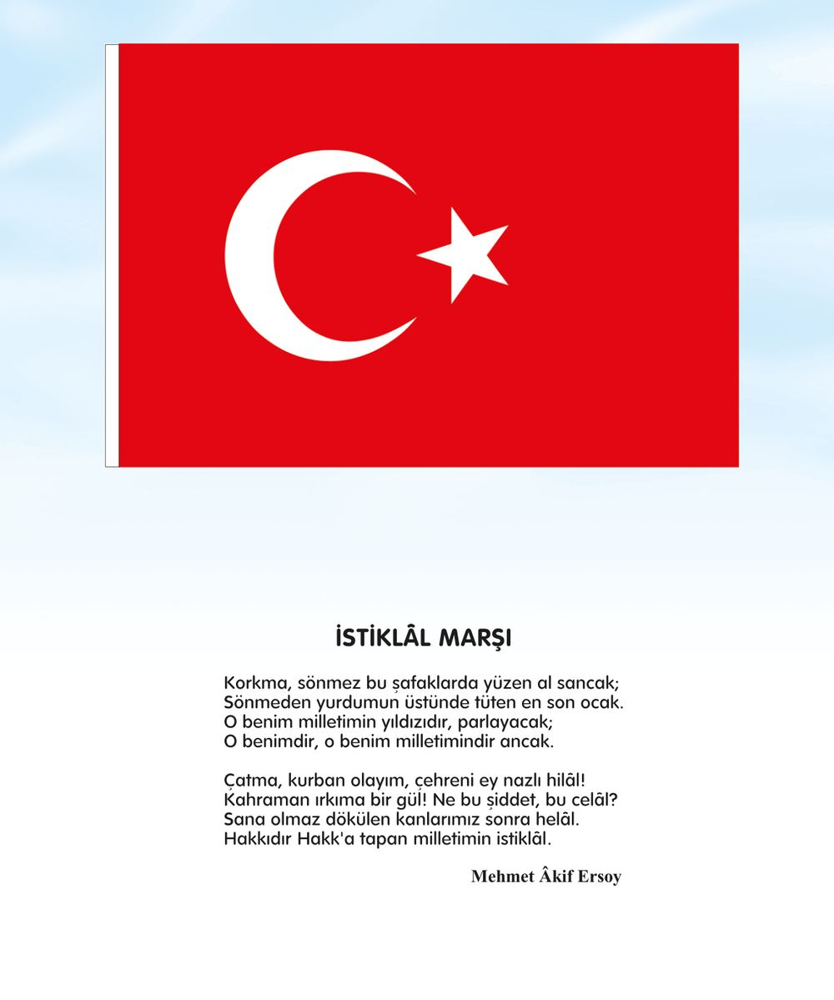

# İSTİKLÂL MARŞI

Korkma, sönmez bu şafaklarda yüzen al sancak;
Sönmeden yurdumun üstünde tüten en son ocak.
O benim milletimin yıldızıdır, parlayacak;
O benimdir, o benim milletimindir ancak.

Catma, kurban olayım, çehreni ey nazlı hilâl!
Kahraman ırkıma bir gül! Ne bu şiddet, bu celâl?
Sana olmaz dökülen kanlarımız sonra helâl.
Hakkıdır Hakk'a tapan milletimin istiklâl.

Mehmet Âkif Ersoy

<!-- sayfa 3 -->

ANDIMIZ

Türküm, doğruyum, çalışkanım.

İlkem küçüklerimi korumak, büyüklerimi saymak; yurdumu, milletimi özümden çok sevmektir.
Ülküm yükselmek, ileri gitmektir.

Ey Büyük Atatürk!

Açtığın yolda, gösterdiğin hedefe durmadan yürüyeceğime ant içerim.

Varlığım Türk varlığına armağan olsun.

Ne mutlu Türküm diyene!

<!-- sayfa 4 -->

MUSTAFA KEMAL ATATÜRK

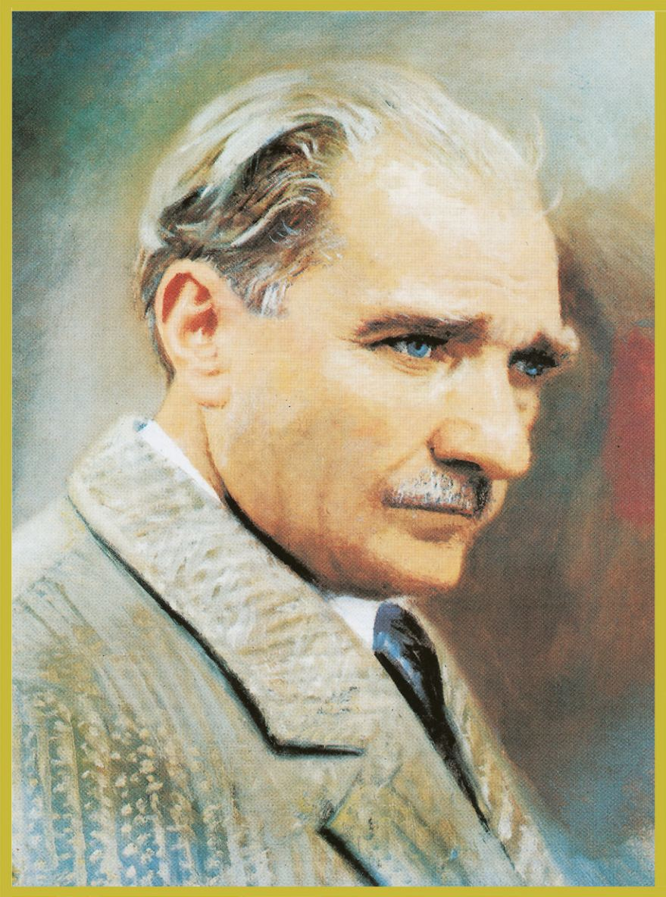
<!-- yer tutucu bulunamadı: sayfa sonuna eklendi -->

<!-- sayfa 5 -->

Verilen metin katmanı boş olduğu için (`<<< >>>`) dönüştürülecek herhangi bir içerik bulunmamaktadır. Lütfen işlenmesini istediğiniz metni veya görseli paylaşın.

<!-- sayfa 6 -->

# İÇİNDEKİLER

| | |
| :--- | :---: |
| İznik Çinisi | 9 |
| Mevsim Kartları | 10 |
| Ne Hissediyorsun? | 11 |
| Geri Dönüşüm Kutuları | 12 |
| Örüntü Yolu | 13 |
| Baskı Teknikleri | 14 |
| Renk Takibi | 15 |
| Kaplumbağa Nerede? | 16 |
| 6 Rakamını Öğreniyorum | 17 |
| Voleybol Maçı | 18 |
| Turşu | 19 |
| Güneş'in Hareketleri | 20 |
| Ses Oyunu | 21 |
| Fotoğrafçı | 22 |
| Atatürk'ün Kitap Sevgisi | 23 |
| Sepet Örüyorum | 24 |
| Ayçiçeği Tarlası | 25 |
| Kuşlar ve Gagaları | 26 |
| 7 Rakamını Öğreniyorum | 27 |
| Notalar | 28 |
| Zeytinleri Sayalım | 29 |
| Eşsiz Parmak İzleri | 30 |
| Yün İpleri Sayalım ve Boyayalım | 31 |
| Nazik Kelebek | 32 |
| Haftanın Günleri | 33 |
| Kukla | 34 |
| Uyaklı Sözcükler | 35 |
| Duygularımı Paylaşmaya İhtiyacım Var | 36 |
| Vitray Sanatı | 37 |
| Geçmişte Kullanılan Eşyalar | 38 |
| Renkli Çömlekler | 39 |
| Kış | 40-41 |
| Renk Renk Şekiller | 42 |
| 8 Rakamını Öğreniyorum | 43 |
| Ahtapotun Kolları | 44 |
| Sakinleşme Yöntemlerim | 45 |

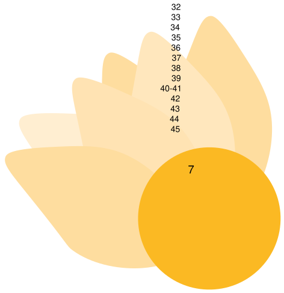
<!-- yer tutucu bulunamadı: sayfa sonuna eklendi -->

<!-- sayfa 7 -->

| | |
| :--- | :---: |
| Uçamayan Kuş Türleri | 46 |
| Dostluk | 47 |
| Yaşasın, Çocuk Hakları! | 48 |
| Teşekkürler Öğretmenim | 49 |
| Defne’nin Resimleri | 50 |
| Doğadaki Uyak | 51 |
| 9 Rakamını Öğreniyorum | 52 |
| Bileklik Hazırlıyorum | 53 |
| Dokuztaş Oyunu | 54 |
| Mağara Resimleri | 55 |
| Mağara Resimleri | 56 |
| Kütüphane Rafları | 57 |
| Dinle ve Çizgileri Takip Et | 58 |
| Fatma Halanın Misafirleri | 59 |
| Seçimlerimiz Neden Farklı? | 60 |
| Bloklardan Şekiller | 61 |
| Fosil Bilimci | 62 |
| Fosil Bilimcilerin Malzemeleri | 63 |
| 0 Rakamını Öğreniyorum | 64 |
| Vitamin Dolu Bulmaca | 65 |
| Mozaikte İsmim Var mı? | 66 |
| Fotoğraf Çerçevesi Tasarlıyorum | 67 |
| Konuşabilir miyim? | 68 |
| Doğadaki ve Çevremizdeki Sesler | 69 |
| Çini Boyama | 70 |
| Tavuğun Yaşam Döngüsü | 71 |
| Uğur Böceği Çizgi Çalışması | 72 |
| Akvaryum | 73 |
| Alışveriş Listesi | 74 |
| Doğayı Koruyorum | 75 |
| Harfleri Bulalım ve Boyayalım | 76 |
| Öykülü Beden Hareketleri | 77 |
| Hangi Çalgı? | 78 |
| Yeni Yıl | 79 |
| Görsel ve Genel Ağ Kaynakçası | 79 |
| Türkiye’nin Mülki İdare Bölümleri ile Kara ve Deniz Komşuları Haritası | 80 |

Etkinliklerin ilişkili olduğu beceriler ve süreç bileşenini görmek için karekodu okutunuz veya tıklayınız.
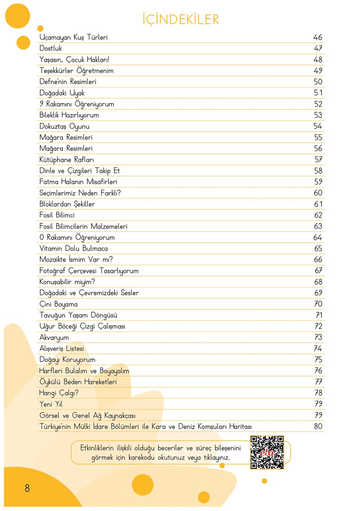

<!-- sayfa 8 -->

# İZNİK ÇİNİSİ

İznik çinisi ülkemizin coğrafi işaret almış geleneksel el sanatlarından biridir.

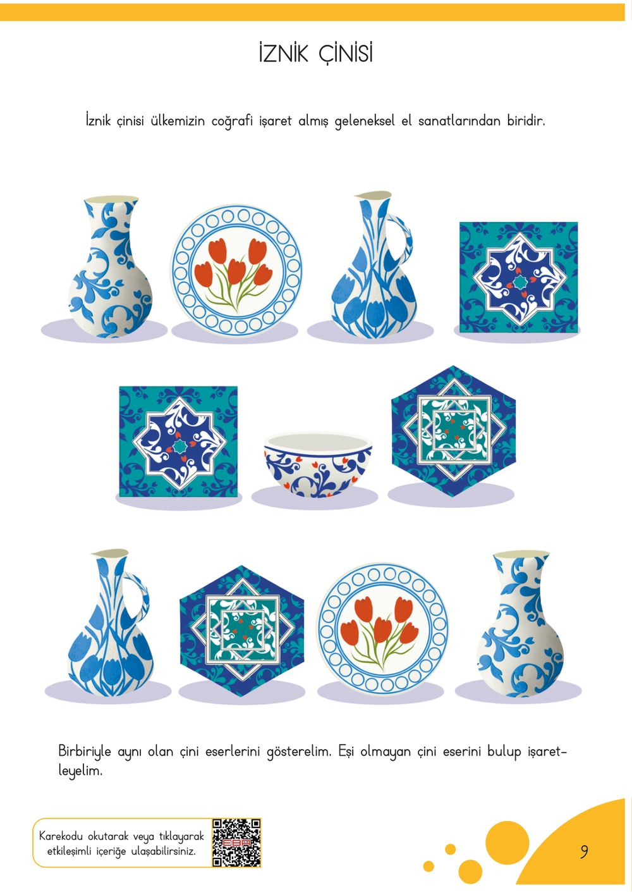

Birbiriyle aynı olan çini eserlerini gösterelim. Eşi olmayan çini eserini bulup işaretleyelim.

<!-- sayfa 9 -->

# MEVSİM KARTLARI

Görselleri inceleyerek hangi mevsime ait olduğunu söyleyelim. Ekin’in farklı mevsimlerde evine gidişini anlatan görsellerde doğada gerçekleşen değişiklikler hakkında konuşalım. Mevsim kartlarının ilişkili olduğu görselleri bulalım ve çizgiyle eşleştirelim.

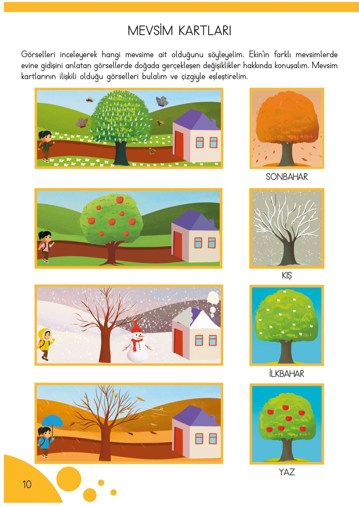

SONBAHAR

KIŞ

İLKBAHAR

<!-- sayfa 10 -->

# NE HİSSEDİYORSUN?

Görsellerdeki duygu ifadelerinin hangi renk çerçevenin içinde olduğuna dikkat edelim.

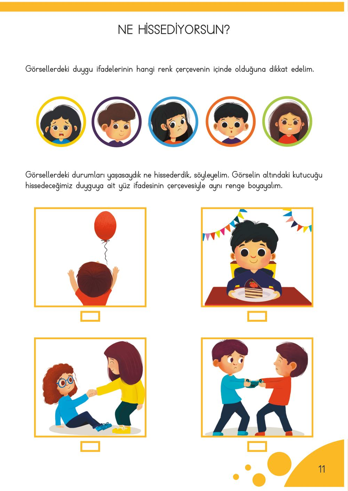

Görsellerdeki durumları yaşasaydık ne hissederdik, söyleyelim. Görselin altındaki kutucuğu hissedeeceğimiz duyguya ait yüz ifadesinin çerçevesiyle aynı renge boyayalım.

<!-- sayfa 11 -->

# GERİ DÖNÜŞÜM KUTULARI

Arda, ailesi ile doğa yürüyüşüne çıktı. Fakat çevrede gördükleri atıklar Arda ve ailesini çok üzdü. Arda’nın kozalak toplamak için yanında götürdüğü poşetler çok işe yaradı. Gördükleri tüm atıkları bu poşetlere koydular. Arda plastik atıkların sarı, kâğıt atıkların mavi, cam atıkların ise yeşil geri dönüşüm kutusuna atılması gerektiğini okulda öğrenmişti.

Arda yürüyüşten döner dönmez atıkları geri dönüşüm kutularına atmak için ayrıştırdı. Görsellerdeki atık malzemeleri inceleyelim. Atıkları ayrıştırarak çizgi yardımıyla uygun geri dönüşüm kutularına taşıyalım.

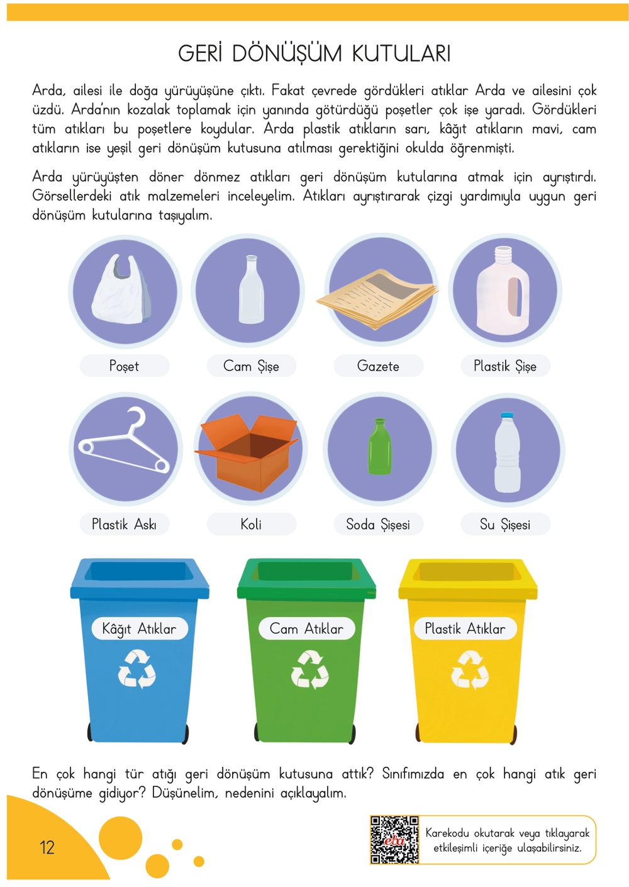

Poşet
Cam Şişe
Gazete
Plastik Şişe
Plastik Askı
Koli
Soda Şişesi
Su Şişesi

Kâğıt Atıklar
Cam Atıklar
Plastik Atıklar

En çok hangi tür atığı geri dönüşüm kutusuna attık? Sınıfımızda en çok hangi atık geri dönüşüme gidiyor? Düşünelim, nedenini açıklayalım.

<!-- sayfa 12 -->

# ÖRÜNTÜ YOLU

Atakan ve İrem aynı apartmanda yaşıyor. Farklı yolları kullanarak evlerine ulaşıyorlar. Varlıkların sıralamasına dikkat edelim. Örüntü kuralını bulalım ve varlıkları kurala uygun şekilde boyayalım.

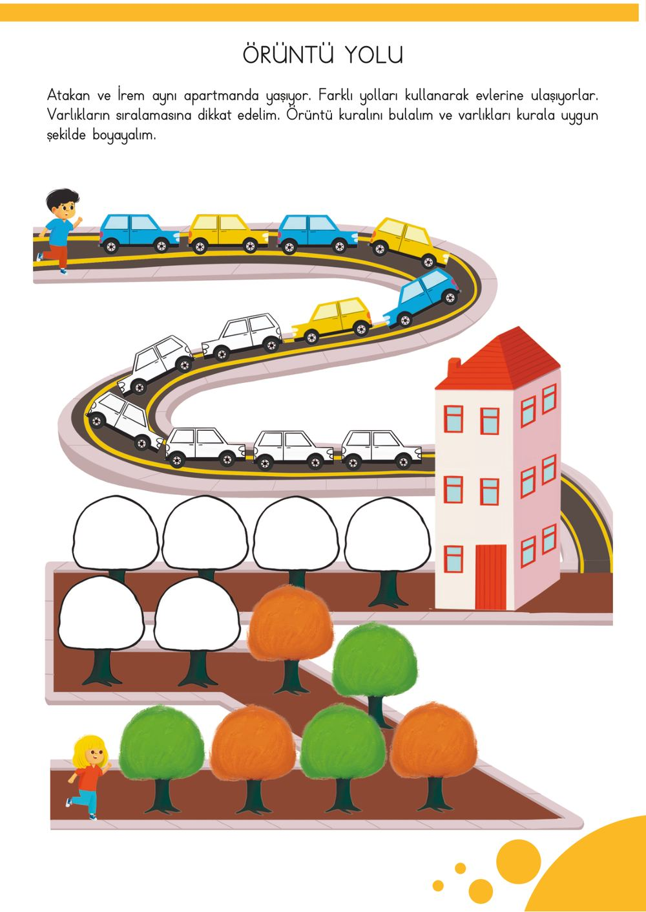

<!-- sayfa 13 -->

# BASKI TEKNİKLERİ

Tabloları inceleyelim. Resimlerin hangi baskı tekniği kullanılarak yapıldığını bulalım.

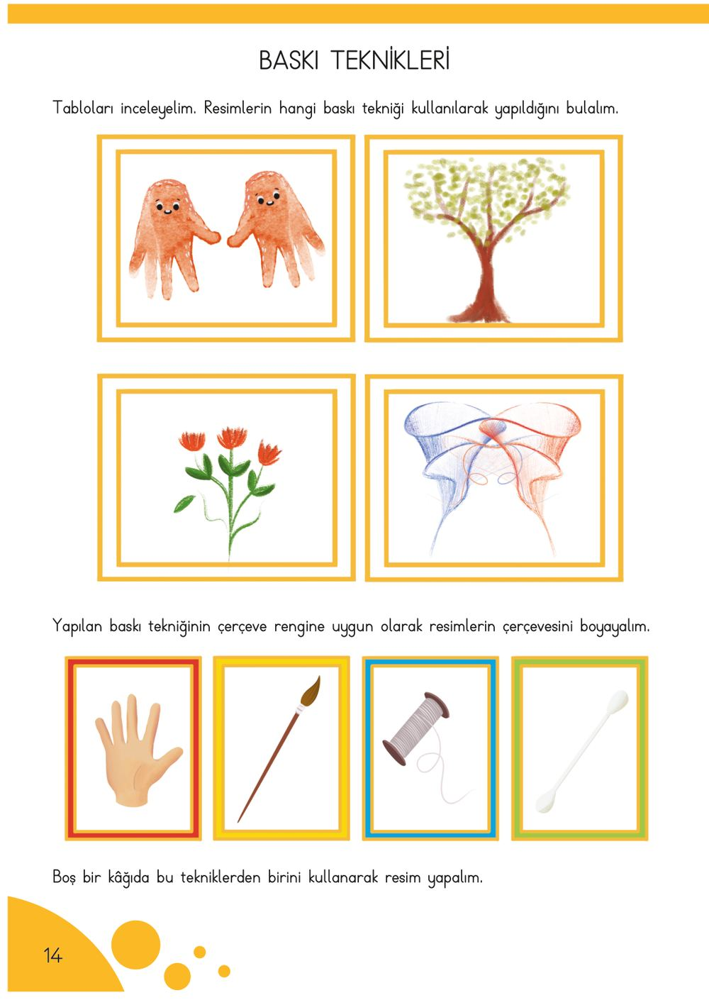

Yapılan baskı tekniğinin çerçeve rengine uygun olarak resimlerin çerçevesini boyayalım.

Boş bir kâğıda bu tekniklerden birini kullanarak resim yapalım.

<!-- sayfa 14 -->

# RENK TAKİBİ

Kutuların içinde bulunan rakamları inceleyelim. Örnekteki gibi rakamların ait olduğu rengi sırayla takip ederek çizgi çizerek birleştirelim.

1 2 3 4 5

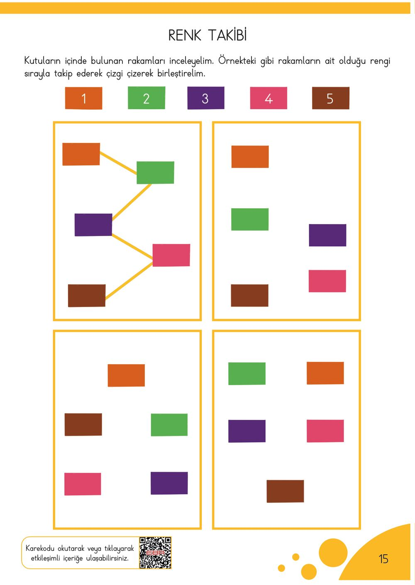

<!-- sayfa 15 -->

# KAPLUMBAĞA NEREDE?

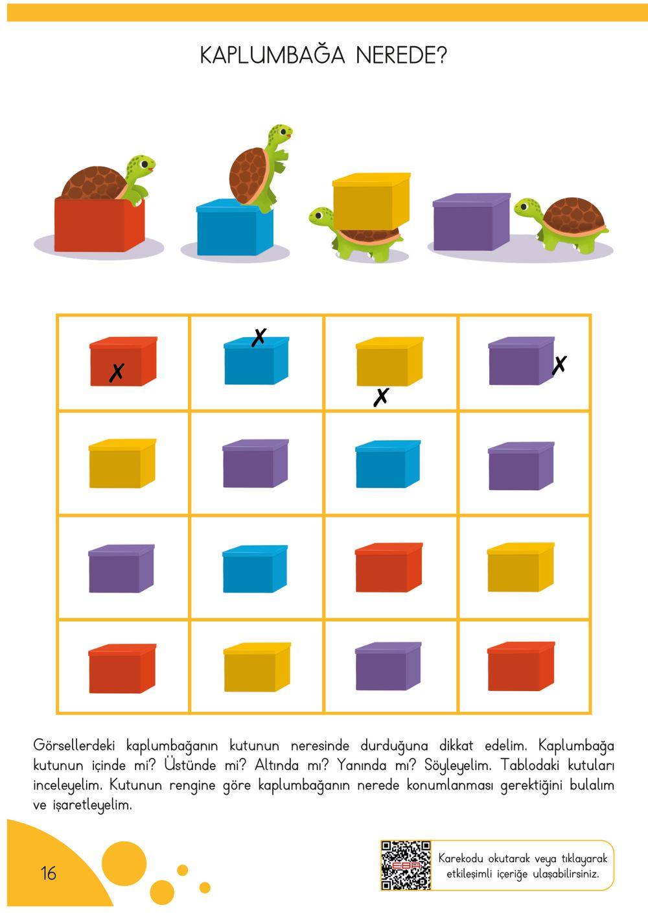

| | | | |
| :---: | :---: | :---: | :---: |
| X | X | X | X |
|  |  |  |  |
|  |  |  |  |
|  |  |  |  |

Görsellerdeki kaplumbağanın kutunun neresinde durduğuna dikkat edelim. Kaplumbağa kutunun içinde mi? Üstünde mi? Altında mı? Yanında mı? Söyleyelim. Tablodaki kutuları inceleyelim. Kutunun rengine göre kaplumbağanın nerede konumlanması gerektiğini bulalım ve işaretleyelim.

<!-- sayfa 16 -->

# 6 RAKAMINI ÖĞRENİYORUM

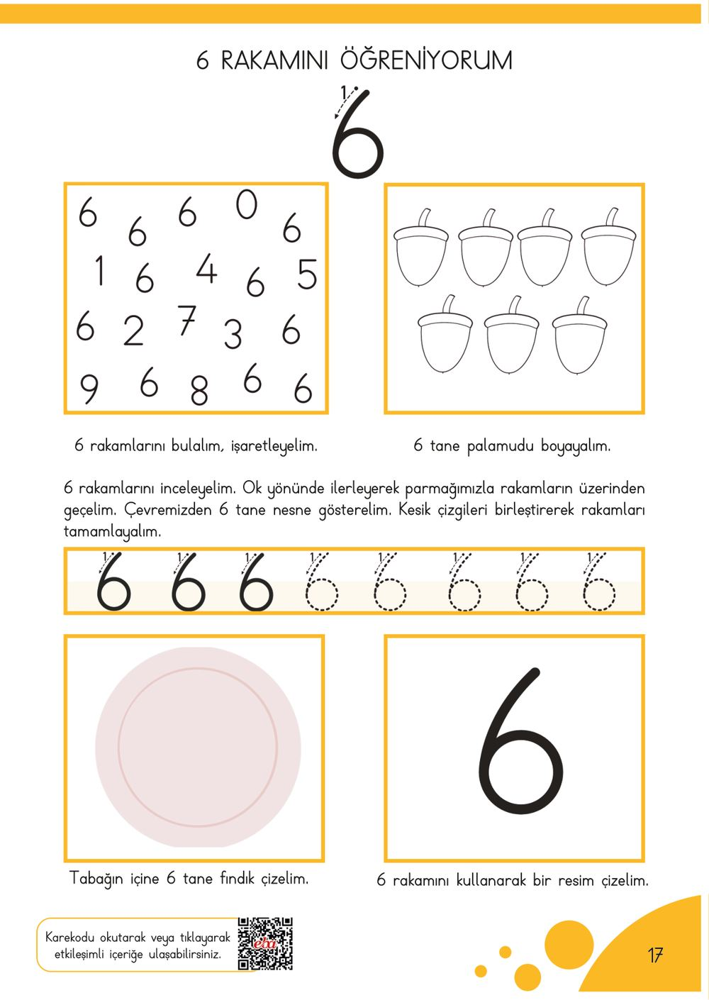

6 rakamlarını bulalım, işaretleyelim.

6 tane palamudu boyayalım.

6 rakamlarını inceleyelim. Ok yönünde ilerleyerek parmağımızla rakamların üzerinden geçelim. Çevremizden 6 tane nesne gösterelim. Kesik çizgileri birleştirerek rakamları tamamlayalım.

Tabağın içine 6 tane fındık çizelim.

6 rakamını kullanarak bir resim çizelim.

<!-- sayfa 17 -->

# VOLEYBOL MAÇI

Bir voleybol takımı 6 kişiden oluşmaktadır. İki takım maç yapmak istiyor. Görselleri inceleyelim. 
Formaları altışarlı gruplayalım.

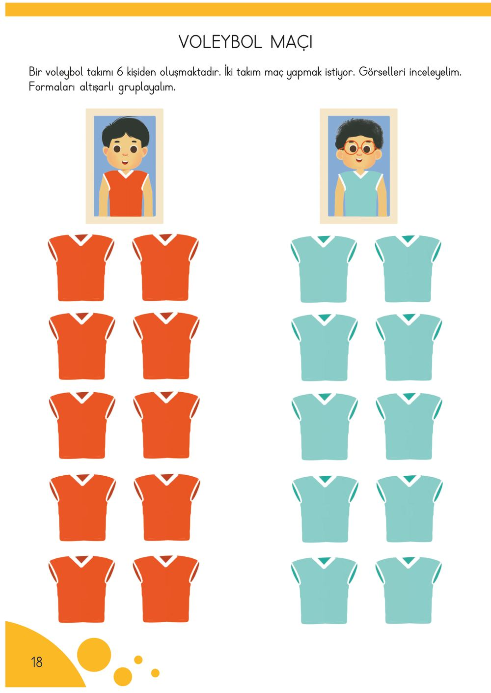

<!-- sayfa 18 -->

# TURŞU

Oya turşu yemeyi çok severdi. Babaannesinin yaptığı turşuları afiyetle yerken turşunun nasıl yapıldığını merak etti. Babaannesi “Turşunun içine konulacak sebzeler güzelce yıkanır, sonra sebzeler bir kavanoza yerleştirilir. Ardından sirke, tuz, sarımsak ve su eklenir. Kavanozun kapağı kapatılarak bir süre beklenir.” diyerek turşunun nasıl yapıldığını anlattı. Yaz mevsiminde bol bol yediğimiz sebzeleri kış aylarında da yemek için turşu hazırladığını söyledi.

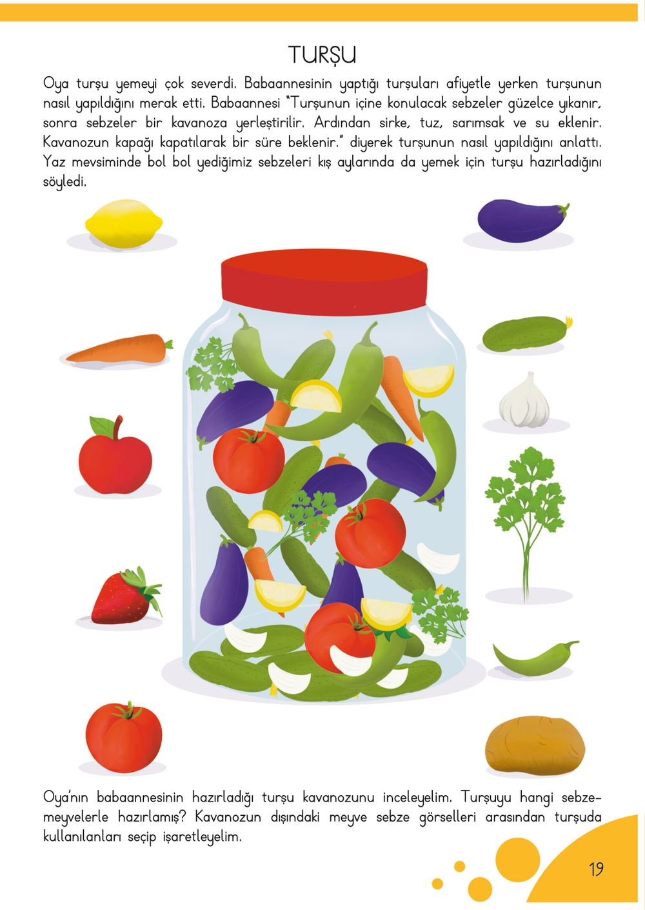

Oya’nın babaannesinin hazırladığı turşu kavanozunu inceleyelim. Turşuyu hangi sebze-meyvelerle hazırlamış? Kavanozun dışındaki meyve sebze görselleri arasından turşuda

<!-- sayfa 19 -->

# GÜNEŞİN HAREKETLERİ
Görsellerdeki Güneş'in hareketlerini inceleyelim.

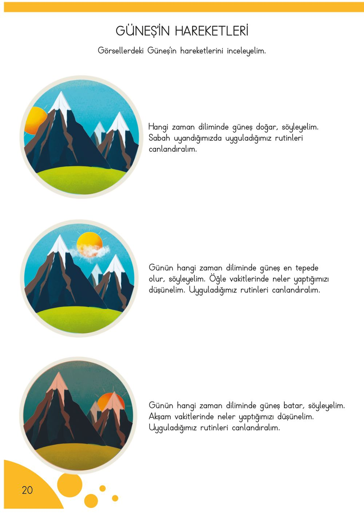 Hangi zaman diliminde güneş doğar, söyleyelim. Sabah uyandığımızda uyguladığımız rutinleri canlandıralım.

 Günün hangi zaman diliminde güneş en tepede olur, söyleyelim. Öğle vakitlerinde neler yaptığımızı düşünelim. Uyguladığımız rutinleri canlandıralım.

 Günün hangi zaman diliminde güneş batar, söyleyelim. Akşam vakitlerinde neler yaptığımızı düşünelim. Uyguladığımız rutinleri canlandıralım.

<!-- sayfa 20 -->

# SES OYUNU

Dizeklerde notalar yerine farklı sesler üretmemizi sağlayacak görseller var. Görselleri inceleyelim. Her dizekte yer alan görsele uygun sesleri çıkarmayı deneyelim.

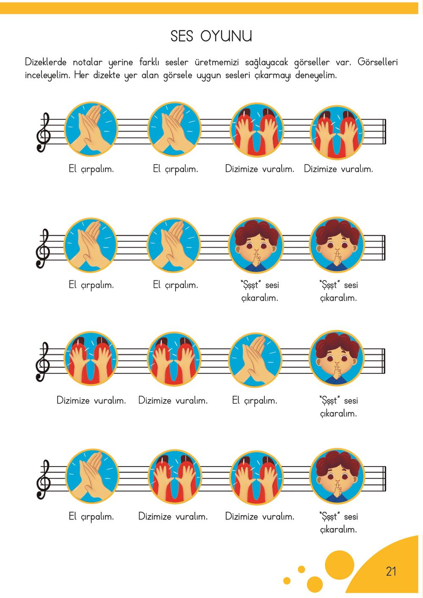
El çırpalım. El çırpalım. Dizimize vuralım. Dizimize vuralım.

El çırpalım. El çırpalım. “Şşşt” sesi çıkaralım. “Şşşt” sesi çıkaralım.

Dizimize vuralım. Dizimize vuralım. El çırpalım. “Şşşt” sesi çıkaralım.

El çırpalım. Dizimize vuralım. Dizimize vuralım. “Şşşt” sesi çıkaralım.

<!-- sayfa 21 -->

# FOTOĞRAFÇI

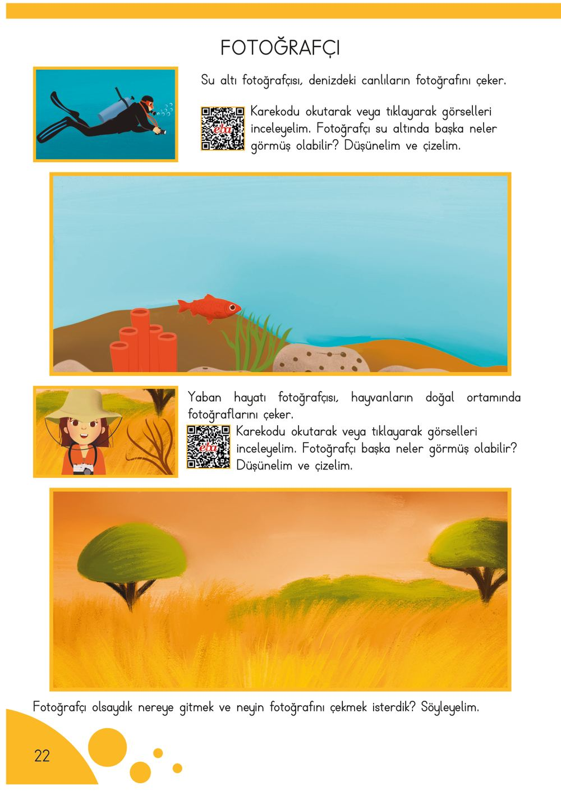 Su altı fotoğrafçısı, denizdeki canlıların fotoğrafını çeker.

 Karekodu okutarak veya tıklayarak görselleri inceleyelim. Fotoğrafçı su altında başka neler görmüş olabilir? Düşünelim ve çizelim.

 Yaban hayatı fotoğrafçısı, hayvanların doğal ortamında fotoğraflarını çeker.

 Karekodu okutarak veya tıklayarak görselleri inceleyelim. Fotoğrafçı başka neler görmüş olabilir? Düşünelim ve çizelim.

Fotoğrafçı olsaydık nereye gitmek ve neyin fotoğrafını çekmek isterdik? Söyleyelim.

<!-- sayfa 22 -->

# ATATÜRKÜN KİTAP SEVGİSİ

Mustafa Kemal Atatürk, kitap okumayı çok severdi. Atatürk’ün kitap incelerken çekilen fotoğraflarını inceleyelim.

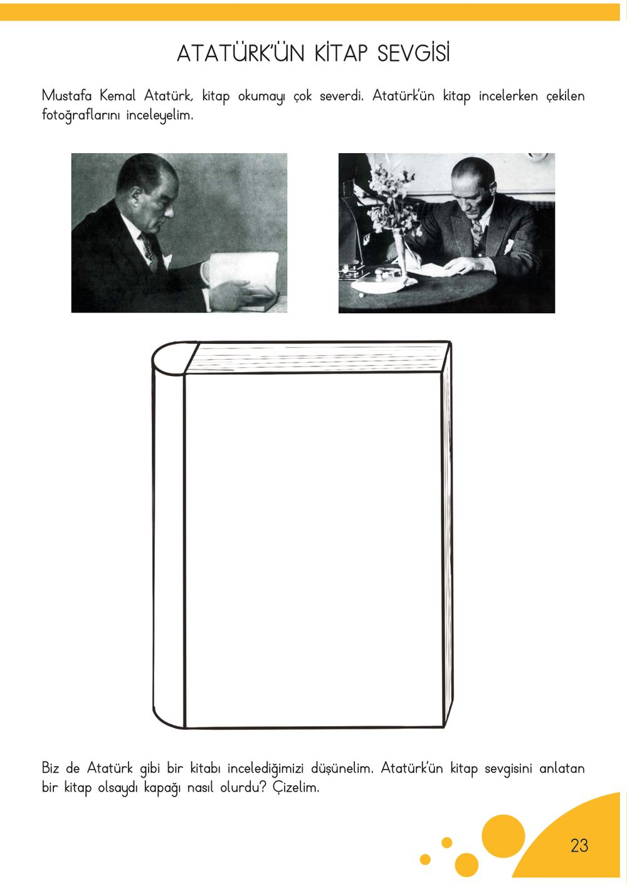

Biz de Atatürk gibi bir kitabı incelediğimizi düşünelim. Atatürk’ün kitap sevgisini anlatan bir kitap olsaydı kapağı nasıl olurdu? Çizelim.

<!-- sayfa 23 -->

# SEPET ÖRÜYORUM

Ülkemizde birçok yörede uzun yıllardır sepet üretilmektedir. Sepetler genellikle saz, kamış veya buna benzer ince dallar kullanılarak örülmektedir.

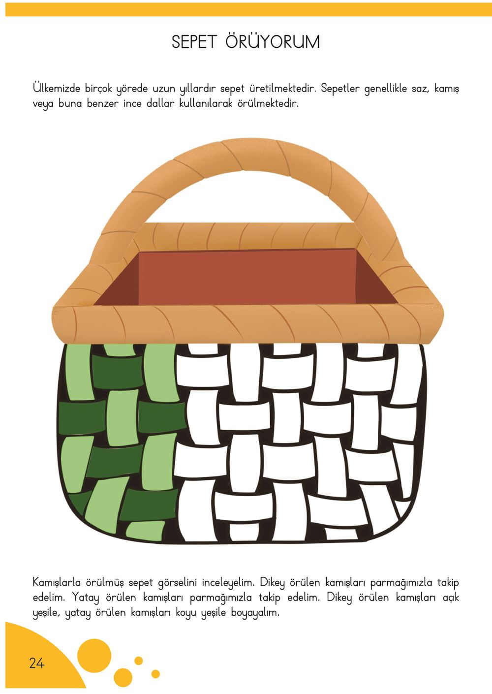

Kamışlarla örülmüş sepet görselini inceleyelim. Dikey örülen kamışları parmağımızla takip edelim. Yatay örülen kamışları parmağımızla takip edelim. Dikey örülen kamışları açık yeşile, yatay örülen kamışları koyu yeşile boyayalım.

<!-- sayfa 24 -->

# AYÇİÇEĞİ TARLASI

Ayçiçeği ülkemizde en çok üretilen tarım ürünlerinden biridir. Ayçiçeğinden yağ ve çekirdek elde edilir.

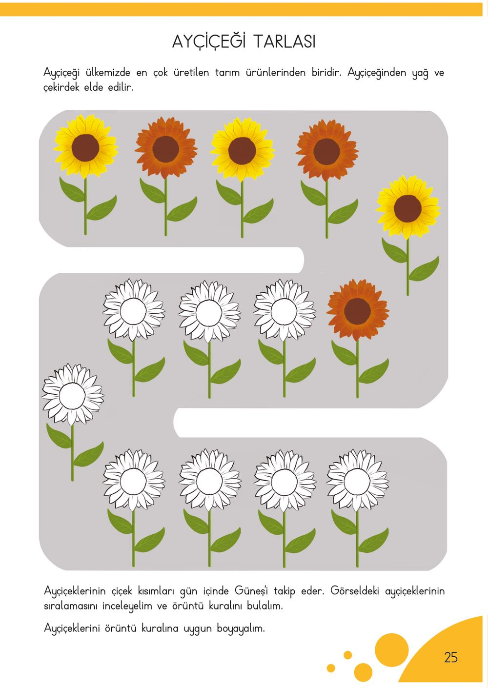

Ayçiçeklerinin çiçek kısımları gün içinde Güneş’i takip eder. Görseldeki ayçiçeklerinin sıralamasını inceleyelim ve örüntü kuralını bulalım.

<!-- sayfa 25 -->

# KUŞLAR VE GAGALARI

Kuşların özelliklerini dinleyelim.

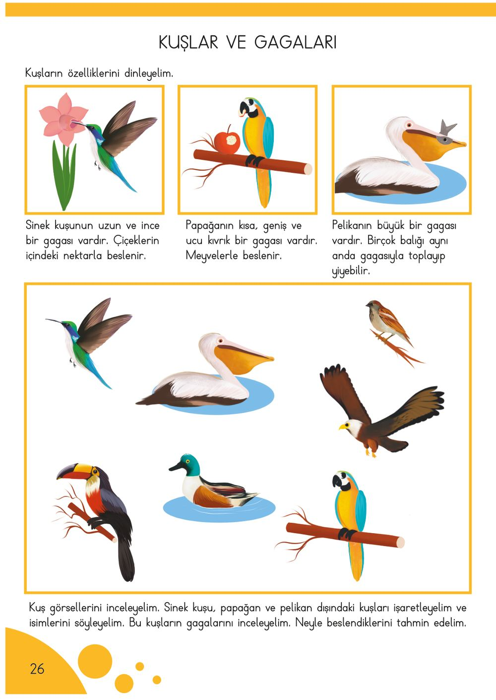
Sinek kuşunun uzun ve ince bir gagası vardır. Çiçeklerin içindeki nektarla beslenir.

Papağanın kısa, geniş ve ucu kıvrık bir gagası vardır. Meyvelerle beslenir.

Pelikanın büyük bir gagası vardır. Birçok balığı aynı anda gagasıyla toplayıp yiyebilir.

Kuş görsellerini inceleyelim. Sinek kuşu, papağan ve pelikan dışındaki kuşları işaretleyelim ve isimlerini söyleyelim. Bu kuşların gagalarını inceleyelim. Neyle beslendiklerini tahmin edelim.

<!-- sayfa 26 -->

# 7 RAKAMINI ÖĞRENİYORUM

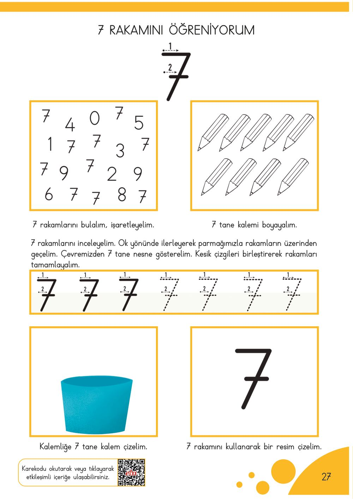

7 rakamlarını bulalım, işaretleyelim.
7 tane kalemi boyayalım.

7 rakamlarını inceleyelim. Ok yönünde ilerleyerek parmağımızla rakamların üzerinden geçelim. Çevremizden 7 tane nesne gösterelim. Kesik çizgileri birleştirerek rakamları tamamlayalım.

Kalemliğe 7 tane kalem çizelim.
7 rakamını kullanarak bir resim çizelim.

<!-- sayfa 27 -->

# NOTALAR

Müzikte sesleri belirtmeye yarayan işaretlere nota denir. Yedi tane nota bulunmaktadır. Görseli inceleyelim. Notaları yedişerli gruplayalım.

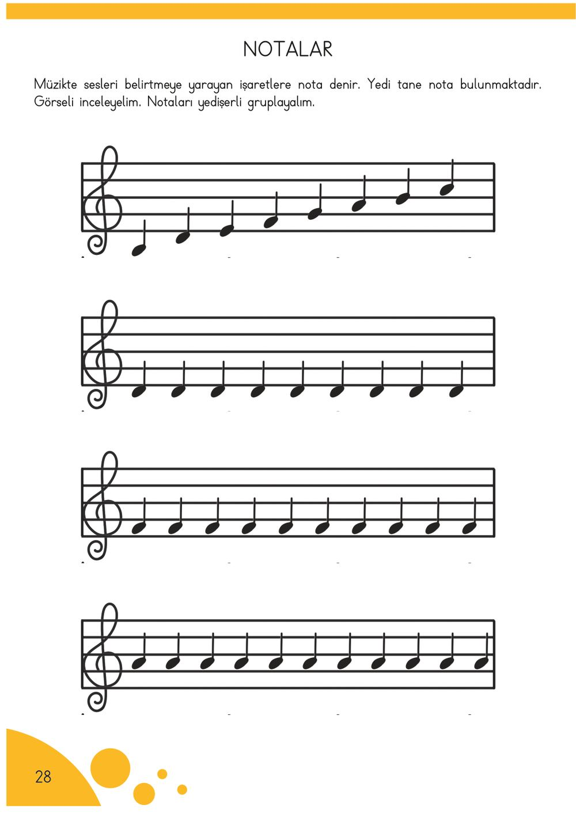

<!-- sayfa 28 -->

# ZEYTİNLERİ SAYALIM

Hasat günü zeytinler ağaçtan silkelenerek toplanır. Toplanan zeytinlerin bir kısmı fabrikaya gönderilir. Zeytinlerden zeytinyağı elde edilir. Bir kısmı ile de sofralık zeytin yapılır.

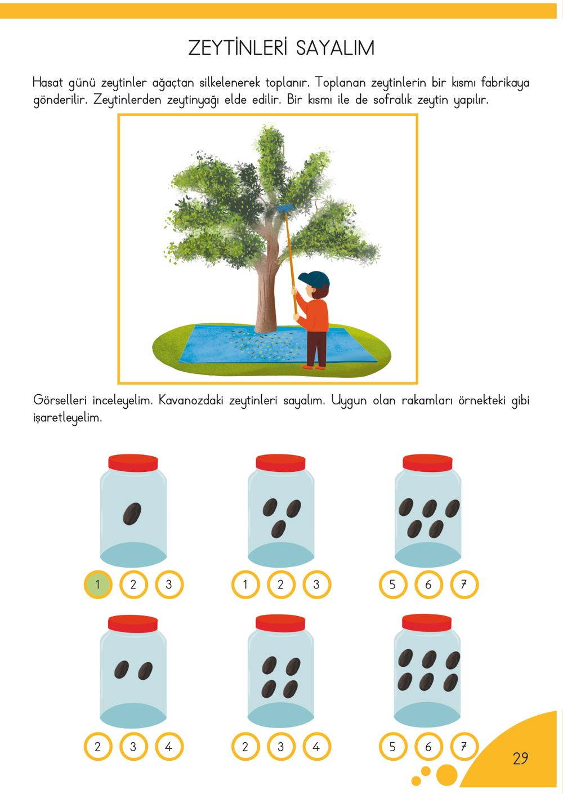

Görselleri inceleyelim. Kavanozdaki zeytinleri sayalım. Uygun olan rakamları örnekteki gibi işaretleyelim.

<!-- sayfa 29 -->

# EŞSİZ PARMAK İZLERİ

Her insanın parmak izi farklıdır. Aşağıdaki parmak izlerini inceleyelim.

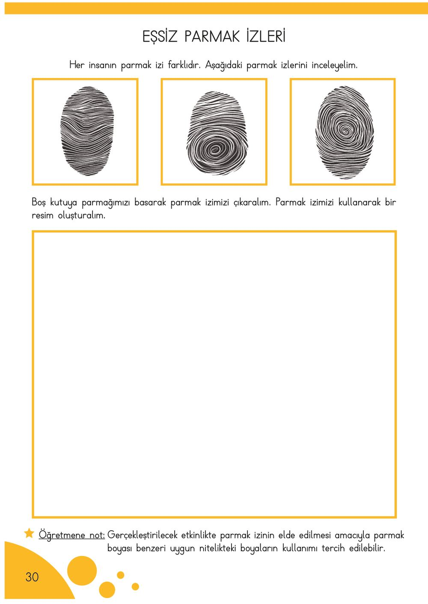

Boş kutuya parmağımızı basarak parmak izimizi çıkaralım. Parmak izimizi kullanarak bir resim oluşturalım.

⭐ *Öğretmene not:* Gerçekleştirilecek etkinlikte parmak izinin elde edilmesi amacıyla parmak boyası benzeri uygun nitelikteki boyaların kullanımı tercih edilebilir.

<!-- sayfa 30 -->

# YÜN İPLERİ SAYALIM VE BOYAYALIM

Aybüke’nin anneannesi örgü örmek için yün ipler alacak. Tuhafiye dükkânına gitmeden önce alacağı yün iplerin rengine ve sayısına karar veriyor. Listeyi inceleyelim.

| 4 | 5 | 6 | 7 |
| :---: | :---: | :---: | :---: |
| 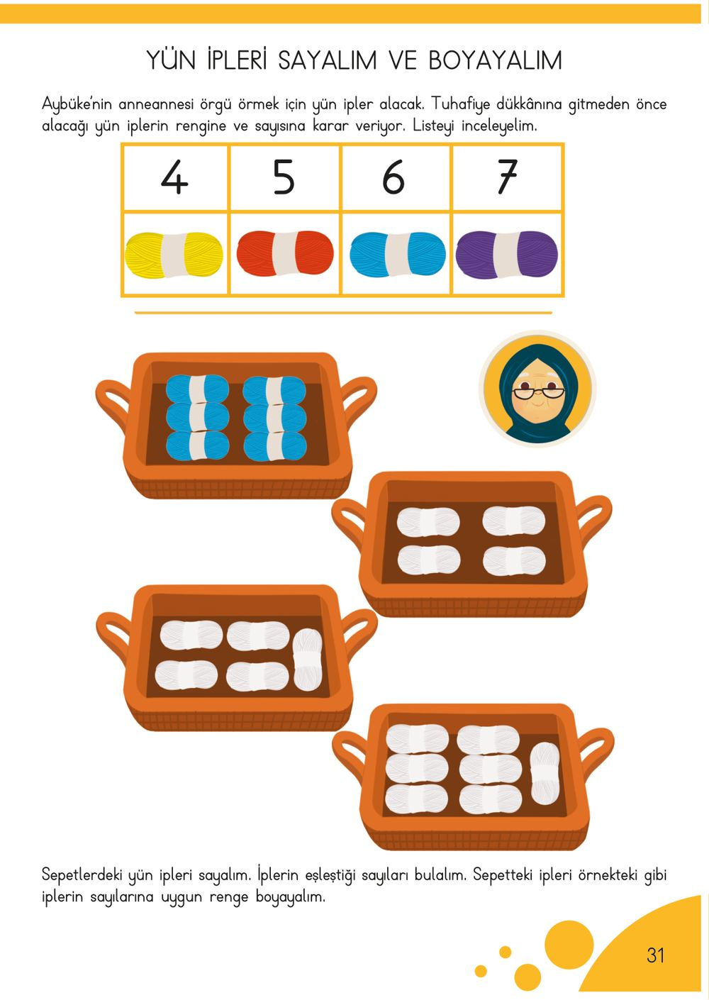 |  |  |  |

Sepetlerdeki yün ipleri sayalım. İplerin eşleştiği sayıları bulalım. Sepetteki ipleri örnekteki gibi iplerin sayılarına uygun renge boyayalım.

<!-- sayfa 31 -->

# NAZİK KELEBEK

| | |
| :--- | :--- |
| ![Turuncu Kutu] Teşekkür ederim. | ![Mavi Kutu] Geçmiş olsun. |
| ![Sarı Kutu] Hoşça kal. | ![Yeşil Kutu] Özür dilerim. |

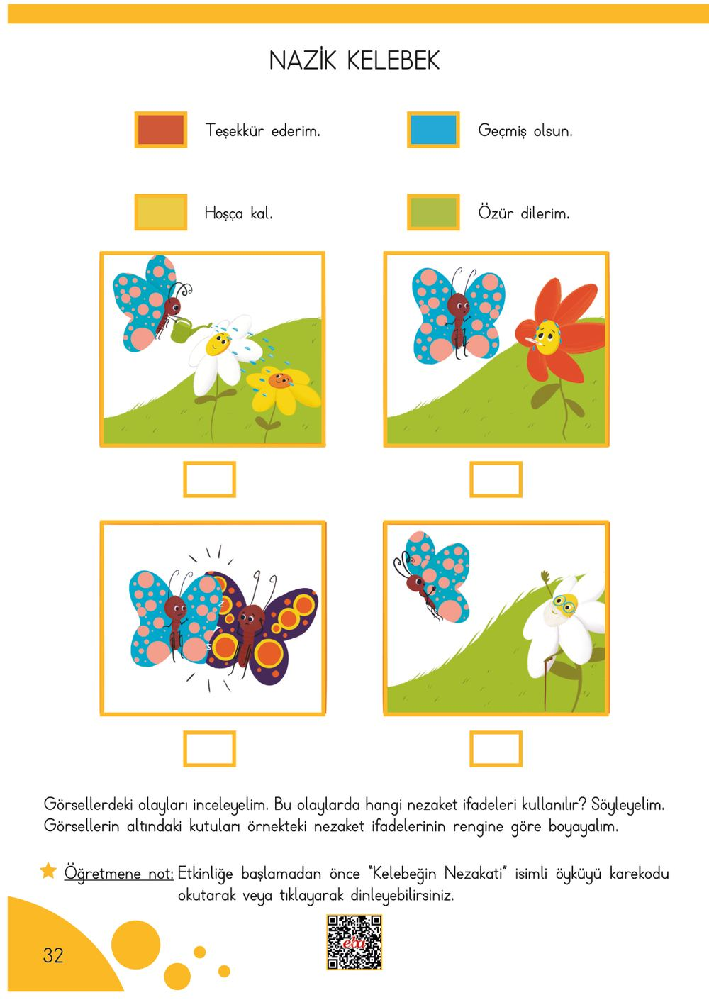

Görsellerdeki olayları inceleyelim. Bu olaylarda hangi nezaket ifadeleri kullanılır? Söyleyelim.
Görsellerin altındaki kutuları örnekteki nezaket ifadelerinin rengine göre boyayalım.

⭐ **Öğretmene not:** Etkinliğe başlamadan önce "Kelebeğin Nezaketi" isimli öyküyü karekodu okutarak veya tıklayarak dinleyebilirsiniz.

<!-- sayfa 32 -->

# HAFTANIN GÜNLERİ

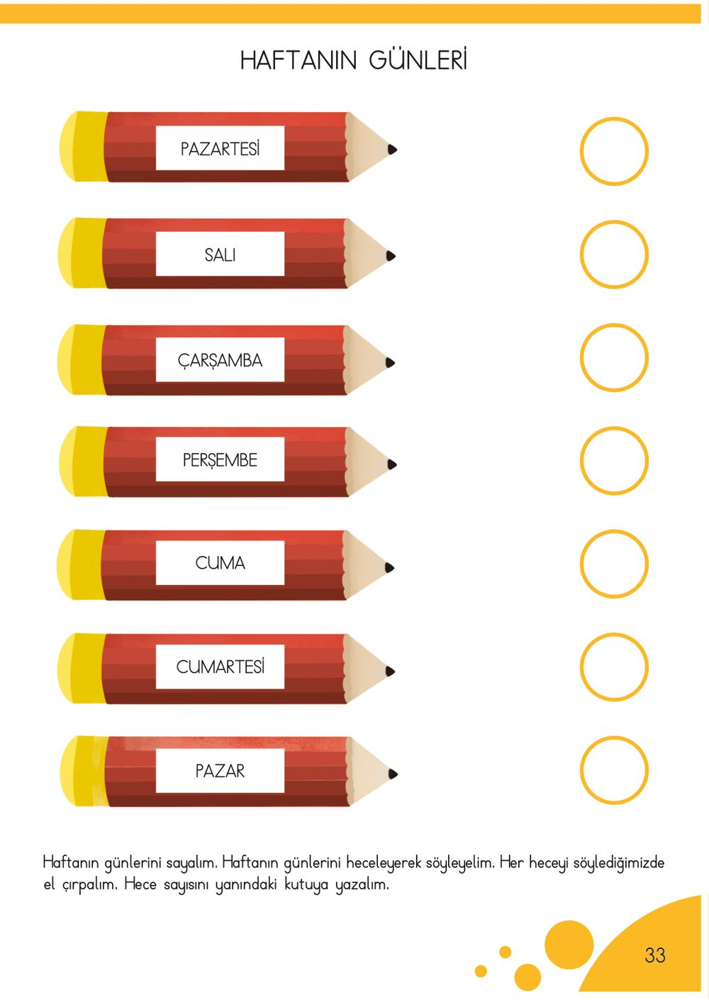 PAZARTESİ ○
 SALI ○
 ÇARŞAMBA ○
 PERŞEMBE ○
 CUMA ○
 CUMARTESİ ○
 PAZAR ○

Haftanın günlerini sayalım. Haftanın günlerini heceleyerek söyleyelim. Her heceyi söylediğimizde el çırpalım. Hece sayısını yanındaki kutuya yazalım.

<!-- sayfa 33 -->

# KUKLA

İpli kukla, hareket etme özelliği en fazla olan kukla çeşididir. Kukla, hareket etmesi istenen bölümlerine bağlanan iplerle oynatılır. Görseli inceleyelim. İplerin bağlı olduğu beden bölümlerini söyleyelim.

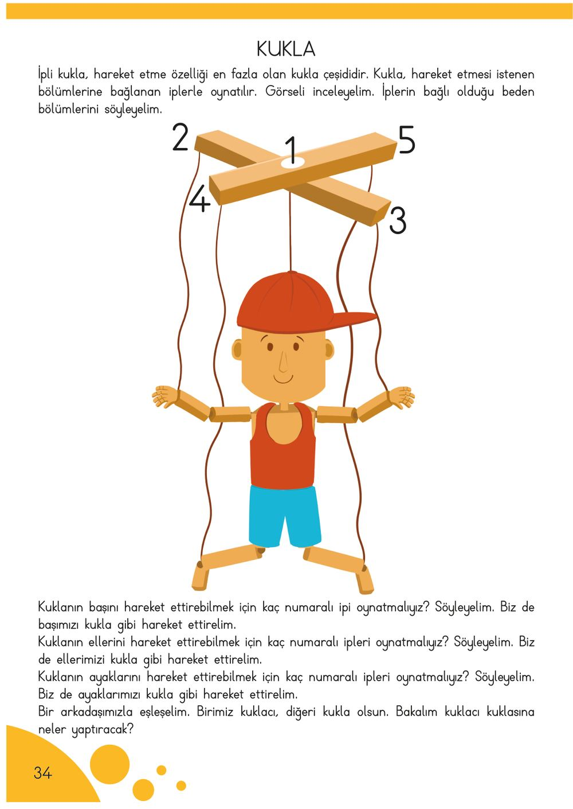

Kuklanın başını hareket ettirebilmek için kaç numaralı ipi oynatmalıyız? Söyleyelim. Biz de başımızı kukla gibi hareket ettirelim.

Kuklanın ellerini hareket ettirebilmek için kaç numaralı ipleri oynatmalıyız? Söyleyelim. Biz de ellerimizi kukla gibi hareket ettirelim.

Kuklanın ayaklarını hareket ettirebilmek için kaç numaralı ipleri oynatmalıyız? Söyleyelim. Biz de ayaklarımızı kukla gibi hareket ettirelim.

Bir arkadaşımızla eşleşelim. Birimiz kuklacı, diğeri kukla olsun. Bakalım kuklacı kuklasına neler yaptıracak?

<!-- sayfa 34 -->

# UYAKLI SÖZCÜKLER

Sayfadaki görsellerin isimlerini söyleyelim. Söylenişi birbirine benzeyen sözcükleri bulalım. Söylenişi benzeyen sözcüklere uyaklı sözcükler denir. Uyaklı sözcüklerin görsellerini çizgi çizerek eşleştirelim.

| TENCERE | FINDIK | ÇAMUR |
| :---: | :---: | :---: |
| 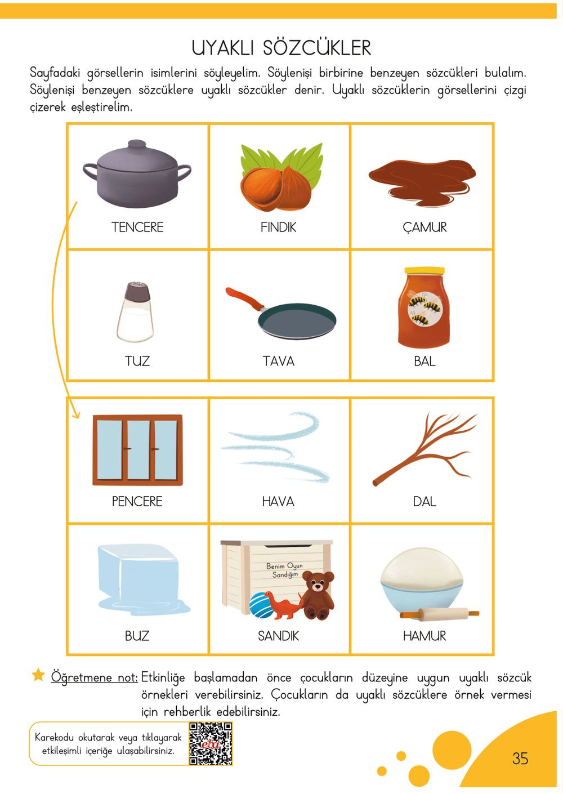 |  |  |
| TENCERE | FINDIK | ÇAMUR |

| TUZ | TAVA | BAL |
| :---: | :---: | :---: |
|  |  |  |
| TUZ | TAVA | BAL |

| PENCERE | HAVA | DAL |
| :---: | :---: | :---: |
|  |  |  |
| PENCERE | HAVA | DAL |

| BUZ | SANDIK | HAMUR |
| :---: | :---: | :---: |
|  |  |  |
| BUZ | SANDIK | HAMUR |

⭐ **Öğretmene not:** Etkinliğe başlamadan önce çocukların düzeyine uygun uyaklı sözcük örnekleri verebilirsiniz. Çocukların da uyaklı sözcüklere örnek vermesi için rehberlik edebilirsiniz.

<!-- sayfa 35 -->

# DUYGULARIMI PAYLAŞMAYA İHTİYACIM VAR

Bazen bizi üzen olaylar yaşarız. Böyle durumlarda duygularımızı ailemizle paylaşırız. Duygularımızı ailemizden kiminle paylaşabildiğimizi söyleyelim. Nedenini anlatalım. Duygularımızı paylaşmak istediğimiz kişi ya da kişilerin görsellerinin altındaki kutucukları işaretleyelim.

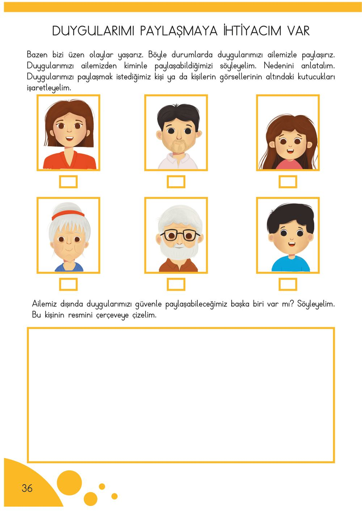

Ailemiz dışında duygularımızı güvenle paylaşabileceğimiz başka biri var mı? Söyleyelim. Bu kişinin resmini çerçeveye çizelim.

<!-- sayfa 36 -->

# VİTRAY SANATI

Vitray sanatı farklı renklerdeki camların bir araya getirilmesiyle oluşur. Gün ışığı bu camlardan içeriye girdiğinde rengarenk bir ışık yayılır. Görseldeki cami pencerelerini inceleyelim. Pencereleri vitray ile süslenmiş bir camiyi daha önce gördük mü? Söyleyelim. Vitray sanatı başka nerelerde kullanılır? Ailemizle araştıralım.

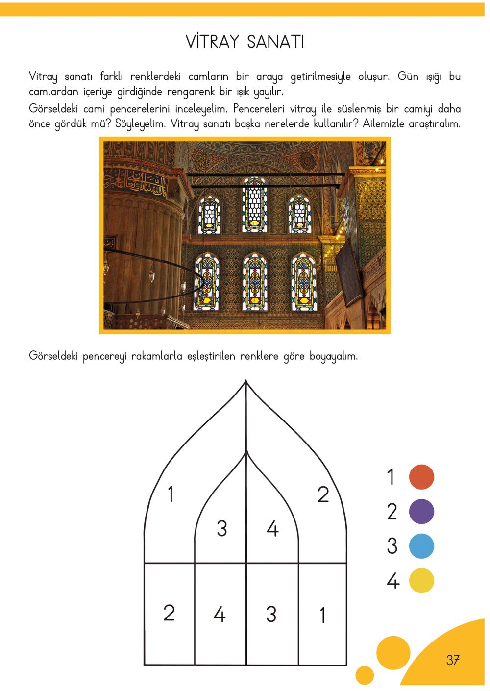

Görseldeki pencereyi rakamlarla eşleştirilen renklere göre boyayalım.

<!-- sayfa 37 -->

# GEÇMİŞTE KULLANILAN EŞYALAR

Deren, tatilde dedesinin köy evini ziyaret etmiş. Burada daha önce görmediği bazı eşyalar dikkatini çekmiş. Dedesi Deren’e bu eşyaların isimlerini söylemiş, nasıl ve ne amaçla kullanıldığını anlatmış.

Köy evindeki eşyaları inceleyelim. Gördüklerimizi anlatalım.

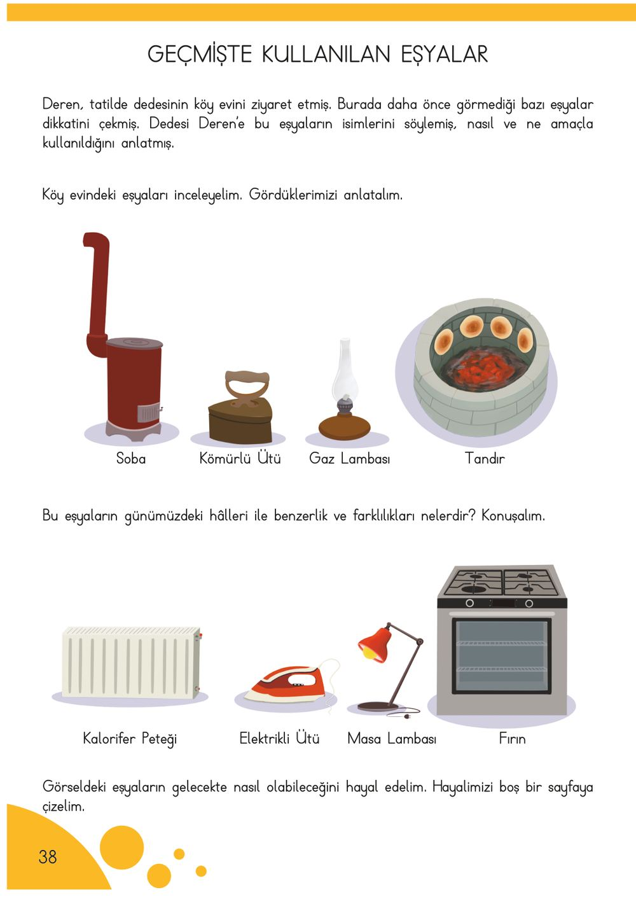
Soba
Kömürlü Ütü
Gaz Lambası
Tandır

Bu eşyaların günümüzdeki hâlleri ile benzerlik ve farklılıkları nelerdir? Konuşalım.

Kalorifer Peteği
Elektrikli Ütü
Masa Lambası
Fırın

Görseldeki eşyaların gelecekte nasıl olabileceğini hayal edelim. Hayalimizi boş bir sayfaya çizelim.

<!-- sayfa 38 -->

# RENKLİ ÇÖMLEKLER

Ana renklerin karışımından oluşan ara renkleri inceleyelim.

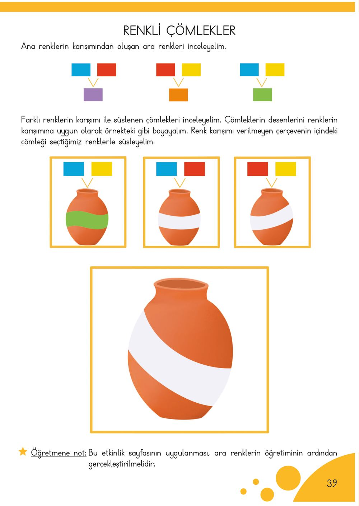

Farklı renklerin karışımı ile süslenen çömlekleri inceleyelim. Çömleklerin desenlerini renklerin karışımına uygun olarak örnekteki gibi boyayalım. Renk karışımı verilmeyen çerçevenin içindeki çömleği seçtiğimiz renklerle süsleyelim.

⭐ Öğretmene not: Bu etkinlik sayfasının uygulanması, ara renklerin öğretiminin ardından

<!-- sayfa 39 -->

Kaç tane kuş evi var? Söyleyelim. İçinde kuş olan evi gösterelim. Kuş evleri neden ağaçlara asılmış olabilir? Söyleyelim.

Kardan adam yapan çocuk, kardan adamın şapkasını bulamıyor. Kardan adamın şapkasını bulalım.

Kartopu yapan çocukları bulalım. Kaç tane kartopu yaptıklarını sayalım.

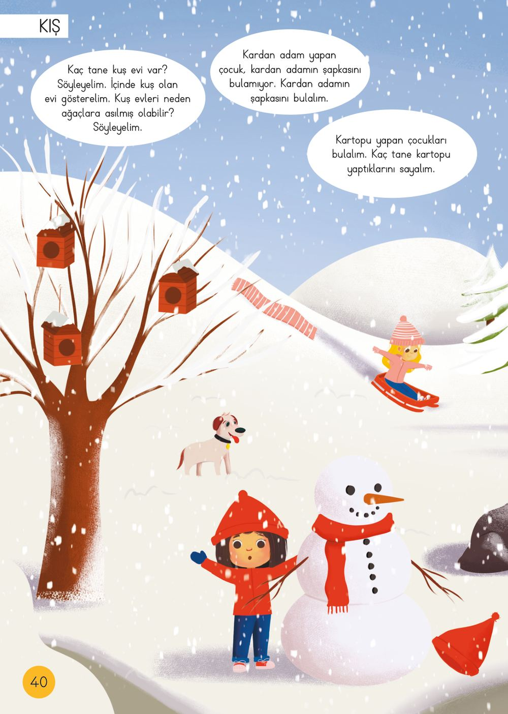

<!-- sayfa 40 -->

Kızakla kayan çocuğu gösterelim. Çocuğun kızakla kayarken düşürdüğü atkıyı bulalım.

Kartopu oynayan çocuklardan birinin eldiveni yok. Eldivenini nerede düşürmüş olabilir? Bulalım.

Ağaca tırmanan sincap nerede? Gösterelim. Sincabın yuvasına ne taşıdığını tahmin edelim.

Resimde kuş evleri dışında diğer hayvanların soğuktan korunmak için kullanabileceği neler var? Gösterelim.

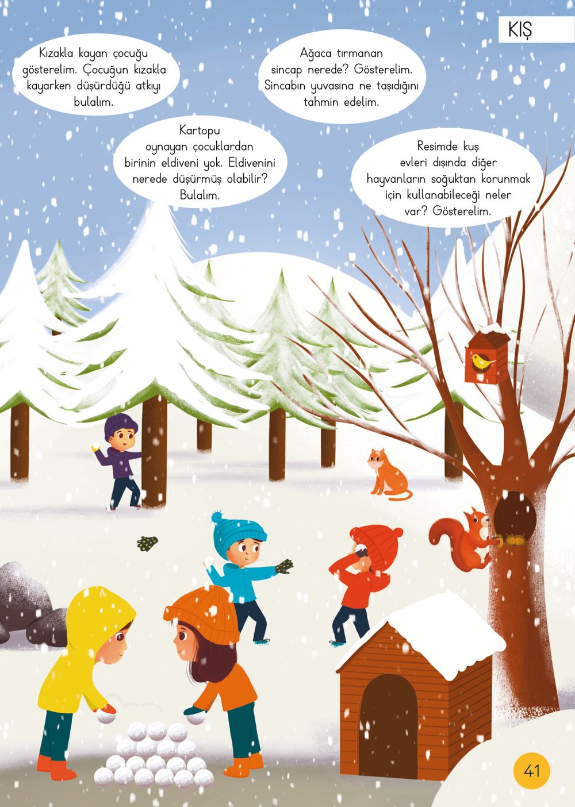

<!-- sayfa 41 -->

# RENK RENK ŞEKİLLER

Şeritin içindeki şekilleri ve renklerini inceleyelim. İncelediğimiz şekillerin ismini ve renklerini söyleyelim.

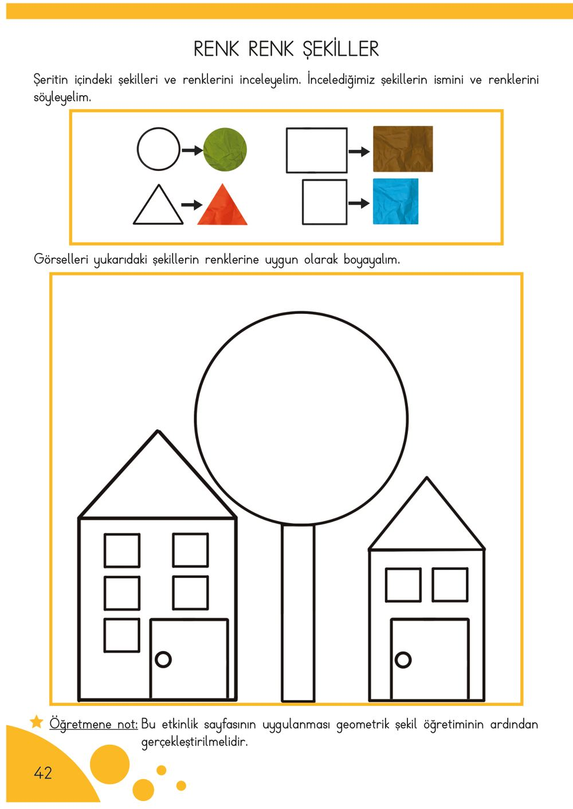

Görselleri yukarıdaki şekillerin renklerine uygun olarak boyayalım.

⭐ Öğretmene not: Bu etkinlik sayfasının uygulanması geometrik şekil öğretiminin ardından

<!-- sayfa 42 -->

# 8 RAKAMINI ÖĞRENİYORUM

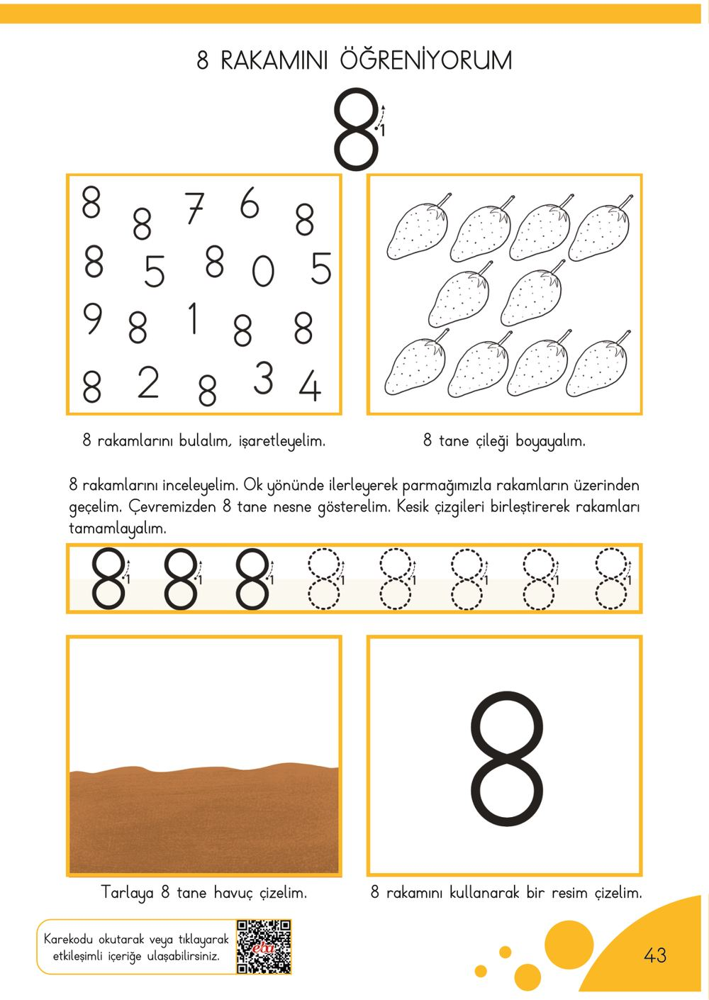

8 rakamlarını bulalım, işaretleyelim.

8 tane çileği boyayalım.

8 rakamlarını inceleyelim. Ok yönünde ilerleyerek parmağımızla rakamların üzerinden geçelim. Çevremizden 8 tane nesne gösterelim. Kesik çizgileri birleştirerek rakamları tamamlayalım.

Tarlaya 8 tane havuç çizelim.

8 rakamını kullanarak bir resim çizelim.

<!-- sayfa 43 -->

# AHTAPOTUN KOLLARI

Ahtapotların 8 kolu vardır. Görselleri inceleyelim. Ahtapotların kollarını sekizerli gruplayalım.

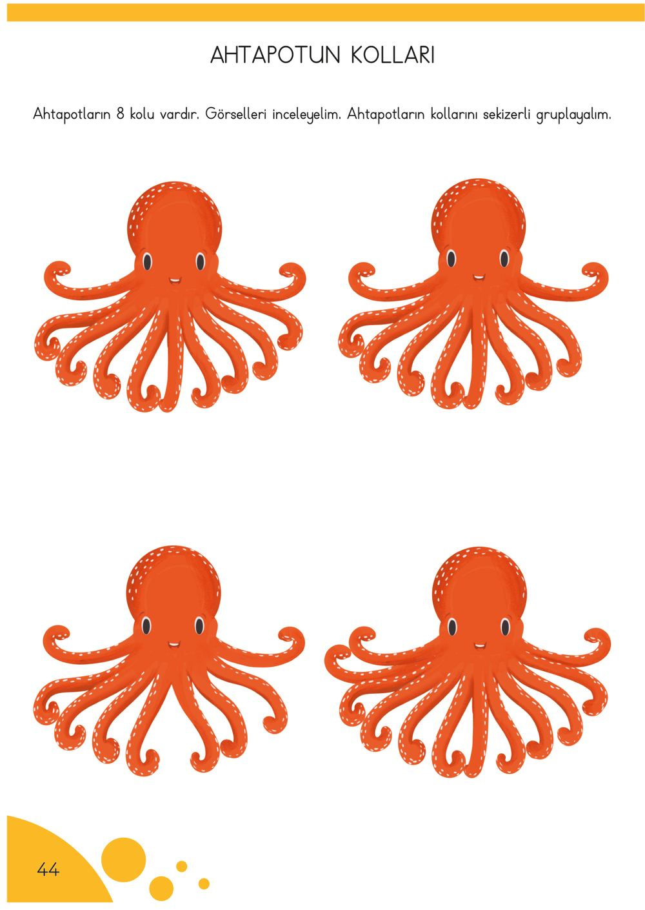

<!-- sayfa 44 -->

# SAKİNLEŞME YÖNTEMLERİM

Yoğun duygular yaşadığımız anlarda sakinleşmek için bazı yöntemler deneriz. Görselleri inceleyelim.

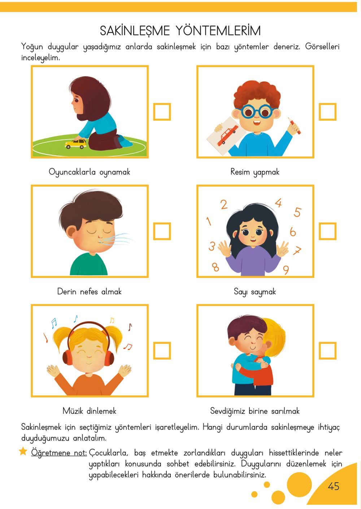
Oyuncaklarla oynamak ☐

Resim yapmak ☐

Derin nefes almak ☐

Sayı saymak ☐

Müzik dinlemek ☐

Sevdiğimiz birine sarılmak ☐

Sakinleşmek için seçtiğimiz yöntemleri işaretleyelim. Hangi durumlarda sakinleşmeye ihtiyaç duyduğumuzu anlatalım.

⭐ **Öğretmene not:** Çocuklarla, baş etmekte zorlandıkları duyguları hissettiklerinde neler yaptıklarını konuşabilir, duygularını düzenlemek için neler düşünebileceklerini konuşabilirsiniz.

<!-- sayfa 45 -->

# UÇAMAYAN KUŞ TÜRLERİ

Farklı kuş türlerinin bulunduğu görselleri inceleyelim. Kuş türlerinin isimlerini söyleyelim. Penguen, deve kuşu ve kivi kuşu uçamayan kuş türlerindendir. Uçan kuş türlerine örnek verelim.

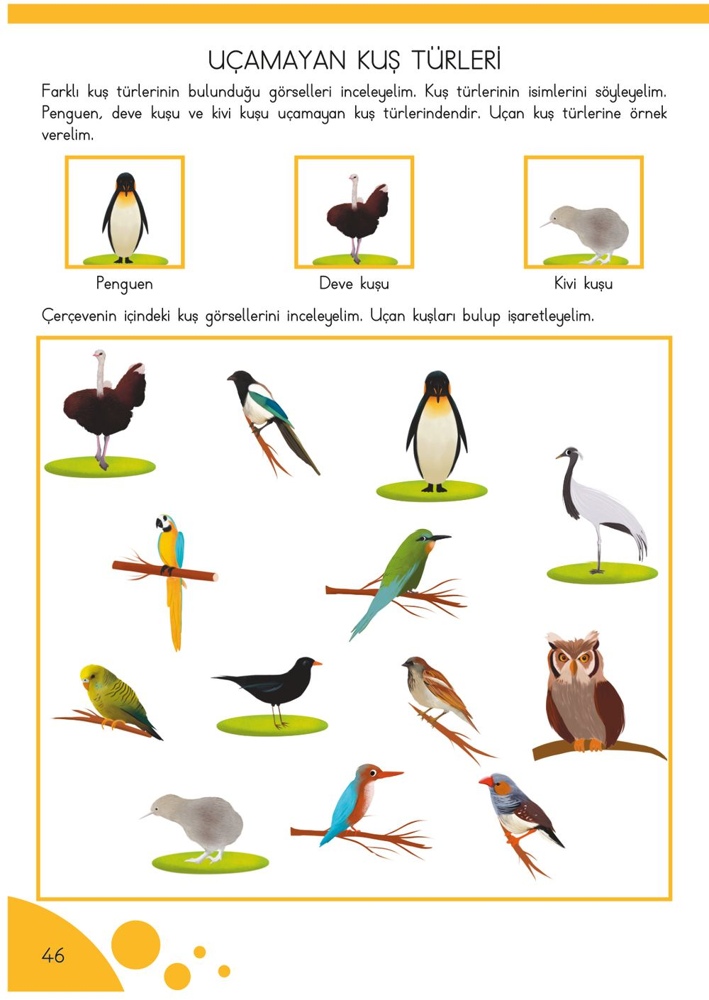
Penguen

Deve kuşu

Kivi kuşu

Çerçevenin içindeki kuş görsellerini inceleyelim. Uçan kuşları bulup işaretleyelim.

<!-- sayfa 46 -->

# DOSTLUK

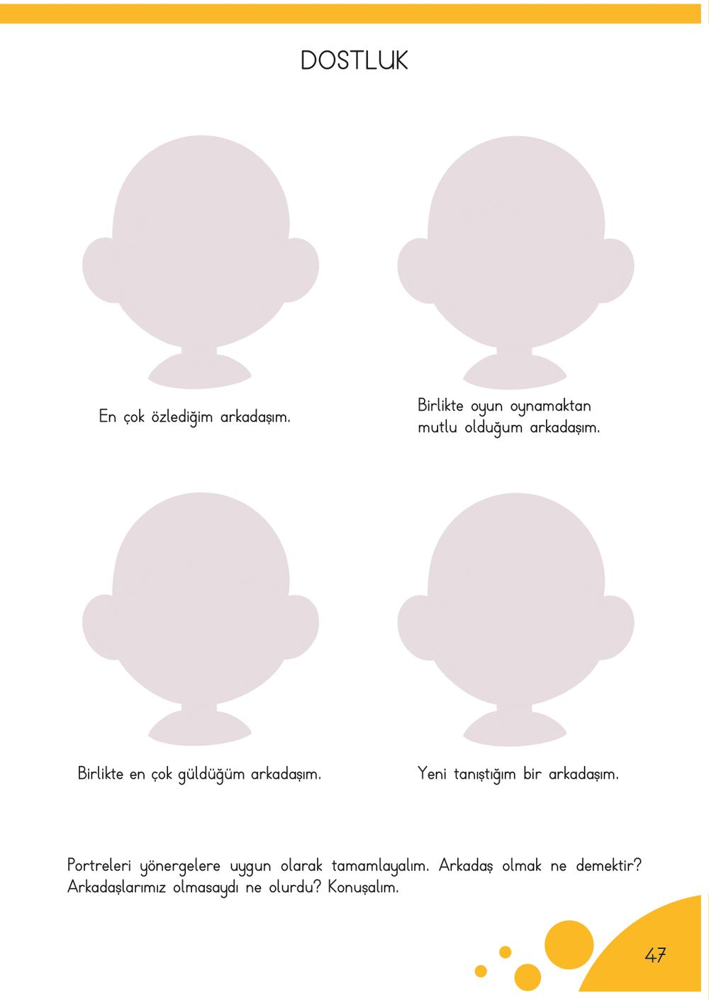
En çok özlediğim arkadaşım.

Birlikte oyun oynamaktan mutlu olduğum arkadaşım.

Birlikte en çok güldüğüm arkadaşım.

Yeni tanıştığım bir arkadaşım.

Portreleri yönergelere uygun olarak tamamlayalım. Arkadaş olmak ne demektir? Arkadaşlarımız olmasaydı ne olurdu? Konuşalım.

<!-- sayfa 47 -->

# YAŞASIN, ÇOCUK HAKLARI!

Çocuk hakları kavramını daha önce duyduk mu? Söyleyelim. Çocukların hakları nelerdir? Görselleri inceleyelim ve görsellere bakarak çocukların hangi hakları olduğunu anlatalım.

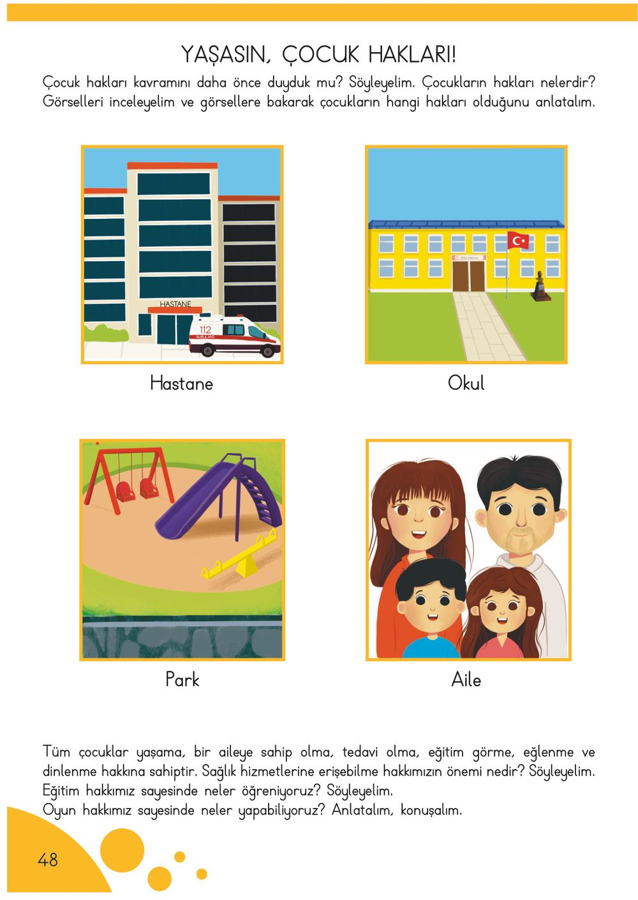
Hastane

Okul

Park

Aile

Tüm çocuklar yaşama, bir aileye sahip olma, tedavi olma, eğitim görme, eğlenme ve dinlenme hakkına sahiptir. Sağlık hizmetlerine erişebilme hakkımızın önemi nedir? Söyleyelim. Eğitim hakkımız sayesinde neler öğreniyoruz? Söyleyelim. Oyun hakkımız sayesinde neler yapabiliyoruz? Anlatalım, konuşalım.

<!-- sayfa 48 -->

# TEŞEKKÜRLER ÖĞRETMENİM

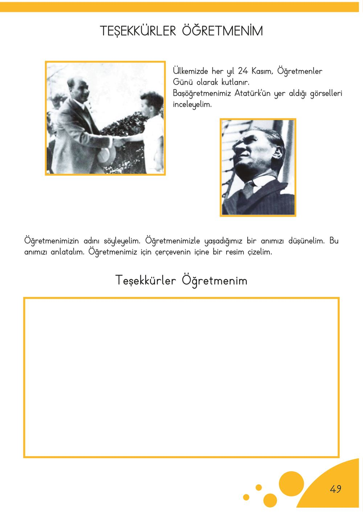 Ülkemizde her yıl 24 Kasım, Öğretmenler Günü olarak kutlanır. Başöğretmenimiz Atatürk’ün yer aldığı görselleri inceleyelim.

Öğretmenimizin adını söyleyelim. Öğretmenimizle yaşadığımız bir anımızı düşünelim. Bu anımızı anlatalım. Öğretmenimiz için çerçevenin içine bir resim çizelim.

## Teşekkürler Öğretmenim

<!-- sayfa 49 -->

# DEFNENİN RESİMLERİ

Defne resim yapmayı çok seviyor. Yaptığı resimleri duvara asıyor. Resimleri inceleyelim. Her resimde kaç tane çiçek var sayalım. Kutunun içine çiçek sayısı kadar çizgi çizelim. Resimleri boyayalım.

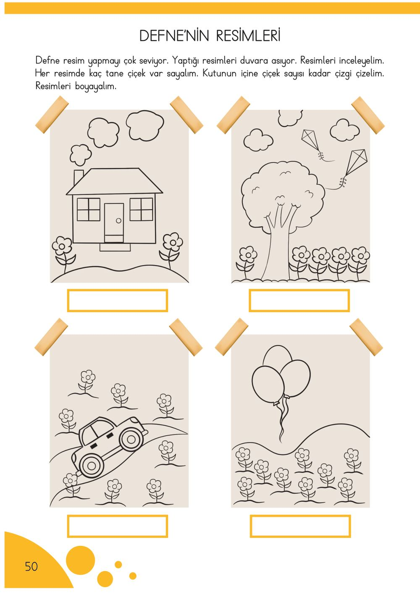

<!-- sayfa 50 -->

# DOĞADAKİ UYAK

Görsellerin isimlerini söyleyelim. Her sırada uyaklı sözcükleri bulup altındaki kutucukları aynı renge boyayalım.

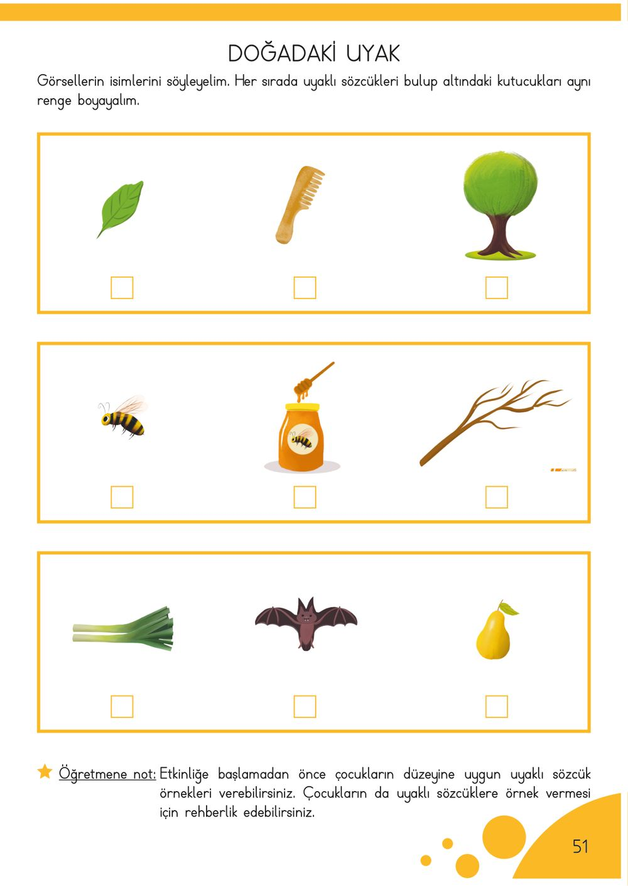

⭐ <u>Öğretmene not:</u> Etkinliğe başlamadan önce çocukların düzeyine uygun uyaklı sözcük örnekleri verebilirsiniz. Çocukların da uyaklı sözcüklere örnek vermesi

<!-- sayfa 51 -->

# 9 RAKAMINI ÖĞRENİYORUM

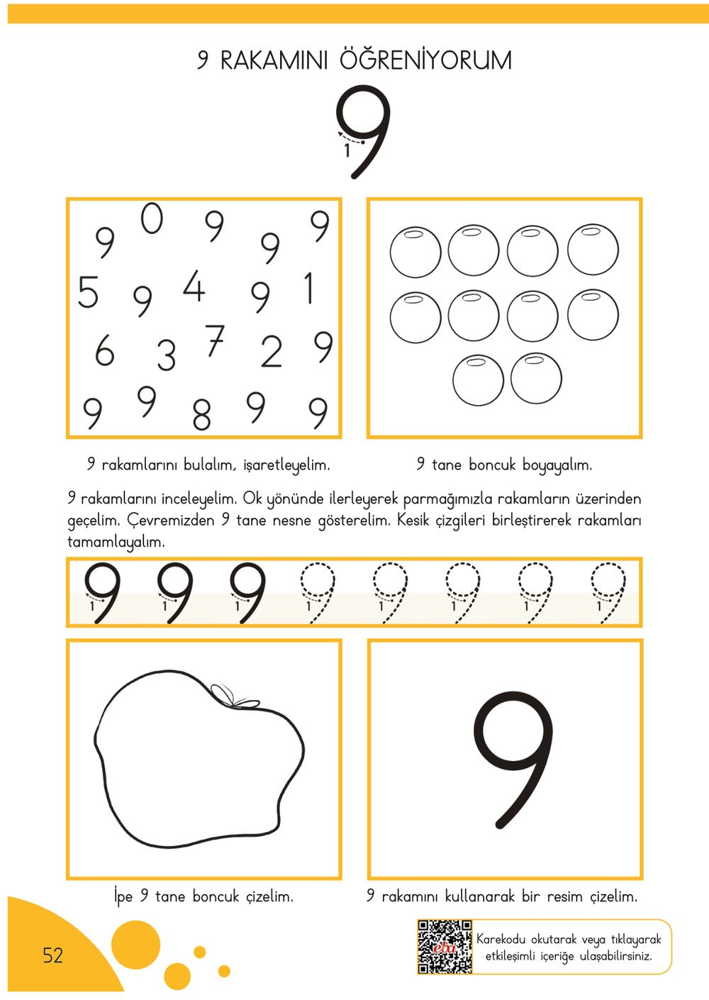

9 rakamlarını bulalım, işaretleyelim.

9 tane boncuk boyayalım.

9 rakamlarını inceleyelim. Ok yönünde ilerleyerek parmağımızla rakamların üzerinden geçelim. Çevremizden 9 tane nesne gösterelim. Kesik çizgileri birleştirerek rakamları tamamlayalım.

İpe 9 tane boncuk çizelim.

9 rakamını kullanarak bir resim çizelim.

<!-- sayfa 52 -->

# BİLEKLİK HAZIRLIYORUM

Görseldeki çocuklar kendilerine bileklik hazırlamak istiyor. Her bileklikte 9 boncuk olmalı. Görselleri inceleyelim. Boncukları sayarak dokuzarlı gruplayalım.

<!-- sayfa 53 -->

# DOKUZTAŞ OYUNU

Dokuztaş oyunu iki takımın taş ve top kullanarak oynadığı bir oyundur. Oyunda dokuz adet taş büyükten küçüğe doğru üst üste dizilir. Oyuncular sırayla top atarak taşları devirmeye çalışır.

Mert ve arkadaşları “Dokuztaş Oyunu” oynayacak.
⚫ Büyükten küçüğe doğru kaç adet taş dizmişler? Sayalım ve söyleyelim.
⚫ Alttaki bölümde en üste hangi taşların gelebileceğini bulalım ve işaretleyelim.
⚫ İşaretlediğimiz taşlardan birini çizgi çizerek taşların üstüne götürelim.

⭐ Öğretmene not: Eksik kalan bir taşın en son konulan taştan küçük olması gerektiğini unutmayalım.

<!-- sayfa 54 -->

# MAĞARA RESİMLERİ

Yazı henüz icat edilmeden çok uzun yıllar önce insanlar yaşadıkları mağaraların duvarlarına resimler çizerek iletişim kuruyordu. Görseldeki mağara resimleri ne anlatıyor olabilir? Eskiden mağaralarda resim çizmek için hangi malzemeler kullanılmış olabilir? Düşünelim, fikirlerimizi söyleyelim.

Sayfayı çevirelim ve hatırladığımız görselleri boş mağara duvarına çizelim. $\longrightarrow$ <!-- KONTROL: Marker'da karşılığı yok, uydurma olabilir -->

<!-- sayfa 55 -->

# MAĞARA RESİMLERİ

<!-- yer tutucu bulunamadı: sayfa sonuna eklendi -->

<!-- sayfa 56 -->

# KÜTÜPHANE RAFLARI

Kütüphane görevlisi rafları düzenlerken her bir rafta kitap isimlerinin aynı sesle başlamış olmasına özen göstermiştir. Raftaki kitap kapağı görsellerini inceleyelim. Kitap isimlerinin yazılışlarında ilk seslerine dikkat edelim. Her bir rafta yanlış koyulan kitabı bulup işaretleyelim.

⭐ Öğretmene not: Etkinlik sonrasında sınıfınızdaki kitaplığı belirlediğiniz özelliğe göre düzenleyebilirsiniz.

<!-- sayfa 57 -->

# DİNLE VE ÇİZGİLERİ TAKİP ET

Sağ parmağımızı kırmızı noktaya, sol parmağımızı mavi noktaya koyalım. Öyküyü dinlerken sağ ve sol parmaklarımızı aynı anda kullanarak çizgilerin üzerinden geçelim. Öykü tamamlanana kadar parmaklarımızı çizgilerin üzerinde dolaştırmaya devam edelim. Öyküdeki hayvanların isimlerini her duyduğumuzda duralım ve bu hayvanların seslerini taklit edelim.

## Bu Sabah

Her sabah gün doğumunda horozların sesi ile uyanan hayvanlar bu sabah uyuyakalmıştı. Köpeklerin havlama sesleriyle uyanan bütün hayvanlar telaşla etrafa dağıldı. Yemliklere konan kuşlar, sesleri duyunca hemen kaçtılar. Önce ördekler çıktı kümesten, sonra da tavuklar. Tüm hayvanlar çiftlikte horozları aradılar. Acaba horozlar nereye kayboldular?

⭐ <u>Öğretmene not:</u> Öykünün okunması ile çocukların sağ-sol beyin etkinliğini yapmaya başlaması sağlanır. Öykü okunurken hayvan ismi geçen yerlerde durulup çocukların o hayvanın sesini çıkarmaları beklenir. Öykü bitene kadar süreç böyle devam eder.

<!-- sayfa 58 -->

# FATMA HALANIN MİSAFİRLERİ

Fatma halanın misafirleri gelmiş. Kapının önündeki ayakkabıları sayalım. Fatma halanın kaç misafiri gelmiş? Söyleyelim. Fatma hala misafirlerini nasıl ağırlamış, onlara ne ikram etmiş olabilir? Misafirliğe gittiğimizde neler yaptığımızı, nasıl davranmamız gerektiğini anlatalım.

<!-- sayfa 59 -->

# SEÇİMLERİMİZ NEDEN FARKLI?

Bilge ve arkadaşları “365 Gün Öykü” serisinden hangi kitabın okunacağını belirlemek için sınıfta bir oylama yapmış. Grafiği inceleyelim ve hangi kitabın okunmuş olabileceğini söyleyelim.

“365 Gün Öykü” serisinde bulunan kitapların kapaklarını inceleyelim. Öğretmenimizin okuması için kitaplardan birini seçelim ve işaretleyelim.

<!-- sayfa 60 -->

# BLOKLARDAN ŞEKİLLER

Bloklarla oluşturulmuş modelleri inceleyelim. Modelleri oluşturan parçaların olduğu kutuları bulalım ve modellerle çizgi çizerek eşleştirelim.

<!-- sayfa 61 -->

# FOSİL BİLİMCİ

Fosil, yıllar önce yaşamış bitki ve hayvan kalıntılarının taşlar arasında sertleşmesiyle oluşur. 
Fosil bilimciler eskiden yaşamış canlıların kalıntılarını inceleyerek canlıların yaşamı hakkında 
bilgi edinirler. 
Görseldeki fosilleri inceleyelim ve hangi canlıya ait olabileceğini tahmin edelim. 

Her fosilin altına canlının fosilleşmeden önceki halini düşünüp çizelim. 

|  |  |  |  |  |  |  |
| :---: | :---: | :---: | :---: | :---: | :---: | :---: |
|  | | | | | | |

<!-- sayfa 62 -->

# FOSİL BİLİMCİLERİN MALZEMELERİ

Fosil bilimcilerin zamanlarının çoğu kazılarda geçer. Fosillerin zarar görmemesi için fosil bilimcilerin dikkatli çalışmaları gerekir.

Fosil bilimcilerin araştırmaları sırasında kullandıkları aletlere ve eşyalara ait görselleri inceleyelim. İsimleri söyleyelim. Şeritte verilen aletlerin sayısı kadar görseli tabloda bulup işaretleyelim.

<!-- sayfa 63 -->

# 0 RAKAMINI ÖĞRENİYORUM

Vazoda hiç çiçek yok.

Akvaryumda hiç balık yok.

0 rakamlarını inceleyelim. Ok yönünde ilerleyerek parmağımızla 0 rakamlarının üzerinden geçelim. Kesik çizgileri birleştirerek rakamları tamamlayalım.

0 rakamını kullanarak bir resim çizelim.

<!-- sayfa 64 -->

# VİTAMİN DOLU BULMACA

Zeynep ve arkadaşları okulda “Tutum, Yatırım ve Türk Malları Haftası”nı kutlamak için görev paylaşımı yaptılar. Getirdikleri meyvelerle ilgili ipuçlarını dinleyelim. Grafikte uygun yerleri örnekteki gibi boyayalım.

Benim getirdiğim meyve kırmızı renklidir.

Benim getirdiğim meyvenin içi turuncudur.

| | | | | |
| :---: | :---: | :---: | :---: | :---: |
| | 🍓 | 🍌 | 🥝 | 🍊 |
|  | 🟥 | | | |
|  | | | | |
|  | | | | |
|  | | | | |

Benim getirdiğim meyve sarı kabukludur.

Benim getirdiğim meyvenin içi yeşil, dışı kahverengidir.

<!-- sayfa 65 -->

# MOZAİKTE İSMİM VAR MI?

| | | | |
|---|---|---|---|
| | | | |

Mozaiğin parçalarının içinde olan harflere dikkat edelim. İsmimizin içinde olan harflerin olduğu parçaları boyayalım.

⭐ Öğretmene not: Etkinliğin başında bulunan çerçevenin içine çocuğun ismi büyük harflerle yazılarak çocuğun ismindeki harfleri görmesi sağlanır.

<!-- sayfa 66 -->

# FOTOĞRAF ÇERÇEVESİ TASARLIYORUM

 Birçok farklı geometrik şekilde çerçeve vardır. Örneğin Göktunç'un dedesi ve ninesiyle çektirdiği fotoğraf dikdörtgen çerçevenin içinde duruyor. Aşağıda verilen farklı şekillerden oluşan fotoğraf çerçevelerini inceleyelim. Hangi geometrik şekilleri görüyorsun? Fotoğraf çerçevelerinin içine ailemizdeki kişilerin resmini çizelim. Ardından boş alanda bulunan noktaları kullanarak farklı geometrik şekillerde fotoğraf çerçeveleri oluşturalım.

<!-- sayfa 67 -->

# KONUŞABİLİR MİYİM?

Emre ve arkadaşları müze gezisinde rehberi dikkatle dinliyorlardı. Emre eserlerle ilgili merak ettiği bir soruyu sormak için sabırsızlanıyordu. Ancak rehberin sözü daha bitmedi. Emre sorusunu sormak için rehberin konuşmasını bitirmesini sabırla bekledi. Rehberin konuşması bittikten sonra Emre söz alarak soru sormak istediğini söyledi. Rehber de Emre’ye teşekkür ederek sorusunu cevapladı.

Söz almak için izin istemezsek veya konuşma anında sıramızı beklemezsek, konuşanların sözünü kesersek ne olur? Anlatalım. Söz almak için nasıl izin istediğimizi canlandırarak ifade edelim.

<!-- sayfa 68 -->

# DOĞADAN VE ÇEVREMİZDEN SESLER

Görselleri inceleyelim. Görseldeki varlıkların çıkardığı sesi taklit etmeye çalışalım.

Doğada ve çevremizde başka hangi sesler var? Örnek verelim. Bu sesleri taklit etmeye çalışalım. Sesler arasında nasıl bir fark var? Söyleyelim.

<!-- sayfa 69 -->

# ÇİNİ BOYAMA

Çini geleneksel el sanatlarımızdan biridir. Çini vazoyu ve çini desenlerini inceleyelim. İznik çinilerinde nar, karanfil, lale gibi figürler kullanılır. Bu desenler genellikle kırmızı, mavi ve yeşil tonlarında boyanır.

Renkli çini vazo görseline bakarak yandaki vazonun desenlerini aynı renklerle boyayalım. Çevremizde çini sanatını nerelerde görürüz? Düşünelim, söyleyelim.

<!-- sayfa 70 -->

# TAVUĞUN YAŞAM DÖNGÜSÜ

Tavuğun yaşam döngüsünü anlatan görseli inceleyelim. Görselleri sayfadaki renklerine uygun boyayalım. Alttaki kodlama şeridinde, görsellerin altındaki daireleri belirlenen renklere uygun boyayalım.

<!-- sayfa 71 -->

# UĞUR BÖCEĞİ ÇİZGİ ÇALIŞMASI

Uğur böcekleri çiçeklere ulaşmak istiyor. Uğur böceklerini engellere değmeden çizerek çiçeklere ulaştıralım.

Engelleri aşmak her zaman kolay değildir. Zorluklarla karşılaştığımızda ne yapmalıyız? Kimden ya da kimlerden yardım istersin? Anlatalım.

<!-- sayfa 72 -->

# AKVARYUM

Öykü’nün evinde ailesiyle besledikleri bir balık var. Balığı her gün aileden farklı bir kişi besliyor.

Balığı besledikleri gün Öykü çizelgeyi mora, annesi turuncuya ve babası maviye boyuyor. Çizelgeyi örüntü kuralına uygun boyayalım.

| Pazartesi | Salı | Çarşamba | Perşembe | Cuma | Cumartesi | Pazar |
| :---: | :---: | :---: | :---: | :---: | :---: | :---: |
|  |  |  |  |  |  |  |
|  |  | ◯ | ◯ | ◯ | ◯ | ◯ |
| ◯ | ◯ | ◯ | ◯ | ◯ | ◯ | ◯ |

Balık besleme çizelgesine göre balığı en son kim besledi? Düşünelim, söyleyelim.
Evdeki ve okuldaki sorumluluklarımızı söyleyelim. Sorumluluklarımızı yapmadığımızda neler...

<!-- sayfa 73 -->

# ALIŞVERİŞ LİSTESİ

Emre ve ailesi alışverişe çıktılar. Alışverişe çıkmadan önce ihtiyaçlarını bir liste hazırlayarak sıraladılar.

Emre ve ailesinin ihtiyaç listesini inceleyelim. Listeye göre marketteki ürünleri seçelim ve çizgi çizerek listedekilerle eşleştirelim. Listedeki ürünlere bakarak Emre ve ailesinin yeterli ve dengeli beslenip beslenmediğine dair fikrimizi söyleyelim.

Alışverişe çıkmadan önce ihtiyaç listesi hazırlamak bilinçli tüketici olmamıza ve israftan kaçınmamıza yardımcı olur. Alışveriş listesi hazırlamak israfı nasıl önler? Düşünelim ve söyleyelim.

<!-- sayfa 74 -->

# DOĞAYI KORUYORUM

Görselleri inceleyelim, görsellerin altında yazan cümleleri dinleyelim.
Doğru davranışların yanındaki kutucuğu yeşile, yanlış davranışların yanındaki kutucuğu kırmızıya boyayalım.

Su damlatan muslukları tamir etmemek.

Dişlerimizi fırçalarken kullanacağımız suyu bardağa doldurmak.

Plastik şişeleri denize atmak.

Kullanılmış kâğıtları geri dönüşüm kutusuna atmak.

Kullanmadığımız kıyafetlerimizi yeni ürünlere dönüştürmek.

Şarj aletiyle işimiz bitince şarj aletini prizde bırakmak.

<!-- sayfa 75 -->

# HARFLERİ BULALIM VE BOYAYALIM

Hayvan görsellerini inceleyelim ve isimlerini söyleyelim. İsimlerinin yazılı olduğu alttaki kutulara dikkatlice bakalım. Doğru harfleri bulalım ve boyayalım.

<!-- sayfa 76 -->

# ÖYKÜLÜ BEDEN HAREKETLERİ

Hikâyeyi dikkatle dinleyelim. Hikâyede geçen hayvan isimlerini duyduğumuzda o hayvanın hareketini taklit eden çocuğun olduğu görsele parmağımızı koyalım. Hikâye bittikten sonra istediğimiz hayvanı taklit edelim.

---

 ve arkadaşları; , , , , gün batımında ormanın en uzun ağacının altında toplanarak sohbet ediyordu.

 vıraklayarak gölde taşların üzerinde nasıl zıpladığını gösterdi.

 yaprağın üzerinde nasıl uyuduğunu gösterdi.

 yağmur yağdığında hızlıca kabuğunun altına nasıl sığındığını gösterdi.

 arkadaşları ile mutlu olduğunu anlatırken burnuna minik bir kelebek kondu. Herkes gülmeye başladı.

<!-- sayfa 77 -->

# HANGİ ÇALGI?

Asya, dinlediği seslerin hangi çalgıya ait olduğunu bulma oyunu oynuyor. Karekodlardaki sesleri sırayla dinleyelim. Dinlediğimiz çalgının görselini bulalım. Çalgının bulunduğu kutunun içini karekodunun çerçeve renginde boyayalım.

| DAVUL | PİYANO | KAVAL | KEMAN |
| :---: | :---: | :---: | :---: |
|  |  |  |  |
| [ ] | [ ] | [ ] | [ ] |

Hangi çalgıyı dinlemekten hoşlandığımızı söyleyelim. Sesini beğendiğimiz çalgının altındaki kutucuğu işaretleyelim.

<!-- sayfa 78 -->

# YENİ YIL

Yeni yılın ilk günü 1 Ocak’tır. Takvimlerde bu günü görmek çok heyecan vericidir. Çünkü yeni bir yıl, yapmak istediklerimiz için yeni bir başlangıçtır. Sayfamızdaki duvar takvimini çeşitli desenler çizerek süsleyelim. Girdiğimiz yeni yılı takvimin üzerine yazalım. Sayfadaki diğer takvim çeşitlerinin isimlerini söyleyelim.

Görsel ve Genel Ağ Kaynakçası için

<!-- sayfa 79 -->

50°D 45°D 40°D 35°D 30°D 25°D
30°N 35°N 40°N 45°N

: Türkiye'nin mülki idare bölümleri, kara ve deniz komşularını gösteren harita.

# TÜRKİYE'NİN MÜLKİ İDARE BÖLÜMLERİ İLE KARA VE DENİZ KOMŞULARI HARİTASI

**Komşu Ülkeler ve Bölgeler:**
* ROMANYA (Bükreş)
* BULGARİSTAN (Sofya)
* GÜRCİSTAN (Tiflis)
* ERMENİSTAN (Erivan)
* NAHÇIVAN Ö.C. (AZERBAYCAN)
* İRAN
* IRAK (Bağdat)
* SURİYE (Şam)
* LÜBNAN (Beyrut)
* KUZEY KIBRIS TÜRK CUMHURİYETİ
* GÜNEY KIBRIS RUM YÖNETİMİ (Lefkoşa)
* MISIR
* İSRAİL (Tel Aviv)
* FİLİSTİN (Gazze Şeridi, Batı Şeria, Kudüs)

**Denizler ve Göller:**
* KARADENİZ
* EGE DENİZİ
* AKDENİZ
* MARMARA DENİZİ
* HAZAR DENİZİ

**Akarsular ve Göller (Harita üzerinde belirtilenler):**
* Meriç N.
* Sakarya N.
* Kızılırmak N.
* Yeşilırmak N.
* Çoruh N.
* Kura N.
* Aras N.
* Fırat N.
* Dicle N.
* Asi N.
* Seyhan N.
* Ceyhan N.
* Göksu N.
* Büyük Menderes N.
* Küçük Menderes N.
* Bakırçay N.
* Gediz N.
* Van Gölü
* Tuz Gölü
* Urumiye Gölü
* Nil N.
* Süveyş K.

**İller (Harita üzerindeki listeye göre):**
Adana, Adıyaman, Afyonkarahisar, Ağrı, Amasya, Ankara, Antalya, Artvin, Aydın, Balıkesir, Bilecik, Bingöl, Bitlis, Bolu, Burdur, Bursa, Çanakkale, Çankırı, Çorum, Denizli, Diyarbakır, Edirne, Elâzığ, Erzincan, Erzurum, Eskişehir, Gaziantep, Giresun, Gümüşhane, Hakkâri, Hatay, Isparta, Mersin, İstanbul, İzmir, Kars, Kastamonu, Kayseri, Kırklareli, Kırşehir, Kocaeli, Konya, Kütahya, Malatya, Manisa, Kahramanmaraş, Mardin, Muğla, Muş, Nevşehir, Niğde, Ordu, Rize, Sakarya, Samsun, Siirt, Sinop, Sivas, Tekirdağ, Tokat, Trabzon, Tunceli, Şanlıurfa, Uşak, Van, Yozgat, Zonguldak, Aksaray, Bayburt, Karaman, Kırıkkale, Batman, Şırnak, Bartın, Ardahan, Iğdır, Yalova, Karabük, Kilis, Osmaniye, Düzce.

**Harita Lejantı:**
* BAŞKENT (Ankara)
* İL MERKEZİ
* GÖL
* AKARSU
* ÜLKE SINIRI
* ÖZERK BÖLGE SINIRI

**Ölçek:**
0 - 100 - 200 - 300 - 400 km

Harita Genel Müdürlüğü tarafından üretilmiştir.
