# Okul Öncesi Eğitim 5 Yaş Çekirdek 3 Ders Kitabı

<!-- sayfa 0 -->

# OKUL ÖNCESİ EĞİTİM
## 5 Yaş
# Çekirdek 3
### DERS KİTABI

**Yazarlar**
Berrin TERCAN
Betül SÜREK
Esma HAYIRLIOĞLU
Ezgi AVCI AŞIR
Işıl ÖZTÜRK
Tuba Nur EROL

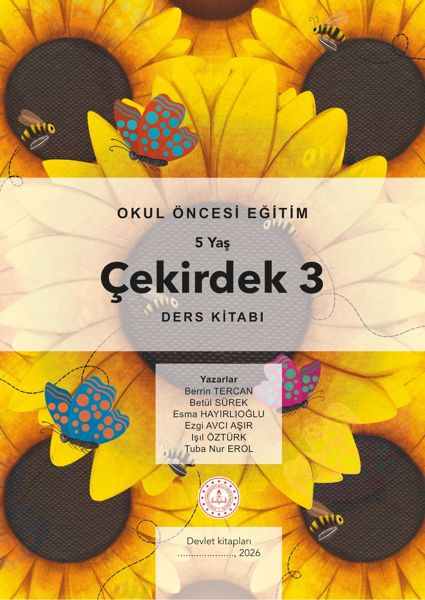

Devlet kitapları

<!-- sayfa 1 -->

DERS KİTAPLARI DİZİSİ .........................................................................................: 2491

Her hakkı saklıdır ve Millî Eğitim Bakanlığına aittir. Kitabın metin, soru ve şekilleri kısmen de olsa hiçbir surette alınıp yayımlanamaz.

**EDİTÖR**
Burcu ÖZKANLI ERTUĞRUL

**DİL UZMANI**
Muhammet ŞEN

**GÖRSEL TASARIMCI**
Eylem YILDIRIM
Melike TURALİ
Metin BİLAL
Serdar TURALİ

**ÇOKLU ORTAM TASARIMCISI**
Abidin AYDIN
Çağdaş SEVİNÇ
Didem EROL
Ezgi SARINÇ
Ferhat DEMİRCİ
İlkay CAN
Onur TÜLÜ
Yudum CAN

**PROGRAM GELİŞTİRME UZMANI**
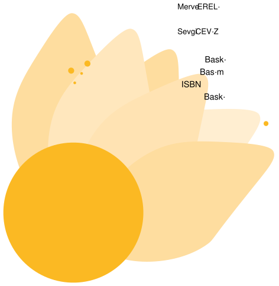
Uğur ÇENET

**ÖLÇME VE DEĞERLENDİRME UZMANI**
Merve ERELİ

**REHBERLİK UZMANI**
Sevgi CEVİZ

Baskı Yılı:
Basım Adedi:
ISBN 978-975-11-8089-6
Baskı Yeri:
Adresi:

Millî Eğitim Bakanlığı, Talim ve Terbiye Kurulu Başkanlığının 30.07.2024 tarih ve E-96732399-116.01-111152749 sayılı yazısı ile eğitim aracı olarak kabul edilmiştir. Kurulca bu kitabın kabul edilmiş olması ders kitabından yayınevi ve yazarın/yazarların sorumluluğunu kaldırmaz.

<!-- sayfa 2 -->

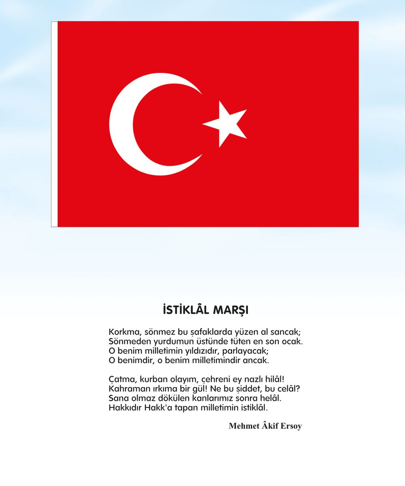

# İSTİKLÂL MARŞI

Korkma, sönmez bu şafaklarda yüzen al sancak;
Sönmeden yurdumun üstünde tüten en son ocak.
O benim milletimin yıldızıdır, parlayacak;
O benimdir, o benim milletimindir ancak.

Catma, kurban olayım, çehreni ey nazlı hilâl!
Kahraman ırkıma bir gül! Ne bu şiddet, bu celâl?
Sana olmaz dökülen kanlarımız sonra helâl.
Hakkıdır Hakk'a tapan milletimin istiklâl.

Mehmet Âkif Ersoy

<!-- sayfa 3 -->

ANDIMIZ

Türküm, doğruyum, çalışkanım.

İlkem küçüklerimi korumak, büyüklerimi saymak; yurdumu, milletimi özümden çok sevmektir.
Ülküm yükselmek, ileri gitmektir.

Ey Büyük Atatürk!

Açtığın yolda, gösterdiğin hedefe durmadan yürüyeceğime ant içerim.

Varlığım Türk varlığına armağan olsun.

Ne mutlu Türküm diyene!

<!-- sayfa 4 -->

MUSTAFA KEMAL ATATÜRK

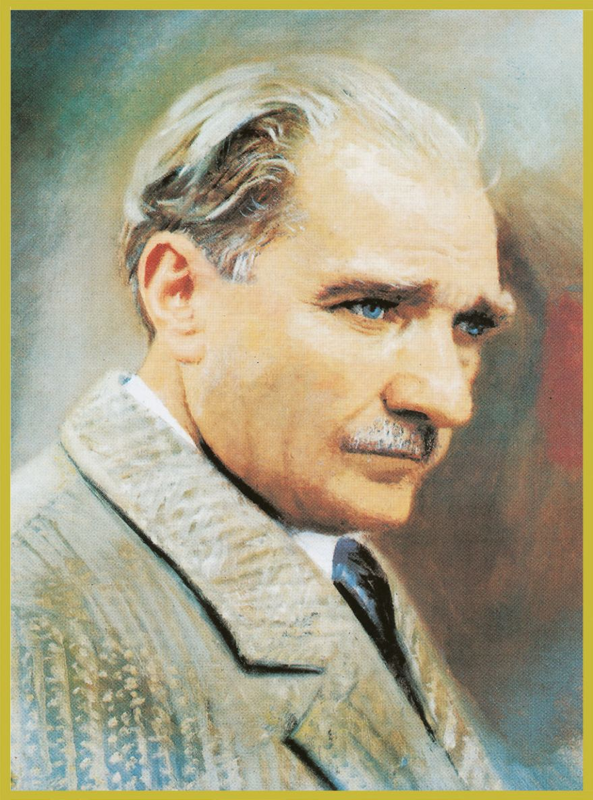
<!-- yer tutucu bulunamadı: sayfa sonuna eklendi -->

<!-- sayfa 5 -->

Verdiğiniz metin katmanı boş olduğu için (`<<< >>>` arası boş) dönüştürülecek bir içerik bulunmamaktadır. Eğer metni veya görüntüyü paylaşırsanız, kurallara uygun şekilde Markdown formatına çevirebilirim.

<!-- sayfa 6 -->

| | |
| :--- | :---: |
| Çayın Yolculuğu | 9 |
| “Nezaket ile Peksimet” Öykü | 10 |
| “Nezaket ile Peksimet” Etkinlik | 11 |
| Çiçek Bahçesi | 12 |
| Enerji Tasarrufu | 13 |
| Benim Çizgilerim | 14 |
| A Sesi | 15 |
| Yönleri Keşfediyorum | 16 |
| Sıcak Hava Balonları | 17 |
| Üçgen, Kare, Dikdörtgen | 18 |
| Kaplumbağa Terbiyecisi | 19 |
| Mahya Işıkları | 20 |
| Ritim Oyunu | 21 |
| Meslekler | 22 |
| Tablodaki Renkli Şekiller | 23 |
| Arılar ve Görevleri | 24 |
| Sorumluluklarımız | 25 |
| Zıtlar Oyunu | 26 |
| Yıldız Nefesi | 27 |
| Mimar Sinan-1 | 28 |
| Mimar Sinan-2 | 29 |
| Bayrağa Saygı | 30 |
| İpek ve Emre’nin Evi | 31 |
| Küçük Harf - Büyük Harf | 32 |
| Buzdolabı | 33 |
| Hayvanların Yumurtaları | 34 |
| Hemşin Çorapları | 35 |
| Arı Yuvalarını Sayalım | 36 |
| Keşif Kutusu | 37 |
| Türkiye Uzay Ajansı | 38 |
| Ne Hissediyor? | 39 |
| Denizdeki Canlılar | 40-41 |
| Afet ve Acil Durum Çantası | 42 |
| Çök-Kapan-Tutun | 43 |
| Sabır Bilekliği | 44 |
| Uğur Böceğinin Yaşam Döngüsü | 45 |
| Gezegenlerin Hareketi | 46 |

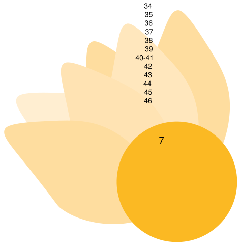
<!-- yer tutucu bulunamadı: sayfa sonuna eklendi -->

<!-- sayfa 7 -->

| | |
| :--- | :---: |
| Gök Taşı ve Gezegenler | 47 |
| Böcekler Yuvalarında | 48 |
| Bloklardan Şekiller | 49 |
| Ay Yıldızım | 50 |
| Kırkyama | 51 |
| E Sesi | 52 |
| Çekirdekleri Sayalım | 53 |
| Fotoğraf Albümü | 54 |
| TEKNOFEST | 55 |
| Yerli ve Millî Üretimlerimiz | 56 |
| Göbeklitepe | 57 |
| Takımyıldızları Kodlama | 58 |
| Küpleri Paylaştırıyorum | 59 |
| Sincap Kıpır | 60 |
| Kelime Bulmaca (“İ” Sesi) | 61 |
| Ağacın Tepesindeki Elma | 62 |
| Elmaları Paylaştırıyorum | 63 |
| Solucan Yolu | 64 |
| Kompost Yapalım | 65 |
| Ne Çizsem? | 66 |
| Reçel Kavanozları | 67 |
| Çizgilerle Hayvanlara Ulaşıyorum | 68 |
| Ağacı İnceliyorum | 69 |
| Noktalama İşaretleri | 70 |
| Bitkilerin İhtiyaçları | 71 |
| Bir Günde Kaç Bardak Su İçtin? | 72 |
| Tiyatro Sahnesi | 73 |
| Tiyatro Kostümü Tasarlıyorum | 74 |
| Kodlama | 75 |
| Eşit Paylaşım | 76 |
| Bayram Şekeri-1 | 77 |
| Bayram Şekeri-2 | 78 |
| Hayvanlarla İlgili Bilmeceler | 79 |
| Görsel ve Genel Ağ Kaynakçası | 79 |
| Türkiye’nin Mülki İdare Bölümleri ile Kara ve Deniz Komşuları Haritası | 80 |

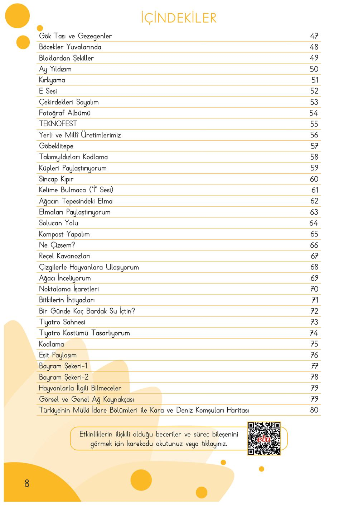

Etkinliklerin ilişkili olduğu beceriler ve süreç bileşenini görmek için karekodu okutunuz veya tıklayınız.

<!-- sayfa 8 -->

# ÇAYIN YOLCULUĞU

Ülkemizin en önemli tarım ürünlerinden biri çaydır. Çayın yolculuğunu anlatan görselleri inceleyelim. Çay, soframıza gelene kadar hangi yolculuklardan geçmiş? Anlatalım.

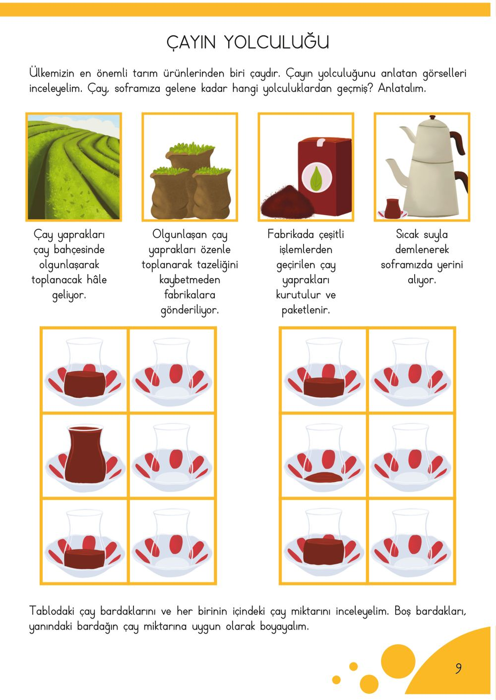

Çay yaprakları çay bahçesinde olgunlaşarak toplanacak hâle geliyor.

Olgunlaşan çay yaprakları özenle toplanarak tazeliğini kaybetmeden fabrikalara gönderiliyor.

Fabrikada çeşitli işlemlerden geçirilen çay yaprakları kurutulur ve paketlenir.

Sıcak suyla demlenerek soframızda yerini alıyor.

Tablodaki çay bardaklarını ve her birinin içindeki çay miktarını inceleyelim. Boş bardakları, yanındaki bardağın çay miktarına uygun olarak boyayalım.

<!-- sayfa 9 -->

# NEZAKET İLE PEKSİMET ÖYKÜ

Nezaket ile Peksimet iki tavşan kardeşmiş.
Havuç toplamak için beraber gezerlermiş.
Nezaket gülümseyip ilerlerken kırlarda
Peksimet söylenerek gidermiş arkasında.

“Ben acıktım Nezaket; haydi koş, acele et!”
“N’olur dayan Peksimet, birazcık daha sabret.”

Yürürlerken bahçeye, denk geldiler çiftçiye.
Peksimet somurtarak “Havuuuç!” diye tutturdu.
Çiftçi amca bu tavra çok şaşırdı, bozuldu.
Nezaket öne çıktı, binbir özür diledi.
Pek yorulduk, acıktık, lütfen yemek azıcık!

Böyle kibar olanlar hiç geri çevrilir mi?
İstediği tazecik havuçlar verilmez mi?
“Çok teşekkür ederiz biz sana çiftçi amca!”
Diyerek iki kardeş düştüler tekrar yola…

Yokuşu tırmanınca susadı bizimkiler,
Peksimet sızlanınca hatırlandı çeşmeler.
Çeşmenin etrafında su sırası bekleyen
Kedilerle kuzular, kahverengi inekler…

Bizimki “Çok susadım, bekleyemem sırayı!”
Deyince Nezaket’ten aldı şu uyarıyı:
“Öyle sıra istenmez, sözlerine dikkat et!
Nazik davranman gerek, yeter bunca şikâyet!”

Nezaket öne geçti lafını bitirince:
“Arkadaşlar; susadık, yorulduk yeterince!
Rica etsem önce biz su içebilir miyiz?
Kaç zamandır yoldayız, olur mu ne dersiniz?”

Hayvanlar birer birer çeşmeden çekildiler.
Bekletmeden onları önceliği verdiler.
“Sağ olun arkadaşlar, sıranızı verdiniz,
Sizden isteğimizi geri çevirmediniz.”

Anladı ki Peksimet kabalık büyük illet,
Açar tüm kapıları tatlı sözle nezaket…

Yazan: Ebru AKGÜN

⭐ Öğretmene not: Öğretmen nezaket sözcüklerini okurken vurgulu okur ve bekler. Çocukların dikkatini çekerek yan sayfadaki havuçları boyamalarına zaman tanır.

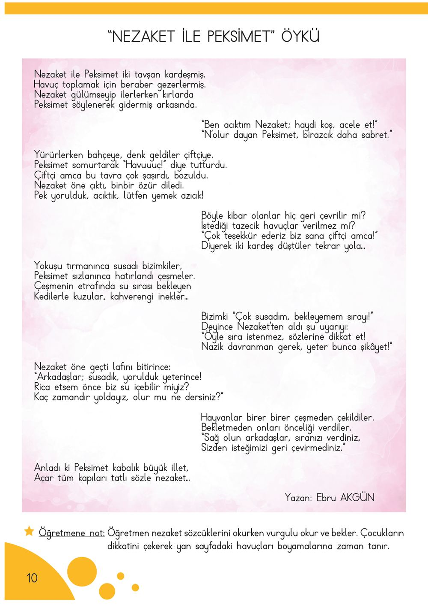
<!-- yer tutucu bulunamadı: sayfa sonuna eklendi -->

<!-- sayfa 10 -->

NEZAKET İLE PEKSİMET ETKİNLİK

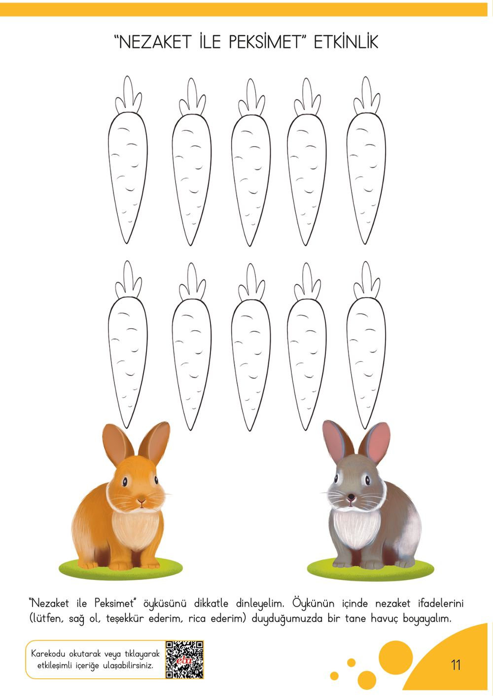

“Nezaket ile Peksimet” öyküsünü dikkatle dinleyelim. Öykünün içinde nezaket ifadelerini (lütfen, sağ ol, teşekkür ederim, rica ederim) duyduğumuzda bir tane havuç boyayalım.

<!-- sayfa 11 -->

# ÇİÇEK BAHÇESİ

Bazı çiçekli bitkilerin toprak altındaki kökleri soğan şeklindedir. Bunlara soğanlı bitkiler adı verilir. Soğanlı bitkilerin çiçek açmış görsellerini inceleyelim. İsimlerini söyleyelim.

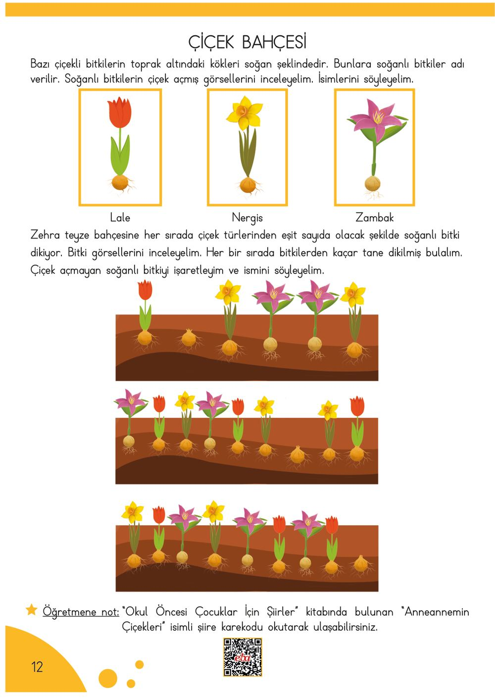

Lale &nbsp;&nbsp;&nbsp;&nbsp;&nbsp;&nbsp;&nbsp;&nbsp;&nbsp;&nbsp;&nbsp;&nbsp;&nbsp;&nbsp;&nbsp;&nbsp;&nbsp;&nbsp;&nbsp;&nbsp;&nbsp;&nbsp;&nbsp;&nbsp;&nbsp;&nbsp;&nbsp;&nbsp;&nbsp;&nbsp;&nbsp;&nbsp;&nbsp;&nbsp;&nbsp;&nbsp;&nbsp;&nbsp;&nbsp;&nbsp;&nbsp; Nergis &nbsp;&nbsp;&nbsp;&nbsp;&nbsp;&nbsp;&nbsp;&nbsp;&nbsp;&nbsp;&nbsp;&nbsp;&nbsp;&nbsp;&nbsp;&nbsp;&nbsp;&nbsp;&nbsp;&nbsp;&nbsp;&nbsp;&nbsp;&nbsp;&nbsp;&nbsp;&nbsp;&nbsp;&nbsp;&nbsp;&nbsp;&nbsp;&nbsp;&nbsp;&nbsp;&nbsp;&nbsp;&nbsp;&nbsp;&nbsp;&nbsp;&nbsp;&nbsp;&nbsp;&nbsp;&nbsp;&nbsp;&nbsp;&nbsp;&nbsp;&nbsp;&nbsp;&nbsp;&nbsp;&nbsp;&nbsp;&nbsp;&nbsp;&nbsp;&nbsp;&nbsp;&nbsp;&nbsp;&nbsp;&nbsp;&nbsp;&nbsp;&nbsp;&nbsp;&nbsp;&nbsp;&nbsp;&nbsp;&nbsp;&nbsp;&nbsp;&nbsp;&nbsp;&nbsp;&nbsp;&nbsp;&nbsp;&nbsp;&nbsp;&nbsp;&nbsp;&nbsp;&nbsp;&nbsp;&nbsp;&nbsp;&nbsp;&nbsp;&nbsp;&nbsp;&nbsp;&nbsp;&nbsp;&nbsp;&nbsp;&nbsp;&nbsp;&nbsp;&nbsp;&nbsp;&nbsp;&nbsp;&nbsp;&nbsp;&nbsp;&nbsp;&nbsp;&nbsp;&nbsp;&nbsp;&nbsp;&nbsp;&nbsp;&nbsp;&nbsp;&nbsp;&nbsp;&nbsp;&nbsp;&nbsp;&nbsp;&nbsp;&nbsp;&nbsp;&nbsp;&nbsp;&nbsp;&nbsp;&nbsp;&nbsp;&nbsp;&nbsp;&nbsp;&nbsp;&nbsp;&nbsp;&nbsp;&nbsp;&nbsp;&nbsp;&nbsp;&nbsp;&nbsp;&nbsp;&nbsp;&nbsp;&nbsp;&nbsp;&nbsp;&nbsp;&nbsp;&nbsp;&nbsp;&nbsp;&nbsp;&nbsp;&nbsp;&nbsp;&nbsp;&nbsp;&nbsp;&nbsp;&nbsp;&nbsp

<!-- sayfa 12 -->

# ENERJİ TASARRUFU

Bugün evden çıkarken
“Araba kullanmayalım.” dedi annem.
Bisikletimize bindik hemen.
Tasarruf ettik enerjiden.

Enerjiden tasarruf etmek için evde neler yapabiliriz? Söyleyelim. Bisiklet yolunu kullanarak kesik çizgileri birleştirelim, çocuğu gideceği yere ulaştıralım.

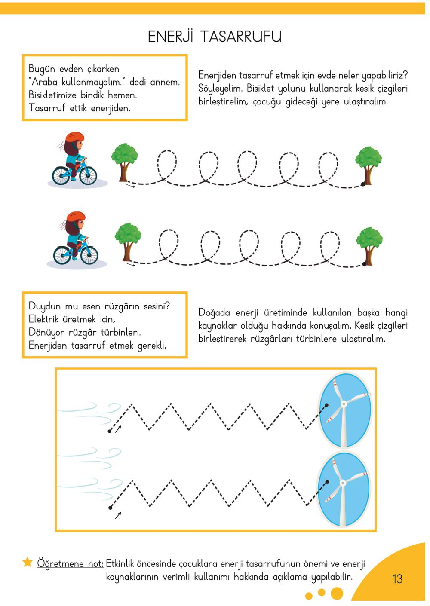

Duydun mu esen rüzgârın sesini?
Elektrik üretmek için,
Dönüyor rüzgâr türbinleri.
Enerjiden tasarruf etmek gerekli.

Doğada enerji üretiminde kullanılan başka hangi kaynaklar olduğu hakkında konuşalım. Kesik çizgileri birleştirerek rüzgârları türbinlere ulaştıralım.

<!-- sayfa 13 -->

# BENİM ÇİZGİLERİM

Etrafımızda birçok çizgi var. Doğada, kitaplarda, kıyafetlerde...
Görseldeki çizgili varlıkları inceleyelim. Çevremizde üzerinde çizgiler olan başka neler gördüğümüzü söyleyelim.

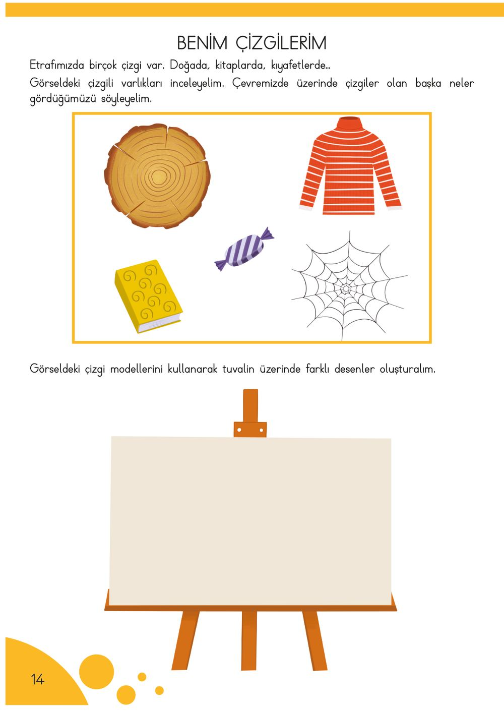

Görseldeki çizgi modellerini kullanarak tuvalin üzerinde farklı desenler oluşturalım.

<!-- sayfa 14 -->

# A SESİ

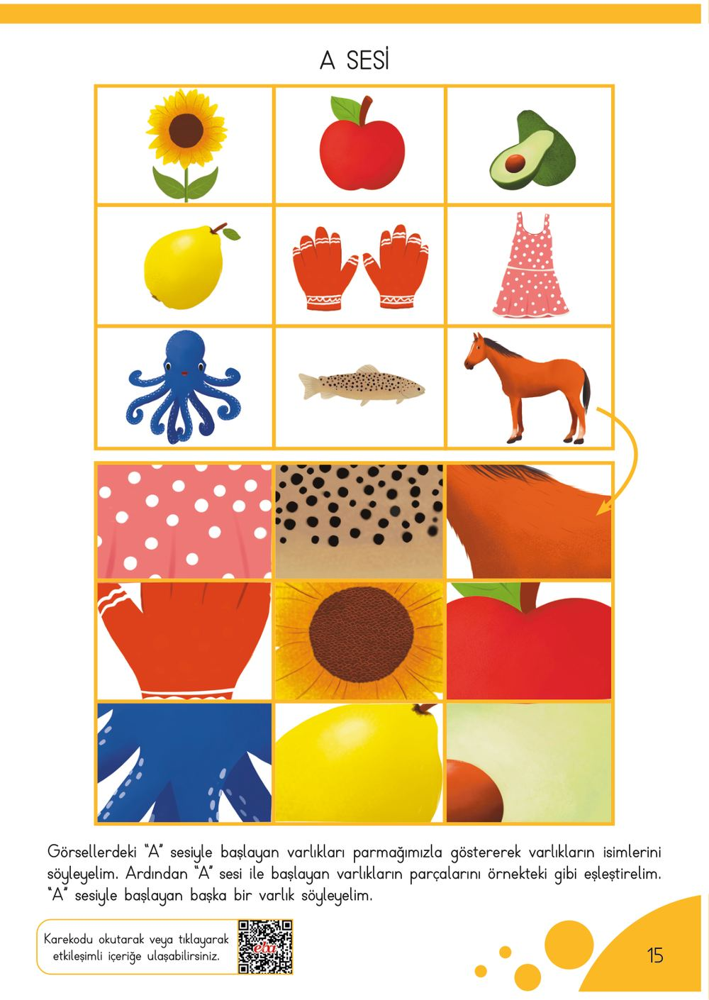

Görsellerdeki ‘‘A’’ sesiyle başlayan varlıkları parmağımızla göstererek varlıkların isimlerini söyleyelim. Ardından ‘‘A’’ sesi ile başlayan varlıkların parçalarını örnekteki gibi eşleştirelim. ‘‘A’’ sesiyle başlayan başka bir varlık söyleyelim.

<!-- sayfa 15 -->

# YÖNLERİ KEŞFEDİYORUM

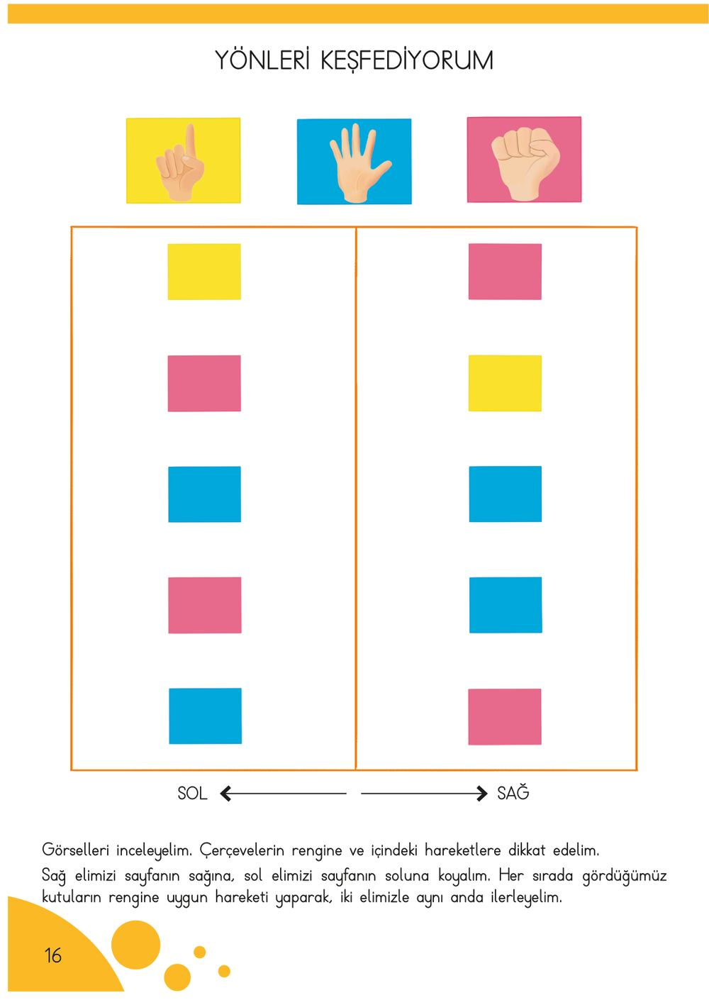

SOL $\longleftarrow$ <!-- KONTROL: Marker'da karşılığı yok, uydurma olabilir --> $\longrightarrow$ <!-- KONTROL: Marker'da karşılığı yok, uydurma olabilir --> SAĞ

Görselleri inceleyelim. Çerçevelerin rengine ve içindeki hareketlere dikkat edelim. 
Sağ elimizi sayfanın sağına, sol elimizi sayfanın soluna koyalım. Her sırada gördüğümüz kutuların rengine uygun hareketi yaparak, iki elimizle aynı anda ilerleyelim.

<!-- sayfa 16 -->

# SICAK HAVA BALONLARI

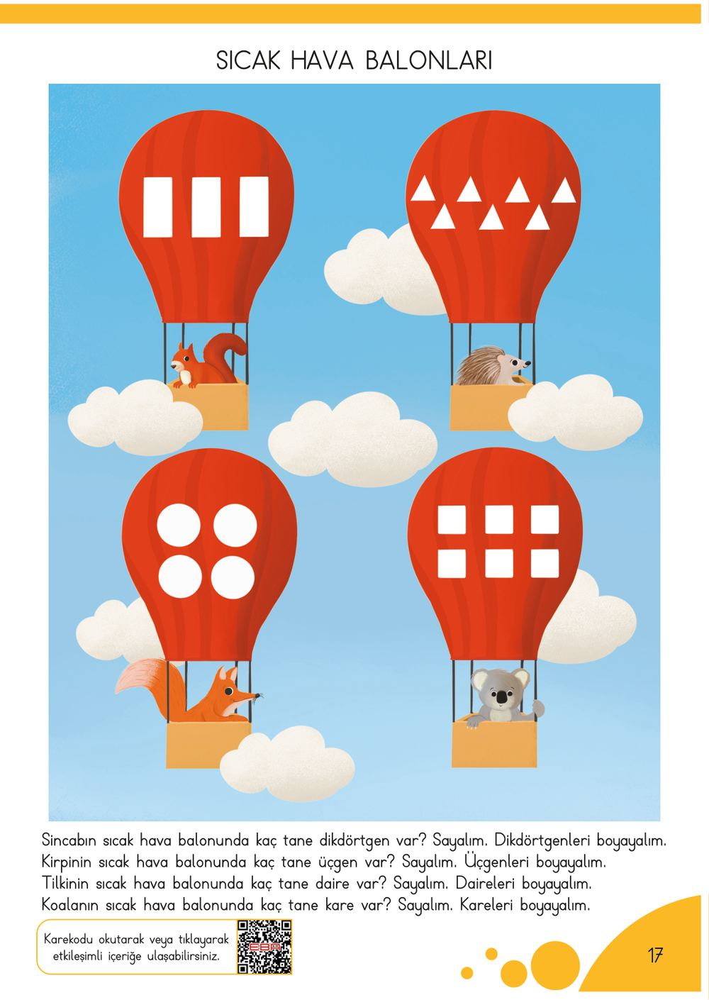

Sincabın sıcak hava balonunda kaç tane dikdörtgen var? Sayalım. Dikdörtgenleri boyayalım.
Kirpinin sıcak hava balonunda kaç tane üçgen var? Sayalım. Üçgenleri boyayalım.
Tilkinin sıcak hava balonunda kaç tane daire var? Sayalım. Daireleri boyayalım.
Koalanın sıcak hava balonunda kaç tane kare var? Sayalım. Kareleri boyayalım.

<!-- sayfa 17 -->

# ÜÇGEN, KARE, DİKDÖRTGEN

Sıla, şekil dedektifi oldu. Kenarı ve köşesi olan üç farklı geometrik şeklin sepetlerini hazırladı. Görselleri inceleyelim. Sepetlerin üzerindeki şekillerin ismini söyleyelim. Nesneleri örnekteki gibi benzediği şeklin olduğu sepete çizgi çizerek götürelim.

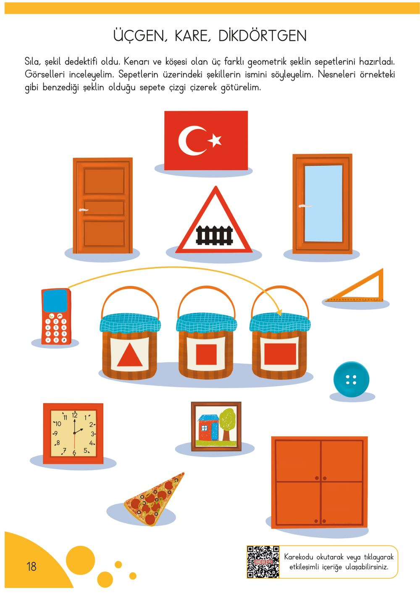

<!-- sayfa 18 -->

# KAPLUMBAĞA TERBİYECİSİ

Mehmet İstanbul’daki bir müzede Osman Hamdi Bey’in tablosu olan “Kaplumbağa Terbiyecisi” adlı eseri inceliyor.

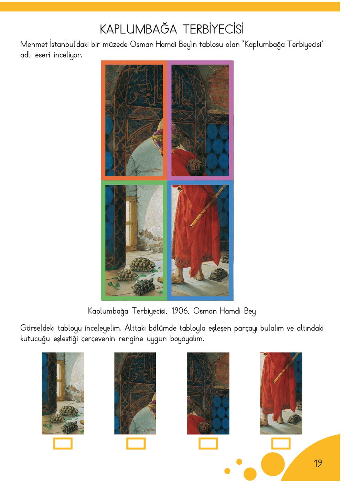

Kaplumbağa Terbiyecisi, 1906, Osman Hamdi Bey

Görseldeki tabloyu inceleyelim. Alttaki bölümde tabloyla eşleşen parçayı bulalım ve altındaki kutucuğu eşleştiği çerçevenin rengine uygun boyayalım.

<!-- sayfa 19 -->

# MAHYA IŞIKLARI

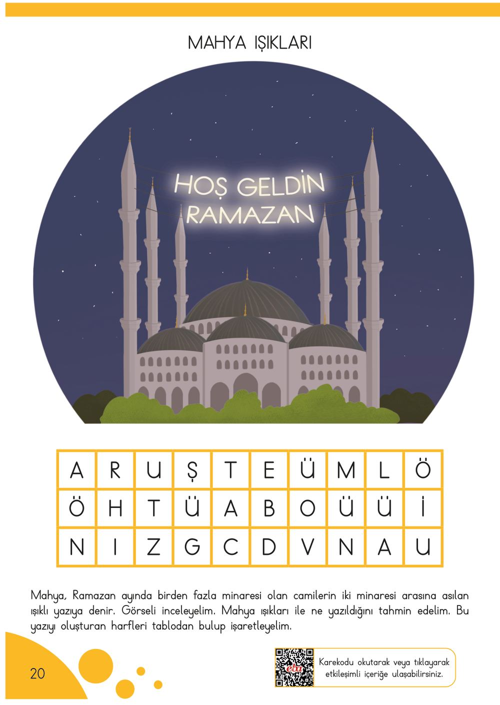

| A | R | U | Ş | T | E | Ü | M | L | Ö |
|---|---|---|---|---|---|---|---|---|---|
| Ö | H | T | Ü | A | B | O | Ü | Ü | İ |
| N | İ | Z | G | C | D | V | N | A | U |

Mahya, Ramazan ayında birden fazla minaresi olan camilerin iki minaresi arasına asılan ışıklı yazıya denir. Görseli inceleyelim. Mahya ışıkları ile ne yazıldığını tahmin edelim. Bu yazıyı oluşturan harfleri tablodan bulup işaretleyelim.

<!-- sayfa 20 -->

# RİTİM OYUNU

Dairelerin içinde gördüğümüz hareketleri sırasıyla ve arkadaşlarımızla aynı anda yapmaya çalışalım. Çalışmayı tamamladıktan sonra biz de çeşitli ritimler oluşturup arkadaşımızla paylaşalım.

---

Bu sırayı yavaş tempoda yapalım.

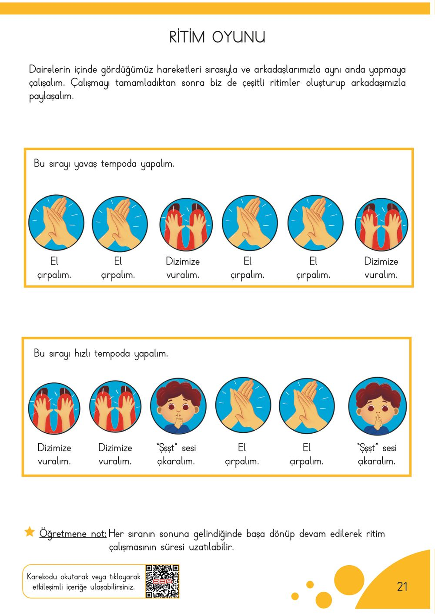
El çırpalım. | El çırpalım. | Dizimize vuralım. | El çırpalım. | El çırpalım. | Dizimize vuralım.

---

Bu sırayı hızlı tempoda yapalım.

Dizimize vuralım. | Dizimize vuralım. | “Şşşt” sesi çıkaralım. | El çırpalım. | El çırpalım. | “Şşşt” sesi çıkaralım.

---

⭐ Öğretmene not: Her sıranın sonuna gelindiğinde başa dönüp devam edilerek ritim çalışmasının süresi uzatılabilir.

<!-- sayfa 21 -->

# MESLEKLER

> “Vatanını en çok seven görevini en iyi yapandır.”
> Mustafa Kemal Atatürk

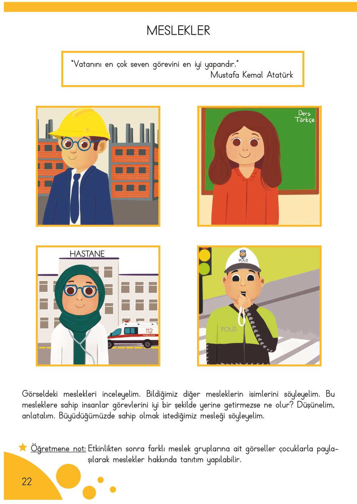

Görseldeki meslekleri inceleyelim. Bildiğimiz diğer mesleklerin isimlerini söyleyelim. Bu mesleklere sahip insanlar görevlerini iyi bir şekilde yerine getirmezse ne olur? Düşünelim, anlatalım. Büyüdüğümüzde sahip olmak istediğimiz mesleği söyleyelim.

⭐ **Öğretmene not:** Etkinlikten sonra farklı meslek gruplarına ait görseller çocuklarla paylaşıla...

<!-- sayfa 22 -->

# TABLODAKİ RENKLİ ŞEKİLLER

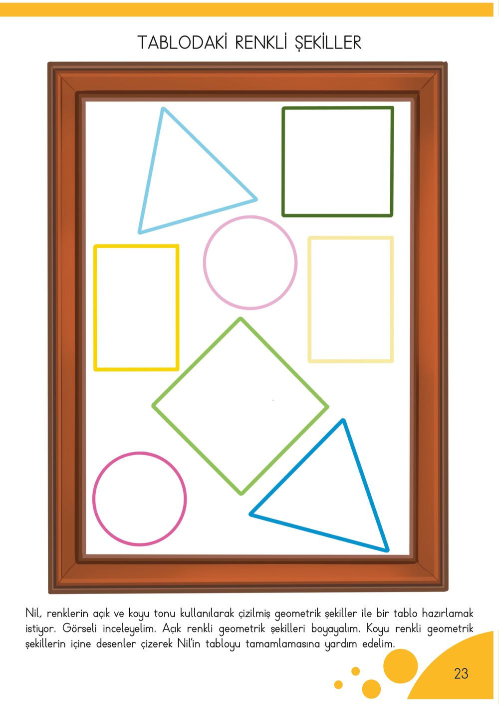

Nil, renklerin açık ve koyu tonu kullanılarak çizilmiş geometrik şekiller ile bir tablo hazırlamak istiyor. Görseli inceleyelim. Açık renkli geometrik şekilleri boyayalım. Koyu renkli geometrik

<!-- sayfa 23 -->

# ARILAR VE GÖREVLERİ

Her arının kovan içinde bir görevi vardır.

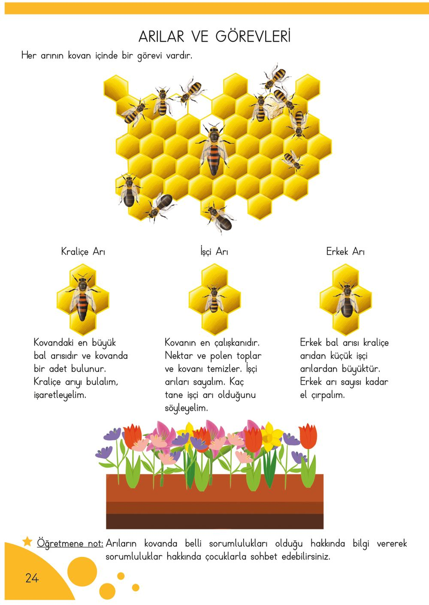

## Kraliçe Arı

Kovandaki en büyük bal arısıdır ve kovanda bir adet bulunur. Kraliçe arıyı bulalım, işaretleyelim.

## İşçi Arı

Kovanın en çalışkanıdır. Nektar ve polen toplar ve kovanı temizler. İşçi arıları sayalım. Kaç tane işçi arı olduğunu söyleyelim.

## Erkek Arı

Erkek bal arısı kraliçe arıdan küçük işçi arılardan büyüktür. Erkek arı sayısı kadar el çırpalım.

⭐ Öğretmene not: Arıların kovanda belli sorumlulukları olduğu hakkında bilgi vererek

<!-- sayfa 24 -->

# SORUMLULUKLARIMIZ

Aile içinde bazı görev ve sorumluluklarımız vardır. Görselleri inceleyelim. Evdeki sorumluluklarımız hakkında konuşalım. Bizim sorumluluğumuzda olan davranışları gösteren görsellerin yanındaki kutucuğu boyayalım.

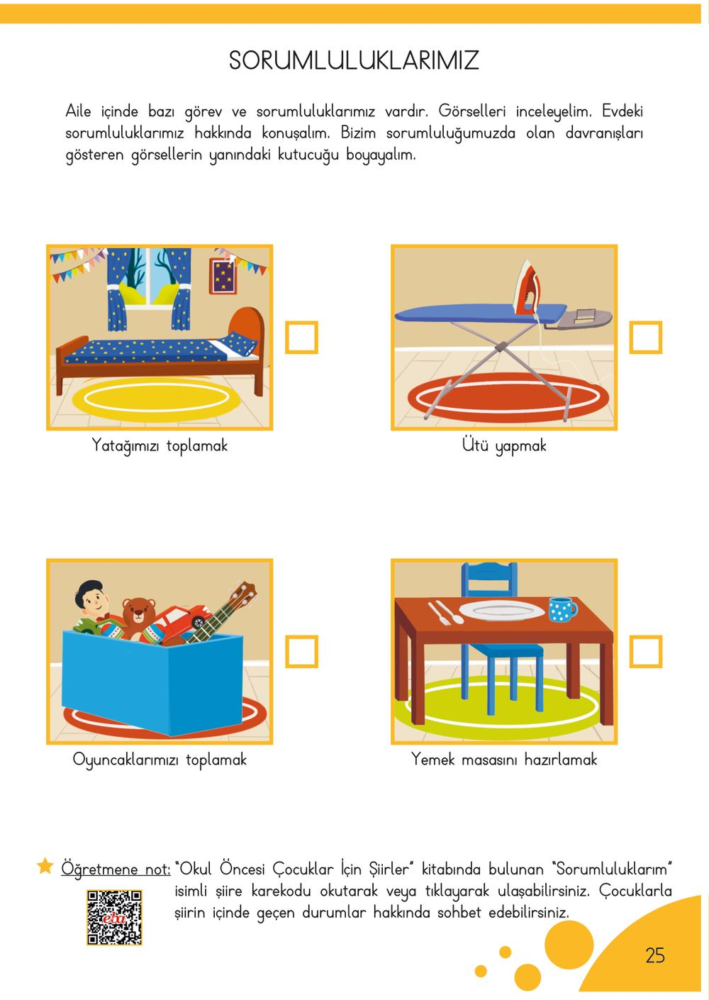
Yatağımızı toplamak

Ütü yapmak

Oyuncaklarımızı toplamak

Yemek masasını hazırlamak

⭐ Öğretmene not: “Okul Öncesi Çocuklar İçin Şiirler” kitabında bulunan “Sorumluluklarım” isimli şiire karekodu okutarak veya tıklayarak ulaşabilirsiniz. Çocuklarla

<!-- sayfa 25 -->

# ZITLAR OYUNU

Görselleri inceleyelim. Sağ ve sol tarafta bulunan görsellerden birbirinin zıttı olanları çizgi çizerek eşleştirelim.

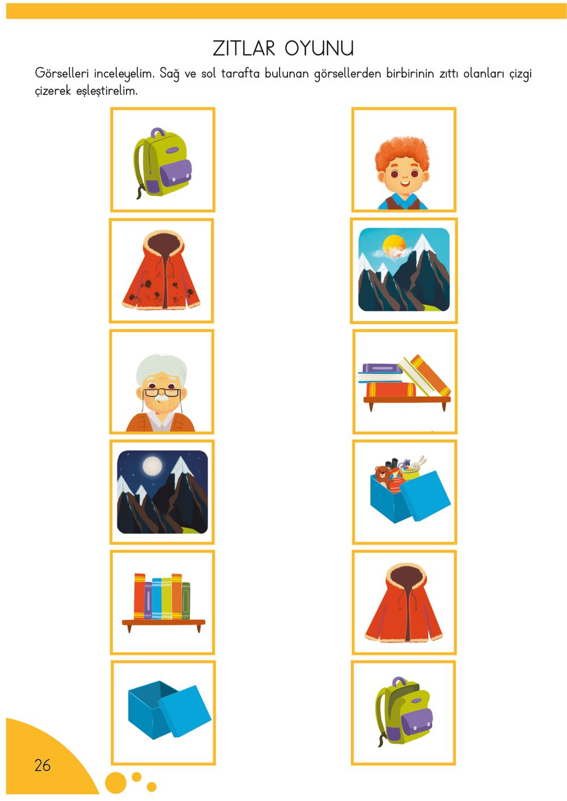

<!-- sayfa 26 -->

# YILDIZ NEFESİ

Yıldız nefesi, derin nefes alıp vererek bedeni ve zihni sakinleştirmeye yardımcı olan bir nefes egzersizidir. Görseli inceleyelim.

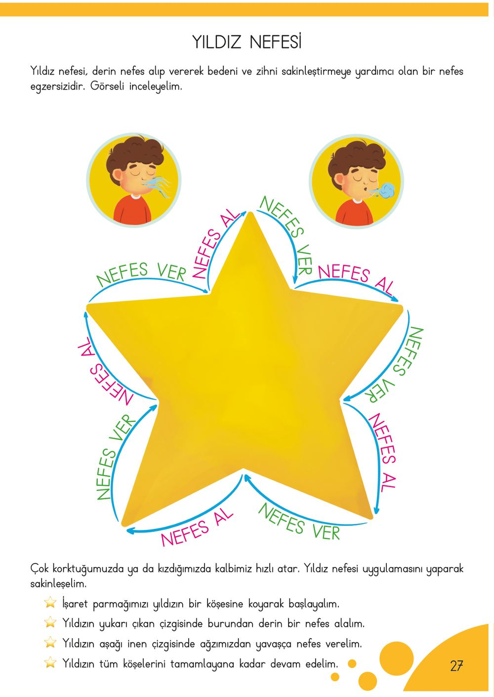

Çok korktuğumuzda ya da kızdığımızda kalbimiz hızlı atar. Yıldız nefesi uygulamasını yaparak sakinleşelim.

⭐ İşaret parmağımızı yıldızın bir köşesine koyarak başlayalım.

⭐ Yıldızın yukarı çıkan çizgisinde burnundan derin bir nefes alalım.

<!-- sayfa 27 -->

# MİMAR SİNAN-1

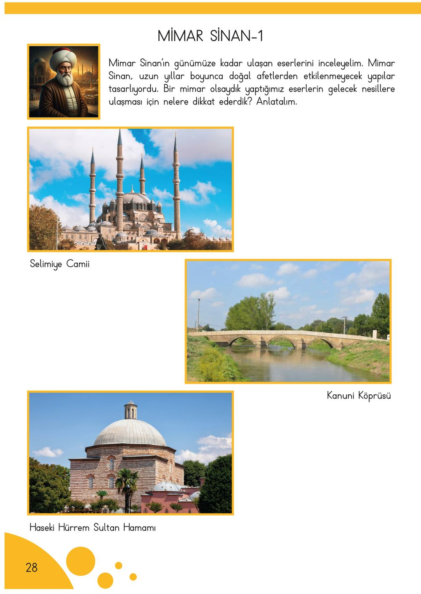

Mimar Sinan’ın günümüze kadar ulaşan eserlerini inceleyelim. Mimar Sinan, uzun yıllar boyunca doğal afetlerden etkilenmeyecek yapılar tasarlıyordu. Bir mimar olsaydık yaptığımız eserlerin gelecek nesillere ulaşması için nelere dikkat ederdik? Anlatalım.

Selimiye Camii

Kanuni Köprüsü

Haseki Hürrem Sultan Hamamı

<!-- sayfa 28 -->

# MİMAR SİNAN-2

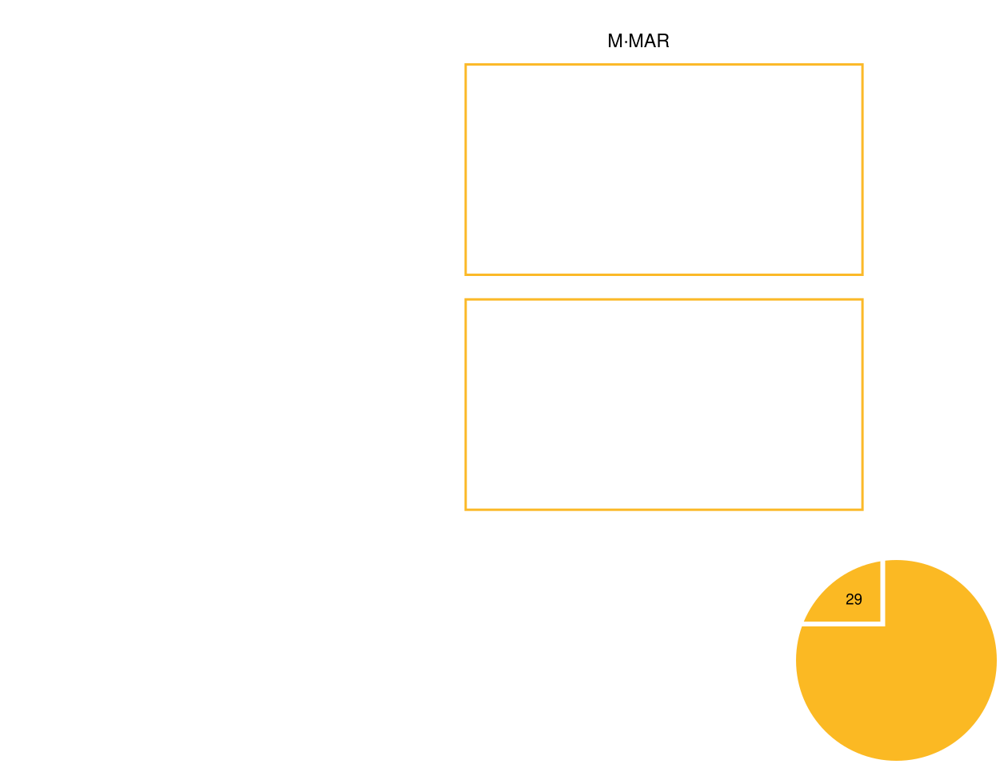

Bir bina tasarlayalım ve üstteki çerçevenin içine çizelim. Binanın maketini sınıftaki malzemeleri kullanarak alttaki çerçevenin içine yapalım. Maketimizin sağlam olması için malzemeleri dikkatli seçelim.

<!-- sayfa 29 -->

# BAYRAĞA SAYGI

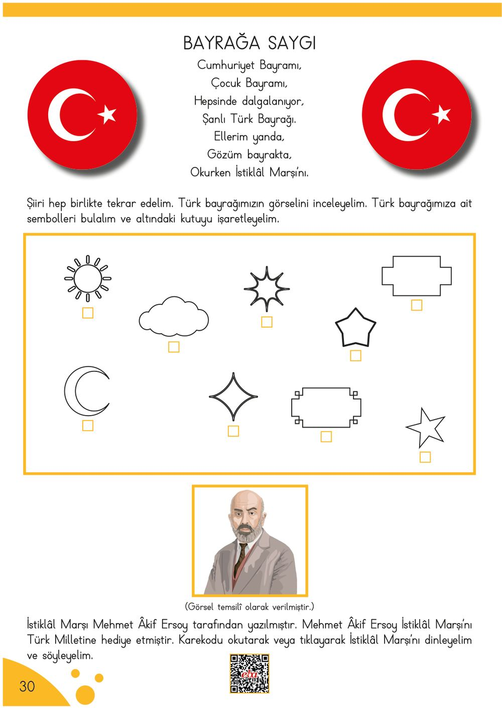

Cumhuriyet Bayramı,
Çocuk Bayramı,
Hepsinde dalgalanıyor,
Şanlı Türk Bayrağı.
Ellerim yanda,
Gözüm bayrakta,
Okurken İstiklâl Marşı’nı.

Şiiri hep birlikte tekrar edelim. Türk bayrağımızın görselini inceleyelim. Türk bayrağımıza ait sembolleri bulalım ve altındaki kutuyu işaretleyelim.

<!-- sayfa 30 -->

# İPEK VE EMRE'NİN EVİ

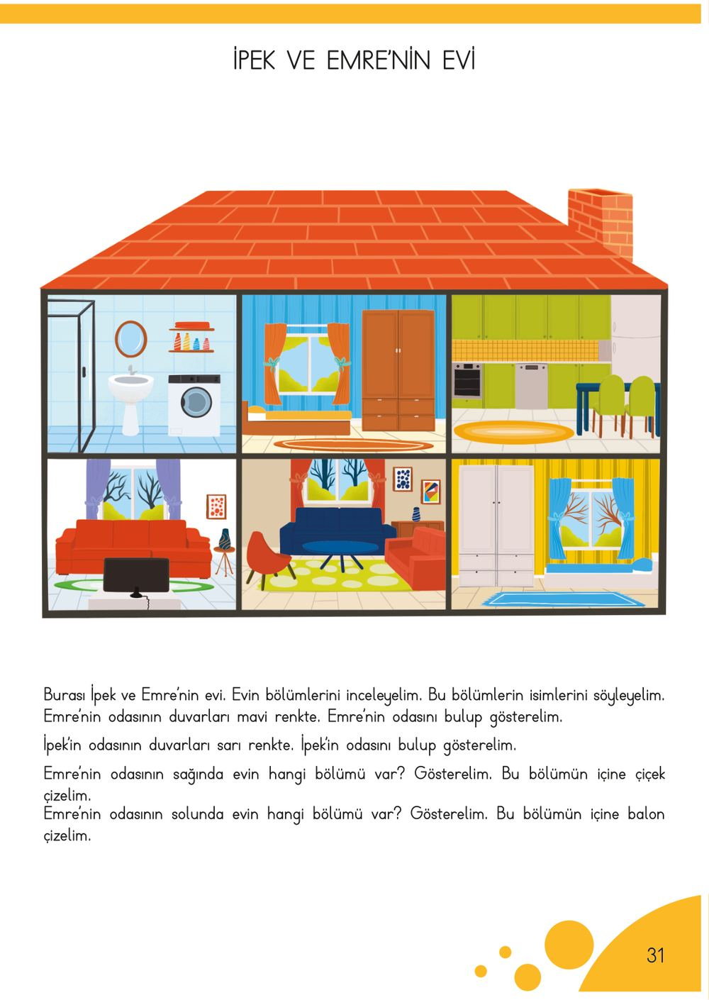

Burası İpek ve Emre'nin evi. Evin bölümlerini inceleyelim. Bu bölümlerin isimlerini söyleyelim.
Emre'nin odasının duvarları mavi renkte. Emre'nin odasını bulup gösterelim.
İpek'in odasının duvarları sarı renkte. İpek'in odasını bulup gösterelim.
Emre'nin odasının sağında evin hangi bölümü var? Gösterelim. Bu bölümün içine çiçek çizelim.
Emre'nin odasının solunda evin hangi bölümü var? Gösterelim. Bu bölümün içine balon çizelim.

<!-- sayfa 31 -->

# KÜÇÜK HARF - BÜYÜK HARF

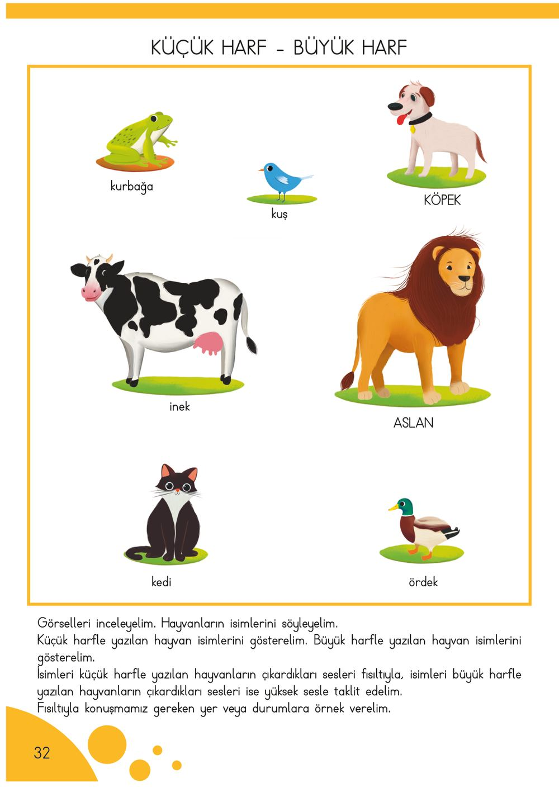 kurbağa
 kuş
 KÖPEK
 inek
 ASLAN
 kedi
 ördek

Görselleri inceleyelim. Hayvanların isimlerini söyleyelim.
Küçük harfle yazılan hayvan isimlerini gösterelim. Büyük harfle yazılan hayvan isimlerini gösterelim.
İsimleri küçük harfle yazılan hayvanların çıkardıkları sesleri fısıltıyla, isimleri büyük harfle yazılan hayvanların çıkardıkları sesleri ise yüksek sesle taklit edelim.
Fısıltıyla konuşmamız gereken yer veya durumlara örnek verelim.

<!-- sayfa 32 -->

# BUZDOLABI

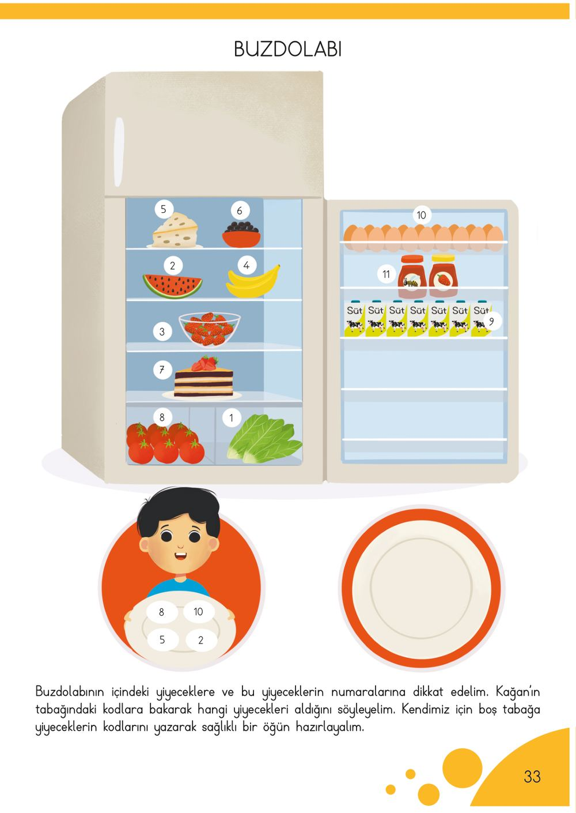

Buzdolabının içindeki yiyeceklere ve bu yiyeceklerin numaralarına dikkat edelim. Kağan’ın tabağındaki kodlara bakarak hangi yiyecekleri aldığını söyleyelim. Kendimiz için boş tabağa yiyeceklerin kodlarını yazarak sağlıklı bir öğün hazırlayalım.

<!-- sayfa 33 -->

# HAYVANLARIN YUMURTALARI

Hayvan görsellerini ve yumurtalarını inceleyelim. Çerçevedeki hayvana ait yumurtaları bulalım ve sayalım. Örnekteki gibi kutunun içine yumurta sayısı kadar çizgi çizelim.

| | |
| :--- | :--- |
| 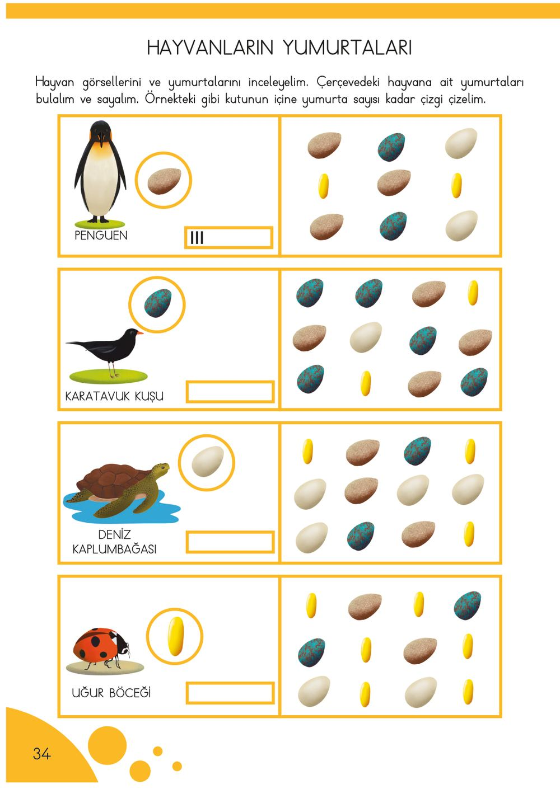 PENGUEN  |  |
|  KARATAVUK KUŞU  |  |
|  DENİZ KAPLUMBAĞASI  |  |
|  UĞUR BÖCEĞİ  |  |

<!-- sayfa 34 -->

# HEMŞİN ÇORAPLARI

Hemşin çorapları, ülkemizin coğrafi işaret almış el sanatları ürünlerindendir.

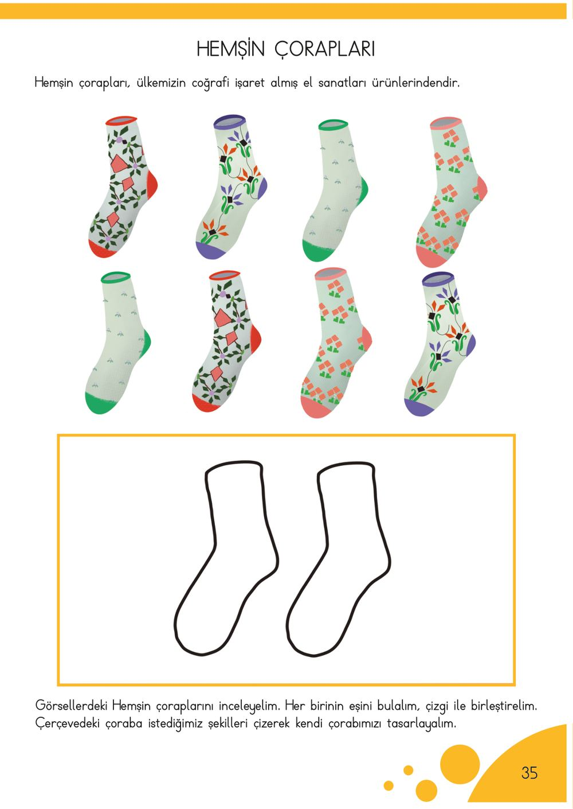

Görsellerdeki Hemşin çoraplarını inceleyelim. Her birinin eşini bulalım, çizgi ile birleştirelim. Çerçevedeki çoraba istediğimiz şekilleri çizerek kendi çorabımızı tasarlayalım.

<!-- sayfa 35 -->

# ARI YUVALARINI SAYALIM

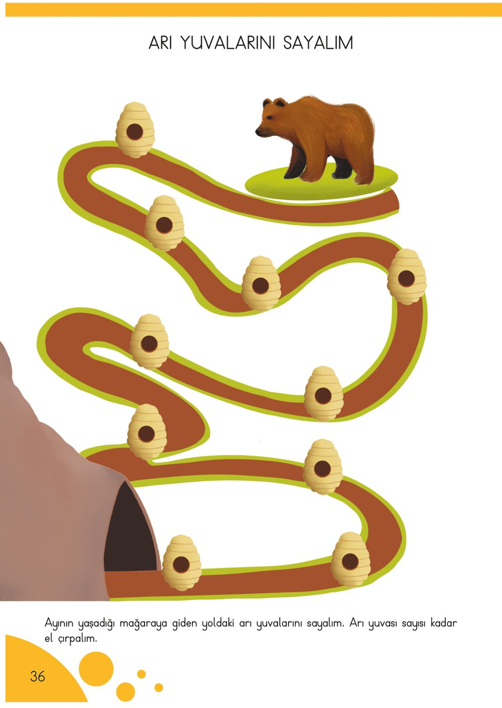

Ayının yaşadığı mağaraya giden yoldaki arı yuvalarını sayalım. Arı yuvası sayısı kadar el çırpalım.

<!-- sayfa 36 -->

# KEŞİF KUTUSU

Semih ailesiyle doğa gezisine çıktı. Doğa gezisinde keşif kutusuna koymak için çeşitli nesneler topladı. Eve geldiklerinde kutuya topladıkları nesnelerin özelliklerini yazdılar.

Listeye yazılan özellikleri dinleyelim. Özelliklere uygun nesneleri bularak kutularını aynı renge boyayalım.

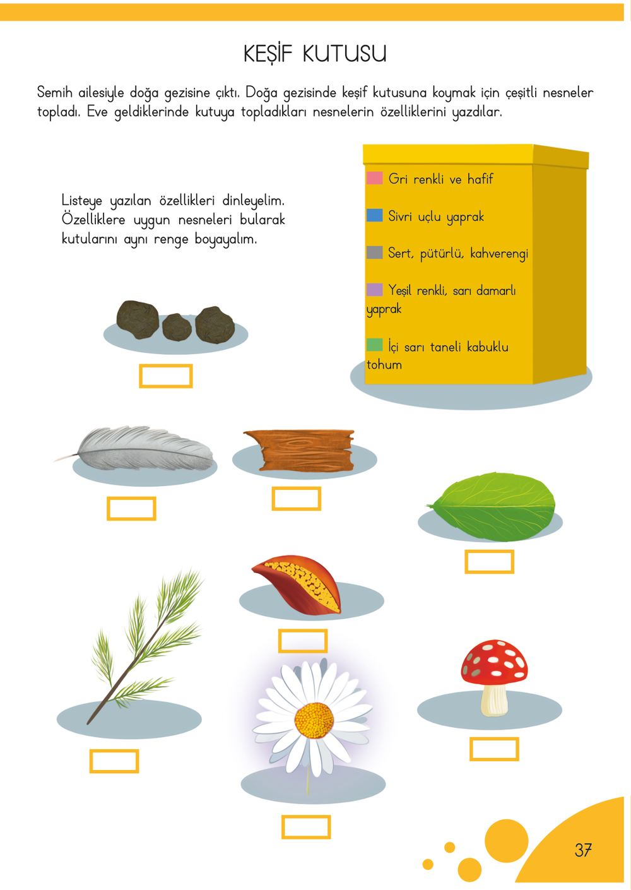

*   Gri renkli ve hafif
*   Sivri uçlu yaprak
*   Sert, pütürlü, kahverengi
*   Yeşil renkli, sarı damarlı yaprak
*   İçi sarı taneli kabuklu tohum

<!-- sayfa 37 -->

# TÜRKİYE UZAY AJANSI

Sema; gökyüzünü, gökyüzünde parlayan ışıkları, dünya gibi başka yerler olup olmadığını merak ediyor. Uzay görevleri ile ilgili yaptığı araştırmada ülkelerin gerçekleştirdikleri her uzay görevi için bir arma tasarladığını öğrendi. Armaları inceleyelim. Hangi arma Türkiye Uzay Ajansının ülkemiz için tasarladığı arma olabilir? Bulalım, kutusunu boyayalım.

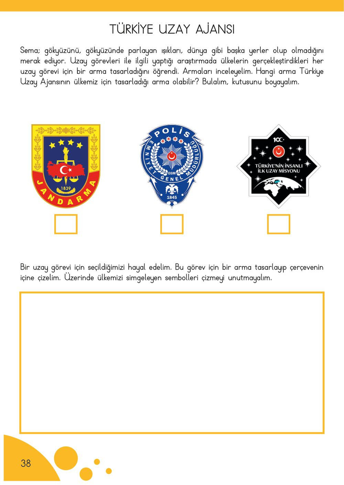

Bir uzay görevi için seçildiğimizi hayal edelim. Bu görev için bir arma tasarlayıp çerçevenin içine çizelim. Üzerinde ülkemizi simgeleyen sembolleri çizmeyi unutmayalım.

<!-- sayfa 38 -->

# NE HİSSEDİYOR?

Ece, gün içinde birçok farklı durum yaşıyor. Hissettiği duygular da buna göre değişiyor. Cümleleri dinleyelim. Ece’nin ne hissediyor olabileceğini düşünelim. Her sırada Ece’nin hissettiği duyguyu ifade eden görseli bulup işaretleyelim.

| | |
| :--- | :--- |
| Babası uyku vaktinin geldiğini söylüyor. Ece, uyumak istemiyor. | 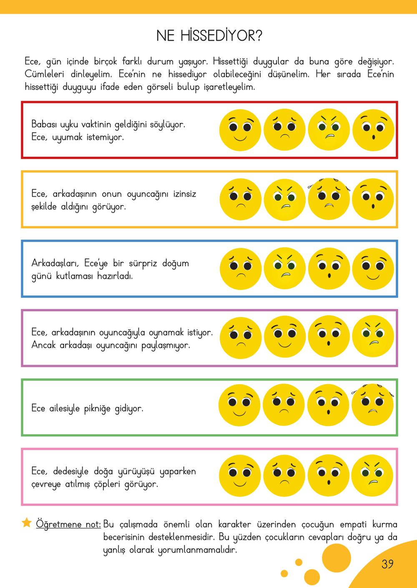 |
| Ece, arkadaşının onun oyuncağını izinsiz şekilde aldığını görüyor. |  |
| Arkadaşları, Ece’ye bir sürpriz doğum günü kutlaması hazırladı. |  |
| Ece, arkadaşının oyuncağıyla oynamak istiyor. Ancak arkadaşı oyuncağını paylaşmıyor. |  |
| Ece ailesiyle pikniğe gidiyor. |  |
| Ece, dedesiyle doğa yürüyüşü yaparken çevreye atılmış çöpleri görüyor. |  |

⭐ Öğretmene not: Bu çalışmada önemli olan karakter üzerinden çocuğun empati kurma becerisinin desteklenmesidir. Bu yüzden çocukların cevapları doğru ya da

<!-- sayfa 39 -->

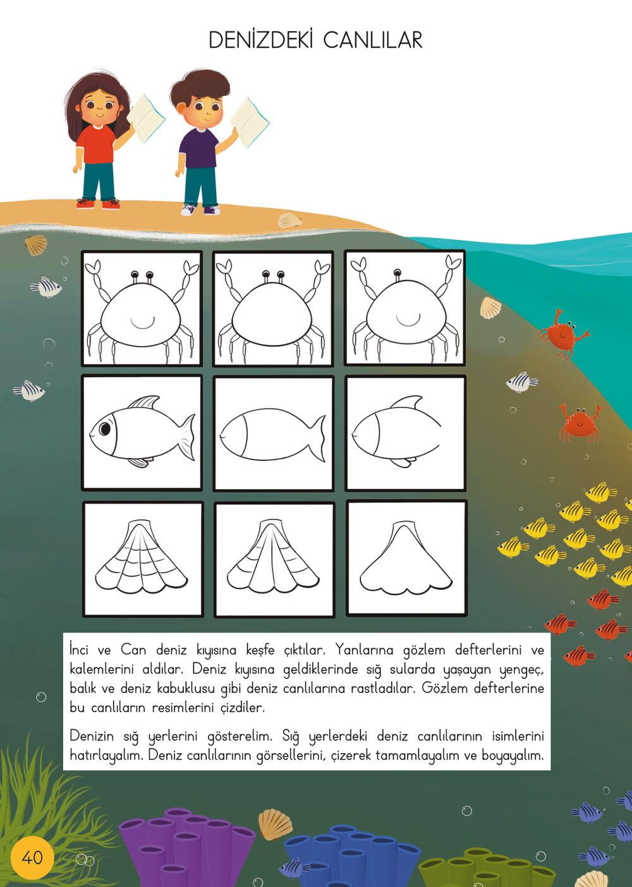

İnci ve Can deniz kıyısına keşfe çıktılar. Yanlarına gözlem defterlerini ve kalemlerini aldılar. Deniz kıyısına geldiklerinde sığ sularda yaşayan yengeç, balık ve deniz kabuklusu gibi deniz canlılarına rastladılar. Gözlem defterlerine bu canlıların resimlerini çizdiler.

Denizin sığ yerlerini gösterelim. Sığ yerlerdeki deniz canlılarının isimlerini hatırlayalım. Deniz canlılarının görsellerini, çizerek tamamlayalım ve boyayalım.

<!-- sayfa 40 -->

Denizin derin yerlerini gösterelim. Derinlerde yaşayan deniz canlılarını sayalım. Kaç tane olduklarını tablodaki kutulara yazalım.

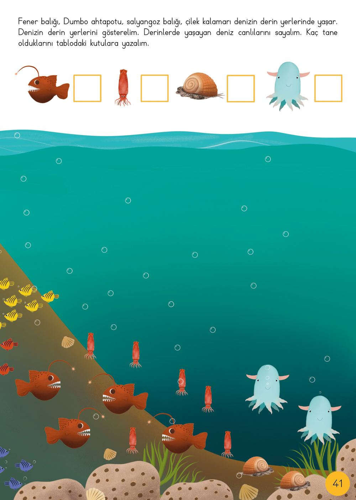

<!-- sayfa 41 -->

# AFET VE ACİL DURUM ÇANTASI

Afetlere ve acil durumlara karşı her zaman hazırlıklı olmak güvenliğimiz için çok önemlidir. Hepimizin afet ve acil durum çantasına sahip olması gerekir. Evimizde afet ve acil durum çantası var mı? Söyleyelim.

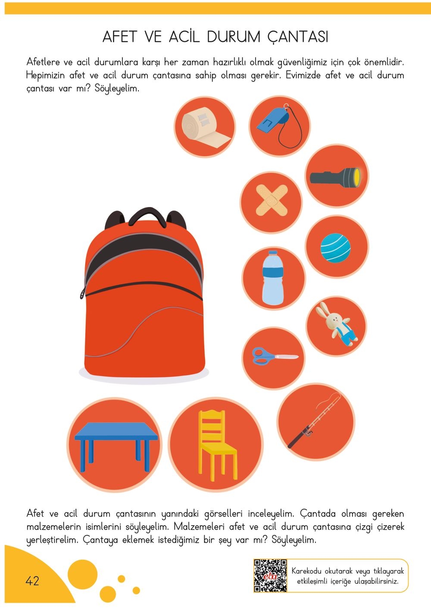

Afet ve acil durum çantasının yanındaki görselleri inceleyelim. Çantada olması gereken malzemelerin isimlerini söyleyelim. Malzemeleri afet ve acil durum çantasına çizgi çizerek yerleştirelim. Çantaya eklemek istediğimiz bir şey var mı? Söyleyelim.

<!-- sayfa 42 -->

# ÇÖK-KAPAN-TUTUN

Deprem anında etraftaki eşyalar nedeniyle oluşabilecek yaralanmalara karşı önlem almak için “Çök-Kapan-Tutun” tekniğini uygulamalıyız.

Güvenli bir yer bulup diz üstü çökün, başınızı ve ensenizi koruyacak şekilde kapanın, düşmemek için sabit bir yere tutunun.
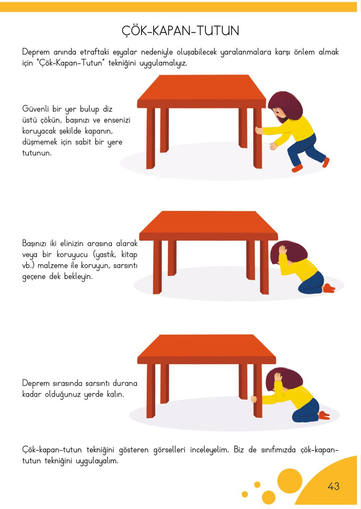

Başınızı iki elinizin arasına alarak veya bir koruyucu (yastık, kitap vb.) malzeme ile koruyun, sarsıntı geçene dek bekleyin.

Deprem sırasında sarsıntı durana kadar olduğunuz yerde kalın.

Çök-kapan-tutun tekniğini gösteren görselleri inceleyelim. Biz de sınıfımızda çök-kapan-tutun tekniğini uygulayalım.

<!-- sayfa 43 -->

SABIR BİLEKLİĞİ

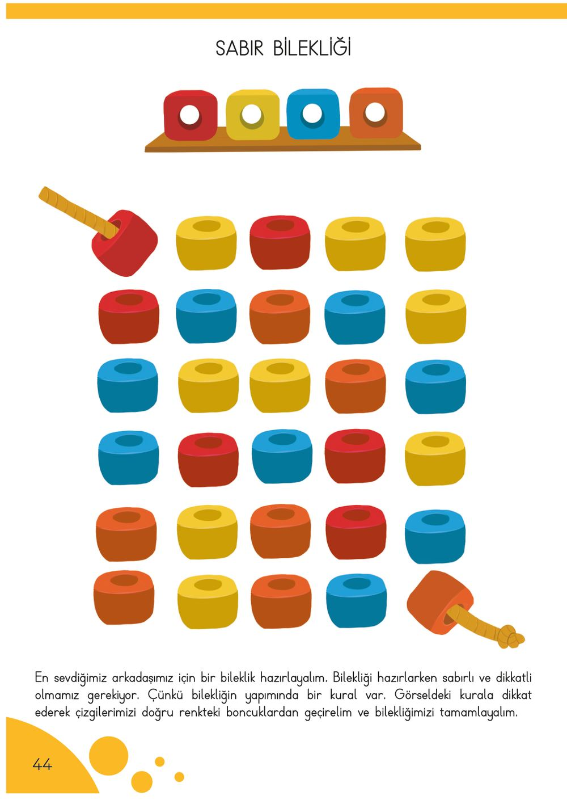

En sevdiğimiz arkadaşımız için bir bileklik hazırlayalım. Bilekliği hazırlarken sabırlı ve dikkatli olmamız gerekiyor. Çünkü bilekliğin yapımında bir kural var. Görseldeki kurala dikkat ederek çizgilerimizi doğru renkteki boncuklardan geçirelim ve bilekliğimizi tamamlayalım.

<!-- sayfa 44 -->

# UĞUR BÖCEĞİNİN YAŞAM DÖNGÜSÜ

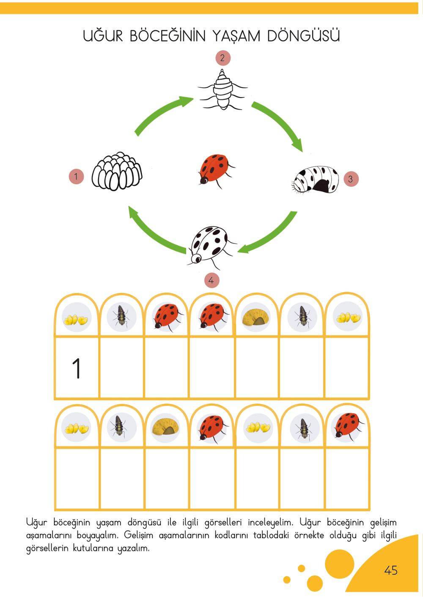

| | | | | | | |
| :---: | :---: | :---: | :---: | :---: | :---: | :---: |
| ![yumurta] | ![böcek] | ![uğurböceği] | ![uğurböceği] | ![larva] | ![böcek] | ![yumurta] |
| 1 | | | | | | |

| | | | | | | |
| :---: | :---: | :---: | :---: | :---: | :---: | :---: |
| ![yumurta] | ![böcek] | ![larva] | ![uğurböceği] | ![yumurta] | ![böcek] | ![uğurböceği] |
| | | | | | | |

Uğur böceğinin yaşam döngüsü ile ilgili görselleri inceleyelim. Uğur böceğinin gelişim aşamalarını boyayalım. Gelişim aşamalarının kodlarını tablodaki örnekte olduğu gibi ilgili

<!-- sayfa 45 -->

# GEZEGENLERİN HAREKETİ

Gezegenlerle ilgili oyunun kurallarını dinleyelim.
Gezegenlere ait hareketi kurallarına uygun yapalım.

1
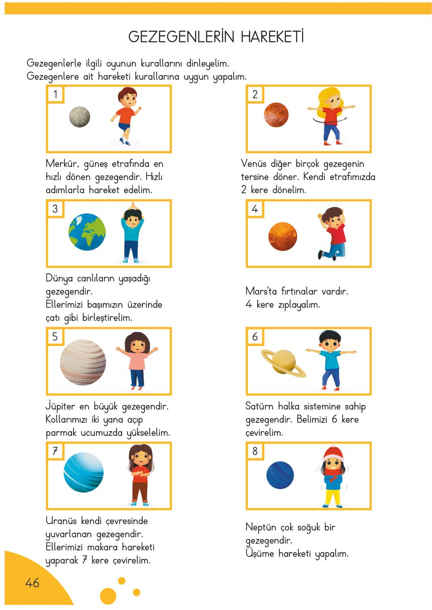
Merkür, güneş etrafında en hızlı dönen gezegendir. Hızlı adımlarla hareket edelim.

2

Venüs diğer birçok gezegenin tersine döner. Kendi etrafımızda 2 kere dönelim.

3

Dünya canlıların yaşadığı gezegendir. Ellerimizi başımızın üzerinde çatı gibi birleştirelim.

4

Mars’ta fırtınalar vardır. 4 kere zıplayalım.

5

Jüpiter en büyük gezegendir. Kollarımızı iki yana açıp parmak ucumuzda yükselim.

6

Satürn halka sistemine sahip gezegendir. Belimizi 6 kere çevirelim.

7

Uranüs kendi çevresinde yuvarlanan gezegendir. Ellerimizi makara hareketi

8

Neptün çok soğuk bir gezegendir. Üşüme hareketi yapalım

<!-- sayfa 46 -->

# GÖK TAŞI VE GEZEGENLER

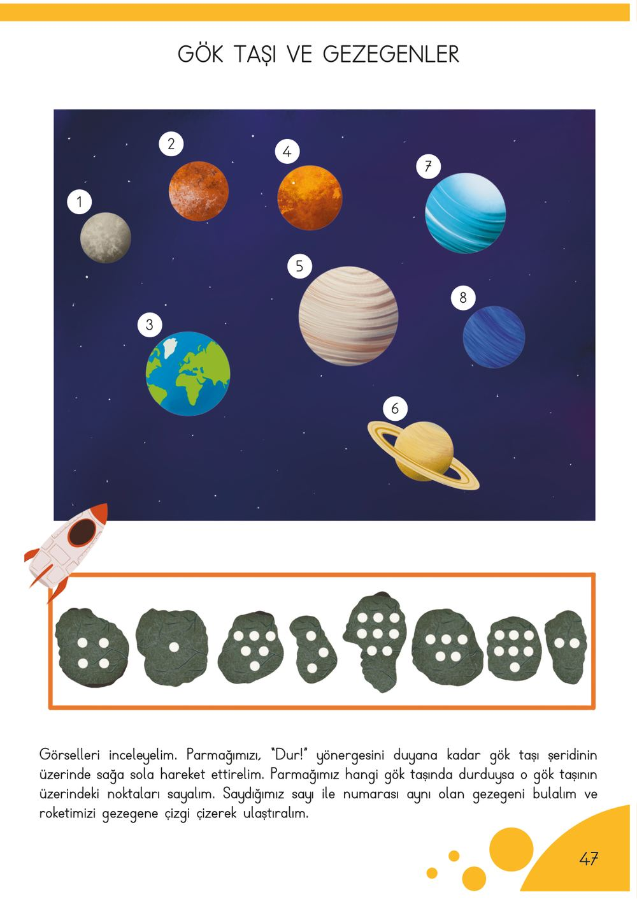

Görselleri inceleyelim. Parmağımızı, “Dur!” yönergesini duyana kadar gök taşı şeridinin üzerinde sağa sola hareket ettirelim. Parmağımız hangi gök taşında durduysa o gök taşının üzerindeki noktaları sayalım. Saydığımız sayı ile numarası aynı olan gezegeni bulalım ve roketimizi gezegene çizgi çizerek ulaştıralım.

<!-- sayfa 47 -->

# BÖCEKLER YUVALARINDA

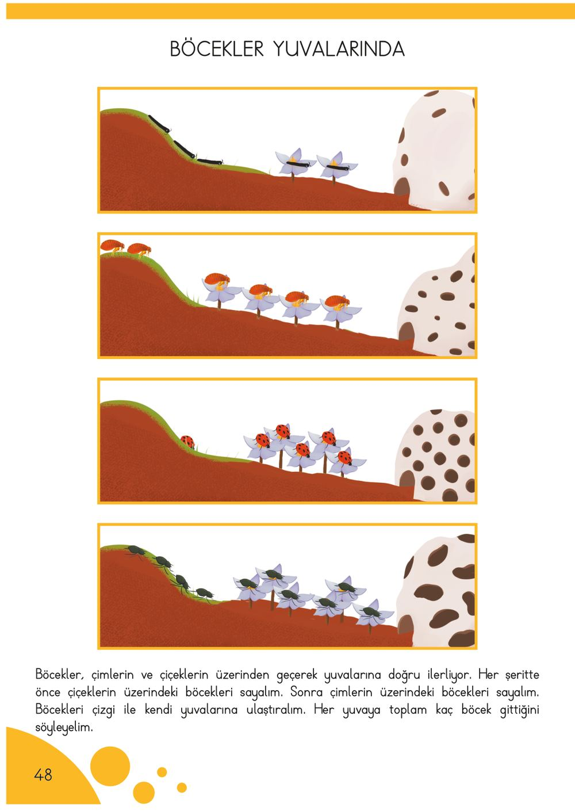

Böcekler, çimlerin ve çiçeklerin üzerinden geçerek yuvalarına doğru ilerliyor. Her şeritte önce çiçeklerin üzerindeki böcekleri sayalım. Sonra çimlerin üzerindeki böcekleri sayalım. Böcekleri çizgi ile kendi yuvalarına ulaştıralım. Her yuvaya toplam kaç böcek gittiğini söyleyelim.

<!-- sayfa 48 -->

# BLOKLARDAN ŞEKİLLER

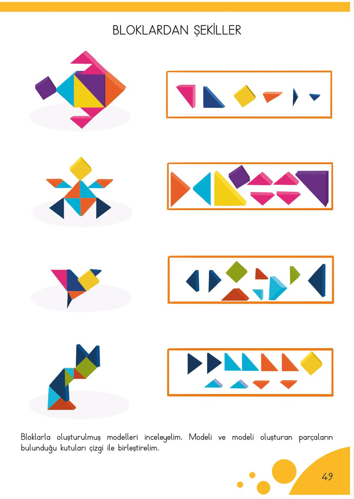

Bloklarla oluşturulmuş modelleri inceleyelim. Modeli ve modeli oluşturan parçaların bulunduğu kutuları çizgi ile birleştirelim.

<!-- sayfa 49 -->

# AY YILDIZIM

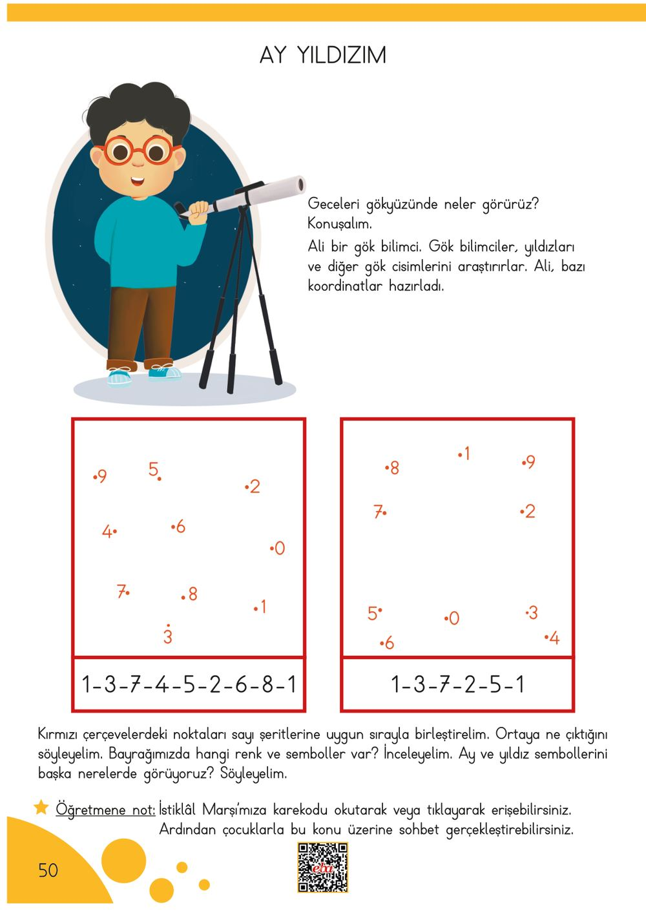

Geceleri gökyüzünde neler görürüz?
Konuşalım.
Ali bir gök bilimci. Gök bilimciler, yıldızları ve diğer gök cisimlerini araştırırlar. Ali, bazı koordinatlar hazırladı.

| .9 | .5 | | |
|---|---|---|---|
| | .6 | .2 | |
| .4 | | | .0 |
| .7 | .8 | | .1 |
| | .3 | | |
| **1-3-7-4-5-2-6-8-1** | | | |

| | .1 | .9 |
|---|---|---|---|
| .8 | | |
| .7 | | .2 |
| | | |
| .5 | .0 | .3 |
| .6 | | .4 |
| **1-3-7-2-5-1** | | | |

Kırmızı çerçevelerdeki noktaları sayı şeritlerine uygun sırayla birleştirelim. Ortaya ne çıktığını söyleyelim. Bayrağımızda hangi renk ve semboller var? İnceleyelim. Ay ve yıldız sembollerini başka nerelerde görüyoruz? Söyleyelim.

⭐ Öğretmene not: İstiklâl Marşı’mıza karekodu okutarak veya tıklayarak erişebilirsiniz. Ardından çocuklarla bu konu üzerine sohbet gerçekleştirebilirsiniz.

<!-- sayfa 50 -->

# KIRKYAMA

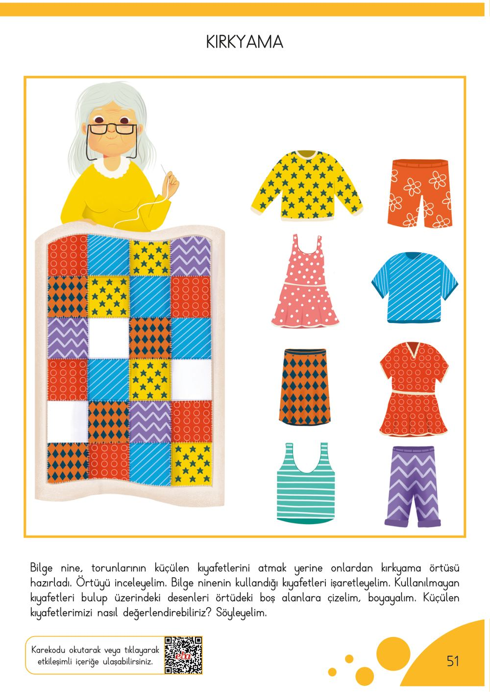

Bilge nine, torunlarının küçülen kıyafetlerini atmak yerine onlardan kırkyama örtüsü hazırladı. Örtüyü inceleyelim. Bilge ninenin kullandığı kıyafetleri işaretleyelim. Kullanılmayan kıyafetleri bulup üzerindeki desenleri örtüdeki boş alanlara çizelim, boyayalım. Küçülen kıyafetlerimizi nasıl değerlendirebiliriz? Söyleyelim.

<!-- sayfa 51 -->

# E SESİ

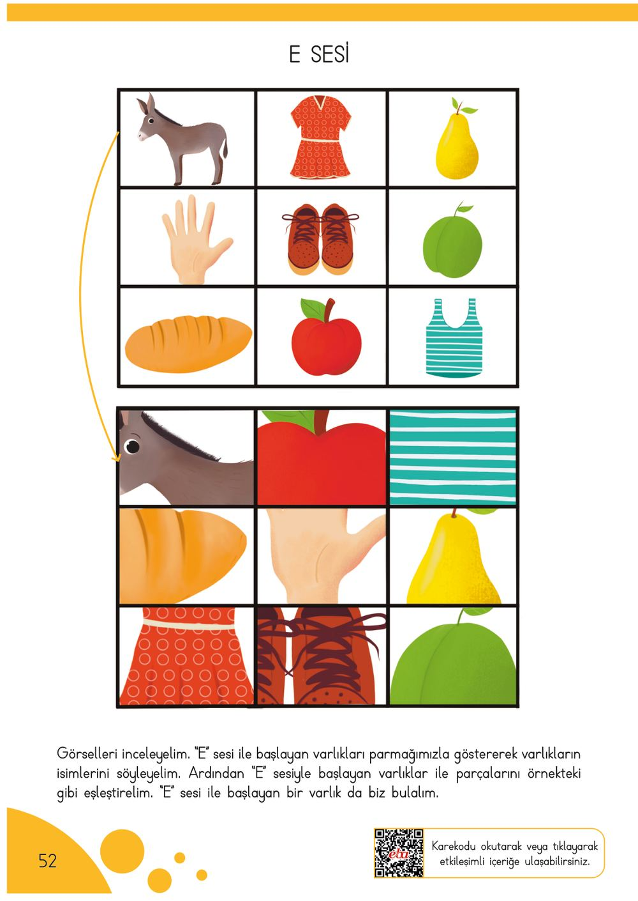

Görselleri inceleyelim. “E” sesi ile başlayan varlıkları parmağımızla göstererek varlıkların isimlerini söyleyelim. Ardından “E” sesiyle başlayan varlıklar ile parçalarını örnekteki gibi eşleştirelim. “E” sesi ile başlayan bir varlık da biz bulalım.

<!-- sayfa 52 -->

# ÇEKİRDEKLERİ SAYALIM

Beril, ay çekirdeklerini tek bir tabakta toplamak istiyor. Önce ilk tabaktaki ay çekirdeklerini sayalım. Sonra diğer tabaktaki ay çekirdeklerini sayalım. Boş tabakta toplam kaç ay çekirdeği olacağını söyleyelim ve örnekteki gibi çizelim.

<!-- sayfa 53 -->

# FOTOĞRAF ALBÜMÜ

İrem, ailesinin fotoğraf albümünü inceliyor. Fotoğraflarda geçmişte kullanılan televizyon, telefon ve bilgisayarı gördü. Bu nesneleri evindeki televizyon, telefon ve bilgisayarla karşılaştırdı. Görselleri inceleyelim. Geçmişte ve günümüzde kullanılan televizyon, telefon ve bilgisayarın benzerliklerini ve farklılıklarını söyleyelim.

<!-- sayfa 54 -->

# TEKNOFEST

Türkiye’nin ilk ve tek Havacılık, Uzay ve Teknoloji Festivali olan TEKNOFEST, bu yıl Fatih’in yaşadığı şehirde yapılıyor. Bu festivalde farklı robotlar bulunuyor. Fatih’in ailesi robotların olduğu bölümü inceliyor. Robotların görsellerini inceleyelim ve görevlerini dinleyelim.

Balık Robot:
Denizaltında araştırma yapan bir robottur.

Hayvan Dostu Robot:
Evcil hayvanların mama kaplarına, gün içinde acıktıklarında tüketebilmeleri için mama koyan robottur.

Yılan Robot:
Afetlerde insanların ulaşamadığı dar yerlere girerek insanlara yardım eden robottur.

Bir robot tasarlayalım ve sayfadaki boş çerçeveye çizelim. Robotumuzun adını ve görevlerini arkadaşlarımıza anlatalım.

<!-- sayfa 55 -->

# YERLİ VE MİLLÎ ÜRETİMLERİMİZ

Kaan, Bilim ve Teknoloji Haftası’nda yerli ve millî üretim araçlarımızla ilgili dört tane şifreyi inceliyor. Şifreleri dinleyelim. Uygun araçları bulup, araçların çerçevesini şifrenin yazdığı şeritle aynı renge boyayalım.

Sadece elektrikle çalışan bir otomobil.

“Hayalet Uçak” olarak adlandırılan, insansız hava aracı ANKA III.

Gece ve gündüz, her koşulda uçabilen helikopter GÖKBEY.

Askeri pilot yetiştirmek için kullanılan iki kişilik başlangıç eğitim uçağı HÜRKUŞ.

Boş bir kâğıt ve boya kalemlerimizi alalım. Biz de ülkemiz için bir araç tasarlayalım, resmini kâğıdımıza çizelim. Bu aracın adı ne olurdu? Söyleyelim.

<!-- sayfa 56 -->

# GÖBEKLİTEPE

Dünyanın en eski yapılarından biri olduğu düşünülen Göbeklitepe Şanlıurfa ilimizdedir. Göbeklitepe’de yaşayan Aysel, ilgisini çeken taşları çizerek bir sudoku oyunu hazırladı. Oyunda her satır ve sütunda her taştan sadece bir tane olması gerekiyor. Boş kutulara uygun taş görsellerini çizelim.

⭐ Öğretmene not: Koruma alanları, müzeler gibi kültürel mirası tanıması için yapılan bu etkinliğin sanal müze gezisine karekodu okutarak

<!-- sayfa 57 -->

# TAKIMYILDIZLARINI KODLAMA

| | |
| :---: | :---: |
|  |  |
|  |  |
|  |  |
|  |  |

Astronom (Gök bilimci) Aylin, bilimsel bir araştırma yapmak için teleskopla gökyüzündeki takımyıldızlarını inceliyor. İncelediği takımyıldızlarını panoya kodluyor. Panodaki noktaları çizgiyle birleştirerek takımyıldızlarını oluşturalım.

<!-- sayfa 58 -->

# KÜPLERİ PAYLAŞTIRIYORUM

Her çocuğun sepetine dört tane küp koymamız gerekiyor. Ama bazı küpler birbirine takılı kalmış. Adaletli bir paylaşım yapabilmek için küpleri dörderli olacak şekilde gruplayalım ve çocukların sepetine çizgi çizerek götürelim.

İçlerinden birine diğerlerinden daha fazla küp verilseydi ne olurdu? İçlerinden birine diğerlerinden daha az küp verilseydi ne olurdu? Anlatalım.

<!-- sayfa 59 -->

# SİNCAP KIPIR

Sincap Kıpır, bu adadaki ağaçta yaşıyor. Bir gün evde çok sıkılınca arkadaşı Baykuş Payki’nin evine doğru yol çıkmış. Arkadaşı ile zaman geçirdikten sonra eve dönüş yolunda bir palamut bulmuş.

Resimde Sincap Kıpır $\begin{array}{|c|c|} \hline 2 & \text{\color{red}●} \\ \hline \end{array}$ <!-- KONTROL: Marker'da karşılığı yok, uydurma olabilir --> kesişiminde görünmektedir.

Baykuş Payki’nin evi hangi kesişimdedir? $\begin{array}{|c|c|} \hline  &  \\ \hline \end{array}$ <!-- KONTROL: Marker'da karşılığı yok, uydurma olabilir -->

Sincap Kıpır’ın evi hangi kesişimdedir? $\begin{array}{|c|c|} \hline  &  \\ \hline \end{array}$ <!-- KONTROL: Marker'da karşılığı yok, uydurma olabilir -->

$\begin{array}{|c|c|} \hline 4 & \text{\color{green}●} \\ \hline \end{array}$ <!-- KONTROL: Marker'da karşılığı yok, uydurma olabilir --> kesişimine bir palamut çizelim.

<!-- sayfa 60 -->

# KELİME BULMACA ( İ SESİ)

Görseldeki çocuklar "Kelime Bulmaca" oyunu oynuyor. Çocuklar sırayla yanındaki arkadaşına "İ" sesi ile başlayan bir kelime söylüyor. Çocukların söylediği kelimeleri dinleyelim. Son çocuk neler söylemiş olabilir? Tahmin edelim. Söylemiş olabileceği , "İ" sesi ile başlayan nesnelerin kutusunu bulalım ve çerçevesini boyayalım.

İNEK
İTFAİYE

<!-- sayfa 61 -->

# AĞACIN TEPESİNDEKİ ELMA

-Of, yetişemiyorum! Bu dallar çok yüksek, en güzel elmalar da en üst dallarda duruyor.
Benekli kedi ne kadar uğraşsa da istediği elmaya bir türlü ulaşamadı. Sincap, yan ağaçta dalların arasında oturmuş, keyifle elmasını yiyordu. Sesleri duyunca kafasını uzattı. “Ne yapıyorsun?” dedi şaşkın şaşkın bakarak.
-Şu en üstteki elmayı almaya çalışıyorum. Baksana ne kadar da büyük! Onu yiyince biraz daha toplayıp eve de götüreceğim. Sincap gülümseyerek “Onu almakta ne var?” dedi. Hızla ağacın en tepesine tırmandı. Benekli kedinin istediği elmayı hemen ona getirdi. Sincap elmayı verirken düşündü.
-Eve de elma götürmek çok iyi bir fikir, annem de elmaya bayılır!
Benekli kedi ve sincap beraber elmaları topladı. Dört tane büyük elma ve dört tane de küçük elma vardı. Sıra paylaşmaya geldi.

Öyküyü dinleyelim. Öyküdeki benekli kedi ve sincap elmaları adaletli bir şekilde nasıl paylaşmıştır? Düşünelim.

<!-- yer tutucu bulunamadı: sayfa sonuna eklendi -->

<!-- sayfa 62 -->

# ELMALARI PAYLAŞTIRIYORUM

Görselleri inceleyelim. Ağaçtaki elmaları sayalım. Elmaları kedi ve sincabın sepetlerine eşit olacak şekilde çizgi çizerek paylaştıralım. Paylaşım adil oldu mu? Nedenini söyleyelim.

⭐ <u>Öğretmene not:</u> Her sepete iki büyük, iki küçük elma olacak şekilde eşit ve adaletli dağılım yapılır.

<!-- sayfa 63 -->

# SOLUCAN YOLU

Solucanlar toprak altında gezinerek toprağı havalandırır ve kompost oluşumuna yardımcı olur. Kompost, yiyecek atıklarının doğaya zarar vermeden dönüştürülerek toprağı besleyen doğal bir gübre hâline getirilmesidir.

Solucanların toprak altında ilerledikleri yolu önce parmağımızla takip edelim. Ardından çizerek tamamlayalım.

<!-- sayfa 64 -->

# KOMPOST YAPALIM

Yiyecek atıkları toprak için çok değerlidir. Bu değeri toprağa kazandırmak için kompost yapabiliriz. Kompost, bitkisel ve hayvansal atıkların oksijenli ve nemli ortamda zamanla çürümesiyle oluşan bir gübredir. Kompost sayesinde atıklar toprağa zarar vermez. Kompost, toprağı besler ve toprağın verimli kalmasını sağlar. Biz de kompost yapım aşamalarını takip ederek kompost hazırlayalım.

1
Yiyecek atıklarını yeşil ve kahverengi yiyecek atıkları olarak ayrıştıralım. Yiyecek atıklarını küçük parçalara ayıralım.

2
Bir kovaya koyarak kuru yapraklar ve dal parçaları koyalım ve nemli kalmalarını sağlayalım. Karanlık olması için kovanın kapağını kapatalım.

3
Bir süre sonra kompostumuz hazır.

4
Bitkimizi ektiğimiz toprağa kompostu karıştırarak bitkimizin daha iyi büyümesine yardımcı olalım.

⭐ Öğretmene not: Okul ortamında kompost yapma fırsatı bulamayan çocuklar için ailelerine

<!-- sayfa 65 -->

# NE ÇİZSEM?

“Ne Çizsem?” şarkısını dinleyelim.
Şarkıyı dinlerken duyduğumuz sayıları, sayı şeridi üzerinde gösterelim.

| 0 | 1 | 2 | 3 | 4 | 5 | 6 | 7 | 8 | 9 | 10 |
|---|---|---|---|---|---|---|---|---|---|----|

Çerçevenin içine seçtiğimiz bir sayıyı yazalım. Yazdığımız sayıyı kullanarak çerçevenin içine bir resim yapalım.

<!-- sayfa 66 -->

# REÇEL KAVANOZLARI

| | | | | | | | |
| :---: | :---: | :---: | :---: | :---: | :---: | :---: | :---: |
| ![şekil] | | | | | | | |
| ![şekil] | | | | | | | |
| ![şekil] | | | | | | | |
| ![şekil] | | | | | | | |

Tarık’ın halasının yöresel ürünler sattığı bir dükkânı var. Tarık, halasına dükkânındaki reçel kavanozlarını sayması için yardım ediyor. 

Raftaki reçel kavanozlarını inceleyelim. Hangi reçelden kaç tane olduğunu grafikte işaretleyelim. 

Grafiğe göre Tarık’ın halasının dükkânında en fazla hangi reçel var? En az hangi reçel var? Söyleyelim.

<!-- sayfa 67 -->

# ÇİZGİLERLE HAYVANLARA ULAŞIYORUM

Çizgileri, örnekteki gibi noktaları birleştirerek tamamlayalım. Her çizgi sonunda gördüğümüz hayvanın sesini ve hareketini taklit edelim.

<!-- sayfa 68 -->

# AĞACI İNCELİYORUM

Görseldeki ağacın bölümlerini inceleyelim. Kök, gövde, dallar ve yaprakları parmağımızla gösterelim. Bahçeye çıkarak bir ağacın bölümlerini inceleyelim. Şeritteki görselde yer alan ağacın gelişim aşamalarını inceleyelim. Gelişim aşamalarını 1'den 4'e kadar sıralayarak kutulara yazalım.

<!-- sayfa 69 -->

# NOKTALAMA İŞARETLERİ

Noktalama işaretlerinin bulunduğu kartları inceleyelim. Noktalama işaretlerinin altındaki yönergeleri dinleyelim.

| . | ? | , | ! |
| :---: | :---: | :---: | :---: |
| Benim adım nokta. Cümlenin sonunda dururum. Biz de sınıfımızda istediğimiz bir yerde nokta gibi duralım. | Benim adım soru işareti. Sorulan soruların sonunda dururum. Biz de bir arkadaşımıza soru soralım. | Benim adım virgül. Sıralı kelimelerin ve cümlelerin arasında dururum. Biz de sınıfımızda gördüğümüz renkleri sırayla söyleyelim. | Benim adım ünlem işareti. Şaşırınca, üzülünce, çok gülünce, çok korkunca cümlelerin sonunda dururum. Biz de çok şaşırmış gibi duralım. |

Hikâyeyi dinleyelim. Hikâyedeki noktalama işaretlerini bulalım. Bu işaretlerin isimlerini söyleyerek onları işaretleyelim.

## KÜTÜPHANEDE BİR GÜN

Elif kütüphanede “Hayvanlar” kitabını arıyordu. Hayvanlar kitabı nerede olabilirdi? Raflara baktı. O sırada aniden rafların arasından mavi, sarı, pembe renkli bir kelebek çıktı! Kelebek uçtu, uçtu ve Serkan’ın kitabına kondu. Serkan o sırada “Hayvanlar” kitabını okuyordu. Elif aradığı kitabı bulmuştu.

<!-- yer tutucu bulunamadı: sayfa sonuna eklendi -->

<!-- sayfa 70 -->

# BİTKİLERİN İHTİYAÇLARI

Görselleri inceleyelim. 2. görseldeki çiçekler neden solmuş olabilir? Konuşalım.
Bitkiler yaşamlarını sürdürebilmek için aşağıdakilerden hangilerine ihtiyaç duyar? Bulalım ve altındaki kutuyu yeşile boyayalım.

|  |  |  |
| :---: | :---: | :---: |
| Güneş ışığı | Kırmızı et | Hava |
| $\square$ <!-- KONTROL: Marker'da karşılığı yok, uydurma olabilir --> | $\square$ <!-- KONTROL: Marker'da karşılığı yok, uydurma olabilir --> | $\square$ <!-- KONTROL: Marker'da karşılığı yok, uydurma olabilir --> |

|  |  |  |
| :---: | :---: | :---: |
| Toprak | Su | Ekmek |
| $\square$ <!-- KONTROL: Marker'da karşılığı yok, uydurma olabilir --> | $\square$ <!-- KONTROL: Marker'da karşılığı yok, uydurma olabilir --> | $\square$ <!-- KONTROL: Marker'da karşılığı yok, uydurma olabilir --> |

<!-- sayfa 71 -->

# BİR GÜNDE KAÇ BARDAK SU İÇTİN?

Ceren, Gülce, Mehmet ve Yusuf suyun önemi ile ilgili araştırma yaptı. Canlıların yaşamını sürdürebilmesi için suya ihtiyaç duyduğunu öğrendiler. Günde kaç bardak su içtiklerini merak ettiler ve bir grafik hazırladılar.

Grafiği inceleyelim. Soruları grafiğe uygun olarak cevaplayalım.

1. En çok su içen çocuğun numarasını bulalım, işaretleyelim.

① ② ③ ④

2. En az su içen çocuk kaç bardak su içmiş? Bulalım, işaretleyelim.

① ② ③ ④

3. Birbiriyle eşit miktarda su içen çocukların kaç bardak su içtiklerini bulalım. İşaretleyelim.

① ② ③ ④ ⑤

<!-- sayfa 72 -->

# TİYATRO SAHNESİ

Bir tiyatro oyunu izleyelim. İzlediğimiz oyunun bize neler hissettirdiği hakkında konuşalım. Hissettiğimiz duygu ile ilgili yüz ifadesini işaretleyelim.

Görselleri inceleyelim. İzlediğimiz tiyatro oyununun sahnesinde gördüğümüz materyalleri işaretleyelim.

⭐ Öğretmene not: Tiyatro gezisi düzenleme imkânı bulunamazsa dijital bir tiyatro gösterisi izlenmesi önerilmektedir. Bu etkinlik 27 Mart Dünya Tiyatrolar Günü’nde

<!-- sayfa 73 -->

# TİYATRO KOSTÜMÜ TASARLIYORUM

Bir tiyatro oyununda sahne aldığımızı hayal edelim. Üzerimizde bir kostümle kendimizi tiyatro sahnesine çizelim.

⭐ Öğretmene not: Sayfadaki karekodda bulunan “Kostüm Dolabı” adlı öykü çocuklara

<!-- sayfa 74 -->

# KODLAMA

Birinci sıradaki görsellerin ismini ve altlarında yazan rakamı söyleyelim. Görsellerin kodlarını örnekteki gibi belirleyip yazalım.

1 
2 
3 
4 
5

( )

( )

( )

( )

( )

( )

( )

( )

<!-- sayfa 75 -->

# EŞİT PAYLAŞIM

Çocuklar elmaları eşit bir şekilde paylaşmak istiyorlar. Her sırada kasalardaki elmaları sayalım. Elmaları çocukların sepetlerine eşit bir şekilde çizgi ile götürerek paylaştıralım.

<!-- sayfa 76 -->

# BAYRAM ŞEKERİ-1

Din don, din don...
Fatma hala zilin sesini duyduğu gibi şekerlik kutusunu aldı. Heyecanla kapıyı açtı. Her zil sesinde şekerlikteki şekerler biraz daha azaldı.
Bu sabah Fatma hala çocuklara neden şeker verdi?
Sizce çocuklar neden Fatma halanın kapısını çaldılar?
Haydi, sayfayı çevirelim, çevirdiğimiz sayfadaki şekerlikte kaç tane şeker kaldığını aklımızda tutup bu sayfaya tekrar dönelim.

<!-- sayfa 77 -->

BAYRAM ŞEKERİ-2

# Bir Bakışta Söyle

Bayramlarda neler yaptığımızı ve evimizdeki bayram hazırlıklarını anlatalım.

<!-- sayfa 78 -->

# HAYVANLARLA İLGİLİ BİLMECELER

Bilmeceleri sırayla dinleyelim.

| | |
| :--- | :--- |
| Çok sever yumakları, Uyur günün yarısı. İyi duyar kulakları. (KEDİ) | Gördüm marul tarlasında, Benzettim bir taşa. Evinden çıkarınca kafasını, Tanıştım onunla. (KAPLUMBAĞA) |
| Bu hangi hayvan olabilir? Tahmin edelim. Uygun görselle çizgi çizerek eşleştirelim. | Bu hangi hayvan olabilir? Tahmin edelim. Uygun görselle çizgi çizerek eşleştirelim. |

| | |
| :--- | :--- |
| Onun için bal yapar arılar, Ormanda dolaşır. Mağarada yaşar, Aldırmaz kışa. Çok düşkündür uykusuna. (AYI) | Yaşamaz bizimle. Evi denizde, gölde. (BALIK) |
| Bu hangi hayvan olabilir? Tahmin edelim. Uygun görselle çizgi çizerek eşleştirelim. | Bu hangi hayvan olabilir? Tahmin edelim. Uygun görselle çizgi çizerek eşleştirelim. |

Görsel ve Genel Ağ Kaynakçası

<!-- sayfa 79 -->

50°D 45°D 40°D 35°D 30°D 25°D
30°N 35°N 40°N 45°N

: Türkiye'nin mülki idare bölümleri, kara ve deniz komşularını gösteren harita.

# TÜRKİYE'NİN MÜLKİ İDARE BÖLÜMLERİ İLE KARA VE DENİZ KOMŞULARI HARİTASI

**Komşu Ülkeler ve Bölgeler:**
* ROMANYA (Bükreş)
* BULGARİSTAN (Sofya)
* GÜRCİSTAN (Tiflis)
* ERMENİSTAN (Erivan)
* NAHÇIVAN Ö.C. (AZERBAYCAN)
* İRAN
* IRAK (Bağdat)
* SURİYE (Şam)
* LÜBNAN (Beyrut)
* KUZEY KIBRIS TÜRK CUMHURİYETİ
* GÜNEY KIBRIS RUM YÖNETİMİ (Lefkoşa)
* MISIR
* İSRAİL (Tel Aviv)
* FİLİSTİN (Gazze Şeridi, Batı Şeria, Kudüs)

**Denizler ve Göller:**
* KARADENİZ
* EGE DENİZİ
* AKDENİZ
* MARMARA DENİZİ
* HAZAR DENİZİ

**Akarsular ve Diğer Coğrafi Unsurlar:**
* Meriç N.
* Sakarya N.
* Kızılırmak N.
* Yeşilırmak N.
* Çoruh N.
* Aras N.
* Kura N.
* Fırat N.
* Dicle N.
* Asi N.
* Seyhan N.
* Ceyhan N.
* Göksu N.
* Büyük Menderes N.
* Küçük Menderes N.
* Gediz N.
* Bakırçay N.
* Nil N.
* Süveyş K.
* Van Gölü
* Tuz Gölü
* Urumiye Gölü

**İller (Harita üzerinde belirtilenler):**
Adana, Adıyaman, Afyonkarahisar, Ağrı, Amasya, Ankara, Antalya, Artvin, Aydın, Balıkesir, Bilecik, Bingöl, Bitlis, Bolu, Burdur, Bursa, Çanakkale, Çankırı, Çorum, Denizli, Diyarbakır, Edirne, Elâzığ, Erzincan, Erzurum, Eskişehir, Gaziantep, Giresun, Gümüşhane, Hakkâri, Hatay, Isparta, Mersin, İstanbul, İzmir, Kars, Kastamonu, Kayseri, Kırklareli, Kırşehir, Kocaeli, Konya, Kütahya, Malatya, Manisa, Kahramanmaraş, Mardin, Muğla, Muş, Nevşehir, Niğde, Ordu, Rize, Sakarya, Samsun, Siirt, Sinop, Sivas, Tekirdağ, Tokat, Trabzon, Tunceli, Şanlıurfa, Uşak, Van, Yozgat, Zonguldak, Aksaray, Bayburt, Karaman, Kırıkkale, Batman, Şırnak, Bartın, Ardahan, Iğdır, Yalova, Karabük, Kilis, Osmaniye, Düzce.

**Harita Lejantı:**
* BAŞKENT (Ankara)
* İL MERKEZİ
* GÖL
* AKARSU
* ÜLKE SINIRI
* ÖZERK BÖLGE SINIRI

**Ölçek:**
0 - 100 - 200 - 300 - 400 km

Harita Genel Müdürlüğü tarafından üretilmiştir.
