# Okul Öncesi Eğitim 5 Yaş Çekirdek 4 Ders Kitabı

<!-- sayfa 0 -->

# OKUL ÖNCESİ EĞİTİM

## 5 Yaş

# Çekirdek 4

## DERS KİTABI

### Yazarlar
Berrin TERCAN
Betül SÜREK
Esma HAYIRLIOĞLU
Ezgi AVCI AŞIR
Işıl ÖZTÜRK
Tuba Nur EROL

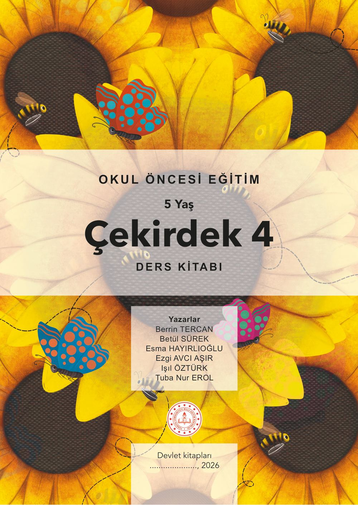

Devlet kitapları

<!-- sayfa 1 -->

DERS KİTAPLARI DİZİSİ .........................................................................................: 2492

Her hakkı saklıdır ve Millî Eğitim Bakanlığına aittir. Kitabın metin, soru ve şekilleri kısmen de olsa hiçbir surette alınıp yayımlanamaz.

**EDİTÖR**
Burcu ÖZKANLI ERTUĞRUL

**DİL UZMANI**
Muhammet ŞEN

**GÖRSEL TASARIMCI**
Eylem YILDIRIM
Melike TURALİ
Metin BİLAL
Serdar TURALİ

**ÇOKLU ORTAM TASARIMCISI**
Abidin AYDIN
Çağdaş SEVİNÇ
Didem EROL
Ezgi SARINÇ
Ferhat DEMİRCİ
İlkay CAN
Onur TÜLÜ
Yudum CAN

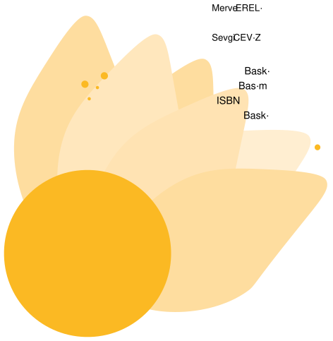

**PROGRAM GELİŞTİRME UZMANI**
Uğur ÇENET

**ÖLÇME VE DEĞERLENDİRME UZMANI**
Merve ERELİ

**REHBERLİK UZMANI**
Sevgi CEVİZ

Baskı Yılı:
Basım Adedi:
ISBN 978-975-11-8089-6
Baskı Yeri:
Adresi:

Millî Eğitim Bakanlığı, Talim ve Terbiye Kurulu Başkanlığının 30.07.2024 tarih ve E-96732399-116.01-111152749 sayılı yazısı ile eğitim aracı olarak kabul edilmiştir. Kurulca bu kitabın kabul edilmiş olması ders kitabından yayınevi ve yazarın/yazarların sorumluluğunu kaldırmaz.

<!-- sayfa 2 -->

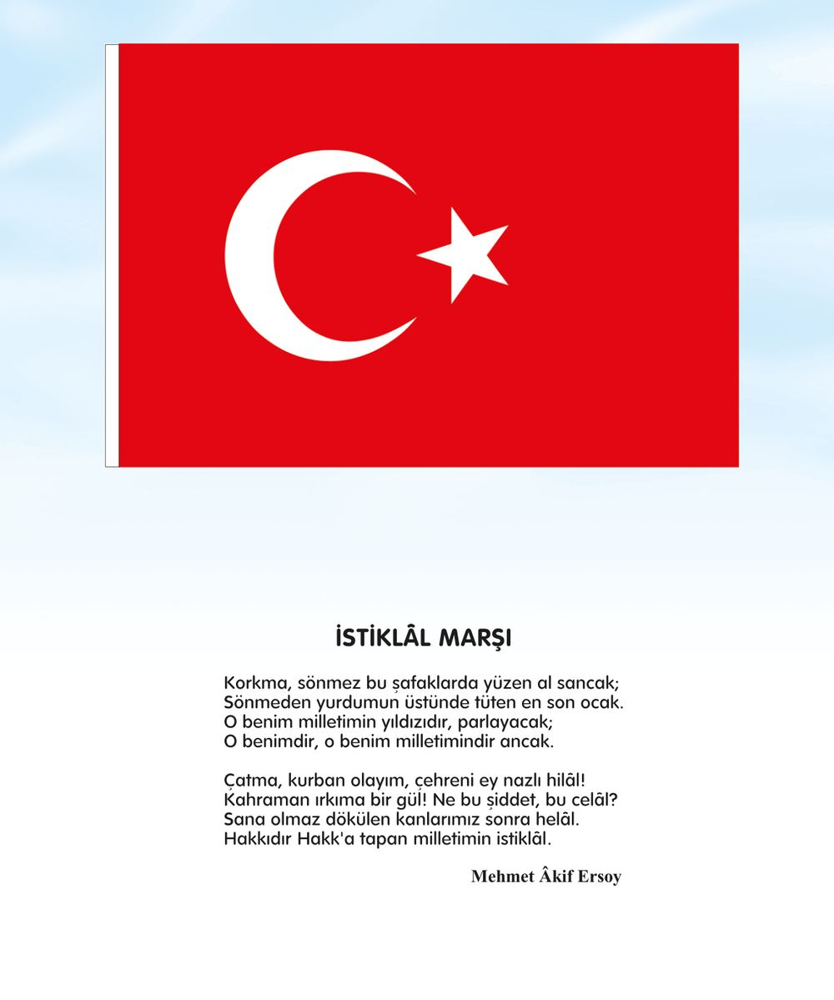

# İSTİKLÂL MARŞI

Korkma, sönmez bu şafaklarda yüzen al sancak;
Sönmeden yurdumun üstünde tüten en son ocak.
O benim milletimin yıldızıdır, parlayacak;
O benimdir, o benim milletimindir ancak.

Catma, kurban olayım, çehreni ey nazlı hilâl!
Kahraman ırkıma bir gül! Ne bu şiddet, bu celâl?
Sana olmaz dökülen kanlarımız sonra helâl.
Hakkıdır Hakk'a tapan milletimin istiklâl.

Mehmet Âkif Ersoy

<!-- sayfa 3 -->

ANDIMIZ

Türküm, doğruyum, çalışkanım.

İlkem küçüklerimi korumak, büyüklerimi saymak; yurdumu, milletimi özümden çok sevmektir.
Ülküm yükselmek, ileri gitmektir.

Ey Büyük Atatürk!

Açtığın yolda, gösterdiğin hedefe durmadan yürüyeceğime ant içerim.

Varlığım Türk varlığına armağan olsun.

Ne mutlu Türküm diyene!

<!-- sayfa 4 -->

MUSTAFA KEMAL ATATÜRK

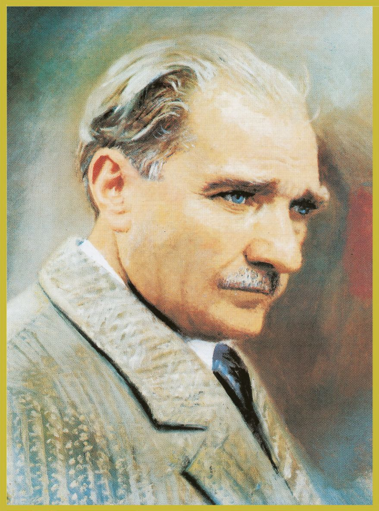
<!-- yer tutucu bulunamadı: sayfa sonuna eklendi -->

<!-- sayfa 5 -->

Verdiğiniz metin katmanı boş olduğu için (`<<< >>>` arası boş) dönüştürülecek bir içerik bulunmamaktadır. Lütfen metin katmanını içeren içeriği paylaşın, böylece kurallarınıza uygun şekilde Markdown formatına çevirebilirim.

<!-- sayfa 6 -->

| | |
| :--- | :---: |
| Benim Arabam | 9 |
| Kaçıncı Atlet | 10 |
| Artma Azalma | 11 |
| Böcek Oteli Öykü | 12 |
| Böcek Oteli Etkinlik | 13 |
| Gölge Oyunları | 14 |
| Kilim Motifleri | 15 |
| Süt Çiftliği | 16 |
| Katı-Sıvı-Gaz | 17 |
| Farklı Sesleri Bulalım | 18 |
| Problem Çözme Ağacı | 19 |
| Van Kahvaltısı | 20 |
| Deniz Canlıları | 21 |
| Emre’nin Evi | 22 |
| Battı mı, Yüzdü mü? | 23 |
| Ne Kadar Turşu Kaldı? | 24 |
| Yaprak Çiziyorum | 25 |
| Doğadan İlhamla Tasarım | 26 |
| Kazağın Yolculuğu | 27 |
| Başka Ne Olabilir? | 28 |
| Yolda Neler Gördüm? | 29 |
| Giysi Dolabı | 30 |
| Daire, Çember | 31 |
| M Sesi | 32 |
| Vagonlarda Eksik Sayıları Bulalım | 33 |
| Astronot Alper | 34 |
| Ayıcığı Ölçme Yöntemleri | 35 |
| Ağaçlar ve Tohumları | 36 |
| Saat Yönü | 37 |
| Renkli Kaldırım Taşları | 38 |
| Hikâyeyi Tamamlayalım | 39 |
| Kültür Turizmi | 40-41 |
| Canlıların Özellikleri | 42 |
| Hangisi Daha Ağır? | 43 |
| Merhametli Kalpler Yardım Kutusu | 44 |
| T Sesi | 45 |
| Karınca Yolu | 46 |

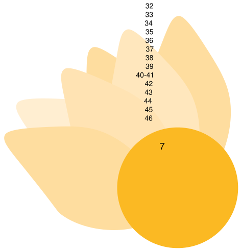
<!-- yer tutucu bulunamadı: sayfa sonuna eklendi -->

<!-- sayfa 7 -->

| | |
| :--- | :---: |
| Şarkı Söyleyelim | 47 |
| Aziz Sancar | 48 |
| Ağaçtan Azalan Elmalar | 49 |
| Hediye Paketleri | 50 |
| Ayçiçeğinin Yaşam Döngüsü | 51 |
| Bloklardan Şekiller | 52 |
| N Sesi ile Biten Sözcükler | 53 |
| Göçmen Kuşlar-1 | 54 |
| Göçmen Kuşlar-2 | 55 |
| Çiçeklerin Yapraklarını Sayalım | 56 |
| Ölçüyorum | 57 |
| Hayvanların Boyu | 58 |
| Yaz Labirenti | 59 |
| Uzay Mekiği | 60 |
| Oyuncak Müzesi | 61 |
| Atatürk’ün Çocuk Sevgisi | 62 |
| Dünyadan Şapkalar | 63 |
| Farklı Sandalyeler | 64 |
| Kendi Kitabımı Tasarlıyorum | 65 |
| Farklı Bardaklardaki Su | 66 |
| Gezegenler Sudoku | 67 |
| Yeryüzü Şekilleri | 68 |
| Veysel Dede ve Rehber Köpeği Kaşmir | 69 |
| Manavdaki Meyveler ve Sebzeler | 70 |
| Hayvanların Gözleri | 71 |
| Bayram Sabahı Öykü | 72 |
| Bayram Sabahı Etkinlik | 73 |
| Çiçeğin Bölümlerini İnceleyelim | 74 |
| Spor Zamanı | 75 |
| Aşure | 76 |
| Değiştir-Dönüştür-Yeniden Kullan | 77 |
| Koleksiyon | 78 |
| Bilmeceler ve Sesler | 79 |
| Görsel ve Genel Ağ Kaynakçası | 79 |
| Türkiye’nin Mülki İdare Bölümleri ile Kara ve Deniz Komşuları Haritası | 80 |

Etkinliklerin ilişkili olduğu beceriler ve süreç bileşenini

<!-- yer tutucu bulunamadı: sayfa sonuna eklendi -->

<!-- sayfa 8 -->

# BENİM ARABAM

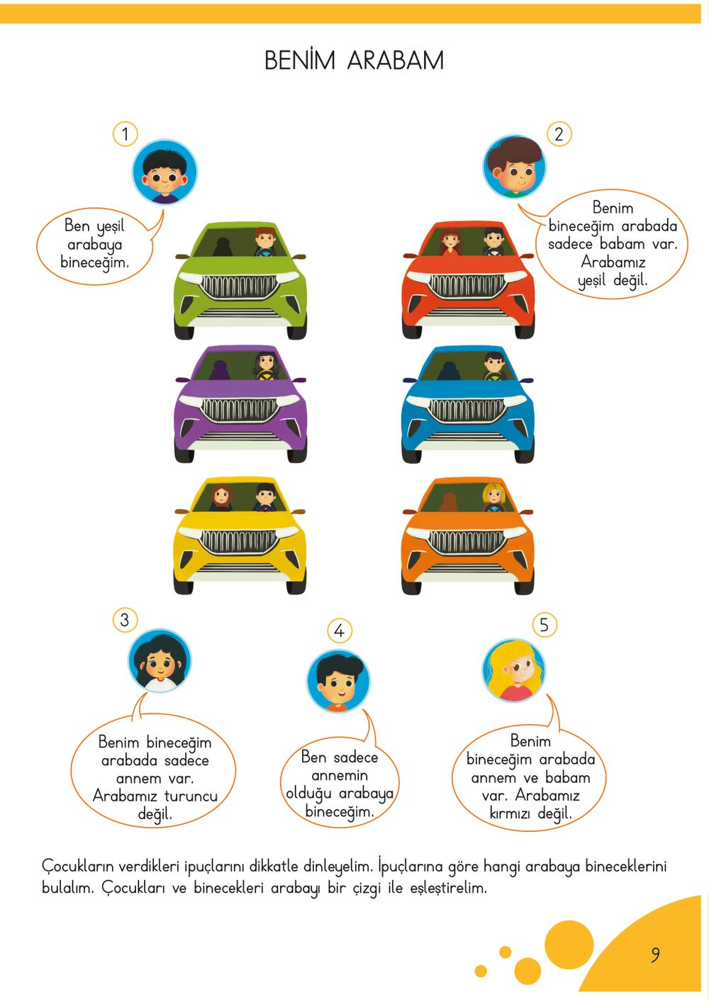

1
Ben yeşil arabaya bineceğim.

2
Benim bineceğim arabada sadece babam var. Arabamız yeşil değil.

3
Benim bineceğim arabada sadece annem var. Arabamız turuncu değil.

4
Ben sadece annemin olduğu arabaya bineceğim.

5
Benim bineceğim arabada annem ve babam var. Arabamız kırmızı değil.

Çocukların verdikleri ipuçlarını dikkatle dinleyelim. İpuçlarına göre hangi arabaya bineceklerini bulalım. Çocukları ve binecekleri arabayı bir çizgi ile eşleştirelim.

<!-- sayfa 9 -->

# KAÇINCI ATLET

Atletizm; koşu, atlama, ağırlık kaldırma vb. tek başına yapılan bireysel sporlara verilen genel addır. Bu sporları yapan kişilere atlet denir. Görseldeki koşucu atletleri inceleyelim.

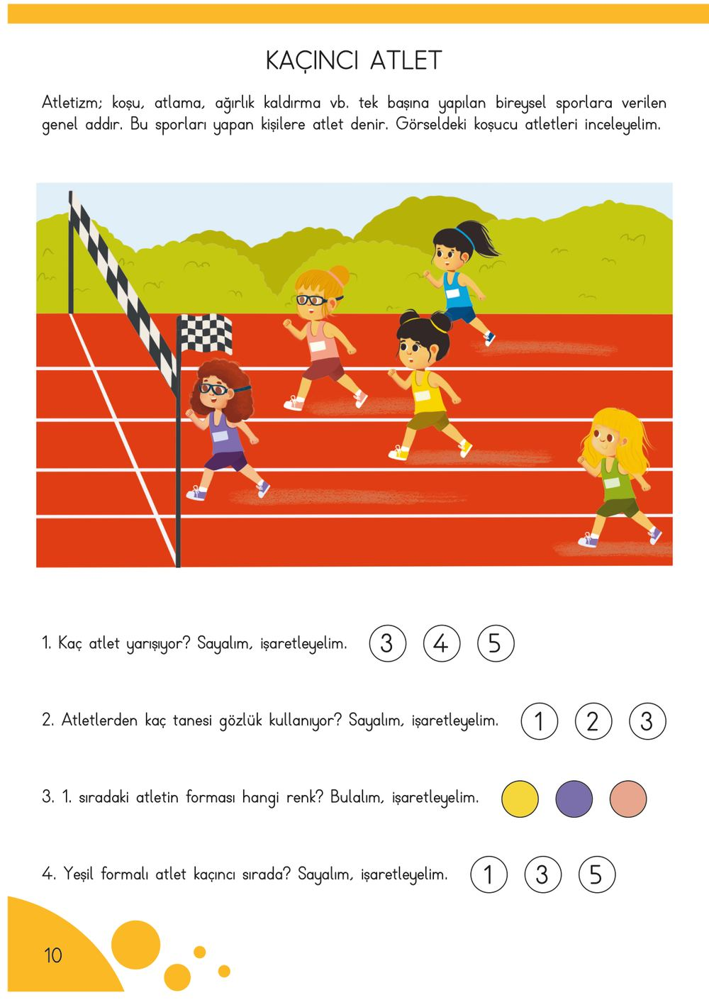

1. Kaç atlet yarışıyor? Sayalım, işaretleyelim.  ③ ④ ⑤

2. Atletlerden kaç tanesi gözlük kullanıyor? Sayalım, işaretleyelim.  ① ② ③

3. 1. sıradaki atletin forması hangi renk? Bulalım, işaretleyelim.  🟡 🟣 🟤

4. Yeşil formalı atlet kaçıncı sırada? Sayalım, işaretleyelim.  ① ③ ⑤

<!-- sayfa 10 -->

# ARTMA AZALMA

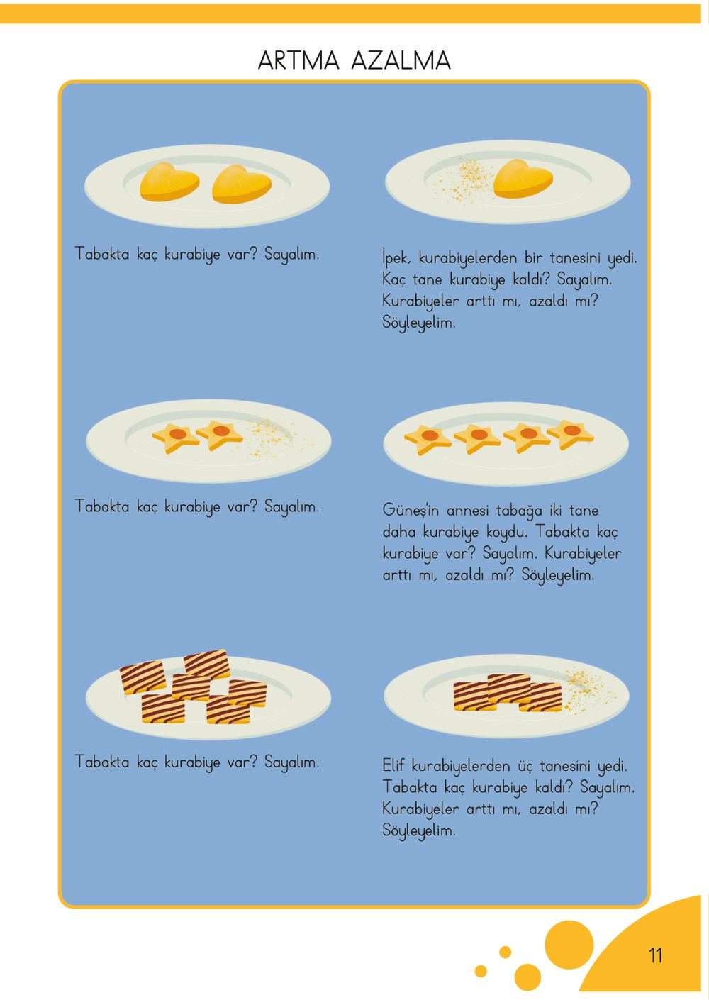
Tabakta kaç kurabiye var? Sayalım.

İpek, kurabiyelerden bir tanesini yedi. Kaç tane kurabiye kaldı? Sayalım. Kurabiyeler arttı mı, azaldı mı? Söyleyelim.

Tabakta kaç kurabiye var? Sayalım.

Güneş’in annesi tabağa iki tane daha kurabiye koydu. Tabakta kaç kurabiye var? Sayalım. Kurabiyeler arttı mı, azaldı mı? Söyleyelim.

Tabakta kaç kurabiye var? Sayalım.

Elif kurabiyelerden üç tanesini yedi. Tabakta kaç kurabiye kaldı? Sayalım. Kurabiyeler arttı mı, azaldı mı? Söyleyelim.

<!-- sayfa 11 -->

# BÖCEK OTELİ ÖYKÜ

![!]
Bu otel diğer otellerden çok farklı. Rezervasyon görevlisi Bay Örümcek özenle ağlarını örerek odaları birbirinden ayırmış, misafirlerini beklemeye başlamıştı. İlk önce çalışkan karıncalar geldi konaklamaya. Bay Örümcek onları birinci kata yerleştirdi. Yorulan karıncalar hemen uykuya daldılar. Ardından hızlı hızlı yürüyen bitler gelerek “Kalacak bir yer var mı?” diye sordular. Bay Örümcek onları ikinci kata yerleştirdi. Hızlı hızlı yürüyen bitler odanın içinde gezinmeye başladılar. Sonra da eğlenceli cırcır böcekleri geldiler otele. Bay Örümcek onları da üçüncü kata yerleştirdi. O anda bir ses geldi!

![?]
Eğlenceli cırcır böcekleri neşeyle şarkılarını söylemeye başladılar. Alt katta konaklayan bitler bu eğlenceyi kaçırırlar mı hiç? Başladılar dans etmeye. Dinlenmek için otelde konaklayan çalışkan karıncalar bitlerin gürültüsüne dayanamadılar. İçlerinden birini üst kata yollayıp onları susturmasını istediler. Karınca bitlerin yanına gidip ‘‘Lütfen biraz sessiz olur musunuz? Uyumaya çalışıyoruz, yarın çok işimiz var.’ dedi. Dedi ama bitler ‘‘Müziği duymuyor musun? Biz nasıl sessiz olalım, yerimizde duramıyoruz.’ diye cevap verdiler ve dans etmeye devam ettiler. Karınca bitlere hak verdi. ‘‘En iyisi üst kata çıkayım, cırcır böceklerine rica edeyim. Şarkılarına yarın devam etsinler.’ diye söylendi. Cırcır böceklerinin yanına çıkarak, ‘‘Şarkı söylemeseniz olur mu? Uyumaya çalışıyoruz.’ dedi. Dedi ama cırcır böcekleri ‘‘Bizim işimiz bu.’ dediler ve söylemeye devam ettiler. Karınca onlara da hak verdi. ‘‘En iyisi Bay Örümceğe danışayım.’ dedi ve yanına gitti.

![.]
Bay Örümcek tüm misafirlerin kendilerince haklı olduğuna karar verdi. Herkesi rahat ettirecek bir yol bulmak için böcek otelinin tüm sakinleri toplandı. Cırcır böceklerinin rahatça şarkı söylemeleri için onları birinci kata, karıncaların dinlenmeleri için onları üçüncü kata yerleştirmeye karar verdiler. Bitler ikinci katta kalmaya devam etti. Böcek otelindeki herkes artık çok rahattı.

Yazan: Emine Özdemir-Nimet Rifaioğlu

Böcek Oteli öyküsünü dinleyelim. Turuncu şeritte bulunan metni inceleyelim. Metinde bulunan ünlem işaretini bulup işaretleyelim. Mor şeritte bulunan metni inceleyelim. Metinde bulunan soru işaretlerini bulup işaretleyelim. Sarı şeritte bulunan metni inceleyelim. Metinde bulunan nokta işaretlerini bulup işaretleyelim.

<!-- sayfa 12 -->

BÖCEK OTELİ ETKİNLİK

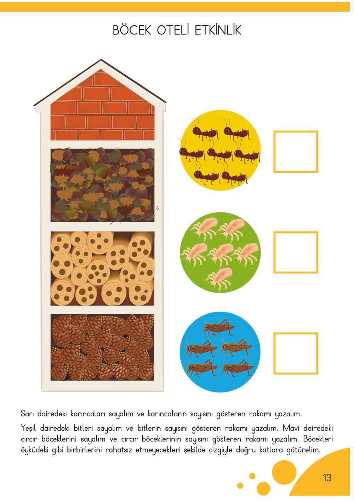

Sarı dairedeki karıncaları sayalım ve karıncaların sayısını gösteren rakamı yazalım. 
Yeşil dairedeki bitleri sayalım ve bitlerin sayısını gösteren rakamı yazalım. Mavi dairedeki 
cırcır böceklerini sayalım ve cırcır böceklerinin sayısını gösteren rakamı yazalım. Böcekleri 
öyküdeki gibi birbirlerini rahatsız etmeyecekleri şekilde çizgiyle doğru katlara götürelim.

<!-- sayfa 13 -->

# GÖLGE OYUNLARI

Ekin ve ailesi mum ışığında gölge oyunu oynadılar. Gölgelerin görsellerini inceleyelim. Gölgeler hangi varlığa ait olabilir? Düşünelim, işaretleyelim.

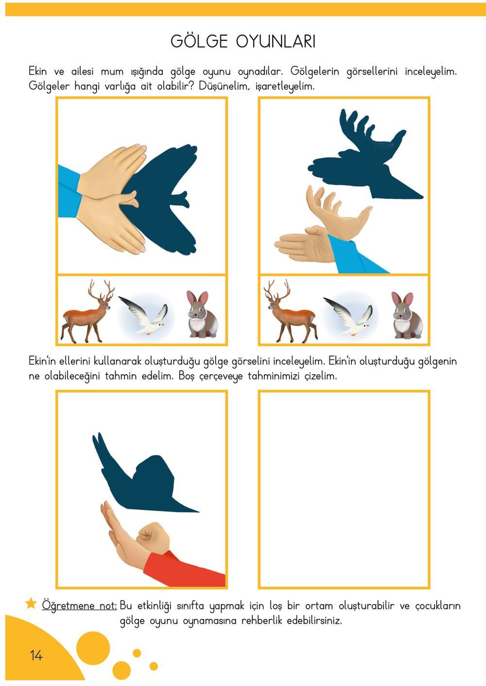

Ekin'in ellerini kullanarak oluşturduğu gölge görselini inceleyelim. Ekin'in oluşturduğu gölgenin ne olabileceğini tahmin edelim. Boş çerçeveye tahminimizi çizelim.

⭐ <u>Öğretmene not:</u> Bu etkinliği sınıfta yapmak için loş bir ortam oluşturabilir ve çocukların gölge oyunu oynamasına rehberlik edebilirsiniz.

<!-- sayfa 14 -->

# KİLİM MOTİFLERİ

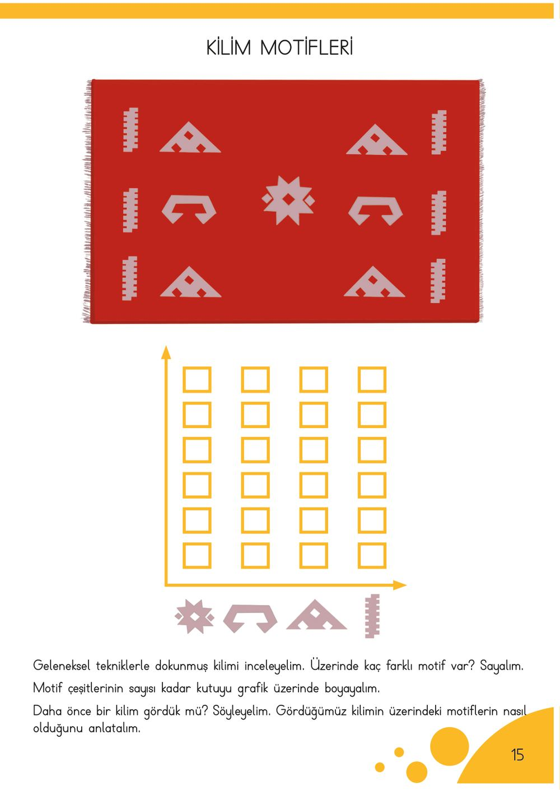

Geleneksel tekniklerle dokunmuş kilimi inceleyelim. Üzerinde kaç farklı motif var? Sayalım.
Motif çeşitlerinin sayısı kadar kutuyu grafik üzerinde boyayalım.
Daha önce bir kilim gördük mü? Söyleyelim. Gördüğümüz kilimin üzerindeki motiflerin nasıl

<!-- sayfa 15 -->

# SÜT ÇİFTLİĞİ

| | | | |
| :---: | :---: | :---: | :---: |
| 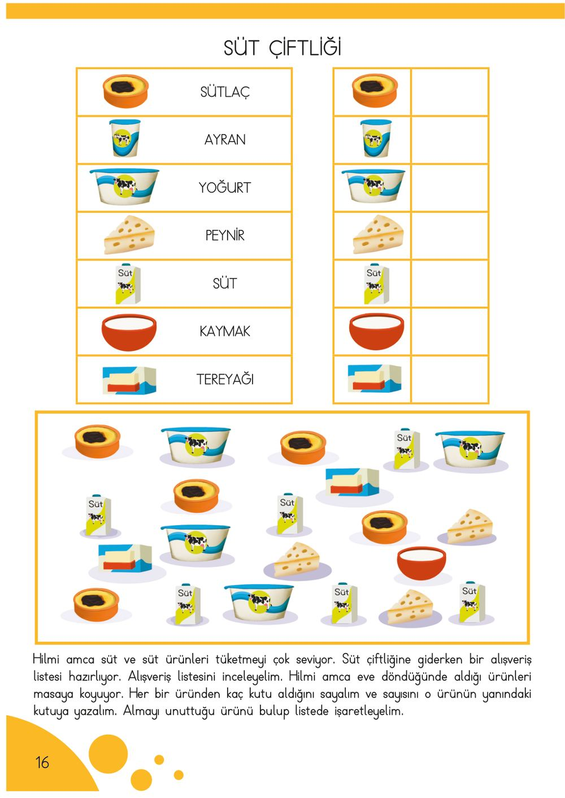 | SÜTLAÇ |  | |
|  | AYRAN |  | |
|  | YOĞURT |  | |
|  | PEYNİR |  | |
|  | SÜT |  | |
|  | KAYMAK |  | |
|  | TEREYAĞI |  | |

Hilmi amca süt ve süt ürünleri tüketmeyi çok seviyor. Süt çiftliğine giderken bir alışveriş listesi hazırlıyor. Alışveriş listesini inceleyelim. Hilmi amca eve döndüğünde aldığı ürünleri masaya koyuyor. Her bir üründen kaç kutu bulup sayalım ve sayısını o ürünün yanındaki kutuya yazalım. Almayı unuttuğu ürünü bulup listede işaretleyelim.

<!-- sayfa 16 -->

# KATI-SIVI-GAZ

| KATI | SIVI | GAZ |
| :---: | :---: | :---: |
| 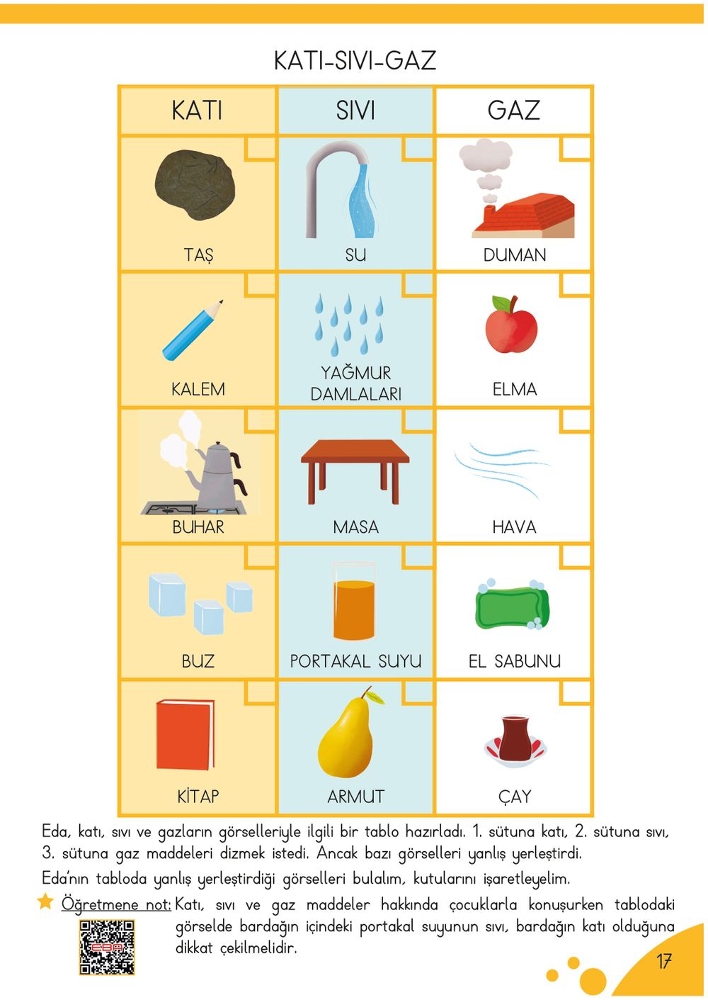 TAŞ |  SU |  DUMAN |
|  KALEM |  YAĞMUR DAMLALARI |  ELMA |
|  BUHAR |  MASA |  HAVA |
|  BUZ |  PORTAKAL SUYU |  EL SABUNU |
|  KİTAP |  ARMUT |  ÇAY |

Eda, katı, sıvı ve gazların görselleriyle ilgili bir tablo hazırladı. 1. sütuna katı, 2. sütuna sıvı, 3. sütuna gaz maddeleri dizmek istedi. Ancak bazı görselleri yanlış yerleştirdi.
Edan'ın tabloda yanlış yerleştirdiği görselleri bulalım, kutularını işaretleyelim.

⭐ **Öğretmene not:** Katı, sıvı ve gaz maddeler hakkında çocuklarla konuşurken tablodaki

<!-- sayfa 17 -->

# FARKLI SESLERİ BULALIM

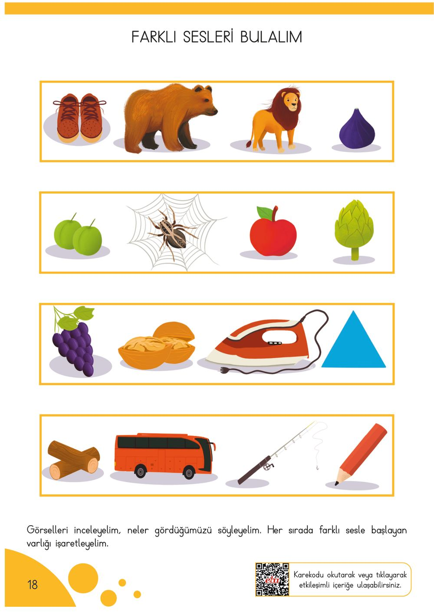

Görselleri inceleyelim, neler gördüğümüzü söyleyelim. Her sırada farklı sesle başlayan varlığı işaretleyelim.

<!-- sayfa 18 -->

# PROBLEM ÇÖZME AĞACI

Görselleri inceleyelim.

| | | |
| :--- | :--- | :--- |
| 1. KÖK | Alp'in sorunu nedir? | Söyleyelim ve ağacın kökünü boyayalım. |
| 2. GÖVDE | Alp ne hissediyor olabilir? | Söyleyelim ve ağacın gövdesini boyayalım. |
| 3. DALLAR | Alp'in sorunu nasıl çözülebilir? | Uygun bulduğumuz çözüm yollarını söyleyelim ve ağacın geri kalan kısımlarını boyayalım. |

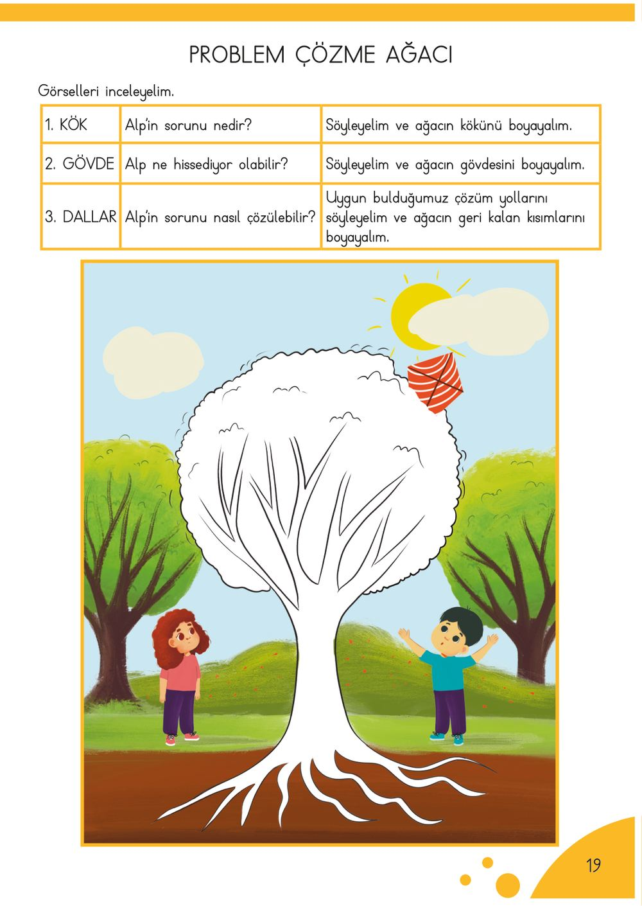

<!-- sayfa 19 -->

# VAN KAHVALTISI

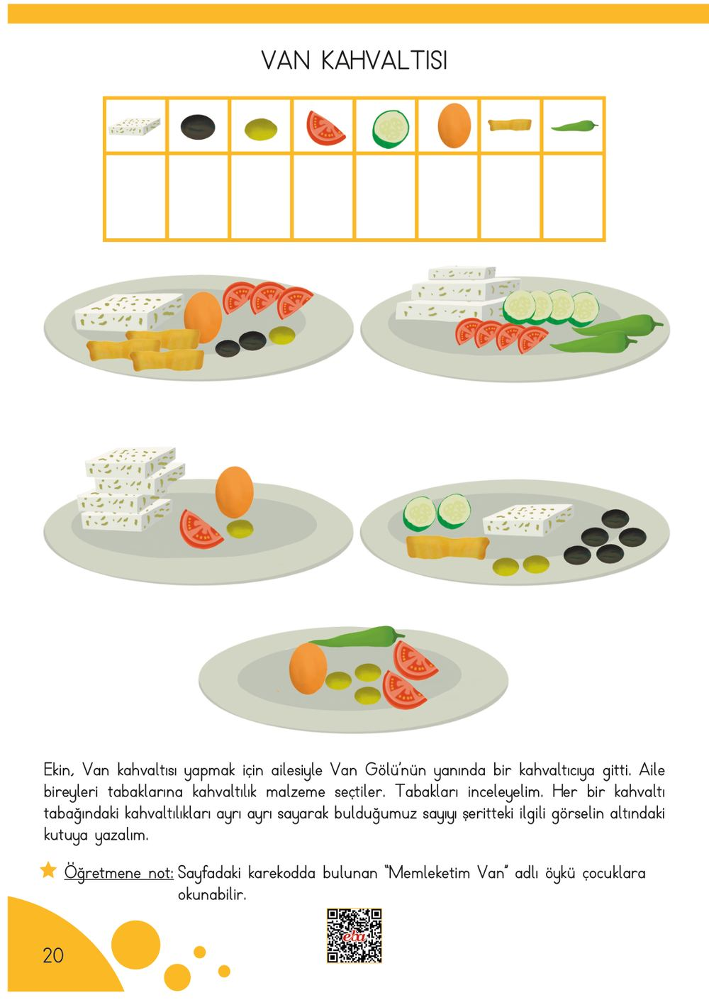

Ekin, Van kahvaltısı yapmak için ailesiyle Van Gölü’nün yanında bir kahvaltıcıya gitti. Aile bireyleri tabaklarına kahvaltılık malzeme seçtiler. Tabakları inceleyelim. Her bir kahvaltı tabağındaki kahvaltılıkları ayrı ayrı sayarak bulduğumuz sayıyı şeritteki ilgili görselin altındaki kutuya yazalım.

⭐ Öğretmene not: Sayfadaki karekodda bulunan “Memleketim Van” adlı öykü çocuklara okunabilir.

<!-- sayfa 20 -->

# DENİZ CANLILARI

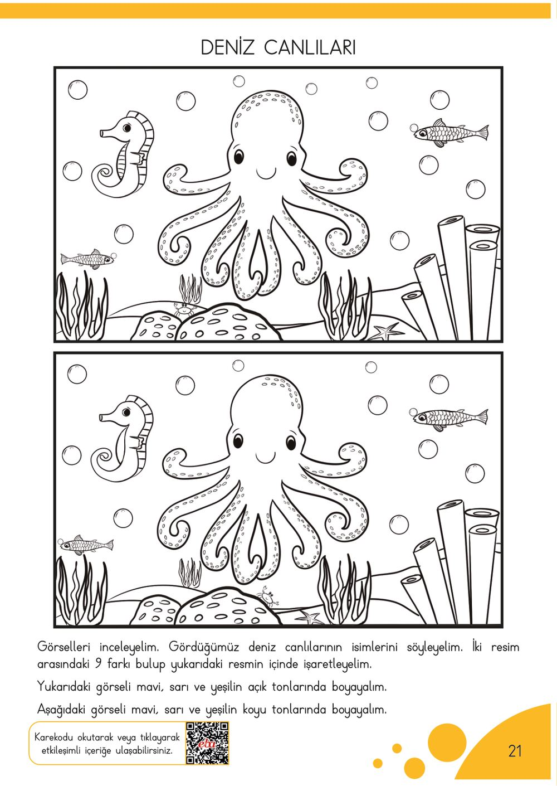

Görselleri inceleyelim. Gördüğümüz deniz canlılarının isimlerini söyleyelim. İki resim arasındaki 9 farkı bulup yukarıdaki resmin içinde işaretleyelim. 

Yukarıdaki görseli mavi, sarı ve yeşilin açık tonlarında boyayalım. 

Aşağıdaki görseli mavi, sarı ve yeşilin koyu tonlarında boyayalım.

<!-- sayfa 21 -->

# EMRENİN EVİ

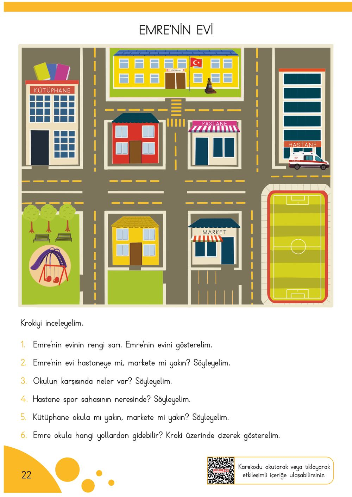

Krokiyi inceleyelim.

1. Emre’nin evinin rengi sarı. Emre’nin evini gösterelim.
2. Emre’nin evi hastaneye mi, markete mi yakın? Söyleyelim.
3. Okulun karşısında neler var? Söyleyelim.
4. Hastane spor sahasının neresinde? Söyleyelim.
5. Kütüphane okula mı yakın, markete mi yakın? Söyleyelim.
6. Emre okula hangi yollardan gidebilir? Kroki üzerinde çizerek gösterelim.

<!-- sayfa 22 -->

# BATTI MI, YÜZDÜ MÜ?

| | |
| :---: | :---: |
| 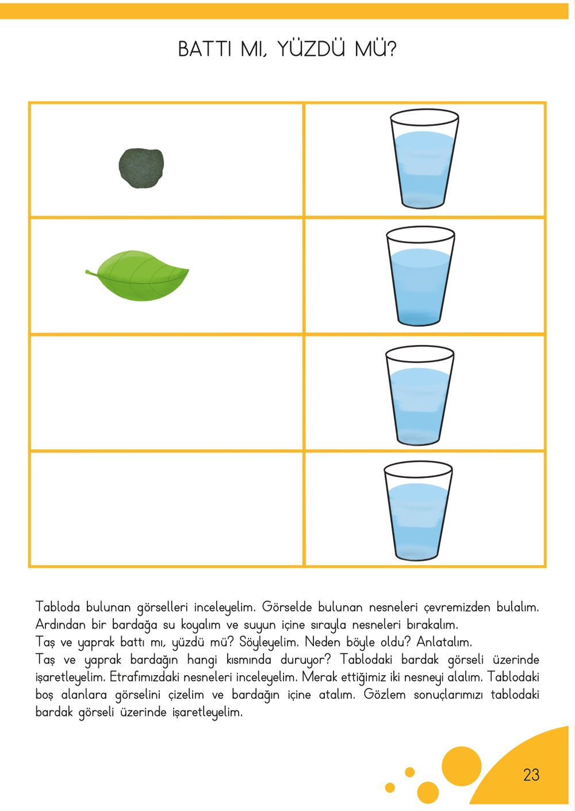 |  |
|  |  |
| |  |
| |  |

Tabloda bulunan görselleri inceleyelim. Görselde bulunan nesneleri çevremizden bulalım. 
Ardından bir bardağa su koyalım ve suyun içine sırayla nesneleri bırakalım.
Taş ve yaprak battı mı, yüzdü mü? Söyleyelim. Neden böyle oldu? Anlatalım.
Taş ve yaprak bardağın hangi kısmında duruyor? Tablodaki bardak görseli üzerinde 
işaretleyelim. Etrafımızdaki nesneleri inceleyelim. Merak ettiğimiz iki nesneyi alalım. Tablodaki 
boş alanlara görselini çizelim ve bardağın içine atalım. Gözlem sonuçlarımızı tablodaki 
bardak görseli üzerinde işaretleyelim.

<!-- sayfa 23 -->

# NE KADAR TURŞU KALDI?

Zehra turşu yemeyi çok seviyor. Havuç turşusunun bulunduğu kavanozda kaç tane havuç var? Sayalım. Zehra turşu kavanozunun içindeki havuçlardan 2 tanesini yedi. Kavanozdaki turşular arttı mı, azaldı mı? Söyleyelim. Turşu kavanozunda kaç tane havuç kaldı? Boş turşu kavanozuna kalan havuçları çizelim.

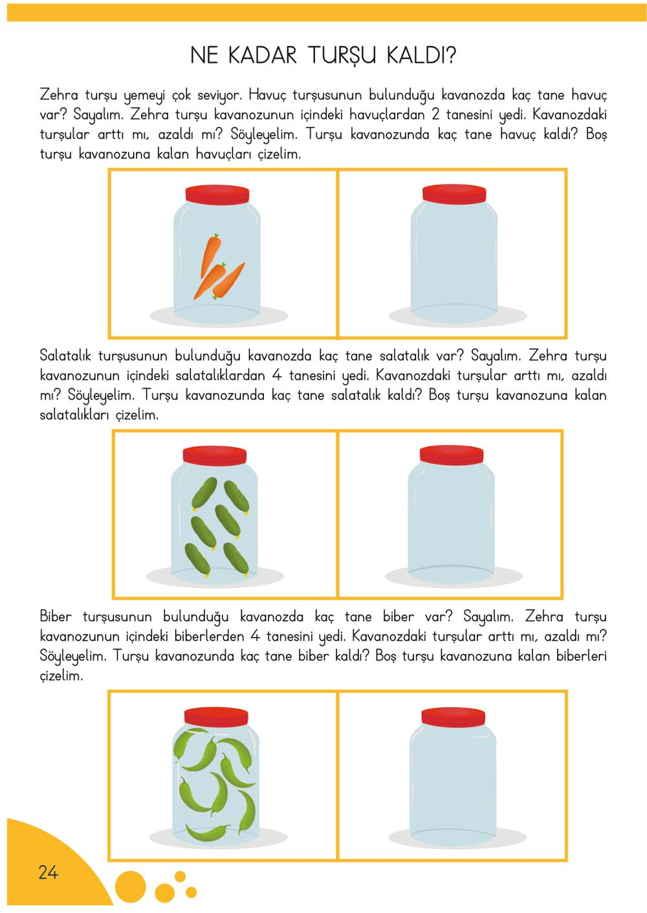

Salatalık turşusunun bulunduğu kavanozda kaç tane salatalık var? Sayalım. Zehra turşu kavanozunun içindeki salatalıklardan 4 tanesini yedi. Kavanozdaki turşular arttı mı, azaldı mı? Söyleyelim. Turşu kavanozunda kaç tane salatalık kaldı? Boş turşu kavanozuna kalan salatalıkları çizelim.

Biber turşusunun bulunduğu kavanozda kaç tane biber var? Sayalım. Zehra turşu kavanozunun içindeki biberlerden 4 tanesini yedi. Kavanozdaki turşular arttı mı, azaldı mı? Söyleyelim. Turşu kavanozunda kaç tane biber kaldı? Boş turşu kavanozuna kalan biberleri çizelim.

<!-- sayfa 24 -->

# YAPRAK ÇİZİYORUM

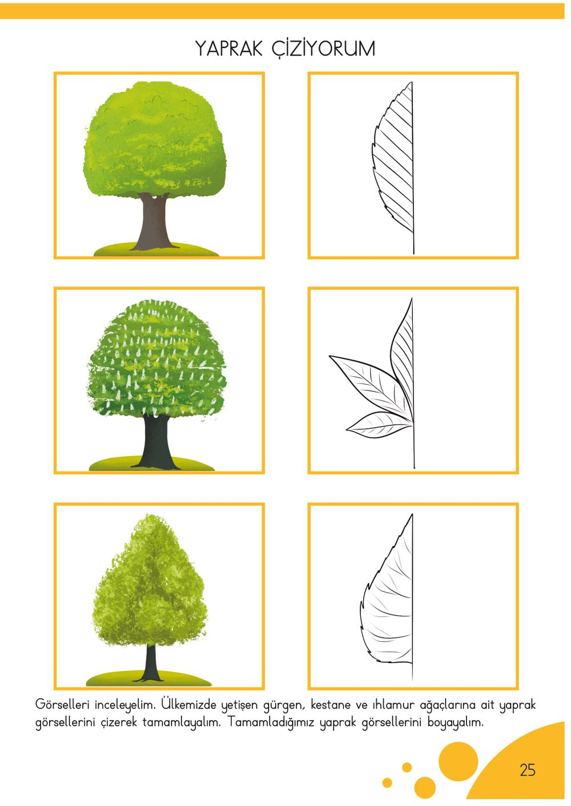

Görselleri inceleyelim. Ülkemizde yetişen gürgen, kestane ve ıhlamur ağaçlarına ait yaprak görsellerini çizerek tamamlayalım. Tamamladığımız yaprak görsellerini boyayalım.

<!-- sayfa 25 -->

# DOĞADAN İLHAMLA TASARIM

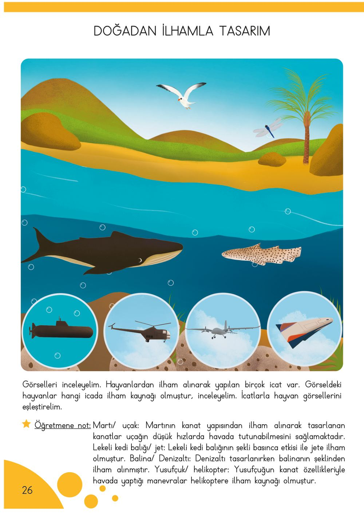

Görselleri inceleyelim. Hayvanlardan ilham alınarak yapılan birçok icat var. Görseldeki hayvanlar hangi icada ilham kaynağı olmuştur, inceleyelim. İcatlarla hayvan görsellerini eşleştirelim.

⭐ Öğretmene not: Martı/ uçak: Martının kanat yapısından ilham alınarak tasarlanan kanatlar uçağın düşük hızlarda havada tutunabilmesini sağlamaktadır.
Lekeli kedi balığı/ jet: Lekeli kedi balığının şekli basınca etkisi ile jete ilham olmuştur.
Balina/ Denizaltı: Denizaltı tasarlanırken balinanın şeklinden

<!-- sayfa 26 -->

# KAZAĞIN YOLCULUĞU

Doğa, annesiyle el işi ürünlerin satıldığı bir pazara gidiyor. Pazarda beğendiği bir kazağı alıyor. Doğa kazağın nasıl hazırlandığını merak ediyor. Annesiyle bir araştırma yapıyor. Görselleri inceleyelim. Kazağın pazara kadar olan yolculuğu hakkında sohbet edelim.

1 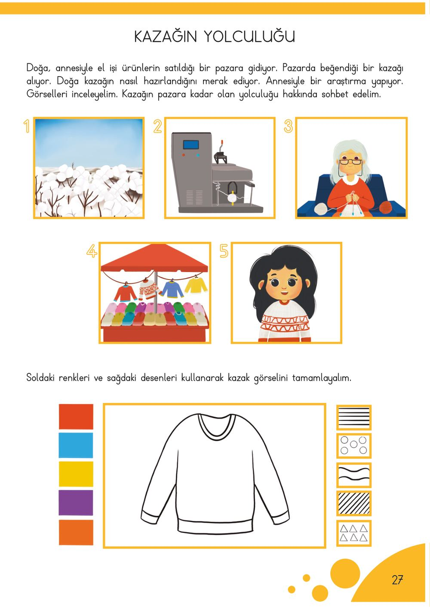
2 
3 
4 
5 

Soldaki renkleri ve sağdaki desenleri kullanarak kazak görselini tamamlayalım.

<!-- sayfa 27 -->

# BAŞKA NE OLABİLİR?

Görseldeki çocuklar bir nesneyi başka bir nesnenin yerine kullanarak oyun oynuyorlar. Görseli inceleyelim.

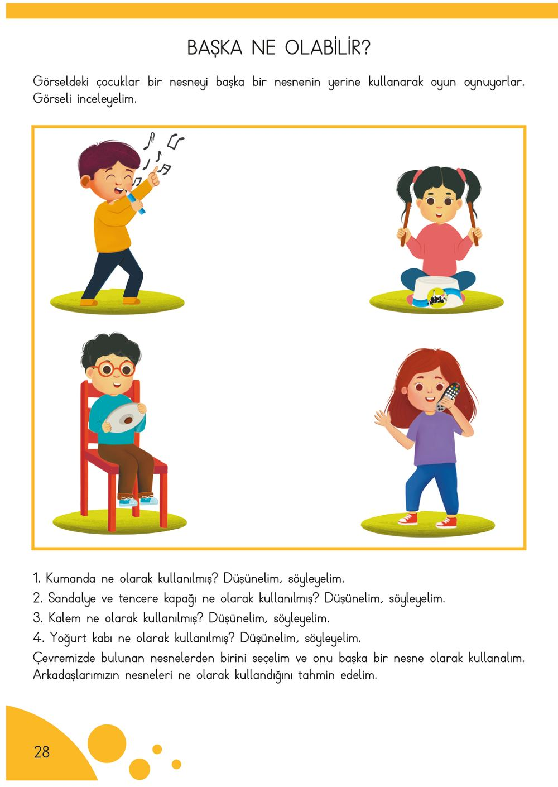

1. Kumanda ne olarak kullanılmış? Düşünelim, söyleyelim.
2. Sandalye ve tencere kapağı ne olarak kullanılmış? Düşünelim, söyleyelim.
3. Kalem ne olarak kullanılmış? Düşünelim, söyleyelim.
4. Yoğurt kabı ne olarak kullanılmış? Düşünelim, söyleyelim.

Çevremizde bulunan nesnelerden birini seçelim ve onu başka bir nesne olarak kullanalım. Arkadaşlarımızın nesneleri ne olarak kullandığını tahmin edelim.

<!-- sayfa 28 -->

# YOLDA NELER GÖRDÜM?

Semih yolu takip ederek evden okula gidiyor. Yolda Semih’in karşısına çıkan canlı ve uçabilen varlıkları kırmızı ile işaretleyelim. Cansız ve uçamayan varlıkları mavi ile işaretleyelim.

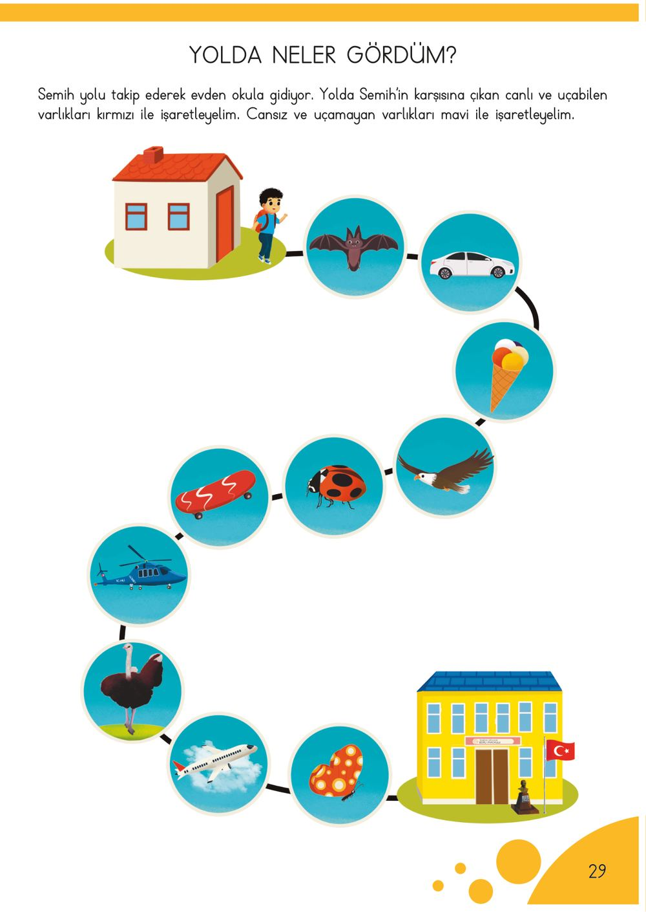

<!-- sayfa 29 -->

# GİYSİ DOLABI

Giysi dolabını inceleyelim. Eşyaların isimlerini söyleyelim.

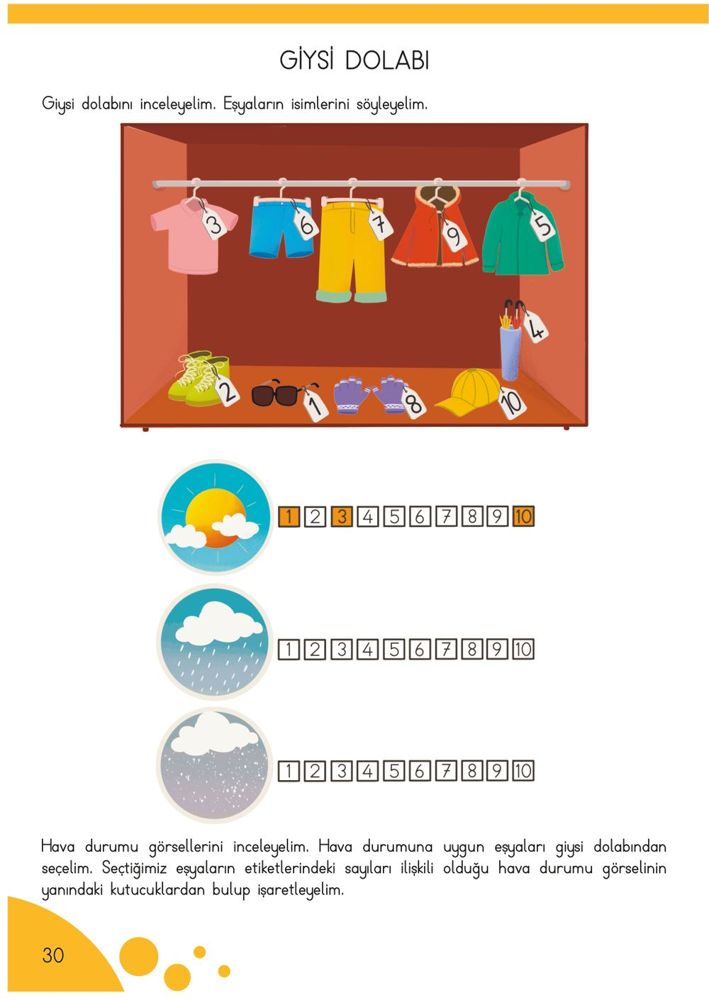

1 2 3 4 5 6 7 8 9 10

1 2 3 4 5 6 7 8 9 10

1 2 3 4 5 6 7 8 9 10

Hava durumu görsellerini inceleyelim. Hava durumuna uygun eşyaları giysi dolabından seçelim. Seçtiğimiz eşyaların etiketlerindeki sayıları ilişkili olduğu hava durumu görselinin yanındaki kutucuklardan bulup işaretleyelim.

<!-- sayfa 30 -->

# DAİRE, ÇEMBER

Berk şekil dedektifi oldu. Birbirine benzeyen iki farklı geometrik şeklin sepetlerini hazırladı. Görselleri inceleyelim. Sepetlerin üzerindeki şekillerin ismini söyleyelim. Nesneleri örnekteki gibi benzediği şeklin olduğu sepete çizgi çizerek götürelim.

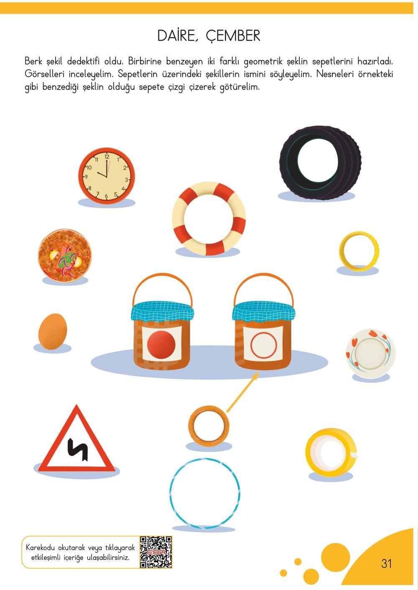

<!-- sayfa 31 -->

M SESİ

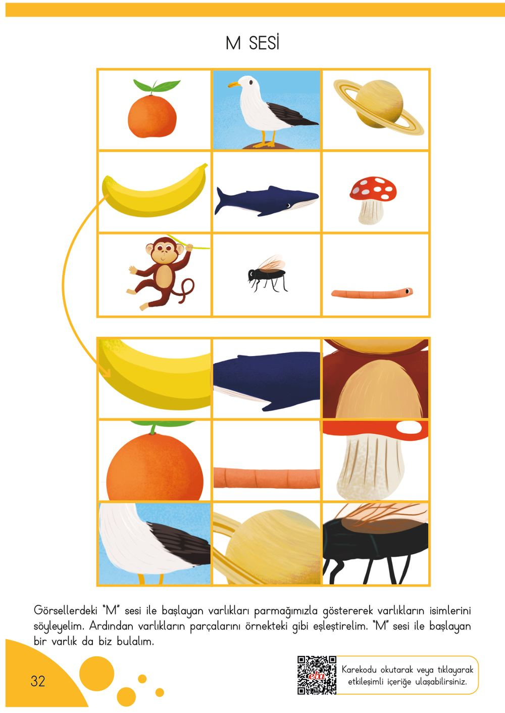

Görsellerdeki “M” sesi ile başlayan varlıkları parmağımızla göstererek varlıkların isimlerini söyleyelim. Ardından varlıkların parçalarını örnekteki gibi eşleştirelim. “M” sesi ile başlayan bir varlık da biz bulalım.

<!-- sayfa 32 -->

# VAGONLARDA EKSİK SAYILARI BULALIM

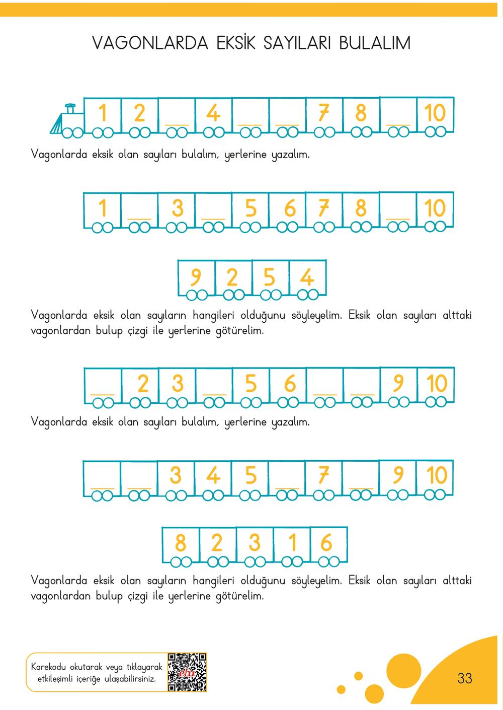

Vagonlarda eksik olan sayıları bulalım, yerlerine yazalım.

Vagonlarda eksik olan sayıların hangileri olduğunu söyleyelim. Eksik olan sayıları alttaki vagonlardan bulup çizgi ile yerlerine götürelim.

<!-- sayfa 33 -->

# ASTRONOT ALPER

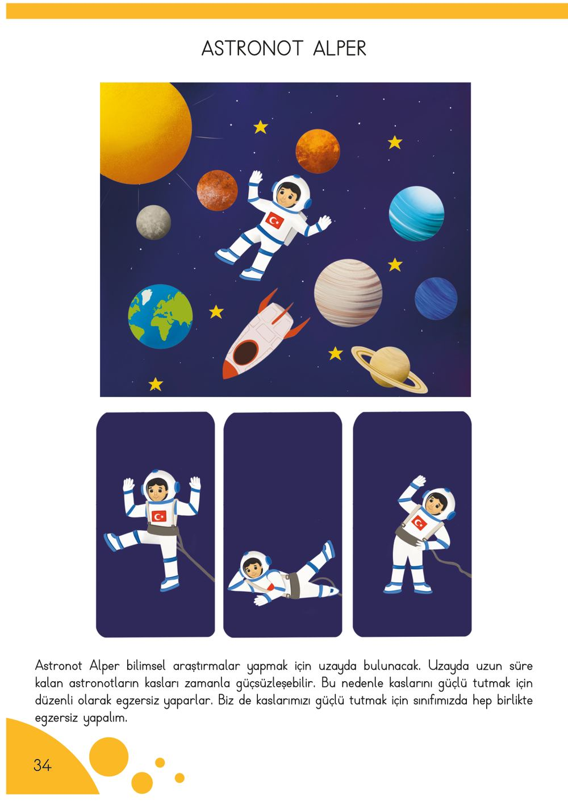

Astronot Alper bilimsel araştırmalar yapmak için uzayda bulunacak. Uzayda uzun süre kalan astronotların kasları zamanla güçsüzleşebilir. Bu nedenle kaslarını güçlü tutmak için düzenli olarak egzersiz yaparlar. Biz de kaslarımızı güçlü tutmak için sınıfımızda hep birlikte egzersiz yapalım.

<!-- sayfa 34 -->

# AYICIĞI ÖLÇME YÖNTEMLERİ

Ayıcığın boyu kaç küp?
Sayalım, kutuya yazalım.

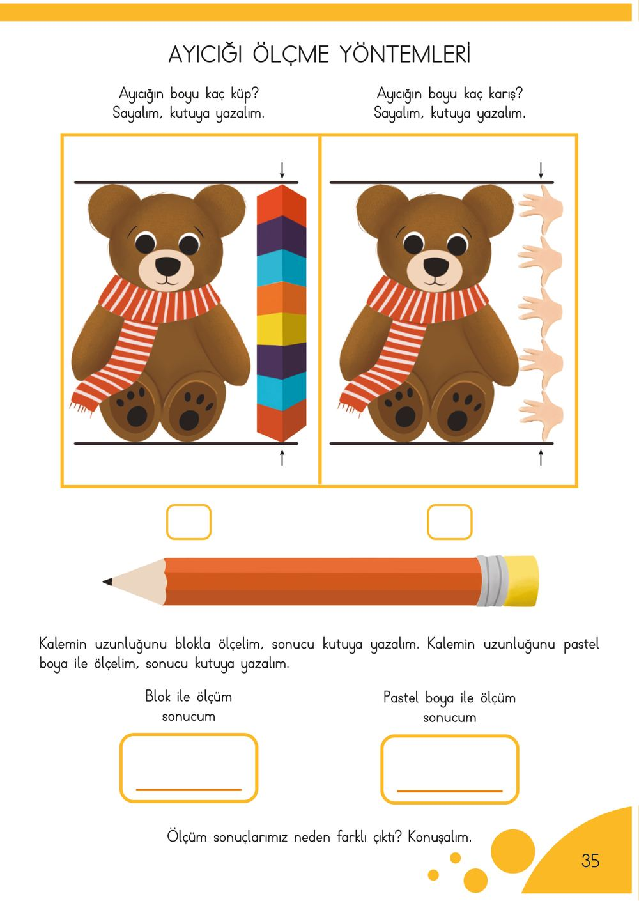: Ayıcığın yanındaki renkli küplerden oluşan sütun ve ayıcık görseli.

Ayıcığın boyu kaç karış?
Sayalım, kutuya yazalım.

: Ayıcığın yanındaki el izlerinden oluşan sütun ve ayıcık görseli.

: Bir adet kurşun kalem görseli.

Kalemin uzunluğunu blokla ölçelim, sonucu kutuya yazalım. Kalemin uzunluğunu pastel boya ile ölçelim, sonucu kutuya yazalım.

Blok ile ölçüm
sonucum
___
: Boş bir kutu.

Pastel boya ile ölçüm
sonucum
___
: Boş bir kutu.

<!-- sayfa 35 -->

# AĞAÇLAR VE TOHUMLARI

Ağaç görsellerini ve tohumlarını inceleyelim. Ağaçların isimlerini söyleyelim. Ağaçlara ait tohumları yandaki kutulardan bulup sayalım. Örnekteki gibi kutuya tohum sayısı kadar çizgi çizelim.

| | |
| :--- | :--- |
| 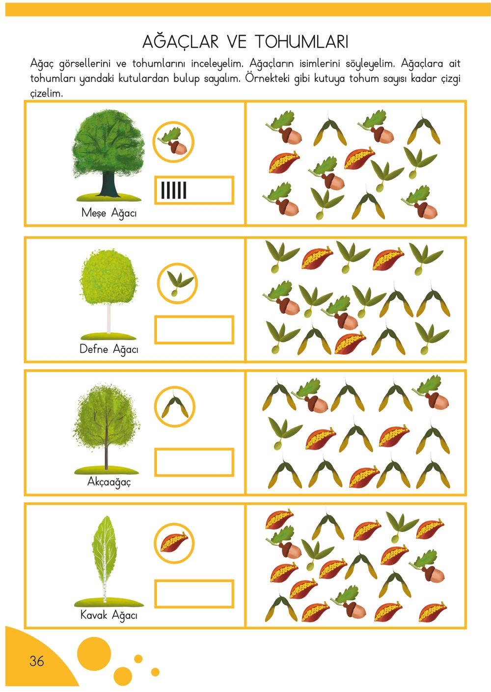   Meşe Ağacı |  |
| | |
|    Defne Ağacı |  |
| | |
|    Akçaağaç |  |
| | |
|    Kavak Ağacı |  |

<!-- sayfa 36 -->

# SAAT YÖNÜ

Saat yönü, akrep ve yelkovanın hareket ettiği yöndür. Mavi ok saat yönünü gösteriyor. Kırmızı ok saat yönünün tersini gösteriyor.

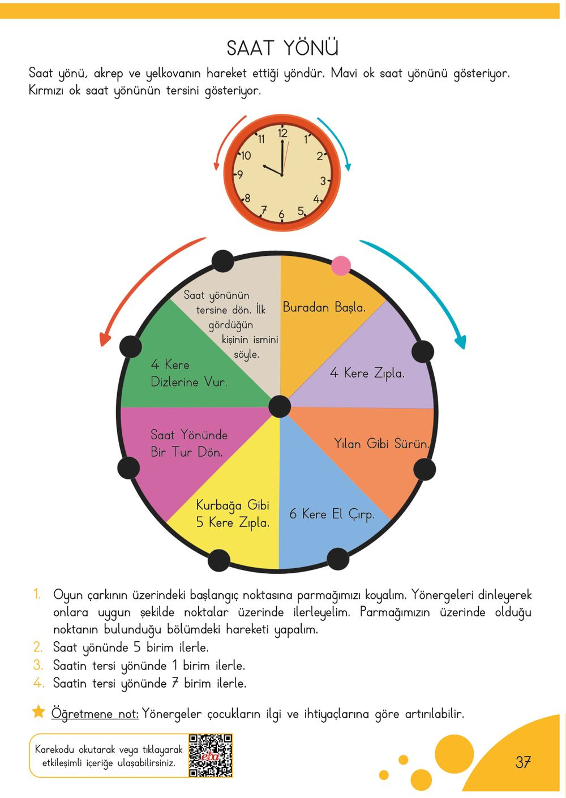

1. Oyun çarkının üzerindeki başlangıç noktasına parmağımızı koyalım. Yönergeleri dinleyerek onlara uygun şekilde noktalar üzerinde ilerleyelim. Parmağımızın üzerinde olduğu noktanın bulunduğu bölümdeki hareketi yapalım.
2. Saat yönünde 5 birim ilerle.
3. Saatin tersi yönünde 1 birim ilerle.
4. Saatin tersi yönünde 7 birim ilerle.

⭐ Öğretmene not: Yönergeler çocukların ilgi ve ihtiyaçlarına göre artırılabilir.

<!-- sayfa 37 -->

# RENKLİ KALDIRIM TAŞLARI

Ceren’in babası, oturdukları evin girişine renkli kaldırım taşları döşeyecek. Ceren, taşların belirli bir sırayla döşenmesini istiyor. İstediği sıralamayı bir kâğıda çizerek babasına veriyor.

Çocukları ilgilendiren konularda onların da görüşlerinin alınması önemlidir. Aileniz evinizle ilgili bir karar alırken sizin fikirlerinizi soruyor mu? Bu durumda kendinizi nasıl hissediyorsunuz? Konuşalım.

Sayfadaki kaldırım taşlarını Ceren’in belirlediği sıralamaya uygun olarak boyayalım.

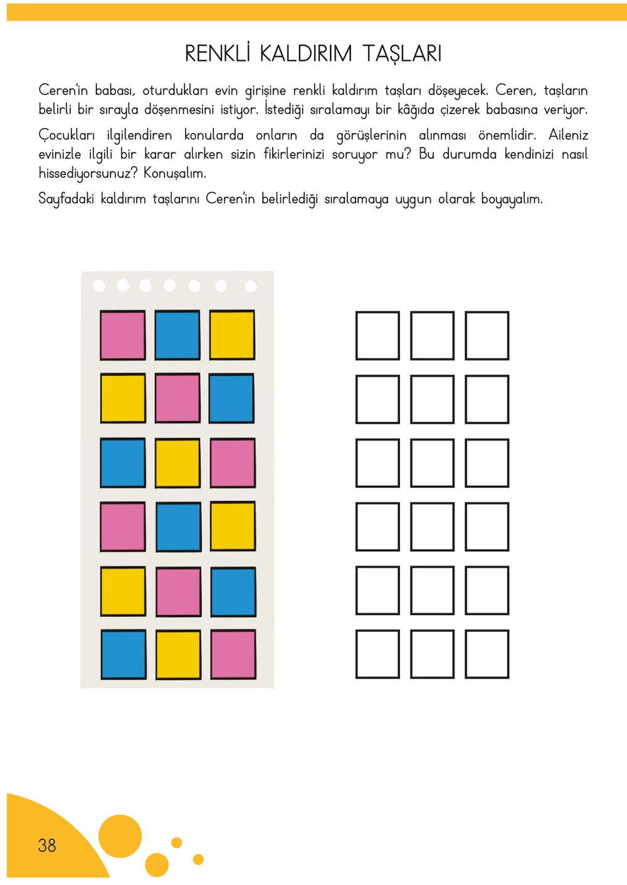

<!-- sayfa 38 -->

# HİKÂYEYİ TAMAMLAYALIM

Hikâyeyi dinleyelim ve sorulara cevap verelim.
Havalar soğumaya başlamıştı. Yapraklar ağaçlardan dökülüyordu.
Minik sincap elindeki fındığı yuvasına götürüyordu.

1. Hikâyede yer alan kahraman kim?

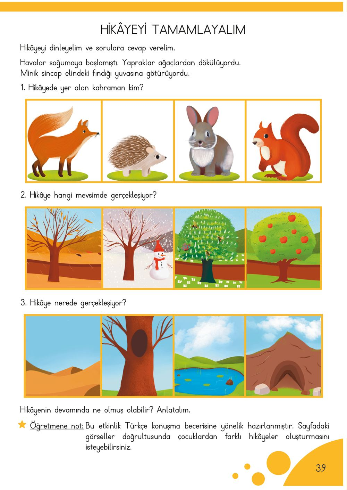

2. Hikâye hangi mevsimde gerçekleşiyor?

3. Hikâye nerede gerçekleşiyor?

Hikâyenin devamında ne olmuş olabilir? Anlatalım.

⭐ <u>Öğretmene not:</u> Bu etkinlik Türkçe konuşma becerisine yönelik hazırlanmıştır. Sayfadaki görseller doğrultusunda çocuklardan farklı hikâyeler oluşturmasını...

<!-- sayfa 39 -->

Kız Kulesi’ne hoş geldin. Burası İstanbul’da bulunan ve denizin ortasında duran bir kuledir. Mersin’de bulunan Kız Kalesi’ni de ailemizle araştıralım.

Pamukkale Travertenleri Denizli’de bulunmaktadır. Kaynak sulardan ve traverten teraslı tepelerden meydana gelir. Haydi, şimdi biz de Pamukkale kelimesini heceleyelim ve hece sayısı kadar el çırpalım.

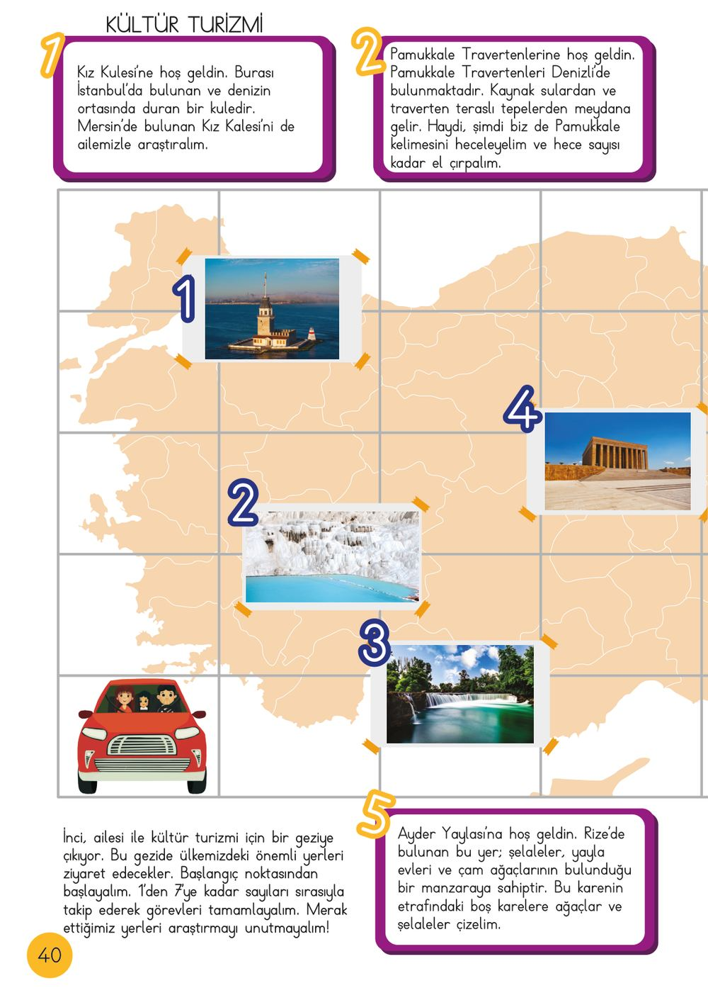

İnci, ailesi ile kültür turizmi için bir geziye çıkıyor. Bu gezide ülkemizdeki önemli yerleri ziyaret edecekler. Başlangıç noktasından başlayalım. 1’den 7’ye kadar sayıları sırasıyla takip ederek görevleri tamamlayalım. Merak

Ayder Yaylası’na hoş geldin. Rize’de bulunan bu yer; şelaleler, yayla evleri ve çam ağaçlarının bulunduğu bir manzaraya sahiptir. Bu karenin etrafındaki boş karelere ağaçlar ve

<!-- sayfa 40 -->

Manavgat Şelalesi’ne hoş geldin. Burası Antalya’nın Manavgat ilçesinde bulunan bir şelaledir. Daha önce hiç şelale gördünüz mü? Nerede gördünüz?

başkentimiz Ankara’da yer alan bir anıttır. Mustafa Kemal Atatürk için yapılan bu anıtın içinde Atatürk’ün eşyalarının sergilendiği bir müze de vardır. Haydi şimdi biz de sınıfımızda asılı olan Atatürk resmini gösterelim.

5
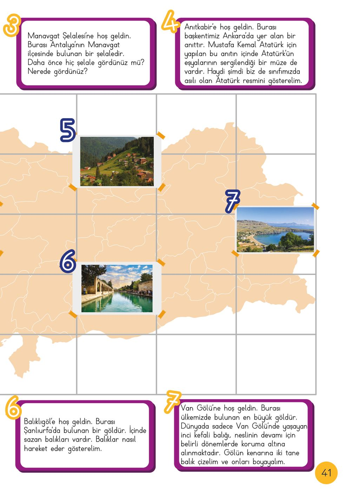

7

6

6
Balıklıgöl’e hoş geldin. Burası Şanlıurfa’da bulunan bir göldür. İçinde sazan balıkları vardır. Balıklar nasıl hareket eder gösterelim.

7
Van Gölü’ne hoş geldin. Burası ülkemizde bulunan en büyük göldür. Dünyada sadece Van Gölü’nde yaşayan inci kefali balığı, neslinin devamı için belirli dönemlerde koruma altına alınmaktadır. Gölün kenarına iki tane

<!-- sayfa 41 -->

# CANLILARIN ÖZELLİKLERİ

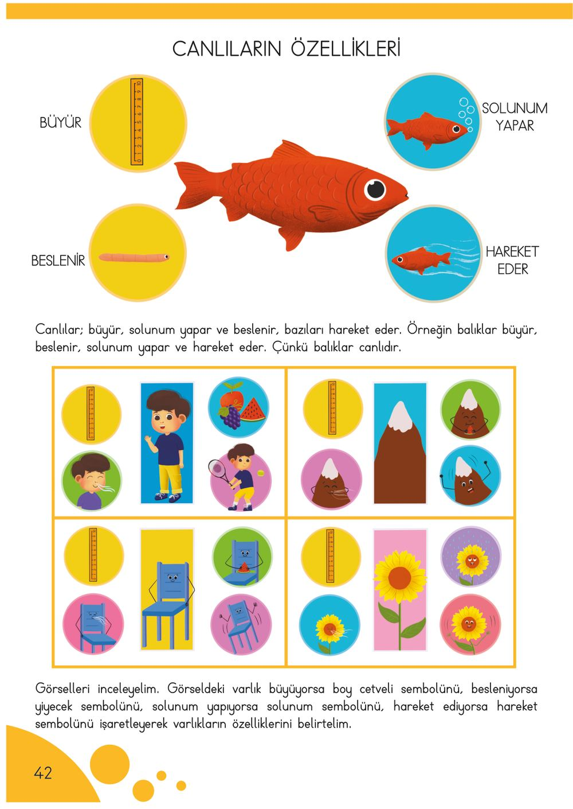

BÜYÜR
BESLENİR
SOLUNUM YAPAR
HAREKET EDER

Canlılar; büyür, solunum yapar ve beslenir, bazıları hareket eder. Örneğin balıklar büyür, beslenir, solunum yapar ve hareket eder. Çünkü balıklar canlıdır.

Görselleri inceleyelim. Görseldeki varlık büyüyorsa boy cetveli sembolünü, besleniyorsa yiyecek sembolünü, solunum yapıyorsa solunum sembolünü, hareket ediyorsa hareket sembolünü işaretleyerek varlıkların özelliklerini belirtelim.

<!-- sayfa 42 -->

# HANGİSİ DAHA AĞIR?

Tavşan ormanda yürürken farklı hayvanlarla karşılaşıyor. Karşılaştığı hayvan tavşandan daha ağırsa kutucuğu maviye, daha hafifse kutucuğu kırmızıya boyayalım.

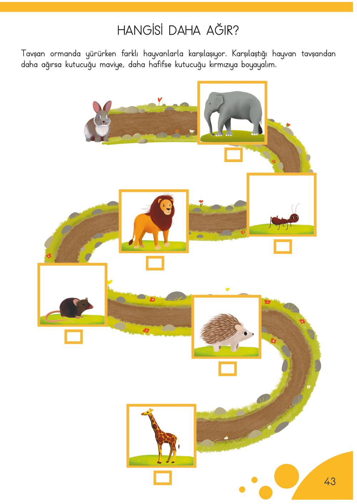

<!-- sayfa 43 -->

# MERHAMETLİ KALPLER YARDIM KUTUSU

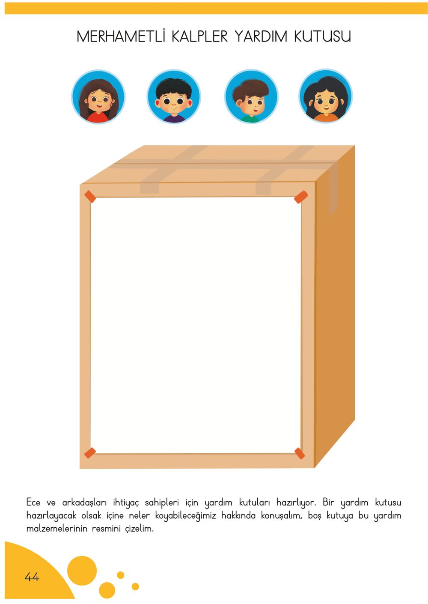

Ece ve arkadaşları ihtiyaç sahipleri için yardım kutuları hazırlıyor. Bir yardım kutusu hazırlayacak olsak içine neler koyabileceğimiz hakkında konuşalım, boş kutuya bu yardım malzemelerinin resmini çizelim.

<!-- sayfa 44 -->

# S SESİ

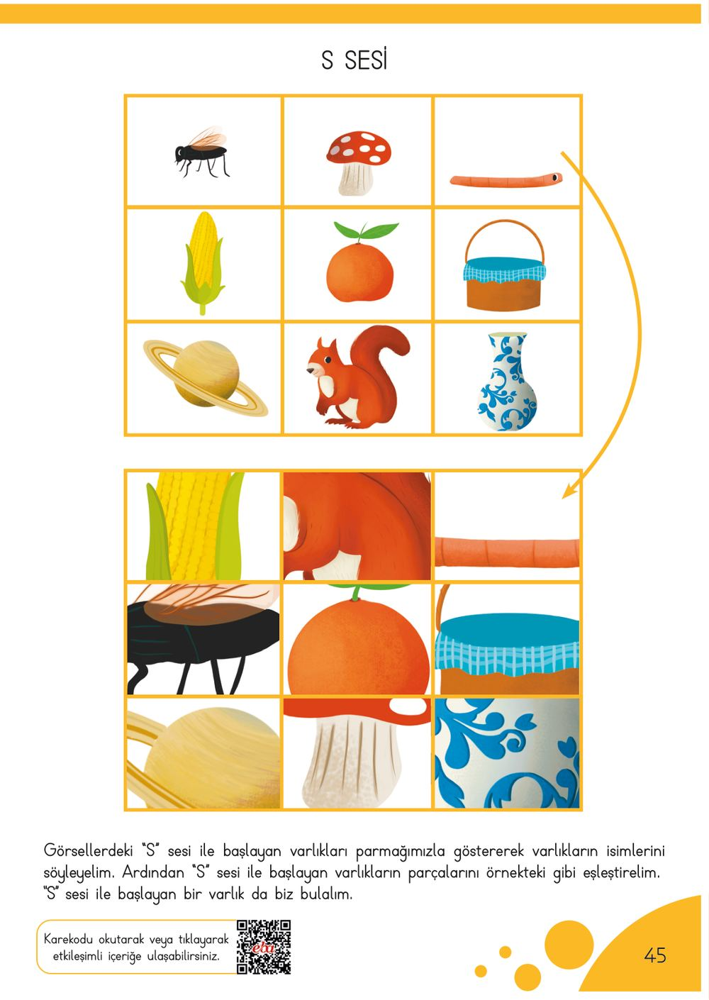

Görsellerdeki “S” sesi ile başlayan varlıkları parmağımızla göstererek varlıkların isimlerini söyleyelim. Ardından “S” sesi ile başlayan varlıkların parçalarını örnekteki gibi eşleştirelim.
‘‘S’ sesi ile başlayan bir varlık da biz bulalım.

<!-- sayfa 45 -->

# KARINCA YOLU

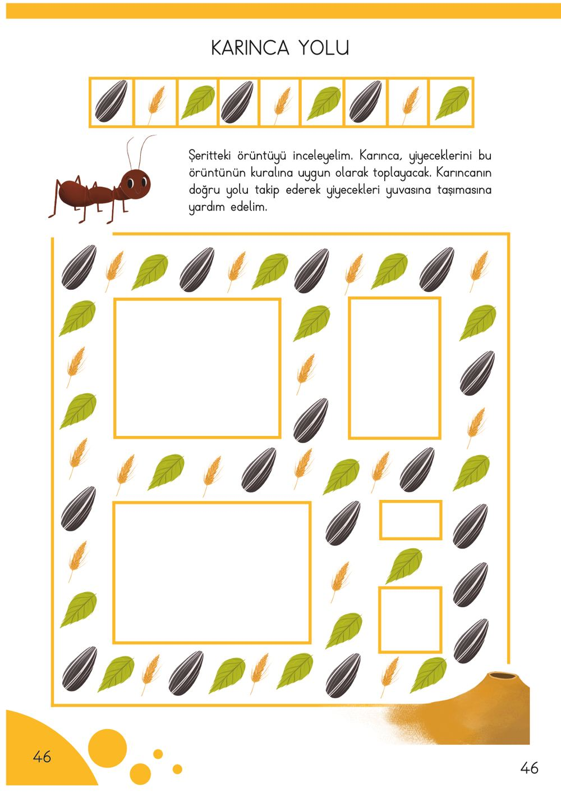

Şeritteki örüntüyü inceleyelim. Karınca, yiyeceklerini bu örüntünün kuralına uygun olarak toplayacak. Karıncanın doğru yolu takip ederek yiyecekleri yuvasına taşımasına yardım edelim.

<!-- sayfa 46 -->

# ŞARKI SÖYLEYELİM

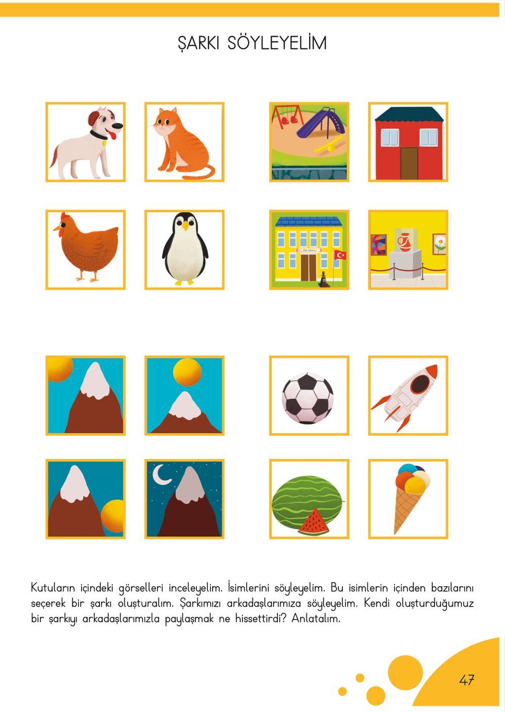

Kutuların içindeki görselleri inceleyelim. İsimlerini söyleyelim. Bu isimlerin içinden bazılarını seçerek bir şarkı oluşturalım. Şarkımızı arkadaşlarımıza söyleyelim. Kendi oluşturduğumuz bir şarkıyı arkadaşlarımızla paylaşmak ne hissettirdi? Anlatalım.

<!-- sayfa 47 -->

# AZİZ SANCAR

Aziz Sancar, yaptığı bilim çalışmaları ile Nobel ödülü almıştır. Aziz Sancar’ın görselini labirentteki yollardan çizgi çizerek Nobel ödülüne ulaştıralım.

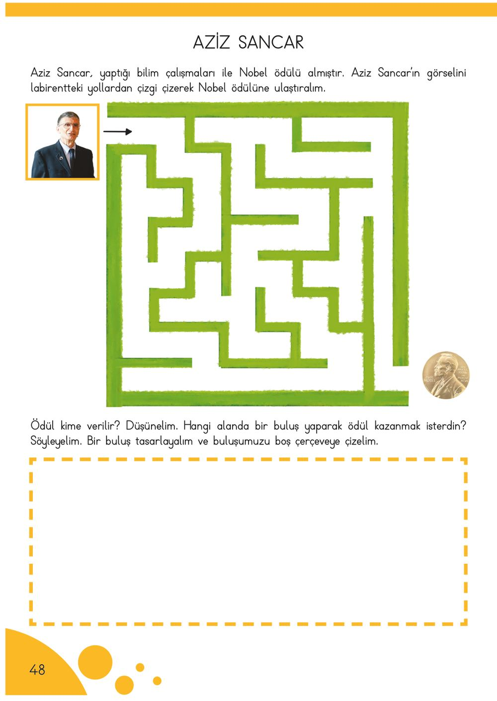

Ödül kime verilir? Düşünelim. Hangi alanda bir buluş yaparak ödül kazanmak isterdin? Söyleyelim. Bir buluş tasarlayalım ve buluşumuzu boş çerçeveye çizelim.

<!-- sayfa 48 -->

# AĞAÇTAN AZALAN ELMALAR

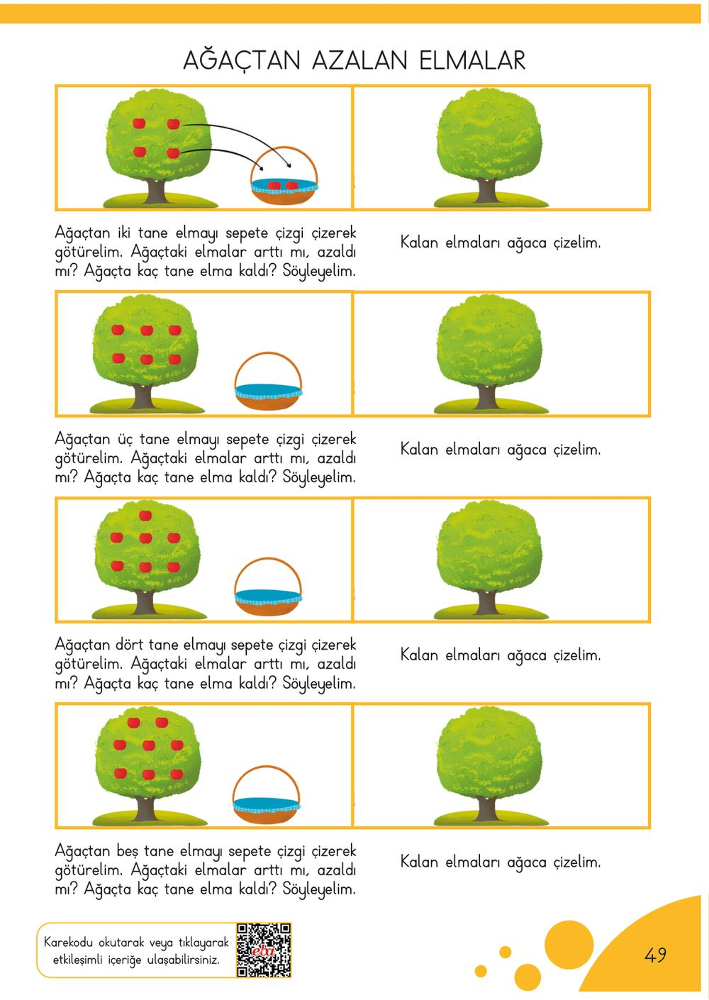

Ağaçtan iki tane elmayı sepete çizgi çizerek götürelim. Ağaçtaki elmalar arttı mı, azaldı mı? Ağaçta kaç tane elma kaldı? Söyleyelim.  Kalan elmaları ağaca çizelim.

Ağaçtan üç tane elmayı sepete çizgi çizerek götürelim. Ağaçtaki elmalar arttı mı, azaldı mı? Ağaçta kaç tane elma kaldı? Söyleyelim.  Kalan elmaları ağaca çizelim.

Ağaçtan dört tane elmayı sepete çizgi çizerek götürelim. Ağaçtaki elmalar arttı mı, azaldı mı? Ağaçta kaç tane elma kaldı? Söyleyelim.  Kalan elmaları ağaca çizelim.

Ağaçtan beş tane elmayı sepete çizgi çizerek götürelim. Ağaçtaki elmalar arttı mı, azaldı mı? Ağaçta kaç tane elma kaldı? Söyleyelim.  Kalan elmaları ağaca çizelim.

<!-- sayfa 49 -->

# HEDİYE PAKETLERİ

Görselleri inceleyelim. Her bir sütunda yer alan kutulardan boş bırakılan kutuyu, ilk sütundaki kurala göre tamamlayalım.

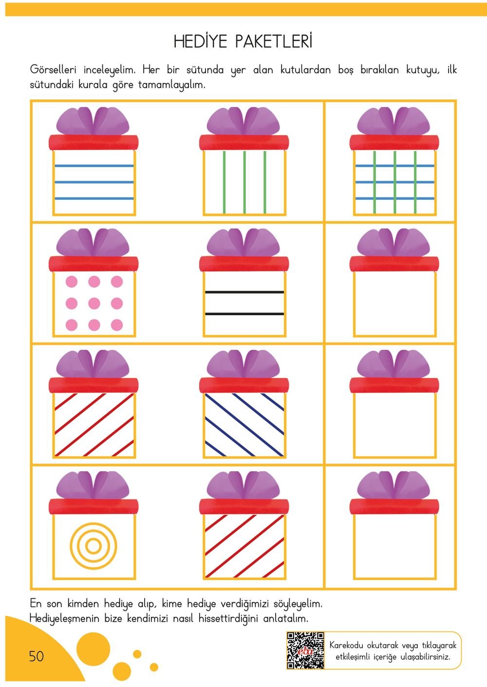

En son kimden hediye alıp, kime hediye verdiğimizi söyleyelim.
Hediyeleşmenin bize kendimizi nasıl hissettirdiğini anlatalım.

<!-- sayfa 50 -->

# AYÇİÇEĞİNİN YAŞAM DÖNGÜSÜ

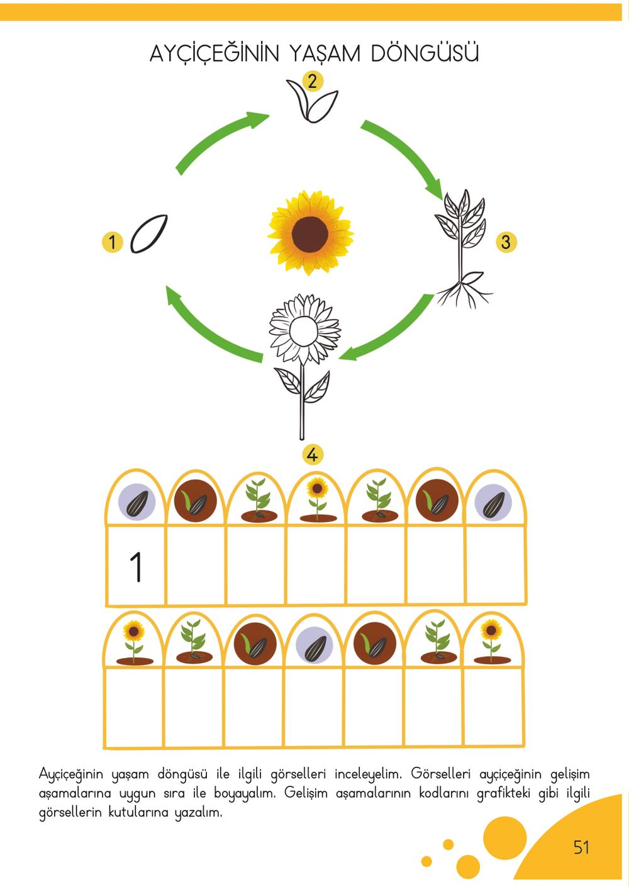

Ayçiçeğinin yaşam döngüsü ile ilgili görselleri inceleyelim. Görselleri ayçiçeğinin gelişim aşamalarına uygun sıra ile boyayalım. Gelişim aşamalarının kodlarını grafikteki gibi ilgili

<!-- sayfa 51 -->

# BLOKLARDAN ŞEKİLLER

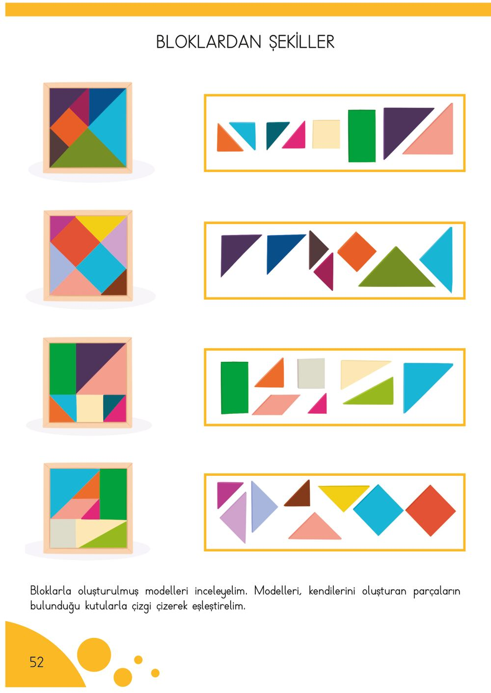

Bloklarla oluşturulmuş modelleri inceleyelim. Modelleri, kendilerini oluşturan parçaların bulunduğu kutularla çizgi çizerek eşleştirelim.

<!-- sayfa 52 -->

# N SESİ İLE BİTEN SÖZCÜKLER

Görseldeki varlıkları inceleyelim. “N” sesi ile biten varlıkları işaretleyelim. Biz de “N” sesi ile biten sözcükler söyleyelim.

<!-- sayfa 53 -->

# GÖÇMEN KUŞLAR-1

Ülkemiz kıtalar arasında göç eden kuşlar için büyük önem taşır. Havaların soğuması sebebiyle göç etmek zorunda kalan çok sayıda göçmen kuş, göç sırasında ülkemizin önemli sulak alanlarında konaklar. Kuş gözlemcileri de bu sulak alanlarda dürbün veya teleskop kullanarak gördükleri kuş türlerini kayıt altına alırlar. Biz de kuş gözlemcisi olalım. Görseldeki kuş türlerini inceleyelim.

<!-- sayfa 54 -->

# GÖÇMEN KUŞLAR-2

| | |
| :--- | :--- |
|  ŞAHİN | |
|  MARTI | |
|  KARABATAK | |
|  ÖRDEK | |
|  LEYLEK | |

İncelediğimiz kuş türlerinin isimlerini söyleyelim, sayılarını gözlem defterimize kaydedelim.

<!-- sayfa 55 -->

# ÇİÇEKLERİN YAPRAKLARINI SAYALIM

Görseli inceleyelim. Görseldeki çiçeğin adını tahmin edelim.
Bu çiçeğin ismi hatmi çiçeği.

| | |
| :--- | :--- |
|    1.) Çiçeğin kaç yaprağı var?   Sayalım, söyleyelim. |    Rüzgâr esince çiçeğin 1 yaprağı düştü. Çiçeğin kaç yaprağı kaldı?   Sayalım, söyleyelim. |
|    2.) Çiçeğin kaç yaprağı var?   Sayalım, söyleyelim. |    Rüzgâr esince çiçeğin 2 yaprağı düştü. Çiçeğin kaç yaprağı kaldı?   Sayalım, söyleyelim. |
|    3.) Çiçeğin kaç yaprağı var? |    Rüzgâr esince çiçeğin 1 yaprağı |

<!-- sayfa 56 -->

# ÖLÇÜYORUM

Aslı bir ölçme oyunu oynamak istiyor. Görselleri inceleyelim. Uygun olan ölçme araçlarını işaretleyelim.

Aslı elmanın ağırlığını hangisiyle ölçebilir? Bulalım, işaretleyelim.

Aslı arkadaşının boyunu hangisiyle ölçebilir? Bulalım, işaretleyelim.

Aslı karpuzun ağırlığını hangisiyle ölçebilir? Bulalım, işaretleyelim.

<!-- sayfa 57 -->

# HAYVANLARIN BOYU

 

Görselleri dikkatle inceleyelim. Gölgelerin hangi hayvanlara ait olduğunu tahmin edelim. Gölgesi en uzun olan hayvanı blokları sayarak bulalım. Bu hayvanın resmini çerçevenin içine çizelim. Gölgesi en kısa olan hayvanı gösterelim. Bu hayvanın sesini taklit edelim.

<!-- sayfa 58 -->

# YAZ LABİRENTİ

Görseldeki yaz meyvelerini ve sebzelerini inceleyelim. Yaz meyvelerinin isimlerini söyleyelim. Labirentteki yaz meyvelerini karşılarındaki yollardan çizgi ile sepete götürelim. Yaz sebzelerini işaretleyelim. Bildiğimiz başka yaz meyve ve sebzeleri varsa isimlerini söyleyelim.

<!-- sayfa 59 -->

# UZAY MEKİĞİ

Uzaya gidip gelebilen ve yeniden kullanılan insanlı uzay araçlarına uzay mekiği denir.

Görselleri inceleyelim. Uzay mekiklerine ve gittikleri yönü gösteren oklara dikkat edelim. Örnekte olduğu gibi diğer uzay mekiklerinin altına gittikleri yönü gösteren oklar çizelim. Kaç tane uzay mekiği; sağa, sola, yukarı ve aşağı gidiyor? Sayalım. Uzay mekiklerinin altındaki kutulara sayısını yazalım.

<!-- sayfa 60 -->

# OYUNCAK MÜZESİ

Zübeyde Hanım Anaokulu, Müzeler Haftası'nda Gaziantep Oyuncak Müzesi'ne gezi düzenliyor.

Kesik çizgileri birleştirerek çocukları oyuncaklara götürelim. Oyuncakların hangi malzemeyle yapılmış olabileceğini söyleyelim.

| |
| :--- |
| |
| |
| |

Bir oyuncak tasarlayalım ve bu oyuncağın hangi malzeme ile yapılabileceğini söyleyelim. Tasarladığımız oyuncağı boş çerçevenin içine çizelim.

<!-- sayfa 61 -->

# ATATÜRKÜN ÇOCUK SEVGİSİ

Mustafa Kemal Atatürk, çocukları çok severdi. Çocuklarla sohbet eder, onlara sevgi gösterirdi. Atatürk’ün bulunduğu fotoğrafları inceleyelim.

Atatürk 23 Nisan Ulusal Egemenlik ve Çocuk Bayramı’nı tüm dünya çocuklarına armağan etmiştir. Atatürk yaşasaydı ona ne hediye etmek isterdik? Düşünelim. Boş çerçeveye Atatürk için bir hediye çizelim.

<!-- sayfa 62 -->

# DÜNYADAN ŞAPKALAR

Farklı ülkelerde yaşayan çocuk görsellerini inceleyelim. Şapkalarının benzerlikleri ve farklılıkları ile ilgili sohbet edelim. Çevremizde gördüğümüz farklı şapkalar hakkında konuşalım.

Çerçevenin içindeki çocuklara birer şapka tasarlayalım ve çizelim.

<!-- sayfa 63 -->

# FARKLI SANDALYELER

Resmi inceleyelim. Çocukların resimlerini kolaylıkla tamamlayabilmeleri için hangi boydaki sandalyeye ihtiyaçları var düşünelim. Çocukları doğru sandalyelere çizgi ile ulaştıralım.

<!-- sayfa 64 -->

# KENDİ KİTABIMI TASARLIYORUM

Kartlardaki görselleri inceleyelim. Görsellerle bir hikaye oluşturalım ve anlatalım. Hikayemize uygun bir kitap kapağı tasarlayıp kitap görselinin üzerine çizelim.

<!-- sayfa 65 -->

# FARKLI BARDAKLARDAKİ SU

Oğuz, Alp ve Aslı’nın aynı miktarda suyu var. Suyun tamamını görseldeki gibi bardaklara doldurduklarında nasıl görünüyor? İnceleyelim.

Bardaklardaki su seviyesi neden farklı oldu? Düşünelim. Farklı genişlikte 2 saydam kap alalım. Kapların içine sırayla aynı miktarda su koyalım.

Geniş ve dar kaplara koyduğumuz eşit su miktarlarını gözlemleyelim. Gözlemlediğimiz su seviyelerini görseldeki bardaklara çizelim.

<!-- sayfa 66 -->

# GEZEGENLER SUDOKU

 Mars, çok soğuk bir gezegendir. Mars’ta büyük toz fırtınaları olur.
 Dünya, mavi ve yeşil görünüme sahip, üzerinde çok sayıda canlının yaşadığı bir gezegendir.
 Satürn’ün halkaları vardır. Çekirdeği buz ve kayalardan oluşur. Satürn’de sert rüzgârlar eser.
 Merkür, Güneş’e en yakın gezegendir. Çok hızlı döner.

| |  | |  |
| :---: | :---: | :---: | :---: |
|  |  | |  |
|  | |  |  |
| |  |  |  |

Her satır ve sütunda her gezegenden sadece bir tane olması gerekiyor. Boş kutularda olması gereken gezegenleri çizerek tamamlayalım.

<!-- sayfa 67 -->

# YERYÜZÜ ŞEKİLLERİ

Görseli inceleyelim. Görselde bulunan yeryüzü şekillerinin isimlerini söyleyelim. Yanardağ dört rakamının ve sarı dairenin $(4, \text{sarı daire})$ kesiştiği karede duruyor. Diğer yeryüzü şekilleri hangi sembollerin kesiştiği karede duruyor? Bulalım. Kutularda belirtilen yerlere örnekte olduğu gibi yazalım.

<!-- sayfa 68 -->

# VEYSEL DEDE VE REHBER KÖPEĞİ KAŞMİR

Veysel dede her gün aynı saatte rehber köpeği Kaşmir ile dinlenme parkına gidiyor. Kaşmir Veysel dedeye yardım ediyor. Kaşmir’in Veysel dedeye nasıl yardım ettiğini düşünelim. Veysel dede dinlenme parkında dinlendikten sonra yaya yolunu kullanarak önce kafeye ardından manava geçiyor, sonra bankaya uğruyor. En sonunda yine yaya yolunu kullanarak bankanın karşısındaki evine gidiyor. Veysel dedenin izlediği yolları çizerek gösterelim.

⭐ Öğretmene not: Sayfadaki karekoddada bulunan “Kaşmir” adlı öykü çocuklara okunabilir.

<!-- sayfa 69 -->

# MANAVDAKİ MEYVELER VE SEBZELER

Ekin ile annesi meyve-sebze almak için manava gidiyor. Görselleri inceleyelim. Hangi meyveleri ve sebzeleri gördüğümüzü söyleyelim.
“A” sesi ile biten meyveleri ve sebzeleri çizgi çizerek Ekin’in sepetine götürelim.
“R” sesi ile biten meyveleri ve sebzeleri çizgi çizerek Ekin’in annesinin sepetine götürelim.

<!-- sayfa 70 -->

# HAYVANLARIN GÖZLERİ

Gözler görmemizi sağlayan görme organımızdır. Hayvanların insanlarınkinden farklı göz şekilleri ve göz renkleri vardır.
Görsellerdeki hayvanların göz şeklini ve göz rengini inceleyelim.

KURBAĞA

BUKALEMUN

KARİDES

PAPAĞAN

BAYKUŞ

YENGEÇ

Çerçevedeki gözleri inceleyelim. Bu gözlerin hangi hayvana ait olabileceğini tahmin edelim ve hayvanın görselini çizerek resmi tamamlayalım. Çizimimiz karekoddaki hayvana benziyor mu? Karşılaştıralım. Görseldeki hayvanın adını söyleyelim.

<!-- sayfa 71 -->

# BAYRAM SABAHI ÖYKÜ

Bayram Sabahı öyküsünü dikkatlice dinleyelim. Öyküyü dinlerken sözcükleri parmağımızla yavaşça takip etme hareketi yapalım. Görsellerin üzerine geldiğimizde durup görselin ismini söyleyerek öyküyü birlikte tamamlayalım.

⭐ Öğretmene not: Öykü okunmadan önce çocuklara görsellerin isimleri açıklanmalıdır. Etkinlik tamamlandığında isteyen çocukların görsellere dikkat ederek öyküyü anlatmasına fırsat verilir.

<!-- sayfa 72 -->

# BAYRAM SABAHI ETKİNLİK

Bayram sabahı evimizde yapılan hazırlıkları anlatalım. Bayramda giymek için kıyafet tasarlayalım ve kıyafeti askılara çizelim.

<!-- sayfa 73 -->

# ÇİÇEĞİN BÖLÜMLERİNİ İNCELEYELİM

Çiçeğin bölümlerini inceleyelim. Büyüteçle baktığımızda nelerin farklı göründüğünü açıklayalım.

Kartlardaki görsellerin bitkiler için önemini açıklayalım.

⭐ Öğretmene not: Çiçeğin yaprak, sap ve kök gibi bölümleri; görsel üzerinde çocuğa

<!-- sayfa 74 -->

# SPOR ZAMANI

Şimdi spor zamanı! Yönergeleri dinleyelim. Her hareketi yaptıktan sonra yerimize oturalım ve bir nezaket sözcüğü söyleyelim.

1

Ayağa kalkalım, saat yönünde 2 kere dönelim.

2

Ellerimizi 5 kere birbirine vuralım.

3

Ayağa kalkalım ve yerimizde 3 kere zıplayalım.

4

Ellerimizi 4 kere kapatıp açalım.

5

Ayağa kalkalım ve yanımızdaki arkadaşımızla tokalaşalım.

6

Ayağa kalkalım. Şarkı söyleyerek saat yönünün tersine 2 kere dönelim.

⭐ Öğretmene not: Çocuklara “Lütfen, merhaba, memnun oldum, teşekkür ederim, özür dilerim, hoş geldiniz, günaydın, iyi akşamlar, rica ederim, geçmiş olsun, afiyet olsun, kolay gelsin, hayırlı işler, iyi dersler, iyi tatiller, iyi yolculuklar, iyi uykular, iyi geceler, sağ ol, eksik olma, eyvallah, baş üstüne, buyurun, hoş geldiniz, sefalar getirdiniz, hoş geldiniz, ne demek, canın sağ olsun, önemli değil, lafı bile olmaz, rica ederim, bir şey değil, rica ederim, rica ederim, rica ederim, rica ederim, rica ederim, rica ederim, rica ederim, rica ederim, rica ederim, rica ederim, rica ederim, rica ederim, rica ederim, rica ederim, rica ederim, rica ederim, rica ederim, rica ederim, rica ederim, rica ederim, rica ederim, rica ederim, rica ederim, rica ederim, rica ederim, rica ederim, rica ederim, rica ederim, rica ederim, rica ederim, rica ederim, rica ederim, rica ederim, rica ederim, rica ederim, rica ederim, rica ederim, rica ederim, rica ederim, rica ederim, rica ederim, rica ederim, rica ederim, rica ederim, rica ederim, rica ederim, rica ederim, rica

<!-- sayfa 75 -->

# AŞURE

Aşure, çeşitli malzemeler kullanılarak yapılan ve komşularla, akrabalarla, arkadaşlarla paylaşılan geleneksel bir tatlımızdır. Malzemeleri inceleyelim. Malzemelerden istediğimizi seçerek tencerenin içine çizgi çizerek götürelim.

Yaptığımız aşureyi kimlerle paylaşmak istediğimizi söyleyelim. Paylaşmak bize ne hissettiriyor? Düşünelim ve ne hissettiğimizi gösteren yüz ifadesinin çerçevesini boyayalım.

Bizimle bir şey paylaşıldığında ne hissettiğimizi gösteren yüz ifadesinin çerçevesini boyayalım.

<!-- sayfa 76 -->

# DEĞİŞTİR-DÖNÜŞTÜR-YENİDEN KULLAN

Atık bir malzemenin şekillendirilerek kullanıma kazandırılmasına, farklı ürünlere dönüştürülmesine ileri dönüşüm denir. Örnekleri inceleyelim.

Atık malzemeden yapılmış oyuncak görselini inceleyelim. Aynı malzemeden başka ne yapabileceğimizi düşünelim ve çizerek görseli tamamlayalım.

 

<!-- sayfa 77 -->

# KOLEKSİYON

Koleksiyon yapmak ilgi duyduğun nesnenin farklı çeşitlerini biriktirmektir. Mustafa ve Fatma’nın yaptığı koleksiyonu inceleyelim. Sütunlardaki boşluklara benzer nesneler çizerek yarım kalan koleksiyonlarını tamamlamalarına yardım edelim. Kendimiz için bir koleksiyon yapmayı düşünelim. Son sütundaki boşluklara koleksiyonunu yapmak istediğimiz nesnelerin resmini çizelim.

| | | |
| :---: | :---: | :---: |
|  |  |  |
|  |  | |
|  |  | |
| | | |
| | | |

<!-- sayfa 78 -->

# DİLİMELER VE SESLER

Bilmeceleri dinleyelim. Sence cevap ne olabilir? Çizgi ile uygun görsele götürelim. Bilmecelerin cevaplarının ilk sesinden başka kelimeler türetelim.

| | |
| :--- | :--- |
| Turuncudur rengi, Vitamin dolu içi. Bazen dilimlenir, Suyu da çok lezzetlidir. (PORTAKAL) | Yeşil yaprağı üstünde Kendisi kırmızı renkte. İçinde yok çekirdeği Çünkü üstünde hepsi. (ÇİLEK) |
|  | |
| Toprak altında Sanki turuncu çivi. Tavşanların favorisi, Onu bol bol yemeli. (HAVUÇ) | Uzun boylu, sarı kabuklu Pek de kolay soyuldu. İçi pek lezzetli, Bu meyveyi yemeli. (MUZ) |

Bilmeceleri dinleyelim. Sence cevap ne olabilir? Çizgi ile uygun görsele götürelim. Bilmecelerin cevaplarının son sesinden başka kelimeler türetelim.

| | |
| :--- | :--- |
| Kocamandır çekirdeği, Yumuşayınca yemeli. Kahvaltıda, salatada Görürsün onu sofrada. (AVOKADO) | Tatlı mı tatlı tadı, Gün kurusu, sarısı Kışın ondan yaparsın, Lezzetlidir hoşafı. (KAYISI) |
|  | |
| Ağaçta duruyor tane tane Siyah çekirdekleri var içinde, Kabuğu kaplanmış sanki tüylerle. (KİVİ) | Hem tatlıdır hem de ekşi Pastaları süsler, Pembedir rengi (AHUDUDU) |

<!-- sayfa 79 -->

50°D 45°D 40°D 35°D 30°D 25°D
30°N 35°N 40°N 45°N

: Türkiye'nin mülki idare bölümleri, kara ve deniz komşularını gösteren harita.

# TÜRKİYE'NİN MÜLKİ İDARE BÖLÜMLERİ İLE KARA VE DENİZ KOMŞULARI HARİTASI

**Komşu Ülkeler ve Bölgeler:**
* ROMANYA (Bükreş)
* BULGARİSTAN (Sofya)
* GÜRCİSTAN (Tiflis)
* ERMENİSTAN (Erivan)
* NAHÇIVAN Ö.C. (AZERBAYCAN)
* İRAN
* IRAK (Bağdat)
* SURİYE (Şam)
* LÜBNAN (Beyrut)
* KUZEY KIBRIS TÜRK CUMHURİYETİ
* GÜNEY KIBRIS RUM YÖNETİMİ (Lefkoşa)
* MISIR
* İSRAİL (Tel Aviv)
* FİLİSTİN (Gazze Şeridi, Batı Şeria, Kudüs)

**Denizler ve Göller:**
* KARADENİZ
* EGE DENİZİ
* AKDENİZ
* MARMARA DENİZİ
* HAZAR DENİZİ

**İller (Harita üzerinde belirtilenler):**
Adana, Adıyaman, Afyonkarahisar, Ağrı, Amasya, Ankara, Antalya, Artvin, Aydın, Balıkesir, Bilecik, Bingöl, Bitlis, Bolu, Burdur, Bursa, Çanakkale, Çankırı, Çorum, Denizli, Diyarbakır, Edirne, Elâzığ, Erzincan, Erzurum, Eskişehir, Gaziantep, Giresun, Gümüşhane, Hakkâri, Hatay, Isparta, Mersin, İstanbul, İzmir, Kars, Kastamonu, Kayseri, Kırklareli, Kırşehir, Kocaeli, Konya, Kütahya, Malatya, Manisa, Kahramanmaraş, Mardin, Muğla, Muş, Nevşehir, Niğde, Ordu, Rize, Sakarya, Samsun, Siirt, Sinop, Sivas, Tekirdağ, Tokat, Trabzon, Tunceli, Şanlıurfa, Uşak, Van, Yozgat, Zonguldak, Aksaray, Bayburt, Karaman, Kırıkkale, Batman, Şırnak, Bartın, Ardahan, Iğdır, Yalova, Karabük, Kilis, Osmaniye, Düzce.

**Akarsular ve Diğer Coğrafi Unsurlar:**
* Meriç N.
* Sakarya N.
* Kızılırmak N.
* Yeşilırmak N.
* Çoruh N.
* Aras N.
* Kura N.
* Fırat N.
* Dicle N.
* Seyhan N.
* Ceyhan N.
* Asi N.
* Büyük Menderes N.
* Küçük Menderes N.
* Gediz N.
* Bakırçay N.
* Göksu N.
* Nil N.
* Van Gölü
* Tuz Gölü
* Urumiye Gölü

**Harita Lejantı:**
* BAŞKENT (Ankara)
* İL MERKEZİ
* GÖL
* AKARSU
* ÜLKE SINIRI
* ÖZERK BÖLGE SINIRI

**Ölçek:**
0 - 100 - 200 - 300 - 400 km

Harita Genel Müdürlüğü tarafından üretilmiştir.
