# Okul Öncesi Evde Oyun Rehberi Yardımcı Kitabı

<!-- sayfa 0 -->

T.C. MİLLÎ EĞİTİM BAKANLIĞI | OKUL ÖNCESİ | YARDIMCI KİTAP

# EVDE OYUN REHBERİ

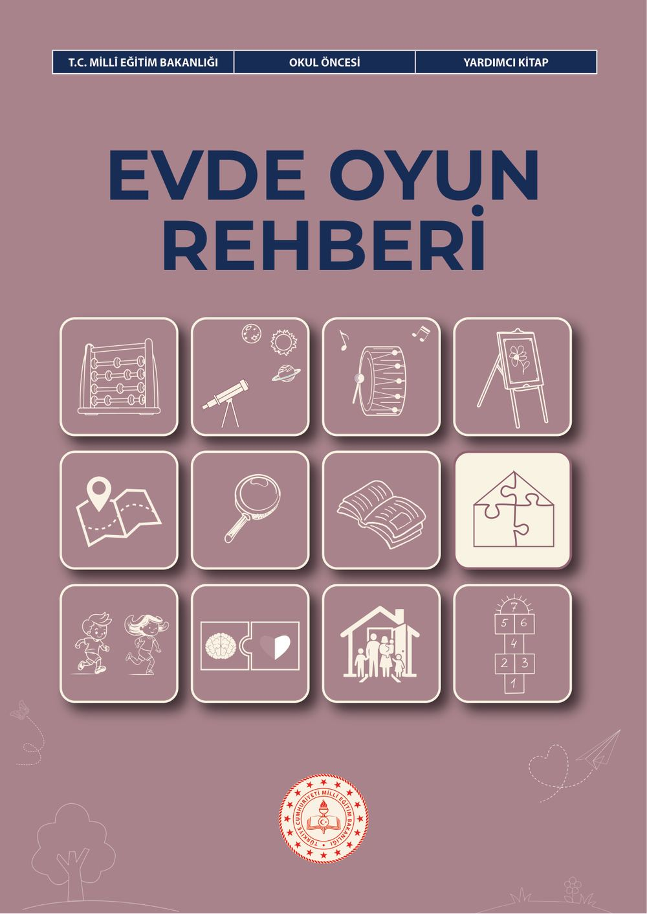

<!-- sayfa 1 -->

Verdiğiniz metin katmanı boş olduğu için (`<<< >>>` arası boş) dönüştürülecek herhangi bir içerik bulunmamaktadır. Lütfen metin katmanını içeren içeriği paylaşın, böylece talimatlarınıza uygun şekilde Markdown formatına çevirebilirim.

<!-- sayfa 2 -->

# Evde Oyun Rehberi

## OKUL ÖNCESİ

### Yazarlar
BÜŞRA NUR DURAN YILMAZ
EZGİ AVCI AŞIR
İLKAY CAN
KÜBRA KARAKUŞ

DEVLET KİTAPLARI

<!-- sayfa 3 -->

Millî Eğitim Bakanlığı Yayınları No:.................................................................................................: 11240
Yardımcı ve Kaynak Kitaplar Dizisi No.:..........................................................................................: 4047 

Her hakkı saklıdır ve Millî Eğitim Bakanlığına aittir. Kitabın metin, soru ve şekilleri kısmen de olsa hiçbir surette alınıp yayımlanamaz.

**Editör**
Prof. Dr. Kazım BİBER
Doç. Dr. Mehmet Nur TUĞLUK

**Dil Uzmanı**
Elif BİNGÖL

**Görsel Tasarımcı**
Metin BİLAL
Serdar TUNCAL

**Çoklu Ortam Tasarımcısı**
Ferhat DEMİRCİ
Gamze SEÇGİN
Gaye ERÇEN
Merve ÖZTEMİR

**Program Geliştirme Uzmanı**
Hilal ALTINTAŞ

**Ölçme ve Değerlendirme Uzmanı**
Merve ERELİ

**Rehberlik Uzmanı**
Ahmet Baykan BULUT

ISBN: 978-625-8867-37-4

Millî Eğitim Bakanlığı Talim ve Terbiye Kurulu Başkanlığının 13 10 2026 tarih ve 17245532 sayılı yazısı ile yardımcı

<!-- sayfa 4 -->

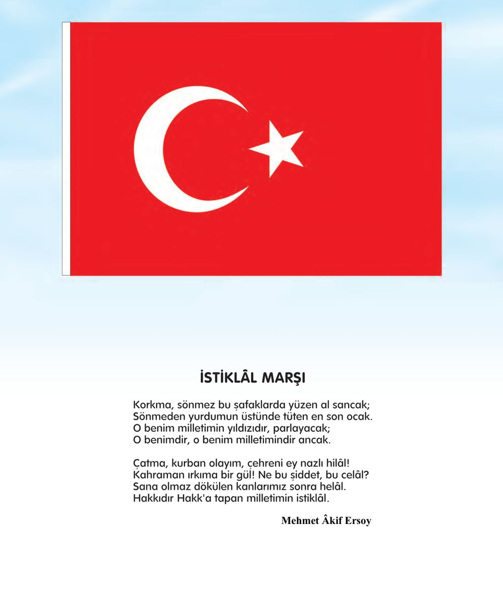

# İSTİKLÂL MARŞI

Korkma, sönmez bu şafaklarda yüzen al sancak;
Sönmeden yurdumun üstünde tüten en son ocak.
O benim milletimin yıldızıdır, parlayacak;
O benimdir, o benim milletimindir ancak.

Çatma, kurban olayım, çehreni ey nazlı hilâl!
Kahraman ırkıma bir gül! Ne bu şiddet, bu celâl?
Sana olmaz dökülen kanlarımız sonra helâl.
Hakkıdır Hakk'a tapan milletimin istiklâl.

**Mehmet Âkif Ersoy**

<!-- sayfa 5 -->

ANDIMIZ

Türküm, doğruyum, çalışkanım.

İlkem küçüklerimi korumak, büyüklerimi saymak; yurdumu, milletimi özümden çok sevmektir.
Ülküm yükselmek, ileri gitmektir.

Ey Büyük Atatürk!

Açtığın yolda, gösterdiğin hedefe durmadan yürüyeceğime ant içerim.

Varlığım Türk varlığına armağan olsun.

Ne mutlu Türküm diyene!

<!-- sayfa 6 -->

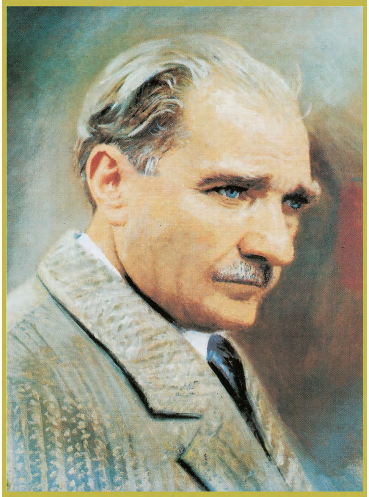
<!-- yer tutucu bulunamadı: sayfa sonuna eklendi -->

<!-- sayfa 7 -->

Verdiğiniz metin katmanı boş olduğu için (`<<< >>>` arası boş) dönüştürülecek herhangi bir içerik bulunmamaktadır. Lütfen metin katmanını içeren içeriği paylaşın, böylece talimatlarınıza uygun şekilde Markdown formatına çevirebilirim.

<!-- sayfa 8 -->

# İÇİNDEKİLER

| | |
| :--- | :---: |
| EVDE OYUN REHBERİ-ÖN SÖZ | 11 |
| NEDEN EVDE OYUN? | 12 |
| NASIL OYNAMALIYIZ? | 12 |
| DİJİTAL OYUNLARDA EBEVEYN REHBERİ | 13 |
| GELİŞİM SÜREÇLERİNDE İZLENECEK İPUÇLARI | 13 |
| GELİŞİM SÜREÇLERİNDE İZLENMESİ GEREKEN İPUÇLARI (0-6 YAŞ) | 15 |
| &nbsp;&nbsp;&nbsp;&nbsp;Türkçe Alanı Etkinliği | 16 |
| &nbsp;&nbsp;&nbsp;&nbsp;Su Damlaları | 16 |
| &nbsp;&nbsp;&nbsp;&nbsp;Bir Cümle Ben, Bir Cümle Sen | 17 |
| &nbsp;&nbsp;&nbsp;&nbsp;Nesneleri Bulalım | 18 |
| &nbsp;&nbsp;&nbsp;&nbsp;Adım Adım Macera | 19 |
| &nbsp;&nbsp;&nbsp;&nbsp;Söz Sırası | 20 |
| &nbsp;&nbsp;&nbsp;&nbsp;Meyveler ve Sebzeler | 21 |
| &nbsp;&nbsp;&nbsp;&nbsp;Bir Mektup, Bir Gülümseme | 22 |
| &nbsp;&nbsp;&nbsp;&nbsp;“A” Sesi Avcıları | 23 |
| &nbsp;&nbsp;&nbsp;&nbsp;Kelime Zinciri | 24 |
| &nbsp;&nbsp;&nbsp;&nbsp;Duygu Durağı | 25 |
| &nbsp;&nbsp;&nbsp;&nbsp;Sosyal Alan Etkinliği | 26 |
| &nbsp;&nbsp;&nbsp;&nbsp;Doğa Dostları Görevde | 26 |
| &nbsp;&nbsp;&nbsp;&nbsp;Sonbahar Dedektifleri: Kutudaki Doğa | 28 |
| &nbsp;&nbsp;&nbsp;&nbsp;Zaman Yolcuları ve Taşların Hikâyesi | 29 |
| &nbsp;&nbsp;&nbsp;&nbsp;Küçük AFAD Gönüllüleri: Afet ve Acil Durum Çantam | 30 |
| &nbsp;&nbsp;&nbsp;&nbsp;Evimizin Meslekler Sokağı | 32 |
| &nbsp;&nbsp;&nbsp;&nbsp;Renkli İplerin Dansı: Küçük Dokumacılar | 34 |
| &nbsp;&nbsp;&nbsp;&nbsp;Geri Dönüşüm Kahramanları Görevde | 35 |
| &nbsp;&nbsp;&nbsp;&nbsp;Evimizin Haritası ve Küçük Mühendisler | 36 |
| &nbsp;&nbsp;&nbsp;&nbsp;Toprağın Sırrı ve Çamurun Sanatı | 37 |
| &nbsp;&nbsp;&nbsp;&nbsp;Yerli Üretim Dedektifleri: Logonun Peşinde | 38 |
| &nbsp;&nbsp;&nbsp;&nbsp;Sanat Alanı Etkinliği | 39 |
| &nbsp;&nbsp;&nbsp;&nbsp;Benim Sanat Atölyem | 39 |
| &nbsp;&nbsp;&nbsp;&nbsp;Renklerle Kolaj | 41 |
| &nbsp;&nbsp;&nbsp;&nbsp;Evdeki Nesnelerin İzleri | 42 |
| &nbsp;&nbsp;&nbsp;&nbsp;Çerçeveden Bak | 43 |
| &nbsp;&nbsp;&nbsp;&nbsp;Gölgeden Bir Hikâye | 45 |
| &nbsp;&nbsp;&nbsp;&nbsp;Doğanın Tablosu | 47 |

<!-- sayfa 9 -->

| | |
| :--- | :---: |
| Renkleri Karıştıralım | 50 |
| Sırayla Çiziyoruz | 51 |
| Evimizin Minik Müzesi | 52 |
| İyilik Kartları Atölyesi | 54 |
| Müzik Alanı Etkinliği | 56 |
| Evimizin Ses Haritası | 56 |
| Ritmimi Yakala | 58 |
| Müziğin Çizgileri | 60 |
| Adımızın Şarkısı | 62 |
| Ses Merdiveni | 63 |
| Mutfak Orkestrası | 65 |
| Duyguyu Sesinden Bul | 66 |
| Hikâyenin Sesini Bul | 67 |
| Matematik Alanı Etkinliği | 69 |
| Robotu Hedefe Ulaştır | 69 |
| Paylaş ve Bahçeyi Tamamla | 71 |
| Şehirde Şekil Avı | 73 |
| Evimizin Veri Avcıları | 75 |
| Daire Dedektifleri | 77 |
| Tahmin Et, Adımla, Ölç | 79 |
| Veri Kâşifleri: Doğada Sayıların İzi | 81 |
| Şekil Avı | 83 |
| Doğanın Şekilleri: Üçgen ve Kare | 85 |
| Hareket ve Sağlık Alanı Etkinliği | 87 |
| Boncuk Şifresini Tamamla | 87 |
| Kayıp Oyuncağı Bul | 89 |
| Heykel Müzesi | 90 |
| Hazineyi Sepete Taşı | 91 |
| Renkli Tabak Tasarlama | 93 |
| Müzikli Parkur | 95 |
| Sağlıklı Hareket Çemberim | 97 |
| Hayalî Balon | 99 |
| Pırıl Pırıl Ayna | 101 |
| Fen Alanı Etkinliği | 103 |
| Dengenin Peşinde: Küçük Pazarcılar | 103 |
| Yağmur Dedektifleri | 105 |
| Yaprakların İzinde: Doğanın Sanatı | 107 |

<!-- sayfa 10 -->

| | |
| :--- | :--- |
| Büyüme Yolculuğum: Bebeklikten Bugüne | 110 |
| Şapkam Tasarım Oyunu, Atıktan Sanata | 112 |
| Duyu Küpü | 113 |
| Toprağın Dönüşümü: Kompost Kahramanları | 115 |
| Mevsim Muhabiri | 117 |
| Tohumunu Ağacına Götür | 119 |
| Sosyal-Duygusal Öğrenme Becerileri ve Değerler Etkinliği | 121 |
| Kendimi Anlatıyorum | 121 |
| Duyguların Dili | 123 |
| Sakinleşme Çarkım | 125 |
| Aile Radyosu | 127 |
| Kule Yapma | 128 |
| Nezaket Kapıyı Açar | 130 |
| Aile Büyüklerim | 132 |
| Küçük Tohumun Büyük Yolculuğu | 134 |
| Bayrağımızı Tanıyorum | 136 |
| Yöremizin İzleri | 138 |
| Kodlama | 140 |
| Robotlar İş Başında | 140 |
| Renkli Kareler | 141 |
| Hata Avcıları | 142 |
| Mutfakta Algoritma | 143 |
| Müzikal Kodlar | 144 |
| Gizli Mesaj: Veri Şifreleme | 145 |
| Kostüm Değişkenleri | 146 |
| Dijital Güvenlik | 147 |
| Adım Adım Kodla | 149 |
| Olay Dedektifleri | 151 |
| 21. Yüzyıl Becerileri | 152 |
| Problem Çözme Atölyesi: Peki Şimdi Ne Olacak? | 152 |
| Bilgi Dedektifleri: Gerçek mi, Hayal mi? | 154 |
| Takım Görevi | 155 |
| Dünya Bavulu | 157 |
| Düşünce Dedektifleri: Neden ve Nasıl? | 159 |
| Hareket Zincirini Tamamla | 161 |
| Duygu Yönetimi: Sakinleşme Yolculuğu | 163 |
| Birikim Kumbarası: İhtiyaç mı, İstek mi? | 165 |

<!-- sayfa 11 -->

| | |
| :--- | :--- |
| Ailece Karar Ver, Hareketi Taklit Et | 168 |
| Geleceğin Teknolojileri ve Tasarım | 170 |
| Akıllı Asistanım: Robotla El Ele | 170 |
| Kişiye Özel Tasarım | 171 |
| Doğa Dostu Fabrika | 173 |
| Esnek Üretim Hattı | 174 |
| İş Birliği Robotu Tasarımı | 175 |
| İleri Dönüşüm | 176 |
| Hatıraların Yolculuğu | 177 |
| Geleceğin Mutfağı: Akıllı Tarif Şefleri | 179 |
| KAYNAKÇA | 180 |
| GÖRSEL VE GENEL AĞ KAYNAKÇASI | 180 |
| TÜRKİYE’NİN MÜLKİ İDARE BÖLÜMLERİ İLE KARA VE DENİZ KOMŞULARI HARİTASI | 181 |
| TÜRK DÜNYASI HARİTASI | 182 |

<!-- sayfa 12 -->

# EVDE OYUN REHBERİ
## Geleceğin Şahsiyetlerini Oyunla İnşa Ediyoruz

# ÖN SÖZ

İnsan hayatının en saf, en yaratıcı ve en öğrenmeye açık dönemi çocukluktur. Bu dönemde çocuk; dünyayı bir laboratuvar, çevresindeki her nesneyi bir keşif aracı ve hayatı bitmek bilmeyen bir oyun olarak görür. Biz yetişkinler için oyun çoğu zaman bir vakit geçirme etkinliği gibi görünse de çocuğun dünyasında oyun; en ciddi iş, en etkili öğrenme yolu ve kişiliğin inşa edildiği en güçlü zemindir.

Elinizdeki “Evde Oyun Rehberi” kitapçığı, yalnızca çocuklarınızla keyifli vakit geçirmeniz için değil onları Türkiye Yüzyılı Maarif Modeli’nin bütüncül eğitim yaklaşımıyla geleceğe hazırlamak amacıyla tasarlanmıştır. Bu rehberin temelinde, çocuğun doğuştan getirdiği mizaç özellikleri ile çevresiyle etkileşim içinde şekillenen karakter yapısının dengeli ve güçlü bir şahsiyet oluşturacak biçimde geliştirilmesi hedefi yer almaktadır.

Rehberde yer alan oyunlar; Türkçeden matematiğe, fen ve sanattan kodlamaya, 21. yüzyıl becerilerinden “Geleceğin Teknolojileri ve Tasarım”a uzanan on bir farklı alana yayılmaktadır. Her bir etkinlik, çocuğun zihinsel, duygusal ve sosyal gelişimini destekleyecek şekilde özenle yapılandırılmıştır. Bu süreçte eviniz bir keşif atölyesine, çocuğunuzla kurduğunuz her etkileşim ise onun gelişimine açılan bir kapıya dönüşecektir.

Günümüzde oyun yalnızca evdeki materyallerle değil dijital ekranlarla da buluşmaktadır. Araştırmalar dijital oyunların çocuğa zarar mı vereceğini yoksa katkıda mı bulunacağını belirleyen en önemli etkenin oyunun kendisinden çok ebeveynin tutumu olduğunu göstermektedir. Bu gerçekten hareketle çocuğunuza dijital oyunlarda nasıl rehberlik edebileceğinizi beş temel yaklaşım üzerinden somut önerilerle anlatan “Dijital Oyunlarda Ebeveyn Rehberi” bölümü eklenmiştir. Amacımız, ekran kullanımını yasaklanması gereken bir unsur olarak değil, bu rehberdeki oyunlarda olduğu gibi doğru rehberlikle çocuğun gelişimini destekleyebilecek bir araç olarak ele almanıza yardımcı olmaktır.

Bu yolculukta sizlerden beklentimiz; meraklı bir oyun arkadaşı heyecanıyla sürece dâhil olmanız, evde de ekran karşısında da çocuğunu yalnız bırakmayan bir rehber olmanızdır. Hataları bir öğrenme fırsatı olarak görmeniz ve sonuçtan çok çocuğun gösterdiği çabayı, sabrı ve kararlılığı takdir etmeniz bu etkinliklerin etkisini güçlendirecektir. Unutmayınız ki bugün oyun yoluyla atılan küçük adımlar, yarının daha bilinçli, daha üretken ve daha duyarlı bireylerinin oluşmasına katkıda bulunmaktadır. Çocuklarınızla keşfedeceğiniz, birlikte öğreneceğiniz ve en önemlisi birlikte büyüyeceğiniz güzel anlara…

<!-- yer tutucu bulunamadı: sayfa sonuna eklendi -->

<!-- sayfa 13 -->

# NEDEN EVDE OYUN?

**Değerli Anneler ve Babalar,**
Elinizdeki bu kitap sadece vakit geçirmek için değil; çocuğunuzun doğuştan getirdiği mizaç özellikleri ile sosyal çevresiyle şekillenen karakter yapısını bütünleştirerek güçlü bir şahsiyet olarak gelişmesine katkıda bulunmak amacıyla hazırlanmıştır.

Oyun çocuğun en temel öğrenme biçimidir. Bu kitapla eviniz bir keşif atölyesine, her etkileşiminiz ise öğrenme dolu bir deneyime dönüşecektir.

# NELER KEŞFEDECEĞİZ?

Kitabımız çocuğun gelişimini bütüncül bir bakış açısıyla ele alan 12 ana bölümden oluşmaktadır:

1. **Türkçe Alanı:** Dil becerileri ve ifade gücü
2. **Sosyal Alan:** Toplumsal yaşam ve aidiyet
3. **Sanat Alanı:** Estetik algı ve yaratıcılık
4. **Müzik Alanı:** Ritim ve işitsel dikkat
5. **Matematik Alanı:** Mantıksal muhakeme ve sayı farkındalığı
6. **Hareket ve Sağlık Alanı:** Fiziksel gelişim ve sağlıklı yaşam
7. **Fen Alanı:** Bilimsel merak ve doğa gözlemi
8. **Sosyal-Duygusal Öğrenme ve Değerler:** Öz farkındalık ve etik değerler
9. **Kodlama:** Algoritmik düşünme ve problem çözme
10. **21. Yüzyıl Becerileri:** Eleştirel düşünme ve iş birliği
11. **Geleceğin Teknolojileri ve Tasarım:** İnsan-teknoloji uyumu ve sürdürülebilirlik
12. **Dijital Oyunlarda Ebeveyn Rehberi:** Çocuğunuzun ekran başındaki oyun dünyasını yasaklamadan yönetmenin, yaşına uygun içerik seçmenin ve süreyi dengelemenin pratik yollarını sunan yol arkadaşı

# NASIL OYNAMALIYIZ?

Oyunların etkisini artırmak ve çocuğunuzun gelişimini doğru desteklemek için aşağıdaki adımları izlemeniz önerilir:

* **Model olun:** Çocuklar söylediklerinizden çok yaptıklarınızı örnek alır. Bu nedenle oyunlara meraklı bir oyun arkadaşı gibi katılın.
* **Süreci övün, sonucu değil:** “Çok akıllısın” yerine “Bu problemi çözmek için gösterdiğin sabır çok değerliydi.” gibi ifadeler kullanın.
* **Hata yapmaya izin verin:** Hataları, öğrenmenin doğal bir parçası olarak görün.
* **Soru sorun:** Oyun sonlarında “Düşün / Hatırla / Söyle ” bölümleri ile öğrenmeyi derinleştirin.
* **Esnek olun:** Evdeki her materyal oyuna dönüşebilir; önemli olan amaçtır, araç değil.

<!-- yer tutucu bulunamadı: sayfa sonuna eklendi -->

<!-- sayfa 14 -->

# DİJİTAL OYUNLARDA EBEVEYN REHBERİ

Günümüz çocukları yalnızca evdeki materyallerle değil dijital oyunlarla da büyümektedir. Araştırmalar dijital oyunların çocuğa zarar mı vereceğini yoksa katkıda mı bulunacağını belirleyen en önemli etkenin oyunun kendisinden çok ebeveynin tutumu olduğunu göstermektedir. Bu nedenle rehberin sonunda yer alan “Dijital Oyunlarda Ebeveyn Rehberi” bölümünde ebeveynlerin dijital oyunlara yönelik beş temel yaklaşımı (birlikte oynama, izleme, teknik, kısıtlayıcı ve ihmalkâr yaklaşım) evde uygulanabilecek somut önerilerle sunulmuştur. Okul öncesi dönemde çocuk, dijital içerik seçimini ve süre kontrolünü tek başına yapamadığı için bu öneriler önemlidir. Dijital oyunun gelişimi destekleyen bir araca dönüşmesi, ekranın karşısındaki çocuğun yanında rehber bir ebeveynin olmasıyla mümkündür.

## GELİŞİM SÜREÇLERİNDE İZLENECEK İPUÇLARI

Bu rehber çocuğunuzun oyun sırasındaki tepkilerini, motor becerilerini ve sosyal etkileşimini gözlemlemenize yardımcı olur. Çocuğunuzun gelişim yolculuğunda hangi yaşta, hangi becerilere odaklanmanız gerektiğine ve dikkat edilmesi gereken gelişimsel ipuçlarına “Gelişim Sürecinde İzlenecek İpuçları” bölümünden ulaşabilirsiniz.

---

### DİJİTAL OYUNLARDA EBEVEYN REHBERİ

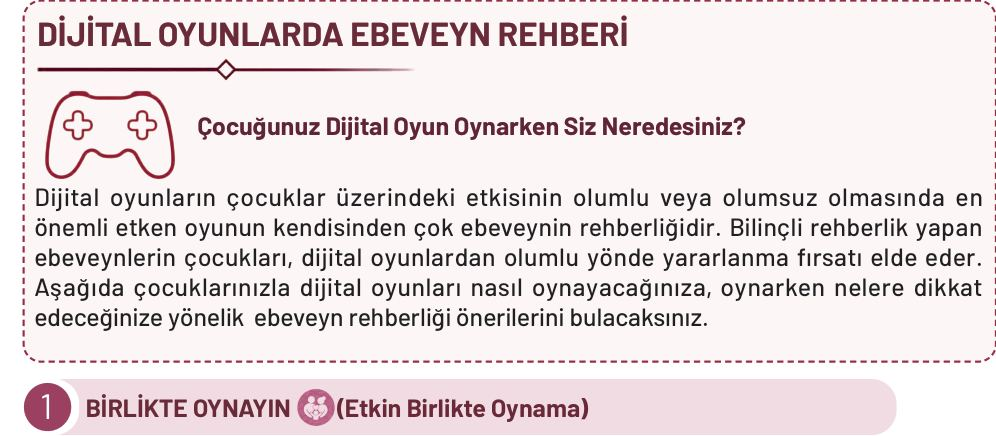

**Çocuğunuz Dijital Oyun Oynarken Siz Neredesiniz?**

Dijital oyunların çocuklar üzerindeki etkisinin olumlu veya olumsuz olmasında en önemli etken oyunun kendisinden çok ebeveynin rehberliğidir. Bilinçli rehberlik yapan ebeveynlerin çocukları, dijital oyunlardan olumlu yönde yararlanma fırsatı elde eder. Aşağıda çocuklarınızla dijital oyunları nasıl oynayacağınıza, oynarken nelere dikkat edeceğinize yönelik ebeveyn rehberliği önerilerini bulacaksınız.

---

1. **BİRLİKTE OYNAYIN** (Etkin Birlikte Oynama)

Çocuğunuzun yanına oturun, oyunu birlikte oynayın, oyun hakkında konuşun.

**Evde şunu deneyin:**
* Günde 10-15 dakika çocuğunuzla aynı oyunu oynayın.
* Oyun sırasında sorular sorun (Bu karakter şimdi ne yapacak?, Sen olsan ne yapardın? vb.).
* Oyundaki kelimelerin, sayıların, renklerin ve durumların günlük hayattaki uygulamalarını açıklayın.

<!-- sayfa 15 -->

# 2 İÇERİĞİ TAKİP EDİN 👁️ (İzleme)

Her oyunu birlikte oynayamazsınız ama ne oynandığını mutlaka bilin.

🏠 **Evde şunu deneyin:**
* Oyunu indirmeden önce yaş etiketini (PEGI / yaş sınıflandırması) kontrol edin.
* Ara ara çocuğunuzun ekranına göz atın, oyun hakkında sohbet edin (Bugün oyunda ne yaptın? vb.).
* Yeni bir oyunu önce kendiniz birkaç dakika oynayıp tanıyın.
* Çocuğunuzun oyunu bittikten sonra, oynadığı oyunu dijital uygulamadan birlikte inceleyin.
* Çocuğunuzdan oyun hakkında size bilgi vermesini isteyin; oyunda neler yaptığını, oyunun amacının ne olduğunu ve oyunda en çok hangi bölümü sevdiğini konuşun.

# 3 CİHAZI AYARLAYIN ⚙️ (Teknik Düzenleme)

Teknolojiyi kendi lehinize kullanın, cihaz çocuğunuzla belirlediğiniz teknik kurallarla çalışsın.

🏠 **Evde şunu deneyin:**
* Cihaza ekran süresi sınırı ve şifre koyun, uygulama indirme izni sizde olsun.
* “Ebeveyn kontrolü / aile modu” özelliklerini etkinleştirin.
* Reklamsız ve uygulama içi satın alma seçeneklerinin kapalı olduğu sürümleri tercih edin.
* Yaş sınırı içeriğine göre cihazdaki filtreleme seçeneklerini etkin hâle getirin.

# 4 SINIR KOYUN 🔒 (Kısıtlayıcı Yaklaşım)

Bazı içerikler küçük çocuklar için uygun değildir, net ve tutarlı sınırlar koruyucudur.

🏠 **Evde şunu deneyin:**
* Şiddet içeren ve yaşına uygun olmayan oyunlara açık bir “hayır” deyin. Ama hayır deme nedeninizi açıklayın.
* Oyun zamanını aile rutinine bağlayın (Yemekten sonra, uyumadan en az 1 saat önce biter. vb.).
* Sınır koyduğunuzda oyunun yerine bu rehberdeki bir etkinliği önerin.

> ❗ Dikkat: Dijital içerik ve oyunlara sınır koyduğunuzda, çocuğunuza bu rehberdeki etkinliklerin yanı sıra severek yapabileceği farklı etkinlikler, oyunlar veya hobiler önerin. Seçenekler sunarak ilgisini çeken bir etkinliği tercih etmesine fırsat verin.

# 5 “KENDİ HÂLİNE BIRAKMA” TUZAĞINA DÜŞMEYİN 👐 (İhmalkâr)

Çocuğun ne oynadığına, ne kadar oynadığına hiç karışmamak erken yıllarda riskli bir durumdur. Çocuk bu yaşta içerik seçimini ve süre kontrolünü tek başına yapamaz, dolayısıyla tüm risklere açık hâle gelir.

**Bunun yerine:** Yukarıdaki dört yaklaşımı, koşullara göre tek ya da birlikte kullanarak kendi hâline bırakma durumundan korunursunuz. Bu nedenle oynayın, içeriği izleyin, cihazı ayarlayın ve gerektiğinde sınır koyun.

**Altın Kural:** Ekranın karşısında yalnızca çocuk değil ona rehberlik eden bir ebeveyn

<!-- sayfa 16 -->

# GELİŞİM SÜREÇLERİNDE İZLENMESİ GEREKEN İPUÇLARI (0-6 YAŞ)

Her çocuk kendine özgü bir hızda gelişir. Ancak bazı durumlar, çocuğun gelişiminde destek ihtiyacı olabileceğine işaret edebilir. Bu belirtiler tek başına bir sorun olduğu anlamına gelmez, ancak gözlemlendiğinde bir uzmandan görüş almak faydalı olabilir.

📅 **12 aylık olduğunda**
* Göz teması kurmaması
* İsmi söylendiğinde tepki vermemesi
* Seslere ilgisiz olması
* Babıldama yapmaması
* Sosyal gülümsemenin olmaması

📅 **24 aylık olduğunda**
* Tek kelime kullanmaması (anne, su vb.)
* Basit yönergeleri anlamaması
* İşaret etme ve gösterme davranışlarının olmaması
* Taklit davranışlarının görülmemesi
* Bağımsız yürümenin olmaması

📅 **36 aylık olduğunda**
* İki kelimelik ifadeler kurmaması
* Göz teması ve sosyal etkileşimin sınırlı olması
* Akranlara ilgi göstermemesi
* Oyuncakları amacına uygun kullanmaması

📅 **48 aylık olduğunda**
* Basit cümlelerle kendini ifade edememesi
* Anlaşılır konuşmaması
* Hayalî oyun kurmaması
* Aşırı öfkeli olması veya içe kapanması

📅 **60 aylık olduğunda**
* Sorulara bağlama uygun yanıt verememesi
* Hikâye anlatamaması
* Akran ilişkilerinde sürekli sorun yaşaması

📅 **72 aylık olduğunda**
* Bir olayı oluş sırasına göre anlatmakta belirgin güçlük yaşaması
* Karşılıklı konuşmayı sürdürmekte zorlanması
* Birden fazla aşamadan oluşan yönergeleri takip edememesi
* Grup oyunlarında kurallara uymakta ve oyunu sürdürmekte belirgin güçlük yaşaması
* Günlük yaşam ve öz bakım becerilerini bağımsız olarak yerine getirmekte belirgin güçlük yaşaması

❗ **Ailelere Yönelik Not**

Değerli Aileler, çocuğunuzu en iyi tanıyan sizlersiniz. Her çocuğun gelişim süreci kendine özgüdür ve çocuklar arasında bireysel gelişimsel farklılıklar görülebilir. Bu bölümde yer alan gelişimsel ipuçları, çocukların gelişimini desteklemek ve gerekli durumlarda erken müdahalenin sunulabilmesine katkı sağlamak amacıyla hazırlanmıştır. Tekrar eden, sizi endişelendiren ya da çocuğun günlük yaşamını etkilediğini düşündüğünüz durumlar fark ederseniz, bunları öncelikle çocuğunuzun öğretmeniyle paylaşınız. Erken fark etmek bir sorun aramak değil; çocuğunuza ihtiyaç duyduğu desteği zamanında ve doğru biçimde sunabilmek demektir.

<!-- yer tutucu bulunamadı: sayfa sonuna eklendi -->

<!-- yer tutucu bulunamadı: sayfa sonuna eklendi -->

<!-- yer tutucu bulunamadı: sayfa sonuna eklendi -->

<!-- yer tutucu bulunamadı: sayfa sonuna eklendi -->

<!-- sayfa 17 -->

# TÜRKÇE ALANI ETKİNLİĞİ

## 1 SU DAMLALARI

| Değer | Sorumluluk |
| :--- | :--- |

**Materyaller:** mavi örtü, minder, musluk görseli

**Uygulama**

* Mavi bir örtü, suyu temsil edecek şekilde yere serilir ve üzerine belirli aralıklarla minderler yerleştirilir. Çocuktan mindere her bastığında suyun bir özelliğini, sesini, hareketini veya canlılar için önemini anlatan bir ifade söylemesi istenir. Örneğin “serin su”, “berrak su”, “şırıl şırıl akan su” veya “canlılara hayat veren su” denilebilir. Çocuk bir ifade bulmakta zorlanırsa beklemek yerine “Suyun rengi nasıl görünür?”, “Su akarken nasıl bir ses çıkarır?” ya da “Canlılar neden suya ihtiyaç duyar?” gibi sorularla ona ipucu verilir.

* Parkurun belirlenen bir minderinde açık kalmış bir musluğu gösteren musluk görseli kullanılabilir. Çocuktan musluğun neden kapatılması gerektiğini açıklayan bir cümle kurması istenir. Örneğin çocuk “Musluk, boş yere akarsa suyumuz azalır; bu yüzden onu kapatıyorum.” diyebilir. Bu bölümde gerçek bir musluk açık bırakılmaz.

* Çocuk son mindere ulaştığında evde su tasarrufu yapılabilecek üç farklı alanı bulur. Ardından bu alanların her birinde suyu korumak için neler yapılabileceğini söyler (Banyoda diş fırçalarken musluğu kapatmak, mutfakta sebzeleri akan suyun altında yıkamak yerine bir kapta yıkamak, balkonda çiçekleri sebze yıkama suyuyla sulamak vb.).

* Oyunun sonunda aile bireyleri sırayla “Bugün suyu korumak için ne yapabilirim?” sorusunu yanıtlar. Daha sonra aile ve çocuk, verilen cevaplar arasından gün boyunca birlikte uygulayabilecekleri bir su tasarrufu davranışı seçer. Günün sonunda bu davranışı uygulayıp uygulamadıkları üzerine kısa bir değerlendirme yaparlar.

**Düşün / Hatırla / Söyle**

* Su neden değerlidir?
* Evde suyu korumak için yapabileceğin bir davranışı söyle.

<!-- sayfa 18 -->

# 2 BİR CÜMLE BEN, BİR CÜMLE SEN

| Değer | Aile Bütünlüğü |
| :--- | :--- |

**Materyaller:** -

## Uygulama

Aile üyelerinden biri hikâyeye tek bir cümleyle başlar (Bir sabah küçük bir kuş pencereme kondu. vb.) Çocuk hikâyeyi bir cümle ekleyerek devam ettirir. Daha sonra ebeveyn yeni bir cümle söyler ve sıra tekrar çocuğa geçer. Hikâye ilerledikçe ebeveyn, olayları sırayla anlatma konusunda çocuğu teşvik eder. Gerektiğinde çocuğa şu soruları sorabilir:

* Sonra ne oldu?
* Karakter ne hissetti?
* Sence şimdi nereye gitti?
* Hikâye nasıl bitebilir?

Hikâye tamamlandıktan sonra roller değiştirilir. Bu kez ilk cümleyi çocuk kurar, ebeveyn hikâyeyi devam ettirir. 

> **Dikkat**
>
> Etkinlik sırasında çocuğun kurduğu hikâyenin “doğru” ya da “yanlış” olmasına odaklanılmamalıdır. Çocuğun hayal gücünü kullanması, düşüncelerini sözel olarak ifade etmesi ve olayları sıralı biçimde anlatması desteklenmelidir. Çocuğun cümleleri yarım kaldığında doğrudan düzeltmek yerine “Sonra ne oldu?”, “Bu karakter ne hissetti?”, “Hikâyenin sonunda ne değişti?” gibi sorularla anlatımı genişletilmelidir. Resimlere, kitaplara ve anlatılan hikâyelere özen gösterilmesi gerektiği vurgulanmalıdır. Bir hikâye oluşturmanın emek, dikkat ve hayal gücü gerektiren sanatsal bir süreç olduğu çocuğa hissettirilmelidir. 

## Düşün / Hatırla / Söyle

* Hikâyede önce ne oldu?
* Hikâyeyi ilk başlatan cümle neydi?

<!-- sayfa 19 -->

# 3 NESNELERİ BULALIM

| Değer | Sorumluluk |
| :--- | :--- |

**Materyaller:** kalem, oyuncak, kitap, çorap, toka, kaşık, küçük araba, silgi, anahtar, küçük bir bez torba ya da kutu.

## Uygulama

* Aile üyelerinden biri, evde bulunan birkaç güvenli eşyayı seçerek çocuğun görebileceği biçimde masanın üzerine veya halıya yerleştirir. 
* Çocuğun eşyalara dikkatlice bakması ve onları aklında tutması istenir. Ardından çocuktan gözlerini kapatması istenir ve eşyalardan biri bir kutunun ya da torbanın içine saklanır.
* Saklanan eşyaya ilişkin ipuçları verilir. Örneğin saklanan eşya bir topsa “Ben küçük, yuvarlak ve kırmızıyım. Benimle oyun oynayabilirsin.” denir. Çocuk eksilen eşyayı hatırlayıp verilen ipuçlarından yararlanarak hangi eşyanın saklandığını tahmin eder.
* Çocuğun tahmininin ardından eşya ortaya çıkarılır ve birlikte incelenir. Çocuktan eşyanın özelliklerini kendi cümleleriyle anlatması istenir.
* Çocuğun anlatımını desteklemek için çocuğa “Bu eşya ne renk?”, “Ne işe yarar?”, “Nerede durmalı?”, “Kaybolmaması için onu nasıl koruyabiliriz?” gibi sorular sorulabilir.
* Son olarak çocuk eşyanın ait olduğu yeri belirler ve eşya ebeveynle birlikte yerine yerleştirilir. 

## Düşün / Hatırla / Söyle

* Sence eşyalarımızı kullandıktan sonra yerine koymak neden önemlidir?
* Kayıp eşyayı bulmak için hangi ipuçlarını dinledin ve hangi eşyanın kaybolduğunu nasıl tahmin ettin?
* Etkinlikte hangi eşyaları yerine koyduk?

<!-- sayfa 20 -->

# 4 ADIM ADIM MACERA

| Değer | Saygı |
| :--- | :--- |

**Materyaller:** “Renkli Çizmeler” öyküsü, terlik ya da ayakkabı.

## Uygulama

* “Renkli Çizmeler” adlı öykü ailece okunur. Öyküde çizmelerin gerçek kullanım amaçlarının dışında hayal gücüyle farklı nesnelere benzetildiği hakkında konuşulur. Örneğin çizmelerin içine kuşların yerleştiği ve bu nedenle bir kuş yuvasına benzediği, köstebeklerin çizmeleri başlarına taktığı ve onları şapka gibi kullandığı, yan yana getirilen çizmelerin ise bir tahterevalli gibi düşünüldüğü açıklanır.

* Ardından evde bulunan bir terlik ya da ayakkabı çocuğa gösterilir. “Öyküdeki çizmeler hayal gücüyle farklı nesnelere benzetilmişti. Şimdi biz de bu ayakkabıya dikkatlice bakalım. Sence şekli neye benziyor? Oyunumuzda ne olarak kullanılabilir?” diye sorulur.
* Çocuk ayakkabıyı başka bir nesneye benzetir ve bu düşüncesini canlandırır. Örneğin ayakkabı kaplumbağanın kabuğuna, oyuncak araba için bir tünele, küçük bir köprüye, tekneye veya kuklanın şapkasına benzetilebilir. Çocuktan çizmeyi neden o nesnelere benzettiğini açıklaması istenir. “Ayakkabının hangi özelliği sana bunu düşündürdü?”, “Onu oyununda nasıl kullandın?” gibi sorularla çocuğun anlatımı desteklenir.
* Daha sonra çocuktan oluşturduğu kısa canlandırmayı olay sırasına göre anlatması istenir. Çocuğa “Oyunun başında ne oldu?”, “Ayakkabıyı neye benzettin?”, “Onu kim, nasıl kullandı?” ve “Oyun nasıl sona erdi?” soruları yöneltilir. Oyun her aile bireyinin ayakkabıyı farklı bir nesneye benzetmesi ve neden böyle düşündüğünü açıklamasıyla devam eder.

## Düşün / Hatırla / Söyle

* Bu ayakkabı bir oyuncağa dönüşseydi ne olurdu?
* Ayakkabıyı dönüştürdüğün en ilginç nesne hangisiydi?
* Aile üyeleri sırayla ayakkabıyı neye benzetti?

<!-- sayfa 21 -->

# 5 SÖZ SIRASI

| Değer | Sabır |
| :--- | :--- |

**Materyaller:** oyuncak mikrofon veya mikrofon olarak kullanılabilecek hafif, temiz, kenarları sivri olmayan, güvenli bir nesne (kâğıt havlu rulosu ya da yumuşak bir oyuncak vb.).

## Uygulama

* Çocuğa oyuncak mikrofon tanıtılır ve bu mikrofonun oyun boyunca “söz sırası nesnesi” olarak kullanılacağı açıklanır. Mikrofon kimin elindeyse yalnızca onun konuşacağı, diğer aile bireylerinin ise konuşan kişiyi dinleyeceği belirtilir. 
* Aile bireyleri mikrofonu sırayla alarak kısa birer cümle kurar. İlk turda herkes kendisini mutlu eden bir olayı anlatır. Örneğin “Bugün seninle oyun oynamak beni mutlu etti.” veya “Bugün birlikte kahvaltı yapmak beni mutlu etti.” denilebilir.
* İkinci turda aile üyelerinden biri mikrofonu eline alarak kısa bir hikâye başlatır: “Bir gün küçük bir tavşan bahçede tek başına oynarken rengârenk bir top bulmuş.” Daha sonra mikrofon çocuğa verilir ve hikâyeyi bir cümleyle sürdürmesi istenir. Her aile bireyi sıra kendisine geldiğinde hikâyeye yeni bir cümle ekler.
* Hikâye ilerlerken karakterlerin kullanabileceği nezaket ifadelerine yer verilir. Örneğin tavşan, arkadaşına “Topla birlikte oynayabilir miyiz, lütfen?” diye sorabilir. Çocuğun nezaket ifadelerini kullanması için “Topla oynamak isteyen karakter arkadaşına ne söyleyebilir?”, “Arkadaşı ona yardım ettiğinde ne söyleyebilir?” gibi sorular yöneltilebilir. Paylaşma ve sıra bekleme davranışları için ise “Topla oynamak isteyen başka bir arkadaşına da topu vermek için ne yapabilir?”, “Sırasını beklerken nasıl davranabilir?” soruları yöneltilebilir. Konuşmasını tamamlayan kişi mikrofonu sıradaki aile bireyine verir ve oyun bu şekilde devam eder. 

## Düşün / Hatırla / Söyle

* Birini konuşurken sabırla dinlemek neden önemlidir?
* Bugün etkinlikte kullandığın bir nezaket cümlesini söyle.
* Tavşan, arkadaşıyla top oynamak istediğinde ne söyledi?
* Topla birlikte oynamak isteyen karakter tavşana ne söyledi?

5

<!-- sayfa 22 -->

# 6 MEYVELER VE SEBZELER

| Değer | Saygı |
| :--- | :--- |

 **Materyaller:** evde bulunan farklı meyveler ve sebzeler.

## Uygulama

* Meyve ve sebzeler mutfak tezgâhına ya da masaya yerleştirilir. Çocuğa “Kabuğu sarı olan meyveyi bul.”, “Toprağın altında yetişen sebzeyi seç.”, “Yeşil renkte olan sebzeyi bana uzat.” gibi yönergeler verilir.
* Her ürün seçildiğinde çocuğa “Sence bu meyve ya da sebze nerede yetişmiş olabilir?”, “Bize ulaşana kadar kimler emek vermiş olabilir?”, “Bu ürünü yetiştiren kişilere teşekkür etmek isteseydin ne söylerdin?” gibi sorular yöneltilir.
* Ardından çocuk seçtiği meyve ve sebzelerden iki üçünü eline alarak hangisinin daha ağır, hangisinin daha hafif olduğunu tahmin eder.
* Etkinliğin sonunda aile bireyleri seçtikleri meyve veya sebzeyle ilgili “Ben havucu çok seviyorum çünkü çıtır çıtır.”, “Limonun tadı ekşi, yemeklere güzel bir tat veriyor.” gibi cümleler söyler. 

 **Düşün / Hatırla / Söyle**

* Soframıza gelen meyve ve sebzelerin yetişmesi için kimler emek veriyor olabilir? Onların emeğine nasıl saygı gösterebiliriz?
* Bugün en çok ilgini çeken meyve veya sebze hangisiydi? Neden?
* Meyve ve sebzelerden hangilerinin toprağın altında, hangilerinin toprağın üstünde yetiştiğini hatırlıyor musun?

<!-- sayfa 23 -->

# 7 BİR MEKTUP, BİR GÜLÜMSEME

| Değer | Dostluk |
| :--- | :--- |

 **Materyaller:** mektup ya da zarf, kâğıt ve boya kalemleri.

 **Uygulama**

* Aile bireylerinden biri çocukla mektuplar hakkında sohbet eder. Mektubun uzakta veya yakında olan bir kişiye duygu, düşünce ve dilekleri yazılı olarak iletmenin bir yolu olduğu açıklanır. Varsa evde bulunan bir mektup ya da zarf birlikte incelenir. “Daha önce hiç mektup gördün mü?”, “Sence insanlar neden mektup yazar?”, “Sen birine mektup yazmak isteseydin kime yazardın?” gibi sorularla çocuğun ilgisi etkinliğe çekilir.

* Daha sonra çocuk, ailesiyle mektubu kime yazacağına karar verir. Bu kişi büyükanne, büyükbaba, teyze, amca gibi bir aile büyüğü ya da çocuğun bir arkadaşı olabilir. Seçilen kişiye neden mektup yazmak istediği üzerine çocukla konuşulur. Ardından uygun bir hitapla mektuba başlanır. Örneğin “Sevgili Anneannem”, “Canım Dedem” veya “Sevgili Arkadaşım” ifadelerinden biri kullanılabilir.

* Çocuk mektupta paylaşmak istediği duygu ve düşüncelerini kendi cümleleriyle söyler; aile bireylerinden biri de çocuğun söylediklerini değiştirmeden yazıya geçirir. Çocuğa anlatımını desteklemek için “Onunla yaşadığın hangi güzel anıyı hatırlıyorsun?”, “Ona ne söylemek istersin?”, “Onun için nasıl bir dilekte bulunabilirsin?” gibi sorular yöneltilebilir. Mektupta birlikte geçirilen güzel bir anıya, sevgiye, özleme, teşekküre veya iyi dileklere yer verilebilir. Örneğin “Seninle vakit geçirmeyi çok seviyorum.”, “Bana öğrettiklerin için teşekkür ederim.” veya “Seni çok özledim.” denilebilir.

* Mektubun sonuna “Sevgiler”, “Seni seven torunun”, “Arkadaşın” gibi uygun bir bitiriş ifadesi eklenir. Çocuk mektubunu küçük resimler, kalpler, çiçekler veya farklı sembollerle süsler. Hazırlanan mektup bir zarfa konur ve zarfın üzerine mektubun gönderileceği kişinin adı yazılır.

 Mektup, uygun bir zamanda ilgili kişiye elden verilir veya posta yoluyla gönderilir. Son olarak “Mektubu alan kişi sence neler hissedebilir?” sorusu üzerine konuşularak duygu ve düşünceleri yazılı biçimde paylaşmanın önemi vurgulanır.

 **Düşün / Hatırla / Söyle**

* Mektubu kime yazdın ve ona neler söylemek istedin?
* Mektubunda hangi duyguya veya güzel bir anıya yer verdin?

<!-- sayfa 24 -->

# 8 “A” SESİ AVCILARI

| Değer | Çalışkanlık |
| :--- | :--- |

**Materyaller:** evdeki “a” sesi ile başlayan eşyalar (ayna, askı, anahtar vb.).

**Uygulama**

Aile bireyleriyle evin farklı odalarında “a” sesiyle başlayan nesneler aranır. Örneğin ayna, ayakkabı, askı, atkı gibi nesneler bulunabilir. Bulunan her nesnenin adı birlikte söylenirken “a” sesi ile başladığı belirtilir. Ardından çocuk bulduğu nesneler arasından en beğendiği bir tanesini seçer ve evde belirlenen bir köşeye yerleştirir. Çocuk seçtiği nesneyi aile bireylerine tanıtarak nesnenin adını, ne işe yaradığını ve neden onu seçtiğini anlatır. Etkinlik sonunda aile bireyleri birlikte buldukları “a” sesiyle başlayan diğer nesneleri tekrar eder ve gün içinde “a” sesiyle başlayan yeni bir nesne fark edip etmedikleri üzerine sohbet ederek oyunu tamamlar.

**Dikkat**

Nesne aranırken sadece görsel değil işitsel farkındalık ön planda tutulmalıdır. Çocuğun yanlış bir sesle başlayan nesne bulması durumunda yanlış ses vurgulanmalıdır. Örneğin çocuk “bardak” dediyse ebeveyni “b-b-bardak” diyerek yanlış sesi belirtmelidir.

**Düşün / Hatırla / Söyle**

* Ev veya okulda “a” sesi ile başlayan başka hangi nesneler olduğunu düşün.
* Odanda “a” sesi ile başlayan hangi nesneler var?
* Bugün “a” sesiyle başlayan kaç nesne bulduğunu hatırlıyor musun?

<!-- sayfa 25 -->

# 9 KELİME ZİNCİRİ

| Değer | Aile Bütünlüğü |
| :--- | :--- |

**Materyaller:** aile bireylerinin isim listesi.

**Uygulama**  

Aile bireyleri sırayla kendi isimlerini söyler. Çocuktan söylenen ismin ilk sesi ile başlayan bir kelime bulması istenir. Daha sonra çocuğun ismi söylenir ve bu kez ismin son sesi belirlenir. Çocuktan bu sesle başlayan yeni bir kelime bulması istenir. Oyun, aile bireylerinin isimleriyle devam eder. Etkinliğin sonunda evde sık kullanılan kelimeler (sevgi, arkadaşlık, paylaşmak vb.) birlikte söylenir ve bu kelimelerin hangi sesle başlayıp hangi sesle bittiği üzerine sohbet edilerek oyun tamamlanır.

**Dikkat** 

Oyun sırasında çocuğun sesleri doğru ayırt etmesi için isimlerin ilk ve son sesleri vurgulanarak söylenmelidir.

**Düşün / Hatırla / Söyle**

* İsminin ilk sesiyle başlayan başka hangi kelimeleri bulabilirsin?
* Etkinlik sırasında yaptıklarını kısaca anlat.
* Bugün bu oyunda öğrendiğin yeni bir şeyi hatırlıyor musun?

<!-- sayfa 26 -->

# 10 DUYGU DURAĞI

| Değer | Aile Bütünlüğü |
| :--- | :--- |

**Materyaller:** -

## Uygulama

Aile bireyleri yalnızca yüz ifadelerini kullanarak sırayla bir duyguyu canlandırır (mutlu, üzgün, şaşkın, kızgın vb.). Çocuk canlandırılan duyguyu tahmin etmeye çalışır. Daha sonra roller değişir ve bu kez çocuk bir duygu canlandırırken aile bireyleri hangi duygu olduğunu tahmin eder. Her doğru tahminden sonra konuşan kişiye “Seni en son ne mutlu etti?”, “Ne zaman şaşırdın?”, “Üzüldüğünde sana ne iyi gelir?” gibi sorular yöneltilir. Aile bireyleri sırayla bu duyguyla ilgili kısa birer anısını paylaşır. Etkinliğin sonunda herkes o gün en çok hissettiği duyguyu söyler ve diğer aile bireyleri konuşanı dikkatle dinleyerek duygu paylaşımına katılır.

### Dikkat

Oyun sırasında “kötü duygu” olmadığı, her duygunun (üzüntü ve öfke dâhil) doğal olduğu vurgulanmalıdır. Çocuğun duygularını anlatırken sözü kesilmemeli, hissettiklerini dikkatle dinleyerek ona değer verildiği hissettirilmelidir.

## Düşün / Hatırla / Söyle

* Yüz ifadelerine bakarak insanların ne hissettiklerini anlayabilir miyiz? Bunun neden önemli olduğunu düşün.
* Bugün canlandırdığın veya tahmin ettiğin duygulardan hangisi senin için eğlenceliydi? Neden?
* Bugün konuştuğumuz duygulardan birini yakın zamanda hissettin mi? Bu duyguyu hissettiğinde ne olmuştu?

10

<!-- sayfa 27 -->

# SOSYAL ALAN ETKİNLİĞİ

## 1 DOĞA DOSTLARI GÖREVDE

| Değer | Sevgi |
| :--- | :--- |

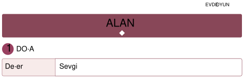 **Materyaller:** küçük eldivenler, geri dönüşüm kutusu ya da torbası, “Doğa Dostu görev kartları”

 **Uygulama**

* Aile üyelerinden biri, çocuğun yanına küçük bir görev kartıyla gelir ve şöyle der: “Bugün doğadan bize özel bir mesaj geldi. Parkımız, bahçemiz ya da apartman çevremiz biraz yardıma ihtiyaç duyuyor. Doğa dostları olarak bizim görevimiz çevremizi gözlemlemek, düzenlemek ve doğaya iyi gelecek küçük sorumluluklar almak. Haydi, bugün birlikte ‘Doğa Dostları Ekibi’ olalım.” Aile üyeleri, çocukla evin bahçesi, apartman önü, park, balkon ya da güvenli bir sosyal alan belirler.
* Etkinlik başlamadan önce çocuğa şu açıklama yapılır: “Doğayı korumak büyük işler yapmakla değil küçük sorumlulukları düzenli olarak yerine getirmekle başlar.” Ardından çocuğa basit görevler verilir.
* Örnek görevler:
“Yerdeki çöpleri güvenli şekilde topla.”
“Geri dönüşüme gidecek malzemeleri ayır.”
“Bir bitkiyi sula.”
“Kurumuş yaprakları uygun bir alana topla.”
“Parktaki ya da bahçedeki düzenli ve düzensiz alanları gözlemle.” gibi. Çocuk aile üyelerinden biriyle sosyal alanı gezer ve çevresini dikkatle inceler. Aile çocuğu gözlem yapmaya yönlendirir. Çocuk güvenli olan küçük görevleri yerine getirir. Çöp toplama yapılacaksa mutlaka eldiven kullanılır ve çocuğun kesici, kirli ya da tehlikeli nesnelere dokunmamasına dikkat edilir. Etkinliğin sonunda çocukla kısa bir “Doğa Dostu Sözü” oluşturulur.

<!-- sayfa 28 -->

![Dikkat simgesi]
# Dikkat

Çevre düzenleme sırasında çocukların yalnızca güvenli materyallere yetişkin rehberliğinde dokunmasına izin verilmelidir. Cam, metal, paslı, kesici veya kirli nesneler çocuklar tarafından alınmamalıdır. Bitkilere ve canlılara zarar verilmemeli, doğayı korumanın yalnızca temizlik yapmak değil canlıların yaşam alanlarına saygı göstermek olduğu vurgulanmalıdır. Etkinlik sonunda eller yıkanmalı ve alan düzenli bırakılmalıdır.

![Düşün / Hatırla / Söyle simgesi]
## Düşün / Hatırla / Söyle
* Çevrede neleri düzenledin ya da doğaya yardımcı olmak için hangi görevi yaptın?
* Yaptığın görevin doğaya nasıl bir katkı sağladığını düşünüyorsun?
* Bugün yaptığın görevlerden hangisini başka bir gün yeniden yapmak istersin?

<!-- yer tutucu bulunamadı: sayfa sonuna eklendi -->

<!-- sayfa 29 -->

# 2 SONBAHAR DEDEKTİFLERİ: KUTUDAKİ DOĞA

| Değer | Estetik, Duyarlılık |
| :--- | :--- |

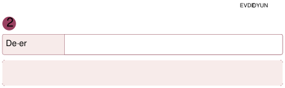 **Materyaller:** boş kutu, doğa yürüyüşünde toplanan doğal materyaller.

 **Uygulama**

* Aile bireylerinden biri, sonbahar yürüyüşünde kullanılmak üzere hazırlanan boş kutuyu çocuğa gösterir. “Bu kutuyu doğanın bize gönderdiği bir mektup gibi düşünebiliriz. Parkta yere düşmüş sonbahar parçalarını keşfederek kutumuzu doldurmaya ne dersin?” diyerek çocuğu etkinliğe hazırlar.
* Parkta veya bahçede yürürken çocuğa “Yere düşmüş, kurumuş bir yaprak bulabilir misin?”, “Turuncu ya da sarı renkte bir yaprak görebiliyor musun?”, “Yere düşmüş bir meşe palamudu bulabilir misin?” gibi küçük keşif görevleri verilir. Bulunan yapraklar, küçük dallar ve meşe palamutları birlikte incelendikten sonra sonbahar kutusuna yerleştirilir. Yalnızca yere düşmüş ve dokunulması güvenli doğal parçalar toplanır, ağaçların yaprakları ve canlı bitkiler koparılmaz.
* Yürüyüş sırasında bulunan parçaların renkleri, biçimleri ve dokuları hakkında konuşulur. Çocuğa, “Bu yaprak hangi renkte?”, “Bu yaprağın diğer yapraklardan farkı nedir?”, “Sence bu yaprak neden kurumuş?” gibi sorular yöneltilir. Ayrıca havalar soğuyup günler kısaldığında bazı ağaçların kışa hazırlandığı, yapraklarının renk değiştirdiği ve döküldüğü, çocuğun yaşına uygun ifadelerle açıklanır.
*  Eve dönüldüğünde toplanan parçalar masaya yerleştirilerek yeniden incelenir. Çocuktan yürüyüş sırasında neler gördüğünü, hangi parçaları bulduğunu ve en çok hangisini beğendiğini anlatması istenir. Etkinlik tamamlandıktan sonra eller birlikte yıkanır.

**Dikkat**

Gözlem sırasında ağaçların dallarına zarar verilmemeli, sadece yere düşmüş olan doğal materyaller toplanmalıdır. Mevsimsel geçiş nedeniyle havanın serin olabileceği hatırlatılarak uygun giyinmenin “doğa ile uyumlanmak” olduğu çocuğa açıklanmalıdır.

 **Düşün / Hatırla / Söyle**

* Ağaçların neden mevsime göre renk değiştirdiğini düşün.
* Sonbahar kutuna koyduğun en ilginç nesneyi ve dokusunu anlat.

<!-- sayfa 30 -->

# 3 ZAMAN YOLCULARI VE TAŞLARIN HİKÂYESİ

| Değer | Aile Bütünlüğü |
| :--- | :--- |

**Materyaller:** dijital fotoğraflar ya da fotoğraf albümü, çocuğun gelişim fotoğrafları (bebeklikten bugüne), bahçeden toplanmış taşlar (beştaş vb. için), silgi, anahtar, küçük bir bez torba ya da kutu.

**Uygulama**

Aile üyelerinden biri, eski bir fotoğraf albümünü veya dijital fotoğrafları masaya koyar. Yanına da dışarıdan bulduğu birkaç farklı taş yerleştirir. Çocğun yanına birkaç taş koyarak, “Bugün geçmişe küçük bir yolculuk yapacağız. Hem senin nasıl büyüdüğünü göreceğiz hem de geçmişten günümüze aktarılan geleneksel oyunlardan bazılarını keşfedeceğiz.” der.

Bebeklikten bugüne seçilen beş fotoğraf karışık biçimde dizilir. Çocuktan bu fotoğrafları geçmişten günümüze doğru kronolojik sıraya dizmesi istenir. Her fotoğrafın hikâyesi kısaca anlatılır.

Ardından aile büyükleri telefonla aranır veya yüz yüze görüşülür ve “Siz çocukken taşlarla hangi oyunları oynardınız?” diye sorulur. Aile büyüklerinin anlattığı beştaş gibi geleneksel oyunlar hakkında sohbet edilir. Bu oyunların geçmişte çocuklar tarafından oynandığı, aile büyüklerinden yeni kuşaklara aktarıldığı ve kültürel mirasımızın bir parçası olduğu vurgulanır.

Uygun ve güvenli olan oyunlardan biri aile büyüğünün anlatımıyla öğrenilir ve birlikte oynanır. Etkinliğin sonunda, geleneksel oyunların aileler ve kuşaklar arasında aktarılmasının kültürel mirasın yaşatılmasına katkı sağladığı üzerine sohbet edilir.

**Dikkat**

Fotoğraflar incelenirken çocuğun boyunun uzaması, dişlerinin değişmesi gibi somut gelişim özelliklerine vurgu yapılmalıdır. Aile büyükleriyle yapılan görüşmede onların çocukluk anılarına duyulan “saygı” ön planda tutulmalı, taşlarla oynanan oyunların fiziksel becerilerini nasıl geliştirdiği çocuklara anlatılmalıdır.

**Düşün / Hatırla / Söyle**

* Büyüklerimizin çocukken oynadığı oyunlarla bugün oynanan oyunlar arasında ne gibi farklılıklar olabilir?
* Bebeklik fotoğrafına bakarak kendindeki en büyük değişikliği anlat.
* Aile büyüklerinden öğrendiğin taş oyununun kurallarını hatırlıyor musun?

<!-- sayfa 31 -->

# 4 KÜÇÜK AFAD GÖNÜLLÜLERİ: AFET VE ACİL DURUM ÇANTAM

| Değer | Sorumluluk |
| :--- | :--- |

**Materyaller:** dayanıklı bir sırt çantası, acil durum malzemeleri (düdük, el feneri, ilk yardım kiti, su, konserve vb.), fotoğraf / video çekimi için telefon veya tablet

**Uygulama**

* Aile bireylerinden biri boş bir sırt çantasını çocuğa göstererek “Bu çanta, deprem gibi acil durumlarda ihtiyaç duyabileceğimiz malzemeleri bir arada bulundurmamızı sağlayacak. Şimdi ailece acil durum çantamızı hazırlayalım.” der. Acil durumların önceden hazırlık gerektirdiği ancak bu hazırlığın bir yetişkinin rehberliğinde yapılması gerektiği açıklanır.
* Aile bireylerinden biri su, bozulmayan paketli yiyecek, el feneri, yedek pil, düdük, mevsime uygun yedek giysi, hijyen malzemeleri ve aile bireylerinin özel ihtiyaçlarını içeren bir listeyi okur. Çocuk yalnızca güvenli ve kolayca ulaşabileceği malzemeleri bir yetişkinle bulup çantanın yanına getirir. İlaç, ilk yardım malzemesi, önemli belge kopyaları gibi yetişkin sorumluluğunda olan malzemeleri çantaya aile bireyi yerleştirir.
* Malzemeler incelenirken “Bu malzeme acil bir durumda ne işe yarar?” sorusu üzerine konuşulur. Örneğin “Su, susadığımızda içmemiz için gereklidir.”, “El feneri karanlıkta çevremizi görmemize yardımcı olur.” ve “Düdük, sesimizi uzaktaki kişilere duyurmamızı sağlar.” gibi açıklamalar yapılır. Daha sonra çocuk, malzemeleri kullanım amaçlarına göre gruplandırır ve malzemelerin çantaya yerleştirilmesine yardım eder.
* Bir aile bireyi çanta hazırlanırken çocuğun da katılımıyla hazırlık aşamalarının fotoğraflarını çekebilir veya kısa bir video kaydı oluşturabilir. Hazırlık tamamlandıktan sonra görüntüler birlikte incelenir; çantaya hangi malzemelerin konulduğu ve bunların neden gerekli olduğu tekrar edilir.
* Son olarak çanta, acil durumda yetişkinlerin kolayca ulaşabileceği güvenli bir yerde saklanır. Yiyecek, su, ilaç, pil gibi malzemelerin son kullanma tarihlerini düzenli olarak kontrol etme sorumluluğunun yetişkinlere ait olduğu belirtilir. Çantanın aile bireylerinin güncel ihtiyaçlarına göre belirli aralıklarla yenilenmesi gerektiği açıklanır.

<!-- yer tutucu bulunamadı: sayfa sonuna eklendi -->

<!-- sayfa 32 -->

>  **Dikkat**
>
> Hazırlık süreci, çocuğun gelişim düzeyi ve duygusal gereksinimleri dikkate alınarak oyun temelli bir yaklaşımla yürütülmelidir. Kaygı oluşturabilecek anlatımlardan kaçınılmalı ve hazırlıklı olmanın sağladığı güven duygusu vurgulanmalıdır. Çocukla izlenecek AFAD bilgilendirme videosu, içeriğinin yaşa uygunluğunu değerlendirmek amacıyla aile bireylerinden biri tarafından önceden izlenmelidir. Videoda yer alan “Çök-Kapan-Tutun” gibi güvenli davranışların ev ortamında uygulamalı olarak çalışılması, çocuğun acil durumlarda nasıl hareket edeceğini öğrenmesine ve kendini daha hazırlıklı hissetmesine yardımcı olabilir.

>  **Düşün / Hatırla / Söyle**
>
> * Acil durum çantasındaki malzemeler bize hangi durumlarda yardımcı olabilir?
> * Çantadan bir malzeme seçerek ne işe yaradığını anlat.
> * Deprem sırasında uygulamamız gereken güvenli hareketin adı nedir?

<!-- sayfa 33 -->

# 5 EVİMİZİN MESLEKLER SOKAĞI

| Değer | Saygı |
| :--- | :--- |

**Materyaller:** evde bulunan güvenli materyaller (oyuncak stetoskop ya da kaşık, kalem, defter, çanta, önlük, oyuncak telefon, boş kutular, renkli kartlar, kâğıt para yerine geçecek oyun kartları vb.).

* Aile bireyleri, evin farklı bölümlerinde küçük meslek alanları oluşturarak “Meslekler Sokağı” hazırlar. Oyuncaklar ve güvenli ev eşyaları kullanılarak sağlık merkezi, okul, mutfak, postane gibi alanlar düzenlenir. Örneğin oyuncak doktor çantası sağlık merkezinde, kitap ve kalemler okulda, oyuncak mutfak araçları mutfakta, zarflar ve kâğıtlar ise postanede kullanılabilir.
* Çocuk, canlandırmak istediği bir mesleği seçer ve o mesleğe uygun alana geçer. Aile bireyleri de hasta, öğrenci, müşteri, mektubunu göndermek isteyen kişi gibi tamamlayıcı roller üstlenir. Oyun sırasında çocuğa “Bu mesleği yapan kişi hangi işleri yapar?”, “Hangi araçları kullanır?”, “Kimlerle iletişim kurar?” ve “İnsanlara nasıl katkıda bulunur?” gibi sorular yöneltilir.
* Canlandırma sırasında aile bireyleri “Merhaba”, “Lütfen”, “Teşekkür ederim.”, “Rica ederim.”, uygun durumlarda “Geçmiş olsun.” gibi nezaket ifadelerini kullanarak çocuğa model olur. Çocuğun da rolüne uygun cümleler kurması ve karşısındaki kişiyi dinleyerek cevap vermesi desteklenir.
* Her canlandırmanın ardından roller değiştirilerek çocuğun farklı meslekleri ve iletişim biçimlerini deneyimlemesine fırsat verilir. Etkinliğin sonunda canlandırılan mesleklerin görevleri ve topluma katkıları üzerine konuşulur. Çocuk, ilgisini çeken mesleğin resmini çizebilir ve “Bu mesleği seçtim çünkü…” cümlesini tamamlayarak seçiminin nedenini açıklayabilir.

<!-- sayfa 34 -->

 **Dikkat**

Etkinlik boyunca bütün meslekler eşitlikçi ve kapsayıcı bir yaklaşımla tanıtılmalı; herhangi bir mesleği diğerlerinden daha üstün, değerli veya önemsiz gösteren ifadelerden kaçınılmalıdır. Her mesleğin toplumsal yaşamın sürdürülmesinde kendine özgü bir görevi ve katkısı olduğu vurgulanmalıdır. Çocuğun mesleklere yönelik ilgi ve tercihleri toplumsal cinsiyet kalıplarıyla sınırlandırılmamalı, mesleklerin herkes tarafından yapılabileceğini destekleyen bir dil kullanılmalıdır. Canlandırmalarda çocuğun yaşına ve gelişim düzeyine uygun, güvenli materyaller tercih edilmeli; kesici, delici veya yutulma riski taşıyan boyuttaki nesneler çocuğun erişiminden uzak tutulmalıdır.

---

 **Düşün / Hatırla / Söyle**

* Eğer herkes aynı işi yapsaydı neler olurdu?
* Bugün oynadığın meslekte hangi görevi yaptığını anlat.
* “Meslekler Sokağı”nda hangi meslekleri tanıdık ve bu meslekler insanlara nasıl yardım ediyordu?

<!-- sayfa 35 -->

# 6 RENKLİ İPLERİN DANSI: KÜÇÜK DOKUMACILAR

| Değer | Sabır |
| :--- | :--- |

**Materyaller:** sert karton (tezgâh yapmak için), renkli yün ipler, makas

## Uygulama

* Aile üyeleriyle evde basit bir dokuma çalışması yapılır. Bir kartonun iki kenarına küçük çentikler açılarak ipler gerilir ve küçük bir dokuma zemini hazırlanır. Çocuk, renkli yün ipleri veya kâğıt şeritleri iplerin arasından, bir alttan bir üstten geçirerek dokuma oluşturur. Dokuma sırasında belirlenen renk sırası birlikte takip edilir ve ortaya çıkan desenler incelenir. Etkinlik boyunca dokumanın nasıl oluştuğu hakkında sohbet edilir, çocuk farklı renk ve desenleri denemeye teşvik edilir. Çalışma tamamlandığında hazırlanan dokuma birlikte incelenir ve evin uygun bir köşesinde sergilenir.

> **Dikkat**
>
> 
> Dokuma işlemi sabır gerektiren bir süreçtir. Çocuğa ipi karıştırması veya “alt-üst” kuralını unutması durumunda hata yapmanın öğrenmenin bir parçası olduğu hatırlatılmalı ve nazikçe rehberlik edilmelidir.

## Düşün / Hatırla / Söyle

* Farklı renkleri bir araya getirince nasıl bir desen oluştu?
* Hangi renkleri kullandın ve bu renkleri neden seçtin?
* Daha önce buna benzer bir etkinlik yapmış mıydın? Bu çalışmanın o etkinliğe benzeyen ve farklı olan yönleri nelerdi?

<!-- sayfa 36 -->

# 7 GERİ DÖNÜŞÜM KAHRAMANLARI GÖREVDE

| Değer | Sevgi |
| :--- | :--- |

**Materyaller:** temiz, kuru ve çocuk için güvenli geri dönüşüm malzemeleri (kâğıt, karton kutu, plastik şişe ve plastik kapak); üzerinde “Kâğıt”, “Plastik”, “Metal” ve “Cam” yazan etiketlerin bulunduğu kutular veya poşetler; renkli kalemler, görev kartları ve çıkartmalar.

**Uygulama**

* Aile üyeleriyle evde küçük bir geri dönüşüm merkezi hazırlanır. Kâğıt, plastik ve metal atıklar için kutular oluşturulur ve üzerleri basit etiketlerle işaretlenir. Çocuğa geri dönüşümün ne olduğu kısa ve anlaşılır bir dille açıklanır. “Geri dönüşüm bazı atıkların yeniden kullanılabilecek hâle getirilmesidir. Böylece doğayı korur, kaynakları daha dikkatli kullanırız.” denilerek geri dönüşümün doğayı korumaya yardımcı olduğu hakkında kısa bir sohbet gerçekleştirilir. Daha sonra çocuk, evde bulunan temiz ve güvenli geri dönüşüm materyallerini inceleyerek hangi kutuya ait olduklarını tahmin eder ve materyalleri doğru kutuya yerleştirir. Materyaller yerleştirilirken “Bu atık neden kâğıt kutusuna atılır?”, “Bu materyal hangi malzemeden yapılmış?” gibi sorular kullanılarak sohbet edilir. Etkinliğin sonunda aile üyeleri doğayı korumanın önemi hakkında konuşur, “Doğayı korurum, atıklarımı doğru kutuya atarım.” gibi kısa bir doğa dostu sözü birlikte tekrar eder. İsteyen çocuk geri dönüşüm kutularını resim veya çıkartmalarla süsleyerek etkinliği tamamlar.

**Dikkat**

Etkinlikte kullanılacak materyaller önceden temizlenmiş ve çocuk için güvenli hâle getirilmiş olmalıdır. Cam kırığı, kesici metal parçalar, kirli ambalajlar, ilaç kutuları, temizlik ürünü ambalajları ve sağlığa zarar verebilecek atıklar çocuklara verilmemelidir. Çocuk atık ayırma sürecinde mutlaka bir yetişkinin rehberliğinde olmalı ve etkinlik sonunda eller yıkanmalıdır. Ayrıca geri dönüşümün yalnızca atıkları ayırmak değil tüketimi azaltmak ve eşyaları yeniden kullanmakla da ilişkili olduğu vurgulanmalıdır.

**Düşün / Hatırla / Söyle**

* Atıkları türlerine göre ayırmak doğanın korunmasına nasıl katkıda bulunur?
* Bugün ayırdığın atıklardan birinin ne olduğunu ve onu hangi geri dönüşüm kutusuna koyduğunu anlat.
* Geri dönüşüm kutularımızın adları neydi? Hangi materyal hangi kutuya aitti?

<!-- sayfa 37 -->

# 8 EVİMİZİN HARİTASI VE KÜÇÜK MÜHENDİSLER

| Değer | Aile Bütünlüğü |
| :--- | :--- |

 **Materyaller:** büyük boy resim kâğıdı ve renkli kalemler, cetvel veya şerit metre (ölçüm yapıyormuş gibi yapmak için), evin bölümlerini gösteren küçük yapışkanlı kâğıtlar.

 **Uygulama**

* Aile bireyleri çocukla evin bölümlerini sırayla gezer. Gezi sırasında odaların birbirleriyle olan konumları incelenir ve çocuğa “Salondan mutfağa giderken hangi bölümden geçiyoruz?”, “Çocuk odasının yanında hangi oda bulunuyor?”, “Banyonun karşısında ne var?” gibi sorular yöneltilir. Böylece çocuğun “yanında”, “karşısında”, “arasında”, “sağında”, “solunda” gibi konum bildiren ifadeleri kullanması desteklenir.
* Gezi tamamlandıktan sonra büyük bir kâğıda evin dış sınırlarını gösteren basit bir şekil çizilir. Evin giriş kapısı başlangıç noktası olarak belirlenir. Ardından salon, mutfak, yatak odası, banyo gibi bölümler evdeki gerçek konumları dikkate alınarak krokiye eklenir. Krokinin bire bir ölçülerle çizilmesi gerekmediği, odaların birbirine göre yerlerinin gösterilmesinin önemli olduğu açıklanır. Çocuk, odaları farklı renklerle belirginleştirebilir ve aile bireylerinin yardımıyla her bölümün adını yazabilir.
*  Etkinliğin sonunda hazırlanan kroki birlikte incelenir. Çocuktan giriş kapısından başlayarak kendi odasına, mutfağa veya salona giden yolu kroki üzerinde göstermesi ve yön ifadelerini kullanarak anlatması istenir. Böylece çocuğun evin bölümlerini tanıması, konumlar arasındaki ilişkileri fark etmesi ve basit bir krokiyi anlamlandırması desteklenir.

 **Dikkat**
Kroki çizimi sırasında ölçeğin tamamen doğru olması beklenmemelidir, önemli olan çocuğun odaların birbirine göre konumunu kavramasıdır. Çizim yaparken kâğıdın yönü ile evin gerçek yönü arasında bağlantı kurmasına (Bak mutfak burada, kâğıtta da buraya çizelim. vb.) yardım edilmelidir.

 **Düşün / Hatırla / Söyle**
* Evimizde birbirinden ayrı odalar olmasaydı günlük yaşamımız nasıl olurdu?
* Evde kaç oda var?

8

<!-- sayfa 38 -->

# 9 TOPRAĞIN SIRRI VE ÇAMURUN SANATI

| Değer | Duyarlılık, Estetik |
| :--- | :--- |

**Materyaller:** temiz toprak, küçük bir kap veya tepsi, az miktarda su, (varsa) büyüteç, küçük taşlar, yapraklar, kozalak, kuru dal parçaları, (istenirse çamurla şekil vermek için) küçük kalıplar, karton tabak veya mukavva.

**Uygulama**
* Aile üyeleriyle kolay temizlenebilecek bir alanda küçük bir toprak keşfi yapılır. Bir kaba alınan kuru toprak birlikte incelenir; toprağın rengi, kokusu ve dokusu hakkında sohbet edilir. Daha sonra toprağa az miktarda su eklenerek oluşan değişim gözlemlenir ve kuru toprak ile çamur arasındaki farklar konuşulur. Çocuk, oluşan çamuru elleriyle şekillendirerek küçük bir çalışma oluşturur; çalışmasının üzerine yaprak, taş, dal parçası gibi doğal materyallerle izler ve desenler yapar. Etkinlik boyunca toprağın bitkiler ve canlılar için önemi hakkında sohbet edilir. Çalışma tamamlandıktan sonra çocuk yaptığı ürünü ailesine tanıtır, etkinlik alanını birlikte temizler ve kullanılan doğal materyallere özen gösterilerek doğaya karşı sorumluluk bilinci desteklenir.

**Dikkat**
Toprak ve çamur etkinliğinde kullanılacak toprağın temiz ve güvenli bir alandan alınmasına dikkat edilmelidir. Çocuğun cam, plastik, metal, hayvan dışkısı, kesici nesne veya kimyasal madde bulunabilecek toprakla temas etmesine izin verilmemelidir. Canlı bitkilere zarar verilmemeli; dal kırmak, çiçek koparmak ya da böceklerin yaşam alanlarını bozmak yerine yalnızca yere düşmüş doğal parçalar kullanılmalıdır. Çocuğun toprağı ağzına götürmesi engellenmeli ve etkinlik sonunda mutlaka ellerini yıkaması sağlanmalıdır. Doğayı keşfederken ona zarar vermeden gözlem yapmanın ve kullanılan alanı düzenli bırakmanın önemi vurgulanmalıdır.

**Düşün / Hatırla / Söyle**
* Toprak olmasaydı bitkiler ve canlılar nasıl etkilenirdi?
* Bugün toprağı incelerken neler fark ettiğini anlat. Toprak suyla birleşince nasıl değişti?
* Çamurla yaptığın sanat çalışmanda hangi doğal materyalleri kullandın ve nasıl bir desen oluşturdun?

9

<!-- sayfa 39 -->

# 10 YERLİ ÜRETİM DEDEKTİFLERİ: LOGONUN PEŞİNDE

| Değer | Vatanseverlik |
| :--- | :--- |

* **Materyaller:** “Yerli Üretim” logosu örneği (görsel olarak), alışveriş listesi ve market sepeti.

* **Uygulama**
    * Aile bireylerinden biri markete gitmeden önce “Yerli Üretim” logosunun görselini telefondan veya basılı bir kart üzerinden çocuğa gösterir. Bu logonun, bir ürünün ülkemizde üretildiğini belirtmek amacıyla kullanıldığı açıklanır. “Bugün markette ürünlerin fiyat etiketlerini inceleyeceğiz ve bu logoyu bulmaya çalışacağız.” denilerek çocuk etkinliğe hazırlanır. 
    * Markette ürünler incelenirken çocuktan logoyu ürünün ambalajında değil öncelikle raf veya fiyat etiketinde araması istenir. Çocuk logoyu bulduğunda ürünün adı söylenir ve “Bu logo, ürünün ülkemizde üretildiğini gösteriyor.” açıklaması yapılır.
    * Etkinlik sırasında bulunan her ürün sepete eklenmez. Yalnızca alışveriş listesinde yer alan ve ailenin ihtiyaç duyduğu ürünler değerlendirilir. Benzer iki ürün karşılaştırılırken üretim yerinin yanı sıra fiyat, miktar, içerik, kalite ve ailenin gereksinimleri de göz önünde bulundurulur. Çocuğa “Bu iki ürünün etiketlerinde hangi bilgiler var?”, “Hangisinde yerli üretim logosu bulunuyor?”, “Bir ürünü seçerken başka nelere dikkat etmeliyiz?” gibi sorular yöneltilir.
    * Alışverişin sonunda hangi ürünlerde yerli üretim logosunun bulunduğuyla ilgili sohbet edilir, çocuğun bu ürünleri hatırlaması sağlanır. Yerli üretim tercihinin ülke içindeki üretime ve istihdama katkıda bulunabileceği, ancak bilinçli alışveriş yaparken ihtiyaç, bütçe ve ürün özelliklerinin birlikte değerlendirilmesi gerektiği açıklanır. 

> **Dikkat**
> Alışveriş sırasında çocuğun ürünleri incelerken raflara zarar vermemesine dikkat edilmelidir. 

* **Düşün / Hatırla / Söyle**
    * Sence kendi ülkemizde yapılan ürünleri seçmek insanlara ve çalışanlara nasıl bir destek sağlar?
    * Markette bulduğun “Yerli Üretim” logolu bir ürünü ve neden bu ürünü seçtiğini anlat.

<!-- sayfa 40 -->

# SANAT ALANI ETKİNLİĞİ

## 1 BENİM SANAT ATÖLYEM

| Değer | Sorumluluk |
| :--- | :--- |

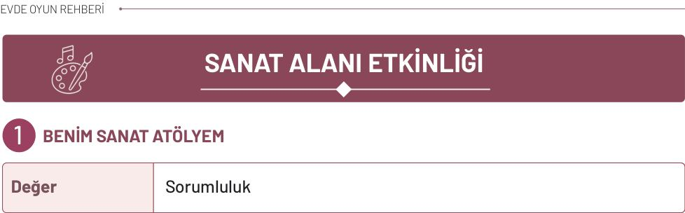
**Materyaller:** beyaz veya renkli kâğıt, görev kartları, karton, pastel boya, kuru boya veya parmak boyası, yapıştırıcı, küt uçlu makas, boya, kâğıt parçaları, doğal materyaller veya temiz artık malzemeler, dergi kupürleri, kumaş parçaları, ip, düğme, yaprak, pamuk, küçük çıkartmalar, önlük ve masa örtüsü.

**Uygulama**

* Aile üyelerinden biri sanat kutusunu çocuğa göstererek “Bugün evimizi bir sanat atölyesine dönüştürelim. Sanatçı olarak görevlerimizi tamamlayıp kendi eserimizi oluşturalım.” der. Çalışma alanı birlikte hazırlanır ve güvenli sanat malzemeleri masaya yerleştirilir.
* Etkinliğe başlamadan önce üç temel atölye kuralı hatırlatılır: Malzemeleri dikkatli kullanmak, çalışmayı sabırla tamamlamak ve etkinliğin sonunda alanı toplamak. Ardından “Planla”, “Tasarla” ve “Düzenle” yazılı üç görev kartı kapalı olarak masaya konur. Çocuk sırayla kartları açar.

**İlk kart**

* Planla: Çocuk “Benim Güzel Bahçem”, “Renkli Evim”, “Hayalimdeki Park” veya “Mutlu Bir Gün” temalarından birini seçer. “Resminde neler olsun?”, “Hangi malzemeleri kullanmak istersin?” ve “Nereden başlayacaksın?” sorularıyla çalışmasını planlar.

**İkinci kart**

* Tasarla: Çocuk boya, kâğıt parçaları, doğal materyaller veya temiz artık malzemelerle resim ya da kolajını oluşturur. Oyun sırasında aile üyesi belirli aralıklarla “Sanatçı molası!” der. Çocuk kısa bir süre durarak çalışmasını inceler ve bundan sonra ne yapacağına karar verir. Gerektiğinde çocuğa “Önce nereye yerleştireceğine karar verebilirsin.”, “Az miktarda yapıştırıcı yeterli olacaktır.” gibi hatırlatmalar yapılır.

**Üçüncü kart**

* Düzenle: Çocuk, eserini ailesine tanıtır ve çalışmasına bir ad verir. Ardından kullanılan malzemeler birlikte toplanır, yeniden kullanılabilecek parçalar ayrılarak saklanır ve çalışma alanı düzenlenir.
* Üç görevi de tamamladıktan sonra resimler uygun bir yerde sergilenir. Çocuğun yalnızca ortaya çıkardığı çalışma değil sabrı özeni planlı hareket etmesi ve sorumluluk davranışları

<!-- sayfa 41 -->

# Dikkat

Sanat etkinliği sırasında kullanılacak materyallerin çocuğun yaşına ve gelişim düzeyine uygun, güvenli ve temiz olmasına dikkat edilmelidir. Makas kullanılacaksa küt uçlu makas tercih edilmeli ve yetişkin gözetimi sağlanmalıdır. Küçük düğme, boncuk gibi materyaller boğulma riskinden dolayı eşyaları ağzına götürme eğiliminde olan çocuklarda kullanılmamalıdır. Etkinlikte çocuğun ürünü yetişkin beklentisine göre “güzel” ya da “hatalı” olarak değerlendirilmemeli, çocuğun renk seçimi, emeği, düzenli çalışma çabası ve malzemeleri sorumlu kullanması desteklenmelidir.

## Düşün / Hatırla / Söyle

* Sanat çalışması yaparken malzemeleri dikkatli kullanmak neden önemlidir?
* Bugün çalışmanda hangi renkleri ve malzemeleri kullandığın? Neden?
* Etkinlik başlamadan önce belirlediğimiz üç atölye kuralı neydi?

<!-- sayfa 42 -->

# RENKLERLE KOLAJ
2

| Değer | Estetik |
| :--- | :--- |

**Materyaller:** eski dergi, broşür veya ambalajlar, kâğıt, yapıştırıcı, küt uçlu makas, boya kalemleri.

**Uygulama**

* Çocuğa “Renkleri bulma oyunu oynamaya ne dersin?” denilerek eski dergiler, broşürler ve temiz ambalajlar birlikte incelenir. Belirlenen rengin farklı tonlarını içeren bölümler bulunur ve bu parçalar yırtılarak veya çocuklara uygun küt uçlu makasla kesilerek ayrılır.
* Bulunan parçaların açık ve koyu tonları karşılaştırılır. Çocuk seçtiği parçaları kâğıt üzerinde farklı biçimlerde yerleştirerek kolajını planlar. Yerleşime karar verdikten sonra parçaları yapıştırır, boya kalemleriyle çizgiler ve ayrıntılar ekleyerek çalışmasını tamamlar.

* Ardından çocuk hazırladığı kolaja bir ad verir, kullandığı renk ve tonları ailesine anlatır. Tamamlanan çalışma evde belirlenen uygun bir yerde sergilenir.

**Dikkat**
Etkinlikte kullanılan dergi, broşür ve ambalajların temiz ve güvenli olmasına dikkat edilmelidir. Kesme işlemi yetişkin gözetiminde, çocuğun yaşına uygun küt uçlu makasla yapılmalıdır. Keskin kenarlı ambalajlar ve yutulabilecek kadar küçük parçalar kullanılmamalıdır.

**Düşün / Hatırla / Söyle**

* Kolajda en sevdiğin bölüm hangisi?
* Başka hangi renkleri kullanarak kolaj yapmak istersin?
* Belirlediğimiz renkte evimizde bulunan hangi nesneyi söyleyebilirsin?

<!-- sayfa 43 -->

# 3 EVDEKİ NESNELERİN İZLERİ

| Değer | Temizlik |
| :--- | :--- |

**Materyaller:** yıkanabilir boya, kâğıt, sünger, şişe kapağı, plastik çatal, karton rulo gibi güvenli ev eşyaları.

**Uygulama**

* Çocuğa “Sence bir şişe kapağı veya süngerle resim yapılabilir mi?, Şimdi ‘İz Dedektifi’ oyunu oynayarak bu nesnelerin bıraktığı izleri keşfedelim.” denilerek etkinlik başlatılır. Evde bulunan temiz, kırılmayan, sivri kenarı olmayan ve yutma riski taşımayan birkaç güvenli nesne seçilir. Nesnelerin alt yüzeyleri incelenir ve kâğıtta nasıl izler bırakabilecekleri hakkında tahminde bulunulur.
* Aile üyelerinden biri, çocuğa göstermeden bir nesne seçer ve nesnenin alt kısmını boyaya batırarak kâğıda bastırır. Çocuk, oluşan izi inceleyerek hangi nesneye ait olduğunu tahmin eder. Doğru nesneyi bulabilmesi için çocuğa “İz yuvarlak mı, köşeli mi?”, “Büyük mü, küçük mü?”, “Hangi nesnenin alt yüzeyine benziyor?” gibi ipuçları verilebilir. Ardından roller değiştirilir; çocuk bir iz oluşturur, aile üyeleri bu izin hangi nesneye ait olduğunu bulmaya çalışır.
* Tahmin oyununun ardından izler karşılaştırılır. Çocuk, beğendiği izleri belirli bir sırayla tekrarlayarak desen oluşturabilir veya izleri çiçek, hayvan ya da hayalî bir varlık resmine dönüştürebilir.

* Etkinliğin sonunda çocuk, çalışmasına bir ad verir ve hangi nesneleri, izleri ve teknikleri kullandığını ailesine anlatır. Aile üyeleri nesneleri birlikte temizleyerek yerlerine kaldırır ve çalışma alanını düzenler.

**Dikkat**
Etkinlik boyunca çocuk yetişkin gözetiminde olmalıdır. Boyalı nesneleri ağzına götürmemesi konusunda yönlendirilmelidir.

**Düşün / Hatırla / Söyle**

* Hangi nesnenin izi seni şaşırttı?
* En çok hangi izi beğendin?

<!-- sayfa 44 -->

# 4 ÇERÇEVEDEN BAK

| Değer | Estetik |
| :--- | :--- |

**Materyaller:** karton parçası, küt uçlu makas, kâğıt, pastel veya kuru boyalar.

## Uygulama

* Bir kartonun ortası, yetişkin tarafından kare veya dikdörtgen biçiminde kesilerek bir görüntü çerçevesi hazırlanır. Çerçevenin kenarlarının pürüzsüz ve güvenli olmasına dikkat edilir. Çocuğa “Şimdi ‘Çerçevedeki Gizli Görüntü’ oyununu oynayacağız. Çerçevemizle evde küçük manzaralar bulacağız.” denilerek etkinlik başlatılır.
* Çocuk çerçeveyi kullanarak evin farklı bölümlerini, yakındaki nesneleri veya güvenli bir noktadan pencerenin dışını inceler. Çerçeveyi yaklaştırıp uzaklaştırarak ve farklı yönlere çevirerek çerçevenin içinde kalan görüntünün nasıl değiştiğini gözlemler.
* Çocuk, çerçeve içine aldığı görüntüyü aile üyelerine göstermeden görüntüdeki renk, çizgi, şekil ve konum özelliklerini anlatır. Örneğin “Çerçevemde yeşil, yuvarlak ve yapraklı bir şey görüyorum.” diyebilir. Aile üyeleri verilen ipuçlarından yararlanarak çerçevenin içindeki nesneyi veya alanı tahmin etmeye çalışır. Doğru tahminin ardından çerçevedeki görüntü herkese gösterilir ve sıra başka bir aile üyesine geçer.
* Oyun tamamlandıktan sonra çocuk en çok ilgisini çeken görüntüyü seçer ve yalnızca çerçevenin sınırları içinde gördüğü bölümü kâğıda çizer. Aile üyeleri de kendi seçtikleri görüntülerin resimlerini hazırlayabilir.
* Tamamlanan çalışmalar yan yana yerleştirilerek “Evimizden Küçük Manzaralar” başlıklı bir aile sergisi oluşturulur. Her aile üyesi çizdiği görüntüyü tanıtır ve bu görüntüyü neden seçtiğini anlatır.

<!-- sayfa 45 -->

# Dikkat
Karton yalnızca yetişkin tarafından kesilmeli ve çerçevenin kenarlarında sivri veya keskin bölümler kalmamalıdır. Çocuk pencerenin dışını incelerken pencere kapalı tutulmalıdır. Çocuğun pencereye tırmanmasına, yaslanmasına veya pencereden sarkmasına izin verilmemelidir. Çizim sırasında kullanılan araç gereçler çocuğun yaşına uygun ve güvenli olmalıdır.

## Düşün / Hatırla / Söyle
* Çerçeveyi başka bir yere tuttuğunda ne oldu?
* Çerçeveden baktığında daha önce fark etmediğin ne gördün?
* Bu yaptığımız etkinliğe benzer şekilde çalışan bir makine olabilir mi?

<!-- sayfa 46 -->

# 5 GÖLGEDEN BİR HİKÂYE

| Değer | Estetik |
| :--- | :--- |

**Materyaller:** oyuncak veya farklı biçimde bir nesne, el feneri ya da güneş ışığı, kâğıt, kalem, boyalar.

**Uygulama**

* Güneşli bir günde açık havaya çıkılarak “Gölgeyi Bul ve Taklit Et” oyunu başlatılır. Çocuğa “Gölge nasıl oluşur?”, “Biz hareket ettiğimizde gölgemiz de hareket eder mi?” gibi sorular yöneltilir. Aile üyeleri bedenlerini kullanarak sırayla bir hayvanı, nesneyi veya hareketi canlandırır. Diğer oyuncular yalnızca gölgeye bakarak neyin canlandırıldığını tahmin eder ve aynı hareketi taklit eder.
* Gölgesi belirgin biçimde görülebilen birkaç güvenli oyuncak veya nesne seçilir. Aile üyelerinden biri, nesnelerden birini diğer oyunculara göstermeden güneş ışığı alan, düz bir zemine yerleştirir. Çocuk, oluşan gölgeyi inceleyerek gölgenin hangi nesneye ait olduğunu tahmin eder. Daha sonra roller değiştirilir ve çocuk bir nesne seçerek aile üyelerinin tahmin etmesini sağlar.
* Etkinlik el feneriyle yapılacaksa loş bir ortam hazırlanır. Nesne ışık kaynağına yaklaştırılıp uzaklaştırılarak gölgenin büyüklüğündeki değişimler incelenir. Aile üyeleri, gölgenin büyüyeceğini veya küçüleceğini önceden tahmin ederek “Gölge Büyüdü mü, Küçüldü mü?” oyununu oynar.
* İlgi çekici bir gölge elde edildiğinde kâğıt, gölgenin düştüğü alana yerleştirilir. Bir aile üyesi nesneyi veya ışık kaynağını sabit tutarken çocuk gölgenin dış hatlarını çizer. Çocuk çizdiği gölgeye göz, kanat, kuyruk, kıyafet veya hayal ettiği başka ayrıntılar ekleyerek yeni bir karakter oluşturur.
* Son olarak çocuk, karakterine bir ad verir. Aile üyeleri sırayla “Nerede yaşıyor?”, “Nelerden hoşlanıyor?” ve “Başından nasıl bir olay geçmiş olabilir?” sorularına birer cümleyle cevap verir. Verilen cevaplar birleştirilerek gölge karakteri hakkında ortak bir aile hikâyesi oluşturulur.

<!-- sayfa 47 -->

# Dikkat
Kullanılan oyuncak ve çizim araçlarının çocuğun yaşına uygun, sağlam ve güvenli olmasına dikkat edilmelidir.

## Düşün / Hatırla / Söyle
* Sence sabah, öğle, akşam saatlerinde gölgemizin boyu neden değişir?
* Gölgeni hangi karaktere dönüştürdün?
* Gölgen ilk bakışta neye benziyordu?

<!-- sayfa 48 -->

# 6 DOĞANIN TABLOSU

| Değer | Duyarlılık |
| :--- | :--- |

**Materyaller:** yere düşmüş yapraklar, küçük dallar, taşlar, kozalaklar gibi doğal materyaller, tepsi veya karton parçası.

## Uygulama

Çocuğa “Doğa bize sanat çalışması yapabileceğimiz malzemeler sunmuş olabilir mi?, şimdi ‘Doğa Dedektifleri’ oyununu oynayarak bu malzemeleri keşfedelim.” denilerek kısa bir doğa yürüyüşüne çıkılır. Yürüyüş sırasında bitkilere zarar vermeden yalnızca yere düşmüş yaprak, küçük dal, taş, kozalak gibi güvenli doğal parçalar incelenir. Aile üyelerinden biri çocuğa küçük keşif görevleri verir:

* Farklı renklerde iki yaprak bul.
* Pürüzlü bir doğal parça keşfet.
* Birbirine benzeyen iki parça bul.
* Uzun ve kısa iki dal göster.
* Yuvarlak biçimli bir taş bul.

Bulunan parçalar renk, büyüklük, biçim ve doku özellikleri bakımından karşılaştırılır. Ardından parçalar bir tepsi veya karton üzerine alınarak “Doğa Tablosunu Tamamla” oyunu oynanır. Her aile üyesi sırayla bir doğal parça seçip çalışmaya ekler ve parçayı neden o bölüme yerleştirdiğini anlatır. Eklenen parçalarla tekrar eden bir desen, insan, hayvan veya manzara oluşturulabilir.

Tüm parçalar yerleştirildikten sonra tablo farklı yönlerden incelenir. Aile üyeleri eserin neye benzediğine ilişkin tahminlerini paylaşır. Çocuk en beğendiği düzenlemeye karar verir, çalışmaya bir ad vererek oluşturduğu görseli anlatır.

Geçici doğa tablosunun fotoğrafı çekilebilir. Etkinliğin sonunda toplanan doğal parçalar, çevreye zarar vermeden ve mümkünse alındıkları bölgeye geri bırakılır. Çalışmanın ardından eller yıkanır.

## Düşün / Hatırla / Söyle

* Tablonda en çok hangi bölümü sevdin?
* Doğada bulduklarımızdan en çok ilgini çeken materyal hangisiydi?

<!-- sayfa 49 -->

# 7 HAMURDAN MİNİK HEYKELLER

| Değer | Estetik |
| :--- | :--- |

**Materyaller:** oyun hamuru (oyun hamuru bulunmadığında un, tuz ve suyla hazırlanmış tuz hamuru), tepsi.

## Uygulama 

* Aile üyeleri oyun hamurunu veya birlikte hazırladıkları tuz seramiği hamurunu yoğurarak şekillendirmeye uygun hâle getirir. Çocuğun hamuru yuvarlama, bastırma, uzatma, koparma, parçaları birleştirme gibi farklı yöntemleri denemesine fırsat verilir. Aile üyeleri de aynı hareketleri yaparak çocuğa eşlik eder.
* Ardından “Hamurdan Yap, Birlikte Bulalım” oyunu oynanır. Aile üyelerinden biri hayvan, yiyecek, eşya veya hayalî varlık kartlarından birini diğer oyunculara göstirmeden seçer. Seçtiği varlığın adını söylemeden hamurla şekillendirmeye başlar. Diğer aile üyeleri, ortaya çıkan biçimi inceleyerek ne yapıldığını tahmin etmeye çalışır. Gerektiğinde “Canlı mı?”, “Nerede yaşar?”, “Ne işe yarar?” gibi sorular sorabilirler. Doğru tahminin ardından sıra başka bir aile üyesine geçer.
* Tahmin oyunu tamamlandıktan sonra aile üyeleri istedikleri bir hayvanı, yiyeceği, kişiyi veya hayalî varlığı hamur kullanarak üç boyutlu biçimde oluşturur. Oluşturulan çalışmalar, farklı renklerde hamurlar ve hamurdan hazırlanan küçük parçalar kullanılarak ayrıntılandırılabilir. 
* Tamamlanan heykeller bir tepsi üzerinde yan yana yerleştirilerek “Aile Heykel Sergisi” oluşturulur. Aile üyeleri oluşturdukları heykellere birer ad verir ve çalışmalarını diğer aile üyelerine tanıtır. Serginin sonunda heykellerin benzer ve farklı özellikleri üzerine konuşulur. İstenirse her heykel için eğlenceli bir sergi etiketi hazırlanabilir.

## Düşün / Hatırla / Söyle

* Hamurla oynamak / hamur yoğurmak sana ne hissettirdi?
* Heykelinin en sevdiğin özelliği nedir?
* Heykelini oluştururken önce hangi parçayı yaptın?

<!-- sayfa 50 -->

# 8 AYNADAKİ BEN

| Değer | Aile Bütünlüğü |
| :--- | :--- |

**Materyaller:** ayna, kâğıt, kalem, pastel veya kuru boyalar.

**Uygulama**

* Aile üyeleri, güvenli bir şekilde sabitlenmiş bir aynanın karşısına geçer. Etkinliğe “Aynadaki Taklit” oyunuyla başlanır. Aile üyelerinden biri “Burnunu göster.”, “Kulağına dokun.”, “Kaşlarını kaldır.”, “Gözlerini kırp.” gibi bir yönerge verir. Diğer oyuncular hareketi aynaya bakarak yapar. Ardından yönerge verme sırası çocuğa geçer.
* Daha sonra “Duyguyu Bul” oyunu oynanır. Aile üyelerinden biri konuşmadan mutlu, üzgün, şaşkın veya kızgın bir yüz ifadesi yapar. Diğer oyuncular yüzde meydana gelen değişiklikleri inceleyerek hangi duygunun canlandırıldığını tahmin eder. “Kaşları nasıl değişti?”, “Ağız nasıl bir biçim aldı?”, “Gözlerde nasıl bir değişiklik oldu?” gibi sorularla gözlem desteklenir. Yüz ifadelerinin herkeste aynı şekilde görülmeyebileceği ve aynı yüz ifadesinin farklı duyguları ifade edebileceği çocuğa açıklanır.
* Oyunların ardından aile üyelerinin saç, göz, kaş, burun ve yüz biçimleri aynada incelenir. Benzer ve farklı özellikler belirtilirken karşılaştırma veya değer yargısı içermeyen ifadeler kullanılır.
* Çocuğa bir kişinin yüzünü ve görünüşünü anlatan resimlere “portre” denildiği açıklanır. Çocuk aynadaki görüntüsünü inceleyerek kendi portresini çizer. Resmin gerçekçi olması veya gerçeğe uygun renkler içermesi beklenmez; çocuğun kendisini istediği renk, çizgi ve şekillerle özgürce ifade etmesi desteklenir.
* Çocuk isterse portresine sevdiği kıyafetleri, yanında bulunmasını istediği kişileri veya kendisini mutlu eden nesneleri ekleyebilir. Aile üyeleri de kendi portrelerini çizerek etkinliğe katılır. Tamamlanan çalışmalar karışık biçimde yan yana yerleştirilir ve “Bu portre kime ait?” adlı tahmin oyunu oynanır. Son olarak resimler “Aile Portreleri Köşesi”nde sergilenir ve her aile üyesi kendi portresini kısaca tanıtır.

**Düşün / Hatırla / Söyle**

* Sence ailemizde kimler birbirine daha çok benziyor?
* En çok kimin çizdiği portreyi beğendin? Neden?

8

<!-- yer tutucu bulunamadı: sayfa sonuna eklendi -->

<!-- yer tutucu bulunamadı: sayfa sonuna eklendi -->

<!-- sayfa 51 -->

# 9 RENKLERİ KARIŞTIRALIM

| Değer | Çalışkanlık |
| :--- | :--- |

**Materyaller:** kırmızı, sarı, mavi ve beyaz sulu boya ya da parmak boyası, küçük boya kapları, resim kâğıdı, fırçalar, su kabı, kırmızı, sarı ve mavi renk kartları, koruyucu masa örtüsü ve çocuk önlüğü.

**Uygulama**

* Kırmızı, sarı ve mavi boyalar çocuğa gösterilerek çocuktan renklerin adlarını söylemesi istenir. Bu renklerin resim çalışmalarında kullanılan ana renkler olduğu ve birbirleriyle karıştırıldıklarında yeni renkler oluşturabildiği açıklanır. Çocuğa “Şimdi ‘Renk Sihirbazları’ oyununu oynayarak yeni renklerin nasıl oluştuğunu keşfedelim.” denir.
* Boyalar ayrı kaplara yerleştirilir. Kırmızı, sarı ve mavi renkleri gösteren küçük kartlar hazırlanarak ters çevrilir. Çocuk iki kart seçer ve kartlarda bulunan renkler karıştırıldığında hangi yeni rengin oluşacağını tahmin eder. Seçilen boyalardan az miktarda alınarak temiz bir kapta veya kâğıt üzerinde karıştırılır. Oluşan renk çocuğun tahminiyle karşılaştırılır. Kırmızı ve sarıdan turuncu, sarı ve maviden yeşil, kırmızı ve maviden ise mor tonları elde edilebileceği gözlemlenir.
* Ardından “Gizli Rengi Bul” oyunu oynanır. Aile üyelerinden biri çocuğa göstermeden iki ana rengi karıştırır. Çocuk oluşan ara rengi inceleyerek hangi renklerin kullanıldığını tahmin eder. Daha sonra roller değiştirilir. Çocuk bir renk karışımı hazırlar, aile üyeleri karışımda kullanılan renkleri bulmaya çalışır.
* Aynı iki renk farklı oranlarda karıştırılarak renklerden biri artırıldığında ortaya çıkan tonun nasıl değiştiği incelenir. Daha açık tonlar elde etmek için karışıma az miktarda beyaz boya eklenebilir. Her denemeden önce fırça temizlenerek renklerin istemeden birbirine karışması önlenir.
* Oyunun ardından çocuk ana renkleri ve keşfettiği yeni renkleri kullanarak serbest bir resim yapar. Etkinliğin sonunda aile üyelerine hangi renkleri karıştırdığını, tahminlerinin doğru olup olmadığını ve hangi yeni renkleri elde ettiğini anlatır.

**Düşün / Hatırla / Söyle**

* Hangi renk karışımı seni şaşırttı? Neden?
* Oluşturduğun yeni renklerden en çok hangisini beğendin?
* Bu rengi daha önce nerede veya hangi nesnede gördüğünü hatırlıyor musun?

<!-- yer tutucu bulunamadı: sayfa sonuna eklendi -->

<!-- yer tutucu bulunamadı: sayfa sonuna eklendi -->

<!-- sayfa 52 -->

# 10 SIRAYLA ÇİZİYORUZ

| Değer | Sabır |
| :--- | :--- |

**Materyaller:** büyük bir kâğıt, farklı renklerde kalemler.

**Uygulama**

* Büyük bir kâğıt masaya veya zemine yerleştirilir. Aile üyelerinden her biri farklı renkte bir boya kalemi seçer. Çocuğa “Şimdi ‘Çizgiyi Devam Ettir’ oyununu oynayarak birlikte büyük bir resim oluşturacağız.” denir.
* Dalgalı çizgi, zikzak çizgi, daire, üçgen, nokta gibi basit şekillerin bulunduğu görev kartları hazırlanarak ters çevrilerek zemine yerleştirilir. İlk aile üyesi bir kart seçer ve karttaki çizgi veya şekli kâğıdın istediği bir bölümüne çizer. Sıradaki aile üyesi yeni bir kart seçerek çizime bir ayrıntı ekler. İster önceki çizgiyi tamamlar isterse resmin farklı bir bölümünde yeni bir şekil oluşturur.
* Bazı turlarda “Sürpriz Görev” uygulanabilir. Aile üyelerinden biri “Kalemi kaldırmadan bir şekil çiz.”, “Önceki şekli bir nesneye dönüştür.”, “Resme üç nokta ekle.” gibi kısa bir görev verir. Oyun birkaç tur boyunca sürdürülür. Çizilen bölümler silinmez, değiştirilmez veya olumsuz biçimde değerlendirilmez.
* Turlar tamamlandığında kâğıt farklı yönlere çevrilerek incelenir. Aile üyeleri, çizgilerin ve şekillerin nelere benzediğine ilişkin tahminlerini paylaşır. İstenirse belirlenen alanlar birlikte boyanarak ortak çalışma tamamlanır.
* Son olarak aile üyeleri resme birlikte bir ad verir. Herkes çalışmanın bir köşesine adını yazar. Yazamayan çocuk, kendisini temsil eden bir işaret veya küçük bir sembol çizebilir. Tamamlanan resim evde uygun bir yerde sergilenir.

**Düşün / Hatırla / Söyle**

* Resimde hangi renk boya kalemlerini tercih ettin?
* Birlikte resmi yapmak sana ne hissettirdi?
* Seçtiğin kartta hangi çizgi veya şekil vardı?

<!-- sayfa 53 -->

# 11 EVİMİZİN MİNİK MÜZESİ

| Değer | Aile Bütünlüğü |
| :--- | :--- |

**Materyaller:**
çocuğun ve aile üyelerinin daha önce hazırladığı sanat çalışmaları, aile için anlam taşıyan fotoğraflar veya güvenli süs objeleri, sergileme alanı için masa ya da raf, tanıtım kartları, görev kartları, kâğıt müze biletleri, renkli kalemler, yapışkanlı not kâğıtları.

**Uygulama**

* Etkinliğe “Bugün evimizin bir köşesini müzeye dönüştürelim. Müzemizde hangi eserlerin sergileneceğine birlikte karar verelim.” denilerek başlanır.
* Çocuk daha önce yaptığı resim, boyama ve el işi çalışmalarını inceler ve sergilemek istediği eserleri seçer. Aile üyeleri de yaptıkları bir çalışmayı, aile için anlam taşıyan bir fotoğrafı veya güvenli bir süs eşyasını sergiye ekleyebilir.
* Seçilen eserler masa, raf veya duvar üzerinde birlikte düzenlenir. Her eser için küçük bir tanıtım kartı hazırlanır. Çocuk eserin adını ve onunla ilgili söylemek istediği kısa bilgiyi paylaşır, bir aile üyesi de bunları karta yazar. Ardından kâğıttan müze biletleri hazırlanır ve aile üyeleri sergiyi gezmeye davet edilir.
* Çocuk müze rehberi rolünü üstlenerek eserleri tanıtır. Eserleri neden seçtiğini, nasıl hazırladığını ve en çok hangi bölümünü beğendiğini anlatır. Daha sonra “Müze Dedektifi” oyunu oynanır. Çocuk seçtiği eserin adını söylemeden esere ilişkin ipuçları verir. Örneğin “Bu eserde mavi renk var.”, “Bu çalışma kâğıttan yapıldı.” veya “Bu eserde bir hayvan bulunuyor.” diyebilir. Aile üyeleri, ipuçlarından yararlanarak anlatılan eseri bulmaya çalışır.
* Ardından görev kartları kullanılabilir. Kartlarda “İçinde yuvarlak bir şekil bulunan eseri bul.”, “Sıcak renklerin kullanıldığı bir eser göster.”, “Aile için özel anlam taşıyan eseri bul.” gibi görevler yer alır. Her aile üyesi bir kart seçerek müzede belirtilen eseri arar ve seçiminin nedenini açıklar.
* Etkinliğin sonunda roller değiştirilir. Aile üyelerinden biri rehber olur, çocuk ise biletini kullanarak ziyaretçi rolünü üstlenir. Müze gezisinin ardından sergideki eserler, aile için taşıdıkları anlamlar ve etkinlik sırasında yapılan keşifler üzerine konuşulur.

<!-- sayfa 54 -->

 **Dikkat**
Sergilenecek eserler seçilirken çocuğun kendi tercihlerini yapmasına fırsat verilir.

---

 **Düşün / Hatırla / Söyle**
* Sergi için eserlerini seçerken nelere dikkat ettin?
* Sergilediğin eserlerden en sevdiğin hangisi? Neden?
* Daha önce gördüğün bir müzeyi, sergiyi veya sanat eserini hatırlıyor musun?

<!-- sayfa 55 -->

# 12 İYİLİK KARTLARI ATÖLYESİ

| Değer | Merhamet |
| :--- | :--- |

**Materyaller:** renkli kartonlar, boya kalemleri, çocuklara uygun küt uçlu makas, yapıştırıcı, temiz atık kâğıt parçaları, kurdele, çıkartmalar ve canlandırmada kullanılabilecek güvenli oyuncaklar.

**Uygulama**

*  Etkinliğe “Bugün birini mutlu edebilecek iyilik kartları hazırlayacağız. Sence küçük bir kart, bir insanın yüzünü güldürebilir mi?” denilerek başlanır.

* Çocukla merhamet kavramı üzerine sohbet edilir. Çocuğa “Merhamet, bir insanın ya da canlının yaşadığı güçlüğü fark etmek, onun duygularını anlamaya çalışmak ve ihtiyaç duyduğunda ona destek olmaktır.” açıklaması yapılır. Güzel bir söz söylemenin, yardım teklif etmenin ve karşıdaki kişiyi dikkatle dinlemenin merhametli davranışlara örnek olabileceği belirtilir.

* Ardından “İyilik Heykeli” oyunu oynanır. Aile üyelerinden biri; yardım etme, teselli etme, paylaşma veya bir canlıyı koruma davranışlarından birini konuşmadan canlandırır. Diğer aile üyeleri canlandırılan davranışın ne olduğunu tahmin eder. Örneğin oyuncak bebeği teselli etme, birine su verme, düşen eşyaları toplamasına yardım etme veya oyuncağını paylaşma davranışları canlandırılabilir. Doğru tahminin ardından “Bu davranış karşıdaki kişiye ne hissettirebilir?” sorusu üzerine konuşulur. Daha sonra canlandırma sırası çocuğa geçer.

* Oyunun ardından çocuk, iyilik kartını vermek istediği kişiye karar verir. Renkli kartonlardan birini seçerek kartını kalp, çiçek, güneş veya el izi biçiminde hazırlayabilir. Kartını resim, boya, temiz kâğıt parçaları, kurdele veya çıkartmalarla süsleyebilir.

* Çocuk, kartın içine yazılmasını istediği cümleyi söyler ve bir aile üyesi bu cümleyi değiştirmeden yazar. “Geçmiş olsun.”, “Seni seviyorum.”, “İstersen seni dinleyebilirim.”, “Ben yanındayım.”, “Sana yardım etmek isterim.” gibi ifadeler kullanılabilir.

* Kart tamamlandığında çocuk, hazırladığı kartı seçtiği kişiye verir ve kartı neden hazırladığını kendi cümleleriyle anlatır. Etkinliğin sonunda merhametli davranışların ve içten sözlerin insanlar üzerindeki etkileri hakkında ailece sohbet edilir.

<!-- sayfa 56 -->

 **Dikkat**
Çocuğa, yardım etmenin ve iyi dilekte bulunmanın gönüllü, yaşına uygun ve güvenli davranışlarla gerçekleşebileceği vurgulanır.

---

 **Düşün / Hatırla / Söyle**
* Birinin üzgün olduğunu gördüğümüzde ona nasıl merhametli davranabiliriz?
* Hazırladığın iyilik kartında hangi resmi yaptığını ve hangi güzel sözü kullandığını anlat.
* Bugün merhametli davranışlara hangi örnekleri verdik?

<!-- sayfa 57 -->

# MÜZİK ALANI ETKİNLİĞİ

## 1 EVİMİZİN SES HARİTASI

| Değer | Estetik, Saygı |
| :--- | :--- |

 **Materyaller:** büyük boy kâğıt, kurşun kalem, renkli boya kalemleri ve evin basit krokisi.

 **Uygulama**

* Aile üyelerinden biri “Şimdi Ses Dedektifleri’ oyununu oynayacağız. Görevimiz, evimizde saklanan sesleri bulmak ve ses haritamıza yerleştirmek.” diyerek oyunu başlatır.
* Aile üyeleri evin bir bölümüne geçer ve belirlenen işaret verildiğinde herkes sessizce çevresini dinler. Çocuk duyduğu sesleri fark etmeye ve seslerin nereden geldiğini bulmaya çalışır. Çocuk saat, su, kuş, rüzgâr, araç, ayak sesi gibi fark ettiği her ses için kâğıda kendine özgü bir çizgi, şekil veya sembol çizer. Yüksek sesleri büyük, hafif sesleri küçük işaretlerle gösterebilir.
* Ardından aile üyelerinden biri, duyduğu seslerden birini konuşmadan taklit eder. Diğer oyuncular sesin neye ait olduğunu ve evin hangi bölümünde duyulduğunu tahmin eder. Doğru tahmin edilen ses, evin basit krokisi üzerinde duyulduğu bölüme eklenir ve oyun sırası diğer aile üyesine geçer.
* Oyun evin farklı bölümlerinde sürdürülür. Her bölümde kısa bir “sessiz dinleme” turu yapılır ve yeni keşfedilen sesler haritaya eklenir. Bir kişi duyduğu sesi anlatırken diğer aile üyeleri onu sözünü kesmeden dinler.
* Oyunun sonunda hazırlanan ses haritası birlikte incelenir. Evin hangi bölümlerinde daha fazla veya daha az ses duyulduğu karşılaştırılır. En ilginç, en az duyulan ve en kolay tanınan sesler belirlenerek oyun tamamlanır.

<!-- sayfa 58 -->

 **Dikkat**

Etkinlik sırasında kısa süreli sessizlik sağlanarak çocuğun çevredeki seslere odaklanmasına fırsat verilir. Çocuğun duyduğu sesleri doğru veya yanlış olarak değerlendirmek yerine gözlemlerini özgürce ifade etmesi desteklenir.

 **Düşün / Hatırla / Söyle**

* Evin hangi bölümünde daha çok ses duyduk? Neden?
* Dinlerken hangi sesleri fark ettin?
* Bugün en çok duyduğun üç ses neydi?

<!-- sayfa 59 -->

# 2 RİTMİMİ YAKALA

| Değer | Estetik, Sabır |
| :--- | :--- |

**Materyaller:** Tahta kaşıklar ve ritim oluşturmak amacıyla kullanılabilecek, keskin kenarı bulunmayan güvenli ev eşyaları.

**Uygulama**

* Aile üyelerinden biri “Şimdi ‘Ritim Zinciri’ oyununu oynayacağız. Her oyuncu duyduğu ritmi tekrar edecek ve zincire yeni bir ses ekleyecek.” diyerek oyunu başlatır. Aile üyeleri birbirlerini rahatça görebilecekleri şekilde uygun bir alana oturur.

* Bir ritim lideri seçilir. Lider alkışlama, dizlere hafifçe vurma, parmak şıklatma veya tahta kaşıkları birbirine hafifçe vurma yollarından birini kullanarak kısa bir ritim oluşturur. Çocuk ritmi dikkatle dinleyerek aynı sırayla tekrar eder. Ritimler başlangıçta iki veya üç hareketten oluşturulur ve çocuğun katılımına göre aşamalı olarak uzatılır.

* Daha sonra “Ritim Zinciri” aşamasına geçilir. İlk oyuncu bir ritim hareketi yapar. Sıradaki oyuncu bu hareketi tekrarlar ve zincire yeni bir hareket ekler. Örneğin ilk oyuncu bir kez alkışlar, ikinci oyuncu bir kez alkışladıktan sonra dizlerine hafifçe vurur. Üçüncü oyuncu bu iki hareketi aynı sırayla tekrar ederek zincire yeni bir hareket ekler.

* Bir oyuncu ritmi hatırlamakta zorlansa da oyunda kalmaya devam eder. Ritim yavaşça tekrarlanır ve aile üyeleri zinciri birlikte tamamlar. Böylece oyun yarışma amacı taşımadan iş birliği içinde sürdürülür.

* Birkaç turun ardından ritim lideri değiştirilir. Her aile üyesi sırayla kendi kısa ritmini oluşturur, diğer oyuncular da bu ritmi dinleyerek tekrar eder. Çocuk da lider rolünü üstlenerek ritmin hareketlerine, hızına ve tekrar sayısına karar verir.

* Oyunun sonunda aile üyelerinden her biri sevdiği bir ritim hareketini seçer. Seçilen hareketler sırayla birleştirilerek kısa bir “aile ritmi” oluşturulur ve bu ritim birkaç kez birlikte çalınır. Ardından dikkatle dinlemenin, hareketleri doğru sırayla tekrarlamanın ve sırasını beklemenin oyundaki önemi üzerine konuşulur.

<!-- sayfa 60 -->

# Dikkat
Ritim oluşturmak için kullanılan materyaller temiz, sağlam ve hafif olmalı, kenarları keskin olmamalıdır. Nesneler birbirine veya zemine sert biçimde vurulmamalı, ses düzeyi çocuğu rahatsız etmeyecek seviyede tutulmalıdır. Çocuğun ritimleri takip etmekte zorlandığı durumlarda oyun kolaylaştırılmalıdır.

## Düşün / Hatırla / Söyle
* Hangi ritmi tekrar etmek daha kolaydı?
* Ritmini oluştururken hangi hareketleri seçtin? Neden?
* Sen ritim lideri olduğunda nasıl bir ritim oluşturdun?

<!-- sayfa 61 -->

# 3 MÜZİĞİN ÇİZGİLERİ

| Değer | Estetik |
| :--- | :--- |

**Materyaller:** büyük boy resim kâğıdı, farklı renklerde boya kalemleri, yavaş ve hareketli müzik örnekleri, müzik çalmak için telefon veya hoparlör.

## Uygulama

* Aile üyelerinden biri “Şimdi ‘Müzik Dur, Çizgi Don’ oyununu oynayacağız. Müzik çalarken çizgilerimiz hareket edecek, müzik durduğunda ise kalemlerimiz donacak.” diyerek oyunu başlatır.
* Büyük bir kâğıt masaya veya zemine yerleştirilir. Her aile üyesi istediği renkte bir boya kalemi seçerek kâğıdın çevresinde kendisine uygun bir yer belirler. Önce yavaş tempolu bir müzik açılır. Aile üyeleri, müziğin kendilerinde uyandırdığı duygu ve hareketlere göre kalemlerini kâğıt üzerinde serbestçe gezdirir. Uzun, kısa, düz, dalgalı, ince veya kalın çizgiler oluşturabilirler.
* Müzik belirli aralıklarla durdurulur. Müzik durduğunda herkes kalemini hareket ettirmeden bekler. Müzik yeniden başladığında çizime devam edilir. Kalemini en son durduran oyuncu oyundan çıkarılmaz, aile üyeleri gülümseyerek oyunu sürdürür.
* Ardından hareketli bir müzik açılır. Aile üyeleri bu kez müziğin temposuna ve kendilerinde uyandırdığı hislere göre farklı çizgiler oluşturur. Her turun sonunda aile üyelerinden biri “müzik lideri” olur ve müziğin ne zaman başlayıp duracağını belirler. Müzik cihazı bir yetişkin tarafından kullanılır. Çocuk lider olduğunda “Başla” ve “Dur” yönergelerini vererek oyunu yönetir.
* Oyunun sonunda ortak çalışma birlikte incelenir. Aile üyeleri, hangi çizgilerin yavaş ve hangilerinin hareketli müzik sırasında oluştuğunu tahmin eder. Her aile üyesi müziğin kendisine neler hissettirdiğini ve çizgilerini neden bu biçimde çizdiğini anlatır. Ortak resme birlikte bir ad verilir ve çalışma evde uygun bir yerde sergilenir. Müziğin ses düzeyi çocuğu rahatsız etmeyecek biçimde ayarlanır.

<!-- sayfa 62 -->

# Dikkat
Çocuğun çizgileri doğru veya yanlış olarak değerlendirilmez, müziği kendi biçiminde ifade etmesi desteklenir. Çocuk istediği çizgi ve hareketleri özgürce seçebilir, yetişkin yönlendirici olmaktan kaçınır. Müzikler çocuğun yaşına uygun, farklı tempo ve türde seçilir.

---

## Düşün / Hatırla / Söyle
* Hızlı ve yavaş müziklerde çizgilerin nasıl değişti?
* Neden resmine bu ismi verdin?
* Dinlediğinde seni mutlu eden veya sakinleştiren müziği hatırlıyor musun?

<!-- sayfa 63 -->

# 4 ADIMIZIN ŞARKISI

| Değer | Aile Bütünlüğü, Sevgi |
| :--- | :--- |

 **Materyaller:** bu etkinlik için özel bir materyal gerekmemektedir. İstenirse ritmi desteklemek amacıyla tahta kaşık veya çocuklara uygun bir ritim aracı (isteğe bağlı).

## Uygulama

* Aile üyelerinden biri “Şimdi ‘Alkıştan İsmi Bul’ oyununu oynayacağız. İsimlerimizi hecelerine ayırıp alkışlayarak kimin ismi olduğunu bulmaya çalışacağız.” diyerek oyunu başlatır.
* Aile üyeleri sırayla isimlerini söyler. Her isim yavaşça tekrar edilir ve hecelerine ayrılır. İsmin her hecesinde bir kez alkışlanır. Örneğin “Ay-lin” ismi iki kez, “Mus-ta-fa” ismi ise üç kez alkışlanır.
* Ardından aile üyelerinden biri, seçtiği kişinin ismini söylemeden yalnızca hecelerine uygun biçimde alkışlar. Diğer oyuncular alkışlanan ismin kime ait olduğunu tahmin eder. Aynı sayıda hecesi bulunan isimler olduğunda ismin ilk sesi ipucu olarak verilebilir. Doğru tahminin ardından oyun sırası başka bir aile üyesine geçer.
* Daha sonra çocuk kendi ismini alkışlayarak ve istediği biçimde uzatarak söyler. Aile üyeleri de çocuğu taklit eder. Aynı çalışma diğer aile üyelerinin isimleriyle devam eder.
 Oyunun sonunda her isim sırayla söylenir ve ardından “Seni seviyoruz.”, “İyi ki varsın.”, “Seninle birlikte olmaktan mutluyuz.” gibi bir cümle eklenir. Böylece aile üyelerinin isimlerinin yer aldığı kısa ve eğlenceli bir aile şarkısı oluşturulur. Tüm aile bu sözleri alkışlarla birlikte birkaç kez tekrar eder.

 **Dikkat**
Çocuk ismini hecelerken zorlandığında eleştirilmemeli, ona örnek olunarak birlikte tekrar yapılmalıdır.

## Düşün / Hatırla / Söyle

* Hangi ismin ritmi daha uzun sürdü?
* Aile şarkısında en sevdiğin bölüm hangisiydi?

<!-- sayfa 64 -->

# 5 SES MERDİVENİ

| Değer | Estetik, Çalışkanlık |
| :--- | :--- |

**Materyaller:** büyük boy kâğıt, renkli kalemler ve merdiven üzerinde hareket ettirilebilecek küçük, güvenli bir oyuncak.

**Uygulama**

* Aile üyelerinden biri “Şimdi ‘Ses Merdiveni’ oyununu oynayacağız. Oyuncağımız merdivenin yukarısına çıktıkça sesimiz incelecek, aşağıya indikçe kalınlaşacak.” diyerek oyunu başlatır.

* Bir kâğıda büyük ve basit bir merdiven çizilir. Çocuk küçük bir oyuncağı merdivenin basamaklarında aşağıdan yukarıya doğru hareket ettirirken “uuu” sesi çıkarır ve sesini yavaşça inceltir. Oyuncağı yukarıdan aşağıya indirirken sesini giderek kalınlaştırır. Aile üyeleri de çocuğun çıkardığı sesi taklit eder.

* Ardından “Ses Nerede?” oyunu oynanır. Aile üyelerinden biri ince veya kalın bir ses çıkarır. Çocuk, duyduğu sesin merdivenin üst basamaklarına mı yoksa alt basamaklarına mı uygun olduğunu gösterir. Daha sonra çocuk bir ses çıkarır ve aile üyeleri sesin merdivendeki yerini tahmin eder.

* Oyunun diğer bölümünde aile üyelerinden biri kuş, fare, kedi, aslan, ayı gibi bir hayvanın sesini taklit eder. Diğer oyuncular hayvanı tahmin eder ve sesinin merdivenin hangi bölümüne yerleştirilebileceğini söyler. Hayvan seslerinin farklı biçimlerde çıkabileceği ve yapılan taklitlerin oyun amacı taşıdığı belirtilir.

* Son bölümde çocuk “ses yöneticisi” olur. Oyuncağı merdivende yukarı veya aşağı hareket ettirerek aile üyelerinin seslerini yönetir. Oyuncak yükseldikçe aile üyeleri seslerini inceltir, aşağı indikçe kalınlaştırır. Daha sonra yöneticilik sırası diğer aile üyelerine geçer. Oyun boyunca sesler zorlanmadan çıkarılır ve herkesin sesinin kendine özgü olduğu vurgulanır.

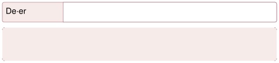
<!-- yer tutucu bulunamadı: sayfa sonuna eklendi -->

<!-- sayfa 65 -->

# Dikkat
Çocuğun sesini rahat ve doğal ses aralığında kullanmasına özen gösterilmelidir. Çocuktan uzun süreli, çok yüksek, ince veya aşırı kalın sesler çıkarması istenmemeli; çocuğun sesinde zorlanma ya da rahatsızlık fark edildiğinde etkinliğe ara verilmelidir. Aile üyeleri uygun ses kullanımı konusunda çocuğa model olmalı ve etkinlik boyunca destekleyici, cesaretlendirici bir iletişim dili kullanmalıdır.

## Düşün / Hatırla / Söyle
* Sesimiz inceldiğinde ve kalınlaştığında duyduğumuz ses nasıl değişir?
* Ses merdiveninde en çok hangi basamakta ses çıkarmayı sevdin?
* Ailenden kimin sesi sana daha ince geldi?

<!-- sayfa 66 -->

# 6 MUTFAK ORKESTRASI

| Değer | Estetik, Sorumluluk, Saygı |
| :--- | :--- |

**Materyaller:** tahta kaşık, plastik kap, kapaklı saklama kabı, metal tencere ve karton kutu.

**Uygulama**

* Aile üyelerinden biri “Mutfak eşyalarının seslerini bulma oyunu oynayalım mı?” diyerek oyunu başlatır. Tahta kaşık, plastik kap, saklama kabı, metal tencere, karton kutu gibi güvenli eşyalar bir masanın üzerine yerleştirilir.
* Eşyalara elle veya tahta kaşıkla hafifçe vurulur ve çıkardıkları sesler birlikte dinlenir. Çocuğa “Sence hangisinin sesi daha farklı?”, “Bu ses hangi eşyadan çıktı?” gibi basit sorular sorulur.
* Daha sonra çocuk arkasını döner. Aile üyelerinden biri eşyalardan birine hafifçe vurarak ses çıkarır. Çocuk, sesi dinleyerek hangi eşyaya vurulduğunu tahmin eder. Ardından çocuk bir eşya seçip ses çıkarır ve aile üyeleri kullanılan eşyayı bulmaya çalışır.
* Sonraki bölümde her aile üyesi bir eşya seçer. Bir kişi kısa ve kolay bir ritim yapar, diğerleri bu ritmi tekrar eder. Örneğin iki kez tencereye, bir kez plastik kaba vurulabilir. Daha sonra sıra çocuğa geçer ve aile üyeleri çocuğun yaptığı ritmi tekrarlar.
* Oyunun sonunda çocuk “Başla”, “Yavaş”, “Hızlı” ve “Dur” diyerek aile üyelerini yönetir. Aile üyeleri de seçtikleri eşyalarla çocuğun yönergelerine uygun biçimde ses çıkarır. İstenirse sevilen bir çocuk şarkısına hafifçe ritim tutularak oyun tamamlanır. Kesici, kırılabilir veya sıcak mutfak eşyaları kullanılmaz.

**Dikkat**
Etkinlikte yalnızca kırılmayan, keskin kenarı bulunmayan ve çocuğun güvenle kullanabileceği mutfak eşyaları tercih edilir.

**Düşün / Hatırla / Söyle**

* Metal ve plastik eşyaların sesleri neden birbirinden farklı çıktı?
* Hangi mutfak eşyasını müzik aleti olarak seçtin? Neden?

<!-- sayfa 67 -->

# 7 DUYGUYU SESİNDEN BUL

| Değer | Aile Bütünlüğü, Saygı |
| :--- | :--- |

**Materyaller:** küçük kâğıtlar, renkli kalemler, duygu kâğıtlarının konulacağı bir kutu ve müzik dinlemek için telefon veya hoparlör.

## Uygulama

* Küçük kâğıtlara mutlu, üzgün, şaşkın ve kızgın yüz ifadeleri çizilir. Kâğıtlar katlanarak bir kutunun içine konur. Aile üyelerinden biri “Şimdi ‘Duyguyu Sesinden Bul’ oyununu oynayacağız. Seçtiğimiz duyguyu konuşmadan yalnızca sesimizle anlatmaya çalışacağız.” diyerek oyunu başlatır.
* İlk oyuncu kutudan bir kâğıt seçer ve yüz ifadesini diğer oyunculara göstermez. Kâğıttaki duygunun kendisine düşündürdüğü biçimde, söz kullanmadan mırıldanır. İster yavaş, ister hızlı, ister kısa, ister uzun sesler çıkarabilir. Diğer aile üyeleri sesi dikkatle dinleyerek anlatılan duyguyu tahmin eder.
* Tahminlerin ardından oyuncu, seçtiği duyguyu açıklar ve “Bu sesi neden böyle çıkardın?” sorusunu yanıtlar. Daha sonra oyun sırası diğer aile üyesine geçer. Aynı duygu birden fazla kez seçilirse herkesin o duyguyu farklı seslerle anlatabileceği gözlemlenir.
* Oyunun ikinci bölümünde bir aile üyesi “duygu yöneticisi” olur. Yönetici, seçtiği duyguyu söylemeden mırıldanır. Diğer aile üyeleri sese uygun olduğunu düşündükleri yüz ifadesini ve beden hareketini yapar. Ardından yönetici hangi duyguyu anlatmak istediğini açıklar. Bu bölümde doğru veya yanlış cevap aranmaz; herkesin sesten farklı bir duygu çıkarabileceği kabul edilir.
* Oyunun sonunda isteyen aile üyeleri gün içinde hissettikleri bir duyguyu paylaşır. Ardından ailece sevilen bir türkü veya şarkı dinlenir. Müziğin her aile üyesine ne hissettirdiği sorularak oyun tamamlanır.

## Düşün / Hatırla / Söyle

* Aynı ses, farklı insanlara neden farklı duygular hissettirebilir?
* Bugün hissettiğin bir duyguyu ve bu duygunun nedenini anlat.
* Daha önce seni mutlu eden, heyecanlandıran ya da sakinleştiren bir şarkıyı hatırlıyor musun?

<!-- sayfa 68 -->

# 8 HİKÂYENİN SESİNİ BUL

| Değer | Estetik |
| :--- | :--- |

> **Materyaller:** kısa ve resimli bir hikâye kitabı, kâğıt, tahta kaşıklar ve hikâyedeki sesleri oluşturmak için kullanılabilecek güvenli ev eşyaları.

## Uygulama

*  Aile üyelerinden biri “Şimdi ‘Hikâyenin Sesini Bul’ oyununu oynayacağız. Hikâyeyi dinlerken olaylara uygun sesler çıkararak onu canlandıracağız.” diyerek oyunu başlatır.
* Ailece kısa ve resimli bir hikâye seçilir veya birlikte basit bir hikâye oluşturulur. Hikâyede geçen yağmur, rüzgâr, kapı, ayak sesi, kuş, hayvan, araç gibi sesler belirlenir. Bu seslerin nasıl çıkarılabileceği birlikte denenir. Örneğin parmaklar birbirine hafifçe vurularak yağmur, dizlere hafifçe vurularak ayak, kâğıt hafifçe buruşturularak yaprak hışırtısı ve tahta kaşıklar birbirine hafifçe vurularak kapı sesi oluşturulabilir.
* Her aile üyesi hikâyeden bir ses seçer. Hikâye okunurken aile üyeleri kendi sesiyle ilgili bölümü duyduğunda uygun sesi çıkarır. Örneğin hikâyede “Yağmur başladı.” denildiğinde yağmur sesini seçen kişi parmaklarıyla ses çıkarır. Bir ses unutulursa hikâye kısa süre durdurulur ve aile üyeleri doğru sesi birlikte bulur.
* İlk okumanın ardından “Bu Ses Hangi Olayın?” oyunu oynanır. Aile üyelerinden biri hikâyede kullanılan seslerden birini çıkarır. Diğer oyuncular bu sesin hangi varlığa veya olaya ait olduğunu tahmin eder ve hikâyenin ilgili bölümünü hatırlamaya çalışır. Daha sonra ses çıkarma sırası çocuğa geçer.
* Oyunun son bölümünde roller değiştirilir. Çocuk isterse hikâyeye yeni bir karakter, olay veya ses ekler. Aile üyeleri eklenen bölüme uygun sesler bulur ve hikâye yeniden canlandırılır.
* Etkinliğin sonunda hangi seslerin hikâyeyi daha eğlenceli ve anlaşılır hâle getirdiği üzerine konuşulur. Aile üyelerinin sesleri doğru zamanda çıkarabilmek için birbirlerini dikkatle dinlemelerinin önemi vurgulanır.

<!-- sayfa 69 -->

# Dikkat
Hikâye çocuğun yaşına ve gelişim düzeyine uygun, kısa ve anlaşılır olmalıdır.

---

## Düşün / Hatırla / Söyle
* Hikâyedeki hangi olaya ses bulmak daha zordu?
* En çok hangi sesi çıkarmaktan hoşlandın?
* Dinlediğin bir hikâyede geçen ve dikkatini çeken bir sesi hatırlıyor musun?

<!-- sayfa 70 -->

# MATEMATİK ALANI ETKİNLİĞİ

## 1 ROBOTU HEDEFE ULAŞTIR

| Değer | Çalışkanlık |
| :--- | :--- |

**Materyaller:** minderler, renkli kâğıtlar, yer işaretleme bandı, küçük bir oyuncak, yön okları ve sağ eli belirlemek için renkli bir bileklik veya kurdele.

**Uygulama**

* Aile üyelerinden biri “Şimdi ‘Robotu Hedefe Ulaştır’ oyununu oynayacağız. Sen robot taklidi yaparak verilen komutları doğru sırayla uygulayacak ve belirlediğimiz hedefe ulaşmaya çalışacaksın.” diyerek oyunu başlatır. 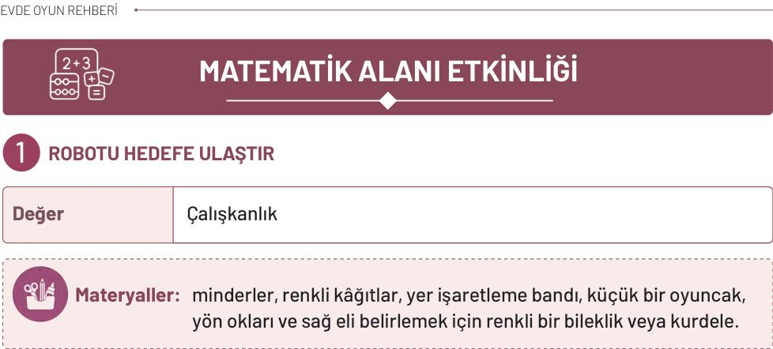
* Önce “Bir adım ileri git.”, “Bir adım geri git.”, “Sağa dön.”, “Sola dön.”, “Dur.” gibi basit komutlar birlikte uygulanır. Çocuğun sağı ve solu ayırt etmesini kolaylaştırmak için sağ eline renkli bir bileklik veya kurdele takılabilir.
* Evin güvenli bir bölümünde oyuncak sepeti, minder, masa gibi kolayca görülebilen bir hedef belirlenir. Aile üyeleri çocuğa başlangıçta komutları tek tek verir. Örneğin “İki adım ileri git.”, “Sağa dön.” ve “Bir adım ilerleyip dur.” denilebilir. Çocuk, robot taklidi yaparak komutları sırasıyla uygular ve hedefe ulaşmaya çalışır. Hedefe küçük bir oyuncak yerleştirilerek çocuktan oyuncağa ulaşması istenebilir.
* Daha sonra roller değiştirilir. Bu kez aile üyelerinden biri robot taklidi yapar, çocuk ise komutları verir. Çocuk, aile üyesini hedefe ulaştırmak için gerekli hareketleri doğru sırayla söylemeye çalışır. Aile üyesi yanlış yöne giderse başlangıç noktasına dönülür ve hangi komutun değiştirilmesi gerektiği birlikte bulunur.
* Oyunun sonraki bölümünde yere minderler, renkli kâğıtlar veya bantla belirlenmiş çizgiler yerleştirilerek basit ve güvenli bir yol hazırlanır. Çocuk yolu inceleyerek “İki adım ileri git.”, “Minderin yanından geç.”, “Sola dön.” gibi komutları önceden planlar. İstenirse hareketleri gösteren oklar sıralanarak basit bir yol planı oluşturulur.
* Tüm aile üyeleri sırayla robot taklidi yapan ve komut veren kişi rollerini üstlenir. Oyunun sonunda hedefe ulaşmayı sağlayan komutların sırası ve yanlış bir komutun nasıl düzeltilebileceği üzerine konuşulur. Böylece çocuğun yönergeleri anlama, adım sayma, sıralı düşünme ve problem çözme becerileri desteklenir.

<!-- sayfa 71 -->

 **Dikkat**

Etkinlik süresi 15–20 dakika ile sınırlı tutulmalıdır. Hata yaptığında doğrudan düzeltmek yerine “Sence kaç adım fazla gittik?”, “Başka nasıl deneyebiliriz?” gibi sorularla çocuğun düşünmesi desteklenmelidir. Burada önemli olan doğru sonuca ulaşmak değil süreci anlamaktır.

 **Düşün / Hatırla / Söyle**

* Bir hedefe ulaşmak için neden adımları sıraya koymamız gerekir?
* Bugün verdiğin komutları anlat.
* En zor bulduğun adım neydi?

<!-- sayfa 72 -->

# 2 PAYLAŞ VE BAHÇEYİ TAMAMLA

| Değer | Yardımseverlik |
| :--- | :--- |

**Materyaller:** oyuncak meyveler, büyük ve güvenli taşlar veya yapı blokları, saksı, toprak, tohum, su ve küçük sulama kabı.

**Uygulama**

* Aile üyelerinden biri masaya dört büyük ve güvenli nesne koyarak “Şimdi ‘Adil Paylaşım’ oyununu oynayacağız. Bu dört nesneyi iki kişi arasında eşit olarak paylaştırabilir misin?” diyerek oyunu başlatır. Oyun için oyuncak meyveler, büyük taşlar veya yapı blokları kullanılabilir.

* Çocuk nesneleri iki aile üyesinin önüne sırayla yerleştirerek paylaşır. Ardından nesneler birlikte sayılır ve “Herkeste kaç tane oldu?”, “İki kişinin nesne sayısı eşit mi?” ve “Nesneleri başka nasıl dağıtabiliriz?” gibi sorular sorulur. Çocuk nesneleri eşit olmayan biçimde dağıtırsa sonuç birlikte incelenir ve paylaşım yeniden denenir.
* Daha sonra oyuna katılan kişi sayısına uygun miktarda nesne eklenerek oyun tekrarlanabilir. Örneğin üç kişi için altı, dört kişi için sekiz nesne kullanılabilir. Böylece çocuk nesneleri her kişiye sırayla birer tane vererek eşit paylaşmanın farklı yollarını deneyebilir.
* Paylaşım oyununun ardından “Bahçe Görevleri” bölümüne geçilir. Evde bulunan bir saksıya ailece tohum ekilir veya mevcut bir bitkinin bakımı yapılır. Aile üyeleri yapılacak işleri paylaşır. Bir kişi toprağı hazırlar, çocuk tohumu yetişkin desteğiyle yerleştirir, başka bir aile üyesi ise uygun miktarda su verir. Bitkinin sonraki günlerde bakımını yapmak için sulama ve kontrol görevleri sırayla üstlenilir.
* Oyunun sonunda nesneleri eşit paylaşmanın neden önemli olduğu ve bitki bakımında herkesin bir görev üstlenmesinin işi nasıl kolaylaştırdığı üzerine konuşulur. Böylece çocuğun adil paylaşma, yardımlaşma, sayma ve sorumluluk alma becerileri desteklenir. Küçük tohumlar ve taşlar yalnızca yetişkin gözetiminde kullanılmalıdır.

<!-- sayfa 73 -->

 **Dikkat**

Matematik etkinliği sırasında çocuğun $4$'e kadar olan sayıları sadece sayması değil, “paylaşma” eylemiyle miktarları hissetmesi desteklenmelidir. Paylaşım sırasında “eşitlik” ve “nezaket” kavramları üzerinde durulmalıdır.

---

 **Düşün / Hatırla / Söyle**

* Nesneleri eşit paylaştırdığında herkeste kaç tane oldu?
* Bahçe görevlerini aile üyeleri arasında nasıl paylaştınız?
* Herkesin bir görev üstlenmesi işi nasıl kolaylaştırdı?

<!-- sayfa 74 -->

# 3 ŞEHİRDE ŞEKİL AVI

| Değer | Sorumluluk |
| :--- | :--- |

**Materyaller:** rulo yapılmış kâğıt, karton kutular, farklı renklerde fon kartonları, geometrik şekil parçaları, çocuklara uygun küt uçlu makas, yapıştırıcı, boya kalemleri ve büyük boy kâğıt.

## Uygulama

*  Aile üyelerinden biri, rulo yapılmış bir kâğıdı çocuğa göstererek “Bugün ‘Şehirde Şekil Avı’ oyununu oynayacağız. Çevremizdeki nesnelerde kare, üçgen, dikdörtgen ve daireye benzeyen şekilleri bulmaya çalışacağız.” diyerek oyunu başlatır.
* Önce pencereden dışarıya güvenli bir biçimde bakılır. Pencere, kapı, çatı, trafik levhası ve ağaçların üst bölümleri incelenir. “Bu pencere hangi şekle benziyor?”, “Çatıda hangi şekli görüyorsun?” gibi sorular yöneltilir. Nesnelerin şekillerin aynısı olmadığı, bazı bölümlerinin geometrik şekillere benzediği açıklanır.
* Ardından ailece kısa bir mahalle yürüyüşüne çıkılır. Aile üyelerinden biri bir şeklin adını söyler ve çocuk çevresinde o şekle benzeyen bir nesne bulmaya çalışır. Örneğin “Daireye benzeyen bir şey bul.” denildiğinde çocuk bir tekerlek veya trafik levhası gösterebilir. Bulunan şekil birlikte adlandırılır ve nesnenin hangi bölümünde görüldüğü konuşulur.
* Daha sonra “Ben Bir Şekil Gördüm” oyunu oynanır. Aile üyelerinden biri çevrede gördüğü bir nesneyi adını söylemeden anlatır. Örneğin “Üzerinde dikdörtgene benzeyen bölümler var ve insanlar buradan içeri giriyor.” diyebilir. Diğer aile üyeleri anlatılan nesneyi tahmin etmeye çalışır. Ardından ipucu verme sırası çocuğa geçer. Yürürken rulo kâğıttan bakılmaz, bu araç yalnızca güvenli bir yerde dururken kullanılır.
* Eve dönüldüğünde karton ve kutulardan hazırlanmış kare, dikdörtgen, üçgen ve daire biçimindeki parçalar masaya yerleştirilir. Kesme işlemi çocuğun yaşına göre bir aile üyesi tarafından yapılır veya çocuklara uygun küt uçlu makas kullanılır.
* Aile üyeleri sırayla bir parça seçerek ortak bir hayalî şehir oluşturur. Kare ve dikdörtgenler binalara, üçgenler çatılara, daireler ise güneş, pencere veya tekerleklere dönüştürülebilir. “Bu şekli şehrimizde nerede kullanabiliriz?”, “Büyük ve küçük parçaları nasıl yerleştirebiliriz?”, “Şehrimize başka neler ekleyebiliriz?” gibi sorularla çocuğun düşünmesi desteklenir.
* Şehir tamamlandığında çocuk, oluşturulan yapıları ve kullanılan şekilleri anlatır. Çocuğun

<!-- sayfa 75 -->

 **Dikkat**

Yürüyüş sırasında çocuk bir aile üyesinin yanında olmalıdır. Kesme çalışmalarında çocuğun yaşına uygun küt uçlu makas kullanılmalı ve küçük parçalarla çalışırken yetişkin desteği sağlanmalıdır.

---

 **Düşün / Hatırla / Söyle**

* Şekilleri kullanarak bir şehir kurmak nasıldı?
* Hangi şekilleri kullandın ve neye dönüştürdün?
* Bugün gördüğün en ilginç geometrik şekil neydi?

<!-- sayfa 76 -->

# 4 EVİMİZİN VERİ AVCILARI

| Değer | Sorumluluk |
| :--- | :--- |

**Materyaller:** not defteri, kurşun kalem, renkli boya kalemleri, büyük boy kâğıt, evde sayılabilecek güvenli eşyalar, doğa gözlemlerini kaydetmek için dosya ve isteğe bağlı olarak fotoğraf çekmek için telefon.

## Uygulama

*  Aile üyelerinden biri eline bir not defteri alarak “Evimizde sayabileceğimiz ve gruplara ayırabileceğimiz pek çok şey var. Şimdi ‘Veri Avcıları’ olup evimizde en çok ve en az bulunanları keşfedelim.” diyerek oyunu başlatır.

* Çocukla araştırılacak bir konu seçilir. Mutfaktaki meyve türleri, oyuncakların renkleri, aile üyelerinin sevdiği meyveler veya sepetteki çorapların renkleri incelenebilir. Araştırma sorusu açık biçimde belirlenir. Örneğin “Mutfakta en çok hangi meyve var?” veya “Sepette en çok hangi renkte oyuncak bulunuyor?” diye sorulur.

* Önce “Tahmin Et” turu yapılır. Her aile üyesi sonucu görmeden tahminini söyler. Tahminler not defterine yazılır veya basit resimlerle gösterilir. Ardından çocuk nesneleri türlerine ya da renklerine göre ayırır ve her gruptaki nesneleri tek tek sayar. Aile üyeleri sayma sırasında çocuğa yardımcı olabilir.

* Daha sonra “Say ve Yerleştir” turuna geçilir. Çocuk her nesne grubu için kâğıda bir sütun oluşturur. Nesnelerin resmini çizerek, çıkartma yapıştırarak veya güvenli gerçek nesneleri yan yana dizerek basit bir grafik hazırlar. Her sütundaki nesneler aynı hizadan başlatılır. Böylece hangi grupta daha çok veya daha az nesne olduğu kolayca görülür.

* Grafik tamamlandığında “Sonucu Bul” oyunu oynanır. Aile üyeleri sırayla “En çok hangisi var?”, “En az hangisi var?”, “İki grupta eşit sayıda nesne var mı?”, “Hangisinden bir tane daha eklersek sayılar eşit olur?” gibi sorular sorar. Çocuk grafiğe bakarak cevap vermeye çalışır.

* Hazırlanan çalışma evde belirlenen bir yere asılarak “Evimizin Veri Köşesi” oluşturulur. Günün sonunda aile üyeleri veri köşesinde toplanır. Çocuk grafiği tanıtır, hangi grupta kaç nesne bulunduğunu ve tahminlerin sonuçlarla uyuşup uyuşmadığını anlatır. Çocuğun yalnızca doğru cevapları değil nesneleri dikkatle ayırması, sayması ve çalışmayı tamamlamak için gösterdiği çaba da takdir edilir.

<!-- sayfa 77 -->

# Dikkat
Veri toplama sürecinde nesnelerin ulaşılabilecek ve güvenli bir yükseklikte olmasına dikkat edilmelidir. Çocuk verileri yorumlarken hata yaparsa aile üyeleri nazik ve yönlendirici sorularla rehberlik etmelidir. Etkinlik, bir “ders” gibi değil meraklı bir “oyun arkadaşı” heyecanıyla yürütülmelidir.

---

## Düşün / Hatırla / Söyle
* Veriler bize evimizdeki yaşam hakkında neler anlatabilir?
* Hazırladığın grafikteki en şaşırtıcı veriyi anlat.
* Grafikte “en çok” ve “en az” olan nesne neydi?

<!-- sayfa 78 -->

# 5 DAİRE DEDEKTİFLERİ

| Değer | Çalışkanlık |
| :--- | :--- |

**Materyaller:** evde veya dışarıda gözlemlenecek nesneler.

## Uygulama

* Aile üyelerinden biri çocuğa bir plastik kapak göstererek “Bugün ‘Daire Dedektifleri’ olacağız. Haydi evimizde daireye benzeyen başka nesneler bulalım.” diyerek oyunu başlatır.
* Çocuk aile üyeleriyle evin farklı bölümlerini inceleyerek daire biçiminde olan veya daireye benzeyen yüzeyi bulunan nesneleri arar. Tabak, duvar saati, bardak altlığı, tencere kapağı, oyuncak tekerleği gibi nesneler bulunabilir. Her nesne incelenirken “Bu nesnenin köşesi var mı?”, “Hangi bölümü daireye benziyor?”, “Buna benzeyen başka bir nesne gördün mü?” gibi sorular sorulur.
* Ardından çocuğa “Şimdi ‘İpucunu Dinle, Daireyi Bul’ oyununu oynayacağız. Ben evimizdeki daire biçimli bir nesneyi düşüneceğim ve onunla ilgili ipuçları vereceğim. Sen de ipuçlarını dikkatle dinleyerek hangi nesneyi seçtiğimi bulmaya çalışacaksın.” denilerek oyun tanıtılır.
* Aile üyelerinden biri seçtiği nesnenin adını söylemeden bulunduğu yer, rengi ve kullanım amacıyla ilgili ipuçları verir. Örneğin tabak için “Mutfakta bulunur, içine yemek koyarız ve daireye benzer.” denilebilir. Çocuk ipuçlarından yararlanarak nesneyi bulur ve nesnenin hangi bölümünün daireye benzediğini anlatır. Daha sonra roller değiştirilir. Bu kez çocuk bir nesne seçerek ipuçları verir, aile üyeleri de anlatılan nesneyi bulmaya çalışır.

**Dikkat**

Oyun başlamadan önce çocuğun nesne arayacağı alan belirlenmeli ve yalnızca güvenli, kolay ulaşılabilen nesneler kullanılmalıdır. İpuçları çocuğun yaşına uygun, kısa ve anlaşılır olmalıdır. Çocuk nesneyi bulmakta zorlandığında cevabı doğrudan söylemek yerine yeni bir ipucu verilmelidir.

<!-- sayfa 79 -->

# Düşün / Hatırla / Söyle

* Bir nesnenin daireye benzediğini nasıl anlayabiliriz?
* Evde bulduğun daire biçimli bir nesneyi ve ne işe yaradığını anlat.
* Oyun sırasında verilen ipuçlarıyla hangi daire biçimli nesneyi bulmuştun?

<!-- yer tutucu bulunamadı: sayfa sonuna eklendi -->

<!-- sayfa 80 -->

# 6 TAHMİN ET, ADIMLA, ÖLÇ

| Değer | Aile Bütünlüğü |
| :--- | :--- |

> **Materyaller:** başlangıç noktasını belirlemek için renkli bant ve ölçüm hedefi olarak kullanılabilecek sandalye, masa, oyuncak gibi güvenli nesneler.

## Uygulama

* Aile üyelerinden biri “Adımlarımızı kullanarak uzaklıkları ölçebileceğimizi biliyor musun? Şimdi önce tahmin edecek, sonra adımlarımızla ölçerek tahminimizi kontrol edeceğiz.” diyerek oyunu başlatır.

* Evde, bahçede veya parkta güvenli bir başlangıç noktası belirlenir. Ardından masa, sandalye, ağaç, oyuncak gibi bir hedef seçilir. Çocuktan başlangıç noktası ile hedef arasında kaç adım olduğunu tahmin etmesi istenir. Çocuk tahminini söyledikten sonra normal büyüklükte adımlar atarak hedefe ilerler ve her adımını sayar. Tahmini ile ölçüm sonucu birlikte karşılaştırılır.

* Daha sonra aile üyeleri sırayla yeni bir hedef belirler. Her oyuncu önce uzaklığı tahmin eder, ardından hedefe kadar yürüyerek adımlarını sayar. Tahminin ölçüm sonucuyla aynı olması beklenmez. Çocuğun tahmin etmesi, ölçmesi ve iki sonucu karşılaştırması desteklenir.

* Oyunun sonraki bölümünde bir aile üyesi çocuğa “Üç adım uzaklıkta bir nesne bulabilir misin?” veya “Sence kapıya mı, masaya mı daha az adımda ulaşırız?” gibi görevler verir. Çocuk önce tahminini söyler, ardından adımlarıyla ölçerek cevabını kontrol eder. Daha sonra görev verme sırası çocuğa geçer.

* Oyunun sonunda aile üyeleri aynı uzaklığı sırayla adımlarıyla ölçer. Sonuçların farklı çıkabileceği gözlemlenir. Bunun herkesin adım uzunluğunun farklı olmasından kaynaklandığı çocuğun anlayabileceği bir dille açıklanır. En yakın, en uzak ve tahmin edilmesi en kolay hedefler üzerine konuşularak oyun tamamlanır.

> **Dikkat**
>
> Tahmin çalışmaları sırasında çocuğun tahmininin “doğru” ya da “yanlış” olmasına değil, bu tahmini hangi mantıkla yürüttüğüne odaklanılmalıdır.

<!-- yer tutucu bulunamadı: sayfa sonuna eklendi -->

<!-- yer tutucu bulunamadı: sayfa sonuna eklendi -->

<!-- sayfa 81 -->

# Düşün / Hatırla / Söyle

* Tahmin etmek ile gerçekten ölçmek arasındaki fark neden önemli?
* Tahmin ettiğin adım sayısı ile gerçek sayı arasındaki farkı anlat.
* Başlangıç noktasından sandalyeye kaç adımda gittin?

<!-- yer tutucu bulunamadı: sayfa sonuna eklendi -->

<!-- sayfa 82 -->

# 7 VERİ KÂŞİFLERİ: DOĞADA SAYILARIN İZİ

| Değer | Aile Bütünlüğü |
| :--- | :--- |

**Materyaller:** not defteri, kurşun kalem, renkli boya kalemleri, “Doğa Veri Dosyası” için kâğıt veya dosya.

## Uygulama

* Aile üyelerinden biri eline not defteri ve kalem alarak “Bugün ‘Veri Kâşifleri’ olacağız! Doğadaki nesneleri tahmin edecek, sayacak ve sonuçları kaydedeceğiz.” diyerek oyunu başlatır.
* Etkinlik parkta veya bahçede yürütülür. Önceden belirlenen küçük ve güvenli bir alanda inceleme başlatılır. Aile üyelerinden biri diğerlerine “Bu alanda kaç tane kozalak var?”, “Kaç ağaç görebiliriz?”, “Kaç farklı renkte yaprak bulabiliriz?” gibi bir araştırma sorusu sorar.
* Sayım işlemine geçmeden önce “Tahmin Et” turu yapılır. Herkes tahminini söyler ve not eder. Ardından çocukla doğal parçalar toplanır; bu parçalar renk, biçim ve büyüklüklerine göre gruplandırılarak sayılır. Bulunan veriler “Doğa Veri Dosyası”na basit resim ve çizgilerle kaydedilir. Sayım bittiğinde tahminlerle gerçek sonuçlar karşılaştırılır.
* Ardından “Say ve Görevi Tamamla” turuna geçilir. Aile üyelerinden biri çocuğa “Üç tane kozalak bul.”, “Aynı renkte dört yaprak göster.”, “Sayıları eşit olan iki grup oluştur.” gibi görevler verir. Çocuk görevleri tamamladıktan sonra sıra ona geçer ve bu kez o aile üyelerine görev verir.
* Günün sonunda elde edilen tüm veriler birlikte incelenir; en çok, en az ve eşit sayıda olan gruplar belirlenir. Çocuk, tahminlerinin gerçek sonuçlara ne kadar yaklaştığını ve doğada en çok hangi nesneyi incelemekten keyif aldığını ailesiyle paylaşır.

**Dikkat**
Etkinlik sırasında doğadaki canlılara zarar verilmemeli; yalnızca yere düşmüş ve güvenli doğal materyaller kullanılmalıdır. Tahmin aşamasında çocuğun cevabı yönlendirilmemeli, sayım sonrasında tahmini ile gerçek sonucu karşılaştırmasına fırsat verilmelidir.

<!-- yer tutucu bulunamadı: sayfa sonuna eklendi -->

<!-- yer tutucu bulunamadı: sayfa sonuna eklendi -->

<!-- sayfa 83 -->

# Düşün / Hatırla / Söyle

* Sayım yapmadan önce kaç tane olacağını tahmin ettin?
* Tahminin ile sayım sonucunda bulduğun sayı aynı mıydı?
* Hangi grupta daha çok, hangi grupta daha az nesne vardı?

<!-- yer tutucu bulunamadı: sayfa sonuna eklendi -->

<!-- sayfa 84 -->

# 8 ŞEKİL AVI

| Değer | Aile Bütünlüğü |
| :--- | :--- |

**Materyaller:** balık boyama sayfası, boya kalemleri, $1$'den $5$'e kadar sayıların yazılı olduğu küçük kâğıtlar, küt uçlu makas, dil çubuğu, sayı kâğıtlarının konulacağı bir kutu, kurşun kalem ve sayılabilecek güvenli ev eşyaları.

## Uygulama

* Aile üyelerinden biri çocuktan balık resmini istediği renklerle boyamasını ister. Boyama tamamlandığında “Balığını özenle boyadın. Şimdi balık resmini keselim ve kukla yapalım ve şimdi balık kuklasıyla evimizdeki nesneleri saymalım.” diyerek oyunu başlatır.
* Önce aile üyeleriyle birlikte $1$'den $5$'e kadar sayılır. Sayma sırasında her sayıda bir kez alkışlanabilir, dizlere hafifçe vurulabilir veya bir adım atılabilir.
* Ardından $1$'den $5$'e kadar sayıların yazılı olduğu küçük kâğıtlar katlanarak bir kutuya konur. Çocuk kutudan bir sayı seçer ve balık kuklasıyla birlikte evde sayı avına çıkar. Çektiği sayı kadar güvenli nesne bulmaya çalışır. Örneğin $3$ sayısını seçtiğinde üç kitap, üç yastık veya üç oyuncak bulabilir.
* Çocuk, bulduğu nesneleri balık kuklasıyla veya parmağıyla tek tek işaret ederek sayar. Her nesneye yalnızca bir kez dokunmasına ve söylenen her sayının bir nesneyle eşleşmesine dikkat edilir. Sayma tamamlandığında aile üyeleri sonucu birlikte kontrol eder. Daha sonra görev verme sırası çocuğa geçer. Çocuk bir sayı söyler, aile üyeleri de söylenen sayı kadar nesne bulup sayar.
* Oyunun sonunda bulunan nesne grupları yeniden sayılır. “Hangi grupta daha çok nesne vardı?”, “Hangi sayıyı bulmak daha kolaydı?” gibi sorularla oyun üzerine konuşulur. Çocuğun sayma sırasını takip etmesi ve nesneleri dikkatle eşleştirmesi takdir edilir.

8

<!-- yer tutucu bulunamadı: sayfa sonuna eklendi -->

<!-- sayfa 85 -->

 **Dikkat**

Çocuk sayarken hata yaparsa doğrudan düzeltmek yerine: “Hadi balığınla bir daha bakalım” gibi yönlendirici ifadeler kullanılmalıdır. Etkinlik kısa tutulmalı ($10\text{--}15$ <!-- KONTROL: Marker'da karşılığı yok, uydurma olabilir --> dakika) ve eğlence odaklı ilerlemelidir.

---

 **Düşün / Hatırla / Söyle**

* Sayılar günlük yaşamda bize nasıl yardımcı olur?
* Balığınla hangi nesneleri saydığını anlat.
* Balığın sayı avında ilk saydığın nesne hangisiydi ve kaça kadar saymıştın?

<!-- sayfa 86 -->

| Değer | Aile Bütünlüğü |
| :--- | :--- |

**Materyaller:** eşit ve farklı uzunluklarda, temiz, sağlam ve sivri uçları bulunmayan çubuklar, dondurma çubukları, kalın pipetler veya yere düşmüş güvenli küçük dallar.

**Uygulama**

* Aile üyeleri çocukla dondurma çubuğu, kalın pipet, yere düşmüş küçük dallar gibi düz, temiz ve güvenli çubukları bir araya getirir. Çocuğa “Bugün ‘Şekil Ustaları’ olacağız. Çubukları kullanarak farklı şekiller yapmaya çalışacağız.” denilerek oyun başlatılır.
* Önce üç çubuk kullanılarak bir üçgen oluşturulur. Üçgenin üç kenarı ve üç köşesi birlikte sayılır. Ardından eşit uzunluktaki dört çubuk kullanılarak bir kare yapılır. Karenin dört kenarı ve dört köşesi olduğu incelenir. Çocuğa “Üçgenin kaç köşesi var?”, “Karenin kaç kenarı var?”, “Bir çubuğu çıkarırsak şekil tamamlanmış olur mu?” gibi sorular yöneltilir.
* Daha sonra “Eksik Çubuğu Tamamla” oyunu oynanır. Aile üyelerinden biri üçgen veya kareyi bir çubuğu eksik kalacak biçimde oluşturur. Çocuk, şekli inceleyerek hangi çubuğun eksik olduğunu bulur ve şekli tamamlar. Ardından roller değiştirilir. Bu kez çocuk eksik bir şekil hazırlar, aile üyeleri de hangi çubuğun eklenmesi gerektiğini bulmaya çalışır.
* Oyunun diğer bölümünde bir aile üyesi, adını söylemeden bir şeklin özelliklerini anlatır. Örneğin “Üç kenarım ve üç köşem var.” veya “Dört kenarım da aynı uzunlukta.” der. Diğer aile üyeleri, anlatılan şeklin hangisi olduğunu tahmin ederek şekli çubuklarla oluşturmaya çalışır.
* Son bölümde aile üyeleri hazırladıkları üçgen ve kareleri birleştirerek ev, robot, ağaç veya hayal ettikleri başka bir şekil tasarlar. Tamamlanan tasarımlar birlikte incelenir ve her aile üyesi yaptığı çalışmayı tanıtır. Etkinliğin sonunda evde ve çevrede üçgen ya da kare biçimine benzeyen nesneler bulunarak oyun tamamlanır.

<!-- sayfa 87 -->

# Dikkat
Şekil oluşturma sırasında çocuğun materyalleri kendi başına hizalamasına izin verilmeli kare oluştururken “eşitlik” kavramını fark etmesi için aynı boydaki çubukları seçmesi yönünde rehberlik edilmelidir.

---

## Düşün / Hatırla / Söyle
* Üçgenin kaç kenarı ve kaç köşesi vardır?
* Karenin üçgenden farklı olan özelliği nedir?
* Çubukları kullanarak hangi şekilleri oluşturdun?

<!-- sayfa 88 -->

# HAREKET VE SAĞLIK ALANI ETKİNLİĞİ

## 1 BONCUK ŞİFRESİNİ TAMAMLA

| Değer | Estetik |
| :--- | :--- |

**Materyaller:** farklı renk, şekil ve büyüklüklerde boncuklar, boncukları yerleştirmek için kenarlı bir tepsi ve ip.

## Uygulama

* Büyüklerin ve çocukların kullanımına uygun boncuklar bir tepsiye yerleştirilir. Çocuk boncukları renk, şekil ve büyüklüklerine göre inceler. İsterse benzer boncukları bir araya getirerek gruplar oluşturur.
* Aile üyelerinden biri “Şimdi ‘Boncuk Şifresini Tamamla’ oyununu oynayacağız. Boncukları belirli bir sıraya koyacağım. Sen de bu sıranın nasıl devam ettiğini bulmaya çalışacaksın.” diyerek oyunu başlatır.
* Önce kırmızı-mavi-kırmızı-mavi veya büyük-küçük-büyük-küçük gibi iki özellikten oluşan basit bir örüntü hazırlanır. Çocuktan sırayı dikkatle incelemesi ve uygun boncuğu seçerek örüntüyü sürdürmesi istenir. “Sence sırada hangi boncuk olmalı?”, “Bunu nasıl anladın?” gibi sorularla düşünmesini açıklaması desteklenir.
* Daha sonra “Eksik Boncuğu Bul” oyunu oynanır. Aile üyelerinden biri oluşturulan örüntüden bir boncuğu çıkarır. Çocuk, boş kalan yere hangi boncuğun gelmesi gerektiğini bulur. Ardından roller değiştirilir. Çocuk kendi örüntüsünü oluşturup bir boncuğu eksiltir, aile üyeleri de eksik boncuğu tahmin eder.
* Oyunun sonunda çocuk kendi boncuk sırasını tasarlayarak ipe dizer. Aile üyeleri sırayla birer boncuk ekleyebilir ancak ekledikleri boncuğun örüntüye uygun olması gerekir. Çalışma tamamlandığında düğümleme işlemi bir aile üyesi tarafından yapılır. Çocuk tasarımındaki renkleri, şekilleri ve tekrar eden sırayı ailesine anlatır.
* Boncukların yutulamayacak büyüklükte olmasına dikkat edilmeli ve etkinlik aile gözetiminde gerçekleştirilmelidir. Hazırlanan kolye yalnızca gözetim altında denenmeli, oyun ve uyku sırasında çocuğun boynunda bırakılmamalıdır.

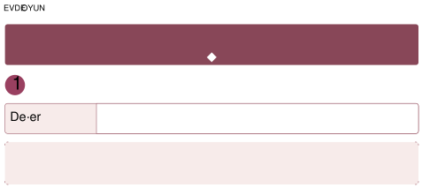
<!-- yer tutucu bulunamadı: sayfa sonuna eklendi -->

<!-- sayfa 89 -->

> 
> **Dikkat**
> Boncuklarla çalışma sırasında küçük materyallerin ağza alınması riskine karşı yetişkin gözetimi kesintisiz olmalıdır. Eğer evde boncuk yoksa pipetler, renkli kâğıtlar küçük parçalar hâlinde kesilerek de etkinlik gerçekleştirilebilir.

---

> 
> **Düşün / Hatırla / Söyle**
>
> * Boncukları dizerken neye dikkat ettin?
> * “Eksik Boncuğu Bul” oyununda aile üyelerinden biri ilk olarak hangi renkteki boncuğu saklamıştı?
> * Boncukları ipe dizerken zorlandın mı?

<!-- sayfa 90 -->

# 2 KAYIP OYUNCAĞI BUL

| Değer | Sağlıklı Yaşam |
| :--- | :--- |

**Materyaller:** yastıklar, uzun ip, kurdele veya atkı, yumuşak oyuncaklar ve oyuncakların konulacağı bir sepet.

## Uygulama

* Evde güvenli ve geniş bir alan seçilir. Yere düz biçimde serilen bir ip, kurdele veya atkıyla denge yolu hazırlanır. Kaymayacak biçimde yerleştirilen yastıklarla parkurun diğer bölümleri oluşturulur. Parkurun sonuna birkaç yumuşak oyuncak, başlangıç noktasına ise boş bir sepet konur.
* Aile üyelerinden biri “Oyuncaklarımız parkurun sonunda kalmış. Şimdi ‘Kayıp Oyuncağı Kurtarma’ oyununu oynayacağız. Parkuru tamamlayarak oyuncakları sırayla sepete getireceğiz.” diyerek oyunu başlatır.
* Çocuk ve aile üyeleri sırayla parkura katılır. Önce yerdeki çizgiyi takip ederek dengeli biçimde yürür, ardından yastıkların arasından veya üzerinden dikkatlice geçer ve parkurun sonundaki oyuncaklardan birini alarak başlangıç noktasına döner. Getirilen oyuncak sepete bırakılır.
* Her turda farklı bir hareket görevi verilir. “Kaplumbağa gibi yavaş yürü.”, “Tavşan gibi zıpla.”, “Kollarını iki yana açarak ilerle.”, “Tek ayak üzerinde zıpla.” gibi yönergeler kullanılabilir. Daha sonra yönerge verme sırası çocuğa geçer ve aile üyeleri çocuğun seçtiği harekete göre parkuru tamamlar.
* Oyun bütün oyuncaklar sepete taşınıncaya kadar devam eder. Oyuncaklar kurtarıldıktan sonra her aile üyesi en sevdiği parkur hareketini bir kez daha yapar. Etkinlik sırasında çocuğun gereksinimine göre kısa dinlenme molaları verilir. Parkurda yarışılmaz ve hız yerine hareketleri güvenli biçimde tamamlama üzerinde durulur.

## Düşün / Hatırla / Söyle

* Parkuru güvenli biçimde tamamlamak için hareketlerini nasıl planlamalısın?
* Parkurda en çok sevdiğin hareketi ve neden sevdiğini anlat.
* Oyuncağı sepete getirirken hangi hareketleri hangi sırayla yaptığını hatırlıyor musun?

<!-- yer tutucu bulunamadı: sayfa sonuna eklendi -->

<!-- yer tutucu bulunamadı: sayfa sonuna eklendi -->

<!-- sayfa 91 -->

# 3 HEYKEL MÜZESİ

| Değer | Aile Bütünlüğü |
| :--- | :--- |

**Materyaller:** müzik, şapka, kumaş parçaları ve gözlük vb. aksesuar

**Uygulama**

* Aile üyelerinden biri “Şimdi evimizi ‘Heykel Müzesi’ne dönüştüreceğiz. Müzik çalarken hareket edeceğiz, müzik durduğunda ise bir heykel gibi duracağız.” diyerek oyunu başlatır.
* Müzik açıldığında aile üyeleri belirlenen alanda serbestçe hareket eder. Müzik durduğunda herkes seçtiği bir pozda birkaç saniye boyunca hareketsiz kalır. Çocuk aile üyelerinin pozlarının neyi temsil ettiğini tahmin eder. Uçan kuş, kitap okuyan çocuk, ağaca tırmanan kedi, bir mesleği yapan kişi gibi canlandırmalar yapılabilir.
* Daha sonra çocuk “müze yöneticisi” olur ve heykellerin konusunu belirler. “Mutlu bir heykel olun.”, “Rüzgârda sallanan bir ağaç gibi durun.”, “Bir hayvanı canlandırın.” gibi yönergeler verir. Müzik yeniden başladığında heykeller canlanarak hareket eder, durduğunda ise yeni bir pozda donar.
* Oyunun “Gizemli Heykel” bölümünde aile üyelerinden biri, neyi canlandırdığını söylemeden bir poz oluşturur. Diğer aile üyeleri sırayla tahminde bulunur ve tahminlerinin nedenini açıklar. Doğru cevap açıklandıktan sonra herkes aynı heykel pozunu taklit eder.
* İstenirse şapka, kumaş parçası, çerçevesi sağlam oyuncak gözlük gibi aksesuarlar kullanılarak farklı karakterler oluşturulur. Oyunun sonunda her aile üyesi en sevdiği heykel pozunu tekrar yapar ve diğer oyuncular bu pozu birlikte canlandırır. Bunun bir yarışma olmadığı, herkesin oluşturduğu farklı hareket ve fikirlerin değerli olduğu vurgulanır.

**Düşün / Hatırla / Söyle**

* Bir heykel gibi hareketsiz durabilmek için nelere dikkat ettin?
* En sevdiğin heykel pozu hangisiydi? Onu neden seçtin?
* Bugün yaptığımız heykel pozlarından hangisi seni en çok güldürdü?

<!-- sayfa 92 -->

# 4 HAZİNEYİ SEPETE TAŞI

| Değer | Sabır |
| :--- | :--- |

 **Materyaller:** kaymayan yastıklar, uzun bir ip, büyük karton kutu veya sağlam masa, küçük yumuşak toplar ya da çorap topları ve sepet.

 **Uygulama** __________________________________________________________________

* Yastıklar, yere serilen bir ip ve kutular ya da sağlam bir masa kullanılarak hazırlanan bir tünel ile güvenli bir hareket parkuru hazırlanır. Tünel için devrilmeyecek büyük bir karton kutu veya yetişkin tarafından kontrol edilmiş sağlam bir masa kullanılabilir. Parkurun sonuna küçük toplar veya çoraplardan hazırlanmış yumuşak toplar, başlangıç noktasına ise boş bir sepet yerleştirilir.
* Aile üyelerinden biri “Parkurun sonunda kayıp hazineler var. Şimdi engelleri geçerek hazineleri tek tek sepetimize taşıyacağız.” diyerek oyunu başlatır.
* Çocuk önce kaymayacak biçimde yerleştirilen yastıkların arasından küçük sıçramalarla ilerler. Ardından güvenli tünelden geçer ve yere serilen ipin oluşturduğu çizgiyi takip ederek dengesini korumaya çalışır. Parkurun sonuna ulaştığında bir hazine topu seçer ve belirlenen noktadan sepete atar. Top sepete girmezse yeniden deneyebilir veya topu alarak sepete bırakabilir.
* Her turda çocuk yalnızca bir hazine taşır. Aile üyeleri de sırayla parkuru tamamlayarak oyuna katılır. Bazı turlarda “Kaplumbağa gibi yavaş ilerle.”, “Kollarını iki yana açarak çizgiyi takip et.”, “Hazineyi iki elinle taşı.” gibi eğlenceli görevler verilebilir. Daha sonra görev verme sırası çocuğa geçer.
* Oyun bütün hazine topları sepete taşınıncaya kadar devam eder. Sonunda hazineler birlikte sayılır ve hangi parkur bölümünün daha kolay ya da daha zor olduğu konuşulur.

<!-- sayfa 93 -->

# Dikkat
Parkur güvenli bir alanda kurulmalı, kaygan zeminler engellenmelidir. Çocuğun hızlanması değil, dikkatli ilerlemesi teşvik edilmelidir. Hata yaptığında yeniden denemesi desteklenmelidir.

---

# Düşün / Hatırla / Söyle
* Parkurdaki görevleri tamamlarken sabırlı olmak sana nasıl yardımcı oldu?
* Parkurdaki en zor görev hangisiydi?
* Denge yolunu geçerken ne hissettin?

<!-- yer tutucu bulunamadı: sayfa sonuna eklendi -->

<!-- sayfa 94 -->

# 5 RENKLİ TABAK TASARLAMA

| Değer | Estetik, Sabır |
| :--- | :--- |

**Materyaller:** çeşitli renklerde sebze ve meyveler, plastik veya küt uçlu bir kahvaltı bıçağı, yemek tabağı.

**Uygulama** __________________________________________________________________

* Aile üyeleriyle eller yıkanır. Meyve ve sebzeler bir aile üyesi tarafından temizlenir ve çocuğun yaşına uygun biçimde hazırlanır. Kesme işlemi yalnızca yetişkin tarafından yapılır.
* Aile üyelerinden biri “Şimdi ‘Renkli Tabak Tasarlama’ oyununu oynayacağız. Sırayla bir renk söyleyecek ve o renkteki meyve ya da sebzeyi kullanarak tabağımıza yeni bir parça ekleyeceğiz.” diyerek oyunu başlatır.
* İlk aile üyesi bir renk söyler. Çocuk, söylenen renge uygun bir meyve veya sebze seçerek tabağına yerleştirir. Örneğin sarı için muz, kırmızı için çilek, turuncu için havuç kullanılabilir. Ardından renk söyleme sırası çocuğa geçer ve aile üyeleri uygun yiyeceği bulmaya çalışır.
* Tabağa eklenen parçalarla güneş, çiçek, kelebek, hayvan, gülen yüz gibi bir şekil oluşturulur. Çocuğa “Bu parçayı şeklin hangi bölümünde kullanabiliriz?”, “Başka hangi rengi ekleyebiliriz?”, “Tasarımımızı tamamlamak için neye ihtiyacımız var?” gibi sorular yöneltilir.
* Tasarım tamamlandığında çocuk tabağına bir ad verir ve hangi meyve ve sebzeleri kullandığını ailesine anlatır. Farklı renklerdeki meyve ve sebzelerin farklı besin ögeleri içerdiği ve beslenmede çeşitliliğin önemli olduğu, yaşına uygun bir dille açıklanır. Ardından hazırlanan tabak aile üyeleriyle yenir.

<!-- sayfa 95 -->

# Dikkat
Kesme işlemleri mutlaka yetişkin gözetiminde yapılmalıdır.

## Düşün / Hatırla / Söyle
* Tabağında farklı renklerde meyve ve sebzelerin bulunması neden önemlidir?
* Hazırladığın tabakta hangi meyveleri kullandın?
* En sevdiğin meyve hangisi?

<!-- sayfa 96 -->

# 6 MÜZİKLİ PARKUR

| Değer | Aile Bütünlüğü |
| :--- | :--- |

**Materyaller:** ip, yastık, sandalye, müzik.

## Uygulama

* Aile üyeleri ve çocuk, evdeki güvenli malzemeleri kullanarak küçük bir parkur hazırlar. Malzemelerin nasıl kullanılacağına birlikte karar verilir. Yere düz biçimde serilen ip denge çizgisi, kaymayan yastıklar adım veya sıçrama noktası, sağlam bir sandalye ise etrafından geçilecek engel olarak kullanılabilir.
* Parkurun farklı bölümlerine renk adları verilir. Mavi yolda ipin oluşturduğu çizgi takip edilir, sarı adalarda yastıkların arasından küçük sıçramalarla geçilir, kırmızı geçitte sandalyenin etrafından dolaşılır. Aile üyelerinden biri “Şimdi ‘Müzikli Parkur’ oyununu oynayacağız. Müziği dinleyecek, renkli bölümlerdeki görevleri yapacak ve müzik durduğunda heykel olacağız.” diyerek oyunu başlatır.
* Müzik açılır, çocuk parkurda ilerler. Müzik yavaşladığında hareketlerini yavaşlatır, biraz hızlandığında ise güvenliğini koruyarak normalden daha tempolu hareket eder. Müzik durduğunda bulunduğu yerde güvenli bir poz alarak heykel gibi bekler.
* Her bölümde farklı bir görev yapılır. Mavi yolda ipin oluşturduğu çizgi takip edilir, sarı adalarda yastıkların arasından küçük sıçramalarla geçilir, kırmızı dönemeçte sandalyenin etrafından dolaşılır. Parkurun sonunda çocuk sevdiği bir hayvanın canlandırmasını donarak yapar ve aile üyeleri hangi hayvan olduğunu tahmin eder.
* Daha sonra çocuk “parkur lideri” olur ve aile üyelerine görevler verir. “Kollarınızı iki yana açarak yürüyün.”, “Tavşan gibi zıplayarak parkuru geçin.”, “Üçe kadar sayarken tek ayak üzerinde durun.” gibi yönergeler kullanabilir. Aile üyeleri çocuğun verdiği görevleri sırayla yerine getirir.
* Her turda parkurun yönü veya görevlerin sırası değiştirilerek oyun sürdürülür. Etkinliğin sonunda her aile üyesi en sevdiği hareketi gösterir, diğer oyuncular da bu hareketi taklit eder. Müzik hızlandığında yarışılmaz ve hareketler çocuğun güvenliğini tehlikeye atacak kadar hızlı yapılmaz.

<!-- sayfa 97 -->

# Dikkat

Kullanılan malzemelerin güvenli olmasına dikkat edilmelidir. Kaygan veya tehlikeli zeminlerden kaçınılmalıdır. Hareketler çocuğun yaşına uygun ve onu zorlamayacak şekilde olmalıdır. Amaç rekabet değil birlikte hareket etmek ve eğlenmektir.

---

# Düşün / Hatırla / Söyle

* Kendi oyun parkurunu kurmak sana ne hissettirdi?
* Parkurda en sevdiğin hareket hangisiydi?
* Oyunu kurarken en yaratıcı fikrin neydi?

<!-- yer tutucu bulunamadı: sayfa sonuna eklendi -->

<!-- sayfa 98 -->

# 7 SAĞLIKLI HAREKET ÇEMBERİM

| Değer | Saygı |
| :--- | :--- |

**Materyaller:** renkli bant, kurdele, hulahop, müzik

## Uygulama

* Aile üyeleri ve çocuk birbirlerini rahatça görebilecekleri geniş ve güvenli bir alanda durur. Yere renkli bant, kurdele veya hulahop kullanılarak aralarında yeterli boşluk bulunan “hareket adaları” hazırlanır. Her aile üyesi kendisine bir ada seçer.
* Oyuna başlamadan önce kollar yukarı kaldırılır, dizler hafifçe bükülür, parmak uçlarında yükselinir ve omuzlar yavaşça çevrilir. Ardından aile üyeleri sırayla esneme, eğilme, zıplama, tek ayak üzerinde kısa süre durma gibi basit hareketler gösterir. Diğer oyuncular bu hareketleri tekrar eder.
* Aile üyelerinden biri “Şimdi ‘Hareket Adaları’ oyununu oynayacağız. Müzik açılır, herkes kendi adasında hareket edecek. Müzik durduğunda ise heykel gibi kalacağız.” diyerek oyunu başlatır.
* Müzik çalarken aile üyeleri kendi alanlarında dans eder, çömelir, kollarını hareket ettirir veya küçük sıçramalar yapar. Oyun lideri “Üç kez zıpla.”, “Kollarını iki yana aç.”, “Dizlerini bük.”, “Bir hayvan gibi hareket et.” gibi kısa yönergeler verir. Müzik yavaşladığında hareketler yavaşlatılır, hızlandığında ise güvenli bir tempoda biraz daha enerjik yapılır. Müzik durduğunda herkes bulunduğu yerde hareketsiz kalır ve dengesini korumaya çalışır.
* Ardından “Hareket Aynası” oyunu oynanır. Aile üyelerinden biri kendi adasında yavaş bir hareket yapar, diğer oyuncular da aynaya bakıyormuş gibi aynı hareketi taklit eder. Lider hareketleri sırayla değiştirir. Daha sonra çocuk lider olur ve aile üyeleri onun hareketlerini tekrar eder.
* Oyunun sonunda her aile üyesi en sevdiği hareketi gösterir. Gösterilen hareketler sırayla birleştirilerek kısa bir “aile hareketi” oluşturulur ve birlikte tekrar edilir. Oyun boyunca herkes kendi alanında kalır, hareketler yarışa dönüştürülmez ve çocuğun güvenliğini zorlayacak kadar hızlı yapılmaz.

<!-- sayfa 99 -->

# Dikkat
Hareketler çocuğun yaşına uygun ve güvenli olmalıdır. Zorlayıcı veya riskli hareketlerden kaçınılmalıdır. Amaç performans değil hareket etmeyi sevmek ve beden farkındalığı kazanmaktır. Çocuğun kendi hızında hareket etmesine izin verilmelidir.

---

# Düşün / Hatırla / Söyle
* Hareket ederken neden kendi alanımıza dikkat etmeliyiz?
* Kollarını açtığında oluşan hareket alanını nasıl kullandın?
* Müzik durduğunda dengeni korumak için ne yaptın?

<!-- yer tutucu bulunamadı: sayfa sonuna eklendi -->

<!-- sayfa 100 -->

# 8 HAYALÎ BALON

| Değer | Sağlıklı Yaşam |
| :--- | :--- |

**Materyaller:** hareket alanlarını belirlemek için renkli bant, kurdele veya hulahop, müzik.

**Uygulama**

* Aile üyeleri, birbirlerine çarpmadan hareket edebilecekleri geniş ve güvenli bir alana geçer. Herkes, çevresinde kendisine ait görünmez ve büyük bir balon olduğunu hayal eder. Aile üyelerinden biri “Hepimizin çevresinde görünmez bir balon var. Oyun boyunca kendi balonumuzun içinde hareket edecek ve diğer balonlara çarpmamaya çalışacağız.” diyerek oyunu başlatır.
* Önce balonun büyüyüp küçüldüğü canlandırılır. “Balonumuz büyüyor.” denildiğinde herkes kollarını yukarı ve yanlara doğru uzatarak bedenini genişletir. “Balonumuz küçülüyor.” denildiğinde dizler bükülür ve beden küçültülür. “Balonumuz yükseliyor.” denildiğinde parmak uçlarına kalkılır. “Balonumuz yere iniyor.” denildiğinde yavaşça eğilir.
* Ardından müzik açılır. Aile üyeleri kendi hayalî balonlarının içinde serbestçe hareket eder. Oyun lideri “Balon rüzgârda sallanıyor.”, “Balon yavaşça dönüyor.”, “Balon yukarı çıkıyor.”, “Balon yere yaklaşıyor.” gibi yönergeler verir. Oyuncular bu yönergeleri bedenleriyle canlandırır.
* Müzik durduğunda herkes bulunduğu yerde hareketsiz kalır. Oyun lideri, donan oyunculardan birinin duruşunu seçer ve diğer aile üyeleri bu duruşu taklit eder. Daha sonra liderlik sırası çocuğa geçer. Çocuk balonların nasıl hareket edeceğine karar verir ve aile üyeleri onun yönergelerini uygular.
* Oyunun sonunda her aile üyesi kendi hayalî balonuna özel bir hareket bulur. Hareketler sırayla gösterilir ve herkes tarafından tekrar edilir. Böylece aile üyelerinin hareketlerinden kısa bir “balon dansı” oluşturulur. Oyun boyunca herkes kendi alanını korur ve başkalarının hareket alanına girmemeye dikkat eder.

<!-- sayfa 101 -->

![Dikkat simgesi] **Dikkat**
* Hareketlerin güvenli ve çocuğun yaşına uygun olmasına dikkat edilmelidir. Zorlayıcı hareketlerden kaçınılmalı, çocuk kendi hızında ilerlemelidir. Amaç rekabet değil hareket etmeyi sevmek ve sağlıklı alışkanlık kazanmaktır.
* Oyunda gerçek balon kullanılmasına gerek yoktur. 

 **Düşün / Hatırla / Söyle**
* Hayalî balon büyüdüğünde bedenini nasıl hareket ettirdin?
* Balon oyununda en çok hangi hareketi sevdin? Neden?
* Müzik durduğunda ne yaptın?

<!-- sayfa 102 -->

# 9 PIRIL PIRIL AYNA

| Değer | Sağlıklı Yaşam |
| :--- | :--- |

**Materyaller:** -

**Uygulama**

* Aile üyelerinden biri “Şimdi ‘Pırıl Pırıl Ayna’ oyununu oynayacağız. Ayna olan kişi konuşmadan bir hareket yapacak, diğerleri de onun yansıması gibi aynı hareketi yapacak.” diyerek oyunu başlatır.
* İlk olarak aile üyelerinden biri “ayna” olur. Ellerini yıkama, yüzünü yıkama, dişlerini fırçalama, saçını tarama, tırnaklarını kontrol etme, mendil kullanma gibi hareketi sessizce canlandırır. Diğer aile üyeleri, hareketi aynı anda taklit eder ve hangi davranışın yapıldığını tahmin eder.
* Daha sonra “Aynanın Hareketlerini Hatırla” bölümüne geçilir. Ayna olan kişi arka arkaya iki hareket yapar. Örneğin önce ellerini yıkıyormuş, ardından saçını tarıyormuş gibi yapar. Diğer oyuncular hareketleri aynı sırayla tekrar eder. Oyun ilerledikçe çocuğun durumuna göre üçüncü bir hareket eklenebilir.
* Oyunun “Şaşkın Ayna” bölümünde aile üyelerinden biri bir davranışı eksik canlandırır. Örneğin dişlerini fırçalıyormuş gibi yapar ancak diş macunu sürme hareketini unutur. Çocuk eksik olan aşamayı bulur ve hareketi tamamlar. Ardından çocuk ayna olur ve aile üyelerinin bulması için bir hareketi eksik bırakır.
* Birkaç turun ardından ayna rolü çocuğa geçer. Çocuk istediği hareketleri seçer, aile üyeleri de onun hareketlerini taklit eder. Oyunun sonunda bu davranışların ne zaman yapılması gerektiği hakkında konuşulur. Her aile üyesi gün içinde uygulayacağı bir öz bakım davranışını seçerek oyunu tamamlar.

<!-- sayfa 103 -->

 **Dikkat**

Temizlik görevleri asla zorlayıcı veya ceza gibi sunulmamalıdır. Süreç eğlenceli bir rutin olarak anlatılmalıdır. Çocuk eksik yaptığında eleştirilmemeli, “Yarın bunu birlikte yapalım mı?” gibi destekleyici ifadeler kullanılmalıdır. Amaç düzenli alışkanlık kazandırmaktır.

---

 **Düşün / Hatırla / Söyle**

* Oyunda hangi öz bakım davranışlarını canlandırdın?
* Ayna olan kişinin yaptığı hareketleri hangi sırayla hatırladın?
* Gün içinde hangi öz bakım davranışlarını yapmamız gerekir?

<!-- sayfa 104 -->

# FEN ALANI ETKİNLİĞİ

## 1 DENGENİN PEŞİNDE: KÜÇÜK PAZARCILAR

| Değer | Çalışkanlık |
| :--- | :--- |

**Materyaller:** sağlam bir elbise askısı, eşit uzunlukta iki ip, iki plastik kap, farklı ağırlıklarda güvenli oyuncaklar ve eşit büyüklükte tahta veya plastik bloklar.

**Uygulama**

* Aile üyelerinden biri, biri hafif diğeri daha ağır iki güvenli nesneyi çocuğa göstererek “Sence hangisi daha ağır? Şimdi kendi terazimizi yapıp tahminimizi kontrol edelim.” diyerek oyunu başlatır. 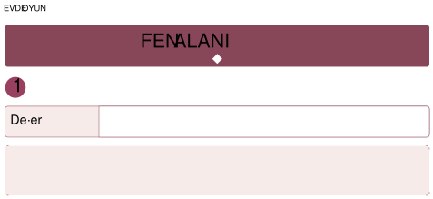
* Bir aile üyesinin yardımıyla sağlam bir elbise askısının iki ucuna eşit uzunlukta iplerle plastik kaplar bağlanarak basit bir denge terazisi hazırlanır. Askı, güvenli ve sabit bir yere yerleştirilir. Terazinin iki tarafının boşken aynı yükseklikte olup olmadığı kontrol edilir.
* Oyunun ilk bölümünde çocuk iki nesne seçer ve hangisinin daha ağır olduğunu tahmin eder. Nesneler terazinin iki tarafına yerleştirilir. Aşağı inen taraftaki nesnenin daha ağır, yukarıda kalan taraftaki nesnenin ise daha hafif olduğu birlikte gözlemlenir. Terazi dengede kalırsa nesnelerin ağırlıklarının birbirine yakın olabileceği açıklanır.
* Ardından “Dengeyi Bul” oyunu oynanır. Terazinin bir tarafına oyuncak yerleştirilir. Çocuk, diğer tarafa aynı türden bloklar ekleyerek teraziyi dengede tutmaya çalışır. Her blok eklendiğinde terazideki değişim incelenir. Aile üyeleri de sırayla bir nesne seçer ve diğer oyuncular dengeyi sağlamak için kaç blok gerekeceğini tahmin eder.
* Oyunun sonunda ailece pazara veya markete gidilir. Meyve ve sebzelerin nasıl tartıldığı gözlemlenir. Çocuğa “Sence hangisi daha ağır olabilir?”, “Terazide hangi bilgiye bakılıyor?” gibi sorular yöneltilir. Market çalışanının izin vermesi durumunda çocuk, bir aile üyesinin gözetiminde ürünü tartının üzerine koyabilir ve ekrandaki sayıları inceleyebilir.
* Evde kullanılan terazi yalnızca karşılaştırma amacı taşır ve nesnelerin gerçek ağırlığını göstermez. Askı ve iplerle hazırlanan düzenek aile gözetiminde kullanılmalıdır.

<!-- sayfa 105 -->

# Dikkat

Terazi tasarımı sırasında askının dengede durması için iplerin eşit uzunlukta olmasına özen gösterilmelidir. Pazar gezisi sırasında çocuğun güvenliği sağlanmalı ve satıcıdan izin alınmadan ölçüm aletlerine dokunulmamalıdır. Ölçüm sırasında sayısal değerlerden ziyade “hangisi aşağı indi?”, “hangisi daha ağır?” gibi somut kıyaslamalar üzerinden sohbet edilmelidir.

---

# Düşün / Hatırla / Söyle

* Teraziyi kullanarak hangi nesnenin daha ağır olduğunu nasıl belirleyebiliriz?
* Tarttığın iki nesneden hangisinin daha ağır, hangisinin daha hafif olduğunu söyle.
* Terazinin iki tarafı aynı yükseklikte kaldığında bu ne anlama geliyordu?

<!-- yer tutucu bulunamadı: sayfa sonuna eklendi -->

<!-- sayfa 106 -->

# YAĞMUR DEDEKTİFLERİ

| Değer | Duyarlılık |
| :--- | :--- |

**Materyaller:** boş plastik şişe, güvenli bant, cetvel, kalıcı kalem, makas veya maket bıçağı, kâğıt, renkli boya kalemleri, kâğıttan hazırlanmış beş yağmur damlası ve çiçek ya da ağaç resmi.

**Uygulama**

* Aile üyelerinden biri boş bir plastik şişeyi çocuğa göstererek “Sence yağmur yağdığında ne kadar su birikir? Haydi bir yağmurölçer hazırlayıp önce tahmin edelim, sonra gözlemleyelim.” diyerek oyunu başlatır.
* Plastik şişenin üst bölümü yalnızca bir aile üyesi tarafından kesilir, ters çevrilerek şişenin içine yerleştirilir ve kesilen kenarlar güvenli bantla kapatılır. Şişenin üzerine eşit aralıklarla $1$'den $5$'e kadar çizgiler çizilir. Her aile üyesi, yağmur suyunun hangi çizgiye ulaşacağını tahmin eder. Tahminler kâğıda yazılır veya resimle gösterilir.
* Yağmurölçer, bir aile üyesi tarafından yağmur alan güvenli bir yere yerleştirilir. Yağmur bittikten sonra biriken suyun ulaştığı çizgi incelenir ve tahminlerle karşılaştırılır.
* Ardından “Damla Görevi” oynanır. Önceden hazırlanmış beş kâğıt yağmur damlası evin güvenli bölümlerine saklanır. Çocuk, suyun ulaştığı çizgideki sayı kadar damlayı bulur ve bir çiçek ya da ağaç resminin yanına yerleştirir. Örneğin su üçüncü çizgiye ulaştıysa üç damla bulur.
* Oyunun sonunda çocuk “Su Koruyucusu” olur ve ailece uygulanacak bir su tasarrufu davranışı seçer. Diş fırçalarken musluğu kapatmak, elleri sabunlarken suyu açık bırakmamak gibi davranışlar belirlenebilir.
* Şişeyi kesme işlemi yalnızca aile üyesi tarafından yapılmalıdır. Bu düzenek kesin ölçüm yapmak için değil, farklı günlerde biriken yağmur suyunu karşılaştırmak için kullanılmalıdır.

<!-- sayfa 107 -->

> 
> **Dikkat**
> Yağmurölçer tasarlanırken kesici alet kullanımı tamamen aile büyüğünün kontrolünde olmalıdır. Şişenin rüzgârdan devrilmemesi için içine birkaç ağır taş konulması planlanmalıdır. Makas veya maket bıçağı yalnızca bir aile üyesi tarafından kullanılmalıdır.

---

> 
> **Düşün / Hatırla / Söyle**
>
> * Yağmur neden bizim için bu kadar değerli?
> * Yağmurölçerini nasıl yaptığını ve yağmurölçerin nasıl çalıştığını anlat.
> * Hazırladığın yağmurölçerde biriken su miktarı neydi?

<!-- sayfa 108 -->

# 3 YAPRAKLARIN İZİNDE: DOĞANIN SANATI

| Değer | Estetik, Duyarlılık |
| :--- | :--- |

**Materyaller:** doğadan toplanan çeşitli yapraklar, büyük boy resim kâğıdı, boya.

## Uygulama

* Aile üyelerinden biri, yere düşmüş renkli bir yaprağı çocuğa göstererek “Bu yaprağın üzerinde çizgiler ve desenler var. Haydi farklı yaprakları inceleyelim ve baskılarından hangi yaprağa ait olduklarını bulmaya çalışalım.” diyerek oyunu başlatır.
* Eve dönüş yolunda yapraklar tolanır. Yaprakların büyüklükleri, biçimleri, renkleri, kenarları ve damarları birlikte incelenir. “Bu yaprağın kenarı düz mü, tırtıklı mı?”, “Hangisi daha büyük?”, “Damarları nasıl görünüyor?” gibi sorular yöneltilir.
* Yaprakların damarlı yüzeyine çocuklara uygun boya sürülür. Yapraklar kâğıda bastırılarak izleri çıkarılır. Baskılar kuruduktan sonra sonra yapraklar karışık biçimde yan yana yerleştirilir.
* Ardından “Yaprak İzini Bul” oyunu oynanır. Aile üyelerinden biri bir yaprak baskısını gösterir. Çocuk baskının biçimini, büyüklüğünü ve damar izlerini inceleyerek hangi yaprağa ait olduğunu tahmin eder. Doğru yaprağı seçtikten sonra baskı ile yaprak yan yana karşılaştırılır. Daha sonra çocuk bir baskı seçer ve aile üyeleri bu baskının hangi yaprağa ait olduğunu bulmaya çalışır.
* İstenirse ailece bir botanik bahçesi ziyaret edilebilir. Bitkilerin nasıl sulandığı, büyümek için nelere ihtiyaç duyduğu ve nasıl korunduğu gözlemlenir. Uygun ve müsait bir çalışanla karşılaşılırsa izin istenerek bitki bakımı hakkında kısa sorular sorulabilir. Çalışan bulunmaması durumunda gözlem yapılarak ve bilgilendirme yazıları incelenerek etkinliğe devam edilir.
* Canlı bitkilerden yaprak koparılmamalı ve tanınmayan bitkilere dokunulmamalıdır. Etkinliğin ardından eller yıkanmalıdır.

<!-- sayfa 109 -->

**Dikkat**

Yaprak toplarken sadece yere düşmüş olanların seçilmesine, canlı bitkilere zarar verilmemesine özen gösterilmelidir. Sulu boya baskısı sırasında yaprağın damarlı (arka) yüzeyinin boyanması, baskının daha net çıkmasını sağlar.

---

**Düşün / Hatırla / Söyle**

* Farklı yaprakların kâğıtta bıraktığı izler neden birbirinden farklı olabilir?
* Seçtiğin yaprağın biçimini, kenarlarını ve damarlarını anlat.
* Baskının hangi yaprağa ait olduğunu bulurken hangi özelliklere bakmıştık?

<!-- sayfa 110 -->

# 4 YAPRAK PEŞİNDE

| Değer | Aile Bütünlüğü |
| :--- | :--- |

**Materyaller:** örtü, çeşitli renk, büyüklük ve şekilde yapraklar.

**Uygulama**

* Ailece kısa bir doğa gezisine çıkılır. Gezi sırasında yapraklar incelenir. Çocuk farklı renk, biçim ve büyüklükte birkaç yaprak seçer. Yaprakların kenarları, dokuları ve renkleri hakkında konuşulur. 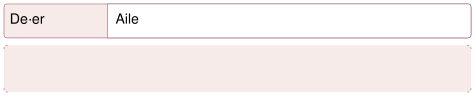
* “Rüzgârın Taşıdığı Yapraklar” oyununa geçilir. Düz bir zemine örtü serilir ve seçilen yapraklar belirli bir sırayla üzerine yerleştirilir. Çocuktan yaprakların yerlerine dikkatlice bakması istenir. Ardından çocuk arkasını döner ve aile üyelerinden biri “Rüzgâr esti, yaprakların yeri değişti!” diyerek yapraklardan birinin yerini değiştirir, ters çevirir veya bir yaprağı örtünün altına saklar.
* Çocuk yeniden yapraklara bakarak hangi değişikliğin yapıldığını bulmaya çalışır. “Hangi yaprak yer değiştirmiş?”, “Hangi yaprak ters çevrilmiş?” veya “Hangi yaprak kaybolmuş?” sorularıyla çocuğun gözlem yapması desteklenir. Daha sonra roller değiştirilir. Bu kez çocuk yapraklarda bir değişiklik yapar, aile üyeleri de değişen yaprağı bulmaya çalışır. Oyun ilerledikçe iki yaprağın yeri değiştirilebilir veya yaprakların sırası yeniden düzenlenebilir. Çocuğun zorlanması durumunda yaprak sayısı azaltılır. Değişikliği kolayca bulduğunda ise yaprak sayısı aşamalı olarak artırılır.
* Oyunun ardından aile üyeleri yaprakları kullanarak yere büyük bir güneş, kelebek, ağaç veya istedikleri başka bir şekil oluşturur. Her aile üyesi tasarıma bir yaprak ekler. 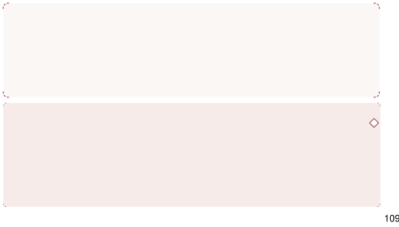

> **Dikkat**
> Yaprakların çocuk tarafından kolayca ayırt edilebilmesi için renk, şekil ve büyüklük bakımından birbirinden farklı örnekler seçilmelidir. Oyuna önce az sayıda (3-4) yaprakla başlanmalı, çocuğun başarısına göre yaprak sayısı kademeli olarak artırılmalıdır. Değişiklikler çocuğun fark edebileceği düzeyde olmalı; çocuk zorlanıyorsa tek bir yaprağın yeri değiştirilerek oyun sadeleştirilmelidir.

**Düşün / Hatırla / Söyle**

* Dikkatini en çok çeken yaprak hangisiydi?
* Yapraklarla oluşturulan hangi şekil ilgini çekti? Neden?

4

<!-- sayfa 111 -->

# 5 BÜYÜME YOLCULUĞUM: BEBEKLİKTEN BUGÜNE

| Değer | Aile Bütünlüğü |
| :--- | :--- |

**Materyaller:** çocuğun gelişimini gösteren 3-4 adet vesikalık veya boy fotoğrafı, gözlem alanı (kümes, bahçe veya park).

**Uygulama**

* Aile üyelerinden biri çocuğa bebeklik albümünü göstererek “Bebekken çok küçüktün. Zamanla büyüdün ve birçok yeni şey öğrendin. Şimdi fotoğraflarına bakarak büyüme yolculuğunu birlikte keşfedelim.” diyerek oyunu başlatır. Çocuğun farklı dönemlerine ait birkaç fotoğraf kullanılır. Yeterli fotoğraf yoksa aile üyelerinin hatırladığı gelişim basamakları resimlerle anlatılır.
* Çocuğun bebeklik, emekleme, ilk adım ve bugünkü hâlini gösteren birkaç fotoğraf seçilir. Fotoğraflar veya resimler karışık biçimde masaya yerleştirilir. Çocuk, fotoğrafları / resimleri en eski olandan en yeni olana doğru sıralamaya çalışır. Aile üyeleri “Burada henüz yürüyebiliyor muydun?”, “Şimdi yapabildiğin hangi şeyleri o zaman yapamıyordun?” gibi sorularla çocuğa ipucu verir.
* Fotoğraflar veya çizimler doğru sıraya konulduğunda yan yana dizilerek “Büyüme Treni” oluşturulur. Her fotoğraf / resim trenin bir vagonu kabul edilir. Çocuk vagonları sırayla göstererek büyürken öğrendiği hareketleri canlandırır. Aile üyeleri de kendi çocukluk fotoğraflarıyla oyuna katılabilir.
* Daha sonra yumurta, civciv, genç tavuk ve yetişkin tavuk görselleri karışık biçimde sunulur. Çocuk, bu görselleri büyüme sırasına göre dizer. İnsanların ve hayvanların zamanla büyüdüğü ancak büyüme biçimlerinin birbirinden farklı olduğu açıklanır. Tavukların beslenmesi ve bakımı hakkında sohbet edilir.

<!-- sayfa 112 -->

# Dikkat

Fotoğraflar seçilirken çocuğun kendini iyi hissettiği ve gelişimindeki farkı (boy uzaması, diş çıkması vb.) net görebildiği kareler tercih edilmelidir. ”Büyüme” kavramı işlenirken her canlının büyüme hızının farklı olduğu ve bunun doğal bir süreç olduğu vurgulanmalıdır.

---

## Düşün / Hatırla / Söyle

* Büyüdükçe öğrenebileceğin yeni bir şey ne olabilir?
* Daha önce yapamadığın, ancak şimdi yapabildiğin bir şeyi anlat.
* “Büyüme Yolu”nda ilk ve son sıraya hangi görselleri yerleştirmiştik?

<!-- sayfa 113 -->

# 6 ŞAPKAM TASARIM OYUNU, ATIKTAN SANATA

| Değer | Duyarlılık |
| :--- | :--- |

**Materyaller:** evde bulunan atık malzeme (karton, pet şişe, yumurta kolisi, ip vb.), yapıştırıcı, boyalar ve makas.

## Uygulama

* Aile üyelerinden biri temiz ve güvenli yeniden kullanım malzemelerini çocuğun önüne koyarak “Bugün atık malzemelerle farklı bir şapka tasarlayacağız. Bakalım bu malzemeler nasıl yeni bir ürüne dönüşecek.” diyerek oyunu başlatır.
* Karton, gazete kâğıdı, temiz yoğurt kapları, kumaş parçaları ve kurdeleler birlikte incelenir. Çocuk kullanmak istediği malzemeleri seçer ve şapkasının nasıl görüneceğine karar verir. Aile üyeleri, kesme ve güçlü yapıştırma gerektiren aşamalarda çocuğa yardımcı olur.
* Şapka tamamlandığında çocuk “şapka tanıtıcısı” olur. Şapkasına bir ad verir, hangi malzemeleri kullandığını ve şapkanın hayalî özelliklerini anlatır. Örneğin “Bu, rüzgârda uçmayan bir gezgin şapkası.” veya “Bu şapka beni görünmez yapıyor.” diyebilir.
* Etkinliğin sonunda aile üyeleri müzik eşliğinde küçük bir şapka gösterisi düzenler. Kullanılmayan malzemeleri yeni bir ürüne dönüştürmenin “yeniden kullanım” olduğu ve bunun atık miktarını azaltmaya yardımcı olabileceği açıklanır.

**Dikkat**
Şapka tasarımı sırasında kesici alet kullanımı aile üyesi kontrolünde olmalıdır. Tasarımın çocuğun hayal gücünü yansıtması için ailenin sadece “teknik destek” vermesi (yapıştırma, kesme gibi) önemlidir.

## Düşün / Hatırla / Söyle

* Atık malzemeleri yeniden kullanmak neden önemlidir?
* Şapka tasarlarken hangi malzemeleri kullandın?
* Şapkana hangi ismi verdin?

<!-- sayfa 114 -->

# 7 DUYU KÜPÜ

| Değer | Sevgi |
| :--- | :--- |

**Materyaller:** duyu küpü hazırlamak için kâğıt, doğada bulunan materyaller, yıkanıp hazırlanmış meyve veya yiyecekler.

**Uygulama**

* Etkinlikten önce göz, kulak, burun, el, dil ve ok sembolleri çizilerek “Duyu Küpü” hazırlanır. Göz görme, kulak işitme, burun koklama, el dokunma, dil tatma duyusunu; ok ise “Sıra Sende” görevini temsil eder.
* Aile üyelerinden biri çocukla park, bahçe veya güvenli bir açık alana çıkarak “Duyu Küpü’nü sırayla atacağız. Küpte hangi sembol gelirse o duyumuzla ilgili görevi yapacağız. Ok gelirse küpü sıradaki oyuncuya vereceğiz.” diyerek oyunu tanıtır.
* Her aile üyesi sırayla küpü atar ve gelen sembole uygun görevi tamamlar:

**Göz-Görme:** Çevrede dikkatini çeken bir renk, şekil veya hareket bulur ve gördüğünü anlatır.
**Kulak-İşitme:** Kısa bir süre sessizce dinler ve duyduğu bir sesi söyler.
**Burun-Koklama:** Güvenli olduğu bilinen bir çiçeği, toprağı veya aile tarafından getirilen bir kokuyu uzaktan koklayarak nasıl olduğunu anlatır.
**El-Dokunma:** Güvenli bir taş, kozalak veya ağaç kabuğuna dokunarak yüzeyinin sert, yumuşak, düz ya da pürüzlü olduğunu söyler.
**Dil-Tatma:** Aile tarafından önceden hazırlanmış güvenli bir meyvenin veya yiyeceğin tadına bakar ve tadını anlatır.
**Ok-Sıra Sende:** Oyuncu görev yapmadan küpü sıradaki aile üyesine verir.

Her görev tamamlandıktan sonra oyun sırası diğer aile üyesine geçer. Oyun, beş duyuyla ilgili görevlerin tümü en az bir kez yapılıncaya kadar sürdürülür.
Eve dönüldüğünde çocuk oyunda gördüğü, duyduğu, kokladığı, dokunduğu ve tattığı şeylerden en çok ilgisini çekeni resmeder ve ailesine anlatır.

<!-- sayfa 115 -->

# Dikkat
Doğa yürüyüşü sırasında çocuğun bitkileri koklarken veya onlara dokunurken alerjik reaksiyon riskine karşı dikkatli olunmalıdır.

---

# Düşün / Hatırla / Söyle
* Duyularımız doğayı algılamamızı nasıl sağlıyor?
* Doğa yürüyüşünde en çok hangi duyunu kullandın?
* Kokladığın bitkilerden birinin adı neydi?

<!-- yer tutucu bulunamadı: sayfa sonuna eklendi -->

<!-- sayfa 116 -->

# 8 TOPRAĞIN DÖNÜŞÜMÜ: KOMPOST KAHRAMANLARI

| Değer | Duyarlılık |
| :--- | :--- |

**Materyaller:** kompost kutusu için kapaklı küçük kovalar veya kaplar, kompostu havalandırmak için küçük bir kürek veya tırmık.

## Uygulama

* Aile üyelerinden biri meyve ve sebze kabuklarını çocuğa göstererek “Bazı mutfak atıkları komposta dönüşebilir, bazıları ise dönüşemez. Şimdi ‘Komposta Gider mi?’ oyununu oynayalım.” der.
* Masaya biri yeşil, diğeri kırmızı iki kap konur. Yeşil kabın komposta uygun, kırmızı kabın ise komposta uygun olmayan malzemeleri temsil ettiği açıklanır. Kap renkleri evdeki kap renklerine göre değiştirilebilir.
* Aile üyelerinden biri sırayla bir malzemenin adını söyler. Çocuk, malzemenin hangi kaba ait olduğunu tahmin eder:
    - Meyve ve sebze kabukları, yumurta kabuğu ve çay posası yeşil kaba yerleştirilir.
    - Plastik, cam, metal, yağlı yemek artıkları ve süt ürünleri kırmızı kaba yerleştirilir.
* Gerçek atıklar yerine bunların resimleri de kullanılabilir. Çocuk kararını verdikten sonra “Neden bu kabı seçtin?” sorusu üzerine konuşulur. Ardından oyun sırası çocuğa geçer. Çocuk bir malzemenin adını söyler, aile üyeleri de doğru kabı göstermeye çalışır.
* Oyunun sonunda yeşil kapta bulunan malzemeler yeniden sayılır ve adları tekrarlanır. Evde uygun bir kompost kutusu varsa malzemeler bir aile üyesi tarafından bu kutuya eklenir. Uygun bir kompost sistemi yoksa gerçek atıklar evde bekletilmez, etkinlik yalnızca görsellerle sürdürülür.

<!-- yer tutucu bulunamadı: sayfa sonuna eklendi -->

<!-- sayfa 117 -->

# Dikkat

* Oyuna başlamadan önce kompostun açıklaması yapılır. Kompost, meyve, sebze kabukları gibi bazı mutfak atıkları çöpe atılmak yerine kompost yapımında kullanılabilir. Bu atıklar, hava ve uygun nem sayesinde zamanla parçalanarak toprağa benzeyen doğal bir malzemeye dönüşür. Kompost, toprağın yapısını iyileştirir ve bitkilerin gelişmesine yardımcı olur. Ancak her atık komposta uygun değildir.
* Çocuk gerçek mutfak atıklarına doğrudan temas etmemeli ve oyun tamamlandıktan sonra eller yıkanmalıdır. 

---

# Düşün / Hatırla / Söyle

* Mutfak atıklarının toprağa dönüşmesi doğa için neden faydalı?
* Kompost; meyve ve sebze kabukları gibi bazı mutfak atıklarının çöpe atılmak yerine değerlendirilerek yeniden kullanılmasını sağlayan doğal bir yöntemdir.
* Kompost sandığına hangi atıkları koydun?

<!-- sayfa 118 -->

# 9 MEVSİM MUHABİRİ

| Değer | Sorumluluk |
| :--- | :--- |

**Materyaller:** mevsimleri gösteren resimler veya fotoğraflar, resim kâğıdı, boya kalemleri.

## Uygulama

* Aile üyelerinden biri pencereden dışarıyı göstererek “Bugün ‘Mevsim Muhabirleri’ olacağız. Çevremizdeki değişiklikleri inceleyecek ve ailemize bir mevsim haberi hazırlayacağız.” diyerek oyunu başlatır.
* Ailece bahçede, parkta veya evin çevresinde kısa bir gözlem yapılır. Gökyüzünün görünümü, havanın sıcak veya serin oluşu, rüzgâr, bitkilerin durumu ve insanların giydiği kıyafetler incelenir. Çocuğa “Gökyüzü nasıl görünüyor?”, “Hava sıcaklığını nasıl hissettin?”, “Sıcak mı, soğuk mu?” ve “Çevrede bulunduğumuz mevsimi anlatan hangi değişiklikleri görüyorsun?” gibi sorular yöneltilir.
* Ardından “Mevsim Muhabiri” oyunu oynanır. Çocuk, oyuncak mikrofonu veya mikrofon gibi kullanabileceği güvenli bir nesneyi eline alır ve gözlemlerini haber sunar gibi anlatır. Örneğin “Bugün hava serin ve rüzgârlı. Bazı ağaçlarda çiçekler görüyorum.” diyebilir. Aile üyeleri de sırayla muhabir olur ve fark ettikleri başka bir mevsim özelliğini söyler.
* Oyunun ikinci bölümünde aile üyelerinden biri, adını söylemeden bir mevsimi anlatan üç ipucu verir. Örneğin “Hava sıcak olur, ince kıyafetler giyeriz ve günler uzundur.” diyebilir. Çocuk ipuçlarından yararlanarak mevsimi tahmin eder. Daha sonra çocuk bir mevsim seçerek aile üyelerine ipuçları verir.
* Eve dönüldüğünde çocuk gözlemlediği mevsimi ve dikkatini çeken bitkileri resmeder. Resmini bir hava durumu sunucusu gibi ailesine tanıtır. Son olarak bitkilerin suya, ışığa, havaya ve uygun toprağa ihtiyaç duyduğu konuşulur. Çiçekleri koparmamak, çevreyi temiz tutmak, suyu gereksiz yere kullanmamak gibi doğayı koruyan davranışlardan biri seçilir.
* Tek bir hava olayının mevsimi belirlemeye yetmeyebileceği, mevsimi anlamak için çevredeki farklı ipuçlarının birlikte incelenmesi gerektiği açıklanır.

<!-- sayfa 119 -->

 **Dikkat**

Etkinlik sırasında çocuğun mevsimleri somut doğa olaylarıyla ilişkilendirmesi desteklenmelidir. Gözlem yapılırken bitkilere zarar verilmemeli, çiçekler ve yapraklar gereksiz yere koparılmamalıdır. Sohbetlerde çocuğun kendi gözlemlerini anlatmasına fırsat verilmeli, doğru-yanlış odaklı değerlendirmeler yerine merak etmesi ve keşfetmesi teşvik edilmelidir.

---

 **Düşün / Hatırla / Söyle**

* Çevrede gördüğün ipuçlarından hangileri sana içinde bulunduğumuz mevsimi düşündürdü?
* Mevsim muhabiri olsaydın bugünkü hava durumunu nasıl anlatırdın?
* Eğer bir mevsim olsaydın hangisi olmak isterdin? O mevsimde doğada neler olurdu?

<!-- sayfa 120 -->

# 10 TOHUMUNU AĞACINA GÖTÜR

| Değer | Sorumluluk |
| :--- | :--- |

> **Materyaller:** akçaağaç, meşe, kavak ve defne ağaçlarına ait görseller, bu ağaçların tohumlarına ait görseller (veya mümkünse gerçek tohum örnekleri), yapıştırıcı hamur veya bant, bahçe toprağı, isteğe bağlı torf, az miktarda su, karıştırma kabı, kaşık veya küçük kürek, bölgeye uygun tohumlar, tepsi veya düz bir karton, saksı, bahçe ya da uygun bir toprak alan, sulama kabı ve el temizliği için sabun ile havlu.

## Uygulama

*  Aile üyelerinden biri çocuğa akçaağaç, meşe, kavak ve defne ağaçlarının görsellerini gösterir. Ardından bu ağaçlara ait tohumlar incelenir:
Akçaağacın tohumu kanatlı bir yapıdadır. Meşenin tohumu palamuttur. Kavağın küçük tohumlarının çevresinde pamuksu tüyler bulunur. Defnenin tohumu, olgunlaştığında siyaha yakın renkte olan oval meyvesinin içindedir.

* Ağaç görselleri odanın farklı bölümlerine yerleştirilir. Tohum görselleri ise karışık biçimde ortaya konur. Aile üyelerinden biri “Her tohum, ait olduğu ağacı arıyor. Şimdi tohumları doğru ağaçlara götürelim.” diyerek oyunu başlatır. Çocuk bir tohum görseli seçer, özelliklerini inceler ve hangi ağaca ait olduğunu tahmin eder. Ardından görseli uygun ağacın yanına götürür. Doğru eşleştirme birlikte kontrol edilir. Daha sonra oyun sırası aile üyelerine geçer.

* Etkinliğin sonunda ağaçların büyümek için uygun toprak, su, ışık ve zamana ihtiyaç duyduğu konuşulur. Aile üyelerinden biri, avucundaki bir avuç toprak ve tohumu göstererek “Bu küçücük tohumların içinde yeni bir yaşam saklı. Haydi, birlikte onları koruyacak tohum topları hazırlayalım.” diyerek etkinliği başlatır. Aile üyeleriyle toprak, az miktarda su ve isteğe bağlı olarak torf karıştırılarak yumuşak bir karışım hazırlanır. Hazırlanan karışımın içine birkaç tohum yerleştirilir ve çocuk küçük toplar oluşturur. Tohum topları bir tepsi üzerinde kurumaya bırakılır. Kuruduktan sonra saksıya, bahçeye ya da uygun bir toprak alana birlikte yerleştirilir ve can suyu verilir.

<!-- sayfa 121 -->

 **Dikkat**

Etkinlik sırasında çocuğun yaşadığı bölgeye uygun tohumlar tercih edilmelidir. Tohum topları hazırlanırken hijyen kurallarına dikkat edilmeli ve işlem tamamlandıktan sonra eller birlikte yıkanmalıdır. Tohumların büyümesi için düzenli sulama ve sabırlı olmanın önemli olduğu çocuğa hatırlatılmalı, bitkiler gereğinden fazla sulanmamalıdır.

---

 **Düşün / Hatırla / Söyle**

* Hazırladığın tohum topunu nasıl yaptığını anlat.
* Tohumlar neden korunmalıdır?
* Tohum toplarını hazırlarken ilk olarak ne yaptık?

<!-- sayfa 122 -->

# SOSYAL-DUYGUSAL ÖĞRENME BECERİLERİ VE DEĞERLER ETKİNLİĞİ

## 1 KENDİMİ ANLATIYORUM

| Değer | Aile Bütünlüğü |
| :--- | :--- |

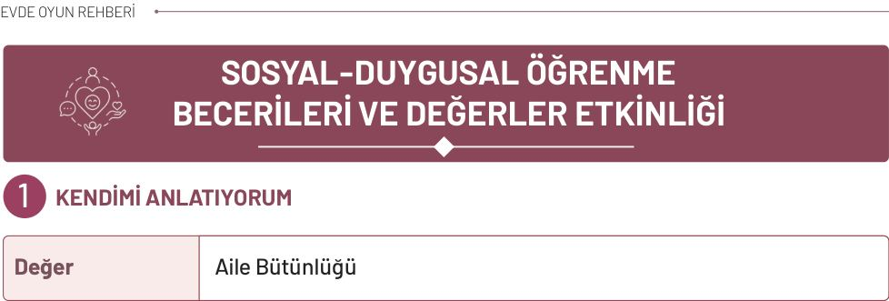
**Materyaller:** kâğıt, pastel veya kuru boyalar, kâse.

**Uygulama**

* Büyük bir kâğıt dört bölüme ayrılır. Aile üyelerinden biri her bölümü sırayla çocuğa gösterir ve “Buraya yapmayı sevdiğin bir şeyin resmini çiz.”, “Buraya iyi yaptığın bir şeyi çiz.”, “Buraya öğrenmek istediğin bir şeyi çiz.” ve “Buraya yaparken yardım istediğin bir şeyi çiz.” şeklinde açıklama yapar.
* Aynı dört başlık küçük kâğıtlara yazılır, kâğıtlar katlanarak bir kâsenin içine konur. Aile üyelerinden biri “Şimdi sırayla kâseden bir kâğıt seçeceğiz ve çıkan konuyla ilgili kendimizi anlatacağız.” diyerek oyunu başlatır.
* Çocuk kâseden bir kâğıt seçer. Örneğin “Yapmayı sevdiğim şey” çıkarsa sevdiği bir etkinliği söyler ve büyük kâğıdın ilgili bölümüne resmini çizer. Bir aile üyesi, çocuğun söylediklerini değiştirmeden resmin yanına yazabilir.
* Daha sonra aile üyeleri sırayla kâğıt seçer ve çıkan başlığa kısa bir cevap verir. Örneğin “Yemek yapmayı seviyorum.”, “İnsanları dikkatle dinlemekte iyiyim.”, “Bisiklete binmeyi öğrenmek istiyorum.” veya “Telefon kullanırken bazen yardım istiyorum.” denilebilir.
* Herkesin cevabı söz kesilmeden dinlenir. Bir kişi cevap vermek istemezse kâğıdı yeniden kâseye koyarak sırasını geçebilir.
* Oyunun sonunda aile üyeleri birbirlerinin güzel bir özelliğini söyler. Çocuğa, herkesin iyi yaptığı ve öğrenmek istediği farklı şeyler olabileceği anlatılır. Bir şeyi henüz yapamamanın ve gerektiğinde yardım istemenin doğal olduğu vurgulanır.

<!-- sayfa 123 -->

# Dikkat
Etkinlik sırasında çocuğun verdiği cevaplar ve yaptığı çizimler eleştirilmemeli veya düzeltilmemelidir.

---

# Düşün / Hatırla / Söyle
* Bugün yeni öğrendiğin bir şey oldu mu? Ne öğrendin?
* Yaptığın bir şeyde kendini başarılı hissettin mi? Ne yaptın?
* Daha önce yapamadığın ama deneyerek öğrendiğin bir şey oldu mu?

<!-- yer tutucu bulunamadı: sayfa sonuna eklendi -->

<!-- sayfa 124 -->

# 2 DUYGULARIN DİLİ

| Değer | Merhamet |
| :--- | :--- |

**Materyaller:** mutlu, üzgün, öfkeli, şaşkın ve korkmuş yüz ifadelerinin çizildiği küçük kartlar, kartları yerleştirmek için düz bir zemin (masa veya halı), kartları saklamak için küçük bir kutu.

## Uygulama

* Küçük kâğıtlara mutlu, üzgün, öfkeli, şaşkın ve korkmuş yüz ifadeleri çizilir. Kâğıtlar ters çevrilerek masaya yerleştirilir. Aile üyelerinden biri “Şimdi ‘Duygu Dedektifleri’ olacağız. Birimiz konuşmadan bir duyguyu canlandıracak, diğerleri de yüzüne ve bedenine bakarak hangi duygunun canlandırıldığını bulmaya çalışacak.” diyerek oyunu başlatır.
* İlk oyuncu bir kâğıt seçer ancak üzerindeki duyguyu diğer aile üyelerine göstermez. Duyguyu yüzü ve bedeniyle canlandırır. Diğer aile üyeleri sırayla tahminlerini söyler. Tahminde bulunurken fark ettikleri ipuçlarını da açıklar. Örneğin “Kaşların çatıldığı için öfkeli olduğunu düşündüm.” veya “Gülümsediğin için mutlu olduğunu düşündüm.” diyebilirler.
* Canlandırmayı yapan kişi, kâğıttaki duyguyu açıklar. Ardından aile üyeleri “Bir insan ne zaman böyle hissedebilir?” sorusuna birer örnek verir. Daha sonra “Bu duyguyu yaşayan birine nasıl destek olabiliriz?” sorusu üzerine konuşulur. “İstersen seni dinleyebilirim.”, “Yanında kalabilirim.”, “Yardım ister misin?” gibi destekleyici ifadeler kullanılabilir.
* Oyunun “Destek Cümlesi” bölümünde aile üyelerinden biri, canlandırılan duyguya uygun bir durum söyler. Örneğin “Oyuncağını bulamadığı için üzgün.” diyebilir. Çocuk bu kişiye söyleyebileceği destekleyici bir cümle oluşturur. Daha sonra çocuk bir durum söyler, aile üyeleri çözüm önerir.
* Her aile üyesi sırayla kâğıt seçerek canlandırma yapar. Canlandırmak istemeyen kişi “pas” diyerek sırasını geçebilir. Oyun sonunda aynı yüz veya beden hareketinin her insanda aynı duyguyu göstermeyebileceği konuşulur. Bir kişinin duygusundan emin olunmadığında tahmin yürütmek yerine “Nasıl hissediyorsun?” diye sormanın en doğru yol olduğu vurgulanır.

<!-- sayfa 125 -->

**Dikkat**

Çocuk canlandırma yapmak istemezse zorlanmamalıdır. Duygularla ilgili tahminler yapılırken yargılayıcı ifadeler kullanılmamalıdır. Çocuğun paylaştığı duygu ve yaşantılar dikkatle dinlenmeli, konuşması bölünmemelidir.

---

**Düşün / Hatırla / Söyle**

* Aynı olay karşısında herkes aynı duyguyu hisseder mi? Neden?
* Kendini kötü hisseden birine nasıl destek olabileceğini anlat.
* Seni mutlu eden bir anını anlatır mısın?

<!-- sayfa 126 -->

# 3 SAKİNLEŞME ÇARKIM

| Değer | Sabır |
| :--- | :--- |

**Materyaller:** büyük bir karton veya kâğıt, renkli kalemler, makas, döner raptiye veya ataş (çarkı döndürmek için, isteğe bağlı), yumuşak bir oyuncak, minder veya küçük yastık, resim kâğıdı.

## Uygulama

* Aile üyelerinden biri “Bazen öfke, korku, üzüntü gibi duyguları çok yoğun yaşayabiliriz. Böyle zamanlarda bedenimizi ve duygularımızı rahatlatmak için farklı yollar deneyebiliriz.” diyerek etkinliği başlatır. Aile üyeleri, kendilerine yardımcı olan sakinleşme yollarını sırayla paylaşır.
* Ardından derin ve yavaş nefes alma, beşe kadar sayma, kısa bir mola verme, resim yapma, hareket etme, mindere sarılma, güvendiği birinden yardım isteme gibi yöntemler birlikte canlandırılır. Büyük bir daire çizilerek dört bölüme ayrılır ve “Sakinleşme Çarkı” hazırlanır. Çarka aşağıdaki yöntemler yazılır:
    * Çiçek koklar gibi nefes alıp mum üfler gibi yavaşça nefes verme
    * Beşe kadar sayma
    * Bir mindere veya yumuşak oyuncağa sarılma
    * Mola verme veya yardım isteme
* Aile üyelerinden biri, yumuşak bir oyuncağı eline alarak “Oyuncağımızın yaptığı kule yıkıldı ve kendisini çok öfkeli hissediyor. Ona nasıl yardımcı olabiliriz?” der. Çocuk çarkı çevirir veya bir bölümü seçer. Gelen sakinleşme yöntemi oyuncakla uygulanır. Ardından çocuğa “Bu yöntem oyuncağa yardımcı olmuş olabilir mi?”, “Başka hangi yöntemi deneyebiliriz?” gibi sorular sorulur.
* Oyun farklı durumlarla devam eder. Oyuncak istediği eşyayı bulamayabilir, sırasını beklemek zorunda kalabilir veya yüksek bir sesten korkabilir. Çocuk önce oyuncağın ne hissedebileceğini söyler, ardından çarktan bir yöntem seçerek ona yardımcı olur.
* Daha sonra roller değiştirilir. Çocuk oyuncak için kısa bir durum oluşturur, aile üyeleri de uygun bir sakinleşme yolu seçerek canlandırır. Oyunun sonunda her aile üyesi kendisine yardımcı olabileceğini düşündüğü bir yöntemi seçer ve birlikte tekrar eder.
* Her yöntemin herkese ve her duruma aynı şekilde yardımcı olmayabileceği açıklanır. Bir yöntem işe yaramadığında başka bir yöntem denenebileceği, yoğun duygu devam ettiğinde ise çocuğun güvendiği bir aile üyesinden veya başka bir yetişkinden yardım istenebileceği...

<!-- sayfa 127 -->

# Dikkat

Sarılma gibi fiziksel temas gerektiren davranışlarda mutlaka karşı taraftan izin alınması gerektiği hatırlatılmalıdır. Çocuk canlandırmak istemediği bir durumu paylaşmaya zorlanmamalı, kendini rahat hissettiği örneklerle etkinliğe katılması desteklenmelidir. Yoğun duyguların uzun süre devam etmesi durumunda güvendiği bir yetişkinden yardım istemenin önemli olduğu vurgulanmalıdır.

## Düşün / Hatırla / Söyle

* Kendini çok öfkeli veya üzgün hissettiğinde sana hangi sakinleşme yöntemi yardımcı olabilir?
* Sakinleşme çarkındaki hangi yöntemi kullanmak istediğini anlat.
* Sakinleşmek için çarkta hangi yöntemler vardı?

<!-- sayfa 128 -->

# 4 AİLE RADYOSU

| Değer | Saygı, Aile Bütünlüğü |
| :--- | :--- |

**Materyaller:** oyuncak mikrofon veya mikrofon gibi kullanılabilecek güvenli bir nesne.

**Uygulama**

* Aile üyeleri bir araya gelir ve oyuncak mikrofon ya da mikrofon gibi kullanılabilecek güvenli bir nesne seçer. Aile üyelerinden biri “Şimdi ‘Aile Radyosu’nu açıyoruz. Mikrofon kimdeyse o kişi konuğumuz olacak, diğerleri de onu dikkatle dinleyecek.” diyerek oyunu başlatır.
* İlk tur için “Bugün seni mutlu eden bir şey”, “Ailece yapmak istediğin bir etkinlik”, “En sevdiğin oyun” gibi kısa bir konu belirlenir. Mikrofonu tutan kişi konuyla ilgili düşüncelerini anlatır. Diğer aile üyeleri sözünü kesmeden dinler. Dinlediklerini konuşana yönelerek, başlarını sallayarak veya uygun jest ve mimikler kullanarak gösterebilirler.
* Konuşma tamamlandığında aile üyelerinden biri “Seni dinlerken şunu duydum…” diyerek anlatılanlardan birini kendi sözleriyle tekrar eder. Ardından konuyla ilgili kısa bir soru sorar. Örneğin “Parkta oynamayı sevdiğini söyledin. Parkta en çok hangi oyunu oynuyorsun?” diyebilir.
* Cevabın ardından mikrofon sıradaki aile üyesine geçer. Bu kez önceki konuşmacı “radyo sunucusu” olur ve yeni konuğa bir soru yöneltir. Her aile üyesi sırayla sunucu ve konuk rolünü üstlenir.
* Oyunun sonunda “Aile Radyosu Kapanış Programı” yapılır. Her aile üyesi, oyun sırasında başka biri hakkında öğrendiği yeni bir şeyi söyler. Son olarak aile üyeleri birbirlerini dinledikleri ve düşüncelerini paylaştıkları için teşekkür ederek yayını kapatır.

> **Dikkat**
>
> Etkinlik sırasında konuşmacının sözünün kesilmemesine, çocuğun mikrofonda konuşmaya veya soru cevaplamaya zorlanmamasına, seçilen nesnelerin çocuğun kullanımına uygun ve güvenli olmasına dikkat edilmelidir.

**Düşün / Hatırla / Söyle**

* Bir kişinin seni dikkatle dinlediğini nasıl anlarsın?
* Aile üyelerinden birinin anlattıklarından aklında kalan bir şeyi söyle.
* Mikrofon sende olduğunda hangi konudan söz ettin?

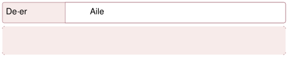
<!-- yer tutucu bulunamadı: sayfa sonuna eklendi -->

<!-- sayfa 129 -->

# 5 KULE YAPMA

| Değer | Yardımseverlik, Sabır |
| :--- | :--- |

**Materyaller:** plastik veya kâğıt bardaklar, bloklar veya küçük karton kutular, yumuşak bir oyuncak, mezura, kâğıt bayrak.

**Uygulama** __________________________________________________________________

* Plastik veya kâğıt bardaklar, bloklar veya küçük karton kutular oyun alanına yerleştirilir. Aile üyelerinden biri, yumuşak bir oyuncağı göstererek “Oyuncağımız çevresini görebileceği yüksek ve sağlam bir kule istiyor. Şimdi hep birlikte ona bir kule yapalım.” diyerek oyunu başlatır.
* Önce her aile üyesi malzemelerin bir bölümünü kullanarak küçük bir kule yapar. Kulelerin yükseklikleri aynı büyüklükteki bloklar veya bir mezura yardımıyla ölçülür ve sonuçlar karşılaştırılır. Ardından “Bütün malzemeleri birleştirirsek daha yüksek ve sağlam bir kule yapabilir miyiz?” sorusu üzerine konuşulur.
* Tüm kuleler sökülerek malzemeler bir araya getirilir. Aile üyeleri yapmak istedikleri kuleyle ilgili fikirlerini sırayla paylaşır ve ortak bir plan oluşturur. Kulenin geniş bir tabanı olması, parçaların dengeli yerleştirilmesi ve en üstüne küçük bir kâğıt bayrak konulması kararlaştırılabilir.
* Her aile üyesi sırası geldiğinde kuleye bir parça ekler. Bir kişi malzemeleri verir, bir kişi kulenin dengesini kontrol eder, diğerleri ise sırayla parçaları yerleştirir. Birkaç tur sonra görevler değiştirilir.

Kule tamamlandığında üç görev uygulanır:

* **Yükseklik Görevi:** Kule önceden belirlenen işarete ulaşmış mı?
* **Denge Görevi:** Kule, ailece beşe kadar sayılırken ayakta kalabiliyor mu?
* **Bayrak Görevi:** Kâğıt bayrak kulenin üzerine yerleştirilebiliyor mu?

Görevlerden biri tamamlanamazsa kule birlikte incelenir ve yeni bir çözüm denenir. Kule yıkıldığında kimin yaptığı üzerinde durulmaz. “Tabanı genişletirsek ne olur?”, “Ağır parçaları nereye koymalıyız?” gibi sorularla yeniden planlama yapılır.
* Oyunun sonunda yumuşak oyuncak kulenin yanına yerleştirilir ve kuleye bir ad verilir. Yalnızca kulenin yüksekliği değil, aile üyelerinin fikir paylaşması, sırasını beklemesi, yardım istemesi ve birlikte çözüm üretmesi de takdir edilir.

<!-- sayfa 130 -->

# Dikkat
Kule yerde kurulmalıdır, çocuk malzemelere ulaşmak için sandalyeye veya başka bir eşyanın üzerine çıkmamalıdır. Sert ve ağır parçalar yüksek kulelerde kullanılmamalıdır.

## Düşün / Hatırla / Söyle
* Kuleyi birlikte yapmak size nasıl yardımcı oldu?
* Kuleyi tek başına yaparken ve birlikte yaparken neler hissettin?
* Bir işi biriyle yardımlaşarak daha kolay yaptığın zamanı hatırlıyor musun?

<!-- sayfa 131 -->

# 6 NEZAKET KAPIYI AÇAR

| Değer | Saygı, Mütevazılık |
| :--- | :--- |

 **Materyaller:** günlük yaşamdan durumların yazılı olduğu küçük kâğıtlar, kâğıtları koymak için bir kutu veya kese, üzerinde “Lütfen”, “Teşekkür ederim.”, “Özür dilerim.”, “Rica ederim.”, “Kullanabilir miyim?” ifadelerinin yazılı olduğu kartlar, (isteğe bağlı) yapıştırıcı, boyalar ve makas.

 **Uygulama**

* Küçük kâğıtlara günlük yaşamdan kısa durumlar yazılır:
    * Bir kalemi kullanmak istiyorsun.
    * Bir oyuna katılmak istiyorsun.
    * Birisi sana yardım etti.
    * Yanlışlıkla birine çarptın.
    * Başkasına ait bir eşyayı almak istiyorsun.
    * Birisi yaptığın yardım için sana teşekkür etti.
* Kâğıtlar katlanarak bir kutuya konur. Aile üyelerinden biri “Şimdi ‘Nezaket Sözünü Bul’ oyununu oynayacağız. Kutudan bir durum seçecek ve o durumda kullanabileceğimiz en uygun nezaket ifadesini bulacağız.” diyerek oyunu başlatır.
* Çocuk kutudan bir kâğıt seçer ve bir aile üyesi durumu okur. Çocuk; “Lütfen”, “Teşekkür ederim.”, “Özür dilerim.”, “Rica ederim.” veya “Kullanabilir miyim?” ifadelerinden uygun olanı seçer. Ardından durum aile üyeleriyle canlandırılır. Örneğin oyuna katılmak isteyen çocuk “Ben de oyuna katılabilir miyim, lütfen?” diyebilir.
* Daha sonra roller değiştirilir. Çocuk hem istekte bulunan hem de kendisine soru yöneltilen kişi olur. Karşısındaki kişinin cevabını dinlemesi ve cevaba uygun biçimde karşılık vermesi desteklenir.
* Oyunun “Karışan Sözleri Düzelt” bölümünde aile üyelerinden biri, canlandırılan duruma bilerek uygun olmayan bir ifade ekler. Örneğin yanlışlıkla birine çarptığında “Teşekkür ederim.” der. Çocuk, ifadenin neden uygun olmadığını bulur ve yerine “Özür dilerim.” ifadesini kullanır. Daha sonra çocuk, aile üyelerinin düzeltmesi için bilerek farklı bir nezaket ifadesi kullanabilir.
* Oyunun sonunda aile üyeleri gün içinde kullanacakları bir nezaket ifadesi seçerek örnek bir cümle kurar. Nezaket ifadelerinin yanı sıra sakin bir ses tonu kullanmanın, karşıdaki kişiyi dinlemenin ve verilen cevaba saygı göstermenin önemli olduğu vurgulanır. Bir istekte...

<!-- sayfa 132 -->

# Dikkat
Etkinlik sırasında çocuğun yanlış nezaket ifadesini seçmesi durumunda ayıplanmamasına veya düzeltilirken utandırılmamasına özen gösterilmelidir. Canlandırmalar sırasında çocuğun rol yapmaya zorlanmamasına dikkat edilmeli, özellikle “hayır” cevabını kabul etme durumunda çocuğun duygularını baskılamadan sakin ve anlayışlı bir tutum sergilenmelidir.

---

## Düşün / Hatırla / Söyle
* Nezaket sözcükleri kullanıldığında karşıdaki kişi nasıl hissedebilir?
* Birinden yardım isterken kullanabileceğin nazik bir cümle söyle.
* Birinin sana nazik davrandığı ve kendini iyi hissettiğin bir zamanı hatırlıyor musun?

<!-- sayfa 133 -->

# 7 AİLE BÜYÜKLERİM

| Değer | Aile Bütünlüğü, Saygı, Sevgi |
| :--- | :--- |

**Materyaller:** aile büyüklerine ait fotoğraf veya hatıra eşyası, temsilî ikram malzemeleri.

**Uygulama**

* Eve gelmesi planlanan bir aile büyüğünün fotoğrafı veya izin alınmak koşuluyla ona ait bir eşya masaya yerleştirilir. Aile üyelerinden biri “Bugün aile büyüğümüzü karşılamayı canlandıracak ve ondan geçmişte oynadığı oyunları dinleyeceğiz.” diyerek etkinliği başlatır.

* Fotoğraf veya eşya birlikte incelenir. Çocuğun “Bu eşya kimin?”, “Ne zaman kullanılmış?” ve “Nasıl bir anısı var?” gibi sorular sorması desteklenir. Çocuğa eşyanın sahibi hakkında tahminde bulunmak yerine bilgilerin aile büyüğüne sorulabileceği belirtilir.

* Aile üyelerinden biri kapıyı çalarak misafir rolünü üstlenir. Çocuk kapıyı bir yetişkinle açıyormuş gibi yapar, misafiri “Hoş geldiniz, nasılsınız?” diyerek karşılar ve ona oturabileceği bir yer gösterir. Ardından roller değiştirilerek çocuk da misafir rolünü dener.

* Daha sonra “Ne Eksik?” oyunu oynanır. Aile üyelerinden biri misafiri karşılama davranışlarını canlandırırken bir aşamayı bilerek atlar. Örneğin selam vermeden oturur, misafire yer göstermez veya konuşurken sözünü keser. Çocuk eksik olan ya da uygun olmayan davranışı bulur ve nasıl düzeltilebileceğini gösterir. Ardından çocuk bir davranışı eksik canlandırır, aile üyeleri de neyin eksik olduğunu bulmaya çalışır.

* Uygun bir zamanda aile büyüğü ziyaret edilir veya telefonla aranır. Çocuk “Çocukken en çok hangi oyunu oynardınız?” ya da “Ailenizde sevdiğiniz bir gelenek var mıydı?” diye sorar. Aile büyüğü, oynadığı oyunun adını söylemeden kısa ipuçları verebilir. Çocuk ve diğer aile üyeleri anlatılan oyunun ne olduğunu tahmin etmeye çalışır. Oyun güvenli ve uygulanabilir ise aile büyüğünün anlatımıyla oynanabilir.

* Çocuğun aile büyüğüne sarılması, onu öpmesi veya fiziksel temas kurması zorunlu tutulmamalıdır. Saygının selam verme, dikkatle dinleme, söz kesmeme, nazik konuşma gibi farklı yollarla gösterilebileceği açıklanmalıdır.

<!-- yer tutucu bulunamadı: sayfa sonuna eklendi -->

<!-- sayfa 134 -->

# Dikkat

Çocuk hiçbir aile büyüğüne sarılmaya veya fiziksel temas kurmaya zorlanmamalıdır. Huzurevi ziyaretleri kurumun izni, sağlık kuralları ve ziyaretçilerin onayı doğrultusunda gerçekleştirilmelidir. Yaşlı bireyler yalnızca yardıma ihtiyaç duyan kişiler olarak değil bilgi, deneyim ve hatıra sahibi bireyler olarak tanıtılmalıdır.

---

# Düşün / Hatırla / Söyle

* Aile büyüklerimiz konuşurken onları dikkatle dinlemek neden önemlidir?
* Bir aile büyüğüne ne sormak istersin?
* Bir aile büyüğünün sana anlattığı güzel bir anıyı hatırlıyor musun?

<!-- yer tutucu bulunamadı: sayfa sonuna eklendi -->

<!-- sayfa 135 -->

# 8 KÜÇÜK TOHUMUN BÜYÜK YOLCULUĞU

| Değer | Sabır, Sorumluluk, Duyarlılık |
| :--- | :--- |

**Materyaller:** mercimek veya fasulye tohumu, pamuk ya da küçük saksı ve toprak, su, şeffaf kap, kâğıt ve boya kalemleri.

**Uygulama**

* Mercimek tohumları çocuğa gösterilerek “Sence bunlar nedir?” diye sorulur. Çocuğun cevabı dinlendikten sonra mercimeğin bir tohum olduğu ve uygun koşullarda filizlenebileceği açıklanır. “Bu tohumların nasıl değiştiğini birlikte gözlemleyelim.” denilerek etkinlik başlatılır.
* Ekimden önce “Tohum Uyanıyor” adlı hareket oyunu oynanır. Aile üyeleri ve çocuk, bedenlerini küçültüp eğilerek uyuyan bir tohumu canlandırır. Oyun liderinin yönergelerine göre şu hareketler yapılır:
    * **Su geldi:** Parmaklar hareket ettirilerek yağmur canlandırılır.
    * **Tohum çatladı:** Beden yavaşça hareket ettirilir.
    * **Kök çıktı:** Eller yere doğru uzatılır.
    * **Filiz büyüdü:** Yavaşça ayağa kalkılır.
    * **Yapraklar açıldı:** Kollar iki yana açılır.
    * **Güneşe yöneldi:** Kollar ve yüz yukarı doğru çevrilir.
* Daha sonra liderlik sırası çocuğa geçer. Çocuk aşamaları karışık sırayla söyler, aile üyeleri uygun hareketi yapar. Oyunun sonunda aşamalar doğru sıraya konularak bir kez daha canlandırılır.
* Ardından mercimek tohumları nemli pamuk içine yerleştirilir veya şeffaf bir kapta toprağa ekilir. Kabın üzerine ekim tarihi bir aile üyesi tarafından yazılır ve kap uygun bir yere konur. Pamuk yalnızca filizlenmeyi kısa süre gözlemlemek için kullanılır. Bitkinin büyümeye devam etmesi isteniyorsa filiz uygun zamanda toprağa dikilir.
* Tohumun nem durumu her gün kontrol edilir ancak gereğinden fazla su verilmez. Sulama ve gözlem görevleri aile üyeleri arasında paylaşılır. Çocuk belirli aralıklarla tohumun çatlamasını, kökün çıkmasını ve filizin uzamasını inceler ve gördüklerini resmeder.
* Her gözlemden sonra “Dünden farklı olan ne var?” sorusu sorulur. Çocuk fark ettiği

8

<!-- sayfa 136 -->

# Dikkat
Filizlendirme için kullanılan mercimekler yenilmemeli, küflenme veya kötü koku fark edilirse bir aile üyesi tarafından atılmalı ve etkinlikten sonra eller yıkanmalıdır.

---

## Düşün / Hatırla / Söyle
* Tohumun büyümesi için neden beklememiz gerekir?
* Bitkinin bakımında üstlendiğin sorumluluğu anlat.
* Tohumda ilk fark ettiğin değişikliği hatırlıyor musun?

<!-- sayfa 137 -->

# 9 BAYRAĞIMIZI TANIYORUM

| Değer | Vatanseverlik |
| :--- | :--- |

**Materyaller:** Türk bayrağı, İstiklal Marşı kaydı, yastıklar, renkli bantlar ve güvenli ev eşyaları, bayrağı kapatmak için bir örtü.

## Uygulama

Türk bayrağı, parkurun sonunda çocuğun görebileceği yüksek, temiz ve güvenli bir yere asılır. Oyun başlamadan önce bayrağın kırmızı zemini, beyaz ayı ve beş köşeli yıldızı birlikte incelenir. Çocuğa “Bayrağımızı daha önce nerelerde gördün?” sorusu yöneltilerek okul, resmî kurumlar, millî bayramlar, spor karşılaşmaları gibi örnekler üzerine konuşulur.

Yastıklar, renkli bantlar ve güvenli ev eşyaları kullanılarak kısa bir parkur hazırlanır. Aile üyelerinden biri “Şimdi parkuru tamamlayarak bayrağımızın bulunduğu noktaya ulaşacağız. Parkuru güvenli biçimde tamamlayıp bayrağın yanındaki işarete ilk ulaşan kişi Bayrak Rehberi olacak.” diyerek oyunu başlatır.

Parkur şu bölümlerden oluşturulabilir:

* Yere sabitlenen kırmızı çizgiyi takip ederek ilerleme
* Kaymayacak biçimde yerleştirilen yastıkların arasından geçme
* Hazırlanan şekiller arasından ay biçimini bulma
* Beş köşeli yıldızı seçme
* Bayrağın yanındaki bitiş işaretine ulaşma

Oyuncular parkura sırayla katılır. Tüm aile üyeleri parkuru tamamladığında “Bayrağımızı Hatırla” bölümü oynanır. Bayrak kısa süreliğine bir paravanla kapatılır. Bayrak Rehberi şu sorulardan birini sorar:

* Bayrağımızın zemini hangi renktir?
* Bayrağımızda hangi şekiller bulunur?
* Ay ve yıldız hangi renktir?
* Yıldızın kaç köşesi vardır?

Cevaplardan sonra bayrak yeniden gösterilir ve özellikleri birlikte kontrol edilir.

<!-- sayfa 138 -->

 **Dikkat**

Parkurda kullanılan yastık, bant gibi malzemelerin kaymayacak şekilde sabitlenmesine ve bayrağın asıldığı yerin düşme riski taşımayan, güvenli bir alan olmasına özen gösterilmelidir. Etkinlik boyunca hız veya rekabetten ziyade parkurun güvenli tamamlanması ön planda tutulmalı, bayrağın temizliğine ve temsil ettiği değerlere uygun şekilde özenle korunmasına dikkat edilmelidir.

---

 **Düşün / Hatırla / Söyle**

* Bayrağımızın üzerinde hangi semboller var?
* İstiklal Marşı’nı dinlerken ne hissettin?
* İstiklal Marşı’nı dinlerken ve söylerken nasıl durduk?

<!-- sayfa 139 -->

# 10 YÖREMİZİN İZLERİ

| Değer | Vatanseverlik |
| :--- | :--- |

**Materyaller:** -

**Uygulama**

* Aile üyelerinden biri yöresel bir ürünü çocuğa göstermeden bez bir torbanın içine koyar. Çocuğa “Torbanın içinde yöremize ait bir ürün saklanıyor. Vereceğimiz ipuçlarını dinleyerek hangi ürün olduğunu bulabilir misin?” denilerek oyun başlatılır.
* Aile üyeleri ürünün adını söylemeden görünüşü, kokusu, yetiştiği yer veya kullanım biçimi hakkında kısa ipuçları verir. Örneğin fındık için “Ağaçta yetişir, sert bir kabuğu vardır, küçük ve yuvarlaktır.” denilebilir. Çocuk ürünü tahmin ettikten sonra ürün torbadan çıkarılır ve birlikte incelenir.
* Ürünün hangi yöreyle tanındığı açıklanır. Ürün coğrafi işaretliyse logosu ambalajdan veya “Coğrafi İşaretler Portalı” üzerinden gösterilir. Coğrafi işaretin ürünün belirli bir yöreyle bağlantılı olduğunu ve o yöreye bağlı ayırt edici özellikler taşıdığını gösterdiği basitçe anlatılır.
* Ardından torbaya çay, fındık, kuru meyve veya ambalajlı başka yöresel ürünler sırayla konur. Her üründe farklı aile üyeleri ipucu verir, çocuk da ürünü bulmaya çalışır. Daha sonra roller değiştirilir. Bu kez çocuk torbadan bir ürün seçer ve ürünün özelliklerini söyleyerek aile üyelerinin tahmin etmesini sağlar.
* Oyunun sonunda bulunan ürünler yan yana dizilir. Hangi ürünün hangi yöreyle tanındığı ve ürünlerin benzer ve farklı özellikleri üzerine konuşulur.

**Dikkat**

Coğrafi işaret kavramı anlatılırken, bunun bir “kalite ve güven” sembolü olduğu, o bölgenin insanlarının emeğini koruduğu vurgulanmalıdır. Tadına bakılacak ürün kullanılıyor ise çocuğun alerjik reaksiyon gösterip göstermeyeceği bilinerek hareket edilmelidir.

<!-- yer tutucu bulunamadı: sayfa sonuna eklendi -->

<!-- yer tutucu bulunamadı: sayfa sonuna eklendi -->

<!-- sayfa 140 -->

 # Düşün / Hatırla / Söyle

* Bir yöresel ürünün korunması o ürünü hazırlayan insanlara nasıl katkıda bulunur?
* Seçtiğin ürünün adını, ait olduğu yeri ve onu özel kılan özelliği anlat.
* Ailende hazırlanan yöresel bir yemeği, el sanatını veya geleneği hatırlıyor musun?

<!-- sayfa 141 -->

# KODLAMA

## 1 ROBOTLAR İŞ BAŞINDA

| Değer | Sabır |
| :--- | :--- |

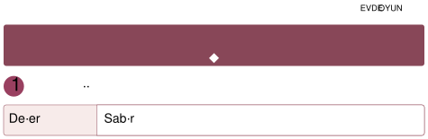 **Materyaller:** hedef olarak belirlemek için evde bulunan güvenli bir eşya.

 **Uygulama**

*  Evdeki bir eşya (oyuncak, kitap, yastık gibi) hedef olarak belirlenir. Aile bireylerinden biri robot olur, diğeri ise robota yön veren kişi olur. Çocuk robota “İki adım ileri git.”, “Sağa dön.”, “Bir adım ilerle.” veya “Dur.” gibi basit yönergeler verir. Robot yalnızca söylenen komutları uygulayarak hedefe ulaşmaya çalışır. Robot yanlış yöne giderse birlikte durup hangi komutun değişmesi gerektiği konuşulur ve oyun yeniden başlatılır. Daha sonra roller değiştirilir; bu kez çocuk robot olur, aile bireylerinden biri yönergeleri verir. Oyun farklı hedefler belirlenerek ve yeni yönlendirmeler eklenerek sürdürülür.

 **Dikkat**
Kodlama süreci karmaşık terimlerden uzak, tamamen fiziksel hareket ve oyun üzerinden kurgulanmalıdır.

**Düşün / Hatırla / Söyle**

* Robotların neden ayrıntılı komutlara ihtiyacı vardır?
* Robotu hedefe ulaştırmak için hangi komutları kullandığını anlat.
* Yanlış giden bir komutu nasıl düzelttiğini hatırlıyor musun?

<!-- sayfa 142 -->

# 2 RENKLİ KARELER

| Değer | Aile Bütünlüğü |
| :--- | :--- |

**Materyaller:** kareli kâğıt, renkli boya kalemleri.

**Uygulama**

* Aile bireylerinden biri kareli kâğıtta hangi karelerin hangi renge boyanacağını sırayla söyler. Örneğin “Bu kareyi kırmızıya boya.”, “Yanındaki kareyi maviye boya.”, “Bir kare boş bırak, sonraki kareyi yeşile boya.” gibi yönergeler verir. Çocuk yönergeleri dikkatle takip ederek kareleri boyar. Boyama tamamlandığında ortaya çıkan şekil birlikte incelenir ve şeklin neye benzediği hakkında sohbet edilir. Daha sonra roller değiştirilir. Bu kez çocuk hangi karelerin boyanacağını söyler, aile bireyleri ise onun verdiği yönergeleri takip ederek resmi tamamlamaya çalışır.

**Dikkat**

Başlangıç aşamasında karelerin çok küçük olmamasına ve yönergelerin basit tutulmasına özen gösterilmelidir. Çocuğun kareleri karıştırmaması için her komut sonrası kontrol edilmelidir.

**Düşün / Hatırla / Söyle**

* Küçük kareler birleşince nasıl bir resim oluştu?
* Boyarken hangi renkleri kullandın?
* Ailenin yaptığı boyama tamamlandığında ortaya nasıl bir şekil çıktı?

<!-- sayfa 143 -->

# 3 HATA AVCILARI

| Değer | Sabır |
| :--- | :--- |

 **Materyaller:** kaşık, çatal, bardak, oyuncak, kalem veya blok.

 **Uygulama**

* Masanın üzerine kaşık, çatal, bardak, oyuncak, kalem, blok gibi evde bulunan 5-6 eşya belirli bir sırayla dizilir. Çocuk dizilimi inceler ve aklında tutmaya çalışır. Daha sonra gözlerini kapatır veya arkasını döner. Bu sırada aile bireylerinden biri dizilimde küçük bir değişiklik yapar; bir eşyanın yerini değiştirir, bir eşyayı çıkarır ya da farklı bir yere koyar. Çocuk tekrar baktığında değişikliği bulmaya çalışır ve dizilimi eski hâline getirir. Her turda farklı bir değişiklik yapılarak oyun devam eder. İstenirse roller değiştirilir ve bu kez dizilimi çocuk değiştirir, aile bireyleri değişikliği bulmaya çalışır.

 **Dikkat**

Hatalar başlangıçta çok belirgin olmalıdır. Çocuğun hatayı bulamadığı anlarda ipuçları verilerek öz güveni desteklenmeli ve hata yapmanın öğrenmenin bir parçası olduğu çocuğa vurgulanmalıdır.

 **Düşün / Hatırla / Söyle**

* Eşyaların yerlerinin değiştiğini nasıl fark ettin?
* Dizilimde hangi eşyanın yeri değişti?
* Eşyalar başlangıçta hangi sırayla dizilmişti?

<!-- sayfa 144 -->

# 4 MUTFAKTA ALGORİTMA

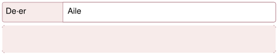

| Değer | Aile Bütünlüğü |
| :--- | :--- |

**Materyaller:** sandviç malzemeleri (ekmek, peynir, sebze vb.).

**Uygulama**

* Aile bireylerinden biri sandviç robotu olur, çocuk ise robota yönergeler verir. Sandviç hazırlamak için gerekli malzemeler masaya konur. Çocuk robota “Ekmeği al.”, “Peyniri koy.”, “Domatesi ekle.”, “Ekmeği kapat.” gibi adım adım yönergeler verir. Robot yalnızca söylenen komutları uygular. Bir adım unutulursa veya sırası karışırsa robot “Hata! Yeni komut bekleniyor.” diyerek durur. Çocuk eksik veya yanlış adımı fark ederek doğru yönergeyi verir ve oyun devam eder. Sandviç tamamlandığında aile bireyleri birlikte hazırladıkları sandviçi inceler ve bir işi doğru sırayla yapmanın neden önemli olduğu hakkında kısa bir sohbet ederek oyunu tamamlar.

**Dikkat**

Mutfaktaki kesici aletlerin kullanımı tamamen yetişkin kontrolünde olmalı veya plastik oyuncak mutfak gereçleri tercih edilmelidir.

**Düşün / Hatırla / Söyle**

* Bu etkinlikte öğrendiğin en önemli şey ne olduğunu düşün.
* Etkinlik sırasında yaptıklarını kısaca anlat.
* Bugün bu oyunda öğrendiğin yeni bir şeyi hatırlıyor musun?

<!-- sayfa 145 -->

# 5 MÜZİKAL KODLAR

| Değer | Aile Bütünlüğü |
| :--- | :--- |

**Materyaller:** kâğıt ve renkli kalemler.

## Uygulama

* Aile bireylerinden biri ritim yöneticisi, çocuk ise ritim oyuncusu olur. El çırpma, dize vurma, ayağı yere vurma gibi hareketlerden oluşan kısa bir ritim dizisi belirlenir ve bu hareketler basit sembollerle bir kâğıda çizilir. Ritim dizisinin altına büyük bir “üç kez tekrarla” işareti eklenir. Çocuk kartlardaki sembolleri sırayla takip ederek hareketleri uygular ve döngü işaretini gördüğünde ritmi belirtilen sayıda tekrar eder. Daha sonra roller değiştirilir, çocuk kendi ritim kartlarını hazırlarken aile bireylerinden biri kartlardaki sembolleri takip ederek ritmi uygular. Bir hareket atlanır, sırası karışır veya döngü komutu unutulursa oyun durdurulur; aile bireyleri ve çocuk hatayı birlikte fark ederek doğru sırayla yeniden uygular. Etkinliğin sonunda tüm aile, şarkılardaki tekrar eden bölümlerin ritim döngülerine benzediği üzerine sohbet eder.

> **Dikkat**
>
> Ritim dizisi başlangıçta en fazla iki farklı hareketten oluşmalı, çocuk döngü mantığını kavradıkça seri uzatılmalıdır. Tekrar komutu anlatılırken her seferinde her şeyi baştan çizmek yerine tekrarla işaretinin işimizi nasıl kolaylaştırdığına vurgu yapılmalıdır.
> 

## Düşün / Hatırla / Söyle

* En çok hangi ritim hareketini yapmaktan keyif aldın?
* Ritim oluştururken en eğlenceli bulduğun bölüm hangisiydi?
* Döngü işareti bize ne yapmamız gerektiğini hatırlatıyordu?

<!-- sayfa 146 -->

# 6 GİZLİ MESAJ: VERİ ŞİFRELEME

| Değer | Aile Bütünlüğü |
| :--- | :--- |

**Materyaller:** kâğıt ve renkli kalemler, mors alfabesi, işaret dili ve eski iletişim yöntemleri hakkında kısa videolar.

**Uygulama**

* Hep birlikte bir şifre sözlüğü hazırlanır. Örneğin kâğıda elma için bir yıldız, muz için bir kare, süt için bir üçgen çizilir. Çocuk, hazırlanan bu anahtarı kullanarak ailesine sadece sembollerden oluşan bir “Gizli Alışveriş Listesi” hazırlar. Aile üyeleri bu listeyi sözlüğe bakarak çözer. Ardından aile üyeleri sembollerle yeni bir mesaj oluşturur. Çocuk, “şifre çözücü” rolüne geçerek mesajın anlamını bulmaya çalışır. Mors alfabesi, işaret dili ve eski iletişim yöntemleri hakkında kısa videolar izlenebilir. Bilgilerin geçmişten günümüze kodlarla nasıl aktarıldığı üzerine sohbet edilebilir.

**Dikkat**

Başlangıçta şifrelenecek nesne sayısı az tutulmalı (3-4 adet), çocuk mantığı kavradıkça sayı artırılmalıdır. Şifreleme süreci bir bulmaca gibi sunulmalı ve çocuğun sembolleri çizerken odaklanması desteklenmelidir.

**Düşün / Hatırla / Söyle**

* Günlük yaşamda kullandığımız semboller (trafik işaretleri, haritalar vb.) bize nasıl bilgi verir?
* Şifrendeki sembollerin ne anlama geldiğini ve bu şifreyi nasıl çözdüğünü ailene açıklar mısın?
* Alışveriş listesini hazırlarken hangi sembolleri kullandın?

<!-- sayfa 147 -->

# 7 KOSTÜM DEĞİŞKENLERİ

| Değer | Aile Bütünlüğü |
| :--- | :--- |

**Materyaller:** şapka, gözlük, atkı, bileklik gibi çeşitli aksesuarların bulunduğu bir kutu.

**Uygulama**

● Şapka, gözlük, atkı, bileklik gibi güvenli aksesuarlar hazırlanır. Her aksesuar için basit bir hareket belirlenir:
● Şapka takan üç kez zıplar.
● Gözlük takan kısa bir şarkı söyler.
● Atkı takan kendi etrafında yavaşça döner.
● Bileklik takan iki kez alkışlar.
● Aile üyelerinden biri “Şimdi taktığımız aksesuara dikkat edeceğiz ve ona ait hareketi yapacağız.” diyerek oyunu başlatır. Çocuğa bir aksesuar verilir ve çocuk önceden belirlenen kurala uygun hareketi yapar. Aksesuar değiştirildiğinde çocuk yeni aksesuarı fark ederek hareketini de değiştirir. Oyun ilerledikçe iki aksesuar birlikte kullanılabilir. Örneğin çocuk hem şapka hem de gözlük taktığında önce üç kez zıplar, ardından kısa bir şarkı söyler. Hareketlerin hangi sırayla yapılacağı oyun başlamadan önce açıklanır. Daha sonra roller değiştirilir. Çocuk oyun yöneticisi olur, aksesuarlarla hareketler arasında yeni kurallar belirler ve aile üyelerine aksesuar dağıtır. Aile üyeleri doğru hareketi yapmaya çalışır. Oyunun sonunda “Hangi aksesuar hangi hareketi gösteriyordu?” sorusu üzerine konuşulur.

**Dikkat**
Başlangıçta kural sayısı az tutulmalı (en fazla 2 değişken), çocuk sürece alıştıkça değişken sayısı artırılmalıdır. Çocuğa kostüm değiştirdiğinde temel kimliğinin değişmediği, sadece yapması gereken görevin güncellendiği vurgusu yapılır.

**Düşün / Hatırla / Söyle**
- Bu oyunu başka hangi aksesuarlar ile oynayabilirdik?
- En eğlenceli bulduğun aksesuar ve hareket hangisiydi? Neden?

<!-- sayfa 148 -->

# 8 DİJİTAL GÜVENLİK

| Değer | Sorumluluk |
| :--- | :--- |

**Materyaller:** renkli karton, yapıştırıcı ve keçeli kalemler.

**Uygulama**

Aile üyeleri çocukla ekran kullanımıyla ilgili basit kurallar belirler:
* Ekranı ailemizle belirlediğimiz süre boyunca kullanırız.
* Bilmediğimiz bir düğmeye basmadan önce ailemize sorarız.
* Adres, telefon numarası, fotoğraf gibi özel bilgilerimizi tanımadığımız kişilerle paylaşmayız.
* Bizi korkutan veya üzen bir şey görürsek ailemize söyleriz.

Çocuk her kuralı anlatan basit bir resim çizer. Hazırlanan resimler tablet, televizyon veya bilgisayarın yakınına asılır.

Ardından kırmızı, sarı ve yeşil kâğıtlar yere yerleştirilerek oyun başlatılır:
* Kırmızı–Dur: Ekrana dokunmadan bekle.
* Sarı–Sor: Bir aile üyesinden yardım iste.
* Yeşil–Birlikte karar ver: Ne yapılacağını aile üyesiyle belirle.

Aile üyelerinden biri “Tanımadığın birinden mesaj geldi.”, “Bir oyun daveti açıldı.”, “Ekranda bilmediğin bir düğme çıktı.” gibi bir durum söyler. Çocuk önce kırmızı kâğıda giderek durur, ardından sarı kâğıda geçerek bir aile üyesinden yardım ister. Aile üyesi durumu inceledikten sonra çocuk yeşil kâğıda geçer ve ne yapılacağına birlikte karar verilir.

Daha sonra roller değiştirilir. Çocuk bir dijital durum söyler, aile üyeleri de doğru renklerin üzerine sırayla geçerek yapmaları gerekenleri canlandırır. Oyun sonunda “Bilmediğimiz bir durumla karşılaştığımızda önce ne yapmalıyız?” sorusu sorularak kurallar tekrar edilir.

<!-- sayfa 149 -->

# Dikkat
Dijital kurallar belirlenirken yasaklayıcı bir dilden ziyade güvenlik ve nezaket odaklı bir yaklaşım sergilenmelidir. Çocuğun genel ağı bir korku alanı olarak değil, kuralları olan sosyal bir alan olarak görmesi sağlanmalıdır.

---

## Düşün / Hatırla / Söyle

* Ekranda bilmediğin bir durumla karşılaştığında önce ne yapmalısın?
* Hangi durumlarda bir aile üyesinden yardım istemelisin?
* Genel ağda hangi bilgileri başkalarıyla paylaşmamalıyız?

<!-- sayfa 150 -->

# 9 ADIM ADIM KODLA

| Değer | Sabır |
| :--- | :--- |

**Materyaller:** plastik bardak veya blok.

## Uygulama

* Aile üyeleri, plastik bardaklar veya bloklarla oluşturulabilecek basit bir kule modeli belirler. Aile üyelerinden biri “kodlayıcı”, çocuk ise verilen komutları uygulayan “uygulayıcı” olur.

* Kodlayıcı, yapının nasıl oluşturulacağını göstermeden açık ve sıralı yönergeler verir:
    * “Yan yana iki bardak yerleştir.”
    * “Birinci bardağın sağına bir bardak koy.”
    * “Ortadaki bardağın üzerine bir bardak yerleştir.”
    * “Üstteki bardağın soluna bir blok ekle.”
    * “Sağdaki bardağı bir adım ileri taşı.”
    * “İki bardağın arasına farklı renkte bir bardak koy.”

* Çocuk yalnızca duyduğu komutları uygulayarak modeli oluşturmaya çalışır. Komut eksik veya belirsiz olduğunda “Komut anlaşılamadı!” diyerek oyunu durdurur. Örneğin “Bardağı koy.” yönergesinde bardağın nereye yerleştirileceği belirtilmediği için çocuk açıklama ister. Kodlayıcı, “Kırmızı bardağı mavi bardağın sağına koy.” gibi daha açık bir komut verir.

* Model tamamlandıktan sonra başlangıçta belirlenen örnekle karşılaştırılır. Farklılık varsa komutlar baştan incelenir ve hatalı ya da eksik adım bulunarak düzeltilir. Ardından roller değiştirilir; çocuk kodlayıcı olur ve aile üyelerine sağında, solunda, üzerinde, altında, önünde, arkasında, arasında gibi konum bildiren ifadeler kullanarak yeni bir model yaptırır.

* Oyunun sonunda açık, eksiksiz ve doğru sırayla verilen komutların bir görevin doğru biçimde tamamlanmasını kolaylaştırdığı üzerine konuşulur.

<!-- sayfa 151 -->

# Dikkat

Etkinliğe başlamadan önce çocuğa sağında, solunda, önünde, arkasında, üzerinde, altında, arasında gibi konum bildiren kavramlar kısaca hatırlatılmalıdır. Verilen komutlar kısa, açık, tek anlamlı olmalı ve doğru sırayla ifade edilmelidir. Aynı anda birden fazla karmaşık yönerge vermekten kaçınılmalıdır. Çocuğa yönergeyi uygulaması için yeterli süre tanınmalı, hata yaptığında doğrudan doğru cevap söylenmek yerine komutu yeniden düşünmesi için fırsat verilmelidir. İlk uygulamalarda az sayıda bardak veya blok kullanılmalı çocuk yönergeleri takip ettikçe modelin karmaşıklığı kademeli olarak artırılmalıdır.

---

## Düşün / Hatırla / Söyle

* Komutlardan biri eksik olsaydı kuleyi yapabilir miydin? Neden?
* Komut anlaşılmadığında ne yapıyorduk?
* Kule devrildiğinde ne hissettin?

<!-- sayfa 152 -->

# 10 OLAY DEDEKTİFLERİ

| Değer | Aile Bütünlüğü |
| :--- | :--- |

**Materyaller:** -

**Uygulama**

* Aile bireyleri ve çocuk birlikte oyunun olay-tepki kurallarını belirler. Örneğin aile bireylerinden biri iki kez el çırparsa çocuk zıplar, masaya dokunursa çocuk alkış yapar, bir kalem kaldırırsa çocuk olduğu yerde döner veya başla derse çocuk tek ayak üzerinde durur. Oyun başladıktan sonra aile bireyi belirlenen olayları rastgele gerçekleştirir. Çocuk, gerçekleşen olayı dikkatle gözlemler ve önceden belirlenen doğru tepkiyi mümkün olduğunca hızlı uygular. Çocuk yanlış bir tepki verdiğinde veya tepki geciktiğinde aile bireyi “Yeni olay bekleniyor!” diyerek oyunu kısa süre durdurur ve çocuk doğru tepkiyi hatırlayarak oyuna devam eder. Daha sonra roller değiştirilir; çocuk olayları gerçekleştirir, aile bireyi ise doğru tepkileri vermeye çalışır. Etkinliğin sonunda aile bireyleri ve çocuk, bilgisayarlarda da belirli bir olay gerçekleştiğinde önceden tanımlanan komutların çalıştığı konusunda sohbet ederek oyunu tamamlar.

**Dikkat**

Başlangıçta olay ve tepki sayısı 2-3 adetle sınırlı tutulmalı, çocuk sürece hâkim oldukça olaylar karmaşıklaştırılmalıdır. Çocuğa bilgisayarların da aslında bir tuşa basılmasını veya ekrana dokunulmasını bekleyen birer robot olduğu hatırlatılmalıdır.

**Düşün / Hatırla / Söyle**

* Olay olmadan tepki neden gelmiyor?
* Bu oyunu oynarken ne hissettin?
* Kaç farklı olay-tepki çifti belirlemiştik?

<!-- sayfa 153 -->

# 21. YÜZYIL BECERİLERİ

## 1 PROBLEM ÇÖZME ATÖLYESİ: PEKİ ŞİMDİ NE OLACAK?

| Değer | Aile Bütünlüğü |
| :--- | :--- |

**Materyaller:** günlük yaşamda kullanılabilecek basit nesneler (boş kutu, oyuncak, plastik bardak, kaşık vb.), resim kâğıdı ve boya kalemleri, yumuşak bir oyuncak.

## Uygulama

* Aile üyelerinden biri yumuşak bir oyuncağı göstererek “Bu oyuncağımız bugün bazı sorunlarla karşılaşacak. Biz de ona güvenli çözümler bulacağız.” diyerek oyunu başlatır.
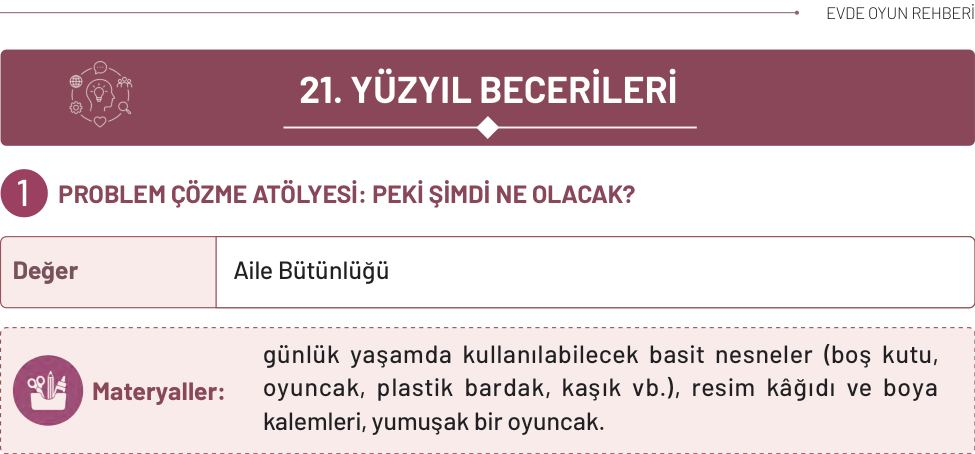
* Aile üyesi oyuncakla basit bir problem canlandırır. Örneğin oyuncağı güvenli ancak çocuğun ulaşamayacağı bir yere koyarak “Oyuncağımız topuna ulaşamıyor. Ne yapabilir?” diye sorar. Çocuğun birkaç çözüm düşünmesine fırsat verilir. Çözümler arasından güvenli olan seçilir ve birlikte canlandırılır. Bu durumda bir aile üyesinden yardım istemek uygun bir çözüm olabilir.

**Oyun farklı durumlarla sürdürülür:**
* Yağmur başladı ancak oyuncağın şemsiyesi yok. Kapalı bir yere geçebilir veya bir aile üyesinden yardım isteyebilir.
* Oyuncağın yaptığı kule devrildi. Tabanı genişleterek yeniden yapabilir veya daha az blok kullanabilir.
* Oyuncak aradığı kitabı bulamıyor. Kitapları sırayla kontrol edebilir veya ailesine sorabilir.
* İki oyuncak aynı malzemeyi kullanmak istiyor. Sırayla kullanabilir veya birlikte oynayabilir.
* Her durumda çocuk önce “Sorun ne?” sorusunu yanıtlar. Ardından en az iki çözüm önerir ve bunlardan birini oyuncakla canlandırır. Aile üyeleri çocuğa “Başka ne yapabilir?”, “Hangi çözüm daha güvenli?”, “Bu çözüm işe yaramazsa ne deneyebiliriz?” gibi sorular yöneltir.
* Daha sonra roller değiştirilir. Çocuk oyuncakla yeni bir problem oluşturur, aile üyeleri de farklı çözüm önerileri sunar. Çocuk, öneriler arasından uygun bulduğu çözümü seçerek neden bu seçimi yaptığını açıklar.
* Oyunun sonunda çocuk en beğendiği çözümün resmini çizer. Her sorunun birden fazla çözümü olabileceği ancak güvenli, uygulanabilir ve başkalarına zarar vermeyen çözümlerin

<!-- sayfa 154 -->

# Dikkat

Etkinlik sırasında çocuğun ürettiği tüm fikirler ilgiyle dinlenmeli ve doğru-yanlış olarak değerlendirilmemelidir. Çocuğun farklı çözüm yolları düşünmesi desteklenmeli, çocuk tek bir cevaba yönlendirilmemelidir. Günlük yaşamdan seçilen problem durumlarının çocuğun yaşına uygun ve kolay anlayabileceği örneklerden oluşmasına özen gösterilmelidir.

---

# Düşün / Hatırla / Söyle

* Aynı problemi çözmenin başka hangi yolları olabilir?
* En beğendiğin çözüm hangisi?
* Bugün çözdüğün problemi ve bulduğun çözümü hatırlıyor musun?

<!-- yer tutucu bulunamadı: sayfa sonuna eklendi -->

<!-- sayfa 155 -->

# 2 BİLGİ DEDEKTİFLERİ: GERÇEK Mİ, HAYAL Mİ?

| Değer | Çalışkanlık |
| :--- | :--- |

 **Materyaller:** gerçek ve kurgu fotoğraflardan oluşan görsel kartları, dedektif büyüteci veya sembolik dedektif kartları, gazete, bilgisayar veya tablet.

 **Uygulama**

Anne veya baba eline bir gazete, tablet veya bir hikâye kitabı alarak meraklı bir ifadeyle seslenir: “Biliyor musun, bazen gördüğümüz resimler veya duyduğumuz haberler bize küçük şakalar yapıyor olabilir! Bugün seninle bir ‘Bilgi Dedektifi’ olup hangisi gerçek, hangisi hayal ürünü bulmaya çalışacağız? En dikkatli gözler kimdeymiş, haydi keşfe çıkalım!” Anne ve baba çocuğa 3 farklı görsel sunar (Örneğin denizde yüzen balık, bisiklete binen çocuk, gökyüzünde uçan balon, kitap okuyan köpek ve bulutların üzerinde yürüyen çocuk gibi). Çocuk, bu görsellerden hangisinin gerçekte var olabileceğini nedenleriyle açıklar. Çocuk bir bilginin gerçekliğine karar verirken “Bu nerede yazıyor?”, “Bunu kim söylemiş olabilir?” gibi sorgulayıcı sorular sorarak “kanıt” toplar. Bir gazeteci veya bir kütüphane görevlisi ile görüşülebilir. Görevli kişi bir bilginin doğruluğunu nasıl kontrol ettiklerini, fotoğrafların bilgisayarda nasıl değiştirilebildiğini ve doğru bilgiye ulaşmak için kütüphanelerin önemini çocuklara anlatır.

 **Dikkat**

Etkinlik sırasında genel ağdaki her bilginin doğru olmayabileceği, çocukları korkutmadan “merak uyandırıcı bir keşif” olarak sunulmalıdır. Medya okuryazarlığı becerisi kazandırılırken çocuğun kendi hayal gücüyle oluşturduğu kurgular (resimler) takdir edilmeli ancak bunun “gerçeklikten” farkı nazikçe netleştirilmelidir. Uzmanın sunumu sırasında reklamlar veya çizgi filmler üzerinden basit örnekler verilmesi konunun kavranmasını kolaylaştıracaktır.

**Düşün / Hatırla / Söyle**

* Bir resmin ya da haberin gerçek olup olmadığını nasıl anlayabiliriz?
* İncelediğin görsellerden hangisi gerçek olabilir? Neden?
* Bir bilginin doğru olup olmadığını anlamak için hangi soruları sormuştuk?

<!-- sayfa 156 -->

# 3 TAKIM GÖREVİ

| Değer | Sorumluluk |
| :--- | :--- |

**Materyaller:** gerçek ve hayal ürünü görseller (dergi, gazete, kitap veya dijital görseller), büyüteç (isteğe bağlı).

**Uygulama**

* Oyun alanında üç farklı bölüm belirlenir:
    * Gerçek olabilir
    * Hayal ürünü
    * Emin değilim, araştıralım

* Aile üyelerinden biri gerçek yaşamdan ve hayal dünyasından farklı görseller hazırlayarak “Şimdi ‘Gerçek mi, Hayal mi, Araştıralım mı?’ oyununu oynayacağız. Görsele bakacak ve düşüncemize uygun bölüme geçeceğiz.” diyerek oyunu başlatır.

* Sırayla; yemek yapan bir aşçı, kanatları olan bir ev, uçan bir fil, ağaca tırmanan bir kedi gibi görseller gösterilir.

* Çocuğa “Bu olay gerçek yaşamda gerçekleşebilir mi?”, “Bunu düşünmene hangi ayrıntı yardımcı oldu?”, “Emin olmak için nereden bilgi alabiliriz?” gibi sorular yöneltilir. Ay’da yürüyen insan gibi şaşırtıcı ancak gerçek olaylar, güvenilir bir çocuk kitabı veya resmî bilim kaynağı üzerinden birlikte araştırılır.

* Daha sonra roller değiştirilir. Çocuk bir görsel seçer veya hayalî bir olay anlatır. Aile üyeleri uygun bölüme geçerek bunun gerçek, hayal ürünü veya araştırılması gereken bir durum olduğunu söyler.

* Oyunun sonunda bir görselin fotoğraf olmasının onun mutlaka doğru olduğunu göstermediği, çizimlerin de gerçek bilgiler anlatabileceği açıklanır. Emin olunmayan durumlarda hemen karar vermek yerine soru sormanın, bir aile üyesinden yardım istemenin ve güvenilir kaynaklara bakmanın önemli olduğu vurgulanır.

<!-- sayfa 157 -->

# Dikkat
Etkinlik sırasında çocuğun hayal gücü desteklenmeli, hayal ürünü içeriklerin eğlenceli olduğu ancak gerçek bilgilerden farklı olduğu açıklanmalıdır. Görseller seçilirken çocuğun yaşına uygun ve korku oluşturmayacak örnekler tercih edilmelidir. Çocuğun verdiği cevaplardan çok, düşünme ve gerekçe sunma süreci desteklenmelidir.

## Düşün / Hatırla / Söyle
* Bir bilginin doğru olup olmadığını nasıl anlayabiliriz?
* Gerçek olduğunu düşündüğün bir görseli ve doğru olduğunu düşünme nedenini anlat.
* Bir bilginin doğru olduğunu öğrenmek için neler yapabileceğimizi hatırlıyor musun?

<!-- sayfa 158 -->

# 4 DÜNYA BAVULU

| Değer | Saygı |
| :--- | :--- |

**Materyaller:** evde bulunan oyuncak bebekler veya yumuşak oyuncaklar, top, bloklar ve müzik çalmak için telefon ya da hoparlör.

**Uygulama**

* Evde bulunan oyuncak bebekler veya yumuşak oyuncaklar odanın farklı bölümlerine yerleştirilir. Aile üyelerine her oyuncağın hayalî olarak dünyanın farklı bir yerinde yaşadığı söylenir. Bu bölümün tamamen hayal gücüyle oluşturulduğu, gerçek ülke bilgisi vermediği açıklanır.
* Aile üyelerinden biri “Şimdi oyuncaklarımızı ziyaret edeceğiz. Her biri farklı biçimde selam verecek ve bize sevdiği bir oyunu gösterecek.” diyerek oyunu başlatır.
* Aile üyeleri her oyuncak için basit bir selamlaşma hareketi belirler. Oyuncaklardan biri el sallayabilir, biri başını hafifçe eğebilir, biri elini kalbinin üzerine koyabilir. Çocuk oyuncakları sırayla ziyaret eder ve onların selamlaşma hareketlerini tekrarlar.
* Ardından her oyuncağa evde oynanabilecek basit bir oyun seçilir. Bir oyuncak top yuvarlamayı, biri kule yapmayı, diğeri müzikle dans etmeyi sevebilir. Çocuk oyuncakların yanına giderek bu oyunları kısa süreyle oynar. Daha sonra kendi sevdiği oyunu oyuncaklara öğretir.
* Oyunun sonunda “Oyuncakların selamlaşmaları aynı mıydı?”, “Hangi oyunları seviyorlardı?” ve “Farklı şeyleri sevsek de birlikte oynayabilir miyiz?” soruları üzerine konuşulur. İnsanların yaşam koşullarının, ilgi alanlarının ve günlük alışkanlıklarının farklı olabileceği; ancak her çocuğun sevgiye, güvene, oyuna ve saygıya ihtiyaç duyduğu vurgulanır.

**Dikkat**

Etkinlik sırasında farklı kültürler anlatılırken karşılaştırma yapmak yerine çeşitliliğin doğal ve değerli olduğu vurgulanmalıdır. Kullanılan ifadelerde ön yargı oluşturabilecek söylemlerden kaçınılmalı, çocuğun merak ettiği soruları rahatça sormasına fırsat verilmelidir. Farklılıkların yanı sıra insanların ortak özellikleri üzerinde de durularak saygı, empati ve birlikte yaşama bilinci desteklenmelidir.

<!-- yer tutucu bulunamadı: sayfa sonuna eklendi -->

<!-- yer tutucu bulunamadı: sayfa sonuna eklendi -->

<!-- sayfa 159 -->

 # Düşün / Hatırla / Söyle

* Dünyanın farklı yerlerinde yaşayan çocuklarla hangi ortak yönlerin olabilir?
* Öğrendiğin ülkelerden en çok hangisi ilgini çekti? Neden?
* Farklı kültürlere neden saygı göstermemiz gerekir?

<!-- sayfa 160 -->

# 5 DÜŞÜNCE DEDEKTİFLERİ: NEDEN VE NASIL?

| Değer | Çalışkanlık |
| :--- | :--- |

**Materyaller:** büyük, yıkanabilir ve suya dayanıklı üç oyuncak, üç plastik kap veya buz kalıbı, su, geniş bir tepsi, bir kap içinde ılık su, tahminleri kaydetmek için kâğıt ve boya kalemleri.

**Uygulama**

* Aile üyesi, çocuğa büyük, yıkanabilir ve suya dayanıklı üç oyuncak gösterir. Çocuk görmeden oyuncaklardan her biri ayrı bir plastik kaba konur, üzerlerine su eklenir ve dondurulur. Buz kalıpları hazır olduğunda kaplardan çıkarılarak bir tepsiye yerleştirilir.
* Çocuk buzların içindeki renk, biçim ve görünen parçalara dikkat ederek her buzda hangi oyuncağın bulunduğunu tahmin eder. Çocuğa “Bir tekerlek görüyor musun?”, “Hangi renk fark ediliyor?”, “Sence bu hangi oyuncak olabilir?” gibi sorular yöneltilir. Tahminler resimle veya sözlü olarak kaydedilir.
* Ardından çocuk, damlalık veya kaşıkla buzun üzerine ılık su dökerek oyuncağı kurtarmaya çalışır. İsterse az miktarda tuz ekleyerek buzda oluşan değişimi gözlemleyebilir. Oyuncağın yeni bir bölümü ortaya çıktıkça tahminini değiştirebilir.
* Buz tamamen eridiğinde oyuncak çıkarılır ve ilk tahminle sonuç karşılaştırılır. Aile üyeleri de sırayla buzun içindeki oyuncağı tahmin ederek oyuna katılır.
* Buz erimeye başladığında çocuğa “Buz başlangıçta nasıldı?”, “Şimdi nasıl görünüyor?”, “Buzun üzerinde hangi değişiklikleri fark ettin?” ve “Sence buz neden eridi?” soruları yöneltilir. Çocuğun cevapları dinlendikten sonra ılık suyun buzu eriterek katı hâlden sıvı hâle geçmesine yardımcı olduğu yaşına uygun bir dille açıklanır. Oyuncak tamamen ortaya çıktığında çocuğun ilk tahminiyle sonuç karşılaştırılır.

<!-- sayfa 161 -->

# Dikkat
Çocuğun sorduğu her soru, cevabı ne olursa olsun “Harika bir soru!” diyerek desteklenmelidir. Eleştirel düşünmeyi geliştirmek için hemen cevap vermek yerine “Sence neden böyle olmuş olabilir?” diyerek çocuğun fikir yürütmesine alan açılmalıdır.

---

## Düşün / Hatırla / Söyle
* Sence ılık su buza döküldüğünde neden buz erimeye başladı?
* Buz erirken fark ettiğin değişiklikleri ailene anlat.
* Buzun içindeki oyuncağı tahmin etmene yardımcı olan ipuçları nelerdi?

<!-- sayfa 162 -->

# 6 HAREKET ZİNCİRİNİ TAMAMLA

| Değer | Çalışkanlık |
| :--- | :--- |

**Materyaller:** aynı veya benzer büyüklükte bloklar ya da plastik / kâğıt bardaklar, kâğıttan hazırlanmış oyuncak büyüteç ve malzemelerin sıralanabileceği düz bir masa veya zemin, (istenirse başlangıç ve bitiş noktalarını göstermek için) renkli bant.

**Uygulama**

* Aile üyelerinden biri kâğıttan hazırlanmış büyüteci eline alarak “Bugün olayların neden gerçekleştiğini araştıracağız. Bu bloklardan birini hareket ettirirsek diğerlerine ne olacağını tahmin edebilir misin?” diyerek oyunu başlatır.

* Bloklar veya plastik bardaklar, aralarında küçük boşluklar bırakılarak yan yana dizilir. Çocuktan ilk parçaya hafifçe dokunulduğunda ne olacağını tahmin etmesi istenir. Ardından ilk parça dikkatlice itilir ve diğer parçaların sırayla devrilmesi gözlemlenir.
* Aile üyeleri “İlk blok neden devrildi?”, “Diğer bloklar nasıl hareket etti?”, “Blokların hepsi neden sırayla devrildi?” gibi sorular yöneltir. İlk parçanın yanındaki parçaya çarptığı, hareketin bu şekilde sırayla devam ettiği çocuğa basitçe açıklanır.
* Daha sonra “Zincirdeki Sorunu Bul” oyunu oynanır. Aile üyelerinden biri, çocuk görmeden bloklardan birini kaldırır veya iki blok arasındaki mesafeyi açar. Çocuk zinciri inceleyerek hareketin nerede duracağını tahmin eder. İlk blok itildikten sonra çocuğun tahmini gözlemlenerek kontrol edilir.
* Çocuk, hareketin kesildiği yeri bulur ve blokları yeniden düzenleyerek zinciri tamamlar. Ardından roller değiştirilir. Bu kez çocuk zincirde bir boşluk oluşturur, aile üyeleri de hareketin nerede duracağını tahmin eder.
* Oyunun sonunda çocuk, parçaların neden sırayla devrildiğini kendi cümleleriyle anlatır. Bir olayın başka bir olaya yol açabileceği ve sonucu anlamak için önce tahmin edip sonra gözlem yapabileceğimiz vurgulanır. Oyunda hafif, kırılmayan ve çocuğun yaşına uygun malzemeler kullanılmalıdır.

<!-- sayfa 163 -->

# Dikkat
Etkinlik sırasında çocuğun verdiği cevaplar eleştirilmemeli, düşüncelerini rahatça ifade etmesine fırsat verilmelidir. Hemen doğru cevabı vermek yerine çocuğun tahmin etmesi ve gerekçelerini açıklaması desteklenmelidir. Seçilen örneklerin çocuğun günlük yaşamında gözlemleyebileceği somut olaylardan oluşmasına özen gösterilmelidir.

---

## Düşün / Hatırla / Söyle
* Bir olayın gerçekleşme nedenini nasıl anlayabiliriz?
* Bugün düşündüğünüz olaylardan birini ve nedenini anlat.

<!-- sayfa 164 -->

# DUYGU YÖNETİMİ: SAKİNLEŞME YOLCULUĞU

| Değer | Sorumluluk |
| :--- | :--- |

**Materyaller:** duygu kartları (isteğe bağlı), minder veya yastık, sevdiği bir oyuncak, stres topu (isteğe bağlı), rahatlatıcı müzik.

**Uygulama**

* Evde sessiz ve rahat bir alan seçilir. Bu alanda dört küçük sakinleşme noktası hazırlanır:
    * Nefes noktası: Çiçek koklar gibi nefes alıp mum üfler gibi yavaşça verme
    * Sayma noktası: Birden ona kadar yavaşça sayma
    * Sarılma noktası: Minder veya yumuşak oyuncağa sarılma
    * Dinlenme noktası: Kitap inceleme veya sakin bir müzik dinleme

* Aile üyelerinden biri çocuğun sevdiği oyuncağı eline alarak “Oyuncağımız bugün kulesi yıkıldığı için çok kızgın hissediyor. Sence hangi sakinleşme noktasına gitmek ister?” diyerek oyunu başlatır.

* Çocuk oyuncağı seçtiği noktaya götürür ve oradaki yöntemi oyuncakla uygular. Ardından “Oyuncağın bedeninde bir değişiklik olmuş olabilir mi?”, “Bu yöntem ona yardımcı oldu mu?”, “Başka bir noktayı da denemek ister mi?” gibi sorular yöneltilir. Bir yöntem yardımcı olmadığında farklı bir nokta denenir.

* Oyun şu durumlarla sürdürülebilir:
    * Oyuncak, sevdiği eşyayı bulamadığı için üzgün hissediyor.
    * Yüksek bir ses duyduğu için korkmuş hissediyor.
    * Doğum günü yaklaştığı için çok mutlu hissediyor.

* Daha sonra roller değiştirilir. Çocuk oyuncağın yaşadığı bir durumu ve hissettiği duyguyu belirler. Aile üyeleri de oyuncağı uygun gördükleri sakinleşme noktasına götürür. Çocuk isterse aile üyelerine yeni bir sakinleşme yöntemi önerebilir.

* Oyunun sonunda her aile üyesi kendisine yardımcı olabileceğini düşündüğü bir yöntemi seçer. Çocuğa bütün duyguların doğal olduğu, herkesin farklı bir yöntemle rahatlayabileceği ve ihtiyaç duyduğunda sakinleşme köşesini kullanabileceği anlatılır.

<!-- sayfa 165 -->

# Dikkat
Etkinlik sırasında çocuğun hissettiği tüm duyguların doğal olduğu kabul edilmelidir. Çocuğun duygularını anlatması için zorlanmamasına, kendini ifade etmesi için güvenli ve destekleyici bir ortam oluşturulmasına özen gösterilmelidir.

---

# Düşün / Hatırla / Söyle
* Kendini öfkeli hissettiğinde seni ne / neler rahatlatabilir?
* Bugün hangi duyguyu hissettin ve sakinleşmek için ne yaptın?
* Kendini rahatlatmak için hangi yöntemi denersin?

<!-- yer tutucu bulunamadı: sayfa sonuna eklendi -->

<!-- sayfa 166 -->

# 8 BİRİKİM KUMBARASI: İHTİYAÇ MI, İSTEK Mİ?

| Değer | Sorumluluk |
| :--- | :--- |

**Materyaller:** boş kavanoz veya kutu (kumbara), ihtiyaç ve istek görselleri veya evde bulunan çeşitli eşyalar, boya kalemleri ve etiket (isteğe bağlı).

## Uygulama

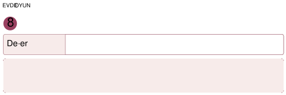

Aile üyelerinden biri su, meyve, kıyafet, kitap, oyuncak gibi varlıkları veya bunların görsellerini masaya yerleştirerek küçük bir “Aile Marketi” hazırlar. Çocuğa “Bu markette ihtiyaç duyduğumuz ve sahip olmak istediğimiz şeyler var. Elimizdeki seçim yıldızlarını nasıl kullanacağımıza karar vereceğiz.” diyerek oyunu başlatır.

Çocuğa kartondan hazırlanmış beş büyük “seçim yıldızı” verilir. Çocuk, marketten seçtiği her ürün için bir yıldız kullanır. Önce bir gün boyunca ihtiyaç duyabileceği şeyleri seçer. Su, yiyecek, uygun kıyafet gibi ürünleri neden seçtiğini anlatır.

Ardından çocuk, elinde kalan yıldızlarla istediği bir ürünü seçmeye veya yıldızlarını daha sonra kullanmak üzere “Hedef Kutusu”na koymaya karar verir. Kutunun üzerine ileride sahip olmak istediği kitap, oyuncak veya başka bir ürünün resmini çizebilir.

Daha sonra roller değiştirilir. Çocuk market görevlisi olur, aile üyeleri de seçim yıldızlarını kullanarak ihtiyaç ve isteklerine göre ürün seçer. Her aile üyesi seçiminin nedenini açıklar.

**Dikkat**

Finansal kavramlar anlatılırken “para” tek başına bir amaç olarak değil ihtiyaçlara ulaşmak için bir “araç” olarak sunulmalıdır. İhtiyaçların önceliği vurgulanırken isteklerin de hayatı güzelleştirdiği ancak sabır gerektirdiği belirtilmelidir. Uzmanın anlatımı sırasında “tasarruf” kavramı sadece para biriktirmek değil, suyu ve elektriği de boşa harcamamak olarak genişletilmelidir.

## Düşün / Hatırla / Söyle

* Bir şeyi almadan önce neden ihtiyaç mı, istek mi olduğunu düşünmeliyiz?
* İhtiyacın olan bir ürüne örnek ver.
* Biriktirmek ve tasarruf etmek için neler yapılabilir?

<!-- sayfa 167 -->

# 9 DÖNÜŞÜM ATÖLYESİ

| Değer | Sorumluluk |
| :--- | :--- |

**Materyaller:** temizlenmiş atık malzemeler (kutu, tuvalet kâğıdı rulosu, plastik kapak, karton vb.), yapıştırıcı, makas (yetişkin kullanımı için), boya kalemleri, ip ve süsleme malzemeleri.

## Uygulama

* Temiz ve güvenli karton kutular, kâğıt ruloları, plastik kaplar ve kumaş parçaları büyük bir torbaya veya kutuya konur. Ayrıca kartondan bir ağaç gövdesi ve beş kâğıt yaprak hazırlanır.
* Aile üyelerinden biri “Bu kutudaki malzemeler ilk görevlerini tamamladı. Şimdi onlara yeni görevler bulacağız. Her yeni fikir için ağacımıza bir yaprak ekleyeceğiz. Beş yaprağı tamamladığımızda oyunu birlikte kazanacağız.” diyerek oyunu başlatır.
* İlk oyuncu kutudan bakmadan bir malzeme seçer. Malzemenin adını söylemeden onu yeni bir ürünmüş gibi canlandırır. Örneğin kâğıt ruloyu dürbün gibi gözlerinin önüne tutabilir, karton kutuyu oyuncak araba garajı gibi kullanabilir, plastik kabı kalemlik gibi gösterebilir. Diğer aile üyeleri malzemenin hangi yeni amaçla kullanıldığını tahmin eder.
* Doğru tahminin ardından ağaca bir kâğıt yaprak eklenir ve sıra başka bir aile üyesine geçer. Aynı malzeme yeniden seçilirse daha önce söylenmemiş farklı bir kullanım amacı bulunmalıdır. Çocuk bir fikir bulmakta zorlandığında “Bu malzeme bir oyuncak olsaydı ne olurdu?”, “Evde hangi işimize yardımcı olabilirdi?” gibi ipuçları verilir.
* Beş farklı fikir üretildiğinde aile üyeleri oyunu birlikte kazanır. Ardından ortaya çıkan fikirlerden biri çocuk tarafından seçilir ve malzeme bu ürüne dönüştürülür. Aile üyeleri yalnızca kesme, delme veya güçlü yapıştırma gerektiren aşamalarda yardımcı olur.
* Hazırlanan ürün kullanılarak son bir “çalışıyor mu?” denemesi yapılır. Ürün görevini yerine getirmiyorsa aile üyeleri birlikte yeni bir çözüm bulur. Oyun sonunda bir malzemenin atılmadan başka bir amaçla kullanılmasının “ileri dönüşüm” olduğu açıklanır.

<!-- sayfa 168 -->

 **Düşün / Hatırla / Söyle**

* Kullanmadığımız eşyaları yeniden değerlendirmek doğaya nasıl yardımcı olur?
* Hangi atık malzemeyi kullanarak neler yaptın?
* Doğayı korumak için evde yapabileceğin davranışlardan birisi ne olabilir?

---

 **Dikkat**

Etkinlikte kullanılacak atık malzemelerin temiz ve çocuk için güvenli olmasına dikkat edilmelidir. Kesme işlemleri gerektiğinde yetişkin tarafından yapılmalıdır. Çocuğun kendi tasarımını oluşturmasına fırsat verilmeli, ortaya çıkan ürünün mükemmel olmasından çok üretme süreci desteklenmelidir. Günlük yaşamda yeniden kullanma ve tasarruf alışkanlıklarının doğayı korumaya katkıda bulunduğu sık sık hatırlatılmalıdır.

<!-- sayfa 169 -->

# 10 AİLECE KARAR VER, HAREKETİ TAKLİT ET

| Değer | Sorumluluk |
| :--- | :--- |

 **Materyaller:** konuşma sırası nesnesi olarak kullanılabilecek küçük ve yumuşak bir oyuncak veya top, her aile üyesini temsil eden farklı renklerde küçük kâğıtlar, kura için bez torba ya da kutu ve isteğe bağlı olarak hareketli bir müzik. Güvenli ve yeterli genişlikte bir oyun alanı da hazırlanmalıdır.

 **Uygulama**

* Güvenli ve yeterli genişlikte bir oyun alanı hazırlanır. Aile üyelerinden biri küçük bir oyuncak veya yumuşak topu göstererek “Bugün ‘Hareketi Taklit Et’ oyununu oynayacağız. Ancak oyunun liderine, hareketlerine ve kaç tur oynanacağına hep birlikte karar vereceğiz.” der. Oyuncak, konuşma sırasını belirleyen nesne olarak kullanılır. Oyuncak kimdeyse o kişi fikrini söyler, diğer aile üyeleri onu sözünü kesmeden dinler.
* Oyuna başlamadan önce konuşma nesnesini ilk kimin alacağı kura ile belirlenir. Her aile üyesini temsil eden farklı renkte bir kâğıt küçük bir torbaya konur. Çocuk torbadan bir renk seçer ve seçilen rengin sahibi konuşma nesnesini ilk alan kişi olur. Sonraki konuşma sırası, ilk kişinin yanındaki aile üyesinden başlayarak devam eder.
* İlk konuşmacı “Hareketi Taklit Et” oyununda yapılabilecek bir hareket önerir ve konuşma nesnesini sıradaki aile üyesine verir. Böylece herkesin konuşma sırası baştan belirlenmiş ve karışıklık önlenmiş olur. İlk oyun lideri de aynı yöntemle seçilebilir.
* Aile üyeleri sırayla oyunda yapılabilecek bir hareket önerir. Alkışlama, kolları kaldırma, dizleri bükme, küçük bir sıçrama yapma, kendi etrafında yavaşça dönme gibi güvenli hareketler seçilebilir. Çocuk da kendi hareket önerisini paylaşır. Ardından ilk liderin kim olacağı ve oyunun kaç tur süreceği birlikte belirlenir.
* İlk lider, ailece seçilen hareketlerden birini yapar. Diğer aile üyeleri bu hareketi dikkatle izleyerek tekrar eder. Sıradaki oyuncu önce yapılan hareketi tekrarlar, ardından yeni bir hareket ekler. Örneğin ilk oyuncu alkışlar; ikinci oyuncu önce alkışlar, sonra kollarını kaldırır. Oyun her aile üyesinin hareket zincirine yeni bir hareket eklemesiyle devam eder.

<!-- sayfa 170 -->

* Hareket sırası unutulduğunda oyuncu oyundan çıkarılmaz. Aile üyeleri hareketleri birlikte hatırlayarak zinciri yeniden dener. Birkaç turun ardından lider değiştirilir ve çocuğa oyunu yönetme fırsatı verilir. Çocuk hareketlerin yavaş veya hızlı yapılmasına ve kaç kez tekrarlanacağına karar verebilir.

* Oyunun sonunda konuşma nesnesi yeniden elden ele dolaştırılır. Ailenin her üyesi en sevdiği hareketi ve oyunda değiştirmek istediği bir kuralı söyler. Son olarak oyun alanının birlikte toplanmasına karar verilerek ortak karar alma, birbirini dinleme ve sorumluluk paylaşma davranışları desteklenir.

**Dikkat**

Etkinlik sırasında ailenin tüm üyelerinin konuşmasına fırsat verilmelidir. Çocuğun düşüncelerini rahatça ifade etmesi desteklenmeli, farklı fikirlerin olmasının doğal olduğu çocuğa hissettirilmelidir. Ortak karar alınırken herkesin görüşüne saygı gösterilmeli ve uzlaşmanın birlikte yaşamanın önemli bir parçası olduğu çocuğa örneklerle açıklanmalıdır.

**Düşün / Hatırla / Söyle**

* Birlikte karar vermek sence neden önemlidir?
* Ailenle hangi konuda ortak karar verdiniz?

<!-- sayfa 171 -->

# GELECEĞİN TEKNOLOJİLERİ VE TASARIM

## 1 AKILLI ASİSTANIM: ROBOTLA EL ELE

| Değer | Yardımseverlik |
| :--- | :--- |

**Materyaller:** renkli bloklar veya oyuncaklar.

**Uygulama**

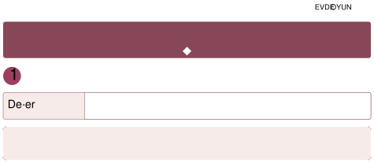

* Aile bireylerinden biri “Robot Asistan”, çocuk ise “Yönetici” olur. Odanın farklı yerlerine oyuncaklar, kitaplar veya ev eşyaları yerleştirilir. Çocuk, robot asistana sözlü komutlar vererek eşyaların doğru yerlere yerleştirilmesini sağlar (“Kırmızı arabayı oyuncak kutusuna koy.”, “Mavi kitabı rafa yerleştir.”, “Yastığı koltuğun üzerine bırak.” vb.)”. Robot Asistan yalnızca çocuğun verdiği komutları uygular. Komut eksik veya belirsiz olduğunda Robot Asistan hareket etmez ve “Komut eksik! Yeni yönerge bekleniyor.” diyerek durur. Çocuk komutunu daha açık ve ayrıntılı şekilde ifade eder, Robot Asistan da görevi tamamlar. Tüm eşyalar doğru yerlere yerleştirildiğinde aile bireyleri ve çocuk bir işi planlayan kişinin karar verdiğini, uygulayan kişinin ise verilen komutları takip ettiğini konuşarak oyunu tamamlar.

**Dikkat**

Robotların kendi başlarına karar veremeyeceği, insanın yaratıcılığına ve rehberliğine her zaman ihtiyaç duyacağı vurgulanmalıdır. Teknolojinin bir rakip değil destekçi olduğu mesajı verilmelidir.

**Düşün / Hatırla / Söyle**

* Robotlar insanlara hangi işlerde yardım edebilir?
* Yönetici olarak robota verdiğin ilk iki komut neydi?

<!-- sayfa 172 -->

# 2 KİŞİYE ÖZEL TASARIM

| Değer | Aile Bütünlüğü |
| :--- | :--- |

**Materyaller:** karton kutu, tuvalet kâğıdı ruloları, plastik kapaklar, ip.

## Uygulama

Aile üyelerinden biri “Bugün evimizdeki küçük bir sorunu çözecek yeni bir ürün tasarlayacağız. Sen baş mucit olacaksın, biz de sana yardımcı olacağız.” diyerek oyunu başlatır.

Önce evde çözülmesi istenen küçük ve güvenli bir sorun belirlenir. Kalemlerin dağınık durması, uzaktan kumandanın sık kaybolması, küçük oyuncakların birbirine karışması gibi sorunlar seçilebilir. Çocuk seçilen soruna nasıl bir ürünle çözüm bulabileceğini anlatır. Aile üyeleri “Ürünün ne işe yarayacak?”, “Hangi biçimde olursa daha kullanışlı olur?”, “Hangi malzemeleri kullanabilirsin?” gibi sorular sorar ancak çözümü çocuk belirler.

Ardından “Malzemeni Seç” bölümü oynanır. Temiz karton kutular, kâğıt ruloları, kumaş parçaları ve sağlam plastik kaplar masaya yerleştirilir. Çocuk yalnızca üç veya dört malzeme seçerek ürününü oluşturmaya çalışır. Aile üyelerinden biri malzemeleri verir, biri parçaların güvenliğini kontrol eder, çocuk ise tasarımın nasıl yapılacağını yönlendirir. Bir süre sonra yardımcı görevleri değiştirilir.

Ürün tamamlandığında “Mucit Testi” yapılır:
* Çalışıyor mu? Ürün belirlenen sorunu çözüyor mu?
* Sağlam mı? Kullanıldığında devriliyor veya parçaları ayrılıyor mu?
* Kullanışlı mı? Eşyalar kolayca yerleştirilip alınabiliyor mu?

Örneğin kalemlik tasarlandıysa içine kalemler konularak dengede durup durmadığı denenir. Kumanda kutusu yapıldıysa kumandanın içine sığıp sığmadığı kontrol edilir. Ürün testi geçemezse oyun kaybedilmiş sayılmaz. Aile üyeleri “Neyi değiştirebiliriz?” sorusuna birlikte cevap arar ve çocuk tasarımını yeniden düzenler.

Bütün testler tamamlandığında çocuk ürününe bir ad verir ve “Bu ürün hangi sorunu çözüyor?”, “Nasıl çalışıyor?” ve “Yeniden yapsan neyi değiştirirdin?” sorularını yanıtlayarak tasarımını ailesine tanıtır. Böylece oyun; sorun belirleme, fikir üretme, ürün oluşturma, deneme ve geliştirme aşamalarıyla tamamlanır.

<!-- sayfa 173 -->

# Dikkat
Tasarım sürecinde çözümün yetişkin tarafından hazır olarak verilmemesine dikkat edilmeli; çocuğun kendi fikrini oluşturmasına, seçtiği malzemeleri denemesine ve gerektiğinde tasarımını yeniden düzenlemesine fırsat verilmelidir. Kullanılacak tüm malzemelerin temiz, sağlam ve güvenli olması sağlanmalıdır.

## Düşün / Hatırla / Söyle
* Oyun sırasında hangi malzemeleri seçtin?
* Hangi ürünü tasarladın?
* Tasarladığın ürün başka nasıl kullanılabilir?

<!-- sayfa 174 -->

# 3 DOĞA DOSTU FABRİKA

| Değer | Duyarlılık |
| :--- | :--- |

 **Materyaller:** geri dönüştürülebilir atıklar.

 **Uygulama**

* Çocuk, evin içinde yeniden kullanılabilecek atık malzemeleri ve gereksiz enerji kullanımını araştıran dedektif olur. Aile bireyleri de ona keşif sırasında eşlik eder. Çocuk boş karton kutular, plastik şişeler, kavanozlar, kâğıt ruloları gibi yeniden değerlendirilebilecek malzemeleri belirler ve bunların hangi yeni amaçla kullanılabileceğini önerir. Ardından aile bireyleriyle seçilen bir malzeme kalemlik, saksı, oyuncak, düzenleyici gibi yeni bir ürüne dönüştürülür. Gün boyunca çocuk ve aile bireyleri gereksiz yanan lambaları, kullanılmayan musluğu, elektronik cihazları kapatma gibi tasarruf davranışlarını gözlemler. Etkinliğin sonunda aile bireyleri ve çocuk, hangi davranışların daha fazla enerji tasarrufu sağladığını ve atık malzemelerin yeniden kullanılmasının çevreye katkısını konuşarak oyunu tamamlar.

 **Dikkat**

“Geleceğin Teknolojileri ve Tasarım”ın sadece daha çok üretmek değil dünyayı daha yaşanabilir kılmak için teknoloji kullanmak olduğu vurgulanmalıdır. Dayanıklılık kavramı çerçevesinde doğa ile uyumlu yaşamın önemi anlatılmalıdır.

 **Düşün / Hatırla / Söyle**

* Atık malzemeler yeniden kullanılmazsa ne gibi sonuçlar ortaya çıkabilir?
* Bulduğun atık malzemeyi nasıl yeniden kullanılabilir hâle getirdin?
* Etkinlik sırasında hangi tasarruf davranışlarını uyguladın?

<!-- sayfa 175 -->

# 4 ESNEK ÜRETİM HATTI

| Değer | Aile Bütünlüğü |
| :--- | :--- |

 **Materyaller:** oyuncak, blok.

 **Uygulama**

Masaya farklı özelliklere sahip oyuncaklar, bloklar veya ev eşyaları yerleştirilir. Aile bireylerinden biri oyun yöneticisi olur ve oyunun başında “Kural 1” komutunu verdiğinde çocuk nesneleri renklerine göre gruplar. Oyun sırasında aile bireyi “Kural 2” dediğinde çocuk yaptığı işi durdurur ve aynı nesneleri bu kez boyutlarına göre gruplamaya başlar. Ardından “Kural 3” komutu verildiğinde nesneleri şekillerine veya kullanım amaçlarına göre yeniden düzenler. Aile bireyi, kuralları farklı sıralarla söyleyerek çocuğun her yeni komuta uygun şekilde stratejisini değiştirmesini sağlar. Etkinliğin sonunda aile bireyleri ve çocuk aynı nesnelerin farklı kurallara göre farklı şekillerde düzenlenebileceğini ve yeni bir komut geldiğinde plana uyum sağlamanın önemini konuşarak oyunu tamamlar.

 **Dikkat**

Hızlı karar vermenin heyecanı oyunun temelini oluşturmalıdır.

 **Düşün / Hatırla / Söyle**

* Nesneleri önce hangi özelliklerine göre grupladın?
* Kural değiştiğinde nesneleri nasıl yeniden düzenledin?
* Sence aynı nesneleri başka hangi özelliklerine göre gruplayabiliriz?

<!-- sayfa 176 -->

# 5 İŞ BİRLİĞİ ROBOTU TASARIMI

| Değer | Yardımseverlik |
| :--- | :--- |

 **Materyaller:** kâğıt, renkli kalemler/boya kalemleri

 **Uygulama**

Çocuğa günlük yaşamda işlerini kolaylaştırabilecek hayalî bir yardımcı robot düşünmesi söylenir. “Robotun sana hangi konuda yardım etmesini isterdin?”, “Robotun ne yapabilir?” gibi sorularla robotunu düşünmesi desteklenir. Çocuk hayalî robotunun nasıl göründüğünü ve ne yaptığını aile bireylerine anlatır. Aile bireyleri “Robot bunu nasıl yapacak?”, “Başka hangi konuda yardım edebilir?” gibi sorular sorarak çocuğun fikrini anlatmasını destekler. Ardından aile bireylerinden biri bir yardımcı robot hayal eder ve robotun ne yaptığını çocuğa anlatır. Çocuğun robotun hangi konuda yardımcı olduğunu tahmin etmesi sağlanır. Etkinliğin sonunda günlük yaşamda insanların işlerini kolaylaştıran robotlar hakkında sohbet edilir.

 **Dikkat**

Robotun insanı tamamen devre dışı bırakmadığı, sadece ona destek olduğu konusu konuşulmalıdır.

 **Düşün / Hatırla / Söyle**

* İnsanlarla çalışan bir robotun en önemli özelliği ne olmalı?
* Bu oyunu oynarken ne hissettin?
* Ailenizin en çok hangi konuda yardıma ihtiyaç duyduğunu düşünüyorsunuz?

<!-- sayfa 177 -->

# 6 İLERİ DÖNÜŞÜM

| Değer | Sabır |
| :--- | :--- |

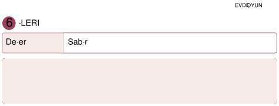
**Materyaller:** onarılabilecek veya yeniden kullanılabilecek eski bir kutu, yıpranmış defter, yırtılmış kâğıt ya da kumaş parçası, renkli bantlar, boya kalemleri, kurdeleler, kumaş parçaları, büyük düğmeler, çocuk kullanımına uygun yapıştırıcı ve güvenli makas, renkli şişe kapakları veya oyun taşları.

**Uygulama**
* Aile üyeleri, evde onarılabilecek veya yeniden kullanılabilecek basit ve güvenli birkaç eşyayı bir araya getirir. Yıpranmış bir defter kapağı, eski bir kutu, yırtılmış bir kâğıt veya eksik düğmeli bir kumaş parçası kullanılabilir. Eşyalar incelenerek “Bu eşyanın hangi bölümü değişmiş?”, “Onu yeniden kullanabilmek için ne yapabiliriz?” ve “Ona yeni bir görev verebilir miyiz?” soruları üzerine konuşulur.
* Ardından “Yeni Görevini Bul” oyunu oynanır. Aile üyeleri sırayla seçilen eşya için farklı bir kullanım önerir. Örneğin eski bir kutu oyuncak garajına, kalemliğe veya küçük bir saklama kutusuna; yıpranmış bir defter kapağı ise resim panosuna dönüşebilir. Aynı öneri tekrar edilmez. Yeni bir fikir üreten oyuncu, eşyanın yanına sembolik bir oyun taşı veya renkli kapak bırakır. Oyun sonunda çocuk öneriler arasından en çok beğendiği fikri seçer.
* Seçilen eşya renkli bant, boya kalemi, kurdele, kumaş parçası veya farklı düğmeler kullanılarak birlikte onarılır ve yeniden tasarlanır. Aile üyeleri güvenlik gerektiren işlemlerde yardımcı olur ancak renk, malzeme ve tasarım kararlarını mümkün olduğunca çocuğa bırakır.
*  Çalışma tamamlandığında çocuk yenilenen eşyanın önceki ve sonraki hâlini ailesine tanıtır, hangi değişiklikleri yaptığını ve eşyanın artık ne amaçla kullanılacağını anlatır.

> **Dikkat**
> “Geleceğin Teknolojileri ve Tasarım”ın insan dokunuşu kavramı işlenmeli, teknolojinin yapamadığı duygu ve sanat değerinin önemi anlatılmalıdır.

**Düşün / Hatırla / Söyle**
* Eski bir eşyayı çöpe atmak yerine yeniden kullanmak neden önemlidir?
* Seçtiğin eşyaya yeni bir görünüm ve kullanım amacı kazandırmak için neler yapılabilir?

<!-- sayfa 178 -->

# 7 HATIRALARIN YOLCULUĞU

| Değer | Sorumluluk |
| :--- | :--- |

**Materyaller:**
 küçük bir karton kutu, çocuğun yaptığı bir resim, aile fotoğrafı veya anlamlı bir not, kutuyu süslemek için renkli kâğıtlar, boya kalemleri, çıkartmalar, kurdele, çocuk kullanımına uygun yapıştırıcı ve küt uçlu makas, günlük durumların yazılı veya resimli olarak gösterildiği isteğe bağlı kâğıtlar.

 **Uygulama**

Aile üyelerinden biri küçük bir kutuyu çocuğa göstererek “Bazı anılarımız ve bilgilerimiz bizim için özeldir. Bugün sevdiğimiz anıları saklayabileceğimiz bir hatıra kutusu hazırlayalım.” der. Çocuk yaptığı bir resmi, ailesiyle çekilmiş bir fotoğrafı veya kendisi için anlamlı bir notu seçerek kutuya yerleştirir. Kutusunu süsler ve ona bir isim verir.

Ardından “Güvenli mi, Güvensiz mi?” oyunu oynanır. Aile üyelerinden biri günlük yaşamdan örnekler verir. Çocuk, paylaşımın güvenli olduğunu düşünüyorsa başparmağını yukarı, güvensiz olduğunu düşünüyorsa aşağı çevirir. Kararsız kaldığında ise elini düz tutarak “Önce aileme sorarım.” der.

Şu durumlar örnek olarak kullanılabilir:
* Yaptığın resmi ailene göstermek
* Ev adresini tanımadığın bir kişiye söylemek
* Aile fotoğrafını paylaşmadan önce ailenden izin istemek
* Şifreni bir arkadaşına vermek
* Sevdiğin oyunu aile üyelerine anlatmak
* Genel ağda tanımadığın birinin sorularına cevap vermek
* Tanımadığın birinden gelen mesajı aile üyelerine göstermek

Her cevaptan sonra çocuğa “Neden böyle düşündün?” sorusu yöneltilir. Kişisel fotoğrafların, adres, telefon numarası, okul bilgisi, şifre gibi özel bilgilerin aileden izin alınmadan paylaşılmaması gerektiği açıklanır. Çocuğun karar veremediği veya kendisini rahatsız hissettiği durumlarda paylaşımı durdurup güvendiği bir yetişkinden yardım istemesi gerektiği vurgulanır.

Etkinliğin sonunda çocuk kutusuna hangi anıları koyduğunu ve bunları neden saklamak istediğini ailesine anlatır. Hatıraları saklamak ile kişisel bilgileri güvenli biçimde korumak arasındaki ilişki üzerine konuşularak oyun tamamlanır.

<!-- sayfa 179 -->

 **Dikkat**

Dijital güvenlik konusu çocuğu korkutmadan günlük yaşamdan örneklerle açıklanmalıdır. Çocuğa “Ad, adres, telefon numarası” gibi kişisel bilgilerin tanımadığı kişilerle paylaşılmaması gerektiği basit bir dille ifade edilmelidir. Çocuğun paylaştığı anılar ilgiyle dinlenmeli ve kendini ifade etmesi desteklenmelidir.

---

 **Düşün / Hatırla / Söyle**

* Özel bilgilerimizi neden herkesle paylaşmamalıyız?
* Hatıra kutuna neler koydun?
* Güvende tutulması gereken bilgiler nelerdir?

<!-- sayfa 180 -->

# 8 GELECEĞİN MUTFAĞI: AKILLI TARİF ŞEFLERİ

| Değer | Sorumluluk |
| :--- | :--- |

 **Materyaller:** yoğurt, çocuğun tüketimine uygun mevsim meyveleri, yulaf, isteğe bağlı olarak öğütülmüş ceviz veya fındık, tarifte kullanılmayacak birkaç yiyecek ya da yiyecek görseli, karıştırma kabı, servis kâseleri, kaşık, kesme tahtası, yetişkin kullanımına uygun meyve doğrama aleti.

 **Uygulama**

* Aile üyelerinden biri “Bugün dengeli beslenmeye uygun bir yiyecek hazırlayacağız. Önce tarifimiz için gerekli malzemeleri bir oyunla bulalım.” diyerek etkinliği başlatır.
* Masaya yoğurt, mevsim meyveleri, yulaf, ceviz gibi tarife uygun malzemelerin yanı sıra tarifte kullanılmayacak birkaç güvenli yiyecek veya bunların görselleri yerleştirilir. “Malzemeni Seç” oyununda aile üyesi, kullanılacak malzemelerle ilgili ipuçları verir. Örneğin “Süt ürünleri grubundayım, beyazım ve kaşıkla yerim.” veya “Bir meyveyim, kırmızı renkte olabilirim.” der. Çocuk doğru malzemeyi bulup tarif alanına getirir. Daha sonra ipucu verme sırası çocuğa geçer.
* Malzemeler tamamlandığında meyveli yoğurt kâsesi hazırlanır. Çocuk malzemelerin hangi sırayla kullanılacağına karar verir; meyveleri kaba koyma, yoğurdu ekleme, karıştırma, üzerini süsleme gibi yaşına uygun görevleri yerine getirir. Kesme ve doğrama işlemleri yetişkin aile üyesi tarafından yapılır.
* Hazırlanan yiyecek ailece tadılır. Kullanılan malzemelerin farklı besin gruplarından geldiği ve çeşitli besinleri uygun miktarlarda tüketmenin dengeli beslenmeye katkıda bulunduğu açıklanır.

 **Dikkat**
Etkinlik boyunca kesici ve sıcak mutfak gereçleri yalnızca yetişkin tarafından kullanılmalıdır. Çocuğun yapabileceği görevleri kendisinin tamamlamasına fırsat verilmelidir. Yiyeceklerin hijyen kurallarına uygun şekilde hazırlanmasına dikkat edilmeli, paylaşmanın ve iş birliği yapmanın önemi doğal akış içinde vurgulanmalıdır.

---

 **Düşün / Hatırla / Söyle**

* Birlikte hazırlanan bir yiyeceği paylaşmak neden güzel bir duygudur?
* Hazırladığınız tarifte hangi malzemeleri kullandınız?

<!-- sayfa 181 -->

# KAYNAKÇA

Millî Eğitim Bakanlığı. Talim ve Terbiye Kurulu (2025). *Türkiye Yüzyılı Maarif Modeli Ortak Metni*.

Millî Eğitim Bakanlığı. Talim ve Terbiye Kurulu (2026). *Türkiye Yüzyılı Maarif Modeli Okul Öncesi Eğitim Programı*.

Bu kaynakça APA Stili 7. Sürümle göre hazırlanmıştır.

# GÖRSEL VE GENEL AĞ KAYNAKÇASI

<!-- yer tutucu bulunamadı: sayfa sonuna eklendi -->

<!-- yer tutucu bulunamadı: sayfa sonuna eklendi -->

<!-- sayfa 182 -->

50°D
45°D
40°D
35°D
30°D
25°D

40°K
35°K

UKRAYNA
RUSYA FEDERASYONU
HAZAR DENİZİ
AZERBAYCAN
ERMENİSTAN
NAHÇIVAN Ö.C. (AZERBAYCAN)
İRAN
GÜRCİSTAN
Tiflis
Erivan
İRAK
Bağdat
SÜRİYE
Şam
LÜBNAN
Beyrut
GÜNEY KIBRIS RUM YÖNETİMİ
KUZEY KIBRIS TÜRK CUMHURİYETİ
Lefkoşa
FİLİSTİN
Gazze Şeridi
Batı Şeria
İSRAİL
Tel Aviv
Kudüs
MISIR
Nil N.
Süveyş K.
LİBYA
YUNANİSTAN
Atina
BULGARİSTAN
Sofya
ROMANYA
Bükreş
KARADENİZ
EGE DENİZİ
MARMARA DENİZİ
AKDENİZ

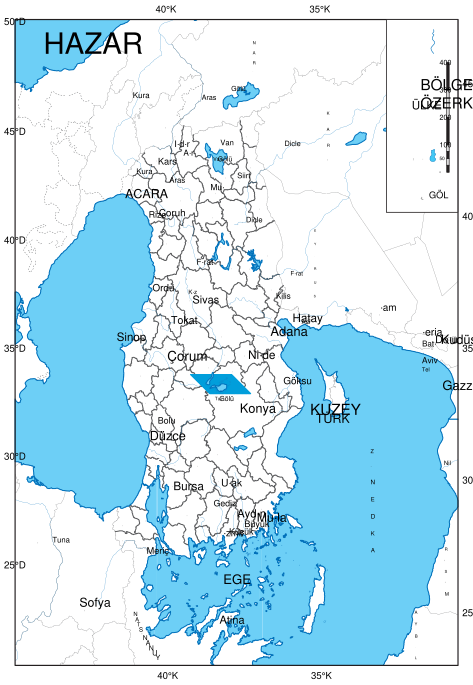

Adana
Adıyaman
Afyonkarahisar
Ağrı
Amasya
Ankara
Antalya
Artvin
Aydın
Balıkesir
Bilecik
Bingöl
Bitlis
Bolu
Burdur
Bursa
Çanakkale
Çankırı
Çorum
Denizli
Diyarbakır
Edirne
Elâzığ
Erzincan
Erzurum
Eskişehir
Gaziantep
Giresun
Gümüşhane
Hakkâri
Hatay
Isparta
Mersin
İstanbul
İzmir
Kars
Kastamonu
Kayseri
Kırklareli
Kırşehir
Kocaeli
Konya
Kütahya
Malatya
Manisa
Kahramanmaraş
Mardin
Muğla
Muş
Nevşehir
Niğde
Ordu
Rize
Sakarya
Samsun
Siirt
Sinop
Sivas
Tekirdağ
Tokat
Trabzon
Tunceli
Şanlıurfa
Uşak
Van
Yozgat
Zonguldak
Aksaray
Bayburt
Karaman
Kırıkkale
Batman
Şırnak
Bartın
Ardahan
Iğdır
Yalova
Karabük
Kilis
Osmaniye
Düzce

Meriç N.
Kızılırmak N.
Aras N.
Fırat N.
Çoruh N.
Yeşilırmak N.
Gediz N.
Sakarya N.
Büyük Menderes N.
Bakırçay N.
Küçük Menderes N.
Ceyhan N.
Seyhan N.
Göksu N.
Dicle N.
Van Gölü
Tuz Gölü
Urumiye Gölü

Gökçeada
Bozcaada

TÜRKİYE'NİN MÜLKİ İDARE BÖLÜMLERİ İLE KARA VE DENİZ KOMŞULARI HARİTASI

BAŞKENT
• Ankara
İL MERKEZİ
• Elâzığ
GÖL
AKARSU
ÜLKE SINIRI
ÖZERK BÖLGE SINIRI

Harita Genel Müdürlüğü tarafından üretilmiştir.

0 100 200 300 400 km

<!-- sayfa 183 -->

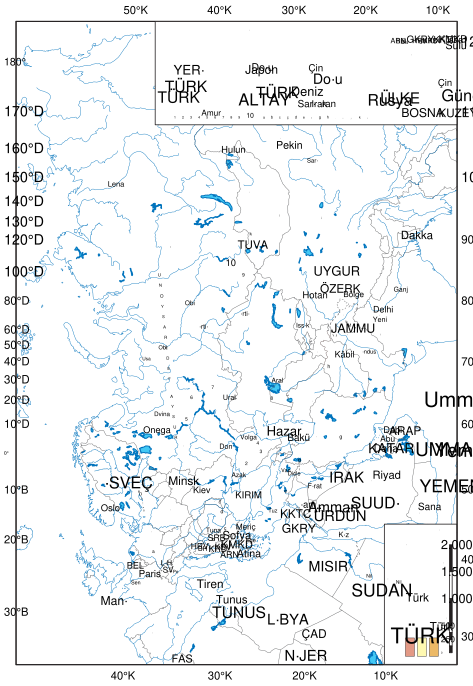
<!-- yer tutucu bulunamadı: sayfa sonuna eklendi -->

<!-- sayfa 184 -->

# Bu kitaba sığmayan daha neler var!

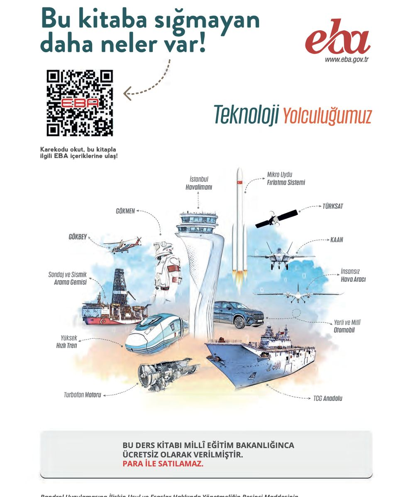: Karekod ve "Teknoloji Yolculuğumuz" temalı teknolojik araçların illüstrasyonu.

**eba**
www.eba.gov.tr

Karekodu okut, bu kitapla ilgili EBA içeriklerine ulaş!

Teknoloji Yolculuğumuz

* İstanbul Havalimanı
* Mikro Uydu Fırlatma Sistemi
* TÜRKSAT
* GÖKMEN
* KAAN
* GÖKBEY
* İnsansız Hava Aracı
* Sondaj ve Sismik Arama Gemisi
* Yerli ve Milli Otomobil
* Yüksek Hızlı Tren
* TCG Anadolu
* Turbofan Motoru

BU DERS KİTABI MİLLÎ EĞİTİM BAKANLIĞINCA ÜCRETSİZ OLARAK VERİLMİŞTİR.
PARA İLE SATILAMAZ.

Bandrol Uygulamasına İlişkin Usul ve Esaslar Hakkında Yönetmeliğin Beşinci Maddesinin
