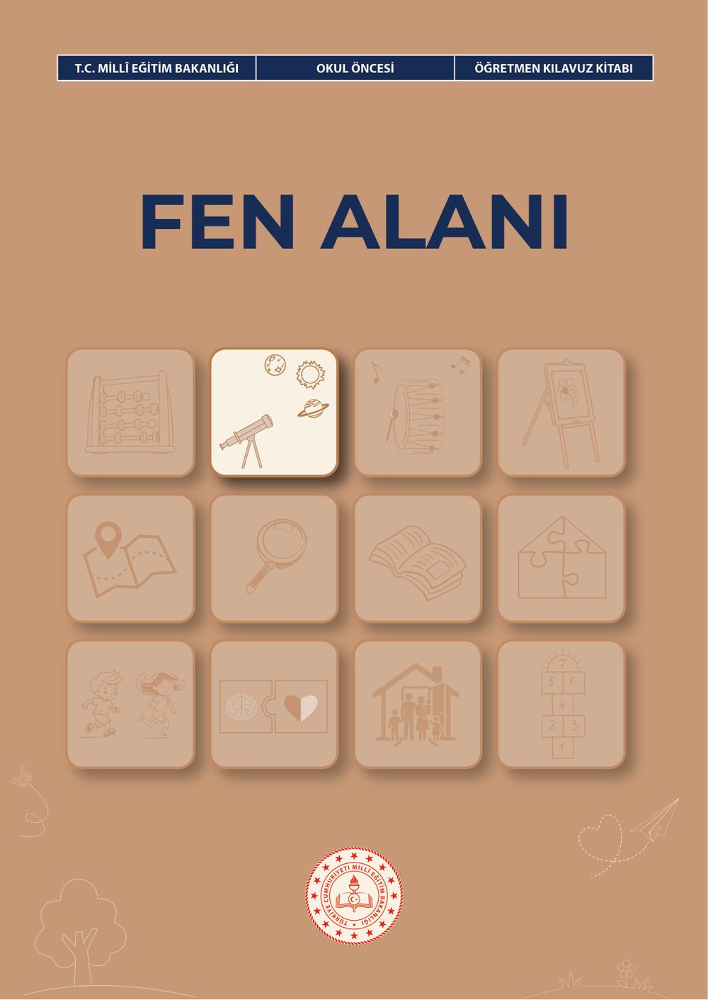
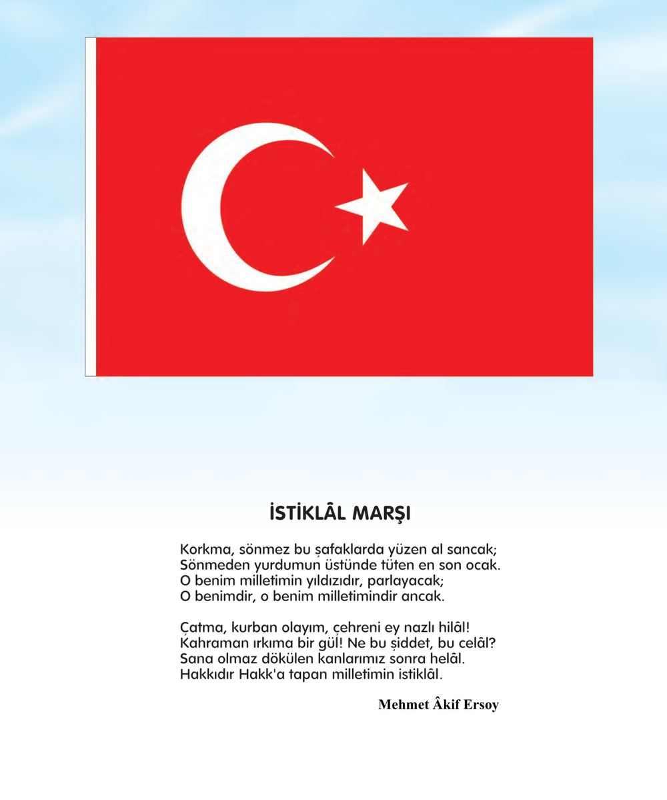
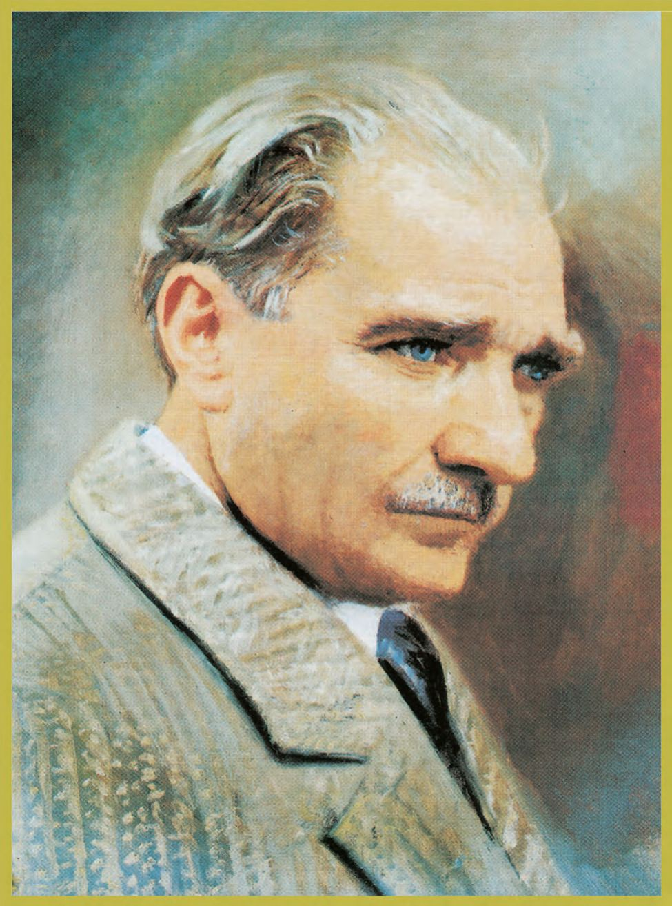
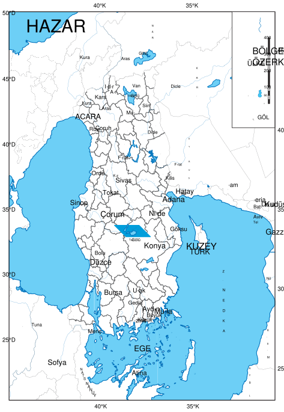
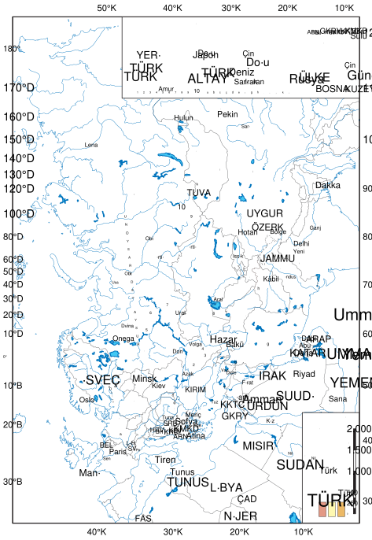
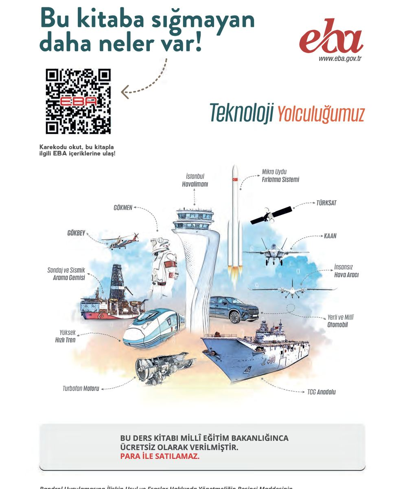

# Okul Öncesi Fen Alanı Öğretmen Kılavuz Kitabı

<!-- sayfa 0 -->

T.C. MİLLÎ EĞİTİM BAKANLIĞI | OKUL ÖNCESİ | ÖĞRETMEN KILAVUZ KİTABI

# FEN ALANI

<!-- sayfa 1 -->

Verdiğiniz metin katmanı boş olduğu için (`<<< >>>` arası boş) dönüştürülecek bir içerik bulunmamaktadır. Lütfen metin katmanını içeren içeriği paylaşın, böylece kurallarınıza uygun şekilde Markdown formatına çevirebilirim.

<!-- sayfa 2 -->

OKUL ÖNCESİ

# Fen Alanı
# Öğretmen Kılavuz Kitabı

## Yazarlar
BAŞAK TÜRK
BÜŞRA AKÇAY
CANSEL DOYMAZ
DİREN KILAV
KÜBRA CAN
KÜBRA KARAKUŞ
RABİA KARSLI
YELİZ GÜNAY

DEVLET KİTAPLARI

<!-- sayfa 3 -->

Millî Eğitim Bakanlığı Yayınları ....................................................................................................: 11232
Ders Kitapları Dizisi No................................................................................................................: 2659

Her hakkı saklıdır ve Millî Eğitim Bakanlığına aittir. Kitabın metin, soru ve şekilleri kısmen de olsa hiçbir surette alınıp yayımlanamaz.

**Editör**
Doç. Dr. Ali İbrahim Can GÖZÜM

**Dil Uzmanı**
Şükrü BAŞKAYA

**Görsel Tasarımcı**
Metin BİLAL
Serdar TUNCAL

**Çoklu Ortam Tasarımcısı**
Betül SÜREK
Didem EROL
İlkay CAN
Merve ÖZTEMİR

**Program Geliştirme Uzmanı**
Hilal ALTINTAŞ

**Ölçme ve Değerlendirme Uzmanı**
Merve ERELİ

**Rehberlik Uzmanı**
Nur Hilal BABÜR

ISBN: 978-625-8867-28-2

Millî Eğitim Bakanlığı Talim ve Terbiye Kurulu Başkanlığının 13 10 2026 tarih ve 17245532 sayılı yazısı ile eğitim

<!-- sayfa 4 -->

# İSTİKLÂL MARŞI

Korkma, sönmez bu şafaklarda yüzen al sancak;
Sönmeden yurdumun üstünde tüten en son ocak.
O benim milletimin yıldızıdır, parlayacak;
O benimdir, o benim milletimindir ancak.

Çatma, kurban olayım, çehreni ey nazlı hilâl!
Kahraman ırkıma bir gül! Ne bu şiddet, bu celâl?
Sana olmaz dökülen kanlarımız sonra helâl.
Hakkıdır Hakk'a tapan milletimin istiklâl.

**Mehmet Âkif Ersoy**

<!-- sayfa 5 -->

ANDIMIZ

Türküm, doğruyum, çalışkanım.

İlkem küçüklerimi korumak, büyüklerimi saymak; yurdumu, milletimi özümden çok sevmektir.
Ülküm yükselmek, ileri gitmektir.

Ey Büyük Atatürk!

Açtığın yolda, gösterdiğin hedefe durmadan yürüyeceğime ant içerim.

Varlığım Türk varlığına armağan olsun.

Ne mutlu Türküm diyene!

<!-- sayfa 6 -->

MUSTAFA KEMAL ATATÜRK

<!-- yer tutucu bulunamadı: sayfa sonuna eklendi -->

<!-- sayfa 7 -->

Verdiğiniz metin katmanı boş olduğu için (`<<< >>>` arası boş) dönüştürülecek bir içerik bulunmamaktadır. Lütfen metin katmanını içeren içeriği paylaşın, böylece talimatlarınıza uygun şekilde Markdown formatına çevirebilirim.

<!-- sayfa 8 -->

# İÇİNDEKİLER

| | |
| :--- | ---: |
| GİRİŞ | 10 |
| FEN ALAN BECERİLERİ | 11 |
| FEN ALANI ETKİNLİKLERİNİN PROGRAMDA YER ALAN DİĞER ALANLARLA İLİŞKİLENDİRİLMESİ | 29 |
| FEN ALANI ETKİNLİKLERİNİN PROGRAMLAR ARASI BİLEŞENLERLE İLİŞKİLENDİRİLMESİ | 33 |
| FEN ALANI ETKİNLİK ÖRNEKLERİ | 36 |
| &nbsp;&nbsp;&nbsp;&nbsp;Ağır mı, Hafif mi? | 36 |
| &nbsp;&nbsp;&nbsp;&nbsp;Yer Çekimi Nedir? | 39 |
| &nbsp;&nbsp;&nbsp;&nbsp;Meyvemin Dışı ve İçi | 42 |
| &nbsp;&nbsp;&nbsp;&nbsp;Tohumdan Minik Bitkiye | 45 |
| &nbsp;&nbsp;&nbsp;&nbsp;Bugün Hava Nasıl? | 48 |
| &nbsp;&nbsp;&nbsp;&nbsp;Hangi Kutuya Koyalım? | 51 |
| &nbsp;&nbsp;&nbsp;&nbsp;Mıknatıs Avı: Yapıştı mı, Yapışmadı mı? | 54 |
| &nbsp;&nbsp;&nbsp;&nbsp;Işık Geçer mi? | 57 |
| &nbsp;&nbsp;&nbsp;&nbsp;Hayvanlar Nerede Yaşar? | 59 |
| &nbsp;&nbsp;&nbsp;&nbsp;Taşları Rengine Göre Ayıralım | 62 |
| &nbsp;&nbsp;&nbsp;&nbsp;Bulutlara Bakalım: Yağmur Gelir mi? | 64 |
| &nbsp;&nbsp;&nbsp;&nbsp;Buz Nerede Daha Çabuk Erir? | 66 |
| &nbsp;&nbsp;&nbsp;&nbsp;Işık Neden Yanmadı? | 68 |
| &nbsp;&nbsp;&nbsp;&nbsp;Fener Nerede, Gölge Nerede? | 70 |
| &nbsp;&nbsp;&nbsp;&nbsp;Rüzgâr Üfledi, Nesne Hareket Etti | 72 |
| &nbsp;&nbsp;&nbsp;&nbsp;Kaşıkta Kendimi Gördüm | 74 |
| &nbsp;&nbsp;&nbsp;&nbsp;Renkler Karışınca Ne Olur? | 77 |
| &nbsp;&nbsp;&nbsp;&nbsp;Suda Kayboldu mu, Kaldı mı? | 79 |
| &nbsp;&nbsp;&nbsp;&nbsp;Ağırlıkları Ölçüyorum | 81 |
| &nbsp;&nbsp;&nbsp;&nbsp;Yer Çekimini Öğreniyorum | 84 |
| &nbsp;&nbsp;&nbsp;&nbsp;Meyveleri İnceliyorum | 87 |
| &nbsp;&nbsp;&nbsp;&nbsp;Meyve Tohumum Büyüyor | 90 |
| &nbsp;&nbsp;&nbsp;&nbsp;Hava Gözlemcileri | 93 |
| &nbsp;&nbsp;&nbsp;&nbsp;Geri Dönüşüm | 96 |

<!-- sayfa 9 -->

| | |
| :--- | :--- |
| Işığın Peşinde | 102 |
| Hayvanların Yaşam Alanları | 105 |
| Renk ve Doku Avı | 108 |
| Bulut Dedektifleri: Yağmur Yağar mı? | 110 |
| Hangisi Daha Çabuk Erir? | 112 |
| Devre Dedektifleri: Hangi Parça Çalışmıyor? | 114 |
| Işık Nerede, Gölge Nerede? | 117 |
| Hafif mi, Kuvvetli mi? | 119 |
| Toprak İzleri Atölyesi: Ağır Nesne Daha Çok Batar mı? | 122 |
| Rampa Dedektifleri: Rampa Dikleşirse Nesne Nasıl İner? | 125 |
| Kışa Doğru Yapraklar Ne Olur? | 128 |
| Çukur mu, Tümsek mi? | 130 |
| Yeni Rengi Bulalım | 133 |
| Su Dedektifleri: Hangisi Çözünür? | 135 |
| Ölçüyorum Kaydediyorum | 137 |
| Yer Çekimi | 140 |
| Kabuktan İçeriye: Meyve | 143 |
| Meyve Tohumu Araştırmacıları | 146 |
| Hava Durumu Araştırmacıları | 149 |
| Azalt, Yeniden Kullan, Geri Dönüştür | 152 |
| Mıknatısla Keşfediyorum | 155 |
| Işığın Yolculuğu | 158 |
| Hayvan Habitatları Araştırmacıları | 161 |
| Taş Araştırmacıları: Renk, Doku ve Yüzey | 164 |
| Bulut Araştırmacıları: Tahminim ve Sonucum | 167 |
| Buz Araştırmacıları | 170 |
| Devre Araştırmacıları: Bozuk Parçayı Kanıtla Bulalım | 173 |
| Rüzgâr Araştırmacıları: Şiddet Değişirse Hareket Değişir mi? | 176 |
| Aynı Tabanlı Nesneler Toprağa Nasıl Batar? | 179 |
| Rampa Araştırmacıları: Rampa Dikleştikçe Nesnenin Hızı Değişir mi? | 182 |
| Kışa Doğru Yapraklar Azalır mı? | 185 |

<!-- sayfa 10 -->

| | |
| :--- | :--- |
| Çukur ve Tümsek Yüzeyde Görüntü Nasıl Değişir? | 191 |
| Hangi Renkler Karışınca Yeni Renk Oluşur? | 194 |
| Hangi Maddeler Suda Çözünür? | 197 |
| Bitki Susuz Kalınca Neden Solar? | 199 |
| Işık Engellenince Neden Gölge Oluşur? | 202 |
| Soğuk Hava | 205 |
| Güneş-Dünya-Ay Modeli Kuruyorum | 208 |
| Işık Küresi Tasarımcılar | 211 |
| Kendi Geri Dönüşüm Kutumu Kuruyorum | 214 |
| Elmanın Renk Yolculuğu | 217 |
| Araba Rampası | 220 |
| Şeker ve Kum Suda Ne Yapar? | 224 |
| Ay Neden Her Zaman Aynı Görünmez? | 227 |
| Bitkiler Neden Güneşe Yönelir? | 230 |
| Yağmurdan Önce Gökyüzünde Neler Değişir? | 233 |
| KAYNAKÇA | 236 |
| GÖRSEL VE GENEL AĞ KAYNAKÇASI | 236 |
| TÜRKİYE’NİN MÜLKİ İDARE BÖLÜMLERİ İLE KARA VE DENİZ KOMŞULARI HARİTASI | 237 |
| TÜRK DÜNYASI HARİTASI | 238 |

<!-- sayfa 11 -->

# GİRİŞ

Bu kılavuz, Türkiye Yüzyılı Maarif Modeli Okul Öncesi Eğitim Programı’nın fen alanı kapsamında öğretmenlere yol gösterici bir kaynak olarak hazırlanmıştır. Kılavuzda öncelikle fen alan becerileri kapsamında yer alan bilimsel gözlem, sınıflandırma, bilimsel gözleme dayalı tahmin, bilimsel veriye dayalı tahmin, deney yapma, bilimsel çıkarım yapma, bilimsel model oluşturma ve bilimsel sorgulama becerilerine ilişkin açıklamalara yer verilmektedir. Bu beceriler ele alınırken 36-48 ay, 48-60 ay ve 60-72 ay çocukların gelişim özellikleri dikkate alınmakta; öğretme-öğrenme sürecinde çocukların merak etmelerine, soru sormalarına, gözlem yapmalarına, denemelerine, karşılaştırmalarına, elde ettikleri verilerden hareketle düşünmelerine ve ulaştıkları sonuçları ifade etmelerine olanak sağlayacak öneriler sunulmaktadır.

Bu bölümde yer alan öğrenme çıktıları hazırlanırken çocukların gelişim özellikleri göz önünde bulundurulmuştur. Bununla birlikte öğrenme çıktıları, gelişim göstergeleriyle bire bir ve katı bir eşleştirme anlayışıyla yapılandırılmamıştır. Okul öncesi dönemde gelişim; bireysel farklılıklar, çevresel yaşantılar, öğrenme fırsatları ve çocuğun hazırbulunuşluğu doğrultusunda değişkenlik gösterebilen bütüncül bir süreçtir. Bu nedenle öğrenme çıktılarında gelişim özelliklerini gözeten ancak bunlarla sınırlı olmayan esnek bir yaklaşım benimsenmiştir.

Fen alanında yer verilen içerikler, çocuklara doğrudan kazandırılması amaçlanan bağımsız konu başlıkları olarak değil; fen alanı becerilerinin desteklenmesine hizmet eden örnek bağlamlar olarak ele alınmıştır. Bu kapsamda mevsimler, hava olayları, gökyüzü, canlılar, cansız varlıklar, materyaller, çevre, doğal yaşam ve benzeri içerikler; bilimsel gözlem, sınıflandırma, tahmin etme, veri kullanma, çıkarım yapma, model oluşturma ve sorgulama gibi becerilerin geliştirilmesine yönelik araç niteliği taşımaktadır.

Bu çerçevede öğretme-öğrenme sürecinde önemli olan belirli içeriklerin değişmez ve sınırlı bir sıra ile aktarılması değil; çocuğun yaşadığı çevre, ilgi ve ihtiyaçları ile gelişim özellikleri doğrultusunda uygun yaşantılarının düzenlenerek fen alanı becerilerinin desteklenmesidir. Dolayısıyla bu bölümde yer alan içerikler öğretim sürecinde zorunlu ve sınırlı konu alanları olarak değil, fen alanı becerilerinin geliştirilmesine katkı sağlayan örnekler olarak değerlendirilmelidir.

Kılavuzda her bir fen alan becerisi için dikkat edilmesi gereken önemli noktalar ve sınıf içi uygulama önerileri sunulmaktadır. Bu öneriler, çocukların yaş gruplarına göre farklılaşan gelişim özellikleri dikkate alınarak düzenlenmiştir. 36-48 aylık çocuklarda daha çok duyular yoluyla keşfetme, fark etme ve basit gözlemler yapma ön plana çıkarılırken; 48-60 aylık çocuklarda karşılaştırma, sınıflandırma, tahminde bulunma ve gözlemlerini ifade etme süreçleri desteklenmektedir. 60-72 aylık çocuklarda ise veriye dayalı düşünme, neden-sonuç ilişkisi kurma, bilimsel çıkarım yapma, basit modeller oluşturma ve sorgulama sürecine daha bağımsız biçimde katılma becerileri geliştirilebilir.

Fen alanı etkinlikleri planlanırken çocuklara hazır bilgilerin aktarılması yerine onların sürece aktif katılım gösterebilecekleri öğrenme ortamlarının oluşturulması önemlidir. Bu doğrultuda çocukların soru sormalarına, tahminlerini açıklamalarına, gözlem ve deneyimlerinden elde ettikleri bulguları paylaşmalarına, arkadaşlarının görüşlerini dinlemelerine ve farklı düşünme yollarını denemelerine fırsat verilebilir. Öğretmen, bu süreçte bilgiyi doğrudan aktaran kişi olmaktan çok; çocukların merakını destekleyen, düşünmelerini derinleştiren, uygun sorularla süreci yönlendiren ve güvenli keşif ortamları oluşturan bir rehber olarak konumlanabilir.

Kılavuzun son bölümünde ise fen alanı etkinliklerinin programda yer alan diğer alanlarla (matematik, fen, sosyal, hareket ve sağlık, sanat, müzik) ve programlar arası bileşenlerle (sosyal-duygusal öğrenme becerileri, erdem-değer-eylem çerçevesi, okuryazarlık becerileri) nasıl ilişkilendirilebileceğine dair öneriler sunulmaktadır. Kılavuz boyunca öğretmenlere yönelik ifadeler öneri niteliğinde tutulmuştur. Etkinlikler, sınıfın fiziksel koşullarına, çocukların bireysel farklılıklarına, ilgi ve ihtiyaçlarına, gelişim düzeylerine ve içinde bulunulan çevresel olanaklara göre uyarlanabilir. Bu nedenle kılavuzda sunulan açıklama ve önerilerin öğretmenlerin kendi sınıf bağlamlarında esnek biçimde kullanabilecekleri bir yol haritası olarak değerlendirilmesi önerilir.

<!-- sayfa 12 -->

# FEN ALAN BECERİLERİ

## FBAB1. BİLİMSEL GÖZLEM

Bilimsel gözlem becerisi, çocuğun günlük yaşamında karşılaştığı nesne, varlık, olay, olgu ve durumlara dikkatini yönelterek bunlara ilişkin veri toplamasını; duyuları aracılığıyla gözlemlenebilir özellikleri fark etmesini, ayırt etmesini, karşılaştırmasını ve uygun biçimde ifade etmesini kapsar. Okul öncesi dönemde bilimsel gözlem; çocuğun çevresini merak etmesi, dikkatle incelemesi, farklı duyularını kullanarak bilgi edinmesi ve elde ettiği gözlem verilerini anlamlandırarak paylaşması açısından temel bir fen alanı becerisidir.

Bu beceri gelişimsel olarak somut, kısa süreli ve kolay fark edilebilen özelliklere yönelik gözlemlerle başlamakta; yaş ilerledikçe daha dikkatli, amaçlı, karşılaştırmalı ve sistemli gözlemlere dönüşmektedir. 36-48 aylık çocuklarda gözlem sürecinde çevredeki dikkat çekici nesne, varlık ve durumların fark edilmesi; belirgin özelliklerin söylenmesi ve canlılara ait seslerin / hareketlerin taklit edilmesi ön plana çıkmaktadır. 48-60 aylık çocuklarda gözlem süreci birden fazla duyunun kullanılması, gözlemlenebilir özelliklerin belirlenmesi, verilerin toplanması ve basit yollarla kaydedilmesiyle desteklenmektedir. 60-72 aylık çocuklarda ise gözlemler daha odaklı ve ayrıntılı biçimde yürütülebilir; çocukların gözlemledikleri nesne, olay ve olguların özelliklerini karşılaştırmaları, uygun kayıt araçlarıyla kaydetmeleri ve gözlemlerini betimleyerek açıklamaları beklenebilir.

**Dikkat Edilmesi Gereken Önemli Noktalar**

Bilimsel gözlem etkinliklerinde çocukların yalnızca bakarak inceleme yapmaları değil; görme, işitme, dokunma, koklama gibi farklı duyularını yaşlarına ve güvenlik koşullarına uygun biçimde kullanmaları desteklenebilir. Tat alma duyusunun kullanılacağı etkinliklerde hijyen, güvenlik ve alerji durumları özellikle dikkate alınmalıdır.

* 36-48 aylık çocuklarla yapılan gözlem etkinlikleri kısa süreli, somut ve çocukların doğrudan deneyimleyebilecekleri nesne, varlık ve durumlara dayalı olarak planlanabilir. Bu yaş grubunda çocukların çevresinde merak ettiği nesne ve varlıkları fark etmeleri, belirgin betimsel / fiziksel özellikleri söylemeleri ve gözlemlerini jest, mimik, taklit, kısa sözel ifadeler ya da basit çizimlerle ortaya koymaları yeterli kabul edilebilir.
* 48-60 aylık çocuklarda gözlem süreci birden fazla duyunun kullanılmasına ve basit karşılaştırmalar yapılmasına olanak tanıyacak biçimde düzenlenebilir. Çocukların gözlemledikleri nesne, olay ve olguların özelliklerini ifade etmeleri, benzer ve farklı yönlerini fark etmeleri, gözlem verilerini çizim ya da işaretleme yoluyla kaydetmeleri desteklenebilir.
* 60-72 aylık çocuklarla yapılan gözlem etkinliklerinde çocukların daha odaklı ve amaçlı gözlemler yapmalarına fırsat verilebilir. Bu yaş grubunda çocukların gözlemledikleri nesne, olay ve olguların betimsel / fiziksel özelliklerini ayrıntılı biçimde tanımlamaları, özellikleri karşılaştırarak açıklamaları ve uygun kayıt araçları kullanarak gözlem sonuçlarını çizim, işaretleme ya da sembollerle kaydetmeleri desteklenebilir.
* Gözlem etkinliklerinde çocukların dikkat süreleri yaş gruplarına göre farklılık gösterebilir. Bu nedenle gözlem süresi; çocukların gelişim düzeyleri, ilgileri ve dikkat kapasiteleri hesaba katılarak kademeli biçimde artırılabilir. Uzun süreli gözlem gerektiren etkinliklerde süreç küçük adımlara bölünebilir.
* Gözlem sürecinde çocuklara hazır bilgi vermek yerine onların dikkatini gözlemlenebilir özelliklere yöneltecek açık uçlu sorular sorulabilir. “Ne görüyorsun?”, “Nasıl bir sesi var?”, “Dokunduğunda nasıl hissediyorsun?”, “Neleri birbirine benziyor?”, “Neleri farklı?”, “Bunu nasıl anladın?” gibi sorular çocukların gözlem verilerini fark etmelerine ve ifade etmelerine yardımcı olabilir.
* Çocukların gözlem sırasında kullandıkları ifadeler yargılamadan dinlenilmelidir. Gözleme dayanmayan ya da eksik kalan açıklamalarda doğrudan düzeltme yapmak yerine çocukların yeniden inceleme yapmalarını sağlayacak sorular yöneltilebilir. Örneğin “Yakından bir daha bakalım, başka ne fark ettin?”, “Dokunduğunda öncekiyle aynı mı hissettin?” gibi sorularla gözlem süreci derinleştirilebilir.
* Gözlem etkinliklerinde canlılara, doğal materyallere ve çevreye zarar verilmemesine özen gösterilmelidir. Çocukların bitki, hayvan, toprak, su ve diğer doğal unsurları incelerken dikkatli, özenli ve sorumlu davranmaları

<!-- sayfa 13 -->

• Gözlem sonuçlarının ifade edilmesinde yalnızca sözel anlatım beklenmemelidir. Çocukların gözlemlerini çizim, işaretleme, sembol kullanma, hareketle gösterme, taklit etme, nesne eşleştirme ya da basit kayıt araçlarıyla ifade etmelerine fırsat verilebilir.

## Sınıf İçi Uygulama Önerileri

### FAB.1. Günlük yaşamında fenle ilgili olaylara/olgulara ve durumlara yönelik bilimsel gözlem yapabilme

Sınıfta geçici ya da sürekli bir “Gözlem Köşesi” oluşturulabilir. Bu köşede taş, yaprak, kozalak, tüy, tohum, kabuk, kumaş parçaları, mıknatıs, büyüteç, el feneri, şeffaf kaplar ve farklı dokularda materyaller bulundurulabilir. Çocukların bu materyalleri güvenli biçimde incelemelerine, dokunmalarına, karşılaştırmalarına ve fark ettikleri özellikleri paylaşmalarına fırsat verilebilir.

• “Bugün Ne Gözlemleyelim?” panosu hazırlanabilir. Panoya bitki, hava durumu, gölge, taş, yaprak, böcek, su, toprak gibi gözlem seçeneklerini temsil eden görseller yerleştirilebilir. Çocuklardan gün içinde neyi gözlemlemek istediklerini belirlemeleri istenebilir. 36-48 aylık çocuklara iki ya da üç seçenek sunulabilir; 60-72 aylık çocukların kendi gözlem önerilerini söylemeleri ya da çizmeleri desteklenebilir.

• Gözlem etkinlikleri “bak-dokun-dinle-söyle” gibi basit aşamalarla yapılandırılabilir. Örneğin bir yaprak incelenirken önce yaprağın rengine ve şekline bakılabilir, ardından dokusu hissedilebilir, rüzgârda çıkardığı ses dinlenebilir ve çocuklardan fark ettiklerini söylemeleri istenebilir. Bu süreç çocukların gözlemi sistemli biçimde deneyimlemelerine katkı sağlayabilir.

• Duyusal gözlem etkinlikleri planlanabilir. Çocuklara sert-yumuşak, pürüzlü-düz, ağır-hafif, kokulu-kokusuz, parlak-mat, kuru-ıslak gibi özellikleri fark edebilecekleri güvenli materyaller sunulabilir. Çocuklardan bu materyalleri incelemeleri, materyallerin benzer ve farklı özelliklerini söylemeleri, uygun olanları eşleştirmeleri ya da gruplandırmaları istenebilir.

• Canlı gözlemleri yapılabilir. Sınıfta bir bitki yetiştirilebilir ya da bahçedeki bitkiler düzenli aralıklarla gözlemlenebilir. Çocuklardan bitkinin yaprak, gövde, çiçek, renk, boy ve görünümündeki değişimleri fark etmeleri istenebilir. 48-60 ve 60-72 aylık çocuklar gözlemlerini çizim ya da işaretleme yoluyla kaydedebilir.

• Hava durumu gözlem çalışmaları gerçekleştirilebilir. Çocuklarla günün havası gözlemlenebilir; havanın güneşli, bulutlu, yağmurlu, rüzgârlı ya da karlı olma durumu hakkında konuşulabilir. Çocuklardan “Bugün gökyüzünde ne görüyorsun?”, “Rüzgârı nasıl fark ettin?”, “Hava durumuna göre ne giymeliyiz?” gibi sorularla gözlemlerini ifade etmeleri istenebilir.

• Işık ve gölge gözlemleri yapılabilir. Sınıfta el feneri, oyuncaklar ve beyaz bir yüzey kullanılarak gölge oluşumu gözlemlenebilir. Açık alanda ise çocukların sabah ve öğle saatlerinde gölgelerini incelemeleri sağlanabilir. 60-72 aylık çocuklardan gölgenin boyu, yönü ve şekline ilişkin gözlemlerini karşılaştırarak açıklamaları istenebilir.

• “Canlıların Ses ve Hareketleri” etkinliği düzenlenebilir. Çocuklardan çevrelerinde gözlemledikleri kuş, kedi, köpek, böcek gibi canlıların seslerini ve hareketlerini taklit etmeleri istenebilir. Daha sonra “Bu canlının hareketini nasıl fark ettin?”, “Sesi nasıldı?”, “Hareketi hızlı mıydı, yavaş mıydı?” gibi sorularla gözlemlerini ifade etmeleri desteklenebilir.

• “Gözlem Defteri” uygulaması başlatılabilir. Her çocuk için bireysel bir gözlem defteri oluşturulabilir. Çocukların gözlemledikleri nesne, varlık, olay ya da durumları çizim, işaretleme, sembol kullanma veya öğretmene söyleyip yazdırma yoluyla kaydetmeleri sağlanabilir. 36-48 aylık çocuklarda basit çizim ve işaretleme yeterli görülebilir; 60-72 aylık çocuklarda daha ayrıntılı çizimler ve açıklamalar desteklenebilir.

• “Aynı mı, Farklı mı?” etkinlikleri yapılabilir. İki yaprak, iki taş, iki kumaş parçası ya da iki oyuncak verilerek çocuklardan bunları dikkatle incelemeleri istenebilir. “Neleri aynı?”, “Neleri farklı?”, “Hangisi daha pürüzlü?”, “Hangisinin rengi daha açık?” gibi sorularla karşılaştırmalı gözlem becerileri desteklenebilir.

• Gözlem sürecini daha ilgi çekici hâle getirmek amacıyla büyüteç, ayna, el feneri, şeffaf kutu, gözlem kavanozu ve basit ölçme araçları kullanılabilir. Bu araçlar çocukların nesne ve olaylara daha dikkatli bakmalarına yardımcı olabilir. Ancak araç kullanımında güvenlik kuralları önceden açıklanmalı ve çocukların araçları amacına uygun

<!-- sayfa 14 -->

da günlük yaşam ortamlarında da gerçekleştirilebilir. Çocukların kendi yakın çevrelerinden yola çıkarak gözlem yapmaları, fen becerilerini gerçek yaşamla ilişkilendirmelerine katkı sağlayabilir.

## FBAB2. SINIFLANDIRMA

Sınıflandırma becerisi çocuğun gözlemlerinden elde ettiği verilerden hareketle nesne, olay ve olguları belirli özelliklerine göre ayırt etmesini, karşılaştırmasını, gruplandırmasını, sınıflandırmasını ve uygun biçimde adlandırmasını kapsar. Bu beceri; çocuğun çevresinde bulunan varlık ve durumlar arasındaki benzerlik ve farklılıkları ayırt etmesini, gözlem verilerini belirli ölçütlere göre düzenlemesini ve bu düzenlemeyi anlamlı biçimde ifade etmesini destekler.

Okul öncesi dönemde sınıflandırma becerisi, başlangıçta daha belirgin, somut ve kolay fark edilebilen özelliklere dayalı ayırt etme ve basit gruplama çalışmalarıyla gelişir. Yaş ilerledikçe çocukların nesne, olay ve olguların gözlemlenebilir özelliklerini karşılaştırmaları, benzer ve farklı yönlerini açıklamaları, belirli ölçütlere göre gruplandırmaları ve oluşturdukları grupları uygun ifadelerle adlandırmaları beklenebilir. Bu süreçte sınıflandırma, yalnızca nesneleri ayırma etkinliği olarak değil; gözlem, karşılaştırma, ölçüt belirleme, karar verme ve açıklama süreçlerini içeren temel bir fen alanı becerisi olarak ele alınmalıdır.

### Dikkat Edilmesi Gereken Önemli Noktalar

Sınıflandırma etkinliklerinde çocukların nesne, olay ve olguları rastgele gruplandırmaları yerine gözlemlenebilir özelliklere dikkat etmeleri desteklenebilir. Renk, şekil, büyüklük, doku, koku, ses, canlı-cansız olma, doğal-yapay olma, mıknatıs tarafından çekilip çekilmeme gibi özellikler sınıflandırma ölçütü olarak kullanılabilir.

• 36-48 aylık çocuklarla yapılan sınıflandırma etkinlikleri somut, belirgin ve tek bir özelliğe dayalı olarak planlanabilir. Bu yaş grubunda çocukların nesne, olay ve olguların belirgin özelliklerini söylemeleri, bu özelliklere göre ayırt etmeleri, benzer özellikte olanları bir araya getirmeleri ve oluşturdukları grupları basit ifadelerle adlandırmaları desteklenebilir.

• 48-60 aylık çocuklarda sınıflandırma süreci gözlemlenebilir özelliklerin belirlenmesi, benzer ve farklı yönlerin ayırt edilmesi ve ortak özelliklere göre gruplandırma yapılması yönünde geliştirilebilir. Bu yaş grubunda çocukların “Neye göre ayırdın?”, “Bunlar neden aynı grupta?”, “Bu nesne hangi gruba girebilir?” gibi sorularla sınıflandırma ölçütlerini fark etmeleri desteklenebilir.

• 60-72 aylık çocuklarla yapılan sınıflandırma etkinliklerinde çocukların nesne, olay ve olguların gözlemlenebilir özelliklerini karşılaştırarak söylemeleri, meydana gelen değişiklikleri niteliklerine göre ayırt etmeleri ve benzer özellik gösteren nesne, olay ve olguları uygun ifadelerle adlandırmaları desteklenebilir. Bu yaş grubunda çocukların birden fazla ölçütü fark etmeleri ve aynı nesnenin farklı ölçütlere göre farklı gruplara dâhil olabileceğini deneyimlemeleri sağlanabilir.

• Sınıflandırma süreci somuttan soyuta, basitten karmaşığa doğru kademeli biçimde planlanabilir. Önce tek ölçüte dayalı sınıflandırma yapılabilir; çocukların gelişim düzeyi ve hazırbulunuşluğu doğrultusunda iki ya da daha fazla ölçüte dayalı sınıflandırma çalışmalarına geçilebilir.

• Sınıflandırma etkinliklerinde çocukların kendi ölçütlerini oluşturmalarına fırsat verilebilir. Öğretmen tarafından hazır gruplar sunmak yerine çocukların materyalleri incelemeleri, hangi özelliklere göre ayırabileceklerini düşünmeleri ve oluşturdukları grupları açıklamaları desteklenebilir.

• Çocukların sınıflandırma yaparken kullandıkları ölçütler yargılamadan dinlenebilir. Beklenmeyen ya da farklı sınıflandırmalar, çocukların düşünme biçimlerini anlamak için bir fırsat olarak değerlendirilebilir. Bu durumda “Bunları neden birlikte düşündün?”, “Başka hangi özelliklerine göre ayırabiliriz?” gibi sorularla süreç derinleştirilebilir.

• Sınıflandırma etkinliklerinde kullanılan materyallerin çocukların yaşına, güvenlik koşullarına ve gelişim düzeyine uygun olmasına dikkat edilmelidir. Küçük parçalar, kesici-delici materyaller, alerji oluşturabilecek doğal ürünler ve hijyen açısından risk taşıyan nesneler kullanılmadan önce gerekli önlemler alınmalıdır.

<!-- sayfa 15 -->

# Sınıf İçi Uygulama Önerileri

**FAB.2. Fene yönelik nesne / olay / olguları benzerlik ve farklılıklarına göre sınıflandırabilme**

Sınıfta geçici ya da sürekli bir “Sınıflandırma Köşesi” oluşturulabilir. Bu köşede yapraklar, taşlar, tohumlar, kozalaklar, kumaş parçaları, kapaklar, bloklar, doğal ve yapay materyaller bulundurulabilir. Çocukların bu materyalleri renk, şekil, büyüklük, doku, ağırlık, kullanım amacı gibi gözlemlenebilir özelliklerine göre incelemeleri ve gruplandırmaları sağlanabilir.

* Sınıflandırma etkinlikleri “bak-seç-grupla-adlandır” aşamalarıyla yapılandırılabilir. Önce çocukların materyalleri dikkatle incelemeleri sağlanabilir, ardından benzer özellikte olanları seçmeleri, gruplamaları ve oluşturdukları gruba uygun bir ad vermeleri istenebilir. 36–48 aylık çocuklarda bu süreç öğretmen rehberliğinde yürütülebilir; 60–72 aylık çocukların süreci daha bağımsız biçimde yürütmeleri desteklenebilir.
* “Hangileri Birlikte?” etkinliği düzenlenebilir. Çocuklara farklı özelliklerde nesneler sunularak “Hangileri birlikte durabilir?”, “Bunları neye göre bir araya getirdin?”, “Başka nasıl ayırabiliriz?” gibi sorular yöneltilebilir. Bu etkinlik çocukların benzerlik ve farklılıkları ayırt etmelerine ve sınıflandırma ölçütlerini ifade etmelerine katkı sağlayabilir.
* Doğal materyallerle sınıflandırma çalışmaları yapılabilir. Çocuklardan yaprakları renklerine, büyüklüklerine, kenar şekillerine ya da dokularına göre gruplandırmaları istenebilir. Taşlar pürüzlü-düz, büyük-küçük, açık renkli-koyu renkli gibi özelliklerine göre sınıflandırılabilir. 60–72 aylık çocuklardan aynı materyalleri farklı ölçütlere göre yeniden gruplandırmaları beklenebilir.
* Canlı-cansız varlıklar üzerinden sınıflandırma etkinlikleri planlanabilir. Çocuklara bitki, hayvan, taş, oyuncak, su, toprak görselleri ya da somut materyaller sunulabilir. Küçük yaş gruplarında canlı ve cansız ayrımı temel düzeyde yapılabilir; büyük yaş gruplarında “Canlı olduğunu nasıl anladın?”, “Canlıların ortak özellikleri neler olabilir?” gibi sorularla sınıflandırma ölçütlerini açıklamaları desteklenebilir.
* Bitki ve hayvan örnekleri üzerinden gruplama çalışmaları yapılabilir. Çocuklar bitkileri yapraklı-yapraksız, çiçekli-çiçeksiz; hayvanları uçan-yürüyen-yüzen, evcil-yabani gibi özelliklerine göre sınıflandırabilir. Bu etkinliklerde çocukların yalnızca doğru grubu bulmaları değil, gruplandırma gerekçelerini açıklamaları da desteklenebilir.
* Çeşitli materyallerle karşılaştırma ve sınıflandırma çalışmaları yapılabilir. Tahta, metal, plastik, kumaş ve taş gibi materyaller çocuklara sunulabilir. Bunları sert-yumuşak, parlak-mat, pürüzlü-düz, ağır-hafif gibi özelliklere göre gruplandırmaları istenebilir. Çocukların materyalleri dokunarak, gözlemleyerek ve karşılaştırarak sınıflandırmaları sağlanabilir.
* Mıknatısla sınıflandırma etkinliği yapılabilir. Çocuklara mıknatıs tarafından çekilen ve çekilmeyen güvenli nesneler sunulabilir. Önce çocuklardan nesneleri inceleyerek mıknatısla çekilip çekilmeme konusunda tahminlerde bulunmaları, ardından mıknatısı nesnelere yaklaştırmaları ve sonuçlara göre nesneleri iki gruba ayırmaları istenebilir. Böylece sınıflandırma becerisi gözlem ve deney yapma süreçleriyle ilişkilendirilebilir.
* Hava olaylarını sınıflandırma etkinliği düzenlenebilir. Çocuklara güneşli, bulutlu, yağmurlu, karlı, rüzgârlı hava durumlarını gösteren görseller sunulabilir. Çocuklardan bu görselleri benzer özelliklerine göre gruplandırmaları istenebilir. 60–72 aylık çocuklarla “Hangi hava olaylarında şemsiye kullanırız?”, “Hangi hava olaylarında kalın giyiniriz?” gibi sorular yöneltilerek sınıflandırma günlük yaşamla ilişkilendirilebilir.
* Geri dönüşüm temelli sınıflandırma etkinlikleri yapılabilir. Çocuklara temiz ve güvenli kâğıt, plastik, metal ve cam nesne örnekleri ya da bunların görselleri sunulabilir. Çocuklardan bu materyalleri uygun geri dönüşüm kutularına yerleştirmeleri istenebilir. Bu süreçte hem sınıflandırma becerisi hem de çevreye duyarlılık desteklenebilir.
* “Bir Nesne, Farklı Gruplar” etkinliği planlanabilir. Örneğin bir tahta blok önce rengine, sonra şekline, ardından büyüklüğüne göre farklı gruplara yerleştirilebilir. Çocukların aynı nesnenin farklı özelliklerine göre değişik şekillerde sınıflandırılabileceğini fark etmeleri sağlanabilir.

<!-- sayfa 16 -->

ifadeleriyle yazılabilir. 60-72 aylık çocukların sınıflandırma sonuçlarını çizim, işaretleme ya da sembollerle kaydetmeleri desteklenebilir.

### FBAB3. BİLİMSEL GÖZLEME DAYALI TAHMİN

Bilimsel gözleme dayalı tahmin becerisi çocuğun gözlemlerinden, çevresindeki ipuçlarından ve günlük yaşam deneyimlerinden hareketle olay, durum ve değişimlere ilişkin tahminlerde bulunmasını kapsar. Bu beceri, çocuğun yalnızca çevresinde gerçekleşen durumları fark etmesiyle sınırlı kalmayıp elde ettiği gözlem verilerini kullanarak olası sonuçlar hakkında düşünmesini, önceden kestirimlerde bulunmasını ve bu kestirimleri günlük yaşamla ilişkilendirmesini destekler.

Okul öncesi dönemde bilimsel gözleme dayalı tahmin başlangıçta belirgin ve doğrudan gözlemlenebilir ipuçlarına dayalı basit tahminler şeklinde ortaya çıkar. Yaş ilerledikçe çocukların çevresel durumlar, değişimler ve nesnelerin belirli koşullardaki olası sonuçları hakkında daha bilinçli, ilişkilendirilmiş ve gerekçelendirilebilir tahminlerde bulunmaları beklenebilir. Bu süreçte tahmin etme becerisi; gözlem yapma, ipuçlarını fark etme, önceki deneyimlerle bağlantı kurma, olası sonuçları düşünme ve tahmin sonuçlarını uygun ifadelerle açıklama süreçleriyle birlikte ele alınmalıdır.

#### Dikkat Edilmesi Gereken Önemli Noktalar

Bilimsel gözleme dayalı tahmin etkinliklerinde çocukların rastgele yanıt vermeleri yerine, gözlemledikleri ipuçlarından hareketle düşünmeleri desteklenebilir. Bulutların rengi, rüzgârın şiddeti, yaprağın hareketi, buzun küçülmesi, gölgenin yeri, bitkinin görünümü gibi doğrudan gözlemlenebilir ipuçları tahmin sürecinde kullanılabilir.

• 36-48 aylık çocuklarla yapılan tahmin etkinlikleri somut, kısa süreli ve belirgin ipuçlarına dayalı olarak planlanabilir. Bu yaş grubunda çocukların “Sence ne olur?”, “Yağmur yağar mı?”, “Bu nesne suya düşünce ne yapar?” gibi basit sorularla kestirimde bulunmaları desteklenebilir. Çocukların tahminlerini kısa sözel ifadelerle, jest ve mimiklerle ya da seçim yaparak göstermeleri yeterli kabul edilebilir.

• 48-60 aylık çocuklarda tahmin süreci gözlem ve günlük yaşam deneyimleri arasında ilişki kurmayı içerecek biçimde düzenlenebilir. Çocukların gözlemledikleri çevresel durumların olası etkilerine, yakın çevrelerinde gözlemledikleri değişimlere ve bu değişimlere bağlı günlük yaşam tercihleri oluşturmalarına yönelik tahminlerde bulunmaları desteklenebilir.

• 60-72 aylık çocuklarla yapılan tahmin etkinliklerinde çocukların gözlem ve deneyimlerinden hareketle gerekçeli tahminlerde bulunmalarına fırsat verilebilir. Bu yaş grubunda çocuklardan “Bunu nereden anladın?”, “Daha önce buna benzer ne gözlemlemiştin?”, “Başka ne olabilir?” gibi sorularla tahminlerini açıklamaları ve gözlem verileriyle ilişkilendirmeleri beklenebilir.

• Tahmin süreci gözlem-tahmin-sonuç-karşılaştırma ilişkisi içinde planlanabilir. Çocukların önce gözlem yapmaları, ardından tahminde bulunmaları, daha sonra sonucu gözlemlemeleri ve tahminleriyle sonucu karşılaştırmaları desteklenebilir. Böylece çocuklar tahminin yalnızca bir cevap vermek anlamına gelmediğini, gözleme dayalı düşünme süreci olduğunu fark edebilir.

• Tahmin etkinliklerinde çocukların tahminlerinin doğru ya da yanlış olmasından çok, tahmine nasıl ulaştıkları önemsenmelidir. Çocukların tahminleri yargılanmadan dinlenebilir; tahminleri gerçekleşmediğinde “Tahminin farklı çıktı, şimdi ne fark ettik?” gibi sorularla süreç yeniden değerlendirilebilir.

• Gözleme dayalı tahmin etkinlikleri günlük yaşamla ilişkilendirilebilir. Hava durumuna göre giyinme, bahçeye çıkıp çıkmama, bitkinin sulanıp sulanmaması, buzun nerede daha hızlı eriyebileceği, gölgenin gün içinde nasıl değişebileceği gibi durumlar çocukların tahmin becerisini doğal bağlamlarda kullanmalarına olanak sağlayabilir.

• Çocukların tahminlerini yalnızca sözel olarak ifade etmeleri beklenmemelidir. Tahminlerini resim çizerek, işaretleme yaparak, uygun görseli seçerek, nesneyi bir gruba yerleştirerek ya da öğretmene söyleyip yazdırarak ifade etmelerine fırsat verilebilir.

• Tahmin etkinliklerinde güvenli ve yaşa uygun materyaller kullanılmalıdır. Su, buz, ışık, gölge, bitki, mıknatıs,

<!-- sayfa 17 -->

# Sınıf İçi Uygulama Önerileri

**FAB.3. Günlük yaşamda fen olaylarına yönelik bilimsel gözleme dayalı tahminlerde bulunabilme**

* “Bugün Hava Nasıl Olacak?” etkinliği düzenlenebilir. Çocuklarla birlikte gökyüzü, bulutlar, rüzgâr, güneş ve yağmur belirtileri gözlemlenebilir. Ardından çocuklardan hava durumuna ilişkin tahminde bulunmaları istenebilir. 36-48 aylık çocuklar “Yağmur yağar / yağmaz.” gibi basit tahminlerde bulunabilir; 60-72 aylık çocukların “Bulutlar koyu olduğu için yağmur yağabilir.” gibi gerekçeli açıklamalar yapmaları desteklenebilir.
* Hava durumuna göre giyinme tercihleri üzerine tahmin çalışmaları yapılabilir. Çocuklara güneşli, yağmurlu, karlı ya da rüzgârlı hava görselleri sunulabilir. “Bu havada dışarı çıkarsak ne giymeliyiz?”, “Şemsiye gerekir mi?”, “Mont giymek uygun olur mu?” gibi sorularla çocukların gözlemledikleri çevresel ipuçlarına göre günlük yaşam tercihlerini ifade etmeleri desteklenebilir.
* Tahmin etkinlikleri “gözlemle-tahmin et-sonucu gözlemle-karşılaştır” aşamalarıyla yapılandırılabilir. Örneğin çocuklar önce buz parçasını gözlemleyebilir, sonra “Sence buz biraz sonra nasıl bir değişim gösterir?” sorusuna yanıt verebilir, ardından buzun erime sürecini izleyebilir ve tahminleriyle sonucu karşılaştırabilir.
* Suya bırakılan nesnelerin batıp batmayacağına yönelik tahmin çalışmaları yapılabilir. Çocuklara taş, yaprak, tahta parçası, plastik kapak ve metal kaşık gibi güvenli nesneler sunulabilir. Çocuklardan nesneleri suya bırakmadan önce tahminde bulunmaları istenebilir. Daha sonra sonuç gözlemlenerek “Tahminimizle sonuç aynı mıydı?”, “Hangi nesne battı?”, “Hangisi suyun üstünde kaldı?” gibi sorularla süreç değerlendirilebilir.
* Işık ve gölgeye ilişkin tahmin etkinlikleri planlanabilir. El feneri ve oyuncaklar kullanılarak “Işığı yaklaştırırsak gölge nasıl olur?”, “Işığı sağ tarafa alırsak gölge nereye gider?” gibi sorular sorulabilir. 48-60 aylık çocukların değişimi fark etmeleri, 60-72 aylık çocukların ise gözlem verilerine dayalı açıklamalar yapmaları desteklenebilir.
* Açık alanda gölge değişimi gözlemlenebilir. Çocuklarla sabah saatlerinde gölgeler incelenebilir ve “Öğle olduğunda gölgemiz nasıl olur?” sorusu yöneltilebilir. Daha sonra farklı zamanlarda yeniden gözlem yapılarak tahminler sonuçlarla karşılaştırılabilir. Bu etkinlik çocukların zaman, ışık ve gölge arasındaki ilişkiyi gözleme dayalı olarak düşünmelerine katkı sağlayabilir.
* Bitki gelişimine ilişkin tahmin çalışmaları yapılabilir. Sınıfta iki bitki yetiştirilebilir; birinin düzenli sulanacağı, diğerinin ise sulanmayacağı açıklanabilir. Çocuklardan “Sence birkaç gün sonra bitkiler nasıl görünür?” sorusuna yanıt vermeleri istenebilir. Süreç boyunca bitkiler gözlemlenebilir ve çocukların tahminleri gözlem sonuçlarıyla ilişkilendirilebilir.
* “Rüzgâr Ne Yapar?” etkinliği düzenlenebilir. Hafif kâğıt, pamuk, yaprak, taş ve küçük oyuncak gibi nesneler çocuklara sunulabilir. Çocuklardan rüzgâr ya da üfleme ile hangi nesnelerin hareket edebileceğine ilişkin tahminlerde bulunmaları istenebilir. Daha sonra nesneler denenerek sonuçlar gözlemlenebilir.
* “Islak mı Kalır, Kurur mu?” etkinliği yapılabilir. Islatılmış küçük bez ya da kâğıt parçaları güneş alan ve gölge olan farklı yerlere bırakılabilir. Çocuklardan hangisinin daha önce kuruyacağına ilişkin tahmin yapmaları istenebilir. 60-72 aylık çocukların tahminlerini güneş, sıcaklık, gölge ve zaman gibi gözlem ipuçlarıyla ilişkilendirmeleri desteklenebilir.
* Yakın çevrede meydana gelen değişimlere ilişkin tahminler yapılabilir. Bahçedeki yaprakların sararması, gökyüzünün kararması, yerde su birikmesi, toprağın kuruması, karın erimesi gibi durumlar gözlemlenebilir. Çocuklardan “Sence sonra ne olur?”, “Bu değişim neye yol açabilir?” gibi sorularla tahminde bulunmaları istenebilir.
* Nesnelerin belirli durumlardaki olası değişimlerine ilişkin tahmin etkinlikleri planlanabilir. “Bu kâğıdı suya koyarsak ne olur?”, “Bu hamuru bastırırsak şekli değişir mi?”, “Bu yaprağı güneşte bırakırsak nasıl görünür?” gibi sorularla çocukların nesne ve durumlara ilişkin gözleme dayalı tahminler yapmaları sağlanabilir.
* Tahmin panosu oluşturulabilir. Çocukların tahminleri resim, işaretleme, sembol ya da öğretmene söyleyip yazdırma yoluyla panoya kaydedilebilir. Etkinlik sonunda sonuçlar gözlemlenerek tahminlerle karşılaştırılabilir. Bu uygulama çocukların tahmin sürecini görünür hâle getirir ve bilimsel düşünmenin izlenmesine katkı sağlar.

<!-- sayfa 18 -->

# FBAB4. BİLİMSEL VERİYE DAYALI TAHMİN

Bilimsel veriye dayalı tahmin becerisi çocuğun edindiği bilgilerden, önceki deneyimlerinden ve elde ettiği verilerden hareketle farklı durumlara ilişkin tahminlerde bulunmasını kapsar. Bu beceri, çocuğun yalnızca anlık gözlemlerine değil; edindiği bilgilere, önceki yaşantılarına, karşılaştığı örneklere ve ulaştığı verilere dayanarak düşünmesini, olası sonuçları öngörmesini ve bu öngörüleri uygun biçimde açıklamasını destekler.

Okul öncesi dönemde bilimsel veriye dayalı tahmin becerisi başlangıçta çocuğun gözlemleri ve önceki deneyimlerinden hareketle basit öngörülerde bulunmasıyla gelişir. Yaş ilerledikçe çocukların elde ettikleri verileri ve ön bilgilerini ilişkilendirmeleri; nesne, olay ve olguların olası sonuçlarına ilişkin tahminlerini açıklamaları, çevresel durumların ileride oluşturabileceği sonuçlar hakkında düşünmeleri ve tahminlerini uygun yollarla kontrol etmeleri beklenebilir. Bu süreçte tahmin etme, yalnızca “Ne olabilir?” sorusuna yanıt verme olarak değil; veri toplama, geçmiş deneyimi hatırlama, olası sonucu düşünme, tahmini açıklama ve sonucu kontrol etme süreçleriyle birlikte ele alınmalıdır.

## Dikkat Edilmesi Gereken Önemli Noktalar

Bilimsel veriye dayalı tahmin etkinliklerinde çocukların rastgele tahminlerde bulunmaları yerine daha önceki gözlemlerinden, deneyimlerinden ve elde ettikleri verilerden hareketle düşünmeleri desteklenebilir. Bu nedenle etkinliklerde çocukların geçmiş deneyimlerini hatırlamalarına ve daha önce elde edilen sonuçlarla yeni durum arasında ilişki kurmalarına fırsat verilmelidir.

• Bu beceri 48-60 ay ve 60-72 ay çocukları için ele alınabilir. 48-60 aylık çocuklarda tahmin süreci, gözlemler ve önceki deneyimler temelinde basit öngörüler geliştirmeye yönelik planlanabilir. Bu yaş grubunda çocukların “Daha önce ne olmuştu?”, “Sence şimdi ne olur?”, “Buna benzeyen bir şeyi daha önce görmüş müydük?” gibi sorularla önceki yaşantılarını hatırlamaları desteklenebilir.

• 60-72 aylık çocuklarla yapılan etkinliklerde tahmin süreci daha sistemli ve bilinçli biçimde yürütülebilir. Çocukların elde ettikleri verilerden ve ön bilgilerinden hareketle tahminlerde bulunmaları; nesne, olay ve olguların olası sonuçlarına ilişkin tahminlerini açıklamaları ve bu tahminleri uygun yollarla kontrol etmeleri desteklenebilir.

• Tahmin süreci “bilgi-veri-tahmin-kontrol” ilişkisi içinde planlanabilir. Çocukların önce konuya ilişkin bildiklerini ve önceki deneyimlerini hatırlamaları, ardından elde ettikleri verilere bakmaları, tahminde bulunmaları ve daha sonra tahminlerini gözlem, deneme ya da standart olmayan ölçme yollarıyla kontrol etmeleri sağlanabilir.

• Bilimsel veriye dayalı tahmin etkinliklerinde çocukların tahminlerinin doğru çıkıp çıkmamasından çok tahminlerini hangi bilgiye, gözleme ya da veriye dayandırdıkları önemsenmelidir. “Neden böyle düşünüyorsun?”, “Bunu hangi gözlemine göre söyledin?”, “Daha önceki sonuçla bu tahminin arasında nasıl bir ilişki var?” gibi sorularla çocukların düşünme süreçleri görünür hâle getirilebilir.

• 60-72 aylık çocuklarla çevresel sorunların ileride oluşturabileceği sonuçlara ilişkin tahminler yapılabilir. Örneğin suyun boşa akıtılması, çöplerin yere atılması, bitkilerin sulanmaması, hayvanların yaşam alanlarının kirletilmesi gibi durumların ileride ne gibi sonuçlar doğurabileceği üzerine çocukların düşünmeleri desteklenebilir.

• Tahminlerin kontrol edilmesi sürecinde standart olmayan ölçme yollarından yararlanılabilir. Çocukların bitki boyunu ip, blok, çubuk ya da karışlarıyla karşılaştırmaları; buzun erime süresini kum saatiyle izlemeleri; su miktarını kapları kullanarak karşılaştırmaları gibi uygulamalarla tahminlerini sınamaları sağlanabilir.

• Çocukların tahminlerini ifade etme biçimleri çeşitlendirilebilir. Sözel açıklamaların yanı sıra resim çizme, işaretleme, sembol kullanma, tahmin panosunda seçim yapma, öğretmene söyleyip yazdırma, gözlem defterine kayıt tutma gibi yollar kullanılabilir.

• Öğretmen, çocuklara doğrudan sonucu söylemek yerine onların verileri incelemelerine, önceki deneyimlerini hatırlamalarına ve tahminlerini kendi ifadeleriyle açıklamalarına rehberlik edebilir. Bu süreçte açık uçlu sorular kullanılmalı ve çocukların farklı tahminleri yargılanmadan dinlenmelidir.

<!-- sayfa 19 -->

# Sınıf İçi Uygulama Önerileri

**FAB.4. Fene yönelik olay ve/veya olgular hakkında bilimsel veriye dayalı tahminlerde bulunabilme**

* “Hava Durumu Verilerine Bakıyorum” etkinliği düzenlenebilir. Çocuklarla birkaç gün boyunca hava durumu gözlemleri yapılabilir ve güneşli, bulutlu, yağmurlu, rüzgârlı olma durumları basit sembollerle kaydedilebilir. Daha sonra çocuklardan önceki günlere ait gözlem kayıtlarına bakarak ertesi günün hava durumuna ilişkin tahminde bulunmaları istenebilir.
* “Daha önce ne olmuştu?” sorusuyla sohbet başlatılabilir. Öğretmen çocuklara önceki etkinliklerde neler gözlemlediklerini hatırlatabilir. Örneğin “Geçen etkinlikte buz sınıfta bekleyince ne olmuştu?”, “Suyu güneşe koyduğumuzda ne fark etmiştik?” gibi sorularla çocukların önceki deneyimlerini kullanarak yeni durumlara ilişkin tahmin yapmaları desteklenebilir.
* Mıknatıs etkinliklerinden elde edilen deneyimlerden yararlanılarak yeni nesnelere ilişkin tahmin çalışmaları yapılabilir. Çocuklarla daha önce mıknatısın çektiği ve çekmediği nesneler gözlemlenebilir. Daha sonra farklı nesneler sunularak “Sence mıknatıs bunu çeker mi?”, “Neden böyle düşündün?” gibi sorularla çocukların geçmiş deneyimlerine ve elde edilen verilere dayalı tahmin yapmaları sağlanabilir.
* Batma-yüzme etkinlikleri veri temelli tahmin çalışmaları için kullanılabilir. Daha önce suya bırakılan nesnelerin batıp batmadığı çocuklara hatırlatılabilir ya da basit bir tablo üzerinde gösterilebilir. Ardından yeni nesneler sunularak çocuklardan bu nesnelerin su içinde nasıl davranacağına ilişkin tahminde bulunmaları istenebilir. Sonuçlar gözlemlenerek tahminlerle karşılaştırılabilir.
* Bitki gelişimi belirli aralıklarla gözlemlenebilir. Çocuklarla birlikte bitkinin boyu, yaprak sayısı, rengi ya da görünümündeki değişimler çizim, işaretleme ya da sembollerle kaydedilebilir. Önceki kayıtları incelemeleri sağlanarak “Sence birkaç gün sonra bitkimiz nasıl görünecek?”, “Daha fazla büyür mü?”, “Yaprak sayısı artar mı?” gibi sorularla tahmin yapmaları desteklenebilir.
* Sulanan ve sulanmayan bitkiler üzerinden tahmin çalışmaları planlanabilir. Çocuklarla iki bitki gözlemlenebilir; bitkilerden biri düzenli sulanırken diğeri sulanmayabilir. Çocuklardan önceki gözlemlerine ve bitkilerin görünümüne bakarak sonraki günlerde neler olabileceğine ilişkin tahminlerde bulunmaları istenebilir. Süreç sonunda tahminler gözlem sonuçlarıyla karşılaştırılabilir.
* Buzun erime süreci veri temelli tahmin etkinliği olarak kullanılabilir. Çocuklarla buzun sınıfta, güneş alan bir yerde ve gölgede nasıl değiştiği gözlemlenebilir. İlk gözlemlerden sonra çocuklardan “Hangi buz daha önce erir?”, “Neden böyle düşünüyorsun?” gibi sorularla tahmin yapmaları istenebilir. Çocukların sonuçları gözlemlemeleri ve tahminlerini kontrol etmeleri sağlanabilir.
* “Kuruma Tahmini” etkinliği yapılabilir. Islatılmış bez, mendil ya da kâğıt parçaları güneşli, gölge ve rüzgârlı alanlara bırakılabilir. Çocuklardan önceki kuruma deneyimlerinden ve ortam özelliklerinden hareketle hangisinin daha önce kuruyacağını tahmin etmeleri istenebilir. Daha sonra sonuçlar gözlemlenerek tahminlerle karşılaştırılabilir.
* Çevresel sorunlara ilişkin tahmin etkinlikleri düzenlenebilir. Çocuklara yere çöp atılması, musluğun açık bırakılması, bitkilerin koparılması, hayvanların yaşam alanlarının kirletilmesi gibi durumlarla ilgili görseller sunulabilir. “Bu böyle devam ederse ne olabilir?”, “Bitkiler bundan nasıl etkilenir?”, “Suyu boşa akıtırsak sonra ne olur?” gibi sorularla çocukların olası sonuçlara ilişkin tahminlerde bulunmaları sağlanabilir.
* Varlıkların gelişimi ve değişimine ilişkin tahminler standart olmayan ölçme yollarıyla kontrol edilebilir. Örneğin bitkinin boyu ip, blok ya da çubukla karşılaştırılabilir; çocukların önce “Bir sonraki ölçümde daha uzun olur mu?” sorusuyla tahmin etmeleri desteklenebilir, ardından ölçme yoluyla tahminlerini kontrol etmeleri sağlanabilir.
* “Tahminimi Kontrol Ediyorum” panosu oluşturulabilir. Panoda “Bildiklerimiz”, “Verilerimiz”, “Tahminimiz” ve “Sonuç” bölümleri yer alabilir. Çocuklar tahminlerini resim, sembol ya da işaretler kullanarak panoya ekleyebilir. Etkinlik sonunda sonuçlar aynı panoda gösterilerek çocukların tahminlerini değerlendirmeleri desteklenebilir.
* Tahmin etkinlikleri “bilgiye bak-tahmin et-dene-sonucu karşılaştır” aşamalarıyla yapılandırılabilir. Bu aşamalar

<!-- sayfa 20 -->

# FBAB7. DENEY YAPMA

Deney yapma becerisi; çocuğun merak ettiği nesne, olay, olgu ve durumlara ilişkin veri elde etmek amacıyla uygun malzemeleri kullanarak basit denemeler ve deneyler gerçekleştirmesini kapsar. Bu beceri, çocuğun yalnızca gözlem yapmakla yetinmeyip belirli bir durum hakkında daha fazla bilgi edinmek için malzemeleri kullanmasını, sürece etkin biçimde katılmasını ve deneme-yanılma yoluyla yeni yaşantılar edinmesini destekler.

Okul öncesi dönemde deney yapma becerisi, başlangıçta deney yapma sürecine ilgi gösterme ve temel malzemeleri tanıma ile gelişir. Yaş ilerledikçe çocukların bir problem durumuna yönelik uygun malzemeleri seçmeleri, bu malzemelerle basit denemeler yapmaları, deney sürecinde ortaya çıkan değişimleri gözlemlemeleri ve ulaştıkları sonuçları ifade etmeleri beklenebilir. Bu süreçte deney yapma, çocuklara kesin sonuçları hazır hâlde sunma olarak değil; merak etme, malzeme seçme, deneme, değişimi gözlemleme, sonucu fark etme ve açıklama fırsatı sağlama olarak ele alınmalıdır.

**Dikkat Edilmesi Gereken Önemli Noktalar**

* Deney yapma etkinliklerinde çocukların yalnızca öğretmenin yaptığı uygulamayı izlemeleri yerine, sürece güvenli ve yaşlarına uygun biçimde katılmaları desteklenebilir. Çocukların malzemeleri incelemelerine, denemelerine, gözlem yapmalarına ve sonucu kendi ifadeleriyle açıklamalarına fırsat verilmelidir.
* 36-48 aylık çocuklarla yapılan deney etkinlikleri kısa süreli, somut, güvenli ve duyusal deneyimlere dayalı olarak planlanabilir. Bu yaş grubunda çocukların deney yapma sürecine istekli olarak katılmaları, kullanılacak temel malzemeleri tanımaları ve öğretmen rehberliğinde basit denemeler yapmaları desteklenebilir.
* 48-60 aylık çocuklarda deney süreci, çocukların bir problem durumuna yönelik uygun malzemeleri seçmelerine ve seçtikleri malzemelerle basit deneyler yapmalarına olanak tanıyacak biçimde düzenlenebilir. Bu yaş grubunda çocukların deney sırasında ortaya çıkan değişimleri gözlemlemeleri ve fark ettiklerini ifade etmeleri desteklenebilir.
* 60-72 aylık çocuklarla yapılan deney etkinliklerinde çocukların merak ettikleri konuya ilişkin uygun malzemeleri seçmeleri, deneme-yanılma yöntemiyle farklı yolları denemeleri ve deney sonucunda gözlemledikleri durumu açıklamaları beklenebilir. Bu yaş grubunda çocukların “Başka nasıl deneyebiliriz?”, “Farklı bir malzeme kullansaydık ne olurdu?” gibi sorularla daha bağımsız düşünmeleri desteklenebilir.
* Deney süreci sonuç odaklı değil, süreç odaklı planlanmalıdır. Çocukların deney sonunda “doğru” cevaba ulaşmalarından çok; sürece katılmaları, malzemeleri amaca uygun kullanmaları, değişimleri gözlemlemeleri ve ulaştıkları sonucu kendi ifadeleriyle paylaşmaları önemsenmelidir.
* Deney etkinlikleri çocukların merak ettikleri günlük yaşam durumlarından yola çıkarak planlanabilir. “Bu nesne suda batar mı?”, “Renkler karışınca ne olur?”, “Gölge nasıl değişir?”, “Mıknatıs hangi nesneleri çeker?”, “Şeker suda kaybolur mu?” gibi sorular çocukların deney sürecine ilgiyle katılmalarını sağlayabilir.
* Deneylerde kullanılacak malzemelerin çocukların yaşına, gelişim düzeyine ve güvenlik koşullarına uygun olmasına dikkat edilmelidir. Kesici, delici, yanıcı, alerji oluşturabilecek, yutulabilecek ya da hijyen açısından risk taşıyabilecek malzemeler kullanılmamalı; içme suyu, buz, ışık, gölge, doğal materyaller, renkli su, mıknatıs ve güvenli günlük yaşam nesneleri tercih edilmelidir.
* Öğretmen, deney sürecinde çocuklara doğrudan sonucu söylemek yerine açık uçlu sorularla rehberlik edebilir. “Ne oldu?”, “Nasıl yaptın?”, “Sence neden böyle oldu?”, “Başka hangi malzemeyi deneyebiliriz?”, “Sonuç öncekiyle aynı mı?” gibi sorular çocukların düşünme süreçlerini destekleyebilir.
* Deney sürecinde çocukların gözlemlerini ifade edebilmeleri için farklı yollar kullanılabilir. Çocuklar sonucu sözlü olarak açıklayabilir, resim çizebilir, işaretleme yapabilir, uygun görseli seçebilir, öğretmene söyleyip yazdırabilir ya da sembollerle deney panosuna kaydedebilir.
* Deney etkinliklerinde çocukların iş birliği yapmaları, sıra beklemeleri, malzemeleri paylaşmaları ve güvenlik kurallarına uygun davranmaları desteklenebilir. Böylece deney yapma becerisi sosyal-duygusal öğrenme ve sorumluluk davranışlarıyla birlikte geliştirilebilir.

<!-- sayfa 21 -->

# Sınıf İçi Uygulama Önerileri

**FAB.7. Merak ettiği konular/olay/durum hakkında deneyler yapabilme**

“Batar mı, Yüzer mi?” etkinliği düzenlenebilir. Çocuklara taş, yaprak, tahta parçası, plastik kapak, metal kaşık, sünger gibi güvenli nesneler sunulabilir. Çocuklardan nesneleri incelemeleri, hangilerinin suda batıp hangilerinin yüzeceğini tahmin etmeleri ve ardından nesneleri suya bırakarak sonucu gözlemlemeleri istenebilir. 36-48 aylık çocukların sürece katılmaları ve sonucu fark etmeleri desteklenebilir; 60-72 aylık çocuklardan sonuçları karşılaştırarak açıklamaları beklenebilir.

• Renk karıştırma deneyleri yapılabilir. Şeffaf kaplara ana renklerde su hazırlanabilir ve çocuklardan damlalık, kaşık ya da küçük kaplar yardımıyla renkleri karıştırmaları istenebilir. Çocukların “Kırmızı ile sarı karışınca ne oldu?”, “Yeni renk nasıl oluştu?” gibi sorularla değişimi gözlemlemeleri ve ifade etmeleri desteklenebilir.

• Işık ve gölge deneyleri planlanabilir. El feneri, oyuncaklar ve beyaz bir yüzey kullanılarak ışık kaynağının yeri değiştirilebilir. Çocuklardan gölgenin yönünün, boyunun ve şeklinin nasıl değiştiğini gözlemlemeleri istenebilir. 48-60 aylık çocukların değişimi fark etmeleri, 60-72 aylık çocukların ise farklı denemeler yaparak sonucu açıklamaları desteklenebilir.

• Mıknatısla deney yapma etkinliği düzenlenebilir. Çocuklara mıknatıs ve farklı materyallerden yapılmış güvenli nesneler sunulabilir. Çocuklardan hangi nesnelerin mıknatıs tarafından çekileceğini tahmin etmeleri, ardından nesneleri deneyerek sonucu gözlemlemeleri istenebilir. Deney sonunda “Mıknatıs hangi nesneleri çekti, hangi nesneleri çekmedi?”, “Bunların ortak özelliği ne olabilir?” gibi sorularla sonuçlar değerlendirilebilir.

• Suda çözünen ve çözünmeyen maddelerle deney yapılabilir. Tuz, şeker, kum gibi güvenli maddeler suya eklenebilir ve çocukların karıştırma sürecindeki değişimleri gözlemlemeleri sağlanabilir. “Hangisi suda kayboldu?”, “Hangisi kabın dibinde kaldı?”, “Karıştırınca ne değişti?” gibi sorularla çocukların deney sonucunu ifade etmeleri desteklenebilir.

• “Hangisi Daha Çabuk Erir?” etkinliği yapılabilir. Buz parçaları sınıf içinde farklı yerlere, örneğin güneş alan pencere kenarına ve gölge bir alana konulabilir. Çocuklardan buzların nasıl değiştiğini gözlemlemeleri, hangi buzun daha çabuk eridiğini fark etmeleri ve sonucu ifade etmeleri istenebilir.

• “Rüzgâr Hareket Ettirir mi?” deneyi düzenlenebilir. Pamuk, yaprak, kâğıt, taş ve küçük plastik kapak gibi nesneler çocuklara sunulabilir. Çocuklardan üfleme, yelpaze ya da güvenli bir hava kaynağı ile hangi nesnelerin hareket ettirilebildiğini denemeleri istenebilir. Bu süreçte nesnelerin hafif-ağır olma durumları üzerine konuşulabilir.

• “Toprak Suyu Geçirir mi?” etkinliği planlanabilir. Şeffaf kaplara pamuk, kum, toprak ve küçük taşlar yerleştirilebilir. Çocuklardan her bir kaba az miktarda su dökmeleri ve suyun hangi materyallerden daha kolay geçtiğini gözlemlemeleri istenebilir. Deney sonunda “Su hangi materyallerden hızlı geçti?”, “Hangi kapta su daha çok kaldı?” gibi sorularla sonuçlar tartışılabilir.

• Bitki yetiştirme deneyi yapılabilir. Fasulye, mercimek, nohut gibi tohumlar pamuk veya toprak içinde gözlemlenebilir. Çocukların su verilen ve su verilmeyen tohumlar arasındaki farkları belirli aralıklarla incelemeleri sağlanabilir. Süreç boyunca çocuklar gözlemlerini çizim, işaretleme ya da öğretmene söyleyip yazdırma yoluyla kaydedebilir.

• “Hangi Yüzeyde Daha Kolay Hareket Eder?” etkinliği düzenlenebilir. Oyuncak araba ya da yuvarlanan bir nesne halı, karton, pürüzlü kumaş, düz zemin gibi farklı yüzeylerde denenebilir. Çocukların nesnenin hangi yüzeyde daha kolay hareket ettiğini gözlemlemeleri ve sonucu açıklamaları desteklenebilir.

• “Ses Nasıl Değişir?” etkinliği yapılabilir. Çeşitli boyutlardaki kaplara farklı miktarlarda su konulabilir ve kaşıkla hafifçe vurularak çıkan sesler dinlenebilir. Çocuklardan seslerin aynı mı, farklı mı olduğunu fark etmeleri ve hangi kapta nasıl bir ses duyduklarını ifade etmeleri istenebilir.

• Deney sürecini görünür hâle getirmek amacıyla “Deney Panosu” oluşturulabilir. Panoda “Merak Ettik”, “Malzemeleri Seçtik”, “Denedik”, “Ne Oldu?” ve “Sonucu Söyledik” bölümleri yer alabilir. Çocukların deney sürecine ilişkin çizimleri, işaretlemeleri ya da öğretmene söyledikleri bu panoda sergilenebilir.

<!-- sayfa 22 -->

• Deney etkinlikleri “merak et-malzemeyi seç-dene-gözlemle-sonucu söyle” aşamalarıyla yapılandırılabilir. Bu aşamalar görsellerle desteklenerek çocukların deney sürecini daha anlaşılır ve düzenli biçimde takip etmeleri sağlanabilir.

# FBAB8. BİLİMSEL ÇIKARIM YAPMA

Bilimsel çıkarım yapma becerisi; çocuğun gözlem ve verilerden hareketle varlıklar, olaylar, olgular ve karşılaştığı durumlara ilişkin anlamlı sonuçlara ulaşmasını kapsar. Bu beceri; çocuğun yalnızca gözlemlediği özellikleri fark etmesiyle sınırlı kalmayıp elde ettiği verileri anlamlandırmasını, bu veriler arasında ilişkiler kurmasını ve ulaştığı sonuçları uygun biçimde ifade etmesini destekler.

Okul öncesi dönemde bilimsel çıkarım yapma becerisi, gözlem ve verilerden hareketle basit sonuçlara ulaşma süreciyle gelişir. Bu beceri özellikle 60-72 aylık çocuklarda ele alınabilir. Bu yaş grubunda çocukların canlı ve cansız varlıkların niteliklerine ilişkin gözlemlerinden sonuçlar çıkarmaları, nesne ve olaylarda gözlemledikleri değişimlere ilişkin neden-sonuç ilişkileri kurmaları; nesne, olay ve olgulara ilişkin gözlem ve verilere dayalı açıklamalar yapmaları desteklenebilir. Bu süreçte çıkarım yapma, çocuğun “ne gördüğünü” söylemesinin ötesinde, “ne anladığını”, “bunu neye göre düşündüğünü” ve “hangi sonuca ulaştığını” açıklamasına olanak sağlayan temel bir fen alanı becerisi olarak ele alınmalıdır.

## Dikkat Edilmesi Gereken Önemli Noktalar

• Bilimsel çıkarım yapma etkinliklerinde çocukların yalnızca gözlemledikleri özellikleri söylemeleri değil, bu gözlemlerden hareketle anlamlı sonuçlara ulaşmaları desteklenebilir. “Ne gördün?” sorusunun yanı sıra “Bundan ne anladın?”, “Sence neden böyle oldu?”, “Bu bize ne gösteriyor?” gibi sorularla çocukların düşünme süreçleri derinleştirilebilir.

• Bu beceri 60-72 aylık çocukların gelişim özelliklerine dikkat edilerek ele alınmalıdır. Bu yaş grubunda çocukların gözlem ve verilerden hareketle basit düzeyde bilimsel çıkarımlar yapmaları, neden-sonuç ilişkileri kurmaları ve ulaştıkları sonuçları uygun ifadelerle açıklamaları desteklenebilir.

• Çıkarım yapma süreci doğrudan bilgi aktarma biçiminde yürütülmemelidir. Öğretmen; çocuklara hazır sonuçları söylemek yerine onların gözlem yapmalarına, elde ettikleri verileri fark etmelerine ve bu verilerden hareketle kendi açıklamalarını oluşturmalarına rehberlik edebilir.

• Çocukların çıkarımları yargılamadan dinlenebilir. Eksik, farklı ya da beklenmeyen açıklamalar çocuğun düşünme sürecini anlamak için bir fırsat olarak değerlendirilebilir. Bu durumda “Bunu neye göre düşündün?”, “Başka bir açıklama olabilir mi?”, “Tekrar gözlemlesek ne fark edebiliriz?” gibi sorular yöneltilebilir.

• Çıkarım yapma etkinliklerinde gözlem ve veri arasındaki ilişki açık hâle getirilebilir. Çocukların “Bitki solmuş.” gibi bir gözlemi “Su verilmediği için solmuş olabilir.” biçiminde bir çıkarıma dönüştürmeleri desteklenebilir.

• Çocukların neden-sonuç ilişkisi kurmaları kademeli biçimde desteklenmelidir. Başlangıçta daha belirgin ve somut değişimler üzerinden çalışılabilir, zamanla çocukların bir olayın olası nedenlerini ve sonuçlarını daha ayrıntılı biçimde düşünmelerine fırsat verilebilir.

• Çıkarım yapma sürecinde günlük yaşamla ilişkili fen olaylarından yararlanılabilir. Hava sıcaklığının değişmesi, bitkinin büyümesi ya da solması, buzun erimesi, gölgenin oluşması, nesnelerin batması ya da yüzmesi, mıknatısın bazı nesneleri çekmesi gibi durumlar çocukların gözlem verilerine dayalı sonuçlar çıkarmalarına olanak sağlayabilir.

• Çocukların çıkarımlarını yalnızca sözel olarak ifade etmeleri beklenmemelidir. Çizim, işaretleme, sembol kullanma, deney panosuna görsel yerleştirme, öğretmene söyleyip yazdırma, grup sohbetinde paylaşma gibi farklı ifade yolları kullanılabilir.

• Çıkarım yapma süreci diğer fen alan becerileriyle birlikte ele alınabilir. Gözlem yapma, tahmin etme, deney yapma, veri kullanma ve kanıt kullanma süreçleri bilimsel çıkarım yapmayı destekleyen tamamlayıcı beceriler olarak değerlendirilebilir.

<!-- sayfa 23 -->

# Sınıf İçi Uygulama Önerileri

**FAB.8. Günlük hayatındaki fene yönelik olaylar hakkında gözlemlerine dayalı basit düzeyde bilimsel çıkarımlar yapabilme**

* Bitki gözlemleri üzerinden çıkarım çalışmaları yapılabilir. Çocuklarla düzenli sulanan ve sulanmayan iki bitki belirli aralıklarla gözlemlenebilir. Yaprakların rengi, toprağın nemi ve bitkinin genel görünümü incelenebilir. Ardından “Bu bitki neden solmuş olabilir?”, “Hangi gözlemimiz bunu düşünmemizi sağladı?” gibi sorularla çocukların gözlem verilerine dayalı çıkarım yapmaları desteklenebilir.
* “Neden Gölge Oluştu?” etkinliği düzenlenebilir. El feneri, oyuncak ve beyaz bir yüzey kullanarak ışık kaynağının önüne nesne yerleştirilebilir. Çocuklardan gölgenin oluşumunu gözlemlemeleri ve “Gölge neden oluştu?”, “Işığın önüne nesne koyunca ne oldu?” gibi sorularla neden-sonuç ilişkisi kurmaları istenebilir.
* Mıknatıs etkinlikleri sonrası çıkarım yapılabilir. Çocuklara metal, plastik, tahta, kumaş, kâğıt gibi farklı materyallerden yapılmış güvenli nesneler sunulabilir. Mıknatısın nesneleri çekip çekmediği denendikten sonra “Mıknatıs hangi nesneleri çekti?”, “Mıknatısın çektiği nesnelerin ortak özelliği ne olabilir?”, “Mıknatıs neden bazı nesneleri çekmedi?” gibi sorularla çocukların gözlem sonuçlarından hareketle çıkarım yapmaları sağlanabilir.
* Batma-yüzme deneylerinden sonra çıkarım çalışmaları planlanabilir. Çocuklarla farklı nesneler suya bırakılabilir. Deney sonunda “Hangi nesneler battı?”, “Hangi nesneler yüzdü?”, “Sence bazı nesneler suya batarken bazıları neden suyun üstünde kaldı?” gibi sorular yöneltilerek çocukların gözlem ve deney sonuçlarına dayalı açıklamalar yapmaları desteklenebilir.
* Buzun erimesi üzerine çıkarım etkinliği yapılabilir. Buz parçaları güneş alan ve gölge olan iki farklı yere yerleştirilebilir. Çocuklar buzların değişimini gözlemledikten sonra “Hangi buz daha çabuk eridi?”, “Neden böyle olmuş olabilir?”, “Güneş alan yerde ne farklıydı?” gibi sorularla çıkarım yapmaya yönlendirilebilir.
* Hava sıcaklığındaki değişimlerin günlük yaşama etkileri üzerine sohbet edilebilir. Çocuklarla sıcak, soğuk, rüzgârlı ya da yağmurlu günlerde nasıl giyinildiği hakkında konuşulabilir. “Bugün mont giydik, sizce hava nasıldı?”, “Hava soğuk olduğunda neden kalın giyiniriz?” gibi sorularla çocukların gözlem ve günlük yaşam deneyimlerinden hareketle sonuç çıkarmaları desteklenebilir.
* “Toprak Neden Kurudu?” etkinliği düzenlenebilir. Sınıfta iki farklı kaptaki toprak gözlemlenebilir; bir kaptaki toprak sulanırken diğeri sulanmayabilir. Bir süre sonra çocuklardan toprakların görünümünü ve dokusunu karşılaştırmaları istenebilir. “Hangi toprak kuru?”, “Neden kuru olabilir?”, “Su verilirse ne değişebilir?” gibi sorularla çıkarım süreci desteklenebilir.
* Canlı ve cansız varlıkların nitelikleri üzerinden çıkarım çalışmaları yapılabilir. Çocuklara bitki, taş, oyuncak hayvan, gerçek hayvan görseli, tohum, plastik nesne gibi örnekler sunulabilir. “Hangileri canlı olabilir?”, “Canlı olduğunu nasıl anladın?”, “Büyüme, beslenme, hareket etme gibi özellikler bize ne gösterir?” gibi sorularla çocukların gözlemlerinden sonuçlar çıkarmaları sağlanabilir.
* “Nesne Değişti mi?” etkinliği yapılabilir. Kâğıdın ıslanması, oyun hamurunun ezilmesi, buzun erimesi, yaprağın kuruması gibi gözlemlenebilir değişimler incelenebilir. Çocuklardan “Ne değişti?”, “Bu değişim neden olmuş olabilir?”, “Eski hâline döner mi?” gibi sorularla değişimlere ilişkin neden-sonuç ilişkileri kurmaları istenebilir.
* Geri dönüşüm ve çevre temizliği üzerine çıkarım etkinlikleri düzenlenebilir. Temiz ve kirli çevre görselleri incelenebilir. Çocuklara “Çöpler yere atılırsa ne olur?”, “Bitkiler ve hayvanlar bundan nasıl etkilenebilir?”, “Temiz çevre bize ne sağlar?” gibi sorular yöneltilerek çevresel durumlara ilişkin gözlem ve verilere dayalı çıkarımlar yapmaları desteklenebilir.
* “Sonuç Panosu” oluşturulabilir. Panoda “Gözlemledik”, “Ne değişti?”, “Neden olabilir?”, “Sonuç” bölümleri yer alabilir. Çocukların gözlemledikleri durumlar ve yaptıkları çıkarımlar çizim, işaretleme, sembol ya da öğretmene söyleyip yazdırma yoluyla panoya eklenebilir.
* Grup sohbetiyle çıkarımlar paylaşılabilir. Etkinlik sonunda çocukların ulaştıkları sonuçları akranlarıyla paylaşmaları sağlanabilir. Farklı çocukların farklı çıkarımları dinlenebilir ve “Arkadaşın böyle düşündü, sen ne...

<!-- sayfa 24 -->

# FBAB9. BİLİMSEL MODEL OLUŞTURMA

Bilimsel model oluşturma becerisi, çocuğun olay, olgu, durum ve problem durumlarını açıklamak ya da bunlara yönelik çözüm üretmek amacıyla basit model önermesini, oluşturmasını ve geliştirdiği modeli doğrultusunda yeniden düzenlemesini kapsar. Bu beceri; çocuğun düşüncelerini yalnızca sözlü olarak ifade etmesiyle sınırlı kalmayıp çözüm önerilerini çizim, yapı, düzenek, maket, temsil ya da somut materyaller aracılığıyla görünür hâle getirmesini destekler.

Okul öncesi dönemde bilimsel model oluşturma becerisi, çocuğun yakın çevresinde karşılaştığı problem durumlarına ilişkin hayal gücüne dayalı çözüm önerileri geliştirmesiyle başlar. Süreç içinde çocukların bu önerileri somut bir model hâline getirmeleri, modeli denemeleri, ihtiyaç duyduklarında değiştirmeleri ve yeniden düzenlemeleri desteklenebilir. Bu beceri özellikle 60-72 aylık çocuklarda ele alınabilir. Bu yaş grubunda çocukların yakın çevresindeki bir problemi fark etmeleri, probleme yönelik çözüm önerileri geliştirmeleri, önerilerini basit modellerle temsil etmeleri ve oluşturdukları modeli amaca uygun biçimde geliştirmeleri beklenebilir.

**Dikkat Edilmesi Gereken Önemli Noktalar**

• Bilimsel model oluşturma etkinliklerinde çocukların yalnızca fikir üretmeleri değil, bu fikirleri somutlaştırmaları desteklenebilir. Çocukların çizim, blok, artık materyal, oyun hamuru, karton, kutu, doğal materyal, maket ya da basit düzenekler kullanarak düşüncelerini modele hâline getirmelerine fırsat verilmelidir.

• Bu beceri 60–72 aylık çocukların gelişim özellikleri dikkate alınarak ele alınmalıdır. Bu yaş grubunda çocukların yakın çevresindeki problem durumlarına yönelik hayal gücüne dayalı modeller önermeleri ve oluşturdukları modeli yeniden düzenlemeleri desteklenebilir.

• Model oluşturma süreci yalnızca ortaya çıkan ürün üzerinden değerlendirilmemelidir. Çocuğun problemi fark etmesi, problemin çözüm yollarını düşünmesi, çözüm için materyal seçmesi, model kurması, kurduğu modeli denemesi, modelin eksiklerini fark etmesi ve modeli yeniden düzenlemesi sürecin önemli parçaları olarak görülmelidir.

• Çocukların modellerinin bilimsel olarak eksiksiz ya da yetişkin düzeyinde doğru olması beklenmemelidir. Okul öncesi dönemde model oluşturma çocuğun olayları ve problem durumlarını anlamlandırmasına, düşüncesini somutlaştırmasına ve çözüm üretme sürecine katılmasına hizmet eder.

• Model oluşturma etkinliklerinde çocukların deneme, değiştirme ve yeniden düzenleme yapmalarına fırsat verilmelidir. Bir modelin ilk hâlinin yeterli olmaması doğal bir öğrenme fırsatı olarak değerlendirilebilir. “Model çalışmadığında neyi değiştirebiliriz?”, “Başka hangi malzemeyi kullanabiliriz?” gibi sorularla çocukların yeniden düzenleme yapmaları desteklenebilir.

• Öğretmen, model oluşturma sürecinde doğrudan çözümü göstermek yerine çocukların düşünmelerine rehberlik edebilir. “Bunu nasıl gösterebiliriz?”, “Bu problemi çözmek için ne tasarlayabiliriz?”, “Modelini nasıl geliştirebiliriz?”, “Bu parça ne işe yarıyor?” gibi açık uçlu sorular kullanılabilir.

• Model oluşturma etkinliklerinde çocukların yakın çevrelerinde karşılaştıkları gerçek yaşam problemlerinden yararlanılabilir. Bir canlının barınma ihtiyacı, bitkinin büyümesi için gerekli koşullar, atıkların ayrıştırılması, suyun taşınması, gölge oluşturma, rüzgârdan korunma ya da oyuncak bir aracın hareket etmesi gibi durumlar model oluşturma sürecine uygun bağlamlar sağlayabilir.

• STEM, tasarım ve mühendislik temelli uygulamalar çocukların model oluşturma becerilerini desteklemek amacıyla kullanılabilir. Ancak bu süreçte karmaşık teknik bilgiler vermek yerine çocukların keşfetmeleri, denemeleri, malzemeleri amaca uygun kullanmaları ve kendi çözüm yollarını geliştirmeleri ön planda tutulmalıdır.

• Model oluşturma sürecinde çocukların bireysel ya da grup hâlinde çalışmasına fırsat verilebilir. Grup çalışmalarında çocukların fikirlerini paylaşmaları, birbirlerinin modellerini incelemeleri, önerilerde bulunmaları

<!-- sayfa 25 -->

• Çocukların oluşturdukları modelleri açıklamaları için farklı ifade yolları kullanılabilir. Çocuklar modellerini sözel olarak tanıtabilir, modelin bölümlerini gösterebilir, modele ilişkin çizim yapabilir, öğretmene söyleyip yazdırabilir ya da arkadaşlarına modelin nasıl çalıştığını anlatabilir.

## Sınıf İçi Uygulama Önerileri

**FAB.9. Fene yönelik olay ve/veya olguları açıklamak için basit düzeyde bilimsel modellerden faydalanabilme**

• “Bir Canlıya Yuva Tasarlıyorum” etkinliği düzenlenebilir. Çocuklara kuş, kedi, karınca, kaplumbağa, böcek gibi canlılara ait görseller sunulabilir. Ardından “Bu canlı nerede yaşar?”, “Kendini nasıl korur?”, “Nasıl bir yuvaya ihtiyacı olabilir?” gibi sorularla çocukların bir canlı için uygun yaşam alanı modeli tasarlamaları desteklenebilir. Çocuklar kutu, dal, yaprak, pamuk, karton, oyun hamuru gibi materyallerle barınak modeli oluşturabilir.

• Gece-gündüz oluşumunu temsil eden basit bir model kurulabilir. Bir top Dünya’yı, el feneri Güneş’i temsil edecek biçimde kullanılabilir. Çocuklarla ışık alan ve almayan bölümler gözlemlenebilir. Ardından çocuklardan “Işık hangi tarafa geliyor?”, “Karanlıkta kalan bölüm neyi gösteriyor?” gibi sorularla modeli incelemeleri ve olay hakkında açıklama yapmaları istenebilir.

• Güneş-Dünya-Ay ilişkisini temsil eden basit materyallerle model oluşturulabilir. Farklı büyüklükte toplar, kartonlar ya da oyun hamurları kullanarak Güneş, Dünya ve Ay temsil edilebilir. Çocuklardan bu materyallerin yerlerini düzenlemeleri, modeli kullanarak gökyüzüyle ilgili gözlemlerini açıklamaları ve gerektiğinde modeli yeniden düzenlemeleri desteklenebilir.

• Bitkinin büyüme sürecini gösteren model çalışmaları yapılabilir. Çocuklara tohum, kök, gövde, yaprak ve çiçek aşamalarını temsil eden görseller ya da materyaller sunulabilir. Çocuklardan bu parçaları büyüme sırasına göre düzenlemeleri ve bir bitkinin gelişimini gösteren model oluşturmaları istenebilir. Model üzerinde “Bitki büyümek için nelere ihtiyaç duyar?” sorusu ele alınabilir.

• Geri dönüşüm kutuları tasarlama etkinliği planlanabilir. Çocuklarla kâğıt, plastik, metal, cam gibi atık türleri hakkında konuşulabilir. Ardından çocuklardan farklı atık türleri için uygun geri dönüşüm kutusu modelleri tasarlamaları istenebilir. Çocuklar modellerini renk, sembol ya da görsellerle düzenleyebilir ve hangi kutunun hangi tür atıklar için olduğunu açıklayabilir.

• “Suyu Nasıl Taşırız?” problem durumu üzerinden model oluşturma çalışması yapılabilir. Çocuklara bir kaptaki suyu başka bir kaba dökmeden taşıma problemi sunulabilir. Pipet, sünger, kaşık, küçük kap, huni, şeffaf boru gibi güvenli materyaller verilebilir. Çocuklardan suyu taşımaya yönelik basit bir düzenek ya da çözüm modeli oluşturmaları istenebilir. Daha sonra modeller denenebilir ve gerektiğinde yeniden düzenlenebilir.

• “Gölge Alanı Tasarlıyorum” etkinliği düzenlenebilir. Oyuncak bir insan, hayvan ya da bitki figürü için gölge oluşturacak bir yapı tasarlanabilir. Çocuklar karton, blok, kumaş, çubuk gibi materyallerle güneşten koruyacak bir gölgelik modeli oluşturabilir. Model el feneriyle denenebilir ve “Gölge yeterli oldu mu?”, “Modeli nasıl değiştirebiliriz?” gibi sorularla yeniden düzenleme süreci desteklenebilir.

• “Köprü Tasarlıyorum” etkinliği yapılabilir. Çocuklara iki blok arasından oyuncak bir aracın ya da küçük bir figürün geçmesinin gerektiği bir problem durumu sunulabilir. Çocuklar tahta çubuk, karton, blok, pipet gibi materyallerle köprü modeli oluşturabilir. Modelin dayanıklılığı denenebilir ve çocukların eksik gördükleri yerleri yeniden düzenlemeleri sağlanabilir.

• “Rüzgârdan Koruyan Ev” etkinliği planlanabilir. Çocuklara rüzgârlı havada bir canlının ya da oyuncağın korunması gerektiği bir problem durumu sunulabilir. Çocuklar kutu, karton, kumaş, blok ve doğal materyaller kullanarak korunaklı bir yapı modeli oluşturabilir. Model, yelpaze ya da hafif üfleme ile denenebilir ve çocukların modeli güçlendirmek için öneriler geliştirmeleri desteklenebilir.

• “Hayvanların Hareketlerini Gösteren Model” etkinliği yapılabilir. Çocuklarla kuşun uçması, balığın yüzmesi, tavşanın zıplaması, solucanın sürünmesi gibi hareketler gözlemlenebilir. Ardından çocuklardan seçtikleri bir canlının hareketini temsil eden basit bir model ya da düzenek oluşturmaları istenebilir. Bu etkinlik, canlıların

<!-- sayfa 26 -->

• “Bir Problemi Çözüyorum” tasarım süreci uygulanabilir. Çocuklara “Oyuncağımızı suya düşürmeden karşıya nasıl geçiririz?”, “Bitkimizi devirmeden nasıl tutarız?”, “Küçük hayvan figürümüz için nasıl bir barınak yapabiliriz?” gibi problem durumları sunulabilir. Çocuklardan çözüm düşünmeleri, model oluşturmaları, denemeleri ve gerekirse yeniden düzenlemeleri istenebilir.
• Model oluşturma sürecini görünür hâle getirmek için “Model Tasarım Panosu” hazırlanabilir. Panoda “Problemimiz”, “Fikrimiz”, “Modelimiz”, “Denedik”, “Değiştirdik” ve “Açıkladık” bölümleri yer alabilir. Çocukların çizimleri, model fotoğrafları, öğretmene söyledikleri ifadeler ve yeniden düzenleme önerileri bu panoda sergilenebilir.
• Çocukların oluşturdukları modelleri arkadaşlarına tanıtmaları sağlanabilir. Her çocuk ya da grup modelini göstererek “Bu model neyi anlatıyor?”, “Hangi problemi çözmek için yaptık?”, “Modelde neyi değiştirdik?” gibi sorulara yanıt verebilir. Böylece model oluşturma süreci konuşma, açıklama ve akran öğrenmesiyle bütünleştirilebilir.

**FBAB12. KANIT KULLANMA**

Kanıt kullanma becerisi; çocuğun gözlem, deney, inceleme ve günlük yaşantılarından elde ettiği verileri kullanarak bilimsel olaylara, olgulara, durumlara ve problem çözümüne yönelik düşüncelerini açıklamasını kapsar. Bu beceri, çocuğun düşüncelerini yalnızca kişisel görüş düzeyinde ifade etmesiyle sınırlı kalmayıp ulaştığı sonuçları gözlem ve verilerle ilişkilendirerek gerekçelendirmesini destekler.

Okul öncesi dönemde kanıt kullanma becerisi çocuğun elde ettiği verileri fark etmesi; bu verileri çizim, işaretleme, sembol ya da görsellerle görünür hâle getirmesi ve açıklamalarını bu verilere dayandırmasıyla gelişir. Bu beceri özellikle 60-72 aylık çocuklarda ele alınabilir. Bu yaş grubunda çocukların karşılaştıkları problem durumlarının çözümüne yönelik elde ettikleri verileri kaydetmeleri, geliştirdikleri modelleri gerçek yaşamla karşılaştırmaları ve gözlem ile verilere dayalı açıklamalar yapmaları desteklenebilir. Bu süreçte kanıt kullanma, çocuğun “Böyle düşünüyorum.” demesinin ötesinde “Bunu şu gözlemime göre söylüyorum.”, “Çünkü deneyde bunu gördük.”, “Çizdiğimiz kayıtta böyle olmuştu.” gibi açıklamalar yapmasına olanak sağlayan temel bir fen alanı becerisi olarak ele alınmalıdır.

**Dikkat Edilmesi Gereken Önemli Noktalar**

• Kanıt kullanma etkinliklerinde çocukların yalnızca görüş bildirmeleri değil; bu görüşlerini gözlem, deney, kayıt ya da elde edilen verilerle ilişkilendirmeleri desteklenebilir. “Bunu nereden biliyorsun?”, “Hangi gözlemine dayanarak söyledin?”, “Deneyde ne görmüştük?”, “Kaydımıza bakınca ne fark ediyoruz?” gibi sorularla çocukların kanıt kullanma süreci geliştirilebilir.
• Bu beceri 60-72 aylık çocukların gelişim özellikleri dikkate alınarak ele alınmalıdır. Bu yaş grubunda çocukların elde ettikleri verileri çizim, işaret, sembol ve görsellerle kaydetmeleri; bu kayıtları kullanarak açıklama yapmaları ve ulaştıkları sonuçları gözlem ya da deney verileriyle ilişkilendirmeleri desteklenebilir.
• Kanıt kullanma sürecinde verilerin çocuklar için görünür hâle getirilmesi önemlidir. Deney sonuçları, gözlem kayıtları, karşılaştırma tabloları, çocuk çizimleri, fotoğraflar, semboller ve işaretlemeler çocukların açıklamalarını destekleyen kanıtlar olarak kullanılabilir.
• Çocukların açıklamalarında yetişkin düzeyinde bilimsel gerekçeler sunmaları beklenmemelidir. Önemli olan; çocuğun ulaştığı sonucu gözlemlediği bir durumla, yaptığı bir denemeyle ya da kaydettiği bir veriyle ilişkilendirebilmesidir.
• Kanıt kullanma etkinlikleri, çocukların önce gözlem ya da deney yapmalarını, sonra elde ettikleri verileri kaydetmelerini ve son olarak bu verilere dayalı açıklama yapmalarını sağlayacak biçimde planlanabilir. Böylece çocuklar bilimsel düşünmede kanıtın işlevini deneyimleyebilir.
• Çocukların geliştirdikleri modelleri gerçek yaşamla karşılaştırmaları desteklenebilir. Örneğin oluşturulan bir kuş yuvası modelinin gerçek kuş yuvalarıyla benzer ve farklı yönleri incelenebilir. “Modelimiz gerçek yuvaya

<!-- sayfa 27 -->

* Kanıt kullanma sürecinde çocukların farklı açıklamalar geliştirmelerine fırsat verilmelidir. Farklı çocukların aynı veriden farklı sonuçlar çıkarabileceği kabul edilmeli; bu durumda “Hangi kanıta göre böyle düşündün?” sorusuyla açıklamalar derinleştirilmelidir.
* Deney ve gözlem sonuçları hakkında konuşulurken “doğru-yanlış” vurgusundan çok “kanıt gösterme” ve “veriye dayanma” vurgusu yapılabilir. Çocuğun tahmini gerçekleşmese bile, ulaşılan sonucun hangi gözlem ya da veriyle desteklendiği üzerine konuşulabilir.
* Kanıt kullanma becerisi, bilimsel gözlem, deney yapma, bilimsel çıkarım yapma, model oluşturma ve bilimsel sorgulama becerileriyle birlikte desteklenebilir. Bu nedenle kanıt kullanma etkinlikleri diğer fen alan becerilerinden bağımsız değil, onları tamamlayan bir süreç olarak ele alınmalıdır.

### Sınıf İçi Uygulama Önerileri

**FAB.12. Bilimsel olayları/olguları açıklamak için kanıtlar kullanılabilme**

* Batma-yüzme deneylerinden sonra kanıt kullanma çalışması yapılabilir. Çocuklarla taş, yaprak, tahta parçası, plastik kapak, metal kaşık gibi nesneler suya bırakılabilir. Hangi nesnelerin battığı, hangilerinin yüzdüğü çizim ya da işaretleme yoluyla kaydedilebilir. Daha sonra çocuklardan “Hangi nesneler yüzdü?”, “Bunu nereden biliyoruz?”, “Kaydımızda ne görünüyor?” gibi sorularla sonuçları kanıta dayalı açıklamaları istenebilir.
* Bitki gelişimi düzenli olarak gözlemlenip kayıt altına alınabilir. Çocuklarla bir bitkinin boyu, yaprak sayısı, rengi ve görünümü belirli aralıklarla çizim, sembol ya da fotoğraf yoluyla kaydedilebilir. Süreç sonunda çocuklardan “Bitkimiz büyüdü mü?”, “Bunu hangi kayıttan anlıyoruz?”, “Sulama ve ışık bitkinin gelişimini nasıl etkilemiş olabilir?” gibi sorularla gözlem kayıtlarına dayalı açıklama yapmaları desteklenebilir.
* Mıknatıs etkinlikleri sonrasında kanıt kullanma çalışmaları yapılabilir. Çocuklar mıknatısın hangi nesneleri çektiğini ve hangilerini çekmediğini deneyerek gözlemleyebilir. Sonuçlar “Çekti.” ve “Çekmedi.” şeklinde iki bölümlü bir panoya işaretlenebilir. Ardından “Mıknatısın metal nesneleri çektiğini nasıl anladık?”, “Hangi nesneler bizim kanıtımız olabilir?” gibi sorularla çocukların açıklamalarını gözlem verilerine dayandırmaları sağlanabilir.
* “Kanıt Panosu” oluşturulabilir. Panoda “Gözlemledik”, “Denedik”, “Kaydettik”, “Kanıtımız”, “Açıkladık” bölümleri yer alabilir. Çocukların deney ve gözlem sonuçlarına ilişkin çizimleri, işaretlemeleri, sembolleri ve öğretmene söyledikleri ifadeler bu panoya eklenebilir. Etkinlik sonunda çocukların açıklamalarını panodaki kanıtlara bakarak yapmaları desteklenebilir.
* Geri dönüşüm etkinliklerinde atıklar türlerine göre ayrılabilir. Çocuklara temiz ve güvenli kâğıt, plastik, metal ve cam atık örnekleri ya da atıkların görselleri sunulabilir. Çocuklardan bu atıkları uygun gruplara yerleştirmeleri istenebilir. Daha sonra “Bu atığı neden kâğıt grubuna koyduk?”, “Plastik olduğunu nasıl anladık?”, “Hangi özelliği bize kanıt oldu?” gibi sorularla çocukların sınıflandırmalarını kanıta dayalı açıklamaları sağlanabilir.
* Buzun erimesi etkinliğinde çocukların kanıt kullanmaları desteklenebilir. Buz parçaları güneş alan ve gölge olan iki farklı yere yerleştirilebilir. Çocuklar buzların değişimini belirli aralıklarla gözlemleyebilir ve çizim ya da işaretleme yoluyla kaydedebilir. Etkinlik sonunda “Hangi buz daha hızlı eridi?”, “Bunu nereden anladık?”, “Hangi gözlemimiz bunu gösteriyor?” gibi sorularla açıklamaların verilere dayandırılması sağlanabilir.
* “Modelimi Gerçek Yaşamla Karşılaştırıyorum” etkinliği düzenlenebilir. Çocuklerin oluşturduğu kuş yuvası, barınak, geri dönüşüm kutusu, köprü ya da gölgelik modeli gerçek yaşam örnekleriyle karşılaştırılabilir. Çocuklardan “Modelimiz gerçek örneğe hangi yönleriyle benziyor?”, “Gerçek yaşamda işe yarar mı?”, “Hangi kanıta göre değiştirmeliyiz?” gibi sorularla modellerini kanıta dayalı değerlendirmeleri istenebilir.
* Canlı ve cansız varlıkları ayırt etmeye yönelik kanıt kullanma etkinliği yapılabilir. Çocuklara bitki, taş, oyuncak, hayvan görseli ve tohum gibi örnekler sunulabilir. Çocuklardan hangi varlıkların canlı olabileceğini söylemeleri ve bu düşüncelerini “büyür”, “beslenir”, “hareket eder”, “suya ihtiyaç duyar” gibi gözlem ve bilgiye dayalı kanıtlarla açıklamaları desteklenebilir.
* Hava durumu gözlemlerinden yararlanılarak kanıt kullanma çalışmaları yapılabilir. Çocuklarla birkaç gün boyunca hava durumu sembollerle kaydedilebilir. Daha sonra çocuklardan “Bugün havanın rüzgârlı olduğunu...

<!-- sayfa 28 -->

• “Hangi Nesne Daha Dayanıklı?” etkinliği yapılabilir. Çocuklar kâğıt, karton, plastik kapak, tahta parçası gibi güvenli materyallerle basit bir yapı oluşturabilir. Yapılar denendikten sonra hangi materyalin daha dayanıklı olduğu gözlemlenebilir. Çocukların “Bu materyal daha dayanıklı çünkü denediğimizde bükülmedi.” gibi gözlem verisine dayalı açıklamalar yapmaları desteklenebilir.
• Su emme etkinliği kanıt kullanma becerisiyle ilişkilendirilebilir. Pamuk, sünger, kumaş, plastik ve kâğıt gibi materyallere az miktarda su damlatılabilir. Çocuklar hangi materyalin suyu emdiğini gözlemleyebilir ve sonucu işaretleme yoluyla kaydedebilir. Ardından “Süngerin suyu emdiğini nasıl anladık?”, “Plastik neden farklı kaldı?”, “Hangi gözlemimiz bunu gösteriyor?” gibi sorularla kanıta dayalı açıklamalar yapılabilir.
• Çocukların kanıt kullanarak açıklama yapmalarını desteklemek için “Çünkü...” cümle kalıbı kullanılabilir. Öğretmen çocuklara “Böyle düşünüyorum çünkü...”, “Bunu biliyorum çünkü gözlemimizde...”, “Kaydımıza göre...” gibi ifadelerle model olabilir. Çocukların kendi açıklamalarını bu kalıpları kullanarak ifade etmeleri desteklenebilir.
• Etkinlik sonunda kanıt paylaşım çemberi oluşturulabilir. Çocuklardan ulaştıkları sonucu ve bu sonuca hangi gözlem, deney ya da kayıtla ulaştıklarını arkadaşlarıyla paylaşmaları istenebilir. Farklı çocukların farklı kanıtlar sunmasına fırsat verilebilir, akranların birbirlerinin açıklamalarını dinlemeleri ve kendi düşüncelerini ifadesi desteklenebilir.

**FBAB13. BİLİMSEL SORGULAMA**

Bilimsel sorgulama becerisi; çocuğun günlük yaşamında karşılaştığı ve merak ettiği nesne, olay, olgu ve durumlara ilişkin sorular sormasını, bu sorulara yanıt aramak için basit incelemeler yapmasını, elde ettiği bilgi ve bulguları değerlendirmesini, ulaştığı sonuçlara dayalı açıklamalar yapmasını ve görüşlerini akranlarıyla paylaşmasını kapsar. Bu beceri, çocuğun yalnızca gözlem yapmak ya da bilgi edinmekle yetinmeyip merak ettiği durumlara yönelik araştırma sürecine etkin biçimde katılması destekler.

Okul öncesi dönemde bilimsel sorgulama becerisi; çocuğun çevresinde olup bitenleri merak etmesi, soru sorması ve bu sorulara yanıt aramak için basit incelemeler yapmasıyla gelişir. Bu beceri özellikle 60-72 aylık çocuklarda ele alınabilir. Bu yaş grubunda çocukların günlük yaşamda karşılaştıkları nesne, olay ve olgulara ilişkin sorular sormaları, merak ettikleri durumlara yönelik incelemeler yapmaları, problem çözümünde ulaştıkları bilgi ve bulguları değerlendirmeleri, ulaştıkları sonuçlara dayalı açıklamalar yapmaları ve görüşlerini akranlarıyla paylaşmaları desteklenebilir. Bu süreçte bilimsel sorgulama, çocuklara hazır bilgi sunma değil; onların merak etmelerine, soru üretmelerine, inceleme yapmalarına, bulguları değerlendirmelerine ve sonuçları paylaşmalarına olanak sağlayan bütüncül bir fen alanı becerisi olarak ele alınmalıdır.

**Dikkat Edilmesi Gereken Önemli Noktalar**

• Bilimsel sorgulama etkinliklerinde çocukların yalnızca öğretmenin verdiği yönergeleri takip etmeleri değil, kendi meraklarından hareketle sorular oluşturmaları desteklenebilir. “Neyi merak ediyorsun?”, “Bunu nasıl araştırabiliriz?”, “Sence neyi incelemeliyiz?” gibi sorularla çocukların sorgulama sürecine aktif katılımları sağlanabilir.
• Bu beceri 60-72 aylık çocukların gelişim özellikleri dikkate alınarak ele alınmalıdır. Bu yaş grubunda çocukların günlük yaşamda karşılaştıkları nesne, olay, olgu ve durumlara ilişkin sorular sormaları, bu sorulara yanıt aramak için basit incelemeler yapmaları ve ulaştıkları sonuçları uygun ifadelerle açıklamaları desteklenebilir.
• Sorgulama süreci tek bir doğru cevaba ulaşma süreci olarak görülmemelidir. Çocukların farklı sorular sormaları, farklı yollar denemeleri, farklı bulgulara ulaşmaları ve bu bulguları kendi ifadeleriyle değerlendirmeleri öğrenme sürecinin doğal bir parçası olarak kabul edilebilir.
• Bilimsel sorgulama sürecinde çocukların gözlem yapma; tahmin etme, deney yapma, veri toplama, model oluşturma, kanıt kullanma ve çıkarım yapma becerileri birlikte desteklenebilir. Bu nedenle sorgulama etkinlikleri, fen alan becerilerini bütünleştiren bir süreç olarak planlanabilir.

<!-- sayfa 29 -->

• Çocukların merak ettiği durumlara yönelik inceleme yapmaları için yaşlarına uygun, güvenli ve ulaşılabilir materyaller seçilmelidir. Su, ışık, gölge, bitki, toprak, taş, yaprak, mıknatıs, rüzgâr, geri dönüşüm materyalleri ve günlük yaşam nesneleri sorgulama sürecinde kullanılabilecek uygun bağlamlar sağlayabilir.
• Öğretmen, sorgulama sürecinde doğrudan bilgi aktaran kişi olmaktan çok, çocukların düşünmelerini derinleştiren ve süreci yapılandıran bir rehber olarak konumlanabilir. “Ne buldun?”, “Bunu nereden anladın?”, “Başka nasıl deneyebiliriz?”, “Sonucumuz ne olabilir?” gibi açık uçlu sorular kullanılabilir.
• Çocukların ulaştıkları bilgi ve bulguları değerlendirmeleri desteklenmelidir. Sorgulama sonunda yalnızca “ne oldu?” sorusu değil; “Ne öğrendik?”, “Tahminimizle sonuç aynı mıydı?”, “Bu bulgu bize ne gösteriyor?”, “Bir daha densesek neyi değiştirirdik?” gibi sorularla değerlendirme süreci yürütülebilir.
• Çocukların problem durumuna yönelik geliştirdikleri modelleri gerçek yaşamla karşılaştırmalarına fırsat verilebilir. Örneğin bir barınak, köprü, gölgelik ya da geri dönüşüm kutusu modeli oluşturulduğunda çocukların bu modeli gerçek yaşam örnekleriyle karşılaştırmaları ve gerektiğinde yeniden düzenlemeleri desteklenebilir.
• Sorgulama sürecinde çocukların görüşlerini akranlarıyla paylaşmaları önemlidir. Grup sohbetleri, paylaşım çemberleri, küçük grup sunumları ya da pano çalışmaları aracılığıyla çocukların ulaştıkları sonuçları arkadaşlarına anlatmaları ve farklı görüşleri dinlemeleri desteklenebilir.
• Çocukların sorgulama sürecindeki düşünceleri yargılanmadan dinlenebilir. Eksik, farklı ya da beklenmeyen açıklamalar çocuğun düşünme sürecini anlamak için bir fırsat olarak değerlendirilebilir. Öğretmen bu durumda çocukları yeniden gözlem yapmaya, kanıt göstermeye ya da farklı bir yol denemeye yönlendirebilir.

## Sınıf İçi Uygulama Önerileri

**FAB.13. Fene yönelik günlük hayatla ilişkili olay, olgu ve/veya durumlara yönelik bilimsel sorgulama yapabilme**

• “Merak Ediyorum” panosu oluşturulabilir. Çocukların günlük yaşamda merak ettikleri fenle ilgili soruları resim, sembol ya da öğretmene söyleyip yazdırma yoluyla panoya eklemeleri sağlanabilir. Çocukların “Ay neden şekil değiştirir?”, “Bitkiler neden su ister?”, “Bazı nesneler neden suya batar?”, “Gölge neden oluşur?” gibi soruları sınıf içi sorgulama süreçlerinin başlangıç noktası olarak kullanılabilir.
• “Bitkiler neden güneşe yönelir?” sorusu üzerinden sorgulama etkinliği planlanabilir. Sınıfta bir bitki farklı ışık koşullarında gözlemlenebilir. Çocuklardan bitkinin yapraklarının ve gövdesinin hangi yöne doğru değiştiğini incelemeleri, gözlemlerini çizim ya da işaretleme yoluyla kaydetmeleri ve “Bitki ışığa doğru yöneldi mi?” sorusu üzerine bulgularını değerlendirmeleri istenebilir.
• “Bazı nesneler neden suda yüzer?” sorusu üzerinden deney ve inceleme çalışmaları yapılabilir. Çocuklara taş, yaprak, tahta parçası, plastik kapak, sünger, metal kaşık gibi görseli, neler sunulabilir. Çocukların önce tahmin yapmaları, sonra nesneleri suya bırakarak sonucu gözlemlemeleri, bulgularını kaydetmeleri ve ulaştıkları sonuçları arkadaşlarıyla paylaşmaları sağlanabilir.
• “Ay neden her zaman aynı görünmez?” sorusu üzerinden model ve gözlem etkinliği düzenlenebilir. Top, el feneri ve karanlık bir ortam kullanılarak Güneş, Dünya ve Ay’ı temsil eden basit bir model oluşturulabilir. Çocukların model üzerinde ışık alan ve karanlıkta kalan bölümleri incelemeleri, Ay’ın farklı görünümlerine ilişkin gözlemlerini açıklamaları ve modelin gerçek yaşamla nasıl ilişkili olduğunu tartışmaları desteklenebilir.
• “Mıknatıs neden bazı nesneleri çeker?” sorusu üzerinden sorgulama süreci yürütülebilir. Çocuklara farklı materyallerden yapılmış güvenli nesneler sunulabilir. Önce hangi nesnelerin mıknatıs tarafından çekileceğine ilişkin tahminler alınabilir, ardından çocukların deneme yapmaları ve sonuçları “çekti/çekmedi” biçiminde işaretlemeleri sağlanabilir. Sonuçlar üzerinden “Çekilen nesnelerin ortak özelliği ne olabilir?” sorusu tartışılabilir.
• “Top hangi rampada daha uzağa gider?” problem durumu üzerinden STEM ve tasarım temelli bir sorgulama etkinliği yapılabilir. Çocuklarla farklı eğimlerde rampalar kurulabilir. Topların hangi rampada daha uzağa gittiği gözlemlenebilir. Çocuklardan bulgularını karşılaştırmaları, hangi rampanın daha etkili olduğunu açıklamaları ve rampayı yeniden düzenleyerek farklı çözüm yolları denemeleri istenebilir.

<!-- sayfa 30 -->

• “Gölge nasıl değişir?” sorusu üzerinden ışık ve gölge sorgulaması yapılabilir. El feneri, oyuncak figürler ve beyaz yüzey kullanılarak ışık kaynağının konumu değiştirilebilir. Çocukların gölgenin boyu, yönü ve şekline ilişkin gözlemler yapmaları sağlanabilir. Daha sonra “Işığın yeri değişince gölge neden değişti?” sorusu üzerine çocukların bulgulara dayalı açıklama yapmaları desteklenebilir.
• “Buz neden erir?” sorusu üzerinden inceleme etkinliği planlanabilir. Buz parçaları güneş alan, gölge olan ve sınıf içinde farklı noktalara yerleştirilebilir. Çocuklar buzların zaman içindeki değişimini gözlemleyebilir. Gözlemler çizim, sembol ya da işaretleme ile kaydedilebilir. Etkinlik sonunda çocuklardan hangi buzun daha hızlı eridiğini ve bunu hangi bulguya göre söylediklerini açıklamaları istenebilir.
• “Bir canlı için nasıl bir barınak yapılabilir?” problem durumu üzerinden model oluşturma ve sorgulama süreci yürütülebilir. Çocuklar seçtikleri bir canlı için barınak modeli tasarlayabilir. Model tamamlandıktan sonra gerçek yaşamda bu canlının nasıl bir yerde yaşadığı incelenebilir. Çocuklardan modellerini gerçek yaşam örnekleriyle karşılaştırmaları, eksik gördükleri yönleri belirlemeleri ve yeniden düzenlemeleri istenebilir.
• “Çöpler nereye gitmeli?” sorusu üzerinden çevre ve geri dönüşüm temelli sorgulama etkinliği yapılabilir. Çocuklara temiz ve güvenli kâğıt, plastik, metal ve cam atık örnekleri sunulabilir. Çocuklar bu materyalleri uygun gruplara ayırabilir. Daha sonra “Bu atığı neden bu gruba koyduk?”, “Geri dönüşüm olmazsa ne olabilir?” gibi sorularla çocukların bulgularını değerlendirmeleri ve görüşlerini paylaşmaları sağlanabilir.
• “Hangi materyal suyu emer?” sorusu üzerinden inceleme yapılabilir. Pamuk, sünger, kumaş, plastik, kâğıt gibi güvenli materyaller üzerine az miktarda su damlatılabilir. Çocuklar hangi materyalin suyu emdiğini gözlemleyebilir ve sonucu işaretleme yoluyla kaydedebilir. Ardından çocuklardan “Suyu en çok hangi materyal emdi?”, “Bunu nereden anladık?” gibi sorularla bulgulara dayalı yanıtlar vermeleri istenebilir.
• Sorgulama süreci “soru sor-incele-bulgunu kaydet-değerlendir-sonucu paylaş” aşamalarıyla yapılandırılabilir. Bu aşamalar görsellerle desteklenerek sınıfta bir sorgulama akış panosu oluşturulabilir. Çocuklar her etkinlikte bu akışı takip ederek bilimsel sorgulama sürecini daha anlaşılır ve görünür biçimde deneyimleyebilir.
• Etkinlik sonunda “Bilim Paylaşım Çemberi” oluşturulabilir. Çocuklardan sorgulama sürecinde neyi merak ettiklerini, nasıl incelediklerini, ne bulduklarını ve hangi sonuca ulaştıklarını arkadaşlarıyla paylaşmaları istenebilir. Akranların birbirlerinin görüşlerini dinlemeleri, soru sormaları ve farklı açıklamaları değerlendirmeleri desteklenebilir.

# FEN ALANI ETKİNLİKLERİNİN PROGRAMDA YER ALAN DİĞER ALANLARLA İLİŞKİLENDİRİLMESİ

Fen alan becerilerinin kazandırılması planlanırken öncelikli olarak çocukların gelişim düzeyleri, hazır bulunuşlukları, ilgi ve ihtiyaçları göz önünde bulundurulabilir. Fen alanında yer alan öğrenme çıktılarının edinimi süreç gerektirdiği için bu çıktıların farklı yaşantılar, yöntemler, materyaller ve öğrenme ortamları aracılığıyla tekrar tekrar ele alınması önemlidir. Böylece çocukların bilimsel gözlem, sınıflandırma, tahmin etme, deney yapma, çıkarım yapma, model oluşturma, kanıt kullanma ve bilimsel sorgulama becerilerinin gelişimi desteklenebilir.

Fen alan becerileri birbirinden bağımsız ve kopuk beceriler olarak değil, birbirini destekleyen ve tamamlayan süreçler olarak ele alınabilir. Örneğin bilimsel gözlem becerisi, sınıflandırma, tahmin etme, deney yapma, çıkarım yapma ve kanıt kullanma becerileri için temel oluşturabilir. Benzer biçimde çocukların deney sürecinde elde ettikleri veriler, bilimsel çıkarım yapma, kanıt kullanma ve bilimsel sorgulama süreçlerinde kullanılabilir. Bu nedenle fen etkinlikleri planlanırken becerilerin birbirleriyle ilişkisi dikkate alınarak bütüncül öğrenme yaşantıları oluşturulabilir.

Fen etkinliklerinde bilinenden bilinmeyene, somuttan soyuta, yakından uzağa ve basitten karmaşığa ilkelerine dikkat edilebilir. Çocukların yakın çevrelerinde karşılaştıkları hava olayları, bitkiler, hayvanlar, gökyüzü, su, ışık, gölge, toprak, doğal materyaller, geri dönüşüm ve günlük yaşam problemleri fen alan becerilerinin geliştirilmesi için uygun bağlamlar sağlayabilir. Bu içerikler çocuklara doğrudan aktarılması gereken bağımsız konu

<!-- sayfa 31 -->

Fen etkinliklerinin oyun temelli, araştırmaya dayalı ve çocuğun sürece aktif katılımını destekleyecek biçimde planlanması önemlidir. Çocukların soru sormalarına, gözlem yapmalarına, tahminlerini ifade etmelerine, deneme yapmalarına, elde ettikleri verileri paylaşmalarına ve ulaştıkları sonuçları kendi ifadeleriyle açıklamalarına fırsat verilebilir. Bu süreçte öğretmen, bilgiyi doğrudan aktaran kişi olmaktan çok; çocukların merakını destekleyen, düşünmelerini derinleştiren, güvenli keşif ortamları oluşturan ve açık uçlu sorularla sürece rehberlik eden kişi olarak konumlanabilir.

Çocuğun bütüncül gelişimi dikkate alındığında fen alanı etkinliklerinin yalnızca fen becerileriyle sınırlı tutulmaması önerilir. Fen etkinlikleri; Türkçe, matematik, sosyal alan, hareket ve sağlık, sanat ve müzik alanlarıyla bütünleştirilerek planlanabilir. Örneğin bir bitki gözlemi sırasında çocukların gözlemlerini sözlü olarak ifade etmeleri Türkçe alanını; bitkinin boyunu standart olmayan ölçme yollarıyla karşılaştırmaları matematik alanını; bitkiye özen göstermeleri sosyal alanı; bitkinin resmini çizmeleri sanat alanını; büyüme sürecine ilişkin ritim veya şarkı çalışmaları müzik alanını destekleyebilir.

Bu çerçevede fen alanı etkinlikleri, çocukların yalnızca fenle ilgili kavramları tanımalarını değil; dil becerilerini kullanmalarını, matematiksel düşünmelerini, sosyal ilişkiler kurmalarını, bedensel ve duyusal deneyimler yaşamalarını, sanatsal üretimlerde bulunmalarını ve müzik yoluyla ifade becerilerini geliştirmelerini destekleyen bütünleştirilmiş öğrenme yaşantıları olarak değerlendirilebilir. Böylece fen alan becerilerinin gelişimi, programda yer alan diğer alan becerileriyle ilişkilendirilerek çocukların çok yönlü ve bütüncül gelişimine katkı sağlayabilir.

**Türkçe Alanı ile İlişkilendirme**

Fen alanı etkinlikleri Türkçe alanı becerileriyle doğal bir bütünlük içinde ele alınabilir. Çocukların gözlemledikleri nesne, olay, olgu ve durumları sözel olarak ifade etmeleri, tahminlerini açıklamaları, deney sürecinde ne yaptıklarını anlatmaları ve ulaştıkları sonuçları arkadaşlarıyla paylaşmaları Türkçe alanı becerilerinin gelişimini destekleyebilir. Bu süreçte çocukların “Ne gördün?”, “Ne oldu?”, “Sence neden böyle oldu?”, “Bunu nasıl anladın?” gibi sorulara yanıt vermeleri hem bilimsel düşünme süreçlerini hem de konuşma becerilerini geliştirebilir.

Bilimsel gözlem etkinliklerinde çocuklardan gözlemledikleri varlıkların renk, şekil, doku, koku, ses, hareket ve büyüklük gibi özelliklerini betimlemeleri istenebilir. Bu betimlemeler çocukların sözcük dağarcığını geliştirebilir ve gözlem verilerini uygun ifadelerle açıklamalarına katkı sağlayabilir. Örneğin çocukların bir yaprağı incelerken “pürüzlü”, “ince”, “yeşil”, “damarlı” gibi ifadeler kullanmaları hem fen alanındaki gözlem becerisini hem de Türkçe alanındaki ifade becerisini destekleyebilir.

Tahmin etme, çıkarım yapma ve kanıt kullanma etkinliklerinde çocukların düşüncelerini gerekçelendirmeleri desteklenebilir. “Böyle düşünüyorum çünkü…”, “Bunu gözlemledim çünkü…”, “Deneyde böyle oldu.” gibi cümle kalıpları çocukların bilimsel açıklamalar yapmalarına ve dil becerilerini daha işlevsel kullanmalarına katkı sağlayabilir. Böylece çocukların yalnızca kısa cevaplar vermeleri değil, düşüncelerini daha düzenli ve anlamlı biçimde ifade etmeleri desteklenebilir.

Fen etkinliklerinde hikâye, şiir, bilmece, tekerleme, görsel okuma ve sohbet çemberi gibi Türkçe alanına özgü yöntem ve materyaller kullanılabilir. Örneğin “Ay neden her zaman aynı şekilde görünmez?”, “Bitkiler neden su ister?”, “Bazı nesneler neden suda batar?” gibi bilimsel sorulardan hareketle hikâye oluşturma, resimli kitap inceleme, deney sonucunu anlatma ya da gözlem günlüğü hazırlama çalışmaları yapılabilir. Bu tür etkinlikler çocukların hem bilimsel sorgulama süreçlerine katılmalarını hem de dinleme, konuşma, görsel okuma ve erken okuryazarlık becerilerini destekleyebilir.

**Matematik Alanı ile İlişkilendirme**

Fen alanı etkinlikleri matematik alanı becerileriyle güçlü bir ilişki içinde ele alınabilir. Fen etkinliklerinde çocukların nesne, olay ve olguları karşılaştırmaları, sınıflandırmaları, sıralamaları, ölçmeleri, saymaları, gruplandırmaları ve elde ettikleri verileri basit yollarla kaydetmeleri matematiksel düşünme süreçlerini destekleyebilir. Bu nedenle fen etkinlikleri planlanırken çocukların yalnızca gözlem yapmaları değil, gözlem verilerini düzenlemeleri ve karşılaştırmaları da teşvik edilebilir.

<!-- sayfa 32 -->

miktar veya benzerlik-farklılık özelliklerine göre ayırmaları matematik alanı ile ilişkilendirilebilir. Örneğin taşların büyük-küçük olarak gruplandırılması, yaprakların şekillerine göre ayrılması, geri dönüşüm materyallerinin türlerine göre sınıflandırılması hem fen alanındaki sınıflandırma becerisini hem de matematiksel gruplama ve karşılaştırma becerilerini geliştirebilir.

Bilimsel veriye dayalı tahmin, kanıt kullanma ve sorgulama etkinliklerinde basit veri toplama ve kayıt tutma çalışmaları yapılabilir. Hava durumunun birkaç gün boyunca sembollerle kaydedilmesi, bitkinin boyunun ip ya da bloklarla karşılaştırılması, buzun erime sürecinin zaman içinde gözlemlenmesi, batma-yüzme deneyinde sonuçların işaretlenmesi çocukların matematiksel temsil ve veri okuma becerilerini destekleyebilir. Bu süreçte grafik, tablo, pano, işaretleme ve sembol kullanımı çocukların fen verilerini daha görünür hâle getirmelerine yardımcı olabilir.

Deney yapma etkinliklerinde standart olmayan ölçme yollarından yararlanılabilir. Çocuklar bir bitkinin boyunu bloklarla ölçebilir, gölgenin uzunluğunu adımla karşılaştırabilir, su miktarını kaplarla kıyaslayabilir ya da farklı nesnelerin batma-yüzme sonuçlarını sayarak ifade edebilir. Böylece çocukların ölçme, karşılaştırma, sayı, miktar, sıralama ve neden-sonuç ilişkisi kurma becerileri fen etkinlikleri içinde doğal biçimde desteklenebilir.

**Sosyal Alan ile İlişkilendirme**

Fen alanı etkinlikleri sosyal alan becerileriyle bütünleştirilerek çocukların iş birliği, sorumluluk, empati, çevreye duyarlılık ve toplumsal farkındalık geliştirmeleri desteklenebilir. Fen etkinlikleri çoğu zaman çocukların birlikte gözlem yapmalarını, malzemeleri paylaşmalarını, deney sürecinde sıra beklemelerini, grup içinde fikirlerini ifade etmelerini ve arkadaşlarının görüşlerini dinlemelerini gerektirir. Bu yönüyle fen etkinlikleri sosyal öğrenme süreçleri için zengin fırsatlar sunabilir.

Bilimsel sorgulama, deney yapma ve model oluşturma etkinliklerinde çocukların küçük gruplar hâlinde çalışmaları sağlanabilir. Çocuklar bir problemi birlikte tartışabilir, çözüm önerileri geliştirebilir, model oluşturabilir ve oluşturdukları modeli arkadaşlarıyla paylaşabilir. Örneğin bir canlı için barınak tasarlama, geri dönüşüm kutusu modeli oluşturma ya da gölge alanı tasarlama etkinliklerinde çocukların ortak karar verme, iş birliği yapma ve farklı fikirlere saygı gösterme becerileri desteklenebilir.

Fen etkinlikleri çevreye duyarlılık ve sorumluluk geliştirmek amacıyla da kullanılabilir. Bitki yetiştirme, hayvanların yaşam alanlarını inceleme, suyun tasarruflu kullanımı, geri dönüşüm, doğayı koruma ve çevre temizliği gibi konular üzerinden çocukların doğaya karşı sorumlu davranmaları desteklenebilir. Örneğin bir bitkinin düzenli bakımını üstlenmek, sınıf geri dönüşüm kutularını kullanmak veya okul bahçesindeki canlıları zarar vermeden gözlemlemek sosyal alan becerileriyle fen alanını bütünleştirebilir.

Çıkarım yapma ve kanıt kullanma etkinliklerinde çocukların farklı görüşleri dinlemeleri ve kendi düşüncelerini açıklamaları sağlanabilir. Bir deney sonucunda çocukların farklı çıkarımlar yapmaları durumunda, her çocuğun düşüncesini açıklamasına fırsat verilebilir. “Arkadaşın böyle düşündü, sen ne düşünüyorsun?”, “Hangi gözlem bunu destekliyor?” gibi sorularla hem bilimsel düşünme hem de sosyal iletişim becerileri geliştirilebilir.

**Hareket ve Sağlık Alanı ile İlişkilendirme**

Fen alanı etkinlikleri hareket ve sağlık alanı becerileriyle ilişkilendirilerek çocukların bedensel farkındalıkları, duyusal deneyimleri, motor becerileri ve sağlıklı yaşam alışkanlıkları desteklenebilir. Okul öncesi dönemde çocuklar fen kavramlarını yalnızca masa başında değil, hareket ederek, dokunarak, deneyerek ve bedensel olarak katılım göstererek daha etkili biçimde öğrenebilirler. Bu nedenle fen etkinlikleri hareket temelli uygulamalarla zenginleştirilebilir.

Bilimsel gözlem etkinliklerinde çocukların doğa yürüyüşlerine katılmaları, bahçede canlıları incelemeleri, gölge takibi yapmaları, rüzgârın etkisini bedenleriyle hissetmeleri ya da farklı zeminlerde hareket eden nesneleri gözlemlemeleri sağlanabilir. Örneğin “Rüzgâr neyi hareket ettirir?” etkinliğinde çocuklar hafif ve ağır nesneleri hareket ettirmeyi deneyebilir; “Gölge nasıl değişir?” etkinliğinde kendi gölgelerini farklı beden duruşlarıyla inceleyebilirler.

Deney ve sorgulama etkinliklerinde kaba motor becerileri destekleyen uygulamalara yer verilebilir Çocuklar

<!-- sayfa 33 -->

alanlarına yerleştirme, doğadan materyal toplama ya da model oluşturma sürecinde malzemeleri taşıma gibi hareketli etkinliklere katılabilir. Bu etkinlikler çocukların hem fen alan becerilerini hem de koordinasyon, denge, yönelim ve hareket kontrolü becerilerini geliştirebilir.

Sağlık alanı ile ilişkilendirme ise özellikle beden, duyu organları, temizlik, beslenme, güvenlik ve çevre sağlığı konularında kurulabilir. Duyu organlarıyla gözlem yapma etkinlikleri sırasında çocukların görme, işitme, dokunma ve koklama duyularını güvenli biçimde kullanmaları sağlanabilir. Deneylerde hijyen kurallarına dikkat edilmesi, malzemelerin güvenli kullanılması, su ve besinlerle yapılan çalışmalarda temizlik kurallarının vurgulanması çocukların sağlıklı yaşam alışkanlıklarını destekleyebilir.

### Sanat Alanı ile İlişkilendirme

Fen alanı etkinlikleri sanat alanı becerileriyle bütünleştirilerek çocukların yaratıcılık, estetik duyarlılık, görsel ifade ve tasarım becerileri desteklenebilir. Fen etkinliklerinde çocukların gözlemledikleri nesne ve olayları çizim, kolaj, model, maket, resim, baskı, üç boyutlu tasarım ya da artık materyallerle ifade etmeleri sanat alanı ile fen alanı arasında güçlü bir ilişki kurulmasını sağlayabilir.

Bilimsel gözlem etkinliklerinde çocukların gözlemledikleri yaprak, çiçek, taş, böcek, gökyüzü, gölge ya da hava olaylarını resimlemeleri istenebilir. Bu tür çalışmalar çocukların gözlemledikleri ayrıntıları fark etmelerini ve bu ayrıntıları sanatsal yollarla ifade etmelerini destekleyebilir. Örneğin bir yaprağın damarlarını büyüteçle inceledikten sonra çizimini yapmak hem bilimsel gözlem hem de görsel ifade becerilerini geliştirebilir.

Bilimsel model oluşturma etkinlikleri sanat alanı ile doğrudan ilişkilidir. Çocukların Dünya-Güneş-Ay modeli, bitki gelişim modeli, canlılar için barınak, geri dönüşüm kutusu, köprü, gölgelik ya da su taşıma düzeneği tasarlamaları hem fen alanındaki model oluşturma becerisini hem de sanat alanındaki tasarım ve üretim becerilerini destekleyebilir. Bu süreçte çocukların farklı materyalleri seçmeleri, kesme-yapıştırma yapmaları, biçimlendirmeleri ve ürünlerini düzenlemeleri sağlanabilir.

Tahmin, deney ve aynı şekilde kullanma etkinliklerinde çocukların süreç ve sonuçları görsel yollarla kaydetmeleri desteklenebilir. Deney öncesi tahminlerini resimle gösterme, deney sonucunu çizme, gözlem panosu hazırlama, sembol kullanma ya da grup posteri oluşturma çalışmaları sanat alanı ile fen alanını bütünleştirebilir. Böylece çocukların bilimsel düşünceleri yalnızca sözlü olarak değil, görsel ve yaratıcı yollarla da ifade etmeleri sağlanabilir.

### Müzik Alanı ile İlişkilendirme

Fen alanı etkinlikleri müzik alanı becerileriyle bütünleştirilerek çocukların ritim, ses, dinleme, hareket ve müzikal ifade becerileri desteklenebilir. Fen etkinliklerinde doğadaki sesler, canlıların sesleri, hava olaylarının sesleri, ritim oluşturan nesneler ve deney süreçlerinde ortaya çıkan sesler müzik alanı ile ilişkilendirilebilir. Böylece çocukların hem işitsel gözlem becerileri hem de müzikal farkındalıkları geliştirilebilir.

Bilimsel gözlem etkinliklerinde çocukların çevredeki sesleri dinlemeleri ve ayırt etmeleri sağlanabilir. Rüzgâr sesi, yağmur sesi, kuş sesi, yaprak hışırtısı, su sesi ya da farklı nesnelerin çıkardığı sesler incelenebilir. Çocuklardan bu sesleri taklit etmeleri, benzer ve farklı sesleri ayırt etmeleri ya da bu seslerden ritim oluşturmaları istenebilir. Bu çalışmalar hem fen alanındaki duyusal gözlem becerisini hem de müzik alanındaki işitsel algı ve ritim becerilerini destekleyebilir.

Canlılara ait ses ve hareketleri inceleme etkinlikleri müzik ve hareketle bütünleştirilebilir. Çocuklar kuş, kedi, köpek, kurbağa, arı ya da rüzgâr gibi doğa unsurlarının seslerini taklit edebilir; bu seslere uygun ritim ya da hareketler oluşturabilir. Örneğin “Yağmur nasıl ses çıkarır?”, “Rüzgârın sesi hızlı mı yavaş mı?”, “Kuşların sesi ince mi kalın mı?” gibi sorularla çocukların ses özelliklerini fark etmeleri sağlanabilir.

Deney yapma etkinliklerinde sesin oluşumu ve değişimi üzerine çalışmalar yapılabilir. Farklı miktarda su bulunan kaplara hafifçe vurularak çıkan seslerin karşılaştırılması, farklı materyallerin seslerinin dinlenmesi ya da ritim çubuklarıyla doğal materyallerin çıkardığı seslerin incelenmesi fen ve müzik alanlarının birlikte ele alınmasına olanak sağlayabilir. Çocuklar bu sesleri uzun-kısa, ince-kalın, hızlı-yavaş gibi özelliklerine göre ifade edebilir.

<!-- sayfa 34 -->

perküsyonu veya doğaçlama seslerle canlandırabilir. Böylece çocukların fenle ilgili gözlem ve deneyimlerini müzik aracılığıyla ifade etmeleri desteklenebilir.

# FEN ALANI ETKİNLİKLERİNİN PROGRAMLAR ARASI BİLEŞENLERLE İLİŞKİLENDİRİLMESİ

Günümüzde okul öncesi eğitimden beklenen, çocukların yalnızca zihinsel becerilerini desteklemekle sınırlı değildir. Çocukların kişisel, sosyal, duygusal, ahlaki ve entelektüel gelişimlerinin bütüncül biçimde desteklenmesi de önemlidir. Bu bütüncül yapı; sosyal-duygusal öğrenme becerileri, erdem-değer-eylem çerçevesi ve okuryazarlık becerileri gibi programlar arası bileşenlerle sağlanır. Bu doğrultuda fen alanı etkinlikleri planlanırken programlar arası bileşenlerin fen alan becerileriyle birlikte ele alınması, çocukların hem bilimsel düşünme becerilerini hem de kişisel, toplumsal ve yaşamsal yeterliklerini destekler.

Fen alanı etkinlikleri, çocukların merak etme, soru sorma, gözlem yapma, tahminde bulunma, deney yapma, veri toplama, çıkarım yapma, kanıt kullanma, model oluşturma ve sorgulama süreçlerine aktif katılımını destekleyen öğrenme yaşantıları sunar. Bu yaşantılar, yalnızca fen alanına özgü becerilerin gelişimine katkı sağlamakla kalmaz; aynı zamanda çocukların kendilerini tanımalarına, başkalarıyla iş birliği yapmalarına, çevreye duyarlı davranmalarına, değerleri yaşantı içinde deneyimlemelerine ve farklı okuryazarlık becerilerinin temellerini kazanmalarına da olanak sağlayabilir.

## Sosyal-Duygusal Öğrenme Becerileri

Fen alanı etkinlikleri, çocukların sosyal-duygusal öğrenme becerilerinin geliştirilmesi için zengin fırsatlar sunabilir. Bilimsel süreçler çoğu zaman merak etmeyi, beklemeyi, denemeyi, hata yapmayı, yeniden denemeyi, başkalarının görüşlerini dinlemeyi ve birlikte çözüm üretmeyi gerektirir. Bu yönüyle fen etkinlikleri; benlik becerileri, sosyal yaşam becerileri ve ortak/birleşik becerilerin desteklenmesi için doğal bir öğrenme ortamı oluşturabilir.

Bilimsel gözlem etkinliklerinde çocukların çevrelerindeki nesne, olay ve canlılara dikkatle yönelmeleri, fark ettiklerini ifade etmeleri ve kendi gözlem deneyimlerini paylaşmaları öz farkındalık ve dikkatini yönetme becerilerini destekleyebilir. Örneğin bir bitkiyi, böceği, gölgeyi ya da hava durumunu gözlemleyen çocuk, neye dikkat ettiğini, neyi merak ettiğini ve ne fark ettiğini ifade ederek kendi düşünme sürecinin farkına varabilir. Bu süreçte çocukların gözlemlerinin yargılanmadan dinlenmesi, kendini ifade etme isteğini ve öz güvenini destekleyebilir.

Deney yapma ve sorgulama etkinliklerinde çocukların sabır göstermeleri, sıra beklemeleri, malzemeleri paylaşmaları, güvenlik kurallarına uymaları ve arkadaşlarıyla iş birliği yapmaları sosyal yaşam becerileriyle ilişkilendirilebilir. Örneğin batma-yüzme, mıknatıs, renk karıştırma, bitki yetiştirme ya da gölge oluşturma etkinliklerinde çocukların küçük gruplar hâlinde çalışmaları sağlanabilir. Çocukların birlikte tahmin yapmaları, sonucu gözlemlemeleri ve ulaştıkları bulguları paylaşmaları hem bilimsel sorgulama hem de sosyal iletişim becerilerini destekleyebilir.

Tahmin etme, çıkarım yapma ve kanıt kullanma etkinliklerinde çocukların farklı görüşleri dinlemeleri ve kendi düşüncelerini uygun biçimde ifade etmeleri desteklenebilir. Bir deneyde çocukların farklı tahminlerde bulunmaları veya aynı gözlemden farklı sonuçlar çıkarmaları doğal karşılanabilir. Bu durumda “Arkadaşın böyle düşündü, sen ne düşünüyorsun?”, “Bunu hangi gözlemine göre söyledin?”, “Başka bir açıklama olabilir mi?” gibi sorularla çocukların hem bilimsel düşünmeleri hem de farklı fikirlere saygı göstermeleri desteklenebilir.

Model oluşturma ve problem çözme etkinlikleri, çocukların ortak karar verme ve iş birliği becerilerini geliştirebilir. Bir canlı için barınak tasarlama, gölge alanı oluşturma, geri dönüşüm kutusu modeli yapma veya bir köprü tasarlama gibi etkinliklerde çocukların fikir üretmeleri, arkadaşlarının önerilerini dinlemeleri, birlikte malzeme seçmeleri ve modeli yeniden düzenlemeleri desteklenebilir. Bu süreçte çocuklar hem çözüm üretmeyi hem de sosyal ilişkiler içinde sorumluluk almayı deneyimleyebilir.

Fen etkinlikleri çocukların duygularını tanıma ve düzenleme süreçlerini de destekleyebilir. Deney sonucunun tahminlerinden farklı çıkması modelin ilk denemede çalışmaması ya da gözlem sürecinin beklenenden uzun

<!-- sayfa 35 -->

öğrenme fırsatı olarak değerlendirebilir; “Tahminimiz farklı çıktı, şimdi ne fark ettik?”, “Modelimiz çalışmadı, neyi değiştirebiliriz?” gibi sorularla çocukların duygularını yönetmelerine ve yeniden denemeye istekli olmalarına rehberlik edebilir.

## Erdem: Değer-Eylem Çerçevesi

Fen alanı etkinlikleri, çocukların erdem: değer-eylem çerçevesini yaşantı içinde deneyimlemeleri için güçlü bir bağlam sunabilir. Fen etkinliklerinde doğaya, canlılara, çevreye, suya, toprağa, havaya ve ortak yaşam alanlarına ilişkin farkındalık geliştirilmesi; duyarlılık, sorumluluk, sabır, saygı, merhamet, çalışkanlık, temizlik ve tasarruf gibi değerlerin eyleme dönüşmesine katkı sağlayabilir.

Bilimsel gözlem etkinliklerinde çocukların canlılara ve doğal materyallere zarar vermeden inceleme yapmaları desteklenebilir. Bir böceği, bitkiyi, yaprağı, taşı, toprağı ya da suyu gözlemlerken dikkatli ve özenli davranmaları; doğaya saygı ve duyarlılık değerleriyle ilişkilendirilebilir. Öğretmen, “Canlıları incelerken onlara zarar vermeden nasıl gözlem yapabiliriz?”, “Bitkileri koparmadan nasıl inceleyebiliriz?” gibi sorularla değerlerin davranışa dönüşmesini destekleyebilir.

Bitki yetiştirme, sınıf bahçesi oluşturma, hayvanların yaşam alanlarını inceleme ve doğa gözlemleri sorumluluk ve merhamet değerleriyle ilişkilendirilebilir. Çocukların bir bitkiyi düzenli sulaması, gelişimini gözlemlemesi ve bakım sürecine katılması sorumluluk alma davranışını destekleyebilir. Hayvanların beslenme korunma ve barınma ihtiyaçları üzerine yapılan etkinliklerde çocukların canlılara karşı merhametli ve duyarlı davranmaları teşvik edilebilir.

Deney yapma ve bilimsel sorgulama etkinliklerinde sabır, çalışkanlık ve dürüstlük değerleri doğal biçimde ele alınabilir. Çocukların deney sonucunu beklemeleri, süreci dikkatle takip etmeleri, tahminleri gerçekleşmediğinde sonucu olduğu gibi kabul etmeleri ve gözlemlediklerini doğru biçimde ifade etmeleri bilimsel dürüstlük ve sabır değerleriyle ilişkilendirilebilir. “Gerçekten ne gördük?”, “Sonuç tahminimizden farklıysa bunu nasıl söylemeliyiz?” gibi sorularla çocukların gözlem ve veriye bağlı kalmaları desteklenebilir.

Geri dönüşüm, su tasarrufu, enerji kullanımı ve çevre temizliği etkinlikleri duyarlılık, tasarruf ve temizlik değerleriyle bütünleştirilebilir. Çocukların atıkları türlerine göre ayırmaları, suyu gereksüz yere açık bırakmama üzerine düşünmeleri, sınıf ve bahçe temizliğine özen göstermeleri bu değerlerin günlük yaşamdaki karşılıklarını fark etmelerine yardımcı olabilir. Bu tür etkinliklerde değerlerin yalnızca sözel olarak anlatılması yerine, çocukların doğrudan uygulama yapmaları önemlidir.

Model oluşturma ve problem çözme etkinliklerinde yardımlaşma, saygı ve sorumluluk değerleri desteklenebilir. Çocukların bir model tasarlarken görev paylaşmaları, arkadaşının fikrini dinlemeleri, kullanılan materyalleri düzenli kullanmaları ve etkinlik sonunda ortamı toplamaları değerlerin eylem boyutuna taşınmasına katkı sağlayabilir. Böylece fen etkinlikleri, değerlerin yalnızca konuşulduğu değil, yaşantı içinde uygulandığı öğrenme ortamları hâline gelebilir.

## Okuryazarlık Becerileri

Fen alanı etkinlikleri, programlar arası bileşenler arasında yer alan okuryazarlık becerilerinin geliştirilmesi için etkili bir bağlam sağlayabilir. Okuryazarlık becerileri yalnızca okuma-yazma edinimiyle sınırlı değildir; bilgi okuryazarlığı, dijital okuryazarlık, görsel okuryazarlık, veri okuryazarlığı, çevre ve sürdürülebilirlik okuryazarlığı, sağlık okuryazarlığı ve vatandaşlık okuryazarlığı gibi farklı boyutları içerebilir. Okul öncesi dönemde bu becerilerin temelleri fen etkinlikleri aracılığıyla yaşa uygun biçimde desteklenebilir.

Bilgi okuryazarlığı, çocukların merak ettikleri bir konu hakkında soru sormaları, farklı kaynaklardan bilgi edinmeleri ve bu bilgileri gözlem ve deneyimleriyle ilişkilendirmeleri yoluyla desteklenebilir. Örneğin “Bitkiler neden suya ihtiyaç duyar?”, “Ay neden farklı görünür?”, “Mıknatıs neden bazı nesneleri çeker?” gibi sorular üzerine çocukların resimli kitaplar, görseller, öğretmen rehberliği, gözlem ve deneylerden yararlanarak bilgi oluşturmaları sağlanabilir. Bu süreçte çocuklara “Bu bilgiyi nereden öğrendik?”, “Gözlemimiz bu bilgiyle uyumlu mu?” gibi sorular yöneltilebilir.

<!-- sayfa 36 -->

Veri okuryazarlığı, fen etkinliklerinde en doğal biçimde desteklenebilecek okuryazarlık alanlarından biridir. Çocukların hava durumu gözlemlerini sembollerle kaydetmeleri, bitki gelişimini çizimlerle izlemeleri, batma-yüzme deneyinde sonuçları işaretlemeleri, mıknatısın çektiği ve çekmediği nesneleri tablo hâlinde göstermeleri veri okuryazarlığının temelini oluşturabilir. Bu süreçte çocukların veriyi toplama, kaydetme, karşılaştırma ve veriye dayalı açıklama yapmaları desteklenebilir.

Görsel okuryazarlık, fen etkinliklerinde kullanılan resimler, afişler, doğa fotoğrafları, deney aşamalarını gösteren görseller, basit şemalar, grafikler ve modeller aracılığıyla desteklenebilir. Çocukların bir bitkinin büyüme aşamalarını gösteren görselleri incelemeleri, hava durumu sembollerini anlamlandırmaları, geri dönüşüm işaretlerini tanımaları veya Güneş-Dünya-Ay modelini yorumlamaları görsel okuryazarlık becerilerini geliştirebilir.

Dijital okuryazarlık becerileri, yaşa uygun ve kontrollü biçimde fen etkinlikleriyle ilişkilendirilebilir. Çocukların öğretmen rehberliğinde kısa doğa videoları, animasyonlar, dijital görseller, ses kayıtları veya artırılmış gerçeklik benzeri yaşa uygun materyallerle karşılaşmaları dijital içerikleri anlamlandırma becerilerinin desteklenmesiyle sınırlı kalınmasıyabilir. Ancak dijital materyallerin doğrudan deneyimin yerine geçmemesi; gözlem, inceleme ve sorgulama süreçlerini destekleyici araçlar olarak kullanılması önemlidir.

Çevre ve sürdürülebilirlik okuryazarlığı, fen alanı etkinlikleriyle güçlü biçimde ilişkilidir. Geri dönüşüm, su tasarrufu, enerji kullanımı, doğal yaşamı koruma, bitki ve hayvanların yaşam alanlarına duyarlılık, atıkların ayrıştırılması ve çevre temizliği gibi etkinlikler çocukların sürdürülebilir yaşam farkındalıklarını geliştirebilir. Çocukların “Suyu boşa akıtırsak ne olur?”, “Çöpler doğada kalırsa canlılar nasıl etkilenir?”, “Bitkiler neden önemlidir?” gibi sorular üzerine düşünmeleri çevre okuryazarlığının erken temellerini oluşturabilir.

Sağlık okuryazarlığı da fen etkinlikleri içinde desteklenebilir. Duyu organları, temizlik, güvenli deney yapma, sağlıklı beslenme, hareket, hava koşullarına uygun giyinme ve hijyen gibi konular çocukların bedenleri ve sağlıkları hakkında farkındalık kazanmalarına yardımcı olabilir. Örneğin hava durumuna göre giyinme tahminleri, duyu organlarıyla güvenli gözlem yapma, deney öncesi ve sonrası el temizliği gibi uygulamalar sağlık okuryazarlığıyla ilişkilendirilebilir.

Vatandaşlık okuryazarlığı, fen etkinliklerinde ortak yaşam alanlarına ilişkin sorumluluklar üzerinden desteklenebilir. Sınıfın, okul bahçesinin, parkların ve doğal çevrenin korunması; atıkların uygun yerlere atılması; su ve enerji kullanımında duyarlı davranılması çocukların toplumsal sorumluluk bilinci geliştirmelerine katkı sağlayabilir. Fen etkinliklerinde çocukların ortak kurallara uymaları, grup içinde sorumluluk almaları ve çevreye ilişkin çözüm önerileri geliştirmeleri vatandaşlık okuryazarlığının erken göstergeleri olarak değerlendirilebilir.

Fen etkinlikleri kapsamında çocukların gözlem defteri, tahmin panosu, deney panosu, kanıt panosu, model tasarım panosu ve sorgulama akış panosu gibi araçlarla karşılaşmaları okuryazarlık becerilerini bütüncül biçimde destekleyebilir. Çocuklar bu araçlar aracılığıyla çizim yapabilir, sembol kullanabilir, işaretleme yapabilir, öğretmene söyleyip yazdırabilir ve görsel kayıtları yorumlayabilir. Böylece fen alanı etkinlikleri, okuryazarlık becerilerinin yaşa uygun, somut ve işlevsel biçimde geliştirilmesine katkı sağlayabilir.

<!-- sayfa 37 -->

# FEN ALANI ETKİNLİK ÖRNEKLERİ

**ETKİNLİK ADI:** Ağır mı, Hafif mi?  
**ALAN ADI:** Fen  
**YAŞ GRUBU:** 36-48 ay  

**ALAN BECERİLERİ, ÖĞRENME ÇIKTILARI VE SÜREÇ BİLEŞENLERİ**

**FEN ALANI**

**FBAB1. Bilimsel Gözlem**

**FAB.1. Günlük yaşamında fenle ilgili olaylara/olgulara ve durumlara yönelik bilimsel gözlem yapabilme**

FAB.1.a. Çevresinde merak ettiği nesne, varlık ve durumları gözlemler.  
FAB.1.b. Gözlemlediği nesne/olay/olguların betimsel/fiziksel özelliklerini söyler.

**FBAB2. Sınıflandırma**

**FAB.2. Fene yönelik nesne/olay/olguları benzerlik ve farklılıklarına göre sınıflandırabilme**

FAB.2.b. Günlük yaşamında nesne/olay/olguları belirgin özelliklerine göre ayırt eder.

**EĞİLİMLER**

**E1. Benlik Eğilimleri**

E1.1. Merak

**E3. Entelektüel Eğilimler**

E3.2. Odaklanma

**PROGRAMLAR ARASI BİLEŞENLER**

**SOSYAL-DUYGUSAL ÖĞRENME BECERİLERİ**

**SDB2.1. İletişim**

**DEĞERLER**

**D3. Çalışkanlık**

D3.4. Çalışmalarda aktif rol almak

**OKURYAZARLIK BECERİLERİ**

**OB4. Görsel Okuryazarlık**

**Kavramlar:** Miktar: ağır-hafif  
Boyut: büyük-orta-küçük

**Sözcükler:** taş, pamuk, sünger

**Materyaller:** küçük taş, pamuk, sünger, plastik oyuncak, tahta blok, kumaş torba, ağır-hafif görsel kartları, çıkartmalar, basit gözlem panosu, öğretmen rehberliğinde kullanılacak basit terazi

**Eğitim / Öğrenme Ortamı:** Öğrenme ortamında çocukların rahatça oturabileceği bir gözlem alanı hazırlanır. Farklı ağırlıkta ve dokuda nesneler bir torba içerisine yerleştirilir. Çocukların nesnelere güvenli biçimde dokunabileceği, kaldırabileceği ve gözlem yapabileceği bir masa düzenlenir. Panoda “ağır” ve “hafif” görsellerinin bulunduğu iki bölüm oluşturulur. Çocukların gözlemlerini çıkartma veya işaretleme yoluyla gösterebilmeleri

<!-- sayfa 38 -->

# ETKİNLİKLER

## Fen (Büyük Grup Etkinliği)

* Sınıfa içinde farklı nesneler bulunan bir torba ile gelinir. “Bu torbanın içinde neler olabilir?” sorusu yöneltilir. Çocukların torbaya bakmadan tahminde bulunmaları istenir (E1.1). Nesneler tek tek torbadan çıkarılır. Çocukların nesneleri görmeleri, nesnelere dokunmaları ve onları ellerinde tutmaları desteklenir (FAB.1.a). “Bu nesne elinde nasıl duruyor?”, “Sert mi, yumuşak mı?”, “Büyük mü, küçük mü?” soruları sorularak çocukların nesneyi tarif etmeleri beklenir (FAB.1.b).
* Çocuklardan taş, pamuk, sünger, oyuncaklar gibi nesneleri “ağır” ya da “hafif” olarak ifade etmeleri istenir (E3.2). “Ağır olduğu için taşı havaya kaldırmakta zorlandım.” gibi cümlelerle çocukların duyusal gözlem yoluyla bilgi edinmeleri ve gözlemlerini basit ifadelerle açıklamaları beklenir (SDB2.1).
* Ardından çocukların taş ve pamuk arasında basit karşılaştırma yapmaları desteklenir (FAB.2.b). Aynı işlem sünger-oyuncak, tahta blok-pamuk gibi farklı nesne çiftleriyle sürdürülür.
* Basit terazi gösterilir. Terazinin bir kefesine taş, diğer kefesine pamuk konur. Çocuklardan terazinin hangi tarafının aşağı indiğini gözlemlemeleri beklenir. “Sence neden terazi hareket etti?” sorusu sorularak değişimi gözlemlemeleri beklenir.
* Çocukların gözlemledikleri öğeler “ağır” ve “hafif” görsellerinin içindeki panoya yerleştirilir (OB4). Etkinlik sonunda çocuklarla birlikte pano incelenir (D3.4). “Ağır sembolünün altına hangi nesneleri koyduk?”, “Hafif sembolünün altına hangi nesneleri koyduk?”, “Taş neden ağır olabilir?”, “Pamuk neden hafif olabilir?” soruları yöneltilir. Çocukların gözlemlerini basit ifadelerle paylaşmaları ve gruplandırdıkları nesneler hakkında konuşmaları desteklenir (SDB2.1).

## DEĞERLENDİRME

* Bugün hangi nesneleri gözlemledik?
* Elinde en ağır hissettiren nesne hangisiydi?
* Elinde en hafif hissettiren nesne hangisiydi?
* Hangi nesneyi kaldırmak daha kolaydı?
* Terazide hangi taraf aşağı indi?

# FARKLILAŞTIRMA

### Zenginleştirme
Çocukların bağımsız olarak bilimsel inceleme yapabilecekleri ek çalışma kâğıtları fen merkezine yerleştirilebilir. Sınıftaki fen merkezine dijital teraziler, standart olmayan ölçüm araçları (ataş, yapı blokları, birim küpler) ve farklı dokularda/ağırlıklarda doğal materyaller (kozalak, deniz kabuğu vb.) eklenerek çocuklara ağırlık kavramını bağımsız şekilde deneyimleme ve keşfetme fırsatı sunulabilir.

### Destekleme
Öğrenme ortamı çocukların fiziksel ve görsel erişimini kolaylaştıracak şekilde düzenlenir. Terazinin devrilmesini veya kefelere konan nesnelerin masadan kayıp düşmesini engellemek için zeminlere kaydırmaz örtüler, çift taraflı bant veya silikon sabitleyiciler yerleştirilebilir. Ayrıca çocukların sonuçları kaydedeceği panodaki ağır-

<!-- sayfa 39 -->

# AİLE VE TOPLUM KATILIMI

**Aile Katılımı:** Ailelerden çocuklarıyla birlikte evde güvenli iki nesne seçmeleri ve “Hangisi ağır? Hangisi hafif?” soruları üzerinden kısa bir gözlem yapmaları istenebilir. Çocukların ertesi gün sınıfta gözlemini anlatması desteklenebilir.

<!-- sayfa 40 -->

**ETKİNLİK ADI:** Yer Çekimi Nedir?
**ALAN ADI:** Fen
**YAŞ GRUBU:** 36-48 ay

**ALAN BECERİLERİ, ÖĞRENME ÇIKTILARI VE SÜREÇ BİLEŞENLERİ**

**FEN ALANI**

**FBAB1. Bilimsel Gözlem**
**FAB1. Günlük yaşamında fenle ilgili olaylara/olgulara ve durumlara yönelik bilimsel gözlem yapabilme**
* FAB1.a. Çevresinde merak ettiği nesne, varlık ve durumları gözlemler.
* FAB1.b. Gözlemlediği nesne/olay/olguların betimsel/fiziksel özelliklerini söyler.

**FBAB3. Bilimsel Gözleme Dayalı Tahmin**
**FAB3. Günlük yaşamda fen olaylarına yönelik bilimsel gözleme dayalı tahminlerde bulunabilme**
* FAB3.a. Gözlemlediği ipuçlarına dayalı olarak günlük yaşamda karşılaştığı çevreyle ilgili olay ve durumlara yönelik tahminlerde bulunur.

**FBAB7. Deney Yapma**
**FAB7. Merak ettiği konular/olay/durum hakkında deneyler yapabilme**
* FAB7.a. Deney yapma sürecine istekli olarak katılır.
* FAB7.b. Deney yapmak için kullanılacak temel malzemeleri seçer.

**EĞİLİMLER**

**E1. Benlik Eğilimleri**
* E1.1. Merak

**E3. Entelektüel Eğilimler**
* E3.2. Odaklanma

**PROGRAMLAR ARASI BİLEŞENLER**

**SOSYAL-DUYGUSAL ÖĞRENME BECERİLERİ**
* SDB1.1. Kendini Tanıma (Öz Farkındalık)
* SDB1.2. Kendini Düzenleme (Öz Düzenleme)
* SDB2.1. İletişim

**DEĞERLER**

**D3. Çalışkanlık**
* D3.4. Çalışmalarda aktif rol almak

**OKURYAZARLIK BECERİLERİ**

**OB1. Bilgi Okuryazarlığı**

**Kavramlar:** Yön / mekânda konum: yukarı-aşağı
**Sözcükler:** yer
**Materyaller:** yumuşak top, buruşturulmuş kâğıt, pamuk, küçük yumuşak oyuncak, minder

<!-- sayfa 41 -->

**Eğitim / Öğrenme Ortamı:** Sınıfta çocukların güvenli biçimde gözlem yapabileceği açık bir alan hazırlanır. Zemine minder yerleştirilir. Çocukların nesneleri birbirlerine doğru atmalarına izin verilmez. Sert, sivri, ağır ya da çocuklara zarar verebilecek nesneler kullanılmaz. Nesneler öğretmen rehberliğinde, güvenli yükseklikten ve güvenli yöne doğru hareket ettirilir.

| ETKİNLİKLER | Fen (Büyük Grup Etkinliği) |
| :--- | :--- |
| | • Çocuklara yumuşak bir top gösterilir ve “Bu topu elimden bırakırsam nereye gider?” sorusu yöneltilir (E1.1). Çocukların cevapları dinlenir (SDB2.1). Daha sonra top, güvenli biçimde minderin üzerine düşecek şekilde belirli bir yükseklikten serbest bırakılır. • Çocukların topun aşağıya doğru düşerek mindere ulaştığını gözlemlemeleri sağlanır (FAB.1.a). Bu kez top hafifçe yukarıya doğru atılır ve yeniden mindere düştüğü çocuklara gözlemletilir (E3.2). Ardından top, güvenli biçimde yana doğru atılır. • Çocukların topun yana doğru ilerlerken aşağıya düştüğünü fark etmeleri sağlanır (FAB.1.b). “Topu elimizden bıraktığımızda ne oldu?”, “Topu yukarıya doğru attığımızda yeniden nereye düştü?”, “Topu yana doğru attığımızda ne oldu?”, “Top havada kaldı mı?” soruları yöneltilir. Daha sonra pamuk, buruşturulmuş kâğıt ve küçük yumuşak oyuncak ile aynı gözlemler yapılır. • Çocukların nesnelerin yukarıya ya da yana doğru atıldığında veya serbest bırakıldığında yere düştüğünü gözlemlemeleri sağlanır (FAB.3.a). Çocuklara “Nesneleri yukarıya ya da yana doğru atsak da elimizden bıraksak da yere düşer. Çünkü Dünya, nesneleri kendine doğru çeker. Bu çekim kuvvetine yer çekimi denir.” açıklaması yapılır (OB1). • “Şimdi siz de bu nesneleri serbest bırakarak nasıl düştüklerini gözlemlemek ister misiniz?” sorusu yöneltilerek çocukların deney yapma sürecine istekli biçimde katılmaları desteklenir (FAB.7.a). Ardından çocukların pamuk, buruşturulmuş kâğıt ve küçük yumuşak oyuncak arasından denemelerinde kullanacakları bir nesneyi seçmeleri sağlanır (FAB.7.b). Çocuklar sırayla seçtikleri nesneyi minderin üzerine düşecek şekilde serbest bırakır. Her çocuğun seçtiği nesnenin nasıl düştüğünü ve nereye ulaştığını gözlemlemesi desteklenir (D3.4). • “Bugün serbest bıraktığımız ya da attığımız nesnelere ne oldu?” sorusu yöneltilir. Çocukların “yere düştü”, “mindere düştü” gibi ifadeler kullanmaları desteklenir. Çocukların etkinlikte neyi nasıl gözlemlediklerini fark etmeleri sağlanır (SDB1.1). Gözlem sonuçları üzerine düşünmeleri desteklenir (SDB1.2). |
| **DEĞERLENDİRME** | • Topu elimizden bıraktığımızda nereye gitti? • Topu yukarı doğru gönderdiğimizde sonra ne oldu? • Topun dışında hangi nesneleri yere bıraktık? • Sen hangi nesneyi seçtin? Bıraktığında ne olduğunu gördün? • Bıraktığımız nesnelerden havada kalan oldu mu? • Nesnelerin yere doğru hareket etmesine neden olan kuvvetin adı neydi? • Günlük yaşamında elinden düşürdüğün bir eşya oldu mu? Düştüğünde nereye gitti? |

<!-- sayfa 42 -->

# FARKLILAŞTIRMA
## Zenginleştirme
Çocuklara top, pamuk, buruşturulmuş kâğıt ve yumuşak oyuncak dışında farklı güvenli nesneler de sunulabilir. Çocuklardan nesneleri bırakmadan önce “Sence bu nesne nereye gider?” sorusuna cevap vermeleri istenebilir. Ardından nesneler mindere doğru bırakılarak gözlem yapılabilir. Çocukların “aşağı indi”, “yere geldi”, “mindere düştü”, “havada kalmadı” gibi ifadelerle gözlemlerini açıklamaları desteklenebilir. Sınıftaki fen öğrenme merkezine farklı ağırlıkta, boyutta ve dokuda nesneler eklenerek çocukların bu merkezde yer çekimini deneyimleme ve keşfetme şansı bulmaları sağlanabilir.

## Destekleme
Etkinlik daha az sayıda nesneyle sürdürülebilir. Topun nereye gittiğini belirtmek için öğretmen; “Aaa, topu bıraktım ve top hoop aşağıya, yere düştü!” diyerek eylem anında “yüksek sesle düşünerek” model olur. Çocukların gözlemlerini sözlü olarak ifade etmekte zorlanmaları durumunda “yere indi” gibi kısa ifadeleri tekrar etmeleri desteklenebilir.

# AİLE VE TOPLUM KATILIMI
**Aile Katılımı:** Ailelerden evde çocuklarıyla güvenli bir yumuşak topu ya da buruşturulmuş kâğıdı yere doğru bırakıp sonra kısa mesafede yana doğru göndererek “Sonunda nereye geldi?” sorusu üzerinden kısa bir gözlem yapmaları istenebilir.

<!-- sayfa 43 -->

**ETKİNLİK ADI:** Meyvemin Dışı ve İçi
**ALAN ADI:** Fen
**YAŞ GRUBU:** 36-48 ay

**ALAN BECERİLERİ, ÖĞRENME ÇIKTILARI VE SÜREÇ BİLEŞENLERİ**

**FEN ALANI**

**FBAB1. Bilimsel Gözlem**

**FAB1. Günlük yaşamında fenle ilgili olaylara/olgulara ve durumlara yönelik bilimsel gözlem yapabilme**
* FAB1.a. Çevresinde merak ettiği nesne, varlık ve durumları gözlemler.
* FAB1.b. Gözlemlediği nesne/olay/olguların betimsel/fiziksel özelliklerini söyler.

**FBAB2. Sınıflandırma**

**FAB2. Fene yönelik nesne/olay/olguları benzerlik ve farklılıklarına göre sınıflandırabilme**
* FAB2.a. Günlük yaşamında nesne/olay/olguların belirgin özelliklerini söyler.
* FAB2.b. Günlük yaşamında nesne/olay/olguları belirgin özelliklerine göre ayırt eder.

**EĞİLİMLER**

**E1. Benlik Eğilimleri**
* E1.1. Merak

**E3. Entelektüel Eğilimler**
* E3.2. Odaklanma

**PROGRAMLAR ARASI BİLEŞENLER**

**SOSYAL-DUYGUSAL ÖĞRENME BECERİLERİ**
* SDB1.1. Kendini Tanıma (Öz Farkındalık)
* SDB2.1. İletişim

**DEĞERLER**

**D3. Çalışkanlık**
* D3.4. Çalışmalarda aktif rol almak

**OKURYAZARLIK BECERİLERİ**

**OB4. Görsel Okuryazarlık**

**Kavramlar:** Yön / mekânda konum: yukarı-aşağı
**Sözcükler:** meyve, kabuk, çekirdek, renk, koku
**Materyaller:** elma, muz, mandalina/portakal, meyve görselleri, büyüteç, tabak, peçete, eldiven, öğretmen kullanımı için güvenli kesme bıçağı, iç-dış görsel kartları, çıkartmalar, basit gözlem panosu
**Eğitim / Öğrenme Ortamı:** Öğrenme ortamında çocukların meyveleri güvenli biçimde gözlemleyebileceği bir masa hazırlanır. Meyveler önce bütün hâlde çocuklara gösterilir. Daha sonra öğretmen tarafından kesilerek meyvelerin iç kısımları görünür hâle getirilir. Çocukların meyveleri dokunarak, koklayarak ve görerek inceleyebilmeleri için hijyen kurallarına dikkat edilir. Çocukların alerji durumları önceden kontrol edilir. Panoda “dışı/kabuğu” ve “içi” görsellerinin bulunduğu iki alan oluşturulur.

<!-- sayfa 44 -->

# ETKİNLİKLER

## Fen (Büyük Grup Etkinliği)
* Sınıfa içinde farklı meyvelerin bulunduğu kapalı bir sepetle gelinir. Çocuklara “Sepetin içinde neler olabilir?” sorusu yöneltilir (**E1.1**). Çocukların cevapları dinlenir (**SDB2.1**). Meyveler tek tek çıkarılır ve çocukların meyveleri görmeleri, renklerini söylemeleri, büyüklüklerini fark etmeleri desteklenir (**FAB.1.a**). Elma, muz ve mandalinanın dış kısmı/kabuğu çocuklar tarafından incelenir (**E3.2**). “Elmanın dışı nasıl görünüyor?”, “Muzun kabuğu hangi renk?”, “Mandalinanın kabuğu pürüzlü mü, pürüzsüz mü?” soruları yöneltilir.
* Çocukların meyvelerin kabuklarına dokunmaları, koklamaları ve gözlemledikleri özellikleri basit ifadelerle söylemeleri sağlanır (**FAB.1.b**). Meyveler çocukların önünde güvenli ve temiz şekilde kesilir veya soyulur. Çocuklara “Şimdi meyvenin iç kısmına bakıyoruz.” açıklaması yapılır. Meyvelerin iç rengi, kokusu, dokusu ve varsa çekirdeği çocuklar tarafından gözlemlenir. “Elmanın içi hangi renk?”, “Mandalinanın içinde neler görüyorsun?”, “Muzun içine dokunduğunda ne hissediyorsun?” soruları yöneltilir. Çocukların meyvelerin iç ve dış özelliklerini “dışı sert”, “içi yumuşak”, “kabuğu turuncu”, “içi sulu” gibi ifadelerle belirtmeleri desteklenir (**FAB.2.a**). Ardından meyvelerin dışı ve içi arasında çocuklar tarafından basit karşılaştırmalar yapılır. “Muzun dışı sarı, içi nasıl?”, “Mandalinanın dışı ile içi aynı mı?”, “Elmanın kabuğu ile içi birbirine benziyor mu?” sorularıyla çocukların meyvelerin iç ve dış kısımlarının benzerlik ve farklılıklarını ifade etmeleri sağlanır (**FAB.2.b**).
* Etkinlik sonunda panodaki “dışı/kabuğu” ve “içi” alanlarına çocuklar tarafından uygun görsel ya da çıkartma yerleştirilir (**D3.4**). Örneğin elmanın kabuk görseli dış kısmına, kesilmiş elma görseli iç kısmına yerleştirilir (**OB4**). Böylece çocukların gözlemlerini basit işaretleme yoluyla kaydetmeleri ve etkinlikte nasıl gözlem yaptıklarını fark etmeleri desteklenir (**SDB1.1**).

## DEĞERLENDİRME
* Sepetten çıkan meyvelerden hangilerini inceledin?
* Elma, muz ya da mandalinanın dış kısmında/kabuğunda hangi özellikleri fark ettin?
* Meyvelerin iç kısmına baktığında hangi renk, koku ya da doku özelliklerini gözlemledin?
* Meyvenin dışı ile içi arasında ne gibi farklar gördün?

# FARKLILAŞTIRMA

## Zenginleştirme
Çocuklara elma, muz ve mandalinaya ek olarak farklı meyve görselleri ya da gerçek meyveler sunulabilir. Çocuklardan meyvelerin kabuk rengini, yüzeyini, kokusunu ve iç kısmındaki özellikleri karşılaştırmaları istenebilir. Öğrenme ürünlerinin farklılaştırılmasında çocuklardan sadece hazır görselleri veya çıkartmaları panoya yerleştirmelerinin ötesine geçerek öğrendiklerini farklı biçimlerde ifade etmeleri beklenebilir. Çocukların oyun hamuru, kil veya esnek parçalar ile doğal materyaller kullanarak inceledikleri meyvenin iç ve dış yapısını gösteren üç boyutlu bir model tasarlamaları sağlanabilir.

## Destekleme
Öğrenme ortamı çocukların fiziksel ve duyusal gereksinimlerini koruyacak şekilde düzenlenir. Meyvelerin ıslak, yapışkan veya sulu iç kısımlarına dokunma hassasiyeti yaratabilecek durumlar için doğrudan temas zorunlu

<!-- sayfa 45 -->

# AİLE VE TOPLUM KATILIMI

**Aile Katılımı:** Ailelerden çocuklarıyla evde bulunan meyveleri incelemeleri istenebilir. Çocukların meyvelerin kabuk rengini, büyüklüğünü, kokusunu ve dış yüzeyini fark etmeleri desteklenebilir. Uygun koşullarda aile rehberliğinde kesilen bir meyvenin iç kısmı incelenebilir. Aileler çocuklarına “Meyvenin dışı nasıl görünüyor?”, “İçi hangi renk?”, “Kabuğu sert mi, yumuşak mı?”, “Dışı ile içi birbirine benziyor mu?” gibi sorular yöneltebilir.

<!-- sayfa 46 -->

**ETKİNLİK ADI:** Tohumdan Minik Bitkiye
**ALAN ADI:** Fen
**YAŞ GRUBU:** 36-48 ay

**ALAN BECERİLERİ, ÖĞRENME ÇIKTILARI VE SÜREÇ BİLEŞENLERİ**

**FEN ALANI**

**FBAB1. Bilimsel Gözlem**
* **FAB1. Günlük yaşamında fenle ilgili olaylara/olgulara ve durumlara yönelik bilimsel gözlem yapabilme**
    * FAB1.a. Çevresinde merak ettiği nesne, varlık ve durumları gözlemler.
    * FAB1.b. Gözlemlediği nesne/olay/olguların betimsel/fiziksel özelliklerini söyler.

**FBAB3. Bilimsel Gözleme Dayalı Tahmin**
* **FAB3. Günlük yaşamda fen olaylarına yönelik bilimsel gözleme dayalı tahminlerde bulunabilme**
    * FAB3.a. Gözlemlediği ipuçlarına dayalı olarak günlük yaşamda karşılaştığı çevreyle ilgili olay ve durumlara yönelik tahminlerde bulunur.

**FBAB 7. Deney Yapma**
* **FAB7. Merak ettiği konular/olay/ durum hakkında deneyler yapabilme**
    * FAB7. a. Deney yapma sürecine istekli olarak katılır.

**EĞİLİMLER**

**E1. Benlik Eğilimleri**
* E1.1. Merak

**E3. Entelektüel Eğilimler**
* E3.2. Odaklanma
* E3.8. Soru Sorma

**PROGRAMLAR ARASI BİLEŞENLER**

**SOSYAL-DUYGUSAL ÖĞRENME BECERİLERİ**
**SDB2.1. İletişim**

**DEĞERLER**
**D3. Çalışkanlık**
* D3.4. Çalışmalarda aktif rol almak

**OKURYAZARLIK BECERİLERİ**
**OB1. Bilgi Okuryazarlığı**
**OB7. Veri Okuryazarlığı**

**Kavramlar:** Zıt: canlı-cansız
**Sözcükler:** tohum, limon çekirdeği, filiz, kök, bitki
**Materyaller:** limon/mandalina çekirdekleri, şeffaf plastik bardak, pamuk veya az miktarda toprak, su kabı, sprey şişesi, çocuk isim etiketleri, basit gözlem panosu, “tohum-filiz-bitki” görsel kartları, çıkartmalar

<!-- sayfa 47 -->

**Eğitim / Öğrenme Ortamı:** Öğrenme ortamında çocukların tohumları güvenli biçimde inceleyebileceği bir masa hazırlanır. Meyve tohumları önceden yıkanır ve kurutulur. Her çocuk için küçük bir bardak hazırlanır. Bardakların içine pamuk veya az miktarda toprak yerleştirilir. Çocukların günlük gözlemlerini işaretleyebilecekleri “Bugün ne gördüm?” panosu oluşturulur.

| ETKİNLİKLER | Fen (Büyük Grup Etkinliği) |
| :--- | :--- |
| | • Çocuklara limon ya da mandalina gösterilir ve “Bu meyvenin içinde ne olabilir?” sorusu yöneltilir (E1.1). Meyve kesilir ve içindeki çekirdekler gösterilir. Çocukların tohumu görmeleri, tohuma dokunmaları ve tohumun rengini, büyüklüğünü, sertliğini basit ifadelerle söylemeleri desteklenir (FAB.1.a). • Çocuklara “Bu küçük tohumdan ne çıkabilir?” sorusu yöneltilir. Çocukların cevapları dinlenir (SDB2.1). Ardından çocukların tohumla ilgili merak ettikleri konuları düşünmeleri ve “Tohum nasıl büyür?”, “Büyümek için neye ihtiyaç duyar?” gibi sorular sormaları teşvik edilir (E3.8). Çocukların sorularından hareketle tohumun uygun koşullarda bitkiye dönüşebileceği yaş düzeyine uygun şekilde açıklanır (OB1). • Rehberlik edilerek her çocuğun bardağa pamuk veya toprak yerleştirmesi sağlanır (D3.4). Daha sonra meyve tohumu pamuğun/toprağın üzerine konur. Sprey şişesiyle az miktarda su sıkılması sağlanır. Çocukların deney sürecine istekli biçimde katılmaları desteklenir (FAB.7.a). • Bardaklar güneş alan fakat aşırı sıcak olmayan bir pencere kenarına yerleştirilir. “Tohumlarımızı her gün gözlemleyeceğiz. Acaba ne değişecek?” açıklaması yapılır (FAB.3.a). İlk gün çocuklar tarafından tohumun görünüşü incelenir ve panodaki “tohum” görselinin altına çıkartma yapıştırılır. • Sonraki günlerde bardaklar çocuklar tarafından gözlemlenir (E3.2). Pamuk/toprak ıslak mı kuru mu, tohumda değişiklik var mı, küçük beyaz kök ya da yeşil filiz görülüyor mu gibi özellikler sorularla fark ettirilir. Çocukların “Yeşil çıktı.”, “Küçük oldu.”, “Su var.”, “Filiz çıktı.” gibi basit gözlem ifadeleri kullanmaları desteklenir (FAB.1.b). • Etkinlik sonunda çocuklardan panodaki “tohum”, “filiz” ve “bitki” görsellerinden gözlemledikleri duruma uygun olanı işaretlemeleri istenir (OB7). Böylece çocukların gözlemlerini basit işaretleme yoluyla kaydetmeleri ve etkinlikte neyi nasıl gözlemlediklerini fark etmeleri sağlanır. Gözlem sonuçları üzerine düşünmeleri desteklenir. |

| DEĞERLENDİRME | • Bugün hangi meyvenin çekirdeğine/tohumuna baktık? • Tohumun rengi nasıldı? • Tohuma dokunduğunda nasıl hissettin? Sert miydi, yumuşak mıydı? • Tohumun büyümesi için ona ne verdik? • Tohumumuzu nereye yerleştirdik? |
| :--- | :--- |

<!-- sayfa 48 -->

# FARKLILAŞTIRMA
## Zenginleştirme
Çocuklardan farklı meyve tohumlarını görsel olarak incelemeleri istenebilir. Limon, mandalina, elma ve karpuz çekirdeği görselleri karşılaştırılarak tohumların büyüklük, renk ve şekil gibi özellikleri üzerine gözlem yapmaları desteklenebilir. Tohumun büyüme süreci sadece limon/mandalina çekirdeğinin sulanması ile sınırlı kalmadan değişkenler eklenerek derinleştirilir. Örneğin ışık alan/almayan veya sulanan/sulanmayan farklı bardaklar hazırlanarak değişkenlerin bitkinin büyümesi üzerindeki etkileri test edilebilir. Ayrıca bitkilerin doğadaki yaşam döngülerine ilişkin “Biyotaklit (Biyomimikri)” gibi kavramlar sürece dâhil edilebilir.

## Destekleme
Çocukların uzun cümleler kurmasına alternatif olarak çıkan filizi parmağıyla işaret etmesi, panodaki bitki görseline sadece dokunması veya bir tohumun yavaşça büyüyüp bitki olmasını bedeniyle küçülüp ayağa kalkarak (pandomim/hareketle) göstermesi geçerli öğrenme ürünü olarak kabul edilebilir. Bardağa pamuk koyma ve su sıkma aşamalarını hangi sırayla yapacağını hatırlatmak için masaya “1. Pamuğu koy, 2. Çekirdeği ek, 3. Su sık.” aşamalarını içeren görsel çizelgeler yapıştırılarak çocukların bağımsız çalışması desteklenebilir.

# AİLE VE TOPLUM KATILIMI
**Aile Katılımı:** Ailelerden evde çocuklarıyla bir meyve çekirdeğini incelemeleri ve “Bu çekirdek nasıl görünüyor?” sorusu üzerinden kısa bir gözlem yapmaları istenebilir. Uygun ortamı olan ailelerden küçük bir tohum yetiştirme denemesi yapmaları istenebilir.

<!-- sayfa 49 -->

**ETKİNLİK ADI:** Bugün Hava Nasıl?
**ALAN ADI:** Fen
**YAŞ GRUBU:** 36-48 ay

**ALAN BECERİLERİ, ÖĞRENME ÇIKTILARI VE SÜREÇ BİLEŞENLERİ**

**FEN ALANI**

**FBAB1. Bilimsel Gözlem**

**FAB1. Günlük yaşamında fenle ilgili olaylara/olgulara ve durumlara yönelik bilimsel gözlem yapabilme**

FAB1.a. Çevresinde merak ettiği nesne, varlık ve durumları gözlemler.
FAB1.b. Gözlemlediği nesne/olay/olguların betimsel/fiziksel özelliklerini söyler.

**FBAB3. Bilimsel Gözleme Dayalı Tahmin**

**FAB3. Günlük yaşamda fen olaylarına yönelik bilimsel gözleme dayalı tahminlerde bulunabilme**

FAB3.b. Gözlemlediği çevresel ipuçlarına göre giyinme gibi tercihlerini ifade eder.

**EĞİLİMLER**

**E1. Benlik Eğilimleri**

E1.1. Merak

**PROGRAMLAR ARASI BİLEŞENLER**

**DEĞERLER**

**D13. Sağlıklı Yaşam**

D13.3. İnsan sağlığını önemsemek

**OKURYAZARLIK BECERİLERİ**

**OB4. Görsel Okuryazarlık**

**Kavramlar:** Duyu: sıcak-soğuk-ılık
**Sözcükler:** hava, güneş, bulut, yağmur, rüzgâr, şemsiye, güneş gözlüğü, gözlem
**Materyaller:** güneş, bulut, yağmur ve rüzgâr görsel kartları; şemsiye, mont, çizme, şapka ve güneş gözlüğü görselleri; basit hava durumu panosu, çıkartmalar, pamuk bulut görseli, mavi damla görseli, sarı güneş görseli
**Eğitim / Öğrenme Ortamı:** Öğrenme ortamında çocukların pencere kenarından veya kısa süreli bahçe gözlemiyle hava durumunu güvenli biçimde inceleyebilecekleri bir alan oluşturulur. Sınıfta “Bugün Hava Nasıl?” başlıklı bir hava durumu panosu hazırlanır. Panoda güneşli, bulutlu, yağmurlu ve rüzgârlı hava sembollerinin yer aldığı bölümler bulunur. Çocukların gözlemlerini çıkartma veya görsel kart yerleştirme yoluyla kaydedebilmeleri için uygun alan hazırlanır.

<!-- sayfa 50 -->

# ETKİNLİKLER

## Fen (Büyük Grup Etkinliği)

* Çocuklara “Bugün havayı birlikte inceleyelim. Acaba dışarıda nasıl bir hava var?” denilerek dikkatleri hava durumuna çekilir (E1.1). Çocuklarla birlikte pencere kenarına veya güvenli biçimde bahçeye geçilir.
* Çocukların gökyüzünü, güneşi, bulutları, ağaç yapraklarını ve yerdeki ıslaklık durumunu gözlemlemeleri sağlanır (FAB.1.a). Çocuklara “Gökyüzünde neler görüyorsunuz?”, “Güneş var mı?”, “Bulut görüyor musunuz?”, “Yağmur yağıyor mu?”, “Yapraklar hareket ediyor mu?” gibi sorular yöneltilir. Çocukların gözlemledikleri hava durumunun belirgin özelliklerini söylemeleri desteklenir (FAB.1.b).
* Sınıfa dönüldüğünde güneşli, bulutlu, yağmurlu ve rüzgârlı hava durumlarını temsil eden görsel kartlar çocuklarla birlikte incelenir. Çocuklardan dışarıda yaptıkları gözleme uygun görsel kartı belirlemeleri ve seçmeleri istenir (OB4). “Bu kartı neden seçtin?”, “Dışarıda neyi görmen bu kartı seçmeni sağladı?” sorularıyla çocukların gözlemledikleri özellikleri söylemeleri desteklenir (FAB.1.b). Seçilen kart hava durumu panosuna yerleştirilir.
* Şemsiye, mont, çizme, şapka ve güneş gözlüğü görselleri çocuklarla birlikte incelenir (OB4). “Bugün hava yağmurluysa dışarı çıkarken yanımıza ne alabiliriz?”, “Hava güneşliyse ne takabiliriz?”, “Hava soğuksa ne giyebiliriz?” soruları yöneltilir. Çocukların gözlemledikleri hava durumuna göre giyinme ve korunmaya ilişkin tercihlerini ifade etmeleri desteklenir (FAB.3.b, D13.3).
* Etkinlik sonunda hava durumu panosu çocuklarla birlikte yeniden incelenir (OB4). “Bugün hava nasıldı?”, “Havanın böyle olduğunu nereden anladın?” soruları yöneltilir. Çocukların “güneşli”, “bulutlu”, “rüzgârlı”, “yağmurlu” gibi ifadeler kullanarak gözlemledikleri özellikleri söylemeleri desteklenir (FAB.1.b).

# DEĞERLENDİRME

* Bugün gökyüzüne baktığında hangi hava olayını fark ettin?
* Havanın güneşli, bulutlu, yağmurlu ya da rüzgârlı olduğunu nasıl anladın?
* Hava durumu panosuna hangi kartı yerleştirdin? Neden?
* Bugünkü hava durumuna göre dışarı çıkarken ne giymen ya da yanına alman uygun olur?
* Yapraklara, yere veya gökyüzüne bakınca hava durumu hakkında ne öğrendin?

# FARKLILAŞTIRMA

## Zenginleştirme

Çocuklara hava durumu panosuna ek olarak basit kıyafet görselleri sunulabilir. Güneşli, yağmurlu, rüzgârlı veya soğuk hava kartları ile şapka, mont, şemsiye, çizme gibi görseller eşleştirilebilir. Çocukların “Yağmurlu havada şemsiye kullanılır.”, “Güneşli havada şapka takılabilir.” gibi basit ifadeler kurmaları desteklenebilir ve bu ifadeler genişletilebilir. Ardından çocuklardan günün hava durumuna uygun bir kıyafet görselini seçerek panoya yerleştirmeleri istenebilir.

## Destekleme

Etkinlik daha az sayıda hava durumu kartıyla sürdürülebilir. Güneşli, yağmurlu ve bulutlu olmak üzere üç temel kart gösterilebilir. Çocukların önce gökyüzüne bakmaları, ardından gördükleri hava durumuna en uygun kartı seçmeleri desteklenebilir “Güneş var mı?” “Bulut var mı?” “Yağmur yağıyor mu?” gibi kısa sorular yöneltilebilir.

<!-- sayfa 51 -->

# AİLE VE TOPLUM KATILIMI

**Aile Katılımı:** Ailelerden çocuklarıyla bir gün boyunca hava durumunu gözlemlemeleri istenebilir. Evde veya dışarıdayken “Bugün hava nasıl?”, “Gökyüzünde bulut var mı?”, “Rüzgârı nasıl fark ettik?”, “Yerler kuru mu, ıslak mı?” gibi sorularla çocukların gözlem yapmaları desteklenebilir. Çocuklardan aileleriyle gözlemledikleri hava durumuna uygun bir görsel çizmeleri ya da güneşli, bulutlu, yağmurlu, rüzgârlı hava görsellerinden birini seçmeleri istenebilir. Ertesi gün çocukların aileleriyle yaptıkları hava gözlemini sınıfta paylaşmalarına fırsat verilebilir.

<!-- sayfa 52 -->

**ETKİNLİK ADI:** Hangi Kutuya Koyalım?
**ALAN ADI:** Fen
**YAŞ GRUBU:** 36-48 ay

**ALAN BECERİLERİ, ÖĞRENME ÇIKTILARI VE SÜREÇ BİLEŞENLERİ**

**FEN ALANI**

**FBAB1. Bilimsel Gözlem**

**FAB1. Günlük yaşamında fenle ilgili olaylara/olgulara ve durumlara yönelik bilimsel gözlem yapabilme**

**FAB.1.b. Gözlemlediği nesne/olay/olguların betimsel/fiziksel özelliklerini söyler.**

**FBAB2. Sınıflandırma**

**FAB.2. Fene yönelik nesne/olay/olguları benzerlik ve farklılıklarına göre sınıflandırabilme**

**FAB.2.a. Günlük yaşamında nesne/olay/olguların belirgin özelliklerini söyler.**

**FAB.2.c. Günlük yaşamında nesne/olay/olguları benzer özelliklerine göre gruplandırır.**

**EĞİLİMLER**

**E1. Benlik Eğilimleri**

**E1.1. Merak**

**E3. Entelektüel Eğilimler**

**E3.2. Odaklanma**

**PROGRAMLAR ARASI BİLEŞENLER**

**SOSYAL-DUYGUSAL ÖĞRENME BECERİLERİ**

**SDB2.1. İletişim**

**DEĞERLER**

**D5. Duyarlılık**

**D5.2. Çevreye ve canlılara değer vermek**

**OKURYAZARLIK BECERİLERİ**

**OB4. Görsel Okuryazarlık**

**OB8. Sürdürülebilirlik Okuryazarlığı**

**Kavramlar:** Zıt: aynı-farklı-benzer, temiz-kirli
**Sözcükler:** geri dönüşüm, atık
**Materyaller:** temiz kâğıt parçaları, küçük karton kutular, temiz plastik şişe / şişe kapağı metal içermeyen güvenli kapak görselleri veya büyük boy metal görselleri, üç renkli kutu; kâğıt, plastik, metal görsel kartları, geri dönüşüm sembolü, çıkartmalar, gözlem panosu
**Eğitim / Öğrenme Ortamı:** Çocukların güvenle dokunabileceği, temizlenmiş ve kesici-delici özelliği olmayan materyaller masaya yerleştirilir. “Kâğıt Kutusu”, “Plastik Kutusu” ve “Metal Kutusu” şeklinde üç kutu hazırlanır. 36-48 ay çocukları için gerçek metal materyal yerine büyük boy metal görseli veya kenarları güvenli kapaklar kullanılabilir. Her kutunun üzerine uygun görsel yerleştirilir.

<!-- sayfa 53 -->

| ETKİNLİKLER | Fen (Büyük Grup Etkinliği) |
| :--- | :--- |
| | • Sınıfa içinde temiz atık materyaller bulunan bir sepetle gelinir. Çocuklara “Sepetin içinde neler olabilir?” sorusu yöneltilir **(E1.1)**. Sepetten kâğıt, plastik kapak, karton parçası ve metal görseli çıkarılır. Çocukların nesneleri görmeleri, nesnelere dokunmaları ve nesnelerin temel özelliklerini söylemeleri desteklenir **(FAB.1.b)**. • Çocuklara “Bu nesne kâğıt mı?”, “Bu kapak plastik mi?”, “Bu nesne sert mi, yumuşak mı?” gibi sorular yöneltilir. Çocukların nesnelerin belirgin özelliklerini ifade etmeleri sağlanır **(FAB.2.a)**. • Çocuklara üç kutu gösterilir. Kutuların üzerinde kâğıt, plastik ve metal görselleri bulunur **(OB4)**. Önce bir kâğıt parçası alınır ve “Bu kâğıt. Kâğıt kutusuna koyuyorum.” denilerek model olunur. Ardından çocuklardan sırayla bir nesne seçmeleri ve seçtikleri nesneyi benzer görselin olduğu kutuya koymaları istenir. • Çocuklar nesneleri kutulara yerleştirirken “Bunu neden bu kutuya koydun?”, “Bu da kâğıda benziyor mu?”, “Hangileri aynı kutuda?” gibi sorularla çocukların basit gruplama yapmaları desteklenir **(FAB.2.c)**. Çocukların gözlemlerini sözlü ya da sözsüz olarak paylaşmaları sağlanır **(SDB2.1)**. • Etkinlik sonunda kutular birlikte incelenir **(E3.2)**. “Kâğıt kutusunda neler var?”, “Plastik kutusunda neler var?”, “Birbirine benzeyen nesneler aynı kutuda mı?” soruları yöneltilir. Çocukların gruplandırdıkları nesneleri benzer özelliklerine göre adlandırmaları desteklenir **(FAB.1.b)**. • Son olarak geri dönüşüm sembolü gösterilir. Çocuklara “Bu işaret bize bazı nesnelerin yeniden kullanılabileceğini hatırlatır.” açıklaması yapılır. Çocukların geri dönüşüm sembolünü panoda uygun yere yapıştırmaları sağlanır **(OB8)**. Çevreye ve doğaya karşı duyarlı davranma üzerine konuşma sağlanır. **(D5.2)**. Çocukların etkinlikte nesneleri hangi özelliklerine göre gruplandırdıklarını fark etmeleri desteklenir. |
| **DEĞERLENDİRME** | • Sepetten hangi atık materyaller çıktı? • Materyalleri hangi özelliklerine göre ayırt ettin? • Seçtiğin nesneyi hangi kutuya yerleştirdin? • Aynı kutuda bulunan nesnelerin ortak özelliği neydi? • Geri dönüşüm sembolü bize neyi hatırlatır? |

**FARKLILAŞTIRMA**

**Zenginleştirme**

Çocuklardan sınıf ortamında bulunan temiz ve güvenli geri dönüşüm nesnelerini incelemeleri istenebilir. Nesnelerin özellikleri (malzeme cinsi, sertlik, şekil vb.) karşılaştırılarak hangi geri dönüşüm kutusuna ait olabileceğine ilişkin tahminler yapılır. Çocukların seçtikleri nesneleri uygun kutuya yerleştirmeleri ve seçimlerinin nedenini açıklamaları desteklenir. Çocuklarla ilgi ve tercihlerine göre okul bahçesinde veya yakın bir parkta doğaya bırakılmış atıkları bulma ve yerinde ayrıştırma saha çalışması yapılabilir.

<!-- sayfa 54 -->

### Destekleme
Başlangıçta sadece dokunsal ve görsel olarak birbirine çok zıt olan iki atık türü (kâğıt ve metal vb.) sunularak süreç basitleştirilebilir. Sınıflandırmayı kolaylaştırmak için geri dönüşüm kutularının üzerine sadece soyut görseller değil, atılacak malzemenin gerçek ve somut bir örneği (kutunun üzerine yapıştırılmış gerçek bir kâğıt parçası vb.) eklenerek eşleme somutlaştırılabilir. Çocukların kararlarını sözel olarak ifade etmeleri, uygun kutuyu göstermeleri veya görsel kartlardan seçim yapmaları yoluyla katılım göstermeleri desteklenebilir. Süreç ilerledikçe farklı geri dönüşüm grupları ve nesneler eklenerek sınıflandırma becerisi geliştirilebilir.

### AİLE VE TOPLUM KATILIMI
**Aile Katılımı:** Ailelerden evde çocuklarıyla farklı özelliklere sahip kâğıt ve plastik nesneleri incelemeleri ve “Bu nesneleri hangi özelliklerine göre gruplara ayırabiliriz?”, “Sence neden ayrı grupta olabilirler?”, “Başka hangi nesneler bu gruba eklenebilir?” soruları üzerinden nesneleri benzer özelliklerine göre sınıflandırmaları istenebilir. Çocukların sınıflandırma ölçütlerini açıklamaları ve evde farklı nesnelerle yeni gruplamalar oluşturmaları desteklenebilir.

<!-- sayfa 55 -->

**ETKİNLİK ADI:** Mıknatıs Avı: Yapıştı mı, Yapışmadı mı?
**ALAN ADI:** Fen
**YAŞ GRUBU:** 36-48 ay

**ALAN BECERİLERİ, ÖĞRENME ÇIKTILARI VE SÜREÇ BİLEŞENLERİ**

**FEN ALANI**

**FBAB1. Bilimsel Gözlem**
**FAB1. Günlük yaşamında fenle ilgili olaylara/olgulara ve durumlara yönelik bilimsel gözlem yapabilme**
* FAB1.a. Çevresinde merak ettiği nesne, varlık ve durumları gözlemler.
* FAB1.b. Gözlemlediği nesne/olay/olguların betimsel/fiziksel özelliklerini söyler.

**FBAB2. Sınıflandırma**
**FAB2. Fene yönelik nesne/olay/olguları benzerlik ve farklılıklarına göre sınıflandırabilme**
* FAB2.b. Günlük yaşamında nesne/olay/olguları belirgin özelliklerine göre ayırt eder.
* FAB2.c. Günlük yaşamında nesne/olay/olguları benzer özelliklerine göre gruplandırır.

**FBAB7. Deney Yapma**
**FAB7. Merak ettiği konular/olay/durum hakkında deneyler yapabilme**
* FAB7.a. Deney yapma sürecine istekli olarak katılır.
* FAB7.b. Deney yapmak için kullanılacak temel malzemeleri seçer.

**EĞİLİMLER**

**E1. Benlik Eğilimleri**
* E1.1. Merak

**E3. Entelektüel Eğilimler**
* E3.2. Odaklanma

**PROGRAMLAR ARASI BİLEŞENLER**

**SOSYAL-DUYGUSAL ÖĞRENME BECERİLERİ**
**SDB1.2. Kendini Düzenleme (Öz Düzenleme)**
**SDB2.1. İletişim**

**DEĞERLER**

**D3. Çalışkanlık**
* D3.3. Araştırmacı ve sorgulayıcı olmak
* D3.4. Çalışmalarda aktif rol almak

**OKURYAZARLIK BECERİLERİ**

**OB4. Görsel Okuryazarlık**

**Kavramlar:** Yön/mekânda konum: yakın-uzak
**Sözcükler:** mıknatıs, metal
**Materyaller:** büyük boy çubuk mıknatıs, metal kaşık, büyük ataş veya güvenli metal halka, plastik blok, tahta blok, kumaş parçası, kâğıt, silgi, metal görsel kartı, plastik görsel kartı, “mıknatıs çekti” ve “mıknatıs çekmedi” görsel kartları, iki kutu

<!-- sayfa 56 -->

Eğitim / Öğrenme Ortamı: Masaya çocukların güvenle inceleyebileceği büyük ve kesici olmayan nesneler yerleştirilir. Küçük parçalar, sivri nesneler ve yutulabilecek materyaller kullanılmaz. Mıknatıs öğretmen gözetiminde kullanılır. Çocuklara mıknatısın ağıza götürülmemesi, elektronik araçlara yaklaştırılmaması ve arkadaşlarının bedenine tutulmaması gerektiği açıklanır.

| ETKİNLİKLER | Fen (Büyük Grup Etkinliği) |
| :--- | :--- |
| | • Çocuklara büyük bir mıknatıs gösterilir. Çocukların mıknatısı dikkatle incelemeleri sağlanır (**FAB.1.a**). “Bu nesne sizce ne yapabilir?” sorusu yöneltilir. Çocukların mıknatıslla ilgili merak ettikleri durumu fark etmeleri ve düşüncelerini paylaşmaları desteklenir (**E1.1**). • Mıknatıs önce metal kaşığa yaklaştırılır. Çocuklardan ne olduğunu dikkatle izlemeleri istenir (**E3.2**). Mıknatıs metal kaşığı çektiğinde çocuklardan gözlemlediklerini söylemeleri istenir (**FAB.1.b**). • Daha sonra mıknatıs plastik bloğa yaklaştırılır. Çocuklardan yine dikkatle gözlem yapmaları istenir. Çocukların metal kaşığın mıknatısla çekildiğini, plastik bloğun ise çekilmediğini fark etmeleri sağlanır (**FAB.2.b**). • Çocukların sırayla rehber eşliğinde masadan bir nesne seçmeleri sağlanır (**FAB.7.b**). Sıralarını beklemeleri ve etkinliğe kontrollü biçimde katılmaları desteklenir (**SDB1.2**). Seçilen nesneye mıknatıs yaklaştırılır. Çocukların deney yapma sürecine istekli biçimde katılmaları desteklenir (**FAB.7.a**). Çocuğun “Çekti.” veya “Çekmedi.” ifadelerini kullanması teşvik edilir (**SDB2.1**). • Çocuklara üzerinde “Mıknatısla Çekilenler” ve “Mıknatısla Çekilmeyenler” görselleri bulunan kutular gösterilir. Çocukların kutulardaki görselleri inceleyerek anlamaları sağlanır (**OB4**). • Çocukların denedikleri nesneleri uygun kutuya yerleştirmeleri sağlanır. Metal kaşık ve metal halka “çekilenler” kutusuna; plastik blok, tahta blok, kâğıt ve kumaş parçası “çekilmeyenler” kutusuna konur. Çocukların nesneleri benzer özelliklerine göre gruplandırmaları desteklenir (**FAB.2.c**). • Etkinlik sonunda kutular çocuklarla birlikte incelenir. Çocukların yapılan çalışmaya ilişkin gözlemlerini hatırlamaları sağlanır (**D3.3**). “Bu kutuda hangi nesneler var?”, “Mıknatıs hangi nesneleri çekti?”, “Hangilerini çekmedi?” soruları yöneltilir. • Çocukların grupları “çekilenler” ve “çekilmeyenler” olarak adlandırmaları desteklenir. Çocukların etkinlikte aktif rol almaları sağlanır (**D3.4**). Etkinlikte nesneleri hangi özelliğine göre ayırdıklarını fark etmeleri desteklenir. |

| DEĞERLENDİRME | • Mıknatısı incelediğinde ne fark ettin? • Hangi nesneler mıknatısla çekildi? • Hangi nesneler mıknatısla çekilmedi? • Nesneleri kutulara ayırırken neye dikkat ettin? • Mıknatısla çekmeyi denediğin nesnelerden hangisi seni şaşırttı? |
| :--- | :--- |

<!-- sayfa 57 -->

# FARKLILAŞTIRMA
## Zenginleştirme
Çocuklara metal ataş, metal kapak, plastik oyuncak, tahta blok ve kumaş gibi farklı güvenli nesneler sunulabilir. Çocuklardan nesneyi denemeden önce “Çeker.”, “Çekmez.” diye tahminde bulunmaları istenebilir. Deneme sonunda tahminleri ile gözlem sonuçlarını karşılaştırmaları desteklenebilir.

## Destekleme
Etkinlik daha az sayıda nesneyle sürdürülebilir. Öncelikle metal kaşık ve plastik blok gibi sonucu kolay fark edilen nesneler kullanılabilir. Çocukların dikkatleri “Çekildi mi?”, “Çekilmedi mi?”, “Hangi kutuya koyalım?” gibi kısa sorularla yönlendirilebilir. Uygun kutuyu göstermeleri veya nesneyi kutuya koymaları desteklenebilir. Kutu üzerine asılan görsellere alternatif olarak, “Çekilenler” kutusunun üzerine gerçek bir demir kaşık, “Çekilmeyenler” kutusunun üzerine ise gerçek bir kumaş yapıştırılarak görsel etiketleme somutlaştırılabilir.

# AİLE VE TOPLUM KATILIMI
**Aile Katılımı:** Ailelerden çocuklarıyla evde güvenli ve yeterince büyük, farklı nesneleri incelemeleri istenebilir. Çocukların kaşık, kapak, oyuncak, kâğıt, kumaş gibi nesneleri gözlemleyerek “Sence mıknatıs çeker mi?”, “Bunu tahmin etmene hangi özelliği yardımcı oldu?” soruları üzerinden tahminde bulunmaları desteklenebilir. Ardından ailelerin gözetiminde mıknatısla gözlem yapılabilir ve tahminlerle sonuçlar karşılaştırılabilir. Çocuklardan gözlemledikleri nesneleri “çekilen” ve “çekilmeyen” olarak iki gruba ayırmaları ve gruplarına isim vermeleri istenebilir. Ertesi gün sınıfta çekilen ve çekilmeyen birer nesne örneği üzerinden gözlemlerini ve tahminlerinin sonucunu paylaşmaları sağlanabilir.

<!-- sayfa 58 -->

**ETKİNLİK ADI:** Işık Geçer mi?
**ALAN ADI:** Fen
**YAŞ GRUBU:** 36-48 ay

**ALAN BECERİLERİ, ÖĞRENME ÇIKTILARI VE SÜREÇ BİLEŞENLERİ**

**FEN ALANI**

**FBAB1. Bilimsel Gözlem**

**FAB.1. Günlük yaşamında fenle ilgili olaylara/olgulara ve durumlara yönelik bilimsel gözlem yapabilme**
* FAB.1.a. Çevresinde merak ettiği nesne, varlık ve durumları gözlemler.
* FAB.1.b. Gözlemlediği nesne/olay/olguların betimsel/fiziksel özelliklerini söyler.

**FBAB2. Sınıflandırma**

**FAB.2. Fene yönelik nesne/olay/olguları benzerlik ve farklılıklarına göre sınıflandırabilme**
* FAB.2.c. Günlük yaşamında nesne/olay/olguları benzer özelliklerine göre gruplandırır.
* FAB.2.ç. Gruplandırdığı nesne/olay/olguları benzer özelliklerine göre adlandırır.

**FBAB7. Deney Yapma**

**FAB.7. Merak ettiği konular/olay/durum hakkında deneyler yapabilme**
* FAB.7.a. Deney yapma sürecine istekli olarak katılır.
* FAB.7.b. Deney yapmak için kullanılacak temel malzemeleri seçer.

**EĞİLİMLER**

**E1. Benlik Eğilimleri**
* E1.1. Merak

**PROGRAMLAR ARASI BİLEŞENLER**

**SOSYAL-DUYGUSAL ÖĞRENME BECERİLERİ**
* SDB1.1. Kendini Tanıma (Öz Farkındalık)
* SDB2.1. İletişim

**DEĞERLER**

**D3. Çalışkanlık**
* D3.4. Çalışmalarda aktif rol almak

**OKURYAZARLIK BECERİLERİ**
* OB4. Görsel Okuryazarlık
* OB7. Veri Okuryazarlığı

**Kavramlar:** Zıt: aydınlık-karanlık
**Sözcükler:** ışık geçer, ışık geçmez, saydam, opak
**Materyaller:** el feneri, şeffaf poşet veya asetat, ince tül parçası, karton, tahta blok, plastik kapak, renkli kâğıt, “ışık geçti” ve “ışık geçmedi” görsel kartları, iki kutu
**Eğitim / Öğrenme Ortamı:** Sınıfta loşlaştırılabilecek güvenli bir gözlem alanı hazırlanır. El feneri yalnızca öğretmen rehberliğinde kullanılır. Çocuklara ışığın doğrudan göze tutulmaması gerektiği açıklanır. Masada farklı özellikte materyaller bulunur. “Işık Geçenler” ve “Işık Geçmeyenler” olmak üzere iki kutu hazırlanır. Kutuların üzerine uygun görsel kartlar yerleştirilir.

Işık Geçer mi?

<!-- sayfa 59 -->

**ETKİNLİKLER**

**Fen (Büyük Grup Etkinliği)**

* Çocuklara el feneri gösterilir ve “Bu feneri ne zaman kullanırız?” sorusu yöneltilir. Çocukların ışığı fark etmeleri sağlanır (**E1.1**). Fener duvara doğru tutulur ve duvarda oluşan aydınlık alanı çocukların gözlemlemeleri istenir (**FAB.1.a**).
* Şeffaf poşet veya asetat fenerin önüne konur. Çocuklara “Işık görünüyor mu?” sorusu yöneltilir. Çocukların ışığın geçtiğini fark etmeleri desteklenir. Ardından karton fenerin önüne konur. Çocukların ışığın kartondan geçmediğini gözlemlemeleri sağlanır (**FAB.1.b**).
* Çocukların sırayla rehber eşliğinde bir nesne seçmeleri sağlanır (**FAB.7.b**). Seçilen nesne fenerin önüne tutulur. Çocukların ışığın geçip geçmediğini gözlemlemeleri desteklenir (**FAB.7.a**). “Işık geçti mi?”, “Işık görünmedi mi?”, “Bu nesne ışığı kapattı mı?” soruları yöneltilir.
* Denenen nesneler çocuklar tarafından iki kutuya ayrılır. Işığı geçirenler “Işık Geçenler” kutusuna; ışığı geçirmeyenler “Işık Geçmeyenler” kutusuna yerleştirilir (**FAB.2.c**). Çocukların kutulardaki görselleri inceleyerek nesnelerin hangi kutuya ait olduğunu fark etmeleri desteklenir (**OB4**).
* Etkinlik sonunda iki kutu çocuklarla birlikte incelenir. “Bu kutuda hangi nesneler var?”, “Bunların ortak özelliği ne?”, “Bu nesnelerden ışık geçti mi?” soruları yöneltilir. Çocukların gözlemlerini paylaşmaları desteklenir (**SDB2.1**). Çocukların grupları “ışık geçenler” ve “ışık geçmeyenler” olarak adlandırmaları sağlanır (**FAB.2.ç**). Çocukların etkinlikte aktif rol almaları sağlanır (**D3.4**). Işığın hangi nesnelerden geçtiğini ve hangi nesnelerden geçmediğini fark etmeleri beklenir (**SDB1.1**).

**DEĞERLENDİRME**

* El feneri duvara tutulduğunda ne gördün?
* Hangi nesnelerden ışık geçti?
* Hangi nesneler ışığı geçirmedi?
* Nesneleri ayırırken neye dikkat ettin?
* Işığın geçip geçmediğini anlamak için ne yaptık?

**FARKLILAŞTIRMA**

**Zenginleştirme**
Çocuklara şeffaf poşet, asetat, tül, karton, kumaş ve tahta blok gibi farklı nesneler sunulabilir. Çocuklardan nesneyi denemeden önce ışığın geçip geçmeyeceğini tahmin etmeleri istenebilir. Deneme sonunda nesneleri “ışık geçenler” ve “ışık geçmeyenler” olarak gruplandırmaları sağlanır.

**Destekleme**
Etkinlik daha az sayıda nesneyle sürdürülebilir. Şeffaf poşet ve karton gibi sonucu kolay fark edilen nesneler kullanılabilir. Çocuklara “Işık geçti mi?”, “Işık görünmedi mi?”, “Hangi kutuya koyalım?” gibi sorular yöneltilebilir. Çocuklar nesneyi uygun kutuya yerleştirmeleri için desteklenebilir.

**AİLE VE TOPLUM KATILIMI**

**Aile Katılımı:** Ailelerden çocuklarıyla bir el feneri kullanarak kâğıt, peçete, karton, plastik kap gibi farklı nesneleri ışığın önüne tutarak ışığın geçip geçmediğini birlikte keşfetmeleri “Işık nereden geçebildi?” “Hangi nesne ışığı...

<!-- sayfa 60 -->

**ETKİNLİK ADI:** Hayvanlar Nerede Yaşar?
**ALAN ADI:** Fen
**YAŞ GRUBU:** 36-48 ay

**ALAN BECERİLERİ, ÖĞRENME ÇIKTILARI VE SÜREÇ BİLEŞENLERİ**

**FEN ALANI**

**FBAB1. Bilimsel Gözlem**

**FAB1. Günlük yaşamında fenle ilgili olaylara/olgulara ve durumlara yönelik bilimsel gözlem yapabilme**
* FAB1.a. Çevresinde merak ettiği nesne, varlık ve durumları gözlemler.
* FAB1.b. Gözlemlediği nesne/olay/olguların betimsel/fiziksel özelliklerini söyler.

**FBAB2. Sınıflandırma**

**FAB2. Fene yönelik nesne/olay/olguları benzerlik ve farklılıklarına göre sınıflandırabilme**
* FAB2.b. Günlük yaşamında nesne/olay/olguları belirgin özelliklerine göre ayırt eder.
* FAB2.c. Günlük yaşamında nesne/olay/olguları benzer özelliklerine göre gruplandırır.

**EĞİLİMLER**

**E1. Benlik Eğilimleri**
* E1.1. Merak

**E3. Entelektüel Eğilimler**
* E3.2. Odaklanma

**PROGRAMLAR ARASI BİLEŞENLER**

**SOSYAL-DUYGUSAL ÖĞRENME BECERİLERİ**
**SDB2.1. İletişim**

**DEĞERLER**
**D5. Duyarlılık**
* D5.2. Çevreye ve canlılara değer vermek

**OKURYAZARLIK BECERİLERİ**
**OB4. Görsel Okuryazarlık**

**Kavramlar:** Zıt: canlı-cansız
**Sözcükler:** hayvan, yaşam alanı, yuva, kara, su, balık, kuş, kedi, köpek, ördek, kaplumbağa
**Materyaller:** balık, kuş, kedi, köpek, ördek, kaplumbağa, inek gibi hayvan görselleri veya büyük boy oyuncak figürler; “kara” ve “su” yaşam alanı görselleri, mavi kumaş veya karton, yeşil ve kahverengi karton, iki kutu, çıkartmalar
**Eğitim / Öğrenme Ortamı:** Bir alana mavi karton veya kumaş yerleştirilerek “su yaşam alanı”, diğer alana yeşil ve kahverengi karton yerleştirilerek “kara yaşam alanı” oluşturulur. Çocukların hayvan görsellerini inceleyebilecekleri, görsellere dokunabilecekleri ve bu görselleri oluşturulan uygun yaşam alanına yerleştirebilecekleri bir ortam düzenlenir.

Hayvanlar Nerede Yaşar?

<!-- sayfa 61 -->

# ETKİNLİKLER
## Fen (Büyük Grup Etkinliği)
* Çocuklara hayvan görsellerinin bulunduğu bir sepet gösterilir. “Sepetin içinde hangi hayvan görselleri olabilir?” sorusu yöneltilir (E1.1). Hayvan görselleri tek tek çıkarılır (OB4). Çocuklardan sepetten görseli çıkarılan hayvanın adını söylemeleri, rengini, büyüklüğünü ve belirgin özelliğini ifade etmeleri istenir (FAB.1.a). Balık görseli gösterilir ve “Balık nerede yaşar?” sorusu yöneltilir. Çocukların yanıtları dinlenir. Daha sonra kedi, köpek, inek gibi hayvan görselleri gösterilir ve “Bu hayvan nerede yaşar?” sorusu yöneltilir. Çocukların hayvanları belirgin yaşam alanı ipuçlarına göre ayırt etmeleri sağlanır (FAB.2.b).
* Hayvan görselleri çocuklar tarafından iki alana yerleştirilir: “Suda Yaşayanlar” ve “Karada Yaşayanlar”. Balık su alanına; kedi, köpek ve inek kara alanına yerleştirilir (FAB.2.c). Çocukların etkinlikte aktif rol almaları desteklenir. Ördek veya kaplumbağa gibi hem su hem kara ile ilişkilendirilebilecek hayvanlar için “Bu hayvan suya da girebilir, karada da durabilir.” şeklinde yaş düzeyine uygun kısa açıklama yapılır. Oluşturulan gruplar çocuklarla birlikte incelenir (E3.2). “Suda yaşayan hayvanlar hangileri?”, “Karada yaşayan hayvanlar hangileri?” soruları yöneltilir. Çocukların grupları “suda yaşayanlar” ve “karada yaşayanlar” olarak adlandırmaları desteklenir. Çocukların gözlemledikleri hayvanların belirgin özelliklerini ifade etmeleri sağlanır (FAB.1.b).
* Etkinlik sonunda çocukların seçtikleri bir hayvan görselinin altına çıkartma yapıştırmaları sağlanır. Örneğin balık görseli su bölümüne, kedi görseli kara bölümüne yerleştirilir. Çocukların gözlemlerini sözlü ya da sözsüz olarak paylaşmaları desteklenir (SDB2.1). Etkinlikte hayvanları hangi özelliğine göre gruplandırdıklarını fark etmeleri sağlanır. Hayvanlara ve doğal yaşam alanlarına değer verme üzerinde durulur (D5.2).

## DEĞERLENDİRME
* Sepetten çıkan hayvan görsellerinden hangilerini günlük yaşamında gördün?
* Seçtiğin hayvanın rengi, büyüklüğü ya da belirgin özelliği neydi?
* Hangi hayvanları “suda yaşayanlar” alanına yerleştirdin?
* Hangi hayvanları “karada yaşayanlar” alanına yerleştirdin?

# FARKLILAŞTIRMA
## Zenginleştirme
Çocuklara suda yaşayan ve karada yaşayan hayvanlara ait daha fazla görsel sunulabilir. Balık, kedi, köpek ve inek görsellerine ek olarak kurbağa, ördek, kaplumbağa, tavşan, kuş, at gibi farklı hayvan görselleri kullanılabilir. Çocuklardan hayvanları yalnızca “suda yaşayanlar” ve “karada yaşayanlar” olarak ayırmaları değil; aynı zamanda “suda da bulunabilir”, “karada da durabilir” gibi ara durumları fark etmeleri desteklenebilir. “Bu hayvan nerede yaşar?”, “Suda mı, karada mı daha çok bulunur?”, “Bu hayvanın yaşadığı yer neden önemli olabilir?” gibi sorularla çocukların gözlem ve açıklama yapmaları sağlanabilir. Çocuklardan seçtikleri hayvanı uygun yaşam alanı görseline yerleştirmeleri ve neden o alanı seçtiklerini söylemeleri istenebilir.

<!-- sayfa 62 -->

**Destekleme**

Etkinlik daha az sayıda hayvan görseliyle sürdürülebilir. Öncelikle balık, kedi, köpek, inek gibi yaşam alanı kolay ayırt edilebilen hayvanlar kullanılabilir. Suda yaşayanlar ve karada yaşayanlar alanları büyük ve belirgin görsellerle desteklenebilir. Çocuklara “Balık nerede yaşar?”, “Kedi suda mı yaşar, karada mı?”, “Bu hayvan görselini hangi alana koyalım?” gibi yönlendirici sorular sorulabilir. Çocukların hayvan görselini uygun alana yerleştirmeleri yetişkin rehberliğiyle desteklenebilir. Çocukların uygun alanı göstermeleri, çıkartma yapıştırmaları veya kısa ifadelerle yanıt vermeleri desteklenebilir.

**AİLE VE TOPLUM KATILIMI**

**Aile Katılımı:** Ailelerden çocuklarıyla birlikte evde, bahçede ya da yakın çevrede hayvanlar hakkında sohbet etmeleri istenebilir. Çocukların kedi, köpek, kuş, balık, inek, ördek gibi hayvanların nerede yaşadıklarını söylemeleri desteklenebilir. Aileler çocuklarına “Bu hayvan suda mı yaşar, karada mı?”, “Bu hayvanın yaşadığı yer nasıl olmalı?”, “Hayvanlara nasıl dikkatli ve nazik davranabiliriz?” gibi sorular yöneltebilir. Çocuklardan bir suda yaşayan ve bir karada yaşayan hayvan resmi çizmeleri ya da ertesi gün sınıfta anlatmaları istenebilir.

<!-- sayfa 63 -->

**ETKİNLİK ADI:** Taşları Rengine Göre Ayıralım
**ALAN ADI:** Fen
**YAŞ GRUBU:** 36-48 ay

**ALAN BECERİLERİ, ÖĞRENME ÇIKTILARI VE SÜREÇ BİLEŞENLERİ**

**FEN ALANI**

**FBAB1. Bilimsel Gözlem**

**FAB.1. Günlük yaşamında fenle ilgili olaylara/olgulara ve durumlara yönelik bilimsel gözlem yapabilme**
* FAB.1.a. Çevresinde merak ettiği nesne, varlık ve durumları gözlemler.
* FAB.1.b. Gözlemlediği nesne/olay/olguların betimsel/fiziksel özelliklerini söyler.

**FBAB2. Sınıflandırma**

**FAB.2. Fene yönelik nesne/olay/olguları benzerlik ve farklılıklarına göre sınıflandırabilme**
* FAB.2.c. Günlük yaşamında nesne/olay/olguları benzer özelliklerine göre gruplandırır.
* FAB.2.ç. Gruplandırdığı nesne/olay/olguları benzer özelliklerine göre adlandırır.

**EĞİLİMLER**

**E1. Benlik Eğilimleri**
* E1.1. Merak

**E3. Entelektüel Eğilimler**
* E3.2. Odaklanma

**PROGRAMLAR ARASI BİLEŞENLER**

**SOSYAL-DUYGUSAL ÖĞRENME BECERİLERİ**

**SDB2.1. İletişim**

**Kavramlar:** Boyut: büyük-orta-küçük
**Sözcükler:** taş, renk, doku, pürüzlü, pürüzsüz, sert, açık renk, koyu renk, gözlem
**Materyaller:** farklı renk ve dokularda büyük boy taşlar, açık renk-koyu renk görsel kartları, pürüzlü-pürüzsüz kartları, iki veya üç sınıflandırma kutusu, büyüteç, çıkartmalar, gözlem panosu
**Eğitim / Öğrenme Ortamı:** Masaya çocukların rahatça dokunabileceği, temizlenmiş, keskin kenarı olmayan ve yutulamayacak büyüklükte taşlar yerleştirilir. Taşlar açık renkli, koyu renkli, pürüzlü ve pürüzsüz örnekleri içerecek biçimde seçilir. Çocuklara taşları ağızlarına götürmemeleri gerektiği açıklanır. Etkinlik sonunda ellerin yıkanması için gerekli düzenleme yapılır.

| ETKİNLİKLER | Fen (Büyük Grup Etkinliği) |
| :--- | :--- |
| | • Çocuklara içinde farklı özelliklerde taşlar bulunan bir sepet gösterilir. “Sepetin içinde neler olabilir?” sorusu yöneltilerek çocukların tahminleri alınır ve merak etmeleri desteklenir (E1.1). Taşlar tek tek masaya konur. Çocukların taşları dikkatle incelemeleri sağlanır (FAB.1.a, E3.2). Taşların renklerine bakmaları, yüzeylerine dokunmaları ve büyüklüklerini incelemeleri istenir. “Bu taşın rengi nasıl?”, “Taşın yüzeyine dokunduğunda nasıl hissediyorsun?”, “Bu taş büyük mü, küçük mü?” gibi kısa ve somut sorular yöneltilerek taşların gözlemlenebilir özelliklerini ifade etmeleri desteklenir (FAB.1.b). |

<!-- sayfa 64 -->

| ETKİNLİKLER | • Ardından iki ya da daha fazla taş yan yana konularak çocuklardan taşları karşılaştırmaları istenir. “Bu iki taşın renkleri birbirine benziyor mu?”, “Hangisinin yüzeyi daha pürüzlü?” gibi sorular yöneltilir. Çocukların taşların benzer ve farklı özelliklerini belirlemeleri desteklenir.  • Daha sonra çocuklardan taşları belirlenen özelliklerine göre gruplandırmaları istenir. İlk olarak taşlar renklerine göre ayrılır. Açık renkli taşlar bir alana, koyu renkli taşlar başka bir alana yerleştirilir. Gerektiğinde birkaç taş üzerinden model olunarak çocukların sınıflandırmaya devam etmeleri sağlanır (**FAB.2.c**).  • Ardından taşlar yeniden bir araya getirilir ve bu kez dokularına göre incelenir. Çocukların taşlara dokunarak pürüzlü ve pürüzsüz olanları ayırt etmeleri ve ayrı alanlarda gruplandırmaları sağlanır (**FAB.2.c**).  • Etkinlik sonunda oluşturulan gruplar çocuklarla birlikte incelenir. “Bu gruptaki taşların ortak özelliği nedir?”, “Bu taşları neden aynı gruba koyduk?”, “Bu gruba nasıl bir ad verebiliriz?” soruları yöneltilir. Çocukların oluşturdukları grupları “açık renkli taşlar”, “koyu renkli taşlar”, “pürüzlü taşlar” ve “pürüzsüz taşlar” gibi özelliklerinden hareketle adlandırmaları desteklenir (**FAB.2.ç**). Çocukların gözlem ve düşüncelerini sözlü ya da sözsüz yollarla paylaşmalarına fırsat verilir (**SDB2.1**). |
| :--- | :--- |
| **DEĞERLENDİRME** | • Sepetin içinden hangi renk taşlar çıktı? • Açık renkli taşları hangi kutuya koyduk? • Pürüzlü ve pürüzsüz taşları dokunarak nasıl ayırt ettin? • Taşları gruplandırırken hangi özelliklerine dikkat ettin? |

# FARKLILAŞTIRMA

## Zenginleştirme
Çocuklar gözleri kapalıyken taşlara dokunarak pürüzlü-pürüzsüz ya da büyük-küçük ayrımını tahmin edip sonra bakarak kontrol edebilir; taşlar ayrıca ağırlıklarına ya da büyüklüklerine göre yeni bir ölçütle de gruplandırılabilir. Taşlar suya konularak ıslakken renklerinin değişip değişmediği gözlemlenebilir ve çocuklardan kendi seçtikleri bir taşın özelliklerini anlatmaları istenebilir.

## Destekleme
Etkinlik yalnızca iki belirgin taşla (bir açık, bir koyu) başlatılabilir ve “Bu taş açık mı, koyu mu?” gibi iki seçenekli net sorular yöneltilebilir. Renk ve doku tek tek ele alınarak kutular renkli ipuçlarıyla işaretlenebilir ve çocuğa etkinliğe kendi temposunda katılması için ek süre tanınabilir.

# AİLE VE TOPLUM KATILIMI

**Aile Katılımı:** Ailelerden çocuklarıyla evde veya yakın çevrede bulunan farklı taşları gözlemlemeleri istenebilir. Farklı büyüklükte birkaç taş belirlenir. Çocuktan taşları küçükten büyüğe veya açıktan koyuya doğru sıralaması istenir. “Neden bu taşı buraya koydun?” sorusuyla sıralama ölçütünü açıklaması desteklenebilir.

<!-- sayfa 65 -->

**ETKİNLİK ADI:** Bulutlara Bakalım: Yağmur Gelir mi?
**ALAN ADI:** Fen
**YAŞ GRUBU:** 36-48 ay

**ALAN BECERİLERİ, ÖĞRENME ÇIKTILARI VE SÜREÇ BİLEŞENLERİ**

**FEN ALANI**

**FBAB1. Bilimsel Gözlem**

**FAB.1. Günlük yaşamında fenle ilgili olaylara/olgulara ve durumlara yönelik bilimsel gözlem yapabilme**
* FAB.1.a. Çevresinde merak ettiği nesne, varlık ve durumları gözlemler.

**FBAB2. Sınıflandırma**

**FAB.2. Fene yönelik nesne / olay / olguları benzerlik ve farklılıklarına göre sınıflandırabilme**
* FAB.2.a. Günlük yaşamında nesne/olay/olguların belirgin özelliklerini söyler.
* FAB.2.b. Günlük yaşamında nesne/olay/olguları belirgin özelliklerine göre ayırt eder.

**FBAB3. Bilimsel Gözleme Dayalı Tahmin**

**FAB.3. Günlük yaşamda fen olaylarına yönelik bilimsel gözleme dayalı tahminlerde bulunabilme**
* FAB.3.a. Gözlemlediği ipuçlarına dayalı olarak günlük yaşamda karşılaştığı çevreyle ilgili olay ve durumlara yönelik tahminlerde bulunur.
* FAB.3.b. Gözlemlediği çevresel ipuçlarına göre giyinme gibi tercihlerini ifade eder.

**EĞİLİMLER**

**E3. Entelektüel Eğilimler**
* E3.2. Odaklanma

**PROGRAMLAR ARASI BİLEŞENLER**

**SOSYAL-DUYGUSAL ÖĞRENME BECERİLERİ**
* SDB2.1. İletişim

**OKURYAZARLIK BECERİLERİ**
* OB4. Görsel Okuryazarlık

**Kavramlar:** Zıt: Açık-kapalı
**Sözcükler:** bulut, gökyüzü, yağmur, damla, şemsiye, çizme, mont, tahmin, gözlem, hava
**Materyaller:** beyaz bulut, gri bulut, güneş, yağmur damlası, şemsiye ve çizme görsel kartları; hava durumu panosu; çıkartmalar; pamuktan beyaz bulut ve gri kartondan bulut modeli
**Eğitim / Öğrenme Ortamı:** Sınıfta pencere kenarında güvenli bir gözlem alanı oluşturulur. Çocukların gökyüzünü kısa süreli ve dikkatli biçimde gözlemlemeleri sağlanır. Sınıfta “Bugün Bulutlar Nasıl?” panosu hazırlanır. Panoda “beyaz bulut”, “gri bulut”, “az bulut”, “çok bulut”, “yağmur olabilir” ve “yağmur olmayabilir” görselleri bulunur.

<!-- sayfa 66 -->

# ETKİNLİKLER
## Fen (Büyük Grup Etkinliği)
* Çocuklar pencere kenarına yönlendirilir. “Gökyüzüne bakalım. Bulut görüyor musunuz?”, “Bulutlar beyaz mı, gri mi?”, “Bulutlar az mı, çok mu?” soruları yöneltilir. Çocukların bulutları odaklanarak gözlemlemeleri sağlanır (**FAB.1.a, E3.2**).
* Beyaz bulut ve gri bulut görsel kartları gösterilir. “Bu bulut beyaz.”, “Bu bulut ise rengi daha koyu ve gri renkte” açıklamaları yapılır. Çocuklardan gördükleri buluta benzeyen kartı seçmeleri istenir (**OB4**).
* Çocuklara “Bulutlar çok ve griyse yağmur yağabilir mi?”, “Gökyüzü açık ve güneşliyse yağmur yağabilir mi?” soruları yöneltilir. Çocukların gözlemledikleri ipuçlarına göre basit tahmin yapmaları desteklenir (**FAB.3.a**).
* Çocuklara gökyüzünü incelemeleri söylenir. “Sizce birazdan yağmur yağar mı?” sorusu yöneltilir. Çocukların yağmurlu ve yağmursuz hava görsellerinden tahminlerine uygun olanı seçerek panoya yerleştirmeleri sağlanır. “Bakalım tahminimiz doğru olacak mı?” denilerek hava yeniden gözlemlenir. (**FAB.2.a, SDB2.1**).
* Gün içinde kısa bir süre sonra yeniden pencere gözlemi yapılır. Yağmur başlamışsa “Yağmur başladı.”; başlamamışsa “Henüz yağmur yağmadı.” açıklaması yapılır. “Bulutlara bakarak tahmin yaptık. Bazen tahminimiz doğru çıkabilir, bazen hava değişebilir.” açıklaması yapılır. Çocukların gözlemledikleri hava durumunu ayırt etmeleri ve günlük yaşamla ilişkilendirmeleri desteklenir (**FAB.2.b, FAB.3.b**).

# DEĞERLENDİRME
* Gökyüzünde bulut gördün mü?
* Bulutlar hangi renkti?
* Bulutlar az mıydı, çok muydu?
* Bulutlara bakarak yağmurun yağıp yağmayacağını tahmin ettin mi?
* Daha sonra havayı tekrar gözlemlediğimizde yağmur başladı mı?

# FARKLILAŞTIRMA
### Zenginleştirme
Çocuklara farklı hava durumu görselleri sunulabilir. Beyaz bulutlu, gri bulutlu, güneşli ve yağmurlu hava kartları birlikte incelenebilir. Çocukların kartları “yağmur olabilir” ve “yağmur olmayabilir” olarak ayırmaları ve seçtikleri kartı kısa bir cümleyle açıklamaları desteklenebilir.

### Destekleme
Beyaz ve gri bulutları gösteren belirgin, büyük boyutlu görsel kartlar kullanılabilir. Pencere gözlemi sırasında çocuklara “Bulut görüyor musun?”, “Bulut hangi renkte?”, “Az mı, çok mu?” gibi kısa ve tek aşamalı sorular yöneltilebilir. Çocukların tahminlerini sözel olarak ifade etmelerinin yanı sıra “yağmur olabilir/yağmur olmayabilir” görsel kartlarından birini seçerek göstermelerine olanak sağlanabilir.

# AİLE VE TOPLUM KATILIMI
**Aile Katılımı:** Ailelerden çocuklarıyla birlikte evde kısa süreli gökyüzü gözlemi yapmaları istenebilir. Çocuklar bulutların rengini ve miktarını fark edebilir. Aileler “Bulut var mı?”, “Bulutlar beyaz mı gri mi?”, “Sence yağmur yağabilir mi?” sorularıyla çocuğun gözlem ve tahmin yapmasını destekleyebilir.

<!-- sayfa 67 -->

**ETKİNLİK ADI:** Buz Nerede Daha Çabuk Erir?
**ALAN ADI:** Fen
**YAŞ GRUBU:** 36-48 ay

**ALAN BECERİLERİ, ÖĞRENME ÇIKTILARI VE SÜREÇ BİLEŞENLERİ**

**FEN ALANI**

**FBAB1. Bilimsel Gözlem**
**FAB.1. Günlük yaşamında fenle ilgili olaylara/olgulara ve durumlara yönelik bilimsel gözlem yapabilme**
FAB.1.a. Çevresinde merak ettiği nesne, varlık ve durumları gözlemler.

**FBAB2. Sınıflandırma**
**FAB.2. Fene yönelik nesne/olay/olguları benzerlik ve farklılıklarına göre sınıflandırabilme**
FAB.2.a. Günlük yaşamında nesne/olay/olguların belirgin özelliklerini söyler.

**FBAB3. Bilimsel Gözleme Dayalı Tahmin**
**FAB.3. Günlük yaşamda fen olaylarına yönelik bilimsel gözleme dayalı tahminlerde bulunabilme**
FAB.3.a. Gözlemlediği ipuçlarına dayalı olarak günlük yaşamda karşılaştığı çevreyle ilgili olay ve durumlara yönelik tahminlerde bulunur.

**FBAB7. Deney Yapma**
**FAB.7. Merak ettiği konular/olay/durum hakkında deneyler yapabilme**
FAB.7.a. Deney yapma sürecine istekli olarak katılır.

**EĞİLİMLER**

**E3. Entelektüel Eğilimler**
E3.2. Odaklanma

**PROGRAMLAR ARASI BİLEŞENLER**

**SOSYAL-DUYGUSAL ÖĞRENME BECERİLERİ**
SDB2.1. İletişim

**DEĞERLER**
**D3. Çalışkanlık**
D3.4. Çalışmalarda aktif rol almak

**Kavramlar:** Duyu: soğuk-sıcak, ıslak-kuru
**Sözcükler:** buz, su, erime, soğuk, sıcak, ılık, tepsi, damla
**Materyaller:** aynı büyüklükte iki buz parçası, iki küçük tepsi
**Eğitim / Öğrenme Ortamı:** Buzlar tepsilere yerleştirilir. Bir buz sınıf içinde gölge/normal alanda, diğer buz güneş ışığı alan daha sıcak bir alanda gözlemlenir.

<!-- sayfa 68 -->

| ETKİNLİKLER | Fen (Büyük Grup Etkinliği) |
| :--- | :--- |
| | • Çocuklara aynı büyüklükte iki buz parçası gösterilir. “Bugün buzların nerede daha çabuk eridiğini gözlemleyeceğiz.” açıklaması yapılır. Çocuklardan buzun nasıl göründüğünü söylemeleri istenir (**FAB.1.a, E3.2**). Çocuklara biri sınıf içinde normal, diğeri daha sıcak/ılık iki alan gösterilir. “Sence hangi buz daha çabuk erir?” sorusu yöneltilir. Çocukların “sınıf içindeki alan” veya “daha sıcak/ılık alan” diyerek tahmin etmeleri desteklenir (**FAB.3.a**). Deneyde kullanılacak temel malzemeler çocuklarla birlikte incelenir. Çocukların deney sürecine istekli olarak katılmaları sağlanır (**FAB.7.a, D3.4**). • Buzlar iki ayrı tepsiye yerleştirilir. Çocukların belli aralıklarla buzları gözlemlemeleri sağlanır. “Buz küçüldü mü?”, “Eridi mi?”, “Hangi tepside daha çok su var?” soruları yöneltilir (**SDB2.1**). Gözlem sonunda buzların durumları karşılaştırılır. “Bu tepsideki buz daha çok küçüldü.”, “Burada daha fazla su var.” gibi ifadelerle gözlem desteklenir (**FAB.2.a**). • Etkinlik sonunda “Buz ısınınca suya dönüşür. Daha sıcak yerde buz daha çabuk eriyebilir.” açıklaması yaş düzeyine uygun biçimde yapılır. Çocukların buzun erime durumunu gözlemlerine göre ifade etmeleri desteklenir. |
| DEĞERLENDİRME | • Buz ısınınca neye dönüşür? • Buz dokunulduğunda nasıl hissettirdi? • Hangi ortamdaki buz daha çabuk eridi? |

**FARKLILAŞTIRMA**

**Zenginleştirme**
Çocuklara farklı büyüklükte buz parçaları gösterilebilir. Farklı ortamlardaki buzlardan hangisinin daha çabuk eridiği gözlemlenebilir. Çocukların “büyük buz”, “küçük buz”, “Çabuk eridi.”, “Geç eridi.” gibi ifadelerle gözlemlerini karşılaştırmaları desteklenebilir.

**Destekleme**
Etkinlikte yalnızca bir buz parçası ve bir tepsi kullanılabilir. Çocuklara “Buz küçüldü mü?”, “Eridi mi?”, “Buz soğuk mu?” gibi sorular yöneltilebilir. Çocukların deney adımlarını unutmaması için masaya “1. Buzu İncele, 2. Tepsiye Koy, 3. Gözlemle, 4. Panoyu İşaretle” görsellerini barındıran görsel etkinlik çizelgeleri yapıştırılabilir.

**AİLE VE TOPLUM KATILIMI**

**Aile Katılımı:** Ailelerden çocuklarıyla evde buz gözlemi yapmaları istenebilir. Çocuklar bir buz parçasını tabağa koyup zamanla küçülmesini ve suya dönüşmesini gözlemleyebilir. Aileler “Buz ilk başta nasıldı?”, “Sonra ne oldu?”, “Buz neden suya dönüştü?” sorularıyla çocuğun gözlemini destekleyebilir.

<!-- sayfa 69 -->

**ETKİNLİK ADI:** Işık Neden Yanmadı?
**ALAN ADI:** Fen
**YAŞ GRUBU:** 36-48 ay

**ALAN BECERİLERİ, ÖĞRENME ÇIKTILARI VE SÜREÇ BİLEŞENLERİ**

**FEN ALANI**

**FBAB1. Bilimsel Gözlem**
**FAB.1. Günlük yaşamında fenle ilgili olaylara/ olgulara ve durumlara yönelik bilimsel gözlem yapabilme**
FAB.1.a. Çevresinde merak ettiği nesne, varlık ve durumları gözlemler.
FAB.1.b. Gözlemlediği nesne/olay/olguların betimsel/fiziksel özelliklerini söyler.

**FBAB2. Sınıflandırma**
**FAB.2. Fene yönelik nesne / olay / olguları benzerlik ve farklılıklarına göre sınıflandırabilme**
FAB.2.a. Günlük yaşamında nesne/olay/olguların belirgin özelliklerini söyler.

**FBAB3. Bilimsel Gözleme Dayalı Tahmin**
**FAB.3. Günlük yaşamda fen olaylarına yönelik bilimsel gözleme dayalı tahminlerde bulunabilme**
FAB.3.a. Gözlemlediği ipuçlarına dayalı olarak günlük yaşamda karşılaştığı çevreyle ilgili olay ve durumlara yönelik tahminlerde bulunur.

**FBAB7. Deney Yapma**
**FAB.7. Merak ettiği konular/olay/ durum hakkında deneyler yapabilme**
FAB.7.a. Deney yapma sürecine istekli olarak katılır.

**EĞİLİMLER**

**E3. Entelektüel Eğilimler**
E3.2. Odaklanma

**PROGRAMLAR ARASI BİLEŞENLER**

**DEĞERLER**

**D3. Çalışkanlık**
D3.3. Araştırmacı ve sorgulayıcı olmak

**Kavramlar:** Zıt: Açık-kapalı
**Sözcükler:** pil, kablo, ampul
**Materyaller:** basit elektrik devresi, devre görselleri, “ışık yandı” ve “ışık yanmadı” görselleri
**Eğitim / Öğrenme Ortamı:** Elektrik devresinin çocukların rahatça görebileceği şekilde yerleştirilebileceği, öğretmenin güvenli biçimde uygulama yapabileceği bir alan hazırlanır. Çocukların öğretmeni ve devreyi rahatça görebilecekleri şekilde oturmaları sağlanır.

Işık Neden Yanmadı?

<!-- sayfa 70 -->

| ETKİNLİKLER | Fen (Büyük Grup Etkinliği) |
| :--- | :--- |
| | • Öğretmen çalışan basit elektrik devresini çocuklara gösterir. Anahtarı kapatarak ampulün yanmasını sağlar. “Işık yandı mı?”, “Ne görüyorsunuz?” soruları yöneltilerek çocukların devreyi ve ışığı gözlemlemeleri sağlanır (FAB.1.a, FAB.1.b). • Öğretmen ikinci devreyi gösterir. Anahtarı kapatır ve ampulün yanmadığı görülür. “Işık yandı mı?” sorusu yöneltilir. Çocukların iki devredeki farklılığı fark etmeleri sağlanır (FAB.1.a, FAB.2.a). • Öğretmen kablonun bir ucunun takılı olmadığını gösterir. “Kabloyu takarsak ışık yanar mı?” sorusu yöneltilerek çocukların tahminde bulunmaları sağlanır (FAB.3.a, E3.2). • Çocukların tahminleri dinlenir. Öğretmen kabloyu güvenli biçimde yerine takar ve anahtarı kapatır. Ampulün yanması çocuklarla birlikte gözlemlenir. “Işık yandı.” denilerek çocukların tahminleri ile gerçekleşen durumu fark etmeleri sağlanır (FAB.7.a, FAB.1.a). • Öğretmen çalışan ve çalışmayan devreye ait görselleri çocuklara gösterir. “Hangisinde ışık yandı?”, “Hangisinde ışık yanmadı?” soruları yöneltilir. Çocukların görselleri “ışık yandı” ve “ışık yanmadı” bölümlerine yerleştirmeleri sağlanır (FAB.2.a, D3.3). • Etkinlik sonunda öğretmen “Kablo yerine takılınca ışık yandı.” diyerek etkinliği özetler. |
| DEĞERLENDİRME | • Işık yandığında ne gördün? • Hangi devrede ışık yandı? • Bu devrede ışık neden yanmadı? • Kablo yerine takılınca ne oldu? • Sen ışığın yanacağını düşündün mü? |

**FARKLILAŞTIRMA**

**Zenginleştirme**
Çocuklara farklı devre görselleri sunulabilir. Bazı görsellerde pil, kablo, ampul ve anahtar doğru şekilde yer alırken bazı görsellerde bir parça eksik ya da farklı konumlandırılabilir. Çocuklardan görselleri inceleyerek “ışık yanar” ve “ışık yanmaz” şeklinde gruplandırmaları istenir. Sınıf ortamında basit elektrik devresi materyalleri kullanılarak parçaların birlikte çalışması gözlemlenebilir. Çocukların akranlarıyla birlikte devre görsellerini inceleyerek fikir alışverişinde bulunmaları ve farklı düşünceleri karşılaştırmaları sağlanabilir. “Işığın yanması için hangi parçalar birlikte çalışmalı?” sorusu üzerinden gözleme dayalı açıklamalar yapmaları desteklenebilir.

**Destekleme**
Etkinlik, çalışan ve çalışmayan iki belirgin devre görseliyle sürdürülür. “Işık yandı” ve “ışık yanmadı” kartları çocukların kolayca görebileceği şekilde yerleştirilebilir. Çocukların tahminlerini kart seçerek, çıkartma yapıştırarak ya da devre görselini uygun bölüme yerleştirerek göstermeleri sağlanabilir. Öğretmen “Işık yandı mı?”, “Kablo takılı mı?”, “Bu devreyi hangi bölüme koyabiliriz?” gibi kısa sorularla süreci destekleyebilir.

**AİLE VE TOPLUM KATILIMI**

**Aile Katılımı:** Ailelerden çocuklarıyla birlikte evde pilli ve güvenli bir el fenerini incelemeleri istenir.

<!-- sayfa 71 -->

**ETKİNLİK ADI:** Fener Nerede, Gölge Nerede?
**ALAN ADI:** Fen
**YAŞ GRUBU:** 36-48 ay

**ALAN BECERİLERİ, ÖĞRENME ÇIKTILARI VE SÜREÇ BİLEŞENLERİ**

**FEN ALANI**

**FBAB1. Bilimsel Gözlem**

**FAB1. Günlük yaşamında fenle ilgili olaylara/olgulara ve durumlara yönelik bilimsel gözlem yapabilme**
* FAB1.a. Çevresinde merak ettiği nesne, varlık ve durumları gözlemler.
* FAB1.b. Gözlemlediği nesne/olay/olguların betimsel/fiziksel özelliklerini söyler.

**FBAB3. Bilimsel Gözleme Dayalı Tahmin**

**FAB3. Günlük yaşamda fen olaylarına yönelik bilimsel gözleme dayalı tahminlerde bulunabilme**
* FAB3.a. Gözlemlediği ipuçlarına dayalı olarak günlük yaşamda karşılaştığı çevreyle ilgili olay ve durumlara yönelik tahminlerde bulunur.

**FBAB7. Deney Yapma**

**FAB7. Merak ettiği konular/olay/durum hakkında deneyler yapabilme**
* FAB7.a. Deney yapma sürecine istekli olarak katılır.
* FAB7.b. Deney yapmak için kullanılacak temel malzemeleri seçer.

**EĞİLİMLER**

**E3. Entelektüel Eğilimler**
* E3.2. Odaklanma

**PROGRAMLAR ARASI BİLEŞENLER**

**SOSYAL-DUYGUSAL ÖĞRENME BECERİLERİ**

**SDB2.1. İletişim**

**DEĞERLER**

**D3. Çalışkanlık**
* D3.3. Araştırmacı ve sorgulayıcı olmak

**Kavramlar:** Zıt: karanlık-aydınlık
**Sözcükler:** ışık, fener, gölge
**Materyaller:** el feneri, küçük oyuncak hayvan veya blok, beyaz perde/karton/duvar, sağ-sol görsel kartları, “gölge burada” çıkartmaları, basit tahmin panosu
**Eğitim / Öğrenme Ortamı:** Sınıfta loşlaştırılabilen güvenli bir alan hazırlanır. Beyaz karton veya perde duvara yerleştirilir. Oyuncak nesne sabit tutulur. El feneri öğretmen kontrolünde kullanılır. Çocuklara fenerin yüze tutulmaması ve gereksiz yere açık bırakılmaması gerektiği açıklanır.

<!-- sayfa 72 -->

# ETKİNLİKLER

## Fen (Büyük Grup Etkinliği)

* Çocuklara el feneri ve oyuncak gösterilerek ışığın nesneler üzerindeki etkisine dikkat çekilir. “Fener ışık verir, oyuncak ise ışığın geçişini engelleyebilir ve gölge oluşabilir.” ifadesiyle süreç başlatılır. Işık ve gölge arasındaki ilişki çocukların dikkatine sunulur ve çevredeki nesnelerin gözlemlenmesi sağlanır **(FAB.1.a, E3.2)**. Fener oyuncağa tutulur ve duvarda oluşan gölge birlikte incelenir. Çocukların gözlem yaparak gördüklerini ifade etmeleri desteklenir **(FAB.1.b)**.
* Fener farklı yönlere doğru hareket ettirilerek gölgenin değişimi gözlemlenir. “Gölge nerede görünüyor?” sorusu yöneltilerek çocukların sözlü ifadeleri teşvik edilir. Çocuklar gözlemlerini paylaşarak iletişim kurar ve birbirlerinin ifadelerini dinler **(SDB2.1)**.
* “Fener başka bir noktaya alınırsa gölge nerede olur?” sorusuyla tahmin sürecine geçilir. Çocukların ipuçlarını kullanarak tahminlerde bulunmaları ve farklı olasılıklar düşünmeleri sağlanır **(FAB.3.a)**.
* Fenerin konumu değiştirilerek gölge oluşumu yeniden gözlemlenir. Sürece aktif katılım sağlanarak ışığın yönünün etkisi keşfedilir **(FAB.7.a)**. Deneyim yoluyla öğrenme süreci desteklenir.
* Sırayla fener farklı konumlara yerleştirilerek deney yapılır. Gölgenin nasıl değiştiği gözlemlenir ve karşılaştırmalar yapılır **(FAB.7.b)**. Süreçte sorumluluk alma davranışı desteklenir ve araştırma yapma isteği güçlendirilir **(D3.3)**. İş birliği içinde deney süreci yürütülür. Işığın yönü değiştiğinde gölgenin de değiştiği sonucuna ulaşılır.

# DEĞERLENDİRME

* Gölgeyi nerede gördük?
* Fenerin yeri değişince gölge de değişti mi?
* Fener yakındayken gölge nasıl göründü?
* Feneri sağa alınca gölge nereye gitti?
* Gölgenin nerede olacağını tahmin edebildin mi?

# FARKLILAŞTIRMA

## Zenginleştirme
Farklı oyuncaklar seçilerek gölge oluşumu çeşitlendirilebilir. Fenerin konumu değiştirilerek gölgenin yönü ve yeri hakkında tahmin yürütme süreci genişletilebilir. Çocukların birden fazla değişkeni dikkate alarak (oyuncak türü, fenerin uzaklığı ve yönü vb.) tahmin yapmaları teşvik edilebilir.

## Destekleme
Fenerin yalnızca iki farklı konumda (sağ ve sol) kullanıldığı düzenlemeler yapılabilir. Tahmin sürecinde sözel ifade güçlüğü yaşanması durumunda gölgeyi temsil eden görsel kartlardan yararlanılarak seçim yapma imkânı sunulabilir. Süreç, daha somut ve sınırlı seçeneklerle yapılandırılarak katılım desteklenebilir. Gerektiğinde çocuklara ek süre sunulabilir.

# AİLE VE TOPLUM KATILIMI

**Aile Katılımı:** Ailelerden evde güvenli biçimde masa lambası veya el feneriyle bir oyuncağın gölgesini gözlemlemeleri istenebilir. Çocuğa “Işık buradayken gölge nerede?” ve “Işık değişince gölge değişti mi?” soruları yöneltilebilir.

<!-- sayfa 73 -->

**ETKİNLİK ADI:** Rüzgar Üfledi, Nesne Hareket Etti
**ALAN ADI:** Fen
**YAŞ GRUBU:** 36-48 ay
**ALAN BECERİLERİ, ÖĞRENME ÇIKTILARI VE SÜREÇ BİLEŞENLERİ**

**FEN ALANI**

**FBAB1. Bilimsel Gözlem**
**FAB.1. Günlük yaşamında fenle ilgili olaylara/olgulara ve durumlara yönelik bilimsel gözlem yapabilme**
* FAB.1.a. Çevresinde merak ettiği nesne, varlık ve durumları gözlemler.
* FAB.1.b. Gözlemlediği nesne/olay/olguların betimsel/fiziksel özelliklerini söyler.

**FBAB2. Sınıflandırma**
**FAB.2. Fene yönelik nesne/olay/olguları benzerlik ve farklılıklarına göre sınıflandırabilme**
* FAB.2.a. Günlük yaşamında nesne/olay/olguların belirgin özelliklerini söyler.
* FAB.2.b. Günlük yaşamında nesne/olay/olguları belirgin özelliklerine göre ayırt eder.
* FAB.2.c. Günlük yaşamında nesne/olay/olguları benzer özelliklerine göre gruplandırır.

**FBAB3. Bilimsel Gözleme Dayalı Tahmin**
**FAB.3. Günlük yaşamda fen olaylarına yönelik bilimsel gözleme dayalı tahminlerde bulunabilme**
* FAB.3.a. Gözlemlediği ipuçlarına dayalı olarak günlük yaşamda karşılaştığı çevreyle ilgili olay ve durumlara yönelik tahminlerde bulunur.

**EĞİLİMLER**

**E1. Benlik Eğilimleri**
* E1.1. Merak

**E3. Entelektüel Eğilimler**
* E3.2. Odaklanma

**PROGRAMLAR ARASI BİLEŞENLER**

**SOSYAL-DUYGUSAL ÖĞRENME BECERİLERİ**
**SDB2.1. İletişim**

**DEĞERLER**
**D3. Çalışkanlık**
* D3.3. Araştırmacı ve sorgulayıcı olmak

**Kavramlar:** Zıt: hızlı-yavaş
Miktar: hafif-ağır

**Sözcükler:** rüzgâr, yelpaze

**Materyaller:** yelpaze, tüy, pamuk, kuru yaprak, küçük kâğıt parçası, plastik kapak, küçük tahta blok, taş, “Hareket etti.” ve “Hareket etmedi.” görsel kartları, iki tepsi, gözlem panosu, çıkartmalar

**Eğitim / Öğrenme Ortamı:** Nesneler çocukların görebileceği biçimde masaya yerleştirilir. Rüzgâr etkisi yelpaze ile oluşturulur. Çocukların ağızla üflemesi yerine, hijyen açısından öğretmen rehberliğinde yelpaze kullanılır. Taş gibi sert nesneler yalnızca gözlem için kullanılır; yelpaze çocuklara doğru hareket ettirilmez.

<!-- sayfa 74 -->

# ETKİNLİKLER

## Fen (Büyük Grup Etkinliği)
* Tüy, pamuk, kâğıt, yaprak, taş gibi farklı özelliklere sahip nesneler çocuklara gösterilir. “Rüzgâr olduğunda hangi nesneler hareket eder, hangileri hareket etmez?” sorusuyla çocukların dikkatleri nesneler üzerine yönlendirilir ve inceleme yapmaları sağlanır (**FAB.1.a, E3.2**).
* Çocuklar nesneleri ayrıntılı biçimde inceler. Nesnelerin hafifliği, sertliği, büyüklüğü ve görünümü hakkında sorular yöneltilerek belirgin özellikleri ifade etmeleri desteklenir (**FAB.1.b, FAB.2.a**).
* Nesneler incelendikten sonra “Yelpaze ile hafif rüzgâr oluşturulduğunda bu nesne hareket eder mi?” sorusu yöneltilir. Çocuklardan gözlemledikleri özelliklere dayanarak tahminde bulunmaları ve seçimlerini ifade etmeleri beklenir (**FAB.3.a, E1.1**).
* Yelpaze ile hafif rüzgâr oluşturularak nesnelerin hareket edip etmediği gözlemlenir. Nesnelerin hareketleri incelenerek “Hareket etti.”, “Az hareket etti.” ve “Hareket etmedi.” gibi ifadeler kullanılır. Gözlemler üzerinden nesnelerin rüzgâra verdikleri tepkiler hakkında konuşulur (**SDB2.1**).
* Yelpaze daha kuvvetli sallanarak aynı nesneler yeniden gözlemlenir. Rüzgârın etkisi ile nesnelerin hareket durumları karşılaştırılır ve değişimler fark edilir (**FAB.1.b**).
* Deneme sonunda nesneler “Hareket Edenler” ve “Hareket Etmeyenler” şeklinde iki gruba ayrılır. Benzer özellik gösteren nesnelerin aynı grupta toplanması sağlanır (**FAB.2.b, FAB.2.c**).
* Çocuklar seçtikleri nesnenin hareket durumunu panoda ilgili bölüme işaretleyerek kaydeder. Etkinlik sonunda “Rüzgârı göremeyiz ancak nesnelerin hareketinden rüzgârın etkisini fark edebiliriz.” sonucu üzerinden gözlemlere dayalı açıklamalar yapılır ve çocukların araştırma süreci değerlendirilir (**D3.3**).

## DEĞERLENDİRME
* Yelpazeyi hareket ettirdiğimizde nesnelere ne oldu?
* Hangi nesneler kolay hareket etti, hangi nesne yerinde kaldı?
* Rüzgâr kuvvetlenince nesnelerin hareketi nasıl değişti?
* Nesneleri hangi özelliklerine göre gruplara ayırdık?
* Etkinliği yaparken nelere dikkat ettik?

# FARKLILAŞTIRMA

### Zenginleştirme
Farklı nesneler seçilerek fenerin konumuna bağlı olarak gölgenin nasıl değişeceğine yönelik tahminler yapılabilir. Gölgenin büyüklüğü ve yönü karşılaştırılarak değişkenler arasındaki ilişkiyi fark etmeleri desteklenebilir.

### Destekleme
Süreç, yalnızca “yakın” ve “uzak” konumlarıyla sınırlandırılarak daha somut bir yapı sunulur. Hazırbulunuşluk arttıkça “sağ” ve “sol” konumları da sürece dâhil edilebilir. Sözel ifadeyi desteklemek için tahminlerin görsel kartlar aracılığıyla ifade edilebileceği seçenekler sağlanabilir.

# AİLE VE TOPLUM KATILIMI

**Aile Katılımı:** Ailelerden çocuklarıyla birlikte evde pencere kenarında veya dışarıda güvenli biçimde yaprak, perde ya da rüzgâr gülü hareketini gözlemlemeleri istenebilir. “Rüzgâr var mı?”, “Ne hareket etti?” soruları yöneltilebilir.

<!-- sayfa 75 -->

**ETKİNLİK ADI:** Kaşıkta Kendimi Gördüm
**ALAN ADI:** Fen
**YAŞ GRUBU:** 36-48 ay

**ALAN BECERİLERİ, ÖĞRENME ÇIKTILARI VE SÜREÇ BİLEŞENLERİ**

**FEN ALANI**

**FBAB1. Bilimsel Gözlem**
**FAB.1. Günlük yaşamında fenle ilgili olaylara/olgulara ve durumlara yönelik bilimsel gözlem yapabilme**
* FAB.1.a. Çevresinde merak ettiği nesne, varlık ve durumları gözlemler.
* FAB.1.b. Gözlemlediği nesne/olay/olguların betimsel/fiziksel özelliklerini söyler.

**FBAB3. Bilimsel Gözleme Dayalı Tahmin**
**FAB.3. Günlük yaşamda fen olaylarına yönelik bilimsel gözleme dayalı tahminlerde bulunabilme**
* FAB.3.a. Gözlemlediği ipuçlarına dayalı olarak günlük yaşamda karşılaştığı çevreyle ilgili olay ve durumlara yönelik tahminlerde bulunur.

**FBAB7. Deney Yapma**
**FAB.7. Merak ettiği konular/olay/durum hakkında deneyler yapabilme**
* FAB.7.a. Deney yapma sürecine istekli olarak katılır.
* FAB.7.b. Deney yapmak için kullanılacak temel malzemeleri seçer.

**EĞİLİMLER**

**E3. Entelektüel Eğilimler**
* E3.2. Odaklanma

**PROGRAMLAR ARASI BİLEŞENLER**

**SOSYAL-DUYGUSAL ÖĞRENME BECERİLERİ**
**SDB2.1. İletişim**

**DEĞERLER**
**D3. Çalışkanlık**
* D3.4. Çalışmalarda aktif rol almak

**OKURYAZARLIK BECERİLERİ**
**OB4. Görsel Okuryazarlık**

**Kavramlar:** Yön / mekânda konum: iç-dış  
**Sözcükler:** ayna, yansıma, görüntü, parlak  
**Materyaller:** büyük boy parlak metal kaşık, kırılmayan çocuk aynası veya akrilik ayna, küçük oyuncak figür
**Eğitim / Öğrenme Ortamı:** Öğrenme ortamında çocukların kaşığı güvenli biçimde gözlemleyebileceği aydınlık bir alan hazırlanır. Büyük boy, kenarı keskin olmayan ve temiz bir metal kaşık kullanılır. Kaşığın iç yüzünün çukur, dış yüzünün tümsek olduğu görsel kartlarla gösterilir. Panoda “kaşığın iç yüzü” ve “kaşığın dış yüzü” görsellerinin bulunduğu iki bölüm oluşturulur. İşaretleyebilecekleri tahmin-sonuç-veri çizelgesi hazırlanır.

<!-- sayfa 76 -->

# ETKİNLİKLER

## Fen (Büyük Grup Etkinliği)

* Sınıfa büyük boy parlak bir kaşık ve kırılmayan çocuk aynası ile gelinir. Çocukların kaşığı ve aynayı incelemelerine fırsat verilir. “Kaşık parlak mı?”, “Kaşığa baktığında ne görüyorsun?”, “Aynaya baktığında ne görüyorsun?” soruları yöneltilir. Çocukların kaşığın ve aynanın yüzeyine dikkatle bakmaları sağlanır (FAB.1.a). Gözlemledikleri özellikleri kendi sözcükleriyle anlatmaları desteklenir (FAB.1.b).
* Kaşığın iç ve dış yüzü gösterilerek “Kaşığın bir de bu tarafına bakalım.” denir. Çocukların kaşığın iki yüzünü merakla incelemelerine fırsat verilir (E3.2). Ardından küçük bir oyuncak figür gösterilerek “Sence bu oyuncağı kaşığın önünde tutarsak kaşıkta görebilir miyiz?” sorusu yöneltilir. Çocukların tahminlerini sözle veya işaret ederek belirtmeleri sağlanır (FAB.3.a).
* Kaşık, kırılmayan ayna ve farklı oyuncak figürler çocukların inceleyebileceği şekilde yerleştirilir. “Haydi, tahminlerimizi deneyerek kontrol edelim.” denilerek çocukların deneye istekli olarak katılmaları desteklenir (FAB.7.a). Çocukların kullanacakları oyuncak figürü seçmelerine fırsat verilir (FAB.7.b).
* Önce oyuncak figür aynanın önünde tutulur. Çocukların oyuncağın aynadaki görüntüsünü incelemeleri sağlanır. Ardından aynı oyuncak kaşığın iç yüzünün önünde tutulur. Çocuklara görüntüyü görebilmeleri için uygun konum almalarında rehberlik edilir. “Oyuncağı kaşıkta görebiliyor musun?” sorusu yöneltilerek gözlem yapmaları desteklenir (FAB.1.a). “Kaşıkta gördüğün oyuncağı gösterir misin?” denilerek görüntüyü işaret etmelerine fırsat verilir (OB4).
* Kaşık çevrilerek oyuncak figür bu kez kaşığın dış yüzünün önünde tutulur. Çocukların görüntüyü incelemeleri için zaman tanınır. “Şimdi oyuncak nasıl görünüyor?”, “Kaşığı çevirdiğimizde görüntü değişti mi?” soruları yöneltilir. Gerekirse kaşığın iki yüzüne sırayla yeniden bakılır. Çocukların görüntüde fark ettikleri özellikleri kendi sözcükleriyle anlatmaları desteklenir (FAB.1.b).
* Oyuncak figür kaşığa yavaşça yaklaştırılır ve kaşıktan uzaklaştırılır. Çocukların görüntüdeki değişiklikleri izlemelerine fırsat verilir (FAB.1.a). “Oyuncağı yaklaştıralım. Şimdi nasıl görünüyor?”, “Biraz uzaklaştıralım. Bir değişiklik oldu mu?” soruları yöneltilir. Çocukların denemelerini sürdürmeleri ve tamamlamaları desteklenir (D3.4). Gözlemlerini arkadaşlarıyla paylaşmalarına fırsat verilir (SDB2.1).
* Çocuklara başlangıçtaki tahminleri hatırlatılarak “Oyuncağı kaşıkta görebileceğimizi düşünmüş müydün?”, “Denediğimizde ne gördük?” soruları yöneltilir. Çocukların yanıtlarını kaşıktaki görüntüyü göstererek veya sözle ifade etmelerine fırsat verilir.
* Etkinlik sonunda çocuklarla kaşığın iki yüzüne yeniden bakılır. “Oyuncağımızı hem aynada hem de kaşıkta görebildik. Kaşığın iki tarafına baktığımızda oyuncağımızın görüntüsünde farklılıklar gördük.” denilerek gözlemler özetlenir.

## DEĞERLENDİRME

* Kaşığın parlak yüzeyinde ne gözlemledin?
* Kaşığın iç yüzünde oyuncak nasıl göründü?
* Kaşığın dış yüzünde oyuncak nasıl göründü?
* Oyuncak kaşığa yaklaştırılıp uzaklaştırıldığında görüntü değişti mi?
* Kaşığın iç yüzü ve dış yüzü arasında nasıl bir fark vardı?

# FARKLILAŞTIRMA

### Zenginleştirme

Çocuklara parlak yüzeye sahip farklı nesneler sunularak bu nesnelerde görüntü oluşup oluşmadığını incelemeleri sağlanabilir. Çocuklardan nesnelerin yüzeylerini kaşığın iç ve dış yüzeyiyle karşılaştırmaları, görüntünün nasıl göründüğünü açıklamaları istenebilir. Oyuncak figür kaşığa farklı uzaklıklarda tutularak görüntüde meydana gelen değişiklikler yeniden gözlemlenebilir. Çocukların “Yaklaştırdığımda ne değişti?”, “Uzaklaştırdığımda ne...

<!-- sayfa 77 -->

**Destekleme**
Kaşığın iç ve dış yüzünün ayırt edilmesini kolaylaştırmak için yüzeyler farklı sembol veya görsel kartlarla işaretlenebilir. Çocukların öncelikle yalnızca kaşığın bir yüzünü incelemelerine, ardından diğer yüzüne geçmelerine fırsat verilebilir. “Görüntü var mı/yok mu?”, “Büyük mü/küçük mü?”, “Aynı mı/farklı mı?” gibi iki seçenekli ve kısa sorular kullanılabilir. Çocukların gözlemlerini sözlü olarak ifade etmelerinin yanı sıra uygun görsel kartı seçerek, işaret ederek veya göstererek belirtmelerine fırsat verilebilir. Gerektiğinde yetişkin, oyuncağı kaşığa yaklaştırma ve uzaklaştırma hareketini modelleyerek çocuğun gözlem yapmasına rehberlik edebilir.

**AİLE VE TOPLUM KATILIMI**
**Aile Katılımı:** Ailelerden çocuklarıyla evde güvenli ve kırılmayan parlak yüzeyleri incelemeleri istenebilir. Çocuklar metal kaşık, parlak kapak veya kırılmayan ayna gibi nesnelerde görüntü oluşup oluşmadığını gözlemleyebilir. Aileler çocuklarına “Görüntün göründü mü?”, “Yaklaşınca değişti mi?”, “Uzaklaşınca nasıl göründü?” gibi sorular sorabilir.

<!-- sayfa 78 -->

**ETKİNLİK ADI:** Renkler Karışınca Ne Olur?
**ALAN ADI:** Fen
**YAŞ GRUBU:** 36-48 ay

**ALAN BECERİLERİ, ÖĞRENME ÇIKTILARI VE SÜREÇ BİLEŞENLERİ**

**FEN ALANI**

**FBAB1. Bilimsel Gözlem**
**FAB.1. Günlük yaşamında fenle ilgili olaylara/olgulara ve durumlara yönelik bilimsel gözlem yapabilme**
* FAB.1.a. Çevresinde merak ettiği nesne, varlık ve durumları gözlemler.
* FAB.1.b. Gözlemlediği nesne/olay/olguların betimsel/fiziksel özelliklerini söyler.

**FBAB7. Deney Yapma**
**FAB.7. Merak ettiği konular/olay/durum hakkında deneyler yapabilme**
* FAB.7.a. Deney yapma sürecine istekli olarak katılır.
* FAB.7.b. Deney yapmak için kullanılacak temel malzemeleri seçer.

**EĞİLİMLER**

**E3. Entelektüel Eğilimler**
* E3.2. Odaklanma

**PROGRAMLAR ARASI BİLEŞENLER**

**SOSYAL-DUYGUSAL ÖĞRENME BECERİLERİ**
**SDB1.1. Kendini Tanıma (Öz Farkındalık)**
**SDB2.1. İletişim**

**DEĞERLER**
**D3. Çalışkanlık**
* D3.4. Çalışmalarda aktif rol almak

**OKURYAZARLIK BECERİLERİ**
**OB4. Görsel Okuryazarlık**

**Kavramlar:** Zıt: açık-koyu
Renk: kırmızı, mavi, sarı, turuncu, yeşil

**Sözcükler:** boya, karıştırmak

**Materyaller:** kırmızı, mavi ve sarı gıda boyası veya parmak boyası, şeffaf plastik bardaklar, su, damlalık veya küçük kaşık, beyaz kâğıt, renk kartları, “önceki renk” ve “yeni renk” görsel kartları, önlük, masa örtüsü, çıkartmalar, basit gözlem panosu

**Eğitim / Öğrenme Ortamı:** Öğrenme ortamında çocukların renkleri rahatça görebileceği aydınlık bir masa düzenlenir. Masaya şeffaf bardaklar, renk kartları ve karıştırma malzemeleri yerleştirilir. Boyaların çocuk sağlığına uygun, yıkanabilir ve güvenli olmasına dikkat edilir. Panoda “önceki renk” ve “yeni renk” görsellerinin bulunduğu iki bölüm oluşturulur.

<!-- sayfa 79 -->

# ETKİNLİKLER

## Fen (Büyük Grup Etkinliği)

* Sınıfa kırmızı, mavi ve sarı renk kartları ile gelinir. “Bu renklerin adları ne olabilir?”, “Bu renkler aynı mı, farklı mı?” soruları yöneltilir. Çocukların renkleri dikkatle gözlemlemeleri ve adlandırmaları sağlanır (FAB.1.a, FAB.1.b). Renk kartları benzer ve farklı olmalarına göre ayrılır.
* Şeffaf bardaklara az miktarda su konur. Her bardağa farklı bir renk damlatılır. Çocukların suyun rengindeki değişimi gözlemlemeleri sağlanır (FAB.1.a). “Bu su hangi renk oldu?”, “Renk açık mı, koyu mu?” soruları yöneltilir. Çocukların görsel olarak renkleri fark etmeleri desteklenir (E3.2, OB4).
* İki renk seçilmeden önce “Kırmızı ile sarı karışırsa ne olabilir?”, “Mavi ile sarı karışırsa yeni bir renk oluşur mu?” soruları yöneltilir. Çocukların işaret ederek, renk kartı seçerek veya kısa sözel yanıtlarla tahmin etmeleri sağlanır (SDB1.1).
* Deney için kullanılacak temel malzemeler incelenir. Su, boya, bardak ve damlalık gösterilir. Çocukların deney sürecine istekli olarak katılmaları desteklenir (FAB.7.a). Deney yapmak için kullanacakları temel malzemeleri seçmelerine fırsat verilir (FAB.7.b).
* Kırmızı ve sarı renkler aynı bardağa damlatılır. Renklerin karışması izlenir. Oluşan yeni rengin turuncuya benzediği fark ettirilir. Ardından mavi ve sarı renkler karıştırılır. Oluşan yeni rengin yeşile benzediği gözlemlenir (FAB.1.a).
* Çocukların “Renk değişti.”, “Yeni renk oldu.”, “Sarı gitti, başka renk oldu.” gibi gözlem cümleleri kurmaları desteklenir (SDB2.1). Oluşan renkler uygun renk kartlarıyla eşleştirilir (OB4).
* Renk kartları “tek renkler” ve “karışınca oluşan renkler” olarak iki gruba ayrılır. Çocukların kırmızı, mavi ve sarı kartları tek renkler alanına; turuncu ve yeşil kartları karışınca oluşan renkler alanına yerleştirmeleri sağlanır. Çocukların etkinlikte aktif rol almaları desteklenir (D3.4).
* Etkinlik sonunda “Bazı renkler karıştırıldığında yeni renkler oluşabilir. Kullandığımız boya miktarı değişirse renk daha açık ya da daha koyu görünebilir.” açıklaması yapılır. Çalışma alanının temiz bırakılması desteklenir.

## DEĞERLENDİRME

* Kırmızı ile sarı karışınca hangi renk oluştu?
* Mavi ile sarı karışınca hangi renk oluştu?
* Renk kartlarını gruplara ayırırken nelere dikkat ettin?

<!-- sayfa 80 -->

**ETKİNLİK ADI:** Suda Kayboldu mu, Kaldı mı?
**ALAN ADI:** Fen
**YAŞ GRUBU:** 36-48 ay

**ALAN BECERİLERİ, ÖĞRENME ÇIKTILARI VE SÜREÇ BİLEŞENLERİ**

**FEN ALANI**

**FBAB1. Bilimsel Gözlem**

**FAB.1. Günlük yaşamında fenle ilgili olaylara/olgulara ve durumlara yönelik bilimsel gözlem yapabilme**

* FAB.1.a. Çevresinde merak ettiği nesne, varlık ve durumları gözlemler.
* FAB.1.b. Gözlemlediği nesne/olay/olguların betimsel/fiziksel özelliklerini söyler.

**FBAB7. Deney Yapma**

**FAB.7. Merak ettiği konular/olay/durum hakkında deneyler yapabilme**

* FAB.7.a. Deney yapma sürecine istekli olarak katılır.
* FAB.7.b. Deney yapmak için kullanılacak temel malzemeleri seçer.

**EĞİLİMLER**

**E1. Benlik Eğilimleri**
* E1.1. Merak

**E3. Entelektüel Eğilimler**
* E3.2. Odaklanma

**PROGRAMLAR ARASI BİLEŞENLER**

**SOSYAL-DUYGUSAL ÖĞRENME BECERİLERİ**

**SDB2.1. İletişim**

**DEĞERLER**

**D3. Çalışkanlık**
* D3.4. Çalışmalarda aktif rol almak

**Kavramlar:** Zıt: Aynı-farklı
**Sözcükler:** su, şeker, kum
**Materyaller:** şeffaf plastik bardaklar, su, şeker, kum
**Eğitim / Öğrenme Ortamı:** Öğrenme ortamında çocukların bardakların içini rahatça görebileceği bir gözlem masası hazırlanır.

<!-- sayfa 81 -->

| ETKİNLİKLER | Fen (Büyük Grup Etkinliği) |
| :--- | :--- |
| | • Sınıfa su dolu şeffaf bardaklar ve farklı maddelerin bulunduğu küçük kaplarla gelinir. “Bu kaplarda neler olabilir?”, “Bu maddeler aynı mı, farklı mı?” soruları yöneltilir (E1.1). Çocukların şeker, kum, tuz ve pirinç gibi maddeleri gözlemlemeleri sağlanır (FAB.1.a). Maddelerin renk, tane büyüklüğü ve görünüm özelliklerini söylemeleri beklenir (FAB.1.b). Su dolu bardaklara dikkat çekilir. “Şeker suya konursa görünmeye devam eder mi?”, “Suda kaybolmuş gibi görünür mü?” soruları yöneltilir. • Deney için kullanılacak temel malzemeler çocuklarla birlikte incelenir. Su, bardak, kaşık, şeker ve kum gösterilir. Çocukların deney yapma sürecine istekli olarak katılmaları desteklenir (FAB.7.a). Deney yapmak için kullanılacak temel malzemelerin seçilmesine fırsat verilir (FAB.7.b, D3.4). İlk bardağa az miktarda şeker konur ve karıştırılır. Çocukların şekerin suda gözle görünmez hâle gelip gelmediğini gözlemlemeleri sağlanır (FAB.1.a). “Şeker bardakta hâlâ görünüyor mu?”, “Su değişti mi?” soruları yöneltilir. • Çocukların gözlemlerini paylaşmaları desteklenir (SDB2.1). İkinci bardağa az miktarda kum konur ve karıştırılır. Kumun suyun içinde görünmeye devam ettiği ve bardağın dibinde kalabildiği gözlemlenir (FAB.7.a). “Kum suda kayboldu mu?”, “Kum nerede kaldı?” soruları yöneltilir. • Şekerli su ve kumlu su yan yana konur. Çocukların iki bardağı karşılaştırmaları sağlanır. “Hangisinde görünmüyor?”, “Hangisinde hâlâ görünüyor?” sorularıyla gözlem desteklenir (E3.2). |
| DEĞERLENDİRME | • Şeker suya konulduğunda ne gözlemledin? • Kum suya konulduğunda ne gözlemledin? • Hangi bardakta görünmez hâle geldi? • Hangi bardakta görünmeye devam etti? • Şekerli su ve kumlu suyu karşılaştırırken ne fark ettin? |

**FARKLILAŞTIRMA**

**Zenginleştirme**
Çocuklara şeker ve kuma ek olarak tuz, pirinç veya un gibi güvenli maddeler sunulabilir. Çocuklardan her madde için önce “suda görünür” ya da “suda görünmez” şeklinde tahmin yapmaları istenebilir. Materyaller çocukların ilgisini çekecek şekilde farklılaştırılabilir.

**Destekleme**
Etkinlik daha az sayıda maddeyle sürdürülebilir. Şeker ve kum gibi sonucu kolay gözlemlenen iki madde kullanılabilir. Çocukların uzun cümleler kurması yerine; üzerinde bardağın dibinde kalan kum resmi ve tertemiz su resmi bulunan yanıt kartlarından doğru olanı öğretmene göstermesi, duygu panosundan uygun ifadeyi seçmesi sağlanabilir.

**AİLE VE TOPLUM KATILIMI**

**Aile Katılımı:** Ailelerden çocuklarıyla birlikte evde güvenli maddelerle basit çözünme gözlemi yapmaları istenebilir. Çocuklar suya şeker, tuz, pirinç veya kum koyarak maddelerin suda görünüp görünmediğini inceleyebilir.

<!-- sayfa 82 -->

**ETKİNLİK ADI:** Ağırlıkları Ölçüyorum
**ALAN ADI:** Fen
**YAŞ GRUBU:** 48-60 ay

**ALAN BECERİLERİ, ÖĞRENME ÇIKTILARI VE SÜREÇ BİLEŞENLERİ**

**FEN ALANI**

**FBAB1. Bilimsel Gözlem**

**FAB1. Günlük yaşamında fenle ilgili olaylara/olgulara ve durumlara yönelik bilimsel gözlem yapabilme**
* FAB1.a. Çevresinde merak ettiği nesne / olay / olguları dikkatle gözlemler.
* FAB1.b. Gözlemlediği nesne / olay / olguların betimsel / fiziksel özelliklerini ifade eder.
* FAB1.c. Duyuları aracılığıyla nesne/olay/olguların gözlemlenebilir özelliklerini belirler.
* FAB1.ç. Gözlemlediği nesne/olay/olguların özelliklerine ilişkin verileri toplar.
* FAB1.e. Gözlemlediği nesne/olay/olguların benzer ve farklı özelliklerini açıklar.

**EĞİLİMLER**

**E1. Benlik Eğilimleri**
* E1.1. Merak

**E3. Entelektüel Eğilimler**
* E3.2. Odaklanma

**PROGRAMLAR ARASI BİLEŞENLER**

**DEĞERLER**

**D3. Çalışkanlık**
* D3.4. Çalışmalarda aktif rol almak

**OKURYAZARLIK BECERİLERİ**

**OB4. Görsel Okuryazarlık**

**Kavramlar:** Miktar: ağır-hafif
Boyut: büyük-orta-küçük

**Sözcükler:** terazi, kefe, denge, ağır, hafif

**Materyaller:** eşit kollu terazi, taş, sünger, pamuk, tahta blok, plastik oyuncak, metal kaşık, gözlem çizelgesi, ağır-hafif görselleri, çıkartma

**Eğitim / Öğrenme Ortamı:** Öğrenme ortamında bir gözlem masası hazırlanır. Masaya farklı ağırlıkta, büyüklükte ve dokuda nesneler yerleştirilir. Çocukların tek tek inceleyebilmeleri için nesneler düzenli biçimde sıralanır. Eşit kollu terazi çocukların gözlem verisi toplamalarını desteklemek amacıyla gözlem masasının ortasına yerleştirilir.

<!-- sayfa 83 -->

# ETKİNLİKLER
## Fen (Büyük Grup Etkinliği)
* Çocuklar tarafından gözlem masasında yer alan nesneler incelenir (FAB.1.a, E3.2). “Bu nesnelerin hangileri birbirine benziyor?”, “Hangileri farklı görünüyor?”, “Hangisi büyük, hangisi küçük?” soruları yöneltilir. Çocukların nesnelerin fiziksel özelliklerini ifade etmeleri sağlanır (FAB.1.b)
* Çocukların nesneleri ellerine almaları sağlanır. Kolay mı zor mu kaldırıldığı ve ağır mı hafif mi olduğu hakkında konuşulur (E1.1). “Bunun ağır olduğunu nasıl anladın?”, “Elinde tutarken ağır olduğunu mu yoksa hafif olduğunu mu hissettin?” sorularıyla çocukların duyuları aracılığıyla gözlemlenebilir özellikleri belirlemeleri desteklenir (FAB.1.c).
* Ardından eşit kollu terazi tanıtılır. Terazinin iki kefesi gösterilir. Bir kefeye taş, diğer kefeye sünger konur. Çocuklardan terazinin hareketini dikkatle gözlemlemeleri istenir. “Hangi kefe aşağı indi?”, “Hangi kefe yukarı çıktı?”, “Bu bize neyi gösteriyor?” soruları yöneltilir. Çocukların terazinin hareketinden yola çıkarak nesnelerin ağır-hafif olma durumuna ilişkin gözlem verisi toplamaları sağlanır (FAB.1.ç).
* Çocuklar tarafından farklı nesne çiftleri terazide gözlemlenir. Örneğin taş-pamuk, metal kaşık-plastik oyuncak, tahta blok-sünger karşılaştırılır. Çocukların “Taş süngerden daha ağır.”, “Pamuk taştan daha hafif.”, “Metal kaşık plastik oyuncaktan daha ağır.” gibi ifadeler kullanmaları desteklenir (FAB.1.e).
* Çocukların hangi nesneleri ağır, hangi nesneleri hafif olarak işaretlediklerini açıklamaları sağlanır. “Büyük olan her nesne ağır mı çıktı?”, “Küçük olan bir nesne ağır olabilir mi?” sorularıyla çocukların benzer ve farklı özellikleri açıklamaları desteklenir (D3.4).

## DEĞERLENDİRME
* Gözlem masasında incelediğin nesnelerden hangileri birbirine benziyordu?
* Bir nesneyi elinde tuttuğunda ağır ya da hafif olduğunu nasıl anladın?
* Terazide hangi nesnenin bulunduğu taraf aşağı indi? Bu sana neyi gösterdi?
* Gözlem çizelgesinde seçtiğin nesneyi “ağır” olarak mı, “hafif” olarak mı işaretledin? Neden?

# FARKLILAŞTIRMA
### Zenginleştirme
Çocuklara birbirine yakın büyüklükte ve farklı ağırlıkta nesneler sunulabilir. Örneğin benzer boyutta bir tahta blok ile metal kaşık ya da büyük bir sünger ile küçük bir taş karşılaştırılabilir. Çocuklardan nesneleri önce ellerinde tartarak ağır-hafif olma durumuna ilişkin tahminde bulunmaları, ardından eşit kollu terazide gözlem yapmaları istenebilir. Gözlem sonrasında “Büyük olan her nesne ağır olmayabilir.”, “Küçük bir nesne de ağır olabilir.” gibi açıklamalar yapmaları desteklenebilir.

### Destekleme
Etkinlik, daha az sayıda ve ağırlık farkı belirgin olan nesnelerle sürdürülebilir. Taş-pamuk, metal kaşık-sünger gibi çocukların kolayca karşılaştırabileceği nesne çiftleri kullanılabilir. “Ağır” ve “hafif” görselleri panoda belirgin biçimde gösterilebilir. Çocuklar sözel olarak açıklama yapmasının yanı sıra nesneyi uygun görselin altına yerleştirerek ya da çizelgede işaretleme yaparak gözlemini ifade edebilir. Öğretmen “Hangisi elindeki nesne

<!-- sayfa 84 -->

# AİLE VE TOPLUM KATILIMI

**Aile Katılımı:** Ailelerden çocuklarıyla evde iki güvenli nesneyi karşılaştırmaları istenebilir. Örneğin plastik kaşık-metal kaşık, boş bardak-dolu bardak, küçük taş-pamuk gibi nesnelerle “Hangisi ağır? Hangisi hafif?” soruları üzerinden gözlem yapılabilir.

<!-- sayfa 85 -->

**ETKİNLİK ADI:** Yer Çekimini Öğreniyorum
**ALAN ADI:** Fen
**YAŞ GRUBU:** 48-60 ay
**ALAN BECERİLERİ, ÖĞRENME ÇIKTILARI VE SÜREÇ BİLEŞENLERİ**

**FEN ALANI**
**FBAB1. Bilimsel Gözlem**
**FAB1. Bilimsel Gözlem**
**FAB.1. Günlük yaşamda fenle ilgili olaylara/olgulara ve durumlara yönelik bilimsel gözlem yapabilme**
* FAB.1.a. Çevresinde merak ettiği nesne / olay / olguları dikkatle gözlemler.
* FAB.1.d. Gözlemlediği nesne/olay/olgulara ilişkin verileri çizim, işaretleme yoluyla kaydeder.

**FBAB3. Bilimsel Gözleme Dayalı Tahmin**
**FAB.3. Günlük yaşamda fen olaylarına yönelik bilimsel gözleme dayalı tahminlerde bulunabilme**
* FAB.3.a. Gözlemlediği çevresel durumların olası etkilerine yönelik tahminlerde bulunur.
* FAB.3.b. Yakın çevresinde gözlemlediği değişimlere yönelik tahminler yapar.

**FBAB7. Deney Yapma**
**FAB.7. Merak ettiği konular/olay/durum hakkında deneyler yapabilme**
* FAB.7.b. Seçtiği malzemelerle deneyler yapar.
* FAB.7.c. Deney sürecinde ortaya çıkan değişimleri gözlemler.

**EĞİLİMLER**
**E3. Entelektüel Eğilimler**
**E3.2. Odaklanma**

**PROGRAMLAR ARASI BİLEŞENLER**
**SOSYAL-DUYGUSAL ÖĞRENME BECERİLERİ**
**SDB2.1. İletişim**

**DEĞERLER**
**D3. Çalışkanlık**
**D3.3. Araştırmacı ve sorgulayıcı olmak**

**OKURYAZARLIK BECERİLERİ**
**OB7. Veri Okuryazarlığı**

**Kavramlar:** Yön / mekânda konum: yukarı-aşağı
**Sözcükler:** yer çekimi, düşme, bırakma, atma, gözlem, tahmin, yön, yukarı, aşağı, yana, yere inmek, hareket etmek
**Materyaller:** yumuşak top, buruşturulmuş kâğıt, pamuk, tüy, küçük bez top, gözlem çizelgesi, yukarı-aşağı-yana görsel kartları, “yere indi” sembolü, çıkartma
**Eğitim / Öğrenme Ortamı:** Sınıfta çocukların rahatça gözlem yapabileceği güvenli bir alan oluşturulur. Zemine minder yerleştirilir. Nesneler aynı güvenli alanda, öğretmen rehberliğinde hareket ettirilir. Çocukların nesneleri arkadaşlarına doğru atmalarına izin verilmez. Panoya “Yukarı hareket etti.”, “Yana hareket etti.”, “Aşağı bırakıldı.” ve “Sonunda yere indi.” ifadelerinin bulunduğu basit bir gözlem çizelgesi yerleştirilir.

<!-- sayfa 86 -->

# ETKİNLİKLER

## Fen (Büyük Grup Etkinliği)

* Çocuklara yumuşak top, buruşturulmuş kâğıt, pamuk ve küçük bez top gösterilir. Çocukların nesneleri görmeleri, dokunmaları ve özelliklerini ifade etmeleri sağlanır (SDB2.1). “Top nasıl?”, “Pamuk nasıl?”, “Kâğıt nasıl?”, “Bu nesneleri hangi yöne hareket ettirebiliriz?” soruları yöneltilir.
* Çocuklara “Bir nesneyi yukarı doğru hareket ettirirsek, yana doğru gönderirsek ya da aşağı doğru bırakırsak sonunda ne olur?” soruları sorulur. Çocukların tahminleri alınır (FAB.3.a). Çocukların “Yere iner.”, “Havada kalır.”, “Yan tarafa gider.”, “Aşağı düşer.” gibi yanıtlar vermeleri desteklenir. Önce yumuşak top güvenli biçimde yukarı doğru atılır. Çocukların topun önce yukarı çıktığını, sonra yere/mindere indiğini gözlemlemeleri sağlanır (FAB.1.a). Daha sonra aynı top yana doğru güvenli biçimde gönderilir.
* Çocukların topun yana hareket ettikten sonra yerde durduğunu gözlemlemeleri sağlanır (E3.2). Son olarak top aşağı doğru bırakılır ve doğrudan yere indiği gözlemlenir. Aynı uygulama buruşturulmuş kâğıt, pamuk ve küçük bez top ile yapılır (FAB.7.b). Her denemeden sonra “Nesne önce hangi yöne hareket etti?”, “Sonunda nereye geldi?”, “Yukarı atılan nesne havada kaldı mı?”, “Yana gönderilen nesne sonunda yerde durdu mu?”, “Aşağı bırakılan nesne nereye indi?” soruları yöneltilir.
* Çocukların deney sürecinde ortaya çıkan değişimleri gözlemlemeleri desteklenir (FAB.7.c). Çocuklar tarafından gözlem çizelgesinde her nesne için uygun alan işaretlenir (FAB.1.d). Ardından henüz denenmemiş bir nesne gösterilerek “Denediğimiz nesneler yere düştü. Sizce bu nesneyi yukarıya ya da yana doğru atarsak ne olur?” sorusu yöneltilir. Çocukların önceki gözlemlerinden yararlanarak tahminlerini söylemeleri ve neden böyle düşündüklerini açıklamaları desteklenir (FAB.3.b). Çocukların gözlem sonuçlarını görseller üzerinden takip etmeleri desteklenir (OB7).
* Çocuklara “Nesneleri farklı yönlere hareket ettirebiliriz. Bir nesne önce yukarı çıkabilir, yana gidebilir ya da doğrudan aşağı inebilir. Ancak nesne tutulmadığında ya da desteklenmediğinde sonunda yere doğru gelir. Yer çekimi nesnelerin yere doğru hareket etmesine neden olur.” açıklaması yapılır. Çocukların araştırma sürecine katılımları desteklenir (D3.3). Çocukların etkinlikte neyi nasıl gözlemlediklerini fark etmeleri desteklenir.

## DEĞERLENDİRME

* Topu elimizden bıraktığımızda sonunda nereye gitti?
* Topu yukarı doğru hareket ettirdiğimizde sonunda ne oldu?
* Nesneler havada mı kaldı, yere mi indi?
* Bugün yaptığın gözlemde nesnelerin sonunda yere geldiğini nasıl fark ettin?

# FARKLILAŞTIRMA

### Zenginleştirme

Çocuklar gözleri kapalıyken nesnelere dokunarak yumuşak-sert, hafif-ağır ayrımını tahmin edebilir ve her nesnenin yere inerken çıkardığı sesi dinleyerek “Hangisi daha sessiz düştü?” sorusuyla işitsel gözlem sürece eklenebilir. Hafif bir nesnenin elde ya da rafta tutulduğunda düşmediği gösterilerek “desteklenen-desteklenmeyen” ve “yukarı-yana-aşağı” kavramları pekiştirilebilir. Buruşturulmuş kâğıt ile açık kâğıt aynı yükseklikten bırakılarak şeklin düşüşe etkisi fark ettirilebilir; nesneler farklı yüksekliklerden bırakılıp...

<!-- sayfa 87 -->

Destekleme

Tek bir nesneyle (örneğin yumuşak top) etkinlik başlatılabilir ve çocuğa “Top yukarı mı gitti, aşağı mı indi?” gibi iki seçenekli net sorular yöneltilebilir. Yönler tek tek ele alınarak çocuğun aynı anda birden fazla hareketi izleme zorunluluğu ortadan kaldırılabilir, gözlem çizelgesinde ok ya da resimli kart gibi görsel ipuçları verilebilir ve çocuğun verdiği her doğru gözlem olumlu geri bildirimle pekiştirilebilir. Aynı anda birçok farklı materyali peş peşe sunmak yerine, havada takibi en kolay ve yere düşüşü en belirgin olan tek bir materyal (örneğin sadece büyük ve parlak renkli bir top) kullanılarak çocukların dikkatini “yer çekimi / düşme” hareketine odaklanması sağlanabilir.

**AİLE VE TOPLUM KATILIMI**

**Aile Katılımı:** Ailelerden çocuklarıyla güvenli bir yumuşak top ya da buruşturulmuş kâğıt kullanarak “Yukarı hareket edince ne oldu?”, “Yana gidince sonunda nerede durdu?”, “Bırakınca nereye indi?” soruları üzerinden gözlem yapmaları istenebilir.

<!-- sayfa 88 -->

**ETKİNLİK ADI:** Meyveleri İnceliyorum
**ALAN ADI:** Fen
**YAŞ GRUBU:** 48-60 ay

**ALAN BECERİLERİ, ÖĞRENME ÇIKTILARI VE SÜREÇ BİLEŞENLERİ**

**FEN ALANI**

**FBAB1. Bilimsel Gözlem**

**FAB1. Günlük yaşamında fenle ilgili olaylara/olgulara ve durumlara yönelik bilimsel gözlem yapabilme**
* FAB1.a. Çevresinde merak ettiği nesne/olay/olguları dikkatle gözlemler.
* FAB1.b. Gözlemlediği nesne/olay/olguların betimsel/fiziksel özelliklerini ifade eder.
* FAB1.d. Gözlemlediği nesne/olay/olgulara ilişkin verileri çizim, işaretleme yoluyla kaydeder.

**FBAB2. Sınıflandırma**

**FAB2. Fene yönelik nesne/olay/olguları benzerlik ve farklılıklarına göre sınıflandırabilme**
* FAB2.a. Nesne/olay/olguların gözlemlenebilir özelliklerini belirler.
* FAB2.b. Nesne/olay/olguları benzer ve farklı özelliklerine göre ayırt eder.

**EĞİLİMLER**

**E3. Entelektüel Eğilimler**
* E3.2. Odaklanma

**PROGRAMLAR ARASI BİLEŞENLER**

**SOSYAL-DUYGUSAL ÖĞRENME BECERİLERİ**
* SDB1.1. Kendini Tanıma (Öz Farkındalık)
* SDB2.1. İletişim

**DEĞERLER**
* D3. Çalışkanlık
    * D3.4. Çalışmalarda aktif rol almak

**OKURYAZARLIK BECERİLERİ**
* OB4. Görsel Okuryazarlık
* OB7. Veri Okuryazarlığı

**Kavramlar:** Yön / mekânda konum: iç-dış
Duyu: sert-yumuşak

**Sözcükler:** meyve, kabuk, iç kısım, çekirdek

**Materyaller:** elma, armut, muz, mandalina/portakal, kivi veya nar görseli, büyüteç, tabak, peçete, eldiven, öğretmen kullanımı için güvenli kesme bıçağı, gözlem çizelgesi, kabuk-iç görsel kartları, çekirdekli-çekirdeksiz kartları, çıkartma, kalem, pano

**Eğitim / Öğrenme Ortamı:** Meyveler önce bütün hâlde, sonra öğretmen tarafından kesilmiş ya da soyulmuş hâlde incelenir. Masada “meyvenin dışı/kabuğu”, “meyvenin içi”, “çekirdek var”, “çekirdek yok”, “pürüzlü”, “pürüzsüz” gibi görsel kartların bulunduğu alanlar hazırlanır. Çocukların gözlem sonuçlarını işaretleyebilecekleri basit çizelgeler panoya yerleştirilir. Hijyen ve alerji durumlarına dikkat edilir.

<!-- sayfa 89 -->

# ETKİNLİKLER

## Fen (Büyük Grup Etkinliği)

* Çocuklara farklı meyveler gösterilir. Meyvelerin bütün hâlde dikkatle incelenmesi sağlanır (FAB.1.a). “Hangi meyvenin kabuğu pürüzlü?”, “Hangisinin kabuğu daha parlak?”, “Hangi meyvenin dışı sert görünüyor?”, “Muzun dışı ile elmanın dışı aynı mı?” soruları yöneltilir.
* Çocukların meyvelerin dış/kabuk özelliklerini ifade etmeleri desteklenir (SDB2.1). Çocukların meyvelere dokunarak ve yakından bakarak kabukların dokusunu ve görünümünü incelemeleri sağlanır (E3.2). “Kabuğuna dokunduğunda ne hissediyorsun?”, “Kabuğu nasıl görünüyor?” soruları yöneltilir. Çocukların gözlemledikleri özellikleri “Mandalinanın kabuğu pürüzlü.”, “Elmanın kabuğu pürüzsüz ve parlak.” gibi basit ifadelerle anlatmaları desteklenir (FAB.1.b). Her meyve için gözlem çizelgesinde uygun görselin işaretlenmesi sağlanır (FAB.1.d). Meyveler güvenli ve temiz biçimde kesilir veya soyulur.
* Meyvelerin iç kısmı çocuklar tarafından incelenir. “Elmanın içi hangi renk?”, “Mandalinanın içi sulu mu?”, “Muzun içinde çekirdek görüyor musun?” ve “Armut ile elmanın iç kısmı birbirine benziyor mu?” soruları yöneltilir. Çocukların meyvelerin iç ve dış kısımlarındaki gözlemlenebilir özellikleri karşılaştırmaları sağlanır (FAB.2.a). “Elmanın kabuğu kırmızı olabilir, içi açık renklidir.”, “Mandalinanın kabuğu pürüzlü, içi dilimlidir.” ve “Muzun kabuğu pürüzsüz, içi yumuşaktır.” gibi ifadeler kullanmaları desteklenir. Çocukların meyvelerin kesilmeden veya soyulmadan önceki ve sonraki görünümlerinde meydana gelen değişiklikleri ayırt etmeleri sağlanır (FAB.2.b). Meyvelerin iç kısımlarına ilişkin gözlem verileri toplanır (OB7). Daha sonra meyveler benzer özelliklerine göre gruplandırılır. “Pürüzlü kabuklu meyveler”, “pürüzsüz kabuklu meyveler”, “çekirdekli meyveler” ve “çekirdeği görünmeyen meyveler” şeklinde gruplar oluşturulur.
* Çocukların gruplandırma sürecinde aktif rol almaları desteklenir (D3.4). Etkinlik sonunda gözlem çizelgesi çocuklarla birlikte incelenir (OB4). “Hangi meyvelerin kabuğu pürüzlüydü?”, “Hangi meyvelerin içi suluydu?”, “Hangi meyvelerde çekirdek gördük?” sorularıyla çocukların gözlem ve sınıflandırma sonuçlarını açıklamaları desteklenir. Çocukların etkinlikte nasıl gözlem yaptıklarını fark etmeleri sağlanır (SDB1.1).

# DEĞERLENDİRME

* Hangi meyvenin içi suluydu?
* Hangi meyvede çekirdek gördün?
* Elmanın dışı ile içi arasında nasıl bir fark vardı?
* Çekirdeği olan yiyeceklere başka hangi örnekler verilebilir?

<!-- sayfa 90 -->

# FARKLILAŞTIRMA
## Zenginleştirme
Her çocuğun seçtiği meyveyi “Benim meyvemin kabuğu …” diye başlayan bir cümleyle arkadaşlarına tanıtması istenebilir ve kabuk dokusu pürüzlü kâğıt, kumaş ya da pamuk gibi malzemelerle eşleştirilerek dokunsal olarak karşılaştırılabilir. Koku duyusu da eklenerek “Hangi meyvenin kokusu daha güçlü?” sorusuyla parlaklık ve pürüzlülük dışında yeni bir özellik kazandırılabilir; gözlem sırasında çocukların kendi seçtikleri yeni bir simge (kokulu meyve vb.) eklemeleri için boş bir sütun bırakılabilir. Öğrenme ürünlerinin farklılaştırılmasında çocuklardan ulaştıkları sonuçları sadece hazır bir gözlem çizelgesine işaretlemenin ötesine geçerek ilgi ve tercihleri doğrultusunda özgün ve yaratıcı yollarla ifade etmeleri desteklenebilir.

## Destekleme
Karşılaştırma elma ve muz gibi belirgin biçimde farklı yalnızca iki meyveyle başlatılabilir ve çocuğa “Bu kabuk pürüzlü mü, pürüzsüz mü?” gibi iki seçenekli net sorular yöneltilebilir. Duyular tek tek ele alınarak çocukların odaklanması kolaylaştırılabilir, gruplandırmada renkli kutu ya da resimli kart gibi görsel ipuçları verilebilir. Çocukların verdiği her doğru gözlem ifadesi olumlu geri bildirimle pekiştirilebilir.

# AİLE VE TOPLUM KATILIMI
### Aile Katılımı:
Ailelerden çocuklarıyla birlikte evde bir meyveyi bütün ve kesilmiş hâlde incelemeleri istenir. Çocuğun “Dışı nasıl?”, “İçi nasıl?”, “Çekirdeği var mı?” sorularına yanıt vermesi desteklenebilir.

<!-- sayfa 91 -->

**ETKİNLİK ADI:** Meyve Tohumum Büyüyor
**ALAN ADI:** Fen
**YAŞ GRUBU:** 48-60 ay

**ALAN BECERİLERİ, ÖĞRENME ÇIKTILARI VE SÜREÇ BİLEŞENLERİ**

**FEN ALANI**

**FBAB1. Bilimsel Gözlem**

**FAB1. Günlük yaşamında fenle ilgili olaylara/olgulara ve durumlara yönelik bilimsel gözlem yapabilme**
* FAB1.a. Çevresinde merak ettiği nesne/olay/olguları dikkatle gözlemler.
* FAB1.b. Gözlemlediği nesne/olay/olguların betimsel/fiziksel özelliklerini ifade eder.
* FAB1.d. Gözlemlediği nesne/olay/olgulara ilişkin verileri çizim, işaretleme yoluyla kaydeder.

**FBAB3. Bilimsel Gözleme Dayalı Tahmin**

**FAB3. Günlük yaşamda fen olaylarına yönelik bilimsel gözleme dayalı tahminlerde bulunabilme**
* FAB3.a. Gözlemlediği çevresel durumların olası etkilerine yönelik tahminlerde bulunur.
* FAB3.b. Yakın çevresinde gözlemlediği değişimlere yönelik tahminler yapar.

**FBAB 7. Deney Yapma**

**FAB7. Merak ettiği konular/olay/ durum hakkında deneyler yapabilme**
* FAB7.a. Bir problem durumuna yönelik deney yapmak için uygun malzemeleri seçer.
* FAB7.b. Seçtiği malzemelerle deneyler yapar.
* FAB7.c. Deney sürecinde ortaya çıkan değişimleri gözlemler.

**EĞİLİMLER**

**E3. Entelektüel Eğilimler**
* E3.2. Odaklanma

**PROGRAMLAR ARASI BİLEŞENLER**

**SOSYAL-DUYGUSAL ÖĞRENME BECERİLERİ**

**SDB2.1. İletişim**

**DEĞERLER**

**D3. Çalışkanlık**
* D3.4. Çalışmalarda aktif rol almak

**OKURYAZARLIK BECERİLERİ**

**OB7. Veri Okuryazarlığı**

**Kavramlar:** Zıt: canlı-cansız
**Sözcükler:** meyve tohumu, limon çekirdeği, kök, filiz, yaprak
**Materyaller:** limon/mandalina çekirdekleri, şeffaf bardaklar, pamuk ve/veya toprak, sprey şişesi, su, çocuk isim etiketleri, gözlem çizelgesi; kuru-ıslak, tohum, filiz, yaprak görsel kartları, kalem, çıkartma
**Eğitim / Öğrenme Ortamı:** Her çocuk için bir bardak, pamuk/toprak ve meyve tohumu bulundurulur. Çocukların gözlem yapabilmeleri için şeffaf bardaklar seçilir. Panoya günlük gözlem çizelgesi yerleştirilir. Çocuklar her gün bardaklarını kontrol eder ve gözlem çizelgesine uygun işareti koyar.

<!-- sayfa 92 -->

# ETKİNLİKLER

## Fen (Büyük Grup Etkinliği)

* Çocuklara farklı meyve tohumları gösterilir. Tohumların çocuklar tarafından dikkatle incelenmesi sağlanır (**FAB.1.a**). “Hangi tohum daha küçük?”, “Hangi tohum daha açık renkli?”, “Tohumun yüzeyi nasıl?”, “Tohum sert mi?” soruları yöneltilir. Çocukların tohumların gözlemlenebilir özelliklerini ifade etmeleri desteklenir (**FAB.1.b**).
* Çocuklara “Bu tohumu pamuğa/toprağa koyup su verirsek ne olabilir?” sorusu yöneltilir. Çocukların önceki deneyimlerine ve gözlemlerine dayalı olarak tahminlerde bulunmaları sağlanır (**FAB.3.a**). Tahminler “Filiz çıkar.”, “Büyür.”, “Değişir.” gibi ifadelerle alınır ve tahmin panosuna işaretlenir.
* Deney için kullanılacak temel malzemeler (bardak, pamuk/toprak, tohum, su) çocuklar tarafından seçilir. (**FAB.7.a**). Her çocuk tarafından rehber eşliğinde bardağa pamuk/toprak yerleştirilir, tohum konur ve az miktarda su eklenir (**FAB.7.b**). Çocukların deney sürecine aktif biçimde katılmaları desteklenir (**E3.2, D3.4**).
* Bardaklar pencere kenarında uygun bir yere yerleştirilir. “Tohumlarımızda bir değişiklik olup olmadığını her gün gözlemleyeceğiz.” açıklaması yapılır. İlk gün çocukların gözlem çizelgesindeki “tohum” görselini işaretlemeleri sağlanır (**FAB.1.d**).
* Sonraki günlerde bardaklar çocuklar tarafından gözlemlenir. Pamuk/toprak kuru mu ıslak mı, tohumda şişme var mı, kök/filiz görülüyor mu, filiz uzamış mı gibi değişimler izlenir (**FAB.7.c**). Çocuklar her gün gözlem çizelgesinde uygun görseli işaretler (**OB7**).
* Filizlenen ve henüz filizlenmeyen tohumlar çocuklar tarafından karşılaştırılır. “Hangisinde değişim gördük?”, “Hangisi aynı kaldı?”, “Hangi bardakta pamuk daha ıslak?” sorularıyla çocukların benzer ve farklı özellikleri açıklamaları desteklenir. (**SDB2.1**).
* Etkinlik sonunda tahmin ve gözlem çizelgesi çocuklarla birlikte incelenir. “Tahmin ettiğimiz gibi filiz çıktı mı?”, “Tohumda önce ne vardı, sonra ne oldu?” soruları üzerinden çocukların değişimi ifade etmeleri istenir (**FAB.3.b**). Gözlem sonuçları üzerine düşünmeleri sağlanır.

## DEĞERLENDİRME

* Bugün hangi meyve tohumunu gözlemledin?
* Tohumun rengi ve şekli nasıldı?
* Tohumu nereye yerleştirdin?
* Tohumun büyümesi için hangi malzemeleri kullandın?
* Su verdikten sonra ne değişti?

# FARKLILAŞTIRMA

### Zenginleştirme

Çocuklardan farklı meyve tohumları seçerek kendi gözlem süreçlerini planlamaları istenebilir. Farklı tohumların aynı koşullarda yetiştirilmesi sağlanarak gelişim süreçleri karşılaştırılabilir. Çocuklar “Hangi tohumda önce değişim oldu?”, “Hangi tohumun filizi daha uzun?”, “Tohumun büyümesi için nelere ihtiyaç var?” gibi sorular üzerinden tahminlerini oluşturabilir ve gözlem çizelgesine ek bilgiler kaydedebilir. Tohumun gelişim sürecini fotoğraf, çizim veya sembollerle takip etmeleri sağlanarak bilimsel gözlem sürecini derinleştirmeleri desteklenebilir.

<!-- sayfa 93 -->

**Destekleme**

Deney kurma sürecinde bardak, pamuk/toprak, tohum ve su gibi malzemeler adım adım sunularak çocukların sürece katılım göstermeleri sağlanabilir. Günlük gözlemlerde tohumun değişimini takip edebilmeleri için “tohum”, “şişmiş tohum”, “kök”, “filiz” görsellerinden yararlanılabilir. Çocukların gözlemlerini işaret ederek, seçerek veya kısa cümlelerle ifade ederek paylaşmaları desteklenebilir. Süreç ilerledikçe farklı tohumlar ve yeni gözlem özellikleri eklenerek karşılaştırma yapmaları sağlanabilir.

**AİLE VE TOPLUM KATILIMI**

**Aile Katılımı:** Ailelerden çocuklarıyla evde limon veya mandalina çekirdeğini incelemeleri, çekirdekleri pamuğa ya da toprağa koyarak birkaç gün gözlemlemeleri istenebilir. Çocuğun “Bugün bir değişiklik gördün mü?” sorusuna yanıt vermesini desteklemeleri önerilebilir.

<!-- sayfa 94 -->

**ETKİNLİK ADI:** Hava Gözlemcileri
**ALAN ADI:** Fen
**YAŞ GRUBU:** 48-60 ay

**ALAN BECERİLERİ, ÖĞRENME ÇIKTILARI VE SÜREÇ BİLEŞENLERİ**

**FEN ALANI**

**FBAB1. Bilimsel Gözlem**

**FAB1. Günlük yaşamında fenle ilgili olaylara/olgulara ve durumlara yönelik bilimsel gözlem yapabilme**
* FAB1.a. Çevresinde merak ettiği nesne/olay/olguları dikkatle gözlemler.
* FAB1.b. Gözlemlediği nesne/olay/olguların betimsel/fiziksel özelliklerini ifade eder.
* FAB1.c. Duyuları aracılığıyla nesne/olay/olguların gözlemlenebilir özelliklerini belirler.
* FAB1.d. Gözlemlediği nesne/olay/olgulara ilişkin verileri çizim, işaretleme yoluyla kaydeder.

**FBAB3. Bilimsel Gözleme Dayalı Tahmin**

**FAB3. Günlük yaşamda fen olaylarına yönelik bilimsel gözleme dayalı tahminlerde bulunabilme**
* FAB3.c. Gözlemlediği çevresel değişimlere göre giyinme gibi tercihlerini belirler.

**EĞİLİMLER**

**E1. Benlik Eğilimleri**
* E1.1. Merak

**PROGRAMLAR ARASI BİLEŞENLER**

**DEĞERLER**

**D13. Sağlıklı Yaşam**
* D13.3. İnsan sağlığını önemsemek

**OKURYAZARLIK BECERİLERİ**

**OB4. Görsel Okuryazarlık**

**Kavramlar:** Duyu: ıslak-kuru-sıcak-soğuk-ılık
**Sözcükler:** hava olayı, hava durumu, güneş, bulut, yağmur, rüzgâr, gökyüzü, gözlem, veri, çizelge, tahmin, rüzgâr şeridi
**Materyaller:** hava durumu görsel kartları, gözlem çizelgesi, kalem, çıkartma, pano, ince kurdele veya rafya ile hazırlanmış rüzgâr şeridi; şemsiye, mont, şapka, güneş gözlüğü görselleri, kuru-ıslak görsel kartları
**Eğitim / Öğrenme Ortamı:** Güneşli, bulutlu, yağmurlu ve rüzgârlı hava başlıklarının yer aldığı bir pano hazırlanır. Çocukların gözlemlerini işaretleyebilmeleri için basit bir çizelge oluşturulur. Rüzgârı gözlemlemek için pencere kenarına veya bahçede güvenli bir alana ince kurdelelerden oluşan rüzgâr şeridi yerleştirilir. Çocukların kısa süreli açık hava gözlemi yapmaları sağlanır.

<!-- sayfa 95 -->

# ETKİNLİKLER

## Fen (Büyük Grup Etkinliği)

* Çocuklara “Bugün hava gözlemcileri olacağız. Gökyüzünü, rüzgârı, yerdeki ıslaklığı ve havanın bize nasıl hissettirdiğini gözlemleyeceğiz.” denir (E1.1). Çocuklarla birlikte pencere kenarına veya bahçedeki güvenli bir alana geçilir.
* Çocuklardan gökyüzünü dikkatle incelemeleri istenir (FAB.1.a). “Gökyüzünde güneş var mı?”, “Bulut çok mu, az mı?”, “Gökyüzü açık mı, kapalı mı?”, “Yağmur görüyor musunuz?” soruları yöneltilir. Çocukların gözlemledikleri hava durumunun belirgin özelliklerini ifade etmeleri desteklenir (FAB.1.b).
* Çocuklara rüzgârı hissedip hissetmedikleri sorulur. Ardından rüzgâr şeridindeki kurdelelerin hareketi birlikte incelenir. “Kurdeleler hareket ediyor mu?”, “Hızlı mı, yavaş mı hareket ediyor?”, “Rüzgârı başka nasıl fark edebiliriz?” soruları yöneltilir. Çocukların saçlarının, yaprakların, kurdelelerin veya bayrağın hareketi gibi gözlemlenebilir ipuçlarına dikkat etmeleri sağlanır (FAB.1.c).
* Sınıfa dönüldüğünde güneşli, bulutlu, yağmurlu ve rüzgârlı hava durumlarını temsil eden görsel kartlar birlikte incelenir (OB4). Çocuklardan yaptıkları gözleme uygun görseli belirlemeleri istenir (OB4). “Hangi görsel bugünkü havayı gösteriyor?”, “Bunu nereden anladın?” sorularıyla görseller ile gözlemleri arasında ilişki kurmaları desteklenir (FAB.1.b).
* Çocuklar belirledikleri hava durumunu gözlem çizelgesinde uygun görseli işaretleyerek veya uygun alana çıkartma yerleştirerek kaydeder (FAB.1.d). Aynı gün birden fazla hava durumu özelliği gözlemlenmişse çocukların bunları çizelgede gösterebilmelerine fırsat verilir.
* Şemsiye, mont, çizme, şapka ve güneş gözlüğü görselleri çocuklarla birlikte incelenir (OB4). “Bugünkü hava durumuna göre hangisini kullanmak uygun olur?”, “Bugün dışarı çıkarken nasıl giyinmek uygun olur?” soruları yöneltilir. Çocukların gözlemledikleri hava durumuna göre giyinme ve korunmaya ilişkin tercihlerini belirlemeleri desteklenir (FAB.3.c, D13.3).
* Etkinlik sonunda çocuklarla birlikte hava gözlem çizelgesi yeniden incelenir (OB4). “Bugün hava nasıldı?”, “Rüzgâr olduğunu nasıl fark ettin?”, “Çizelgede bugünkü hava durumunu nasıl gösterdin?” soruları yöneltilir. Çocukların gözlemledikleri özellikleri ifade etmeleri desteklenir (FAB.1.b).

## DEĞERLENDİRME

* Bugün gökyüzüne baktığında neler gördün?
* Hava gözlem çizelgesinde hangi hava kartını işaretledin?
* Yağmur yağarsa dışarı çıkarken yanımıza ne almak uygun olur?
* Bugünkü hava durumunu hangi sözcüklerle anlatırsın?

<!-- sayfa 96 -->

# FARKLILAŞTIRMA
## Zenginleştirme
Çocuklara hava gözlem çizelgesine ek olarak rüzgâr şeridi, yaprakların hareketi, yerdeki ıslaklık ve gökyüzü durumu gibi farklı ipuçları sunulabilir. Çocukların yalnızca hava kartını seçmeleri değil, seçtikleri kartı hangi gözleme dayanarak belirlediklerini açıklamaları desteklenebilir. “Rüzgâr olduğunu nereden anladın?”, “Yerlerin ıslak olması bize neyi düşündürür?”, “Bulutlar çoksa hava nasıl görünür?” gibi sorular yöneltilebilir. Çocukların hava durumunu gözlem ipuçlarıyla ilişkilendirerek “Rüzgâr vardı çünkü kurdeleler hareket etti.”, “Yağmur yağmış olabilir çünkü yerler ıslaktı.” gibi ifadeler kullanmaları sağlanabilir.

## Destekleme
Etkinlik daha az sayıda hava durumu kartıyla sürdürülebilir. Güneşli, yağmurlu ve rüzgârlı hava kartları çocuklara sırayla gösterilebilir. Çocukların önce gökyüzüne, sonra rüzgâr şeridine ve yere bakmaları sağlanabilir. “Güneş var mı?”, “Kurdele hareket ediyor mu?”, “Yerler ıslak mı?” gibi kısa sorular yöneltilebilir. Çocukların uygun hava kartını seçmeleri ve “güneşli”, “rüzgârlı”, “yağmurlu” gibi basit ifadelerle gözlemlerini söylemeleri desteklenebilir.

# AİLE VE TOPLUM KATILIMI
**Aile Katılımı:** Ailelerden çocuklarıyla evde veya dışarıda kısa bir hava gözlemi yapmaları istenebilir. Çocukların gökyüzüne, bulutlara, rüzgârın hareket ettirdiği nesnelere ve yerdeki ıslaklık durumuna dikkat etmeleri desteklenebilir. Aileler çocuklarına “Bugün hava nasıl?”, “Rüzgârı nasıl fark ettin?”, “Gökyüzü açık mı, kapalı mı?”, “Dışarı çıkarken ne giymemiz uygun olur?” gibi sorular yöneltebilir. Çocuklardan gözlemledikleri hava durumuna uygun bir resim çizmeleri ya da güneşli, bulutlu, yağmurlu, rüzgârlı hava görsellerinden birini seçmeleri istenebilir. Ertesi gün çocukların aileleriyle yaptıkları gözlemi sınıfta paylaşmalarına fırsat verilebilir.

<!-- sayfa 97 -->

**ETKİNLİK ADI:** Geri Dönüşüm
**ALAN ADI:** Fen
**YAŞ GRUBU:** 48-60 ay

**ALAN BECERİLERİ, ÖĞRENME ÇIKTILARI VE SÜREÇ BİLEŞENLERİ**

**FEN ALANI**

**FBAB1. Bilimsel Gözlem**
* **FAB1. Günlük yaşamında fenle ilgili olaylara/olguara ve durumlara yönelik bilimsel gözlem yapabilme**
    * FAB1.d. Gözlemlediği nesne/olay/olgulara ilişkin verileri çizim, işaretleme yoluyla kaydeder.

**FBAB2. Sınıflandırma**
* **FAB2. Fene yönelik nesne/olay/olguları benzerlik ve farklılıklarına göre sınıflandırabilme**
    * FAB2.a. Nesne/olay/olguların gözlemlenebilir özelliklerini belirler.
    * FAB2.c. Nesne/olay/olguları gözlemlenebilir özelliklerine göre gruplandırır.

**FBAB3. Bilimsel Gözleme Dayalı Tahmin**
* **FAB3. Günlük yaşamda fen olaylarına yönelik bilimsel gözleme dayalı tahminlerde bulunabilme**
    * FAB3.a. Gözlemlediği çevresel durumların olası etkilerine yönelik tahminlerde bulunur.
    * FAB3.b. Yakın çevresinde gözlemlediği değişimlere yönelik tahminler yapar.

**EĞİLİMLER**

**E3. Entelektüel Eğilimler**
* E3.6. Analitiklik

**PROGRAMLAR ARASI BİLEŞENLER**

**SOSYAL-DUYGUSAL ÖĞRENME BECERİLERİ**
**SDB2.1. İletişim**

**DEĞERLER**
**D5. Duyarlılık**
* D5.2. Çevreye ve canlılara değer vermek

**OKURYAZARLIK BECERİLERİ**
**OB4. Görsel Okuryazarlık**
**OB7. Veri Okuryazarlığı**
**OB8. Sürdürülebilirlik Okuryazarlığı**

**Kavramlar:** Zıt: aynı-farklı-benzer, temiz-kirli
**Sözcükler:** geri dönüşüm, atık
**Materyaller:** temiz kâğıt, karton, plastik şişe/kutu, plastik kapaklar, güvenli metal kapak veya metal görseli, cam şişe görseli, renkli geri dönüşüm kutuları, geri dönüşüm sembolü; gözlem, sınıflandırma çizelgesi, çıkartmalar
**Eğitim / Öğrenme Ortamı:** Masaya farklı türde temiz materyaller bırakılır. Çocukların materyalleri görerek, materyallere dokunarak ve karşılaştırarak inceleyebilecekleri alan düzenlenir. Cam materyal güvenlik nedeniyle gerçek nesne olarak değil görsel kartla temsil edilir. Panoda kâğıt, plastik, metal ve cam geri dönüşüm alanları oluşturulur.

Geri Dönüşüm

<!-- sayfa 98 -->

# ETKİNLİKLER

## Fen (Büyük Grup Etkinliği)

* Çocuklara geri dönüşüm sembolü gösterilir “Bu işareti daha önce gördünüz mü?”, “Nerede görmüş olabilirsiniz?” soruları yöneltilir. Çocukların sembolü görsel olarak incelemeleri sağlanır (OB4). Geri dönüşüm sembolünün bazı nesnelerin yeniden kullanılabileceğini gösterdiği açıklanır (OB8).
* Çocukların masadaki temiz materyalleri dikkatle incelemeleri sağlanır. Kâğıt, plastik kapak, karton, metal kapak ve cam görselleri üzerinde konuşulur. “Bu nesne sert mi?”, “Bu nesne parlak mı?”, “Bu nesne kolay bükülüyor mu?”, “Hangi nesneler birbirine benziyor?” soruları yöneltilir.
* Çocukların materyallerin gözlemlenebilir özelliklerini belirlemeleri desteklenir (FAB.2.a). Kâğıdın yırtılabilir olduğu, plastiğin hafif ve sert olabileceği, metalin parlak ve sert görünebileceği, camın kırılabilir olduğu üzerine konuşulur. Çocukların gözlemlerini sözlü ya da sözsüz olarak paylaşmaları desteklenir (SDB2.1).
* Daha sonra materyaller çocuklar tarafından benzer ve farklı özelliklerine göre ayırt edilir. “Kâğıt olanları bir araya getirelim.”, “Plastik olanlarla başka bir grup oluşturalım.”, “Metal olanları hangi gruba koyabiliriz?” yönergeleri verilir. Çocukların materyalleri uygun geri dönüşüm kutularına yerleştirmeleri sağlanır (FAB.2.c).
* Çocukların oluşturdukları grupları “Kâğıt Grubu”, “Plastik Grubu”, “Metal Grubu”, “Cam Grubu” olarak adlandırmaları desteklenir. “Bu gruba neden kâğıt grubu dedik?”, “Plastik grubunda neler var?” sorularıyla çocukların ortak özellikleri ifade etmeleri sağlanır (E3.6).
* Çocuklar tarafından gözlem-sınıflandırma çizelgesinde her materyal için uygun sembol işaretlenir (FAB.1.d). Örneğin kâğıt sembolü, plastik sembolü veya metal sembolü seçilir. Böylece sınıflandırma verileri basit kayıt yoluyla gösterilir (OB7).
* “Atıkları doğru kutulara koymazsak ne olabilir?”, “Sınıfımızda atıkları ayırırsak çevremiz nasıl olur?” soruları yöneltilir. Çocukların çevresel durumların olası etkilerine yönelik basit tahminlerde bulunmaları sağlanır (FAB.3.a). Yakın çevrede gözlemledikleri atık ve geri dönüşüm durumlarından hareketle tahmin yapmaları desteklenir (FAB.3.b).
* Etkinlik sonunda çocuklarla “azalt, yeniden kullan, geri dönüştür” kavramları üzerine konuşulur. Kullanılmış bir karton kutunun oyuncak garajına, kapakların sayma materyaline dönüşebileceği örneklendirilir (D5.2). Çocukların araştırma ve sorgulama sürecine katılımları desteklenir. Etkinlikte aktif rol almaları sağlanır. Çocukların etkinlikte atık materyalleri hangi özelliklerine göre sınıflandırdıklarını fark etmeleri desteklenir.

# DEĞERLENDİRME

* Geri dönüşüm sembolü bize neyi hatırlatır?
* Materyalleri hangi özelliklerine göre ayırt ettin?
* Seçtiğin materyali hangi geri dönüşüm kutusuna yerleştirdin?
* Aynı grupta yer alan materyallerin ortak özelliği neydi?

<!-- sayfa 99 -->

# FARKLILAŞTIRMA

## Zenginleştirme
Çocuklara farklı özelliklere sahip yeni atık materyaller sunulabilir. Materyallerin hangi özelliklerine göre hangi gruba yerleştirilebileceği üzerine düşünmeleri ve seçimlerinin nedenini açıklamaları desteklenebilir. Çocuklara temiz ve güvenli atık materyaller sunularak bu materyallerden yeni bir ürün tasarlamaları önerilebilir. Tasarlanan ürünün hangi materyaller kullanılarak oluşturulduğunu açıklamaları desteklenebilir.

## Destekleme
Gereken durumlar için materyal sayısı azaltılır. Yalnızca kâğıt ve plastik materyaller kullanılır. Çocuk nesneyi kutuya koymakta zorlanırsa öğretmen görsel eşleştirme ile destek verebilir. Çocukların atıkları atma adımlarını takip edebilmesi için masaya “1. Nesneyi Seç, 2. Dokun, 3. Kutuyu Bul, 4. İçine At” resimlerini içeren görsel işlem çizelgeleri yerleştirilerek bağımsız çalışmaları desteklenebilir. Gerektiğinde akran eşlemesi yapılarak sosyal destek sağlanabilir.

# AİLE VE TOPLUM KATILIMI

**Aile Katılımı:** Ailelerden evde çocuklarıyla temiz kâğıt, plastik, metal ve cam atıkları inceleyerek benzer özelliklerine göre ayırmaları istenebilir. Çocuklara “Bu hangi gruba ait?”, “Neden bu kutuya koyduk?”, “Bu gruba başka hangi nesneleri ekleyebiliriz?” ve “Bu nesneyi yeniden kullanabilir miyiz?” soruları yöneltilmesi önerilebilir. Çocukların oluşturdukları grupları adlandırmaları ve hangi özelliklere göre sınıflandırdıklarını açıklamaları desteklenebilir. Evde bir geri dönüşüm köşesi oluşturularak birkaç gün boyunca biriken temiz atıkların uygun gruplarda toplanması ve etkinlik sonunda hangi grupta daha fazla materyal biriktiğinin birlikte incelenmesi sağlanabilir.

<!-- sayfa 100 -->

**ETKİNLİK ADI:** Mıknatıs Ne Yapar?
**ALAN ADI:** Fen
**YAŞ GRUBU:** 48-60 ay

**ALAN BECERİLERİ, ÖĞRENME ÇIKTILARI VE SÜREÇ BİLEŞENLERİ**

**FEN ALANI**

**FBAB1. Bilimsel Gözlem**
**FAB1. Günlük yaşamında fenle ilgili olaylara/olgulara ve durumlara yönelik bilimsel gözlem yapabilme**
* FAB1.a. Çevresinde merak ettiği nesne/olay/olguları dikkatle gözlemler.
* FAB1.d. Gözlemlediği nesne/olay/olgulara ilişkin verileri çizim, işaretleme yoluyla kaydeder.

**FBAB2. Sınıflandırma**
**FAB2. Fene yönelik nesne/olay/olguları benzerlik ve farklılıklarına göre sınıflandırabilme**
* FAB2.b. Nesne/olay/olguları benzer ve farklı özelliklerine göre ayırt eder.
* FAB2.c. Nesne/olay/olguları gözlemlenebilir özelliklerine göre gruplandırır.

**FBAB4. Bilimsel Veriye Dayalı Tahmin**
**FAB4. Fene yönelik olay ve/veya olgular hakkında bilimsel veriye dayalı tahminlerde bulunabilme**
* FAB4.a. Gözlemleri ve önceki deneyimlerine göre tahminlerde bulunur.
* FAB4.b. Olay ve durumların olası sonuçlarını tahmin eder.

**FBAB7. Deney Yapma**
**FAB7. Merak ettiği konular / olay / durum hakkında deneyler yapabilme**
* FAB7.a. Bir problem durumuna yönelik deney yapmak için uygun malzemeleri seçer.
* FAB7.c. Deney sürecinde ortaya çıkan değişimleri gözlemler.

**EĞİLİMLER**

**E3. Entelektüel Eğilimler**
* E3.2. Odaklanma
* E3.6. Analitiklik

**PROGRAMLAR ARASI BİLEŞENLER**

**SOSYAL-DUYGUSAL ÖĞRENME BECERİLERİ**
**SDB2.1. İletişim**

**DEĞERLER**

**D3. Çalışkanlık**
* D3.4. Çalışmalarda aktif rol almak

**OKURYAZARLIK BECERİLERİ**

**OB4. Görsel Okuryazarlık**
**OB7. Veri Okuryazarlığı**

**Kavramlar:** Yön / mekânda konum: uzak-yakın
**Sözcükler:** mıknatıs, metal

<!-- sayfa 101 -->

**Materyaller:** çubuk mıknatıs, metal kaşık, ataş, metal kapak, plastik kapak, tahta blok, kumaş parçası, kâğıt, silgi, cam görseli, “metal olan”, “metal olmayan”, “mıknatısla çekilen”, “mıknatısla çekilmeyen” kartları, gözlem-sınıflandırma çizelgesi, kalem, çıkartma, pano

**Eğitim / Öğrenme Ortamı:** Öğrenme ortamında “Mıknatıs Dedektifleri Masası” hazırlanır. Nesneler çocukların görebileceği ve dokunabileceği biçimde masaya yerleştirilir. Gerçek cam veya kesici metal materyal kullanılmaz; cam görsel kartla temsil edilir. Mıknatıslar öğretmen gözetiminde kullanılır. Çocuklara mıknatısın ağıza götürülmemesi, elektronik eşyalara yaklaştırılmaması ve başkalarının bedenine tutulmaması gerektiği açıklanır.

| ETKİNLİKLER | Fen (Büyük Grup Etkinliği) |
| :--- | :--- |
| | • Çocuklara masadaki nesneler gösterilir. Çocukların nesneleri dikkatle incelemeleri sağlanır (**FAB.1.a**). “Hangileri sert?”, “Hangileri parlak?”, “Hangileri plastik olabilir?”, “Hangileri metal olabilir?” soruları yöneltilir. Çocukların nesnelerin gözlemlenebilir özelliklerini belirlemeleri desteklenir (**E3.2**). • Çocuklara “Sence mıknatıs hangi nesneleri çeker?” sorusu yöneltilir. Çocukların gözlemledikleri özelliklere ve önceki deneyimlerine göre tahmin etmeleri desteklenir (**FAB.4.a**). Tahminler sözlü olarak alınır veya çizelgede görseller “çeker / çekmez” olarak işaretlenir (**OB7**). • Çocukların rehber eşliğinde deney için kullanılacak nesneleri seçmeleri sağlanır (**FAB.7.a**). Her çocuğun bir nesne seçmesi, mıknatısı nesneye yaklaştırması ve gözlem sonucunu söylemesi desteklenir (**FAB.7.c**). Çocukların gözlem sonuçlarını sözlü ya da sözsüz olarak paylaşmaları sağlanır (**SDB2.1**). • Her denemeden sonra gözlem-sınıflandırma çizelgesinde uygun sembol işaretlenir (**FAB.1.d**). Örneğin metal kaşık için “Çekti.”, plastik kapak için “Çekmedi.” sembolü seçilir. Çocukların görselleri ve sembolleri anlamaları desteklenir (**OB4**). • Daha sonra nesneler iki ana gruba ayrılır: “Mıknatısla Çekilenler” ve “Mıknatısla Çekilmeyenler” (**FAB.2.c**). “Neden nesneleri farklı kutulara koyduk?” sorusu yöneltilir (**E3.6**). Çocukların nesneleri mıknatısla çekilip çekilmeme durumlarına göre ayırt etmeleri desteklenir (**FAB.2.b**). • Oluşturulan gruplar çocuklar tarafından ortak özelliklerine göre adlandırılır. “Mıknatısla çekilen nesneler”, “Mıknatısla çekilmeyen nesneler”, “Metal olanlar”, “Metal olmayanlar” gibi grup adları kullanılır. Çocukların etkinlikte aktif rol almaları desteklenir (**D3.4**). • Etkinlik sonunda çocukların tahminleri ile gözlem sonuçları karşılaştırılır. “Tahmin ettiğin nesne mıknatısla çekildi mi?”, “Hangi nesneler seni şaşırttı?” soruları yöneltilir (**FAB.4.b**). Etkinlikte nesneleri hangi özelliğe göre gruplandırdıklarını fark etmeleri sağlanır. |

| DEĞERLENDİRME | • Masadaki nesneleri incelerken hangi özelliklerine dikkat ettin? • Hangi nesneler mıknatısla çekildi? • Hangi nesneler mıknatısla çekilmedi? |
| :--- | :--- |

<!-- sayfa 102 -->

# FARKLILAŞTIRMA
## Zenginleştirme
Çocuklara metal ataş, metal kapak, plastik oyuncak, tahta blok, kumaş ve kâğıt gibi farklı güvenli nesneler sunulabilir. Çocuklardan denemeden önce tahmin etmeleri, deneme sonunda ise tahminleri ile gözlem sonuçlarını karşılaştırmaları istenebilir. Nesneleri “metal olanlar”, “metal olmayanlar”, “mıknatısla çekilenler” ve “mıknatısla çekilmeyenler” olarak farklı biçimlerde gruplandırmaları desteklenebilir.

## Destekleme
Çocukların deney adımlarını unutmaması için masaya “1. Nesneyi Al, 2. Mıknatısı Yaklaştır, 3. Çizelgeyi İşaretle” adımlarını içeren görsel işlem çizelgeleri yapıştırılarak bağımsız çalışmaları desteklenebilir. Etkinlik daha az sayıda nesneyle sürdürülebilir. Metal kaşık ve plastik kapak gibi sonucu kolay fark edilen nesneler kullanılabilir. Çocuklara “Çekti mi ?”, “Çekmedi mi?”, “Hangi kutuya koyalım?” gibi kısa ve açık sorular yöneltilebilir. Çocukların uygun sembolü göstermeleri ya da nesneyi ilgili kutuya yerleştirmeleri desteklenebilir. Gerektiğinde çocuklara ek süre verilebilir.

# AİLE VE TOPLUM KATILIMI
**Aile Katılımı:** Ailelerden çocuklarıyla birlikte evde bulunan güvenli nesneleri incelemeleri istenebilir. Çocukların kaşık, kapak, oyuncak, kâğıt ve kumaş gibi nesneleri gözlemleyerek “Sence bu nesne mıknatısla çekilir mi?” sorusuna yönelik tahminde bulunmaları desteklenebilir. Ailelerin gözetiminde mıknatısla kısa bir gözlem yapılabilir ve çocuğun tahmini ile gözlem sonucu karşılaştırılabilir. Çocuklardan ertesi gün sınıfta mıknatısla çekilen ve çekilmeyen birer nesne hakkında gözlemlerini paylaşmaları istenebilir.

<!-- sayfa 103 -->

**ETKİNLİK ADI:** Işığın Peşinde
**ALAN ADI:** Fen
**YAŞ GRUBU:** 48-60 ay

**ALAN BECERİLERİ, ÖĞRENME ÇIKTILARI VE SÜREÇ BİLEŞENLERİ**

**FEN ALANI**

**FBAB1. Bilimsel Gözlem**

**FAB.1. Günlük yaşamında fenle ilgili olaylara/olgulara ve durumlara yönelik bilimsel gözlem yapabilme**
* FAB.1.a. Çevresinde merak ettiği nesne/olay/olguları dikkatle gözlemler.
* FAB.1.d. Gözlemlediği nesne/olay/olgulara ilişkin verileri çizim, işaretleme yoluyla kaydeder.
* FAB.1.e. Gözlemlediği nesne/olay/olguların benzer ve farklı özelliklerini açıklar.

**FBAB2. Sınıflandırma**

**FAB.2. Fene yönelik nesne/olay/olguları benzerlik ve farklılıklarına göre sınıflandırabilme**
* FAB.2.a. Nesne/olay/olguların gözlemlenebilir özelliklerini belirler.
* FAB.2.c. Nesne/olay/olguları gözlemlenebilir özelliklerine göre gruplandırır.
* FAB.2.ç. Gruplandırdığı nesne/olay/olguları ortak özelliklerine göre adlandırır.

**FBAB3. Bilimsel Gözleme Dayalı Tahmin**

**FAB.3. Günlük yaşamda fen olaylarına yönelik bilimsel gözleme dayalı tahminlerde bulunabilme**
* FAB.3.a. Gözlemlediği çevresel durumların olası etkilerine yönelik tahminlerde bulunur.
* FAB.3.b. Yakın çevresinde gözlemlediği değişimlere yönelik tahminler yapar.

**FBAB7. Deney Yapma**

**FAB.7. Merak ettiği konular / olay / durum hakkında deneyler yapabilme**
* FAB.7.a. Bir problem durumuna yönelik deney yapmak için uygun malzemeleri seçer.
* FAB.7.c. Deney sürecinde ortaya çıkan değişimleri gözlemler.

**EĞİLİMLER**

**E1. Benlik Eğilimleri**
* E1.1. Merak

**E3. Entelektüel Eğilimler**
* E3.2. Odaklanma

**PROGRAMLAR ARASI BİLEŞENLER**

**SOSYAL-DUYGUSAL ÖĞRENME BECERİLERİ**
* SDB2.1. İletişim

**DEĞERLER**

**D3. Çalışkanlık**
* D3.4. Çalışmalarda aktif rol almak

**OKURYAZARLIK BECERİLERİ**
* OB4. Görsel Okuryazarlık
* OB7. Veri Okuryazarlığı

<!-- sayfa 104 -->

**Kavramlar:** Zıt: aydınlık-karanlık  
**Sözcükler:** ışık, el feneri, saydam, yarı saydam, opak, ışık geçiren, ışık geçirmeyen  
**Materyaller:** el feneri, şeffaf poşet veya asetat, cam görseli veya güvenli şeffaf plastik kap, tül, yağlı kâğıt, ince beyaz kumaş, karton, kitap kapağı, tahta blok, renkli plastik kapak; “saydam”, “yarı saydam”, “opak” görsel kartları, tahmin-gözlem çizelgesi  
**Eğitim / Öğrenme Ortamı:** Sınıfta loşlaştırılabilicek bir gözlem alanı hazırlanır. Materyaller çocukların görebileceği biçimde masaya yerleştirilir. El feneri öğretmen kontrolünde kullanılır. Çocuklara fenerin göze tutulmaması ve gereksiz yere açık bırakılmaması gerektiği açıklanır. Panoda üç bölüm oluşturulur: “Saydam”, “Yarı Saydam”, “Opak/Saydam Olmayan”.

# ETKİNLİKLER

## Fen (Büyük Grup Etkinliği)
* Çocuklara el feneri ve materyaller gösterilir. “Bugün hangi maddelerin ışığı geçirdiğini, hangilerinin az geçirdiğini, hangilerinin geçirmediğini araştıracağız.” açıklaması yapılır (E1.1). Çocukların materyalleri dikkatle gözlemlemeleri sağlanır (FAB.1.a).
* Materyaller çocuklar tarafından incelenir. Şeffaf poşet veya asetat, tül, yağlı kâğıt ve kartonun özellikleri hakkında konuşulur. “Bu materyalin arkasını görebiliyor musun?”, “Bu materyal ince mi kalın mı?”, “Işık buradan geçebilir mi?” soruları yöneltilir. Çocukların materyallerin gözlemlenebilir özelliklerini belirlemeleri desteklenir (FAB.2.a).
* Çocuklardan her materyal için tahmin yapmaları istenir. “Sence ışık bu materyalden geçer mi?”, “Az mı geçer, hiç mi geçmez?” soruları yöneltilir (FAB.3.a). Çocukların tahminlerini çizelgede “geçer”, “az geçer”, “geçmez” görselleriyle işaretlemeleri sağlanır (OB7).
* Çocukların rehber eşliğinde deney için kullanılacak materyalleri seçmeleri sağlanır (FAB.7.a). El feneri sırayla her materyalin arkasından tutulur. Çocukların ışığın geçme durumunu gözlemlemeleri desteklenir (FAB.7.c). Şeffaf poşet veya asetattan ışığın geçtiği, tül veya yağlı kâğıttan ışığın az geçtiği, kartondan ise ışığın geçmediği fark ettirilir (E3.2).
* Çocukların gözlem sonucunu çizelgeye işlemeleri sağlanır (FAB.1.d). Işığı tamamen geçirenler “saydam”, ışığı kısmen geçirenler “yarı saydam”, ışığı geçirmeyenler “opak/saydam olmayan” olarak işaretlenir. Çocukların görselleri anlamaları desteklenir (OB4).
* Daha sonra materyaller çocuklar tarafından üç gruba ayrılır. Şeffaf asetat “saydam”, tül ve yağlı kâğıt “yarı saydam”, karton ve tahta blok “opak/saydam olmayan” grubuna yerleştirilir (FAB.2.c). Çocukların grupları ortak özelliklerine göre adlandırmaları desteklenir (FAB.2.ç).
* Etkinlik sonunda tahmin ve gözlem sonuçları karşılaştırılır (FAB.1.e). “Tahmin ettiğin gibi ışık geçti mi?”, “Hangi materyalden ışık az geçti?”, “Hangi materyal ışığı kapattı?” soruları yöneltilir. Çocukların gözlemledikleri değişimlere yönelik tahminlerini paylaşmaları desteklenir (FAB.3.b). Çocukların düşüncelerini sözlü ya da sözsüz olarak ifade etmeleri desteklenir (SDB2.1).

# DEĞERLENDİRME
* El feneri materyalin arkasına tutulduğunda ne gözlemledin?
* Hangi materyallerden ışık tamamen geçti?
* Hangi materyallerden ışık az geçti?
* Hangi materyaller ışığı geçirmedi?
* Tahminin ile gözlem sonucun aynı mıydı?

<!-- sayfa 105 -->

# FARKLILAŞTIRMA
## Zenginleştirme
Çocuklara şeffaf poşet veya asetat, tül, yağlı kâğıt, karton ve tahta bloğa ek olarak cam, ince kumaş, renkli poşet ve kalın kâğıt gibi güvenli materyaller sunulabilir. Çocuklardan materyalleri “saydam”, “yarı saydam” ve “opak/saydam olmayan” olarak gruplandırmaları istenebilir. Tahmin ve gözlem sonuçlarını karşılaştırmaları desteklenebilir.

## Destekleme
Deney sırasında sıra beklemeyi desteklemek için masanın etrafındaki zemine renkli elektrik bantlarıyla belirgin bekleme noktaları çizilebilir. Etkinlik daha az sayıda materyalle sürdürülebilir. Şeffaf poşet veya asetat, yağlı kâğıt, karton gibi sonucu kolay fark edilen materyaller kullanılabilir. Çocuklara “Işık geçti mi?”, “Az mı geçti?”, “Hiç geçmedi mi?” gibi sorular yöneltilebilir.

# AİLE VE TOPLUM KATILIMI
**Aile Katılımı:** Ailelerden çocuklarıyla birlikte evde güvenli materyallerle ışık gözlemi yapmaları istenebilir. Çocuklar el feneriyle poşet, kâğıt, tül, karton veya kumaş gibi materyallerden ışığın geçip geçmediğini inceleyebilir. Aileler “Işık geçti mi?”, “Az mı geçti?”, “Bu materyal ışığı kapattı mı?” gibi sorularla çocuğun gözlemini destekleyebilir.

<!-- sayfa 106 -->

**ETKİNLİK ADI:** Hayvanların Yaşam Alanları
**ALAN ADI:** Fen
**YAŞ GRUBU:** 48-60 ay

**ALAN BECERİLERİ, ÖĞRENME ÇIKTILARI VE SÜREÇ BİLEŞENLERİ**

**FEN ALANI**

**FBAB1. Bilimsel Gözlem**

**FAB1. Günlük yaşamında fenle ilgili olaylara/olgulara ve durumlara yönelik bilimsel gözlem yapabilme**
* FAB1.a. Çevresinde merak ettiği nesne/olay/olguları dikkatle gözlemler.
* FAB1.d. Gözlemlediği nesne/olay/olgulara ilişkin verileri çizim, işaretleme yoluyla kaydeder.

**FBAB2. Sınıflandırma**

**FAB2. Fene yönelik nesne/olay/olguları benzerlik ve farklılıklarına göre sınıflandırabilme**
* FAB2.b. Nesne/olay/olguları benzer ve farklı özelliklerine göre ayırt eder.
* FAB2.c. Nesne/olay/olguları gözlemlenebilir özelliklerine göre gruplandırır.

**FBAB3. Bilimsel Gözleme Dayalı Tahmin**

**FAB3. Günlük yaşamda fen olaylarına yönelik bilimsel gözleme dayalı tahminlerde bulunabilme**
* FAB3.a. Gözlemlediği çevresel durumların olası etkilerine yönelik tahminlerde bulunur.
* FAB3.b. Yakın çevresinde gözlemlediği değişimlere yönelik tahminler yapar.

**EĞİLİMLER**

**E1. Benlik Eğilimleri**
* E1.1. Merak

**PROGRAMLAR ARASI BİLEŞENLER**

**SOSYAL-DUYGUSAL ÖĞRENME BECERİLERİ**
* SDB2.1. İletişim

**DEĞERLER**

**D5. Duyarlılık**
* D5.2. Çevreye ve canlılara değer vermek

**OKURYAZARLIK BECERİLERİ**
* OB7. Veri Okuryazarlığı

**Kavramlar:** Zıt: aynı-farklı-benzer
**Sözcükler:** hayvan, yaşam alanı, yuva, kara, su, hava, orman, çiftlik, deniz, göl, kuş, balık, kaplumbağa, ördek, aslan, inek
**Materyaller:** hayvan görselleri veya oyuncak figürleri; kara, su ve hava yaşam alanı kartları; orman, çiftlik, deniz/göl, ağaç/yuva görselleri; sınıflandırma çizelgesi
**Eğitim / Öğrenme Ortamı:** Masaya farklı hayvan görselleri ve yaşam alanı kartları yerleştirilir. Panoda üç ana bölüm bulunur: “Karada Yaşayanlar”, “Suda Yaşayanlar”, “Havada Uçabilenler / Ağaçta Yuvası Olanlar”. Çocukların gözlemledikleri özellikleri işaretleyebilecekleri basit bir sınıflandırma çizelgesi hazırlanır.

<!-- sayfa 107 -->

# ETKİNLİKLER
## Fen (Büyük Grup Etkinliği)
Çocuklara farklı hayvan görselleri gösterilir. “Bu hayvanın kanadı var mı?”, “Yüzgeci var mı?”, “Ayakları var mı?”, “Tüyleri var mı?”, “Nerede yaşıyor olabilir?” soruları yöneltilir. Çocukların hayvanların gözlemlenebilir özelliklerini belirlemeleri desteklenir (FAB.1.a). Çocuklar hayvanları benzer ve farklı özelliklerine göre ayırt eder (FAB.2.b). Balık, balina ve deniz kaplumbağası görselleri su yaşam alanıyla; kedi, köpek, inek, aslan gibi hayvanlar kara yaşam alanıyla; kuş ve kelebek görselleri hava/uçabilen hayvanlar alanıyla ilişkilendirilir. Çocukların gözlemlerini sözlü ya da sözsüz olarak paylaşmaları desteklenir (SDB2.1). “Sence bu hayvanı yanlış yaşam alanına koyarsak ne olur?” sorusu yöneltilir (E1.1). Örneğin balık kara alanına konduğunda çocukların “Balık suda yaşar.”, “Balık karada yaşayamaz.” gibi basit tahminler yapmaları desteklenir (FAB.3.a). Yakın çevrede gördükleri hayvanlardan hareketle tahmin yapmaları sağlanır (FAB.3.b). Hayvan görselleri çocuklar tarafından uygun yaşam alanı kartlarının üzerine yerleştirilir (FAB.2.c). Ardından sınıflandırma çizelgesinde her hayvan için uygun yaşam alanı işaretlenir. Böylece çocukların gözlemlerini ve sınıflandırma sonuçlarını basit kayıt yoluyla göstermeleri sağlanır (FAB.1.d). Çocukların verileri işaretleme yoluyla takip etmeleri desteklenir (OB7). Oluşturulan gruplar çocuklar tarafından ortak özelliklerine göre adlandırılır. “Suda yaşayan hayvanlar”, “Karada yaşayan hayvanlar”, “Uçabilen hayvanlar” gibi grup adları kullanılır. “Bu gruba neden suda yaşayanlar dedik?”, “Bu hayvanları aynı gruba koymamızın nedeni ne?” sorularıyla çocukların gruplama ölçütünü ifade etmeleri desteklenir. Etkinlik sonunda hayvanlara nazik davranma ve hayvanların alanlarını koruma hakkında konuşulur. “Hayvanların yaşadığı yerleri temiz tutmak neden önemlidir?” sorusu yöneltilir. Çocukların canlılara ve çevreye duyarlılık geliştirmeleri desteklenir (D5.2).

## DEĞERLENDİRME
* Hangi hayvanları “suda yaşayan hayvanlar” grubuna yerleştirdin?
* Hangi hayvanları “karada yaşayan hayvanlar” grubuna yerleştirdin?
* Hangi hayvanları “uçabilen hayvanlar” grubuna yerleştirdin?
* Hayvanları gruplandırırken hangi ipuçlarından yararlandın?

# FARKLILAŞTIRMA
### Zenginleştirme
Çocuklara balık, balina, deniz kaplumbağası, kedi, köpek, inek, aslan, kuş ve kelebek görsellerine ek olarak farklı hayvan görselleri sunulabilir. Kurbağa, ördek, yengeç, penguen, tavuk, at, yarasa gibi hayvanlar eklenerek çocukların hayvanları yaşam alanı ve vücut özelliklerine göre daha ayrıntılı incelemeleri desteklenebilir. Çocuklardan “Bu hayvanın hangi özelliği onun suda/karada/havada yaşamasına yardımcı olabilir?” sorusuna cevap vermeleri istenebilir. Ayrıca bazı hayvanların birden fazla yaşam alanıyla ilişkili olabileceği fark ettirilebilir. Çocukların seçtikleri hayvanı uygun yaşam alanına yerleştirip neden o gruba koyduklarını açıklamaları desteklenebilir.

<!-- sayfa 108 -->

**Destekleme**
Etkinlik daha az sayıda hayvan görseliyle sürdürülebilir. Öncelikle balık, kedi, köpek, kuş gibi yaşam alanı kolay ayırt edilebilen hayvanlar kullanılabilir. “Suda yaşayanlar”, “karada yaşayanlar” ve “uçabilen hayvanlar” alanları büyük ve belirgin görsellerle desteklenebilir. Çocukların dikkatleri “Balık nerede yaşar?”, “Kedi karada mı yaşar?”, “Kuş uçabilir mi?”, “Bu hayvanı hangi alana koyalım?” gibi sorularla yönlendirilebilir. Sözel ifade etmekte zorlanmaları durumunda çocukların uygun yaşam alanını göstermeleri, hayvan görselini yerleştirmeleri ya da çıkartma yapıştırmaları desteklenebilir.

**AİLE VE TOPLUM KATILIMI**
**Aile Katılımı:** Aile bireylerinden çocuklarıyla yakın çevrelerinde gördükleri hayvanları gözlemlemeleri istenebilir. Çocuklardan gözlemledikleri hayvanın nerede yaşadığını, hangi özelliklere sahip olduğunu ve nasıl hareket ettiğini aile bireylerine anlatmaları istenebilir.

<!-- sayfa 109 -->

**ETKİNLİK ADI:** Renk ve Doku Avı
**ALAN ADI:** Fen
**YAŞ GRUBU:** 48-60 ay

**ALAN BECERİLERİ, ÖĞRENME ÇIKTILARI VE SÜREÇ BİLEŞENLERİ**

**FEN ALANI**

**FBAB1. Bilimsel Gözlem**

**FAB1. Günlük yaşamında fenle ilgili olaylara/olgulara ve durumlara yönelik bilimsel gözlem yapabilme**
* FAB1.a. Çevresinde merak ettiği nesne/olay/olguları dikkatle gözlemler.
* FAB1.d. Gözlemlediği nesne/olay/olgulara ilişkin verileri çizim, işaretleme yoluyla kaydeder.

**FBAB2. Sınıflandırma**

**FAB2. Fene yönelik nesne/olay/olguları benzerlik ve farklılıklarına göre sınıflandırabilme**
* FAB2.a. Nesne/olay/olguların gözlemlenebilir özelliklerini belirler.
* FAB2.b. Nesne/olay/olguları benzer ve farklı özelliklerine göre ayırt eder.
* FAB2.c. Nesne/olay/olguları gözlemlenebilir özelliklerine göre gruplandırır.
* FAB2.ç. Gruplandırdığı nesne/olay/olguları ortak özelliklerine göre adlandırır.

**EĞİLİMLER**

**E1. Benlik Eğilimleri**
* E1.1. Merak

**E3. Entelektüel Eğilimler**
* E3.2. Odaklanma

**PROGRAMLAR ARASI BİLEŞENLER**

**DEĞERLER**

**D3. Çalışkanlık**
* D3.4. Çalışmalarda aktif rol almak

**OKURYAZARLIK BECERİLERİ**

**OB7. Veri Okuryazarlığı**

**Kavramlar:** Duyu: sert-yumuşak
**Sözcükler:** taş, renk, doku, yüzey, pürüzlü, pürüzsüz, benekli, çizgili, açık renk, koyu renk
**Materyaller:** farklı renk ve dokularda taşlar, büyüteç, renk kartları, doku kartları, “pürüzlü-pürüzsüz” kartları, “açık-koyu” kartları, gözlem-sınıflandırma çizelgesi, çıkartmalar
**Eğitim / Öğrenme Ortamı:** Masada farklı renk, büyüklük ve dokuya sahip taşlar bulunur. Çocukların taşları büyüteçle inceleyebilecekleri, dokunarak yüzey özelliklerini fark edebilecekleri ve gözlem sonuçlarını çizelgeye işaretleyebilecekleri bir alan hazırlanır. Taşların temiz, güvenli, keskin kenarsız ve yutulamayacak büyüklükte olmasına dikkat edilir.

<!-- sayfa 110 -->

# ETKİNLİKLER

## Fen (Büyük Grup Etkinliği)

* Çocuklara “Taşların renklerini, yüzeylerini ve dokularını inceleyeceğiz.” açıklaması yapılır (E1.1). Çocukların dikkatleri taşlara yönlendirilir (E3.2). Taşlar çocuklar tarafından dikkatle incelenir (FAB.1.a). “Bu taşın rengi nasıl?”, “Üzerinde çizgi veya benek var mı?”, “Bu taş pürüzlü mü, pürüzsüz mü?” soruları yöneltilir. Çocukların taşların gözlemlenebilir özelliklerini belirlemeleri desteklenir (FAB.2.a).
* Taşlar çocuklar tarafından önce renklerine göre ayrılır. Açık renkli taşlar, koyu renkli taşlar ve benekli/çizgili taşlar ayrı alanlara konur (FAB.2.c). Çocukların taşları benzer ve farklı renk özelliklerine göre ayırt etmeleri sağlanır (FAB.2.b). Ardından taşlar dokularına göre sınıflandırılır. Çocukların taşları dokunarak incelemeleri ve “pürüzlü taşlar” ile “pürüzsüz taşlar” olarak iki gruba ayırmaları sağlanır (FAB.2.c). İsteyen çocuklardan kapalı kutunun içindeki taşı yalnızca dokunarak incelemeleri ve taşın pürüzlü mü, pürüzsüz mü olduğunu ifade etmeleri istenir.
* Çocukların gözlem-sınıflandırma çizelgesinde her taş için uygun sembolü işaretlemeleri sağlanır (FAB.1.d). Örneğin “açık renkli”, “koyu renkli”, “pürüzlü”, “pürüzsüz” sembolleri kullanılır (OB7). Etkinlik sonunda oluşturulan gruplar çocuklar tarafından adlandırılır. “Açık renkli taşlar”, “koyu renkli taşlar”, “pürüzlü taşlar”, “pürüzsüz taşlar” gibi grup adları kullanılır (FAB.2.ç). “Bu gruba neden pürüzlü taşlar dedik?” sorusuyla çocukların ortak özellikleri açıklamaları desteklenir. Çocukların etkinlikte aktif rol almaları sağlanır (D3.4).

## DEĞERLENDİRME

* Taşları incelerken hangi özelliklerine dikkat ettin?
* Hangi taşlar koyu renkli ya da benekli/çizgiliydi?
* Pürüzlü ve pürüzsüz taşları nasıl ayırt ettin?
* Taşları gruplandırırken hangi ortak özelliklere baktın?

# FARKLILAŞTIRMA

### Zenginleştirme
Taşlar suya batırılarak ıslakkan renklerinin koyulaşıp koyulaşmadığı gözlemlenebilir ve benek, çizgi ya da pırıltı gibi ince ayrıntılar fark ettirilebilir. Çocuklar, boyutlarına ya da ağırlıklarına göre yeni bir ölçütle de taşları gruplandırılabilir; iki taşı birbirine sürterek ortaya çıkan sesi dinleyebilir.

### Destekleme
Çalışma yalnızca iki belirgin taşla (bir açık, bir koyu) başlatılabilir ve “Bu taş açık mı, koyu mu?” gibi iki seçenekli net sorular yönlendirilebilir. Renk ve doku tek tek ele alınarak resimli kartlarla desteklenebilir.

# AİLE VE TOPLUM KATILIMI

**Aile Katılımı:** Ailelerden çocuklarıyla evde veya yakın çevrede bulunan farklı taşları gözlemlemeleri istenebilir. Farklı büyüklük ve yüzeylere sahip birkaç taş belirlenir. Taşlar bir kese içerisine konur. Çocuktan taşlara bakmadan bir taşı eline alması ve dokunarak pürüzlü, pürüzsüz, sert, yumuşak gibi özelliklerini tahmin etmesi istenebilir. Daha sonra taşı keseden çıkarıp tahminini kontrol edebilir.

<!-- sayfa 111 -->

**ETKİNLİK ADI:** Bulut Dedektifleri: Yağmur Yağar mı?
**ALAN ADI:** Fen
**YAŞ GRUBU:** 48-60 ay

**ALAN BECERİLERİ, ÖĞRENME ÇIKTILARI VE SÜREÇ BİLEŞENLERİ**

**FEN ALANI**

**FBAB1. Bilimsel Gözlem**
**FAB.1. Günlük yaşamında fenle ilgili olaylara/olgulara ve durumlara yönelik bilimsel gözlem yapabilme**
* FAB.1.a. Çevresinde merak ettiği nesne/olay/olguları dikkatle gözlemler.
* FAB.1.d. Gözlemlediği nesne/olay/olgulara ilişkin verileri çizim, işaretleme yoluyla kaydeder.

**FBAB2. Sınıflandırma**
**FAB.2. Fene yönelik nesne/olay/olguları benzerlik ve farklılıklarına göre sınıflandırabilme**
* FAB.2.c. Nesne/olay/olguları gözlemlenebilir özelliklerine göre gruplandırır.

**FBAB3. Bilimsel Gözleme Dayalı Tahmin**
**FAB.3. Günlük yaşamda fen olaylarına yönelik bilimsel gözleme dayalı tahminlerde bulunabilme**
* FAB.3.a. Gözlemlediği çevresel durumların olası etkilerine yönelik tahminlerde bulunur.

**FBAB4. Bilimsel Veriye Dayalı Tahmin**
**FAB.4. Fene yönelik olay ve/veya olgular hakkında bilimsel veriye dayalı tahminlerde bulunabilme**
* FAB.4.a. Gözlemleri ve önceki deneyimlerine göre tahminlerde bulunur.
* FAB.4.b. Olay ve durumların olası sonuçlarını tahmin eder.

**EĞİLİMLER**

**E3. Entelektüel Eğilimler**
* E3.2. Odaklanma
* E3.8. Soru Sorma

**PROGRAMLAR ARASI BİLEŞENLER**

**SOSYAL-DUYGUSAL ÖĞRENME BECERİLERİ**
SDB2.1. İletişim

**DEĞERLER**
**D3. Çalışkanlık**
* D3.4. Çalışmalarda aktif rol almak

**OKURYAZARLIK BECERİLERİ**
OB4. Görsel Okuryazarlık
OB7. Veri Okuryazarlığı

**Kavramlar:** Zıt: Açık-kapalı
**Sözcükler:** bulut, yağmur, gökyüzü, şemsiye, yağmurluk
**Materyaller:** farklı bulut görselleri, beyaz/gri/koyu gri bulut kartları, yağmur damlası kartları, şemsiye-yağmurluk-çizme görselleri, tahmin-gözlem çizelgesi, çıkartmalar, kalem, hava durumu panosu, pamuk ve gri kâğıt
**Eğitim / Öğrenme Ortamı:** Sınıfta “Bulut Dedektifleri Gözlem Panosu” hazırlanır. Panoda “beyaz bulut”, “gri...

<!-- sayfa 112 -->

# ETKİNLİKLER

## Fen (Büyük Grup Etkinliği)

* Çocuklara “Bugün bulut dedektifi olacağız. Bulutlara bakarak yağmur yağabilir mi, yağmayabilir mi tahmin edeceğiz.” açıklaması yapılır. Çocukların dikkatleri gökyüzüne yönlendirilir. Ardından merak ettikleri soruları sorarak hava durumu hakkında sohbet edilir (E3.8).
* Çocukların gökyüzünü dikkatle incelemeleri sağlanır (FAB.1.a, E3.2). “Bulutlar hangi renkte?”, “Bulutlar az mı, çok mu?”, “Gökyüzü açık mı, kapalı mı?”, “Bulutlar koyu mu, açık renkli mi?” soruları yöneltilir. Çocukların bulutların gözlemlenebilir özelliklerini belirlemeleri desteklenir (SDB2.1).
* Çocuklar bulut kartlarını benzer özelliklerine göre gruplandırmaya başlar. Beyaz bulutlar, gri bulutlar ve koyu renkteki bulut kartları ayrı alanlara yerleştirilir (FAB.2.c, OB4). “Bu gruba neden koyu bulutlar dedik?” sorusuyla çocukların grubu ortak özelliklerine göre adlandırmaları desteklenir.
* Çocuklara “Bugünkü bulutlara bakınca yağmur yağabilir mi?”, “Yağmur yağarsa dışarı çıkarken ne almalıyız?” soruları yöneltilir. Çocukların gözlemlerine göre tahmin yapmaları ve giyinme tercihlerini ifade etmeleri desteklenir (FAB.3.a).
* Çocukların tahminlerini çizelgede işaretlemeleri sağlanır (D3.4). “Yağmur olabilir” veya “yağmur olmayabilir” bölümlerinden birine çıkartma yapıştırmaları desteklenir (FAB.4.a, OB7). “Bu senin tahminin. Daha sonra havaya tekrar bakıp ne olduğunu gözlemleyeceğiz.” açıklaması yapılır.
* Gün içinde uygun bir zamanda tekrar hava durumu gözlemi yapılır. Yağmur yağdıysa çizelgede “yağmur yağdı”, yağmadıysa “yağmur yağmadı” bölümü işaretlenir (FAB.1.d). Çocukların tahminleriyle gözlem sonucunu karşılaştırmaları sağlanır (FAB.4.b).
* Ardından “Koyu renkte ve çok sayıda bulutlar gördüğümüzde, yağmur yağacağını düşünebiliriz. Ama her koyu bulut yağmur getirmez. Hava değişebilir. Bu yüzden gözlem yapar ve tahmin ederiz.” açıklaması yapılır.

## DEĞERLENDİRME

* Hangi renkte bulutlar gözlemledin?
* Bulutları hangi özelliklerine göre gruplandırdık?
* Bulutları gözlemleyerek yağmurun yağıp yağmayacağını nasıl tahmin ettin?
* Tahminimiz ile sonradan yaptığımız gözlem aynı mıydı?

# FARKLILAŞTIRMA

### Zenginleştirme
Çocuklara farklı hava durumu kartları sunulabilir. Beyaz bulut, gri bulut, koyu bulut, güneşli hava ve yağmurlu hava kartları birlikte incelenebilir. Çocukların kartları “yağmur olabilir” ve “yağmur olmayabilir” olarak gruplandırmaları ve tahminlerini kısa bir cümleyle açıklamaları desteklenebilir.

### Destekleme
İki renkte bulutların kartlar kullanılabilir. Sadece beyaz bulut ve koyu bulut kartları kullanılarak çocuklara “Bulut açık renkli mi?”, “Bulut koyu renkli mi?”, “Yağmur olabilir mi?” gibi kısa sorular yöneltilebilir.

# AİLE VE TOPLUM KATILIMI

**Aile Katılımı:** Ailelerden çocuklarıyla birlikte evde ya da dışarıda kısa süreli gökyüzü gözlemi yapmaları istenebilir. Çocuklar bulutların rengini, miktarını ve gökyüzünün açık ya da kapalı oluşu gözlenebilir. Aileler “Bulutlar nasıl görünüyor?”, “Sence yağmur yağabilir mi?”, “Dışarı çıkarken nasıl giyinmeliyiz?” sorularıyla çocuğun gözlem ve tahmin becerisini destekleyebilir.

<!-- sayfa 113 -->

**ETKİNLİK ADI:** Hangisi Daha Çabuk Erir?
**ALAN ADI:** Fen
**YAŞ GRUBU:** 48-60 ay

**ALAN BECERİLERİ, ÖĞRENME ÇIKTILARI VE SÜREÇ BİLEŞENLERİ**

**FEN ALANI**

**FBAB1. Bilimsel Gözlem**
**FAB1. Günlük yaşamında fenle ilgili olaylara/olgulara ve durumlara yönelik bilimsel gözlem yapabilme**
* FAB1.a. Çevresinde merak ettiği nesne/olay/olguları dikkatle gözlemler.
* FAB1.d. Gözlemlediği nesne/olay/olgulara ilişkin verileri çizim, işaretleme yoluyla kaydeder.

**FBAB2. Sınıflandırma**
**FAB2. Fene yönelik nesne/olay/olguları benzerlik ve farklılıklarına göre sınıflandırabilme**
* FAB2.b. Nesne/olay/olguları benzer ve farklı özelliklerine göre ayırt eder.
* FAB2.c. Nesne/olay/olguları gözlemlenebilir özelliklerine göre gruplandırır.

**FBAB3. Bilimsel Gözleme Dayalı Tahmin**
**FAB3. Günlük yaşamda fen olaylarına yönelik bilimsel gözleme dayalı tahminlerde bulunabilme**
* FAB3.b. Yakın çevresinde gözlemlediği değişimlere yönelik tahminler yapar.

**FBAB7. Deney Yapma**
**FAB7. Merak ettiği konular / olay / durum hakkında deneyler yapabilme**
* FAB7.c. Deney sürecinde ortaya çıkan değişimleri gözlemler.

**EĞİLİMLER**

**E3. Entelektüel Eğilimler**
* E3.2. Odaklanma

**PROGRAMLAR ARASI BİLEŞENLER**

**SOSYAL-DUYGUSAL ÖĞRENME BECERİLERİ**
**SDB2.1. İletişim**

**DEĞERLER**
**D3. Çalışkanlık**
* D3.4. Çalışmalarda aktif rol almak

**OKURYAZARLIK BECERİLERİ**
**OB7. Veri Okuryazarlığı**

**Kavramlar:** Duyu: sıcak-soğuk
Zıt: hızlı-yavaş

**Sözcükler:** Buz, su, erime, sıcaklık, soğuk ortam, ılık ortam, oda sıcaklığı

**Materyaller:** aynı büyüklükte üç buz parçası, üç tepsi veya şeffaf kap, “soğuk ortam”, “oda sıcaklığı”, “ılık ortam” kartları, tahmin-sonuç çizelgesi, kum saati veya basit zaman kartları, çıkartmalar

**Eğitim / Öğrenme Ortamı:** Aynı büyüklükte üç buz parçası seçilir. Bir buz soğuk bir alanda, bir buz sınıf içinde oda sıcaklığında, bir buz ise öğretmen kontrolünde ılık ortamda gözlemlenir. Sıcak su yerine çocukların güvenliği açısından ılık su veya güneş alan bir pencere önü tercih edilir.

<!-- sayfa 114 -->

# ETKİNLİKLER

## Fen (Büyük Grup Etkinliği)

* Çocuklara aynı büyüklükte üç buz parçası gösterilir. “Bu buzları üç farklı yerde bekleteceğiz. Hangisi daha çabuk erir, tahmin edeceğiz.” açıklaması yapılır. Çocukların buzları gözlemlemeleri sağlanır. “Buz nasıl görünüyor?”, “Buz sert mi?”, “Buz soğuk mu?”, “Buz sıcak bir ortamda bekleyince ne olabilir?” soruları yöneltilir (**FAB.1.a, E3.2**).
* Çocuklara soğuk, oda sıcaklığında ve ılık olmak üzere üç farklı ortam tanıtılır. “Sence hangi ortamda buz daha çabuk erir?”, “Hangi ortamda daha geç erir?” soruları yöneltilir. Çocukların tahminlerini çizelgeye işaretlemeleri sağlanır (**FAB.3.b, OB7**).
* Buzlar üç farklı ortama yerleştirilir. Çocukların belirli aralıklarla buzların büyüklüğünü, oluşan su miktarını ve erime durumunu gözlemlemeleri sağlanır (**FAB.1.a, FAB.7.c**). Sonuçlar çizelgeye “Çok eridi.”, “Az eridi.”, “henüz erimedi.” gibi görsellerle kaydedilir (**FAB.1.d**).
* Çocukların gözlem sonuçlarını karşılaştırmaları sağlanır. “Ilık ortamda buz nasıl değişti?”, “Soğuk ortamda buz nasıl değişti?”, “Hangi kapta daha çok su oluştu?” soruları üzerinden benzerlik ve farklılıkları ifade etmeleri desteklenir (**FAB.2.b, SDB2.1**).
* Etkinlik sonunda buzlar “çabuk eriyen”, “daha geç eriyen” ve “az eriyen” olarak gruplandırılır. Çocukların grupları ortak özelliklerine göre adlandırmaları sağlanır (**FAB.2.c, D3.4**). Etkinlik sonunda “Buz katı hâlde sudur. Isı aldığında erir ve suya dönüşür. Daha sıcak ortamda buz daha hızlı eriyebilir.” açıklaması yaş düzeyine uygun biçimde yapılır.

## DEĞERLENDİRME

* Buzlar hangi üç farklı ortama yerleştirildi?
* Hangi ortamdaki buz daha çabuk eridi?
* Hangi ortamda buz daha geç eridi?
* Buz ısı aldığında neye dönüşür?

# FARKLILAŞTIRMA

### Zenginleştirme
Erimeyi hızlandıran etkenler ayrı ayrı test edilebilir. Örneğin bir buza tuz serpilip diğeriyle karşılaştırılarak ya da biri avuç içinde tutulup diğeri masada bırakılarak çocukların tek bir değişkeni değiştirmenin sonucunu gözlemlemeleri sağlanır. Çocukların farklı ortamlarda bulunan buzların erime sürecini daha uzun süre gözlemlemeleri sağlanabilir. İsteyen çocuklardan buzların erime sürecini resimlerle aşama aşama göstermeleri istenebilir. Farklı büyüklükte buz parçaları, buz kalıpları veya renkli buzlar kullanılarak hangi buzun daha hızlı eridiği gözlemlenebilir. Çocukların gözlem sonuçlarından hareketle “Sence neden böyle oldu?” gibi sorularla tahminlerini gerekçelendirmeleri desteklenebilir.

### Destekleme
Üç ortam yerine yalnızca oda sıcaklığı ve ılık ortam kullanılabilir. Çocuklara “Buz küçüldü mü?”, “Hangi kapta su var?”, “Hangisi daha çabuk eridi?” gibi kısa sorular yöneltilebilir. Çocukların gözlem sonucunu uygun görselin altına çıkartma yapıştırarak göstermeleri desteklenebilir.

# AİLE VE TOPLUM KATILIMI

**Aile Katılımı:** Ailelerden evde çocuklarıyla buz parçasını farklı ortamlarda (oda sıcaklığında ve daha sıcak bir ortamda) gözlemlemeleri ve buzun zamanla nasıl değiştiği hakkında konuşmaları istenebilir. Çocuklardan “Sence hangisi daha önce erir?”, “Buz eriyince ne olur?” gibi sorularla tahminlerini paylaşmaları istenir. Erime

<!-- sayfa 115 -->

**ETKİNLİK ADI:** Devre Dedektifleri: Hangi Parça Çalışmıyor?
**ALAN ADI:** Fen
**YAŞ GRUBU:** 48-60 ay

**ALAN BECERİLERİ, ÖĞRENME ÇIKTILARI VE SÜREÇ BİLEŞENLERİ**

**FEN ALANI**

**FBAB1. Bilimsel Gözlem**

**FAB.1. Günlük yaşamında fenle ilgili olaylara/olgulara ve durumlara yönelik bilimsel gözlem yapabilme**
* FAB.1.a. Çevresinde merak ettiği nesne/olay/olguları dikkatle gözlemler.
* FAB.1.b. Gözlemlediği nesne/olay/olguların betimsel/fiziksel özelliklerini ifade eder.
* FAB.1.c. Duyuları aracılığıyla nesne/olay/olguların gözlemlenebilir özelliklerini belirler.
* FAB.1.ç. Gözlemlediği nesne/olay/olguların özelliklerine ilişkin verileri toplar.
* FAB.1.d. Gözlemlediği nesne/olay/olgulara ilişkin verileri çizim, işaretleme yoluyla kaydeder.
* FAB.1.e. Gözlemlediği nesne/olay/olguların benzer ve farklı özelliklerini açıklar.

**FBAB2. Sınıflandırma**

**FAB.2. Fene yönelik nesne/olay/olguları benzerlik ve farklılıklarına göre sınıflandırabilme**
* FAB.2.a. Nesne/olay/olguların gözlemlenebilir özelliklerini belirler.
* FAB.2.b. Nesne/olay/olguları benzer ve farklı özelliklerine göre ayırt eder.
* FAB.2.c. Nesne/olay/olguları gözlemlenebilir özelliklerine göre gruplandırır.
* FAB.2.ç. Gruplandırdığı nesne/olay/olguları ortak özelliklerine göre adlandırır.

**FBAB3. Bilimsel Gözleme Dayalı Tahmin**

**FAB.3. Günlük yaşamda fen olaylarına bilimsel gözleme dayalı tahminlerde bulunabilme**
* FAB.3.a. Gözlemlediği çevresel durumların olası etkilerine yönelik tahminlerde bulunur.
* FAB.3.b. Yakın çevresinde gözlemlediği değişimlere yönelik tahminler yapar.

**FBAB7. Deney Yapma**

**FAB.7. Merak ettiği konular / olay / durum hakkında deneyler yapabilme**
* FAB.7.a. Bir problem durumuna yönelik deney yapmak için uygun malzemeleri seçer.
* FAB.7.b. Seçtiği malzemelerle deneyler yapar.
* FAB.7.c. Deney sürecinde ortaya çıkan değişimleri gözlemler.

**EĞİLİMLER**

**E1. Benlik Eğilimleri**
* E1.1. Merak

**E3. Entelektüel Eğilimler**
* E3.2. Odaklanma

**PROGRAMLAR ARASI BİLEŞENLER**

**SOSYAL-DUYGUSAL ÖĞRENME BECERİLERİ**

**SDB2.1. İletişim**

<!-- sayfa 116 -->

# DEĞERLER
**D3. Çalışkanlık**
  D3.3. Araştırmacı ve sorgulayıcı olmak

# OKURYAZARLIK BECERİLERİ
**OB7. Veri Okuryazarlığı**

**Kavramlar:** Zıt: Açık-kapalı
**Sözcükler:** devre, pil, kablo, ampul, anahtar, ışık
**Materyaller:** kapalı pil yuvalı düşük voltajlı basit devre seti, çalışan pil, öğretmen tarafından hazırlanmış çalışmayan/bitmiş pil görseli veya güvenli örneği, sağlam ampul, çalışmayan ampul, bağlantı kabloları, anahtar, tahmin-sonuç çizelgesi, “pil”, “kablo”, “ampul”, “anahtar” kartları, “ışık yandı/ışık yanmadı” kartları, kalem, çıkartmalar
**Eğitim / Öğrenme Ortamı:** Masada bir çalışan devre ve bir çalışmayan devre bulunur. Çalışmayan devrede yalnızca bir sorun oluşturulur: örneğin kablo gevşek bırakılır, çalışmayan ampul kullanılır veya bitmiş pil öğretmen kontrolünde devreye yerleştirilir. Çocukların devreyi güvenle gözlemleyebilmeleri için parçalar büyük ve sabit olmalıdır. Öğretmen tüm bağlantıları kendisi yapar veya çocukların yalnızca büyük, güvenli klipsleri öğretmen rehberliğinde kullanmasına izin verir.

| ETKİNLİKLER |
| :--- |
| **Fen (Büyük Grup Etkinliği)** |
| • Çocuklara önceden hazırlanan çalışmakta olan devre gösterilir. Anahtar kapatıldığında ışığın yandığı gözlemlenir (FAB.1.a, E3.2). Çocuklara “Bu devrede hangi parçalar var?”, “Işık ne zaman yandı?” soruları yöneltilir. Çocukların pil, kablo, ampul ve anahtar gibi devre elemanlarının betimsel ve fiziksel özelliklerini ifade etmeleri desteklenir (FAB.1.b, SDB2.1). |
| • Daha sonra çalışmayan devre gösterilir. Anahtar kapatılır; ancak ışık yanmaz. Çocukların ışığın yanmama durumunu ve devredeki belirgin ipuçlarını fark etmeleri sağlanır (FAB.2.a). “Bu devrede bir sorun var. Sizce hangi parça çalışmıyor ya da yerinde olmayabilir?” sorusu yöneltilir (FAB.3.a, E1.1, D3.3). |
| • Devre çocuklar tarafından dikkatle incelenir. Pilin yerinde olup olmadığı, kablonun takılı olup olmadığı, ampulün yerinde olup olmadığı ve anahtarın açık/kapalı durumu hakkında konuşulur. Çocukların devredeki gözlemlenebilir özellikleri belirlemeleri desteklenir (FAB.1.c). Bu süreçte devre elemanlarına ilişkin ipuçları toplanır (FAB.1.ç). |
| • Her çocuk tarafından tahmin kartlarından biri seçilir: “pil olabilir”, “kablo olabilir”, “ampul olabilir”, “anahtar olabilir”. “Neden böyle düşündün?” sorusuyla çocukların gözlemledikleri ipuçlarına dayalı tahminlerini açıklamaları desteklenir (FAB.3.b). |
| • Çocukların seçtiği olası parça güvenli biçimde değiştirilir veya düzeltilir. Deneme için kullanılacak devre elemanı belirlenir (FAB.7.a). Örneğin önce kablo takılır ve devre yeniden denenir (FAB.7.b). Işık yanarsa “Kablo takılınca ışık yandı.” sonucu gözlemlenir; ışık yanmazsa başka bir elemanın denenmesi gerektiği açıklanır (FAB.7.c). |
| • Çocuklar tarafından tahmin-sonuç çizelgesinde kendi tahminleri ve sonuç işaretlenir (FAB.1.d, OB7). “Tahminim kabloydu.”, “Kablo takılınca ışık yandı.” veya “Kablo takılınca ışık yanmadı, başka parçaya baktık.” gibi ifadeler desteklenir. |
| • Etkinlik sonunda devre elemanları iki gruba ayrılır: “Devrenin çalışması için gerekli parçalar” ve “Kontrol edilmesi gereken parçalar”. Çocukların devre elemanlarını benzer ve farklı özelliklerine göre ayırt etmeleri sağlanır (FAB.2.b). Pil, kablo, ampul ve anahtar görselleri uygun alanlara yerleştirilerek gruplandırılır (FAB.2.c). Oluşturulan grupların ortak özelliklerine göre adlandırılması desteklenir (FAB.2.ç). |
| • Yaş düzeyine uygun biçimde “Devrede ışığın yanması için parçaların birlikte ve doğru biçimde çalışması gerekir. Bir parça çalışmazsa veya bağlantı koparsa ışık yanmayabilir.” açıklaması |

<!-- sayfa 117 -->

* Deneyde anahtarı kapatınca ışık yandı mı?
* Işık yanmadığında devrede hangi parçaya bakabiliriz?
* Kablo yerine takılınca ışıkta ne oldu?
* Pil, kablo ve ampul birlikte olunca ışık yanar mı?
* Işığı yanan devre ile ışığı yanmayan devre aynı mı?

# FARKLILAŞTIRMA
## Zenginleştirme
Çocuklara farklı çalışmayan devre görselleri sunulabilir. Bazı görsellerde kablonun bir ucu takılı değil, bazılarında pil ters yerleştirilmiş ya da ampul/LED eksik olarak gösterilir. Çocuklardan görselleri inceleyerek ışığın neden yanmadığını tahmin etmeleri ve tahminlerini “pil olabilir”, “kablo olabilir”, “ampul olabilir”, “anahtar olabilir” kartlarından biriyle göstermeleri istenebilir. Ardından çalışan ve çalışmayan devreler karşılaştırılarak “Işığın yanması için parçalar birlikte ve doğru biçimde çalışmalıdır.” sonucuna ulaşmaları desteklenebilir.

## Destekleme
Etkinlik, çalışan ve çalışmayan iki belirgin devre görseliyle sürdürülür. Devre elemanları büyük ve anlaşılır görsellerle gösterilebilir. “Pil”, “kablo”, “ampul” ve “anahtar” kartları kullanılır. Tahmin-sonuç çizelgesi sadeleştirilerek “ışık yandı” ve “ışık yanmadı” bölümleri oluşturulabilir. Çocukların tahminlerini kart seçerek, sonucu ise çıkartma yapıştırarak ya da görseli uygun alana yerleştirerek göstermeleri sağlanabilir. Öğretmen “Işık yandı mı?”, “Kablo takılı mı?”, “Hangi parçaya bakalım?” gibi kısa sorularla süreci destekleyebilir.

# AİLE VE TOPLUM KATILIMI
**Aile Katılımı:** Ailelerden çocuklarıyla birlikte pilli bir el fenerini güvenli biçimde incelemeleri istenir. Çocuğa “Düğmeye basınca ışık yanıyor mu?”, “Işık yanmazsa pil bitmiş olabilir mi?”, “El fenerini gereksiz yere açık bırakmalı mıyız?” soruları yöneltilebilir.

<!-- sayfa 118 -->

**ETKİNLİK ADI:** Işık Nerede, Gölge Nerede?
**ALAN ADI:** Fen
**YAŞ GRUBU:** 48-60 ay

**ALAN BECERİLERİ, ÖĞRENME ÇIKTILARI VE SÜREÇ BİLEŞENLERİ**

**FEN ALANI**

**FBAB1. Bilimsel Gözlem**

**FAB1. Günlük yaşamında fenle ilgili olaylara/olgulara ve durumlara yönelik bilimsel gözlem yapabilme**
* FAB1.a. Çevresinde merak ettiği nesne/olay/olguları dikkatle gözlemler.
* FAB1.d. Gözlemlediği nesne/olay/olgulara ilişkin verileri çizim, işaretleme yoluyla kaydeder.

**FBAB2. Sınıflandırma**

**FAB2. Fene yönelik nesne/olay/olguları benzerlik ve farklılıklarına göre sınıflandırabilme**
* FAB2.a. Nesne/olay/olguların gözlemlenebilir özelliklerini belirler.
* FAB2.c. Nesne/olay/olguları gözlemlenebilir özelliklerine göre gruplandırır.
* FAB2.ç. Gruplandırdığı nesne/olay/olguları ortak özelliklerine göre adlandırır.

**FBAB3. Bilimsel Gözleme Dayalı Tahmin**

**FAB3. Günlük yaşamda fen olaylarına yönelik bilimsel gözleme dayalı tahminlerde bulunabilme**
* FAB3.b. Yakın çevresinde gözlemlediği değişimlere yönelik tahminler yapar.

**FBAB7. Deney Yapma**

**FAB7. Merak ettiği konular/olay/durum hakkında deneyler yapabilme**
* FAB7.c. Deney sürecinde ortaya çıkan değişimleri gözlemler.

**EĞİLİMLER**

**E3. Entelektüel Eğilimler**
* E3.2. Odaklanma
* E3.6. Analitiklik

**PROGRAMLAR ARASI BİLEŞENLER**

**DEĞERLER**

**D3. Çalışkanlık**
* D3.3. Araştırmacı ve sorgulayıcı olmak

**OKURYAZARLIK BECERİLERİ**

**OB7. Veri Okuryazarlığı**

**Kavramlar:** Duyu: aydınlık-karanlık
**Sözcükler:** ışık kaynağı, el feneri, gölge
**Materyaller:** el feneri, sabit oyuncak figür veya blok, beyaz perde/karton/duvar, sağ-sol-yakın-uzak kartları, tahmin-gözlem çizelgesi, gölge yön kartları, kalem, çıkartmalar, pano
**Eğitim / Öğrenme Ortamı:** Sınıfta loşlaştırılabilen bir alan hazırlanır. Oyuncak figür sabit bir noktaya yerleştirilir. Beyaz karton veya perde gölgenin görülebileceği biçimde konumlandırılır. Fener öğretmen rehberliğinde kullanılır. Çocukların tahmin ve gözlem sonuçlarını işaretleyebilecekleri tahmin-gözlem çizelgesi hazırlanır. Fenerin göze tutulmaması, gereksiz yere açık bırakılmaması ve sırayla kullanılması gerektiği açıklanır.

<!-- sayfa 119 -->

# ETKİNLİKLER

## Fen (Büyük Grup Etkinliği)

* Çocuklara “Bugün ışık kaynağının yerini değiştireceğiz. Fenerin yeri değişince gölgenin nasıl değişeceğini tahmin edeceğiz.” açıklamasıyla süreç başlatılır ve çocukların dikkatleri ışık kaynağı, oyuncak ve perdeye yönlendirilir (**FAB.1.a, E3.2**).
* Kurulan ilk düzenekte fenerin, oyuncağın ve gölgenin konumu çocuklar tarafından dikkatle gözlemlenir. “Fener nerede?”, “Gölge nerede?”, “Gölge büyük mü, küçük mü?” soruları üzerinden nesnelerin betimsel özellikleri ifade edilir (**FAB.2.a**).
* Fenerin oyuncağa yaklaştırılmasından önce “Fener yakına gelirse gölge nasıl olabilir?” sorusu yöneltilir. Çocuklardan tahminlerini kartlarla göstermeleri istenir. Fener oyuncağa yaklaştırıldığında gölgedeki değişim gözlemlenir ve sonuçlar çizelgeye işaretleme yoluyla kaydedilir (**FAB.1.d**). Ardından fener uzaklaştırılarak oluşan değişim yeniden gözlemlenir (**FAB.7.c, OB7**).
* Fenerin sağa ve sola hareket ettirilmeden, her değişim öncesinde “Fener sağa geçerse gölge nerede olabilir?”, “Fener sola geçerse gölge nereye düşebilir?” soruları yöneltilir (**FAB.3.b, E3.6**).
* Çocukların tahminleri ile gözlem sonuçları karşılaştırılır ve gölgenin konum ve büyüklüğündeki değişimler analiz edilir (**E3.2**). Elde edilen gözlem verileri doğrultusunda gölgeler “büyük gölgeler”, “küçük gölgeler”, “sağa düşen gölgeler” ve “sola düşen gölgeler” şeklinde gruplandırılır ve ortak özelliklerine göre adlandırılır (**FAB.2.c, FAB.2.ç**).
* Süreç boyunca çocukların sorumluluk alarak deneylere katılımı desteklenir, farklı düzeneklerde malzemeleri kullanmaları ve sonuçları gözlemlemeleri sağlanır (**D3.3**).

## DEĞERLENDİRME

* Feneri farklı yerlere (yakın, uzak, sağ, sol) tuttuğumuzda gölge nasıl değişti?
* Gölgeyi nerede ve nasıl gördük?
* Fener yakına veya uzağa geldiğinde gölgeyle ilgili neyi fark ettin?
* Gölgenin nerede olacağını önceden tahmin edebildin mi?

---

# FARKLILAŞTIRMA

### Zenginleştirme
Farklı nesneler seçilerek fenerin konumuna bağlı olarak gölgenin nasıl değişeceğine yönelik tahminler yapılabilir. Gölgenin büyüklüğü ve yönü karşılaştırılarak değişkenler arasındaki ilişkiyi fark etmeleri desteklenebilir.

### Destekleme
Süreç, yalnızca “yakın” ve “uzak” konumlarıyla sınırlandırılarak daha somut bir yapı sunulur. Hazırbulunuşluk arttıkça “sağ” ve “sol” konumları da sürece dâhil edilebilir. Sözel ifadeyi desteklemek için tahminlerin görsel kartlar aracılığıyla ifade edilebileceği seçenekler sağlanabilir.

# AİLE VE TOPLUM KATILIMI

**Aile Katılımı:** Ailelerden evde güvenli bir ışık kaynağıyla bir oyuncağın gölgesini gözlemlemeleri istenebilir. Çocuğun “Işık yakına gelince gölge nasıl oldu?”, “Işık uzaklaşınca gölge nasıl oldu?” sorularına yanıt vermesi sağlanabilir.

<!-- sayfa 120 -->

**ETKİNLİK ADI:** Hafif mi, Kuvvetli mi?
**ALAN ADI:** Fen
**YAŞ GRUBU:** 48-60 ay

**ALAN BECERİLERİ, ÖĞRENME ÇIKTILARI VE SÜREÇ BİLEŞENLERİ**

**FEN ALANI**

**FBAB1. Bilimsel Gözlem**

**FAB1. Günlük yaşamında fenle ilgili olaylara/olgulara ve durumlara yönelik bilimsel gözlem yapabilme**
* FAB1.a. Çevresinde merak ettiği nesne/olay/olguları dikkatle gözlemler.
* FAB1.ç. Gözlemlediği nesne/olay/ olguların özelliklerine ilişkin verileri toplar.
* FAB1.d. Gözlemlediği nesne/olay/olgulara ilişkin verileri çizim, işaretleme yoluyla kaydeder.
* FAB1.e. Gözlemlediği nesne/olay/olguların benzer ve farklı özelliklerini açıklar.

**FBAB2. Sınıflandırma**

**FAB2. Fene yönelik nesne/olay/olguları benzerlik ve farklılıklarına göre sınıflandırabilme**
* FAB2.b. Nesne/olay/olguları benzer ve farklı özelliklerine göre ayırt eder.
* FAB2.c. Nesne/olay/olguları gözlemlenebilir özelliklerine göre gruplandırır.
* FAB2.ç. Gruplandırdığı nesne/olay/olguları ortak özelliklerine göre adlandırır.

**FBAB7. Deney Yapma**

**FAB7. Merak ettiği konular / olay / durum hakkında deneyler yapabilme**
* FAB7.c. Deney sürecinde ortaya çıkan değişimleri gözlemler.

**EĞİLİMLER**

**E3. Entelektüel Eğilimler**
* E3.2. Odaklanma
* E3.6. Analitiklik

**PROGRAMLAR ARASI BİLEŞENLER**

**DEĞERLER**

**D3. Çalışkanlık**
* D3.3. Araştırmacı ve sorgulayıcı olmak

**OKURYAZARLIK BECERİLERİ**

**OB7. Veri Okuryazarlığı**

**Kavramlar:** Zıt: hızlı-yavaş
Miktar: hafif-ağır

**Sözcükler:** rüzgâr, hava akımı, yelpaze, fan

**Materyaller:** yelpaze veya düşük ayarlı küçük fan, tüy, pamuk, yaprak, kâğıt parçası, plastik kapak, pipet parçası, küçük oyuncak araba, tahta blok, taş, başlangıç çizgisi, hareket mesafesi çizgileri, tahmin-gözlem çizelgesi, “az hareket etti”, “çok hareket etti”, “hareket etmedi” kartları, kalem, çıkartmalar

**Eğitim / Öğrenme Ortamı:** Masaya başlangıç çizgisini ve hareket mesafesini gösterecek basit çizgiler yerleştirilir. Rüzgâr etkisi yelpaze veya öğretmen kontrolünde düşük ayarlı fanla oluşturulur. Hafif nesneler öğretmen kontrolünde kullanılır.

<!-- sayfa 121 -->

ETKİNLİKLER

Fen (Büyük Grup Etkinliği)

* Bugün rüzgârın hafif ya da kuvvetli olmasına göre nesnelerin nasıl hareket ettiğini araştıracağız.” açıklaması yapılır. Çocukların dikkatleri kullanılacak nesnelere ve başlangıç çizgisine yönlendirilir. Nesneleri odaklanarak gözlemlemeleri sağlanır (FAB.1.a, E3.2).
* Çocukların nesneleri ellerine alarak dikkatle incelemelerine fırsat verilir. Nesnelerin hafifliği, ağırlığı, şekli ve diğer fiziksel özellikleri hakkında konuşulur. Nesnelerin özelliklerine ilişkin bilgi toplamaları sağlanır (FAB.1.ç). “Hangi nesne daha hafif?”, “Hangisi daha ağır?”, “Şekilleri birbirine benziyor mu?”, “Sence hangisi daha kolay hareket edebilir?” gibi sorular yöneltilir.
* Her nesne için hafif rüzgâr oluşturulmadan önce çocukların tahminleri alınır. Çocuklara “Hafif rüzgârda bu nesne hareket eder mi?” sorusu yöneltilerek elde ettikleri bilgilerden ve önceki deneyimlerinden hareketle tahminde bulunmaları sağlanır.
* Çocukların tahminlerini kart veya çizelge üzerinde işaretleyerek kaydetmeleri sağlanır (FAB.1.d, OB7). Nesnelerin hareket edip etmediği, hareket yönleri ve başlangıç çizgisinden ne kadar uzaklaştıkları gözlemlenir. Çocukların deney sonucunda gözlemledikleri durumu ifade etmeleri sağlanır (FAB.7.c). Elde edilen sonuçlar çizelgeye kaydedilir (FAB.1.d).
* Aynı nesneler için bu kez kuvvetli rüzgâr oluşturulmadan önce çocuklardan yeniden tahminde bulunmaları istenir. Hafif rüzgârla yapılan denemede elde edilen sonuçlar hatırlatılarak “Kuvvetli rüzgârda aynı nesne nasıl hareket edebilir?” sorusu yöneltilir. “Hafif rüzgârdakinden daha fazla mı, daha az mı hareket eder?” sorusu yöneltilerek olası sonuca ilişkin tahminlerini açıklamaları desteklenir (E3.6). Yelpaze ile daha kuvvetli hava akımı oluşturularak aynı nesnelerle deneme tekrarlanır. Çocukların deney sonucunda gözlemledikleri hareket durumlarını ifade etmeleri sağlanır (FAB.7.c). Hafif ve kuvvetli rüzgârda elde edilen gözlem sonuçları karşılaştırılarak nesnelerin hareketlerindeki benzer ve farklı özellikleri açıklamaları desteklenir (FAB.1.e). Rüzgârın şiddetine bağlı olarak nesnelerin hareketlerinde meydana gelen değişiklikleri ayırt etmeleri sağlanır (FAB.2.b).
* Denemeler sonucunda nesneler hareket özelliklerine göre “kolay hareket edenler”, “az hareket edenler” ve “hareket etmeyenler” şeklinde gruplandırılır (FAB.2.c). Oluşturulan gruplar ortak özelliklerine göre adlandırılır (FAB.2.ç).
* Etkinlik sonunda tahmin ve sonuç çizelgesi çocuklarla birlikte incelenir. “Tahminlerinle sonuçlar aynı mıydı?”, “Hafif ve kuvvetli rüzgârda nesnelerin hareketleri nasıl değişti?”, “Hangi nesne seni şaşırttı?” gibi sorular yöneltilir. Rüzgârın kendisi doğrudan görülmese de nesnelerin hareketleri üzerindeki etkisinin gözlemlenebileceği üzerinde durulur. Çocukların araştırma sürecinde yaptıkları tahminleri, denemeleri ve ulaştıkları sonuçları fark etmeleri desteklenir (D3.3).

<!-- sayfa 122 -->

| DEĞERLENDİRME | • Hafif ve kuvvetli rüzgârda nesnelerin hareketi nasıl değişti?   • Hangi nesneler kolay hareket etti, hangileri zor hareket etti?   • Tüy, kâğıt ve taşın hareketleri arasında ne fark vardı?   • Tahmininin gözlem sonucun aynı mıydı?   • Rüzgâr deneyi yaparken hangi kurallara dikkat ettik? |
| :--- | :--- |

# FARKLILAŞTIRMA

## Zenginleştirme
Çocuklardan iki farklı nesneyi karşılaştırmaları istenebilir. Örneğin tüy ve plastik kapak aynı rüzgâr etkisiyle denenebilir. Nesnelerin hareketi gözlemlenir, hangi nesnenin daha fazla hareket ettiği belirlenir ve gözlemler paylaşılabilir. Farklı nesnelerin rüzgâra verdikleri tepkiler arasındaki ilişkiyi fark etmeleri desteklenebilir.

## Destekleme
Süreçte yalnızca “hafif rüzgâr” kullanılarak iki nesne (pamuk ve taş) üzerinden ilerlenebilir. Çocukların gözlem yapmalarını kolaylaştırmak amacıyla nesnelerin hareketleri karşılaştırılabilir.

# AİLE VE TOPLUM KATILIMI

### Aile Katılımı:
Ailelerden çocuklarıyla birlikte dışarıda ağaç yaprakları, bayrak, perde veya rüzgâr gülünün hareketini gözlemlemeleri istenebilir. Çocuğa “Rüzgâr hafif mi, kuvvetli mi?”, “Ne daha çok hareket etti?” soruları yöneltilebilir.

<!-- sayfa 123 -->

**ETKİNLİK ADI:** Toprak İzleri Atölyesi: Ağır Nesne Daha Çok Batar mı?
**ALAN ADI:** Fen
**YAŞ GRUBU:** 48-60 ay

**ALAN BECERİLERİ, ÖĞRENME ÇIKTILARI VE SÜREÇ BİLEŞENLERİ**

**FEN ALANI**

**FBAB1. Bilimsel Gözlem**

**FAB1. Günlük yaşamında fenle ilgili olaylara/olgulara ve durumlara yönelik bilimsel gözlem yapabilme**
* FAB1.a. Çevresinde merak ettiği nesne/olay/olguları dikkatle gözlemler.
* FAB1.b. Gözlemlediği nesne / olay / olguların betimsel / fiziksel özelliklerini ifade eder.
* FAB1.e. Gözlemlediği nesne / olay / olguların benzer ve farklı özelliklerini açıklar.

**FBAB2. Sınıflandırma**

**FAB2. Fene yönelik nesne/olay/olguları benzerlik ve farklılıklarına göre sınıflandırabilme**
* FAB2.a. Nesne / olay / olguların gözlemlenebilir özelliklerini belirler.
* FAB2.b. Nesne/olay/olguları benzer ve farklı özelliklerine göre ayırt eder.
* FAB2.c. Nesne/olay/olguları gözlemlenebilir özelliklerine göre gruplandırır.

**FBAB4. Bilimsel Veriye Dayalı Tahmin**

**FAB4. Fene yönelik olay ve/veya olgular hakkında bilimsel veriye dayalı tahminlerde bulunabilme**
* FAB4.a. Gözlemleri ve önceki deneyimlerine göre tahminlerde bulunur.
* FAB4.b. Olay ve durumların olası sonuçlarını tahmin eder.

**FBAB7. Deney Yapma**

**FAB7. Merak ettiği nesne/olay/olgular hakkında deneyler yapabilme**
* FAB7.a. Bir problem durumuna yönelik deney yapmak için uygun malzemeleri seçer.
* FAB7.b. Seçtiği malzemelerle deneyler yapar.
* FAB7.c. Deney sürecinde ortaya çıkan değişimleri gözlemler.

**EĞİLİMLER**

**E1. Benlik Eğilimleri**
* E1.1. Merak

**PROGRAMLAR ARASI BİLEŞENLER**

**SOSYAL-DUYGUSAL ÖĞRENME BECERİLERİ**

**SDB2.1. İletişim**

**DEĞERLER**

**D3. Çalışkanlık**
* D3.4. Çalışmalarda aktif rol almak

**OKURYAZARLIK BECERİLERİ**

**OB7. Veri Okuryazarlığı**

**Kavramlar:** Miktar: ağır-hafif
**Sözcükler:** toprak, yüzey, taban, ağırlık
**Materyaller:** nemli toprak veya kinetik kum dolu geniş tepsi taban alanı aynı olan iki küçük kap hafif kap için

<!-- sayfa 124 -->

**Eğitim / Öğrenme Ortamı:** Geniş bir tepsiye nemli toprak veya kinetik kum yerleştirilir. Taban alanı aynı olan iki küçük kap seçilir. Kaplardan biri hafif olacak biçimde pamuk veya süngerle, diğer kap daha ağır olacak biçimde taş veya metal blokla doldurulur. Kapların tabanlarının aynı büyüklükte olduğu gösterilir.

# ETKİNLİKLER

## Fen (Büyük Grup Etkinliği)

* Nemli toprak bulunan tepsi, tabanları aynı büyüklükte olan biri hafif, diğeri ağır iki kap ve ağır-hafif kartları çocukların görebileceği biçimde yerleştirilir. Çocukların kapları ve toprağı dikkatle incelemeleri sağlanır (**FAB.1.a, E1.1**). “Bu iki kabın tabanları aynı büyüklükte mi?”, “Kapların ağırlıkları aynı mı?” soruları yöneltilir. Kaplar elde tartılarak çocukların ağırlıklarını karşılaştırmaları ve gözlemledikleri özellikleri ifade etmeleri desteklenir (**FAB.1.b, FAB.2.a, SDB2.1**).
* Kapların tabanlarının aynı büyüklükte, ağırlıklarının ise farklı olduğu çocuklarla birlikte belirlenir (**FAB.2.b**). Ardından “Tabanları aynı büyüklükte olan bu kaplardan hangisi toprağa daha çok batar?” sorusu yöneltilir. Çocukların gözlem ve önceki deneyimlerinden hareketle tahminde bulunmaları sağlanır (**FAB.4.a**). “Sence hangi kap daha derin iz bırakır?” sorusuyla tahminlerinin olası sonucunu açıklamaları desteklenir (**FAB.4.b**). Çocukların tahminlerini tahmin-sonuç çizelgesinde işaretlemelerine fırsat verilir (**OB7**).
* Deneyde kullanılacak nemli toprak tepsisi, hafif kap, ağır kap ve tahmin-sonuç çizelgesi çocuklara sunulur. Çocukların deney için uygun malzemeleri seçmeleri sağlanır (**FAB.7.a**).
* Önce hafif kap toprağın bir bölümüne dik biçimde yerleştirilerek kontrollü şekilde bastırılır. Ardından ağır kap toprağın başka bir bölümüne aynı biçimde yerleştirilerek bastırılır (**FAB.7.b**). Kaplar kaldırıldıktan sonra toprakta oluşan izler çocuklar tarafından gözlemlenir (**FAB.7.c**).
* “Hangi kap daha derin iz bıraktı?”, “Hangi kap toprağa daha çok battı?” soruları yöneltilir. Çocukların iki izin derinliğini karşılaştırarak benzerlik ve farklılıklarını açıklamaları sağlanır (**FAB.1.e**). Oluşan izler özelliklerine göre “derin iz” ve “sığ iz” olarak gruplandırılır (**FAB.2.c**) ve gruplar uygun ifadelerle adlandırılır (**FAB.2.ç**).
* Tahmin-sonuç çizelgesi yeniden incelenir. Çocuklarla tahminleri ve deney sonucunda gözlemledikleri durum karşılaştırılır. “Tahminin ile deney sonucu aynı mıydı?”, “Ağır ve hafif kap toprağa bastırıldığında nasıl farklı izler oluştu?” soruları üzerinden çocukların gözlem verilerine dayalı açıklamalar yapmaları desteklenir.
* Etkinlik sonunda tabanları aynı büyüklükte olan iki kaptan ağır olanın yumuşak toprağa daha fazla battığı ve daha derin iz bıraktığı; hafif olanın ise daha sığ iz bıraktığı gözlemlerden hareketle çocuklarla birlikte ifade edilir. Çocukların deney sürecine aktif olarak katılmaları desteklenir (**D3.4**). Ortak malzemelerin özenli kullanılması, toprağın çevreye dağıtılmaması ve çalışma alanının temiz bırakılması hatırlatılır.

# DEĞERLENDİRME

* Hafif kap toprağa bastırıldığında nasıl bir iz bıraktı?
* Ağır kap toprağa bastırıldığında nasıl bir iz bıraktı?
* Hangi kap toprağa daha çok battı?
* Tahminin ile deney sonucu aynı mıydı?
* İzleri “derin iz” ve “sığ iz” olarak gruplandırırken neye dikkat ettin?

<!-- sayfa 125 -->

# FARKLILAŞTIRMA
## Zenginleştirme
Çocuklara aynı tabanlı fakat farklı ağırlıklarda başka kaplar sunulabilir. Çocuklardan her kabın toprağa bıraktığı izi karşılaştırmaları istenebilir.

## Destekleme
Etkinlik daha az materyalle sürdürülebilir. Yalnızca bir hafif kap, bir ağır kap ve nemli toprak kullanılabilir. Öğretmen, çocukların elinin üzerinden hafifçe tutarak birlikte toprağa bastırma eylemini gerçekleştirebilir ve fiziksel destek sağlayabilir.

# AİLE VE TOPLUM KATILIMI
**Aile Katılımı:** Ailelerden çocuklarıyla evde güvenli ve temiz bir yüzeyde ağır-hafif nesneleri karşılaştırmaları istenebilir. Çocuklar sünger, oyun hamuru ya da yumuşak bir yüzey üzerinde farklı ağırlıktaki nesnelerin iz bırakıp bırakmadığını gözlemleyebilir. Aileler “Hangi nesne daha ağır?”, “Hangisi daha derin iz bıraktı?” gibi sorularla çocuğun gözlemini destekleyebilir.

<!-- sayfa 126 -->

**ETKİNLİK ADI:** Rampa Dedektifleri: Rampa Dikleşirse Nesne Nasıl İner?
**ALAN ADI:** Fen
**YAŞ GRUBU:** 48-60 ay

**ALAN BECERİLERİ, ÖĞRENME ÇIKTILARI VE SÜREÇ BİLEŞENLERİ**

**FEN ALANI**

**FBAB1. Bilimsel Gözlem**
**FAB.1. Günlük yaşamında fenle ilgili olaylara/olgulara ve durumlara yönelik bilimsel gözlem yapabilme**
* FAB.1.a. Çevresinde merak ettiği nesne/olay/olguları dikkatle gözlemler.
* FAB.1.d. Gözlemlediği nesne/olay/olgulara ilişkin verileri çizim, işaretleme yoluyla kaydeder.
* FAB.1.e. Gözlemlediği nesne/olay/olguların benzer ve farklı özelliklerini açıklar.

**FBAB2. Sınıflandırma**
**FAB.2. Fene yönelik nesne/olay/olguları benzerlik ve farklılıklarına göre sınıflandırabilme**
* FAB.2.c. Nesne/olay/olguları gözlemlenebilir özelliklerine göre gruplandırır.
* FAB.2.ç. Gruplandırdığı nesne/olay/olguları ortak özelliklerine göre adlandırır.

**FBAB4. Bilimsel Veriye Dayalı Tahmin**
**FAB.4. Fene yönelik olay ve/veya olgular hakkında bilimsel veriye dayalı tahminlerde bulunabilme**
* FAB.4.a. Gözlemleri ve önceki deneyimlerine göre tahminlerde bulunur.
* FAB.4.b. Olay ve durumların olası sonuçlarını tahmin eder.

**FBAB7. Deney Yapma**
**FAB.7. Merak ettiği konular / olay / durum hakkında deneyler yapabilme**
* FAB.7.a. Bir problem durumuna yönelik deney yapmak için uygun malzemeleri seçer.
* FAB.7.c. Deney sürecinde ortaya çıkan değişimleri gözlemler.

**EĞİLİMLER**

**E3. Entelektüel Eğilimler**
* E3.2. Odaklanma

**PROGRAMLAR ARASI BİLEŞENLER**

**SOSYAL-DUYGUSAL ÖĞRENME BECERİLERİ**
* SDB1.1. Kendini Tanıma (Öz Farkındalık)
* SDB2.1. İletişim

**DEĞERLER**
**D4. Dostluk**
* D4.1. Arkadaşlarına destek olmak

**OKURYAZARLIK BECERİLERİ**
* OB4. Görsel Okuryazarlık
* OB7. Veri Okuryazarlığı

**Kavramlar:** Zıt: Eğri-düz
**Sözcükler:** rampa, eğri düzlem, dikleşmek, hızlanmak, yavaşlamak
**Materyaller:** mukavva ya da tahta rampa, oyuncak araba veya küçük top, üç yükseklik kartı, alçak rampa-orta

<!-- sayfa 127 -->

Eğitim / Öğrenme Ortamı: Rampa güvenli ve kaymayacak biçimde yerleştirilir. Rampa için üç uç durum oluşturulur: alçak rampa, orta rampa ve daha dik rampa. Nesnenin her denemede aynı başlangıç çizgisinden bırakılacağı belirtilir. Oyuncak araba ya da topun çocuklara çarpmaması için bitiş bölümüne yumuşak minder veya durdurma kutusu konur.

# ETKİNLİKLER

## Fen (Büyük Grup Etkinliği)

* Rampa, oyuncak araba/top ve yükseklik kartları masaya yerleştirilir. “Bu nesne rampadan nasıl iner?”, “Rampa alçak olursa nesne nasıl gider?”, “Rampa daha dik olursa ne olabilir?” soruları yöneltilir. Çocukların rampayı, nesneyi ve başlangıç-bitiş çizgilerini dikkatle gözlemlemeleri sağlanır (**FAB.1.a, E3.2**). Rampanın eğri, nesnenin yuvarlanan ya da kayan bir nesne olduğu ifade edilir.
* İlk deneme için alçak rampa hazırlanır. Nesne başlangıç çizgisine yerleştirilmeden önce “Alçak rampadan bırakılan nesne yavaş mı, hızlı mı iner?” sorusu yöneltilir. Çocukların önceki oyun deneyimlerine ve rampa gözlemine göre tahmin yapmaları sağlanır (**FAB.4.a, FAB.4.b**).
* Nesne alçak rampadan bırakılır. Nesnenin rampadan aşağı inerek bitiş alanına ulaşması gözlemlenir. Sonuç, tahmin-sonuç çizelgesinde “yavaş” ya da “daha yavaş” görseliyle işaretlenir (**FAB.1.d, FAB.7.c, OB7**).
* İkinci deneme için rampa orta yüksekliğe getirilir. “Rampa biraz dikleşirse nesne daha hızlı mı iner, daha yavaş mı iner?” sorusu yöneltilir. Çocukların ilk denemeden elde edilen gözlem verisine göre tahmin yapmaları desteklenir (**FAB.4.a, FAB.4.b, OB7**).
* Nesne orta rampadan bırakılır. Alçak rampadaki hareketle karşılaştırılır. Çocukların “biraz daha hızlı gitti”, “daha çabuk bitti”, “daha uzağa gitti” gibi gözlem cümleleri kurmaları desteklenir (**FAB.1.e, SDB2.1**).
* Üçüncü deneme için rampa daha dik konuma getirilir. “Rampa daha dik olursa nesne yere/bitiş alanına daha çabuk ulaşır mı?” sorusu yöneltilir. Çocukların önceki iki gözlemden hareketle tahminlerde bulunmaları sağlanır (**FAB.4.a, FAB.4.b**).
* Nesne daha dik rampadan bırakılır. Nesnenin rampadan inişi önceki denemelerle karşılaştırılır. Sonuç çizelgeye işaretlenir. Hızlı-yavaş kartları uygun yerlere yerleştirilir (**FAB.1.d, FAB.7.c, OB4**).
* Üç rampa durumu “alçak rampa”, “orta rampa” ve “dik rampa” olarak gruplandırılır (**FAB.2.c**). Nesnenin iniş durumu da “daha yavaş”, “orta hızda”, “daha hızlı” biçiminde görsel kartlarla adlandırılır (**FAB.2.ç, OB4**).
* Tahmin-sonuç çizelgesi birlikte incelenir. “Alçak rampada ne oldu?”, “Orta rampada ne değişti?”, “Daha dik rampada nesne nasıl indi?” sorularıyla gözlem verilerine dayalı sonuç ifadeleri desteklenir (**FAB.4.a, FAB.4.b**). Çocukların deney sürecinde ne yaptıklarını fark etmeleri sağlanır (**SDB1.1**).
* Etkinlik sonunda “Rampa daha dik olduğunda nesne rampadan daha hızlı inebilir ve bitiş alanına daha çabuk ulaşabilir. Rampa daha alçak olduğunda nesne daha yavaş inebilir. Bunu denemelerden elde edilen gözlemlerle anlayabiliriz.” açıklaması yapılır. Çocukların sırayla bu durumuna yönelik deney yapmak için uygun malzemeleri kullanmaları desteklenir (**FAB.7.a**). Deney sırasında arkadaşlarına destek olmaları teşvik edilir (**D4.1**).

## DEĞERLENDİRME

* Alçak rampadan bırakılan nesne nasıl hareket etti?
* Orta rampada nesnenin hareketinde ne değişti?
* Daha dik rampada nesne daha hızlı mı yoksa daha yavaş mı indi?
* Tahminin ile gözlem sonucun aynı mıydı?

<!-- sayfa 128 -->

# FARKLILAŞTIRMA
## Zenginleştirme
Çocuklara farklı nesneler, örneğin oyuncak araba, top ve silindir blok sunulabilir. Aynı rampada farklı nesnelerin hareketi gözlemlenebilir. Çocuklardan hangi nesnenin daha hızlı ya da daha yavaş gittiğini karşılaştırmaları ve sonuçları tahmin-sonuç çizelgesine işlemeleri istenebilir.

## Destekleme
Etkinlik daha az materyalle sürdürülebilir. Tek bir rampa ve tek bir oyuncak araba kullanılabilir. Önce alçak rampa, sonra dik rampa denenebilir. Çocuklara “Hızlı mı gitti?”, “Yavaş mı gitti?”, “Hangi rampada daha çabuk indi?” gibi kısa sorular yöneltilebilir.

# AİLE VE TOPLUM KATILIMI
**Aile Katılımı:** Ailelerden çocuklarıyla birlikte evde güvenli bir rampa düzeneği oluşturmaları istenebilir. Kitap, karton veya yastık kullanılarak küçük bir oyuncak araba rampadan bırakılabilir. Aileler “Rampa alçakken araba nasıl gitti?”, “Rampa dikleşince ne değişti?” gibi sorularla çocuğun gözlemini destekleyebilir.

<!-- sayfa 129 -->

**ETKİNLİK ADI:** Kışa Doğru Yapraklar Ne Olur?
**ALAN ADI:** Fen
**YAŞ GRUBU:** 48-60 ay

**ALAN BECERİLERİ, ÖĞRENME ÇIKTILARI VE SÜREÇ BİLEŞENLERİ**

**FEN ALANI**

**FBAB1. Bilimsel Gözlem**

**FAB.1. Günlük yaşamında fenle ilgili olaylara/olgulara ve durumlara yönelik bilimsel gözlem yapabilme**

FAB.1.a. Çevresinde merak ettiği nesne/olay/olguları dikkatle gözlemler.
FAB.1.b. Gözlemlediği nesne/olay/olguların betimsel/fiziksel özelliklerini ifade eder.

**FBAB4. Bilimsel Veriye Dayalı Tahmin**

**FAB.4. Fene yönelik olay ve/veya olgular hakkında bilimsel veriye dayalı tahminlerde bulunabilme**

FAB.4.b. Olay ve durumların olası sonuçlarını tahmin eder.

**FBAB7. Deney Yapma**

**FAB.7. Merak ettiği konular / olay / durum hakkında deneyler yapabilme**

FAB.7.b. Seçtiği malzemelerle deneyler yapar.
FAB.7.c. Deney sürecinde ortaya çıkan değişimleri gözlemler.

**EĞİLİMLER**

**E3. Entelektüel Eğilimler**

E3.2. Odaklanma

**PROGRAMLAR ARASI BİLEŞENLER**

**SOSYAL-DUYGUSAL ÖĞRENME BECERİLERİ**

**SDB2.1. İletişim**

**DEĞERLER**

**D3. Çalışkanlık**

D3.4. Çalışmalarda aktif rol almak

**Kavramlar:** Renk: Sarı-yeşil-kahverengi
**Sözcükler:** yaprak, dal, ağaç, kuru, ıslak, yumuşak, sert, hafif, ağır, hareket, rüzgâr
**Materyaller:** farklı özelliklerde yere düşmüş yapraklar, karton parçası veya el yelpazesi
**Eğitim / Öğrenme Ortamı:** Etkinlik okul bahçesinde, çocukların ağacı ve yere düşen yaprakları güvenli bir uzaklıktan inceleyebilecekleri bir alanda gerçekleştirilir. Deney için düz bir zemin ve farklı özelliklere sahip yere düşmüş yaprakların bulunduğu bir alan hazırlanır.

<!-- sayfa 130 -->

| ETKİNLİKLER | Fen (Büyük Grup Etkinliği) |
| :--- | :--- |
| | • Okul bahçesinde seçilen ağaç gözlemlenir. “Ağaçta yaprak var mı?”, “Yaprakların renkleri nasıl?”, “Yapraklar ağacın neresinde?”, “Yerde yaprak görüyor muyuz?” soruları yöneltilir. Çocukların ağacı, dalları, ağaçta kalan yaprakları ve yere düşmüş yaprakları dikkatle gözlemlemeleri sağlanır (FAB.1.a, E3.2). • Yapraklar yakından incelenir. “Bu yaprak hangi renkte?”, “Yaprak sert mi, yumuşak mı?”, “Kuru mu, ıslak mı?”, “Yaprağın üzerinde neler görüyorsun?” soruları yöneltilerek çocukların gözlemledikleri yaprakların renk, doku ve görünüm gibi özelliklerini ifade etmeleri desteklenir (FAB.1.b, SDB2.1). Yalnızca yere düşmüş yaprakların toplanabileceği belirtilir. • Toplanan farklı yapraklar birlikte incelenir. “Sence kuru yaprak mı, yeşil yaprak mı daha kolay hareket eder?”, “Rüzgâr estiğinde yapraklara ne olabilir?” soruları yöneltilerek çocukların gözlemlerinden hareketle tahminlerde bulunmaları sağlanır (FAB.4.b). • Çocukların topladıkları yapraklarla küçük bir deney yapmaları sağlanır. Farklı yapraklar düz bir zemine yerleştirilir. Çocukların seçtikleri yapraklara hafifçe üflemeleri ve yaprakların hareketlerini gözlemlemeleri sağlanır (FAB.7.b, FAB.7.c). Ardından yaprakların üzerine bir miktar hava üflemek için el yelpazesi veya karton parçası kullanılır (D3.4). Yaprakların hareket edip etmediği, hangi yaprağın daha kolay hareket ettiği ve yaprakların yönünün değişip değişmediği birlikte incelenir (FAB.7.c). • Deney sonunda “Hangi yaprak daha kolay hareket etti?”, “Yapraklar hareket etti mi?”, “Başta ne olacağını düşünmüştün?”, “Deneyde ne gördün?” soruları yöneltilir. Çocukların tahminleri ile deney sırasında gözlemledikleri değişimleri karşılaştırmaları sağlanır (FAB.4.b, FAB.7.c). |
| DEĞERLENDİRME | • Bugün ağacı ve yaprakları incelerken neler gördün? • Yaprakların hangi özelliklerini fark ettin? • İncelediğimiz yapraklar birbirinden nasıl farklıydı? |

# FARKLILAŞTIRMA
## Zenginleştirme
Çocuklardan farklı yaprakların hareketlerini karşılaştırmaları ve “Hangi yaprak daha kolay hareket eder? Neden?” sorusu üzerinde düşünmeleri istenebilir. Farklı büyüklük, şekil ve kurulukta yapraklarla denemeler yapılarak hangi yaprağın daha fazla veya daha az hareket edeceğine ilişkin tahminlerde bulunmaları ve tahminlerini deneyerek sınamaları desteklenebilir.

## Destekleme
Etkinlik daha az gözlem basamağıyla sürdürülebilir. Çocuklardan yalnızca ağaçta kalan yapraklar ve yere düşen yaprakları fark etmeleri istenebilir. “Ağaçta yaprak var mı?”, “Yerde yaprak var mı?”, “Yaprak sarı mı kahverengi mi?” gibi kısa sorular yöneltilebilir. Çocukların uygun görsel kartı seçmeleri desteklenebilir.

# AİLE VE TOPLUM KATILIMI
**Aile Katılımı:** Ailelerden çocuklarıyla birlikte açık havada yürüyüş yapmaları ve çevrelerindeki ağaçları incelemeleri istenebilir. Çocuğun dikkatini ağacın yapraklarının rengine, yaprakların ağaçta veya yerde bulunmasına yönlendirmeleri ve gözlemlerini çocuklarıyla konuşmaları önerilebilir.

<!-- sayfa 131 -->

**ETKİNLİK ADI:** Çukur mu, tümsek mi?
**ALAN ADI:** Fen
**YAŞ GRUBU:** 48-60 ay

**ALAN BECERİLERİ, ÖĞRENME ÇIKTILARI VE SÜREÇ BİLEŞENLERİ**

**FEN ALANI**

**FBAB1. Bilimsel Gözlem**
**FAB1. Günlük yaşamında fenle ilgili olaylara/olgulara ve durumlara yönelik bilimsel gözlem yapabilme**
* FAB1.a. Çevresinde merak ettiği nesne/olay/olguları dikkatle gözlemler.
* FAB1.d. Gözlemlediği nesne/olay/olgulara ilişkin verileri çizim, işaretleme yoluyla kaydeder.
* FAB1.e. Gözlemlediği nesne/olay/olguların benzer ve farklı özelliklerini açıklar.

**FBAB2. Sınıflandırma**
**FAB2. Fene yönelik nesne/olay/olguları benzerlik ve farklılıklarına göre sınıflandırabilme**
* FAB2.c. Nesne/olay/olguları gözlemlenebilir özelliklerine göre gruplandırır.
* FAB2.ç. Gruplandırdığı nesne/olay/olguları ortak özelliklerine göre adlandırır.

**FBAB3. Bilimsel Gözleme Dayalı Tahmin**
**FAB3. Günlük yaşamda fen olaylarına yönelik bilimsel gözleme dayalı tahminlerde bulunabilme**
* FAB3.a. Gözlemlediği çevresel durumların olası etkilerine yönelik tahminlerde bulunur.

**FBAB7. Deney Yapma**
**FAB7. Merak ettiği konular / olay / durum hakkında deneyler yapabilme**
* FAB7.a. Bir problem durumuna yönelik deney yapmak için uygun malzemeleri seçer.
* FAB7.c. Deney sürecinde ortaya çıkan değişimleri gözlemler.

**EĞİLİMLER**

**E3. Entelektüel Eğilimler**
* E3.6. Analitiklik

**PROGRAMLAR ARASI BİLEŞENLER**

**SOSYAL-DUYGUSAL ÖĞRENME BECERİLERİ**
**SDB2.1. İletişim**

**DEĞERLER**
**D3. Çalışkanlık**
* D3.4. Çalışmalarda aktif rol almak

**OKURYAZARLIK BECERİLERİ**
**OB4. Görsel Okuryazarlık**
**OB7. Veri Okuryazarlığı**

**Kavramlar:** Yön / mekânda konum: iç-dış
Duyu: parlak-mat

**Sözcükler:** tümsek, yansıma, parlak yüzey

**Materyaller:** büyük boy parlak metal kaşıklar, kırılmayan çocuk aynası veya akrilik ayna, küçük oyuncak figür, ok

<!-- sayfa 132 -->

Eğitim / Öğrenme Ortamı: Büyük boy, temiz ve parlak metal kaşıklar güvenli biçimde masaya yerleştirilir. Kaşığın iç yüzü “çukur yüz”, dış yüzü “tümsek yüz” olarak görsel kartlarla belirtilir. Çocukların tahminlerini ve gözlem sonuçlarını işaretleyebilecekleri tahmin-sonuç çizelgesi hazırlanır.

| ETKİNLİKLER |
| :--- |
| **Fen (Büyük Grup Etkinliği)** |
| • Büyük boy parlak kaşık, kırılmayan çocuk aynası ve küçük oyuncak figür masaya yerleştirilir. “Kaşığın hangi yüzü çukur?”, “Hangi yüzü tümsek?”, “Bu yüzeyler aynaya benziyor mu?” soruları yöneltilir. Çocukların kaşığın parlak, çukur, tümsek, iç ve dış yüz özelliklerini belirlemeleri sağlanır (**FAB.1.a**). |
| • “Oyuncak, kaşığın çukur yüzünde nasıl görünebilir?”, “Tümsek yüzünde nasıl görünebilir?”, “Görüntü aynadaki gibi mi olur?” soruları yöneltilir. Çocukların tahminlerini çizelgede uygun görsellerle işaretlemeleri sağlanır (**FAB.3.a, OB7**). |
| • Deney için kullanılacak malzemeler belirlenir. Kaşık, oyuncak figür, ok kartı, yüz ifadesi kartı ve çizelge gösterilir. Çocukların bir problem durumuna yönelik deney yapmak için uygun malzemeleri seçmeleri desteklenir (**FAB.7.a**). |
| • İlk denemede oyuncak figür kaşığın iç/çukur yüzünün önüne yerleştirilir. Görüntünün nasıl göründüğü gözlemlenir (**FAB.7.c**). Görüntünün bazı uzaklıklarda ters ya da farklı görünebileceği fark ettirilir. Sonuç çizelgeye işlenir (**FAB.1.d**). |
| • İkinci denemede oyuncak figür kaşığın dış/tümsek yüzünün önüne yerleştirilir. Görüntünün daha küçük ve farklı görünüp görünmediği gözlemlenir. Çukur yüz ile tümsek yüzdeki görüntüler karşılaştırılır (**FAB.1.e**). |
| • Oyuncak figür kaşığa yaklaştırılır ve kaşıktan uzaklaştırılır. Görüntünün büyüklüğünde ve yönünde değişiklik olup olmadığı gözlemlenir. Çocukların “Yaklaşınca değişti.”, “Çukur yüzde ters göründü.”, “Tümsek yüzde küçük göründü.” gibi gözlem cümleleri kurmaları desteklenir (**SDB2.1**). |
| • Ok kartı, kaşığın çukur ve tümsek yüzeylerinde sırayla gözlemlenir. Okun aynada ve kaşığın değişik yüzeylerinde farklı görünebileceği, karttaki görünümüyle karşılaştırılarak yaş düzeyine uygun biçimde fark edilmesi sağlanır (**OB4**). |
| • Gözlem sonuçlarına göre kaşık yüzleri “çukur yüzde oluşan görüntü” ve “tümsek yüzde oluşan görüntü” olarak gruplandırılır (**FAB.2.c**). Görüntüler “büyük/küçük”, “düz/ters” kartlarıyla eşleştirilir. Grupların ortak özelliklerine göre adlandırılması sağlanır (**FAB.2.ç, E3.6, D3.4**). |
| • Etkinlik sonunda “Kaşığın iç yüzü çukur, dış yüzü tümsek biçimdedir. Bu iki yüzey parlak olduğu için görüntü oluşturabilir. Ancak yüzeylerin biçimi farklı olduğu için görüntü de farklı görünebilir. Çukur yüzde görüntü bazı uzaklıklarda ters veya büyük görünebilir. Tümsek yüzde görüntü daha küçük görünebilir.” açıklaması yapılır. |
| • Kaşığın güvenli, ortak malzemelerin özenle kullanılması ve çalışma alanının temiz bırakılması gerektiği vurgulanır. |

| DEĞERLENDİRME |
| :--- |
| • Çukur yüz ile tümsek yüzdeki görüntüler aynı mıydı? |
| • Kaşığın çukur yüzünde oyuncak nasıl göründü? |
| • Kaşığın tümsek yüzünde oyuncak nasıl göründü? |
| • Oyuncak kaşığa yaklaştırılıp uzaklaştırıldığında görüntü değişti mi? |
| • Görüntüleri “büyük/küçük” ya da “düz/ters” olarak ayırırken neye dikkat ettin? |

<!-- sayfa 133 -->

# FARKLILAŞTIRMA
## Zenginleştirme
Çocuklara farklı boyutlarda oyuncak figürler, ok kartı ve yüz ifadesi kartları sunulabilir. Çocuklardan kaşığın çukur ve tümsek yüzündeki görüntüleri karşılaştırmaları, görüntüleri “büyük-küçük” ve “düz-ters” kartlarıyla eşleştirmeleri istenebilir. “Hangi yüzde görüntü daha farklı göründü?” sorusuyla gözlemlerini açıklamaları desteklenebilir.

## Destekleme
Etkinlik daha az materyalle sürdürülebilir. Parlak kaşık ve tek bir oyuncak figür kullanılabilir. Çocuklara “Görüntü göründü mü?”, “Küçük mü göründü?”, “Farklı mı göründü?” gibi sorular yöneltilebilir. Çocukların uygun görsel kartı seçmeleri ve ilgili alana yerleştirmeleri desteklenebilir.

# AİLE VE TOPLUM KATILIMI
### Aile Katılımı:
Ailelerden çocuklarıyla evde güvenli ve kırılmayan parlak yüzeyleri incelemeleri istenebilir. Çocuklar metal kaşık, parlak kapak veya kırılmayan ayna üzerinde görüntü oluşup oluşmadığını gözlemleyebilir. Aileler “Yaklaşınca görüntü değişti mi?”, “Uzaklaşınca nasıl göründü?”, “Kaşığın içi ve dışı aynı mı gösterdi?” gibi sorular sorabilir.

<!-- sayfa 134 -->

**ETKİNLİK ADI:** Yeni Rengi Bulalım
**ALAN ADI:** Fen
**YAŞ GRUBU:** 48-60 ay

**ALAN BECERİLERİ, ÖĞRENME ÇIKTILARI VE SÜREÇ BİLEŞENLERİ**

**FEN ALANI**

**FBAB1. Bilimsel Gözlem**
**FAB.1. Günlük yaşamında fenle ilgili olaylara/olgulara ve durumlara yönelik bilimsel gözlem yapabilme**
* FAB.1.a. Çevresinde merak ettiği nesne/olay/olguları dikkatle gözlemler.
* FAB.1.b. Gözlemlediği nesne/olay/olguların betimsel/fiziksel özelliklerini ifade eder.

**FBAB2. Sınıflandırma**
**FAB.2. Fene yönelik nesne/olay/olguları benzerlik ve farklılıklarına göre sınıflandırabilme**
* FAB.2.a. Nesne/olay/olguların gözlemlenebilir özelliklerini belirler.
* FAB.2.c. Nesne/olay/olguları gözlemlenebilir özelliklerine göre gruplandırır.

**FBAB7. Deney Yapma**
**FAB.7. Merak ettiği konular / olay / durum hakkında deneyler yapabilme**
* FAB.7.b. Seçtiği malzemelerle deneyler yapar.
* FAB.7.c. Deney sürecinde ortaya çıkan değişimleri gözlemler.

**EĞİLİMLER**

**E3. Entelektüel Eğilimler**
* E3.2. Odaklanma

**PROGRAMLAR ARASI BİLEŞENLER**

**SOSYAL-DUYGUSAL ÖĞRENME BECERİLERİ**
**SDB2.1. İletişim**

**DEĞERLER**
**D3. Çalışkanlık**
* D3.4. Çalışmalarda aktif rol almak

**OKURYAZARLIK BECERİLERİ**
**OB4. Görsel Okuryazarlık**
**OB7. Veri Okuryazarlığı**

**Kavramlar:** Zıt: açık-koyu
Renk: kırmızı, mavi, sarı, turuncu, yeşil, mor

**Sözcükler:** boya, karıştırmak

**Materyaller:** kırmızı, mavi ve sarı gıda boyası veya sulu boya, şeffaf plastik bardaklar, su, damlalık, karıştırma çubuğu, beyaz kâğıt, renk karışımı tahmin-sonuç çizelgesi, renk kartları; “önceki renk”, “karışan renk”, “oluşan renk” kartları, kalem, çıkartmalar, önlük, masa örtüsü

**Eğitim / Öğrenme Ortamı:** Üç ana renk ayrı şeffaf bardaklarda hazırlanır. Çocukların tahminlerini ve gözlem sonuçlarını işaretleyebilecekleri tahmin-sonuç çizelgesi hazırlanır. Renk kartları çocukların görebileceği biçimde panoya yerleştirilir. Boyaların güvenli ve yıkanabilir olmasına dikkat edilir.

<!-- sayfa 135 -->

# ETKİNLİKLER

## Fen (Büyük Grup Etkinliği)

* Kırmızı, mavi ve sarı renkler şeffaf bardaklarda gösterilir. “Bu renkler hangi renklerdir?” sorusu yöneltilir. Çocukların renkleri gözlemlemeleri sağlanır (**FAB.1.a**). Renklerin belirgin özelliklerini söylemeleri desteklenir (**FAB.1.b, FAB.2.a**).
* “Kırmızı ile sarı karışırsa hangi renk oluşabilir?”, “Mavi ile sarı karışırsa ne olabilir?”, “Kırmızı ile mavi karışırsa yeni bir renk oluşur mu?” soruları yöneltilir. Çocukların tahminlerini çizelgede uygun renk kartı veya sembolle işaretlemeleri sağlanır (**OB7**).
* Deney için kullanılacak malzemeler belirlenir. Boya, su, damlalık, bardak, karıştırma çubuğu ve çizelge gösterilir. Çocukların deney sürecine istekli olarak katılmaları desteklenir. Deney yapmak için kullanılacak temel malzemelerin seçilmesine fırsat verilir (**FAB.7.b**).
* İlk karışım için kırmızı ve sarı renkler seçilir. Her renkten eşit sayıda damla aynı bardağa eklenir. Renklerin karışması gözlemlenir (**FAB.1.a**). Oluşan rengin turuncuya benzediği fark ettirilir (**E3.2**). İkinci karışım için mavi ve sarı renkler seçilir. Her renkten eşit sayıda damla eklenir. Oluşan rengin yeşile benzediği gözlemlenir. Üçüncü karışımda kırmızı ve mavi renkler karıştırılarak oluşturulan mor renk gözlemlenir. Her karışımdan sonra “Önce hangi renkler vardı?”, “Karıştırınca hangi renk oluştu?”, “Tahmin edilen renkle oluşan renk aynı mı?” soruları yöneltilir. Çocukların gözlem sonuçlarını çizelgede işaretlemeleri sağlanır (**OB7**). Çocukların gözlemlerini paylaşmaları desteklenir (**FAB.7.c, SDB2.1**).
* Renk sonuçları karşılaştırılır. “Kırmızı-sarı karışımı ile mavi-sarı karışımı aynı mı?”, “Hangi karışım yeşile benzedi?”, “Hangi karışım turuncuya benzedi?” sorularıyla benzerlik ve farklılıklar konuşulur (**FAB.2.a, D3.4**).
* Renkler “ana renkler” ve “karışımla oluşan renkler” olarak gruplandırılır. Kırmızı, mavi ve sarı kartlar ana renkler bölümüne; turuncu, yeşil ve mor kartlar karışımla oluşan renkler bölümüne yerleştirilir (**FAB.2.c, OB4**). Çocukların etkinlikte aktif rol almaları desteklenir.

# DEĞERLENDİRME

* Kırmızı ile sarı karışınca hangi renk oluştu?
* Mavi ile sarı karışınca hangi renk oluştu?
* Kırmızı ile mavi karışınca hangi renk oluştu?
* Renkleri hangi özelliklerine göre gruplandırdın?

<!-- sayfa 136 -->

**ETKİNLİK ADI:** Su Dedektifleri: Hangisi Çözünür?
**ALAN ADI:** Fen
**YAŞ GRUBU:** 48-60 ay

**ALAN BECERİLERİ, ÖĞRENME ÇIKTILARI VE SÜREÇ BİLEŞENLERİ**

**FEN ALANI**

**FBAB2. Sınıflandırma**

**FAB2. Fene yönelik nesne/olay/olguları benzerlik ve farklılıklarına göre sınıflandırabilme**

FAB2.c. Nesne/olay/olguları gözlemlenebilir özelliklerine göre gruplandırır.

FAB2.ç. Gruplandırdığı nesne/olay/olguları ortak özelliklerine göre adlandırır.

**FBAB7. Deney Yapma**

**FAB.7. Merak ettiği konular / olay / durum hakkında deneyler yapabilme**

FAB.7.a. Bir problem durumuna yönelik deney yapmak için uygun malzemeleri seçer.

FAB.7.c. Deney sürecinde ortaya çıkan değişimleri gözlemler.

**EĞİLİMLER**

**E1. Benlik Eğilimleri**

E1.1. Merak

**PROGRAMLAR ARASI BİLEŞENLER**

**SOSYAL-DUYGUSAL ÖĞRENME BECERİLERİ**

**SDB2.1. İletişim**

**DEĞERLER**

**D3. Çalışkanlık**

D3.4. Çalışmalarda aktif rol almak

**Kavramlar:** Zaman: Önce-şimdi-sonra
**Sözcükler:** şeker, tuz, kum, pirinç, un, tane, toz, bulanık
**Materyaller:** şeker, tuz, kum, pirinç, un, su, bardak, kaşık, karıştırma çubuğu
**Eğitim / Öğrenme Ortamı:** Şeker, tuz, kum, pirinç ve un örnekleri çocukların kolayca görebileceği ve inceleyebileceği biçimde masaya yerleştirilir. Deney malzemelerinin çocukların ulaşabileceği şekilde düzenlendiği, bireysel veya küçük gruplar hâlinde çalışmaya uygun bir deney alanı oluşturulur.

<!-- sayfa 137 -->

# ETKİNLİKLER
## Fen (Büyük Grup Etkinliği)
* Şeker, tuz, kum, pirinç ve un örnekleri masaya yerleştirilir. “Hangileri taneli görünüyor?”, “Hangileri toz gibi?” soruları yöneltilir. “Hangileri suda görünmez hâle gelebilir?”, “Hangileri suda kalabilir?”, “Hangileri suyu bulanık yapabilir?” soruları yöneltilir (E1.1). Çocukların tahminlerini sözel olarak ifade etmeleri sağlanır (SDB2.1).
* Deney için kullanılacak su, bardak, kaşık, karıştırma çubuğu, denenecek maddeler gösterilir. Çocukların deney yapmak için uygun malzemeleri seçmeleri desteklenir (FAB.7.a, D3.4).
* İlk bardağa az miktarda şeker konur ve karıştırılır. Şekerin suda gözle görünmez hâle gelip gelmediği gözlemlenir (FAB.7.c). İkinci bardağa az miktarda tuz konur ve karıştırılır. Tuzun da suda gözle görünmez hâle gelebildiği fark edilir.
* Üçüncü bardağa kum, dördüncü bardağa pirinç konur ve karıştırılır. Kumun ve pirincin suda görünmeye devam ettiği, bardağın dibinde kalabildiği gözlemlenir (FAB.7.c).
* Beşinci bardağa az miktarda un konur ve karıştırılır. Unun suyu bulanıklaştırdığı ancak kum ya da pirinç gibi bazı parçalarının görülebileceği fark edilir. “Bulanık oldu”, “tam görünmez olmadı” gibi ifadeler desteklenir (SDB2.1).
* Deney sonunda çocuklardan, maddeleri suda gözle görünmez hâle gelenler, suda görünmeye devam edenler ve suyu bulanıklaştıranlar şeklinde gruplandırmaları istenir (FAB.2.c). Oluşturdukları grupları ortak özelliklerine göre adlandırmaları desteklenir (FAB.2.ç).

## DEĞERLENDİRME
* Hangi maddeler suda gözden kayboldu?
* Hangi maddeler suda görünmeye devam etti?
* Hangi madde suyu bulanıklaştırdı?
* Deneyden önceki tahminlerinle deney sonucunda gördüklerin aynı mıydı?
* Şeker ve tuz ile kum ve pirincin suda görünümü arasında nasıl bir fark vardı?

# FARKLILAŞTIRMA
### Zenginleştirme
Çocuklara şeker, tuz, kum, pirinç ve una ek olarak farklı güvenli maddeler sunulabilir. Çocuklardan her madde için önce tahmin yapmaları, ardından deney sonucunu çizelgeye işlemeleri istenebilir. Maddeler “suda çözünenler”, “suda çözünmeyenler” ve “suyu bulanık yapanlar” olarak gruplandırılarak sonuçlar karşılaştırılabilir.

### Destekleme
Etkinlik daha az sayıda maddeyle sürdürülebilir. Şeker, kum ve un gibi sonucu kolay gözlemlenen maddeler kullanılabilir. Çocukların deney sırasında bardağı devirmemesi ve kaşığı rahat tutabilmeleri için kaşıkların saplarına sünger veya paket lastiği sarılarak ergonomik tutamaklar eklenebilir.

# AİLE VE TOPLUM KATILIMI
**Aile Katılımı:** Ailelerden çocuklarıyla birlikte evde güvenli maddelerle basit çözünme gözlemi yapmaları istenebilir. Çocuklar suya şeker, tuz, pirinç veya un koyarak maddelerin suda nasıl değiştiğini inceleyebilir.

<!-- sayfa 138 -->

**ETKİNLİK ADI:** Ölçüyorum Kaydediyorum
**ALAN ADI:** Fen
**YAŞ GRUBU:** 60-72 ay
**ALAN BECERİLERİ, ÖĞRENME ÇIKTILARI VE SÜREÇ BİLEŞENLERİ**

**FEN ALANI**

**FBAB1. Bilimsel Gözlem**

**FAB1. Günlük yaşamında fenle ilgili olaylara/olgulara ve durumlara yönelik bilimsel gözlem yapabilme**
* FAB1.a. Çevresinde merak ettiği nesne / olay / olguları odaklanarak gözlemler.
* FAB1.c. Duyuları aracılığıyla nesne/olay/olguların gözlemlenebilir özelliklerini açıklar.
* FAB1.ç. Nesne / olay / olguların gözlemlenebilir özelliklerine ilişkin verileri toplar.
* FAB1.d. Gözlemlediği nesne/olay/olguları uygun kayıt araçları kullanarak çizim, işaretleme, sembol kullanma yoluyla kaydeder.
* FAB1.e. Gözlemlediği nesne / olay / olguların özelliklerini karşılaştırarak açıklar.

**EĞİLİMLER**

**E1. Benlik Eğilimleri**
* E1.1. Merak

**E3. Entelektüel Eğilimler**
* E3.2. Odaklanma

**PROGRAMLAR ARASI BİLEŞENLER**

**SOSYAL-DUYGUSAL ÖĞRENME BECERİLERİ**
**SDB1.1. Kendini Tanıma (Öz Farkındalık)**

**DEĞERLER**
**D3. Çalışkanlık**
* D3.3. Araştırmacı ve sorgulayıcı olmak

**OKURYAZARLIK BECERİLERİ**
**OB4. Görsel Okuryazarlık**

**Kavramlar:** Miktar: ağır-hafif
Boyut: uzun-kısa

**Sözcükler:** terazi, kefe, denge, ölçme aracı

**Materyaller:** eşit kollu terazi, taşlar, tahta bloklar, metal nesneler, plastik nesneler, sünger, pamuk, bloklar, gözlem-kayıt çizelgesi, ağır/hafif/eşit sembolleri, renkli kalemler, pano, numaralandırılmış nesne kartları

**Eğitim / Öğrenme Ortamı:** Farklı ağırlık, büyüklük, doku ve malzemeye sahip nesneler gözlem masasına yerleştirilir. Her nesneye bir numara veya sembol verilir. Çocukların nesneleri gözlemleyip çizim, işaretleme ve sembol kullanarak kayıt yapabilecekleri gözlem çizelgeleri hazırlanır. Eşit kollu terazi çocukların rahatça görebileceği ve öğretmen rehberliğinde kullanabileceği merkezi bir noktaya yerleştirilir. Terazinin uygun ölçme aracı olduğu çocuklara açıklanır.

<!-- sayfa 139 -->

# ETKİNLİKLER

## Fen (Büyük Grup Etkinliği)

* Çocuklara “Bugün farklı ağırlıktaki nesneleri ölçeceğiz. Nesneleri dikkatle gözlemleyeceğiz, elimizle hissedeceğiz, terazide ne olduğunu inceleyeceğiz ve gözlem sonuçlarımızı kaydedeceğiz.” açıklaması yapılır (E1.1).
* Çocukların gözlem sürecine odaklanmaları sağlanır. Çocuklar tarafından gözlem masasında yer alan nesneler incelenir (FAB.1.a, E3.2). Her nesnenin rengi, büyüklüğü, dokusu, şekli ve yapıldığı malzeme hakkında konuşulur. “Bu nesnenin yüzeyi nasıl?”, “Sert mi, yumuşak mı?”, “Küçük olmasına rağmen ağır olabilir mi?”, “Bu nesne hangi malzemeden yapılmış olabilir?” soruları yöneltilir.
* Çocuklar tarafından iki nesne seçilir. Önce nesneler elde tutularak nesnelerin ağır-hafif olma durumu gözlemlenir. Çocukların duyuları aracılığıyla nesnelerin gözlemlenebilir özelliklerini açıklamaları desteklenir (FAB.1.c).
* Ardından seçilen nesnelerin numarası veya sembolü gözlem çizelgesine işlenir. Seçilen iki nesne eşit kollu teraziye yerleştirilir. Çocuklardan terazinin hareketini odaklanarak izlemeleri istenir. “Hangi kefe aşağı indi?”, “Hangi kefe yukarı çıktı?”, “Terazi dengede mi kaldı?”, “Bu gözlem bize neyi gösteriyor?” soruları yöneltilir. Çocukların teraziyi uygun ölçme aracı olarak kullanarak nesnelerin ağır-hafif olma durumunu belirlemeleri desteklenir (FAB.1.ç). Çocuklar tarafından gözlem çizelgelerinde istenilen semboller kullanılabilir (OB4).
* Her çocuk tarafından seçilen nesne çiftine ilişkin sembol kaydı yapılır. Örneğin taş ve sünger karşılaştırıldığında taşın bulunduğu kefenin aşağı indiği gözlemlenir ve çizelgeye “Taş daha ağır.” anlamına gelen sembol işlenir. Böylece teraziyle elde edilen ölçme sonucunun uygun araç kullanılarak kaydedilmesi sağlanır (FAB.1.d). Farklı nesne çiftleriyle gözlem sürdürülür. Metal kaşık-plastik kaşık, taş-pamuk gibi nesneler karşılaştırılır. Çocukların “Taş süngerden daha ağır.”, “Pamuk taştan daha hafif.” gibi gözleme ve ölçme aracına dayalı karşılaştırmalı açıklamalar yapmaları desteklenir (FAB.1.e).
* Etkinlik sonunda çocuklardan gözlem çizelgelerini arkadaşlarıyla paylaşmaları beklenir. Çocukların hangi nesneleri ağır, hangi nesneleri hafif olarak işaretlediklerini açıklamaları sağlanır (SDB1.1). “Büyük olan her nesne ağır mı çıktı?”, “Küçük olan bir nesne büyük olandan daha ağır olabilir mi?”, “Teraziyi hangi amaçla kullandık?” sorularıyla çocukların gözlem ve ölçme sonuçlarını açıklamaları desteklenir (D3.3).
* “Marketlerde ürünlerin ağırlığı nasıl ölçülür?”, “Pazarda sebze ve meyveler neden tartılır?”, “Evde hangi nesnelerin ağır ya da hafif olduğunu fark ediyorsunuz?” soruları sorularak gözlemin ve ölçme aracı kullanmanın günlük yaşamla ilişkisi çocuklara açıklanır.

## DEĞERLENDİRME

* Nesnelerin ağır mı, hafif mi olduğunu anlamak için ne yaptın?
* Terazide hangi nesnenin bulunduğu kefe aşağı indi? Bu sana neyi gösterdi?
* Gözlem çizelgesinde hangi sembolü kullandın? Neden?
* Karşılaştırdığın nesnelerden hangisi daha ağır, hangisi daha hafif çıktı?

<!-- sayfa 140 -->

# FARKLILAŞTIRMA
## Zenginleştirme
Çocukların bağımsız olarak bilimsel inceleme yapabilecekleri ek çalışma kâğıtları fen merkezine yerleştirilebilir. Sınıftaki fen merkezine dijital teraziler, standart olmayan ölçüm araçları (ataş, yapı blokları, birim küpler) ve farklı dokularda/ağırlıklarda doğal materyaller (kozalak, deniz kabuğu vb.) eklenerek çocuklara ağırlık kavramını bağımsız şekilde deneyimleme ve keşfetme fırsatı sunulabilir. İlgi ve tercihlerine göre çocuklara artan sürelerini merkezde geçirmeleri için fırsat verilebilir. Çocuklardan önce nesnelerin hangisinin daha ağır olabileceğini düşünmeleri, ardından eşit kollu terazide gözlem yaparak sonuçlarını sembollerle kaydetmeleri istenebilir. Ayrıca çocuklar sınıftan seçtiği iki nesneyi teraziyle karşılaştırarak gözlem çizelgesine yeni bir kayıt ekleyebilir.

## Destekleme
Etkinlik, ağırlık farkı belirgin olan az sayıda nesne çiftiyle sürdürülebilir. Taş-pamuk, metal kaşık-plastik kaşık veya sünger-tahta blok gibi kolay karşılaştırılabilecek örnekler kullanılabilir. “daha ağır”, “daha hafif” ve “dengede” sembolleri çocukların görebileceği şekilde panoda gösterilebilir. Çocuklar gözlemlediği terazi hareketine uygun sembolü seçerek ya da nesneyi ilgili görselin altına yerleştirerek katılım sağlayabilir. “Hangi taraf aşağı indi?”, “Aşağı inen tarafta hangi nesne var?”, “Bu nesne daha ağır mı, daha hafif mi?” gibi kısa ve açık sorularla çocukların gözlemini ifade etmesi ya da işaret ederek göstermesi desteklenebilir.

# AİLE VE TOPLUM KATILIMI
**Aile Katılımı:** Ailelerden çocuklarıyla nesneleri özelliklerine göre karşılaştırmaları istenebilir. Örneğin boş kutu-dolu kutu, plastik kaşık-metal kaşık, pamuk-taş gibi nesneler gözlemlenebilir. Çocuğun “Hangisi daha ağır? Bunu nasıl anladın?” sorusuna yanıt vermesi desteklenebilir. Ailelere, evde varsa mutfak terazisi gibi ölçme araçlarını çocuklara güvenli biçimde göstermeleri önerilebilir.

<!-- sayfa 141 -->

**ETKİNLİK ADI:** Yer Çekimi
**ALAN ADI:** Fen
**YAŞ GRUBU:** 60-72 ay

**ALAN BECERİLERİ, ÖĞRENME ÇIKTILARI VE SÜREÇ BİLEŞENLERİ**

**FEN ALANI**

**FBAB1. Bilimsel Gözlem**
* **FAB1. Günlük yaşamında fenle ilgili olaylara/olgulara ve durumlara yönelik bilimsel gözlem yapabilme**
    * FAB1.a. Çevresinde merak ettiği nesne / olay / olguları odaklanarak gözlemler.
    * FAB1.d. Gözlemlediği nesne/olay/olguları uygun kayıt araçları kullanarak çizim, işaretleme, sembol kullanma yoluyla kaydeder.

**FBAB3. Bilimsel Gözleme Dayalı Tahmin**
* **FAB3. Günlük yaşamda fen olaylarına yönelik bilimsel gözleme dayalı tahminlerde bulunabilme**
    * FAB3.a. Gözlemlediği çevresel durumlara göre günlük yaşamında nasıl davranması gerektiğine ilişkin tahminlerde bulunur.
    * FAB3.b. Yakın çevresinde meydana gelen değişimlere ilişkin gözlem ve deneyimlerinden hareketle tahminlerde bulunur.

**FBAB4. Bilimsel Veriye Dayalı Tahmin**
* **FAB4. Fene yönelik olay ve/veya olgular hakkında bilimsel veriye dayalı tahminlerde bulunabilme**
    * FAB4.b. Nesne/olay/olguların olası sonuçlarına ilişkin tahminlerini açıklar.

**FBAB7. Deney Yapma**
* **FAB7. Merak ettiği konular/olay/durum hakkında deneyler yapabilme**
    * FAB7.c. Deney sonucunda gözlemlediği durumu ifade eder.

**FBAB8. Bilimsel Çıkarım Yapma**
* **FAB8. Günlük hayatındaki fene yönelik olaylar hakkında gözlemlerine dayalı basit düzeyde bilimsel çıkarımlar yapabilme**
    * FAB8.b. Nesnelerde ve olaylarda gözlemlediği değişimlere ilişkin neden-sonuç ilişkileri kurar.
    * FAB8.c. Nesne/olay/olgulara ilişkin gözlem ve verilerine dayalı açıklamalar yapar.

**EĞİLİMLER**

**E3. Entelektüel Eğilimler**
* E3.2. Odaklanma
* E3.6. Analitiklik

**PROGRAMLAR ARASI BİLEŞENLER**

**SOSYAL-DUYGUSAL ÖĞRENME BECERİLERİ**
* SDB1.2. Kendini Düzenleme (Öz Düzenleme)
* SDB2.1. İletişim

**DEĞERLER**
* D3. Çalışkanlık

<!-- sayfa 142 -->

# OKURYAZARLIK BECERİLERİ

**OB4.** Görsel Okuryazarlık

**OB7.** Veri Okuryazarlığı

**Kavramlar:** Yön / mekânda konum: yukarı-aşağı

**Sözcükler:** yer çekimi, düşme, bırakma, atma

**Materyaller:** yumuşak top, küçük bez top, buruşturulmuş kâğıt, pamuk, tüy, küçük yumuşak oyuncak, gözlem-tahmin çizelgesi, yukarı-aşağı-yana sembolleri, “sonunda yere indi” sembolü, renkli kalemler, pano, minder

**Eğitim / Öğrenme Ortamı:** Nesneler gözlem masasına yerleştirilir. Zeminde güvenlik amacıyla minder bulunur. Çocukların tahminlerini ve gözlem sonuçlarını kaydedebilecekleri tahmin-gözlem çizelgesi panoya yerleştirilir. Nesneler öğretmen rehberliğinde yukarı, yana ve aşağı yönlerde hareket ettirilir. Sert, ağır, sivri nesneler kullanılmaz.

| ETKİNLİKLER | Fen (Büyük Grup Etkinliği) |
| :--- | :--- |
| | • Çocuklara farklı nesneler gösterilir. Çocukların nesneleri görmeleri, nesnelere dokunmaları ve bu nesnelerin özelliklerini ifade etmeleri sağlanır (**SDB2.1**). “Top nasıl?”, “Pamuk nasıl?”, “Kâğıt nasıl?”, “Bu nesneleri güvenli biçimde hareket ettirebilir miyiz?”, “Hangi yönlere hareket ettirebiliriz?” soruları yöneltilir. • Çocuklara daha önce serbest bıraktıkları veya attıkları nesneler hatırlatılır. “Topu elimizden bıraktığımızda ne olmuştu?”, “Yukarıya ve yana doğru attığımız nesneler sonunda nereye düşmüştü?” soruları yöneltilir. Çocukların önceki gözlemlerini anlatmaları ve nesnelerin yere düştüğünü belirtmeleri sağlanır (**FAB.3.a**). Ardından henüz denenmemiş bir nesne gösterilerek “Sizce bu nesneyi yukarıya ya da yana doğru atarsak ne olur?”, “Elimizden bırakırsak nereye düşer?” soruları sorulur. Çocukların önceki gözlemlerinden yararlanarak tahminlerini söylemeleri ve neden böyle düşündüklerini açıklamaları desteklenir (**FAB.3.b**). “Yukarı atılan nesne sonunda nereye gelir?”, “Yana gönderilen nesne sonunda nerede durur?”, “Nesne havada kalabilir mi?”, “Farklı yönlerde hareket eden nesnelerin ortak noktası ne olabilir?” soruları yöneltilir. • Çocuklara yumuşak bir top gösterilir ve top, minderin üzerine düşecek şekilde serbest bırakılır. Çocukların topun yere düştüğünü gözlemlemeleri sağlanır (**FAB.1.a**). Ardından “Topu yukarıya ya da yana doğru atarsak sizce ne olur?” sorusu yöneltilir. Çocukların tahminlerini çizelgede uygun sembollerle işaretlemeleri sağlanır (**FAB.1.d**). Daha sonra yumuşak top güvenli biçimde yukarıya doğru atılır. Çocukların topun önce yukarı çıktığını, sonra mindere düştüğünü gözlemlemeleri sağlanır. Ardından top güvenli biçimde yana doğru atılır. Çocukların topun yana doğru ilerlerken aşağıya düştüğünü gözlemlemeleri sağlanır (**E3.2**). Son olarak top belirli bir yükseklikten serbest bırakılır. Çocukların topun mindere düştüğünü gözlemlemeleri sağlanır. Aynı uygulama buruşturulmuş kâğıt, pamuk, tüy ve küçük bez top ile yapılır. • Çocukların her nesnenin hareket yönünü ve sonunda nereye geldiğini gözlem çizelgesine işlemeleri sağlanır (**OB7**). Çocuklara “Nesne önce hangi yöne hareket etti?”, “Sonunda nereye geldi?”, “Yukarı atılan nesne havada kaldı mı?”, “Yana gönderilen nesne sonunda yere geldi mi?”, “Aşağı bırakılan nesne nereye indi?”, “Bütün denemelerde ortak sonuç ne oldu?” soruları yöneltilir. |

<!-- sayfa 143 -->

| ETKİNLİKLER | • Çocukların veriler üzerine düşünmeleri desteklenir (E3.6). Çocukların gözlemlerinden sonra “Nesneleri farklı yönlere hareket ettirdik. Yukarı attığımızda nesne önce yukarı çıktı, sonra yere doğru geldi. Yana gönderdiğimizde önce yana doğru hareket etti, sonra yerde durdu. Aşağı bıraktığımızda doğrudan yere indi. Hareket yönü değişse de nesneler sonunda yere doğru gelir. Yer çekimi nesnelerin yere doğru hareket etmesine neden olur.” açıklaması yapılır (FAB.8.c). Çocukların gözlemledikleri değişimlerle neden-sonuç ilişkisi kurmaları desteklenir (FAB.8.b). Deney sonucunda elde ettikleri sonucu açıklaması istenir (FAB.7.c). • Çocukların küçük gruplar hâlinde bir nesne seçmeleri sağlanır. Önce nesnenin hangi yöne hareket ettirileceğine karar verilir. Daha sonra “Sonunda nereye gelir?” sorusu sorularak tahmin etmeleri istenir. Çocuklara rehberlik edilerek deneme yaptırılır. Çocukların deneme sürecine aktif biçimde katılmaları desteklenir. • Çocukların tahminleri ile gözlem sonuçlarını karşılaştırmaları sağlanır (FAB.4.b). Araştırmacı ve sorgulayıcı biçimde gözlem sonuçlarını tartışmaları desteklenir (D3.3). Çocukların etkinlikte neyi nasıl gözlemlediklerini fark etmeleri sağlanır. Gözlem sonuçları üzerine düşünmeleri desteklenir (SDB1.2). Gözlem çizelgesindeki görsellerin incelenmesi sağlanır (OB4). |
| :--- | :--- |
| DEĞERLENDİRME | • Yukarı atılan nesne önce hangi yöne hareket etti, sonra ne oldu? • Yana gönderilen nesne sonunda nerede durdu? • Tahminin ile gözlem sonucunda aynı ya da farklı olan ne vardı? • Bütün denemelerin ortak sonucu ne oldu? |

# FARKLILAŞTIRMA

## Zenginleştirme
Çocuklara top, pamuk, buruşturulmuş kâğıt, tüy ve küçük bez top dışında farklı güvenli nesneler de sunulabilir. Çocuklardan nesneyi hareket ettirmeden önce “Sence bu nesne sonunda nereye gelir?” sorusuna yönelik tahmin yapmaları istenebilir. Nesneler yukarı, yana ve aşağı yönlerde hareket ettirilerek gözlem yapılabilir. Çocukların tahminleri ile gözlem sonuçlarını karşılaştırmaları desteklenebilir. Gözlem çizelgesine “Önce yukarı çıktı.”, “Yana gitti.”, “Aşağı indi.”, “Sonunda yere geldi.” gibi ifadeleri temsil eden görseller eklenerek çocukların hareket yönü ve ortak sonuç arasında ilişki kurmaları sağlanabilir.

## Destekleme
Etkinlik daha az sayıda nesneyle sürdürülebilir. Öncelikle yumuşak top ve buruşturulmuş kâğıt gibi hareketi kolay gözlemlenebilen güvenli nesneler kullanılabilir. Deneme sürecinde yalnızca “yukarı atma” ve “aşağı bırakma” hareketleri ele alınabilir. Çocukların dikkatleri “Nesne nereye gitti?”, “Yere indi mi?”, “Havada kaldı mı?” gibi kısa ve açık sorularla yönlendirilebilir. Gözlem çizelgesinde az sayıda görsel kullanılabilir ve çocukların uygun görseli işaretlemeleri yetişkin rehberliğiyle desteklenebilir.

# AİLE VE TOPLUM KATILIMI

**Aile Katılımı:** Ailelerden çocuklarıyla güvenli bir yumuşak top ya da buruşturulmuş kâğıt kullanarak gözlem yapmaları istenebilir. Aileler çocuğa “Yukarı doğru attıktan sonra ne oldu?”, “Yana gönderdiğimizde nerede durdu?”, “Bıraktığımızda nereye indi?” sorularını yöneltebilir.

<!-- sayfa 144 -->

**ETKİNLİK ADI:** Kabuktan İçeriye: Meyve
**ALAN ADI:** Fen
**YAŞ GRUBU:** 60-72 ay

**ALAN BECERİLERİ, ÖĞRENME ÇIKTILARI VE SÜREÇ BİLEŞENLERİ**

**FEN ALANI**

**FBAB1. Bilimsel Gözlem**

**FAB.1. Günlük yaşamında fenle ilgili olaylara/olgulara ve durumlara yönelik bilimsel gözlem yapabilme**
* FAB.1.a. Çevresinde merak ettiği nesne/olay/olguları odaklanarak gözlemler.
* FAB.1.b. Gözlemlediği nesne/olay/olguların betimsel/fiziksel özelliklerini ayrıntılı olarak tanımlar.
* FAB.1.d. Gözlemlediği nesne/olay/olguları uygun kayıt araçları kullanarak çizim, işaretleme, sembol kullanma yoluyla kaydeder.

**FBAB2. Sınıflandırma**

**FAB.2. Fene yönelik nesne/olay/olguları benzerlik ve farklılıklarına göre sınıflandırabilme**
* FAB.2.a. Nesne/olay/olguların gözlemlenebilir özelliklerini karşılaştırarak söyler.
* FAB.2.c. Nesne/olay/olguları benzer özelliklerine göre sınıflandırır.
* FAB.2.ç. Benzer özellik gösteren nesne/olay/olguları uygun ifadelerle adlandırır.

**FBAB8. Bilimsel Çıkarım Yapma**

**FAB.8. Günlük hayatındaki fene yönelik olaylar hakkında gözlemlerine dayalı basit düzeyde bilimsel çıkarımlar yapabilme**
* FAB.8.a. Canlı/cansız varlıkların niteliklerine ilişkin gözlemlerinden sonuçlar çıkarır.
* FAB.8.b. Nesnelerde ve olaylarda gözlemlediği değişimlere ilişkin neden-sonuç ilişkileri kurar.
* FAB.8.c. Nesne/olay/olgulara ilişkin gözlem ve verilerine dayalı açıklamalar yapar.

**EĞİLİMLER**

**E3. Entelektüel Eğilimler**
* E3.6. Analitiklik

**PROGRAMLAR ARASI BİLEŞENLER**

**SOSYAL-DUYGUSAL ÖĞRENME BECERİLERİ**
**SDB2.1. İletişim**

**DEĞERLER**
**D3. Çalışkanlık**
* D3.4. Çalışmalarda aktif rol almak

**OKURYAZARLIK BECERİLERİ**
**OB7. Veri Okuryazarlığı**

**Kavramlar:** Yön / mekânda konum: iç-dış
Duyu: sert-yumuşak

**Sözcükler:** meyve, kabuk, iç kısım, çekirdek

**Materyaller:** elma, armut, muz, mandalina/portakal, kivi veya nar görseli, büyüteç, tabak, peçete, eldiven,

<!-- sayfa 145 -->

**Eğitim / Öğrenme Ortamı:** Meyveler önce bütün, sonra öğretmen tarafından kesilmiş ya da soyulmuş hâlde incelenir. Masada “meyvenin dışı/kabuğu”, “meyvenin içi”, “çekirdek var”, “çekirdek yok”, “pürüzlü”, “pürüzsüz” gibi görsel kartların bulunduğu alanlar hazırlanır. Çocukların gözlem sonuçlarını işaretleyebilecekleri basit çizelgeler panoya yerleştirilir. Hijyen ve alerji durumlarına dikkat edilir.

| ETKİNLİKLER |
| :--- |
| **Fen (Büyük Grup Etkinliği)** |
| • Çocuklara “Bugün meyvelerin dışını, kabuğunu ve iç kısmını gözlemleyeceğiz. Önce dışını inceleyeceğiz, sonra iç kısmına bakacağız ve gözlemlerimizi kaydedeceğiz.” açıklaması yapılır. |
| • Bütün hâlde sunulan meyveler çocuklar tarafından incelenir (**FAB.1.a**). Her meyvenin kabuk rengi, yüzey dokusu, sertliği, kokusu, büyüklüğü ve şekli hakkında konuşulur (**FAB.1.b**). “Bu meyvenin kabuğu pürüzlü mü, pürüzsüz mü?”, “Kabuğu sert mi, yumuşak mı?”, “Kabuğunda benek, çizgi veya farklı renkler var mı?” soruları yöneltilir. |
| • Çocukların meyvelerin dış/kabuk özelliklerini ayrıntılı biçimde tanımlamaları desteklenir. Her meyve için dış/kabuk özelliklerinin gözlem çizelgesinde sembol veya işaretleme yoluyla kaydedilmesi sağlanır (**FAB.1.d**). Örneğin elma için “pürüzsüz”, mandalina için “pürüzlü”, muz için “soyulabilen kabuk”, kivi için “tüylü/pürüzlü kabuk” işaretlenir (**OB7**). Meyveler güvenli ve temiz biçimde kesilir veya soyulur. Meyvelerin iç kısmı çocuklar tarafından gözlemlenir. İç renk, çekirdek durumu, sululuk, lifli yapı, dilimli yapı ve koku gibi özellikler incelenir. “Meyvenin içi kabuğuyla aynı renkte mi?”, “İç kısmında çekirdek var mı?”, “İçi sulu mu, kuru mu?”, “İç kısmı tek parça mı, dilimli mi?” soruları yöneltilir. Meyvelerin dış ve iç özellikleri çocuklar tarafından karşılaştırılır (**FAB.2.a**). “Muzun dışı sarı ve kalın kabuklu, içi yumuşak ve açık renklidir.”, “Mandalinanın dışı pürüzlü, içi dilimlidir.”, “Elmanın kabuğu ince, iç kısmı açık renklidir.” gibi karşılaştırmalı açıklamalar yapmaları desteklenir (**SDB2.1**). |
| • Çocukların benzerlik ve farklılıklar üzerine düşünmeleri sağlanır (**E3.6**). Daha sonra meyveler gözlem sonuçlarına göre sınıflandırılır (**FAB.2.c**). Birinci grup “pürüzlü kabuklular”, ikinci grup “pürüzsüz kabuklular”, üçüncü grup “çekirdekli meyveler”, dördüncü grup “dilimli iç yapıya sahip meyveler” olarak oluşturulabilir. Oluşturulan gruplar ortak özelliklerine göre adlandırılır (**FAB.2.ç**). Çocukların sınıflandırma sürecinde aktif rol almaları desteklenir (**D3.4**). |
| • Çocuklara “Meyvelerin kabuğu ne işe yarıyor olabilir?” sorusu yöneltilir. Çocukların gözlem verilerine dayanarak “Kabuğu meyvenin içini sarıyor.”, “Kabuğu içini kapatıyor.”, “Kabuğu meyveyi koruyor olabilir.” gibi açıklamalar yapmaları desteklenir (**FAB.8.c**). Çocukların ifadeleri genişletilerek “Meyvenin kabuğu, iç kısmını dış etkilerden korumaya yardımcı olur.” biçiminde yaş düzeyine uygun bir açıklama yapılır. Etkinlik sonunda gözlem-kayıt çizelgesi çocuklarla birlikte incelenir. “Hangi meyvenin kabuğu kalındı?”, “Hangi meyvenin içi suluydu?”, “Hangi meyvenin iç kısmında çekirdek vardı?”, “Kabuğun koruyucu olduğunu hangi gözleminden anladın?” sorularıyla çocukların gözlem ve çıkarım cümleleri kurmaları desteklenir (**FAB.8.a**). |
| • Meyvelerin kabuk ve iç özellikleri arasında neden-sonuç ilişkisi kurmaları sağlanır (**FAB.8.b**). “Kabuk, meyvenin dış kısmıdır.”, “İç kısım, kabuğun altında bulunan bölümdür.”, “Çekirdek, bazı meyvelerin içinde bulunur.”, “Kabuk meyvenin içini korur.” gibi tanımlar desteklenir. Bu tanımların gözlem ve bilgiye dayalı olarak oluşturulması sağlanır. Çocukların etkinlikte nasıl gözlem yaptıklarını fark etmeleri desteklenir. |

<!-- sayfa 146 -->

| DEĞERLENDİRME | • Hangi meyvenin kabuğu kalındı? • Hangi meyvenin içi suluydu? • Hangi meyvenin iç kısmında çekirdek vardı? • Meyvenin dışı ile içi arasında hangi farkları gözlemledin? • Meyvenin kabuğu ne işe yarıyor olabilir? • Kabuğun koruyucu olduğunu hangi gözlemine dayanarak düşündün? |
| :--- | :--- |

# FARKLILAŞTIRMA
## Zenginleştirme
Çocuklardan gözleri kapalıyken yalnızca dokunarak meyvenin adını tahmin etmeleri istenebilir. Ardından gözlerini açıp tahminlerini gözlem çizelgesiyle karşılaştırabilirler. Koku duyusu da eklenerek “Hangi meyvenin kokusu daha güçlü?” sorusuyla yeni bir özellik kazandırılabilir. Koruyuculuk işlevini fark ettirmek için kabuğu soyulmuş ve soyulmamış iki meyve birkaç saat bekletilip karşılaştırılabilir. Ayrıca çocuklardan kendi belirledikleri bir ölçüte göre (renge, büyüklüğe) ikinci bir gruplama yapmaları istenerek sınıflandırma yapmaları desteklenebilir.

## Destekleme
Karşılaştırma elma ve muz gibi belirgin biçimde farklı yalnızca iki meyveyle başlatılabilir ve çocuğa “Bu kabuk pürüzlü mü, pürüzsüz mü?” gibi iki seçenekli net sorular yöneltilebilir. Duyular tek tek ele alınarak çocuğun odaklanması kolaylaştırılabilir, gruplandırmada renkli kutu ya da resimli kart gibi görsel ipuçları verilebilir. Gerektiğinde çocuklara ek süre tanınabilir.

# AİLE VE TOPLUM KATILIMI
**Aile Katılımı:** Ailelerden çocuklarıyla evde bir meyvenin dışını ve içini incelemeleri istenebilir. Çocuğun meyveye ilişkin “Kabuğu nasıl?”, “İçi nasıl?”, “Çekirdeği var mı?”, “Kabuğu ne işe yarıyor olabilir?” sorularına yanıt vermesi desteklenebilir.

<!-- sayfa 147 -->

**ETKİNLİK ADI:** Meyve Tohumu Araştırmacıları
**ALAN ADI:** Fen
**YAŞ GRUBU:** 60-72 ay

**ALAN BECERİLERİ, ÖĞRENME ÇIKTILARI VE SÜREÇ BİLEŞENLERİ**

**FEN ALANI**

**FBAB1. Bilimsel Gözlem**
* **FAB.1. Günlük yaşamında fenle ilgili olaylara/olgulara ve durumlara yönelik bilimsel gözlem yapabilme**
    * FAB.1.a. Çevresinde merak ettiği nesne/olay/olguları odaklanarak gözlemler.
    * FAB.1.d. Gözlemlediği nesne/olay/olguları uygun kayıt araçları kullanarak çizim, işaretleme, sembol kullanma yoluyla kaydeder.

**FBAB4. Bilimsel Veriye Dayalı Tahmin**
* **FAB.4. Fene yönelik olay ve/veya olgular hakkında bilimsel veriye dayalı tahminlerde bulunma**
    * FAB.4.a. Elde ettiği verilerden ve ön bilgilerinden hareketle tahminde bulunur.
    * FAB.4.ç. Varlıkların gelişimi ve değişimine ilişkin tahminlerini standart olmayan ölçme yollarıyla kontrol eder.

**FBAB 7. Deney Yapma**
* **FAB.7. Merak ettiği konular/olay/ durum hakkında deneyler yapabilme**
    * FAB.7.c. Deney sonucunda gözlemlediği durumu ifade eder.

**FBAB8. Bilimsel Çıkarım Yapma**
* **FAB.8. Günlük hayatındaki fene yönelik olaylar hakkında gözlemlerine dayalı basit düzeyde bilimsel çıkarımlar yapabilme**
    * FAB.8.b. Nesnelerde ve olaylarda gözlemlediği değişimlere ilişkin neden-sonuç ilişkileri kurar.
    * FAB.8.c. Nesne/olay/olgulara ilişkin gözlem ve verilerine dayalı açıklamalar yapar.

**EĞİLİMLER**

**E3. Entelektüel Eğilimler**
* E3.2. Odaklanma

**PROGRAMLAR ARASI BİLEŞENLER**

**SOSYAL-DUYGUSAL ÖĞRENME BECERİLERİ**
**SDB2.1. İletişim**

**DEĞERLER**
**D12. Sabır**
* D12.2. İstikrarlı olmak

**OKURYAZARLIK BECERİLERİ**
**OB7. Veri Okuryazarlığı**

**Kavramlar:** Zıt: canlı-cansız
**Sözcükler:** meyve tohumu, çekirdek, çimlenme, kök, filiz, yaprak, toprak
**Materyaller:** limon/mandalina çekirdekleri, şeffaf bardaklar, pamuk ve/veya toprak, su, sprey şişesi, iki farklı

<!-- sayfa 148 -->

Eğitim / Öğrenme Ortamı: Çocuklardan iki farklı tohum düzeneği hazırlamaları istenir. Bu düzeneklerden biri düzenli sulanan ve ışık alan bir yere, diğeri daha az ışık alan veya suyu daha sınırlı verilen kontrollü bir gözlem alanına yerleştirilir. Çocukların güvenli ve etik biçimde gözlem yapmaları sağlanır; bitkiye zarar verme amacı güdülmez. Her düzeneğin üzerine etiket yapıştırılır. Çocukların günlük gözlemlerini çizim, işaretleme, sembol ve ölçme yoluyla kaydedebilmeleri için gözlem-veri çizelgesi hazırlanır.

| ETKİNLİKLER | Fen (Büyük Grup Etkinliği) |
| :--- | :--- |
| | • Çocuklara “Bugün meyve tohumlarının bitkiye dönüşme sürecini araştıracağız. Tohumları gözlemleyeceğiz, tohumların büyümeleri için nelere ihtiyaç duyduklarını düşüneceğiz, her gün değişimlerini kaydedeceğiz.” açıklaması yapılır. Çocukların gözlem sürecine odaklanmaları sağlanır (E3.2.). • Limon veya mandalina tohumları çocuklar tarafından incelenir (FAB.1.a). Tohumun rengi, şekli, büyüklüğü, sertliği ve yüzeyi hakkında konuşulur. “Bu tohumun dışı nasıl?”, “Bütün tohumlar aynı mı?”, “Hangi tohum daha büyük?”, “Tohum canlı bir bitkiye dönüşebilir mi?” soruları yöneltilir. Çocukların tohuma ilişkin gözlemlenebilir özellikleri fark etmeleri desteklenir. • Çocuklara “Tohumun büyümesi için neler gerekli olabilir?” sorusu yöneltilir. Çocukların su, toprak/pamuk, ışık ve bakım gibi koşullar hakkında düşünmeleri sağlanır. Çocukların ifadeleri düzenlenerek “Tohumun büyümesi için suya, uygun bir yere ve bakıma ihtiyacı olabilir.” açıklaması yapılır. • Deney için uygun malzemeler (tohum, bardak, pamuk/toprak, su, etiket) çocuklar tarafından seçilir. Birinci düzeneğe “su ve ışık”, ikinci düzeneğe “az ışık” veya “az su” etiketi yapıştırılır. Çocukların rehber eşliğinde tohumları bardaklara yerleştirmeleri ve düzenekleri hazırlamaları sağlanır. • Çocuklara “Sence hangi tohum daha önce filizlenir?”, “Düzenli su verilen tohumda ne olabilir?”, “Az ışık alan tohumda nasıl bir değişim olabilir?” soruları yöneltilir. Çocukların önceki gözlemleri ve düşüncelerinden hareketle tahmin yapmaları sağlanır (FAB.4.a). Tahminler çizelgeye sembol ya da işaretleme yoluyla kaydedilir (FAB.1.d). • Sonraki günlerde tohumlar çocuklar tarafından gözlemlenir. Tohumdaki şişme, kök, filiz, yaprak, renk değişimi, boy uzaması incelenir (FAB.7.c). Her çocuk tarafından gözlem çizelgesinde uygun sembol işaretlenir veya basit çizim yapılır (OB7). Günlük gözlem sürecinin düzenli biçimde sürdürülmesi desteklenir (D12.2). • Filiz ortaya çıktığında filizin boyu çocuklar tarafından standart olmayan ölçme yollarıyla kontrol edilir (FAB.4.ç). Örneğin “Filiz kaç blok uzunluğunda?”, “Kaç ataş kadar uzamış?”, “Cetvelle ölçersek hangi sonuca ulaşırız?” soruları kullanılır. Ölçme sonucu çizelgeye işlenir. • İki düzenek çocuklar tarafından karşılaştırılır. “Düzenli sulanan tohumda ne oldu?”, “Az ışık alan tohumda ne gözlemledik?”, “Hangi tohum daha uzun filiz verdi?”, “Hangi bardakta değişim daha erken başladı?” soruları yöneltilir. Çocukların gözlem verilerine dayalı karşılaştırmalı açıklama yapmaları sağlanır (FAB.8.c, SDB2.1). Etkinlik sonunda gözlem çizelgeleri çocuklarla birlikte incelenir. “Tohumun bitkiye dönüşmesi için hangi koşullar önemli görünüyor?”, “Bunu hangi gözleminden anladın?”, “Su verilen tohum ile az su verilen tohum arasında nasıl fark gördün?” sorularıyla çocukların neden-sonuç ilişkisi kurmaları desteklenir (FAB.8.b). |
| ERLENDİRME | • Tohumu ilk incelediğinde hangi özelliklerini fark ettin? • Tohumun büyümesi için hangi koşullara ihtiyaç duyabileceğini düşündün? • Tahmin çizelgesindeki tahminlerden hangisini işaretledin? • Günlük gözlemde tohumda hangi değişimleri gördün? |

<!-- sayfa 149 -->

# FARKLILAŞTIRMA
## Zenginleştirme
Çocuklardan üçüncü bir düzenek oluşturmaları istenebilir. Örneğin “fazla su verilen tohum”, “yalnızca pamukta büyüyen tohum” veya “toprakta büyüyen tohum” seçeneklerinden biri seçilebilir. Çocuklar bu yeni düzeneğin nasıl değişeceğini tahmin edebilir ve gözlem sonuçlarını önceki verilerle karşılaştırabilir.

## Destekleme
Gözlem çizelgesinde tohum, kök, filiz, yaprak görselleri bulunur. Çocuklar sözel açıklama yapabilir ya da uygun görseli göstererek gözlemini ifade edebilir. Ölçme aşamasında cetvel yerine blok veya parmak genişliği gibi daha somut araçlar kullanılabilir. Ölçüm sırasında yetişkin desteği sunulabilir.

# AİLE VE TOPLUM KATILIMI
**Aile Katılımı:** Ailelerden çocuklarıyla evde güvenli bir tohum seçmeleri istenebilir. Limon, mandalina, fasulye ya da nohut gibi kolay bulunabilen tohumlar kullanılabilir. Çocuk, ailesiyle birlikte tohumu gözlemler; tohumun rengini, büyüklüğünü, sertliğini ve yüzey özelliklerini söyler. Aile çocuğa “Sence bu tohumdan ne çıkabilir?”, “Tohumun büyümesi için neye ihtiyacı olabilir?” gibi sorular yönelterek çocuğun tahmin yapmasını destekler.

Daha sonra çocuk, ailesinin rehberliğinde tohumu pamuk ya da toprak bulunan küçük bir kaba yerleştirir ve tohuma az miktarda su verir. Kap aydınlık bir yere konur. Aileden çocuğun birkaç gün boyunca tohumu gözlemlemesine rehberlik etmesi istenir. Çocuk tohumda şişme; kök, filiz oluşumu ya da büyüme gibi değişimleri fark ettiğinde ailesiyle paylaşır.

Aileler çocuğun gözlemlerini basit çizim, işaretleme ya da kısa cümlelerle kaydetmesine destek olur. Çocuk “Bugün tohum aynı kaldı.”, “Bugün küçük bir filiz gördüm.”, “Filiz biraz uzadı.” gibi ifadeler kullanarak gözlemini anlatır. Çocuklar evde yaptıkları gözlemleri sınıfta arkadaşlarıyla paylaşabilir.

<!-- sayfa 150 -->

**ETKİNLİK ADI:** Hava Durumu Araştırmacıları
**ALAN ADI:** Fen
**YAŞ GRUBU:** 60-72 ay

**ALAN BECERİLERİ, ÖĞRENME ÇIKTILARI VE SÜREÇ BİLEŞENLERİ**

**FEN ALANI**

**FBAB1. Bilimsel Gözlem**

**FAB.1. Günlük yaşamında fenle ilgili olaylara/olgulara ve durumlara yönelik bilimsel gözlem yapabilme**
* FAB.1.a. Çevresinde merak ettiği nesne/olay/olguları odaklanarak gözlemler.
* FAB.1.ç. Nesne/olay/olguların gözlemlenebilir özelliklerine ilişkin verileri toplar.
* FAB.1.d. Gözlemlediği nesne/olay/olguları uygun kayıt araçları kullanarak çizim, işaretleme, sembol kullanma yoluyla kaydeder.
* FAB.1.e. Gözlemlediği nesne/olay/olguların özelliklerini karşılaştırarak açıklar.

**FBAB4. Bilimsel Veriye Dayalı Tahmin**

**FAB.4. Fene yönelik olay ve/veya olgular hakkında bilimsel veriye dayalı tahminlerde bulunabilme**
* FAB.4.a. Elde ettiği verilerden ve ön bilgilerinden hareketle tahminde bulunur.

**FBAB8. Bilimsel Çıkarım Yapma**

**FAB.8. Günlük hayatındaki fene yönelik olaylar hakkında gözlemlerine dayalı basit düzeyde bilimsel çıkarımlar yapabilme**
* FAB.8.c. Nesne/olay/olgulara ilişkin gözlem ve verilerine dayalı açıklamalar yapar.

**EĞİLİMLER**

**E3. Entelektüel Eğilimler**
* E3.6. Analitiklik

**PROGRAMLAR ARASI BİLEŞENLER**

**DEĞERLER**

**D13. Sağlıklı Yaşam**
* D13.3. İnsan sağlığını önemsemek

**OKURYAZARLIK BECERİLERİ**

**OB7. Veri Okuryazarlığı**

**Kavramlar:** Duyu: ıslak-kuru
Miktar: az-çok

**Sözcükler:** hava durumu, hava olayı, güneş, bulut, yağmur, rüzgâr, sıcaklık, termometre, yağmur kabı, rüzgâr şeridi, gözlem, veri, çizelge, tahmin, çıkarım

**Materyaller:** hava durumu gözlem çizelgesi, hava sembolleri, termometre, basit yağmur kabı veya şeffaf ölçüm kabı, rüzgâr şeridi/rüzgâr çorabı, kalem, çıkartma, pano, kuru-ıslak kartları, sıcak-serin kartları; şemsiye, mont, şapka, güneş gözlüğü görselleri

**Eğitim / Öğrenme Ortamı:** Sınıfta hava gözlem panosu hazırlanır. Pencere kenarında veya bahçede rüzgâr şeridi güvenli bir yere yerleştirilir. Termometre öğretmen rehberliğinde kullanılır. Yağmur gözlemi yapılacak günlerde açık havada güvenli bir yere yağmur kabı konur. Çocuklar üç günlük hava gözlemlerini çizim ve işaretleme yoluyla kaydeder.

<!-- sayfa 151 -->

# ETKİNLİKLER

## Fen (Büyük Grup Etkinliği)

* Çocuklara “Bugün hava durumu araştırmacıları olacağız. Hava durumunu birkaç gün boyunca gözlemleyeceğiz, gördüklerimizi kaydedeceğiz ve hava olayları hakkında açıklamalar yapacağız.” açıklaması yapılır. Çocukların gözlem sürecine odaklanmaları sağlanır.
* İlk gün çocuklar tarafından gökyüzü, bulutlar, güneş, yerdeki ıslaklık durumu ve rüzgâr şeridinin hareketi incelenir (**FAB.1.a**). “Gökyüzü açık mı, kapalı mı?”, “Bulutlar nasıl görünüyor?”, “Rüzgâr şeridi hareket ediyor mu?”, “Yerler kuru mu, ıslak mı?” soruları yöneltilir. Çocukların gökyüzü, rüzgâr ve ıslaklık durumuna ilişkin gözlemlenebilir özellikleri açıklamaları desteklenir.
* Çocuklar tarafından hava gözlem çizelgesine ilk günün hava durumu kaydedilir (**FAB.1.d**). Güneşli, bulutlu, yağmurlu veya rüzgârlı sembollerden uygun olanlar işaretlenir. Rüzgâr varsa rüzgâr şeridinin hızlı mı yavaş mı hareket ettiğini gösteren sembol seçilir.
* Termometre tanıtılır. “Bu araç havanın sıcaklığını ölçmemize yardımcı olur.” açıklaması yapılır. Çocukların termometreye rehber eşliğinde bakmaları ve havanın sıcak mı, serin mi olduğunu tartışmaları sağlanır.
* Yağmurlu bir gün varsa çocuklarla birlikte güvenli bir yağmur kabı incelenir. “Kabın içinde su birikmiş mi?”, “Az mı, çok mu?”, “Yağmur yağınca kabın içinde nasıl bir değişiklik oldu?” soruları yöneltilir. Çocukların yağmur durumuna ilişkin gözlemlenebilir verileri toplamaları desteklenir (**FAB.1.ç**).
* Üç gün boyunca hava durumu çocuklar tarafından gözlem çizelgesine işlenir. Her gün hava sembolü, rüzgâr durumu, sıcak-serin hissi ve varsa yağmur durumu kaydedilir. Üçüncü günün sonunda çizelge çocuklarla birlikte incelenerek çizelgede yer alan verilerin ne ifade ettiği üzerine konuşulur (**OB7**).
* “Son üç günde en çok hangi hava durumunu gördük?”, “Hangi gün rüzgâr daha fazlaydı?”, “Hangi gün yerler ıslaktı?” soruları yöneltilir. Çocukların farklı günlere ilişkin gözlem sonuçlarını karşılaştırarak açıklamaları desteklenir (**FAB.1.e**).
* Çocukların çizelgede yer alan veriler arasındaki benzerlikleri, farklılıkları ve değişimleri birlikte değerlendirmeleri desteklenir (**E3.6**).
* “Bugünkü verilere göre yarın hava nasıl olabilir?” sorusu yöneltilir. Çocukların elde ettikleri verilerden ve önceki gözlemlerinden hareketle tahminde bulunmaları desteklenir (**FAB.4.a**).
* Etkinlik sonunda “Rüzgâr olduğunu hangi gözleminden anladın?”, “Yağmur yağdığını hangi veriye dayanarak söyledin?”, “Havanın serin olduğunu nasıl fark ettin?” soruları yöneltilir. Çocukların gözlem ve veriye dayalı açıklamalar yapmaları desteklenir (**FAB.8.c**).
* Çocuklarla “Yağmurlu havada neden şemsiye kullanırız?”, “Soğuk havada neden kalın giyiniriz?”, “Güneşli havada neden şapka takabiliriz?” soruları üzerinden farklı hava koşullarında sağlığı korumaya yönelik davranışlar hakkında konuşulur (**D13.3**).

## DEĞERLENDİRME

* Üç gün boyunca hava gözlem çizelgesine hangi hava durumlarını işaretledin?
* Yağmur yağdığını ya da yerlerin ıslak olduğunu hangi veriye dayanarak söyledin?
* Termometreye baktığında havanın sıcak mı, serin mi olduğunu nasıl fark ettin?
* Gözlem çizelgesindeki bilgilere göre yarın hava nasıl olabilir? Neden?

<!-- sayfa 152 -->

# FARKLILAŞTIRMA

## Zenginleştirme
Her gün hava durumu sembolü, rüzgâr durumu, sıcak-serin hissi ve varsa yağmur miktarı gözlem çizelgesine işlenebilir. Çocukların hava durumu takibini bağımsız olarak yapmalarına fırsat sunulabilir. Çocukların gözlem sonuçlarını karşılaştırmaları, veriye dayalı tahmin yapmaları ve hava olaylarının günlük yaşamdaki etkilerini açıklamaları desteklenebilir.

## Destekleme
Etkinlik daha kısa süreli ve daha az değişkenle yürütülebilir. Hava durumu gözlemi üç gün yerine iki gün yapılabilir. Çizelgede yalnızca “güneşli”, “bulutlu”, “yağmurlu” ve “rüzgârlı” sembollerine yer verilebilir. Termometre ve yağmur kabı yalnızca öğretmen rehberliğinde gösterilebilir. Çocuklara “Bugün hava nasıl?”, “Rüzgâr var mı?”, “Yerler ıslak mı?”, “Hangi sembolü seçelim?” gibi kısa sorular yöneltilebilir. Çocukların gözlemlerini uygun sembolle işaretlemeleri ve “güneşli”, “bulutlu”, “rüzgârlı”, “yağmurlu” gibi ifadelerle açıklamaları desteklenebilir.

# AİLE VE TOPLUM KATILIMI

**Aile Katılımı:** Ailelerden çocuklarıyla üç gün boyunca hava gözlemi yapmaları istenebilir. Çocukların gökyüzü, rüzgâr, yerdeki ıslaklık ve havanın sıcak-serin olma durumunu gözlemlemeleri desteklenebilir. Gözlemler güneşli, bulutlu, yağmurlu veya rüzgârlı hava sembolleriyle basit bir çizelgeye işaretlenebilir. Çocukların bu gözlemleri sınıfta paylaşmalarına fırsat verilebilir.

<!-- sayfa 153 -->

**ETKİNLİK ADI:** Azalt, Yeniden Kullan, Geri Dönüştür
**ALAN ADI:** Fen
**YAŞ GRUBU:** 60–72 ay

**ALAN BECERİLERİ, ÖĞRENME ÇIKTILARI VE SÜREÇ BİLEŞENLERİ**

**FEN ALANI**

**FBAB2. Sınıflandırma**
* **FAB2. Fene yönelik nesne/olay/olguları benzerlik ve farklılıklarına göre sınıflandırabilme**
    * FAB.2.c. Nesne/olay/olguları benzer özelliklerine göre sınıflandırır.
    * FAB.2.ç. Benzer özellik gösteren nesne/olay/olguları uygun ifadelerle adlandırır.

**FBAB3. Bilimsel Gözleme Dayalı Tahmin**
* **FAB3. Günlük yaşamda fen olaylarına yönelik bilimsel gözleme dayalı tahminlerde bulunabilme**
    * FAB.3.ç. İnsan davranışlarının çevre üzerindeki olası etkilerine ilişkin tahminlerini ifade eder.

**FBAB4. Bilimsel Veriye Dayalı Tahmin**
* **FAB4. Fene yönelik olay ve/veya olgular hakkında bilimsel veriye dayalı tahminlerde bulunabilme**
    * FAB.4.b. Nesne/olay/olguların olası sonuçlarına ilişkin tahminlerini açıklar.
    * FAB.4.c. Karşılaşılan çevresel sorunların ileride oluşturabileceği sonuçlara ilişkin tahminde bulunur.

**FBAB8. Bilimsel Çıkarım Yapma**
* **FAB8. Günlük hayatındaki fene yönelik olaylar hakkında gözlemlerine dayalı basit düzeyde bilimsel çıkarımlar yapabilme**
    * FAB.8.b. Nesnelerde ve olaylarda gözlemlediği değişimlere ilişkin neden-sonuç ilişkileri kurar.
    * FAB.8.c. Nesne/olay/olgulara ilişkin gözlem ve verilerine dayalı açıklamalar yapar.

**EĞİLİMLER**

**E3. Entelektüel Eğilimler**
* E3.2. Odaklanma

**PROGRAMLAR ARASI BİLEŞENLER**

**SOSYAL-DUYGUSAL ÖĞRENME BECERİLERİ**
**SDB2.1. İletişim**

**DEĞERLER**
**D3. Çalışkanlık**
* D3.3. Araştırmacı ve sorgulayıcı olmak

**D5. Duyarlılık**
* D5.2. Çevreye ve canlılara değer vermek

**OKURYAZARLIK BECERİLERİ**
**OB7. Veri Okuryazarlığı**
**OB8. Sürdürülebilirlik Okuryazarlığı**

**Kavramlar:** Zıt: eski-yeni
Azalt, Yeniden Kullan, Geri Dönüştür

<!-- sayfa 154 -->

**Materyaller:** temiz geri dönüşüm materyalleri, kâğıt/karton atıklar, plastik kapak ve şişeler, metal kapak veya metal görselleri, cam materyal görselleri, organik atık görselleri, elektronik atık görselleri, geri dönüşüm sembolü, farklı renklerde geri dönüşüm kutuları, sınıflandırma-veri çizelgesi, “azalt-yeniden kullan-geri dönüştür” kartları

**Eğitim / Öğrenme Ortamı:** Çocuklar için güvenli, temiz ve kesici olmayan materyaller hazırlanır. Gerçek cam ve elektronik atıklar yerine görsel kartlar kullanılır. Sınıfta farklı geri dönüşüm kutuları oluşturulur. Çocukların materyalleri gözlemleyebilecekleri, karşılaştırabilecekleri ve sınıflandırabilecekleri bir masa ile sınıflandırma-veri çizelgesi hazırlanır.

# ETKİNLİKLER

## Fen (Büyük Grup Etkinliği)

* Çocuklara “Bugün nesneleri dikkatlice inceleyeceğiz, nesnelerin hangi özelliklere sahip olduklarını belirleyeceğiz ve onları geri dönüşüm için uygun gruplara ayıracağız.” açıklaması yapılır. Çocukların dikkatlerini materyallere yönlendirerek gözlem yapmaları ve keşfetmeleri desteklenir.
* Masadaki materyallerin çocuklar tarafından gözlemlenmesi sağlanır **(E3.2)**. Her nesnenin rengi, dokusu, sertliği, parlaklığı, hafifliği/ağırlığı ve kullanım amacı hakkında konuşulur. “Bu nesne hangi materyalden yapılmış olabilir?”, “Bükülüyor mu?”, “Sert mi?”, “Parlak mı?”, “Daha önce ne için kullanılmış olabilir?” soruları yöneltilir.
* Materyaller önce kâğıt, plastik, metal, cam görselleri ile tek ölçüte göre sınıflandırılır. Daha sonra yeniden kullanılabilir olanlar, geri dönüşüm kutusuna atılacak olanlar, geri dönüştürülmemesi gerekenler şeklinde ikinci bir ölçüt eklenir. Çocukların nesneleri benzer özelliklerine göre sınıflandırmaları desteklenir **(FAB.2.c)**.
* Oluşturulan gruplar çocuklar tarafından uygun ifadelerle adlandırılır. Örneğin “kâğıt atıklar”, “plastik atıklar”, “metal atıklar”, “yeniden kullanılabilecekler” gibi grup adları oluşturulur. “Bu gruba neden bu adı verdiniz?” sorusuyla çocukların sınıflandırma ölçütünü açıklamaları desteklenir **(FAB.2.ç)**.
* Geri dönüşüm sembolü incelenir. Çocukların semboldeki okları gözlemlemeleri sağlanır. “Bu oklar bize neyi hatırlatıyor olabilir?” sorusu yöneltilir. Ardından “azalt, yeniden kullan, geri dönüştür” kartları gösterilir. Çocukların her karta uygun örnekler vermeleri desteklenir **(OB8)**.
* Çocuklar tarafından sınıflandırma-veri çizelgesine her grupta kaç nesne olduğu işaretlenir. Örneğin “kâğıt grubunda 4 nesne”, “plastik grubunda 5 nesne” gibi sayma ve sembol kullanma yoluyla veri oluşturulur. Çocukların verileri sembollerle takip etmeleri desteklenir **(OB7)**.
* “Bu atıkları hiç ayırmazsak ne olabilir?”, “Plastikler doğada kalırsa canlılar nasıl etkilenebilir?”, “Kâğıdı yeniden kullanırsak neyi korumuş oluruz?” soruları yöneltilir. Çocukların insan davranışlarının çevre üzerindeki olası etkilerine ilişkin tahminlerini ifade etmeleri desteklenir **(FAB.3.ç)** Yakın çevrede gözlemledikleri atık ve geri dönüşüm durumlarından hareketle tahmin yapmaları sağlanır.
* Geri dönüşümle ilgili basit tanımlar oluşturulur. Çocukların ifadeleri genişletilerek “Geri dönüşüm, bazı atıkların yeniden kullanılabilecek hâle gelmesidir.”, “Atık yönetimi, atıkları doğru yere ayırmaktır.” açıklamaları yapılır. Çocukların gözlem ve bilgiye dayalı basit tanımlamalar yapmaları desteklenir. Atık yönetimi için nesnelerin doğru gruplara ayrılması gerektiği üzerinde durulur.
* Etkinlik sonunda çocuklardan seçtikleri bir materyale yeni bir kullanım amacı düşünmeleri istenir. Örneğin karton kutudan kalemlik, plastik kapaktan oyun pulu, kâğıt rulodan dürbün yapılabileceği konuşulur. Çocukların “Bu atık yeniden kullanılabilir.” gibi çıkarım cümleleri kurmaları sağlanır **(FAB.8.c)**. Yeniden kullanım ile çevreyi koruma arasında neden-sonuç ilişkisi kurmaları desteklenir **(FAB.8.b)**.
* Çocukların atıkları ayırma ya da yeniden kullanma durumlarının olası sonuçlarını açıklamaları desteklenir **(FAB.4.b)**. Karşılaşılan çevresel sorunların ileride oluşturabileceği sonuçlar üzerine düşünmeleri sağlanır **(FAB 4 c)** Çocukların düşüncelerini sözlü ya da sözsüz olarak

<!-- sayfa 155 -->

| ETKİNLİKLER | • Araştırmacı ve sorgulayıcı biçimde sürece katılmaları sağlanır (**D3.3**). Etkinlikte aktif rol almaları desteklenir. Çevreye ve canlılara değer verme üzerinde durulur (**D5.2**). Çocukların etkinlikte atıkları hangi özelliklere göre sınıflandırdıklarını fark etmeleri sağlanır. |
| :--- | :--- |
| **DEĞERLENDİRME** | • Bugün hangi atıkları inceledik? • Atıkları ayırırken nelere dikkat ettin? • Bu nesneyi neden bu kutuya koydun? • Sence bu atığı tekrar nasıl kullanabiliriz? • Çevremizdeki canlıları korumak için atıklarla ilgili neler yapabiliriz? |

# FARKLILAŞTIRMA

## Zenginleştirme
Çocuklardan bir “geri dönüşüm tasarım görevi” seçmeleri istenebilir. Kâğıt rulo, karton kutu veya plastik kapaktan yeni bir ürün tasarlayabilirler. Tasarım sonunda “Bu materyali neden yeniden kullandım?” sorusuna yanıt verebilirler. Doğada yok olabilen “organik atık/kompost” (meyve kabukları vb.), “ileri dönüşüm” veya “sıfır atık” kavramları etkinliğe dâhil edilerek içerik genişletilebilir.

## Destekleme
Sınıflandırmayı kolaylaştırmak için süreç iki aşamada yürütülebilir. Önce yalnızca kâğıt-plastik ayrımı yapılabilir. Daha sonra çocuklar hazır olduğunda metal ve cam görselleri eklenebilir. Sınıflandırma sırasında aynı türden iki materyal örneği sunularak çocukların benzerlikleri fark etmeleri desteklenebilir. Materyallerin özellikleri birlikte incelenerek “Hangisi kâğıt?”, “Hangisi plastik?”, “Bunları birbirinden nasıl ayırt edebiliriz?” gibi daha açık ve yönlendirici sorular kullanılabilir. Gerektiğinde materyallerin ait olduğu geri dönüşüm sembolleri gösterilerek doğru grubu bulmaları desteklenebilir. Sınıflandırma sürecinde çocuklara yeterli zaman verilerek materyalleri yeniden incelemelerine ve seçimlerini değiştirmelerine fırsat tanınabilir.

# AİLE VE TOPLUM KATILIMI

**Aile Katılımı:** Ailelerden çocuklarıyla gün içinde kullanılan temiz ve güvenli atık materyallerin incelemeleri; bu materyalleri kâğıt, plastik, metal ve cam gruplarına ayırmaları istenebilir. Çocuklardan her materyal için “Bu nesne hangi gruba ait?”, “Başka hangi nesne ile bu nesne aynı grupta olabilir?” sorularına yanıt vermeleri beklenebilir. Ailelere çocuklarıyla birlikte evde bir geri dönüşüm kutusu ya da köşesi oluşturmaları ve uygun materyalleri birkaç gün boyunca bu alanda biriktirmeleri önerilebilir.

<!-- sayfa 156 -->

**ETKİNLİK ADI:** Mıknatısla Keşfediyorum
**ALAN ADI:** Fen
**YAŞ GRUBU:** 60–72 ay

**ALAN BECERİLERİ, ÖĞRENME ÇIKTILARI VE SÜREÇ BİLEŞENLERİ**

**FEN ALANI**

**FBAB1. Bilimsel Gözlem**

**FAB.1. Günlük yaşamında fenle ilgili olaylara/olgulara ve durumlara yönelik bilimsel gözlem yapabilme**
* FAB.1.a. Çevresinde merak ettiği nesne/olay/olguları odaklanarak gözlemler.
* FAB.1.d. Gözlemlediği nesne/olay/olguları uygun kayıt araçları kullanarak çizim, işaretleme, sembol kullanma yoluyla kaydeder.

**FBAB2. Sınıflandırma**

**FAB.2. Fene yönelik nesne/olay/olguları benzerlik ve farklılıklarına göre sınıflandırabilme**
* FAB.2.a. Nesne/olay/olguların gözlemlenebilir özelliklerini karşılaştırarak söyler.
* FAB.2.c. Nesne/olay/olguları benzer özelliklerine göre sınıflandırır.

**FBAB4. Bilimsel Veriye Dayalı Tahmin**

**FAB.4. Fene yönelik olay ve/veya olgular hakkında bilimsel veriye dayalı tahminlerde bulunma**
* FAB.4.a. Elde ettiği verilerden ve ön bilgilerinden hareketle tahminde bulunur.
* FAB.4.b. Nesne/olay/olguların olası sonuçlarına ilişkin tahminlerini açıklar.

**FBAB7. Deney Yapma**

**FAB.7. Merak ettiği konular/olay/durum hakkında deneyler yapabilme**
* FAB.7.a. Merak ettiği konuya ilişkin deney yapmak için uygun malzemeleri seçer.
* FAB.7.c. Deney sonucunda gözlemlediği durumu ifade eder.

**FBAB8. Bilimsel Çıkarım Yapma**

**FAB.8. Günlük hayatındaki fene yönelik olaylar hakkında gözlemlerine dayalı basit düzeyde bilimsel çıkarımlar yapabilme**
* FAB.8.b. Nesnelerde ve olaylarda gözlemlediği değişimlere ilişkin neden-sonuç ilişkileri kurar.
* FAB.8.c. Nesne/olay/olgulara ilişkin gözlem ve verilerine dayalı açıklamalar yapar.

**EĞİLİMLER**

**E3. Entelektüel Eğilimler**
* E3.2. Odaklanma
* E3.6. Analitiklik

**PROGRAMLAR ARASI BİLEŞENLER**

**SOSYAL-DUYGUSAL ÖĞRENME BECERİLERİ**

**SDB2.1. İletişim**

**DEĞERLER**

**D3. Çalışkanlık**
* D3.4. Çalışmalarda aktif rol almak

**OKURYAZARLIK BECERİLERİ**

<!-- sayfa 157 -->

**Kavramlar:** Yön / mekânda konum: uzak-yakın
**Sözcükler:** mıknatıs, alüminyum, çekmek
**Materyaller:** çubuk mıknatıs, ataş, metal kaşık, çelik kapak, plastik kapak, tahta blok, kumaş parçası, kâğıt, silgi, alüminyum folyo parçası, metal görsel kartı, metal olmayan görsel kartı, “mıknatısla çekilir/çekilmez” kartları, tahmin-sonuç çizelgesi, sınıflandırma tablosu
**Eğitim / Öğrenme Ortamı:** Masaya metal ve metal olmayan nesneler getirilir. Ayrıca çocukların “metal olduğu hâlde mıknatısla çekilmeyen” bir nesneyi gözlemleyebilmesi için alüminyum folyo gibi güvenli bir materyal kullanılabilir. Küçük, sivri, kesici ve yutulabilecek nesneler kullanılmaz. Mıknatıslar elektronik cihazlara yaklaştırılmaz ve tüm denemeler öğretmen gözetiminde yapılır.

# ETKİNLİKLER

## Fen (Büyük Grup Etkinliği)

* Çocuklara “Bugün mıknatıs avına çıkacağız. Nesneleri inceleyeceğiz, önce metal olup olmadığını düşüneceksiniz, sonra mıknatısın çekip çekmediğini deneyeceksiniz.” açıklaması yapılır. Çocukların dikkatleri nesnelere çekilir **(E3.2)**.
* Masadaki nesnelerin çocuklar tarafından gözlemlenmesi sağlanır **(FAB.1.a)**. Nesnelerin rengi, parlaklığı, sertliği, dokusu ve yapıldığı materyal hakkında konuşulur. “Bu nesne metal gibi görünüyor mu?”, “Parlak mı?”, “Sert mi?”, “Plastik olan hangisi olabilir?” soruları yöneltilir. Çocukların nesnelerin gözlemlenebilir özelliklerini karşılaştırarak söylemeleri desteklenir **(FAB.2.a)**.
* Çocuklardan her nesne için önce tahminde bulunmaları istenir. “Sence bu nesne mıknatısla çekilir mi?”, “Neden böyle düşünüyorsun?” soruları yöneltilir **(FAB.4.a)**. Çocukların tahminlerini tahmin-sonuç çizelgesinde işaretlemeleri sağlanır **(OB7)**.
* Deney için kullanılacak nesneler çocuklar tarafından seçilir **(FAB.7.a)**. Mıknatıs nesnelere yaklaştırılır. Nesne mıknatısla çekiliyorsa “Çekti.”, çekilmiyorsa “Çekmedi.” sonucu çizelgeye kaydedilir **(FAB.1.d)**. Çocukların deney sonucunda gözlemledikleri durumu ifade etmeleri desteklenir **(FAB.7.c)**.
* İlk sınıflandırma “metal olanlar” ve “metal olmayanlar” şeklinde yapılır. Ardından ikinci sınıflandırma “mıknatısla çekilenler” ve “mıknatısla çekilmeyenler” şeklinde yapılır **(FAB.2.c)**. Çocukların iki sınıflandırma sonucunu karşılaştırmaları sağlanır **(E3.6)**.
* Alüminyum folyo gibi metal olduğu hâlde mıknatısla çekilmeyen bir nesne gösterilir. Bu durum çocuklarla birlikte gözlemlenir. Mıknatısların tüm metalleri çekmediği açıklanır. Çocukların nesnelerde gözlemledikleri duruma ilişkin neden-sonuç ilişkisi kurmaları desteklenir **(FAB.8.b)**.
* Etkinlik sonunda tahmin-sonuç çizelgesi incelenir. “Tahmininle sonuç aynı mıydı?”, “Hangi nesne seni şaşırttı?”, “Hangi nesneler aynı grupta yer aldı?” soruları yöneltilir **(FAB.4.b)**. Çocukların gözlem verilerine dayalı açıklama yapmaları desteklenir **(FAB.8.c)**. Etkinlikte aktif rol almaları ve grup çalışmasına katılımları desteklenir **(D3.4)**. Çocukların etkinlikte tahminlerini, denemelerini ve deney sonuçlarını fark etmeleri sağlanır. Çocukların düşüncelerini sözlü ya da sözsüz olarak paylaşmaları desteklenir **(SDB2.1)**.

## ERLENDİRME

* Nesneleri incelerken hangi özelliklerine dikkat ettin?
* Denemeden önce hangi nesnelerin mıknatısla çekileceğini düşündün?
* Mıknatıs hangi nesneleri çekti, hangilerini çekmedi?
* Tahminin ile deney sonucu aynı mıydı?

<!-- sayfa 158 -->

# FARKLILAŞTIRMA

## Zenginleştirme
Çocuklardan sınıfta bulunan farklı nesneleri inceleyerek mıknatısa yapışıp yapışmayacaklarına ilişkin yeni tahminlerde bulunmaları istenebilir. Tahminlerini gerekçelendirmeleri ve ardından mıknatısla deneyerek sonuçlarını karşılaştırmaları sağlanabilir. Mıknatısa yapışan ve yapışmayan nesnelerin ortak özellikleri üzerine konuşulabilir. Çocuklardan “Mıknatıs hangi nesneleri çeker?” sorusuna gözlemlerinden hareketle kendi açıklamalarını oluşturmaları istenebilir. Ayrıca farklı büyüklükteki mıknatıslar kullanılarak aynı nesneler üzerinde denemeler yapılabilir ve sonuçların benzer olup olmadığı karşılaştırılabilir.

## Destekleme
Etkinlikte kullanılacak nesne sayısı azaltılabilir ve özellikleri birbirinden daha kolay ayırt edilebilen nesneler tercih edilebilir. Nesneler çocuklara ikili olarak sunularak “Hangisi mıknatısa yapışabilir?” gibi seçenekli sorular yöneltilebilir. Tahmin-sonuç çizelgesi yazı yerine görsel sembollerle sadeleştirilebilir. Çocukların tahminlerini sözel olarak ifade etmelerinin yanı sıra nesneyi seçme, gösterme veya uygun görseli işaretleme yoluyla belirtmelerine fırsat verilebilir. Mıknatısla deneme sırasında yetişkin model olabilir ve çocuğun gözlemlediği sonucu “yapıştı-yapışmadı” ifadeleriyle adlandırmasına destek olabilir.

# AİLE VE TOPLUM KATILIMI

### Aile Katılımı:
Ailelerden çocuklarıyla evde güvenli nesneleri incelemeleri istenebilir. Çocukların kaşık, kapak, kâğıt, oyuncak ve kumaş gibi nesneleri mıknatısla gözlemlemeleri desteklenebilir. Çocuklardan evde yaptıkları gözlem sonucunda mıknatısla çekilen veya çekilmeyen bir nesnenin resmini çizmeleri ve ertesi gün sınıfta gözlemlerini arkadaşlarıyla paylaşmaları istenebilir.

<!-- sayfa 159 -->

**ETKİNLİK ADI:** Işığın Yolculuğu
**ALAN ADI:** Fen
**YAŞ GRUBU:** 60–72 ay

**ALAN BECERİLERİ, ÖĞRENME ÇIKTILARI VE SÜREÇ BİLEŞENLERİ**

**FEN ALANI**

**FBAB1. Bilimsel Gözlem**
**FAB1. Günlük yaşamında fenle ilgili olaylara/olgulara ve durumlara yönelik bilimsel gözlem yapabilme**
* FAB1.a. Çevresinde merak ettiği nesne/olay/olguları odaklanarak gözlemler.
* FAB1.d. Gözlemlediği nesne/olay/olguları uygun kayıt araçları kullanarak çizim, işaretleme, sembol kullanma yoluyla kaydeder.

**FBAB2. Sınıflandırma**
**FAB2. Fene yönelik nesne/olay/olguları benzerlik ve farklılıklarına göre sınıflandırabilme**
* FAB2.a. Nesne/olay/olguların gözlemlenebilir özelliklerini karşılaştırarak söyler.
* FAB2.c. Nesne/olay/olguları benzer özelliklerine göre sınıflandırır.

**FBAB4. Bilimsel Veriye Dayalı Tahmin**
**FAB4. Fene yönelik olay ve/veya olgular hakkında bilimsel veriye dayalı tahminlerde bulunma**
* FAB4.a. Elde ettiği verilerden ve ön bilgilerinden hareketle tahminde bulunur.
* FAB4.b. Nesne/olay/olguların olası sonuçlarına ilişkin tahminlerini açıklar.

**FBAB7. Deney Yapma**
**FAB7. Merak ettiği konular / olay / durum hakkında deneyler yapabilme**
* FAB7.a. Merak ettiği konuya ilişkin deney yapmak için uygun malzemeleri seçer.
* FAB7.c. Deney sonucunda gözlemlediği durumu ifade eder.

**EĞİLİMLER**

**E1. Benlik Eğilimleri**
* E1.1. Merak

**E3. Entelektüel Eğilimler**
* E3.6. Analitiklik

**PROGRAMLAR ARASI BİLEŞENLER**

**SOSYAL-DUYGUSAL ÖĞRENME BECERİLERİ**
SDB2.1. İletişim

**OKURYAZARLIK BECERİLERİ**
OB4. Görsel Okuryazarlık
OB7. Veri Okuryazarlığı

**Kavramlar:** Zıt: aydınlık-karanlık
**Sözcükler:** ışık, el feneri, saydam, yarı saydam, opak, madde
**Materyaller:** el feneri, şeffaf poşet veya asetat, şeffaf plastik kap, tül, buzlu dosya poşeti, yağlı kâğıt, ince kumaş, karton, kitap, tahta blok, metal kapak, renkli plastik parça, tahmin-sonuç çizelgesi, sınıflandırma tablosu, “saydam-yarı saydam-opak” kartları

<!-- sayfa 160 -->

Eğitim / Öğrenme Ortamı: Materyaller masaya yerleştirilir. Çocukların tahminlerini ve deney sonuçlarını kaydedebilecekleri tahmin-sonuç çizelgesi hazırlanır. Sınıfta üç grup alanı oluşturulur: “Saydam”, “Yarı Saydam”, “Opak”. El feneri öğretmen gözetiminde kullanılır; çocuklara fenerin göze tutulmaması, gereksiz yere açık bırakılmaması ve ışık kaynağının dikkatli kullanılması gerektiği açıklanır.

| ETKİNLİKLER | Fen (Büyük Grup Etkinliği) |
| :--- | :--- |
| | • Çocuklara “Bugün ışığın hangi maddelerden geçtiğini, hangilerinden az geçtiğini ve hangilerinden geçmediğini inceleyeceğiz.” açıklaması yapılır (E1.1). Çocukların dikkatleri materyallere yönlendirilir. • Materyaller çocuklar tarafından gözlemlenir (FAB.1.a). Her materyalin kalınlığı, rengi, parlaklığı, dokusu ve arkasındaki nesneyi gösterip göstermediği hakkında konuşulur. “Arkasını görebiliyor musun?”, “Bu madde ince mi, kalın mı?”, “Işık buradan geçebilir mi?” soruları yöneltilir. Çocukların materyallerin gözlemlenebilir özelliklerini karşılaştırarak söylemeleri desteklenir (FAB.2.a). • Her materyal için önce çocuklardan tahmin yapmaları istenir. “Işık geçer.”, “Işık az geçer.” veya “Işık geçmez.” seçeneklerinden birinin tahmin-sonuç çizelgesine işaretlenmesi sağlanır (FAB.4.a). Çocuklardan tahminlerini basitçe açıklamaları istenir (SDB2.1). • Deney için kullanılacak materyaller çocuklar tarafından seçilir (FAB.7.a). El feneri sırayla materyallerin arkasından tutulur. Çocukların ışığın materyalden geçip geçmediğini; az mı, çok mu göründüğünü ve gölge oluşup oluşmadığını gözlemlemeleri sağlanır (FAB.7.c). • Deney sonucu çocuklar tarafından çizelgeye kaydedilir (FAB.1.d). Şeffaf poşet veya asetat ve şeffaf plastik “Işık geçti.”; tül, buzlu dosya poşeti ve yağlı kâğıt “Işık az geçti.”; karton, kitap ve tahta blok “Işık geçmedi.” olarak işaretlenir (OB7). • Materyaller çocuklar tarafından üç gruba ayrılır: “Saydam”, “Yarı Saydam” ve “Opak” (FAB.2.c). “Bu gruba neden saydam dedik?”, “Yarı saydam gruptakilerde ışık nasıl göründü?” soruları yöneltilir (E3.6). Çocukların görselleri ve materyalleri karşılaştırarak anlamlandırmaları desteklenir (OB4). • Etkinlik sonunda tahmin-sonuç çizelgesi çocuklarla birlikte incelenir. “Tahmininle sonuç aynı mıydı?”, “Hangi materyal seni şaşırttı?”, “Işık geçmediğinde ne oluştu?”, “Bu sonucu hangi gözlemine göre söylüyorsun?” soruları yöneltilir (FAB.4.b). |

| DEĞERLENDİRME | • Hangi materyallerden ışık tamamen geçti? • Hangi materyallerden ışık az geçti? • Hangi materyaller ışığı geçirmedi? • Tahminin ile deney sonucu aynı mıydı? • Saydam, yarı saydam ve opak maddeleri ayırırken neye dikkat ettin? |
| :--- | :--- |

<!-- sayfa 161 -->

# FARKLILAŞTIRMA
## Zenginleştirme
Farklı renklerdeki şeffaf materyaller kullanılarak ışığın görünümündeki değişiklikler araştırılabilir. Çocuklara şeffaf plastik, tül, yağlı kâğıt, karton, kitap ve tahta bloğa ek olarak cam, renkli asetat, ince kumaş ve kalın kâğıt gibi güvenli materyaller sunulabilir. Çocuklardan materyalleri “saydam”, “yarı saydam” ve “opak” olarak gruplandırmaları; ardından tahminleri ile deney sonuçlarını karşılaştırmaları istenebilir.

## Destekleme
Etkinlik daha az sayıda materyalle sürdürülebilir. Şeffaf asetat, yağlı kâğıt ve karton gibi sonucu kolay fark edilen materyaller kullanılabilir. Çocuklara “Işık geçti mi?”, “Az mı geçti?”, “Hiç geçmedi mi?” gibi sorular yöneltilebilir. Çocukların materyali uygun gruba yerleştirmeleri desteklenebilir.

# AİLE VE TOPLUM KATILIMI
### Aile Katılımı:
Ailelerden çocuklarıyla birlikte evde güvenli materyallerle ışık gözlemi yapmaları istenebilir. Çocuklar el feneriyle poşet, kâğıt, tül, karton veya kumaş gibi materyallerden ışığın geçip geçmediğini inceleyebilir. Aileler “Işık geçti mi?”, “Az mı geçti?”, “Bu materyal ışığı engelledi mi?” soruları ile çocukların gözlemini destekleyebilir.

<!-- sayfa 162 -->

**ETKİNLİK ADI:** Hayvan Habitatları Araştırmacıları
**ALAN ADI:** Fen
**YAŞ GRUBU:** 60-72 ay

**ALAN BECERİLERİ, ÖĞRENME ÇIKTILARI VE SÜREÇ BİLEŞENLERİ**

**FEN ALANI**

**FBAB2. Sınıflandırma**

**FAB.2. Fene yönelik nesne/olay/olguları benzerlik ve farklılıklarına göre sınıflandırabilme**
* FAB.2.c. Nesne/olay/olguları benzer özelliklerine göre sınıflandırır.
* FAB.2.ç. Benzer özellik gösteren nesne/olay/olguları uygun ifadelerle adlandırır.

**FBAB3. Bilimsel Gözleme Dayalı Tahmin**

**FAB.3. Günlük yaşamda fen olaylarına yönelik bilimsel gözleme dayalı tahminlerde bulunabilme**
* FAB.3.b. Yakın çevresinde meydana gelen değişimlere ilişkin gözlem ve deneyimlerinden hareketle tahminlerde bulunur.
* FAB.3.c. Nesnelerin belirli durumlardaki olası değişimlerine ilişkin tahminlerini uygun ifadelerle açıklar.

**FBAB8. Bilimsel Çıkarım Yapma**

**FAB.8. Günlük hayatındaki fene yönelik olaylar hakkında gözlemlerine dayalı basit düzeyde bilimsel çıkarımlar yapabilme**
* FAB.8.b. Nesnelerde ve olaylarda gözlemlediği değişimlere ilişkin neden-sonuç ilişkileri kurar.
* FAB.8.c. Nesne/olay/olgulara ilişkin gözlem ve verilerine dayalı açıklamalar yapar.

**EĞİLİMLER**

**E1. Benlik Eğilimleri**
* E1.1. Merak

**PROGRAMLAR ARASI BİLEŞENLER**

**SOSYAL-DUYGUSAL ÖĞRENME BECERİLERİ**

**SDB2.1. İletişim**

**DEĞERLER**

**D5. Duyarlılık**
* D5.2. Çevreye ve canlılara değer vermek

**OKURYAZARLIK BECERİLERİ**

**OB7. Veri Okuryazarlığı**
**OB8. Sürdürülebilirlik Okuryazarlığı**

**Kavramlar:** Zıt: aynı-farklı
**Sözcükler:** hayvan, habitat, yaşam alanı, yuva, barınma, beslenme, orman, deniz, göl, çiftlik, çöl, kutup
**Materyaller:** hayvan görselleri veya figürleri, farklı habitat görselleri, kara-su-hava-orman-çiftlik-deniz/kutup/çöl kartları, hayvan-yaşam alanı eşleştirme kartları, sınıflandırma-veri çizelgesi, “barınma-beslenme-korunma” görsel kartları, kalem, çıkartma, pano, büyük boy habitat haritası
**Eğitim / Öğrenme Ortamı:** Sınıfta büyük bir habitat haritası hazırlanır. Haritada orman, deniz/göl, çiftlik, k...

<!-- sayfa 163 -->

# ETKİNLİKLER
## Fen (Büyük Grup Etkinliği)

* Çocuklara “Bugün hayvanların nerede yaşadığını, neye ihtiyaç duyduğunu ve neden o yaşam alanında bulunabileceğini düşüneceğiz.” açıklaması yapılır (**E1.1**). Çocukların dikkatleri hayvan ve habitat görsellerine yönlendirilir. Hayvan görsellerinin çocuklar tarafından incelenmesi sağlanır. Her hayvanın vücut özellikleri, hareket biçimi ve yaşam alanına ilişkin ipuçları üzerinde konuşulur. “Bu hayvanın yüzgeci var mı?”, “Kanadı var mı?”, “Kalın tüyleri var mı?”, “Suda mı, karada mı daha rahat yaşayabilir?” soruları yöneltilir. Çocukların gözlemlerini sözlü ya da sözsüz olarak paylaşmaları desteklenir (**SDB2.1**).
* Hayvanlar önce temel yaşam alanına göre sınıflandırılır: “suda yaşayanlar”, “karada yaşayanlar”, “havada yaşayabilenler”. Ardından ikinci bir ölçüt eklenir: “ormanda yaşayanlar”, “çiftlikte yaşayanlar”, “denizde/gölde yaşayanlar”, “kutupta yaşayanlar” gibi daha özel habitat grupları oluşturulur (**FAB.2.c**). Oluşturulan gruplar çocuklar tarafından uygun ifadelerle adlandırılır. Örneğin “deniz hayvanları”, “çiftlik hayvanları”, “orman hayvanları”, “kutupta yaşayan hayvanlar”, “uçabilen hayvanlar” gibi adlandırmalar yapılır (**FAB.2.ç**). “Bu gruba neden deniz hayvanları dediniz?”, “Bu hayvanları aynı gruba koymanızın nedeni nedir?” soruları sorulur. Çocukların gruplandırma yaparken nelere dikkat ettiklerini söylemeleri istenir.
* Çocuklara bazı problem durumları sunulur: “Balık yeterince su bulunmayan bir yerde yaşarsa ne olur?”, “Kutup ayısı çok sıcak bir yerde zorlanır mı?”, “Kuşun yuvası bozulursa ne olabilir?”, “Orman kirlenirse orada yaşayan hayvanlar nasıl etkilenir?” Çocukların gözlem ve deneyimlerinden hareketle tahmin etmeleri desteklenir (**FAB.3.b**).
* Nesnelerin ve canlıların belirli durumlardaki olası değişimlerine ilişkin tahminlerini açıklamaları sağlanır (**FAB.3.c**). Çocuklar tarafından sınıflandırma-veri çizelgesine her hayvan için uygun habitat işaretlenir. Örneğin balık-deniz/göl, inek-çiftlik, aslan-orman/savan görseli, penguen-kutup, kuş-ağaç/yuva gibi eşleştirmeler yapılır. Çocukların gözlem verilerini sembol, çizim veya işaretleme yoluyla kaydetmeleri sağlanır (**OB7**).
* Etkinlik sonunda habitat haritası çocuklarla birlikte incelenir. “Hangi habitatta daha çok hayvan vardı?”, “Hangi hayvanlar suya ihtiyaç duyar?”, “Hangi hayvanların yuvası olabilir?”, “Hayvanların yaşam alanlarını korumak için ne yapabiliriz?” soruları yöneltilir. Çocukların gözlem ve veriye dayalı açıklamalar yapmaları desteklenir (**FAB.8.c**).
* Hayvanların yaşam alanları ile ihtiyaçları arasında neden-sonuç ilişkisi kurmaları desteklenir (**FAB.8.b**). Canlılara nazik davranma ve canlıların yaşam alanlarını koruma konusunda açıklama yapmaları desteklenir (**D5.2**). Çocukların araştırmacı ve sorgulayıcı biçimde sürece katılmaları sağlanır. Çocukların etkinlikte hayvanları hangi özelliklerine ve yaşam alanlarına göre sınıflandırdıklarını fark etmeleri sağlanır. Hayvanların yaşam alanlarını korumanın sürdürülebilirlik açısından önemli olduğu üzerinde durulur (**OB8**).

## DEĞERLENDİRME

* Hayvanları habitatlarına göre sınıflandırırken hangi özelliklerine dikkat ettin?
* Hangi hayvanları orman, çiftlik ya da kutup habitatıyla ilişkilendirdin?
* Hayvanların yaşam alanında su, yiyecek, yuva ya da korunma neden önemli olabilir?

<!-- sayfa 164 -->

# FARKLILAŞTIRMA
## Zenginleştirme
Çocuklara deniz, göl, orman, çiftlik, kutup, ağaç/yuva gibi farklı habitatlara ait ek görseller sunulabilir. 
Çocuklardan hayvanları yalnızca yaşadıkları yere göre değil, ihtiyaçlarına göre de gruplandırmaları istenebilir. 
“Bu hayvanın yaşadığı yerde ne olmalı?” sorusuyla habitat ve ihtiyaç ilişkisi kurmaları desteklenebilir.

## Destekleme
Etkinlik daha az sayıda hayvan ve habitat görseliyle sürdürülebilir. Balık-deniz, inek-çiftlik, kuş-ağaç/yuva, 
penguen-kutup gibi kolay ayırt edilebilen örnekler kullanılabilir. Çocukların uygun habitatı göstermeleri, hayvan 
görselini ilgili alana yerleştirmeleri veya sembol işaretlemeleri desteklenebilir.    

# AİLE VE TOPLUM KATILIMI
### Aile Katılımı: 
Ailelerden çocuklarıyla hayvan görselleri, kitaplar veya güvenli dijital görseller arasından farklı 
hayvan görselleri seçmeleri istenebilir. Çocuktan seçilen hayvanın nerede yaşadığına, nelere ihtiyaç duyduğuna 
ve neden o habitatta yaşayabileceğine ilişkin tahminlerde bulunması beklenir. “Bu hayvanın yaşadığı yerde 
neler bulunmalı?”, “Yiyeceğini ve suyunu nereden bulabilir?” gibi sorularla çocuğun düşüncelerini açıklaması 
desteklenebilir. Yakın çevrede görülen bir hayvanın yaşam alanını gözlemleyerek hayvanların yaşam alanlarını 
korumak için yapılabilecek bir davranış hakkında sohbet edilebilir.

<!-- sayfa 165 -->

**ETKİNLİK ADI:** Taş Araştırmacıları: Renk, Doku ve Yüzey
**ALAN ADI:** Fen
**YAŞ GRUBU:** 60-72 ay

**ALAN BECERİLERİ, ÖĞRENME ÇIKTILARI VE SÜREÇ BİLEŞENLERİ**

**FEN ALANI**

**FBAB1. Bilimsel Gözlem**

**FAB1. Günlük yaşamında fenle ilgili olaylara/olgulara ve durumlara yönelik bilimsel gözlem yapabilme**
* FAB1.a. Çevresinde merak ettiği nesne/olay/olguları odaklanarak gözlemler.
* FAB1.d. Gözlemlediği nesne/olay/olguları uygun kayıt araçları kullanarak çizim, işaretleme, sembol kullanma yoluyla kaydeder.

**FBAB2. Sınıflandırma**

**FAB2. Fene yönelik nesne/olay/olguları benzerlik ve farklılıklarına göre sınıflandırabilme**
* FAB2.a. Nesne/olay/olguların gözlemlenebilir özelliklerini karşılaştırarak söyler.
* FAB2.c. Nesne/olay/olguları benzer özelliklerine göre sınıflandırır.

**FBAB8. Bilimsel Çıkarım Yapma**

**FAB8. Günlük hayatındaki fene yönelik olaylar hakkında gözlemlerine dayalı basit düzeyde bilimsel çıkarımlar yapabilme**
* FAB8.b. Nesnelerde ve olaylarda gözlemlediği değişimlere ilişkin neden-sonuç ilişkileri kurar.
* FAB8.c. Nesne/olay/olgulara ilişkin gözlem ve verilerine dayalı açıklamalar yapar.

**EĞİLİMLER**

**E3. Entelektüel Eğilimler**

**E3.6. Analitiklik**

**PROGRAMLAR ARASI BİLEŞENLER**

**DEĞERLER**

**D3. Çalışkanlık**

**D3.3. Araştırmacı ve sorgulayıcı olmak**

**OKURYAZARLIK BECERİLERİ**

**OB7. Veri Okuryazarlığı**

**Kavramlar:** Duyu: parlak-mat
**Sözcükler:** taş, renk, doku, yüzey, pürüz, parlak, mat, benekli, çizgili
**Materyaller:** farklı renk, doku, büyüklük ve yüzey özelliklerine sahip taşlar, büyüteçler, taş gözlem kartları, sınıflandırma-veri çizelgesi, renk kartları, doku kartları, “pürüzlü-pürüzsüz”, “parlak-mat”, “benekli-çizgili” kartları
**Eğitim / Öğrenme Ortamı:** Taşlar gözlem tepsilerine yerleştirilir. Her taşa bir numara veya sembol verilir. Çocukların taşları büyüteçle incelemesi, dokunarak doku özelliklerini fark etmesi ve sınıflandırma-veri çizelgesine kayıt yapması için uygun alan hazırlanır. Taşların güvenli, temiz, keskin kenarsız ve yutulamayacak büyüklükte olmasına dikkat edilir.

<!-- sayfa 166 -->

# ETKİNLİKLER

## Fen (Büyük Grup Etkinliği)

* Çocuklara “Bugün taşları renklerine, dokularına ve yüzey özelliklerine göre inceleyip sınıflandıracağız.” açıklaması yapılır. Çocukların dikkatleri taşlara yönlendirilir. Taşlar çocuklar tarafından gözlemlenir (**FAB.1.a**). Her taşın rengi, büyüklüğü, yüzeyi, dokusu, çizgili veya benekli olup olmadığı incelenir. “Bu taşın rengi nasıl?”, “Yüzeyinde çizgi var mı?”, “Dokununca pürüzlü mü, pürüzsüz mü?”, “Parlak mı, mat mı?” soruları yöneltilir.
* Çocukların taşların gözlemlenebilir özelliklerini karşılaştırarak söylemeleri desteklenir (**FAB.2.a**). Taşlar çocuklar tarafından birinci ölçüt olan renk ölçütüne göre sınıflandırılır. Açık renkli, koyu renkli, benekli veya çizgili taşlar ayrı gruplara yerleştirilir (**FAB.2.c**). Çocukların gruplara uygun adlar vermeleri sağlanır.
* Taşlar daha sonra ikinci ölçüt olan renk ölçütüne göre sınıflandırılır. Aynı taşların bu kez pürüzlü ve pürüzsüz olarak ayrılması sağlanır (**FAB.2.c**). “Bir taş açık renkli olabilir ama pürüzlü de olabilir. Aynı taş farklı özelliklere göre farklı gruplara girebilir.” açıklaması yapılır. Çocukların taşların farklı özelliklerine göre değişen gruplara girebileceğini fark etmeleri desteklenir (**FAB.8.b**).
* Üçüncü aşamada taşlar parlak, mat, çizgili, benekli şeklinde yüzey özelliklerine göre ayrılır. Çocukların aynı taş için birden fazla özellik söylemeleri desteklenir. Örneğin “Bu taş koyu renkli, pürüzsüz ve parlak.” gibi açıklamalar yapılır (**FAB.2.a**). Çocukların sınıflandırma-veri çizelgesine taşların özelliklerini işlemeleri sağlanır (**FAB.1.d**). Her taş için renk, doku ve yüzey sembolleri kullanılır. Örneğin 1 numaralı taş için “koyu renkli”, “pürüzlü”, “mat” sembolleri işaretlenir. Çocukların görsel sembolleri ve verileri takip etmeleri desteklenir (**D3.3, OB7**).
* Etkinlik sonunda çizelge çocuklarla birlikte incelenir. “Taşları hangi özelliklere göre sınıflandırdık?”, “Hangi grupta daha çok taş vardı?”, “Aynı taş iki farklı gruba girebilir mi?” soruları yöneltilir (**E3.6**). Çocukların gözlem verilerine dayalı açıklamalar yapmaları desteklenir (**FAB.8.c**).

# DEĞERLENDİRME

* Taşları hangi özelliklerine göre inceledin?
* Taşları renklerine göre nasıl gruplandırdın?
* Pürüzlü ve pürüzsüz taşları nasıl ayırt ettin?
* Aynı taş farklı özelliklere göre farklı gruplara girebilir mi?

# FARKLILAŞTIRMA

## Zenginleştirme
Çocuklara farklı renk, doku, büyüklük ve yüzey özelliklerine sahip daha fazla taş sunulabilir. Çocuklardan aynı taşı renk, doku ve yüzey özelliğine göre birden fazla gruba yerleştirmeleri istenebilir. “Bu taş başka hangi gruba girebilir?” sorusuyla çocukların çoklu sınıflandırma yapmaları desteklenebilir.

## Destekleme
Etkinlik daha az sayıda taşla sürdürülebilir. Öncelikle açık-koyu renkli veya pürüzlü-pürüzsüz gibi kolay ayırt edilebilen taşlar kullanılabilir. Çocuklara “Bu taş açık mı, koyu mu?”, “Pürüzlü mü, pürüzsüz mü?” gibi sorular...

<!-- sayfa 167 -->

# AİLE VE TOPLUM KATILIMI

**Aile Katılımı:** Ailelerden çocuklarıyla evde veya yakın çevrede bulunan farklı taşları gözlemlemeleri istenebilir. Farklı büyüklükte birkaç taş belirlenir. Seçtikleri taşları istedikleri renk ve desenlerle boyamaları, boyadıkları taşlara bir isim vermeleri ve tasarımlarını aile bireylerine anlatmaları istenebilir.

<!-- sayfa 168 -->

**ETKİNLİK ADI:** Bulut Araştırmacıları: Tahminim ve Sonucum
**ALAN ADI:** Fen
**YAŞ GRUBU:** 60-72 ay

**ALAN BECERİLERİ, ÖĞRENME ÇIKTILARI VE SÜREÇ BİLEŞENLERİ**

**FEN ALANI**

**FBAB1. Bilimsel Gözlem**

**FAB.1. Günlük yaşamında fenle ilgili olaylara/olgulara ve durumlara yönelik bilimsel gözlem yapabilme**

FAB.1.a. Çevresinde merak ettiği nesne/olay/olguları odaklanarak gözlemler.

FAB.1.d. Gözlemlediği nesne/olay/olguları uygun kayıt araçları kullanarak çizim, işaretleme, sembol kullanma yoluyla kaydeder.

**FBAB2. Sınıflandırma**

**FAB.2. Fene yönelik nesne/olay/olguları benzerlik ve farklılıklarına göre sınıflandırabilme**

FAB.2.c. Nesne/olay/olguları benzer özelliklerine göre sınıflandırır.

FAB.2.ç. Benzer özellik gösteren nesne/olay/olguları uygun ifadelerle adlandırır.

**FBAB3. Bilimsel Gözleme Dayalı Tahmin**

**FAB.3. Günlük yaşamda fen olaylarına yönelik bilimsel gözleme dayalı tahminlerde bulunabilme**

FAB.3.b. Yakın çevresinde meydana gelen değişimlere ilişkin gözlem ve deneyimlerinden hareketle tahminlerde bulunur.

FAB.3.c. Nesnelerin belirli durumlardaki olası değişimlerine ilişkin tahminlerini uygun ifadelerle açıklar.

**FBAB4. Bilimsel Veriye Dayalı Tahmin**

**FAB.4. Fene yönelik olay ve/veya olgular hakkında bilimsel veriye dayalı tahminlerde bulunabilme**

FAB.4.a. Elde ettiği verilerden ve ön bilgilerinden hareketle tahminde bulunur.

FAB.4.b. Nesne/olay/olguların olası sonuçlarına ilişkin tahminlerini açıklar.

**FBAB8. Bilimsel Çıkarım Yapma**

**FAB.8. Günlük hayatındaki fene yönelik olaylar hakkında gözlemlerine dayalı basit düzeyde bilimsel çıkarımlar yapabilme**

FAB.8.c. Nesne/olay/olgulara ilişkin gözlem ve verilerine dayalı açıklamalar yapar.

**EĞİLİMLER**

**E3. Entelektüel Eğilimler**

E3.2. Odaklanma

E3.6. Analitiklik

**PROGRAMLAR ARASI BİLEŞENLER**

**SOSYAL-DUYGUSAL ÖĞRENME BECERİLERİ**

**SDB2.1. İletişim**

**DEĞERLER**

**D3. Çalışkanlık**

D3.3. Araştırmacı ve sorgulayıcı olmak

<!-- sayfa 169 -->

# OKURYAZARLIK BECERİLERİ

**OB4.** Görsel Okuryazarlık

**OB7.** Veri Okuryazarlığı

**Kavramlar:** Zıt: Açık-kapalı

**Sözcükler:** bulut, yağmur, gökyüzü, hava durumu

**Materyaller:** bulut gözlem çizelgesi, beyaz/gri/koyu gri bulut kartları, az bulut/çok bulut görselleri, yağmur damlası kartları, şemsiye-yağmurluk-çizme görselleri, kalem, çıkartmalar, pano, isteğe bağlı pamuk bulut modeli

**Eğitim / Öğrenme Ortamı:** Sınıfta üç günlük bulut gözlem çizelgesi hazırlanır. Çizelgede “bulut rengi”, “bulut miktarı”, “gökyüzü açık/kapalı”, “tahminim”, “sonuç” bölümleri bulunur. Gözlemler kısa süreli pencere veya bahçe gözlemiyle yapılır. Çocukların doğrudan güneşe uzun süre bakmamaları ve gözlem süresinin kısa tutulması sağlanır.

| ETKİNLİKLER | Fen (Büyük Grup Etkinliği) |
| :--- | :--- |
| | • Çocuklara “Bugün bulut araştırmacıları olacağız. Bulutların durumuna bakarak yağmur yağıp yağmayacağını tahmin edeceğiz. Sonra tahminimizle sonucu karşılaştıracağız.” açıklaması yapılır. • Çocukların gökyüzünü odaklanarak gözlemlemeleri sağlanır (**FAB.1.a, E3.2**). “Bulutlar hangi renkte?”, “Gökyüzünün çoğunu kaplamış mı?”, “Bulutlar yoğun mu, az mı?”, “Hava önceki gözlemimize göre değişmiş mi?” soruları yöneltilir. Çocuklar soruları kendi aralarında tartışarak cevaplandırır (**SDB2.1**). • Bulutlar özelliklerine göre sınıflandırılır. “Beyaz bulutlar”, “gri bulutlar”, “koyu bulutlar”, “az bulutlu gökyüzü” ve “çok bulutlu gökyüzü” grupları oluşturulur (**FAB.2.c, OB4**). Grupların uygun ifadelerle adlandırılması sağlanır (**FAB.2.ç**). • Her çocuğun gözlem çizelgesinde bulut durumunu işaretlemesi sağlanır. Örneğin “koyu bulut”, “çok bulut”, “gökyüzü kapalı” sembolleri seçilir (**FAB.1.d, OB7**). Ardından “Bugün yağmur yağabilir mi?” sorusuna yönelik tahmin yapılır (**FAB.3.b**). • Çocuklardan tahminlerini gerekçelendirmeleri istenir. “Neden yağmur yağabileceğini düşündün?”, “Hangi ipuçlarını gördün?”, “Gökyüzü açık olsaydı tahminin değişir miydi?” soruları yöneltilir (**FAB.3.c, FAB.4.b**). • Gün içinde veya ertesi gün hava tekrar gözlemlenir. Yağmur yağdıysa “yağmur yağdı”; yağmadıysa “yağmur yağmadı” bölümü işaretlenir. Çocukların tahminleriyle gözlem sonuçlarını karşılaştırmaları sağlanır (**FAB.4.a, D3.3**). • Üç günlük gözlem tamamlandığında çizelge birlikte incelenir. “Hangi gün bulutlar daha koyuydu?”, “Hangi gün yağmur yağdı?”, “Koyu ve çok bulutlu günlerde yağmur daha olası göründü mü?” sorularıyla çocukların veriye dayalı açıklama yapmaları desteklenir (**FAB.8.c, E3.6**). • Ardından “Koyu, yoğun ve gökyüzünü kaplayan bulutlar yağmur yağabileceğine dair bir ipucu olabilir. Ancak bu kesin değildir. Hava değişebilir. Bu nedenle gözlem yapar, tahmin eder ve sonucu kontrol ederiz.” açıklaması yapılır. Çocukların bulut durumu ile yağmur olasılığı arasında neden-sonuç ilişkisi kurmaları desteklenir. |
| **RLENDİRME** | • Bulutlar hangi renkti? • Gökyüzü az bulutlu mu, çok bulutlu muydu? • Yağmur yağabileceğini hangi bulutu gözlemleyerek tahmin ettin? |

<!-- sayfa 170 -->

# FARKLILAŞTIRMA
## Zenginleştirme
Çocuklar üç günlük hava gözlemlerini küçük gruplar hâlinde karşılaştırabilir. Her grup çizelgede yer alan bulut rengi, bulut yoğunluğu ve yağmur durumunu inceleyerek hangi gün yağmur olasılığının daha fazla olduğunu açıklayabilir. Grupların “tahminimiz, gözlemimiz ve sonucumuz” başlıklarıyla kısa paylaşım yapmaları desteklenebilir.

## Destekleme
Etkinlik daha sade biçimde sürdürülebilir. Yalnızca “açık gökyüzü”, “koyu bulutlu gökyüzü” ve “yağmurlu hava” kartları kullanılabilir. Çocuklara “Bulut açık renkli mi?”, “Bulut koyu mu?”, “Yağmur yağdı mı?” gibi kısa sorular yöneltilebilir. Çocukların uygun kartı seçerek çizelgeye yerleştirmeleri desteklenebilir. Gerektiğinde gruplara ek süre verilebilir.

# AİLE VE TOPLUM KATILIMI
**Aile Katılımı:** Ailelerden çocuklarıyla birlikte üç gün boyunca kısa süreli gökyüzü gözlemi yapmaları istenebilir.

<!-- sayfa 171 -->

**ETKİNLİK ADI:** Buz Araştırmacıları
**ALAN ADI:** Fen
**YAŞ GRUBU:** 60–72 ay

**ALAN BECERİLERİ, ÖĞRENME ÇIKTILARI VE SÜREÇ BİLEŞENLERİ**

**FEN ALANI**

**FBAB1. Bilimsel Gözlem**
**FAB1. Günlük yaşamında fenle ilgili olaylara/olgulara ve durumlara yönelik bilimsel gözlem yapabilme**
* FAB1.a. Çevresinde merak ettiği nesne/olay/olguları odaklanarak gözlemler.
* FAB1.d. Gözlemlediği nesne/olay/olguları uygun kayıt araçları kullanarak çizim, işaretleme, sembol kullanma yoluyla kaydeder.

**FBAB2. Sınıflandırma**
**FAB2. Fene yönelik nesne/olay/olguları benzerlik ve farklılıklarına göre sınıflandırabilme**
* FAB2.c. Nesne/olay/olguları benzer özelliklerine göre sınıflandırır.

**FBAB3. Bilimsel Gözleme Dayalı Tahmin**
**FAB3. Günlük yaşamda fen olaylarına yönelik bilimsel gözleme dayalı tahminlerde bulunabilme**
* FAB3.b. Yakın çevresinde meydana gelen değişimlere ilişkin gözlem ve deneyimlerinden hareketle tahminlerde bulunur.
* FAB3.c. Nesnelerin belirli durumlardaki olası değişimlerine ilişkin tahminlerini uygun ifadelerle açıklar.

**FBAB7. Deney Yapma**
**FAB7. Merak ettiği konular/olay/durum hakkında deneyler yapabilme**
* FAB7.b. Merak ettiği konuda deneme-yanılma yoluyla deney yapar.
* FAB7.c. Deney sonucunda gözlemlediği durumu ifade eder.

**FBAB8. Bilimsel Çıkarım Yapma**
**FAB8. Günlük hayatındaki fene yönelik olaylar hakkında gözlemlerine dayalı basit düzeyde bilimsel çıkarımlar yapabilme**
* FAB8.b. Nesnelerde ve olaylarda gözlemlediği değişimlere ilişkin neden-sonuç ilişkileri kurar.
* FAB8.c. Nesne/olay/olgulara ilişkin gözlem ve verilerine dayalı açıklamalar yapar.

**EĞİLİMLER**

**E3. Entelektüel Eğilimler**
* E3.6. Analitiklik

**PROGRAMLAR ARASI BİLEŞENLER**

**SOSYAL-DUYGUSAL ÖĞRENME BECERİLERİ**
**SDB2.1. İletişim**

**DEĞERLER**
**D3. Çalışkanlık**
* D3.4. Çalışmalarda aktif rol almak

**OKURYAZARLIK BECERİLERİ**

<!-- sayfa 172 -->

**Kavramlar:** Duyu: soğuk-sıcak
**Sözcükler:** buz, su, erime, sıcaklık, ortam, süre, zaman, kum saati
**Materyaller:** aynı büyüklükte üç buz parçası, üç şeffaf kap veya tepsi, soğuk ortam/oda sıcaklığı/ılık ortam etiketleri, kum saati, erime süresi gözlem çizelgesi, “Az eridi.”, “Çok eridi.”, “Tam eridi.” kartları
**Eğitim / Öğrenme Ortamı:** Üç farklı kaba soğuk ortam, oda sıcaklığı ve ılık ortam görseli etiketi yapıştırılır. Her kaba aynı büyüklükte buz konur. Çocukların tahminlerini, gözlemlerini ve tahmin sonuçlarını işaretleyebilecekleri çizelge hazırlanır. Ölçme için saat yerine çocukların anlayabileceği kum saati veya öğretmenin belirlediği kısa gözlem aralıkları kullanılır.

| ETKİNLİKLER | Fen (Büyük Grup Etkinliği) |
| :--- | :--- |
| | • Çocuklara “Bugün aynı büyüklükteki buzların farklı sıcaklıklarda ne kadar sürede eridiğini tahmin edeceğiz ve gözlemleyeceğiz.” açıklaması yapılır. Çocukların buzları gözlemlemeleri sağlanır (**FAB.1.a**). Buzun rengi, sertliği, soğukluğu, büyüklüğü ve şekli hakkında konuşulur. “Bu buzların büyüklükleri aynı mı?”, “Buzların şekilleri birbirine benziyor mu?” soruları yöneltilir (**SDB2.1**). • Çocukların üç ortamı incelemeleri sağlanır. “Soğuk ortamda buz nasıl değişebilir?”, “Ilık ortamda buz daha hızlı mı erir?”, “Oda sıcaklığındaki buz hangisinden önce eriyebilir?” soruları yöneltilir. Çocukların tahminlerini çizelgeye işlemeleri ve gerekçelerini söylemeleri desteklenir (**FAB.3.b, FAB.3.c, OB7**). Buzlar aynı anda üç farklı kaba yerleştirilir. Kum saati kullanılarak belirli aralıklarla gözlem yapılması sağlanır (**FAB.7.b**). • Çocukların her gözlemde buzun küçülme durumunu ve oluşan su miktarını kaydetmeleri desteklenir (**FAB.1.d, FAB.7.c**). Çocukların gözlem verilerini karşılaştırmaları sağlanır. “Hangi buz önce eridi?”, “Hangi kapta daha fazla su oluştu?”, “En geç eriyen buz hangisiydi?” sorularına çizelgedeki veriye bakarak yanıt vermeleri desteklenir (**FAB.8.c, E3.6**). Çocukların buzları gözlem sonuçlarına göre “en çabuk eriyen”, “daha yavaş eriyen” ve “en geç eriyen” olarak sınıflandırmaları sağlanır (**FAB.2.c**). • Etkinlik sonunda tahmin ve sonuçlar karşılaştırılır. “Tahmininle sonuç aynı mıydı?”, “Sıcaklık değişince erime süresi nasıl değişti?” sorularıyla çocukların neden-sonuç ilişkisi kurmaları desteklenir (**FAB.8.b**). Çocukların çalışmalarda aktif rol almaları ve materyalleri özenli kullanmaları desteklenir (**D3.4**). |

| DEĞERLENDİRME | |
| :--- | :--- |
| | • Buzlar hangi farklı ortamlara yerleştirildi? • Hangi ortamdaki buz daha çabuk eridi? • Hangi ortamdaki buz daha geç eridi? • Tahminin ile gözlem sonucunda ulaştığın sonuç aynı mıydı? • Sıcaklık değişince buzun erime süresi nasıl değişti? |

<!-- sayfa 173 -->

# FARKLILAŞTIRMA
## Zenginleştirme
Çocuklar buzları iki farklı ortam yerine üç veya dört farklı ortama (güneş gören pencere kenarı, gölge alan, buzdolabı gibi) yerleştirebilir. Buzların erime süreleri kum saati veya saat kullanılarak ölçülebilir ve elde edilen sonuçlara göre ortamlar buzun en hızlı ve en yavaş eridiği yerler şeklinde sıralanabilir. Eriyen su belirli aralıklarla şeffaf bir ölçü kabına alınarak su seviyesinin işaretlenmesi sağlanabilir.

## Destekleme
Etkinlik tek bir karşılaştırmayla, belirgin biçimde farklı iki ortamla (çok sıcak ve serin) ve “Hangi buz su oldu?” gibi iki seçenekli basit sorularla sürdürülebilir. Buzun durumu “buz var-su oldu” olarak iki büyük resimli kartla gösterilebilir, tepsiler farklı renklerle işaretlenip yan yana konularak karşılaştırma görsel olarak kolaylaştırılabilir ve çocuğun buza dokunarak soğuğu ve ıslaklığı hissetmesi sağlanabilir.

# AİLE VE TOPLUM KATILIMI
### Aile Katılımı:
Aile bireyleri çocuğun ilgisini çeken bir oyuncağı, su dolu bir kabın içerisine yerleştirilerek dondurabilir. Donan buz çocuğa gösterilerek “Oyuncağa nasıl ulaşabiliriz?”, “Buzu nasıl çözebiliriz?” gibi sorular yöneltilir. Çocuğun buzun içindeki oyuncağa ulaşmak için uygun ve güvenli yöntemler denemesi sağlanır. Buzun çözülmesi veya parçalanması sürecinde buzun sertlik ve sıcaklık özelliklerini gözlemlemesi, süreç sonunda ise oyuncağa nasıl ulaştığını anlatması desteklenebilir.

<!-- sayfa 174 -->

**ETKİNLİK ADI:** Devre Araştırmacıları: Bozuk Parçayı Kanıtla Bulalım
**ALAN ADI:** Fen
**YAŞ GRUBU:** 60-72 ay

**ALAN BECERİLERİ, ÖĞRENME ÇIKTILARI VE SÜREÇ BİLEŞENLERİ**

**FEN ALANI**

**FBAB1. Bilimsel Gözlem**
**FAB.1. Günlük yaşamında fenle ilgili olaylara / olgulara ve durumlara yönelik bilimsel gözlem yapabilme**
* FAB.1.a. Çevresinde merak ettiği nesne/olay/olguları odaklanarak gözlemler.
* FAB.1.b. Gözlemlediği nesne/olay/olguların betimsel/fiziksel özelliklerini ayrıntılı olarak tanımlar.
* FAB.1.d. Gözlemlediği nesne/olay/olguları uygun kayıt araçları kullanarak çizim, işaretleme, sembol kullanma yoluyla kaydeder.
* FAB.1.e. Gözlemlediği nesne/olay/olguların özelliklerini karşılaştırarak açıklar.

**FBAB2. Sınıflandırma**
**FAB.2. Fene yönelik nesne/ olay/olguları benzerlik ve farklılıklarına göre sınıflandırabilme**
* FAB.2.a. Nesne/olay/olguların gözlemlenebilir özelliklerini karşılaştırarak söyler.
* FAB.2.c. Nesne/olay/olguları benzer özelliklerine göre sınıflandırır.

**FBAB3. Bilimsel Gözleme Dayalı Tahmin**
**FAB.3. Günlük yaşamda fen olaylarına yönelik bilimsel gözleme dayalı tahminlerde bulunabilme**
* FAB.3.c. Nesnelerin belirli durumlardaki olası değişimlerine ilişkin tahminlerini uygun ifadelerle açıklar.

**FBAB7. Deney Yapma**
**FAB.7. Merak ettiği konular/olay/durum hakkında deneyler yapabilme**
* FAB.7.a. Merak ettiği konuya ilişkin deney yapmak için uygun malzemeleri seçer.
* FAB.7.b. Merak ettiği konuda deneme-yanılma yoluyla deney yapar.
* FAB.7.c. Deney sonucunda gözlemlediği durumu ifade eder.

**FBAB8. Bilimsel Çıkarım Yapma**
**FAB.8. Günlük hayatındaki fene yönelik olaylar hakkında gözlemlerine dayalı basit düzeyde bilimsel çıkarımlar yapabilme**
* FAB.8.c. Nesne/olay/olgulara ilişkin gözlem ve verilerine dayalı açıklamalar yapar.

**FBAB12. Kanıt Kullanma**
**FAB.12. Bilimsel olayları/olguları açıklamak için kanıtlar kullanabilme**
* FAB.12.a. Karşılaştığı problemlerin çözümüne yönelik elde ettiği verileri çizim, işaret, sembol ve görsellerle kaydeder.
* FAB.12.c. Gözlem ve verilere dayalı açıklamalar yapar.

**EĞİLİMLER**

**E1. Benlik Eğilimleri**
**E1.1. Merak**

<!-- sayfa 175 -->

### E3. Entelektüel Eğilimler

E3.2. Odaklanma

**PROGRAMLAR ARASI BİLEŞENLER**

**SOSYAL-DUYGUSAL ÖĞRENME BECERİLERİ**

SDB2.1. İletişim

**DEĞERLER**

D3. Çalışkanlık

D3.3. Araştırmacı ve sorgulayıcı olmak

**OKURYAZARLIK BECERİLERİ**

OB7. Veri Okuryazarlığı

**Kavramlar:** Zıt: Açık-kapalı

**Sözcükler:** elektrik devresi, pil, kablo, ampul, anahtar, bağlantı

**Materyaller:** kapalı pil yuvalı düşük voltajlı basit devre seti, çalışan kontrol devresi, çalışmayan devre, sağlam pil, bitmiş/çalışmayan pil, sağlam ampul, çalışmayan ampul, sağlam kablo, bağlantısı kopuk/görsel olarak işaretlenmiş kablo, anahtar, tahmin-sonuç-kanıt çizelgesi, devre elemanı kartları, kalem, çıkartmalar, pano

**Eğitim / Öğrenme Ortamı:** Bir çalışan kontrol devresi ve bir çalışmayan devre hazırlanır. Çalışmayan devrede başlangıçta yalnızca bir sorun bulunur. Çocukların gözlem yapması, tahminini kaydetmesi, öğretmen rehberliğinde bir parçanın değiştirilmesini izlemesi ve sonucu değerlendirmesi sağlanır. Tüm devreler düşük voltajlı, çocuk güvenliğine uygun ve öğretmen kontrolünde olmalıdır.

---

| ETKİNLİKLER | Fen (Büyük Grup Etkinliği) |
| :--- | :--- |
| | • Çocuklara çalışan kontrol devresi gösterilir. Devrede pil, kablo, ampul ve anahtarın bulunduğu belirtilir. Anahtar kapatıldığında ışığın yandığı odaklanarak gözlemlenir (**FAB.1.a, E3.2**). Çocukların çalışan devrenin elemanlarını adlandırmaları ve devre elemanlarının betimsel/fiziksel özelliklerini ayrıntılı olarak tanımlamaları desteklenir (**FAB.1.b, SDB2.1**). • Çocuklara çalışmayan devre gösterilir. Anahtar kapatılır, ancak ışık yanmaz. Çocuklara “Bu devrede ışık yanmadı. Sorun hangi devre elemanında olabilir?” sorusu yöneltilir (**E1.1**). • Çalışan ve çalışmayan devre çocuklar tarafından karşılaştırılır (**FAB.1.e**). Pilin yeri, kablo bağlantısı, ampulün durumu ve anahtarın açık/kapalı olması incelenir. Çocukların devre elemanlarının gözlemlenebilir özelliklerini karşılaştırarak söylemeleri desteklenir (**FAB.2.a**). Gözlem ipuçları tahmin çizelgesine kaydedilir (**FAB.1.d, OB7**). • Çocukların tahminlerini ifade etmeleri sağlanır. “Sorun pilde olabilir.”, “Kablo bağlı olmayabilir.”, “Ampul çalışmıyor olabilir.” gibi tahminler alınır. Çocuklardan tahminlerini bir gözlem ipucuyla açıklamaları istenir (**FAB.3.c, D3.3**). • Bir defada yalnızca bir devre elemanı değiştirilir. Deneme için uygun devre elemanının belirlenmesi sağlanır (**FAB.7.a**). Örneğin önce pil değiştirilir ve devre yeniden denenir (**FAB.7.b**). Işık yanarsa sonuç çizelgeye “pil değişince ışık yandı” olarak işaretlenir. Işık yanmazsa “pil değişti ama ışık yanmadı” sonucu kaydedilir ve başka bir eleman kontrol edilir (**FAB.7.c, FAB.12.a**). • Çocuklar tarafından pil, kablo, ampul ve anahtar kartları sırayla “kontrol edildi” veya “kontrol edilmedi” alanlarına yerleştirilir. Böylece sorun arama sürecinin görsel olarak takip edilmesi sağlanır (**FAB.2.c**). • Sorunlu parça bulunduğunda çocuklara “Hangi değişiklikten sonra ışık yandı?” sorusu yöneltilir. Çocukların gözlem verisine dayalı açıklama yapmaları desteklenir (**FAB.8.c, FAB 12 c**) |

<!-- sayfa 176 -->

* Ardından “Bir devrede ışığın yanması için parçaların birlikte ve doğru bağlanması gerekir. Işık yanmıyorsa pil bitmiş olabilir, kablo bağlantısı kopmuş olabilir, ampul çalışmıyor olabilir ya da anahtar açık kalmış olabilir. Sorunu bulmak için önce tahmin yapılır, bir parça değiştirilir, sonuç gözlemlenir ve elde edilen kanıta göre açıklama yapılır.”

| ETKİNLİKLER | |
| :--- | :--- |
| **DEĞERLENDİRME** | • Çalışan devrede anahtar kapatıldığında ışıkta nasıl bir değişiklik oldu? • Işığı yanmayan devrede sorun hangi parçada olabilir? • Pil, kablo, ampul ve anahtar birlikte çalıştığında devrede ne olur? • Bir parçayı değiştirdikten sonra ışık yandıysa, bu bize neyi gösterebilir? • Çalışan devre ile çalışmayan devre arasında hangi farkı gözlemledin? |

# FARKLILAŞTIRMA
## Zenginleştirme
Çocuklara farklı çalışmayan devre görselleri sunulabilir. Bazı görsellerde pilin bitmiş olabileceği, kablo bağlantısının kopmuş olabileceği, ampulün çalışmıyor olabileceği ya da anahtarın açık kaldığı durumlar yer alabilir. Çocuklardan görselleri inceleyerek sorunun hangi devre elemanından kaynaklanabileceğine ilişkin tahmin yapmaları ve tahminlerini gözlem ipucuyla açıklamaları istenebilir. Ardından yalnızca bir devre elemanı değiştirilerek sonucun gözlemlenmesi ve “Hangi değişiklikten sonra ışık yandı?” sorusuna kanıta dayalı yanıt verilmesi desteklenebilir.

## Destekleme
Etkinlik, çalışan ve çalışmayan iki belirgin devre görseliyle sürdürülebilir. Pil, kablo, ampul ve anahtar kartları büyük ve anlaşılır görsellerle sunulabilir. Tahmin-sonuç çizelgesi sadeleştirilerek “ışık yandı” ve “ışık yanmadı” bölümleri kullanılabilir. Çocukların tahminlerini kart seçerek, sonuçlarını ise çıkartma yapıştırarak ya da görseli uygun alana yerleştirerek göstermeleri sağlanabilir. Süreçte “Işık yandı mı?”, “Hangi parçaya bakalım?”, “Değiştirince ne oldu?” gibi kısa ve açık sorular yöneltilebilir.

# AİLE VE TOPLUM KATILIMI
**Aile Katılımı:** Ailelerden çocuklarıyla birlikte pilli bir el feneri veya pilli oyuncak üzerinde yalnızca gözlem yapmaları istenir. Çocuğun “Işık yanmadığında pil bitmiş olabilir mi?”, “Düğmeye basınca ne oluyor?”, “Işığı gereksiz yere açık bırakmalı mıyız?” sorularına yanıt vermesi desteklenir. Evde priz, kablo, şarj aleti veya elektrikli cihazlarla deneme yapılmaması özellikle belirtilir.

**Toplum Katılımı:** Okula bir elektrik elektronik mühendisi davet edilebilir. Davet edilen kişiden çocuklara elektriğin ne olduğu, nasıl üretildiği ve evlere veya okula nasıl ulaştığı hakkında sunum yapması istenebilir.

<!-- sayfa 177 -->

**ETKİNLİK ADI:** Rüzgar Araştırmacıları: Şiddet Değişirse Hareket Değişir mi?
**ALAN ADI:** Fen
**YAŞ GRUBU:** 60-72 ay

**ALAN BECERİLERİ, ÖĞRENME ÇIKTILARI VE SÜREÇ BİLEŞENLERİ**

**FEN ALANI**

**FBAB1. Bilimsel Gözlem**
* **FAB1. Günlük yaşamında fenle ilgili olaylara/olguara ve durumlara yönelik bilimsel gözlem yapabilme**
    * FAB1.c. Duyuları aracılığıyla nesne/olay/olguların gözlemlenebilir özelliklerini açıklar.
    * FAB1.e. Gözlemlediği nesne/olay/olguların özelliklerini karşılaştırarak açıklar.

**FBAB2. Sınıflandırma**
* **FAB2. Fene yönelik nesne/olay/olguları benzerlik ve farklılıklarına göre sınıflandırabilme**
    * FAB2.a. Nesne/olay/olguların gözlemlenebilir özelliklerini karşılaştırarak söyler.
    * FAB2.c. Nesne/olay/olguları benzer özelliklerine göre sınıflandırır.

**FBAB3. Bilimsel Gözleme Dayalı Tahmin**
* **FAB3. Günlük yaşamda fen olaylarına yönelik bilimsel gözleme dayalı tahminlerde bulunabilme**
    * FAB3.b. Yakın çevresinde meydana gelen değişimlere ilişkin gözlem ve deneyimlerinden hareketle tahminlerde bulunur.
    * FAB3.c. Nesnelerin belirli durumlardaki olası değişimlerine ilişkin tahminlerini uygun ifadelerle açıklar.

**FBAB7. Deney Yapma**
* **FAB7. Merak ettiği konular/olay/durum hakkında deneyler yapabilme**
    * FAB7.b. Merak ettiği konuda deneme-yanılma yoluyla deney yapar.
    * FAB7.c. Deney sonucunda gözlemlediği durumu ifade eder.

**FBAB8. Bilimsel Çıkarım Yapma**
* **FAB8. Günlük hayatındaki fene yönelik olaylar hakkında gözlemlerine dayalı basit düzeyde bilimsel çıkarımlar yapabilme**
    * FAB8.b. Nesnelerde ve olaylarda gözlemlediği değişimlere ilişkin neden-sonuç ilişkileri kurar.
    * FAB8.c. Nesne/olay/olgulara ilişkin gözlem ve verilerine dayalı açıklamalar yapar.

**EĞİLİMLER**

**E3. Entelektüel Eğilimler**
* E3.2. Odaklanma
* E3.6. Analitiklik

**PROGRAMLAR ARASI BİLEŞENLER**

**SOSYAL-DUYGUSAL ÖĞRENME BECERİLERİ**
**SDB1.1. Kendini Tanıma (Öz Farkındalık)**

**DEĞERLER**
**D3. Çalışkanlık**
* D3.3. Araştırmacı ve sorgulayıcı olmak

<!-- sayfa 178 -->

**Kavramlar:** Zıt: hızlı-yavaş
Miktar: hafif-ağır

**Sözcükler:** hava akımı, hareket, mesafe, hız

**Materyaller:** Düşük ayarlı küçük fan veya yelpaze, tüy, pamuk, kâğıt parçası, kuru yaprak, plastik kapak, pipet parçası, küçük oyuncak araba, tahta blok, taş, başlangıç çizgisi, 1-2-3 numaralı mesafe çizgileri, tahmin-sonuç-veri çizelgesi, “hafif rüzgâr”, “kuvvetli rüzgâr”, “Az hareket etti.”, “Çok hareket etti.”, “Hareket etmedi.” kartları, kalem, çıkartmalar

**Eğitim / Öğrenme Ortamı:** Nesnelerin başlangıç noktası belirlenir. Masaya veya zemine mesafe çizgileri yerleştirilir. Rüzgâr etkisi öğretmen kontrolünde yelpaze veya düşük ayarlı fanla oluşturulur. Küçük parçaların savrulup göze kaçmaması için çocuklar uygun mesafede durur.

| ETKİNLİKLER | Fen (Büyük Grup Etkinliği) |
| :--- | :--- |
| | • “Bugün hafif ve kuvvetli rüzgârda nesnelerin nasıl hareket edeceğinin tahmin edip deneyle kontrol edileceği” açıklaması yapılır. Çocukların dikkati nesneler ve hareket alanına yönlendirilir (**E3.2**). Çocuklar nesneleri odaklanarak inceler. Nesnelerin yapıldığı malzemenin cinsi, ağırlığı, şekli, yüzey özellikleri ve hareket edebilme durumları üzerine konuşulur. Duyular aracılığıyla gözlemlenebilir özelliklerin fark edilmesi sağlanır (**FAB.1.c**). Gözlemler sırasında nesnelerin belirgin özellikleri karşılaştırılır ve hangi nesnelerin daha hafif ya da daha hareketli olabileceği üzerine düşünülür (**FAB.2.a, E3.6**). • Hafif rüzgâr durumuna ilişkin tahminler alınır. Çocuklardan nesnelerin ne kadar hareket edebileceğini ve hangi çizgiye kadar ilerleyebileceğini öngörmeleri istenir. Tahminler çizelgeye işaretlenir (**FAB.3.b, FAB.3.c**). Hafif rüzgâr uygulanır ve nesnelerin hareketi gözlemlenir. Hareket mesafeleri kayıt altına alınır ve deney süreci yürütülür (**FAB.7.b, FAB.7.c**). Kuvvetli rüzgâr uygulanarak nesnelerin hareketindeki değişim gözlemlenir. Hafif ve kuvvetli rüzgâr sonuçları karşılaştırılarak oluşan farklar analiz edilir (**FAB.1.e, FAB.8.b**). • Gözlem sonuçlarına göre nesneler sınıflandırılır. “Hafif rüzgârda hareket edenler”, “kuvvetli rüzgârda hareket edenler”, “hareket etmeyenler”, “çok uzağa gidenler” ve “az hareket edenler” şeklinde gruplandırma yapılır (**FAB.2.c**). Etkinlik sonunda tahmin–sonuç–veri çizelgesi birlikte incelenir. Çocukların gözlem verilerine dayanarak açıklama yapmaları desteklenir ve neden-sonuç ilişkisi kurmaları sağlanır (**FAB.8.c, SDB1.1**). • Son olarak rüzgârın hava olayı olduğu, doğrudan görülemese de etkilerinden anlaşılabileceği açıklanır. Nesnelerin farklı şekillerde hareket etmesinin nedenleri üzerine kısa bir değerlendirme yapılır (**FAB.8.b, D3.3**). |

| DEĞERLENDİRME | |
| :--- | :--- |
| | • Deneyde hangi nesneleri rüzgârla hareket ettirdik? • Hafif ve kuvvetli rüzgârda nesnelerin hareketi nasıl değişti? • Hangi nesneler kolay hareket etti, hangileri hiç hareket etmedi? • Tahmininle deney sonucu aynı mıydı? • Deney yaparken hangi kurallara dikkat ettik? |

<!-- sayfa 179 -->

# FARKLILAŞTIRMA
## Zenginleştirme
Çocukların kendi rüzgâr deneyi sorularını oluşturmaları teşvik edilebilir. Örneğin “Kâğıt top mu, yoksa düz kâğıt mı daha uzağa gider”, “Oyuncak araba mı, yoksa plastik kapak mı daha fazla hareket eder?” gibi sorular üzerinden tahminler yapılabilir. Ardından deney gerçekleştirilir ve sonuçlar çizelgeye kaydedilerek gözlem ve karşılaştırma becerileri desteklenebilir.

## Destekleme
Süreçte yalnızca “hafif rüzgâr” ve “kuvvetli rüzgâr” olmak üzere iki düzey ile “tüy” ve “taş” olmak üzere iki nesne kullanılabilir. Deney ortamı daha sade bir yapıda düzenlenebilir. Hazır bulunuşluk arttıkça mesafe çizgileri ve farklı nesneler sürece dâhil edilerek karşılaştırma imkânı genişletilebilir.

# AİLE VE TOPLUM KATILIMI
**Aile Katılımı:** Ailelerden çocuklarıyla birlikte dışarıda rüzgârın etkilerini gözlemlemeleri istenebilir. Çocuğun “Yapraklar az mı, çok mu hareket ediyor?”, “Bayrak hızlı mı, yavaş mı dalgalanıyor?”, “Bugün rüzgâr hafif mi, kuvvetli mi?” sorularına yanıt vermesi desteklenebilir.

<!-- sayfa 180 -->

**ETKİNLİK ADI:** Aynı Tabanlı Nesneler Toprağa Nasıl Batar?
**ALAN ADI:** Fen
**YAŞ GRUBU:** 60-72 ay

**ALAN BECERİLERİ, ÖĞRENME ÇIKTILARI VE SÜREÇ BİLEŞENLERİ**

**FEN ALANI**

**FBAB1. Bilimsel Gözlem**
* **FAB1. Günlük yaşamında fenle ilgili olaylara/olgulara ve durumlara yönelik bilimsel gözlem yapabilme**
    * FAB1.d. Gözlemlediği nesne/olay/olguları uygun kayıt araçları kullanarak çizim, işaretleme, sembol kullanma yoluyla kaydeder.

**FBAB2. Sınıflandırma**
* **FAB2. Fene yönelik nesne/olay/olguları benzerlik ve farklılıklarına göre sınıflandırabilme**
    * FAB2.c. Nesne/olay/olguları benzer özelliklerine göre sınıflandırır.

**FBAB4. Bilimsel Veriye Dayalı Tahmin**
* **FAB4. Fene yönelik olay ve/veya olgular hakkında bilimsel veriye dayalı tahminlerde bulunabilme**
    * FAB4.a. Elde ettiği verilerden ve ön bilgilerinden hareketle tahminde bulunur.
    * FAB4.b. Nesne/olay/olguların olası sonuçlarına ilişkin tahminlerini açıklar.

**FBAB7. Deney Yapma**
* **FAB7. Merak ettiği konular/olay/durum hakkında deneyler yapabilme**
    * FAB7.a. Merak ettiği konuya ilişkin deney yapmak için uygun malzemeleri seçer.
    * FAB7.c. Deney sonucunda gözlemlediği durumu ifade eder.

**EĞİLİMLER**

**E3. Entelektüel Eğilimler**
* E3.2. Odaklanma
* E3.6. Analitiklik

**PROGRAMLAR ARASI BİLEŞENLER**

**SOSYAL-DUYGUSAL ÖĞRENME BECERİLERİ**
* SDB1.1. Kendini Tanıma (Öz Farkındalık)
* SDB2.1. İletişim

**DEĞERLER**
* **D3. Çalışkanlık**
    * D3.3. Araştırmacı ve sorgulayıcı olmak

**OKURYAZARLIK BECERİLERİ**
* OB4. Görsel Okuryazarlık
* OB7. Veri Okuryazarlığı

**Kavramlar:** Miktar: ağır-hafif
**Sözcükler:** toprak, yüzey, taban, ağırlık
**Materyaller:** nemli toprak veya kinetik kum dolu geniş tepsi, taban alanı eşit olan üç küçük kap, hafif kap için pamuk/sünger, orta ağırlık için tahta blok, ağır kap için taş veya metal blok, standart olmayan ölçme için çubuk / şerit çizelge

<!-- sayfa 181 -->

**Eğitim / Öğrenme Ortamı:** Geniş bir tepsiye nemli toprak veya kinetik kum yerleştirilir. Taban alanı aynı olan üç kap seçilir. Kaplar yalnızca ağırlıkları farklı olacak biçimde hafif, orta ve ağır olarak hazırlanır. Tek değişkenin ağırlık olması için kapların taban alanı, toprağa temas eden yüzeyi ve bastırma biçimi aynı tutulur.

| ETKİNLİKLER |
| :--- |
| **Fen (Büyük Grup Etkinliği)** |
| • Toprak tepsisi, eşit tabanlı üç kap ve ölçme çubuğu ile incelenir. “Bu kapların alt yüzeyi aynı mı?”, “Hangi kap daha ağır olabilir?”, “Aynı yüzeyiyle toprağa dokunan kaplardan hangisi daha derin iz bırakabilir?” soruları yöneltilir. Çocukların kapların taban alanı, ağırlığı ve toprağın yumuşaklığı gibi gözlemlenebilir özellikleri karşılaştırarak söylemeleri desteklenir (E3.2). Kaplar elde tartılarak “hafif”, “orta ağırlıkta” ve “ağır” olarak sıralanır. Bu sıralama tahmin için veri olarak kullanılır. Çocukların kapları ağırlıklarına göre gruplandırmaları sağlanır (FAB.2.c). |
| • “Eşit taban alanına sahip bu kaplardan hangisi toprağa daha çok batar?”, “En ağır kap en derin izi bırakır mı?”, “Hafif kap daha sığ iz bırakır mı?” soruları yöneltilir. Çocukların elde ettikleri ağırlık verisinden ve ön bilgilerinden hareketle tahmin yapmaları ve tahminlerini açıklamaları desteklenir (FAB.4.a, FAB.4.b). |
| • Deney için uygun malzemeler belirlenir: toprak tepsisi, hafif kap, orta ağırlıktaki kap, ağır kap ve ölçme çubuğu. Çocukların problem durumuna yönelik uygun malzemeleri seçmeleri desteklenir (FAB.7.a). Aynı taban alanı kullanılmasının karşılaştırmayı kolaylaştırdığı açıklanır (E3.6). İlk denemede hafif kap toprağa kontrollü biçimde bastırılır. Kap kaldırıldıktan sonra oluşan iz gözlemlenir. İz derinliği çubuk veya şerit yardımıyla standart olmayan biçimde kontrol edilir. Sonuç çizelgeye kaydedilir (FAB.1.d, OB7). İkinci denemede orta ağırlıktaki kap aynı biçimde toprağa bastırılır. Oluşan iz, hafif kabın iziyle karşılaştırılır. “Daha derin mi, daha sığ mı?” sorusu üzerinden veri kaydedilir. Üçüncü denemede ağır kap aynı biçimde toprağa bastırılır. Oluşan iz, önceki iki iz ile karşılaştırılır. Çocukların “Ağır kap daha derin iz bıraktı.”, “Hafif kap daha az battı.”, “Tabanları aynıydı ama ağırlıkları farklıydı.” gibi veri cümleleri kurmaları desteklenir (FAB.7.c, SDB2.1, D3.3). |
| • İzler “sığ iz”, “orta derinlikte iz” ve “derin iz” olarak sınıflandırılır. Kaplar “hafif”, “orta ağırlıkta” ve “ağır” olarak gruplandırılır. Ardından sığ, orta derinlikte ve derin izi temsil eden görsel kartlar çocuklara sunulur. Çocukların topraktaki izleri uygun görsel kartlarla eşleştirmeleri, kartlardaki görsel farklılıkları incelemeleri ve hangi görselin hangi izi temsil ettiğini açıklamaları desteklenir (OB4). |
| • Basit tanımlamalar yapılır: “Yüzey alanı, nesnenin toprağa değen taban bölümüdür.”, “Batma, nesnenin yumuşak toprağın içine doğru girmesidir.”, “Basınç, bir nesnenin yüzeye yaptığı bastırma etkisidir.”, “Aynı taban alanına sahip nesnelerde ağırlık arttığında toprağa batma da artabilir. Tahmin ve sonuçlar karşılaştırılır. “Tahminin doğru çıktı mı?”, “Hangi kap en derin izi bıraktı?”, “Bunu hangi gözlemimiz gösteriyor?”, “Ağırlık değişince toprağa batma nasıl değişti?” sorularıyla çocukların gözlem ve sonuçlara dayalı açıklamalar yapmaları desteklenir. Çocukların deney sürecinde ne yaptıklarını fark etmeleri sağlanır (SDB1.1). |
| • Etkinlik sonunda “Taban alanı aynı olan nesnelerde ağırlık arttığında toprağa batma miktarı artabilir. Ağır nesne daha derin iz bırakabilir, hafif nesne daha sığ iz bırakabilir. Bu sonuca ağırlık, iz derinliği ve gözlem verileri karşılaştırılarak ulaşılabilir.” açıklaması yapılır. Çocukların etkinlikte aktif rol almaları sağlanır. Güvenli davranma, ortak malzemeleri özenli kullanma, görevleri tamamlama, toprağı çevreye dağıtmama ve çalışma alanını düzenleme davranışları vurgulanır. |

<!-- sayfa 182 -->

| DEĞERLENDİRME | • Hafif kap toprağa bastırıldığında nasıl bir iz bıraktı? • Orta ağırlıktaki kap ile ağır kabın bıraktığı izler aynı mıydı? • Hangi kap en derin izi bıraktı? • Tahminin ile deney sonucu aynı mıydı? • Kapları “hafif”, “orta ağırlıkta” ve “ağır” olarak gruplandırırken neye dikkat ettin? |
| :--- | :--- |

# FARKLILAŞTIRMA

## Zenginleştirme
Çocuklara aynı tabana sahip ancak farklı ağırlıklardaki yeni kaplar sunulabilir. Kapların toprağa bıraktığı izler incelenerek “sığ”, “orta derinlikte” ve “derin” şeklinde karşılaştırmalar yapılabilir. Çocukların gözlem sonuçlarını çizelgeye kaydetmeleri ve “Ağırlık değişince iz derinliği nasıl değişti?” sorusu üzerinden neden-sonuç ilişkisi kurmaları desteklenebilir. Farklı kaplarla denemeler yapılarak çocukların tahminlerini deney sonuçlarıyla karşılaştırmaları sağlanabilir.

## Destekleme
Etkinlik sürecini daha anlaşılır hâle getirmek amacıyla iki farklı ağırlıktaki kap (hafif ve ağır) kullanılabilir. Kapların toprağa bıraktığı izler birlikte incelenerek “Hangi kap daha ağır?”, “Hangi iz daha derin?” gibi kısa ve yönlendirici sorularla çocukların gözlem yapmaları desteklenebilir. İzlerin karşılaştırılmasını kolaylaştırmak için “hafif-ağır” ve “sığ-derin” görsel kartları kullanılabilir. Çocukların uygun kartı seçerek, eşleştirerek veya çizelgeye yerleştirerek gözlemlerini ifade etmelerine fırsat verilebilir. Süreç ilerledikçe farklı ağırlıklardaki kaplar eklenerek karşılaştırma yapmaları sağlanabilir.

# AİLE VE TOPLUM KATILIMI

**Aile Katılımı:** Ailelerden çocuklarıyla evde güvenli bir yüzeyde ağır-hafif nesneleri karşılaştırmaları istenebilir. Çocuklar oyun hamuru, sünger ya da yumuşak bir yüzey üzerinde farklı ağırlıktaki nesnelerin iz bırakıp bırakmadığını gözlemleyebilir. Aileler “Hangi nesne daha ağır?”, “Hangisi daha derin iz bıraktı?” sorularıyla çocuğun gözlemini destekleyebilir.

<!-- sayfa 183 -->

**ETKİNLİK ADI:** Rampa Araştırmacıları: Rampa Dikleştikçe Nesnenin Hızı Değişir mi?
**ALAN ADI:** Fen
**YAŞ GRUBU:** 60-72 ay

# ALAN BECERİLERİ, ÖĞRENME ÇIKTILARI VE SÜREÇ BİLEŞENLERİ

## FEN ALANI

### FBAB1. Bilimsel Gözlem
**FAB.1. Günlük yaşamında fenle ilgili olaylara/olgulara ve durumlara yönelik bilimsel gözlem yapabilme**
* FAB.1.a. Çevresinde merak ettiği nesne/olay/olguları odaklanarak gözlemler.
* FAB.1.d. Gözlemlediği nesne/olay/olguları uygun kayıt araçları kullanarak çizim, işaretleme, sembol kullanma yoluyla kaydeder.
* FAB.1.e. Gözlemlediği nesne/olay/olguların özelliklerini karşılaştırarak açıklar.

### FBAB2. Sınıflandırma
**FAB.2. Fene yönelik nesne/ olay/olguları benzerlik ve farklılıklarına göre sınıflandırabilme**
* FAB.2.c. Nesne/olay/olguları benzer özelliklerine göre sınıflandırır.
* FAB.2.ç. Benzer özellik gösteren nesne/olay/olguları uygun ifadelerle adlandırır.

### FBAB4. Bilimsel Veriye Dayalı Tahmin
**FAB.4. Fene yönelik olay ve/veya olgular hakkında bilimsel veriye dayalı tahminlerde bulunma**
* FAB.4.a. Elde ettiği verilerden ve ön bilgilerinden hareketle tahminde bulunur.
* FAB.4.b. Nesne/olay/olguların olası sonuçlarına ilişkin tahminlerini açıklar.
* FAB.4.ç. Varlıkların gelişimi ve değişimine ilişkin tahminlerini standart olmayan ölçme yollarıyla kontrol eder.

### FBAB7. Deney Yapma
**FAB.7. Merak ettiği konular/olay/durum hakkında deneyler yapabilme**
* FAB.7.a. Merak ettiği konuya ilişkin deney yapmak için uygun malzemeleri seçer.
* FAB.7.c. Deney sonucunda gözlemlediği durumu ifade eder.

### FBAB8. Bilimsel Çıkarım Yapma
**FAB.8. Günlük hayatındaki fene yönelik olaylar hakkında gözlemlerine dayalı basit düzeyde bilimsel çıkarımlar yapabilme**
* FAB.8.b. Nesnelerde ve olaylarda gözlemlediği değişimlere ilişkin neden-sonuç ilişkileri kurar.

# EĞİLİMLER

## E3. Entelektüel Eğilimler
* E3.2. Odaklanma
* E3.6. Analitiklik

# PROGRAMLAR ARASI BİLEŞENLER

## SOSYAL-DUYGUSAL ÖĞRENME BECERİLERİ
* SDB1.1. Kendini Tanıma (Öz Farkındalık)
* SDB2.1 İletişim

<!-- sayfa 184 -->

# DEĞERLER
## D3. Çalışkanlık
### D3.3. Araştırmacı ve sorgulayıcı olmak
### D3.4. Çalışmalarda aktif rol almak
## D4. Dostluk
### D4.1. Arkadaşlarına destek olmak

# OKURYAZARLIK BECERİLERİ
## OB7. Veri Okuryazarlığı
**Kavramlar:** Zıt: Eğri-düz
**Sözcükler:** rampa, eğri düzlem, hızlanmak, yavaşlamak
**Materyaller:** mukavva ya da tahta rampa, oyuncak araba veya küçük top, üç farklı yükseklik için blok/kitap desteği, başlangıç ve bitiş çizgisi, alçak-orta-dik rampa kartları, hızlı-yavaş-çok hızlı kartları, standart olmayan ölçme için ritim sayma kartları veya kum saati görseli, tahmin-sonuç-veri çizelgesi, çıkartmalar, kalem, yumuşak minder veya durdurma kutusu, masa örtüsü
**Eğitim / Öğrenme Ortamı:** Rampa sağlam ve kaymayacak biçimde yerleştirilir. Rampanın yüksekliği üç düzeyde düzenlenir: alçak, orta ve dik. Deneyde aynı nesne kullanılır. Nesne her denemede aynı başlangıç çizgisinden bırakılır. Bitiş noktasında nesnenin güvenli biçimde durması için yumuşak minder veya durdurma kutusu bulundurulur.

| ETKİNLİKLER | Fen (Büyük Grup Etkinliği) |
| :--- | :--- |
| | • Rampa, destek blokları, oyuncak araba/top ve gözlem çizelgesi incelenir. “Rampa neye benziyor?”, “Alçak rampa ile dik rampa aynı mı?”, “Nesne rampadan bırakılınca nasıl hareket edebilir?” soruları yöneltilir. Çocukların rampanın yüksekliğini, eğimini, başlangıç ve bitiş çizgilerini odaklanarak gözlemlemeleri sağlanır (FAB.1.a, E3.2). • “Alçak rampadan bırakılan nesne nasıl iner?”, “Rampa dikleşirse nesnenin hızı nasıl değişir?”, “En dik rampada nesne bitişe daha çabuk ulaşır mı?” soruları yöneltilir. Tahminlerin uygun ifadelerle açıklanması ve tahmin-sonuç-veri çizelgesine işlenmesi sağlanır (FAB.4.a, FAB.4.b, OB7). • Deney için uygun malzemeler belirlenir: rampa, destek blokları, oyuncak araba/top, başlangıç çizgisi, bitiş çizgisi, hız kartları ve çizelge. Çocukların deney için uygun malzemeleri seçmeleri desteklenir (FAB.7.a). Aynı nesnenin ve aynı başlangıç noktasının kullanılmasının karşılaştırmayı kolaylaştırdığı açıklanır. • İlk denemede rampa alçak düzeyde hazırlanır. Nesne başlangıç çizgisinden bırakılır. Nesnenin bitiş alanına ulaşma durumu gözlemlenir. Sonuç “yavaş/daha yavaş” kartı ile çizelgeye kaydedilir (FAB.1.d). • İkinci denemede rampa orta düzeye yükseltilir. Nesne yine aynı başlangıç çizgisinden bırakılır. Alçak rampadaki sonuçla karşılaştırılır. Çocukların “orta rampada daha hızlı indi”, “bitişe daha çabuk ulaştı” gibi gözlem cümleleri kurmaları desteklenir (FAB.1.e, FAB.8.b, SDB2.1). • Üçüncü denemede rampa daha dik konuma getirilir. Nesne aynı başlangıç çizgisinden bırakılır. Nesnenin inişi önceki iki denemeyle karşılaştırılır. Sonuç “hızlı/çok hızlı” kartıyla çizelgeye kaydedilir (FAB.7.c, FAB.4.ç). • Ritim sayma, el çırpma sayısı veya kısa-uzun süre görsel kartları kullanılarak nesnenin bitişe ulaşma süresi standart olmayan biçimde kontrol edilir. Böylece tahminlerin gözlem verileriyle karşılaştırılması sağlanır (FAB.4.ç). |

<!-- sayfa 185 -->

| ETKİNLİKLER | • Çocukların “Rampa dikleştikçe nesne daha hızlı indi.”, “Alçak rampada nesne daha yavaş hareket etti.”, “En dik rampada bitişe daha çabuk ulaştı.” gibi veri cümleleri kurmaları desteklenir (FAB.7.c, SDB2.1). • Rampa durumları sınıflandırılır: “alçak rampa”, “orta rampa”, “dik rampa” (FAB.2.c). Nesnenin hareketi de “yavaş”, “orta hızlı”, “hızlı” olarak gruplandırılır. Gruplar uygun ifadelerle adlandırılır (FAB.2.ç). • Basit tanımlamalar yapılır: “Rampa, bir ucu yüksek bir ucu alçak olan eğik yüzeydir.” “Hız, bir nesnenin ne kadar hızlı ya da yavaş hareket ettiğini anlatır.” “Rampa dikleştikçe nesne daha hızlı hareket edebilir.” • Tahminler ve sonuçlar karşılaştırılır. “Tahminin doğru çıktı mı?”, “Rampanın dikleşmesi nesnenin hızını nasıl etkilemiş olabilir?” sorularıyla gözlem ve veriye dayalı açıklamalar desteklenir (FAB.4.a, FAB.4.b, E3.6). Çocukların deney sürecinde ne yaptıklarını fark etmeleri desteklenir (SDB1.1). • Etkinlik sonunda “Rampanın dikliği arttıkça, aynı nesne rampadan daha hızlı inebilir ve bitiş alanına daha çabuk ulaşabilir. Bu sonuca alçak, orta ve dik rampa denemelerinden elde edilen gözlem verileriyle ulaşılabilir.” açıklaması yapılır. Çocukların araştırmacı ve sorgulayıcı biçimde sürece katılmaları desteklenir (D3.3). Etkinlikte aktif rol almaları sağlanır (D3.4). Arkadaşlarına destek olmaları teşvik edilir (D4.1). Güvenli davranma, ortak malzemeleri özenli kullanma, grup kurallarına uyma ve çalışma alanını düzenleme davranışları vurgulanır. |
| :--- | :--- |
| DEĞERLENDİRME | • Alçak rampada nesne nasıl hareket etti? • Orta rampada nesnenin hareketinde ne değişti? • Dik rampada nesne bitiş alanına nasıl ulaştı? Neden? • Tahminin ile deney sonucu aynı mıydı? • Tahmin-sonuç-veri çizelgesine göre rampanın dikleşmesi nesnenin hızını nasıl etkiledi? |

# FARKLILAŞTIRMA
## Zenginleştirme
Çocuklara farklı nesneler, örneğin oyuncak araba, top ve silindir blok sunulabilir. Aynı rampa düzeylerinde farklı nesnelerin hareketi gözlemlenebilir. Çocuklardan hangi nesnenin daha hızlı ya da daha yavaş hareket ettiğini karşılaştırmaları, sonuçları çizelgeye işlemeleri ve kısa veri cümleleri kurmaları desteklenebilir. Yüksekliğin yanı sıra “sürtünme (yüzey türü)” veya “araç ağırlığı” gibi farklı kademeler eklenerek rampanın üzerine pürüzlü zımpara kâğıdı veya kaygan asetat serilebilir.

## Destekleme
Etkinlik daha az materyalle sürdürülebilir. Tek bir rampa ve tek bir oyuncak araba kullanılabilir. Önce alçak rampa, sonra dik rampa denenebilir. Çocuklara “Hızlı mı gitti?”, “Yavaş mı gitti?”, “Hangi rampada daha çabuk ulaştı?” gibi kısa sorular yöneltilebilir. Çocukların kurallı bir cümle kurması yerine; “hızlı” olduğunu anlatmak için kendi bedeniyle hızlıca koşma taklidi yapması (hareket ekleme), sadece üzerinde tavşan/kaplumbağa olan yanıt kartlarını havaya kaldırması veya çizelgede sadece doğru görseli parmağıyla işaret etmesi kabul edilebilir bir öğrenme ürünü olarak kabul edilebilir.

# AİLE VE TOPLUM KATILIMI
### Aile Katılımı:
Ailelerden çocuklarıyla birlikte evde güvenli bir rampa düzeneği oluşturmaları istenebilir. Kitap, karton veya yastık kullanılarak küçük bir oyuncak araba rampadan bırakılabilir.

<!-- sayfa 186 -->

**ETKİNLİK ADI:** Kışa Doğru Yapraklar Azalır mı?
**ALAN ADI:** Fen
**YAŞ GRUBU:** 60–72 ay

**ALAN BECERİLERİ, ÖĞRENME ÇIKTILARI VE SÜREÇ BİLEŞENLERİ**

**FEN ALANI**

**FBAB1. Bilimsel Gözlem**
**FAB.1. Günlük yaşamında fenle ilgili olaylara/olgulara ve durumlara yönelik bilimsel gözlem yapabilme**
* FAB.1.a. Çevresinde merak ettiği nesne/olay/olguları odaklanarak gözlemler.
* FAB.1.d. Gözlemlediği nesne/olay/olguları uygun kayıt araçları kullanarak çizim, işaretleme, sembol kullanma yoluyla kaydeder.

**FBAB4. Bilimsel Veriye Dayalı Tahmin**
**FAB.4. Fene yönelik olay ve/veya olgular hakkında bilimsel veriye dayalı tahminlerde bulunabilme**
* FAB.4.a. Elde ettiği verilerden ve ön bilgilerinden hareketle tahminde bulunur.
* FAB.4.b. Nesne/olay/olguların olası sonuçlarına ilişkin tahminlerini açıklar.

**FBAB7. Deney Yapma**
**FAB.7. Merak ettiği konular/olay/durum hakkında deneyler yapabilme**
* FAB.7.b. Merak ettiği konuda deneme-yanılma yoluyla deney yapar.
* FAB.7.c. Deney sonucunda gözlemlediği durumu ifade eder.

**FBAB8. Bilimsel Çıkarım Yapma**
**FAB.8. Günlük hayatındaki fene yönelik olaylar hakkında gözlemlerine dayalı basit düzeyde bilimsel çıkarımlar yapabilme**
* FAB.8.b. Nesnelerde ve olaylarda gözlemlediği değişimlere ilişkin neden-sonuç ilişkileri kurar.

**EĞİLİMLER**

**E3. Entelektüel Eğilimler**
* E3.2. Odaklanma

**PROGRAMLAR ARASI BİLEŞENLER**

**SOSYAL-DUYGUSAL ÖĞRENME BECERİLERİ**
**SDB1.1. Kendini Tanıma (Öz Farkındalık)**

**DEĞERLER**
**D3. Çalışkanlık**
* D3.4. Çalışmalarda aktif rol almak

**Kavramlar:** Renk: Yeşil-sarı-kahverengi
**Sözcükler:** ağaç, yaprak, dal, yaprak dökülmesi, sararmak, kuruma, mevsim, rüzgâr, değişim
**Materyaller:** yapraklar, gözlem çizelgesi, kalem, çıkartma veya küçük taşlar, sembol kartları
**Eğitim / Öğrenme Ortamı:** Etkinlik okul bahçesinde, belirlenen ağacın çevresinde gerçekleştirilir. Çocukların ağacı, ağaçta kalan yaprakları ve yere düşen yaprakları güvenli bir alanda inceleyebilecekleri uygun bir gözlem ortamı oluşturulur.

<!-- sayfa 187 -->

# ETKİNLİKLER

## Fen (Büyük Grup Etkinliği)

* Belirlenen ağaç çevresinde gözlem yapılır. Ağaçta kalan yapraklar, yerdeki dökülmüş yapraklar, yaprakların rengi, dokusu ve kuruluk durumu incelenir. “Ağaçta yaprak çok mu, az mı?”, “Yerde yaprak var mı?”, “Yapraklar hangi renkte?”, “Yapraklar kuru mu, yumuşak mı?” soruları yöneltilerek gözlem yapmaları sağlanır (FAB.1.a, E3.2).
* İlk gözlem sırasında yerdeki yapraklar toplanarak sayılır. Çocuklardan her yaprak için bir çizgi, taş veya çıkartma kullanarak gözlemledikleri yaprakları kaydetmeleri istenir. Ağaçta kalan yaprakların çok, orta veya az olmasına ilişkin uygun sembolü seçerek işaretlemeleri sağlanır (FAB.1.d). “Kışa doğru bu ağacın yaprakları daha çok mu dökülür?”, “Ağaçta kalan yapraklar azalır mı?”, “Yerdeki yapraklar artar mı?” soruları yöneltilir.
* Çocukların ilk gözlemde elde ettikleri verilerden ve önceki mevsim deneyimlerinden hareketle yapraklarda meydana gelebilecek değişikliklere ilişkin tahminde bulunmaları ve tahminlerini açıklamaları desteklenir (FAB.4.a, FAB.4.b).
* Birkaç gün sonra aynı ağaç yeniden gözlemlenir. Yerdeki yapraklar toplanarak tekrar sayılır ve aynı kayıt araçları kullanılarak kaydedilir. Ağaçta kalan yaprakların azalıp azalmadığı ve yerdeki yaprakların artıp artmadığı gözlemlenir (FAB.1.a, FAB.1.d).
* Çocukların tahminleri ile ikinci gözlemde elde ettikleri verileri karşılaştırmaları sağlanır. “Şimdi yerde daha fazla yaprak var mı?”, “Ağaçta kalan yapraklar azaldı mı?”, “Tahmininde söylediğin gibi oldu mu?” soruları yöneltilir. Gözlem sonucunda yapraklarda meydana gelen değişimleri ifade etmeleri desteklenir (FAB.7.c).
* Çocuklardan yere düşmüş farklı yaprakları seçmeleri ve yaprakların hareket edip etmediğini denemeleri istenir. Yaprakların üzerine üflemeleri, elleriyle hafifçe hava oluşturmaları veya farklı yaprakları yan yana koyarak hareketlerini gözlemlemeleri sağlanır (D3.4). Çocukların merak ettikleri durumu farklı yollarla deneyerek incelemelerine fırsat verilir (FAB.7.b). Deney sırasında yaprakların hareket edip etmediği, hangi yaprağın daha kolay hareket ettiği gibi değişimler gözlemlenir ve ifade edilir (FAB.7.c).
* Gözlemlerden hareketle “Yapraklar neden yere düşmüş olabilir?”, “Ağaçta kalan yapraklar neden azalmış olabilir?”, “Rüzgâr estiğinde yapraklara ne olabilir?” soruları yöneltilir. Çocukların yaprakların sararması, kuruması ve dökülmesi ile mevsim değişimi arasında basit neden-sonuç ilişkileri kurmaları desteklenir (FAB.8.b).
* Etkinlik sonunda çocukların gözlem sürecinde neler yaptıklarını fark etmeleri desteklenir (SDB1.1). Kışa yaklaşırken bazı ağaçların yapraklarında sararma, kuruma ve dökülme görülebileceği; bu nedenle ağaçta kalan yaprakların azalabileceği ve yerdeki yaprakların artabileceği açıklanır. Her ağacın aynı şekilde yaprak dökmeyebileceği belirtilir.

# DEĞERLENDİRME

* Bugün ağacı gözlemlerken neler fark ettin?
* Yaprakların hangi özelliklerini gözlemledin?
* İlk gözlemimizde ağaçta ve yerde neler gördük?
* Birkaç gün sonra neler değişti?
* Sence yapraklar neden sararmış veya yere düşmüş olabilir?
* Deneyde yaprağa üflediğimizde ne oldu?

<!-- sayfa 188 -->

# FARKLILAŞTIRMA
## Zenginleştirme
Çocukların gözlemlemelerinin büyük bir grafik üzerinde temsili mümkün olabilir. Örneğin her gün yere düşen yaprak sayısı kadar etiket yapıştırarak basit bir sütun grafiği oluşturup “Hangi gün daha çok yaprak döküldü?” veriye dayanarak yanıt verebilir. Farklı türde ağaçların (her dem yeşil çam ile yapraklarını döken bir ağaç) birbirini takip ederek tüm ağaçların aynı davranışı göstermediği gözlemlenebilir ve isteyen çocukların gözlemlerini sesli kaydedip küçük bir “doğa muhabiri” haberi hazırlayabilir. Son olarak verilerin verileri ve fotoğraflarla sınıfta dijital ya da basılı bir “mevsim günlüğü” oluşturularak gözlemler kalıcı, paylaşılabilir bir biçimde kaydedilebilir.

## Destekleme
Gözlemden önce tek bir ağaca ve “ağaçta yaprak var mı, yerde yaprak var mı?” gibi iki seçenekli net indirgemelerle başlatılabilir. Renk değişimi yeşil ve sarı gibi yalnızca iki belirgin yaprakla ele alınabilecek, seçeneklerdeki seçeneklerin azaltılıp gerçek yaprakların birleştirilebileceği büyük resimli kartlarla desteklenebilir ve “çok–az” gibi soyut kavramların iki kümeye saklanması yan yana somutlaştırılabilir. bir arkadaşlıkla eşleştirilerek birlikte gözlemleme, dokunma ve toplama gibi elle yapılan adımların açıklanması kolaylaştırılabilir ve bunu doğru gözlemleme anında olumlu geri bildirimle pekiştirilerek kendi temposunda ilerlemesine olanak tanınabilir.

# AİLE VE TOPLUM KATILIMI
### Aile Katılımı:
Ailelerden çocuklarıyla birlikte açık havada bir ağaç gözlemlemeleri istenebilir. Çocuğun ağaçta ve yerde bulunan yaprakların renk, görünüm ve miktarındaki farklılıkları fark etmesine yönelik sohbet etmeleri önerilebilir.

<!-- sayfa 189 -->

**ETKİNLİK ADI:** Sesin Yolculuğu
**ALAN ADI:** Fen
**YAŞ GRUBU:** 60–72 ay

**ALAN BECERİLERİ, ÖĞRENME ÇIKTILARI VE SÜREÇ BİLEŞENLERİ**

**FEN ALANI**

**FBAB7. Deney Yapma**
**FAB7. Merak ettiği konular/olay/durum hakkında deneyler yapabilme**
* FAB7.b. Merak ettiği konuda deneme-yanılma yoluyla deney yapar.
* FAB7.c. Deney sonucunda gözlemlediği durumu ifade eder.

**FBAB8. Bilimsel Çıkarım Yapma**
**FAB8. Günlük hayatındaki fene yönelik olaylar hakkında gözlemlerine dayalı basit düzeyde bilimsel çıkarımlar yapabilme**
* FAB8.b. Nesnelerde ve olaylarda gözlemlediği değişimlere ilişkin neden-sonuç ilişkileri kurar.
* FAB8.c. Nesne/olay/olgulara ilişkin gözlem ve verilerine dayalı açıklamalar yapar.

**EĞİLİMLER**

**E3. Entelektüel Eğilimler**
**E3.2. Odaklanma**

**PROGRAMLAR ARASI BİLEŞENLER**

**SOSYAL-DUYGUSAL ÖĞRENME BECERİLERİ**
**SDB2.1. İletişim**

**OKURYAZARLIK BECERİLERİ**
**OB7. Veri Okuryazarlığı**

**Kavramlar:** Yön / mekânda konum: alçak-yüksek
**Sözcükler:** kulak, ses, duyma, dinleme, ses kaynağı, çıngırak, zil, ritim çubuğu, fısıltı, yüksek ses, alçak ses, yakın ses, uzak ses
**Materyaller:** kulak görseli, göz, burun, dil, deri görsel kartları, zil veya çıngırak, ritim çubuğu, küçük davul, ses çıkaran kutular
**Eğitim / Öğrenme Ortamı:** Ses çıkaran materyaller çocukların görebileceği ve güvenli biçimde kullanabileceği şekilde yerleştirilir.

<!-- sayfa 190 -->

# ETKİNLİKLER

## Fen (Büyük Grup Etkinliği)

* Kulak görseli ve farklı duyu organı kartları çocukların görebileceği biçimde yerleştirilir. “Sesleri hangi organımızla duyarız?”, “Gözümüzle ses duyabilir miyiz?”, “Kulağımız olmasaydı sesleri fark edebilir miydik?” soruları yöneltilir. Çocukların kulak görselini, kulak kepçesinin şeklini ve duyu organı kartlarını gözlemlemeleri sağlanır (E3.2). Duyu organı kartları incelenir. Göz, burun, dil, deri ve kulak görselleri üzerinde durulur.
* Çocukların kulak kartını “sesleri duymaya yardım eden duyu organı” olarak ayırt etmeleri sağlanır. Duyu organları işlevlerine göre gruplandırılır. Ses çıkaran materyaller gösterilir. Zil, çıngırak ve ritim çubuğu incelenir. “Bu materyaller ses çıkarır mı?”, “Ses çıkarsa hangi duyu organımızla duyarız?” soruları yöneltilir. Çocukların ön bilgilerinden hareketle tahminlerini açıklamaları desteklenir. İlk denemede zil düşük şiddette çalınır.
* Çocukların gözleri açık biçimde sesi dinlemeleri sağlanır. “Sesi duydunuz mu?”, “Ses yüksek miydi, alçak mıydı?” soruları yöneltilir (FAB.7.b, OB7). İkinci denemede aynı zil biraz daha uzaktan çalınır. Çocukların sesi duyup duymadıkları ve sesin önceki denemeye göre nasıl değiştiği gözlemlenir. “Ses uzaktan gelince daha az mı duyuldu?”, “Yakından gelince daha belirgin miydi?” soruları yöneltilir. Yakın ve uzak sesler karşılaştırılır (FAB.7.c, FAB.8.b). Üçüncü denemede ses sağ taraftan ve sol taraftan sırayla çıkarılır.
* Çocukların sesin geldiği yönü el işaretiyle ya da sözel olarak göstermeleri sağlanır (SDB2.1). Ses çıkaran materyaller “yüksek ses çıkaranlar”, “daha alçak ses çıkaranlar”, “yakından daha kolay duyulanlar”, “uzaktan daha az duyulanlar” olarak gruplandırılır.
* Çocukların sesleri gözlemlenebilir özelliklerine göre ayırt etmeleri ve sınıflandırmaları desteklenir. Kulak görseli yeniden incelenir. “Kulak sesleri duymamıza nasıl yardım eder?”, “Ses olmazsa kulak neyi duyar?”, “Ses kaynağı ve kulak birlikte olduğunda ne olur?” soruları yöneltilir.
* Çocukların cevapları alındıktan sonra basit tanımlamalar yapılır: “Kulak, sesleri duymamızı sağlayan duyu organıdır.”, “Sesi kulağımızla duyabiliriz.”, “Ses kaynağı, ses çıkaran nesne ya da canlıdır.” “Ses kulağımıza ulaştığında sesi duyabiliriz.” “Ses çok yüksek olduğunda kulağımız rahatsız olabilir.”
* “Kulağımız olmasaydı zili, çıngırağı ya da arkadaşımızın sesini nasıl fark ederdik?” sorusu üzerinden neden-sonuç ilişkisi kurulması sağlanır.
* Çocukların “Kulak sesleri duymamıza yardım eder.”, “Ses çok yüksekse kulağımız rahatsız olur.”, “Ses uzaktaysa daha az duyulabilir.” gibi veri ve çıkarım cümleleri kurmaları desteklenir (FAB.8.c). Etkinlik sonunda “Kulak, sesleri duymamızı sağlayan duyu organıdır. Ses çıkaran bir kaynak olduğunda ve ses kulağımıza ulaştığında duyma gerçekleşir. Sesin yüksekliği, uzaklığı ve geldiği yön kulağımızla fark edilebilir.” şeklinde çocukların yaş düzeyine uygun açıklama yapılır.

## DEĞERLENDİRME

* Sesleri hangi duyu organımızla duyarız?
* Zil yakından çalındığında ses nasıl duyuldu?
* Zil uzaktan çalındığında ses nasıl duyuldu?
* Ses sağdan ya da soldan geldiğinde bunu nasıl fark ettin?
* Kulağımızın sağlığını korumak için nelere dikkat etmeliyiz?

# FARKLILAŞTIRMA

## Zenginleştirme

Çocuklar sesleri gözleri kapalıyken dinleyip “Ses nereden geldi?” sorusuyla sesin geldiği yönü işaret edebilir. Ardından bir kulaklarını elleriyle kapatıp tek kulakla yön bulmanın zorlaştığını fark ederek iki kulağın birlikte çalıştığını deneyimleyebilir. Bir ipe bağlı kâğıt bardakla yapılan basit “ip telefonu” ya da gerilmiş bir lastiğin

<!-- sayfa 191 -->

Destekleme
Etkinlikten önce tek bir ses kaynağıyla (örneğin zil) ve “Sesi duydun mu, duymadın mı?” gibi sorularla başlanabilir. Ses yüksek ve net biçimde, yakın mesafeden çıkarılabilir.

**AİLE VE TOPLUM KATILIMI**

**Aile Katılımı:** Ailelerden çocuklarıyla evde güvenli ses gözlemleri yapmaları istenebilir. Çocuklar zil, kaşık sesi, kapı sesi veya saat sesi gibi günlük sesleri dinleyebilir. Aileler “Bu sesi hangi organımızla duyduk?”, “Ses yakın mı, uzak mıydı?”, “Ses yüksek mi, alçak mıydı?” sorularıyla çocuğun gözlemini destekleyebilir.

<!-- sayfa 192 -->

**ETKİNLİK ADI:** Çukur ve Tümsek Yüzeyde Görüntü Nasıl Değişir?
**ALAN ADI:** Fen
**YAŞ GRUBU:** 60–72 ay

**ALAN BECERİLERİ, ÖĞRENME ÇIKTILARI VE SÜREÇ BİLEŞENLERİ**

**FEN ALANI**

**FBAB4. Bilimsel Veriye Dayalı Tahmin**
**FAB.4. Fene yönelik olay ve/veya olgular hakkında bilimsel veriye dayalı tahminlerde bulunabilme**
* FAB.4.a. Elde ettiği verilerden ve ön bilgilerinden hareketle tahminde bulunur.
* FAB.4.b. Nesne/olay/olguların olası sonuçlarına ilişkin tahminlerini açıklar.

**FBAB7. Deney Yapma**
**FAB.7. Merak ettiği konular/olay/durum hakkında deneyler yapabilme**
* FAB.7. a. Merak ettiği konuya ilişkin deney yapmak için uygun malzemeleri seçer.
* FAB.7.c. Deney sonucunda gözlemlediği durumu ifade eder.

**FBAB8. Bilimsel Çıkarım Yapma**
**FAB.8. Günlük hayatındaki fene yönelik olaylar hakkında gözlemlerine dayalı basit düzeyde bilimsel çıkarımlar yapabilme**
* FAB.8.b. Nesnelerde ve olaylarda gözlemlediği değişimlere ilişkin neden-sonuç ilişkileri kurar.

**EĞİLİMLER**

**E3. Entelektüel Eğilimler**
* E3.2. Odaklanma
* E3.6. Analitiklik

**PROGRAMLAR ARASI BİLEŞENLER**

**SOSYAL-DUYGUSAL ÖĞRENME BECERİLERİ**
**SDB2.1. İletişim**

**DEĞERLER**
**D3. Çalışkanlık**
* D3.3. Araştırmacı ve sorgulayıcı olmak

**OKURYAZARLIK BECERİLERİ**
**OB4. Görsel Okuryazarlık**
**OB7. Veri Okuryazarlığı**

**Kavramlar:** Yön/ mekânda konum: iç-dış
Duyu: parlak-mat

**Sözcükler:** kaşık, çukur ayna, tümsek ayna, iç yüz, dış yüz, görüntü

**Materyaller:** büyük boy parlak metal kaşık, kırılmayan akrilik ayna, küçük oyuncak figür, ok kartı veya yüz resmi kartı, standart olmayan ölçme şeridi veya ip, tahmin-sonuç-veri çizelgesi; “çukur yüz”, “tümsek yüz”, “düz görüntü”, “ters görüntü”, “büyük görüntü”, “küçük görüntü” kartları, kalem, çıkartmalar, masa örtüsü, yumuşak bez

<!-- sayfa 193 -->

**Eğitim / Öğrenme Ortamı:** Büyük boy, temiz, parlak ve güvenli bir metal kaşık masa üzerinde bulundurulur. Kaşığın iç yüzü “çukur yüz”, dış yüzü “tümsek yüz” olarak etiketlenir. Karşılaştırma yapılabilmesi için kırılmayan akrilik ayna da bulundurulur. Araştırma yapılabilmesi için çizelge hazırlanır. Oyuncak figürün kaşığa yakın ve uzak konumda denenebilmesi için iki konum işareti hazırlanır. Kaşığın ağıza götürülmeyeceği, göze bastırılmayacağı, yere atılmayacağı ve etkinlik sonunda temizleneceği belirtilir.

**ETKİNLİKLER**

**Fen (Büyük Grup Etkinliği)**

* Parlak kaşık, akrilik ayna, oyuncak figür ve ok kartı çocuklarla birlikte incelenir. “Kaşığa baktığında ne görüyorsun?”, “Aynaya baktığında ne görüyorsun?”, “Kaşığı çevirdiğinde ne fark ediyorsun?” soruları yöneltilerek çocukların malzemeleri merakla incelemeleri desteklenir (**E3.2**). Kaşığın iç ve dış yüzü gösterilerek etkinlik boyunca bu ifadeler kullanılır.
* Oyuncak figür gösterilerek “Sence bu oyuncağı kaşığın içinde nasıl göreceğiz?”, “Oyuncağı kaşığa yaklaştırırsak görüntüsü değişir mi?” soruları yöneltilir. Çocukların tahminlerini açıklamalarına fırsat verilir (**FAB.4.a**). Tahminlerini, büyük ve küçük oyuncak görsellerinin yer aldığı çizelgede uygun görseli işaretleyerek belirtmeleri sağlanır. Farklı bir tahmini olan çocuğun tahmini çizilerek veya söylediği ifade yazılarak kaydedilir (**OB7**).
* Çocukların deneyde kullanacakları malzemeleri seçmeleri desteklenir (**FAB.7.a**). “Oyunacağımızı önce kaşığın bu tarafında, sonra diğer tarafında inceleyelim.” denilerek aynı oyuncak figürün kullanılmasına rehberlik edilir.
* İlk denemede oyuncak figür kaşığın iç yüzünün önünde tutulur. Çocukların görüntüyü görebilmeleri için kaşığın ve oyuncağın konumu ayarlanır. “Oyuncağı kaşıkta görebiliyor musun?”, “Nasıl görünüyor?” soruları yöneltilerek çocukların denemeyi yapmaları ve sonucu gözlemlemeleri sağlanır (**FAB.7.c**). Gördüklerini çizelgede uygun görseli işaretleyerek veya çizerek kaydetmelerine fırsat verilir (**OB7**).
* İkinci denemede oyuncak figür kaşığın iç yüzüne yavaşça yaklaştırılır ve bu yüzden uzaklaştırılır. Çocukların görüntüdeki değişiklikleri izlemelerine zaman tanınır. “Oyuncak yakındayken nasıl görünüyordu?”, “Uzaklaştırınca ne değişti?” soruları yöneltilerek yakın ve uzak konumda gördükleri görüntüleri karşılaştırmaları desteklenir (**FAB.8.b**).
* Üçüncü denemede kaşık çevrilir ve aynı oyuncak figür kaşığın dış yüzünün önünde tutulur. Çocukların oyuncağı yaklaştırıp uzaklaştırarak denemeler yapmaları ve görüntüyü gözlemlemeleri sağlanır (**FAB.7.c**). “Kaşığın bu tarafında oyuncak nasıl görünüyor?”, “Diğer tarafında da böyle mi görünüyordu?” sorularıyla iki yüzdeki görüntüleri karşılaştırmaları desteklenir (**FAB.8.b**).
* Ok kartı çocuklara gösterilir. “Ok nereyi gösteriyor?” sorusu yöneltilerek kartı incelemeleri sağlanır (**OB4**). Kart, kaşığın iç ve dış yüzünün önünde sırayla tutulur. Gerektiğinde kartın uzaklığı değiştirilerek görüntünün belirginleşmesi sağlanır. Çocukların karttaki ok ile kaşıkta gördükleri okun yönünü karşılaştırmalarına fırsat verilir (**FAB.8.b**). Gözlem sonuçları, çocukların gösterdiği yönü yansıtan ok görselleriyle çizelgeye kaydedilir (**OB7**).
* Tahminlerin ve gözlem sonuçlarının bulunduğu çizelge çocuklarla birlikte incelenir. “Oyuncağın nasıl görüneceğini düşünmüştün?”, “Denediğinde nasıl göründü?”, “Tahmininle gördüğün aynı mı?” soruları yöneltilerek çocukların tahminlerini gözlem sonuçlarıyla karşılaştırmaları sağlanır (**FAB.4.b**). Çocukların açıklamalarını çizelgedeki kayıtları veya kaşıktaki görüntüyü göstererek desteklemelerine fırsat verilir (**E3.6**). Gözlemlerini arkadaşlarına anlatmaları desteklenir (**SDB2.1**). Deneme sırasında fark ettikleri ayrıntıları arkadaşlarıyla paylaşmaları için çocuklar cesaretlendirilir (**D3.3**).
* Etkinlik sonunda çocuklarla kaşığın iki yüzüne yeniden bakılır. “Oyuncağımızı kaşığın iki tarafında da görebildik. Kaşığı çevirdiğimizde ve oyuncağı hareket ettirdiğimizde görüntüsünde değişiklikler fark ettik.” denilerek gözlemler özetlenir.

<!-- sayfa 194 -->

| DEĞERLENDİRME | • Kaşığın çukur yüzünde görüntü nasıl göründü? • Kaşığın tümsek yüzünde görüntü nasıl göründü? • Oyuncak, kaşığa yaklaştırılıp uzaklaştırıldığında görüntüde ne değişti? • Ok kartı ya da yüz resmi kaşıkta gerçek hâliyle aynı mı göründü? |
| :--- | :--- |

# FARKLILAŞTIRMA
## Zenginleştirme
Çocuklara farklı boyutlarda oyuncak figürler, ok kartları ve yüz resmi kartları sunulabilir. Çocuklardan kaşığın çukur ve tümsek yüzünde oluşan görüntüleri “büyük-küçük”, “düz-ters” ve “yakın-uzak” özelliklerine göre karşılaştırmaları istenebilir. Gözlem sonuçlarını çizelgeye işlemeleri ve kısa açıklamalar yapmaları desteklenebilir.

## Destekleme
Etkinlik daha az materyalle sürdürülebilir. Parlak kaşık ve tek bir oyuncak figür kullanılabilir. Çocuklara “Görüntü göründü mü?”, “Küçük mü, büyük mü?”, “Düz mü, ters mi?” gibi kısa sorular yöneltilebilir. Çocukların uygun görsel kartı seçmeleri ve ilgili alana yerleştirmeleri desteklenebilir.

# AİLE VE TOPLUM KATILIMI
**Aile Katılımı:** Ailelerden çocuklarıyla evde güvenli ve kırılmayan parlak yüzeyleri incelemeleri istenebilir. Çocuklar metal kaşık, parlak kapak veya akrilik ayna üzerinde görüntü oluşup oluşmadığını gözlemleyebilir. Aileler “Yaklaşınca görüntü değişti mi?”, “Uzaklaşınca nasıl göründü?”, “Kaşığın içi ve dışı aynı mı gösterdi?” gibi sorularla çocuğun gözlemini destekleyebilir.

# DEĞERLENDİRME
* Kaşığın çukur yüzünde görüntü nasıl göründü?
* Kaşığın tümsek yüzünde görüntü nasıl göründü?
* Oyuncak, kaşığa yaklaştırılıp uzaklaştırıldığında görüntüde ne değişti?
* Ok kartı ya da yüz resmi kaşıkta gerçek hâliyle aynı mı göründü?

<!-- sayfa 195 -->

**ETKİNLİK ADI:** Hangi Renkler Karışınca Yeni Renk Oluşur?
**ALAN ADI:** Fen
**YAŞ GRUBU:** 60-72 ay

**ALAN BECERİLERİ, ÖĞRENME ÇIKTILARI VE SÜREÇ BİLEŞENLERİ**

**FEN ALANI**

**FBAB1. Bilimsel Gözlem**
**FAB.1. Günlük yaşamında fenle ilgili olaylara/olgulara ve durumlara yönelik bilimsel gözlem yapabilme**
* FAB.1.a. Çevresinde merak ettiği nesne/olay/olguları odaklanarak gözlemler.
* FAB.1.d. Gözlemlediği nesne/olay/olguları uygun kayıt araçları kullanarak çizim, işaretleme, sembol kullanma yoluyla kaydeder.
* FAB.1.e. Gözlemlediği nesne/olay/olguların özelliklerini karşılaştırarak açıklar.

**FBAB2. Sınıflandırma**
**FAB.2. Fene yönelik nesne/olay/olguları benzerlik ve farklılıklarına göre sınıflandırabilme**
* FAB.2.c. Nesne/olay/olguları benzer özelliklerine göre sınıflandırır.
* FAB.2.ç. Benzer özellik gösteren nesne/olay/olguları uygun ifadelerle adlandırır.

**FBAB4. Bilimsel Veriye Dayalı Tahmin**
**FAB.4. Fene yönelik olay ve/veya olgular hakkında bilimsel veriye dayalı tahminlerde bulunabilme**
* FAB.4.a. Elde ettiği verilerden ve ön bilgilerinden hareketle tahminde bulunur.
* FAB.4.b. Nesne/olay/olguların olası sonuçlarına ilişkin tahminlerini açıklar.

**FBAB7. Deney Yapma**
**FAB.7. Merak ettiği konular/olay/durum hakkında deneyler yapabilme**
* FAB.7.a. Merak ettiği konuya ilişkin deney yapmak için uygun malzemeleri seçer.
* FAB.7.c. Deney sonucunda gözlemlediği durumu ifade eder.

**EĞİLİMLER**

**E3. Entelektüel Eğilimler**
* E3.6. Analitiklik

**PROGRAMLAR ARASI BİLEŞENLER**

**SOSYAL-DUYGUSAL ÖĞRENME BECERİLERİ**
**SDB2.1. İletişim**

**DEĞERLER**
**D3. Çalışkanlık**
* D3.3. Araştırmacı ve sorgulayıcı olmak

**OKURYAZARLIK BECERİLERİ**
**OB4. Görsel Okuryazarlık**
**OB7. Veri Okuryazarlığı**

**Kavramlar:** Zıt: açık-koyu  
**Sözcükler:** kırmızı, mavi, sarı, turuncu, yeşil, mor, boya, karıştırmak

<!-- sayfa 196 -->

**Materyaller:** kırmızı, mavi ve sarı gıda boyası veya sulu boya, şeffaf bardaklar, su, damlalık, karıştırma çubuğu, ölçülü damla kartları, tahmin-sonuç-veri çizelgesi, renk kartları, beyaz kâğıt, kalem, çıkartmalar, önlük, masa örtüsü

**Eğitim / Öğrenme Ortamı:** Kırmızı, mavi ve sarı renkler ayrı kaplarda bulundurulur. Çocukların farklı renkleri karıştırarak sonuçları gözlemleyebilecekleri şeffaf bardaklar hazırlanır. Her renk karışımında kullanılacak damla sayısı belirlenir. Tahmin, sonuç ve veri işaretlemeleri için çizelge hazırlanır. Boyaların güvenli ve yıkanabilir olması sağlanır.

| ETKİNLİKLER | Fen (Büyük Grup Etkinliği) |
| :--- | :--- |
| | • Kırmızı, mavi ve sarı renkler incelenir. Renklerin açık-koyu görünümleri, birbirinden farkları ve benzerlikleri hakkında konuşulur. “Hangi renk daha koyu görünüyor?”, “Hangi renk daha parlak?”, “Hangi renkler birbirinden farklı?” soruları yöneltilir. Çocukların renkleri gözlemlemeleri desteklenir (**FAB.1.a**). Renklerin gözlemlenebilir özelliklerini karşılaştırarak söylemeleri sağlanır (**FAB.1.e**). • “Kırmızı ile sarı karışırsa hangi renk oluşabilir?”, “Mavi ile sarı karışınca ne olabilir?”, “Kırmızı ile mavi karışırsa hangi renk ortaya çıkabilir?” soruları yöneltilir. Çocukların tahminlerini uygun ifadelerle açıklamaları ve çizelgeye işlemeleri sağlanır (**FAB.4.a, FAB.4.b, OB7**). • Deney için uygun malzemeler (**boya, su, damlalık, bardak, karıştırma çubuğu ve çizelge**) belirlenir. Çocukların deney için uygun malzemeleri seçmeleri desteklenir (**FAB.7.a**). Her karışımda aynı sayıda damla kullanılmasının karşılaştırma yapmayı kolaylaştırdığı açıklanır. • İlk deneyde kırmızı ve sarı renklerden eşit sayıda damla aynı bardağa eklenir. Renklerin karışması gözlemlenir. Oluşan renk çizelgeye kaydedilir (**FAB.1.d**). İkinci deneyde mavi ve sarı renkler karıştırılır. Üçüncü deneyde kırmızı ve mavi renkler karıştırılır. Her deneyden sonra oluşan renk, tahmin edilen renkle karşılaştırılır (**FAB.1.e**). • Farklı damla sayılarıyla yeni bir deneme yapılır. Örneğin iki damla sarı ve bir damla mavi ile oluşan renk, bir damla sarı ve iki damla mavi ile oluşan renkle karşılaştırılır. Renk tonlarının açıklık-koyuluk yönünden değişebileceği gözlemlenir (**FAB.7.c**). • Çocukların “Sarı ve mavi karışınca yeşil oluştu.”, “Mavi boya fazla olunca renk daha koyu göründü.”, “Kırmızı ve sarı karışınca turuncu oluştu.” gibi gözlem ve veri cümleleri kurmaları desteklenir (**SDB2.1**). • Renkler deney sonuçlarına göre “ana renkler”, “karışımla oluşan renkler”, “açık tonlar”, “koyu tonlar” olarak sınıflandırılır (**FAB.2.c**). Gruplar uygun ifadelerle adlandırılır (**FAB.2.ç**). Çocukların görselleri ve renk kartlarını anlamlandırmaları desteklenir (**OB4, D3.3**). • Basit tanımlamalar yapılır: “Renk karışımı, iki ya da daha fazla rengin bir araya gelerek yeni bir renk oluşturmasıdır.”, “Renk tonu, bir rengin açık ya da koyu görünmesidir.”, “Aynı renkler farklı miktarlarda karıştırıldığında rengin tonu değişebilir.” • Etkinlik sonunda tahminler ve sonuçlar birlikte incelenir. “Tahmininle sonuç aynı mıydı?”, “Hangi renk daha fazlaydı?”, “Renklerin miktarı değiştiğinde oluşan renk nasıl değişti?”, “İki karışım arasındaki farkın nedeni ne olabilir?” soruları yöneltilir. Çocukların kullanılan renklerin miktarı ile oluşan renk tonu arasındaki ilişkiyi karşılaştırmaları, benzerlik ve farklılıkları belirlemeleri ve sonucu etkileyen duruma ilişkin çıkarımda bulunmaları desteklenir (**E3.6**). |

| DEĞERLENDİRME | • Hangi renkler karışınca yeni renkler oluştu? • Farklı sayıda damla kullanıldığında renk tonu nasıl değişti? • Tahminin ile deney sonucu aynı mıydı? • Renkleri “ana renkler”, “karışımla oluşan renkler”, “açık tonlar” ve “koyu tonlar” olarak |
| :--- | :--- |

<!-- sayfa 197 -->

# FARKLILAŞTIRMA
## Zenginleştirme
Çocuklara farklı damla sayılarıyla yeni renk karışımları oluşturmak için deneme fırsatı verilebilir. Aynı iki rengin farklı miktarlarda karıştırılmasıyla oluşan açık ve koyu tonlar karşılaştırılabilir. Çocukların gözlem sonuçlarını çizelgeye işlemeleri ve “Hangi renk fazla olunca ton değişti?” sorusuna kısa açıklamalar yapmaları desteklenebilir.

## Destekleme
Etkinlik daha az sayıda renk ve karışımla sürdürülebilir. Öncelikle kırmızı-sarı ve mavi-sarı karışımları denenebilir. Çocuklara “Hangi renk oluştu?”, “Açık mı, koyu mu?”, “Tahminin doğru çıktı mı?” gibi kısa sorular yöneltilebilir. Çocukların oluşan rengi uygun kartla eşleştirmeleri desteklenebilir.

# AİLE VE TOPLUM KATILIMI
**Aile Katılımı:** Ailelerden çocuklarıyla güvenli boya veya renkli su kullanarak renk karışımı gözlemi yapmaları istenebilir. Çocuklar iki rengi farklı miktarlarda karıştırarak oluşan rengin açık mı, koyu mu göründüğünü inceleyebilir. Aileler “Hangi renkleri karıştırdın?”, “Yeni renk ne oldu?”, “Hangi renk fazla olunca rengin tonu değişti?” sorularıyla çocuğun gözlemini destekleyebilir.

<!-- sayfa 198 -->

**ETKİNLİK ADI:** Hangi Maddeler Suda Çözünür?
**ALAN ADI:** Fen
**YAŞ GRUBU:** 60-72 ay

**ALAN BECERİLERİ, ÖĞRENME ÇIKTILARI VE SÜREÇ BİLEŞENLERİ**

**FEN ALANI**

**FBAB1. Bilimsel Gözlem**
**FAB.1. Günlük yaşamında fenle ilgili olaylara/olgulara ve durumlara yönelik bilimsel gözlem yapabilme**
* FAB.1.a. Çevresinde merak ettiği nesne / olay / olguları odaklanarak gözlemler.
* FAB.1.b. Gözlemlediği nesne / olay / olguların betimsel / fiziksel özelliklerini ayrıntılı olarak tanımlar.

**FBAB2. Sınıflandırma**
**FAB.2. Fene yönelik nesne / olay / olguları benzerlik ve farklılıklarına göre sınıflandırabilme**
* FAB.2.a. Nesne / olay / olguların gözlemlenebilir özelliklerini karşılaştırarak söyler.
* FAB.2.c. Nesne / olay / olguları benzer özelliklerine göre sınıflandırır.
* FAB.2.ç. Benzer özellik gösteren nesne / olay / olguları uygun ifadelerle adlandırır.

**FBAB3. Bilimsel Gözleme Dayalı Tahmin**
**FAB.3. Günlük yaşamda fen olaylarına yönelik bilimsel gözleme dayalı tahminlerde bulunabilme**
* FAB.3.a. Gözlemlediği çevresel durumlara göre günlük yaşamında nasıl davranması gerektiğine ilişkin tahminlerde bulunur.

**FBAB7. Deney Yapma**
**FAB.7. Merak ettiği konular/olay/durum hakkında deneyler yapabilme**
* FAB.7.a. Merak ettiği konuya ilişkin deney yapmak için uygun malzemeleri seçer.
* FAB.7.b. Merak ettiği konuda deneme-yanılma yoluyla deney yapar.

**EĞİLİMLER**

**E3. Entelektüel Eğilimler**
* E3.2. Odaklanma

**PROGRAMLAR ARASI BİLEŞENLER**

**SOSYAL-DUYGUSAL ÖĞRENME BECERİLERİ**

**SDB2.1. İletişim**

**Kavramlar:** Zaman: Önce-şimdi-sonra
**Sözcükler:** tane, toz, bulanık, görünür, görünmez, karıştırmak, çözünmek
**Materyaller:** şeker, tuz, kum, pirinç, un, su, bardak, ölçü kaşığı, karıştırma çubuğu
**Eğitim / Öğrenme Ortamı:** Şeker, tuz, kum, pirinç ve un örnekleri çocukların kolayca görebileceği ve inceleyebileceği biçimde hazırlanır. Deney malzemelerinin kullanılabileceği, çocukların bireysel veya küçük gruplar hâlinde çalışabileceği uygun bir çalışma alanı oluşturulur.

<!-- sayfa 199 -->

**ETKİNLİKLER**

**Fen (Büyük Grup Etkinliği)**

* Şeker, tuz, kum, pirinç ve un örnekleri incelenir. Renk, tane büyüklüğü, toz hâlinde olup olmama ve suya konmadan önceki görünüm özellikleri hakkında konuşulur. “Hangisi taneli?”, “Hangisi toz gibi?” soruları yöneltilir. Çocukların maddelerin belirgin özelliklerini söylemeleri desteklenir (**FAB.2.a**). Çocukların maddeleri gözlemlemeleri sağlanır (**FAB.1.a, E3.2**). “Hangisi suda gözle görünmez hâle gelebilir?”, “Hangileri suda kaybolabilir?”, “Hangileri görünmeye devam eder?”, “Hangileri suyu bulanıklaştırabilir?” soruları yöneltilerek çocukların gözlemledikleri özelliklere dayalı tahminlerde bulunmaları sağlanır (**FAB.3.a**).
* Su, bardak, ölçü kaşığı, karıştırma çubuğu, denenecek maddeler çocuklara gösterilir. Çocukların deney sürecine istekli olarak katılmaları desteklenir (**FAB.7.a**). Deneyde kullanılacak temel malzemelerin seçilmesine fırsat verilir (**FAB.7.b**).
* İlk deneyde şeker suya eklenir ve aynı süre karıştırılır. Şekerin gözle görünmez hâle gelip gelmediği gözlemlenir (**FAB.1.a**). İkinci deneyde tuz suya eklenir ve karıştırılır. Tuzun da gözle görünmez hâle gelebildiği gözlemlenir. Şekerli su ve tuzlu su görünüm açısından karşılaştırılır (**FAB.1.b**). Üçüncü deneyde kum, dördüncü deneyde pirinç suya eklenir. Kum ve pirincin suyun içinde görünmeye devam ettiği, bardağın dibinde kalabildiği gözlemlenir (**FAB.1.a**). Beşinci deneyde un suya eklenir. Unun suyu bulanıklaştırdığı, ancak şeker ya da tuz gibi tamamen gözle görünmez hâle gelmeyebileceği gözlemlenir. “Un suyu bulanıklaştırdı.”, “Kum dipte kaldı.”, “Şeker görünmez oldu.” gibi gözlem cümleleri desteklenir (**SDB2.1**).
* Deney sonunda çocuklardan şeker, tuz, kum, pirinç ve unu benzer özelliklerine göre gruplandırmaları istenir. Maddeleri “suda görünmez olanlar”, “suda görünmeye devam edenler” ve “suyu bulanıklaştıranlar” şeklinde gruplandırmaları sağlanır (**FAB.2.c**). Oluşturdukları grupları ortak özelliklerine göre adlandırmaları desteklenir (**FAB.2.ç**). Çocukların deney öncesindeki tahminleri ile deney sonucunda gözlemlediklerini karşılaştırmaları sağlanır (**FAB.3.a**).

**DEĞERLENDİRME**

* Hangileri suda gözle görünmez hâle geldi?
* Hangileri suda görünmeye devam etti?
* Hangileri suyu bulanıklaştırdı?

**FARKLILAŞTIRMA**

**Zenginleştirme**
Çocuklara şeker, tuz, kum, pirinç ve una ek olarak güvenli farklı maddeler sunulabilir. Çocuklardan her madde için önce tahmin yapmaları, ardından sonucu gözlemleyerek çizelgeye işlemeleri istenebilir. Maddeler “suda çözünenler”, “suda çözünmeyenler” ve “suyu bulanıklaştıranlar” olarak dijital çizelge hazırlanarak sonuçlar karşılaştırılabilir.

**Destekleme**
Etkinlik daha az sayıda maddeyle sürdürülebilir. Şeker, kum ve un gibi sonucu kolay gözlemlenen maddeler kullanılabilir. Çocuklara “Madde görünmez oldu mu?”, “Dibinde kaldı mı?”, “Su bulanıklaştı mı?” gibi kısa sorular yöneltilebilir. Çocukların uygun görseli seçmeleri ve maddeyi ilgili gruba yerleştirmeleri desteklenebilir.

**AİLE VE TOPLUM KATILIMI**

**Aile Katılımı:** Ailelerden çocuklarıyla birlikte evde güvenli maddelerle çözünme gözlemi yapmaları istenebilir. Çocuklar suya şeker, tuz, pirinç veya un koyarak maddelerin suda nasıl değiştiğini inceleyebilir. Aileler “Hangi madde görünmez oldu?”, “Hangi madde suda kaldı?”, “Hangi madde suyu bulanıklaştırdı?” gibi sorularla çocuğun...

<!-- sayfa 200 -->

**ETKİNLİK ADI:** Bitki Susuz Kalınca Neden Solar?
**ALAN ADI:** Fen
**YAŞ GRUBU:** 60-72 ay

**ALAN BECERİLERİ, ÖĞRENME ÇIKTILARI VE SÜREÇ BİLEŞENLERİ**

**FEN ALANI**

**FBAB1. Bilimsel Gözlem**
* **FAB.1. Günlük yaşamında fenle ilgili olaylara/olgulara ve durumlara yönelik bilimsel gözlem yapabilme**
    * FAB.1.a. Çevresinde merak ettiği nesne/olay/olguları odaklanarak gözlemler.
    * FAB.1.e. Gözlemlediği nesne/olay/olguların özelliklerini karşılaştırarak açıklar.

**FBAB4. Bilimsel Veriye Dayalı Tahmin**
* **FAB.4. Fene yönelik olay ve/veya olgular hakkında bilimsel veriye dayalı tahminlerde bulunma**
    * FAB.4.b. Nesne/olay/olguların olası sonuçlarına ilişkin tahminlerini açıklar.

**FBAB7. Deney Yapma**
* **FAB.7. Merak ettiği konular/olay/durum hakkında deneyler yapabilme**
    * FAB.7.b. Merak ettiği konuda deneme-yanılma yoluyla deney yapar.
    * FAB.7.c. Deney sonucunda gözlemlediği durumu ifade eder.

**FBAB8. Bilimsel Çıkarım Yapma**
* **FAB.8. Günlük hayatındaki fene yönelik olaylar hakkında gözlemlerine dayalı basit düzeyde bilimsel çıkarımlar yapabilme**
    * FAB.8.b. Nesnelerde ve olaylarda gözlemlediği değişimlere ilişkin neden-sonuç ilişkileri kurar.
    * FAB.8.c. Nesne/olay/olgulara ilişkin gözlem ve verilerine dayalı açıklamalar yapar.

**EĞİLİMLER**

**E3. Entelektüel Eğilimler**
* E3.2. Odaklanma

**PROGRAMLAR ARASI BİLEŞENLER**

**DEĞERLER**

**D3. Çalışkanlık**
* D3.3. Araştırmacı ve sorgulayıcı olmak

**OKURYAZARLIK BECERİLERİ**

**OB4. Görsel Okuryazarlık**

**Kavramlar:** Zıt: Canlı-cansız
**Sözcükler:** canlı görünmek, solgun görünmek, nem, can suyu
**Materyaller:** sağlıklı ve solgun görünümlü bitki, su kabı, damlalık, nemli ve kuru toprağı gösteren kartlar, canlı ve solgun bitki görünümünü gösteren kartlar, gözlem-veri-çıkarım çizelgesi, sembol ve çıkartmalar.
**Eğitim / Öğrenme Ortamı:** Bitki ve gözlem materyalleri çocukların kolayca görebileceği ve ulaşabileceği bir alana yerleştirilir. Çocukların bitkiyi, yapraklarını ve toprağı yakından inceleyebileceği; sulama ve gözlem çalışmalarını gerçekleştirebileceği uygun bir çalışma alanı oluşturulur. Gözlem-veri-çıkarım çizelgesi çocukların inceleyebileceği biçimde çalışma alanına yerleştirilir.

<!-- sayfa 201 -->

# ETKİNLİKLER

## Fen (Büyük Grup Etkinliği)

* Sağlıklı görünümlü bitki ile solgun görünümlü bitki/görsel çocukların görebileceği biçimde yerleştirilir. “Bu iki bitki aynı mı görünüyor?”, “Hangi bitkinin yaprakları daha dik?”, “Hangi bitkinin yaprakları aşağı eğilmiş?”, “Bitki susuz kalırsa ne olabilir?” soruları yöneltilir. Çocukların yaprak, gövde, toprak ve bitkinin genel görünümünü odaklanarak gözlemlemeleri sağlanır (FAB.1.a, E3.2).
* Bitkilerin yaprakları, gövdesi ve toprağı görsel olarak incelenir. Sağlıklı görünen bitki “dik yapraklı/canlı görünüm”, solgun görünen bitki “eğilmiş yapraklı/solgun görünüm” kartlarıyla eşleştirilir. Çocukların gözlemlenebilir özellikleri karşılaştırarak söylemeleri desteklenir (FAB.1.e, OB4).
* Nemli toprak ve kuru toprak örnekleri gösterilir. “Nemli toprak nasıl görünür?”, “Kuru toprak nasıl görünür?”, “Bitki suyu nereden alabilir?” soruları yöneltilir. “Su verilmezse bitkinin yaprakları nasıl değişebilir?”, “Toprak kuru kalırsa bitki canlı görünümünü koruyabilir mi?” soruları yöneltilir. Çocukların elde ettiği gözlem verilerinden ve ön bilgilerinden hareketle tahminlerde bulunmaları desteklenir (FAB.4.b).
* Bitki, su kabı, damlalık, nemli ve kuru toprağı gösteren kartlar, canlı ve solgun bitki görünümünü gösteren kartlar ile gözlem-veri-çıkarım çizelgesi deney ve gözlem sürecinde kullanılmak üzere hazır bulundurulur. Bitkinin suya ihtiyaç duyan canlı bir varlık olduğu açıklanır.
* Solgunlaşmış ancak canlandırılabilecek bitkinin toprağına az miktarda su verilir. Suyun yaprağa değil, toprağa ve kökün bulunduğu bölgeye verildiği gösterilir. “Su toprağa verildi.” gözlemi çizelgeye sembol ya da çıkartma ile kaydedilir (FAB.7.b).
* Kısa süreli gözlem yapılır. Bitkinin hemen tamamen düzelmeyebileceği; bazı değişimlerin zaman aldığı belirtilir. Daha önce hazırlanmış “susuz kalan bitki” ve “sulandıktan sonra toparlanan bitki” görselleri ya da zaman sıralı kartlar incelenir. Çocukların önce-sonra görsellerini karşılaştırmaları sağlanır (FAB.7.c).
* Gözlem-veri-çıkarım çizelgesi birlikte incelenir. “Hangi bitkinin toprağı daha kuruydu?”, “Hangi bitki daha solgun görünüyordu?”, “Bitki neden solmuş olabilir?”, sorularıyla çocukların gözlem ve veriye dayalı açıklamalar yapmaları sağlanır (FAB.8.c).
* Çocukların “Bitki su alamadığı için solmuş olabilir.”, “Toprak kuru olduğu için kök suya ulaşamamış olabilir.”, “Bitkinin canlı kalması için su gereklidir.” gibi bilimsel çıkarım cümleleri kurmaları desteklenir (FAB.8.b).
* Etkinlik sonunda “Bitkiler canlı varlıklardır ve yaşamak için suya ihtiyaç duyar. Kökler bitkinin su almasına yardım eder. Toprak uzun süre kuru kalırsa bitki yeterince su alamayabilir; bu durumda yapraklar aşağı eğilebilir, yumuşayabilir ve bitki solgun görünebilir. Bu nedenle bitkiler düzenli ve yeterli miktarda sulanmalıdır.” açıklaması yapılır. Çocukların araştırmacı ve sorgulayıcı biçimde sürece katılmaları desteklenir (D3.3).

## DEĞERLENDİRME

* Sağlıklı görünen bitki ile solgun görünen bitki arasında nasıl bir fark vardı?
* Kuru toprak ve nemli toprak nasıl görünüyordu?
* Bitkiye su verilmediğinde yapraklarda ne olabilir?

<!-- sayfa 202 -->

**FARKLILAŞTIRMA**
**Zenginleştirme**
Etkinlik sınıf dışına taşınarak okul bahçesindeki bitkiler gözlemlenebilir. Çocuklar akranlarıyla eşleşerek bir bitkinin toprağını, yapraklarını ve genel görünümünü inceleyebilir. Her grup “nemli toprak”, “kuru toprak”, “canlı yaprak” ve “solgun yaprak” gözlemlerini görsel kartlarla kaydedebilir. Ardından grupların gözlemlerini paylaşmaları desteklenebilir.

**Destekleme**
Etkinlik daha sade bir öğrenme ortamında, az materyalle sürdürülebilir. Tek bir bitki, nemli-kuru toprak kartları ve canlı-solgun görünüm kartları kullanılabilir. Çocuklara kısa sorular yöneltilebilir. Akran desteğiyle çocukların uygun kartı seçmeleri ve bitkinin durumunu göstermeleri desteklenebilir.

**AİLE VE TOPLUM KATILIMI**
**Aile Katılımı:** Ailelerden çocuklarıyla birlikte evdeki ya da çevredeki bir bitkiyi gözlemlemeleri istenebilir. Çocuklar bitkinin toprağının kuru mu nemli mi olduğunu, yapraklarının dik mi solgun mu göründüğünü inceleyebilir.

<!-- sayfa 203 -->

**ETKİNLİK ADI:** Işık Engellenince Neden Gölge Oluşur?
**ALAN ADI:** Fen
**YAŞ GRUBU:** 60-72 ay
**ALAN BECERİLERİ, ÖĞRENME ÇIKTILARI VE SÜREÇ BİLEŞENLERİ**

**FEN ALANI**

**FBAB1. Bilimsel Gözlem**
**FAB.1. Günlük yaşamında fenle ilgili olaylara/olgulara ve durumlara yönelik bilimsel gözlem yapabilme**
* FAB.1.a. Çevresinde merak ettiği nesne/olay/olguları odaklanarak gözlemler.
* FAB.1.d. Gözlemlediği nesne/olay/olguları uygun kayıt araçları kullanarak çizim, işaretleme, sembol kullanma yoluyla kaydeder.

**FBAB2. Sınıflandırma**
**FAB.2. Fene yönelik nesne/olay/olguları benzerlik ve farklılıklarına göre sınıflandırabilme**
* FAB.2.b. Nesnelerde meydana gelen gözlemlenebilir değişiklikleri niteliklerine göre ayırt eder.
* FAB.2.c. Nesne/olay/olguları benzer özelliklerine göre sınıflandırır.
* FAB.2.ç. Benzer özellik gösteren nesne/olay/olguları uygun ifadelerle adlandırır.

**FBAB4. Bilimsel Veriye Dayalı Tahmin**
**FAB.4. Fene yönelik olay ve/veya olgular hakkında bilimsel veriye dayalı tahminlerde bulunabilme**
* FAB.4.a. Elde ettiği verilerden ve ön bilgilerinden hareketle tahminde bulunur.
* FAB.4.b. Nesne/olay/olguların olası sonuçlarına ilişkin tahminlerini açıklar.

**FBAB7. Deney Yapma**
**FAB.7. Merak ettiği konular/olay/durum hakkında deneyler yapabilme**
* FAB.7.c. Deney sonucunda gözlemlediği durumu ifade eder.

**FBAB8. Bilimsel Çıkarım Yapma**
**FAB.8. Günlük hayatındaki fene yönelik olaylar hakkında gözlemlerine dayalı basit düzeyde bilimsel çıkarımlar yapabilme**
* FAB.8.b. Nesnelerde ve olaylarda gözlemlediği değişimlere ilişkin neden-sonuç ilişkileri kurar.
* FAB.8.c. Nesne/olay/olgulara ilişkin gözlem ve verilerine dayalı açıklamalar yapar.

**EĞİLİMLER**

**E3. Entelektüel Eğilimler**
* E3.2. Odaklanma
* E3.6. Analitiklik

**PROGRAMLAR ARASI BİLEŞENLER**

**SOSYAL-DUYGUSAL ÖĞRENME BECERİLERİ**
**SDB2.1. İletişim**

**DEĞERLER**
**D3. Çalışkanlık**
* D3.3. Araştırmacı ve sorgulayıcı olmak

**OKURYAZARLIK BECERİLERİ**
**OB4. Görsel Okuryazarlık**

<!-- sayfa 204 -->

**Kavramlar:** Zıt: açık-koyu

**Yön / mekânda konum:** uzak-yakın

**Sözcükler:** ışık, ışık kaynağı, el feneri, gölge

**Materyaller:** el feneri, beyaz karton perde veya beyaz fon kâğıdı, opak karton, oyuncak figür, tahta blok, saydam asetat, yarı saydam yağlı kâğıt, küçük plastik kapak, ışık-gölge görsel kartları, “gölge oluştu-gölge oluşmadı” kartları, “ışık kaynağı-engel-yüzey” sıralama kartları, gözlem-veri-çıkarım çizelgesi, çıkartmalar

**Eğitim / Öğrenme Ortamı:** Sınıfta loş bir alan oluşturulur, tamamen karanlık ve çocukları tedirgin edebilecek bir ortam oluşturulmaz. El feneri, beyaz perde/yüzey ve farklı özellikte nesneler çocukların güvenli biçimde gözlem yapabileceği şekilde yerleştirilir. El fenerinin doğrudan göze tutulmayacağı, ışık kaynağına çok yakından bakılmayacağı, nesnelerin fırlatılmayacağı ve sıra bekleneceği belirtilir. Denemelerde ışık kaynağı, engel nesne ve perde/yüzey aynı hizaya getirilecek biçimde düzenlenir. Gözlem sonuçlarını işaretlemek için “gölge oluştu” ve “gölge oluşmadı” bölümlerinin yer aldığı gözlem-veri-çıkarım çizelgesi hazırlanır.

---

# ETKİNLİKLER

## Fen (Büyük Grup Etkinliği)

* El feneri, beyaz perde ve farklı nesneler çocukların görebileceği biçimde yerleştirilir. “Işık nereden geliyor?”, “Işığın önüne bir nesne gelirse ne olabilir?”, “Gölge nerede oluşabilir?” soruları yöneltilir.
* Çocukların ışık kaynağını, perdeyi ve nesneleri gözlemlemeleri sağlanır (FAB.1.a, E3.2). El feneri beyaz perdeye doğru tutulur ve ışığın perde üzerinde görünmesi sağlanır. Araya herhangi bir nesne konmaz. “Şu anda gölge var mı?”, “Perdede ne görünüyor?” soruları yöneltilir. Çocukların yalnızca el fenerinin ışığı tutulduğunda perde üzerinde aydınlık bir alan oluştuğunu gözlemlemeleri desteklenir. “Işığın önüne karton koyulursa ne olur?”, “Perdede gölge oluşur mu?” soruları yöneltilir. Çocukların elde ettikleri ilk gözlemden ve ön bilgilerinden hareketle tahminlerde bulunmaları sağlanır (FAB.4.a, FAB.4.b).
* El feneri ile perde arasına opak karton yerleştirilir. Kartonun ışığın bir bölümünü engellediği ve perdede karanlık bir alan oluştuğu gözlemlenir. Oluşan gölge “Gölge oluştu.” kartıyla çizelgeye işaretlenir (FAB.7.c, FAB.1.d, OB7). Aynı düzenekte karton kaldırılır ve gölgenin kaybolduğu gözlemlenir. “Karton varken ne oldu?”, “Karton kaldırılınca gölge ne oldu?” soruları yöneltilir. Çocukların olaylar arasında neden-sonuç ilişkisi kurmaları desteklenir (FAB.8.b).
* Oyuncak figür ve tahta blok gibi farklı opak nesneler ışık ile perde arasına yerleştirilir. Her nesnede gölge oluşup oluşmadığı gözlemlenir. Çocukların “Nesne ışığı engelledi.”, “Perdede gölge oluştu.”, “Nesne kaldırılınca gölge kayboldu.” gibi gözlem cümleleri kurmaları sağlanır (SDB2.1). Saydam asetat ışığın önüne yerleştirilir. Perde üzerinde kartona göre daha belirgin bir karanlık alan oluşmadığı ya da çok hafif bir iz oluştuğu gözlemlenir. Yarı saydam yağlı kâğıtla yapılan denemede ışığın bir bölümünün geçtiği, gölgenin daha belirsiz olabildiği fark ettirilir.
* Çocukların nesneleri “ışığı daha çok engelleyenler” ve “ışığı daha çok geçirenler” olarak ayırt etmeleri desteklenir (FAB.2.b). Nesneler gözlemlenebilir özelliklerine göre “gölge oluşturan nesneler”, “belirsiz gölge oluşturan nesneler”, “ışığı geçiren nesneler” şeklinde sınıflandırılır (FAB.2.c). Gruplar uygun ifadelerle adlandırılır (FAB.2.ç, OB4). “Işık kaynağı-engel-yüzey” sıralama kartları kullanılır.
* “Işık kaynağı, ışık veren varlık ya da araçtır.”, “Gölge, ışığın bir nesne tarafından engellenmesiyle yüzeyde oluşan karanlık alandır.”, “Işığı çok geçirmeyen nesneler ışığın yolunu kapatınca gölge oluşabilir.”, “Gölge oluşması için ışık, engel ve yüzey gerekir.” şeklinde basit tanımlamalar yapılır.
* Gözlem-veri-çıkarım çizelgesi birlikte incelenir. “Hangi nesnelerde gölge oluştu?”, “Hangi nesne ışığı daha çok engelledi?”, “Gölgenin oluşmasına neden olan durum neydi?” sorularıyla gözlem ve veriye dayalı açıklamalar desteklenir (FAB.8.c, E3.6). Çocukların gözlem sürecinde neler yaptıklarını fark etmeleri desteklenir (D3.3).

<!-- sayfa 205 -->

| ETKİNLİKLER | • Çocukların “Karton ışığı engellediği için gölge oluştu.”, “Nesne kaldırılınca ışık perdeye ulaştı ve gölge kayboldu.”, “Saydam nesneden ışık geçtiği için gölge belirgin olmadı.” gibi çıkarım cümleleri kurmaları desteklenir. Etkinlik sonunda “Işık bir yüzeye ulaştığında aydınlık alan oluşur. Işığın önüne ışığı geçirmeyen ya da ışığı az geçiren bir nesne geldiğinde ışığın bir bölümü engellenir. Bu durumda nesnenin arkasındaki yüzeyde karanlık bir alan, yani gölge oluşur. Gölge oluşması için ışık kaynağı, ışığı engelleyen nesne ve gölgenin düştüğü yüzey gerekir.” açıklaması yapılır. • Etkinlikte el fenerini gereksiz açık bırakmama, ışığı göze tutmama, ortak malzemeleri dikkatli kullanma ve çalışma alanını düzenleme davranışları vurgulanır. |
| :--- | :--- |
| DEĞERLENDİRME | • Işık kaynağı neydi? • Karton ışığın önüne konulduğunda perdede ne oluştu? • Karton kaldırıldığında gölgeye ne oldu? • Hangi nesneler belirgin gölge oluşturdu? • Gölge oluşması için neler gerekir |

# FARKLILAŞTIRMA
## Zenginleştirme
Çocuklar el fenerini nesneye yaklaştırıp uzaklaştırarak gölgenin büyüyüp küçüldüğünü gözlemleyebilir, her mesafede gölgenin sınırını perdeye çizip uzunlukları karşılaştırabilir.

## Destekleme
El feneri, perde ve tek bir karton kullanılabilir. Çocuklara “Işık var mı?”, “Karton koyunca gölge oluştu mu?”, “Karton kalkınca gölge kayboldu mu?” gibi kısa sorular yöneltilebilir. Çocukların uygun görsel kartı seçmeleri desteklenebilir.

# AİLE VE TOPLUM KATILIMI
**Aile Katılımı:** Ailelerden çocuklarıyla güvenli bir ışık-gölge gözlemi yapmaları istenebilir. Çocuklar el feneri ve küçük bir oyuncakla duvarda gölge oluşup oluşmadığını inceleyebilir. Aileler “Işık nereden geliyor?”, “Oyuncağı ışığın önüne koyunca ne oldu?”, “Gölge nerede oluştu?” sorularıyla çocuğun gözlemini destekleyebilir.

<!-- sayfa 206 -->

**ETKİNLİK ADI:** Soğuk Hava
**ALAN ADI:** Fen
**YAŞ GRUBU:** 60-72 ay

**ALAN BECERİLERİ, ÖĞRENME ÇIKTILARI VE SÜREÇ BİLEŞENLERİ**

**FEN ALANI**

**FBAB1. Bilimsel Gözlem**
**FAB.1. Günlük yaşamında fenle ilgili olaylara/olguara ve durumlara yönelik bilimsel gözlem yapabilme**
* FAB.1.a. Çevresinde merak ettiği nesne/olay/olguları odaklanarak gözlemler.

**FBAB2. Sınıflandırma**
**FAB.2. Fene yönelik nesne/olay/olguları benzerlik ve farklılıklarına göre sınıflandırabilme**
* FAB.2.c. Nesne/olay/olguları benzer özelliklerine göre sınıflandırır.
* FAB.2.ç. Benzer özellik gösteren nesne/olay/olguları uygun ifadelerle adlandırır.

**FBAB3. Bilimsel Gözleme Dayalı Tahmin**
**FAB.3. Günlük yaşamda fen olaylarına yönelik bilimsel gözleme dayalı tahminlerde bulunabilme**
* FAB.3.a. Gözlemlediği çevresel durumlara göre günlük yaşamında nasıl davranması gerektiğine ilişkin tahminlerde bulunur.
* FAB.3.b. Yakın çevresinde meydana gelen değişimlere ilişkin gözlem ve deneyimlerinden hareketle tahminlerde bulunur.

**FBAB8. Bilimsel Çıkarım Yapma**
**FAB.8. Günlük hayatındaki fene yönelik olaylar hakkında gözlemlerine dayalı basit düzeyde bilimsel çıkarımlar yapabilme**
* FAB.8.b. Nesnelerde ve olaylarda gözlemlediği değişimlere ilişkin neden-sonuç ilişkileri kurar.
* FAB.8.c. Nesne/olay/olgulara ilişkin gözlem ve verilerine dayalı açıklamalar yapar.

**EĞİLİMLER**

**E3. Entelektüel Eğilimler**
* E3.2. Odaklanma
* E3.6. Analitiklik

**PROGRAMLAR ARASI BİLEŞENLER**

**SOSYAL-DUYGUSAL ÖĞRENME BECERİLERİ**
**SDB2.1. İletişim**

**DEĞERLER**
**D3. Çalışkanlık**
* D3.4. Çalışmalarda aktif rol almak

**OKURYAZARLIK BECERİLERİ**
**OB4. Görsel Okuryazarlık**

**Kavramlar:** Duyu: sıcak-soğuk-ılık
**Sözcükler:** hava, soğuk hava, sıcaklık, termometre, mont, bere, eldiven, atkı, bot, üşümek, ısınmak, donmak, buz, buğu, bitki, hayvan, günlük yaşam, gözlem, veri, sonuç, çıkarım

<!-- sayfa 207 -->

kabı, buğu görseli, dış ortam-iç ortam görsel kartları, bitki/hayvan görsel kartları

**Eğitim / Öğrenme Ortamı:** Sınıfta güvenli bir gözlem alanı oluşturulur. Hava durumu kartları, kıyafet kartları, termometre ve görseller çocukların görebileceği biçimde yerleştirilir. Uygun hava koşullarında kısa süreli bahçe gözlemi yapılabilir. Bahçe gözleminde uzun süre soğukta kalınmayacağı, uygun kıyafet giyileceği, kaygan zeminlere dikkat edileceği ve doğrudan sağlığı riske atacak uygulama yapılmayacağı belirtilir. Termometre cam ve cıvalı olmayacak biçimde seçilir.

# ETKİNLİKLER

## Fen (Büyük Grup Etkinliği)

* Hava durumu görsel kartları, soğuk-sıcak kartları ve termometre çocukların görebileceği biçimde yerleştirilir. “Bugün hava nasıl?”, “Hava soğuyunca vücudumuzda ne hissedebiliriz?”, “Soğuk havada günlük yaşamda neler değişir?” soruları yöneltilir. Çocukların hava durumu kartlarını, kıyafet kartlarını ve termometreyi gözlemlemeleri sağlanır (**FAB.1.a, E3.2**).
* Termometre güvenli biçimde incelenir. Termometredeki sayının ya da göstergenin sıcaklık hakkında bilgi verdiği belirtilir. “Sayı düşük olduğunda hava daha soğuk olabilir.” açıklaması yapılır. Soğuk hava kartı ile sıcak hava kartı karşılaştırılır. Soğuk hava kartının yanına mont, bere, eldiven, atkı ve bot kartları; sıcak hava kartının yanına ince kıyafet kartları yerleştirilir. Çocukların kıyafetleri “soğuk havada kullanılanlar” ve “sıcak havada kullanılanlar” olarak sınıflandırmaları sağlanır (**FAB.2.c, OB4**). “Hava soğursa dışarı çıkarken hangi kıyafetler seçilebilir?”, “İnce kıyafetle soğuk havaya çıkılırsa ne olabilir?” soruları yöneltilir. Çocukların gözlem ve deneyimlerinden hareketle günlük yaşamda nasıl davranılması gerektiğine ilişkin tahminlerde bulunmaları desteklenir (**FAB.3.a, FAB.3.b**).
* Kısa süreli bahçe veya pencere önü gözlemi yapılır. Havanın serinliği, rüzgâr durumu, insanların kıyafetleri, varsa yerdeki buzlanma/ıslaklık, bitkilerin görünümü ve dış ortamda oynama koşulları gözlemlenir.
* Soğuk hava görselleri üzerinden soğuk havanın günlük yaşama etkileri incelenir. “Soğuk havada neden mont giyilir?”, “Kaygan zeminde neden dikkatli yürünür?”, “Bitkiler soğukta nasıl görünebilir?” soruları yöneltilir.
* Çocukların canlı ve cansız varlıkların soğuk havadan nasıl etkilenebileceğini fark etmeleri desteklenir. Buz veya buz görseli incelenir. “Hava çok soğuk olduğunda su neye dönüşebilir?”, “Buzlu zemin neden kaygan olabilir?” soruları üzerinden neden-sonuç ilişkisi kurulması sağlanır. Çocuklar buzla doğrudan, uzun süreli temas ettirilmez; yalnızca kısa süreli ve güvenli gözlem yapılır (**FAB.8.b**). Kıyafet, oyun alanı, bitki, hayvan ve su/buz görselleri “soğuk havadan etkilenen günlük yaşam durumları” olarak gruplanır.
* Çocukların “giyinme”, “dışarıda oyun”, “bitkiler”, “hayvanlar”, “su/buz” başlıkları altında gözlem kartlarını sınıflandırmaları sağlanır. Gruplar uygun ifadelerle adlandırılır (**FAB.2.ç, D3.4**). Çocukların “Hava soğuduğu için kalın giyiniriz.”, “Zemin buzluysa kaymamak için dikkatli yürürüz.”, “Soğuk havada bitkiler daha cansız görünebilir.” gibi çıkarım cümleleri kurmaları desteklenir (**FAB.8.c, SDB2.1**). “Soğuk hava, sıcaklığın düşük olduğu hava durumudur.”, “Günlük yaşam, gün içinde yaptığımız giyinme, oyun oynama, okula gelme, beslenme ve dinlenme gibi işlerdir.”, “Soğuk hava, giydiğimiz kıyafetleri, dışarıda oynama biçimimizi, bitkileri, hayvanları ve suyun durumunu etkileyebilir.” şeklinde basit tanımlar yapılır.
* Çocukların farklı açıklamalar geliştirmelerine fırsat verilir. “Hava soğuduğunda neden eldiven takılır?”, “Neden daha kısa süre dışarıda kalınabilir?”, “Neden bazı yollar kaygan olabilir?”, “Neden bitkilerin yapraklarının rengi değişebilir?” soruları üzerinden gözlem verileri arasında ilişki kurmaları desteklenir (**E3.6, SDB1.1**). Etkinlik sonunda “Havanın soğuması günlük yaşamda birçok değişikliğe yol açabilir. Soğuk havada kalın kıyafetler seçilebilir, dışarıda oyun süresi ve oyun biçimi değişebilir, kaygan zeminlerde dikkatli yürünür, bazı bitki ve hayvanlar soğuktan etkilenebilir. Bu sonuçlara gözlem, görsel veri ve günlük yaşam deneyimlerinden hareketle ulaşılabilir.” açıklaması yapılır.

<!-- sayfa 208 -->

| DEĞERLENDİRME | • Bugün hava nasıl görünüyordu?   • Soğuk havada hangi kıyafetler seçilebilir?   • Hava soğuduğunda günlük yaşamda neler değişebilir?   • Buzlu ya da kaygan zeminde neden dikkatli yürümeliyiz?   • Soğuk havanın bitkiler ve hayvanlar üzerindeki etkilerini hangi gözlemlerine göre açıklayabilirsin? |
| :--- | :--- |

# FARKLILAŞTIRMA
## Zenginleştirme
Çocuklar okul bahçesinde veya pencere önünde akranlarıyla küçük gruplar hâlinde hava durumunu, insanların kıyafetlerini, bitkilerin görünümünü ve zeminin durumunu gözlemleyebilir. Her grup gözlemlerini “giyinme”, “oyun alanı”, “bitkiler”, “hayvanlar” ve “su/buz” kartlarıyla sınıflandırarak arkadaşlarıyla paylaşabilir.

## Destekleme
Etkinlik daha sade bir öğrenme ortamında, az materyalle sürdürülebilir. Sadece soğuk hava kartı, sıcak hava kartı ve kıyafet kartları kullanılabilir. Çocuklara “Hava soğuk mu?”, “Soğuk havada ne giyilir?”, “Kaygan yerde nasıl yürünür?” gibi yönlendirici sorular yöneltilebilir. Akran desteğiyle çocukların uygun kartları seçmeleri desteklenebilir.

# AİLE VE TOPLUM KATILIMI
**Aile Katılımı:** Ailelerden çocuklarıyla hava durumunu gözlemlemeleri istenebilir. Çocuklar o gün havanın soğuk, sıcak, rüzgârlı ya da yağışlı olup olmadığını fark edebilir ve uygun kıyafet seçimi hakkında konuşabilir. Aileler “Bugün ne giymeliyiz?”, “Zemin kaygan mı?”, “Soğuk havada nelere dikkat etmeliyiz?” sorularıyla çocuğun gözlemini destekleyebilir.

<!-- sayfa 209 -->

**ETKİNLİK ADI:** Güneş-Dünya-Ay Modelimi Kuruyorum
**ALAN ADI:** Fen
**YAŞ GRUBU:** 60-72 ay

**ALAN BECERİLERİ, ÖĞRENME ÇIKTILARI VE SÜREÇ BİLEŞENLERİ**

**FEN ALANI**

**FBAB1. Bilimsel Gözlem**

**FAB.1. Günlük yaşamında fenle ilgili olaylara/olgulara ve durumlara yönelik bilimsel gözlem yapabilme**

* FAB.1.a. Çevresinde merak ettiği nesne/olay/olguları odaklanarak gözlemler.
* FAB.1.d. Gözlemlediği nesne/olay/olguları uygun kayıt araçları kullanarak çizim, işaretleme, sembol kullanma yoluyla kaydeder.

**FBAB9. Bilimsel Model Oluşturma**

**FAB.9. Fene yönelik olay ve/veya olguları açıklamak için basit düzeyde bilimsel modellerden faydalanabilme**

* FAB.9.a. Yakın çevresindeki problemlerin çözümüne ilişkin hayal gücüne dayalı modeller önerir.
* FAB.9.b. Yakın çevresindeki bir problemi çözmek için oluşturduğu modeli yeniden düzenler.

**FBAB12. Kanıt Kullanma**

**FAB.12. Bilimsel olayları/olguları açıklamak için kanıtlar kullanabilme**

* FAB.12.a. Karşılaştığı problemlerin çözümüne yönelik elde ettiği verileri çizim, işaret, sembol ve görsellerle kaydeder.
* FAB.12.c. Gözlem ve verilere dayalı açıklamalar yapar.

**EĞİLİMLER**

**E3. Entelektüel Eğilimler**

E3.2. Odaklanma

**PROGRAMLAR ARASI BİLEŞENLER**

**DEĞERLER**

**D3. Çalışkanlık**

D3.4. Çalışmalarda aktif rol almak

**OKURYAZARLIK BECERİLERİ**

**OB7. Veri Okuryazarlığı**

**Kavramlar:** Zıt: Aydınlık-karanlık
**Sözcükler:** güneş, Dünya, Ay, gök cismi, yörünge
**Materyaller:** güneş, Dünya ve Ay görselleri, farklı büyüklük ve renklerde toplar, mavi-yeşil ve beyaz/gri kâğıt parçaları, Güneş-Dünya-Ay etiketleri, ip, çubuk veya oyun hamuru, el feneri, gözlem kayıt çizelgesi, sembol ve çıkartmalar
**Eğitim / Öğrenme Ortamı:** Güneş, Dünya ve Ay görselleri ile model oluşturma materyalleri çocukların kolayca ulaşabileceği bir alana yerleştirilir. Çocukların görselleri inceleyebileceği ve grup hâlinde model oluşturabileceği düzenli ve yeterli hareket alanı hazırlanır. Modelin kurulması ve Ay’ın Dünya’nın çevresinde hareket ettirilmesi için materyallerin kullanılabileceği uygun bir çalışma alanı oluşturulur.

<!-- sayfa 210 -->

# ETKİNLİKLER

## Fen (Büyük Grup Etkinliği)

* Güneş, Dünya ve Ay görselleri çocukların görebileceği biçimde yerleştirilir. Çocuklardan görselleri incelemeleri istenir. “Gökyüzünde hangi gök cisimlerini biliyoruz?”, “Bu görsellerde neler görüyorsunuz?”, “Güneş, Dünya ve Ay’ın hangi özellikleri birbirinden farklı?” soruları yöneltilir. Çocukların görselleri büyüklük, renk ve görünüşlerine odaklanarak gözlemlemeleri sağlanır (FAB.1.a, E3.2).
* Çocuklara Güneş, Dünya ve Ay’ı temsil eden toplarla bir model oluşturacakları söylenir. “Güneş, Dünya ve Ay’ı göstermek için nasıl bir model oluşturabiliriz?” sorusu yöneltilir. Çocukların modelin nasıl oluşturulacağına ilişkin fikirlerini paylaşmaları sağlanır. Güneş, Dünya ve Ay’ın modelde nerede ve nasıl gösterileceğine birlikte karar verilir (FAB.9.a).
* Çocuklar, belirlenen malzemeleri kullanarak Güneş, Dünya ve Ay modellerini hazırlar. Büyük sarı top Güneş, orta büyüklükteki mavi-yeşil top Dünya, küçük beyaz veya gri top ise Ay olarak düzenlenir. Modeller çocukların önerileri doğrultusunda uygun konumlara yerleştirilir (D3.4). Çocuklardan modelde Güneş, Dünya ve Ay’ı göstermeleri ve adlandırmaları istenir.
* Ay modelinin Dünya’nın çevresinde gösterilebilmesi için ip, çubuk veya oyun hamurundan yararlanılır. “Ay’ı Dünya’nın çevresinde göstermek için modelimizde ne yapabiliriz?” sorusu yöneltilir. Çocukların önerileri alınır. Öneriler doğrultusunda Ay modeli Dünya’nın çevresinde hareket ettirilir. Güneş modeli sabit tutulur. Çocukların Ay’ın Dünya’nın çevresinde gösterildiğini gözlemlemeleri sağlanır (FAB.1.a).
* Çocukların gözlemledikleri durumu bir çizelge üzerinde sembol veya işaret kullanarak kaydetmeleri sağlanır (FAB.12.a). Çizelgede Güneş, Dünya ve Ay’ın görsellerine yer verilir; çocuklardan modelde gözlemledikleri duruma uygun sembol veya işareti seçerek ilgili bölüme kaydetmeleri istenir (FAB.1.d).
* Güneş’in ışık kaynağı olduğunu göstermek amacıyla el feneri Güneş modelinin yanından Dünya ve Ay modellerine doğru tutulur. Çocukların ışık alan ve daha karanlıkta kalan bölümleri gözlemlemeleri sağlanır.
* Çocuklara modelde gözlemledikleri durumlara ilişkin sorular yöneltilir: “Modelimizde Güneş hangisi?”, “Dünya’yı nasıl gösterdik?”, “Ay’ı nereye yerleştirdik?”, “Ay’ın Dünya’nın çevresinde olduğunu modelde nasıl gösterdik?”, “Güneş’in ışık kaynağı olduğunu nasıl fark ettik?” Çocukların gözlem ve kayıtlarından yararlanarak açıklamalar yapmaları desteklenir (FAB.12.c, OB7)
* Modeller çocuklarla birlikte yeniden incelenir. Güneş, Dünya ve Ay’ın konumlarının modelde anlaşılır biçimde gösterilip gösterilmediği değerlendirilir. Çocuklara “Modelimizde değiştirmemiz gereken bir yer var mı?”, “Ay’ın Dünya’nın çevresinde olduğunu daha açık nasıl gösterebiliriz?” soruları yöneltilir. Çocukların gözlem ve kayıtlarından yararlanarak modellerini yeniden düzenlemeleri sağlanır (FAB.9.b).
* Yeniden düzenlenen modeller tekrar denenir. Çocukların Güneş, Dünya ve Ay’ın modeldeki yerlerini göstermeleri, Ay’ın Dünya’nın çevresindeki hareketini model üzerinde göstermeleri ve gözlemledikleri durumları arkadaşlarıyla paylaşmaları sağlanır. Çocukların modellerini tanıtarak gözlem ve verilere dayalı açıklamalar yapmaları desteklenir (FAB.12.c).

## DEĞERLENDİRME

* Modelde Güneş hangi nesne ile gösterildi?
* Modelde Dünya ve Ay nasıl gösterildi?
* Ay modelde hangi gök cisminin çevresinde hareket ettirildi?
* Güneş’in ışık kaynağı olduğunu modelde nasıl gösterdik?

<!-- sayfa 211 -->

# FARKLILAŞTIRMA
## Zenginleştirme
Çocuklar küçük gruplara ayrılarak kendi Güneş-Dünya-Ay modellerini oluşturabilir. Her grup farklı materyaller kullanarak modelini düzenleyebilir ve Ay’ın Dünya’nın çevresinde nasıl hareket ettiğini arkadaşlarına gösterebilir. Grupların modellerini karşılaştırmaları ve “Hangi model daha anlaşılır oldu?” sorusu üzerinden açıklama yapmaları desteklenebilir.

## Destekleme
Desteğe ihtiyaç duyan çocukları özel oturma düzeniyle kendine yakın tutabilir veya modeli sabit tutma (feneri tutan Güneş olma) görevini çocuklara vererek destek sağlayabilir. Yalnızca üç farklı büyüklükte top ve Güneş-Dünya-Ay etiketleri kullanılabilir. Çocuklara “Güneş hangisi?”, “Dünya hangisi?”, “Ay nereye yakın duruyor?” gibi kısa sorular yöneltilebilir. Akran desteğiyle çocukların model parçalarını doğru yere yerleştirmeleri desteklenebilir.

# AİLE VE TOPLUM KATILIMI
**Aile Katılımı:** Ailelerden çocuklarıyla birlikte evde Güneş, Dünya ve Ay görsellerini incelemeleri istenebilir. Çocuklar farklı büyüklükte üç nesne seçerek basit bir model oluşturabilir. Aileler “Hangisi Güneş olabilir?”, “Dünya hangisi?”, “Ay Dünya’nın neresinde gösterilebilir?” sorularıyla çocuğun model kurmasını destekleyebilir.

<!-- sayfa 212 -->

**ETKİNLİK ADI:** Işık Küresi Tasarımcılar
**ALAN ADI:** Fen
**YAŞ GRUBU:** 60-72 ay

**ALAN BECERİLERİ, ÖĞRENME ÇIKTILARI VE SÜREÇ BİLEŞENLERİ**

**FEN ALANI**

**FBAB1. Bilimsel Gözlem**
**FAB1. Günlük yaşamında fenle ilgili olaylara/olgulara ve durumlara yönelik bilimsel gözlem yapabilme**
* FAB1.a. Çevresinde merak ettiği nesne/olay/olguları odaklanarak gözlemler.
* FAB1.d. Gözlemlediği nesne/olay/olguları uygun kayıt araçları kullanarak çizim, işaretleme, sembol kullanma yoluyla kaydeder.

**FBAB9. Bilimsel Model Oluşturma**
**FAB9. Fene yönelik olay ve/veya olguları açıklamak için basit düzeyde bilimsel modellerden faydalanabilme**
* FAB9.a. Yakın çevresindeki problemlerin çözümüne ilişkin hayal gücüne dayalı modeller önerir.
* FAB9.b. Yakın çevresindeki bir problemi çözmek için oluşturduğu modeli yeniden düzenler.

**FBAB12. Kanıt Kullanma**
**FAB12. Bilimsel olayları/olguları açıklamak için kanıtlar kullanabilme**
* FAB12.a. Karşılaştığı problemlerin çözümüne yönelik elde ettiği verileri çizim, işaret, sembol ve görsellerle kaydeder.
* FAB12.c. Gözlem ve verilere dayalı açıklamalar yapar.

**EĞİLİMLER**

**E1. Benlik Eğilimler**
* E1.1. Merak

**PROGRAMLAR ARASI BİLEŞENLER**

**SOSYAL-DUYGUSAL ÖĞRENME BECERİLERİ**
**SDB2.1. İletişim**

**DEĞERLER**
**D3. Çalışkanlık**
* D3.4. Çalışmalarda aktif rol almak

**OKURYAZARLIK BECERİLERİ**
**OB7. Veri Okuryazarlığı**

**Kavramlar:** Zaman: Gece-gündüz
Zıt: Aydınlık-karanlık 

**Sözcükler:** model, temsil 

**Materyaller:** el feneri, köpük top veya plastik top, sarı karton Güneş görseli, mavi-yeşil kâğıt parçaları, siyah karton, küçük ev/insan etiketi, oyun hamuru, tahta çubuk veya kalın pipet, bant, yapıştırıcı, “gece”, “gündüz”, “ışık alan”, “ışık almayan” kartları, “Güneş-Dünya-model” sıralama kartları, gözlem-veri-model çizelgesi, çıkartmalar, kalem, masa örtüsü, model sergileme alanı

**Eğitim / Öğrenme Ortamı:** Çocukların aktif olarak model kurabileceği masa grupları oluşturulur. Her masa

<!-- sayfa 213 -->

# ETKİNLİKLER

## Fen (Büyük Grup Etkinliği)

* Güneş, Dünya ve Ay görselleri çocukların görebileceği biçimde yerleştirilir. “Gökyüzünde hangi gök cisimlerini görebiliriz?”, “Güneş, Dünya ve Ay birbirinin aynısı mıdır?”, “Ay Dünya’ya mı daha yakındır, Güneş’e mi daha yakındır?” soruları yöneltilir. Çocukların görselleri, büyüklük farklarını, renkleri ve konumları odaklanarak gözlemlemeleri sağlanır (**FAB.1.a**). Modelde kullanılacak toplar incelenir. Büyük sarı top Güneş’i, orta büyüklükte mavi-yeşil topun Dünya’yı, küçük beyaz/gri topun Ay’ı temsil edebileceği belirtilir. Çocukların nesneleri büyüklük, renk ve temsil ettiği gök cismi bakımından karşılaştırmaları sağlanır. “Güneş-Dünya-Ay konumunu göstermek için nasıl bir model kurabiliriz?” sorusu yöneltilir. Çocukların hayal gücüne dayalı model fikirleri üretmeleri desteklenir. “Güneş’i nereye koyabiliriz?”, “Dünya’yı Güneş’e göre nereye yerleştirebiliriz?”, “Ay’ı Dünya’ya göre nereye koyabiliriz?” soruları üzerinden model önerileri alınır (**FAB.9.a**).
* Grup içinde model planı oluşturulur. Çocukların hangi malzemeyi seçeceği, Güneş-Dünya-Ay etiketlerini nereye yerleştireceği, Ay’ın Dünya’nın çevresinde nasıl gösterileceği ve modelin hangi sırayla kurulacağı belirlenir (**D3.4**). Güneş modeli çocuklar tarafından hazırlanır. Büyük sarı top ya da sarı karton sabit bir noktaya yerleştirilir. Yanına “Güneş” ve “ışık kaynağı” kartı konur. El feneri kullanılarak Güneş’in ışık kaynağı olarak temsil edildiği gösterilir. Dünya modeli çocuklar tarafından hazırlanır. Orta büyüklükteki topa mavi-yeşil kâğıt parçaları yapıştırılır ya da Dünya etiketi yerleştirilir.
* Dünya modeli, Güneş modelinin karşısında uygun bir konuma konur. “Bu modelde Dünya nerede?”, “Dünya Güneş’ten küçük mü büyük mü gösterildi?” soruları yöneltilir. Ay modeli çocuklar tarafından hazırlanır. Küçük beyaz/gri topa Ay etiketi yapıştırılır. Ay modeli, Dünya modelinin çevresinde gösterilecek biçimde ip, çubuk ya da oyun hamuru yardımıyla konumlandırılır. “Ay, modelde Dünya’ya yakın mı yerleştirildi?”, “Ay, Dünya’dan küçük mü gösterildi?” soruları yöneltilir. İlk model denemesinde Güneş, Dünya ve Ay çocuklar tarafından sıraya konur. “Bu modelde Güneş hangisi?”, “Dünya hangisi?”, “Ay hangisi?”, “Ay hangi gök cisminin yakınında duruyor?” soruları yöneltilir. Çocukların model parçalarını adlandırmaları ve konumlarını açıklamaları sağlanır (**SDB2.1**). “Ay Dünya’nın çevresinde gösterilecekse modelde nasıl hareket ettirilebilir?” sorusu yöneltilir. Çocukların elde ettikleri model verisinden ve ön bilgilerinden hareketle düşünmeleri desteklenir.
* Ay modeli, Dünya modelinin çevresinde yavaşça hareket ettirilir. Güneş modeli sabit tutulur. Çocukların Ay’ın Dünya’nın çevresinde gösterildiğini, Dünya’nın ise Güneş’e göre farklı bir konumda yer aldığını gözlemlemeleri sağlanır. Gözlem sonucu çizelgeye sembol ya da çıkartma ile kaydedilir (**FAB.1.d, OB7**). Modelde Güneş’in ışık kaynağı olduğunu göstermek için el feneri Güneş modelinin yanından Dünya ve Ay modeline doğru tutulur. Işığın doğrudan göze tutulmayacağı vurgulanır. Çocukların ışık alan ve daha karanlıkta kalan bölümleri fark etmeleri sağlanır. Çocukların “Güneş modelde ışık kaynağıdır.”, “Dünya, Güneş’ten daha küçük gösterildi.”, “Ay, Dünya’dan daha küçük ve Dünya’nın yakınında gösterildi.”, “Ay, Dünya’nın çevresinde hareket ettirildi.” gibi model açıklama cümleleri kurmaları desteklenir. Modeller gözden geçirilir. Güneş, Dünya ve Ay etiketi eksikse; Ay Dünya’ya çok uzak ya da Güneş’in yanına yerleştirildiyse; Güneş-Dünya-Ay karışmışsa model yeniden düzenlenir. “Modelde hangi parça eksik?”, “Ay’ın Dünya’nın çevresinde olduğunu daha iyi nasıl gösterebiliriz?”, “Güneş’in ışık kaynağı olduğunu modele nasıl ekleyebiliriz?” soruları yöneltilir (**FAB.9.b**).

<!-- sayfa 214 -->

| ETKİNLİKLER | • Bu etkinlikte Güneş, Dünya ve Ay toplarla temsil edilmiştir. “Ay, Dünya’nın çevresinde dolanan gök cismi olarak modelde gösterilir.” “Güneş modelde ışık kaynağı olarak gösterilir.”, Gözlem-veri-model çizelgesi birlikte incelenir. “Modelde Güneş’i neyle gösterdik?”, “Dünya’yı nasıl gösterdik?”, “Ay’ı nereye yerleştirdik?”, “Ay’ın Dünya’nın çevresinde olduğunu modelde nasıl gösterdik?” sorularıyla çocukların modelden elde ettikleri verileri açıklamaları sağlanır (FAB.12.a, FAB.12.c). Çocukların kendi modellerini arkadaşlarına tanıtmaları sağlanır. “Benim modelimde Güneş büyük sarı top.”, “Dünya mavi-yeşil top.”, “Ay küçük top ve Dünya’nın çevresinde hareket ediyor.” gibi açıklamalar desteklenir. Etkinlik sonunda “Güneş, Dünya ve Ay gerçek gök cisimleridir. Bu modelde Güneş büyük sarı top ve ışık kaynağıyla, Dünya orta büyüklükteki top ile, Ay ise küçük top ile temsil edilmiştir. Ay modelde Dünya’nın çevresinde gösterilir. Model, gerçek büyüklükleri ve uzaklıkları birebir göstermez; Güneş-Dünya-Ay konum ilişkisini anlamaya yardım eder.” açıklaması yapılır. Çocukların merak ederek sürece katılmaları desteklenir (E1.1). |
| :--- | :--- |
| **DEĞERLENDİRME** | • Modelde Güneş hangi araçla gösterildi? • Dünya modeli hangi nesneyle oluşturuldu? • Ev/insan etiketi ışık alan taraftayken hangi durum oluştu? • Ev/insan etiketi ışık almayan tarafta kaldığında hangi durum oluştu? • Dünya modeli döndürüldüğünde aynı yerde bazen gündüz, bazen gece olmasının sebebi nedir? |

# FARKLILAŞTIRMA

## Zenginleştirme
Çocuklar Ay modelini Dünya’nın çevresinde döndürürken el fenerini sabit tutarak Ay’ın bazen aydınlık bazen karanlık göründüğünü gözlemleyip basit Ay evrelerini eşleştirebilir. Gerçek oranları sezdirmek için Güneş’i büyük top, Dünya’yı bezelye, Ay’ı kum tanesi olarak temsil edip mesafeleri adımlayarak karşılaştırabilirler. Karanlık ortamda el feneri Güneş olarak tutulduğunda Dünya modelinin yalnızca bir yüzünün aydınlandığı gösterilerek gündüz–gece somutlaştırılabilir, her aşama bir tabletle fotoğraflanıp afiş haline getirilebilir.

## Destekleme
Etkinlik daha az materyalle sürdürülebilir. Yalnızca el feneri, top ve bir ev etiketi kullanılabilir. Çocuklara “Işık nereden geliyor?”, “Etiket ışıkta mı kaldı?”, “Etiket karanlıkta mı kaldı?” gibi kısa sorular yöneltilebilir. Akran desteğiyle çocukların gündüz ve gece kartlarını doğru eşleştirmeleri desteklenebilir.

# AİLE VE TOPLUM KATILIMI

### Aile Katılımı:
Ailelerden çocuklarıyla birlikte evde basit bir gece-gündüz modeli oluşturmaları istenebilir. Çocuklar el feneri ve küçük bir top kullanarak topun bir tarafının aydınlık, diğer tarafının karanlık olduğunu gözlemleyebilir. Aileler “Işık alan taraf gündüz mü olur?”, “Karanlıkta kalan taraf gece mi olur?” sorularıyla çocuğun açıklama yapmasını destekleyebilir.

<!-- sayfa 215 -->

**ETKİNLİK ADI:** Kendi Geri Dönüşüm Kutumu Kuruyorum
**ALAN ADI:** Fen
**YAŞ GRUBU:** 60–72 ay

**ALAN BECERİLERİ, ÖĞRENME ÇIKTILARI VE SÜREÇ BİLEŞENLERİ**

**FEN ALANI**

**FBAB1. Bilimsel Gözlem**
**FAB.1. Günlük yaşamında fenle ilgili olaylara/olgulara ve durumlara yönelik bilimsel gözlem yapabilme**
* FAB.1.a. Çevresinde merak ettiği nesne/olay/olguları odaklanarak gözlemler.

**FBAB2. Sınıflandırma**
**FAB.2. Fene yönelik nesne/olay/olguları benzerlik ve farklılıklarına göre sınıflandırabilme**
* FAB.2.c. Nesne/olay/olguları benzer özelliklerine göre sınıflandırır.
* FAB.2.ç. Benzer özellik gösteren nesne/olay/olguları uygun ifadelerle adlandırır.

**FBAB9. Bilimsel Model Oluşturma**
**FAB.9. Fene yönelik olay ve/veya olguları açıklamak için basit düzeyde bilimsel modellerden faydalanabilme**
* FAB.9.a. Yakın çevresindeki problemlerin çözümüne ilişkin hayal gücüne dayalı modeller önerir.
* FAB.9.b. Yakın çevresindeki bir problemi çözmek için oluşturduğu modeli yeniden düzenler.

**FBAB12. Kanıt Kullanma**
**FAB.12. Bilimsel olayları/olguları açıklamak için kanıtlar kullanabilme**
* FAB.12.a. Karşılaştığı problemlerin çözümüne yönelik elde ettiği verileri çizim, işaret, sembol ve görsellerle kaydeder.
* FAB.12.c. Gözlem ve verilere dayalı açıklamalar yapar.

**EĞİLİMLER**

**E3. Entelektüel Eğilimler**
**E3.2. Odaklanma**

**PROGRAMLAR ARASI BİLEŞENLER**

**SOSYAL-DUYGUSAL ÖĞRENME BECERİLERİ**
**SDB2.1. İletişim**

**DEĞERLER**

**D3. Çalışkanlık**
**D3.4. Çalışmalarda aktif rol almak**

**OKURYAZARLIK BECERİLERİ**

**OB4. Görsel Okuryazarlık**
**OB7. Veri Okuryazarlığı**

**Kavramlar:** Geri dönüşüm, atık, kâğıt, plastik, metal, cam, kutu, model, tasarım, aynı-farklı, büyük-küçük, geniş-dar, sağlam-zayıf, az-çok, sınıflandırma, yeniden kullanma, neden-sonuç, veri, yeniden düzenleme
**Sözcükler:** geri dönüşüm kutusu, atık, atık yönetimi, kâğıt atık, plastik atık, metal atık, cam atık, kapak, bölme, etiket, sembol, renk kodu, tasarım, model, prototip, mühendislik, ölçme, sayma, deneme, düzenleme, veri, Kendi Geri Dönüşüm Kutumu Kuruyorum

<!-- sayfa 216 -->

**Materyaller:** temiz ve güvenli atık örnekleri, boş karton kutular, küçük mukavva parçaları, kâğıt rulolar, kapaklar, renkli kâğıtlar, geri dönüşüm sembolü görselleri, kâğıt-plastik-metal-cam görsel kartları, yapıştırıcı, bant, çocuk makası, boya kalemleri, ip, cetvel ya da standart olmayan ölçme şeritleri

**Eğitim / Öğrenme Ortamı:** Masalara her grup için temiz, kesici olmayan ve güvenli geri dönüşüm materyalleri yerleştirilir. Cam kırığı, paslı metal, kirli ambalaj ve keskin kenarlı materyaller kullanılmaz. Her grup için karton kutu, etiket, görsel sembol, yapıştırıcı, bant, renkli kâğıt ve örnek atık kartları bulundurulur. Atıkların gerçek kirli atıklar olmadığı, temiz ve sınıf içinde güvenle kullanılabilecek örnek materyaller olduğu belirtilir. Çocukların aktif biçimde problem durumunu incelemesi, model fikri önermesi, model çizimi yapması, kutu modelini kurması, modeli denemesi ve yeniden düzenlemesi için alan oluşturulur. Çalışma sonunda materyallerin ayrıştırılacağı, kalan parçaların uygun biçimde toplanacağı ve masaların temizleneceği açıklanır.

ETKİNLİKLER

### Fen (Büyük Grup Etkinliği)

* Sınıfa karışık biçimde hazırlanmış temiz atık örnekleri ve görsel kartlar yerleştirilir. “Bu materyallerin hepsi aynı mı?”, “Kâğıt, plastik, metal ve cam görselleri nasıl ayırt edilebilir?”, “Sınıfta bu atıkları karıştırmadan nasıl toplayabiliriz?” soruları yöneltilir. Çocukların materyalleri renk, şekil, sertlik, parlaklık, esneklik ve kullanım amacı bakımından gözlemlemeleri sağlanır (**FAB.1.a, E3.2**). “Sınıfta kâğıt, plastik ve metal atıklar karışıyor. Bu atıkları ayırmaya yardım edecek bir geri dönüşüm kutusu modeline ihtiyaç var.” şeklinde bir ifadeyle problem durumu tanımlanır. Çocukların problem durumuna ilişkin fikirleri alınır. “Nasıl bir kutu olursa atıklar karışmaz?”, “Kutuda kaç bölüm olmalı?”, “Kutunun üzerinde hangi işaretler bulunmalı?” soruları üzerinden model önerileri geliştirilir (**FAB.9.a**).
* Atık örnekleri; kâğıt, plastik, metal ve cam şeklinde sınıflandırılır. Atıkların özellikleri incelenir, atık türleri sayılarak kutunun bölme sayısı belirlenir. Atıkların türlerine uygun bir kutu modeli tasarlanır; sembol, renk ve etiketlerden yararlanılarak modelin daha anlaşılır hâle getirilmesi sağlanır. Gerçek cam kullanılmaz; cam için yalnızca görsel kartlardan yararlanılır. Çocukların nesneleri benzer özelliklerine göre gruplandırmaları ve grupları uygun ifadelerle adlandırmaları sağlanır (**FAB.2.c, FAB.2.ç, OB4**).
* Her grup tarafından model planı hazırlanır. Çocukların kâğıda kutunun kaç bölmeli olacağını, hangi renkte etiket kullanılacağını, atıkların hangi açıklıktan atılacağını ve kutunun nasıl ayakta duracağını çizim, işaret veya sembol kullanarak göstermeleri sağlanır (**FAB.12.a, OB7**). Model yapımı için malzemeler seçilir. Karton kutu, bölme oluşturmak için kullanılacak kartonlar, renkli kâğıt, etiket, sembol, bant ve yapıştırıcı arasından model için gerekli olanlar belirlenir. Çocukların malzeme seçimi yapmaları ve seçimin nedenini açıklamaları desteklenir (**D3.4**).
* Geri dönüşüm kutusu modeli çocuklar tarafından kurulur. Karton kutunun içine bölmeler yerleştirilir. Her bölmeye “kâğıt”, “plastik”, “metal” ve “cam görseli” etiketi yapıştırılır. Bölmelerin kolay anlaşılması için renk, sembol ve resimlerden yararlanılır. Modelin ilk denemesi yapılır. Temiz hâldeki örnek atıklar sırayla model kutuya atılır. Kâğıt, plastik ve metal örneklerinin doğru bölmeye gidip gitmediği gözlemlenir. “Kâğıt doğru bölmeye gitti mi?”, “Plastik ve metal karıştı mı?”, “Etiketler yeterince anlaşılır mı?”, “Kutunun ağzı küçük mü, büyük mü?”, “Bölmeler sağlam mı?” soruları yöneltilir. Çocukların modelin çalışan ve düzenlenmesi gereken yönlerini gözlem verilerine göre sonuçlarına dayanarak ifade etmeleri sağlanır (**FAB.12.c, SDB2.1**).
* Modelde sorun varsa yeniden düzenleme yapılır. Bölme dar kaldıysa genişletilir, etiket anlaşılmadıysa daha büyük görsel eklenir, kutu devriliyorsa taban güçlendirilir, atıklar karışıyorsa ara bölme yükseltilir. Çocukların “Modelimi daha anlaşılır yapmak için etiket ekledim.”, “Atıklar karıştığı için bölmeyi yükselttim.” gibi açıklamalar yapmaları desteklenir (**FAB.9.b**).

<!-- sayfa 217 -->

# ETKİNLİKLER

* Yeniden düzenlenen model ikinci kez denenir. Aynı atık örnekleri tekrar uygun bölmelere yerleştirilir. İlk deneme ve ikinci deneme karşılaştırılır. “İkinci denemede model daha iyi çalıştı mı?”, “Hangi değişiklik işe yaradı?” sorularıyla çocukların modelden elde edilen verileri değerlendirmeleri sağlanır. Geri dönüşüm kutusu modeli gerçek yaşamla ilişkilendirilir. “Okulda gerçek geri dönüşüm kutuları nerede bulunabilir?”, “Evde hangi atıklar ayrıştırılabilir?”, “Geri dönüşüm kutuları çevreyi korumaya nasıl yardım eder?” soruları yöneltilir. Çocukların geliştirdiği model ile gerçek geri dönüşüm kutuları karşılaştırılır. Basit tanımlamalar yapılır: “Geri dönüşüm kutusu; kâğıt, plastik, metal gibi atıkların ayrı ayrı toplanmasını sağlayan kutudur.” “Model, gerçek bir problemi anlamak veya çözüm göstermek için yapılan küçük temsildir.” “Atık yönetimi, atıkların çevreyi kirletmeden doğru biçimde ayrıştırılması ve değerlendirilmesidir.” “Yeniden kullanılan ile atık materyallerden yeni bir model yapılabilir.” Çocukların “Kâğıt atıkları kâğıt bölümüne koyduk.”, “Plastik atıklar ayrı toplandığı için diğer atıklara karışmadı.”, “Etiketleri büyütünce model daha anlaşılır oldu.”, “Geri dönüşüm kutusu çevrenin temiz kalmasına yardım eder.” gibi modellerini açıklamaya yönelik cümleler kurmaları desteklenir.
* Etkinlik sonunda “Geri dönüşüm kutusu modeli, atıkların türlerine göre ayrılmasını göstermek için oluşturulmuştur. Seçtiğiniz karton kutu, bölmeler, etiketler ve semboller gerçek geri dönüşüm kutusunun küçük bir temsilidir. Model ilk denemede tam çalışmayabilir, gözlem sonuçlarına göre yeniden düzenlendiğinde daha anlaşılır ve kullanışlı hâle gelebilir. Geri dönüşüm, çevreyi korumaya ve atıkları doğru yönetmeye yardım eder.” açıklaması yapılır.

# DEĞERLENDİRME

* Temiz atık örneklerini hangi özelliklerine göre ayırdık?
* Geri dönüşüm kutusu modelinde hangi bölümler vardı?
* Kâğıt, plastik ve metal atıklar doğru bölmelere yerleşti mi?
* Modelde sorun olduğunda hangi değişiklikler yapıldı?
* Geri dönüşüm kutusu çevrenin temiz kalmasına nasıl yardım eder?

# FARKLILAŞTIRMA

## Zenginleştirme

Çocuklar her atık türünden eşit sayıda örnek atıp bölmelere düşen sayıları büyük bir sütun grafiğine işleyerek “Hangi tür atık daha çok birikti?” sorusunu veriyle yanıtlayabilir. Atıklar bir mıknatıs testiyle araştırılarak metal yaklaştırılarak ayrıştırılabilir. Metal kapakların çekildiği, plastik ve kâğıdın çekilmediği gözlemlenip atıkların ölçülebilir bir özellikle de ayrıştırılabileceği fark ettirilebilir. Modelin ağzına eğik rampa ya da huni eklenip farklı açılar denenerek tasarım ölçümle geliştirilebilir, etiketler renk-sembol-dokunsal işaretlerle erişilebilir hâle getirilebilir ve geri dönüştürülen malzemenin nelere dönüşebileceği örneklerle gösterilerek atığın bir döngünün parçası olduğu açıklanabilir.

## Destekleme

Yalnızca kâğıt ve plastik atık örnekleri ile iki bölmeli basit bir kutu modeli kullanılabilir. Çocuklara “Bu kâğıt mı, plastik mi?”, “Hangi bölmeye koymalıyız?”, “Etiket bize nasıl yardım eder?” gibi kısa sorular yöneltilebilir.

# AİLE VE TOPLUM KATILIMI

**Aile Katılımı:** Ailelerden çocuklarıyla temiz atıkları incelemeleri istenebilir. Çocuklar kâğıt, plastik ve metal atıkları ayrı ayrı fark etmeye çalışabilir. Aileler “Bu atık hangi gruba ait?”, “Evde atıkları nasıl ayrıştırabiliriz?”, “Geri dönüşüm çevreyi korumaya nasıl yardım eder?” sorularıyla çocuğun gözlemini destekleyebilir.

<!-- sayfa 218 -->

**ETKİNLİK ADI:** Elmanın Renk Yolculuğu
**ALAN ADI:** Fen
**YAŞ GRUBU:** 60–72 ay

**ALAN BECERİLERİ, ÖĞRENME ÇIKTILARI VE SÜREÇ BİLEŞENLERİ**

**FEN ALANI**

**FBAB1. Bilimsel Gözlem**
**FAB.1. Günlük yaşamında fenle ilgili olaylara/olgulara ve durumlara yönelik bilimsel gözlem yapabilme**
* FAB.1.a. Çevresinde merak ettiği nesne/olay/olguları odaklanarak gözlemler.
* FAB.1.d. Gözlemlediği nesne/olay/olguları uygun kayıt araçları kullanarak çizim, işaretleme, sembol kullanma yoluyla kaydeder.

**FBAB4. Bilimsel Veriye Dayalı Tahmin**
**FAB.4. Fene yönelik olay ve/veya olgular hakkında bilimsel veriye dayalı tahminlerde bulunabilme**
* FAB.4.a. Elde ettiği verilerden ve ön bilgilerinden hareketle tahminde bulunur.
* FAB.4.b. Nesne/olay/olguların olası sonuçlarına ilişkin tahminlerini açıklar.

**FBAB7. Deney Yapma**
**FAB.7. Merak ettiği konular/olay/durum hakkında deneyler yapabilme**
* FAB.7.b. Merak ettiği konuda deneme-yanılma yoluyla deney yapar.
* FAB.7.c. Deney sonucunda gözlemlediği durumu ifade eder.

**FBAB8. Bilimsel Çıkarım Yapma**
**FAB.8. Günlük hayatındaki fene yönelik olaylar hakkında gözlemlerine dayalı basit düzeyde bilimsel çıkarımlar yapabilme**
* FAB.8.c. Nesne/olay/olgulara ilişkin gözlem ve verilerine dayalı açıklamalar yapar.

**FBAB12. Kanıt Kullanma**
**FAB.12. Bilimsel olayları/olguları açıklamak için kanıtlar kullanabilme**
* FAB.12.a. Karşılaştığı problemlerin çözümüne yönelik elde ettiği verileri çizim, işaret, sembol ve görsellerle kaydeder.
* FAB.12.c. Gözlem ve verilere dayalı açıklamalar yapar.

**EĞİLİMLER**

**E3. Entelektüel Eğilimler**
* E3.2. Odaklanma

**PROGRAMLAR ARASI BİLEŞENLER**

**SOSYAL-DUYGUSAL ÖĞRENME BECERİLERİ**
**SDB1.1. Kendini Tanıma (Öz Farkındalık)**
**SDB2.1. İletişim**

**DEĞERLER**
**D3. Çalışkanlık**
* D3.4. Çalışmalarda aktif rol almak
**D5. Duyarlılık**

<!-- sayfa 219 -->

OKURYAZARLIK BECERİLERİ
**OB4.** Görsel Okuryazarlık
**OB7.** Veri Okuryazarlığı

**Kavramlar:** Zaman: önce-şimdi-sonra
**Sözcükler:** elma, elma dilimi, kesilen yüzey, beyaz kısım, kahverengi, kararma
**Materyaller:** etkinlik öncesinde yetişkin tarafından kesilmiş elma dilimleri, bütün elma, iki küçük tabak, “hemen gözlem” ve “bekledikten sonra gözlem” etiketleri, beyaz/krem renk kartı, kahverengi renk kartı, zaman kartları, gözlem-veri-kanıt çizelgesi, çıkartmalar, kalem, büyüteç
**Eğitim / Öğrenme Ortamı:** Elma dilimleri etkinlik öncesinde güvenli biçimde bir yetişkin tarafından kesilir. Kesici araçlar çocukların erişemeyeceği alanda bulundurulur. Bir tabakta yeni kesilmiş elma dilimi, diğer tabakta önceden kısa süre bekletilmiş ve rengi değişmeye başlamış elma dilimi bulundurulur. Çocukların aktif biçimde gözlem yapabilmesi, renk kartı seçebilmesi, çizelgeye işaret koyabilmesi ve kanıt cümlesi kurabilmesi için uygun masa düzeni oluşturulur.

| ETKİNLİKLER | Fen (Grup Etkinliği) |
| :--- | :--- |
| | • Bütün elma, yeni kesilmiş elma dilimi ve bekletilmiş elma dilimi çocukların görebileceği biçimde yerleştirilir. “Elmanın dışı ve içi aynı renkte mi?”, “Kesilen elmanın iç kısmı ilk başta nasıl görünüyor?”, “Elma bekleyince renginde değişiklik olabilir mi?” soruları yöneltilir. Çocukların elmanın kabuğunu, beyaz/krem iç kısmını ve beklemiş elma diliminin rengini gözlemlemeleri sağlanır (**FAB.1.a, E3.2**). • Yeni kesilmiş elma dilimi incelenir. Çocukların elmanın kesilen yüzeyini büyüteçle gözlemlemeleri ve “açık renkli”, “beyaz/krem”, “taze görünümlü” gibi gözlem cümleleri kurmaları desteklenir. Gözlem sonucu “hemen gözlem” bölümüne beyaz/krem renk kartı ya da çıkartma ile kaydedilir (**FAB.1.d, OB4**). • Bekletilmiş elma dilimi incelenir. Çocukların beyaz/krem kısmın bazı yerlerinde kahverengileşme olup olmadığını gözlemlemeleri sağlanır. “Bu elmanın rengi ilk dilimle aynı mı?”, “Hangi bölüm koyulaşmış?” soruları yöneltilir. Gözlem sonucu “bekledikten sonra gözlem” bölümüne kahverengi renk kartı ya da çıkartma ile kaydedilir (**FAB.12.a**). • Problem durumu açıklanır: “Kesilen elmanın renginin bekleyince değişip değişmediğini kanıtlarla göstermek istiyoruz.” Kanıt sözcüğü yaş düzeyine uygun biçimde açıklanır: “Kanıt; söylediğimiz sonucun neye göre doğru olduğunu gösteren gözlem, işaret, çizim ya da veridir.” • Denemeden önce tahmin alınır. “Yeni kesilen elma biraz beklerse rengi aynı mı kalır, değişir mi?”, “Beyaz kısmı kahverengiye dönebilir mi?” soruları yöneltilir. Çocukların tahminleri alınır. “Aynı kalır.” veya “Rengi değişir.” kartlarıyla göstermeleri ve gerekçelendirmeleri sağlanır (**FAB.4.a, FAB.4.b, OB7**). • Yeni kesilmiş bir elma dilimi “hemen gözlem” tabağına yerleştirilir. Rengi çizelgeye kaydedilir. Daha sonra aynı elma diliminin belirlenen kısa süre boyunca beklemesi sağlanır. Çocukların bekleme sürecinde zaman kartını takip etmeleri ve elma dilimini aralıklarla gözlemlemeleri desteklenir (**FAB.7.b**). • Bekleme süresi sonunda aynı elma dilimi yeniden incelenir. Kesilen yüzeydeki renk değişimi gözlemlenir. Çocukların “beyaz kısmın bazı yerleri kahverengi oldu”, “renk koyulaştı”, “bekleyince değişti” gibi gözlem cümleleri kurmaları sağlanır (**FAB.7.c, SDB2.1**). • “Hemen gözlem” ve “bekledikten sonra gözlem” kayıtları yan yana incelenir. Çocukların önceki ve sonraki renkleri karşılaştırmaları sağlanır. “Önce hangi renk kartını koyduk?”, “Sonra hangi renk kartını koyduk?”, “Renk kartları bize neyi gösteriyor?” soruları yöneltilir (**FAB.8.c**). • Elma dilimleri “rengi değişmeyen/az değişen” ve “rengi koyulaşan” olarak gruplandırılır. Çocukların gözlemlenebilir özelliklere göre sınıflandırma yapmaları ve grupları uygun ifadelerle |

<!-- sayfa 220 -->

| ETKİNLİKLER | • Çocukların “Kesilen elmanın rengi değişti.”, “Çünkü bekleyince beyaz kısmı kahverengi oldu.”, “Benim kanıtım önce beyaz kart, sonra kahverengi kart kullanmamızdır.”, “Benim kanıtım elmanın kesilen yerinde kahverengi bölüm görmemdir.” gibi kanıta dayalı açıklamalar yapmaları desteklenir (FAB.12.c). • Renk değişiminin hava ile temas ve bekleme süresiyle ilişkili olabileceği yaş düzeyine uygun biçimde “Elma kesilince iç kısmı hava ile karşılaşır. Bir süre bekleyince kesilen yüzeyin rengi kahverengiye dönebilir.” şeklinde açıklanır. Çocukların bu açıklamayı gözlem kayıtlarıyla ilişkilendirmeleri sağlanır. • Basit tanımlamalar yapılır: “Renk değişimi, bir nesnenin önceki renginden farklı görünmesidir.” “Kararma, elmanın kesilen, açık renkli yüzeyinin zamanla kahverengiye dönmesidir.” “Kanıt; sonucu açıklarken kullandığımız gözlem, işaret, çizim ya da veridir.” • Gözlem-veri-kanıt çizelgesi birlikte incelenir. “Elmayı ilk kestiğimizde hangi renk kartını seçtik?”, “Elma bir süre bekleyince hangi renk kartını seçtik?”, “Seçtiğimiz iki kartın rengi aynı mı?”, “Elmanın renginin değiştiğini nasıl anladın?” sorularıyla çocukların gözlemlerini ve çizelgedeki kayıtları kullanarak açıklama yapmaları desteklenir (SDB1.1). • Deneyin güvenlik ve temizlik bölümü çocuklarla birlikte tamamlanır. Elma parçaları atık kabına yerleştirilir. Masa peçete ile temizlenir. Eller temizlenir. Kullanılan kartlar ve çizelge düzenlenir. • Çocukların etkinlikte aktif rol almaları desteklenir (D3.4). Materyallere ve çevreye özen göstermeleri desteklenir (D5.2). Kesici araçlara dokunmama, ortak malzemeleri özenli kullanma, sıra bekleme ve çalışma alanını temiz bırakma davranışları vurgulanır. |
| :--- | :--- |
| **DEĞERLENDİRME** | • Yeni kesilmiş elma diliminin rengi nasıldı? • Bekletilmiş elma diliminde hangi renk değişimi görüldü? • Elmanın renginin değiştiğini hangi gözlemine göre söyleyebilirsin? • Renk kartları ve çizelge bu sonucu açıklamada nasıl kanıt oldu? |

# FARKLILAŞTIRMA
## Zenginleştirme
Çocuklara farklı meyve dilimleri ya da farklı sürelerde bekletilmiş elma görselleri sunulabilir. Çocuklar küçük gruplar hâlinde “hemen gözlem” ve “bekledikten sonra gözlem” kayıtlarını karşılaştırabilir. Her grup kendi kanıtını renk kartı, çizim ya da sembolle göstererek arkadaşlarına açıklayabilir.

## Destekleme
Yalnızca yeni kesilmiş elma dilimi, bekletilmiş elma dilimi ve iki renk kartı kullanılabilir. Çocuklara “Hangi elma dilimi açık renkli?”, “Hangi elma kahverengi oldu?”, “Rengi değişti mi?” gibi kısa sorular yöneltilebilir. Çocukların uygun renk kartını seçmeleri desteklenebilir. Taze elma dilimi ile rengi tamamen kahverengiye dönmüş çok beklemiş bir elma dilimi kullanılarak görsel zıtlıklar belirgin hâle getirilebilir. Çizelgedeki soyut renk/zaman kartlarının yanına elmanın taze ve kararmış hâlinin gerçek fotoğrafını içeren önce-sonra kartları eklenebilir.

# AİLE VE TOPLUM KATILIMI
**Aile Katılımı:** Ailelerden çocuklarıyla evde güvenli şekilde bir elma dilimini gözlemlemeleri istenebilir. Çocuklar elmanın ilk rengini ve bir süre bekledikten sonraki rengini karşılaştırabilir. Aileler “Elma önce nasıldı?”, “Bekleyince rengi değişti mi?”, “Bu değişimi neye göre söylüyorsun?” sorularıyla çocuğun kanıta dayalı açıklama yapmasını destekleyebilir.

<!-- sayfa 221 -->

**ETKİNLİK ADI:** Araba Rampası
**ALAN ADI:** Fen
**YAŞ GRUBU:** 60-72 ay

**ALAN BECERİLERİ, ÖĞRENME ÇIKTILARI VE SÜREÇ BİLEŞENLERİ**

**FEN ALANI**

**FBAB1. Bilimsel Gözlem**
**FAB.1. Günlük yaşamında fenle ilgili olaylara/olgulara ve durumlara yönelik bilimsel gözlem yapabilme**
* FAB.1.a. Çevresinde merak ettiği nesne/olay/olguları odaklanarak gözlemler.
* FAB.1.d. Gözlemlediği nesne/olay/olguları uygun kayıt araçları kullanarak çizim, işaretleme, sembol kullanma yoluyla kaydeder.

**FBAB2. Sınıflandırma**
**FAB.2. Fene yönelik nesne/olay/olguları benzerlik ve farklılıklarına göre sınıflandırabilme**
* FAB.2.c. Nesne/olay/olguları benzer özelliklerine göre sınıflandırır.
* FAB.2.ç. Benzer özellik gösteren nesne/olay/olguları uygun ifadelerle adlandırır.

**FBAB4. Bilimsel Veriye Dayalı Tahmin**
**FAB.4. Fene yönelik olay ve/veya olgular hakkında bilimsel veriye dayalı tahminlerde bulunabilme**
* FAB.4.a. Elde ettiği verilerden ve ön bilgilerinden hareketle tahminde bulunur.
* FAB.4.b. Nesne/olay/olguların olası sonuçlarına ilişkin tahminlerini açıklar.

**FBAB7. Deney Yapma**
**FAB.7. Merak ettiği konular/olay/durum hakkında deneyler yapabilme**
* FAB.7.b. Merak ettiği konuda deneme-yanılma yoluyla deney yapar.
* FAB.7.c. Deney sonucunda gözlemlediği durumu ifade eder.

**FBAB8. Bilimsel Çıkarım Yapma**
**FAB.8. Günlük hayatındaki fene yönelik olaylar hakkında gözlemlerine dayalı basit düzeyde bilimsel çıkarımlar yapabilme**
* FAB.8.b. Nesnelerde ve olaylarda gözlemlediği değişimlere ilişkin neden-sonuç ilişkileri kurar.
* FAB.8.c. Nesne/olay/olgulara ilişkin gözlem ve verilerine dayalı açıklamalar yapar.

**FBAB12. Kanıt Kullanma**
**FAB.12. Bilimsel olayları/olguları açıklamak için kanıtlar kullanabilme**
* FAB.12.a. Karşılaştığı problemlerin çözümüne yönelik elde ettiği verileri çizim, işaret, sembol ve görsellerle kaydeder.
* FAB.12.c. Gözlem ve verilere dayalı açıklamalar yapar.

**EĞİLİMLER**

**E3. Entelektüel Eğilimler**
* E3.2. Odaklanma

**PROGRAMLAR ARASI BİLEŞENLER**

**SOSYAL-DUYGUSAL ÖĞRENME BECERİLERİ**
**SDB1.1. Kendini Tanıma (Öz Farkındalık)**

<!-- sayfa 222 -->

DEĞERLER
**D3. Çalışkanlık**
D3.4. Çalışmalarda aktif rol almak

**D5. Duyarlılık**
D5.2. Çevreye ve canlılara değer vermek

OKURYAZARLIK BECERİLERİ
**OB4. Görsel Okuryazarlık**
**OB7. Veri Okuryazarlığı**

**Kavramlar:** Yön / Mekânda Konum: alçak-yüksek
**Sözcükler:** rampa, oyuncak araba, başlangıç çizgisi, durma yeri, yüksek rampa, alçak rampa, mesafe, ölçme şeridi, blokla ölçme, işaretleme, veri, kanıt, sonuç, açıklama, karşılaştırma
**Materyaller:** oyuncak araba, iki adet karton/mukavva rampa, tahta bloklar veya kutular, bant, başlangıç çizgisi etiketi, durma yeri çıkartmaları, renkli işaret kartları, ölçme şeridi veya aynı boyda bloklar, alçak rampa-yüksek rampa görsel kartları, gözlem-veri-kanıt çizelgesi, kalem, çıkartmalar, masa örtüsü veya düz zemin şeridi
**Eğitim / Öğrenme Ortamı:** Düz ve güvenli bir zemin belirlenir. Aynı oyuncak araba, aynı başlangıç çizgisi ve aynı zemin kullanılacak biçimde iki rampa düzeneği hazırlanır. Bir rampa alçak, diğer rampa daha yüksek olacak şekilde tahta bloklarla desteklenir. Rampalar kaymaması için bantla sabitlenir. Çocukların arabayı itmeden yalnızca başlangıç çizgisinden bırakmaları için uygun alan oluşturulur. Arabaların fırlatılmayacağı, rampanın üzerine çıkılmayacağı, deneme sırasında sıra bekleneceği ve durma yerinin çıkartmayla işaretleneceği belirtilir. Gözlem sonuçlarının kaydedilmesi için “alçak rampa” ve “yüksek rampa” bölümlerinden oluşan gözlem-veri-kanıt çizelgesi hazırlanır.

| ETKİNLİKLER | Fen (Büyük Grup Etkinliği) |
| :--- | :--- |
| | • Oyuncak araba, alçak rampa, yüksek rampa, başlangıç çizgisi ve durma yeri çıkartmaları çocukların görebileceği biçimde yerleştirilir. “Araba rampadan bırakılırsa nereye kadar gidebilir?”, “Alçak rampada mı, yüksek rampada mı daha uzağa gidebilir?”, “Bunu neye göre anlayabiliriz?” soruları yöneltilir. Çocukların rampaları, yüksek-alçak farkını, başlangıç çizgisini ve arabanın hareket edeceği yolu gözlemlemeleri sağlanır (FAB.1.a, E3.2). Problem durumu açıklanır: “Arabamızın hangi rampada daha uzağa gittiğini kanıtlarla göstermek istiyoruz.” Çocukların “kanıt” sözcüğünü yaş düzeyine uygun biçimde anlamaları için “Kanıt; söylediğimiz sonucun neye göre doğru olduğunu gösteren gözlem, çizgi, işaret ya da veri olabilir.” açıklaması yapılır. • Deney için gerekli malzemeler (araba, alçak rampa, yüksek rampa, başlangıç çizgisi, durma yeri çıkartmaları ve ölçme şeridi/blokları) belirlenir. Çocukların hangi malzemenin ne işe yaradığını söylemeleri desteklenir (SDB2.1). Denemeden önce tahminler alınır. “Sence araba alçak rampada mı daha uzağa gider, yüksek rampada mı?”, “Tahminini hangi kartla göstermek istersin?” soruları yöneltilir. Çocukların tahminlerini alçak rampa veya yüksek rampa kartı seçerek göstermeleri ve gerekçelendirmeleri sağlanır (FAB.4.a, FAB.4.b, OB7). İlk denemede araba alçak rampanın başlangıç çizgisine yerleştirilir. Arabanın itme kuvveti uygulanmadan bırakılması sağlanır. Arabanın durduğu yer çıkartmayla işaretlenir. Sonuç gözlem-veri-kanıt çizelgesinde “alçak rampa” bölümüne sembol ya da çizimle kaydedilir (FAB.7.b). |

<!-- sayfa 223 -->

# ETKİNLİKLER

* İkinci denemede aynı araba yüksek rampanın başlangıç çizgisinden bırakılır. Arabanın durduğu yer farklı renkli çıkartmayla işaretlenir. Sonuç “yüksek rampa” bölümüne kaydedilir (FAB.1.d, FAB.12.a). Alçak rampa ve yüksek rampa denemelerinde arabanın durduğu yerler karşılaştırılır. Başlangıç çizgisinden durma yerine kadar olan mesafe aynı boydaki bloklar, adım kartları veya ölçme şeridi kullanılarak standart olmayan ölçme araçlarıyla belirlenir. Çocukların “alçak rampada şu kadar blok”, “yüksek rampada daha fazla blok” gibi veri ifadeleri kurmaları desteklenir. Durma yeri işaretleri yan yana incelenir. “Hangi çıkartma başlangıç çizgisinden daha uzakta?”, “Hangi rampa arabayı çizgiye kadar değil, daha ileriye götürdü?” soruları yöneltilir. Çocukların elde ettikleri işaretleri kanıt olarak kullanmaları sağlanır (FAB.12.c). Çocukların “Yüksek rampada araba daha uzağa gitti.”, “Çünkü çizgiye kadar değil, daha ileriye gitti.”, “Kanıtım yüksek rampadaki çıkartmanın daha ileride olmasıdır.” gibi açıklamalar yapmaları desteklenir.
* Denemeler iki kez tekrarlanır. Her denemede aynı araba ve aynı başlangıç çizgisi kullanılır. Çocukların verilerin benzer olup olmadığını gözlemlemeleri sağlanır. “İkinci denemede de araba aynı rampada daha uzağa gitti mi?” sorusuyla kanıtların güçlendirilmesi desteklenir (FAB.7.c). Arabaların durduğu yerler “yakında duranlar” ve “uzakta duranlar” olarak gruplandırılır. Alçak rampa ve yüksek rampa sonuçları görsel kartlarla eşleştirilir. Çocukların gözlemlenebilir özelliklere göre gruplandırma yapmaları sağlanır (FAB.2.c, OB4). Gruplar uygun ifadelerle adlandırılır (FAB.2.ç). Rampanın yüksekliğinin değişmesiyle arabanın gittiği uzaklık arasında ilişki kurulması desteklenir. “Rampa daha yüksek olduğunda araba neden daha ileri gitmiş olabilir?”, “Hangi gözlemimiz bunu gösteriyor?” soruları yöneltilir. Çocukların neden-sonuç ilişkisi kurmaları ve kanıta dayalı açıklama yapmaları sağlanır (FAB.8.b, FAB.8.c).
* “Rampa, bir ucu daha yüksekte eğimli yoldur.”, “Başlangıç çizgisi, arabanın bırakıldığı yeri gösterir.”, “Durma yeri, arabanın hareketinin bittiği yerdir.”, “Kanıt; sonucu açıklarken kullandığımız gözlem, işaret, çizgi ya da veridir.” şeklinde basit tanımlamalar yapılır.
* Gözlem-veri-kanıt çizelgesi birlikte incelenir. “Alçak rampada araba nereye kadar gitti?”, “Yüksek rampada araba nereye kadar gitti?”, “Hangi veri bize arabanın yüksek rampada daha uzağa gittiğini gösteriyor?” sorularıyla çocukların veriye dayalı açıklama yapmaları sağlanır (SDB1.1).
* Etkinlik sonunda “Aynı arabanın aynı başlangıç çizgisinden bırakıldığında yüksek rampada daha ileriye gittiği gözlemlendi. Bunu durma yeri çıkartmaları, ölçme blokları ve gözlem çizelgesindeki kayıtlar gösterdi. Bu nedenle ‘Yüksek rampada araba daha uzağa gitti.’ açıklaması gözlem ve verilerle desteklenmiş oldu.” açıklaması yapılır. Çocukların etkinlikte aktif rol almaları desteklenir (D3.4). Materyallere ve çevreye özen göstermeleri desteklenir (D5.2). Arabanın fırlatılmaması, rampaların üzerine çıkılmaması, ortak malzemelerin özenli kullanılması, sıra beklenmesi ve çalışma alanının düzenlenmesi davranışları vurgulanır.

# DEĞERLENDİRME

* Araba alçak rampadan bırakıldığında nereye kadar gitti?
* Araba yüksek rampadan bırakıldığında nereye kadar gitti?
* Hangi rampada araba daha uzağa gitti?
* Arabanın daha uzağa gittiğini hangi işaret ya da ölçümle anladın?

<!-- sayfa 224 -->

# FARKLILAŞTIRMA
## Zenginleştirme
Aynı rampada farklı yüzeyler (halı, fayans, zımpara) ya da hafif-ağır iki araba denenerek sürtünme ve kütlenin de etkili olduğu fark ettirilebilir, hareket bir tabletle yavaş çekimde izlenebilir ve blok ölçümü gerçek bir mezurayla eşleştirilerek birimin santimetre karşılığı keşfedilebilir.

## Destekleme
Etkinlik belirgin biçimde farklı iki rampayla (çok alçak ve çok yüksek) ve “Araba yakına mı, uzağa mı gitti?” gibi iki seçenekli sorularla başlatılabilir. Durma yerleri büyük ve farklı renk çıkartmalarla işaretlenip başlangıç çizgisinin yanına, yan yana konularak “uzak-yakın” somutlaştırılabilir, ölçme az sayıda büyük blokla yapılabilir.

# AİLE VE TOPLUM KATILIMI
**Aile Katılımı:** Ailelerden çocuklarıyla evde güvenli bir rampa gözlemi yapmaları istenebilir. Çocuklar kitap veya kartonla alçak ve yüksek iki rampa oluşturup küçük bir arabayı bırakabilir. Aileler “Hangi rampada araba daha uzağa gitti?”, “Bunu neye göre söyledin?”, “Arabanın durduğu yeri nasıl işaretleyebiliriz?” sorularıyla çocuğun kanıta dayalı açıklama yapmasını destekleyebilir.

<!-- sayfa 225 -->

**ETKİNLİK ADI:** Şeker ve Kum Suda Ne Yapar?
**ALAN ADI:** Fen
**YAŞ GRUBU:** 60-72 ay

**ALAN BECERİLERİ, ÖĞRENME ÇIKTILARI VE SÜREÇ BİLEŞENLERİ**

**FEN ALANI**

**FBAB4. Bilimsel Veriye Dayalı Tahmin**
**FAB.4. Fene yönelik olay ve/veya olgular hakkında bilimsel veriye dayalı tahminlerde bulunabilme**
* FAB.4.a. Elde ettiği verilerden ve ön bilgilerinden hareketle tahminde bulunur.
* FAB.4.b. Nesne/olay/olguların olası sonuçlarına ilişkin tahminlerini açıklar.

**FBAB7. Deney Yapma**
**FAB.7. Merak ettiği konular/olay/durum hakkında deneyler yapabilme**
* FAB.7.b. Merak ettiği konuda deneme-yanılma yoluyla deney yapar.
* FAB.7.c. Deney sonucunda gözlemlediği durumu ifade eder.

**FBAB8. Bilimsel Çıkarım Yapma**
**FAB.8. Günlük hayatındaki fene yönelik olaylar hakkında gözlemlerine dayalı basit düzeyde bilimsel çıkarımlar yapabilme**
* FAB.8.b. Nesnelerde ve olaylarda gözlemlediği değişimlere ilişkin neden-sonuç ilişkileri kurar.
* FAB.8.c. Nesne/olay/olgulara ilişkin gözlem ve verilerine dayalı açıklamalar yapar.

**FBAB12. Kanıt Kullanma**
**FAB.12. Bilimsel olayları/olguları açıklamak için kanıtlar kullanabilme**
* FAB.12.a. Karşılaştığı problemlerin çözümüne yönelik elde ettiği verileri çizim, işaret, sembol ve görsellerle kaydeder.
* FAB.12.c. Gözlem ve verilere dayalı açıklamalar yapar.

**EĞİLİMLER**

**E3. Entelektüel Eğilimler**
* E3.2. Odaklanma

**PROGRAMLAR ARASI BİLEŞENLER**

**SOSYAL-DUYGUSAL ÖĞRENME BECERİLERİ**
* SDB1.1. Kendini Tanıma (Öz Farkındalık)
* SDB2.1. İletişim

**DEĞERLER**
**D3. Çalışkanlık**
* D3.4. Çalışmalarda aktif rol almak

**OKURYAZARLIK BECERİLERİ**
* OB4. Görsel Okuryazarlık
* OB7. Veri Okuryazarlığı

**Kavramlar:** Zaman: önce-sonra

<!-- sayfa 226 -->

**Materyaller:** iki şeffaf bardak, su, toz şeker, temiz kum, iki küçük kaşık, ölçü kaşığı, “şeker” ve “kum” etiketleri, “çözündü” ve “çözünmedi” kartları, “görünmez oldu” ve “dibinde kaldı” görsel kartları, gözlem-veri-kanıt çizelgesi, çıkartmalar, kalem, masa örtüsü, peçete, el temizleme malzemesi

**Eğitim / Öğrenme Ortamı:** Masaya iki şeffaf bardak yerleştirilir. Bardaklara eşit miktarda su konur. Bir bardağa “şeker”, diğer bardağa “kum” etiketi yapıştırılır. Denemede kullanılacak şeker ve kum küçük kaplarda hazır bulundurulur. Çocukların aktif biçimde gözlem yapabilmesi için karıştırma, işaretleme, sonuç kartı seçme ve kanıt gösterme görevleri planlanır.

# ETKİNLİKLER

## Fen (Büyük Grup Etkinliği)

* Şeker, kum, iki bardak su ve karıştırma kaşıkları çocukların görebileceği biçimde yerleştirilir. “Şeker ve kum aynı mı?”, “Hangisi suda görünmez hâle gelebilir?” soruları yöneltilir. Çocukların şeker ve kumu renk, tanecik, sertlik, görünüm ve miktar bakımından gözlemlemeleri sağlanır (E3.2). Şeker ve kum, kuru hâlde karşılaştırılır. Çocukların “beyaz tanecikli”, “kum gibi taneli”, “sert”, “ince”, “Farklı görünüyor.” gibi gözlem içeren ifadeler kullanmaları desteklenir. Şeker ve kumun benzer ve farklı özellikleri görsel kartlarla eşleştirilir (OB4).
* Problem durumu açıklanır: “Şeker ve kum suya karıştırıldığında hangisinin çözündüğünü, hangisinin çözünmediğini kanıtlarla göstermek istiyoruz.” Kanıt sözcüğü yaş düzeyine uygun biçimde açıklanır: “Kanıt, söylediğimiz sonucun neye göre doğru olduğunu gösteren gözlem, işaret, çizim ya da veridir.”
* Deney için gerekli malzemeler (su dolu bardaklar, şeker, kum, kaşıklar, etiketler ve gözlem-veri-kanıt çizelgesi) belirlenir. Çocuklar hangi malzemenin ne işe yaradığını söylemeleri için desteklenir (SDB2.1). Denemeden önce tahminler alınır. “Şeker suya karıştırılınca ne olabilir?”, “Kum suya karıştırılınca ne olabilir?”, “Hangisi suda görünmez hâle gelebilir?”, “Hangisi bardağın dibinde kalabilir?” soruları yöneltilir. Çocukların tahminlerini “Çözünür.” veya “Çözünmez.” kartlarıyla göstermeleri sağlanır (FAB.4.a, FAB.4.b, OB7).
* İlk bardağa bir ölçü kaşığı şeker eklenir. Çocuklar tarafından sırayla ve dikkatli biçimde karıştırma yapılır. Karıştırma sonrasında şeker taneciklerinin gözle görülüp görülmediği incelenir. “Şeker görünüyor mu, görünmez hâle mi geldi?” sorusu yöneltilir. Sonuç; gözlem-veri-kanıt çizelgesinde “şeker” bölümüne sembol, çıkartma ya da çizimle kaydedilir (FAB.7.b, FAB.12.a).
* İkinci bardağa bir ölçü kaşığı kum eklenir. Çocuklar tarafından sırayla ve dikkatli biçimde karıştırma yapılır. Karıştırma sonrasında kumun bardağın içinde nerede olduğu gözlemlenir. Kumun bardağın dibinde kalıp kalmadığı incelenir. Sonuç; gözlem-veri-kanıt çizelgesinde “kum” bölümüne sembol, çıkartma ya da çizimle kaydedilir.
* İki bardak yan yana getirilir. Şekerli su ve kumlu su karşılaştırılır. “Hangi bardakta tanecikler görünmez hâle geldi?”, “Hangi bardakta tanecikler bardağın dibinde kaldı?” soruları yöneltilir. Çocukların gözlem verilerini karşılaştırmaları sağlanır (FAB.8.c).
* Şekerli su için “Şeker görünmez hâle geldi.”, kumlu su için “Kum bardağın dibinde kaldı.” kartları seçilir. Çocukların kartları uygun bardakların yanına yerleştirmeleri sağlanır. Seçilen kartlar kanıt olarak kullanılır (FAB.12.c).
* “Şeker suda çözündü.” açıklaması üzerinde durulur. Şekerin tamamen yok olmadığı, suya karıştığı ve gözle kolay seçilemez hâle geldiği belirtilir. “Kum suda çözünmedi.” açıklaması üzerinde durulur. Kumun suya karışsa da bardağın dibinde görülebildiği vurgulanır.
* Çocukların “Şeker suda çözündü çünkü şeker tanecikleri görünmez oldu.”, “Kum çözünmedi çünkü kum bardağın dibinde kaldı.”, “Benim kanıtım şekerli bardakta tanecik görmememdir.”, “Benim kanıtım kumun dipte görünmesidir.” gibi kanıta dayalı açıklamalar yapmaları (

<!-- sayfa 227 -->

| ETKİNLİKLER | • Çözünme durumları sınıflandırılır. Şeker “Suda çözündü.” grubuna, kum “Suda çözünmedi.” grubuna yerleştirilir. Çocukların nesne/olay/olguları benzer özelliklerine göre gruplandırmaları ve uygun ifadelerle adlandırmaları sağlanır. • Deneme ikinci kez küçük miktarlarla tekrar edilebilir. Her iki denemede de aynı miktarda su ve aynı ölçü kaşığı kullanılmasına dikkat edilir. Çocukların “Aynı miktarda su kullandık.”, “Aynı kaşıkla ekledik.”, “İkinci denemede de şeker görünmez oldu, kum dipte kaldı.” gibi veri cümleleri kurmaları desteklenir (FAB.7.c, D3.4). • Gözlem-veri-kanıt çizelgesi birlikte incelenir. “Şeker bardağında ne çizildi?”, “Kum bardağında ne çizildi?”, “Hangi çizim bize çözünmeyi gösteriyor?”, “Hangi işaret bize çözünmemeyi gösteriyor?” sorularıyla çocukların elde ettikleri verileri kanıt olarak kullanmaları sağlanır. • “Şeker suda çözündüğü için gözle seçilemez hâle geldi.”, “Kum suda çözünmediği için bardağın dibinde kaldı.” açıklamaları çocukların yaş düzeyine uygun biçimde açıklanır (FAB.8.b). • Etkinlik sonunda “Şeker suya karıştırıldığında gözle kolay görünmez hâle geldi, bu durum şekerin suda çözündüğünü gösteren bir kanıt oldu. Kum suya karıştırıldığında bardağın dibinde kaldı; bu durum kumun suda çözünmediğini gösteren bir kanıt oldu. Bu nedenle ‘Şeker suda çözündü, kum çözünmedi.’ açıklaması gözlem ve verilerle desteklenmiş oldu.” açıklaması yapılır. |
| :--- | :--- |
| **DEĞERLENDİRME** | • Şeker suya karıştırıldığında ne oldu? • Kum suya karıştırıldığında ne oldu? • Şekerin suda çözündüğünü hangi gözlemine göre söyleyebilirsin? • Kumun suda çözünmediğini hangi kanıtla açıklayabilirsin? • Şekerli su ve kumlu suyu karşılaştırırken hangi farklılıklar dikkatini çekti? |

**FARKLILAŞTIRMA**

**Zenginleştirme**
Çocuklara tuz, pirinç veya un gibi farklı güvenli materyaller sunulabilir. Küçük gruplar hâlinde bu materyallerin suda çözünüp çözünmediği gözlemlenebilir. Çocukların sonuçları “Çözünür.” ve “Çözünmez.” kartlarıyla sınıflandırmaları ve gözlemlerini kanıt göstererek açıklamaları desteklenebilir.

**Destekleme**
Etkinlik daha az materyalle sürdürülebilir. Yalnızca şeker, kum ve iki bardak su kullanılabilir. Çocuklara “Şeker görünüyor mu?”, “Kum nerede kaldı?”, “Hangisi çözündü?” gibi kısa sorular yöneltilebilir. Çocukların uygun “Çözünür.” veya “Çözünmez.” kartını seçmeleri desteklenebilir. Çocuklarla etkinlik sürecinin videosunu izleyebilecekleri, etkinliği tekrar deneyebilecekleri geçici merkez oluşturulabilir.

**AİLE VE TOPLUM KATILIMI**

**Aile Katılımı:** Ailelerden çocuklarıyla evde güvenli bir çözünme gözlemi yapmaları istenebilir. Çocuklar bir bardak suya az miktarda şeker ekleyip karıştırabilir ve şekerin görünmez hâle gelip gelmediğini gözlemleyebilir. Aileler “Şeker hâlâ görünüyor mu?”, “Suda ne değişti?”, “Bunu neye göre söylüyorsun?” sorularıyla çocuğun kanıta dayalı açıklama yapmasını destekleyebilir.

<!-- sayfa 228 -->

**ETKİNLİK ADI:** Ay Neden Her Zaman Aynı Görünmez?
**ALAN ADI:** Fen
**YAŞ GRUBU:** 60-72 ay

**ALAN BECERİLERİ, ÖĞRENME ÇIKTILARI VE SÜREÇ BİLEŞENLERİ**

**FEN ALANI**

**FBAB1. Bilimsel Gözlem**
* **FAB.1. Günlük yaşamında fenle ilgili olaylara/olgulara ve durumlara yönelik bilimsel gözlem yapabilme**
    * FAB.1.a. Çevresinde merak ettiği nesne/olay/olguları odaklanarak gözlemler.

**FBAB2. Sınıflandırma**
* **FAB.2. Fene yönelik nesne/olay/olguları benzerlik ve farklılıklarına göre sınıflandırabilme**
    * FAB.2.c. Nesne/olay/olguları benzer özelliklerine göre sınıflandırır.

**FBAB4. Bilimsel Veriye Dayalı Tahmin**
* **FAB.4. Fene yönelik olay ve/veya olgular hakkında bilimsel veriye dayalı tahminlerde bulunabilme**
    * FAB.4.a. Elde ettiği verilerden ve ön bilgilerinden hareketle tahminde bulunur.

**FBAB9. Bilimsel Model Oluşturma**
* **FAB.9. Fene yönelik olay ve/veya olguları açıklamak için basit düzeyde bilimsel modellerden faydalanabilme**
    * FAB.9.a. Yakın çevresindeki problemlerin çözümüne ilişkin hayal gücüne dayalı modeller önerir.

**FBAB12. Kanıt Kullanma**
* **FAB.12. Bilimsel olayları/olguları açıklamak için kanıtlar kullanabilme**
    * FAB.12.a. Karşılaştığı problemlerin çözümüne yönelik elde ettiği verileri çizim, işaret, sembol ve görsellerle kaydeder.
    * FAB.12.c. Gözlem ve verilere dayalı açıklamalar yapar.

**FBAB13. Bilimsel Sorgulama**
* **FAB.13. Fene yönelik günlük hayatla ilişkili olay, olgu ve/veya durumlara yönelik bilimsel sorgulama yapabilme**
    * FAB.13.a. Günlük yaşamda karşılaştığı nesne/olay/olgulara ilişkin sorular sorar.
    * FAB.13.d. Ulaştığı sonuçlara dayalı açıklamalar yapar.

**EĞİLİMLER**

**E3. Entelektüel Eğilimler**
* E3.2. Odaklanma

**PROGRAMLAR ARASI BİLEŞENLER**

**SOSYAL-DUYGUSAL ÖĞRENME BECERİLERİ**
* SDB2.1. İletişim

**DEĞERLER**
* **D3. Çalışkanlık**
    * D3.4. Çalışmalarda aktif rol almak

<!-- sayfa 229 -->

# OKURYAZARLIK BECERİLERİ
**OB4. Görsel Okuryazarlık**

**Kavramlar:** Zıt: aydınlık-karanlık
Miktar: yarım-tam

**Sözcükler:** ay, hilal, yarım ay, dolunay

**Materyaller:** ay’ın farklı görünümlerini gösteren kartlar, el feneri, büyük ve küçük toplar, kavram kartları, gözlem-soru-bulgu-sonuç çizelgesi, kalem ve boya kalemleri

**Eğitim / Öğrenme Ortamı:** El feneri Güneş’i, büyük top Dünya’yı, küçük top Ay’ı temsil edecek biçimde hazırlanır.

---

## ETKİNLİKLER
### Fen (Büyük Grup Etkinliği)

* Ay’ın farklı görünümlerini gösteren kartlar çocukların görebileceği biçimde yerleştirilir. Çocukların kartları dikkatle incelemeleri sağlanır (**FAB.1.a, E3.2**). “Ay her zaman aynı mı görünür?”, “Kartlardaki Ay görünümleri birbirine benziyor mu?” gibi sorular yöneltilerek çocukların gözlemlerini paylaşmaları desteklenir (**SDB2.1**). Ardından çocuklara “Ay’ın bu farklı görünümleriyle ilgili neleri merak ediyorsunuz?”, “Ay hakkında hangi hangi soruların cevabını öğrenmek isterdiniz?” soruları yöneltilir. Çocukların “Ay neden bazen hilal gibi görünür?”, “Ay neden bazen yuvarlak görünür?”, “Ay’ın bir bölümü neden karanlık kalır?”, “Güneş ışığı Ay’ı nasıl etkiler?” gibi kendi sorularını oluşturmaları ve ifade etmeleri desteklenir (**FAB.13.a, SDB2.1**). Çocukların sorularından hareketle araştırılacak durum birlikte belirlenir.
* Çocukların Ay kartlarını benzerlik ve farklılıklarına göre inceleyip sınıflandırmaları sağlanır (**FAB.2.c, OB4**). Ardından Ay’ın farklı şekillerde nedenini araştırmak amacıyla bir model oluşturulacağı açıklanır. “Ay’ın neden farklı göründüğünü anlamak için nasıl bir model kurabiliriz?”, “Güneş’i ne temsil edebilir?”, “Ay’ı ne temsil edebilir?”, “Aydınlık ve karanlık bölümü modelde nasıl gösterebiliriz?” soruları yöneltilir (**FAB.9.a, D3.4**).
* Çocuklarla birlikte Güneş-Dünya-Ay modeli oluşturulur. El feneri Güneş’i, büyük top Dünya’yı, küçük beyaz top ise Ay’ı temsil edecek şekilde yerleştirilir. Çocukların modeldeki parçaları “Güneş”, “Dünya”, “Ay” ve “ışık kaynağı” kartlarıyla eşleştirmeleri sağlanır.
* El feneri sabit tutulurken Ay topunun farklı bölümlerinin aydınlık ve karanlık görünmesi gözlemlenir. “Ay topunun hangi bölümü ışık aldı?”, “Hangi bölümü karanlık kaldı?” soruları yöneltilir. Çocukların gözlemlerini “aydınlık bölüm” ve “karanlık bölüm” kartlarıyla belirtmeleri sağlanır (**FAB.12.a**). Ardından “Ay topunu Dünya’nın çevresinde farklı yerlere getirirsek bize görünen aydınlık bölüm değişir mi?” sorusu yöneltilerek çocukların gözlem ve ön bilgilerinden hareketle tahminde bulunmaları desteklenir (**FAB.4.a**).
* Ay modeli, Dünya modelinin çevresinde farklı konumlara yavaşça taşınır. Her konumda çocukların Ay modelinin kendilerine görünen aydınlık bölümünü incelemeleri sağlanır. “Bu konumda Ay nasıl görünüyor?”, “Daha ince mi, daha yuvarlak mı görünüyor?” soruları yöneltilir. Çocuklar gözlemlerine uygun olarak hilal, yarım ay veya dolunay kartlarından birini seçer (**FAB.12.c**).
* Modeldeki farklı konumlar ve seçilen Ay kartları birlikte incelenir. “Ay topunun kendisi değişti mi?”, “Işık alan bölüm her konumda aynı mıydı?”, “Bize görünen aydınlık bölüm neden değişti?” soruları üzerinden gözlemler karşılaştırılır. Çocukların modelden elde ettikleri bulgularla ilk tahminlerini karşılaştırmaları; Ay’ın kendisinin şekil değiştirmediğini, Dünya’dan görülen aydınlık bölümün konumuna göre değiştiğini fark etmeleri desteklenir. Ardından çocuklardan ulaştıkları sonuçlara dayanarak Ay’ın farklı görünümlerinin neden oluştuğunu kendi ifadeleriyle açıklamaları istenir (**FAB.13.d**).

<!-- sayfa 230 -->

| ETKİNLİKLER | • Ay kartları çocuklarla birlikte gözlem sırasına göre dizilir ve kartlar karşılaştırılır. Çocukların modelde gözlemledikleri durum ile gökyüzünde gördükleri Ay görünümleri arasında ilişki kurmaları sağlanır. “Gökyüzünde Ay’ı neden bazen ince, bazen daha yuvarlak görüyor olabiliriz?”, “Modelimiz bize bunu nasıl gösterdi?” soruları yöneltilir. Çocukların kendi sonuçlarını açıklamaları desteklenir. Etkinlik sonunda Ay’ın kendisinin şekil değiştirmediği, farklı konumlarda Güneş’ten aldığı ışığın Dünya’dan görünen bölümünün değiştiği vurgulanır. |
| :--- | :--- |
| DEĞERLENDİRME | • Ay kartlarında hangi farklı görünümleri gördün? • Modelimizde el feneri neyi, küçük beyaz top neyi temsil ediyordu? • Etkinliğe başlamadan önce Ay’ın farklı görünmesi hakkında ne düşünüyordun? Şimdi ne düşünüyorsun? • Modelde gördüğün Ay görünümlerinden hangilerini gökyüzünde de gördün? • Ay hakkında başka neleri merak ediyorsun? |

**FARKLILAŞTIRMA**

**Zenginleştirme**

Çocuklar Ay modelini Dünya modeli çevresinde tam bir tur boyunca eşit aralıklarla taşıyıp her konumu bir tabletle aynı açıdan fotoğraflayarak evrelerin sıralı bir döngü oluşturduğunu görebilir ve fotoğrafları yan yana dizip kendi “evre şeridini” kurabilir. Ay modelinin aydınlık bölümünün çocuğun bakış açısına göre değiştiğini fark ettirmek için aynı anda birkaç çocuk farklı yönlerden bakıp gördüklerini karşılaştırabilir, el feneri sabit tutulurken Dünya modeli de döndürülerek gündüz-gece ile evrelerin ayrı şeyler olduğu ayırt ettirilebilir.

**Destekleme**

Etkinlik yalnızca iki belirgin evreyle (ince hilal ve dolunay) ve “Ay’ın az kısmı mı aydınlık, çoğu mu aydınlık?” gibi iki seçenekli sorularla başlatılabilir. El feneri ve Ay modeli öğretmen tarafından sabit, net bir konuma getirilip çocuğun yalnızca aydınlık bölümü göstermesi istenebilir; sonuçlar büyük ve az sayıda Ay kartıyla eşleştirilebilir ve “aydınlık-karanlık” ayrımı modele dokundurularak somutlaştırılabilir.

**AİLE VE TOPLUM KATILIMI**

**Aile Katılımı:** Ailelerden çocuklarıyla birkaç akşam Ay’ı gözlemlemeleri istenebilir. Çocuklar Ay’ın ince, yarım ya da yuvarlak görünüp görünmediğini fark edebilir. Aileler “Ay bugün nasıl görünüyor?”, “Daha önce gördüğümüz Ay’a benziyor mu?”, “Ay’ın görünen kısmı değişmiş mi?” sorularıyla çocuğun gözlem yapmasını destekleyebilir.

<!-- sayfa 231 -->

**ETKİNLİK ADI:** Bitkiler Neden Güneşe Yönelir?
**ALAN ADI:** Fen
**YAŞ GRUBU:** 60-72 ay

**ALAN BECERİLERİ, ÖĞRENME ÇIKTILARI VE SÜREÇ BİLEŞENLERİ**

**FEN ALANI**

**FBAB1. Bilimsel Gözlem**
**FAB.1. Günlük yaşamında fenle ilgili olaylara/olgulara ve durumlara yönelik bilimsel gözlem yapabilme**
* FAB.1.a. Çevresinde merak ettiği nesne/olay/olguları odaklanarak gözlemler.
* FAB.1.b. Gözlemlediği nesne / olay / olguların betimsel / fiziksel özelliklerini ayrıntılı olarak tanımlar.
* FAB.1.ç. Nesne / olay / olguların gözlemlenebilir özelliklerine ilişkin verileri toplar.
* FAB.1.d. Gözlemlediği nesne / olay / olguları uygun kayıt araçları kullanarak çizim, işaretleme, sembol kullanma yoluyla kaydeder.
* FAB.1.e. Gözlemlediği nesne / olay / olguların özelliklerini karşılaştırarak açıklar.

**FBAB4. Bilimsel Veriye Dayalı Tahmin**
**FAB.4. Fene yönelik olay ve/veya olgular hakkında bilimsel veriye dayalı tahminlerde bulunabilme**
* FAB.4.a. Elde ettiği verilerden ve ön bilgilerinden hareketle tahminde bulunur.
* FAB.4.b. Nesne/olay/olguların olası sonuçlarına ilişkin tahminlerini açıklar.

**FBAB8. Bilimsel Çıkarım Yapma**
**FAB.8. Günlük hayatındaki fene yönelik olaylar hakkında gözlemlerine dayalı basit düzeyde bilimsel çıkarımlar yapabilme**
* FAB.8.b. Nesnelerde ve olaylarda gözlemlediği değişimlere ilişkin neden-sonuç ilişkileri kurar.
* FAB.8.c. Nesne/olay/olgulara ilişkin gözlem ve verilerine dayalı açıklamalar yapar.

**FBAB13. Bilimsel Sorgulama**
**FAB.13. Fene yönelik günlük hayatla ilişkili olay, olgu ve/veya durumlara yönelik bilimsel sorgulama yapabilme**
* FAB.13.a. Günlük yaşamda karşılaştığı nesne/olay/olgulara ilişkin sorular sorar.
* FAB.13.c. Nesnelerin belirli durumlardaki olası değişimlerine ilişkin tahminlerini uygun ifadelerle açıklar.
* FAB.13.ç. İnsan davranışlarının çevre üzerindeki olası etkilerine ilişkin tahminlerini ifade eder.
* FAB.13.d. Ulaştığı sonuçlara dayalı açıklamalar yapar.

**EĞİLİMLER**

**E3. Entelektüel Eğilimler**
* E3.2. Odaklanma

**PROGRAMLAR ARASI BİLEŞENLER**

**SOSYAL-DUYGUSAL ÖĞRENME BECERİLERİ**
**SDB2.1. İletişim**

<!-- sayfa 232 -->

**DEĞERLER**
**D3. Çalışkanlık**
**D3.4. Çalışmalarda aktif rol almak**

**Kavramlar:** Yön / mekânda konum: uzak-yakın
**Sözcükler:** yön, yönelmek, eğilmek
**Materyaller:** saksı bitkisi, karton kutu, ışık yönü ok kartları, gözlem kayıt çizelgesi, kalem ve yapışkan bant
**Eğitim / Öğrenme Ortamı:** Pencere önünde bitki, ışık yönü ok kartları ve çocukların gözlem yapabilecekleri uygun bir alan hazırlanır. İnceleme sürecinde kullanılmak üzere karton kutulu düzenek pencere yakınına yerleştirilir ve bitkinin ışık alabileceği şekilde konumlandırılır. Çocukların bitkinin yaprak, gövde ve ışığa yönelimini rahatça gözlemleyebilecekleri ve günlük değişimleri karşılaştırabilecekleri bir düzen oluşturulur. Gözlem kayıtları çocukların görebileceği bir alanda sergilenir.

| ETKİNLİKLER | Fen (Büyük Grup Etkinliği) |
| :--- | :--- |
| | • Pencere önündeki bitki ve ışık yönünü gösteren ok kartları çocukların görebileceği biçimde yerleştirilir. Çocukların bitkiyi dikkatle incelemeleri sağlanır (**FAB.1.a, E3.2**). “Bitkinin yaprakları hangi yöne bakıyor?”, “Gövdesi dik mi, eğik mi?”, “Bitki pencereye yakın mı?” gibi sorular yöneltilerek gözlemledikleri özellikleri ifade etmeleri desteklenir (**FAB.1.b, SDB2.1**). Pencereden gelen ışığın yönü çocuklarla birlikte belirlenerek ok kartıyla gösterilir. Ardından çocukların bitkinin ışığa yönelmesiyle ilgili merak ettikleri soruları sormaları teşvik edilir (**FAB.13.a, SDB2.1**). • Karton kutulu düzenek çocuklarla birlikte hazırlanır (**D3.4**). Kutunun bir yanında ışığın girebileceği açıklık gösterilir ve bitki zarar görmeyecek biçimde kutunun içine yerleştirilir. “Işık yalnızca bu taraftan gelirse bitkinin gövdesi ve yaprakları hangi yöne doğru yönelir?” sorusu yöneltilir. Çocukların ilk gözlemlerinden ve önceki deneyimlerinden hareketle tahminde bulunmaları sağlanır (**FAB.4.a**). Çocukların bitkinin olası yönelimine ilişkin tahminlerini açıklamaları ve arkadaşlarının tahminlerini dinlemeleri desteklenir (**FAB.4.b, SDB2.1**). • Belirlenen süre boyunca bitki her gün kısa sürelerle gözlemlenir. Çocukların bitkinin yapraklarının ve gövdesinin ışığın geldiği yöne doğru yönelip yönelmediğini incelemeleri sağlanır (**FAB.13.c**). Bitkinin gövde ve yapraklarında gözlemlenen değişikliklere ilişkin veriler toplanır (**FAB.1.ç**). Gözlem sonuçları çocukların da görebileceği bir çizelge üzerinde günlere göre çizim, işaret veya sembollerle kaydedilir (**FAB.1.d**). • Birinci, ikinci ve üçüncü güne ait gözlem kayıtları yan yana incelenir. Çocukların ilk ve sonraki gözlemlerini karşılaştırarak bitkinin gövde ve yapraklarının yönünde meydana gelen değişiklikleri açıklamaları sağlanır (**FAB.1.e, SDB2.1**). Işığın geldiği yönü gösteren ok ile bitkinin yöneldiği taraf birlikte incelenir. • “Işık hangi yönden geliyor?”, “Bitkinin gövdesi ve yaprakları hangi yöne doğru yöneldi?”, “Işığın geldiği yön ile bitkinin yöneldiği yön arasında nasıl bir ilişki var?” soruları yöneltilir. Ardından “Bitki neden bu yöne doğru eğilmiş olabilir?” sorusu üzerinde durulur. Çocukların gözlemlerinden hareketle ışığın geldiği yön ile bitkinin yönelmesi arasında neden-sonuç ilişkisi kurmaları desteklenir (**FAB.8.b, SDB2.1**). • Çocukların başlangıçtaki tahminleri ile gözlem sonucunda elde edilen bulguları karşılaştırmaları ve ulaştıkları bilgileri değerlendirmeleri sağlanır (**FAB.13.ç**). Bitkilerin büyümek ve gelişmek için ışığa ihtiyaç duyduğu, ışık belirli bir yönden geldiğinde gövde ve yaprakların zamanla ışığın geldiği yöne doğru yönelmesinin gözlemlenebileceği yaş düzeyine uygun biçimde açıklanır. • Etkinlik sonunda çocuklardan gözlem ve kayıtlarından yararlanarak “Bitkinin yönünde nasıl bir değişiklik oldu?”, “Bu değişikliğin nedeni ne olabilir?” sorularına yanıt vermeleri istenir. Çocukların gözlem ve verilerine dayalı açıklamalar yapmaları desteklenir (**FAB.8.c, SDB2.1**). Ulaştıkları sonuçları kendi ifadeleriyle açıklamaları ve arkadaşlarının açıklamalarını |

<!-- sayfa 233 -->

| DEĞERLENDİRME | • Bitkinin yaprakları ilk baktığımızda hangi yöne dönüktü? Gösterir misin? • Işık nereden geliyordu? Gösterir misin? • Bitkinin yaprakları ışığın olduğu tarafa doğru döndü mü? • Çizdiğimiz resimlere bakalım. Bitkinin yaprakları ilk resimde nasıldı, son resimde nasıl? |
| :--- | :--- |

# FARKLILAŞTIRMA
## Zenginleştirme
Çocukların farklı bitkilerin ışığa yönelimlerini karşılaştırmaları sağlanabilir. Farklı yönlerden ışık alan bitkiler incelenerek yaprak ve gövde yönelimleri hakkında gözlemler yapılabilir. Çocukların gözlem sonuçlarını çizim, sembol veya kısa ifadelerle kaydetmeleri desteklenebilir.

## Destekleme
Bitkinin bölümlerini ve ışığın yönünü ayırt etmekte zorlanan çocuklar için bitki görsellerinden ve yön oklarından yararlanılabilir. Gözlem sırasında kısa ve somut sorular yöneltilerek çocukların yaprak, gövde ve ışık yönüne odaklamaları desteklenebilir. Çocukların gözlemlerini ifade etmelerini kolaylaştırmak amacıyla sözel ipuçları verilebilir ve gerektiğinde model olunabilir.

# AİLE VE TOPLUM KATILIMI
**Aile Katılımı:** Ailelerden çocuklarıyla evde pencere önündeki bir bitkiyi birkaç gün gözlemlemeleri istenebilir.

<!-- sayfa 234 -->

**ETKİNLİK ADI:** Yağmurdan Önce Gökyüzünde Neler Değişir?
**ALAN ADI:** Fen
**YAŞ GRUBU:** 60–72 ay

**ALAN BECERİLERİ, ÖĞRENME ÇIKTILARI VE SÜREÇ BİLEŞENLERİ**

**FEN ALANI**

**FBAB1. Bilimsel Gözlem**
**FAB1. Günlük yaşamında fenle ilgili olaylara/olgulara ve durumlara yönelik bilimsel gözlem yapabilme**
**FAB1.a.** Çevresinde merak ettiği nesne/olay/olguları odaklanarak gözlemler.

**FBAB4. Bilimsel Veriye Dayalı Tahmin**
**FAB4. Fene yönelik olay ve/veya olgular hakkında bilimsel veriye dayalı tahminlerde bulunabilme**
**FAB4.a.** Elde ettiği verilerden ve ön bilgilerinden hareketle tahminde bulunur.
**FAB4.b.** Nesne/olay/olguların olası sonuçlarına ilişkin tahminlerini açıklar.

**FBAB12. Kanıt Kullanma**
**FAB12. Bilimsel olayları/olguları açıklamak için kanıtlar kullanabilme**
**FAB12.a.** Karşılaştığı problemlerin çözümüne yönelik elde ettiği verileri çizim, işaret, sembol ve görsellerle kaydeder.

**FBAB13. Bilimsel Sorgulama**
**FAB13. Fene yönelik günlük hayatla ilişkili olay, olgu ve/veya durumlara yönelik bilimsel sorgulama yapabilme**
**FAB13.a.** Günlük yaşamda karşılaştığı nesne/olay/olgulara ilişkin sorular sorar.

**EĞİLİMLER**

**E3. Entelektüel Eğilimler**
**E3.2. Odaklanma**

**PROGRAMLAR ARASI BİLEŞENLER**

**SOSYAL-DUYGUSAL ÖĞRENME BECERİLERİ**
**SDB2.1. İletişim**

**DEĞERLER**
**D3. Çalışkanlık**
**D3.4. Çalışmalarda aktif rol almak**

**OKURYAZARLIK BECERİLERİ**
**OB4. Görsel Okuryazarlık**
**OB7. Veri Okuryazarlığı**

**Kavramlar:** Zaman: önce-şimdi-sonra
**Sözcükler:** yağmur, gökyüzü, bulut, koyu bulut, açık bulut, gri bulut, rüzgâr, serinlik, hava durumu
**Materyaller:** gökyüzü ve bulut görsel kartları, açık gökyüzü-kapalı gökyüzü kartları, beyaz bulut-gri bulut-koyu bulut kartları, yağmur damlası kartları, rüzgâr sembolü, çıkartmalar, kalem, gün/saat kartları, hava durumu sembolleri, “yağmurdan önce” ve “yağmurdan sonra” görselleri
**Eğitim / Öğrenme Ortamı:** Hava koşulları uygunsa kısa süreli bahçe gözlemi yapılabilir

<!-- sayfa 235 -->

# ETKİNLİKLER

## Fen (Büyük Grup Etkinliği)

* Açık gökyüzü, parçalı bulutlu gökyüzü, gri/koyu bulutlu gökyüzü ve yağmurlu hava görselleri çocuklara gösterilir. “Yağmur yağmadan önce gökyüzünde ne tür değişimler olabilir?”, “Bulutların rengi değişebilir mi?”, “Gökyüzü daha açık mı, daha koyu mu görünebilir?” soruları sorulur. “Yağmurdan önce bulutlar koyulaşır mı?”, “Gökyüzü kapanır mı?”, “Rüzgâr artar mı?”, “Yağmurdan önce hava daha serin hissedilebilir mi?” gibi soruların çocuklar tarafından ifade edilmesi desteklenir (**FAB.13.a, SDB2.1**).
* Gökyüzü görselleri incelenir. Çocukların açık gökyüzü, beyaz bulutlu gökyüzü, gri bulutlu gökyüzü ve koyu bulutlu gökyüzünü renk, açıklık-kapalılık, bulut miktarı ve yağmur olasılığı bakımından karşılaştırmaları sağlanır (**FAB.1.a, E3.2**). İnceleme planı oluşturulur. “Yağmurdan önce gökyüzündeki değişimi nasıl anlayabiliriz?”, “Hangi işaretlere bakabiliriz?”, “Bulutun rengi, gökyüzünün açıklığı ve rüzgârı nasıl kaydedebiliriz?” soruları sorulur. Çocukların gözlem çizelgesinde kullanacakları sembolleri seçmeleri sağlanır (**OB7**).
* Pencere önünden ya da güvenli bahçe alanından kısa süreli gökyüzü gözlemi yapılır. Çocukların bulutların rengini, gökyüzünün açık mı kapalı mı olduğunu, bulutların az mı çok mu göründüğünü ve rüzgârın hissedilip hissedilmediğini gözlemlemeleri desteklenir. Gözlem sonuçları çizelgeye kaydedilir. Beyaz bulut, gri bulut, koyu bulut, açık gökyüzü, kapalı gökyüzü, rüzgâr ve yağmur damlası sembolleri kullanılır. Çocukların gözlemlerini çizim, işaretleme, sembol ya da çıkartma yoluyla göstermeleri sağlanır (**FAB.12.a**).
* Yağmur öncesi ve yağmur sonrası gökyüzü görselleri yan yana incelenir. Çocukların “Önce bulutlar koyu görünüyordu.”, “Sonra yağmur damlaları görüldü.”, “Gökyüzü kapalıydı.” gibi gözlem cümleleri kurmaları desteklenir (**OB4**).
* Gökyüzü değişim modeli oluşturulur. Çocukların “açık gökyüzü”, “bulutların çoğalması”, “gri/koyu bulutlar”, “yağmur damlaları” kartlarını sıraya dizerek yağmur öncesi değişimleri gösteren basit bir sıralama modeli hazırlamaları sağlanır. Hazırlanan model gerçek gökyüzü gözlemleriyle karşılaştırılır. Tahmin çalışması yapılır. “Bugünkü gökyüzü kartımıza göre yağmur yağabilir mi?”, “Bunu hangi bulguya göre söylüyoruz?” soruları sorulur. Çocukların elde ettiği verilerden ve ön bilgilerinden hareketle tahmin yapmaları sağlanır (**FAB.4.a, FAB.4.b, D3.4**).
* Etkinlik sonunda “Yağmur yağmadan önce gökyüzünde bazı değişimler gözlenebilir. Bulutlar çoğalabilir, gri ya da koyu renkte görünebilir, gökyüzü daha kapalı olabilir ve rüzgâr hissedilebilir.” açıklaması yapılır.

# DEĞERLENDİRME

* Yağmur yağmadan önce gökyüzünde neler değişebilir?
* Yağmur başladığında dışarıda hangi sesleri duyabilirsin?
* Gökyüzünün kapalı olduğunu hangi sembol ya da görsele göre söyleyebilirsin?
* Bugün gökyüzüne bakarak yağmur yağıp yağmayacağı hakkında nasıl bir tahminde bulunabilirsin?

<!-- sayfa 236 -->

**FARKLILAŞTIRMA**

**Zenginleştirme**
Gökyüzü her gün bir tabletle aynı pencereden fotoğraflanıp kareler yan yana dizilerek değişim görsel olarak belgelenebilir ve çocukların yağmur tahmini sonraki günün gerçeğiyle karşılaştırılarak “Tahminimiz tuttu mu?” değerlendirmesi yapılabilir. Basit bir yağmur ölçer (şişe ve huni) bahçeye konup yağıştan sonra biriken su ölçülerek gözlem sayısal bir veriye bağlanabilir ve bir rüzgâr şeridi ya da fırıldakla rüzgârın yönü ve şiddeti izlenebilir.

**Destekleme**
Etkinlik yalnızca iki belirgin görselle (açık mavi gökyüzü ve koyu bulutlu gökyüzü) ve “Gökyüzü açık mı, kapalı mı?” gibi iki seçenekli sorularla başlatılabilir. Bulut rengi “beyaz-koyu” olarak iki seçeneğe indirgenip büyük renk kartlarıyla eşleştirilebilir, gözlem çizelgesinde az sayıda büyük sembol kullanılabilir ve “yağmur gelebilir-gelmez” tahmini iki resimli kartla gösterilebilir.

**AİLE VE TOPLUM KATILIMI**

**Aile Katılımı:** Ailelerden çocuklarıyla bir gün boyunca gökyüzünü kısa aralıklarla gözlemlemeleri istenebilir. Çocuklar bulutların rengini, gökyüzünün açık ya da kapalı oluşunu ve yağmur olup olmadığını fark edebilir. Aileler “Gökyüzü nasıl görünüyor? Bulutlar koyulaştı mı? Yağmur yağabilir mi?” gibi sorularla çocuğun gözlem yapmasını destekleyebilir.

<!-- sayfa 237 -->

# KAYNAKÇA

Millî Eğitim Bakanlığı. Talim ve Terbiye Kurulu (2025). *Türkiye Yüzyılı Maarif Modeli Ortak Metni*.

Millî Eğitim Bakanlığı. Talim ve Terbiye Kurulu (2026). *Türkiye Yüzyılı Maarif Modeli Okul Öncesi Eğitim Programı*.

Bu kaynakça APA Stili 7. Sürümüne göre hazırlanmıştır.

# GÖRSEL VE GENEL AĞ KAYNAKÇASI

<!-- sayfa 238 -->

50°D
45°D
40°D
35°D
30°D
25°D
40°K
35°K

: Türkiye'nin mülki idare bölümleri, nehirler, göller ve komşu ülkeleri gösteren siyasi ve fiziki haritası.

# TÜRKİYE'NİN MÜLKİ İDARE BÖLÜMLERİ İLE KARA VE DENİZ KOMŞULARI HARİTASI

**BAŞKENT** ● Ankara
**İL MERKEZİ** ●
**GÖL** (Mavi alan)
**AKARSU** (Çizgili mavi hat)
**ÜLKE SINIRI** (Kalın siyah çizgi)
**ÖZERK BÖLGE SINIRI** (Kesikli siyah çizgi)

**Ölçek:**
0 --- 50 --- 100 --- 200 --- 300 --- 400 km

Harita Genel Müdürlüğü tarafından üretilmiştir.

---

### Coğrafi Bilgiler ve Yer İsimleri

**Denizler ve Göller:**
* KARADENİZ
* EGE DENİZİ
* AKDENİZ
* MARMARA DENİZİ
* HAZAR DENİZİ
* Van Gölü
* Tuz Gölü
* Urumiye Gölü

**Komşu Ülkeler ve Bölgeler:**
* RUSYA FEDERASYONU
* UKRAYNA
* ROMANYA
* BULGARİSTAN
* YUNANİSTAN
* GÜRCİSTAN
* ERMENİSTAN
* NAHÇIVAN Ö.C. (AZERBAYCAN)
* AZERBAYCAN
* İRAN
* IRAK
* SURİYE
* LÜBNAN
* KUZEY KIBRIS TÜRK CUMHURİYETİ
* GÜNEY KIBRIS RUM YÖNETİMİ
* İSRAİL
* FİLİSTİN
* MISIR
* LİBYA

**Şehirler (İl Merkezleri):**
Adana, Adıyaman, Afyonkarahisar, Ağrı, Amasya, Ankara, Antalya, Artvin, Aydın, Balıkesir, Bilecik, Bingöl, Bitlis, Bolu, Burdur, Bursa, Çanakkale, Çankırı, Çorum, Denizli, Diyarbakır, Edirne, Elâzığ, Erzincan, Erzurum, Eskişehir, Gaziantep, Giresun, Gümüşhane, Hakkâri, Hatay, Isparta, Mersin, İstanbul, İzmir, Kars, Kastamonu, Kayseri, Kırklareli, Kırşehir, Kocaeli, Konya, Kütahya, Malatya, Manisa, Kahramanmaraş, Mardin, Muğla, Muş, Nevşehir, Niğde, Ordu, Rize, Sakarya, Samsun, Siirt, Sinop, Sivas, Tekirdağ, Tokat, Trabzon, Tunceli, Şanlıurfa, Uşak, Van, Yozgat, Zonguldak, Aksaray, Bayburt, Karaman, Kırıkkale, Batman, Şırnak, Bartın, Ardahan, Iğdır, Yalova, Karabük, Kilis, Osmaniye, Düzce.

**Akarsular ve Diğer Coğrafi Unsurlar:**
* Kızılırmak N.
* Sakarya N.
* Yeşilırmak N.
* Çoruh N.
* Aras N.
* Kura N.
* Fırat N.
* Dicle N.
* Asi N.
* Seyhan N.
* Ceyhan N.
* Göksu N.
* Büyük Menderes N.
* Küçük Menderes N.
* Bakırçay N.
* Gediz N.
* Nil N.
* Süveyş K.
* Meriç N.
* Tuna N.

**Diğer Yer İsimleri:**
Tiflis, Erivan, Lefkoşa, Beyrut, Şam, Sofya, Bükreş, Atina, Bağdat, Tel Aviv, Kudüs, Gazze Şeridi, Batı Şeria.

<!-- sayfa 239 -->

<!-- yer tutucu bulunamadı: sayfa sonuna eklendi -->

<!-- sayfa 240 -->

# Bu kitaba sığmayan daha neler var!

: QR kod ve "Karekodu okut, bu kitapla ilgili EBA içeriklerine ulaş!" metni.

**eba**
www.eba.gov.tr

## Teknoloji Yolculuğumuz

: İstanbul Havalimanı, Mikro Uydu Fırlatma Sistemi, TÜRKSAT, KAAN, İnsansız Hava Aracı, Yerli ve Milli Otomobil, TCG Anadolu, GÖKMEN, GÖKBEY, Sondaj ve Sismik Arama Gemisi, Yüksek Hızlı Tren, Turbofan Motoru çizimlerini içeren teknoloji kolajı.

---

BU DERS KİTABI MİLLÎ EĞİTİM BAKANLIĞINCA ÜCRETSİZ OLARAK VERİLMİŞTİR.
**PARA İLE SATILAMAZ.**

Bandrol Uygulamasına İlişkin Usul ve Esaslar Hakkında Yönetmeliğin Beşinci Maddesinin
