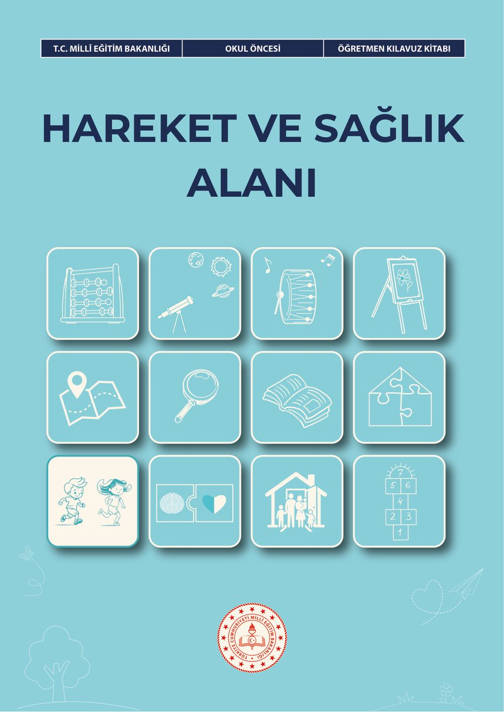
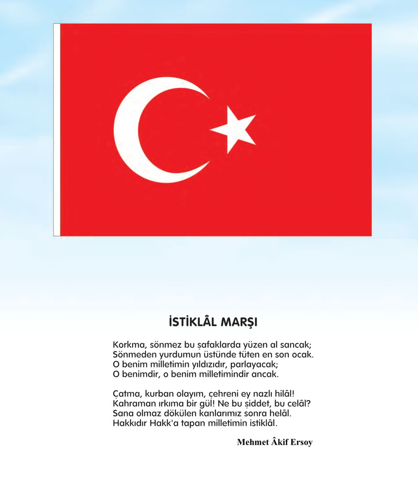
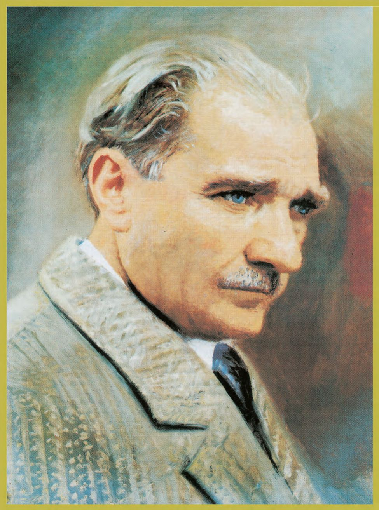
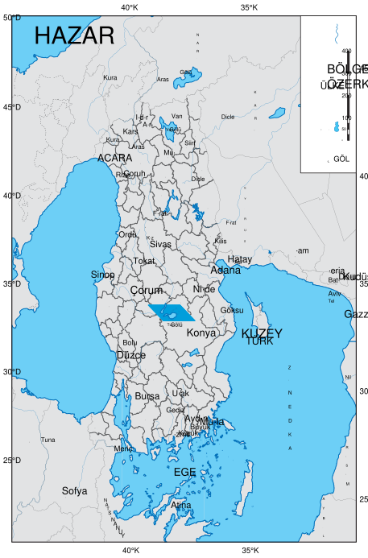
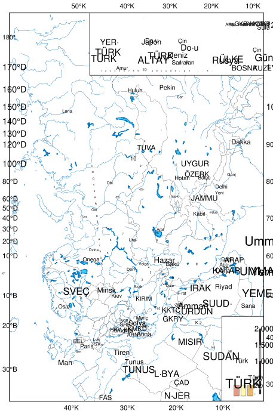

# Okul Öncesi Hareket Ve Sağlık Alanı Öğretmen Kılavuz Kitabı

<!-- sayfa 0 -->

T.C. MİLLÎ EĞİTİM BAKANLIĞI
OKUL ÖNCESİ
ÖĞRETMEN KILAVUZ KİTABI

# HAREKET VE SAĞLIK ALANI

<!-- sayfa 1 -->

Verdiğiniz metin katmanı boş olduğu için (`<<< >>>` arası boş) dönüştürülecek bir içerik bulunmamaktadır. Lütfen metin katmanını içeren içeriği paylaşın, böylece talimatlarınıza uygun şekilde Markdown formatına çevirebilirim.

<!-- sayfa 2 -->

OKUL ÖNCESİ

# Hareket ve Sağlık Alanı Öğretmen Kılavuz Kitabı

## Yazarlar
BERİL ÖZDEMİR
BETÜL SÜREK
ELİF ÖZTÜRK
EZGİ AVCI AŞIR
GAYE ERÇEN
İLKAY CAN
MERVE ÖZTEMİR
RUHAN ÖZDAMAR
YUDUM CAN

DEVLET KİTAPLARI

<!-- sayfa 3 -->

Milli Eğitim Bakanlığı Yayınları ................................................................................................................ 11234
Ders Kitapları Dizisi No........................................................................................................................... 2661

Her hakkı saklıdır ve Millî Eğitim Bakanlığına aittir. Kitabın metin, soru ve şekilleri kısmen de olsa hiçbir surette alınıp yayımlanamaz.

**Editör**
Doç. Dr. Menekşe BOZ
Doç. Dr. Zeynep KILIÇ

**Dil Uzmanı**
Şükran TEFEK

**Görsel Tasarımcı**
Arzu GÜNAL GÜN
Metin BİLAL

**Çoklu Ortam Tasarımcısı**
Büşra Nur DURAN YILMAZ
Ferhat DEMİRCİ
Kübra KARAKUŞ
Nilgül ÖNAL

**Program Geliştirme Uzmanı**
Dr. Emine SELMANOĞLU

**Ölçme ve Değerlendirme Uzmanı**
Merve ERELİ

**Rehberlik Uzmanı**
Ahmet Baykan BULUT

ISBN
978-625-8867-30-5

Millî Eğitim Bakanlığı Talim ve Terbiye Kurulu Başkanlığının 13.10.2026 tarih ve 172455532 sayılı yazısı ile eğitim

<!-- sayfa 4 -->

# İSTİKLÂL MARŞI

Korkma, sönmez bu şafaklarda yüzen al sancak;
Sönmeden yurdumun üstünde tüten en son ocak.
O benim milletimin yıldızıdır, parlayacak;
O benimdir, o benim milletimindir ancak.

Çatma, kurban olayım, çehreni ey nazlı hilâl!
Kahraman ırkıma bir gül! Ne bu şiddet, bu celâl?
Sana olmaz dökülen kanlarımız sonra helâl.
Hakkıdır Hakk'a tapan milletimin istiklâl.

**Mehmet Âkif Ersoy**

<!-- sayfa 5 -->

ANDIMIZ

Türküm, doğruyum, çalışkanım.

İlkem küçüklerimi korumak, büyüklerimi saymak; yurdumu, milletimi özümden çok sevmektir.
Ülküm yükselmek, ileri gitmektir.

Ey Büyük Atatürk!

Açtığın yolda, gösterdiğin hedefe durmadan yürüyeceğime ant içerim.

Varlığım Türk varlığına armağan olsun.

Ne mutlu Türküm diyene!

<!-- sayfa 6 -->

MUSTAFA KEMAL ATATÜRK

<!-- yer tutucu bulunamadı: sayfa sonuna eklendi -->

<!-- sayfa 7 -->

Verdiğiniz metin katmanı boş olduğu için (`<<< >>>` arası boş) dönüştürülecek bir içerik bulunmamaktadır. Lütfen metin katmanını içeren içeriği paylaşın, böylece kurallara uygun şekilde Markdown formatına çevirebilirim.

<!-- sayfa 8 -->

# İÇİNDEKİLER

| | |
| :--- | ---: |
| GİRİŞ | 9 |
| HAREKET VE SAĞLIK ALAN BECERİLERİ | 9 |
| HAREKET VE SAĞLIK ALANI ETKİNLİKLERİNİN PROGRAMDA YER ALAN DİĞER ALANLARLA İLİŞKİLENDİRİLMESİ | 13 |
| HAREKET VE SAĞLIK ALANI ETKİNLİKLERİNİN PROGRAMLAR ARASI BİLEŞENLERLE İLİŞKİLENDİRİLMESİ | 15 |
| HAREKET VE SAĞLIK ALANI ETKİNLİK ÖRNEKLERİ | 16 |
| &nbsp;&nbsp;&nbsp;&nbsp;Şekilden Şekile | 16 |
| &nbsp;&nbsp;&nbsp;&nbsp;Sandalyemi Düzeltiyorum | 18 |
| &nbsp;&nbsp;&nbsp;&nbsp;Topumu Yuvaya Gönderiyorum | 20 |
| &nbsp;&nbsp;&nbsp;&nbsp;Tohumun Müzik Haritası | 21 |
| &nbsp;&nbsp;&nbsp;&nbsp;Hareketli Parkur | 22 |
| &nbsp;&nbsp;&nbsp;&nbsp;Benim Vücudum | 24 |
| &nbsp;&nbsp;&nbsp;&nbsp;Kaplumbağa Güvende | 26 |
| &nbsp;&nbsp;&nbsp;&nbsp;Rüzgârı Yakala, Bedenini Dinle | 28 |
| &nbsp;&nbsp;&nbsp;&nbsp;Kaplumbağa Yardım İstiyor | 30 |
| &nbsp;&nbsp;&nbsp;&nbsp;Robot Şaşırdı | 32 |
| &nbsp;&nbsp;&nbsp;&nbsp;Ellerimi Yıkıyorum | 34 |
| &nbsp;&nbsp;&nbsp;&nbsp;Kendimi Nasıl Hissediyorum? | 36 |
| &nbsp;&nbsp;&nbsp;&nbsp;Sağlıklı Besinleri Tanıyorum | 38 |
| &nbsp;&nbsp;&nbsp;&nbsp;Renkli Sağlık Tabağım | 40 |
| &nbsp;&nbsp;&nbsp;&nbsp;Toplar Sepette | 42 |
| &nbsp;&nbsp;&nbsp;&nbsp;Bu Mevsimde Neler Giymeliyiz? | 44 |
| &nbsp;&nbsp;&nbsp;&nbsp;Besin Pazarı | 46 |
| &nbsp;&nbsp;&nbsp;&nbsp;Kurtar ve Tasarla | 48 |
| &nbsp;&nbsp;&nbsp;&nbsp;Çamurdan İzler ve Şekiller | 50 |
| &nbsp;&nbsp;&nbsp;&nbsp;Ormandaki Yapraklar ve Rüzgârın Dansı | 52 |
| &nbsp;&nbsp;&nbsp;&nbsp;Heykel | 54 |
| &nbsp;&nbsp;&nbsp;&nbsp;Meyve Bahçesi | 56 |
| &nbsp;&nbsp;&nbsp;&nbsp;Kişisel Alanım | 58 |
| &nbsp;&nbsp;&nbsp;&nbsp;Neşeli Orman | 60 |
| &nbsp;&nbsp;&nbsp;&nbsp;Misafir Geliyor | 62 |

<!-- sayfa 9 -->

| | |
| :--- | :---: |
| Ritim Tut, Dans Et | 66 |
| Dinozorlar Acıkmış | 68 |
| Pazardan Tabağa | 70 |
| Hareket Orkestrası | 72 |
| Kim Yardıma Gelir? | 74 |
| Balık Ağı | 76 |
| Lider Kim? | 78 |
| Bir Elin Nesi Var, İki Elin Sesi Var | 80 |
| Parçaları Bulalım | 82 |
| Kutu İçindeki Düğmeler | 84 |
| Gez, Gör, Keşfet | 86 |
| Zıpla, Dinlen, Dinle | 88 |
| Mutluyum, Kuvvetliyim | 90 |
| Fırtınada Ne Giyilir? | 92 |
| Güvenli mi, Tehlikeli mi? | 95 |
| Ben Bir Koşucuyum | 98 |
| Ellerim ve Parmaklarım | 100 |
| Renkli Kurdeleler | 102 |
| Güvenli Şehir ve Deprem Simülasyon Parkuru | 104 |
| Top Kuyruk'un Saklı Blokları | 106 |
| Balonları Yakalayalım | 108 |
| Çemberin İçinde | 110 |
| Kiki Ormanda | 112 |
| Su Dolu Bardaklar | 115 |
| Acil Durumda 112'yi Ara | 117 |
| Ritim Adaları | 120 |
| Düzen Takımı | 122 |
| Kişisel Alanım | 124 |
| KAYNAKÇA | 127 |
| GÖRSEL VE GENEL AĞ KAYNAKÇASI | 127 |
| TÜRKİYE'NİN MÜLKİ İDARE BÖLÜMLERİ İLE KARA VE DENİZ KOMŞULARI HARİTASI | 128 |

<!-- sayfa 10 -->

# GİRİŞ

Hareket ve sağlık alanı, çocukların hareket becerilerinin geliştirilmesinin yanı sıra, onların sağlık becerilerinin de geliştirilmesini amaçlamaktadır. Hareket ve sağlık alanı, üç beceriden oluşmaktadır. Bu beceriler aktif yaşam için motor beceriler, sağlıklı yaşam ve öz bakım becerileri, risk ve güvenlik becerileridir.

Hareket ve sağlık alanına ilişkin tüm öğrenme çıktılarının çocukların doğal merak, keşfetme ve deneme eğilimleri göz önünde bulundurularak oyun aracılığıyla kazandırılması önemlidir. Çocukların soyut düşünme becerileri ile uzun süreli odaklanma kapasiteleri henüz tam gelişmemiştir. Bu nedenle öğrenmelerini somut ve deneyimsel etkinliklerle gerçekleştirmeleri gerekir. Öğretmen, rehber ve kolaylaştırıcı rolü üstlenir. Öğretmen, çocukların kendi hızlarında keşfetmelerine, risk alarak sınırlarını öğrenmelerine ve deneyimlerinden çıkarımlar yapmalarına fırsat tanır.

Temel hareket becerilerinin ediniminde; topu en uzağa fırlatmak, hızlı koşmak, tek ayak uzun mesafe sıçramak gibi ürün odaklı çıktılar değil, hareket formunun biyomekanik açıdan doğru sergilenmesi önceliklidir. Bu dönemde doğru hareket formunun kazanılması, çocukların bu hareketlerde olgunlaşmasını (uzmanlaşma) sağlayarak ileride daha karmaşık özelleşmiş becerileri başarıyla gerçekleştirmelerini sağlar. Bu nedenle öğretmenin hareketi modellemesi ve süreci oyun temelli zenginleştirilmiş ortamlarla sunması, motor öğrenmenin kalıcılığını artırarak yaşam boyu fiziksel aktivite katılımı için gerekli olan becerileri inşa eder.

Çocukların hareket becerilerini geliştirebilmeleri için öncelikle kendi beden sınırlarını, kapasitelerini ve hareket ettikleri alanı anlamlandırmaları, yani beden algısı ve alan farkındalığı geliştirmeleri esastır. Bu süreçte çocuk, kollarını yanlara açtığında kapladığı kişisel alanını keşfetmeli, ardından bu alanı diğer çocuklarla paylaştığı genel alan içerisinde güvenli bir biçimde yönetebilmelidir. Öğretmenlerin, çocukların alan içerisindeki yön, düzey ve hız değişimlerini deneyimleyebilecekleri oyun temelli uygulamalar yapması bireyin hem kendi bedensel farkındalığını artırır hem de sosyal bir ortamda başkalarının sınırlarına saygı duyarak hareket etme becerisini pekiştirir.

Küçük kas motor becerileri; bir nesneyi kavramak, el-göz/ayak-göz koordinasyonu ve nesne kontrolü gibi karmaşık süreçleri içermektedir. Küçük kas motor becerilerinde erken dönemde edinilen bu yetkinlikler, çocuğun ilerleyen yıllarda düğme ilikleme gibi öz bakım becerilerinden kalem tutma gibi yazı yazma süreçlerine kadar geniş bir yelpazede yeterlilik sağlar. Bu nedenle eğitim ortamlarında, taş, boncuk, düğme gibi açık uçlu materyallerle sunulan manipülatif etkinliklere yer verilmesi, oyun temelli bir pedagojiyle planlanıp uygulanması, bireyin yaşam becerilerini ve dikkat odaklı eylemlerin temelini inşa eder.

Ritim ve dans etkinlikleri, çocukların müzik ve hareket arasında ilişki kurmalarını sağlayarak bedenlerini kontrollü, koordineli ve yaratıcı bir biçimde kullanmalarını desteklemektedir. Ritim çalışmaları tempo, hız, yön ve hareket örüntülerine uyum sağlama becerilerini geliştirirken aynı zamanda işitsel algı, dikkat, denge, koordinasyon ve beden farkındalığını güçlendirmektedir. Çocukların müzik eşliğinde bireysel, eşli veya grup hâlinde gerçekleştirdikleri hareket deneyimleri eş zamanlı hareket etme, yönerge takip etme, alan paylaşma ve grup uyumu içerisinde hareket etme becerilerini desteklemektedir.

Okul ortamında kazanılan sağlık davranışlarının ev ortamında da desteklenmesi, kalıcı ve tutarlı bir gelişim için vazgeçilmezdir. Güvenli ve destekleyici bir ortamda gerçekleştirilen hareket etkinlikleri, çocukların yalnızca büyük kas ve küçük kas motor becerilerini değil aynı zamanda öz güvenlerini, öz düzenleme kapasitelerini ve stresle başa çıkma becerilerini de desteklemektedir. Etkinlikler, çocukların yaş ve gelişim özelliklerine uygun olarak planlanmalı; motor gelişimlerini destekleyen, koordinasyon ve dengeyi geliştiren, aynı zamanda sağlıklı yaşam bilincini erken yaşta pekiştiren oyun temelli uygulamalar içermelidir.

## HAREKET VE SAĞLIK ALAN BECERİLERİ

### HSAB1. AKTİF YAŞAM İÇİN MOTOR BECERİLER

Aktif yaşam için motor beceriler alanı; temel hareket becerileri, küçük kas motor becerileri, ritimle hareket becerileri ve beden ve alan farkındalığı ile yönsel ve zamansal farkındalık içeren algısal motor becerileri

<!-- sayfa 11 -->

kapsayarak çocuğun motor gelişimini destekleyen dinamik bir öğrenme ortamını ifade etmektedir. Bu süreç, çocuğun çevreden gelen duyusal uyaranları anlamlandırmasını sağlayarak algılama ile hareket arasında koordineli bir bağ kurulmasına olanak tanır. Çocukların görsel-motor ve el-göz koordinasyonlarının desteklenmesi, temel hareket repertuarlarının genişletilmesi ve daha karmaşık becerilerde yetkinlik kazandırılması hedeflenmektedir. Çocukların gelişimsel düzeyleri dikkate alınarak gün içerisinde toplam en az 180 dakika fiziksel aktiviteye fırsat sunulması sağlıklı yaşamın önemli bir ön koşulu olarak görülmektedir. Yer değiştirme hareketleri (yürüme, koşma, sıçrama, atlama, tırmanma, galop, kayma ve yuvarlanma), denge becerileri (statik ve dinamik denge) ve nesne kontrolü becerileri (atma, tutma, vurma, sektirme vb.) çocukların çevreyi keşfetmelerini, motor koordinasyonlarını geliştirmelerini, hareket kontrolü kazanmalarını ve fiziksel etkinliklere aktif katılım göstermelerini desteklemektedir.

Küçük kas motor becerileri; kavrama, el-göz koordinasyonu, görsel-uzamsal bilgilerin işlenmesi ve el-parmak hareketlerinin planlanıp denetlenmesini kapsamaktadır. Bu beceriler nesneleri manipüle etme, birleştirme, şekillendirme ve araç-gereç kullanımı gibi karmaşık görevlerin temelini oluşturmaktadır. Ritmik hareket ve dans becerileri ise çocukların müzik ve hareket arasında ilişki kurmalarını, ritme uygun hareket etmelerini ve hareketlerini belirli bir düzen içinde gerçekleştirmelerini sağlayarak motor gelişimin yanı sıra sosyal, bilişsel ve duygusal gelişimlerini de desteklemektedir. Beden farkındalığı ve kişisel ve genel alan farkındalığı kapsamında çocukların beden bölümlerini tanımaları, bedenlerini kontrollü kullanmaları, hareket sırasında kendi kapladıkları alanı fark etmeleri ve çevrelerindeki bireyler ile nesnelerle olan mesafelerini ayarlayarak ortak alanı güvenli ve uyumlu biçimde kullanmaları amaçlanmaktadır.

## Dikkat Edilmesi Gereken Önemli Noktalar

* Temel hareket becerilerine yönelik uygulamaların sınıf içi yerine bahçe, koridor veya spor salonu gibi çocukların rahat hareket edebileceği geniş alanlarda yürütülmesi güvenlik açısından kritik bir ön koşuldur.
* Temel hareket becerilerinin edinim sürecinde çocuklara mutlaka model olunmalı, ardından hareket formlarını deneyimlemelerine olanak tanıyacak oyunlar kurgulanmalıdır.
* Oyun temelli hareket etkinliklerinde çocukların spor ayakkabı ve rahat hareket edebilecekleri kıyafetler giymelerine dikkat edilmelidir.
* Oyun temelli hareket etkinliklerinde çocukların küçük gruplara ayrılarak uzun süre sıra beklemeleri önlenmeli ve her çocuğun sürece aktif katılımı sağlanmalıdır.
* Hareket etkinlikleri için sınıfta voleybol topu, tenis topu, atlama ipi, çember, huni, kurdele, tül ve balon gibi materyallerin yeterli sayıda bulundurulmasına özen gösterilmelidir.
* Açık uçlu materyallerle küçük kas motor becerileri desteklenebilir, böylece çocukların küçük kas motor becerilerini geliştirirken aynı zamanda nesneleri çok yönlü kullanma becerisiyle yaratıcı düşünme ve problem çözme becerileri de desteklenebilir.
* Hareket etkinliklerinde çocukların bireysel gelişim farklılıkları dikkate alınarak aynı görev farklı zorluk düzeylerinde sunulmalıdır.
* Çocuklar için hem iç hem de dış mekânları bir arada kullanabilecekleri, içinde birden fazla kuralın olduğu ve sürekli yön değiştirmeyi gerektiren kendi oyunlarını kurabilecekleri ortamlar sağlanmalıdır.
* Gün içinde çocukların uzun süre hareketsiz kalmalarını önlemek amacıyla geçiş zamanlarında kısa hareket etkinliklerine yer verilmelidir.
* Etkinlik sonrasında zindelik termometresi kullanarak çocukların bedensel durumlarını derecelendirmeleri sağlanabilir. Bu yaş grubu dünyayı görerek, dokunarak ve hissederek anlamlandırır; bu nedenle termometredeki renkler somut durumlarla eşleştirilerek hazırlanabilir: Yeşil Alan (Enerjim Harika!), Sarı Alan (Biraz Yoruldum/Yavaşladım), Kırmızı Alan (Dur ve Dinlen).
* Bu becerilerin gelişimi yaşa, deneyime ve sunulan uyarıcıların çeşitliliğine bağlı olarak farklı hızlarda gerçekleşebilir. Çocukların dış mekânda, farklı zeminlerde, yüksekliklerde, hızlarda ve materyallerle sürekli

<!-- sayfa 12 -->

# Sınıf İçi Uygulama Önerileri

**Farklı çevre ve fiziksel etkinliklerde temel hareket becerilerini sergileyebilme**
* Çocukların belirlenen bir alanda müzik eşliğinde koşma, galop ve sekme gibi yer değiştirme hareketlerini sergilemeleri istenebilir.
* Zemine farklı renk ve boyutlarda denge taşları veya taş görselleri yapıştırabilir ve çocukların dengelerini koruyarak karşıya geçmeleri sağlanabilir.
* Bir hikâye veya drama etkinliğinde geçen olay akışı fiziksel bir parkura dönüştürülerek denge kurma , sürünme ve yükselme gibi hareketler yapılabilir.

**Farklı büyüklük ve özellikteki nesneleri kullanabilme**
* Uygulama alanındaki duvarlara veya uygun yüzeylere farklı boyutlarda hedefler çizilebilir ve çocukların çeşitli nesne kontrolü becerilerini kullanarak atış yapmaları sağlanabilir.
* Farklı renk ve dokudaki materyaller çocukların cımbız, maşa veya çimdik tutuşuyla ayırmaları için kullanılabilir.
* Sınıfın bir köşesine farklı kalınlıkta ipler, ayakkabı bağcıkları ve kurdeleler asılarak çocukların düğüm atmaları, fiyonk yapmaları veya basit dokumalar oluşturmaları desteklenebilir.

**Müzik ve ritim eşliğinde hareket örüntüleri sergileyebilme**
* Zeminde çift ayak ve tek ayak basmayı gösteren farklı adım dizileri oluşturularak çocukların ritme uygun hareket etmeleri sağlanabilir.
* Her çocuğun el bileğine küçük bir balon bağlanarak müzik eşliğinde kimsenin balonuna dokunmadan dans etmesi istenebilir.
* Müziğin temposuna göre çocukların hareket hızlarını düzenlemeleri sağlanabilir.

**Beden farkındalığına dayalı doğru duruş sergileyebilme**
* Çocuklardan başlarının üzerinde hafif bir fasulye torbası gibi hafif bir nesne taşıyarak yürüme, eğilme ve dönme gibi hareketlerini yapmaları istenebilir.
* Hareketli bir oyundan sonra çocukların kalp atışlarını ve nefes alışverişlerini fark etmeleri sağlanabilir.
* Çocukların hareketten sonra vücutlarında meydana gelen değişimleri Vücut Haritası üzerinde göstermeleri istenebilir.

**Kişisel ve genel alanın farkında olarak hareket edebilme**
* Her çocuğun balonunu koruyarak müzik eşliğinde dans etmesi, kişisel alan farkındalığını destekleyebilir.
* Belirlenen alanda koşma, galop ve sekme gibi yer değiştirme hareketlerinin çarpışmadan gerçekleştirilmesi sağlanabilir.
* Fiziksel parkur uygulamalarında çocukların kendi hareket alanlarını ve diğer çocuklarla mesafelerini yönetmeleri desteklenebilir.

## HSAB2. SAĞLIKLI YAŞAM VE ÖZ BAKIM BECERİLERİ
Sağlıklı yaşam ve öz bakım becerileri; bedensel iyilik hâlinin yanı sıra zihinsel, duygusal ve sosyal boyutları da kapsayan bütüncül bir anlayışla ele alınmaktadır. Erken çocukluk döneminde edinilen beslenme, uyku, beden temizliği ve hijyene ilişkin alışkanlıkların yaşamın ilerleyen dönemlerinde de sürdürülmesi; sağlığın korunması, geliştirilmesi ve genel iyilik hâlinin desteklenmesi açısından önem taşımaktadır. Ayrıca çocukların duygularını tanıma, ifade etme ve düzenleme becerileri desteklenerek duygusal sağlık ve genel iyilik hâllerinin güçlendirilmesi de bütüncül bir yaklaşımın parçası olarak ele alınmalıdır. Aile iş birliği de bu sürecin ayrılmaz bir

<!-- sayfa 13 -->

davranışları sergileme düzeyine doğru ilerleyen gelişimsel bir örüntüyü ortaya koymaktadır. Beslenme davranışları bağlamında bu örüntü en açık biçimiyle gözlemlenmektedir: 36-48 aylık dönemde çocuk, sağlıklı içecekleri yetişkin yönlendirmesiyle tanımakta; 48-60 aylık dönemde açlık ve tokluk sinyallerini fark ederek yemeği bağımsız biçimde sonlandırma kapasitesi gelişmekte 60-72 aylık dönemde ise çocuk, dengeli bir tabak oluşturmanın vücuduna katkısını kendi cümleleriyle açıklayabilmektedir.

Kişisel hijyen ve ortam düzeni yeterlilikleri, öz bakım becerilerinin en somut ve doğrudan gözlemlenebilir boyutunu teşkil etmektedir. El, yüz ve ağız temizliği gibi temel hijyen rutinleri 36-48 aylık dönemde yetişkin rehberliğiyle kazanılmaya başlanmakta, 48-60 aylık dönemde büyük ölçüde bağımsız olarak gerçekleştirilmekte ve 60-72 aylık dönemde herhangi bir hatırlatmaya gerek kalmaksızın içselleştirilmiş davranışlara dönüşmektedir.

### Dikkat Edilmesi Gereken Önemli Noktalar

* Sağlık davranışları (diş fırçalama, hijyen vb.) teorik anlatımlar yerine oyun, drama ve hikâye yoluyla günlük rutinlere dâhil edilmelidir.
* Sınıfta gerçek besinlerle dokunma ve tatma etkinlikleri yapılarak çocukların sağlıklı besinleri ‘duyusal bütünleme’ yaklaşımıyla keşfetmesi desteklenmelidir. Ancak alerjiye neden olabilecek besin türleri ve kokular konusunda dikkatli olunmalıdır.
* Okulda kazandırılan hijyen ve sağlıklı yaşam alışkanlıklarının kalıcı olması için ailelerin ev ortamında bu davranışları desteklemesi önemlidir.
* Beden farkındalığı; çocukların kendi bedenlerini tanımaları, açlık-tokluk gibi iç sinyalleri fark etmeleri ve duygusal durumlarının beden üzerindeki yansımalarını anlamlandırabilmeleri açısından büyük önem taşımaktadır.
* Beslenme bağlamında beklentiler gelişimsel sıraya uygun tutulmalıdır: 36-48 aylık çocuklarda yetişkin yönlendirmesiyle besin tanıma yeterli iken 60-72 aylık çocuklardan dengeli öğün planlamasına etkin katılım beklenebilir.
* Çocukların duygularını tanıma ve düzenleme becerileri, fiziksel sağlık davranışlarıyla birlikte bütüncül bir yaklaşımla ele alınmalıdır.

## Sınıf İçi Uygulama Önerileri

### Yeterli ve dengeli beslenebilme

* Çocukların farklı besinleri koklayarak veya tadarak tanımaları sağlanabilir.
* Beden görselleri kullanılarak farklı renklerdeki besinlerin vücuda katkıları tartışılabilir ve dengeli tabak tasarımları oluşturulabilir.
* Gün içinde su içme rutinlerini takip etmek amacıyla görsel destekli su tüketim çizelgeleri kullanılabilir.

### İç ve dış mekânda fiziksel aktivitelere katılabilme

* Müzik eşliğinde koşma, galop ve sekme etkinlikleri uygulanabilir.
* Denge taşları üzerinde ilerleme etkinlikleri yapılabilir.
* Hikâye temelli fiziksel parkurlar oluşturulabilir.
* Müziğin temposuna göre hareket hızını değiştirmeyi gerektiren oyunlar oynanabilir.

### Temel kişisel hijyen ve bulunduğu ortamın düzeninin farkında olabilme

* Gün içinde su tüketimini takip etmeye yönelik çizelgeler kullanılabilir.
* Hareket sonrası beden değişimlerinin fark edilmesi üzerine sohbetler gerçekleştirilebilir.
* Vücut Haritası çalışmaları ile beden bakımına ilişkin farkındalık geliştirilebilir.

## HSAB3. GÜVENLİK BECERİLERİ

### Güvenlik becerilerinin geliştirilmesi

çocukların yalnızca tehlikelerden kaçınmayı öğrenmeleriyle sınırlı

<!-- sayfa 14 -->

geliştirebilme ve gerektiğinde yardım arama davranışlarını kapsayan bütüncül bir süreci içermektedir. Bu becerilerin kazandırılmasında, doğrudan uyarı ve söylemlerden ziyade oyun, dramatik canlandırmalar, hikâye temelli öğrenme ve yapılandırılmış günlük rutinler etkili araçlar olarak kullanılmalıdır. Erken çocukluk eğitiminde güvenlik becerilerinin kazanımı, çocuğun gelişimsel özellikleri doğrultusunda kademeli ve yapılandırılmış bir süreç izlemektedir. Başlangıçta yetişkin rehberliğine dayalı olarak gelişen bu beceriler, zamanla çocuğun çevresel ipuçlarını daha bağımsız biçimde yorumlayabilmesi ve riskli durumlara yönelik kendi davranışlarını düzenleyebilmesi yönünde ilerlemektedir. Bu süreçte çocuk, güvenlik işaretlerini tanımayı, güvenli ve güvensiz durumları ayırt etmeyi, acil durumlarda başvurulabilecek destek kaynaklarını fark etmeyi ve bu kaynakların işlevlerini anlamayı öğrenmektedir.

**Dikkat Edilmesi Gereken Önemli Noktalar**

* Güvenlik becerileri, erken çocukluk eğitiminde yalnızca bilgi aktarımına dayalı bir alan olarak değil; deneyim, tekrar ve model alma yoluyla pekiştirilen, günlük yaşamla doğrudan ilişkili bir öğrenme alanı olarak ele alınmalıdır.
* Güvenli davranışlar korkuya dayalı bir yaklaşımla değil, farkındalık ve öz düzenleme temelli bir yaklaşımla içselleştirilmelidir, doğrudan uyarı ve söylemler yerine oyun, dramatik canlandırmalar ve hikâye temelli öğrenme tercih edilmelidir.
* Çocukların risk karşısında yalnızca davranışsal tepkilerini değil, duygusal tepkilerini de tanımaları ve düzenleyebilmeleri desteklenmelidir.
* Öğretmen, çocuğun gelişimsel düzeyine uygun rehberlik sunarak hem güvenli davranış repertuarının genişlemesini hem de çocuğun kendini güvende hissettiği bir öğrenme ortamının oluşmasını sağlamalıdır.
* Bu becerilerin kazandırılmasında yapılandırılmış günlük rutinlerden yararlanılmalı, acil durum tatbikatları düzenli biçimde uygulanmalıdır.

**Sınıf İçi Uygulama Önerileri**

**Kaza, afet ve tehlikeli durumlarda güvenli davranışları sergileyebilme**

* Sınıf içine yerleştirilmiş küçük risklerin fark edilmesi ve çözüm önerileri geliştirilmesi sağlanabilir.
* Acil çıkış işaretleri kullanılarak sessiz tahliye egzersizleri yapılabilir.
* Okul veya sınıf ortamında güvenli ve dikkat edilmesi gereken alanlar çocuklarla birlikte belirlenerek işaretlenebilir.

# HAREKET VE SAĞLIK ALANI ETKİNLİKLERİNİN PROGRAMDA YER ALAN DİĞER ALANLARLA İLİŞKİLENDİRİLMESİ

Hareket ve sağlık alanına yönelik beceriler, müfredatta yer alan diğer tüm disiplin ve öğrenme alanlarıyla dinamik bir şekilde ilişkilendirilebilir. Motor becerilerin hareketle öğrenme temelinde tüm eğitsel süreçlere bütünleşik bir modelle dâhil edilmesi, Maarif Programı’nın ‘alan bütünlüğü’ ilkesiyle doğrudan örtüşmektedir. Bu bütüncül yaklaşım, çocukların fiziksel, bilişsel, sosyal ve duyuşsal gelişim alanlarını eş zamanlı ve eş güdümlü olarak destekleme olanağı tanımaktadır.

### Türkçe Alan Becerileriyle İlişkilendirme

Hareket ve sağlık alanına yönelik beceriler, Türkiye Yüzyılı Maarif Modeli Okul Öncesi Eğitim Programı’nda yer alan diğer alanlarla bütünleşik biçimde ele alınabilir. Motor becerilerin hareket yoluyla öğrenme anlayışı doğrultusunda öğrenme süreçlerine dâhil edilmesi, alanlar arası bütünlüğün sağlanmasına katkı sunmaktadır. Bu bütüncül yaklaşım; çocukların fiziksel, bilişsel, sosyal ve duyuşsal gelişimlerinin birbiriyle ilişkili biçimde desteklenmesine olanak sağlamaktadır.

Güvenlik becerileri kapsamındaki öğrenme çıktısı da Türkçe alan becerisiyle bütünleştirilebilir. Tehlike

<!-- sayfa 15 -->

# Matematik Alan Becerileriyle İlişkilendirme
Küçük kas (ince motor) gelişimine yönelik öğrenme çıktıları, matematik alanı temel becerilerinden özellikle sayma ve sayı duyusunun geliştirilmesi boyutlarıyla doğrudan ve güçlü bir biçimde ilişkilendirilebilir. Farklı boyutlardaki düğmeleri ilikleme ve çözme, bağcık ve ipleri bağlayıp sökme, ipi delikten, pipetten ve boncuktan geçirme gibi ince motor çalışmalar sayma etkinlikleriyle birleştirildiğinde çocuklar hem el-göz koordinasyonlarını hem de matematiksel düşüncelerini aynı anda geliştirmiş olur.

# Fen Alan Becerileriyle İlişkilendirme
Zindelik becerileri ve aktif yaşam öğrenme çıktıları, fen alan becerisiyle özellikle bilimsel gözleme dayalı tahmin becerisi boyutunda ilişkilendirilebilir. Hareketli oyun sonrasında çocukların solunum, kalp atışı ve terleme gibi fizyolojik değişimleri gözlemlemeleri ve bu değişimleri kendi cümleleriyle ifade etmeleri fen alanının gözlem ve tahmin boyutunu doğrudan destekler. Sağlıklı beslenme öğrenme çıktısı kapsamında besin gruplarının rengi, kokusu, dokusu ve vücuda etkisinin incelenmesi de fen alanında bilimsel gözlem ve sınıflandırma becerileriyle doğrudan ilişkilidir.

# Sosyal Alan Becerileriyle İlişkilendirme
Kişisel ve genel alan farkındalığı, çocukların hem kendi bedensel ve psikolojik sınırlarını hem de çevrelerindeki ortak alanları tanımalarını sağlayan temel bir beceridir. Çocukların ‘benim alanım’ ile ‘herkesin alanı’ arasındaki farkı kavramaları, nesnelerin ve insanların mekândaki konumlarını anlamalarına, mekânsal organizasyon becerilerini geliştirmelerine yardımcı olur. Bu farkındalık aracılığıyla çocuklar, toplumsal normları içselleştirir, birey-toplum ilişkisini anlamaya başlar ve ortak alanların kullanımına ilişkin veri toplayarak kanıta dayalı çözümler üretebilirler.

# Sanat Alan Becerileriyle İlişkilendirme
Hareket ve sağlık alanı ile sanat alanı arasında güçlü ve çok yönlü bir ilişki bulunmaktadır. Hareket etkinlikleri sırasında kullanılan beden, alan, ritim ve koordinasyon becerileri, çocukların sanatsal ifade süreçlerinde bedenlerini, materyalleri ve mekânı daha etkili kullanmalarına katkıda bulunmaktadır. Özellikle ritmik hareket ve dans çalışmaları, çocukların müzik ve hareket arasında ilişki kurmalarını destekleyerek sanatın önemli bir boyutu olan yaratıcı ifade becerilerinin gelişimine zemin hazırlamaktadır. Ayrıca küçük kas motor becerilerinin gelişimi, çizme, boyama, kesme, yapıştırma, şekillendirme ve farklı sanat materyallerini kullanma gibi sanatsal uygulamaların gerçekleştirilmesini kolaylaştırmaktadır.

Sanat alanındaki eser inceleme, sanat türlerini tanıma ve sanatsal uygulama yapma süreçleri çocukların hareket deneyimlerini farklı yollarla ifade etmelerine, gözlem becerilerini geliştirmelerine ve özgün ürünler oluşturmalarına fırsat sunmaktadır. Çocukların dans, yaratıcı hareket, drama, beden perküsyonu ve performans temelli sanat etkinliklerine katılmaları hem motor becerilerinin hem de estetik duyarlılıklarının gelişmesini desteklemektedir. Bunun yanında sanat etkinliklerinde kullanılan farklı araç-gerecin kontrollü kullanımı el-göz koordinasyonu ve ince motor becerileri güçlendirirken, sanat yoluyla beden farkındalığı, duyguların ifade edilmesi ve öz düzenleme becerileri de desteklenmektedir. Bu yönüyle hareket ve sağlık alanında kazanılan beceriler, sanat alanındaki öğrenmelerin temelini oluştururken sanat etkinlikleri de hareket becerilerinin yaratıcı, anlamlı ve bütüncül bir biçimde kullanılmasına katkıda bulunmaktadır.

# Müzik Alan Becerileriyle İlişkilendirme
Hareket ve sağlık alanındaki ritmik beceriler ile beden farkındalığı öğrenme çıktıları, müzik etkinlikleriyle doğal, akıcı ve güçlü bir bütünlük içinde ele alınabilir. Müzik eğitimindeki ritim çalışmalarının içerisine aktif hareket unsurları dâhil edildiğinde, çocukların ritmik motor becerileri en üst düzeyde uyarılır. Müziğin temposuna ve ritmine uygun olarak yapılan bireysel, eşli veya grupla dans çalışmaları, çocukların özgün hareket dizileri oluşturmasına imkân tanır.

<!-- sayfa 16 -->

# HAREKET VE SAĞLIK ALANI ETKİNLİKLERİNİN PROGRAMLAR ARASI BİLEŞENLERLE İLİŞKİLENDİRİLMESİ

Okul öncesi eğitimde hareket ve sağlık alanı etkinliklerinin programlar arası bileşenlerle (Okuryazarlık Becerileri, Sosyal-Duygusal Öğrenme Becerileri ve Erdem: Değer-Eylem Çerçevesi) ilişkilendirilmesi, çocuğun bütüncül gelişimini destekleyen stratejik bir yaklaşımdır. Bu ilişkilendirme, fiziksel hareketlerin sadece kas gelişimine değil, aynı zamanda bilişsel, duygusal ve ahlaki gelişime nasıl hizmet ettiğini ortaya koymaktadır.

## Sosyal-Duygusal Öğrenme Becerileri

Hareket etkinlikleri, öz farkındalık ve öz yönetim becerilerinin en somut uygulama alanlarıdır. Çocuğun fiziksel aktiviteler sırasında kendi beden sınırlarını keşfetmesi, kişisel alanını koruması ve başkalarının alanına saygı göstererek hareket etmesi, sosyal etkileşimin temelini oluşturur. Öz bakım ve hijyen alışkanlıkları kapsamında ortak kullanım alanlarını düzenli tutma sorumluluğunun üstlenilmesi çocukların sosyal sorumluluk duygusunu ve iş birliği becerilerini doğrudan destekler. Özellikle 60-72 ay grubunda müzik ve ritim eşliğinde grup hâlinde sergilenen eş zamanlı danslar, çocukların akranlarıyla iş birliği yapma, empati kurma ve toplumsal uyum becerilerini en üst düzeye çıkarır.

## Erdem: Değer - Eylem Çerçevesi

Erdem: Değer-Eylem Çerçevesi’nde saygı, sorumluluk ve adalet çatı değerler olarak belirlenmiştir. Hareket ve sağlık etkinlikleri bu açıdan değerlerin en doğal biçimde gözlemlenip yaşandığı alanlardan biridir. Kurallı oyunlarda adalet ve sorumluluk, grup çalışmalarında saygı ve dostluk, öz bakım rutinlerinde temizlik ve sağlıklı yaşam değerleri somut eylemlerle görünür hâle gelir. Güvenlik ve öz koruma eylemleri ise bireyin hem kendisine hem de çevresine duyduğu saygının bir yansımasıdır. Afet ve tehlike anlarında doğru pozisyonu almak sadece bir motor beceri değil, aynı zamanda hayata verilen değerin ve bilinçli eylem kapasitesinin bir sonucudur.

## Okuryazarlık Becerileri

Türkiye Yüzyılı Maarif Modeli’nde okuryazarlık becerileri farkındalık, işlevsellik ve eylemsellik olmak üzere sarmal ve gelişime uygun üç düzeyde kurgulanmıştır. Hareket ve sağlık alanı, bu okuryazarlık türlerini özellikle besler. Sağlık okuryazarlığı (beslenme, hijyen, aktivitenin vücuda etkisi), hareket ve spor okuryazarlığı (kural anlama, strateji geliştirme, beden sinyallerini okuma) ile bilgi okuryazarlığı (bilgi ihtiyacını fark etme, gözlem yapma, çıkarım oluşturma ve yansıtma) etkinliklerin doğal akışı içinde işlevsel hâle gelir. Ayrıca küçük kas becerilerini destekleyen nesne kontrolü çalışmaları, yazma becerisinin temeli olan el-göz koordinasyonunu inşa ederek akademik okuryazarlığa zemin hazırlar.

<!-- sayfa 17 -->

# HAREKET VE SAĞLIK ALANI ETKİNLİK ÖRNEKLERİ

**ETKİNLİK ADI:** Şekilden Şekile
**ALAN ADI:** Hareket ve Sağlık
**YAŞ GRUBU:** 36-48 ay

**ALAN BECERİLERİ, ÖĞRENME ÇIKTILARI VE SÜREÇ BİLEŞENLERİ**
**HAREKET VE SAĞLIK ALANI**
HSAB1. Aktif Yaşam İçin Motor Beceriler
HSAB.2. Farklı büyüklük ve özellikteki nesneleri kullanabilme
HSAB.2.b. Nesnelere farklı şekiller verir.

**EĞİLİMLER**
**E1. Benlik Eğilimleri**
E1.1. Merak
**E3. Entelektüel Eğilimler**
E3.3. Yaratıcılık

**PROGRAMLAR ARASI BİLEŞENLER**
**Sosyal-Duygusal Öğrenme Becerileri**
SDB1.2. Kendini Düzenleme (Öz Düzenleme)

**Değerler**
**D3. Çalışkanlık**
D3.4. Çalışmalarda aktif rol almak

**Okuryazarlık Becerileri**
OB4. Görsel Okuryazarlık

**Kavramlar:** Zıt: düz - eğri
Boyut: uzun - kısa
Miktar: parça - bütün

**Sözcükler:**

**Materyaller:** alüminyum folyo, şönil çubuklar veya yumuşak plastik kaplı teller, pelür kâğıtları, boş karton rulolar, büyük plastik mandallar, kalın ipler, materyal sepetleri

**Eğitim / Öğrenme Ortamları:** Materyaller özelliklerine göre ayrı sepetlere yerleştirilir. Masalarda kaymayı önleyen çalışma örtüleri kullanılabilir.

<!-- sayfa 18 -->

**ETKİNLİKLER**

**Hareket ve Sağlık (Büyük Grup Etkinliği)**

* Çocuklara düz bırakılmış bir şönil çubuk ve buruşturulmamış bir alüminyum folyo gösterilir. “Bugün sınıfımıza bazı şekiller gelecekmiş. Ancak şekiller yolda kaybolmuş. Bu malzemelere yeniden şekil verebilir miyiz?” denilir. Materyallerin düz, uzun ve şekil verilmemiş hâlleri birlikte incelenir **(E1.1, OB4)**.
* Çocuklar alüminyum folyo, şönil çubuk, pelür kâğıdı, karton rulo ve mandalları inceler. Materyallere dokunulması, yumuşaklıklarının ve sertliklerinin karşılaştırılması, folyodan çıkan sesin dinlenmesi sağlanır. Materyallerin nasıl değiştirilebileceğine ilişkin tahminler alınır **(E1.1)**.
* Çocuklar masalara davet edilir. İlk olarak alüminyum folyoların sıkılması, buruşturulması, yuvarlanması ve yeniden açılması sağlanır. Folyolara top, uzun yol, çanak veya istenilen farklı şekiller verilir **(HSAB.2.b, E3.3)**.
* Şönil çubuklar veya yumuşak teller bükülür, kıvrılır ve karton ruloların çevresine sarılır. Halka, köprü, yılan, spiral veya özgün şekiller oluşturulur. Çocukların aynı materyale birden fazla şekil vermeyi denemelerine fırsat tanınır **(HSAB.2.b, SDB1.2)**.
* Pelür kâğıtları buruşturularak küçük toplar veya uzun şeritler hazırlanır. Hazırlanan parçalar karton ruloların içine yerleştirilir, çevresine sarılır veya mandallarla birleştirilir **(HSAB.2.b, D3.4)**.
* Farklı materyaller bir araya getirilerek çocuklardan hayal ettikleri bir nesne, canlı, araç veya özgün yapı oluşturmaları istenir. İstenilen sonuca ulaşılmadığında parçaların yeniden bükülmesine, açılmasına veya farklı biçimde birleştirilmesine fırsat verilir **(HSAB.2.b, E3.3)**.
* Tamamlanan çalışmalar sergilenir.

**DEĞERLENDİRME**

* Seçtiğin materyale nasıl şekil verdin?
* Materyalin önce nasıldı, sonra nasıl oldu?
* Hangi materyali büktün veya buruşturdun?
* Aynı materyalle başka hangi şekil yapılabilir?
* Parçaları nasıl birleştirdin?

**FARKLILAŞTIRMA**

**Zenginleştirme:** Aynı folyo parçasının top, çanak ve uzun yol olmak üzere üç farklı şekle dönüştürülmesi istenebilir. Her dönüşümden sonra materyalin önceki ve sonraki hâli incelenebilir. Bükme, sarma ve birleştirme hareketlerinden en az ikisinin kullanılacağı bir tasarım görevi verilebilir. Tasarımın ayakta durması, hareket etmesi veya açılıp kapanması istenebilir. Oluşturulan yapının bir bölümü değiştirilerek yeni bir işleve sahip olması sağlanabilir. Yapı köprüden tünele, kuştan uçağa veya halkadan tekerleğe dönüştürülebilir.

**Destekleme:** Aynı anda sunulan materyal sayısı azaltılabilir. Başlangıçta pelür kâğıdı ve büyük folyo gibi kolay şekil alan iki materyal sunulabilir, daha sonra şönil ve mandallara geçilebilir. Her aşamada tek bir hareket üzerinde çalışılabilir. Büyük boy ve kolay kavranabilen mandallar kullanılabilir. Materyallerin kaymasını önlemek için çalışma tepsisi veya kaymaz örtüden yararlanılabilir.

**AİLE VE TOPLUM KATILIMI**

**Aile Katılımı:** Ailelerden çocuklarıyla birlikte evde bulunan güvenli bir materyalin önceki ve sonraki hâlini incelemeleri istenebilir. Kâğıt, karton rulo, yumurta kolisi veya kumaş parçasına bükme, katlama, sarma veya buruşturma hareketleriyle farklı şekiller verilebilir.

**Toplum Katılımı:** Yerel bir seramik sanatçısı, sepet örücüsü veya el sanatları ustası sınıfa davet edilebilir. Bir malzemenin bastırılarak, yuvarlanarak, bükülerek veya sarılarak farklı şekillere dönüştürülmesi gösterilebilir. Çocuklara yumuşak kil veya kâğıt şeritleri verilerek bunları iki farklı şekle dönüştürmeleri sağlanabilir. Hazırlanan

<!-- sayfa 19 -->

**ETKİNLİK ADI:** Sandalyemi Düzeltiyorum
**ALAN ADI:** Hareket ve Sağlık
**YAŞ GRUBU:** 36-48 ay

**ALAN BECERİLERİ, ÖĞRENME ÇIKTILARI VE SÜREÇ BİLEŞENLERİ**
HAREKET VE SAĞLIK ALANI
HSAB1. Aktif Yaşam İçin Motor Beceriler
**HSAB.4. Beden farkındalığına dayalı doğru duruş sergileyebilme**
HSAB.4.b. Yönergelere uygun doğru duruş sergiler.

**EĞİLİMLER**
**E3. Entelektüel Eğilimler**
E3.2. Odaklanma

**PROGRAMLAR ARASI BİLEŞENLER**
**Sosyal-Duygusal Öğrenme Becerileri**
**SDB1.2. Kendini Düzenleme (Öz Düzenleme)**

**Değerler**
**D13. Sağlıklı Yaşam**
D13.3. İnsan sağlığını önemsemek

**Okuryazarlık Becerileri**
OB4. Görsel Okuryazarlık

**Kavramlar:**
**Sözcükler:** sırt
**Materyaller:** kukla veya bir oyuncak
**Eğitim / Öğrenme Ortamları:** Kukla ya da oyuncak önceden belirlenir ve hazırlanır.

<!-- sayfa 20 -->

**ETKİNLİKLER**
**Hareket ve Sağlık (Büyük Grup Etkinliği)**
* Bir kukla veya oyuncak bir karakter çocuklara gösterilir. Karakterin adı “Mino” olarak tanıtılır. “Mino bugün resim yaparken çok yorulmuş. Çünkü nasıl oturacağını karıştırmış. Bazen çok eğilmiş, bazen sandalyeye yan oturmuş. Şimdi Mino’ya doğru oturmayı öğretelim mi?” denerek etkinliğe başlanır.
* Mino kuklası yanlış oturuş şekilleri gösterir. Çocuklardan Mino’nun doğru oturmasına yardım etmeleri istenir. “Sırtını nasıl tutmalı? Ayakları nerede olmalı?” soruları yöneltilir. Cevaplar doğrultusunda Mino doğru bir pozisyonda oturtulur **(E3.2, SDB2.1).**
* Ardından çocuklardan sandalyelerine oturmaları istenir. “Sırtını düzleştir. Ayaklarını yere koy. Masa ile biraz aralık bırak. Başını çok eğmeden otur.” yönergeleri verilir. Çocukların yönergelere uygun şekilde oturmaları desteklenir **(HSAB.4.b).**
* Etkinlik sonunda “Mino’ya nasıl yardım ettik? Masa başında çalışırken nasıl oturmalıyız?” soruları üzerinden sohbet edilir **(D13.3, OB4).**

**DEĞERLENDİRME**
* Mino’nun oturuşunda nelerin yanlış olduğunu fark ettin?
* Mino’nun daha rahat oturması için neleri değiştirdik?
* Doğru otururken sırtımızı, ayaklarımızı ve başımızı nasıl konumlandırırız?
* İki farklı oturuş şeklini düşündüğünde, hangisinde daha rahat hareket edebileceğini düşünüyorsun? Neden?

**FARKLILAŞTIRMA**
**Zenginleştirme:** Çocuklara masa başında farklı oturma biçimlerini gösteren görsel kartlar sunulur. Çocukların “Duruş Dedektifi” rolünü üstlenerek görselleri incelemeleri, uygun oturuş biçimlerini belirlemeleri ve uygun olmadığını düşündükleri oturuşların nasıl düzeltilebileceğini göstermeleri istenir. Ardından çocuklar; sırtın desteklenmesi, ayakların yere ya da ayak desteğine basması, masa ile uygun aralık bırakılması ve başın fazla öne eğilmemesi gibi durumları simgeleyen resimler hazırlayarak sınıf için “Mino’nun Oturuş Hatırlatıcısı” panosu oluşturabilirler.

**Destekleme:** Çocuklara doğru duruş sırasında birebir model olunabilir. Görseller daha büyük boyutlarda hazırlanabilir.

**AİLE VE TOPLUM KATILIMI**
**Aile Katılımı:** Ailelerden evde masa başında otururken çocuklarının doğru duruşunu gözlemlemeleri ve çocuklarını uygun oturuş konusunda desteklemeleri istenebilir.

<!-- sayfa 21 -->

**ETKİNLİK ADI:** Topumu Yuvaya Gönderiyorum
**ALAN ADI:** Hareket ve Sağlık
**YAŞ GRUBU:** 36-48 ay

**ALAN BECERİLERİ, ÖĞRENME ÇIKTILARI VE SÜREÇ BİLEŞENLERİ**
HAREKET VE SAĞLIK ALANI
HSAB1. Aktif Yaşam İçin Motor Beceriler
**HSAB1. Farklı çevre ve fiziksel etkinliklerde temel hareket becerilerini sergileyebilme**
HSAB1.e. Duran topa ayağıyla vurur.

**EĞİLİMLER**
**E1. Benlik Eğilimleri**
E1.5. Kendine güvenme (Öz güven)
**E2. Sosyal Eğilimler**
E2.5. Oyunseverlik
**E3. Entelektüel Eğilimler**
E3.2. Odaklanma

**PROGRAMLAR ARASI BİLEŞENLER**
**Sosyal-Duygusal Öğrenme Becerileri**
**SDB1.2. Kendini Düzenleme (Öz Düzenleme)**

**Değerler**
**D12. Sabır**
D12.2. İstikrarlı olmak

**Kavramlar:** Mekânda konum: içinde - dışında, yakın - uzak
**Sözcükler:** yuva, hedef, başlangıç, yol, vuruş
**Materyaller:** yumuşak toplar, taşlar, dallar, yapraklar, çam kozalakları ve başlangıç çizgisi için ip
**Eğitim / Öğrenme Ortamları:** Açık havada düz ve güvenli bir alan seçilir. Dallarla iki paralel yol hazırlanır. Yolun sonunda taş, yaprak ve çam kozalaklarıyla geniş yuvalar oluşturulur. Başlangıç çizgileriyle yuvalar arasında çocukların güvenle hareket edebileceği mesafe bırakılır.

<!-- sayfa 22 -->

# ETKİNLİKLER
## Hareket ve Sağlık (Bireysel Etkinlik)
* Çocuklarla okul bahçesinde hazırlanan alana çıkılır. Dallarla hazırlanan yollar, doğal materyallerden oluşturulan yuvalar ve başlangıç noktasındaki toplar birlikte incelenir. Çocuklara “Hangi yuva yakın? Hangi yuva uzakta? Toplar hangi yoldan gidebilir?” soruları yöneltilir ve cevaplar dinlenir.
* “Ormandaki küçük toplar yuvalarını kaybetmiş. Şimdi onları ayaklarımızla yönlendirerek yuvalarına göndereceğiz.” denerek oyun başlatılır (E2.5).
* Duran topa ayakla vurma hareketi gösterilir. Topun yanında durulur, bir ayak yere basılır, diğer ayak hafifçe geriye çekilir ve topa kontrollü biçimde vurulur. Vuruş sırasında hedefe bakılması ve topun arkasından koşulmaması gerektiği açıklanır (E3.2).
* Çocuklar sırayla başlangıç çizgisine davet edilir. Her çocuğun karşısına yumuşak bir top yerleştirilir. Verilen işaretle duran topa ayakla vurularak topun doğal materyallerle hazırlanmış yuvaya gönderilmesi sağlanır (HSAB.1.e, E1.5).
* Top yuvaya ulaşmadığında topun durması beklenir. Duran topa yeniden kontrollü biçimde vurulur. Çocuğun top yuvaya ulaşıncaya kadar denemeye devam edilmesine fırsat verilir (HSAB.1.e, D12.2).
* İlk turda yakın yuva, sonraki turda daha uzaktaki yuva kullanılabilir. Çocukların parkuru birden fazla kez tamamlamaları ve seçtikleri yuvaya atış yapmaları sağlanır (HSAB.1.e, E1.5, SDB1.2).
* Tüm toplar yuvalarına ulaştırıldıktan sonra çocuklarla yuvaların çevresinde çember oluşturulur. Ayakla vurma hareketi çocuklarla birlikte tekrar edilir. Topların hangi yuvaya gönderildiği ve hangi denemenin daha kolay olduğu hakkında konuşulur. Doğal materyaller ve toplar hep birlikte toplanarak etkinlik tamamlanır.

## DEĞERLENDİRME
* Topları nereye ulaştırdık?
* Topu hangi yuvaya göndermeyi seçtin?
* Top yuvaya ulaşmadığında ne yaptın?
* Topu yakın yuvaya mı, uzak yuvaya mı göndermek daha kolaydı?
* Oyun sırasında güvenli hareket etmek için nelere dikkat ettin?
* Yuvaları ve yolları oluşturmak için hangi doğal materyaller kullanılmıştı?
* Etkinlikte en çok hangi bölümden hoşlandın?

# FARKLILAŞTIRMA
**Zenginleştirme:** Çocuklar küçük gruplara ayrılabilir, kalın halatlar, ekstra kütükler ve taşlar sunularak bir sonraki turun yolunu kendilerinin tasarlamaları ve kuralları akranlarına anlatarak sürece liderlik etmeleri sağlanabilir. Yuva alanlarının mesafeleri artırılabilir. Farklı büyüklüklerdeki yumuşak toplarla denemeler yapılabilir. Dallarla düz, eğri veya zikzak yollar hazırlanarak topun yol üzerinde kalmasına yönelik kontrollü vuruşlar uygulanabilir.

**Destekleme:** Daha büyük ve hafif toplar kullanılabilir. Yuva genişletilerek başlangıç çizgisine yaklaştırılabilir. Topa vurulacak ayak görsel bir ayak iziyle, durulacak yer ise renkli bir işaretle gösterilebilir. Hareket her denemeden önce yeniden gösterilebilir ve vurma hareketi için yönergeler tek tek verilebilir. .

# AİLE VE TOPLUM KATILIMI
**Aile Katılımı:** Ailelerden çocuklarıyla çoraplardan yumuşak bir top hazırlayıp farklı odaların girişlerine sepetler yerleştirilerek topu sepete gönderme oyunu oynamaları istenebilir. Açık alanda ayakla top oynama etkinlikleri yapmaları istenebilir.

**Toplum Katılımı:** Beden eğitimi alanında görev yapan bir spor eğitmeni okula davet edilebilir. Eğitmen eşliğinde

<!-- sayfa 23 -->

**ETKİNLİK ADI:** Hareketli Parkur
**ALAN ADI:** Hareket ve Sağlık
**YAŞ GRUBU:** 36-48 ay

**ALAN BECERİLERİ, ÖĞRENME ÇIKTILARI VE SÜREÇ BİLEŞENLERİ**
**HAREKET VE SAĞLIK ALANI**
**HSAB1. Aktif Yaşam İçin Motor Beceriler**
**HSAB.1. Farklı çevre ve fiziksel etkinliklerde temel hareket becerilerini sergileyebilme**
* HSAB.1.c. Farklı genişlik ve yapıdaki zeminler üzerinde yürür.
* HSAB.1.ç. Farklı yükseklikler üzerinde dengesini koruyarak yürür.
* HSAB.1.d. Nesneleri yakın mesafeye atar.

**EĞİLİMLER**
**E3. Entelektüel Eğilimler**
E3.2. Odaklanma

**PROGRAMLAR ARASI BİLEŞENLER**
**Sosyal-Duygusal Öğrenme Becerileri**
**SDB2.2. İş Birliği**

**Değerler**
**D16. Sorumluluk**
D16.3. Görev bilincine sahip olmak

**Kavramlar:** Miktar: ağır - hafif
Boyut: büyük - orta - küçük

**Sözcükler:** parkur, denge, hedef

**Materyaller:** adım görseli, iki kutu, renkli toplar

**Eğitim / Öğrenme Ortamları:** Çocukları iki gruba ayırmak amacıyla kullanılacak yeterli sayıda mavi ve kırmızı top kutuya yerleştirilir. Etkinlik öncesinde birbirinin aynı iki parkur oluşturulur. Yere farklı genişliklerde düz çizgiler çizilir (veya şerit bantlar yapıştırılır). Çizgilerin bittiği noktaya tek minder, üst üste konulmuş iki minder, denge tahtası, denge taşları vb. farklı yüksekliklerdeki zeminler yerleştirilir. Parkurun bitiş noktasına hulahoplar ve hemen yanına içinde farklı ağırlık ve ebatta topların bulunduğu iki ayrı kutu yerleştirilir. Hulahopların karşısına ise çocukların yaş ve gelişim seviyelerine uygun, (fırlatma mesafesi gözetilerek), iki adet boş sepet veya kutu yerleştirilir.

Hareketli Parkur

<!-- sayfa 24 -->

# ETKİNLİKLER
## Hareket ve Sağlık (Büyük Grup Etkinliği)
* İçinde kırmızı ve mavi topların bulunduğu bir sepetle sınıfa girilir. Çocuklarla hangi top oyunlarını oynamayı sevdikleri üzerine kısa bir sohbet başlatıldıktan sonra her çocuğun sepetten istediği renkte bir top seçmesi istenir. Mavi top seçenler “Mavi Grup”, kırmızı top seçenler “Kırmızı Grup” olacak şekilde iki grup oluşturulur.
* Gruplara birlikte eğlenceli bir parkur oyunu oynanacağı açıklandıktan sonra önceden hazırlanan oyun alanına geçilir ve her iki grup, parkurun başlangıç çizgisinin yanında arka arkaya sıraya girer (**SDB2.2, D16.3**).
* Her gruptan bir çocuk sırayla parkura çıkar. Çocuklar, yerde çizilmiş farklı genişliklerdeki düz çizgilerin üzerinde çizgiden taşmadan yürür (**E3.2**). Çizginin bitiminde farklı yüksekliklerdeki zeminlerin üzerinden dengelerini koruyarak geçerler (**HSAB.1.c, HSAB.1.ç**). Bu zeminler tek minder, üst üste konulmuş iki minder, denge tahtası veya denge taşlarından oluşturulabilir.
* Parkurun sonundaki hulahopun içine gelen çocuk, hemen yanında duran sepetten istediği boyut ve ağırlıktaki bir topu seçerek belirlenen fırlatma mesafesinden karşıdaki boş kutunun içine atmaya çalışır ve atışını yaptıktan sonra kendi grubunun arkasına geçer (**HSAB.1.d, D16.3**).
* Tüm çocuklar parkuru tamamladığında, her iki grubun kutusundaki toplar sınıfın ortasında tek bir kutuda birleştirilir, toplar tüm çocuklarla birlikte yüksek sesle sayılarak etkinlik tamamlanır.

# DEĞERLENDİRME
* Hangi renk topu seçtin?
* Parkurda önce ne yaptın?
* Çizginin üzerinde yürürken neye dikkat ettin?
* Dar çizgide mi, geniş çizgide mi yürümek daha kolaydı?
* Farklı yükseklikteki zeminlerden geçerken dengeni nasıl korudun?
* Atış yapmak için nasıl bir top seçtin?
* Topu kutuya atarken neye dikkat ettin?
* Parkuru tamamladıktan sonra ne yaptın?
* Sıranı beklerken nelere dikkat ettin?
* Etkinliğin sonunda toplarla ne yaptık?
* Parkurun en çok hangi bölümünü sevdin?
* Hangi bölüm senin için daha zordu?

# FARKLILAŞTIRMA
**Zenginleştirme:** Çocuklardan parkuru uzayda, kaygan zeminde ya da farklı ortamlarda hareket ediyormuş gibi yaratıcı drama ögelerini kullanarak tamamlamaları istenebilir. Hedefe farklı yollardan ulaşılabilecek şekilde düzenleme yapılabilir. Örneğin çocuklar iki sıra hâlinde bekleyerek topları atmak yerine, beş-altı farklı noktadan başlayarak topları ortadaki ortak bir kutuya atabilirler.

**Destekleme:** Etkinliğin aşamaları görselleştirilerek çocuklara etkinlik başlangıcında bu görseller üzerinden ne yapılacağı anlatılabilir. Oyun sürecinde yapılacaklar öğretmen tarafından model olarak gösterilebilir.

# AİLE VE TOPLUM KATILIMI
**Aile Katılımı:** Ailelerden çocuklarıyla birlikte bir parkta, bahçede ya da evde güvenli bir alanda çizgi üzerinde yürüme, belirlenen bir hedefe topu atma gibi basit hareket oyunları oynamaları önerilebilir.

<!-- sayfa 25 -->

**ETKİNLİK ADI:** Benim Vücudum  
**ALAN ADI:** Hareket ve Sağlık  
**YAŞ GRUBU:** 36-48 ay  

**ALAN BECERİLERİ, ÖĞRENME ÇIKTILARI VE SÜREÇ BİLEŞENLERİ**  
**HAREKET VE SAĞLIK ALANI**  
**HSAB1. Aktif Yaşam İçin Motor Beceriler**  
**HSAB.3. Müzik ve ritim eşliğinde hareket örüntüleri sergileyebilme**  
HSAB.3.a. Basit dans hareketleri yapar.  
**HSAB.4. Beden farkındalığına dayalı doğru duruş sergileyebilme**  
HSAB.4.a. Bedeninin bölümlerini gösterir.  

**EĞİLİMLER**  
**E2. Sosyal Eğilimler**  
E2.5. Oyunseverlik  
**E3. Entelektüel Eğilimler**  
E3.2. Odaklanma  

**PROGRAMLAR ARASI BİLEŞENLER**  
**Sosyal-Duygusal Öğrenme Becerileri**  
**SDB1.2. Kendini Düzenleme (Öz Düzenleme)**  
**Değerler**  
**D4. Dostluk**  
D4.2. Arkadaşları ile etkili iletişim kurmak  

**Kavramlar:** Zıt: hızlı - yavaş  
**Sözcükler:** organ  
**Materyaller:** 2 ya da 3 bölümlü bir müzik parçası, hoparlör  
**Eğitim / Öğrenme Ortamları:** Açık havada oyun alanı sınırları belirlenir.

<!-- sayfa 26 -->

# ETKİNLİKLER

## Hareket ve Sağlık (Büyük Grup Etkinliği)

• Çocuklarla okul bahçesine çıkılır. Belirlenen alanda çember oluşturulur. Bir parmak oyunu ile çocukların dikkati çekilir:

> “Bedenimin bölümleri
> Nelerdir bilmeli.
> Haydi birlikte sayalım,
> Vücudumuzun bölümlerini tanıyalım.”

• Baş, gövde, omuz, kol ve bacak gibi vücut bölümleri gösterilir. Cevapların ardından çocuklardan vücut bölümlerini göstermeleri istenir (**HSAB.4.a, D4.2**).

• Ardından hep birlikte bir oyun oynanacağı söylenir ve oyun açıklanır (**E2.5**). Oyun için müzik açılır ve çocuklardan müzik eşliğinde istedikleri gibi dans etmeleri istenir (**HSAB.3.a**). Müzik hızlandığında hareketlerin hızlanması, müzik yavaşladığında ise hareketlerin yavaşlaması istenir. Seçilen müziğin farklı tempoları olmasına dikkat edilir. Müzik durdurulduğunda vücudun bir bölümü gösterilerek adı söylenir. Çocuklardan adı söylenen vücut bölümünü göstermeleri istenir. Ardından şaşırtmalar yapılır, öğretmen farklı bir vücut bölgesini göstererek yanlış yönlendirme yapar, çocuklardan ise doğru vücut bölümünü göstermeleri beklenir (**HSAB.4.a, E3.2, SDB1.2**). Oyun çocukların ilgileri doğrultusunda sürdürülür.

# DEĞERLENDİRME

• Oyunumuzda vücudumuzun hangi bölümlerini gösterdik?
• Oyun sırasında müziğin ritmi hızlıyken mi yavaşken mi hareket etmek kolaydı?
• Kimler oyunda şaşırdı?

# FARKLILAŞTIRMA

**Zenginleştirme:** Kalp, mide, bağırsak, akciğer, karaciğer ve beyin gibi iç organlara ilişkin bilgi verilebilir. Vücudun bölümleri veya iç organlarla ilgili basit bilmeceler sorulabilir. Sınıf küçük gruplara ayrılabilir ve her gruba bir organ ismi verilebilir. Gruplardaki çocuklar öğretmen rehberliğinde organları temsil eden basit hareketler oluşturarak müzik eşliğinde bu hareketleri yapabilir. Örneğin kalbi temsil etmek için zıplayabilir, akciğeri temsil etmek için derin nefes alıp verebilirler. “Kemiklerimiz daha yumuşak olsaydı ne olurdu?” gibi sorular beyin fırtınası yöntemi ile tartışılabilir. Vücudun bölümlerine ve iç organlara ait modeller, maketler ve görsellerle sınıfta geçici öğrenme merkezi oluşturulabilir. Çocukların yaşlarına uygun belgeseller veya uygun içerikte eğitici videolar izletilebilir.

**Destekleme:** Çocukların çemberdeki yerleri etkinlik öncesinde belirlenerek her çocuğun olduğu yere fotoğrafı veya kendisini ifade eden seçtiği bir sembol yerleştirilebilir. Vücudun bölümleri görselleştirilebilir. Her çocuğun görsele bakarak görselde gösterilen vücut bölümünü kendi vücudunda bulması istenebilir. Öğretmen oyunun aşamalarını modelleyerek anlatabilir.

# AİLE VE TOPLUM KATILIMI

**Toplum Katılımı:** Sınıfa bir sağlık çalışanı davet edilebilir. Davet edilen kişi çocuklara kendi mesleğini tanıtıp vücudumuzu sağlıklı tutmak için neler yapılması gerektiğini basit ve anlaşılır bir dille anlatabilir. Çocuklara kalp

<!-- sayfa 27 -->

**ETKİNLİK ADI:** Kaplumbağa Güvende
**ALAN ADI:** Hareket ve Sağlık
**YAŞ GRUBU:** 36-48 ay

**ALAN BECERİLERİ, ÖĞRENME ÇIKTILARI VE SÜREÇ BİLEŞENLERİ**
**HAREKET VE SAĞLIK ALANI**
**HSAB3. Güvenlik Becerileri**
**HSAB.9. Kaza, afet ve tehlikeli durumlarda güvenli davranışları sergileyebilme**
HSAB.9.b. Afet durumlarına yönelik temel beden koruma pozisyonlarını yetişkin yönergesiyle uygular.

**EĞİLİMLER**
**E1. Benlik Eğilimleri**
E1.1. Merak
**E2. Sosyal Eğilimler**
E2.5. Oyunseverlik
**E3. Entelektüel Eğilimler**
E3.2. Odaklanma

**PROGRAMLAR ARASI BİLEŞENLER**
**Sosyal-Duygusal Öğrenme Becerileri**
**SDB1.2. Kendini Düzenleme (Öz Düzenleme)**

**Değerler**
**D16. Sorumluluk**
D16.3. Görev bilincine sahip olmak

**Okuryazarlık Becerileri**
**OB4. Görsel Okuryazarlık**

**Kavramlar:** Yön / mekânda konum: altında - üstünde, içinde - dışında
Zıt: yavaş - hızlı
**Sözcükler:** kaplumbağa, kabuk
**Materyaller:** kaplumbağa görseli veya kuklası, “Çök”, “Kapan”, “Tutun” görsel kartları, küçük zil veya marakas, minderler, karton kutu
**Eğitim / Öğrenme Ortamları:** Çocukların çember olabileceği bir alan hazırlanır. Beden koruma çalışması için minderler yerleştirilir.

<!-- sayfa 28 -->

# ETKİNLİKLER
## Hareket ve Sağlık (Büyük Grup Etkinliği)

* Çocuklar çember olur. Çemberin ortasına kaplumbağa görseli ya da kuklası yerleştirilir ve çocukların görseli incelemeleri sağlanır (**OB4**). “Kaplumbağa kendini korumak istediğinde başını kabuğunun içine çeker. Biz de deprem sırasında özellikle başımızı ve boynumuzu korumalıyız.” açıklaması yapılır. “Deprem sırasında başımızı ve boynumuzu nasıl koruyabiliriz?” sorusu yöneltilerek çocukların konuya ilişkin merak ettiklerini sormaları ve düşüncelerini paylaşmaları desteklenir (**E1.1**).
* Çocuklara “Şimdi deprem sırasında kendimizi korumak için uygulamamız gereken Çök-Kapan-Tutun hareketini öğreneceğiz.” denir. Yapılacak çalışmanın bir deprem tatbikatı olduğu açıklanır. Çocukların çalışmaya istekle katılmaları desteklenir (**E2.5**).
* Çocuklarla sınıfta pencerelerden, camlardan, dolaplardan ve devrilebilecek eşyalardan uzak alanlar incelenir. Deprem sırasında koşulmaması ve öğretmenin yönergelerinin izlenmesi gerektiği açıklanır.
* Çocuklara “Çök”, “Kapan” ve “Tutun” kartları sırayla gösterilir. “Çök” kartında dizlerin üzerine çökülerek bedenin nasıl küçültüleceği, “Kapan” kartında baş ve boynun kollarla nasıl korunacağı, “Tutun” kartında ise sağlam bir masa ya da sıranın ayağına veya kenarına nasıl tutunulacağı gösterilir (**HSAB.9.b**). Çocukların gösterilen hareketleri dikkatle izlemeleri ve model alarak sırasıyla uygulamaları sağlanır (**E3.2**).
* Çocukların güvenli aralıklarla ve sağlam masaların yakınında yer almaları sağlanır. “Deprem oluyor: Çök-Kapan-Tutun!” yönergesi verildiğinde çocuklar koşmadan bulundukları yerde çöker, baş ve boyunlarını koruyacak biçimde kapanır ve yakınlarındaki sağlam masa ya da sıraya tutunur (**HSAB.9.b**). “Sarsıntı sona erdi.” yönergesi verilinceye kadar bulundukları konumu korumaları ve öğretmenin yönlendirmesini beklemeleri desteklenir (**SDB1.2**).
* “Sarsıntı sona erdi.” denildiğinde çocukların yavaşça doğrulamaları sağlanır. Çök-Kapan-Tutun hareketini doğru sırayla uygulayabilmeleri için çalışma birkaç kez sakin biçimde tekrarlanır (**E2.5, HSAB.9.b**).
* Etkinliğin sonunda “Deprem sırasında hangi hareketleri yaptık?”, “Başımızı ve boynumuzu nasıl koruduk?” ve “Sarsıntı sona erince ne yaptık?” soruları yöneltilir. Deprem sırasında koşmamanın, pencerelerden ve devrilebilecek eşyalardan uzak durmanın ve öğretmenin yönergelerini izlemenin önemi hatırlatılır. Çocukların kullanılan kartları ve materyalleri öğretmen rehberliğinde toplama ve düzenleme sorumluluğunu yerine getirmeleri sağlanarak etkinlik tamamlanır (**D16.3**).
* **Önemli Not:** Daha önce deprem veya başka bir afet yaşamış ya da bu süreçlerden olumsuz etkilenmiş çocukların duygusal gereksinimleri gözetilmelidir. Etkinliğin bir tatbikat olduğu önceden açıklanmalı; ani zil, yüksek ses, sarsıntı efekti ve korkutucu görseller kullanılmamalıdır. Yönergeler sakin bir ses tonuyla verilmeli ve “Deprem oluyor.” yerine “Tatbikat başlıyor.” ifadesi kullanılmalıdır. Kaygılandığı gözlenen çocuklar etkinliğe katılmaya zorlanmamalı; öğretmenin yanında gözlemci olarak bulunmalarına veya kendilerini güvende hissedecekleri başka bir alana geçmelerine fırsat tanınmalıdır.

## DEĞERLENDİRME

* Kaplumbağa kendini korumak için ne yapar?
* “Kaplumbağa kabuğuna” denildiğinde bedenimizi nasıl küçülttük?
* Kaplumbağa gibi küçülürken bedenimizi sakin tutmak bize nasıl hissettirdi?
* Başımızı ve boynumuzu nasıl koruduk?

## FARKLILAŞTIRMA

**Zenginleştirme:** “Çök!” , “Kapan!” ve “Tutun!” kartları karışık sırayla gösterilebilir ve çocuklardan karta uygun hareketi yapmaları istenebilir.

**Destekleme:** Başlangıçta yalnızca “Çök!” ve “Kapan!” kartları kullanılabilir. Hareketler yetişkin tarafından birkaç kez modellenebilir. Masa altına geçmek istemeyen çocuklar için minder üzerinde uygulama yapılabilir. Gerektiğinde çocukların oyunu önce izlemelerine, hazır olduklarında katılmalarına fırsat verilebilir. Yönergeler kısa ve tek tek verilebilir: “Dur!”, “Çök.”, “Kapan!”, “Tutun!” Gerektiğinde yetişkin çocuğun yanında durarak sözel destek sağlayabilir. Kartlardaki görseller büyük, sade ve kolay anlaşılır şekilde hazırlanabilir.

## AİLE VE TOPLUM KATILIMI

**Aile Katılımı:** Ailelere etkinlik hakkında bilgi verilir. Evde çocukla birlikte “Kaplumbağa kabuğuna giriyor!” oyunu oynanması önerilebilir. Ailelerden çocuğa kısa ve sakin yönergelerle “Dur! , çök! , kapan! , tutun! ” adımlarını denemeleri istenebilir.

<!-- sayfa 29 -->

**ETKİNLİK ADI:** Rüzgârı Yakala, Bedenini Dinle
**ALAN ADI:** Hareket ve Sağlık
**YAŞ GRUBU:** 36-48 ay

**ALAN BECERİLERİ, ÖĞRENME ÇIKTILARI VE SÜREÇ BİLEŞENLERİ**
**HAREKET VE SAĞLIK ALANI**
**HSAB2. Sağlıklı Yaşam Ve Öz Bakım Becerileri**
**HSAB.7. İç ve dış mekânda fiziksel aktivitelere katılabilme**
* HSAB.7.a. Hareketli etkinliklere yetişkin rehberliğiyle katılır.
* HSAB.7.b. Hareketli oyun sonrasında vücudundaki temel değişimleri yetişkin rehberliğinde fark eder.

**EĞİLİMLER**
**E1. Benlik Eğilimleri**
* E1.1. Merak
**E2. Sosyal Eğilimler**
* E2.5. Oyunseverlik
**E3. Entelektüel Eğilimler**
* E3.2. Odaklanma

**PROGRAMLAR ARASI BİLEŞENLER**
**Sosyal-Duygusal Öğrenme Becerileri**
**SDB1.1. Kendini Tanıma (Öz Farkındalık)**

**Değerler**
**D16. Sorumluluk**
* D16.1. Kendine karşı görevlerini yerine getirmek

**Kavramlar:** Zıt: hızlı - yavaş, hareketli - hareketsiz
**Sözcükler:** rüzgâr, nefes, kalp atışı
**Materyaller:** minderler, isteğe bağlı olarak ritim çubuğu veya tef, sakin ve hareketli geçişleri olan enstrümantal müzik, Okul Öncesi Çocuk Şarkıları 2 “Mış Gibi Yaparım” çocuk şarkısı
**Eğitim / Öğrenme Ortamları:** Etkinlik sınıfta geniş ve güvenli bir alanda veya hava koşulları uygunsa bahçede uygulanır. Çocukların rahatça hareket edebileceği alan belirlenir.

<!-- sayfa 30 -->

# ETKİNLİKLER
## Hareket ve Sağlık (Büyük Grup Etkinliği)

* Çocuklar etkinlik alanına davet edilir. Çocuklardan minderlerin üzerine veya zemine rahatça uzanmaları istenir. Öğretmen “Şimdi bedenimizi dinleyelim.” diyerek çocukların dikkatlerini bedenlerine yönlendirilir. Çocuklara “Nefesin nasıl geliyor? Kalbin nasıl atıyor? Kendini dinlenmiş mi hissediyorsun? Yüzün nasıl hissediyor?” gibi sorular yöneltilir. Çocukların cevap vermelerine fırsat tanınır. Çocukların göğüs kafeslerinin hareketini fark etmelerine rehberlik edilir ve ellerini göğüs kafeslerine koymaları istenerek kalp atışlarını hissetmelerine destek olunur (HSAB.7.b, SDB1.1).
* Ardından EBA’da yer alan “Mış Gibi Yaparım” şarkısı açılır. İki kez dinlenir. Sonrasında birlikte söylenir. Çocuklardan ayağa kalkmaları istenir. Çocuklara “Şimdi hepimiz birer yaprakmışız gibi yapacağız. Sonbahar geldi ve rüzgâr yaprakları savurmaya başladı” denilerek canlandırma başlatılır. Çocuklardan ellerini, kollarını ve bedenlerini yaprakmış gibi kullanmaları istenir. Kısa bir deneme yapılır (E1.1, E2.5).
* “Rüzgâr hafif esiyor.” yönergesi verildiğinde çocuklardan oyun alanında yavaş adımlarla yürümeleri ve bedenlerini hafifçe sallamaları istenir. Çocuklarla birlikte hareket edilerek gerekli durumlarda onlara model olunur. “Rüzgâr biraz hızlandı.” yönergesi verildiğinde çocuklar daha hızlı yürümeye başlar. “Rüzgâr çok kuvvetli esiyor.” denildiğinde çocuklardan koşmaları, yön değiştirmeleri ve savrulan yapraklar gibi hareket etmeleri istenir. Oyun boyunca çocukların güvenli şekilde hareket etmelerine rehberlik edilir (HSAB.7.a, SDB1.2).
* Oyun ilerledikçe farklı yönergeler verilir: “Rüzgâr yaprakları havaya kaldırdı.” denildiğinde çocuklar çift ayakla sıçrar. “Yapraklar hafif hafif süzülüyor.” denildiğinde çocuklar kollarını açarak yavaşça yürür. “Rüzgâr yaprakları zıplata zıplata götürüyor.” denildiğinde çocuklar tek ayak üzerinde sıçrayarak veya sekerek ilerlemeye çalışır. “Rüzgâr yön değiştirdi.” yönergesiyle çocuklardan farklı yönlere hareket etmeleri istenir. Hareketler çocuklara gösterilir ve sözel yönergeler verilerek çocukların etkinliğe katılımı desteklenir (HSAB.7.a, E3.2).
* Oyunun sonunda, “Rüzgâr yavaşlıyor.” denerek hareket temposu azaltılır. Çocuklardan önce yavaş yürümeleri, ardından yere uzanmaları istenir. Çocuklar sırtüstü uzanarak dinlenme pozisyonu alırlar. Çocuklardan ellerini tekrar göğüs kısımlarının üzerine koymaları istenir ve çocukların bedenlerini dinlemelerine rehberlik edilir.
* Çocuklara “Kalbin şimdi nasıl atıyor? Etkinliğin başındaki gibi mi yoksa daha hızlı mı? Nefesin nasıl geliyor? Yüzünde bir sıcaklık hissediyor musun? Yanaklarında bir değişiklik olmuş olabilir mi? Terlediğini veya yorulduğunu hisseden var mı?” soruları yöneltilir. Çocukların ifadeleri dinlenir ve “Hareket ettiğimizde kalbimiz daha hızlı atabilir, nefesimiz hızlanabilir, yüzümüz ısınabilir veya terleyebiliriz.” açıklaması yapılır (HSAB.7.b, SDB1.1).
* Çocuklardan burundan nefes alıp nefeslerini ağızdan yavaşça vermeleri. Bu çalışma birkaç kez tekrarlanır. Gereksinim duyan çocukların su içmelerine fırsat verilir. Etkinlik sonunda kullanılan materyaller çocuklarla birlikte toplanır ve sınıf düzenlenir (D16.1).

## DEĞERLENDİRME

* Yaprak olduğunda en çok hangi hareketi yapmayı sevdin?
* Rüzgâr hızlanınca bedenin nasıl hareket etti?
* Hareket ettikten sonra bedeninde hangi değişiklikleri fark ettin?
* Dinlenince kendini nasıl hissettin?

## FARKLILAŞTIRMA

**Zenginleştirme:** “Rüzgârı Yakala, Bedenini Dinle” oyunu farklı hareket yönergeleriyle zenginleştirilebilir. Çocuklardan oyun sonunda “Ben yaprak olduğumda bedenim … oldu.” veya “Rüzgâr hızlanınca … hissettim.” cümlelerini tamamlamaları istenebilir. Rüzgâr/yaprak görsel kartları kullanılarak çocukların hangi rüzgâr hareketini yaptıklarını seçmeleri, kartla hareketi eşleştirmeleri ve kendi yaprak hareketlerini arkadaşlarına göstermeleri istenebilir.

**Destekleme:** Etkinlik daha yavaş tempoda ve daha kısa süreyle uygulanabilir. Başlangıçta yalnızca “yavaş yürü, dur, sallan, dinlen! ” gibi kısa ve tek aşamalı yönergeler kullanılabilir. Çocuklar hazır olduğunda zıplama, yön değiştirme ve hızlı yürüme hareketleri eklenebilir.

## AİLE VE TOPLUM KATILIMI

<!-- sayfa 31 -->

**ETKİNLİK ADI:** Kaplumbağa Yardım İstiyor
**ALAN ADI:** Hareket ve Sağlık
**YAŞ GRUBU:** 36-48 ay

**ALAN BECERİLERİ, ÖĞRENME ÇIKTILARI VE SÜREÇ BİLEŞENLERİ**
HAREKET VE SAĞLIK ALANI
HSAB3. Güvenlik Becerileri
**HSAB.9. Kaza, afet ve tehlikeli durumlarda güvenli davranışları sergileyebilme**
HSAB.9.a. Acil durumlarda yardım isteyebileceği meslek gruplarını söyler.

**EĞİLİMLER**
**E1. Benlik Eğilimleri**
E1.1. Merak
**E2. Sosyal Eğilimler**
E2.5. Oyunseverlik
**E3. Entelektüel Eğilimler**
E3.2. Odaklanma

**PROGRAMLAR ARASI BİLEŞENLER**
**Sosyal-Duygusal Öğrenme Becerileri**
SDB2.1. İletişim
**Okuryazarlık Becerileri**
OB4. Görsel Okuryazarlık

**Kavramlar:**
**Sözcükler:** yardım, itfaiyeci, sağlık görevlisi, polis, öğretmen
**Materyaller:** kaplumbağa kuklası veya pelüş oyuncak, meslek gruplarına ait (itfaiyeci, sağlık görevlisi, polis, öğretmen vb. ) görsel kartları
**Eğitim / Öğrenme Ortamları:** Meslek kartları çocukların görebileceği şekilde yerleştirilir.

Kaplumbağa Yardım İstiyor

<!-- sayfa 32 -->

**ETKİNLİKLER**

**Hareket ve Sağlık (Büyük Grup ve Bireysel Etkinlik)**

* Çocukların çember şeklinde oturmaları sağlanır. Çemberin ortasına bir kaplumbağa kuklası yerleştirilir. Çocuklara “Kaplumbağa kendini korumak istediğinde ne yapar? İnsanlar yardıma ihtiyaç duyduklarında neler yapabilir? Yardıma ihtiyaç duyduğumuzda kimlerden destek alabiliriz?” soruları yöneltilir. Çocukların cevaplarını paylaşmalarına fırsat verilir (E1.1, SDB2.1). Bazen beklenmedik durumlarla karşılaşılabiliceği belirtilir. Böyle durumlarda durulması, sakinleşilmesi, güvendiği bir yetişkinden yardım istenmesi gerektiği açıklanır.
* Ardından kaplumbağa kuklası konuşturularak “Yardıma ihtiyacım olduğunda kimden yardım isteyebilirim?” sorusu yöneltilir. Çocukların önerileri dinlenir (E2.5, E3.2).
* İtfaiyeci, sağlık görevlisi, polis ve öğretmen görsellerinin bulunduğu meslek kartları sırayla gösterilir. İtfaiyecilerin yangınlarda, sağlık görevlilerinin hastalık ve yaralanmalarda, polislerin güvenlikle ilgili durumlarda, öğretmenlerin ise okulda karşılaşılan sorunlarda yardımcı olabileceği açıklanır. Çocukların kartları incelemelerine ve kartlarda yer alan mesleklerin adlarını söylemelerine fırsat verilir (HSAB.9.a, OB4).
* “Kim Yardım Eder?” oyunu başlatılır. Kaplumbağa kuklası kullanılarak “Kaplumbağa duman gördü. Kimden yardım istemeli? Kaplumbağanın arkadaşı aniden hastalandı. Kimden yardım istemeli? Kaplumbağa okulda yardıma ihtiyaç duydu. Kimden yardım istemeli?” gibi durumlar sunulur. Çocuklardan uygun meslek kartını seçerek göstermeleri veya mesleğin adını söylemeleri istenir (HSAB.9.a, SDB2.1).
* Çemberde yeniden bir araya gelinir. Meslek kartları sırayla gösterilerek hangi durumlarda kimlerden yardım istenebileceği tekrar edilir. Yardıma ihtiyaç duyulduğunda güvendiği bir yetişkine durumun anlatılması ve verilen yönergelerin dinlenmesi gerektiği belirtilir.
* Ardından masalara geçilir ve her çocuğa boş bir kâğıt dağıtılır. “Yardıma ihtiyaç duyduğunda kimden yardım istersin?” sorusu yöneltilir. Çocuklardan öğretmenlerini, aile bireylerini, güvenlik görevlilerini veya sağlık çalışanlarını resmetmeleri istenir. Çocuklara hazır meslek kartlarından uygun olanı seçerek kâğıtlarına yapıştırma veya seçtikleri kartı gösterme seçeneği sunulur. Çalışmasını tamamlayan ve paylaşmak isteyen çocukların resimlerini arkadaşlarına tanıtmalarına fırsat verilir. Hazırlanan çalışmalar bir araya getirilerek bir pano oluşturulur (HSAB.9.a, OB4).

**DEĞERLENDİRME**

* Kaplumbağa bugün ne öğrenmek istedi?
* Okulda yardıma ihtiyacımız olduğunda kimden yardım isteyebiliriz?
* Kendini güvende hissetmek için kimlerden yardım isteyebilirsin?

**FARKLILAŞTIRMA**

**Zenginleştirme:** Meslek kartlarına okul görevlisi, aile bireyi ya da güvenilir bir yetişkin görseli eklenebilir. Çocuklar küçük gruplara ayrılabilie ve her grubun bir meslek kartını tanıtması sağlanabilir. Çocuklardan yeni bir durum örneği söylemeleri istenebilir. Örneğin “Kaplumbağa okulda korkarsa kime söyleyebilir?” gibi çocukların kendi cümleleriyle oyun genişletilebilir.

**Destekleme:** Meslek kartları başlangıçta iki kartla sınırlandırılabilir. Çocukların meslek adını söylemek yerine doğru kartı göstermelerine fırsat verilebilir. Kartlar büyük, sade ve gerçek yaşamla bağlantılı görsellerden seçilebilir. Görsellerde çocukların dikkatini dağıtacak ayrıntılara yer verilmemesine dikkat edilebilir.

**AİLE VE TOPLUM KATILIMI**

**Toplum Katılımı:** Okulun imkânları doğrultusunda sağlık görevlisi, itfaiye personeli veya emniyet görevlisi okula davet edilebilir.

<!-- sayfa 33 -->

**ETKİNLİK ADI:** Robot Şaşırdı
**ALAN ADI:** Hareket ve Sağlık
**YAŞ GRUBU:** 36-48 ay

**ALAN BECERİLERİ, ÖĞRENME ÇIKTILARI VE SÜREÇ BİLEŞENLERİ**
**HAREKET VE SAĞLIK ALANI**
**HSAB1. Aktif Yaşam İçin Motor Beceriler**
**HSAB.3. Müzik ve ritim eşliğinde hareket örüntüleri sergileyebilme**
HSAB.3.b. Bedeniyle basit ritim hareketlerini tekrarlar.

**EĞİLİMLER**
**E1. Benlik Eğilimleri**
E1.1. Merak
**E2. Sosyal Eğilimler**
E2.5. Oyunseverlik
**E3. Entelektüel Eğilimler**
E3.2. Odaklanma

**PROGRAMLAR ARASI BİLEŞENLER**
**Sosyal-Duygusal Öğrenme Becerileri**
**SDB1.2. Kendini düzenleme (Öz Düzenleme)**
**Değerler**
**D3. Çalışkanlık**
D3.4. Çalışmalarda aktif rol almak
**Okuryazarlık Becerileri**
**OB4. Görsel Okuryazarlık**

**Kavramlar:** Zıt: aynı - farklı, hızlı - yavaş, hareketli - hareketsiz
**Sözcükler:** ritim, tekrar, robot, alkış, ayak vurma, diz, omuz
**Materyaller:** karton kutudan hazırlanmış basit bir “robot”, alkış, dize, dokunma, ayağı yere vurma, omuza dokunma, durma görsellerinin bulunduğu ritim kartları, ritim çubuğu veya tef, müzik çalar, minderler
**Eğitim / Öğrenme Ortamları:** Sınıfta çocukların rahatça hareket edebileceği bir alan hazırlanır. Çocukların birbirine çarpmadan ayakta durabileceği genişlik bırakılır. Ritim kartları çocukların görebileceği şekilde panoya veya yere yerleştirilir. Karton kutudan hazırlanan robot, etkinlik alanının ortasına konulur.

<!-- sayfa 34 -->

# ETKİNLİKLER
## Hareket ve Sağlık (Büyük Grup Etkinliği)
* Sınıfta uygun bir yere karton kutudan hazırlanmış ritim robotu yerleştirilir. “Bugün sınıfımıza bir robot geldi. Bu robot hareket etmeyi çok seviyor ancak ritimleri tekrar etmekte zorlanıyor.” denir. Ona yardım etmeye hazır mısınız? sorusu yöneltilir. Çocukların cevapları dinlenir. Robot ve ritim kartları birlikte incelenir. Kartlarda bulunan hareketler hakkında konuşulur (E1.1, OB4).
* Ritim kartları sırayla gösterilir. Alkış kartında alkış yapılacağı, ayak kartında ayağın yere vurulacağı, diz kartında dizlere dokunulacağı, omuz kartında omuzlara dokunulacağı ve dur kartında hareketsiz kalınacağı açıklanır. Hareketler sırayla gösterilir ve çocuklarla birlikte uygulanır (E3.2, SDB1.2).
* Ritim çubuğu, tef veya el çırpma kullanılarak basit ritimler oluşturulur. Çocuklardan verilen ritme uygun hareketi tekrarlamaları istenir. Önce tek hareketlerle başlanır. “Alkış”, “Dizine dokun”, “Ayağını yere vur” ve “Omzuna dokun” yönergeleri verilerek hareketlerin ritme uygun biçimde yapılması sağlanır (HSAB.3.b, E3.2).
* Robotun ritimlerinin karıştığı söylenir. Robotun arkasından bir ritim kartı çekilir ve karttaki hareket gösterilir. Çocukların gösterilen hareketi oluşturulan ritme uygun biçimde tekrarlamaları sağlanır. Hareket birkaç kez sürdürülür (HSAB.3.b, SDB1.2).
* İki hareketten oluşan ritim örüntülerine geçilir. “Alkış-ayak”, “Diz-alkış”, “Omuz-diz” ve “Ayak-dur” örüntüleri sırayla gösterilir. Ardından çocuklardan hareketleri aynı sırayla ve ritme uygun biçimde tekrar etmeleri istenir. Gerektiğinde örüntüler yeniden gösterilir (HSAB.3.b, E3.2, SDB1.2).
* “Robot şimdi çok yavaş çalışıyor.” denilerek ritim yavaşlatılır. Hareketler yavaş ritimle tekrarlanır. Ardından “Robot hızlanmaya başladı.” denilerek ritim hızlandırılır. Hareketlerin hızlı ritimle tekrar edilmesi sağlanır (HSAB.3.b, E2.5).
* Çocuklardan birinin robot için ritim kartı seçmesine fırsat verilir. Seçilen karttaki hareket tüm grupla birlikte ritme uygun biçimde tekrarlanır. Ardından iki kart seçilerek kısa ritim örüntüleri oluşturulur. Oluşturulan örüntüler tüm grupla birlikte uygulanır (HSAB.3.b, D3.4).
* Etkinliğin sonunda “Robot artık ritimleri hatırlıyor.” denir. Çocuklarla birlikte “Alkış-alkış, diz-diz, ayak-dur” örüntüsü tekrarlanır. Ardından minderlere geçilir. Birkaç kez derin nefes alınıp verilerek etkinlik sonlandırılır (SDB1.2, D3.4).

## DEĞERLENDİRME
* Ritim Robotu hangi hareketleri yaptı?
* En çok hangi ritim hareketini sevdin?
* Robot yavaş çalışınca hareketlerimiz nasıl oldu?
* Robot hızlanınca ritmimiz nasıl değişti?
* Sence aynı ritmi tekrar etmek kolay mıydı, zor muydu?
* Bugün bedenimizle hangi hareketleri yaptık?

## FARKLILAŞTIRMA
**Zenginleştirme:** İki hareketli ritim örüntülerine üçüncü bir hareket eklenebilir. Örneğin “alkış-diz-ayak” ya da “omuz-alkış-dur” gibi kısa örüntüler denenebilir. Çocuklar arkadaşlarına kısa bir ritim gösterebilir; diğer çocuklar bu ritmi tekrar edebilir. Yavaş-hızlı kavramı daha belirgin kullanılabilir ve çocuklardan aynı ritmi önce yavaş, sonra biraz daha hızlı yapmaları istenebilir.

**Destekleme:** Hareket kartlarının sayısı azaltılarak yalnızca alkış, diz ve dur kartlarıyla uygulama yapılabilir. Hareketler öğretmen tarafından yavaş ve belirgin şekilde model olunabilir. Çocukların ritmi doğru sırayla yapmaları beklenmeden önce izlemelerine, sonra öğretmenle birlikte denemelerine fırsat verilebilir. Sözel yönergeler kısa tutulabilir: “Alkış yap.”, “Dizine dokun.”, “Dur.” Gerektiğinde çocukların kartı göstermeleri, öğretmeni taklit etmeleri ya da yalnızca bir hareketle katılmaları yeterli görülebilir.

# AİLE VE TOPLUM KATILIMI
**Aile Katılımı:** Ailelerden çocuklarıyla birlikte alkış, dize dokunma, ayağı yere vurma, omuza dokunma ve durma hareketlerini gösteren basit kartlar hazırlamaları istenebilir. Kartlar sırayla seçilerek hareketler hızlı ve yavaş ritimlerle tekrar edilebilir. Çocuğun iki kart seçerek oluşturduğu ritim örüntüsüne ailece eşlik edilebilir.

**Toplum Katılımı:** Okul dışından bir müzik eğitmeni, ritim çalışmaları yapan bir uzman sınıfa davet edilebilir. Uzman, çocuklarla alkış, dizlere dokunma, ayak vurma gibi bedensel ritim hareketlerinden oluşan kısa ve yaş düzeyine uygun bir ritim oyunu gerçekleştirebilir. Uygun koşullar sağlanırsa çocuklarla bir müzik atölyesine, konsere ya da ritim enstrümanlarının tanıtıldığı bir kültür-sanat merkezine kısa bir gezi düzenlenebilir. Gezi

<!-- sayfa 35 -->

**ETKİNLİK ADI:** Ellerimi Yıkıyorum
**ALAN ADI:** Hareket ve Sağlık
**YAŞ GRUBU:** 36-48 ay

**ALAN BECERİLERİ, ÖĞRENME ÇIKTILARI VE SÜREÇ BİLEŞENLERİ**
HAREKET VE SAĞLIK ALANI
HSAB2. Sağlıklı Yaşam ve Öz Bakım Becerileri
**HSAB.8. Temel kişisel hijyen ve bulunduğu ortamın düzeninin farkında olabilme**
HSAB.8.a. Yetişkin rehberliğinde kişisel temizliğini yapar.

**EĞİLİMLER**
**E2. Sosyal Eğilimler**
E2.2. Sorumluluk
E2.5. Oyunseverlik
**E3. Entelektüel Eğilimler**
E3.2. Odaklanma

**PROGRAMLAR ARASI BİLEŞENLER**
**Sosyal-Duygusal Öğrenme Becerileri**
SDB1.1. Kendini Tanıma (Öz Farkındalık)
SDB2.1. İletişim

**Değerler**
D18. Temizlik
D18.1. Kişisel temizlik ve bakımına önem vermek.

**Okuryazarlık Becerileri**
OB4. Görsel Okuryazarlık

**Kavramlar:** Zaman: önce, sonra
zıt: aynı - farklı, kirli - temiz

**Sözcükler:** köpük, sabun, mikrop

**Materyaller:** numaralandırılmış köpük yapboz parçaları, sabun, su, kâğıt havlu, kirli-temiz el görselleri, köpük görselleri, sayı kartları

**Eğitim / Öğrenme Ortamları:** Sınıf ve lavabolar etkinliğe hazır bir hâle getirilir.

<!-- sayfa 36 -->

# ETKİNLİKLER

## Hareket ve Sağlık (Büyük Grup ve Bireysel Etkinlik)

* Çocuklara “Bugün köpüklerin görevlerini tamamlayabilmeleri için yardıma ihtiyaçları olduğu” söylenerek dikkat çekilir. El yıkama görselleri birlikte incelenir. “Ellerimizi yıkarken hangi hareketleri yapıyoruz? Sabun köpüğü ellerimizin hangi bölümlerine ulaşmalı?” soruları yöneltilerek çocukların düşüncelerini paylaşmaları desteklenir (**OB4**).
* Ortadaki sayı kartları çocuklara gösterilir. Çocuklardan sırayla bir sayı kartı seçmeleri istenir. Aynı sayıya sahip çocuklar küçük grup oluşturur (**E2.5**). Sınıfın farklı bölgelerine saklanan numaralandırılmış köpük yapboz parçalarını bulmaları için çocuklara rehberlik edilir. Bulunan parçalar sınıfın ortasındaki alana taşınır. Tüm parçalar toplandıktan sonra yapboz üzerindeki görseller ve numaralar incelenir. El yıkama basamaklarının sırası hakkında konuşulur.“İlk olarak hangi hareket yapılmalı? Sabun hangi aşamada kullanılmalı? Durulama işlemi neden önemlidir?” soruları yöneltilerek çocukların sıralama hakkında düşünmeleri desteklenir (**E3.2, OB4**).
* Çocukların yapbozu birlikte tamamlamalarına rehberlik edilir. Yapboz üzerindeki sayı sırasına göre el yıkama basamakları canlandırılır. Çocukların sıralamayı takip ederek hareketleri uygulamaları desteklenir (**SDB1.1**).
* Çocuklar lavabo alanına küçük gruplar hâlinde davet edilir. 20 saniyelik bir müzik açılır. Çocuklardan müzik bitene kadar yapboz üzerindeki sıralamayı takip ederek ellerini yıkamaları istenir (**HSAB.8.a, E2.2, D18.1**).
* El yıkama çalışmasının ardından çocuklarla birlikte eller incelenir. “Ellerimiz şimdi nasıl görünüyor? Köpükler görevini tamamladı mı? El yıkarken en çok hangi aşamayı hatırladın?” soruları yöneltilerek çocukların gözlemlerini paylaşmaları desteklenir (**SDB2.1**).
* Etkinlik sonunda çocuklar çember şeklinde oturmaya davet edilir. Temiz ellerin sağlığımızı korumadaki önemi hakkında sohbet edilir.

## DEĞERLENDİRME

* Ellerimizi yıkarken hangi sırayı izledik?
* Köpükler ellerimizin hangi bölümlerini temizledi?
* Ellerimizi neden temiz tutmalıyız?
* Yapbozu tamamlarken arkadaşlarınla nasıl çalıştın?

## FARKLILAŞTIRMA

**Zenginleştirme:** El yıkama basamaklarını gösteren kartlar karışık olarak sunulabilir ve çocuklardan doğru sıralamayı oluşturmaları istenebilir. Çocukların bir basamağı seçerek hareketini arkadaşlarına göstermeleri ve hangi aşama olduğunu tahmin etmelerini sağlamaları önerilebilir. El yıkama süresine uygun yeni bir ritim veya kısa tekerleme oluşturulabilir.

**Destekleme:** El yıkama basamakları büyük, renkli ve numaralandırılmış görsellerle gösterilebilir. Yapbozdaki parça sayısı azaltılabilir ve her basamak uygulamadan önce birlikte canlandırılabilir. Çocukların görsel sırayı takip etmeleri için lavabo alanına el yıkama kartları yerleştirilebilir. Grup arkadaşlarıyla eşleşerek basamakları birlikte uygulamalarına fırsat verilebilir.

## AİLE VE TOPLUM KATILIMI

**Aile Katılımı:** Ailelerden çocuklarıyla birlikte evde el yıkama basamaklarını sırasıyla uygulamaları istenebilir. Lavaboya basamakları gösteren görseller asılabilir ve eller 20 saniyelik bir şarkı eşliğinde yıkanabilir. Çocuktan l
k
il bi
l
i
ş
t
i
r

<!-- sayfa 37 -->

**ETKİNLİK ADI:** Kendimi Nasıl Hissediyorum?
**ALAN ADI:** Hareket ve Sağlık
**YAŞ GRUBU:** 36-48 ay

**ALAN BECERİLERİ, ÖĞRENME ÇIKTILARI VE SÜREÇ BİLEŞENLERİ**
**HAREKET VE SAĞLIK ALANI**
**HSAB2. Sağlıklı Yaşam ve Öz Bakım Becerileri**
**HSAB.7. İç ve dış mekânda fiziksel aktivitelere katılabilme**
* HSAB.7.a. Hareketli etkinliklere yetişkin rehberliğinde katılır.
* HSAB.7.b. Hareketli oyun sonrasında vücudundaki temel değişimleri yetişkin rehberliğinde fark eder.

**EĞİLİMLER**
**E2. Sosyal Eğilimler**
* E2.5. Oyunseverlik
**E3. Entelektüel Eğilimler**
* E3.2. Odaklanma

**PROGRAMLAR ARASI BİLEŞENLER**
**Sosyal-Duygusal Öğrenme Becerileri**
**SDB1.1. Kendini Tanıma (Öz Farkındalık)**

**Değerler**
**D13. Sağlıklı Yaşam**
* D13.2 Sosyal ve sportif etkinliklere katılmak

**Okuryazarlık Becerileri**
**OB4. Görsel Okuryazarlık**

**Kavramlar:** Zıt: hızlı - yavaş, hareketli - hareketsiz
**Sözcükler:** nefes, enerji, sakin
**Materyaller:** kırmızı ve mavi kartlar, yön işaretleri, duygu görselleri, “Kendimi Nasıl Hissediyorum?” panosu, yapıştırıcı hamur, kart torbası

**Eğitim / Öğrenme Ortamları:** Etkinlik öncesinde açık alanda iki farklı hareket alanı hazırlanır. Birinci alanda koşma, sıçrama ve hızlı ilerleme hareketleri gerektiren parkurlar oluşturulur. İkinci alanda ise çizgi yavaş ilerlemeyi, belirlenen noktalara dokunmayı ve kontrollü hareket etmeyi gerektiren uygulamalara yer verilir. Etkinliğin sonunda kullanılmak üzere “Kendimi Nasıl Hissediyorum?” panosu hazırlanır.

Kendimi Nasıl Hissediyorum?

<!-- sayfa 38 -->

# ETKİNLİKLER
## Hareket ve Sağlık (Küçük Grup Etkinliği)
* Çocuklarla bahçeye çıkılır. Ortaya kırmızı ve mavi kartların bulunduğu bir torba bırakılır. Çocuklardan sırayla torbadan bir kart çekmeleri istenir. Aynı renkteki kartı seçen çocuklar bir grup oluşturur. Grupların kendi hareket alanlarına geçmeleri sağlanır (**E2.5**).
* Kırmızı kart grubundaki çocukların belirlenen noktaya kadar koşmaları, çizgilerin üzerinden sıçramaları ve yön işaretlerini izleyerek hızlı hareket etmeleri sağlanır (**E3.2**).
* Mavi kart grubundaki çocukların çizgiler üzerinde yavaşça yürümeleri, belirlenen noktalara sırayla dokunmaları ve kontrollü hareket etmeleri sağlanır. Hareketler sırasında çocukların sıralarını beklemelerine dikkat edilir. Çocukların birbirlerinin hareket alanlarına dikkat etmeleri ve güvenli biçimde hareket etmeleri sağlanır (**HSAB.7.a**). Ardından gruplar yer değiştirir ve hareket alanlarındaki uygulamalar tekrarlanır.
* Hareketler tamamlandıktan sonra dinlenme alanına geçilir. Çocuklardan ellerini göğüslerine koyarak kalp atışlarını ve nefes alışverişlerini fark etmelerini istenir. Çocuklara “Nefesin nasıl oldu? Kalbin hızlı mı atıyor? Hangi hareketten sonra daha çok yoruldun?” soruları yöneltilir. Çocukların cevaplarını paylaşmalarına fırsat verilir (**HSAB.7.b, E3.2**).
* “Kendimi Nasıl Hissediyorum?” panosu gösterilir. Çocuklardan sırayla panoya gelmeleri ve o anki durumlarını gösteren görselin altına kartlarını yapıştırmaları istenir. Panoya yerleştirilen kartlar birlikte incelenir (**SDB1.1, OB4**).
* Hızlı ve yavaş hareketlerden sonra bedende fark edilen değişiklikler hakkında konuşulur. Çocuklarla birlikte yavaşça nefes alıp verme çalışması yapılarak etkinlik tamamlanır (**D13.2**).

## DEĞERLENDİRME
* Hangi etkinlikte daha hızlı hareket ettin?
* Hareket ettikten sonra nefesin nasıl oldu?
* Kendini şimdi nasıl hissediyorsun?
* Kalbinin atışını hissettin mi?
* Hangi gruptaki hareketler daha kolaydı?
* Dinlenince vücudunda nasıl bir değişiklik oldu?

# FARKLILAŞTIRMA
**Zenginleştirme:** Çocuklardan farklı hızlarda ilerlemeleri, geriye doğru yürümeleri veya belirlenen işaretlere farklı hareketlerle ulaşmaları istenebilir.

**Destekleme:** Hareket alanları renkli çizgiler, oklar ve görsellerle belirginleştirilebilir. Parkur kısaltılabilir ve hareketler önce birlikte uygulanabilir. Bedensel değişimlerini ifade edebilmeleri için hızlı ve yavaş kalp atışını, yorgunluk ve dinlenme durumlarını gösteren görseller sunulabilir.

# AİLE VE TOPLUM KATILIMI
**Aile Katılımı:** Ailelerden çocuklarıyla açık alanda hızlı ve yavaş hareketleri içeren oyunları ve etkinlik sonrasında nasıl hissettikleri hakkında konuşmaları istenebilir.

**Toplum Katılımı:** Yakın çevrede bulunan park ve açık oyun alanlarında aile katılımlı hareket etkinlikleri düzenlenebilir.

<!-- sayfa 39 -->

**ETKİNLİK ADI:** Sağlıklı Besinleri Tanıyorum
**ALAN ADI:** Hareket ve Sağlık
**YAŞ GRUBU:** 36-48 ay

**ALAN BECERİLERİ, ÖĞRENME ÇIKTILARI VE SÜREÇ BİLEŞENLERİ**
HAREKET VE SAĞLIK ALANI
HSAB2. Sağlıklı Yaşam ve Öz Bakım Becerileri
HSAB.6. Yeterli ve dengeli beslenebilme
HSAB.6.a. Fiziksel ve zihinsel gelişimi destekleyen besinlerden örnekler verir.

**EĞİLİMLER**
**E1. Benlik Eğilimleri**
E1.1. Merak

**PROGRAMLAR ARASI BİLEŞENLER**
**Sosyal-Duygusal Öğrenme Becerileri**
SDB2.2. İş Birliği

**Değerler**
**D3. Çalışkanlık**
D3.4. Çalışmalarda aktif rol almak

**Okuryazarlık Becerileri**
OB4. Görsel Okuryazarlık

**Kavramlar:**
**Sözcükler:** besin, beslenme, sağlıklı beslenme, protein, dengeli beslenme
**Materyaller:** büyük boy insan figürü posteri, süt, yoğurt, peynir, yumurta, balık, havuç, elma, ıspanak gibi besin görselleri, yapıştırıcı
**Eğitim / Öğrenme Ortamları:** İnsan figürü posteri çocukların rahat görebileceği şekilde yere veya panoya yerleştirilir. Besin görselleri bir sepette yerleştirilerek hazır bulunur.

<!-- sayfa 40 -->

**ETKİNLİKLER**

**Hareket ve Sağlık (Büyük Grup ve Bireysel Etkinlik)**

* Çember düzeninde oturulur. Çocuklara bir bebek görseli ile bir çocuk görseli gösterilir ve “Bu bebek sizce nasıl büyümüş olabilir?” sorusu yöneltilir. Çocukların düşüncelerini paylaşmalarına fırsat verilir. Ardından büyümemize ve güçlenmemize yardımcı olan besinler hakkında sohbet edilir. Tahıl, süt ürünleri, protein, meyve ve sebze gruplarında bulunan besinler tanıtılır (E1.1).
* İçinde çeşitli besin görsellerinin bulunduğu bir torba getirilir. Çocukların sırayla torbadan bir görsel seçmeleri, besinin adını söylemeleri ve görseli arkadaşlarına göstermeleri istenir. Besin görselleri birlikte incelenir (OB4). “Bu besinlerden hangilerini evde tüketiyorsunuz? Vücudumuz için hangi besinler faydalıdır?” soruları yöneltilir. Çocukların cevaplarını paylaşmalarına fırsat verilir.
* Sınıfın ortasına büyük bir insan figürü yerleştirilir. “Bu arkadaşımızın sağlıklı büyümesine yardımcı olalım.” denir. Çocukların seçtikleri besin görsellerini sırayla insan figürünün etrafına yapıştırmaları sağlanır. Çalışma sırasında çocukların sıralarını beklemelerine, yardımlaşmalarına ve çalışmaya birlikte katkıda bulunmalarına dikkat edilir (SDB2.2, D3.4).
* “Sağlıklı büyümek için tek bir besin yeterli değildir. Bedenimizin farklı besinlere ihtiyacı vardır.” açıklaması yapılır. Hazırlanan pano birlikte incelenir (HSAB.6.a).

**DEĞERLENDİRME**

* Hazırladığımız panoya yeniden baktığında en çok hangi besinleri fark ettin?
* Besinleri panoya yerleştirirken arkadaşlarınla nasıl bir iş birliği yaptınız?
* Bir sonraki öğünün için pano çalışmasından yararlanarak nasıl bir seçim yapabilirsin?
* Sağlıklı büyümeyle ilgili öğrendiğin bir bilgiyi bir arkadaşına anlatsan ona ne söylerdin?

**FARKLILAŞTIRMA**

**Zenginleştirme:** Çocuklardan seçtikleri besinin adını söylemeleri ve bu besinin vücudumuza nasıl yardımcı olduğunu açıklamaları istenebilir. Besin görselleri kullanılarak “sağlıklı–sağlıksız” sınıflandırma oyunu oynanabilir. Çocuklardan besin görsellerini kullanarak kendi sağlıklı beslenme tabaklarını oluşturmaları istenebilir. Çocuklar gruplara ayrılarak besin görsellerini süt ürünleri, sebzeler, meyveler ve protein kaynakları olarak sınıflandırabilir.

**Destekleme:** Besin görselleri büyük boyutlu, renkli ve gerçekçi şekilde hazırlanabilir. Çocuklara besin seçiminde sözel ipuçları ve yönlendirici sorular verilebilir. Öğretmen, besin görsellerini adlandırarak çocuklara model olabilir ve onlardan besin adlarını tekrar etmelerini isteyebilir. Çocukların daha kolay seçim yapabilmeleri için sınırlı sayıda besin görseli sunulabilir.

**AİLE VE TOPLUM KATILIMI**

**Toplum Katılımı:** Bir diyetisyen veya sağlık çalışanı okula davet edilebilir. Çocuklarla farklı besin gruplarına ait görsellerin uygun sepetlere yerleştirildiği “Besin Sepetleri” oyunu oynanabilir. Her besin grubundan örneklerin bulunduğu ortak bir büyüme panosu hazırlanabilir.

<!-- sayfa 41 -->

**ETKİNLİK ADI:** Renkli Sağlık Tabağım
**ALAN ADI:** Hareket ve Sağlık
**YAŞ GRUBU:** 36-48 ay

**ALAN BECERİLERİ, ÖĞRENME ÇIKTILARI VE SÜREÇ BİLEŞENLERİ**
HAREKET VE SAĞLIK ALANI
HSAB2. Sağlıklı Yaşam ve Öz Bakım Becerileri
HSAB.6. Yeterli ve dengeli beslenebilme
HSAB.6.b. Dengeli bir beslenme tabağı hazırlar.

**EĞİLİMLER**
**E2. Sosyal Eğilimler**
E2.5. Oyunseverlik

**PROGRAMLAR ARASI BİLEŞENLER**
**Sosyal-Duygusal Öğrenme Becerileri**
SDB2.2. İş Birliği

**Değerler**
**D3. Çalışkanlık**
D3.4. Çalışmalarda aktif rol almak

**Okuryazarlık Becerileri**
OB4. Görsel Okuryazarlık

**Kavramlar:** Renk: yeşil, kırmızı, kahverengi, sarı, turuncu, beyaz
**Sözcükler:** tahıl, protein, besin grubu
**Materyaller:** kağıt veya plastik tabaklar, çeşitli renklerde oyun hamurları
**Eğitim / Öğrenme Ortamları:** Farklı besin gruplarından yiyeceklerin bulunduğu sağlıklı beslenme tabağı görselleri hazırlanır.

<!-- sayfa 42 -->

# ETKİNLİKLER

## Hareket ve Sağlık (Büyük Grup Etkinliği)

* Çocuklara sebze, meyve, süt, yoğurt, peynir, yumurta, ekmek, köfte gibi günlük yaşamda karşılaşabilecekleri besinlerin bulunduğu bir tabak görseli gösterilir. Çocukların görseli incelemeleri sağlanır (OB4). “Tabakta hangi yiyecekleri görüyorsunuz?”, “Bunlardan hangilerini daha önce yediniz?” ve “Hangisini yemeyi seviyorsunuz?” soruları yöneltilir. Sağlıklı büyümek için farklı yiyeceklerden tüketmenin önemli olduğu açıklanır.
* Masalara geçilir. Her çocuğa bir tabak ve farklı renklerde oyun hamurları verilir. Çocuklardan oyun hamurlarını kullanarak sevdikleri sağlıklı yiyeceklerden iki veya üçünü yapmaları istenir. Öğretmen elma için yuvarlak bir şekil, havuç için uzun bir şekil oluşturma gibi basit örnekler gösterir. Çocukların yaptıkları yiyeceklerin gerçeğine benzemesi beklenmez; gerektiğinde kalıp ve öğretmen desteği sunulur. Çocukların oyun hamurlarıyla yiyecekler oluşturmaya istekle katılmaları desteklenir (E2.5).
* Çocuklar hazırladıkları yiyecekleri tabaklarına yerleştirir. Tabaklarını arkadaşlarına göstererek yaptıkları yiyeceklerden birinin adını söylemelerine fırsat verilir. Çocukların sağlıklarını destekleyen yiyeceklere örnek vermeleri sağlanır (HSAB.6.b).
* Çocuklar ikili veya küçük gruplar hâlinde bir araya getirilir. Birbirlerinin tabaklarını incelemeleri ve tabaklarında gördükleri bir yiyeceğin adını söylemeleri istenir. “Arkadaşının tabağında hangi yiyeceği gördün?” ve “Sizin tabaklarınızda aynı yiyecek var mı?” soruları yöneltilir. Bu yaş grubunda çocuklardan arkadaşlarının tabağındaki eksik besin gruplarını belirlemeleri beklenmez.
* Hazırlanan oyun hamuru yiyecekler çocuklarla birlikte büyük bir tabağa yerleştirilir (SDB2.2). Çocukların sırayla bir yiyecek seçmelerine ve seçtikleri yiyeceği ortak tabağa eklemelerine fırsat verilir (D3.4). Oluşturulan “Büyük Sağlık Tabağı” birlikte incelenir. Tabakta bulunan yiyeceklerin adları söylenerek farklı yiyeceklerden tüketmenin sağlıklı büyümeyi desteklediği hatırlatılır.

# DEĞERLENDİRME

* Bugün hangi besinleri inceledik?
* Torbadan hangi besini seçtin?
* İncelediğimiz besinlerden hangilerini daha önce yedin?
* Meyve ve sebzelere hangi örnekleri verebilirsin?
* Süt ve süt ürünlerinden hangilerini biliyorsun?
* Vücudumuzun büyümesi ve sağlıklı gelişmesi için neden farklı besinler tüketmemiz gerekir?
* Hazırladığımız panoda hangi besinler yer aldı?
* Bugün öğrendiğin besinlerden hangisini ailene anlatmak istersin?

# FARKLILAŞTIRMA

**Zenginleştirme:** Çocuklardan kahvaltı, öğle veya akşam yemeği için dengeli bir menü oluşturmaları istenebilir. Hazırladıkları besinlerin hangi besin grubuna ait olduğunu açıklamalarına fırsat verilebilir.

**Destekleme:** Besin görselleri kullanarak çocukların seçim yapmaları desteklenebilir. Oyun hamurları önceden küçük parçalara ayrılarak kullanıma hazır hâle getirilebilir. Çocuklara sınırlı sayıda besin örneği sunulabilir. Gerektiğinde sözel ipuçları verilerek çocukların besin modellerini oluşturma sürecine katılımları desteklenebilir.

# AİLE VE TOPLUM KATILIMI

**Aile Katılımı:** Ailelerden çocuklarıyla evde sağlıklı bir öğün hazırlamaları istenebilir. Hazırlanan öğünde yer alan sebze, meyve, tahıl ve protein grubu besinler hakkında çocuklarıyla sohbet etmeleri teşvik edilebilir. Çocukların öğünde bulunan besinlerin adlarını söylemelerine, renklerini belirtmelerine ve en sevdikleri besinleri paylaşmalarına fırsat verilebilir.

<!-- sayfa 43 -->

**ETKİNLİK ADI:** Toplar Sepette
**ALAN ADI:** Hareket ve Sağlık
**YAŞ GRUBU:** 36-48 ay

**ALAN BECERİLERİ, ÖĞRENME ÇIKTILARI VE SÜREÇ BİLEŞENLERİ**

**HAREKET VE SAĞLIK ALANI**
**HSAB1. Aktif Yaşam İçin Motor Beceriler**

**HSAB1. Farklı çevre ve fiziksel etkinliklerde temel hareket becerilerini sergileyebilme**
* HSAB1.a. Basit yönergeler doğrultusunda yer değiştirme hareketleri yapar.
* HSAB1.b. Tek ayak üzerinde 4-5 saniye durur.
* HSAB1.c. Farklı genişlik ve yapıdaki zeminler üzerinde yürür.
* HSAB1.d. Nesneleri yakın mesafeye atar.

**HSAB2. Farklı büyüklük ve özellikteki nesneleri kullanabilme**
* HSAB2.a. Farklı büyüklükteki nesneleri kavrar/bırakır.

**EĞİLİMLER**

**E1. Benlik Eğilimleri**
* E1.1. Merak

**E2. Sosyal Eğilimler**
* E2.5. Oyunseverlik

**E3. Entelektüel Eğilimler**
* E3.2. Odaklanma

**PROGRAMLAR ARASI BİLEŞENLER**

**Sosyal-Duygusal Öğrenme Becerileri**
SDB1.2. Kendini Düzenleme (Öz Düzenleme)

**Değerler**
**D3. Çalışkanlık**
* D3.4. Çalışmalarda aktif rol almak

**Okuryazarlık Becerileri**
**OB4. Görsel Okuryazarlık**

**Kavramlar:** Boyut: büyük, orta, küçük, geniş, dar
Yön / mekânda konum: ileri, geri

**Sözcükler:** denge, hedef

**Materyaller:** farklı büyüklüklerde yumuşak toplar, renkli bant ya da ip, küçük yer işareti, sepet veya kutu

**Eğitim / Öğrenme Ortamları:** Etkinlik sınıfta geniş ve güvenli bir alanda veya okul bahçesinde uygulanır. Zemine biri geniş biri dar olmak üzere iki kısa yol hazırlanır. Yolun ortasına tek ayak üzerinde kısa süre durmak için bir yer işareti konur. Yolun sonuna çocukların yakın mesafeden atış yapabileceği bir sepet ve ya kutu yerleştirilir.

<!-- sayfa 44 -->

# ETKİNLİKLER
## Hareket ve Sağlık (Bireysel Etkinlik)
* Çember oluşturulur. Çemberin ortasına farklı büyüklüklerde yumuşak toplar yerleştirilir. Çocukların topları incelemelerine fırsat verilir. “Hangi top büyük? Hangi top küçük? Topu nasıl tutabiliriz?” soruları yöneltilir. Çocuklardan sırayla bir top seçmeleri, topu iki elleriyle kavramaları ve yeniden yere bırakmaları istenir (**HSAB.2.a, E1.1, OB4**).
* “Bugün topumuzu elimizde taşıyacağız, yollardan geçeceğiz, denge noktasında duracağız ve topumuzu sepete atmayı deneyeceğiz.” denir. İki istasyon hazırlanır ve çocuklar iki gruba ayrılır. Çocukların parkuru birden fazla kez tamamlamalarına fırsat verilir. Geniş yol, dar yol, denge noktası ve sepet sırayla gösterilir (**E3.2, OB4**).
* Hareket sırası kısa ve anlaşılır biçimde gösterilir. “Topu al, geniş yoldan yürü, dar yoldan geç, denge noktasında tek ayak üzerinde kısa süre dur, topu sepete at.” yönergesi verilir. Hareketler tek tek açıklanır.
* Çocuklar sırayla başlangıç noktasına yönlendirilir. Her çocuğun avuçlarına sığabilecek büyüklükte yumuşak bir top alması sağlanır. Önce geniş yol üzerinde yürünür. “Yürü.”, “Dur.” ve “İleri git.” gibi kısa yönergeler verilir. Top düşürüldüğünde yeniden alınarak yola devam edilir (**HSAB.1.a, HSAB.2.a, E2.5**).
* Geniş yol tamamlandıktan sonra dar yola geçilir. Dar yolda küçük ve dikkatli adımlarla yürümeleri istenir. Acele etmeden ilerlemeleri hatırlatılır (**HSAB.1.c, SDB1.2**).
* Denge noktasına ulaşıldığında bir ayağın hafifçe kaldırılması ve kısa bir süre beklenmesi istenir. Bekleme sırasında sakin bir sesle “Bir, iki, üç, dört.” şeklinde sayılır (**HSAB.1.b, SDB1.2**).
* Yolun sonunda çizginin gerisinde durulur. Topun yakın mesafedeki sepete atılması istenir. Top sepete girmediğinde yeniden deneme fırsatı verilir. Deneme tamamlandıktan sonra top sepete veya belirlenen kutuya bırakılır (**HSAB.1.d, D3.4**).
* Tüm çocuklar parkuru tamamladıktan sonra yeniden çember oluşturulur. “Geniş yolda yürümek nasıldı? Dar yolda yürürken nelere dikkat ettin? Denge noktasında nasıl durdun? Topu sepete atarken nerede bekledin?” soruları yöneltilir. Çocukların deneyimlerini konuşarak, göstererek veya hareketle ifade etmelerine fırsat verilir. Materyaller birlikte toplanarak etkinlik tamamlanır.

## DEĞERLENDİRME
* Hangi topu seçtin?
* Topu elinde nasıl taşıdın?
* Geniş yolda yürümek mi, dar yolda yürümek mi daha kolaydı?
* Denge noktasında nasıl durdun?
* Oyunun en çok hangi bölümünü sevdin?

## FARKLILAŞTIRMA
**Zenginleştirme:** Parkura yön değiştirme, çizginin üzerinden atlama veya topu başın üzerinde taşıma gibi yeni hareketler eklenebilir. Denge noktasında bekleme süresi artırılabilir ve sepetin konumu değiştirilerek farklı mesafelerden atış yapılabilir. Çocuklardan parkurdaki hareketlerin sırasını arkadaşlarına göstermeleri istenebilir.

**Destekleme:** Geniş ve dar yollar renkli şeritlerle daha belirgin hâle getirilebilir. Dar yolun genişliği artırılabilir, parkur kısaltılabilir ve sepet başlangıçta daha yakın bir noktaya yerleştirilebilir. Daha büyük ve kolay kavranabilen yumuşak toplar kullanılabilir. Denge noktasında tek ayak üzerinde bekleme süresi azaltılabilir veya bir destek noktasından yararlanılabilir. Hareket sırası görsel kartlarla gösterilebilir ve yönergeler tek tek verilebilir.

# AİLE VE TOPLUM KATILIMI
**Aile Katılımı:** Ailelere etkinlik hakkında bilgi verilir. Evde güvenli bir alanda yastık, çorap topu ve sepet

<!-- sayfa 45 -->

**ETKİNLİK ADI:** Bu Mevsimde Neler Giymeliyiz?
**ALAN ADI:** Hareket ve Sağlık
**YAŞ GRUBU:** 48-60 ay

**ALAN BECERİLERİ, ÖĞRENME ÇIKTILARI VE SÜREÇ BİLEŞENLERİ**
**HAREKET VE SAĞLIK ALANI**
**HSAB1. Aktif Yaşam İçin Motor Beceriler**
**HSAB.3. Müzik ve ritim eşliğinde hareket örüntüleri sergileyebilme**
HSAB.3.a. Müziğe uygun ardışık ritmik hareketler yapar.
**HSAB2. Sağlıklı Yaşam ve Öz Bakım Becerileri**
**HSAB.7. İç ve dış mekânda fiziksel aktivitelere katılabilme**
HSAB.7.a. İç ve dış mekânda hareketli etkinliklere katılır.

**EĞİLİMLER**
**E2. Sosyal Eğilimler**
E2.5. Oyunseverlik

**PROGRAMLAR ARASI BİLEŞENLER**
**Sosyal-Duygusal Öğrenme Becerileri**
**SDB2.1. İletişim**
**Değerler**
**D4. Dostluk**
D4.2. Arkadaşları ile etkili iletişim kurmak
**Okuryazarlık Becerileri**
**OB1. Bilgi Okuryazarlığı**

**Kavramlar:** Boyut: ince - kalın
Duyu: sıcak - soğuk - ılık
**Sözcükler:** mevsim, kıyafet
**Materyaller:** farklı mevsimlere uygun kıyafetler
**Eğitim / Öğrenme Ortamları:** İçinde çeşitli kıyafetlerin bulunduğu bir torba hazırlanır.

<!-- sayfa 46 -->

# ETKİNLİKLER

## Hareket ve Sağlık (Büyük ve Küçük Grup Etkinliği)

* Önceden hazırlanan ve içerisinde çeşitli kıyafetlerin bulunduğu torba ortaya alınır ve çocuklarla çember düzeninde oturulur. “Bir yılda kaç mevsim vardır? Mevsimlerin isimleri nelerdir? Şu anda hangi mevsimdeyiz? Bu mevsimde hangi kıyafetleri giyiyoruz?” gibi sorular sorularak çocukların cevapları alınır. Ardından diğer mevsimlerde hangi kıyafetlerin giyildiği üzerine sohbet edilir (**SDB2.1, OB1**).
* Çocuklara yaz mevsiminde ince, kış mevsiminde ise kalın kıyafetlerin tercih edilmesi gerektiği açıklanır ve mevsime uygun giyinmenin önemi vurgulanır. Torbadaki kıyafetler masanın üzerine boşaltılır ve çocukların dikkati kıyafetlere çekilir. Çocuklara “Burada hangi kıyafetleri görüyorsunuz?” sorusu sorularak çocukların cevapları dinlenir. Ardından bu kıyafetlerle bir oyun oynanacağı söylenir. “Sizce bu kıyafetlerle nasıl bir oyun oynayabiliriz?” sorusu sorularak çocukların tahminleri ve fikirleri alınır.
* Sayışma ile çocuklar iki gruba ayrılır ve oyun anlatılır. Grup üyeleri üzerinde yazlık ve kışlık kıyafetlerin karışık şekilde yer aldığı masanın önünde sıraya girer. Hareketli bir müzik açılır ve çocuklar müziğin ritmine uygun şekilde dans eder (**HSAB.3.a, HSAB.7.a**).
* Müzik durdurulduğunda bir mevsim ismi söylenir. Sırası gelen çocuklar yönergeye uygun kıyafeti bulmaya çalışır. Kıyafeti bulmakta zorlanan çocuklara grup arkadaşları destek olur (**D4.2**). Çocuklar kıyafetleri buldukları sonra bulduğu kıyafetlerin doğru adını söyler ve doğru olup olmadığı birlikte kontrol edilir.
* Oyun, tüm çocuklar en az bir kez katılana kadar devam eder. Çocukların ilgileri doğrultusunda oyun birkaç tur oynanabilir (**E2.5**). Etkinliğin sonunda çocuklarla yaz ve kış mevsimlerinde giyilen kıyafetler karşılaştırılır. Kıyafetlerin kumaş yapıları incelenerek ince–kalın, pamuklu–yünlü gibi aralarındaki farklılıklar hakkında sohbet edilir. Çocukların hangi kıyafetin hangi mevsimde daha uygun olabileceğine dair düşüncelerini paylaşmalarına fırsat verilir.

## DEĞERLENDİRME

* Bugün hava nasıl olsaydı farklı bir kıyafet seçerdin?
* İnce ve kalın kıyafetler arasında nasıl bir fark gördün?
* Yazın mont giyersek ne hissederiz?
* Kışın ince tişört giyersek ne hissederiz?

# FARKLILAŞTIRMA

**Zenginleştirme:** Konuyla ilgili resimli örnek olay kartları kullanılabilir. Soğuk havada ince giyinmiş, yağmurlu havada şemsiyesiz dışarı çıkmış ve eldivensiz kartopu oynayan çocuk görselleri üzerinden çocuklarla “Bu hava durumu hangi mevsimde daha sık görülür? Çocuklar nasıl hissediyor olabilir? Çocukların nasıl giyinmeleri gerekirdi?” gibi sorular üzerinde konuşulabilir. Mevsimlere uygun giysilerden bahsederken kukla gösterisi veya hikâye okuma tekniği kullanılabilir. Çocuklardan yazlık ve kışlık giysilerle ilgili bilmece ve ipucu niteliğinde resimli kartlar hazırlamaları istenebilir.

**Destekleme:** Etkinlik öncesinde mevsimle ilgili görsel bilgi kartları ve posterler hazırlanıp çocuklara mevsimler anlatılabilir. Mevsim görselleri ile eşleştirilmiş kıyafetlerin olduğu görseller hazırlanıp bunlar üzerinden çocuklara ipuçları verilebilir.

# AİLE VE TOPLUM KATILIMI

<!-- sayfa 47 -->

**ETKİNLİK ADI:** Besin Pazarı
**ALAN ADI:** Hareket ve Sağlık
**YAŞ GRUBU:** 48-60 ay

**ALAN BECERİLERİ, ÖĞRENME ÇIKTILARI VE SÜREÇ BİLEŞENLERİ**
HAREKET VE SAĞLIK ALANI
HSAB2. Sağlıklı Yaşam ve Öz Bakım Becerileri
HSAB.6. Yeterli ve dengeli beslenebilme
HSAB.6.b. Farklı besin gruplarından örnekler gösterir.

**EĞİLİMLER**
**E2. Sosyal Eğilimler**
E2.2. Sorumluluk
E2.5. Oyunseverlik
**E3. Entelektüel Eğilimler**
E3.2. Odaklanma

**PROGRAMLAR ARASI BİLEŞENLER**
**Sosyal-Duygusal Öğrenme Becerileri**
SDB1.2. Kendini Düzenleme (Öz Düzenleme)
**Değerler**
D13. Sağlıklı Yaşam
D13.1. Yeterli, dengeli ve sağlıklı beslenmek
**Okuryazarlık Becerileri**
OB4. Görsel Okuryazarlık

**Kavramlar:** Zıt: aynı, farklı
**Sözcükler:** besin, tezgâh, tahıl, protein
**Materyaller:** sebze, meyve, süt ve süt ürünleri ile ekmek, bulgur, yumurta, et ve kuru baklagil görselleri; sepetler, renkli yer kartları, pazar torbaları, müzik çalar, EBA’da yer alan “Sebzeler ve Meyveler” isimli şarkı
**Eğitim / Öğrenme Ortamları:** Sınıfın beş bölümü sebze tezgâhı, meyve tezgâhı, süt ürünleri tezgâhı, tahıl tezgâhı ve protein tezgâhı olarak düzenlenir. Her tezgâha ilgili besin grubunu gösteren büyük bir görsel ve sepet yerleştirilir. Tezgâhlar arasında çocukların güvenle hareket edebilecekleri geçiş alanları bırakılır.

<!-- sayfa 48 -->

**ETKİNLİKLER**

**Hareket ve Sağlık (Büyük Grup, Küçük Grup ve Bireysel Etkinlik)**

* Çocuklar etkinlik alanına davet edilir. “Sınıfımız bugün bir besin pazarına dönüştü. Bu pazarda beş farklı besin tezgâhı bulunuyor.” denerek etkinlik başlatılır.
* Sebze, meyve, süt ürünleri, tahıl ve protein tezgâhları sırayla gezilir. Tezgâhlardaki görseller incelenir ve besinlerin adları söylenir. Çocuklardan tanıdıkları besinleri göstermeleri istenir (**E3.2, OB4**).
* Her çocuğa bir pazar torbası ve karışık besin kartlarından biri verilir. Kartın incelenmesi ve üzerindeki besinin adının söylenmesi sağlanır.
* “Sebzeler ve Meyveler” şarkısı açılır. Çocuklar pazar alanında yürür. Müzik durdurulduğunda çocuklardan kartlarındaki besinin ait olduğu tezgâha gitmeleri istenir (**E2.5**).
* Tezgâha ulaşıldığında karttaki besinin adı ve ait olduğu besin grubu söylenir. “Elma meyve grubundadır. Peynir süt ürünleri grubundadır. Ekmek tahıl grubundadır.” gibi açıklamalar yapılır. Ardından kart ilgili sepete yerleştirilir (**HSAB.6.b, E3.2**).
* Kartlar yeniden karıştırılarak dağıtılır ve oyun birkaç tur tekrarlanır. Her turda farklı bir besin kartının incelenmesine ve uygun tezgâha götürülmesine fırsat verilir (**HSAB.6.b, SDB1.2**).
* Çocuklar küçük gruplara ayrılır. Her gruba boş bir pazar torbası verilir. Gruplardan her tezgâhtan bir besin kartı seçerek torbalarına yerleştirmeleri istenir. Kartların seçilmesi, taşınması ve torbaya yerleştirilmesi görevleri grup içinde paylaşılır (**E2.2, D13.1**).
* Hazırlanan pazar torbaları sırayla incelenir. Gruplardan torbalarındaki sebze, meyve, süt ürünü, tahıl ve protein grubu besinlerini göstermeleri istenir (**HSAB.6.b**).
* Etkinliğin sonunda besin kartları ilgili tezgâhlara yerleştirilir ve pazar alanı birlikte düzenlenir. “Sebzeler ve Meyveler” şarkısına hareketlerle eşlik edilerek etkinlik tamamlanır.

**DEĞERLENDİRME**

* Pazarımızda hangi besin tezgâhları vardı?
* Sebze grubundan hangi besinleri hatırlıyorsun?
* Meyve grubundan hangi besinleri gösterebilirsin?
* Süt ürünleri tezgâhında hangi besinler bulunuyordu?
* Tahıl grubuna hangi besinleri yerleştirdik?

**FARKLILAŞTIRMA**

**Zenginleştirme:** Besin çeşitleri artırılarak çocuklardan daha az karşılaştıkları besinleri uygun gruplarla eşleştirmeleri istenebilir. Gruplara kahvaltı, öğle yemeği veya piknik sepeti hazırlama görevi verilebilir. Seçilen besinlerle farklı besin gruplarının bulunduğu bir öğün oluşturulabilir.

**Destekleme:** Besin kartları daha az sayıda hazırlanabilir. Aynı besin grubundaki kartlar aynı renk çerçeve ile desteklenebilir. Çocuklara besin grupları söylenirken görsel ve sözel ipuçları kullanılabilir. Eşleştirme sırasında çocuklara sözel yönergelerle rehberlik edilebilir. Hareketler çocukların gelişim özelliklerine uygun şekilde sadeleştirilebilir.

**AİLE VE TOPLUM KATILIMI**

**Aile Katılımı:** Ailelerden çocuklarıyla mutfakta bulunan besinleri incelemeleri ve bunları besin gruplarına göre ayırmaları istenebilir. Çocukların her gruptan örnekler söylemeleri için desteklenebilir.

**Toplum Katılımı:** Sınıfa bir diyetisyen veya sağlık çalışanı davet edilebilir.

<!-- sayfa 49 -->

**ETKİNLİK ADI:** Kurtar ve Tasarla
**ALAN ADI:** Hareket ve Sağlık
**YAŞ GRUBU:** 48-60 ay

**ALAN BECERİLERİ, ÖĞRENME ÇIKTILARI VE SÜREÇ BİLEŞENLERİ**
**HAREKET VE SAĞLIK ALANI**
**HSAB1. Aktif Yaşam İçin Motor Beceriler**
**HSAB.2. Farklı büyüklük ve özellikteki nesneleri kullanabilme**
* HSAB.2.a. Nesnelere farklı şekiller verir.
* HSAB.2.c. Farklı nesnelerle sök tak hareketleri yapar.

**EĞİLİMLER**
**E1. Benlik Eğilimleri**
* E1.1. Merak
**E3. Entelektüel Eğilimler**
* E3.3. Yaratıcılık

**PROGRAMLAR ARASI BİLEŞENLER**
**Sosyal-Duygusal Öğrenme Becerileri**
**SDB2.2. İş Birliği**

**Değerler**
**D17. Tasarruf**
* D17.3. Sahip olduklarının değerini bilmek

**Okuryazarlık Becerileri**
**OB4. Görsel Okuryazarlık**

**Kavramlar:** Boyut: büyük - orta - küçük
**Zıt:** açık - kapalı
**Sözcükler:** fırtına

**Materyaller:** farklı büyüklüklerde temiz plastik kavanozlar, krem kutuları ve su şişeleri ve bunlara ait büyük kapaklar, minik canlı görsellerinin yapıştırıldığı büyük ponponlar, mutfak maşaları veya büyük plastik cımbızlar, renkli oyun hamurları, büyük alüminyum folyo parçaları, tepsiler ve çalışma örtüleri

**Eğitim / Öğrenme Ortamları:** Masalar dört - beş çocuğun birlikte çalışabileceği şekilde düzenlenir. Her masaya kapaklı plastik kaplar, kurtarma tepsisi, maşa ve cımbızlar yerleştirilir. Oyun hamuru ve alüminyum folyo ayrı tasarım sepetlerinde sunulur. Kap ve kapakların temiz, sağlam ve kolay kavranabilir olmasına dikkat edilir.

<!-- sayfa 50 -->

# ETKİNLİKLER
## Hareket ve Sağlık (Büyük Grup, Küçük Grup ve Bireysel Etkinlik)
* Çocuklar masalara davet edilir. Kapakları kapalı kavanoz ve şişeler incelenir. İçlerindeki uğur böcekleri, kelebekler ve arıları temsil eden ponponlara dikkat çekilir (E1.1, OB4).
* “Bir rüzgâr fırtınası sırasında uğur böcekleri, kelebekler ve arılar güvenli bir yer ararken kavanozların içine saklanmış. Rüzgâr kapakları kapatınca dışarı çıkamamışlar. Önce onları kurtarmamız, sonra da yeni yaşam alanları hazırlamamız gerekiyor.” denir.
* Çocuklara, canlılara nasıl ulaşılabileceği sorulur. Çocukların çözüm önerilerini paylaşmalarına fırsat verilir.
* Her çocuğun önüne kapaklı bir kap yerleştirilir. Kapakların tutularak döndürülmesi ve kapların açılması sağlanır. Açılan kaplardaki ponponlar maşa veya büyük cımbızla kavranarak kurtarma tepsisine taşınır. Kapaklar yeniden takılıp çıkarılarak açma-kapatma hareketleri tekrarlanır (HSAB.2.c).
* Ardından kurtarılan canlılar için yaşam alanı hazırlanacağı söylenir. Çocuklara oyun hamuru ve alüminyum folyo dağıtılır. Çocukların oyun hamuru ve alüminyum folyolarla ev, köprü, kule, yol veya çiçek gibi farklı şekiller oluşturmalarına rehberlik edilir (HSAB.2.a, E3.3).
* Boşalan plastik kaplar ve kapaklar da tasarımlara eklenir. Kaplar ev, kule veya gölet; kapaklar ise kapı, pencere veya basamak olarak kullanılabilir. Kullanılmış materyallerin yeni bir yaşam alanına dönüştürülmesi sağlanır (HSAB.2.a, D17.3).
* Çocuklar küçük gruplar hâlinde bir araya getirilir. Hazırlanan yapılar birleştirilerek uğur böcekleri, kelebekler ve arılar için ortak bir yaşam alanı oluşturulur. Yapıların nereye yerleştirileceği hakkında konuşulmasına ve görevlerin paylaşılmasına fırsat verilir (SDB2.2).
* Rüzgârın kapakları birbirine karıştırdığı söylenir. Farklı büyüklükteki kapaklar masanın ortasına yerleştirilir. Kapaklar ve kapların ağızları incelenir. Kapakların farklı kaplarda denenmesi, uygun kapağın bulunması ve döndürülerek kapatılması sağlanır (HSAB.2.c, OB4).
* Çocukların tasarımlarını arkadaşlarına tanıtmalarına fırsat verilir. Tasarımlarda kullanılan kaplar, kapaklar; oyun hamurları ve folyoya verilen şekiller gösterilir. Materyaller birlikte toplanarak etkinlik alanı düzenlenir.

# DEĞERLENDİRME
* Minik canlıları kaptan çıkarmak için ne yaptın?
* Ponponları tepsiye hangi araçla taşıdın?
* Oyun hamuruna ve folyoya hangi şekilleri verdin?
* Kullanılmış kabı tasarımında nasıl değerlendirdin?
* Doğru kapağı bulurken nelere dikkat ettin?
* Tasarımında en çok hangi bölümü beğendin?

# FARKLILAŞTIRMA
**Zenginleştirme:** Birbirine yakın büyüklükte daha fazla kap ve kapak sunularak uygun parçaların denenmesi sağlanabilir. Çocuklardan açılıp kapanabilen kapısı veya sökülüp yeniden takılabilen bölümü bulunan bir yaşam alanı tasarlamaları istenebilir. Çocuklardan kurtardıkları canlılar için ortak bir şehir oluşturmaları istenebilir. Kapların üzerine sayı veya renk etiketleri eklenerek eşleştirme çalışmaları yapılabilir. Çocuklar yaptıkları evlere isim verebilir ve kullanım amaçlarını açıklayabilirler.

**Destekleme:** Büyük ve kolay döndürülebilen kapaklar kullanılabilir. Başlangıçta iki kap ve iki kapak sunulabilir. Daha büyük maşa ve ponponlar kullanılabilir. Maşa yerine elle taşıma seçeneği sunulabilir. Masalara “Kapağı aç, canlıyı kurtar, yuva tasarla, kapağı eşleştir” aşamalarını gösteren görsel çizelgeler yerleştirilebilir.

# AİLE VE TOPLUM KATILIMI
**Aile Katılımı:** Ailelerden evde bulunan farklı kapakları bir kutuda toplamaları ve çocuklarıyla birlikte “Hangi Kapak Hangi Kaba Uyar?” oyunu oynamaları istenebilir. Kullanılmayan temiz bir plastik kap ailece kalemlik, düğme kutusu veya küçük eşya kabına dönüştürülebilir.

**Toplum Katılımı:** Belediyenin sıfır atık biriminden veya çevre eğitim merkezinden bir görevli davet edilebilir.

<!-- sayfa 51 -->

**ETKİNLİK ADI:** Çamurdan İzler ve Şekiller
**ALAN ADI:** Hareket ve Sağlık
**YAŞ GRUBU:** 48-60 ay

**ALAN BECERİLERİ, ÖĞRENME ÇIKTILARI VE SÜREÇ BİLEŞENLERİ**
**HAREKET VE SAĞLIK ALANI**
**HSAB1. Aktif Yaşam İçin Motor Beceriler**
**HSAB.2. Farklı büyüklük ve özellikteki nesneleri kullanabilme**
HSAB.2.b. Parmak uçlarıyla nesne kontrolü sağlar.

**EĞİLİMLER**
**E1. Benlik Eğilimleri**
E1.1. Merak
**E3. Entelektüel Eğilimler**
E3.3. Yaratıcılık

**PROGRAMLAR ARASI BİLEŞENLER**
**Değerler**
**D3. Çalışkanlık**
D3.4. Çalışmalarda aktif rol almak

**Kavramlar:** Boyut: büyük - orta - küçük, uzun - kısa
Zıt: sert - yumuşak
**Sözcükler:** kil
**Materyaller:** yumuşak kil veya çamur, farklı boylarda ince ağaç dalları, geniş yapraklar, plastik şişe kapakları, çalışma örtüsü
**Eğitim / Öğrenme Ortamları:** Etkinlik sınıfta geniş bir masa üzerinde, yerde koruyucu örtü serilerek veya bahçe ortamında uygulanır. Doğal ve atık materyaller çocukların kolay ulaşabileceği şekilde hazırlanır.

<!-- sayfa 52 -->

# ETKİNLİKLER
## Hareket ve Sağlık (Bireysel Etkinlik)
* Çocuklar masalara davet edilir. Masalarda bulunan dalların, yaprakların, plastik kapakların ve kilin incelenmesine fırsat verilir (E1.1). Materyallere dokunulması ve özelliklerinin karşılaştırılması sağlanır. “Hangisi daha sert? Hangisi daha yumuşak? Yaprak büküldüğünde nasıl değişiyor?” soruları yöneltilir.
* Her çocuğa bir parça kil dağıtılır. Kilin sıkılarak, bastırılarak, yuvarlanarak ve uzatılarak farklı şekillere dönüştürülmesi sağlanır (HSAB.2.b).
* Yapraklar katlanır, bükülür veya kilin üzerine bastırılır. Dallar kile yerleştirilerek dikey yapılar oluşturulur. Plastik kapaklar kilin üzerine bastırılarak farklı iz ve desenler meydana getirilir (HSAB.2.b).
* Kil, dal, yaprak ve plastik kapaklar bir araya getirilerek özgün üç boyutlu doğa tasarımları oluşturulur. “Yaptığın şekil neye benziyor? Hangi materyalleri kullandın? Tasarımına başka nasıl bir şekil verebilirsin?” soruları yöneltilir. Çocukların tasarımlarını yeniden düzenlemelerine ve farklı şekiller denemelerine fırsat verilir (HSAB.2.b, E3.3, D3.4).
* Tamamlanan çalışmalar sergileme alanına yerleştirilir. Çocukların çalışmalarını arkadaşlarına tanıtmalarına, kullandıkları materyalleri ve oluşturdukları şekilleri anlatmalarına fırsat verilir. Materyaller birlikte toplanarak etkinlik tamamlanır (D3.4).

# DEĞERLENDİRME
* Kil veya çamura nasıl şekiller verdin?
* Hangi malzeme daha sertti?
* Hangi malzeme daha kolay büküldü?
* Yaprakla neler yaptın?
* Dalları kullanarak nasıl bir şekil oluşturdun?
* En çok hangi malzemeyi kullanmayı sevdin?
* Oluşturduğun çalışmaya bir isim versen bu ne olur?
* Malzemelerin birbirinden farklı özellikleri nelerdi?
* Etkinliğin en sevdiğin bölümü hangisiydi?

# FARKLILAŞTIRMA
**Zenginleştirme:** Farklı doğal materyaller (kozalak, taş, kuru yaprak vb.) eklenerek tasarımlar zenginleştirilebilir. Çocuklar küçük gruplar hâlinde ortak bir doğa maketi oluşturabilir. Oluşturulan şekiller sayılarak matematiksel farkındalık desteklenebilir. Çocuklardan kullandıkları malzemeleri Çocuklardan kullandıkları malzemeleri sertlik, yumuşaklık ve esneklik özelliklerine göre sınıflandırmaları istenebilir. Gerektiğinde çocuklara ek süre verilebilir.

**Destekleme:** Kil veya çamur önceden yumuşatılarak çocukların daha kolay şekil vermesi sağlanabilir. Daha büyük yapraklar ve kalın dallar kullanılarak materyallerin tutulması kolaylaştırılabilir. Öğretmen şekil verme konusunda model olabilir. Çocuklara sözel ve görsel ipuçları verilerek farklı şekiller oluşturmaları desteklenebilir.

# AİLE VE TOPLUM KATILIMI
**Aile Katılımı:** Ailelerden çocuklarıyla birlikte parkta, bahçede veya ev çevresinde güvenli doğal materyaller toplamaları istenebilir. Toplanan yaprak, dal, taş veya kozalaklar incelenerek özellikleri hakkında sohbet edilebilir. Çocukların bu materyallerden bir ürün oluşturmaları istenebilir.

<!-- sayfa 53 -->

**ETKİNLİK ADI:** Ormandaki Yapraklar ve Rüzgarın Dansı  
**ALAN ADI:** Hareket ve Sağlık  
**YAŞ GRUBU:** 48-60 ay  

**ALAN BECERİLERİ, ÖĞRENME ÇIKTILARI VE SÜREÇ BİLEŞENLERİ**  
**HAREKET VE SAĞLIK ALANI**  
**HSAB1. Aktif Yaşam İçin Motor Beceriler**  
**HSAB1. Farklı çevre ve fiziksel etkinliklerde temel hareket becerilerini sergileyebilme**  
HSAB1.a. Basit yönergeler doğrultusunda yer değiştirme hareketleri yapar.  
HSAB1.b. Farklı yönde / hızda yer değiştirme hareketleri yapar.  
**HSAB3. Müzik ve ritim eşliğinde hareket örüntüleri sergileyebilme**  
HSAB3.b. Müzik eşliğinde gösterilen basit dans figürlerini grupla yapar.  

**EĞİLİMLER**  
**E3. Entelektüel Eğilimler**  
E3.3. Yaratıcılık  

**PROGRAMLAR ARASI BİLEŞENLER**  
**Sosyal-Duygusal Öğrenme Becerileri**  
**SDB1.1. Kendini Tanıma (Öz Farkındalık)**  
**Değerler**  
**D13. Sağlıklı Yaşam**  
D13.2. Sosyal ve sportif etkinliklere katılmak  

**Kavramlar:** Zıt: hızlı - yavaş, ileri - geri, sağ - sol, yukarı - aşağı  
**Sözcükler:** çamur, orman  
**Materyaller:** tef veya ritim çubuğu, tempolu ve sakin geçişleri olan enstrümantal müzik, müzik çalar, yere sabitlemek için renkli bantlar veya kaymaz renkli şeritler, renkli daireler veya yer belirteçleri, yaprak görselleri, minderler veya temiz ve yumuşak zemin örtüsü  

**Eğitim / Öğrenme Ortamları:** Çocukların rahatça hareket etmelerine olanak sağlayan boş bir alan hazırlanır. Renkli şeritler ve/veya daireler (tercihen kaymaz matlar veya yere sabitlenmiş renkli bantlar) sınıfın farklı yerlerine yerleştirilir. Çocukların rahatça sırtüstü uzanabileceği, birbirlerine çarpmayacakları mesafede konumlanabilecekleri yumuşak bir zemin (minderler veya temiz bir halı) olmalıdır.

<!-- sayfa 54 -->

# ETKİNLİKLER

## Hareket ve Sağlık (Büyük Grup Etkinliği)

* Çocuklara daha önce ormana gidip gitmedikleri, hangi ağaçları bildikleri sorulur. Ağaçların yapraklarının şekli ve büyüklükleri hakkında konuşulur. Daha sonra birlikte ormanda yaprakların dansını yapacakları söylenerek etkinliğe geçilir. Sınıf bir orman olarak hayal edilir. Öğretmen liderliğinde ormanda yürüyüşe çıkılır (**E3.3**).
* Çocuklara “Şimdi önümüzde kocaman çamur birikintileri var, üzerlerinden zıplayarak geçiyoruz. Ağaçların alçak dallarının altından emekleyerek veya eğilerek geçiyoruz. Yerdeki çizgilerin üzerinden dengede yürüyerek karşıya geçiyoruz.” gibi yönergeler verilir (**HSAB.1.a**).
* Her çocuk ormandaki çınar, meşe, okaliptüs vb. ağaçlardan birinin renkli bir yaprağı olur. Bir tefle rüzgârın hızı belirlenir.
* Tef yavaş ritimde çalındığında “Hafif bir rüzgâr çıktı ve yapraklar yavaşça sağa ve sola sallanarak parmak uçlarında yürüyor.” , tef hızlı ritimde çalındığında “Eyvah, fırtına çıktı. Yapraklar hızla kendi etraflarında dönüyor, öne ve arkaya doğru hızlı adımlarla kaçışıyorlar.” Ritim durduğunda “Rüzgâr durdu, tüm yapraklar yere çömelip dondu.” denerek çocukların canlandırma yapması istenir (**HSAB.1.b, D13.2**).
* Sonrasında hareketli ve ritmik bir müzik açılır. “Şimdi ormandaki tüm yapraklar bir araya geliyor ve büyük bir dans başlıyor.” denerek çocuklarla büyük bir çember oluşturulur. Öğretmen rehberliğinde sırasıyla belirtilen hareketler grupça ve ritme uygun olarak yapılır. Hep birlikte el ele tutuşup sağa doğru 4 adım, sola doğru 4 adım atılır. Eller yukarı kaldırılıp sallanır ve esneme hareketleriyle yere doğru eğilinir. Hep birlikte çemberin merkezine doğru 3 küçük adım atılır, eller ortada birleştirilir ve geri çekilir (**HSAB.3.b, D13.2**).
* Bu figürler müzik boyunca birkaç kez üst üste tekrarlanarak çocukların grubu takip etmesi ve ritme uyum sağlaması kolaylaştırılır. Son olarak ise çocuklar yere sırtüstü uzanırlar ve sakin bir müzik eşliğinde derin nefes alıp verme egzersizi yapılır (**SDB1.1**).

## DEĞERLENDİRME

* Çamur birikintilerinin üzerinden nasıl geçtik?
* Alçak dalların altından geçerken bedenimizi nasıl kullandık?
* Tef yavaş çaldığında yapraklar nasıl hareket etti?
* Tef hızlandığında hareketlerimiz nasıl değişti?
* Çember dansında arkadaşlarımızla uyumlu hareket etmek için nelere dikkat ettik?
* Etkinlikte hangi hareketi yapmaktan hoşlandın?

## FARKLILAŞTIRMA

**Zenginleştirme:** Yer değiştirme hareketleri; yürüme, koşma, galop, sıçrama, sekme, kayma adımı, adım al-sek, yuvarlanma ve tırmanma gibi farklı hareketlerle çeşitlendirilebilir. Nesne kontrolü etkinliklerinde yalnızca vücut bölümleri değil, farklı materyaller de kullanılabilir. Örneğin, karton bir parça üzerine yerleştirilen balonun iki çocuk tarafından kayma adımı kullanılarak bir noktadan başka bir noktaya taşınması istenebilir.

**Destekleme:** Çocukların hareketlere katılımını kolaylaştırmak amacıyla zıplama, eğilme, dönme ve dengede yürüme hareketleri önceden modellenerek gösterilebilir. Hareketleri gösteren görsel kartlardan yararlanılabilir. Yönergeler kısa ve tek basamaklı verilebilir. Denge gerektiren hareketlerde daha geniş ve kısa parkurlar kullanılabilir. Gerektiğinde fiziksel destek sağlanabilir.

# AİLE VE TOPLUM KATILIMI

<!-- sayfa 55 -->

**ETKİNLİK ADI:** Heykel
**ALAN ADI:** Hareket ve Sağlık
**YAŞ GRUBU:** 48-60 ay

**ALAN BECERİLERİ, ÖĞRENME ÇIKTILARI VE SÜREÇ BİLEŞENLERİ**
**HAREKET VE SAĞLIK ALANI**
**HSAB1. Aktif Yaşam İçin Motor Beceriler**
**HSAB.1. Farklı çevre ve fiziksel etkinliklerde temel hareket becerilerini sergileyebilme**
HSAB.1.a. Basit yönergeler doğrultusunda yer değiştirme hareketleri yapar.
**HSAB.4. Beden farkındalığına dayalı doğru duruş sergileyebilme**
HSAB.4.b. Beden bölümlerini amaca uygun koordineli biçimde hareket ettirir.

**EĞİLİMLER**
**E3. Entelektüel Eğilimler**
E3.2. Odaklanma

**PROGRAMLAR ARASI BİLEŞENLER**
**Okuryazarlık Becerileri**
**OB4. Görsel Okuryazarlık**

**Kavramlar:**
**Sözcükler:** maket
**Materyaller:** eklemli ahşap insan figürü maketleri, sınıftaki çocuk sayısı kadar duruş görseli bulunan kartlar
**Eğitim / Öğrenme Ortamları:** Eklemli ahşap insan figürü ve hareket kartları hazır bulundurulur.

<!-- sayfa 56 -->

# ETKİNLİKLER
## Hareket ve Sağlık (Büyük Grup Etkinliği)
* Sınıfa eklemli ahşap bir insan figürü maketi ile gelinir. Maket, tüm çocukların görebileceği bir yere yerleştirilir. “Maketin duruşu nasıl?” sorusu sorularak çocukların maketi incelemelerine fırsat verilir (OB4). Çocuklardan alınan cevapların ardından üzerinde çeşitli duruş/poz görselleri olan kartlar teker teker gösterilir. Daha sonra çocuklardan bu kartlardan birini seçmeleri ve kartta gördükleri duruşu yapmaları istenir (HSAB.4.b, E3.2).
* Çocuklarla bu duruşlar çalışıldıktan sonra sınıf içerisinde çember olmaları istenir. Çemberde, her çocuğun önüne bir duruş kartı gelecek şekilde kartlar yerleştirilir. Çocuklara müzik eşliğinde bir oyun oynayacakları söylenir. Müzik başladığında çemberde saat yönünde hareket edecekleri, müzik durduğunda ise önlerindeki duruş kartında yer alan duruşu yapmaları gerektiği anlatılır. Müzik başladığında çocuklar çemberde saat yönünde hareket ederek dans ederler. Müzik durduğunda ise her çocuk önündeki karta bakarak kartta yer alan duruşu/pozu yapar ve heykel olur (HSAB.1.a). Oyuna çocukların ilgisi doğrultusunda devam edilir. Oyun sonunda her çocuk kendi önündeki kartı alır.
* Çocuklar yarım ay düzeninde oturur. Sırayla ahşap insan figürünün yanına gelerek kartındaki duruşu anlatır ve figüre o duruşu verir. Daha sonra bu duruşu yaparken vücudunun hangi bölümlerini kullandığını söyler.

# DEĞERLENDİRME
* En çok hangi duruşu yaparken zorlandın? Neden?
* Senin seçtiğin duruş hangisiydi? Neden o duruşu/pozu seçtin?
* Bu oyunu başka nasıl oynayabilirdik?
* Bu oyuna benzeyen bildiğin başka bir oyun var mı? Varsa bu oyun nasıl oynanır?

# FARKLILAŞTIRMA
**Zenginleştirme:** Etkinlikteki çemberin etrafında yürüyerek dönmeye ek olarak kayma adımıyla, galopla, kendi ekseninde dönerek yürüme ve sıçrayarak dönme gibi seçenekler eklenebilir. Çocuklardan farklı denge hareketleri üretmeleri istenebilir. Örneğin ‘‘Bir eliniz ve bir ayağınız yere temas ederken yapabileceğiniz bir duruş var mı? Vücudunuzun 3 ayrı noktası yere değerken yapabileceğiniz bir duruş var mı?’’ soruları yöneltilebilir.

**Destekleme:** Maket tüm çocukların görebileceği şekilde büyütülebilir veya grup çalışması yapılarak her gruba bir maket verilebilir. Görseller dokunsal özellikler eklenerek veya zıt renkli zemine yapıştırılarak görme bakımından işlevsel hâle getirilebilir. Müzikli oyunun nasıl oynanacağına betimlenerek model olunabilir. Oyunda akran eşlemesi yapılabilir. Çeşitli geri bildirimler verilerek çocukların etkinliğe katılımları desteklenebilir.

# AİLE VE TOPLUM KATILIMI
**Aile Katılımı:** Ailelere yapılan etkinlik ile ilgili bilgi verilir. Ailelerden oyunu kendi yapacakları duruşlarla oynamaları istenebilir.

<!-- sayfa 57 -->

**ETKİNLİK ADI:** Meyve Bahçesi
**ALAN ADI:** Hareket ve Sağlık
**YAŞ GRUBU:** 48-60 ay

**ALAN BECERİLERİ, ÖĞRENME ÇIKTILARI VE SÜREÇ BİLEŞENLERİ**
**HAREKET VE SAĞLIK ALANI**
**HSAB1. Aktif Yaşam İçin Motor Beceriler**
**HSAB.4. Beden farkındalığına dayalı doğru duruş sergileyebilme**
HSAB.4.b. Beden bölümlerini amaca uygun koordineli biçimde hareket ettirir.

**EĞİLİMLER**
**E1. Benlik Eğilimleri**
E1.1. Merak
E1.5. Kendine Güvenme (Öz Güven)

**PROGRAMLAR ARASI BİLEŞENLER**
**Sosyal-Duygusal Öğrenme Becerileri**
SDB1.2. Kendini Düzenleme (Öz Düzenleme)

**Değerler**
**D3. Çalışkanlık**
D3.4. Çalışmalarda aktif rol almak
**D13. Sağlıklı Yaşam**
D13.2. Sosyal ve sportif etkinliklere katılmak

**Okuryazarlık Becerileri**
OB4. Görsel Okuryazarlık

**Kavramlar:**

**Sözcükler:** daire, çağrıştırmak

**Materyaller:** çocuk sayısı kadar, yaklaşık $30 - 40$ cm çapında, yere tamamen yapışan, kaymaz, mat kumaş veya kauçuktan yapılmış kırmızı, yeşil ve turuncu renkli daire

**Eğitim / Öğrenme Ortamları:** Etkinlik için spor salonu veya okul bahçesi tercih edilir. Etkinlik sınıf içinde yapılacak ise sınıfın ortasındaki masa ve sandalyeler tamamen kenarlara çekilir. Zemine birbirine çok yakın olmayan kırmızı, yeşil ve turuncu renkli daireler yerleştirilir.

<!-- sayfa 58 -->

# ETKİNLİKLER
## Hareket ve Sağlık (Büyük Grup Etkinliği)
* Zemine yapıştırılan kırmızı, yeşil ve turuncu renkli dairelere dikkat çekilir. Her çocuk bir dairenin üzerine geçer. Çocuklara “Daireler hangi renk? Bu renkler size neyi çağrıştırıyor?” soruları sorularak cevaplar dinlenir. Yaz mevsiminde yetişen meyveler hakkında sohbet edilir (E1.1, OB4). Çocuklara, “Yüksek dallarda meyveler var. Haydi onları toplayalım.” denir. Kollar yukarı doğru uzatılır, parmak uçlarında yükselerek hayalî meyveler toplanır. Hareket sırasında dengede durmaya ve ağacın dallarına zarar vermeden meyveleri toplamaya dikkat edilir (HSAB.4.b, E1.5, D3.4). Ardından tef çalınır veya hareketli bir müzik açılır. Çocukların renkli dairelerden ayrılarak alanda serbestçe yürümeleri istenir (SDB1.2, D13.2).
* Müzik durdurulduğunda “Karşımızda kirazlarla dolu bir ağaç var. Haydi kirazları toplayalım.” denir. Çocukların bedenlerini dik tutmaları, başlarının üzerinde bir nesne taşıyormuş gibi dengede durmaları ve kollarını yukarı uzatarak hayalî kirazları toplamaları istenir (HSAB.4.b, E1.5).
* Müzik yeniden başlatılır ve çocuklar alanda yürümeye devam eder. Müzik durdurulduğunda “Şimdi şeftali ağaçları olduk. Rüzgâr esiyor ve dallarımız sağa sola sallanıyor.” denir. Çocukların dik durarak kollarını kontrollü bir şekilde sağa ve sola sallamaları sağlanır (HSAB.4.b, SDB1.2, D13.2).
* Müzik tekrar başlatılır. Bir süre hareket edildikten sonra müzik durdurulur ve “Şimdi karpuz bahçesine geldik. Yerde kocaman karpuzlar var.” denir. Çocukların kollarıyla büyük bir karpuzu kavrıyormuş gibi yapmaları ve dizlerini hafifçe bükerek çömelmeleri istenir. Ardından iki ayakla sıçrayarak kendi renkli dairelerine dönmeleri ve dengeli bir şekilde yere basmaları sağlanır (HSAB.4.b, SDB1.2, D3.4).
* Ardından çocuklar renkli dairelerin üzerine otururlar. “Bugün kiraz, şeftali ve karpuz topladık. Bunlar yaz mevsiminde yiyebileceğimiz meyvelerdir. Şimdi derin bir nefes alalım ve kollarımızı gökyüzüne doğru uzatalım. Nefesimizi verirken kollarımızı yavaşça indirelim.” yönergesi verilir. Hareket birkaç kez tekrar edilerek etkinlik sonlandırılır.

## DEĞERLENDİRME
* Kirazları toplarken bedenimizi nasıl hareket ettirdik?
* Şeftali ağacı olduğumuzda hangi hareketleri yaptık?
* Karpuzları alırken bedenimizi nasıl kullandık?
* Hangi hareketi yaparken dengede durmak daha kolaydı?
* Hangi hareketi yapmak senin için daha eğlenceliydi? Neden?
* Yaz mevsiminde yetişen başka hangi meyveleri biliyorsun?

## FARKLILAŞTIRMA
**Zenginleştirme:** Çocukların farklı yüksekliklerdeki hayalî meyvelere uzanma, farklı yönlere eğilme, parmak uçlarında yükselme ve farklı uzaklıklardaki renkli dairelere sıçrama hareketlerini bir arada kullanabilecekleri yeni hareket yönergeleri eklenebilir. Çocuklardan seçtikleri bir yaz meyvesine uygun özgün bir hareket oluşturmaları ve arkadaşlarına göstermeleri istenebilir.

**Destekleme:** Yönergeler tek tek verilebilir ve hareketler modellenerek gösterilebilir. Parmak uçlarında yükselme ve sıçrama hareketleri daha kısa süreli ve küçük mesafelerde uygulanabilir.

## AİLE VE TOPLUM KATILIMI
**Aile Katılımı:** Ailelerden çocuklarıyla birlikte evde bulunan yaz meyvelerini incelemeleri, meyvelerin renkleri, şekilleri ve nasıl yetiştikleri hakkında konuşmaları istenebilir. Ardından çocuklarıyla “meyve toplama” hareketlerini canlandırarak etkinliği evde tekrar etmeleri önerilebilir.

<!-- sayfa 59 -->

**ETKİNLİK ADI:** Kişisel Alanım
**ALAN ADI:** Hareket ve Sağlık
**YAŞ GRUBU:** 48-60 ay

**ALAN BECERİLERİ, ÖĞRENME ÇIKTILARI VE SÜREÇ BİLEŞENLERİ**
**HAREKET VE SAĞLIK ALANI**
**HSAB1. Aktif Yaşam İçin Motor Beceriler**
**HSAB.5. Kişisel ve genel alanın farkında olarak hareket edebilme**
* HSAB.5.a. Kişisel alanı içinde hareket eder.
* HSAB.5.b. Genel alan içerisinde kişisel alanını korur.

**EĞİLİMLER**
**E1. Benlik Eğilimleri**
* E1.1. Merak
**E3. Entelektüel Eğilimler**
* E3.2. Odaklanma

**PROGRAMLAR ARASI BİLEŞENLER**
**Sosyal-Duygusal Öğrenme Becerileri**
**SDB2.1. İletişim**

**Değerler**
**D8. Mahremiyet**
* D8.2. Sosyal ilişkilerde kişisel alanları korumak

**Kavramlar:** Yön ve mekânda konum: içinde dışında
**Sözcükler:** kişisel alan
**Materyaller:** her çocuk için bir adet büyük hulahop (veya yere bantla çizilmiş daireler), canlı ve sakin ritimli müzikler
**Eğitim / Öğrenme Ortamları:** Çocukların birbirine çarpmadan serbestçe ve güvenle hareket edebileceği bir oyun alanı hazırlanır. Hulahoplar çocukların birbirine dokunmasını engelleyecek mesafelerde yerde hazır bulundurulur.

Kişisel Alanım

<!-- sayfa 60 -->

**ETKİNLİKLER**

**Hareket ve Sağlık (Büyük Grup ve Bireysel Etkinlik)**

* Sınıfın farklı yerlerine çocuk sayısı kadar hulahop yerleştirilir. “Bugün yerdeki bu çemberler bizim ‘güvenli dairelerimiz.’ Herkes kendine bir daire seçsin ve içine girsin.” denir. Her çocuk bir hulahopun içine girer (E1.1, SDB2.1). Sakin bir müzik açılır. “Şimdi dairemizin içinden dışarı taşmadan bakalım neler yapabiliyoruz?” denir. Çocuklardan kollarını yukarı uzatmaları, yana doğru esnemeleri, kendi çevrelerinde dönmeleri ve çömelmeleri istenir. Hareketler sırasında ellerin ve ayakların hulahopun dışına çıkmamasına dikkat edilir (HSAB.5.a, E3.2, D8.2). “Kollar gökyüzünde! Şimdi küçücük olalım! Bir kez dönelim! Heykele dönüşüp donalım!” gibi yönergelerle oyun sürdürülür.
* Ardından “Güvenli Dairelerimizi çok güzel kullandık. Şimdi dairelerden çıkıp birer robota dönüşüyoruz!” denir. Çocukların hulahoplardan çıkarak sınıfın uygun alanına dağılmaları istenir. “Robotlar hareket ederken birbirine, eşyalara ve duvarlara çarpmadan yürüyor. Birbirimizin görünmez kişisel alan sınırlarını koruyarak ilerlemeliyiz. Haydi robot yürüyüşü başlasın!” yönergesi verilir. Tempolu bir müzik açılır. Çocukların robot gibi farklı yönlere doğru yürümeleri sağlanır. Birbirlerine yaklaşmadan ve dokunmadan hareket etmelerine dikkat edilir. Müzik zaman zaman durdurularak “Robotlar dondu!”, “Robotlar dönüyor!”, “Robotlar geri geri üç adım atıyor!”, “Robotlar küçülüyor!”, “Robotlar uzuyor!” gibi yönergeler verilir. Müzik yeniden başladığında robot yürüyüşüne devam edilir (HSAB.5.b, SDB2.1).
* Oyunun sonunda müzik durdurulur ve “Robotların pili bitti!” denir. Çocukların oldukları yerde yavaşça çömelmeleri ve ardından çemberlerine dönmeleri sağlanır. “Robot olurken en çok hangi hareketi yapmayı sevdin?”, “Birbirimize çarpmamak için neye dikkat ettin?” soruları yöneltilir. Cevaplar dinlenir.

**DEĞERLENDİRME**

* Etkinliğin başında hulahopların içindeyken hangi hareketleri rahatça yapabildiniz?
* Hulahoplar toplandıktan sonra, sınıfta yürürken arkadaşlarınızla aranızdaki mesafeyi korumak için nelere dikkat ettiniz?
* Kişisel alan (özel alan) ve genel alan (ortak alan) nedir ?
* Başkalarının hareket alanına saygı duymak ve onlara çarpmadan yürümek sizce neden önemlidir?

**FARKLILAŞTIRMA**

**Zenginleştirme:** Hulahoplar direksiyon gibi kullanılarak araba sürme oyunu oynanabilir. Verilen komutla arabalar durdurulur ve çocuklardan birbirlerinin kişisel alanlarına girip girmediklerini kontrol etmeleri istenebilir. Çocuklar çemberlerin dışında dolaşırken verilen bir komutla çemberlerin içine sıçrayabilirler. Beyin fırtınası tekniği kullanılarak kişisel alan denildiğinde dikkat edilmesi gereken sınırların neler olduğu üzerine konuşulabilir. Örnek olay kartlarından yararlanılarak günlük yaşamda karşılaşılabilecek durumlarda kişisel alanı korumak için nasıl davranılması gerektiği çocuklarla tartışılabilir. Ayrıca çocuklardan kişisel alanla ilgili resimler çizmeleri ve çizdikleri resimlerden yola çıkarak hikâyeler oluşturmaları istenebilir.

**Destekleme:** Etkinlikte kullanılacak materyaller önceden tanıtılabilir ve materyallerin nasıl kullanılacağı konusunda öğretmen model olabilir. Tüm çocukların etkinliğe katılımını desteklemek amacıyla farklı büyüklüklerde hulahoplar kullanılabilir ve gerektiğinde akran desteği sağlanabilir.

**AİLE VE TOPLUM KATILIMI**

**Toplum Katılımı:** Çocukların kişisel alan konusunda farkındalık kazanmalarını desteklemek amacıyla bir rehber öğretmen davet edilerek bilgilendirici bir sunum yapması sağlanabilir.

<!-- sayfa 61 -->

**ETKİNLİK ADI:** Neşeli Orman
**ALAN ADI:** Hareket ve Sağlık
**YAŞ GRUBU:** 48-60 ay

**ALAN BECERİLERİ, ÖĞRENME ÇIKTILARI VE SÜREÇ BİLEŞENLERİ**
**HAREKET VE SAĞLIK ALANI**
**HSAB1. Aktif Yaşam İçin Motor Beceriler**
**HSAB.1. Farklı çevre ve fiziksel etkinliklerde temel hareket becerilerini sergileyebilme**
* HSAB.1.a. Basit yönergeler doğrultusunda yer değiştirme hareketleri yapar.
* HSAB.1.b. Farklı yönde / hızda yer değiştirme hareketleri yapar.

**HSAB.3. Müzik ve ritim eşliğinde hareket örüntüleri sergileyebilme**
* HSAB.3.a. Müziğe uygun ardışık ritmik hareketler yapar.

**HSAB.4. Beden farkındalığına dayalı doğru duruş sergileyebilme**
* HSAB.4.b. Beden bölümlerini amaca uygun koordineli biçimde hareket ettirir.

**EĞİLİMLER**
**E1. Benlik Eğilimleri**
* E1.1. Merak
**E2. Sosyal Eğilimler**
* E2.5. Oyunseverlik

**PROGRAMLAR ARASI BİLEŞENLER**
**Sosyal-Duygusal Öğrenme Becerileri**
**SDB2.1. İletişim**

**Okuryazarlık Becerileri**
**OB4. Görsel Okuryazarlık**

**Kavramlar:** Zıt: hızlı - yavaş
**Sözcükler:** davetiye, kutlama
**Materyaller:** üzerinde farklı hayvan görselleri olan davetiyeler, zarflar
**Eğitim / Öğrenme Ortamları:** Sınıftaki çocuk sayısı kadar sandalye, oturma kısımları dışa bakacak şekilde ve çember şeklinde yerleştirilir. Her sandalyenin üzerinde içinde hayvan görseli kartı olan bir zarf vardır.

<!-- sayfa 62 -->

# ETKİNLİKLER
## Hareket ve Sağlık (Büyük Grup Etkinliği)
* Çocukların sandalyelerin etrafında çember oluşturmaları sağlanır. “Daha önce hiçbir kutlamaya katıldınız mı? Kutlamalarda neler yapılır? Bir kutlamaya davet edilseydiniz kendinizi nasıl hissederdiniz?” soruları yöneltilir. Çocukların cevaplarını paylaşmalarına fırsat verilir (SDB2.1).
* Sandalyelerin üzerindeki zarflara dikkat çekilerek “Bu sabah sınıfımıza bazı davetiyeler gelmiş. Acaba bu davetiyeler bizi nereye davet ediyor olabilir?” denir. Çocukların tahminleri alınır (E1.1).
* Müzik açılır ve çocuklar sandalyelerin etrafında dans eder (HSAB.3.a.). Müzik durdurulduğunda çocukların önlerindeki sandalyelere oturmaları ve sandalyelerin üzerindeki zarfları almaları istenir. Hep birlikte üçe kadar sayılır ve zarflar açılır.
* “Bu davetiyeler Neşeli Orman’da yapılacak büyük bir dans kutlamasından gelmiş. Şimdi hep birlikte kutlamaya gitmeye hazırlanacağız.” denir. Çocukların davetiyelerindeki hayvan görsellerini incelemeleri sağlanır. Davetiyelerde tavşan, at, yılan ve yengeç görsellerine yer verilir (OB4).
* Sandalyeler kenara alınır. “Şimdi kutlama alanına gidiyoruz. Herkes davetiyesindeki hayvan gibi hareket ederek karşı duvara ulaşsın.” yönergesi verilir. Tavşan görseli bulunan çocukların sıçrayarak, at görseli bulunanların koşarak, yılan görseli bulunanların sürünerek, yengeç görseli bulunanların ise yana doğru ilerleyerek karşı duvara ulaşması sağlanır (HSAB.1.b, HSAB.4.b).
* “Hepiniz Neşeli Orman’daki kutlamaya ulaştınız.” denir. Hızlı ve yavaş ritimler içeren bir müzik açılır. Çocukların müzik eşliğinde serbestçe hareket etmeleri sağlanır. Büyük hayvan kartları sırayla gösterilir. Tavşan görselinin bulunduğu kart gösterildiğinde tavşan gibi sıçranır, at görselinin bulunduğu kart gösterildiğinde galop hareketi yapılır, yılan kartı gösterildiğinde sürünülür, yengeç görselinin bulunduğu kart gösterildiğinde yana doğru ilerlenir. Müzik bazen hızlandırılır, bazen yavaşlatılır. Hareketlerin müziğin ritmine ve gösterilen karta uygun olarak sürdürülmesi sağlanır (HSAB.4.b, E2.5, OB4).
* Müzik sona erdiğinde “Neşeli Orman’daki kutlama sona erdi. Şimdi evlerimize dönme zamanı.” denir. Çocukların davetiyelerinde bulunan hayvanların hareketlerini yaparak başlangıç noktasına dönmeleri istenir (HSAB.1.a).
* Etkinliğin sonunda çember düzeninde oturulur. “Bugün Neşeli Orman’daki kutlamada farklı hayvanlar gibi hareket ettiniz, müziğin hızına uyum sağladınız ve bedeninizi farklı şekillerde kullandınız. Hepiniz çok neşeli birer kutlama misafiri oldunuz.” denerek etkinlik sonlandırılır.

## DEĞERLENDİRME
* En çok hangi hayvan gibi hareket etmeyi sevdin? Neden?
* Müzik hızlandığında hareketlerinde ne değişti?
* Müzik yavaşladığında nasıl hareket ettin?
* Yılan gibi hareket etmekle yengeç gibi hareket etmek arasında ne fark vardı?
* Hareket ederken bedeninin hangi bölümlerini en çok kullandın?
* Hangi hareketi yapmak senin için daha kolaydı? Hangisi daha zordu?

## FARKLILAŞTIRMA
**Zenginleştirme:** Sınıfın içine engeller ve denge tahtaları yerleştirilerek oyunun zorluk seviyesi artırılabilir. Çocuklardan gruplar hâlinde dans gösterisi hazırlamaları istenebilir. Hazırlanan sahnede her grubun dansını sunmasına fırsat verilebilir.

**Destekleme:** Oyunun nasıl oynanacağı, görseller üzerinden açıklanarak çocuklara model olunabilir. Etkinlikte yer alan hayvanlar tanıtılabilir ve bu hayvanların nasıl hareket ettikleri gösterilebilir. Hayvan hareketleri ile ilgili videolar izletilebilir.

## AİLE VE TOPLUM KATILIMI
**Aile Katılımı:** Ailelere hayvan taklidi oyunu hakkında bilgi verilerek evde çocuklarıyla oynamaları önerilebilir.
Aile üyeleri birlikte oturur. Bir aile üyesi, bir hayvan seçer ve o hayvanın sesini taklit eder. Diğer aile üyeleri hangi

<!-- sayfa 63 -->

**ETKİNLİK ADI:** Misafir Geliyor
**ALAN ADI:** Hareket ve Sağlık
**YAŞ GRUBU:** 48-60 ay

**ALAN BECERİLERİ, ÖĞRENME ÇIKTILARI VE SÜREÇ BİLEŞENLERİ**
**HAREKET VE SAĞLIK ALANI**
**HSAB1. Aktif Yaşam İçin Motor Beceriler**
**HSAB.2. Farklı büyüklük ve özellikteki nesneleri kullanabilme**
HSAB.2.b. Parmak uçlarıyla nesne kontrolü sağlar.
**HSAB2. Sağlıklı Yaşam ve Öz Bakım Becerileri**
**HSAB.8. Temel kişisel hijyen ve bulunduğu ortamın düzeninin farkında olabilme**
HSAB.8.a. Kişisel temizliğini yapar.
HSAB.8.b. Ortak kullanım alanlarındaki dağınıklığı fark ederek toplar.

**EĞİLİMLER**
**E2. Sosyal Eğilimler**
E2.2. Sorumluluk

**PROGRAMLAR ARASI BİLEŞENLER**
**Sosyal-Duygusal Öğrenme Becerileri**
**SDB2.1. İletişim**
**SDB2.2. İş Birliği**

**Değerler**
**D18. Temizlik**
D18.1. Kişisel temizlik ve bakımına önem vermek
D18.2. Yaşadığı ortamın temizliğine dikkat etmek

**Okuryazarlık Becerileri**
**OB5. Kültür Okuryazarlığı**

**Kavramlar:** Zıt: düzenli - dağınık
**Sözcükler:** çöp
**Materyaller:** “Temizim ve Sağlıklıyım” şarkısı, dördünde geri dönüşüm sembolü ile geri dönüştürülebilir metal, kâğıt, cam ve plastik malzemelerin görselleri bulunan beş karton kutu
**Eğitim / Öğrenme Ortamları:** Öğrenme merkezlerinde oyun süresinin sonunda merkezleri ve sınıfı toplama yönlendirmesi yapılmadan çocuklar çember zamanına davet edilir. Böylece sınıfta bazı oyuncaklar ve materyaller öğrenme merkezlerinde dağınık şekilde kalır. Sanat merkezine birkaç ponpon veya küçük materyaller dağınık bir şekilde yerleştirilir.

<!-- sayfa 64 -->

**ETKİNLİKLER**

**Hareket ve Sağlık (Büyük Grup Etkinliği)**

* Çocuklara “Evinize hiç misafir geldi mi? Misafirler gelmeden önce evde neler yapılır? Misafirlerimizi nasıl karşılarız?” soruları yöneltilir. Çocukların cevaplarını paylaşmalarına fırsat verilir (**SDB2.1**).
* “Az önce müdür yardımcımızdan bir haber geldi. Biraz sonra sınıfımıza misafirler gelecekmiş. Acaba sınıfımız misafirlerimizi karşılamaya hazır mı?” denir. Çocuklardan sınıfı dikkatlice incelemeleri istenir. Öğrenme merkezlerinin gözlemlenmesi; yerinde olmayan materyallerin, açık bırakılan oyun alanlarının ve dağınık bölümlerin fark edilmesi sağlanır (**HSAB.8.b**).
* “Sınıfımızın daha düzenli olması için neler yapabiliriz?” sorusu yöneltilir. Çocukların önerileri dinlenir. Ardından materyaller ait oldukları yerlere yerleştirilir. Oyuncaklar raflara kaldırılır, kitaplar kitaplığa yerleştirilir ve öğrenme merkezleri düzenlenir (**SDB2.2, D18.2**).
* Sınıf düzenlendikten sonra sanat merkezindeki ponponlara dikkat çekilir. “Hazırlık sırasında bazı malzemeler yere düşmüş. Bunları ellerimizle doğrudan tutmadan nasıl toplayabiliriz?” sorusu yöneltilir. Çocukların fikirlerini paylaşmalarına fırsat verilir. Ardından çocuklar için etkinlik cımbızları veya maşalar dağıtılır. Yerdeki ponponların cımbız veya maşayla tutulup ilgili kutulara yerleştirilmesi sağlanır (**HSAB.2.b**).
* Toplama işlemi tamamlandıktan sonra “Şimdi sınıfımıza yeniden bakalım. Sınıfımızın önceki hâli ile şimdiki hâli arasında ne gibi farklılıklar var?” sorusu yöneltilir. Çocukların cevapları alınır. “Misafirlerimiz gelmeden önce bizim de hazır olmamız gerekiyor. Sizce kendimizi nasıl hazırlayabiliriz?” sorusu yöneltilir. Çocukların önerileri dinlendikten sonra hep birlikte lavaboya gidilir. Eller sabunla yıkanır ve kişisel temizlik yapılır (**HSAB.8.a, E2.2, D18.1**).
* Sınıfa dönüldüğünde “Artık hem sınıfımız hem de biz misafirlerimizi karşılamaya hazırız.” denir. Sorumluluk aldıkları ve sınıfın düzenine katkı sağladıkları için çocuklar tebrik edilerek etkinlik sonlandırılır (**OB5**).

**DEĞERLENDİRME**

* Sınıfımızın hangi bölümleri dağınıktı?
* Sınıfımızı düzenlemek için neler yaptık?
* Ponponları toplarken hangi araçları kullandık?
* Düzenli bir sınıfta bulunmak neden önemlidir?
* Misafirler gelmeden önce neden hazırlık yaptık?

**FARKLILAŞTIRMA**

**Zenginleştirme:** Çocuklara kişisel temizlik ve yaşam alanı temizliğini anlatmak için hikâye tahtası ve kukla gösterisinden yararlanılabilir. Yaratıcı drama süreci ile çocuklarla bir sabah sınıfa geldiklerinde sınıfın dağınık, yerlerin kirli olduğunu hayal ederek böyle bir sınıfta oyun oynamak, etkinlik yapmak, dans etmek vb. durumların nasıl olacağı hakkında konuşulabilir, ardından çocuklardan bu durumları canlandırmaları istenebilir. Sınıfa çocukların kişisel temizlik ve yaşam alanı temizliğinde kullanacakları temizlik malzemelerinin görselleri veya kendileri getirilerek bu malzemeler kullanım alanlarına göre gruplandırılabilir.

**Destekleme:** Temiz ve kirli alanlarla ilgili görseller çocuklara sunularak bu konuda çocukların farkındalık düzeyleri artırılabilir. Ellerin nasıl yıkanması gerektiği ile ilgili lavabo önlerine bilgilendirici posterler asılabilir. El yıkama konusunda dijital içerikler izlenebilir, öğretmen rol model olabilir.

**AİLE VE TOPLUM KATILIMI**

**Toplum Katılımı:** Temizlik ile ilgilenen bir personel sınıfa davet edilerek onunla çevre temizliği ve mesleği hakkında sohbet edilebilir. Çocuklarla küçük gruplar oluşturulabilir ve temizlik malzemelerinin doğru kullanım

<!-- sayfa 65 -->

**ETKİNLİK ADI:** Ben Neredeyim?
**ALAN ADI:** Hareket ve Sağlık
**YAŞ GRUBU:** 48-60 ay

**ALAN BECERİLERİ, ÖĞRENME ÇIKTILARI VE SÜREÇ BİLEŞENLERİ**
**HAREKET VE SAĞLIK ALANI**
**HSAB1. Aktif Yaşam İçin Motor Beceriler**
**HSAB.3. Müzik ve ritim eşliğinde hareket örüntüleri sergileyebilme**
HSAB.3.a. Müziğe uygun ardışık ritmik hareketler yapar.
**HSAB.4. Beden farkındalığına dayalı doğru duruş sergileyebilme**
HSAB.4.b. Beden bölümlerini amaca uygun koordineli biçimde hareket ettirir.

**EĞİLİMLER**
**E1. Benlik Eğilimleri**
E1.5. Kendine Güvenme (Öz Güven)
**E3. Entelektüel Eğilimler**
E3.2. Odaklanma

**PROGRAMLAR ARASI BİLEŞENLER**
**Sosyal-Duygusal Öğrenme Becerileri**
**SDB1.2. Kendini Düzenleme (Öz Düzenleme)**

**Değerler**
**D3. Çalışkanlık**
D3.4. Çalışmalarda aktif rol almak

**Okuryazarlık Becerileri**
**OB1. Bilgi Okuryazarlığı**

**Kavramlar:** Yön / mekânda konum: önünde - arkasında, altında - ortasında - üstünde, yanında
**Sözcükler:** heykel
**Materyaller:** hoparlör

**Eğitim / Öğrenme Ortamları:** Sınıftaki masa, sandalye, dolap ve diğer eşyaların çocukların konumlarını ve eşyaların yerlerini kolayca fark edebilecekleri şekilde düzenlenmesi sağlanır. Çocukların hareket edebilmeleri için sınıfta yeterli alan bırakılır. Müzik çalar ve çocukların konumlarını ifade etmelerini desteklemek amacıyla farklı renkteki masa ve benzeri eşyalar kullanılır.

Ben Neredeyim?

<!-- sayfa 66 -->

# ETKİNLİKLER

## Hareket ve Sağlık (Büyük Grup Etkinliği)

* Çocuklara çevrelerinde neler gördükleri sorulur ve çocukların cevapları alınır. Çocuklardan oyuncak, dolap, masa, sandalye, arkadaş, öğretmen gibi gördükleri her şeyi söylemeleri beklenir. Çocukların fark etmediği nesne ve varlıklar için ipucu verilir. Ardından konuşulan nesnelerden hangilerinin kendiliğinden hareketli olduğu, hangilerinin hareketsiz olduğu, hareketsiz nesnelerin hangilerinin bir güç yardımıyla hareket ettirilebileceği, hangilerinin ettirilemeyeceği sorulur ve çocukların cevapları alınır. Daha sonra bir oyun oynayacakları söylenir.
* Oyun üç aşamadan oluşmaktadır. Oyunun ilk aşamasında çocuklara etrafta bulunan eşyaların konumunun önemli olduğu söylenir. Çocuklardan etraflarını dikkatlice incelemeleri istenir ve onlara incelemeleri için fırsat tanınır (SDB1.2, E3.2). Ardından çocuklardan ayağa kalkmaları istenir. Çocukların daha önceden ritim çalışması yaptıkları bir müzik açılır ve çocuklardan müziğin ritmine uygun bir şekilde dans etmeleri beklenir (HSAB.3.a, HSAB.4.b). Müzik durduğunda çocuklardan yere yüzleri kapalı olacak şekilde kapanmaları istenir. Bu sırada öğretmen etrafta bulunan bazı nesnelerin yerini değiştirir. Daha sonra çocuklardan kalkmaları ve yeri değişen nesneleri bulmaları istenir.
* Oyunun ikinci aşamasında çocuklar yine müzik eşliğinde dans eder. Müzik durduğunda çocuklardan heykel olmaları istenir (D3.4). Daha sonra çocuklardan konumlarını söylemeleri istenir. Örneğin “Ali, bana sınıftaki konumunu söyler misin?” denildiğinde Ali’nin “Turuncu masanın yanında, Ayşe’nin arkasındayım.” şeklinde cevap vermesi beklenir (E1.5, OB1). Oyun bir süre bu şekilde devam eder.
* Oyunun üçüncü aşamasında çocuklara kısa ve tek aşamalı konum yönergeleri verilir. Örneğin “Mehmet, müzik durduğunda Selim’in yanında dur.”, “Ayşe, sandalyenin arkasında dur.”, “Ece, masanın önünde dur.” gibi yönergeler kullanılır. Oyun çocukların ilgileri doğrultusunda sürdürülür.

## DEĞERLENDİRME

* Oyunda en çok hangi bölüm hoşuna gitti? Neden?
* Müzik durduğunda ne yapmamız gerekiyordu?
* Hangi eşyanın yerinin değiştiğini fark ettin?
* Oyunda hangi arkadaşının yanında veya önünde durdun?
* Bir eşyanın yerini tarif ederken hangi kelimeleri kullandık?
* Oyunda sana verilen yönergeleri uygulamak kolay mıydı, zor muydu?

## FARKLILAŞTIRMA

**Zenginleştirme:** Çocuklardan sırayla bir nesne seçmeleri istenebilir. Seçtikleri nesnenin adını söylemeden etkinlikteki gibi konumunu tarif etmeleri diğer çocuklardan da nesnenin ne olduğunu tahmin etmeleri istenebilir. Çocuklardan bir arkadaşlarını seçip ismini söylemeden onun konumunu tarif etmesini, konumu söylenen çocuğun da kendi konumu olduğunu fark ederek cevap vermesi istenebilir.

**Destekleme:** Oyunun aşamaları ve kuralları görselleştirilebilir. Çocuklara konumlarını doğru bir şekilde ifade etmeleri için rehberlik edilebilir. Örneğin “Sen hangi nesnenin yanında duruyorsun?” gibi sorular sorulabilir. Çocuklara iş birliği yapmaları ve akran desteği sağlamaları için fırsatlar sunulabilir.

## AİLE VE TOPLUM KATILIMI

**Aile Katılımı:** Ailelerden çocuklarıyla çocuklarının odalarındaki eşyaların konumları ve bu eşyaların yerlerinde nasıl bir değişiklik yapılabileceği hakkında sohbet etmeleri istenebilir.

<!-- sayfa 67 -->

**ETKİNLİK ADI:** Ritim Tut, Dans Et
**ALAN ADI:** Hareket ve Sağlık
**YAŞ GRUBU:** 48-60 ay

**ALAN BECERİLERİ, ÖĞRENME ÇIKTILARI VE SÜREÇ BİLEŞENLERİ**
**HAREKET VE SAĞLIK ALANI**
**HSAB1. Aktif Yaşam İçin Motor Beceriler**
**HSAB.1.Farklı çevre ve fiziksel etkinliklerde temel hareket becerileri sergileyebilme**
**HSAB.1.b. Farklı yönde / hızda yer değiştirme hareketi yapar.**
**HSAB.3. Müzik ve ritim eşliğinde hareket örüntüleri sergileyebilme**
**HSAB.3.a. Müziğe uygun ardışık ritmik hareketler yapar.**

**EĞİLİMLER**
**E1. Benlik Eğilimleri**
**E1.5. Kendine Güvenme (Öz Güven)**
**E3. Entelektüel Eğilimler**
**E3.2. Odaklanma**

**PROGRAMLAR ARASI BİLEŞENLER**
**Sosyal-Duygusal Öğrenme Becerileri**
**SDB1.2. Kendini Düzenleme (Öz Düzenleme)**
**Değerler**
**D3. Çalışkanlık**
**D3.4. Çalışmalarda aktif rol almak**

**Kavramlar:** Zıt: hızlı – yavaş
**Sözcükler:** ritim
**Materyaller:** 2 veya 3 bölümlü bir müzik, hoparlör, hulahop, ayak görseli
**Eğitim / Öğrenme Ortamları:** Dans ve hareket etkinliği için sınıfın ortasında yeterli boş alan oluşturulur. Oyun sırasında konumları değiştirilecek nesneler ve çocukların birbirlerine göre konumlarını fark edebilecekleri uygun bir düzenleme yapılır.

Ritim Tut, Dans Et

<!-- sayfa 68 -->

# ETKİNLİKLER
## Hareket ve Sağlık (Büyük Grup ve Bireysel Etkinlik)
* Çocukların önceden yere çizilen çember üzerinde yerlerini almaları sağlanır. “Bugün ritimle hareket edeceğiz ve ‘Benimle Ritim Tut’ oyununu oynayacağız.” denir. Hep birlikte çemberin etrafında yürünür ve atılan her adımda el çırpılır (HSAB.1.b).
* Yumruk yapma veya kolları iki yana açma hareketlerinden biri “Dur!” işareti olarak belirlenir. Bu işaret gösterildiğinde çocuklardan oldukları yerde hareketsiz kalmaları istenir. Ardından çemberin içine doğru dönülür. El çırpılarak ritme uygun şekilde yerinde yürüme hareketi yapılır. Yürüme ve durma hareketleri birkaç kez tekrarlanır.
* Çocuklar iki eşit gruba ayrılır. Arka arkaya yerleştirilen hulahoplar ile hulahopların içini ve dışını gösteren ayak görselleri incelenir. Tef veya ritim çubuğuyla yavaş bir tempo tutulur. Parkurda yapılacak hareketler gösterilir. Hulahopların içine gelindiğinde tek ayakla, dışına çıkıldığında ise iki ayakla yere basılır (HSAB.1.b, E1.5).
* Çocuklardan ritim aracından çıkan sesi dikkatle dinlemeleri istenir. Her iki gruptaki çocukların sırayla, verilen ritme uygun biçimde parkuru tamamlamaları sağlanır. Hulahopların içine tek ayakla, dışına iki ayakla basılarak ilerlenir (HSAB.3.a, E3.2, SDB1.2).
* Tüm çocuklar parkuru bir kez tamamladıktan sonra “Şimdi aynı oyunu hareketli bir müzikle oynayacağız.” denir. Müzik başlatılır ve önce kısa bir süre dinlenir. Dinleme sırasında müziğe ritim aracıyla eşlik edilir. Ardından çocukların sırayla müziğin ritmini takip ederek hulahoplarda ilerlemeleri sağlanır (HSAB.1.b, HSAB.3.a).
* Tüm çocukların parkuru tamamlamasının ardından etkinlik sonlandırılır (SDB1.2, D3.4).

# DEĞERLENDİRME
* Oyunda hangi hareketleri yaptık?
* “Dur!” işaretini gördüğümüzde ne yaptık?
* Hulahopların içine geldiğimizde ayaklarımızı nasıl kullandık?
* Hulahopların dışına çıktığımızda nasıl hareket ettik?
* Ritmi takip ederken nelere dikkat ettin?
* Parkurun hangi bölümünü daha çok sevdin? Neden?
* Arkadaşlarını beklerken ve sıranı takip ederken nelere dikkat ettin?
* Bu oyunu yeniden oynasaydık hangi hareketi eklemek isterdin?

# FARKLILAŞTIRMA
**Zenginleştirme:** Hulahopların bazılarına farklı ritim sembolleri (alkış, diz vurma, zıplama gibi) yerleştirilebilir. Çocuklardan parkurda ilerlerken geldikleri sembole uygun hareketi ritme uygun şekilde yapmaları istenebilir. Ardından çocukları küçük gruplara ayrılarak kendi ritim parkurlarını oluşturmaları sağlanabilir. Oluşturulan parkurlar sırayla tüm grup tarafından uygulanabilir.

**Destekleme:** Hulahop aralıkları azaltılabilir ve tempo yavaşlatılabilir. Ritim aracı daha belirgin kullanılabilir, sözel yönergelerle (tek ayak, iki ayak gibi) çocuklara eşlik edebilir. Tek ve iki ayakla basılacak alanlar farklı renklerle belirginleştirilebilir. Gerektiğinde çocukların parkuru bir arkadaşlarıyla birlikte tamamlamalarına fırsat verilebilir.

# AİLE VE TOPLUM KATILIMI

<!-- sayfa 69 -->

**ETKİNLİK ADI:** Dinozorlar Acıkmış
**ALAN ADI:** Hareket ve Sağlık
**YAŞ GRUBU:** 48-60 ay

**ALAN BECERİLERİ, ÖĞRENME ÇIKTILARI VE SÜREÇ BİLEŞENLERİ**
**HAREKET VE SAĞLIK ALANI**
**HSAB1. Aktif Yaşam İçin Motor Beceriler**
**HSAB.1. Farklı çevre ve fiziksel etkinliklerde temel hareket becerilerini sergileyebilme**
* HSAB.1.g. Duran topa ayağıyla vurur.
* HSAB.1.h. Topu olduğu yerde kontrollü şekilde sektirir.

**EĞİLİMLER**
**E1. Benlik Eğilimleri**
* E1.1. Merak
**E2. Sosyal Eğilimler**
* E2.5. Oyunseverlik
**E3. Entelektüel Eğilimler**
* E3.2. Odaklanma

**PROGRAMLAR ARASI BİLEŞENLER**
**Sosyal-Duygusal Öğrenme Becerileri**
**SDB1.2. Kendini Düzenleme (Öz Düzenleme)**

**Değerler**
**D3. Çalışkanlık**
* D3.4. Çalışmalarda aktif rol almak

**Okuryazarlık Becerileri**
**OB4. Görsel Okuryazarlık**

**Kavramlar:** Zıt: hızlı - yavaş
Yön / mekânda konum: ileri - geri, uzak - yakın

**Sözcükler:** dinozor, hedef, vuruş, sektirme, top

**Materyaller:** dört karton kutu veya sepet, dinozor görselleri, dinozor ağzı görseli, renkli bant, yumuşak oyun topları, zıplayabilen küçük oyun topu

**Eğitim / Öğrenme Ortamları:** Etkinlik sınıfta geniş ve güvenli bir alanda veya bahçede uygulanır. Alanın ortasına büyük bir kare çizilir. Karenin içine yumuşak oyun topları konulur. Karenin dört kenarından belirli bir mesafeye kapakları açık olan kutular veya sepetler yere sabitlenir. Her kutu veya sepetin üzerine dinozor görseli yapıştırılır. Kutuların açık olan tarafı karenin kenarlarına dönük olacak şekilde yerleştirilir. Böylece kutular dinozorların ağzı gibi kullanılır.

<!-- sayfa 70 -->

# ETKİNLİKLER

## Hareket ve Sağlık (Büyük Grup ve Bireysel Etkinlik)

* Çocuklar yere çizilen karenin çevresine davet edilir. Dinozor görselleri gösterilir. “Bugün dinozorların karnı acıkmış. Onları doyurmamız gerekiyor. Toplar, dinozorların yiyecekleri olacak. Topa ayağımızla kontrollü biçimde vurarak dinozorların ağzına göndermeye çalışacağız.” denir. Dinozor görselleri birlikte incelenir. Çocuklara “Hangi dinozor sana daha yakın? Hangi dinozor daha uzakta? Topu dinozora göndermek için nasıl vurmalıyız?” soruları yöneltilir (E1.1, OB4). Çocukların cevapları dinlenir.
* Topa sert vurulmaması ve topun kontrollü biçimde hedefe gönderilmesi gerektiği açıklanır. Çocuklardan karenin içindeki bir topu alarak kenar çizgisinde istedikleri bir yere koymaları istenir. Ardından duran topa ayaklarıyla hafifçe vurarak seçtikleri dinozorun ağzına göndermeleri gerektiği belirtilir. Vuruştan önce topa yakın durulması, arkadaşlarının vuruş alanına girilmemesi ve sıranın beklenmesi gerektiği hatırlatılır (E3.2, SDB1.2).
* Kurallar açıklandıktan sonra çocuklar dört gruba ayrılır. Her grubun karenin kenarından atış yapması sağlanır. Komut verildiğinde veya müzik başladığında toplar alınır ve karenin kenar çizgisine yerleştirilir. Duran toplara ayakla kontrollü biçimde vurarak seçilen dinozorun ağzına göndermeye çalışılır. Hedefe bakılması ve güvenli şekilde hareket edilmesi hatırlatılır. Komut verildiğinde veya müzik sona erdiğinde toplar yeniden karenin içine alınır. “Hangi dinozoru doyurdun? Topun hızlı mı, yavaş mı gitti? Dinozora yakın mıydın, uzak mıydın?” soruları yöneltilir (HSAB.1.g, E2.5, SDB1.2). “Dinozorlar hâlâ aç, haydi bir kez daha deneyelim.” denerek oyun birkaç tur sürdürülür.
* Birkaç denemenin ardından “Dinozorların Oyun Topları” oyununa geçilir. Zıplayabilen küçük bir oyun topu gösterilir. “Dinozorlar karınlarını doyurdu. Şimdi oyun oynamak istiyorlar. Topu yavaşça yere sektirip top geri geldiğinde iki elimizle yakalamayı deneyelim.” denir. Hareket gösterilir. Çocuklardan topu iki elleriyle tutmaları, yere doğru sektirmeleri ve top geri geldiğinde iki elleriyle yakalamaları istenir. Hareketin birkaç kez kontrollü biçimde tekrarlanması sağlanır (HSAB.1.h, E3.2).
* Çocukların hareket alanında güvenli bir mesafede durmaları, arkadaşlarının denemelerini izlemeleri ve sıralarını beklemeleri sağlanır (SDB1.2, D3.4).

## DEĞERLENDİRME

* Topu dinozora göndermek için ne yaptın?
* Topa ayağınla vururken hızlı mı, yavaş mı vurdun?
* Topu hedefe göndermek için dinozora yakın mı durdun, uzak mı durdun?
* Topu sektirmek mi, dinozora göndermek mi daha kolaydı?
* Sıranı beklerken nelere dikkat ettin?
* Oyunun en eğlenceli bölümü hangisiydi?

## FARKLILAŞTIRMA

**Zenginleştirme:** Kutular çocuklardan biraz daha uzağa yerleştirilebilir. Çocuklardan topa vurmadan önce hedef olarak bir dinozor seçmeleri ve “Ben topumu bu dinozora göndereceğim.” gibi kısa bir ifade kullanmaları istenebilir. Hedefe ulaşan çocuklardan farklı bir dinozor seçerek yeni deneme yapmaları istenebilir. Top sektirme bölümünde birden fazla kez kontrollü şekilde sektirmeleri sağlanabilir.

**Destekleme:** Duran topa ayağıyla vurma becerisi önce hedef olmadan denenebilir. Gerektiğinde çocukların seçtikleri dinozora daha yakın bir noktadan deneme yapmalarına fırsat verilebilir. Top sektirme çalışmasında önce topu yere bırakıp geri geldiğinde iki elle tutma denemesi yapılabilir, çocuk hazır olduğunda topu yere doğru kontrollü şekilde sektirme aşamasına geçilebilir. Hareket sırasında gerektiğinde önce arkadaşını izleme, yetişkin yanında deneme yapma veya daha büyük top kullanma seçeneği sunulabilir. Kalabalık gruplarda etkinlik küçük gruplarla uygulanarak çocukların güvenli hareket etmeleri ve sıra bekleme becerileri desteklenebilir.

## AİLE VE TOPLUM KATILIMI

**Aile Katılımı:** Ailelere etkinlik hakkında bilgi verilir. Evde çoraptan yapılmış yumuşak bir top ve boş kutularla “Dinozorlar Acıkmış” oyununu oynamaları önerilebilir.

**Toplum Katılımı:** Okulun imkânları doğrultusunda okul dışından bir spor eğitmeni, beden eğitimi öğretmeni veya çocuklarla hareketli oyunlar konusunda çalışan bir uzman sınıfa davet edilebilir. Uzman, çocuklara yaş düzeylerine uygun şekilde topa ayağıyla kontrollü vurma, hedefe yönelme, topu sektirme ve hareket sırasında

<!-- sayfa 71 -->

**ETKİNLİK ADI:** Pazardan Tabağa
**ALAN ADI:** Hareket ve Sağlık
**YAŞ GRUBU:** 48-60 ay

**ALAN BECERİLERİ, ÖĞRENME ÇIKTILARI VE SÜREÇ BİLEŞENLERİ**
HAREKET VE SAĞLIK ALANI
HSAB2. Sağlıklı Yaşam ve Öz Bakım Becerileri
HSAB.6. Yeterli ve dengeli beslenebilme
HSAB.6.c. Dengeli bir beslenme tabağı hazırlar.

**EĞİLİMLER**
**E1. Benlik Eğilimleri**
E1.1. Merak

**PROGRAMLAR ARASI BİLEŞENLER**
**Sosyal-Duygusal Öğrenme Becerileri**
SDB1.2. Kendini Düzenleme (Öz Düzenleme)

**Değerler**
**D13. Sağlıklı Yaşam**
D13.1. Yeterli, dengeli ve sağlıklı beslenmek

**Okuryazarlık Becerileri**
OB4. Görsel Okuryazarlık

**Kavramlar:** Miktar: az - çok, parça - bütün
Zıt: aynı - farklı

**Sözcükler:** besin, sebze, tahıl, protein, pazar

**Materyaller:** büyük boş tabak görseli, sebze, meyve, tahıl, süt ürünü ve protein gruplarına ait görsel kartları, her besin grubu için pazar tezgâhı etiketi veya görseli, küçük sepetler, masa veya yer minderi

**Eğitim / Öğrenme Ortamları:** Sınıfta çocukların rahatça hareket edebileceği bir alan hazırlanır. Sınıfın uygun bölümlerine sebze tezgâhı, meyve tezgâhı, tahıl tezgâhı, süt ürünleri tezgâhı ve protein tezgâhı oluşturulur. Her tezgâha ilgili besin kartları yerleştirilir.

<!-- sayfa 72 -->

# ETKİNLİKLER

## Hareket ve Sağlık (Bireysel Etkinlik)

* Çember düzeni oluşturulur. Ortaya bölümlere ayrılmış büyük bir örnek tabak yerleştirilir. Tabağın bölümleri farklı renklerle gösterilmiştir. Çocuklara tabaktaki bölümler gösterilerek “Sizce bu renkli bölümler ne için olabilir? Bir tabağın içinde hep aynı yiyecekler mi olur? Dengeli bir tabakta hangi yiyecekler bulunabilir?” soruları yöneltilir. Çocukların cevapları dinlenir (E1.1, OB4).
* Sınıfta kurulan sebze, meyve, tahıl, süt ürünleri ve protein tezgâhları çocuklara tanıtılır. Her tezgâhta bulunan besin görseli kartları birlikte incelenir. “Bu tezgâhta hangi yiyecekler var? Bu yiyeceklerden hangilerini daha önce yedin? Bu yiyecekleri tabağımızın hangi bölümüne yerleştirebiliriz?” soruları yöneltilir. Çocukların besin görseli kartlarını dikkatle incelemeleri istenir (OB4).
* Her çocuğa bölümlere ayrılmış ve renklerle işaretlenmiş bir tabak verilir. Öğretmen, her bölümün belirli bir besin grubunu temsil ettiğini açıklar. Çocuklara kendi dengeli tabaklarını hazırlayacakları söylenir (OB4).
* Müzik açılır ve çocuklar sınıfta serbest şekilde dolaşırlar. Müzik durduğunda çocuklar istedikleri bir tezgâha giderek tabaklarında eksik olan bölüme uygun bir besin görseli kartı seçer ve kartı ilgili bölüme yerleştirir. Her turda çocukların farklı besin gruplarından seçim yapmaları teşvik edilir. Süreç boyunca “Tabağında meyve var mı? Sebze bölümünü doldurdun mu? Protein olarak hangi yiyeceği seçebilirsin? Süt ürünleri bölümüne hangi besini ekleyebilirsin?” gibi sorularla çocukların seçimlerini düşünmelerine rehberlik edilir (HSAB.6.c, SDB1.2).
* Müzik yeniden başlatılır ve çocuklar tabaklarındaki eksik bölümleri tamamlamak amacıyla farklı tezgâhları ziyaret etmeye devam ederler. Tüm çocuklar tabaklarını tamamlayıncaya kadar etkinlik sürdürülür. Çocukların aynı besin grubundan çok sayıda kart seçmek yerine farklı besin gruplarından besinler seçerek dengeli bir tabak oluşturmalarına rehberlik edilir (HSAB.6.c, SDB1.2).
* Tüm çocuklar tabaklarını tamamladıktan sonra tabaklar birlikte incelenir. Çocuklar hazırladıkları tabakları arkadaşlarına gösterir ve seçtikleri besinleri açıklar. Çocukların dikkati farklı besin gruplarının bir arada bulunmasına çekilir ve sağlıklı, dengeli bir tabağın çeşitli besin gruplarından oluştuğu vurgulanır (HSAB.6.c, OB4).
* Daha sonra bazı besin gruplarının eksik olduğu önceden hazırlanmış örnek tabaklar çocuklara gösterilir. Çocuklara “Bu tabakta eksik olan nedir? Bu tabağa hangi yiyeceği ekleyebiliriz? Bu tabak dengeli olmuş mu? Neden böyle düşünüyorsun?” soruları yöneltilir. Çocukların eksik besin gruplarını fark etmeleri ve uygun besin önerilerinde bulunmaları desteklenir (HSAB.6.c, OB4).
* Etkinliğin sonunda çocuklarla birlikte besin kartları ilgili tezgâhlara yerleştirilir ve pazar alanı düzenlenir. Çocuklara, “Dengeli bir tabakta bedenimizin büyümesine, hareket etmesine ve sağlıklı kalmasına yardımcı olan farklı besin gruplarından yiyecekler bulunur.” açıklaması yapılarak etkinlik sonlandırılır (D13.1).

## DEĞERLENDİRME

* Tabağa hangi yiyeceği ekledin?
* Tabağında hangi besin grupları vardı?
* Dengeli tabak hazırlarken neden farklı yiyecekler seçtin?
* Tabağınızda eksik kalan bir yiyecek grubu oldu mu?

## FARKLILAŞTIRMA

**Zenginleştirme:** Çocuklara farklı besinlerin yer aldığı ek kartlar sunulabilir. Seçtikleri besinlerle kahvaltı, öğle veya akşam yemeği için dengeli bir menü oluşturmaları istenebilir. Eksik veya aynı besin grubunun ağırlıkta olduğu örnek tabakları inceleyerek tabağın dengeli hâle gelmesi için öneriler geliştirmeleri sağlanabilir. **Destekleme:** Tezgâhlar besin görseli gruplarını gösteren renk ve sembollerle belirginleştirilebilir. Tabak bölümleriyle aynı renkte çerçevelere sahip besin kartları kullanılabilir. Çocuklara daha az sayıda ve günlük yaşamda sık karşılaştıkları besin görseli kartları sunulabilir. Besin görseli kartlarının uygun bölümlere yerleştirilmesi örnek gösterilerek uygulama birlikte yapılabilir.

## AİLE VE TOPLUM KATILIMI

<!-- sayfa 73 -->

**ETKİNLİK ADI:** Hareket Orkestrası
**ALAN ADI:** Hareket ve Sağlık
**YAŞ GRUBU:** 48-60 ay

**ALAN BECERİLERİ, ÖĞRENME ÇIKTILARI VE SÜREÇ BİLEŞENLERİ**

**HAREKET VE SAĞLIK ALANI**
**HSAB1. Aktif Yaşam İçin Motor Beceriler**
**HSAB1. Farklı çevre ve fiziksel etkinliklerde temel hareket becerilerini sergileyebilme**
* HSAB1.d. Farklı yükseklikler üzerinde dengesini koruyarak yürür.
* HSAB1.e. Nesneleri belirli bir hedefe doğru atar.
* HSAB1.f. Atılan nesneleri yakalar.
* HSAB1.ğ. Raket / sopa ile topa vurur.

**EĞİLİMLER**

**E1. Benlik Eğilimleri**
* E1.1. Merak

**E2. Sosyal Eğilimler**
* E2.5. Oyunseverlik

**E3. Entelektüel Eğilimler**
* E3.2. Odaklanma

**PROGRAMLAR ARASI BİLEŞENLER**

**Sosyal-Duygusal Öğrenme Becerileri**
**SDB1.2. Kendini Düzenleme (Öz Düzenleme)**

**Değerler**
**D3. Çalışkanlık**
* D3.4. Çalışmalarda aktif rol almak

**Okuryazarlık Becerileri**
**OB4. Görsel Okuryazarlık**

**Kavramlar:** Yön / mekânda konum: uzak - yakın, alçak - yüksek
**Zıt:** hızlı - yavaş
**Sözcükler:** orkestra, ritim, hedef, denge, nota, baget

**Materyaller:** farklı yüksekliklerde minderler, buruşturulmuş kâğıttan hazırlanmış nota topları, karton kutular, renkli kumaş mendiller, çorap topları, nota görselleri ve uzun saplı süpürge

**Eğitim / Öğrenme Ortamları:** Etkinlik sınıfta geniş ve güvenli bir alanda veya bahçede uygulanır. Alana dört küçük durak hazırlanır; denge yolu, nota topları, uçan notalar ve ritim çubukları. Duraklar birbirinden yeterli uzaklıkta mesafelerde düzenlenir. Çocukların sırayla ilerleyebileceği bir akış oluşturulur.

<!-- sayfa 74 -->

# ETKİNLİKLER

## Hareket ve Sağlık (Küçük Grup ve Bireysel Etkinlik)

* Çocuklar çembere davet edilir. Çemberin ortasına çorap topları, kâğıt nota topları, renkli kumaş mendiller ve pipetler yerleştirilir. Çocuklara “Bugün bir hareket orkestrası kuracağız. Bu orkestrada müzik aletleri yerine hareketlerimizle ses çıkaracağız.” denir. Materyaller çocuklarla birlikte incelenir (E1.1, SDB1.2, OB4).
* Etkinlik alanındaki dört durak çocuklara tek tek gösterilir. Her durağın bir hareketi ve bir sesi olduğu söylenir. Denge yolunda “pıt pıt”, nota toplarında “bum”, uçan notalarda “şip”, ritim çubuklarında “ding” sesi kullanılacağı belirtilir. Hareketler önce kısa ve anlaşılır biçimde gösterilir (E3.2, SDB1.2).
* Birinci durakta çocuklar birbirinden farklı yüksekliklerdeki minderlerin üzerinden sırayla yürür. “Orkestra sahnesine dikkatli adımlarla çıkıyoruz.” yönergesi verilir. Çocukların acele etmeden, dengelerini koruyarak ilerlemeleri desteklenir. Minderlerden geçerken çocuklarla birlikte hafifçe “pıt pıt” sesi çıkarılır (HSAB.1.d, E2.5).
* İkinci durakta çocuk, buruşturulmuş kâğıttan hazırlanmış nota topunu alır. Başlangıç çizgisinin gerisinde durur ve nota topunu karton kutudan hazırlanmış hedefe doğru atar. Nota topu kutuya girdiğinde çocuklarla birlikte “bum” sesi çıkarılır. Top hedefe ulaşmadığında çocuk yeniden denemeye teşvik edilir (HSAB.1.e, D3.4).
* Üçüncü durakta renkli kumaş mendil kullanılır. Mendil, öğretmen tarafından çocuğun gövde hizasına doğru kısa mesafeden ve yavaşça atılır. Çocuğun mendili iki eliyle yakalaması istenir. Mendili yakaladığında “şip” sesi çıkarılır. Yakalamakta zorlanan çocuklara mendil daha yakın mesafeden atılır (HSAB.1.f, SDB1.2).
* Dördüncü durakta yere bir çorap topu ve karşısına basit bir nota görseli yerleştirilir. Çocuk, uzun saplı süpürgeyle çorap topuna yavaşça vurur ve topu nota görseline doğru göndermeyi dener. Çocuk topa vurduğunda “ding” sesi çıkarılır. Vuruşun sert değil, kontrollü yapılmasına rehberlik edilir (HSAB.1.ğ, SDB1.2).
* Çocuklar durakları sırayla tamamladıktan sonra yeniden çembere davet edilir. ‘‘Hareket orkestrasında hangi hareketleri yaptık?’’ sorusu yöneltilir. “Dengede yürüdük, nota topunu hedefe attık, uçan mendili yakaladık, uzun saplı süpürgeyle çorap topunu gönderdik.” denerek hareketler hatırlanır. Çocukların en sevdikleri hareketi söylemelerine veya göstermelerine fırsat verilir. Materyaller birlikte toplanarak etkinlik tamamlanır (D3.4).

## DEĞERLENDİRME

* Denge yolunda yürürken nelere dikkat ettin?
* Nota topunu hedefe atarken nerede durdun?
* Uçan mendili yakalamak kolay mıydı, zor muydu?
* Uzun saplı süpürgeyle çorap topuna vurunca top nereye gitti?
* Hareket orkestrasında en çok hangi sesi sevdin?
* Bu oyunda hangi hareketi tekrar yapmak istersin?

## FARKLILAŞTIRMA

**Zenginleştirme:** Çocuklardan her hareket için farklı bir ses önermeleri istenebilir. “Hızlı-yavaş”, “yakın-uzak” ve “yüksek-alçak” kavramları duraklarla ilişkilendirilebilir. Her duraktaki ses çocuklarla birlikte yeniden belirlenebilir. Çocuklardan bazı turlarda “orkestra şefi” olmaları istenebilir. Orkestra şefi olan çocuk, sıradaki durağın sesini ya da hareketini hatırlatabilir. Çocuklardan her hareket için kendi ses önerilerini sunmaları istenebilir.

**Destekleme:** Durak sayısı azaltılarak etkinlik iki hareketle başlatılabilir. Minderler veya havlular birbirine yakın yerleştirilebilir. Hedef kutusu çocuğa yaklaştırılabilir. Ritim çubuğuyla vurmayı desteklemek için çocukların önce çorap topunu elleriyle yönlendirmesi, ardından ritim çubuğuyla vurmayı denemesi sağlanabilir.

## AİLE VE TOPLUM KATILIMI

**Aile Katılımı:** Ailelerden evde yastık, çorap topu, kumaş mendil ve karton kutu kullanarak küçük bir “Hareket Orkestrası” oluşturmaları istenebilir. Dengede yürüme, hedefe top atma, mendil yakalama ve çorap topuna

<!-- sayfa 75 -->

**ETKİNLİK ADI:** Kim Yardıma Gelir?
**ALAN ADI:** Hareket ve Sağlık
**YAŞ GRUBU:** 48-60 ay

**ALAN BECERİLERİ, ÖĞRENME ÇIKTILARI VE SÜREÇ BİLEŞENLERİ**
**HAREKET VE SAĞLIK ALANI**
**HSAB3. Güvenlik Becerileri**
**HSAB.9. Kaza, afet ve tehlikeli durumlarda güvenli davranışları sergileyebilme**
**HSAB.9.a.** Acil durumlarda yardım istenebilecek meslek gruplarını söyler.
**HSAB.9.b.** Afet durumlarına yönelik temel bedeni koruma pozisyonlarını yetişkin yönergesiyle uygular.

**EĞİLİMLER**
**E1. Benlik Eğilimleri**
**E1.1.** Merak
**E3. Entelektüel Eğilimler**
**E3.2.** Odaklanma

**PROGRAMLAR ARASI BİLEŞENLER**
**Sosyal-Duygusal Öğrenme Becerileri**
**SDB2.1. İletişim**

**Değerler**
**D5. Duyarlılık**
**D5.3.** Afet bilincine sahip olmak
**D20. Yardımseverlik**
**D20.2.** Dayanışma ve fedakârlık göstermek

**Okuryazarlık Becerileri**
**OB4. Görsel Okuryazarlık**

**Kavramlar:**
**Sözcükler:** acil durum
**Materyaller:** doktor, itfaiyeci, polis ve AFAD görevlilerine ait görseller; araç fotoğrafları, posta çantası, olay mektupları, zarf, masa

**Eğitim / Öğrenme Ortamları:** Sınıfın farklı köşelerine doktor, itfaiyeci, polis ve AFAD görevlilerine ait görseller yerleştirilir. Yardım taleplerini ileten notlar önceden hazırlanarak posta çantasına konulur. Depremde korunma hareketlerinin uygulanabilmesi için sınıfta güvenli bir alan oluşturulur.

<!-- sayfa 76 -->

# ETKİNLİKLER

**Hareket ve Sağlık (Büyük Grup Etkinliği)**

* Sınıfın farklı köşelerine yerleştirilen meslek görsellerini incelemeleri için çocuklar davet edilir. Görsellerin incelenmesi ve düşüncelerin paylaşılmasına fırsat verilir **(E1.1)**.
* “Bu kişiler ne iş yapıyor olabilir? İnsanlar hangi durumlarda bu kişilerden yardım ister?” soruları yöneltilir. Çocukların cevapları dinlenir. Doktorların yaralanan veya hastalanan kişilere yardım ettiği, itfaiyecilerin yangınlara müdahale ettiği, polislerin güvenliği sağladığı ve kaybolan kişilere yardımcı olduğu, AFAD görevlilerinin ise deprem ve diğer afetlerde görev yaptığı açıklanır.
* Bir posta çantası gösterilir ve bazı kişilerin yardım istemek amacıyla not göndermedikleri söylenir. Notların hangi meslek grubuna ulaştırılacağının birlikte belirleneceği açıklanır.
* İlk mektup okunur:
“Bisiklet sürerken düştüm ve dizim yaralandı. Bana yardım eder misiniz?”
* Çocuklardan yardım edebilecek meslek grubunu belirlemeleri ve notu ilgili görselin yanına yerleştirmeleri istenir **(OB4)**.
* Diğer yardım notları sırayla okunur:
“Evimizin mutfağından yoğun duman geliyor.”
“Kalabalık bir parkta ailemi bulamıyorum.”
“Depremden sonra yardıma ihtiyacımız var.”
Her mektubun ardından yardım edebilecek meslek grubunun belirlenmesi ve yapılan seçimin nedeninin açıklanması sağlanır **(HSAB.9.a, SDB2.1, D5.3)**.
* Depremle ilgili mektup okunduktan sonra deprem sırasında bedenin nasıl korunabileceği sorulur. Çocukların cevapları dinlenir. Ardından “Çök-Kapan-Tutun” hareketi tanıtılır. Verilen yönergeyle güvenli bir alan belirlenir. Dizlerin üzerine çökülür, baş ve boyun kollarla korunur, sağlam bir masa veya sıranın altına girilerek tutunulur ve deprem sona erene kadar bu pozisyonda beklenir **(HSAB.9.b, E3.2)**. Uygulama birkaç kez tekrar edilir **(D20.2)**. Etkinliğin sonunda acil durumlarda yardım alınabilecek meslek grupları tekrar edilir. ‘‘Yaralandığımızda kimden yardım isteriz? Yangın çıktığında kimden yardım isteriz? Kaybolduğumuzda kim bize yardımcı olabilir? Deprem ve diğer afetlerde hangi ekipler yardım eder?’’ soruları yöneltilir. Deprem sırasında “Çök-Kapan-Tutun” hareketinin uygulanması gerektiği hatırlatılır. Çocukların yaptıkları eşleştirmeler ve paylaşımları değerlendirilerek etkinlik sonlandırılır.

# DEĞERLENDİRME

* Hangi meslek gruplarını tanıdık?
* Bugün öğrendiğin yeni bilgi neydi?
* Etkinliğin en sevdiğin bölümü hangisiydi?

# FARKLILAŞTIRMA

**Zenginleştirme:** Çocuklardan farklı acil durum örnekleri oluşturmaları istenebilir. Meslek gruplarının kullandıkları araç ve gereçler hakkında sohbet edilebilir. Çocuklar küçük gruplara ayrılarak yeni yardım mektupları hazırlayabilir. Acil durumlar ve yardım meslekleriyle ilgili drama çalışmaları yapılabilir.
**Destekleme:** Meslek görselleri büyük ve gerçekçi şekilde hazırlanabilir. Çocuklara sözel ipuçları verilerek doğru meslek grubunu bulmaları desteklenebilir.

# AİLE VE TOPLUM KATILIMI

**Aile Katılımı:** Ailelerden çocuklarıyla birlikte evde acil durumlarda yardım alınabilecek meslek grupları hakkında

<!-- sayfa 77 -->

**ETKİNLİK ADI:** Balık Ağı
**ALAN ADI:** Hareket ve Sağlık, Matematik
**YAŞ GRUBU:** 60-72 ay

**ALAN BECERİLERİ, ÖĞRENME ÇIKTILARI VE SÜREÇ BİLEŞENLERİ**

**MATEMATİK ALANI**
**MAB6. Sayma**
**MAB.1. Sayıları farklı durumlarda doğru kullanabilme**
* MAB.1.a. 1 ile 20 arasında ileriye doğru birer ritmik sayar.
* MAB.1.ç. 1 ile 20 arasındaki nesne / varlık miktarını sayarak belirler.

**HAREKET VE SAĞLIK ALANI**
**HSAB1. Aktif Yaşam İçin Motor Beceriler**
**HSAB.1. Farklı çevre ve fiziksel etkinliklerde temel hareket becerilerini sergileyebilme**
* HSAB.1.a. Yer değiştirme becerilerini koordineli biçimde yapar.

**HSAB2. Sağlıklı Yaşam ve Öz Bakım Becerileri**
**HSAB.7. İç ve dış mekânda fiziksel aktivitelere katılabilme**
* HSAB.7.b. İç ve dış mekânlarda fiziksel aktivitelere düzenli katılır.

**EĞİLİMLER**
**E2. Sosyal Eğilimler**
* E2.5. Oyunseverlik

**PROGRAMLAR ARASI BİLEŞENLER**

**Sosyal-Duygusal Öğrenme Becerileri**
**SDB2.1. İletişim**

**Değerler**
**D3. Çalışkanlık**
* D3.4. Çalışmalarda aktif rol almak

**Okuryazarlık Becerileri**
**OB4. Görsel Okuryazarlık**

**Kavramlar:** Geometrik şekil: dikdörtgen
Yön / mekânda konum: içinde - dışında

**Sözcükler:** ağ, balıkçı

**Materyaller:** tebeşir

**Eğitim / Öğrenme Ortamları:** Etkinlik öncesinde bahçeye oyun alanını belirleyen bir dikdörtgen çizilir. Bu dikdörtgen balık ağını simgeler.

Balık Ağı

<!-- sayfa 78 -->

# ETKİNLİKLER
## Hareket ve Sağlık, Matematik (Bütünleştirilmiş Büyük Grup Etkinliği)

* Çocuklarla birlikte bahçeye çıkılır. Çocuklara “Balık Yakalama Oyunu” oynanacağı söylenir ve oyun açıklanır. Önceden çizilmiş olan dikdörtgen gösterilir ve dikdörtgenin temel özelliklerinden kısaca bahsedilir. Ardından bu dikdörtgenin balık ağını simgelediği açıklanır.
* Sayışma yoluyla çocuklardan bir ebe seçilir. Ebe olan çocuk “balıkçı” olur ve balık ağını temsil eden dikdörtgenin bir köşesinde bekler. Diğer çocuklar “balık” olur ve ağ çevresinde dolaşır. Balıklar diledikleri zaman balık ağının içine girip çıkabilirler. Amaç yakalanmamaktır. Balıkçı ise ağa giren balıkları yakalamaya çalışır.
* Balıkçı, ağın içine mümkün olduğunca çok balığın girdiği bir anı gözler ve uygun gördüğü bir anda “Dur!” veya “Yakaladım!” diye bağırır. Bu komut verildiğinde ağın içinde bulunan tüm balıklar bulundukları yerde durur ve yakalanmış sayılır.
* Balıkçı, yakaladığı balıkları sayar (MAB.1.a) ve arkadaşlarına balık sayısını söyleyerek (MAB.1.ç) görevini tamamlar. Yeni bir balıkçı seçilir. Oyun bu şekilde devam eder (HSAB.1.a, HSAB.7.b).
* Her seferinde aynı çocukların ebe seçilmemesi için bir kez balıkçı olan çocuğun bir daha seçilemeyeceği ve uygun olan çocukların gönüllü olabileceği söylenir (D3.4).
* Oyun çocukların ilgilerine göre devam ettirilir (E2.5).

## DEĞERLENDİRME

* Balık Yakalama Oyununda balıkçı ne zaman balıkları yakalayabiliyordu?
* Balıkçı olduğunda en çok kaç balık yakaladın?
* Oyunda balık veya balıkçı olarak nasıl bir strateji izledin?

## FARKLILAŞTIRMA

**Zenginleştirme:** Balıkçı tarafından ağdaki balık sayısı önce tahmin edilebilir. Balıklar sayılarak tahminin doğruluğu kontrol edilebilir. Balıkçıya $1-20$ arasından bir hedef sayı kartı verilebilir. Balıkçı tarafından ağda kartta belirtilen sayıda balık bulunduğu düşünüldüğünde “Dur!” yönergesi verilebilir. Her turun sonunda yakalanan balık sayısını gösteren sayı kartı seçilebilir. Tur kartları yan yana yerleştirilerek sonuçlar incelenebilir. Oyun alanına ikinci bir balık ağı çizilebilir. Verilen sayıdaki balığın iki ağ arasında farklı biçimlerde paylaşılması sağlanabilir. Çocuklardan balıkların kullanacağı yeni yer değiştirme hareketleri ve oyun kuralları oluşturmaları istenebilir. Oluşturulan hareketler gruba gösterilerek uygulanabilir.

**Destekleme:** Oyun daha az sayıda çocukla başlatılabilir. Sayma aralığı önce $1-10$ ile sınırlandırılarak aşamalı biçimde $20$’ye çıkarılabilir. Yakalanan balıklar yan yana dizilebilir. Her çocuğa bir kez dokunularak veya her çocuğun önüne bir balık kartı bırakılarak bire bir eşleme yoluyla sayma yapılabilir. Sayma sırasında $1-20$ sayı şeridinden yararlanılabilir. Sayılan her sayı şerit üzerinde gösterilebilir. Dikdörtgenin sınırları kalın renkli çizgiler, ipler veya konilerle belirginleştirilebilir. İçinde ve dışında kavramları görsel kartlarla desteklenebilir. “Dur!” yönergesi sesli komutla birlikte kırmızı kart, zil veya el işaretiyle verilebilir. Koşma yerine yürüme, yan adımlarla ilerleme veya belirlenen noktalar arasında hareket etme seçenekleri sunulabilir.

# AİLE VE TOPLUM KATILIMI

**Aile Katılımı:** Ailelerden çocuklarıyla çocukluklarında açık havada oynadıkları oyunlar hakkında konuşmaları, birlikte bu oyunlardan birini seçmeleri ve bu oyunu tüm kurallarıyla okulda oynayabilmeleri için çocuklarına öğretmeleri istenebilir.

<!-- sayfa 79 -->

**ETKİNLİK ADI:** Lider Kim?
**ALAN ADI:** Hareket ve Sağlık
**YAŞ GRUBU:** 60-72 ay

**ALAN BECERİLERİ, ÖĞRENME ÇIKTILARI VE SÜREÇ BİLEŞENLERİ**
**HAREKET VE SAĞLIK ALANI**
**HSAB1. Aktif Yaşam İçin Motor Beceriler**
**HSAB.4. Beden farkındalığına dayalı doğru duruş sergileyebilme**
HSAB.4.b. Beden bölümlerini amaca uygun koordineli biçimde hareket ettirir.

**EĞİLİMLER**
**E1. Benlik Eğilimleri**
E1.5. Kendine Güvenme (Öz Güven)

**PROGRAMLAR ARASI BİLEŞENLER**
**Sosyal-Duygusal Öğrenme Becerileri**
**SDB2.2. İş Birliği**

**Değerler**
**D3. Çalışkanlık**
D3.4. Çalışmalarda aktif rol almak

**Okuryazarlık Becerileri**
**OB4. Görsel Okuryazarlık**

**Kavramlar:**
**Sözcükler:** lider, ebe
**Materyaller:**
**Eğitim / Öğrenme Ortamları:** Etkinlik açık havada, uygun bir ortamda gerçekleştirilecektir.

<!-- sayfa 80 -->

# ETKİNLİKLER
## Hareket ve Sağlık (Büyük Grup Etkinliği)
* Çocuklarla bahçeye çıkılır. Oyun anlatılır ve bir ebe seçilir. Seçilen ebe çemberden dışarı çıkarak gruptan biraz uzaklaşır. Grup, ebenin göremeyeceği ve duyamayacağı şekilde gizlice bir lider seçer. Daha sonra ebe çemberin ortasına geçer. Bu sırada çemberdeki tüm çocuklar lideri takip eder ve liderin yaptığı hareketleri tekrarlar (SDB2.2). Ebe, çocukların hareketlerini izler. Hareketi kimin başlattığını gözlemleyerek lideri bulmaya çalışır.
* Ebe, lideri tahmin etmek için üç hakka sahiptir. Lider doğru tahmin edilirse, lider yeni ebe olur. Eğer ebe lideri doğru tahmin edemezse, aynı ebe bir tur daha görevine devam eder. Oyun çocukların ilgileri doğrultusunda devam eder (HSAB.4.b, E1.5, D3.4).

# DEĞERLENDİRME
* Oyunda hangi kurallara uymanız gerekiyordu?
* Liderin görevi neydi?
* Ebe olduğunda lideri bulabildin mi? Nasıl buldun?
* Liderin kim olduğunu anlamana yardımcı olan ipuçları nelerdi?
* Lideri takip ederken en çok hangi hareketi yapmaktan hoşlandın?
* Oyunda zorlandığın bir an oldu mu? Nasıl çözdün?
* Lider olsaydın arkadaşlarına hangi hareketleri yaptırırdın?
* Ebe olmak mı, lider olmak mı daha eğlenceliydi? Neden?

# FARKLILAŞTIRMA
**Zenginleştirme:** Futbol, voleybol, basketbol gibi takım sporlarında takım liderleri bulunduğundan bahsedilebilir. Takım liderinin “kaptan” olarak adlandırıldığı açıklanabilir ve kaptanın takım içerisindeki görevleri üzerinde durulabilir. Beyin fırtınası tekniği kullanılarak “İyi bir liderin özellikleri neler olmalıdır?” sorusu üzerine sohbet edilebilir. Çocuklardan seçtikleri bir spor dalında takım kaptanı olduklarını hayal etmeleri istenebilir. Takımlarını geliştirmek ve daha başarılı hâle getirmek için hangi stratejileri uygulayacaklarını düşünmeleri sağlanabilir. Çocuklar belirledikleri stratejileri yaratıcı drama tekniklerini kullanarak canlandırabilirler. Takımın ne sıklıkla egzersiz yapacağı, hangi egzersizlerin uygulanacağı ve hangi materyallerin kullanılacağı birlikte planlanabilir.

**Destekleme:** Ebe veya lider olmak dışında da çocuklara grup içinde destekleyici roller verilebilir. Lideri takip etmek yerine hareketleri doğru bir şekilde gözlemlemek veya ebeyle iletişimde olmak gibi görevler verilebilir. Ebe rolü için akran eşleştirmesi yapılarak çocukların birbirlerini desteklemeleri sağlanabilir. Oyunun kuralları ve adımlarına ilişkin büyük boylarda görseller hazırlanabilir.

# AİLE VE TOPLUM KATILIMI
**Aile Katılımı:** Ailelere gün içinde oynanan oyunla ilgili bilgi verilerek evde bir lider seçmeleri ve lideri taklit et oyunu oynamaları önerilebilir.

<!-- sayfa 81 -->

**ETKİNLİK ADI:** Bir Elin Nesi Var, İki Elin Sesi Var
**ALAN ADI:** Hareket ve Sağlık
**YAŞ GRUBU:** 60-72 Ay

**ALAN BECERİLERİ, ÖĞRENME ÇIKTILARI VE SÜREÇ BİLEŞENLERİ**

**HAREKET VE SAĞLIK ALANI**

**HSAB1. Aktif Yaşam İçin Motor Beceriler**

**HSAB.1. Farklı çevre ve fiziksel etkinliklerde temel hareket becerilerini sergileyebilme**
* HSAB.1.a. Yer değiştirme becerilerini koordineli biçimde yapar.
* HSAB.1.b. Denge gerektiren hareketlerde beden kontrolünü sağlar.
* HSAB.1.c. Nesne kontrolü becerilerini koordineli biçimde gerçekleştirir.

**HSAB.4. Beden farkındalığına dayalı doğru duruş sergileyebilme**
* HSAB.4.b. Beden bölümlerini amaca uygun koordineli biçimde hareket ettirir.

**EĞİLİMLER**

**E1. Benlik Eğilimleri**
* E1.3. Azim ve Kararlılık

**E2. Sosyal Eğilimler**
* E2.5. Oyunseverlik

**PROGRAMLAR ARASI BİLEŞENLER**

**Sosyal-Duygusal Öğrenme Becerileri**
**SDB2.2. İş Birliği**

**Değerler**
**D3. Çalışkanlık**
* D3.4. Çalışmalarda aktif rol almak

**Kavramlar:** Yön / mekânda konum: ön - arka, önünde - arkasında
**Zıt:** başlangıç - bitiş
**Sözcükler:** iş birliği
**Materyaller:** yeterli sayıda minder
**Eğitim / Öğrenme Ortamları:** Çocukların ikili ve dörtlü gruplar oluşturabilmeleri amacıyla içerisinde her renkten ikişer adet bulunan renkli kâğıtların yer aldığı bir torba hazırlanır. Oyun etkinliğinde kullanılmak üzere çocuk sayısına uygun miktarda minder hazır bulundurulur.

<!-- sayfa 82 -->

# ETKİNLİKLER

## Hareket ve Sağlık (Büyük Grup Etkinliği)

* Çocuklara iş birliği temalı oyunlar oynanacağı söylenir ve iş birliğinin ne olduğu sorulur. Çocukların cevapları dinlendikten sonra “İş birliği, bir amaca ulaşmak için başkalarıyla birlikte çalışmak, hareket etmektir.” açıklaması yapılır.
* Çocuklarla birlikte bahçeye çıkılır. İlk olarak çocuklardan torbanın içinden birer kâğıt çekmeleri istenir. Aynı renge sahip kâğıtları çeken çocuklar eşleşerek ikili gruplar oluşturur.
* Çocuklardan sırt sırta vererek kollarıyla birbirlerini tutmaları ve bu şekilde dengelerini koruyarak birlikte çömelip kalkmaları istenir (HSAB.1.b, HSAB.4.b). Bir süre ikişerli gruplar hâlinde hareket edilir (E1.3, SDB2.2).
* Daha sonra gruplardan torbadan birer renkli kâğıt çekmeleri istenir ve çocuklar dörder kişilik gruplara ayrılır. Her gruba beş adet minder verilir. Oyun için başlangıç ve bitiş noktaları belirlenerek kurallar açıklanır.
* Çocuklardan minderleri başlangıç noktasının arkasına dizmeleri istenir. Grup üyeleri, en arkadaki minder boş kalacak şekilde minderlerin üzerinde ayakta durur. Oyun başladığında en arkadaki çocuk boşta kalan minderi alır ve öndeki arkadaşına verir. Çocuklar iş birliği içinde minderi öne taşır ve hep birlikte öndeki mindere geçerek ilerler. Bu şekilde minderleri sürekli öne taşıyarak bitiş noktasına ulaşmaya çalışırlar (HSAB.1.a, HSAB.1.c, D3.4).
* Ardından müzik açılarak oyun başlatılır. Oyun tüm gruplar bitiş noktasına ulaşana kadar devam eder ve çocukların ilgilerine ve isteklerine bağlı olarak birkaç kez tekrarlanabilir (E2.5, SDB2.2).

## DEĞERLENDİRME

* Minderlerle ilerlerken en çok hangi bölümde zorlandınız? Neden?
* Arkadaşlarınla birlikte çalışırken neler hissettin?
* Birlikte çalışmak neden önemliydi?
* Arkadaşların sana nasıl yardımcı oldu?
* Sen arkadaşlarına nasıl yardımcı oldun?
* Oyunda herkes farklı hareket etseydi neler olabilirdi?
* Daha önce ne zaman bir arkadaşınla veya ailenden biriyle iş birliği yaptın?

# FARKLILAŞTIRMA

**Zenginleştirme:** Futbol, voleybol, basketbol, kürek takımı gibi oyunlarından bahsedilebilir. Oyunlarda kullanılan çeşitli materyaller veya görseller sınıfa getirilebilir. Bu oyunlarda iş birliğinin ve grup arkadaşlarının ortak kararlar alarak hareket etmelerinin öneminden bahsedilebilir. Kürek takımı yarışlarının videoları izletilebilir. Kürekleri aynı anda, aynı yöne doğru çevirmenin önemine dikkat çekilebilir. Birinci oyunda çocuklara grup hâlinde hareket ederek tamamlayabilecekleri farklı görevler verilebilir. Bu görevler; iki çocuğun sırt sırta kolları bağlı şekilde iki ayak zıplayarak bir noktadan başka bir noktaya gitmek, birbirlerine sırtları dönükken bacaklarının arasına konulan topları düşürmeden ilerlemeleri şeklinde olabilir.

**Destekleme:** Oyunun akışı ve kurallarına ilişkin büyük boy görseller hazırlanarak kullanılabilir. Çocukların bireysel özelliklerine dikkat edilerek grup oluşturmalarına özen gösterilebilir. Öğretmen model olarak oyunların nasıl oynandığına rehberlik edebilir. Grupların oyunu tamamlaması için ek süre verilebilir.

# AİLE VE TOPLUM KATILIMI

**Aile Katılımı:** Ailelerden çocuklarıyla iş birliğinin önemi hakkında sohbet etmeleri ve çocukluklarında oynadıkları...

<!-- sayfa 83 -->

**ETKİNLİK ADI:** Parçaları Bulalım
**ALAN ADI:** Hareket ve Sağlık, Sosyal
**YAŞ GRUBU:** 60-72 ay

**ALAN BECERİLERİ, ÖĞRENME ÇIKTILARI VE SÜREÇ BİLEŞENLERİ**

**SOSYAL ALANI**
**SBAB10. Harita**
**SAB.12. Yakın çevresinde bulunan kişi / nesne / mekânın konumunu belirlemek üzere takip edeceği krokiyi çözümleyebilme**
SAB.12.b. Belirlenen hedef bölgeyi / nesneyi krokiyi takip ederek bulur.

**HAREKET VE SAĞLIK ALANI**
**HSAB2. Sağlıklı Yaşam ve Öz Bakım Becerileri**
**HSAB.7. İç ve dış mekânda fiziksel aktivitelere katılabilme**
HSAB.7.b. İç ve dış mekânlarda fiziksel aktivitelere düzenli katılır.

**EĞİLİMLER**
**E1. Benlik Eğilimleri**
E1.3. Azim ve Kararlılık
**E3. Entelektüel Eğilimler**
E3.2. Odaklanma

**PROGRAMLAR ARASI BİLEŞENLER**

**Değerler**
**D3. Çalışkanlık**
D3.1. Azimli ve kararlı olmak

**Okuryazarlık Becerileri**
**OB4. Görsel Okuryazarlık**

**Kavramlar:** Miktar: parça - bütün
**Sözcükler:** kroki
**Materyaller:** şifrelerin yazılacağı kâğıtlar, krokiler

**Eğitim / Öğrenme Ortamları:** Oyun için çocuk sayısı kadar parçası olan bir yapboz hazırlanır. Yapbozun parçalarının arkasına bir sayı yazılır. Bahçede belirlenen oyun alanındaki farklı noktalara yapboz parçaları yerleştirilir. Oyun alanının krokisi hazırlanır ve yapboz parçalarının bulunduğu yerler krokide işaretlenir. Her işaretin üzerine ilgili yapboz parçasının arkasında bulunan sayı yazılır. Hazırlanan kroki çocuk sayısı kadar çoğaltılır.

<!-- sayfa 84 -->

# ETKİNLİKLER
**Hareket ve Sağlık, Sosyal (Bütünleştirilmiş Büyük Grup Etkinliği)**

* Çocuklarla birlikte bahçeye çıkılır ve oyunun kuralları açıklanır. Her çocuğa bir kroki verilir. Oyun sırasında daha hızlı ve kolay sonuca ulaşabilmek için farklı stratejiler geliştirebilecekleri belirtilir.
* Ardından her çocuğa yapboz parçalarından birini temsil eden sayı kartı verilir. Çocuklar, ellerindeki sayıyı krokide bularak yapboz parçasının yerini belirler ve bu parçayı bulmaya çalışır **(SAB.12.b, E1.3, OB4)**.
* Parçasını bulmakta zorlanan çocuklar, krokideki işaretleri inceleyerek kendi konumları ile parçanın bulunduğu yeri yeniden karşılaştırmaya teşvik edilir. Çocukların gerekli düzenlemeleri yaparak hedefe ulaşmaları desteklenir **(E3.2, D3.1)**.
* Tüm çocuklar yapboz parçalarını bulduktan sonra parçalar bir araya getirilir ve yapbozun tamamlanması için birlikte çalışılır **(OB4)**. Yapboz tamamlandıktan sonra çocuklarla çember olunur. Çocuklara yapboz parçalarını nerede buldukları, krokide işaretlenen yerlerden hangilerine gittikleri ve parçalarını bulurken hangi ipuçlarından yararlandıkları sorularak sohbet edilir **(HSAB.7.b)**. Sohbet sırasında tüm çocukların söz almasına fırsat verilir.

# DEĞERLENDİRME

* Yapboz parçanı nerede buldun?
* Parçayı bulmak için krokide nelere dikkat ettin?
* Krokiyi takip ederken hangi yerlere gittin?

# FARKLILAŞTIRMA

**Zenginleştirme:** Farklı yerlere ait çeşitli krokiler sınıfa getirilerek karşılaştırılabilir. Hangisinin daha anlaşılır olduğu ve bunun sebebinin ne olduğu konuşulabilir. Sınıfın içinden bir nesne seçilerek çocuklardan etkinlikteki gibi o nesnenin yerini gösteren bir kroki hazırlamaları istenebilir. Belirlenen nesnenin en kolay şekilde bulunabilmesi için çocuklara kroki hazırlarken nelere dikkat ettikleri sorulabilir.

**Destekleme:** Çocuklar için hazırlanan krokilerdeki sayıların daha büyük ve net olması sağlanabilir. Krokilerdeki detaylar daha fazla vurgulanabilir.

# AİLE VE TOPLUM KATILIMI

**Aile Katılımı:** Ailelere çocuklarıyla birlikte evlerinde krokiler hazırlayarak bu krokileri kullanacakları oyunlar oynamaları önerilebilir.

<!-- sayfa 85 -->

**ETKİNLİK ADI:** Kutu İçindeki Düğmeler  
**ALAN ADI:** Hareket ve Sağlık, Sosyal  
**YAŞ GRUBU:** 60-72 ay  

**ALAN BECERİLERİ, ÖĞRENME ÇIKTILARI VE SÜREÇ BİLEŞENLERİ**

**SOSYAL ALANI**  
**SBAB10. Harita**  
**SAB.12. Yakın çevresinde bulunan kişi / nesne / mekânın konumunu belirlemek üzere takip edeceği krokiyi çözümleyebilme**  
* SAB.12.b. Belirlenen hedef bölgeyi / nesneyi krokiyi takip ederek bulur.  
* SAB.12.c. Yönergeye uygun biçimde boş kroki üzerine sınıftaki/okuldaki nesnelerin görsellerini yerleştirir.

**HAREKET VE SAĞLIK ALANI**  
**HSAB1. Aktif Yaşam İçin Motor Beceriler**  
**HSAB.1. Farklı çevre ve fiziksel etkinliklerde temel hareket becerilerini sergileyebilme**  
* HSAB.1.a. Yer değiştirme becerilerini koordineli biçimde yapar.  
**HSAB.4. Beden farkındalığına dayalı doğru duruş sergileyebilme**  
* HSAB.4.b. Beden bölümlerini amaca uygun koordineli biçimde hareket ettirir.

**EĞİLİMLER**  
**E2. Sosyal Eğilimler**  
E2.5. Oyunseverlik

**PROGRAMLAR ARASI BİLEŞENLER**  
**Sosyal-Duygusal Öğrenme Becerileri**  
**SDB2.2. İş Birliği**  

**Değerler**  
**D3. Çalışkanlık**  
D3.4. Çalışmalarda aktif rol almak  

**Okuryazarlık Becerileri**  
**OB4. Görsel Okuryazarlık**

**Kavramlar:** Zıt: başlangıç - bitiş  
**Sözcükler:** hulahop, parkur, kroki  
**Materyaller:** 4 adet hulahop, içinde büyük boy düğmelerin olduğu iki adet kutu, sepet, renkli tebeşir, bahçe krokisi, kalem  
**Eğitim / Öğrenme Ortamları:** Okul bahçesinde çocukların güvenli şekilde hareket edebilecekleri geniş bir alan belirlenir. Parkur için başlangıç ve bitiş noktaları belirlenerek alan düzenlenir. Takımların kutularını saklayabilecekleri ve krokide işaretleyebilecekleri uygun alanlar belirlenir.

<!-- sayfa 86 -->

# ETKİNLİKLER
**Hareket ve Sağlık, Sosyal (Bütünleştirilmiş Büyük ve Küçük Grup Etkinliği)**

* Çocuklarla bahçeye çıkılarak çember düzeninde ayakta durulur. Hulahoplar gösterilir ve çocuklara kroki bulmacasıyla başlayan bir parkur oyunu oynanacağı söylenir. Çocuklardan iki takım oluşturmaları istenir. Hiçbir çocuğun dışarıda kalmamasına ve takımların üye sayılarının mümkün olduğunca eşit olmasına rehberlik edilir. Takımların ayırt edilebilmesi için çocukların bileklerine farklı renklerde kurdeleler takılır.
* Her takıma bir kutu ve okul bahçesinin krokisinin bulunduğu bir kâğıt verilir. Kutuların içine, kutuyu arayacak takımın her üyesine bir tane düşecek sayıda büyük boy düğme yerleştirilir. Takım üyelerinden, kutuyu bahçede belirlenen sınırlar içinde nereye saklayacaklarına birlikte karar vermeleri istenir **(SDB2.2)**. Takımlar kutularını diğer takım görmeden saklar ve kutunun bulunduğu yeri kroki üzerinde işaretler **(SAB.12.c)**.
* Kutular saklandıktan sonra takımlar krokilerini değiştirir. Çocukların karşı takımın hazırladığı krokiyi birlikte incelemeleri sağlanır **(OB4)**. Her takım, krokide gösterilen yeri takip ederek diğer takımın sakladığı kutuyu bulmaya çalışır **(SAB.12.b)**. Takım üyelerinin kutuyu ararken fikirlerini paylaşmaları ve birlikte hareket etmeleri desteklenir **(SDB2.2)**.
* Kutular bulunduktan sonra çocuklar parkur alanında toplanır. Her takım bulduğu kutuyu kendi başlangıç noktasına yerleştirir ve kutunun arkasında tek sıra olur. Her takım için başlangıç çizgisinin yanına iki hulahop, bitiş noktasına ise bir sepet yerleştirilir.
* Öğretmen parkurun nasıl tamamlanacağını bir kez gösterir. Sırası gelen çocuk kutudan bir düğme alır ve önündeki hulahopun içine geçer. Ardından arkasında kalan hulahopu önüne yerleştirerek diğer hulahopun içine geçer. Çocuk, beden hareketlerini kontrol ederek iki hulahopu sırayla öne taşır ve bitiş noktasına doğru ilerler **(HSAB.1.a, HSAB.4.b)**. Bitiş noktasına ulaştığında düğmeyi sepete bırakır ve takımının sırasının arkasına geçer.
* Tüm çocukların sırayla oyuna katılmaları sağlanır **(E2.5)**. Çocukların parkuru tamamlayarak takımları adına üstlendikleri görevi yerine getirmeleri desteklenir **(D3.4)**. Her iki takımdaki çocuklar parkuru tamamlayıp düğmeleri sepetlere taşıdığında etkinlik sona erdirilir.

# DEĞERLENDİRME
* Oyunda zorlandığın bir yer oldu mu? Olduysa neresi?
* Takım içi görevleri paylaşırken zorlandınız mı? Neden?
* Hulahopları kullanarak ilerlemek nasıldı?
* Oyun hoşuna gitti mi? Neden?
* Takımlara nasıl ayrıldık? Bu süreçte zorlandınız mı? Zorlandıysanız nasıl çözdünüz?

# FARKLILAŞTIRMA
**Zenginleştirme:** İkinci oyundaki parkur çeşitlendirilebilir. Denge tahtaları veya engeller kullanılarak bir parkur oluşturulabilir. Çocuklar, oyuncağı kolların veya bacakların arasına sıkıştırarak yahut sırt sırta vererek sepete ulaştırabilir. Parkura sürünme, tek veya iki ayakla zıplama, galop, emekleme, koşma gibi çeşitli yer değiştirme hareketleri eklenebilir.

**Destekleme:** Etkinlik öncesinde çocuklara krokileri nasıl okuyacaklarını ve kullanacaklarını göstermek için görsel destek sağlanabilir. Parkur aşamasında akran eşleştirmesi yapılarak çocukların birbirlerini desteklemeleri sağlanabilir. Çocuklardan etkinliğin tamamı yerine belirli bir bölümünü tamamlamaları istenebilir.

# AİLE VE TOPLUM KATILIMI
**Toplum Katılımı:** Aşağıda bir Türkçe matematik ders kitabı sayfasının PDF metin katmanı var (yazım için kullan; formüller burada bozuk olabilir):

<!-- sayfa 87 -->

**ETKİNLİK ADI:** Gez, Gör, Keşfet
**ALAN ADI:** Hareket ve Sağlık
**YAŞ GRUBU:** 60-72 ay

**ALAN BECERİLERİ, ÖĞRENME ÇIKTILARI VE SÜREÇ BİLEŞENLERİ**
**HAREKET VE SAĞLIK ALANI**
**HSAB1. Aktif Yaşam İçin Motor Beceriler**
**HSAB.1. Farklı çevre ve fiziksel etkinliklerde temel hareket becerilerini sergileyebilme**
HSAB.1.a. Yer değiştirme becerilerini koordineli biçimde yapar.
**HSAB.4. Beden farkındalığına dayalı doğru duruş sergileyebilme**
HSAB.4.b. Beden bölümlerini amaca uygun koordineli biçimde hareket ettirir.

**EĞİLİMLER**
**E1. Benlik Eğilimleri**
E1.1. Merak
**E.2. Sosyal Eğilimler**
E2.5. Oyunseverlik

**PROGRAMLAR ARASI BİLEŞENLER**
**Sosyal-Duygusal Öğrenme Becerileri**
**SDB1.2. Kendini Düzenleme (Öz Düzenleme)**

**Kavramlar:** Zıt: hızlı - yavaş
**Sözcükler:** tempo
**Materyaller:** ritim aleti, sınıfta bulunan marakas, tef vb.
**Eğitim / Öğrenme Ortamları:** Hikâye canlandırma sırasında çocukların rahat hareket edebilmeleri için uygun ortam hazırlanır.

<!-- sayfa 88 -->

# ETKİNLİKLER

## Hareket ve Sağlık (Büyük Grup Etkinliği)

* Müzik merkezinden alınan davulla basit bir ritim çalınarak çocukların dikkati çekilir (**E1.1**). Çocukların ritme alkışla eşlik etmeleri sağlanır. Ardından davulla ritim önce yavaş, daha sonra hızlı şekilde çalınarak tempo değişimi fark ettirilir. İsteyen çocuklara davulu çalarak ritme katılma fırsatı verilir. Davul çalarken çocukların sırayla katılmalarına, birbirlerini beklemelerine ve zamanı dikkatli kullanmalarına rehberlik edilir.
* Daha sonra çocuklara oyun açıklanır: “Şimdi bir hikâye canlandıracağız. Bu canlandırma sırasında ben bazen davul çalacağım. Davulu yavaş veya hızlı çalabilirim. Sizden istediğim, davulu hangi tempoda çalarsam o tempoya uygun şekilde hareket etmeniz.” denir. Hikâye anlatılmaya başlanır. Çocuklar hikâyede geçen durumları canlandırmaya çalışırlar (**E2.5**).
* Çocuklar sırt çantalarını hazırlamaya başladılar. Çantalarının içine çadır, battaniye, el feneri, yiyecek ve su koydular (Çantaya konulan malzemeler sayılırken tempo hızlandırılır. Çocuklar bu sırada hızlı tempoda çantaya malzeme koyma hareketi yaparlar).

Çantalarını sırtlarına takan çocuklar sırayla yürümeye başladılar. Yürüdüler, yürüdüler, yürüdüler (Tempo yavaşlatılarak çocukların yavaş yürüme canlandırması yapmaları beklenir.)

Derken bir köprüye geldiler. Halatları sallanan köprüden geçerken sallandılar, sallandılar, sallandılar (Çocuklar sağa sola sallanarak yürüme canlandırması yaparlar.)

Köprüden geçtikten sonra bir dere çıktı karşılarına. Taşların üzerinden zıpladılar, zıpladılar, zıpladılar (Tempo hızlandırılır.) Karşı kıyıya geçtiler.

Şimdi mola zamanı. Çantalarından yiyecekler çıkardılar ve çocuklar yiyeceklerini yediler, yediler, yediler (Tempo yavaşlatılır.)
* Yemekten sonra çantalarını sırtlarına taktılar. Yürüyüşe devam ettiler...” şeklinde hikâye çocukların ilgilerine göre devam ettirilir (**HSAB.1.a, HSAB.4.b, SDB1.2**).

## DEĞERLENDİRME

* Gezi sırasında hangi bölümde yavaş hareket ettin?
* Yavaş hareket etmen gerektiğini nasıl anladın?
* Hangi bölümde hızlı hareket ettin?
* Hızlanman gerektiğini nasıl fark ettin?
* Böyle bir geziyi tekrar yapmak ister misin? Neden?
* Yürüyüşe çıkarken yanına başka neler alabilirsin?

## FARKLILAŞTIRMA

**Zenginleştirme:** Hikâyenin içeriğine tek ayak zıplama, parmak ucunda yürüme veya koşma, sürünme, ördek gibi yürüme vb. durumlar eklenebilir. Çocuklara davul sesi durduğunda donmaları gerektiği söylenebilir. Çocuklardan gruplar hâlinde etkinlikteki gibi bir hikâye oluşturmaları istenebilir. Sonrasında her gruptan oluşturdukları hikâyeyi dans ile canlandırmaları istenebilir. Bu şekilde gruplar hikâyelerini sırayla diğer gruplardaki arkadaşlarına sunabilir. Çocukların oluşturdukları hikâyeleri resmetmeleri istenebilir.

**Destekleme:** Hikâyenin bazı bölümleri tekrarlanarak çocukların hikâyeyi takip etmeleri kolaylaştırılabilir. Etkinlik sırasında, hikâyedeki olayları canlandıran görseller de kullanılabilir veya öğretmen rol model olabilir. Akran eşleştirmesi yapılarak çocukların birbirlerini desteklemeleri sağlanabilir. Değerlendirme sorularının sayısı azaltılabilir.

## AİLE VE TOPLUM KATILIMI

**Aile Katılımı:** Ailelerden çocuklarıyla birlikte evdeki nesnelerle ritim çalışmaları yapmaları istenebilir

<!-- sayfa 89 -->

**ETKİNLİK ADI:** Zıpla, Dinlen, Dinle
**ALAN ADI:** Hareket ve Sağlık
**YAŞ GRUBU:** 60-72 ay

**ALAN BECERİLERİ, ÖĞRENME ÇIKTILARI VE SÜREÇ BİLEŞENLERİ**
HAREKET VE SAĞLIK ALANI
HSAB2. Sağlıklı Yaşam ve Öz Bakım Becerileri
**HSAB.7. İç ve dış mekânda fiziksel etkinliklere katılabilme**
HSAB.7.a. Hareketli oyunlar sonrasında vücudundaki temel değişimlerin neden - sonuç ilişkisini açıklar.

**EĞİLİMLER**
**E3. Entelektüel Eğilimler**
E3.2. Odaklanma

**PROGRAMLAR ARASI BİLEŞENLER**
**Sosyal-Duygusal Öğrenme Becerileri**
**SDB1.2. Kendini Düzenleme (Öz Düzenleme)**

**Değerler**
**D14. Saygı**
D14.2. Kendisine saygı duymak

**Kavramlar:** Zıt: hızlı - yavaş
**Sözcükler:** solunum, kalp atışı
**Materyaller:** kâğıt, boya kalemleri
**Eğitim / Öğrenme Ortamları:** Çocukların rahatça zıplayabilecekleri ortam hazırlanır.

Zıpla, Dinlen, Dinle

<!-- sayfa 90 -->

# ETKİNLİKLER

## Hareket ve Sağlık (Büyük Grup ve Bireysel Etkinlik)

* “Zıpla, zıpla, haydi durma zıpla, zıpla, zıpla, Tekerlemesi eşliğinde çocuklarla birlikte birkaç kez zıplama hareketi yapılır.
  Haydi durma zıpla,
  Şimdi yavaş zıpla, zıpla, (2)
  Şimdi hızlı zıpla, zıpla, (2)
  Şimdi yavaş zıpla, zıpla, zıpla (2)”
* Ardından “Çok yorulduk, ne yapmalıyız? Vücudumuzda neler değişti? Zıplamadan önce vücudumuz nasıldı, şimdi nasıl hissediyoruz?” soruları yöneltilir ve çocukların vücutlarındaki değişiklikleri ifade etmeleri sağlanır (**HSAB.7.a**). Çocuklardan nefes alış-verişlerini ve solunum hızlarının fark etmeleri beklenir. “Solunum hızımız neden artmış olabilir?” sorusu yöneltilerek düşünmeleri sağlanır. Çocuklara sağ ellerini kalplerinin üzerine koyarak kalp atışlarını dinlemeleri söylenir ve kalp atışlarının hızlandığı sonucuna varmaları beklenir (**E3.2**). “Kalbimiz neden daha hızlı atıyor olabilir?” sorusu ile fikirleri alınır.
* Çocuklar elleri ile alınlarına ve boyunlarına dokunarak terleyip terlemediklerini kontrol ederler. “Neden terliyoruz?” sorusu yöneltilir ve görüşleri dinlenir. “Zıpladığımızda vücudumuz ısınır ve terleme yoluyla serinler.” açıklaması yapılır.
* “Vücudumuzun yorulduğuna dair sinyaller aldık, şimdi ne yapmalıyız?” diye sorulur ve çocukların cevapları dinlenir (**SDB1.2**). Yorulunca dinleniriz cevabı alınıncaya kadar sohbet devam eder. Çocuklardan isteyenler oturarak, isteyenler uzanarak dinlenir. Yorulunca dinlenmenin ihtiyacımız olan enerjiyi yeniden kazanmak için gerekli olduğu vurgulanır.
* “Bazen yorulabilir veya stresli hissedebiliriz. Bu durumlarda dinlenmek için kendimize zaman ayırmamız gerekir. Bedenimize ve zihnimize iyi bakmak, kendimize değer verdiğimizi gösterir.” denir (**D14.2**). “Vücudumuzdan gelen uyarıları dikkate almazsak neler olur?”, “Dinlendikten sonra ne yaparız?” soruları ile sohbet devam ettirilir.
* Çocuklara A4 kâğıtları dağıtılır. Çocuklardan en çok ne zaman yorulduklarını düşünmeleri ve kâğıdın ön yüzüne bunu çizmeleri istenir. Kâğıdın arka yüzüne ise yorulduklarında ne yaptıklarını ve neyin kendilerine iyi geldiğini çizmeleri istenir. Çizimler bittikten sonra çocuklardan yaptıkları çalışmaları arkadaşlarına göstererek anlatmaları istenir.

## DEĞERLENDİRME

* Zıplama oyunu sonrasında vücudunda ne gibi değişiklikler oldu?
* Bu değişimler yorgunluğun bir göstergesi olabilir mi? Neden?
* Başka hangi oyunları oynadıktan sonra bu şekilde değişimler yaşıyorsun?
* Yorulunca dinlenmek için neler yaparsın?
* Müzik dinlemek veya sevdiğin bir şey yapmak yorgunluğuna iyi gelebilir mi? Nasıl?

## FARKLILAŞTIRMA

**Zenginleştirme:** Dinlenmek için nefes egzersizleri veya gevşeme egzersizleri yapılabileceğinden bahsedilerek yaş grubuna uygun örnek videolar izletilebilir. Solunumu ölçmek için bazı cihazların kullanıldığı söylenebilir. Bu cihazlara örnek olarak stetoskop, solunum cihazı, göğüs bantları, spirometre fotoğrafları gösterilebilir. Cihazların kullanım şekillerinden bahsedilebilir. Mümkün olanlar sınıfa getirilebilir. Örnek kalp grafisi fotoğrafları çıkarılarak görseldekilerin ne olduğu, bu grafinin ne işe yaradığı tartışılabilir.

**Destekleme:** Çocuklara yorulduklarında ne yapabileceklerine ilişkin örnek çizimler gösterilebilir. Çizim sürecini kolaylaştırmak için uygun boyama sayfaları hazırlanabilir. Çizim yapmalarının yanı sıra, çocukların rol oynama veya anlatımı da tercih etmeleri desteklenerek tepkiler farklılaştırılabilir.

# AİLE VE TOPLUM KATILIMI

**Aile Katılımı:** Ailelere doğa yürüyüşlerinin vücut sağlığına, zihin sağlığına ve stresi azaltmaya olan katkıları hakkında çocuklarıyla sohbet etmeleri önerilebilir.

<!-- sayfa 91 -->

**ETKİNLİK ADI:** Mutluyum, Kuvvetliyim
**ALAN ADI:** Hareket ve Sağlık
**YAŞ GRUBU:** 60-72 ay

**ALAN BECERİLERİ, ÖĞRENME ÇIKTILARI VE SÜREÇ BİLEŞENLERİ**
**HAREKET VE SAĞLIK ALANI**
HSAB1. Aktif Yaşam İçin Motor Beceriler
**HSAB.1. Farklı çevre ve fiziksel etkinliklerde temel hareket becerilerini sergileyebilme**
HSAB.1.a. Yer değiştirme becerilerini koordineli biçimde yapar.
HSAB.1.c. Nesne kontrolü becerilerini koordineli biçimde gerçekleştirir.

**EĞİLİMLER**
**E2. Sosyal Eğilimler**
E2.5. Oyunseverlik

**PROGRAMLAR ARASI BİLEŞENLER**
**Sosyal-Duygusal Öğrenme Becerileri**
**SDB2.2. İş Birliği**
**Değerler**
**D13. Sağlıklı Yaşam**
D13.2. Sosyal ve sportif etkinliklere katılmak

**Kavramlar:** Miktar: ağır - hafif
**Sözcükler:** halat
**Materyaller:** aynı ebatta boş iki kutu, halat
**Eğitim / Öğrenme Ortamları:** Aynı ebatta iki kutu, kutuların içine yerleştirilecek malzemeler ve kutuları çekmek için kullanılacak halatlar hazır bulundurulur.

<!-- sayfa 92 -->

# ETKİNLİKLER
## Hareket ve Sağlık (Büyük Grup Etkinliği)
* Boyutları aynı olan, boş iki kutu ile çocukların karşısına geçilir. Çocuklara “Bu kutularla ne tür bir oyun oynayabiliriz?” sorusu yöneltilir, çocukların önerileri dinlenir. “Sınıfımızdan bazı malzemeleri, bu kutuların içlerine koyacağız ve kutulara halat bağlayıp çekmeye çalışacağız.” denir. Çocuklar sunulan malzemelerden seçtiklerini kutuların içine yerleştirir (HSAB.1.c). Kutulardan birinin diğerine göre daha ağır olmasına dikkat edilir. Çocuklar kutuların ağırlıklarını karşılaştırır.
* Bahçeye çıkılıp kutulara halatlar bağlanır. Bahçede bir başlangıç ve bitiş çizgisi belirlenir. Önce hafif olan kutu ile çekme çalışması yapılır, ardından daha ağır kutu ile çekme çalışması gerçekleştirilir. Çocukların itme ve çekme hareketlerini deneyimlemelerine fırsat verilir (E1.4).
* “Hangi kutuyu çekmek daha kolaydı, neden?” sorusu sorularak çocukların iki durumu karşılaştırmaları istenir (D13.2). Her çocuk hafif ve ağır kutu ile çekme çalışmasını yaptıktan sonra kutuların ağırlıkları birbirine eşit hâle getirilir. Çocuklardan iki takım oluşturulur. Takımlar kendilerine isim bulurlar (E2.5, SDB2.2).
* Kutular, başlama işaretiyle birlikte, başlangıç çizgisinden bitiş çizgisine ve tekrar başlangıç çizgisine kadar çekilerek taşınır (HSAB.1.a). Bu şekilde her çocuğun çekme hareketini deneyimlemesi sağlanır (SDB2.2). Etkinlik sonunda “Mutluyum, kuvvetliyim, güçlüyüm, dayanıklıyım, ben çok sağlıklıyım.” sözleri tekerleme şeklinde söylenir. Çocuklarla fiziksel hareketin nasıl hissettirdiği hakkında sohbet edilir (D13.2). Ardından aynı sözler tekrar edilerek kutular ve halatlar birlikte toplanır. Çocukların iş birliği yaparak materyalleri taşımaları sağlanır.

# DEĞERLENDİRME
* Oyunun en çok hangi bölümünü sevdin? Neden?
* Bireysel çalışmayı mı, grupla çalışmayı mı tercih edersin? Neden?
* Günlük yaşamda hangi durumlarda çekme hareketini kullanıyorsun?
* Hafif ve ağır kutuyu çekerken neler hissettin? Aralarında ne gibi farklar vardı?
* Hareketli oyunlar ve spor etkinliklerinden sonra kendini nasıl hissediyorsun?
* Takım arkadaşlarınla iş birliği yaparken nelere dikkat ettin?

# FARKLILAŞTIRMA
**Zenginleştirme:** “Daha güçlü bir bedene sahip olmak için neler yapabiliriz?” sorusu tartışılabilir. Sağlıklı beslenme ve egzersiz yapma ile ilgili kısımlara dikkat çekilebilir. Çocuklardan en son söylenen tekerlemeyi resmetmeleri, bu tekerlemeyi ifade edecek şekilde sporun önemine dikkat çekecek bir afiş tasarlamaları istenebilir. Hazırlanan afişler sınıfın veya okulun uygun yerlerine asılabilir. Çocuklardan etkinlikte söylediklerine benzer bir slogan hazırlamaları istenebilir.

**Destekleme:** Kutuları çekme sırasında çocuklar ikişerli gruplara ayrılabilir. Ağır ve hafif kavramları görsellerle veya farklı materyallerle de desteklenebilir. Ağır kavramı için büyük bir taş görseli, hafif için ise küçük bir taş görseli kullanılabilir.

# AİLE VE TOPLUM KATILIMI
**Aile Katılımı:** Fiziksel hareket gerektiren egzersizler ile itme ve çekme davranışı gerektiren etkinlikler yapmaları önerilebilir.

<!-- sayfa 93 -->

**ETKİNLİK ADI:** Fırtınada Ne Giyilir?
**ALAN ADI:** Hareket ve Sağlık
**YAŞ GRUBU:** 60-72 ay

**ALAN BECERİLERİ, ÖĞRENME ÇIKTILARI VE SÜREÇ BİLEŞENLERİ**
**HAREKET VE SAĞLIK ALANI**
**HSAB1. Aktif Yaşam İçin Motor Beceriler**
**HSAB.2. Farklı büyüklük ve özellikteki nesneleri kullanabilme**
* HSAB.2.a. Nesnelere farklı şekiller verir.
* HSAB.2.b. Parmak uçlarıyla nesne kontrolü sağlar.

**EĞİLİMLER**
**E2. Sosyal Eğilimler**
* E2.2. Sorumluluk

**PROGRAMLAR ARASI BİLEŞENLER**
**Sosyal-Duygusal Öğrenme Becerileri**
**SDB1.2.Kendini Düzenleme (Öz Düzenleme)**

**Değerler**
**D16. Sorumluluk**
* D16.1. Kendine karşı görevlerini yerine getirmek

**Okuryazarlık Becerileri**
**OB1. Bilgi Okuryazarlığı**

**Kavramlar:** Zıt: ters - düz
**Sözcükler:** fırtına, rüzgâr
**Materyaller:** atık kumaş parçaları, çocuk sayısı kadar insan şeklinde kesilmiş karton, yapıştırıcı, makas
**Eğitim / Öğrenme Ortamları:** Etkinlikte kullanılmak üzere farklı türde kıyafetler (hırka, kazak, pantolon, etek, tişört, çorap, eldiven vb. ) hazırlanır. İnsan şeklinde kesilmiş kartonlar, atık kumaş parçaları, çocuk sayısı kadar makas ve yapıştırıcı masalara yerleştirilir. Etkinlikte kullanılacak güçlü bir rüzgâr veya fırtına sesi efekti ve ardından açılacak hareketli bir müzik hazır bulundurulur.

Fırtınada Ne Giyilir?

<!-- sayfa 94 -->

**Hareket ve Sağlık** (Bireysel Etkinlik)

* Sınıfa getirilen farklı türdeki kıyafetler çocuklara tek tek gösterilir. Kıyafetler incelenirken “Bu kıyafetin adı nedir, Ne amaçla kullanılır, ne zamanlar giyilir?” gibi sorularla çocuklarla sohbet edilir. Ardından çocukların üzerindeki kıyafetlere bakılarak, gösterilen kıyafetlerin benzerlerinin hangi çocuklarda olduğu hakkında konuşulur ve benzer kıyafetleri giyen çocuklar belirlenir. Sohbetin ardından çocuklar masalara geçer. Çocuklara “Geçenlerde bir çocukla sohbet etmiştim. Kıyafetlerini giyerken hep zorlandığını, ya kollarını bulamadığını ya da bacaklarını yanlış yerlerden geçirdiğini söyledi. Bugün masalarımızda, aynı onun gibi kıyafetlerini giymekte zorlanan misafirlerimiz var.” denerek çocuklara insan şeklindeki kartonlar gösterilir. Çocuklardan atık kumaş parçalarını, makasları ve yapıştırıcıları kullanarak kartondan insan figürlerini istedikleri gibi giydirmeleri istenir (HSAB.2.a, HSAB.2.b). Tüm çocuklar çalışmalarını tamamladıktan sonra çalışmalar toplanır ve uygun bir yerde sergilenir.
* Ardından çocuklara “Aaa, çocuklar şu sesi bir dinleyin.” denir ve rüzgâr ses kaydı dinletilir. “Bu ne sesi olabilir?” diye sorulur ve çocukların cevapları dinlenir. Daha sonra “Çocuklar bu bir fırtınanın sesi. Bir fırtına geliyor sanki.” denerek “fırtına” sözcüğüne dikkat çekilir. Çocuklara fırtınanın anlamını bilip bilmedikleri sorulur. Cevaplar dinlendikten sonra fırtınanın tanımı yapılır: “Fırtına, yağmurla birlikte gelen çok güçlü rüzgârdır.” Ardından çocuklara fırtınadan korunmak için neler yapılabileceği sorulur. Çocuklardan, fırtınalı havalarda neler giymeleri gerektiğini nedenleriyle açıklamaları istenir (OB1).
* Daha sonra “Hemen montlarımızı alıp gelelim. Ama montlarınızı giymeyelim. Sadece sınıfa getirelim.” denerek tüm çocukların montlarını sınıfa getirmeleri istenir. Tüm çocuklar sınıfa döndükten sonra “Fırtına çok yaklaştı. Biz en iyisi sığınaklara saklanalım.” denir ve tüm çocukların sınıf ayakkabılarını da çıkararak masaların altına girmesi söylenir (D16.1). Tüm çocuklar yerleştiğinde bir fırtına ses kaydı açılarak oyunun hikâye kısmı anlatılır. “Fırtına o kadar güçlüymüş ki ortalıkta ne var ne yok birbirine karıştırmış. Her şey fırtınayla beraber yer değiştiriyormuş. Fırtına öyle uzun sürmüş ki, insanlar sığınaklarından uzunca bir süre çıkamamışlar.” Bu hikâye anlatılırken bir yandan da çocukların montları ters yüz edilir.
* Sınıf ayakkabıları ve montlar karıştırılarak bunların fırtınanın birbirine kattığı eşyaları temsil etmeleri sağlanır. Ardından fırtınanın durduğu ve artık insanların sığınaklarından dışarıya çıkma vaktinin geldiği söylenir. Çocuklardan sığınaklarından çıktıktan sonra kendi montlarını ve sınıf ayakkabılarını bulmaları istenir. Tüm çocuklar kendi mont ve sınıf ayakkabılarını bulduktan sonra çocuklardan montlarını sandalyelerine bırakmaları ve sınıf ayakkabılarını ellerine almaları istenir.
* Sınıf ayakkabılarının ters-düz ayrımını nasıl yapacakları ile ilgili fikirleri alınır. Önce sınıf ayakkabıları ters olarak giymeleri istenir. Rahatsız olduklarını fark etmeleri beklenir ve neden rahatsız hissettiklerini açıklamaları istenir (SDB1.2).
* Ardından sınıf ayakkabıları çıkarıp, düz olarak giymeleri istenir. Bu durumun ne kadar rahat olduğu hakkında konuşulur. Sınıf ayakkabıları düz ve ters olarak nasıl ayırt edilebileceği hakkında tekrar konuşularak doğru yöntemler söylenir (ayakkabı bantlarının yönünü kontrol etme veya ayak oyuntusunun yerini kontrol etme gibi).
* Ardından çocuklardan montlarını almaları istenir ve çocuklara bu kıyafetin özellikleri sorulur. Kıyafetlerin ters olduğunu söylemeleri beklenir.
* “Kıyafetlerimizi bu şekilde giyersek ne olur?” diye sorularak bunu denemeleri için bir süre verilir. Rahat olmadıklarını fark etmeleri için zaman tanınır. “Mont, bu hâliyle çok rahatsız.” denerek çocukların da bu durumu hissetmeleri beklenir. Ardından montlar çıkarılır. Ters olan kolların dışarıya çekilmesi gerektiği çocuklara gösterilir. Daha sonra herkesin montunu düz şekilde giymesi istenir. Fermuarlar kapatılır. Çocuklardan fermuarlarını tekrar açmaları ve ardından kapatmaları istenir. Fermuarın nasıl kapatılacağı çocuklara tek tek gösterilerek denemeleri için fırsat tanınır (E2.2, SDB1.2).
* Sorun yaşayan çocuklara nasıl yapacakları konusunda rehberlik edilir. Tüm çocuklar sorunsuz şekilde fermuarlarını açıp kapama işini yaptıktan sonra herkesin kendini alkışlaması istenir. “Fırtına sona erdiğine ve montlar da giyildiğine göre bahçeye çıkıp biraz oynayabiliriz.” denerek etkinlik sonlandırılır ve bahçeye çıkılır.

<!-- sayfa 95 -->

> DEĞERLENDİRME
> * Bugün neler yaptık?
> * Karton bebeklerinizi nasıl giydirdin? Hangi kıyafetleri kullandın?
> * Kıyafetlerini doğru olarak giyersen ne olur?
> * Ayakkabılarının düz olduğuna nasıl karar veriyorsun?
> * Montları ne amaçla kullanıyorsun?
> * Sınıf ayakkabını ters giydiğinde seni ne rahatsız etti?
> * Kıyafetlerini giyerken başka birinden yardım alıyor musun? Ne için?
> * En çok hangi kıyafetini giymekte zorlanıyorsun? Neden?

# FARKLILAŞTIRMA

**Zenginleştirme:** Fırtına dramasına, yer değiştirme hareketlerini içinde bulunduran veya farklı hava durumları ile ilgili kısımlar eklenebilir. Çocukların montlarını ve ayakkabılarını doğru şekilde giymeleri için geri sayım yapılabilir. Çocuklara bu fırtına uzayda çıksaydı ve giysileriniz havada uçuyor olsaydı giysilerinize nasıl ulaşırdınız sorusu sorularak beyin fırtınası yapılabilir. Karton figürlere giysiler yapıştırılırken düğme, kurdele, boncuk, boya kalemleri, pul, ip vb. çeşitli materyaller eklenebilir. Çocuklara fırtınaya dayanıklı bir giysi tasarlamaları ve bu giysiye istedikleri özellikleri ekleyebilecekleri söylenebilir. Çocuklardan tasarladıkları giysilerin özelliklerini arkadaşlarına sunmaları istenebilir.

**Destekleme:** Oyunun aşamaları görselleştirilebilir. Kartonlar bant ya da farklı kaydırmaz malzemeler kullanılarak masalara sabitlenebilir ve makas, yapıştırıcı gibi materyallere kavramayı artırıcı özellikler eklenebilir. Kıyafetler tek tek tanıtılarak bu kıyafetlerin kullanım amaçları açıklanabilir.

# AİLE VE TOPLUM KATILIMI

**Aile Katılımı:** Ailelere çocuklarının farklı tür kıyafetleri giyip çıkarmaları ile ilgili oyunlar oynamaları önerilebilir. Ailelerin özellikle çocuklarının fermuar açıp kapama ve kıyafetlerinin kollarını tersten düze çevirmeleri konusunda çocuklarına sözel yönergelerle destek olmaları önerilebilir.

<!-- sayfa 96 -->

**ETKİNLİK ADI:** Güvenli mi, Tehlikeli mi?
**ALAN ADI:** Hareket ve Sağlık
**YAŞ GRUBU:** 60-72 ay

**ALAN BECERİLERİ, ÖĞRENME ÇIKTILARI VE SÜREÇ BİLEŞENLERİ**
**HAREKET VE SAĞLIK ALANI**
**HSAB3. Güvenlik Becerileri**
**HSAB.9. Kaza, afet ve tehlikeli durumlarda güvenli davranışları sergileyebilme**
HSAB.9.b. Okul ve ev ortamındaki güvenlik kurallarını söyler.

**EĞİLİMLER**
**E3. Entelektüel Eğilimler**
E3.2. Odaklanma
E3.6. Analitiklik

**PROGRAMLAR ARASI BİLEŞENLER**
**Sosyal-Duygusal Öğrenme Becerileri**
SDB2.3. Sosyal Farkındalık
**Değerler**
D13. Sağlıklı Yaşam
D13.3. İnsan sağlığını önemsemek
**Okuryazarlık Becerileri**
OB4. Görsel Okuryazarlık

**Kavramlar:**
**Sözcükler:** güvenli, tehlikeli, önlem, dikkat, kural
**Materyaller:** kukla, güvenli ve tehlikeli davranış görselleri, yön okları, büyük kırmızı ve yeşil posterler, minderler, oyuncaklar ve yapışkan bant

**Eğitim / Öğrenme Ortamları:** Sınıfta çocukların güvenle hareket edebileceği geniş bir alan hazırlanır. Zemine yön okları yapıştırılır. Alanın bir köşesine yeşil, diğer köşesine kırmızı poster yerleştirilir. Güvenli ve tehlikeli durum görselleri çocukların rahatlıkla inceleyebileceği şekilde farklı bölümlere asılır.

Güvenli mi, Tehlikeli mi?

<!-- sayfa 97 -->

# ETKİNLİKLER

## Hareket ve Sağlık (Büyük Grup Etkinliği)

* Bir kukla ile sınıfa girilir. Kukla telaşlı bir şekilde konuşturularak “Merhaba arkadaşlar. Bugün okula gelirken bazı durumlarla karşılaştım. Koridorda oyuncaklar vardı, bazı çocuklar merdivenlerde koşuyordu ve bir sandalye geçiş yolunun ortasında duruyordu. Bir çocuğun yerdeki oyuncağa takıldığını gördüm. Hangi davranışların güvenli, hangilerinin tehlikeli olduğunu karıştırdım. Bunları birlikte bulabilir miyiz?” denir.
* Çocuklarla çember oluşturulur. Sınıfın farklı bölümlerindeki görseller sırayla incelenir. Çocuklara her görselde “Burada nasıl bir davranış görülüyor? Bu davranış güvenli mi, tehlikeli mi? Bu davranış devam ederse ne olabilir?” soruları yöneltilir. Çocukların görsellerdeki durumları tanımalarına ve düşüncelerini açıklamalarına fırsat verilir **(E3.2, OB4)**.
* Görseller üzerinden evde ve okulda uyulması gereken güvenlik kuralları belirlenir:
    * Prizlerle oynanmaz.
    * Islak zeminde dikkatli yürünür.
    * Merdivenlerden koşmadan inilip çıkılır.
    * Oyuncaklar kullanıldıktan sonra yerlerine kaldırılır.
    * Geçiş yollarına eşya bırakılmaz.
    * Sandalyelerin üzerinde zıplanmaz.
* Çocukların bu kuralları kendi cümleleriyle söylemelerine fırsat verilir **(HSAB.9.b, SDB2.3)**.
* “Güvenlik Yolu” oyunu başlatılır. Çocukların zemindeki yön oklarını izleyerek koşmadan ilerlemeleri sağlanır. Yolun sonunda aşağıdakı gibi bir durum söylenir:
    * Yerdeki oyuncağı alıp yerine koymak,
    * Koşarken arkadaşını itmek,
    * Merdivenlerden dikkatli inmek,
    * Prizle oynamak,
    * Islak zeminde koşmak,
    * Sandalyeyi geçiş yolundan kaldırmak.
* Söylenen davranış güvenliyse yeşil postere, tehlikeliyse kırmızı postere yürünür. Çocukların kararlarını verdikten sonra seçtikleri posterin yanında durmaları istenir. Çocuklar seçimlerinin nedenlerini açıklar ve tehlikeli davranışın yerine yapılabilecek güvenli davranış söyler **(HSAB.9.b, E3.6, OB4)**.
* Oyun birkaç tur sürdürülür. Bazı turlarda merdivenden dikkatli inme, oyuncakları toplama, sırada yürüme ve geçiş yolundaki eşyayı kaldırma gibi güvenli davranışlar canlandırılır. Hareketler sırasında koşmadan ve birbirine çarpmadan ilerlenir **(D13.3)**.
* Etkinliğin sonunda kukla yeniden ortaya çıkarılır. “Artık güvenli ve tehlikeli davranışları ayırt edebiliyorum. Evde ve okulda güvenlik kurallarına dikkat edeceğim.” denir. Çocukların birer güvenlik kuralı söylemelerine fırsat verilerek etkinlik tamamlanır **(HSAB.9.b, SDB2.3)**.

## DEĞERLENDİRME

* Evde ve okulda uyduğumuz güvenlik kurallarından hangilerini hatırlıyorsun?
* Yerde bir oyuncak gördüğünde ne yapmalısın?
* Islak zeminde nasıl hareket etmelisin?
* Merdivenlerden inerken ve çıkarken nelere dikkat etmelisin?
* Prizlerle oynamak neden tehlikelidir?
* Bugün öğrendiğin hangi güvenlik kuralını evde de uygulayabilirsin?

<!-- sayfa 98 -->

# FARKLILAŞTIRMA

**Zenginleştirme:** Çocuklardan okulun farklı alanlarını (sınıf, koridor, merdiven, bahçe vb.) inceleyerek güvenli ve tehlikeli olabilecek durumları belirlemeleri istenebilir. Belirledikleri durumlar için “Burada ne gibi bir tehlike olabilir?”, Bu alanı daha güvenli hâle getirmek için ne yapabiliriz?” soruları yöneltilerek çözüm önerileri geliştirmeleri sağlanabilir. Çocuklar seçtikleri bir güvenlik kuralını anlatan uyarı işareti/sembolü tasarlayabilir ve hazırlanan işaretler okulun ilgili alanlarına yerleştirilebilir.

**Destekleme:** Güvenli ve tehlikeli davranışların ayırt edilmesini kolaylaştırmak amacıyla görseller büyük, sade ve tek bir durumu gösterecek şekilde hazırlanabilir. Yeşil ve kırmızı posterler renklerin yanı sıra “güvenli” ve “tehlikeli” davranışı temsil eden sembollerle desteklenebilir. “Güvenlik Yolu”nda yön okları daha büyük ve birbirine yakın yerleştirilerek izlenecek yol belirginleştirilebilir.

# AİLE VE TOPLUM KATILIMI

**Aile Katılımı:** Ailelerden çocuklarıyla ev ortamında dikkat edilmesi gereken güvenlik kuralları hakkında sohbet etmeleri istenebilir.

**Toplum Katılımı:** Okulun rehber öğretmeni veya sağlık personeli sınıfa davet edilerek güvenli davranışlar hakkında sohbet gerçekleştirilebilir.

<!-- sayfa 99 -->

**ETKİNLİK ADI:** Ben Bir Koşucuyum
**ALAN ADI:** Hareket ve Sağlık
**YAŞ GRUBU:** 60-72 ay

**ALAN BECERİLERİ, ÖĞRENME ÇIKTILARI VE SÜREÇ BİLEŞENLERİ**
**HAREKET VE SAĞLIK ALANI**
**HSAB1. Aktif Yaşam İçin Motor Beceriler**
**HSAB1. Farklı çevre ve fiziksel etkinliklerde temel hareket becerilerini sergileyebilme**
* HSAB1.a. Yer değiştirme becerilerini koordineli biçimde yapar.
* HSAB1.b. Denge gerektiren hareketlerde beden kontrolünü sağlar.

**HSAB2. Sağlıklı Yaşam ve Öz Bakım Becerileri**
**HSAB7. İç ve dış mekânda fiziksel etkinliklere katılabilme**
* HSAB7.a. Hareketli oyunlar sonrasında vücudundaki temel değişimlerin neden - sonuç ilişkisini açıklar.

**EĞİLİMLER**
**E1. Benlik Eğilimleri**
* E1.1. Merak

**PROGRAMLAR ARASI BİLEŞENLER**
**Sosyal-Duygusal Öğrenme Becerileri**
**SDB1.1. Kendini Tanıma (Öz Farkındalık)**

**Değerler**
**D13. Sağlıklı Yaşam**
* D13.2. Sosyal ve sportif etkinliklere katılmak

**Okuryazarlık Becerileri**
**OB1. Bilgi Okuryazarlığı**

**Kavramlar:** Zıt: hızlı - yavaş
**Sözcükler:** atlet , maraton
**Materyaller:** türk atletlerin fotoğrafları, farklı koşu pisti görselleri (toprak, tartan pist, engelli pist)
**Eğitim / Öğrenme Ortamları:** Sınıfta uygun bir yere çocukların ilgisini çekecek şekilde atletizmde başarılarıyla tanınan iki ünlü Türk sporcunun resimleri asılır. Bahçeye engelli koşu parkuru hazırlanır.

<!-- sayfa 100 -->

**ETKİNLİKLER**

**Hareket ve Sağlık (Bireysel Etkinlik)**

* Sınıfta uygun bir yere asılan Türk atletlerin resimleri çocuklara gösterilir. “Bu resimlerdeki sporcular sizce ne yapıyor olabilir? Kıyafetleri ve duruşları bize ne anlatıyor?” soruları yöneltilir (**(E1.1)**). Çocukların cevapları dinlenir. Ardından görsellerdeki kişilerin atlet oldukları, koşu sporu yaptıkları ve bu alanda başarılı olmak için düzenli çalışıp antrenman yaptıkları açıklanır.
* Çocuklara, “Bir koşucu olmak için nelere ihtiyacımız var?” sorusu yöneltilir. Cevaplar dinlendikten sonra farklı koşu alanlarının (orman yolu, stadyum, engelli pisti) resimleri gösterilir. Uzun mesafe (maraton) koşularında dayanıklı ve sabırlı olmanın, kısa mesafe ve engelli koşularda ise hızlı ve dengeli olmanın önemi üzerine konuşulur.
* “Sizce 10 dakika boyunca hiç durmadan koşmak ile çok kısa bir mesafeyi rüzgâr gibi hızlıca koşmak arasında ne fark vardır?” sorusuyla mikrofona konuşur gibi yapılarak çocukların fikirleri alınır (**(OB1)**).
* Çocuklarla birlikte bahçeye çıkılır. İlk olarak tüm çocuklardan belirlenen kısa mesafede, belirtilen noktalardan serbest şekilde koşmaları istenir. Örneğin yolun başındaki ağacın önünden bahçe duvarına kadar veya giriş kapısından çöp kutusuna kadar koşmaları istenebilir (**(HSAB.1.a, HSAB.1.b)**). Bu uygulamanın kısa mesafe koşusuna örnek olduğu açıklanır **(D13.2)**.
* Serbest koşu tamamlandıktan sonra çocuklara “Koşudan sonra vücut ısınızda ve kalp atışlarınızda nasıl bir değişiklik hissettiniz? Kendinizi nasıl hissediyorsunuz?” soruları yöneltilir. Çocukların bedenlerinde meydana gelen değişimleri ve kendilerini nasıl hissettiklerini ifade etmelerine fırsat verilir **(HSAB.7.a, SDB1.1)**. Çocuklar su içmeye yönlendirilir.

**DEĞERLENDİRME**

* Bildiğiniz başka spor dalı var mı? Spor dallarının isimleri ne? Nasıl yapılıyor?
* Koşu çeşitlerinden hangilerinin adını hatırlıyorsun?
* Biz hangi koşu çeşitlerini denedik?

**FARKLILAŞTIRMA**

**Zenginleştirme:** Koşu esnasında çocukların belirlenen komutla donmaları istenebilir. Engelli koşu deneyiminde farklı yüksekliklerde ve kalınlıklarda engeller kullanılabilir. Yer değiştirme hareketleri sırasında hızlı-yavaş yürüme, hayvan yürüyüşü taklitleri, kayma adımı, sıçrama, sekme vb. hareketler ile parkur deneyimlenebilir.

**Destekleme:** Görseller hazırlanırken dokunsal özellikler eklenerek veya bu görseller zıt renkli zemine yapıştırılarak görme bakımından işlevsel hâle getirilebilir. Bahçedeki koşu alanının sınırları belirgin hâle getirilebilir. Öğretmen parkurda yapılması gerekenler hakkında model olabilir. Çocuklardan parkurun belirli bir kısmını tamamlamaları istenebilir. Çeşitli geri bildirimler verilerek çocukların etkinliğe katılımları desteklenebilir.

**AİLE VE TOPLUM KATILIMI**

**Aile Katılımı:** Ailelere hafta sonu doğada veya yürüyüş alanlarında koşu yapmaları önerilebilir.

**Toplum Katılımı:** Yakın çevrede atletizm sporu ile ilgilenen bir sporcu, öğretmen, akademisyen varsa okula davet edilerek deneyimlerini paylaşması istenebilir.

<!-- sayfa 101 -->

**ETKİNLİK ADI:** Ellerim ve Parmaklarım
**ALAN ADI:** Hareket ve Sağlık
**YAŞ GRUBU:** 60-72 ay

**ALAN BECERİLERİ, ÖĞRENME ÇIKTILARI VE SÜREÇ BİLEŞENLERİ**
**HAREKET VE SAĞLIK ALANI**
**HSAB1. Aktif Yaşam İçin Motor Beceriler**
**HSAB.1. Farklı çevre ve fiziksel etkinliklerde temel hareket becerilerini sergileyebilme**
HSAB.1.c. Nesne kontrolü becerilerini koordineli biçimde gerçekleştirir.
**HSAB.2. Farklı büyüklük ve özellikteki nesneleri kullanabilme**
HSAB.2.b. Parmak uçlarıyla nesne kontrolü sağlar.

**EĞİLİMLER**
**E1. Benlik Eğilimleri**
E1.3. Azim ve Kararlılık

**PROGRAMLAR ARASI BİLEŞENLER**
**Değerler**
**D3. Çalışkanlık**
D3.4. Çalışmalarda aktif rol almak

**Kavramlar:** Yön / mekânda konum: içinde - dışında
**Sözcükler:** masa
**Materyaller:** farklı boyutlarda renkli ponponlar, cımbızlar ve maşalar, boş yumurta kolileri, plastik şişeler, minik boncuklar, mandallar, renkli ipler, büyük ve renkli bir örtü, keşif kutusu, el ve parmak görselleri
**Eğitim / Öğrenme Ortamları:** Sınıftaki masalar birbirinden bağımsız 3 farklı istasyon oluşturacak şekilde ayrılır. Her istasyonun malzemesi, o masanın sınırları içinde kalacak şekilde tepsiler veya kutular içinde sunulur.

Ellerim ve Parmaklarım

<!-- sayfa 102 -->

# ETKİNLİKLER

## Hareket ve Sağlık (Küçük Grup ve Bireysel Etkinlik)

* Etkinliğe parmak ısınması yapılarak başlanır. Eller açılıp kapatılır, parmaklar sırayla başparmağa dokundurulur, parmak uçlarıyla masaya önce yavaş sonra hızlı biçimde vurulur. Ardından sınıfta üç farklı görevin bulunduğu söylenerek istasyonlar tanıtılır.
* Sınıfta çocukların küçük gruplar hâlinde çalışabileceği üç farklı masa hazırlanır. Çocuklar gruplara ayrılarak her masada çalışmaya başlar.
    1. Masa: Çocuklar farklı büyüklüklerdeki cımbız veya maşaları kullanarak ponponları kavrar. Ponponlar renklerine göre boş yumurta kolilerinin bölmelerine yerleştirilir (HSAB.1.c). Tüm ponponlar yerleştirildikten sonra “Şimdi sadece kırmızıları toplayalım.”, “İki sarı ponpon bulalım.” gibi küçük görevlerle oyun sürdürülür.
    2. Masa: Boncuk ve düğmeler baş ve işaret parmakları kullanılarak teker teker alınır ve küçük plastik şişelerin içine atılır (HSAB.2.b). Çocukların isterlerse önce renk veya büyüklüğüne göre bir seçim yapmaları, ardından seçtiklerini atmaları sağlanır.
    3. Masa: Çocuklar mandalları kullanarak renkli kartonları gergin ipe asarlar (HSAB.2.b). Kartonların yan yana, belirli renkleri takip ederek veya çocukların kendi oluşturdukları sıraya göre asılmasına fırsat verilir. Ardından kartonlar mandallardan çıkarılarak sepete toplanır ve görev yeniden denenir.
* Belirlenen sürenin sonunda bir ses veya ritim işareti verilir. İşaret duyulduğunda kullanılan materyaller düzenlenir ve gruplar bir sonraki istasyona geçer. Böylece tüm çocukların üç masadaki görevleri deneyimlemeleri sağlanır (E1.3, D3.4).
* Tüm istasyonlar tamamlandığında eller öne uzatılarak parmaklar hafifçe sallanır ve gevşetilir.

## DEĞERLENDİRME

* Küçük nesneleri cımbızla tutmak mı yoksa mandalları ipe asmak mı daha kolaydı? Neden?
* Arkadaşlarınızla aynı masada çalışırken malzemeleri nasıl paylaştınız?
* Bugün istasyonlarda hangi görevleri yaptık?
* Boncuk ve düğmeleri şişeye atarken hangi parmaklarını kullandın?
* Hangi istasyonda çalışmak senin için daha kolaydı?
* Bu oyunları başka hangi küçük nesnelerle oynayabilirsin?

### FARKLILAŞTIRMA

**Zenginleştirme:** Bardakla su taşıma oyunu oynanabilir. Çocuklara karton bardaklar verilir. Bardaktaki suyu belirli bir noktaya kadar götürmeleri ve orada bulunan bir kaba boşaltmaları istenebilir. Bardakların taşınacağı mesafe artırılabilir. Çocuklara daha küçük boyutlarda ponpon, boncuk ve düğmeler sunulabilir. Ponponları belirli bir renk sırasına göre yerleştirme, mandalları verilen örüntüye göre takma gibi görevler verilebilir.

**Destekleme:** Daha büyük ponponlar, boncuklar, geniş ağızlı şişeler, kolay açılan mandallar ve kalın uçlu maşalar kullanılabilir. İhtiyaç duyulduğunda hareketler model olunarak gösterilebilir ve uygulama için ek süre verilebilir.

### AİLE VE TOPLUM KATILIMI

**Aile Katılımı:** Ailelerden çocuklarıyla birlikte evde mandal takma-çıkarma, çorapları eşleştirme, küçük nesneleri maşa ile kaplara ayırma gibi günlük yaşam oyunları oynamaları istenebilir.

**Toplum Katılımı:** Yakın çevrede çalışan bir terzi sınıfa davet edilebilir. Terziden düğme takma, kumaşı tutma ve ip kullanma gibi el becerilerinin mesleğinde nasıl kullanıldığını çocuklara gösterebilir. Çocukların materyallerle

<!-- sayfa 103 -->

**ETKİNLİK ADI:** Renkli Kurdeleler
**ALAN ADI:** Hareket ve Sağlık
**YAŞ GRUBU:** 60-72 ay

**ALAN BECERİLERİ, ÖĞRENME ÇIKTILARI VE SÜREÇ BİLEŞENLERİ**
**HAREKET VE SAĞLIK ALANI**
**HSAB1. Aktif Yaşam İçin Motor Beceriler**
**HSAB.1. Farklı çevre ve fiziksel etkinliklerde temel hareket becerilerini sergileyebilme**
* HSAB.1.a. Yer değiştirme becerilerini koordineli biçimde yapar.
* HSAB.1.b. Denge gerektiren hareketlerde beden kontrolünü sağlar.

**HSAB.4. Beden farkındalığına dayalı doğru duruş sergileyebilme**
* HSAB.4.a. Beden pozisyonunu ayarlayarak doğru duruşu devam ettirir.
* HSAB.4.b. Beden bölümlerini amaca uygun koordineli biçimde hareket ettirir.

**EĞİLİMLER**
**E3. Entelektüel Eğilimler**
* E3.3. Yaratıcılık

**PROGRAMLAR ARASI BİLEŞENLER**
**Sosyal-Duygusal Öğrenme Becerileri**
**SDB2.2. İş Birliği**

**Değerler**
**D3. Çalışkanlık**
* D3.4. Çalışmalarda aktif rol almak

**Kavramlar:** Zıt: hızlı - yavaş
Yön / mekânda Konum: uzak - yakın

**Sözcükler:** bağ

**Materyaller:** parlak kırmızı ve neon sarı renklerde geniş saten kurdeleler, aynı renklerde ince uzun şeritler halinde kesilmiş krapon veya fon kağıtları, üzerinde sayılar olan renkli taşlar / kartlar, içi görünmeyen bir torba, tempoyu belirleyen enstrümantal müzikler

**Eğitim / Öğrenme Ortamları:** Uygun boyutlarda kurdeleler hazır bulundurulur.
Renkli Kurdeleler

<!-- sayfa 104 -->

# ETKİNLİKLER
## Hareket ve Sağlık (Küçük Grup Etkinliği)

* Birbirine dolanmış parlak kırmızı ve sarı renkli iki büyük kurdele ile sınıfa girilir. Kurdeleler havada dalgalandırılarak çocukların dikkati çekilir. “Bakın çocuklar, bugün sınıfımıza iki renkli kurdele geldi. Acaba bu kurdelelerle neler yapabiliriz?” sorusunu yöneltilerek çocukların fikirleri dinlenir (E3.3). Ardından çocuklara müzik eşliğinde “Renkli Bağlar” isimli oyunun oynanacağı söylenir. Çocuklar içi görünmeyen bir “torbanın içinden sayı taşları çekerler. Torbada her sayıdan ikişer tane bulunur. Aynı sayıyı çeken çocuklar eş olur. Her eşe bir kurdele verilir ve kurdelenin iki ucundan sıkıca tutmaları istenir.

“Şimdi aramızdaki bu kurdele bizim görünmez iletişim bağımız. Bu kurdeleye dikkat etmeliyiz çünkü kurdele tutarken ne çok gerilmeli ne de yere sarkmalı” denir. “Müziğin ritmi değiştiğinde, bağımızı koparmadan söylenen yönergeleri yapacağız” diyerek hikâyeleştirme başlatılır. Müzik eşliğinde çocuklara sırayla aşağıdaki yönergeler verilir:

> Şimdi bir kutup ayısı gibi yürüyelim. Buzulların üzerindeyiz, çok ağır ve yavaş adımlarla, kurdeleyi esnetmeden yürüyoruz.
>
> Şimdi bir kanguru gibi yürüyelim. Eyvah, kumlar çok sıcak! Kurdeleleri bırakmadan hafifçe zıplıyoruz.
>
> Şimdi de bir penguen gibi yürüyelim. Kollarımızı gövdemize yapıştırdık, küçük adımlarla sağa ve sola sallanarak parmak ucunda ilerliyoruz (HSAB.1.a, HSAB.1.b, HSAB.4.a).

* Oyunun ikinci aşamasında “Bağlarımız şimdi çok daha hassas bir malzemeye, incecik kâğıttan köprülere dönüştü” denerek kurdeleler toplanır ve eşlere aynı renklerde ince uzun kesilmiş kâğıt şeritler verilir. Çocuklara, bu kâğıtların çok hassas olduğu, eğer eşlerden biri çok hızlı çeker veya diğeri arkada kalırsa köprünün yırtılacağı söylenir (D3.4).
* Kâğıtlar dağıtıldıktan sonra eşler kâğıtları karşılıklı olarak tutar. Çocuklara “Şimdi birer astronotuz ve uzayda çok yavaş, kâğıdı hiç incitmeden yürüyoruz“ veya “Önümüzde görünmez çalılar var, kâğıt köprümüzü bozmadan altından eğilerek sırayla geçiyoruz.” yönergeleri verilir (HSAB.4.b). Etkinlik esnasında kağıdı yırtılan eşlere “Köprümüz ufak bir kaza geçirdi, hemen tamir edelim” denerek yeni bir kâğıt şerit verilir ve sürece devam etmeleri sağlanır (SDB2.2).

## DEĞERLENDİRME

* Kurdeleyle yürürken mi, yoksa kâğıt şeritle yürürken mi kendini arkadaşına daha yakın/uyumlu hissettiniz?
* Oyun sırasında arkadaşınızla hiç konuşmadan sadece bağın hareketine bakarak nasıl anlaştınız?
* Bir sonraki oyunumuzda bu renkli bağları kâğıt yerine başka hangi hassas malzemelerden yapabiliriz?

## FARKLILAŞTIRMA

**Zenginleştirme:** Etkinliğe koşma, atlama, sıçrama, zıplama vb. yer değiştirme hareketleri eklenebilir. Yer değiştirme hareketleri, farklı ritimlerdeki müziklerle uygulanabilir. Eşleriyle birlikte verilen materyale uygun yeni bir hareket parkuru tasarlamaları istenebilir. Örneğin kurdeleyi yere değdirmeden dönme, kâğıdı germeden engelin etrafından dolaşma, birlikte çömelip ayağa kalkma veya belirlenen hedefe ulaşma gibi hareketleri planlayıp arkadaşlarına gösterebilir.

**Destekleme:** Farklı kalınlık ve uzunlukta kurdeleler ile daha dayanıklı kâğıt şeritler kullanılabilir. Çocukların etkinliği önce daha yavaş tempoda denemelerine fırsat verilip ardından grupla çalışması istenebilir.

## AİLE VE TOPLUM KATILIMI

**Aile Katılımı:** Ailelere gün içinde oynanan oyun hakkında bilgi verilerek bu oyunu evde aile bireyleri arasında

<!-- sayfa 105 -->

**ETKİNLİK ADI:** Güvenli Şehir ve Deprem Simülasyon Parkuru
**ALAN ADI:** Hareket ve Sağlık
**YAŞ GRUBU:** 60-72 Ay

**ALAN BECERİLERİ, ÖĞRENME ÇIKTILARI VE SÜREÇ BİLEŞENLERİ**
**HAREKET VE SAĞLIK ALANI**
**HSAB2. Sağlıklı Yaşam ve Öz Bakım Becerileri**
**HSAB.7. İç ve dış mekânda fiziksel aktivitelere katılabilme**
* HSAB.7.a. Hareketli oyunlar sonrasında vücudundaki temel değişimlerin neden-sonuç ilişkisini açıklar.
* HSAB.7.b. İç ve dış mekânlarda fiziksel aktivitelere düzenli katılır.

**HSAB3. Güvenlik Becerileri**
**HSAB.9. Kaza, afet ve tehlikeli durumlarda güvenli davranışları sergileyebilme**
* HSAB.9.b. Okul ve ev ortamındaki güvenlik kurallarını söyler.
* HSAB.9.c. Kaza, afet ve tehlike durumlarında bedeni koruma pozisyonlarını uygular.

**EĞİLİMLER**
**E.2. Sosyal Eğilimler**
* E2.5. Oyunseverlik

**PROGRAMLAR ARASI BİLEŞENLER**
**Sosyal-Duygusal Öğrenme Becerileri**
**SDB2.2. İş Birliği**

**Değerler**
**D5. Duyarlılık**
* D5.3. Afet bilincine sahip olmak

**Kavramlar:**

**Sözcükler:** nefes, stetoskop, tünel, siren

**Materyaller:** minderler, üzerinden atlanacak yumuşak engeller, acil durum siren sesi efekti, stetoskop

**Eğitim / Öğrenme Ortamları:** Sınıf veya çok amaçlı salon, çocukların aktif olarak koşup hareket edebileceği genişlikte düzenlenir. Alan iki bölüme ayrılır. Birinci bölüm engellerin bulunduğu parkur, ikinci bölüm ise deprem anının canlandırılacağı dayanıklı masaların bulunduğu güvenli ev / okul istasyonu şeklinde düzenlenir.

<!-- sayfa 106 -->

# ETKİNLİKLER

## Hareket ve Sağlık (Büyük Grup Etkinliği)

* Çocuklarla çember olunur. “Evde ve okulda kendimizi kazalardan korumak için nelere dikkat ederiz?” sorusu yöneltilir. Merdivenlerden koşarak inmemek, prizlerle oynamamak, pencerelerden sarkmamak gibi güvenli davranışlar hakkında konuşulur (HSAB.9.b).
* Ardından “Güvenli Şehir Parkuru” hazırlanır. Çocukların sırayla engellerin üzerinden atlamaları, tünelden geçmeleri ve minderlerin arasından zikzak çizerek ilerlemeleri sağlanır (HSAB.7.b, E2.5).
* Parkur devam ederken önceden tanıtılan acil durum sireni dinletilir. “Deprem oluyor! Güvenli yerimizi bulup Çök-Kapan-Tutun hareketini uygulayalım.” yönergesi verilir. Çocukların masaların yanına geçerek dizlerinin üzerine çökmeleri, baş ve enselerini elleriyle korumaları ve diğer elleriyle masa ayağı gibi sağlam bir yere tutunmaları sağlanır (HSAB.9.c). Siren sona erene kadar Çök-Kapan-Tutun pozisyonunda beklenir.
* Siren sona erdiğinde “Sarsıntı geçti, şimdi güvenli tahliye zamanı.” denir. Belirlenen tahliye yolu izlenerek sakin bir şekilde toplanma alanına geçilir. Çocukların ellerini göğüslerinin üzerine koyarak bir süre kalp atışlarını dinlemeleri istenir. “Kalbin hızlı mı, yavaş mı atıyor?”, “Nefesin nasıl?”, “Bedenin sıcak mı?” soruları sorularak çocukların bedenlerindeki değişiklikleri ifade etmeleri sağlanır (HSAB.7.a, SDB2.2, D5.3).
* **Önemli Not:** Daha önce deprem veya başka bir afet yaşamış ya da bu süreçlerden olumsuz etkilenmiş çocukların duygusal gereksinimleri gözetilmelidir. Etkinliğin bir tatbikat olduğu önceden açıklanmalı; ani zil, yüksek ses, sarsıntı efekti ve korkutucu görseller kullanılmamalıdır. Yönergeler sakin bir ses tonuyla verilmeli ve “Deprem oluyor.” yerine “Tatbikat başlıyor.” ifadesi kullanılmalıdır. Kaygılandığı gözlenen çocuklar etkinliğe katılmaya zorlanmamalı; öğretmenin yanında gözlemci olarak bulunmalarına veya kendilerini güvende hissedecekleri başka bir alana geçmelerine fırsat tanınmalıdır.

## DEĞERLENDİRME

* Siren sesini duyduğumuzda hangi hareketi yaptık?
* Çök-Kapan-Tutun hareketini nasıl yaptık?
* Parkurdan sonra kalbinin atışında ve nefesinde nasıl bir değişiklik oldu?
* Parkurun en çok hangi bölümünü sevdin?
* Siren sesini duyduğunda ne hissettin?

# FARKLILAŞTIRMA

**Zenginleştirme:** Parkurun farklı noktalarına güvenli ve güvensiz davranışları gösteren görsel kartlar yerleştirilebilir. Çocuklardan karşılaştıkları karttaki davranışı değerlendirmeleri ve güvenli davranışı söylemeleri istenebilir. Parkura farklı yönlerde ilerleme, denge, sıçrama ve sürünme hareketleri eklenebilir.

**Destekleme:** Parkurun bölümleri azaltılabilir ve hareketler tek tek gösterilebilir. Çök-Kapan-Tutun hareketi aşamaları görsel kartlarla desteklenebilir. Çocukların izleyecekleri yol renkli yer işaretleriyle belirginleştirilebilir.

# AİLE VE TOPLUM KATILIMI

**Aile Katılımı:** Ailelerden çocuklarıyla birlikte evde kısa bir “Güvenlik Dedektifi” oyunu oynamaları istenebilir. Evde dikkat edilmesi gereken alanlar birlikte belirlenebilir ve güvenli davranışlar konuşulabilir. Ardından uygun bir alanda ailece Çök-Kapan-Tutun hareketi uygulanabilir.

**Toplum Katılımı:** AFAD İl Müdürlüğünden bir görevli okula davet edilerek çocuklarla yaş grubuna uygun bir

<!-- sayfa 107 -->

**ETKİNLİK ADI:** Top Kuyruk’un Saklı Blokları
**ALAN ADI:** Hareket ve Sağlık, Sosyal
**YAŞ GRUBU:** 60-72 ay

**ALAN BECERİLERİ, ÖĞRENME ÇIKTILARI VE SÜREÇ BİLEŞENLERİ**

**SOSYAL ALANI**
**SBAB10. Harita**
**SAB.11. Yakın çevresi ile ilgili olan basit krokiyi / haritayı okuyabilme**
* SAB.11.a. Krokide / haritada yaygın olarak kullanılan basit renk, şekil ve sembollerin isimlerini söyler.
**SAB.12. Yakın çevresinde bulunan kişi / nesne / mekânın konumunu belirlemek üzere takip edeceği krokiyi çözümleyebilme**
* SAB.12.b. Belirlenen hedef bölgeyi / nesneyi krokiyi takip ederek bulur.

**HAREKET VE SAĞLIK ALANI**
**HSAB1. Aktif Yaşam İçin Motor Beceriler**
**HSAB.1. Farklı çevre ve fiziksel etkinliklerde temel hareket becerilerini sergileyebilme**
* HSAB.1.a. Yer değiştirme becerilerini koordineli biçimde yapar.
* HSAB.1.b. Denge gerektiren hareketlerde beden kontrolünü sağlar.
**HSAB.3. Müzik ve ritim eşliğinde hareket örüntüleri sergileyebilme**
* HSAB.3.a. Müziğin temposuna ve ritmine uygun bireysel/eşli/grupla dans eder.

**EĞİLİMLER**
**E1. Benlik Eğilimleri**
* E1.1. Merak
**E2. Sosyal Eğilimler**
* E2.5. Oyunseverlik
**E3. Entelektüel Eğilimler**
* E3.2. Odaklanma

**PROGRAMLAR ARASI BİLEŞENLER**
**Sosyal-Duygusal Öğrenme Becerileri**
**SDB2.2. İş Birliği**

**Değerler**
**D12. Sabır**
* D12.2. İstikrarlı olmak

**Okuryazarlık Becerileri**
**OB4. Görsel Okuryazarlık**

**Kavramlar:**
**Sözcükler:** kroki
**Materyaller:** kukla, kroki (grup sayısı kadar), çocuk sayısı kadar blok, bez torba, aynı rakamdan 3 veya 4 tane yazılı kâğıtlar, zarf, mektup
**Eğitim / Öğrenme Ortamları:** İçinde krokilerin bulunduğu mektup, çocukları gruplara ayırmak için kullanılacak olan torba ve rakamlar hazırlanır. Üzerinde rakam yazılı olan bloklar uygun yerlere yerleştirilir.

<!-- sayfa 108 -->

# ETKİNLİKLER
**Hareket ve Sağlık, Sosyal (Bütünleştirilmiş Küçük Grup Etkinliği)**

* Okul görevlilerinden biri sınıfa bir zarf getirir ve öğretmene verir. “Bu da nereden çıktı acaba? Bize kimden bir mektup gelmiş olabilir? Acaba içinde ne yazıyor? Hemen okumalıyım.” denerek çocukların dikkati çekilir (**E1.1**). Çocuklar çember düzeninde oturur.
* Mektup açılır ve okunur. Mektupta: “Merhaba ---- Sınıfı, ben sınıfınızdaki kuklalardan Top Kuyruk. Hani şu sık sık sizinle sohbet eden arkadaşınız. Bugün diğer kukla arkadaşlarımla blok saklama oyunu oynadık ve çok eğlendik. Sizin de bu oyunu oynayabilmeniz için bazı blokları bahçeye sakladık. Sizlere blokları bulmanıza yardım edecek krokiler gönderiyorum. Acaba onları bizim için bulabilir misiniz?”
* Mektup okunduktan sonra çocuklar gruplara ayrılır. Çocuklar bir torba içinden rakam kartları çeker. Aynı rakam kartını çeken çocuklar grup olur (3-4 kişilik gruplar oluşturulabilir). Bu rakam kartları hem grubu (3. grup, 4. grup vb.) hem de bulmaları gereken bloklar üzerindeki rakamı ifade eder.
* Daha sonra “Çocuklar, Top Kuyruk zarfın içine krokiler koymuş. Şimdi her gruba bir kroki vereceğim. Bahçeye çıktığınızda bu krokileri kullanarak üzerinde grubunuza ait rakamlar ve çeşitli hareketler olan blokları bulmanızı istiyorum (**SDB2.2**). Krokilerde blokların olduğu yerlere “X” işareti konmuş. Bu işaretleri takip etmelisiniz.” denir ve krokiler çocuklara dağıtılır.
* Krokilerde okul bahçesindeki varlıkları temsil eden semboller/görseller vardır (ağaç görseli vb.) vardır. Çocuklara krokileri incelemeleri için zaman tanınır ve krokide gördükleri görsellerle ve sembollerle ilgili sohbet edilir (**SAB.11.a, OB4**). Ardından çocuklar blokları bulmak için gruplar hâlinde bahçeye çıkar (**HSAB.1.a**). Çocuklardan çevrelerini incelemeleri ve bunu yaparken sembollerin olduğu yerlere dikkat etmeleri istenir (**E3.2**). Ardından çocuklar krokiyi takip ederek blokları bulmaya çalışır. Her grup üzerinde kendi takımlarının rakamının olduğu ilk bloğu bulur. Bloğun üzerinde rakamla beraber bir harekete ait resim vardır (tek ayak üzerinde sıçrama, esneme, öne doğru eğilme vb.). Çocuklar o resimdeki hareketi grup olarak yapar (**HSAB.1.b, HSAB.3.a**).
* Çocuklardan bu hareketleri yaparken dikkatli olmaları istenir. Daha sonra çocuklar bloğu alarak krokide yer alan diğer bloğun bulunduğu yere doğru harekete geçerler. Önceden saklanmış olan ve üzerinde gruplarına ait rakamların olduğu tüm blokları bulana kadar süreç devam eder (**SAB.12.b, E2.5, D12.2**). Tüm çocuklar bloklarını bulduktan sonra sınıfa geçilir.

# DEĞERLENDİRME
* Krokilerinizde hangi sembolleri gördünüz?
* Blokları bulmak için krokide nereye baktınız?
* Blokları ararken önce ne yaptınız?
* Blokları bulmak kolay mıydı, zor muydu?
* Kroki blokları bulmanıza yardımcı oldu mu? Nasıl?

# FARKLILAŞTIRMA
**Zenginleştirme:** Coğrafya, mimarlık, şehir ve altyapı planlama ve turizm gibi alanlarda kullanılan çeşitli kroki örnekleri sınıfa getirilerek incelenebilir ve bu krokiler sınıfın uygun yerlerine asılabilir. Krokilerin nasıl kullanıldığı ve yönün nasıl bulunduğu hakkında konuşulabilir. “Saklanan nesneleri bulabilmek için kroki yerine başka ne kullanabilirdik?” sorusu beyin fırtınası ile tartışılabilir. Çocuklar küçük çalışma gruplarına ayrılabilir ve gruplardan iş birliği ile bir sınıf krokisi hazırlamaları istenebilir. Her gruba geniş bir fon kartonu ve pastel boyalar verilerek gruplardan sınıfta hangi eşyaların ve materyallerin olduğu, kapının ve camların nerede olduğu, uygun semboller kullanarak çizmeleri istenebilir.

**Destekleme:** Mektubu okumak yerine bir ses kaydı veya dijital içerik üzerinden mesaj verilerek etkinliğe giriş yapılabilir. Gruplara ait krokiler tüm çocuklar için bireysel hazırlanabilir. Çocuklar bireysel hazırlanan krokiler sayesinde bire bir inceleme şansı bulabilirler. Krokilerin boyutları büyütülebilir, krokiler dokunsal özellikte hazırlanabilir. Yönergeler görsellerle desteklenebilir. Blok üzerindeki hareketler bire bir oyun sonunda akran eşleştirmesi ile uygulanabilir.

# AİLE VE TOPLUM KATILIMI
**Aile Katılımı:** Ailelerden çocuklarıyla evlerinin yakın çevresinde kısa bir “Kroki ile Hazine Bulma” oyunu oynamaları istenebilir. Aileler, evde seçtikleri bir nesneyi saklayarak bulunduğu yeri gösteren basit bir kroki hazırlayabilir. Çocukların krokideki sembol ve işaretleri takip ederek nesneyi bulmaları istenebilir. Bulunan

<!-- sayfa 109 -->

**ETKİNLİK ADI:** Balonları Yakalayalım
**ALAN ADI:** Hareket ve Sağlık
**YAŞ GRUBU:** 60-72 ay

**ALAN BECERİLERİ, ÖĞRENME ÇIKTILARI VE SÜREÇ BİLEŞENLERİ**
**HAREKET VE SAĞLIK ALANI**
**HSAB1. Aktif Yaşam İçin Motor Beceriler**
**HSAB.1. Farklı çevre ve fiziksel etkinliklerde temel hareket becerilerini sergileyebilme**
**HSAB.1.b. Denge gerektiren hareketlerde beden kontrolünü sağlar.**
**HSAB.1.c. Nesne kontrolü becerilerini koordineli biçimde gerçekleştirir.**

**EĞİLİMLER**
**E1. Benlik Eğilimleri**
**E1.1. Merak**
**E1.3. Azim ve Kararlılık**

**PROGRAMLAR ARASI BİLEŞENLER**
**Sosyal-Duygusal Öğrenme Becerileri**
**SDB2.1. İletişim**
**SDB2.2. İş Birliği**

**Değerler**
**D3. Çalışkanlık**
**D3.1.Azimli olmak**

**Kavramlar:** Yön / mekânda konum: içinde - dışında  
**Sözcükler:** basket
**Materyaller:** büyük boy çöp poşeti, hulahop, ip, balon (kırmızı, sarı, mavi renkli)
**Eğitim / Öğrenme Ortamları:** Oyun için gerekli materyaller ve oyun alanı güvenlik önlemleri alınarak işaretlerle belirlenir (çizmek, şeritlerle ayırmak vb. ) .

<!-- sayfa 110 -->

# ETKİNLİKLER
## Hareket ve Sağlık (Bütünleştirilmiş Küçük Grup Etkinliği)

* Çocuklarla salon veya bahçede geniş bir çember oluşturulur. Alt kısımları büyük bir poşetle kapatılmış hulahoplar çocuklara gösterilerek dikkatleri çekilir ve çocuklara “Elimdeki bu poşetli hulahoplar ile nasıl bir oyun oynayabiliriz?” sorusu yöneltilir. Çocukların cevapları dinlenir (E1.1, SDB2.1).
* Alınan yanıtların ardından çocuklar sayışma ile iki büyük gruba ayrılır. Gruplardan biri ‘Balon Atıcıları’, diğeri ise ‘Basket Avcıları’ olarak adlandırılır. Basket Avcıları grubundaki çocuklar kendi içlerinde ikişerli, üçerli alt takımlara ayrılır ve her takıma bir adet poşetli hulahop verilir. Takım üyelerinin hulahopu birlikte ve dengeli bir şekilde tutmaları ve iş birliği içinde uyumlu çalışmaları istenir (HSAB.1.b). Hareketli müzik başladığında, Balon Atıcıları ellerindeki balonları sürekli olarak yukarıya doğru fırlatacaktır (HSAB.1.c). Basket Avcıları ise ellerindeki hulahoplarla, havada süzülen bu balonlar yere düşmeden önce takım arkadaşlarıyla uyum içinde hareket edecek ve balonları hulahoptan geçirerek poşetin içinde toplamaya çalışacaktır (E1.3, SDB2.2, D3.1).
* Oyunun temel amacı, müzik durana kadar en çok balon sepetlerin içinde basket yaparak biriktirmektir. Müzik açılıp balonlar alana fırlatılarak oyun başlatılır. Müzik durdurulduğunda oyun durur. Sepetteki balonlar çocuklarla birlikte yüksek sesle sayılır. Ardından gruplar yer değiştirir. Balon Atıcıları “Basket Avcıları”, Basket Avcıları ise “Balon Atıcısı” rolünü üstlenir. Aynı süreç yeni rollerle tekrarlanır ve süre sonunda balonlar yeniden sayılarak etkinlik tamamlanır.

# DEĞERLENDİRME

* Balonları havada tutmak veya hulahoptan geçirmek için nasıl bir çaba gösterdiniz?
* Hulahopu iki veya üç kişi birlikte tutarken çarpışmadan uyum içinde hareket edebilmek için nelere dikkat etmeniz veya etmeliydiniz?
* Balon atan gruptayken mi yoksa hulahopla basket yapmaya çalışan gruptayken mi kendinizi daha heyecanlı hissettiniz? Neden?

# FARKLILAŞTIRMA

**Zenginleştirme:** Çocuklardan havaya atılan balonları verilen komutlara uygun şekilde yakalamaları istenebilir. Bu komutlar; tek veya iki ayakla zıplama, parmak ucunda yürüme, uzaydaymış gibi yürüme vb. olabilir. Sınırlı alanlar belirlenerek, çocuklara sadece o alanları kullanarak balonları yakalamaları söylenebilir. Hulahoplarla kullanacakları alan sınırlandırılabilir. Çocuklardan bu oyunu göz önünde bulundurarak grup hâlinde eş zamanlı hareket etmelerini gerektirecek bir oyun tasarlamaları istenebilir. Çocuklar grup hâlinde kendi tasarladıkları oyunu tanıtabilir.

**Destekleme:** Çocukların oyun düzeni etkinlik öncesinde hazırlanarak her çocuğun oturacağı yere fotoğrafı veya onu ifade eden seçtiği bir sembol konulabilir. Oyun aşamalarını gösteren görseller kullanılabilir. Hulahopların ve balonların hareket ettirilebilmesi için çocukların akran desteği almaları sağlanabilir. Balonların içine sesli uyaran olabilecek nesneler konulabilir (zil vb.).

# AİLE VE TOPLUM KATILIMI

**Toplum Katılımı:** Okulun çevresindeki spor tesislerine, futbol veya voleybol kulüplerine antrenman saatinde misafir olarak gidilebilir. Eğer bu mümkün değilse okulun futbol veya voleybol takımı, antrenman saatinde ziyaret edilebilir. Sporcuların nasıl egzersizler yaptığı gözlemlenebilir. Çocuklardan oyunlarının kurallarını anlatmak için kural kartları veya afiş tasarlamaları istenebilir.

<!-- sayfa 111 -->

**ETKİNLİK ADI:** Çemberin İçinde  
**ALAN ADI:** Hareket ve Sağlık  
**YAŞ GRUBU:** 60-72 ay  

**ALAN BECERİLERİ, ÖĞRENME ÇIKTILARI VE SÜREÇ BİLEŞENLERİ**  
**HAREKET VE SAĞLIK ALANI**  
**HSAB1. Aktif Yaşam İçin Motor Beceriler**  
**HSAB.1. Farklı çevre ve fiziksel etkinliklerde temel hareket becerilerini sergileyebilme**  
HSAB.1.a. Yer değiştirme becerilerini koordineli biçimde yapar.  
**HSAB.5. Kişisel alan ve genel alanın farkında olarak hareket edebilme**  
HSAB.5.a. Başkalarının kişisel alanına girmeden hareket eder.  

**EĞİLİMLER**  
**E1. Benlik Eğilimleri**  
E1.4. Kendine İnanma (Öz Yeterlik)  

**PROGRAMLAR ARASI BİLEŞENLER**  
**Sosyal-Duygusal Öğrenme Becerileri**  
**SDB2.1. İletişim**  
**Değerler**  
**D3. Çalışkanlık**  
D3.4. Çalışmalarda aktif rol almak  

**Kavramlar:** Yön / mekânda konum: sağ - sol, içinde - dışında  
**Sözcükler:** saat yönü, saat yönünün tersi  
**Materyaller:** çocuk sayısı kadar hulahop, bir oyuncak, düdük  
**Eğitim / Öğrenme Ortamları:** Oyun için çocuk sayısı kadar hulahop hazır bulundurulur.

<!-- sayfa 112 -->

# Hareket ve Sağlık (Büyük Grup Etkinliği)

* Çocuklardan sırayla birer hulahop almaları ve belirlenen yerlere geçmeleri istenir. “Şimdi hulahoplarımızla bazı hareketler yapalım.” denir. Çocuklardan hulahopu iki eliyle tutup yukarı kaldırmaları, tek elle kaldırmaları, bel hizasında tutmaları, yere koyup içine girip çıkmaları istenir. Ardından çocuklara “Bu hulahoplarla başka hangi hareketleri yapabiliriz? Sizce hangi hareket daha zor oldu?” soruları yöneltilir (SDB2.1).
* Çocuklara akıllarına gelen farklı hareketleri yapmaları için süre verilir. Ardından hulahoplarla bir oyun oynanacağı söylenir. Sayışma yöntemiyle iki çocuk seçilir. Seçilen çocuklardan hulahoplarını yere bırakmaları istenir. Diğer çocuklar ise ellerindeki hulahoplarla birlikte büyük bir çember oluşturur. Çember oluşturulurken çocukların hulahopları tutarak “çocuk–hulahop–çocuk” şeklinde yan yana dizilmelerine rehberlik edilir. Çemberin ortasına bir oyuncak (peluş hayvan vb.) yerleştirilir.
* Seçilen iki çocuk düdük sesiyle çemberin etrafında koşmaya başlar. Çocuklardan biri saat yönünde, diğeri saat yönünün tersine hareket eder (HSAB.1.a, HSAB.5.a). İkinci düdük sesi duyulduğunda çocuklar çemberde duran arkadaşlarının tuttuğu hulahopların içinden geçerek çemberin ortasındaki oyuncağa ulaşmaya çalışır (E1.4, D3.4). Oyuncağı alan çocuk çemberde bulunan arkadaşlarından iki kişiyi seçer. Seçilen çocuklar yeni tur için çember dışına çıkarak koşucu olur. Oyun aynı şekilde devam eder. Tüm çocukların farklı zamanlarda koşma, yön değiştirme ve hulahopların içinden geçme deneyimi yaşamaları desteklenir (D3.4).
* Oyun süresince çocukların birbirleriyle çarpışmamalarına, hulahopların içinden güvenli şekilde geçmelerine ve kurallara uygun hareket etmelerine dikkat edilir. Oyun çocukların ilgileri doğrultusunda sürdürülür.

## DEĞERLENDİRME

* Ters yönlere koşarken nelere dikkat ettin?
* Dışarıda koşarken ve komutu beklerken oyuncağı alacağını düşündün mü? Neler hissettin? (heyecan, korku, kaygı, mutluluk vb.)
* Günlük hayatımızda da tıpkı bu oyundaki gibi bir komut veya işaret duyduğumuzda anında durmamız veya yön değiştirmemiz gereken durumlar neler?

## FARKLILAŞTIRMA

**Zenginleştirme:** Oyuna tek veya iki ayakla zıplayarak ilerlemek, galop yaparak dönmek, parmak uçlarında koşmak, ördek yürüyüşü yaparak ilerlemek gibi seçenekler eklenebilir. Direkt oyuncağı almak yerine öncesinde çözülmesi gereken bir örüntü tamamlama, eşleştirme gibi dikkat oyunları çemberin içine eklenebilir. Hulahoplar yerine ipler kullanılarak çocuklara ipin altından sürünerek veya üzerinden zıplayarak çemberin içine geçmeleri söylenebilir. Hulahopları kullanarak başka nasıl bir oyun tasarlayabilecekleri sorularak çocuklardan tasarladıkları oyunun kurallarını belirlemeleri istenebilir.

**Destekleme:** Çocukların oturma düzeni etkinlik öncesinde hazırlanarak her çocuğun oturacağı yere fotoğrafı veya onu ifade eden seçtiği bir sembol konulabilir. Çocuklara sorulan sorular basitleştirilebilir ve gerektiğinde yanıtlar için ek süre verilebilir. Oyuna başlamadan önce öğretmen veya seçilen çocuklar gruba model olabilir. Tüm çocukların hulahopların içinden geçmesi için öğretmen veya akran desteği sağlanabilir.

## AİLE VE TOPLUM KATILIMI

**Aile Katılımı:** Ailelerden kendi çocukluklarında oynadıkları hareketli oyunlardan birini seçerek oyunun kurallarını çocuklarına anlatmaları ve bu oyunu çocuklarıyla oynamaları istenebilir.

**Toplum Katılımı:** Okul bahçesinde “Geleneksel Oyun Şenliği” düzenlenebilir. Okulun yakın çevresinde bulunan muhtar, esnaf vb. kişiler davet edilerek geleneksel oyunlar oynanabilir.

<!-- sayfa 113 -->

**ETKİNLİK ADI:** Kiki Ormanda
**ALAN ADI:** Hareket ve Sağlık
**YAŞ GRUBU:** 60-72 ay

**ALAN BECERİLERİ, ÖĞRENME ÇIKTILARI VE SÜREÇ BİLEŞENLERİ**
**HAREKET VE SAĞLIK ALANI**
**HSAB1. Aktif Yaşam İçin Motor Beceriler**
**HSAB.1. Farklı çevre ve fiziksel etkinliklerde temel hareket becerilerini sergileyebilme**
* HSAB.1.a. Yer değiştirme becerilerini koordineli biçimde yapar.
* HSAB.1.b. Denge gerektiren hareketlerde beden kontrolünü sağlar.

**EĞİLİMLER**
**E1. Benlik Eğilimleri**
* E1.5. Kendine Güvenme (Öz Güven)

**PROGRAMLAR ARASI BİLEŞENLER**
**Sosyal-Duygusal Öğrenme Becerileri**
**SDB2.1. İletişim**
**Değerler**
**D3. Çalışkanlık**
* D3.4. Çalışmalarda aktif rol almak

**Kavramlar:** Zıt: hızlı - yavaş
Boyut: büyük - orta - küçük
**Sözcükler:** güçlü
**Materyaller:** çember, yastık, çocuk sayısının yarısı kadar kısa ve uzun ip, sandalye, minder
**Eğitim / Öğrenme Ortamları:** Etkinlik öncesinde hareketlerin yapılacağı parkur alanı hazırlanır.

<!-- sayfa 114 -->

**ETKİNLİKLER**

**Hareket ve Sağlık (Büyük Grup Etkinliği)**

* Çocuklara “Hiç oyun oynayan bir hayvan yavrusu gördünüz mü? Gördüyseniz hangi hayvandı? Hangi hareketleri yapıyordu?” soruları yöneltilir. Çocukların cevapları dinlenir **(SDB2.1)**.
* “Bugün Kiki isimli yavru bir kedinin hikâyesini dinleyeceğiz. Kiki büyümek, güçlenmek, daha hızlı koşmak ve daha yükseğe sıçramak istiyor. Hikâyeyi dinlerken Kiki’nin yaptığı hareketleri birlikte yapacağız.” denir **(D3.4)**. Çocukların hareket edebilecekleri şekilde alana yerleşmeleri sağlanır ve hikâye anlatılmaya başlanır:
    * Kiki ve annesi oyun oynamadan önce bedenlerini hazırlamaya karar vermişler. Önce başlarını sağa ve sola çevirmişler. Omuzlarını öne ve arkaya doğru döndürmüşler. Kollarını yukarı uzatıp yanlara açmışlar. Gövdelerini sağa ve sola eğmişler. (Yönergeler sırasında hareketlerin çocuklar tarafından sırayla yapılması sağlanır.) Daha sonra oldukları yerde hafifçe zıplamışlar. Önce parmak uçlarında ardından topuklarının üzerinde yürümüşler. Büyük adımlarla yürümeyi denemişler sonra küçücük adımlar atmışlar. Bir süre yavaş ardından hızlı koşmuşlar. Dizlerini yukarı kaldırarak koşmayı da denemişler. Son olarak yere oturup ayaklarını öne doğru uzatmışlar ve elleriyle parmak uçlarına dokunmaya çalışmışlar. Bu sırada bir kelebek görmüşler. Ayak tabanlarını birleştirerek dizlerini kelebek kanatları gibi açıp kapatmışlar. Daha sonra sırtüstü uzanarak bisiklet sürüyormuş gibi ayaklarıyla pedal çevirmişler.
    * Kiki artık kendisini güçlü hissediyormuş. Bir gün oyun arkadaşı arayan bir fare görmüş. Fare, Kiki’yi görünce koşmaya başlamış. Kiki de onun peşinden gitmiş. Kiki’nin önüne çamurlu bir yol çıkmış. Çamura basmamak için taşların üzerinden iki ayakla sıçrayarak ilerlemiş (Çemberler arasında çift ayakla sıçrama yapılır) **(HSAB.1.a)**.
    * Bir süre sonra sarmaşıklarla kaplı bir geçide gelmiş. Sarmaşıklara takılmamak için eğilerek altlarından geçmiş (Gerilmiş iplerin altından eğilerek veya emekleyerek geçilir) **(HSAB.1.a)**.
    * Yoluna devam ederken dar bir ağaç gövdesiyle karşılaşmış. Kollarını iki yana açarak ağacın üzerinde dikkatlice yürümüş. (Yerdeki çizgi, ip veya denge tahtası üzerinde yürünür) **(HSAB.1.a, HSAB.1.b)**.
    * Biraz ilerleyince karşısına büyük bir kaya çıkmış. Kiki, kayanın üzerinden sıçrayarak geçmiş (Yastık veya minder üzerinden sıçranır) **(HSAB.1.a)**.
    * Kiki’nin karşısına bu kez küçük taşlar çıkmış. Taşların üzerine sırayla basarak dikkatlice ilerlemiş (Küçük çemberler veya yer işaretleri üzerinden kontrollü biçimde geçilir) **(HSAB.1.a, HSAB.1.b)**.
    * Sonunda nehrin kenarına ulaşmış. Arkadaşı karşı kıyıdan ona sesleniyormuş. Kiki yüzme hareketleri yaparak nehrin karşısına geçmiş ve arkadaşına kavuşmuş (Kollarla farklı yüzme hareketleri yapılır) **(E1.5)**.
    * Hikâyenin sonunda çember düzeninde oturulur. Çocuklara “Kiki hangi hareketleri yaptı? Kiki’nin yolculuğundaki hangi hareketi yapmayı en çok sevdiniz?” soruları yöneltilir. “Kiki gibi yürüdünüz, koştunuz, sıçradınız, emeklediniz ve dengede kaldınız. Şimdi Kiki’yi ve kendimizi alkışlayalım.” denir. Hep birlikte alkışlanarak etkinlik sonlandırılır.

**DEĞERLENDİRME**

* Kiki kendini neden güçlendirmeye çalışıyordu?
* Parkurda dengeni koruman gereken bölüm hangisiydi?
* Kiki’nin hangi hareketlerini yaparken zorlandın? Neden?

<!-- sayfa 115 -->

# FARKLILAŞTIRMA

**Zenginleştirme:** Parkura bazı engeller eklenerek etkinlik daha üst seviyeye taşınabilir. Çocuklardan hikâye kitabında Kiki’nin yaptığı egzersizlere ek hareketler üretmeleri ve arkadaşlarına bu hareketleri anlatmaları istenebilir. Gönüllü çocuklardan hazırladıkları egzersiz planındaki hareketleri lider olarak arkadaşlarına yaptırmaları istenebilir.

**Destekleme:** Oyun parkurunun krokisi hazırlanabilir ve kroki dokunsal özellikler eklenebilir veya zıt renkli zemine yapıştırılarak görme bakımından işlevsel hâle getirilebilir. Oyun öncesinde çocuklara bu kroki dağıtılıp bunun üzerinden oyun kuralları açıklanabilir. Hikâye dijital içerikler eşliğinde anlatılabilir. Çocukların dikkatini toplamak için hikâye anlatımı kukla eşliğinde yapılabilir. Anlatılan hareketler için resimli kartlar hazırlanabilir. Çocuklara parkuru geçerken bireysel olarak destek sağlanabilir. Çocukların parkurun en azından bir kısmını tamamlamalarına destek olunabilir.

# AİLE VE TOPLUM KATILIMI

**Aile Katılımı:** Ailelere gün içerisinde yapılan etkinlik hakkında bilgi verilerek bir hikâye paylaşılabilir. Ailelerden çocuklarıyla bu hikâyedeki hareketleri evde yapmaları istenebilir.

<!-- sayfa 116 -->

**ETKİNLİK ADI:** Su Dolu Bardaklar
**ALAN ADI:** Hareket ve Sağlık
**YAŞ GRUBU:** 60-72 ay

**ALAN BECERİLERİ, ÖĞRENME ÇIKTILARI VE SÜREÇ BİLEŞENLERİ**
**HAREKET VE SAĞLIK ALANI**
**HSAB1. Aktif Yaşam İçin Motor Beceriler**
**HSAB.1. Farklı çevre ve fiziksel etkinliklerde temel hareket becerilerini sergileyebilme**
* HSAB.1.a. Yer değiştirme becerilerini koordineli biçimde yapar.
* HSAB.1.c. Nesne kontrolü becerilerini koordineli biçimde gerçekleştirir.

**EĞİLİMLER**
**E2. Sosyal Eğilimler**
E2.2. Sorumluluk

**PROGRAMLAR ARASI BİLEŞENLER**
**Sosyal-Duygusal Öğrenme Becerileri**
**SDB2.2. İş Birliği**

**Değerler**
**D5. Duyarlılık**
D5.2. Çevreye ve canlılara değer vermek

**Kavramlar:** Zıt: dolu - boş
**Sözcükler:** tenis
**Materyaller:** kova, bardak, su, tebeşir

**Eğitim / Öğrenme Ortamları:** Oyun için gerekli hazırlıklar okul bahçesinde yapılır. Beton veya asfalt zemine tebeşirle iki grup için ortak bir başlangıç çizgisi çizilir. Başlangıç çizgisinin yaklaşık 3 metre ilerisinde iki adet su dolu kova yerleştirilir. Başlangıç çizgisi ile su dolu kovalar arasına her grup için tebeşirle birer adet eğri yol çizilir. Başlangıç çizgisinin bulunduğu alana bir adet boş kova, iki adet masa tenisi raketi ve iki adet sert plastik bardak yerleştirilir.

<!-- sayfa 117 -->

# ETKİNLİKLER
## Hareket ve Sağlık (Büyük Grup Etkinliği)
* Çocuklarla birlikte bahçeye çıkılır. Su dolu kovalar, sert plastik bardaklar, masa tenisi raketleri ve şeffaf kaplar etkinlik öncesinde bahçeye yerleştirilir.
* “Sizce bu kovalar neden burada olabilir? Bu bardaklar ve raketlerle nasıl bir oyun oynayabiliriz? Bu suları nerelerde kullanabiliriz?” soruları yöneltilir. Çocukların tahminlerini paylaşmalarına fırsat verilir.
* “Bugün bahçemizdeki kuşlar, kediler ve köpekler için su taşıyacağız. Suları dökmeden taşımaya çalışacağız.” denir. Sayışma yoluyla çocuklar iki gruba ayrılır. Her grubun başlangıç noktasındaki masanın yanında sıraya girmesi sağlanır ve oyunun kuralları açıklanır.
* Oyun başlatıldığında sıranın önündeki çocuğa boş bir bardak ve masa tenisi raketi verilir. Çocuğun eğri çizgi üzerinde topuklarıyla yürüyerek su dolu kovaya ilerlemesi sağlanır (HSAB.1.a).
* Kovaya ulaşıldığında bardak suyla doldurulur ve masa tenisi raketinin üzerine yerleştirilir. Çocuğun eğri çizgi üzerinde parmak uçlarında yürüyerek, raketin üzerindeki suyu dökmeden başlangıç noktasına dönmesi sağlanır (HSAB.1.a, HSAB.1.c).
* Başlangıç noktasına ulaşıldığında taşınan su sürahiye veya şeffaf kaba boşaltılır. Bardak ve raket sıradaki çocuğa verilir. Tüm çocukların oyuna katılması sağlanana kadar etkinliğe devam edilir (SDB2.2, D5.2).
* Oyunun sonunda “Taşıdığımız suları sizce nasıl değerlendirebiliriz?” sorusu yöneltilir. Çocukların önerileri dinlenir. Taşınan sular çocukların önerileri doğrultusunda bahçedeki bitkilerin dibine dökülür veya kuşlar ve diğer hayvanlar için uygun bir alana bırakılır (E2.2).

## DEĞERLENDİRME
* Suyu taşırken hangi hareketleri yaptık?
* Topuklarımız üzerinde yürümek mi, parmak uçlarımızda yürümek mi daha kolaydı? Neden?
* Bardaktaki suyu dökmemek için nelere dikkat ettik?
* Yürürken dengenizi korumak için neler yaptınız?
* Taşıdığımız suları nasıl değerlendirdik?
* Bitkileri sulamak ve hayvanlar için dışarıya su bırakmak neden önemlidir?

# FARKLILAŞTIRMA
**Zenginleştirme:** Çocukların bardakları taşırken dioğrudan elde taşımak yerine tepsiyle veya bardak altlığı ile taşımaları, tek bardak yerine iki bardak taşımaları gibi değişiklikler yapılarak etkinlik daha üst bir seviyeye taşınabilir. Parkura engeller eklenebilir. Çocukların kendilerini gökyüzünde hayal etmeleri istenebilir. Yere uygun aralıklarda bulutlar yerleştirilir, çocuklara sadece bulutların üzerine basarak ilerlemeleri gerektiği söylenebilir. Çocuklara bardak yerine hangi materyalleri kullanabilecekleri, kovayı bardak yerine kaşıkla doldurmanın nasıl olacağı gibi sorular sorulabilir. Çocuklardan gruplar hâlinde bu etkinliği daha eğlenceli hâle getirmek için bir parkur tasarlamaları istenebilir. Çocukların ilgilerine bağlı olarak etkinlik onların hazırladığı parkurla tamamlanabilir. Çocuklardan kendilerini bu oyunun hakemi olarak düşünmeleri oyun için birer kural belirlemeleri ve bu kuralı resimli kart tasarlayarak ifade etmeleri istenebilir. Suyu daha tasarruflu kullanmak için dikkat etmemiz gereken durumlarla ilgili bilgilendirici bir dijital dinleme içeriği veya bilgilendirici afiş hazırlamaları istenebilir.

**Destekleme:** Çocukların özelliklerine, ilgi ve isteklerine uygun farklı büyüklükte ve renklerde bardaklar kullanılabilir. Tüm çocukların oyuna katılımı için çocuklara oyun içinde farklı görevler verilebilir. Çocukların oyunu tamamlamaları için ek süre ve akran desteği sağlanabilir. Öğretmen, çocuklara yöneltilen sorulara nasıl cevap verilebileceğini örneklendirebilir, gerektiğinde cesaretlendirici pekiştireçler verilebilir.

# AİLE VE TOPLUM KATILIMI
**Aile Katılımı:** Ailelerden çocuklarıyla su tasarrufu için neler yapabilecekleri hakkında konuşarak bir poster hazırlamaları ve evlerinde su tasarrufuna dikkat etmeleri istenebilir. Hazırlanan posterleri, çocuklarının

<!-- sayfa 118 -->

**ETKİNLİK ADI:** Acil Durumda 112’yi Ara
**ALAN ADI:** Hareket ve Sağlık
**YAŞ GRUBU:** 60-72 ay

**ALAN BECERİLERİ, ÖĞRENME ÇIKTILARI VE SÜREÇ BİLEŞENLERİ**
**HAREKET VE SAĞLIK ALANI**
**HSAB.3. Güvenlik Becerileri**
**HSAB.9. Kaza, afet ve tehlikeli durumlarda güvenli davranışları sergileyebilme**
HSAB.9.a. Acil durumlarda aranacak numaraları söyler.

**EĞİLİMLER**
**E1. Benlik Eğilimleri**
E1.1. Merak

**PROGRAMLAR ARASI BİLEŞENLER**
**Sosyal-Duygusal Öğrenme Becerileri**
**SDB2.2. İş Birliği**
**Değerler**
**D3. Çalışkanlık**
D3.4. Çalışmalarda aktif rol almak

**Okuryazarlık Becerileri**
**OB4. Görsel Okuryazarlık**

**Kavramlar:**
**Sözcükler:** acil durum
**Materyaller:** ritim aletleri (tef, ritim çubukları vb.), büyük boy 1, 1 ve 2 rakam kartları, yapıştırıcı, acil yardım gerektiren durumlar (yangın, yaralanma, trafik kazası vb. ), bir kısmında ise acil yardım gerektirmeyen günlük yaşam durumları olan görseller, kutu
**Eğitim / Öğrenme Ortamları:** Sınıfta çocukların rahat hareket edebileceği boş bir alan hazırlanır. 1, 1 ve 2 rakam kartları (sayfaları) görünür şekilde yerleştirilir.

<!-- sayfa 119 -->

# ETKİNLİKLER

## Hareket ve Sağlık (Büyük Grup Etkinliği)

* Çocukların yarım ay şeklinde oturmaları sağlanır. Aşağıdaki parmak oyunu hareketleriyle birlikte oynanır:

    “Benim iki gözüm var.” (Gözler gösterilir.)
    “Benim iki kulağım var.” (Kulaklar gösterilir.)
    “Ama tehlikede bir numaram var!” (İşaret parmağı kaldırılır.)
    “Önce bir...” (Bir parmak gösterilir.)
    “Sonra yine bir...” (Diğer elden bir parmak gösterilir.)
    “Sonra da iki...” (İki parmak gösterilir.)
    “Acil durumda bir-bir-iki!” (Eller çırpılır.)

* Tekerlemenin ardından bir kişi yaralandığında, yangın çıktığında veya bir tehlikeyle karşılaşıldığında kimlerden yardım istenebileceği sorulur. Çocukların düşüncelerini paylaşmalarına fırsat verilir (E1.1). Sağlık görevlilerinin, itfaiyecilerin, polislerin ve diğer acil yardım ekiplerinin görevleri açıklanır. Bu ekiplere 112 Acil Çağrı Merkezi aracılığıyla ulaşılabildiği ve 112’nin yalnızca gerçek acil durumlarda aranması gerektiği belirtilir.
* Ardından çocuklara içerisinde farklı durumları gösteren görsellerin bulunduğu bir kutu gösterilir. Görsellerin bir kısmında acil yardım gerektiren durumlar (yangın, yaralanma, trafik kazası vb.), bir kısmında ise acil yardım gerektirmeyen günlük yaşam durumları (oyun oynayan çocuklar, kitap okuyan aile bireyleri, yemek yiyen kişiler vb.) yer almaktadır.
* Sınıfta çocukların rahatça görebileceği bir yere üzerinde “112” yazan büyük bir pano yerleştirilir. Çocuklar sırayla kutudan bir görsel seçer ve arkadaşlarına gösterir ve “Sizce bu durumda yardım çağırmak gerekir mi? Bu durumda 112 aranır mı?” sorularını yöneltir. Cevaplar dinlenir ve acil yardım gerektiren görseller 112 panosuna, acil yardım gerektirmeyen görseller ise başka bir alana yerleştirilir. Tüm görseller yerleştirildikten sonra panolar birlikte incelenir. 112’nin oyun veya deneme amacıyla aranmayacağı hatırlatılır (SDB2.2).
* EBA’da yer alan “1-1-2” şarkısı dinlenir. Şarkıya parmaklarla 1-1-2 gösterilerek ve ritim tutularak eşlik edilir (OB4, D3.4).
* Etkinliğin sonunda acil bir durumla karşılaşıldığında sakin kalınması, güvenilir bir yetişkinden yardım istenmesi ve verilen yönergelerin dinlenmesi gerektiği belirtilir (HSAB.9.a).

## DEĞERLENDİRME

* Bugün hangi acil durum numarasını öğrendik?
* 112 hangi durumlarda aranır?
* Hangi durumlarda 112’yi aramamalıyız?
* Bir yangın gördüğünde kimlerden yardım isteyebilirsin?
* Birisi yaralandığında ne yapabilirsin?
* Acil bir durumda neden sakin kalmaya çalışmalıyız?
* 112’yi aradığımızda karşımızdaki kişinin söylediklerini neden dikkatle dinlemeliyiz?
* Bugün öğrendiğin bilgilerden hangisini ailene anlatmak istersin?

<!-- sayfa 120 -->

FARKLILAŞTIRMA

**Zenginleştirme:** Çocuklara farklı acil durum kartları sunularak görselde ne olduğunu ve kimden yardım istenebileceğini açıklamaları istenebilir. Oyuncak telefon kullanılarak gerçek arama yapılmadan 112’yi arama canlandırması gerçekleştirilebilir. Çocuklardan olayın ne olduğunu ve bulundukları yeri kısa cümlelerle anlatmaları istenebilir.

**Destekleme:** Acil durum görselleri kırmızı, günlük yaşam görselleri yeşil çerçeveyle sunulabilir. Kart sayısı azaltılabilir ve günlük yaşamdan kolay ayırt edilebilecek durumlar seçilebilir. Çocuklara konuşma, görseli gösterme veya uygun panoya yerleştirme seçenekleri sunulabilir.

AİLE VE TOPLUM KATILIMI

**Aile Katılımı:** Ailelerden çocuklarıyla birlikte evde acil yardım gerektiren ve gerektirmeyen durumlar hakkında konuşmaları istenebilir. 1 - 1 - 2 parmak oyunu ailece tekrar edilebilir. Ev adresi, güvenilir yetişkinler ve acil durumda izlenecek adımlar birlikte gözden geçirilebilir. Oyun sırasında gerçek telefonla 112’nin aranmaması hatırlatılır.

**Toplum Katılımı:** 112 Acil Çağrı Merkezi, itfaiye veya sağlık kuruluşundan bir görevli okula davet edilebilir. Çocuklarla yaş grubuna uygun görseller üzerinden hangi durumlarda 112’den yardım istenebileceği konuşulabilir. Oyuncak telefonla örnek bir acil çağrı canlandırılabilir.

<!-- sayfa 121 -->

**ETKİNLİK ADI:** Ritim Adaları  
**ALAN ADI:** Hareket ve Sağlık  
**YAŞ GRUBU:** 60-72 ay  

**ALAN BECERİLERİ, ÖĞRENME ÇIKTILARI VE SÜREÇ BİLEŞENLERİ**  
**HAREKET VE SAĞLIK ALANI**  
**HSAB1. Aktif Yaşam İçin Motor Beceriler**  
**HSAB.3. Müzik ve ritim eşliğinde hareket örüntüleri sergileyebilme**  
&nbsp;&nbsp;&nbsp;&nbsp;HSAB.3.a. Müziğin temposuna ve ritmine uygun bireysel / eşli / grupla dans eder.  
&nbsp;&nbsp;&nbsp;&nbsp;HSAB.3.b. Bireysel / eşli / grupla hayal gücünü kullanarak özgün hareket dizileri oluşturur.  

**EĞİLİMLER**  
**E1. Benlik Eğilimleri**  
&nbsp;&nbsp;&nbsp;&nbsp;E1.1. Merak  
**E3. Entelektüel Eğilimler**  
&nbsp;&nbsp;&nbsp;&nbsp;E3.2. Odaklanma  

**PROGRAMLAR ARASI BİLEŞENLER**  
**Sosyal-Duygusal Öğrenme Becerileri**  
**SDB2.2. İş Birliği**  
**Değerler**  
**D3. Çalışkanlık**  
&nbsp;&nbsp;&nbsp;&nbsp;D3.4. Çalışmalarda aktif rol almak  

**Kavramlar:** Zıt: hızlı – yavaş  
**Sözcükler:** ritim, ada  
**Materyaller:** farklı tempolarda müzikler, ritim çubukları veya tef, renkli yer işaretleri (daireler), hareket kartları (alkışlama, dönme, sıçrama, eğilme, diz vurma vb. )  
**Eğitim / Öğrenme Ortamları:** Zemine farklı renklerde daireler yerleştirilir.

<!-- sayfa 122 -->

# ETKİNLİKLER
## Hareket ve Sağlık (Küçük Grup ve Bireysel Etkinlik)
* Çocukların geniş bir alanda toplanmaları sağlanır. Zemindeki dairelere dikkat çekilir. Bu dairelerin “Ritim Adaları” olduğu söylenir. Çocukların adaları incelemelerine ve renklerini söylemelerine fırsat verilir (E1.1).
* Ritim çubuğu veya tef kullanılarak farklı ritimler oluşturulur. Çocuklardan duydukları ritimleri bedenleriyle taklit etmeleri istenir. Yavaş ritimlerde ağır adımlarla yürünür, hızlı ritimlerde hafifçe koşulur, güçlü ritimlerde büyük adımlar atılır, hafif ritimlerde ise parmak uçlarında hareket edilir.
* Farklı ritimler içeren enstrümantal bir müzik açılır. Çocukların alanda serbestçe dans etmeleri ve müziğin temposuna göre hareketlerini değiştirmeleri sağlanır. Müzik durdurulduğunda bir renk söylenir ve çocuklardan belirtilen ritim adasına geçmeleri istenir. Aynı adada buluşan çocuklarla grup oluşturulur.
* Her gruba alkışlama, dönme, sıçrama, eğilme, dizlere vurma, el sallama, parmak ucunda yürüme ve kolları açıp kapatma gibi hareketlerin bulunduğu kartlar verilir. Kartlar ekipler tarafından incelenir ve hareketlerin sırasına birlikte karar verilir. Belirlenen hareketler müziğin ritmine uygun olarak art arda uygulanır ve özgün bir dans dizisi oluşturulur (HSAB.3.b, E3.2, SDB2.2).
* Grupların hazırladıkları dansları sırayla arkadaşlarına sunmaları sağlanır. Sunum sırasında diğer çocukların müziğin ritmine uygun olarak dansa eşlik etmelerine fırsat verilir. Her sunumun ardından “Bu grubun dansında hangi hareketleri yaptınız? Ritim hızlı mıydı, yavaş mıydı?” soruları yöneltilir.
* Etkinliğin sonunda müzik açılır ve tüm çocuklarla sınıfın ortasında serbestçe dans edilir. İsteyen çocukların oluşturdukları hareketlerden birini arkadaşlarına göstermelerine, arkadaşlarının hareketlerine eşlik etmelerine veya öğrendikleri hareketleri kullanarak yeni bir dans oluşturmalarına fırsat verilir (HSAB.3.a, HSAB.3.b, D3.4).

# DEĞERLENDİRME
* Müziğin hızına göre hareketlerini nasıl değiştirdin?
* Kendi dansını oluştururken hangi hareketleri seçtin?
* Arkadaşlarının oluşturduğu hangi hareket hoşuna gitti?
* Grup çalışması sırasında neler yaptınız?
* Müzikle hareket etmek sana nasıl hissettirdi?

# FARKLILAŞTIRMA
**Zenginleştirme:** Çocuklardan danslarına yeni hareketler eklemeleri istenebilir. Farklı müzik türleri kullanılarak çocukların hareket çeşitliliği artırılabilir. Grupların danslarına başlangıç ve bitiş pozları oluşturmaları teşvik edilebilir.

**Destekleme:** Hareket kartlarının görselleri büyütülerek kullanılabilir. Çocuklara örnek hareketler gösterilebilir. Daha az sayıda hareket kartı kullanılarak dans dizileri oluşturulabilir.

# AİLE VE TOPLUM KATILIMI
**Aile Katılımı:** Ailelerden çocuklarıyla birlikte evde sevdikleri bir müzik eşliğinde üç veya dört hareketten oluşan kısa bir aile dansı oluşturmaları istenebilir. Çocukların oluşturdukları hareketleri aile bireyleriyle ve ertesi gün sınıf arkadaşlarıyla paylaşmaları teşvik edilebilir.

**Toplum Katılımı:** Yakın çevredeki bir halk oyunları topluluğu okula davet edilebilir veya topluluğun provasına ziyaret gerçekleştirilebilir. Çocukların geleneksel bir dansın hızlı ve yavaş bölümlerini izlemeleri ve birkaç temel hareketini denemeleri sağlanabilir. Ardından öğrendikleri iki harekete kendilerinin oluşturduğu bir hareket

<!-- sayfa 123 -->

**ETKİNLİK ADI:** Düzen takımı
**ALAN ADI:** Hareket ve Sağlık
**YAŞ GRUBU:** 60-72 ay

**ALAN BECERİLERİ, ÖĞRENME ÇIKTILARI VE SÜREÇ BİLEŞENLERİ**
**HAREKET VE SAĞLIK ALANI**
**HSAB2. Sağlıklı Yaşam ve Öz Bakım Becerileri**
**HSAB.8. Temel kişisel hijyen ve bulunduğu ortamın düzeninin farkında olabilme**
HSAB.8.b. Ortak kullanım alanlarında çevresini düzenli tutma sorumluluğunu üstlenir.

**EĞİLİMLER**
**E1. Benlik Eğilimleri**
E1.1. Merak

**PROGRAMLAR ARASI BİLEŞENLER**
**Sosyal-Duygusal Öğrenme Becerileri**
**SDB2.2. İş Birliği**
**Değerler**
**D16. Sorumluluk**
D16.3. Görev bilincine sahip olmak

**Kavramlar:** Zıt: düzenli - dağınık, kirli - temiz
**Sözcükler:** düzen
**Materyaller:** oyuncaklar, kitaplar, yapı blokları, kâğıt mendil kutuları, ıslak mendil veya temizlik bezleri, düzen rozetleri

**Eğitim / Öğrenme Ortamları:** Sınıfın bir köşesinde oyuncak, kitap ve materyallerin dağınık olduğu bir alan önceden hazırlanır. Çocukların sınıfı inceleyebilmeleri ve grup hâlinde düzenleme yapabilmeleri için sınıfta uygun hareket alanı oluşturulur. Düzenlenecek kitaplık, oyuncak kutuları, sanat masası ve minder alanları belirlenir.

<!-- sayfa 124 -->

# ETKİNLİKLER
## Hareket ve Sağlık (Büyük Grup ve Küçük Grup Etkinliği)

* Çocuklarla çember şeklinde oturulur ve sınıfın bir köşesinde önceden hazırlanan dağınık alana dikkat çekilir. Yerdeki oyuncaklar, açık bırakılan kitaplar ve yerlerinden çıkarılan materyaller birlikte incelenir.
* “Bugün sınıfımıza geldiğimde farklı bir manzarayla karşılaştım. Sizce burada neler yaşanmış olabilir?” sorusu yöneltilir. Çocukların merak ettiklerini sormalarına ve düşüncelerini paylaşmalarına fırsat verilir **(E1.1)**. Ardından “Bu alanda nelerin düzenlenmesi gerekiyor?” ve “Sınıfımızı neden düzenli tutmalıyız?” soruları yöneltilerek ortak kullanım alanlarının düzenli tutulmasının önemi hakkında konuşulur.
* Çocuklara “Bugün sizleri Düzen Takımı’na davet ediyorum. Sınıfımızdaki düzenlenmesi gereken yerleri bulmaya ve sınıfımızı birlikte düzenlemeye hazır mısınız?” denir. Düzen Takımı’na katılmak isteyen çocuklara düzen rozetleri takılır.
* Çocukların sınıfta dolaşarak düzenli ve düzenlenmesi gereken alanları incelemelerine fırsat verilir. Fark farklı durumları arkadaşlarıyla paylaşmaları ve öncelikle hangi alanların düzenlenebileceğine ilişkin öneriler sunmaları desteklenir.
* Çocuklar küçük gruplara ayrılır. Kitapları raflara yerleştirme, yapı bloklarını kutularına ayırma, sanat masasını düzenleme ve minderleri uygun yerlerine yerleştirme görevleri tanıtılır. Grupların üstlenmek istedikleri görevi seçmelerine rehberlik edilir. Çocukların grup arkadaşlarıyla yardımlaşarak seçtikleri alanı düzenlemeleri desteklenir **(SDB2.2)**. Her grubun üstlendiği görevi tamamlaması sağlanır **(D16.3)**. Böylece çocukların bulundukları ortamın düzenine katkıda bulunmalarına fırsat verilir **(HSAB.8.b)**.
* Görevler tamamlandıktan sonra çocuklarla sınıf yeniden gezilerek yapılan değişiklikler incelenir. “Sınıfımızda neler değişti?”, “Hangi alanları düzenlediniz?” ve “Sınıfımızı düzenli tutmak için bundan sonra neler yapabiliriz?” soruları yöneltilir. Ortak kullanılan materyallerin iş bittikten sonra uygun yerlerine bırakılmasının herkesin sorumluluğu olduğu hatırlatılarak etkinlik tamamlanır.

# DEĞERLENDİRME

* Sınıfımızın düzenli olması neden önemlidir?
* Bugün sınıfımızın düzenli olması için hangi sorumluluğu yerine getirdin?
* Ortak kullandığımız alanların düzenini korumak için neler yapabiliriz?

# FARKLILAŞTIRMA

**Zenginleştirme:** Çocuklardan sınıf için düzen kuralları afişi hazırlamaları istenebilir. Sınıfta bir hafta boyunca uygulanacak “Günün Düzen Sorumlusu” görevi oluşturulabilir. Çocuklardan öğrenme merkezleri için oyuncakların ve materyallerin yerlerini gösteren etiketler hazırlamaları istenebilir. Çocuklar okulun ortak kullanılan başka bir alanını inceleyerek bu alanın düzenini korumaya yönelik öneriler oluşturabilir.

**Destekleme:** Düzenlenecek materyaller renk veya görsellerle işaretlenebilir. Görevler daha küçük ve basit adımlara bölünerek sunulabilir.

# AİLE VE TOPLUM KATILIMI

**Aile Katılımı:** Ailelerden çocuklarıyla birlikte evde kullandıkları bir oyun veya çalışma alanını düzenlemeleri istenebilir. Çocukların toplama, yerleştirme ve temizleme sürecinde üstlendikleri sorumluluklar aile bireyleriyle konuşulabilir. Ertesi gün çocuklar evde hangi görevi yaptıklarını arkadaşlarıyla paylaşabilirler.

<!-- sayfa 125 -->

**ETKİNLİK ADI:** Kişisel Alanım
**ALAN ADI:** Hareket ve Sağlık
**YAŞ GRUBU:** 60-72 Ay

**ALAN BECERİLERİ, ÖĞRENME ÇIKTILARI VE SÜREÇ BİLEŞENLERİ**
**HAREKET VE SAĞLIK ALANI**
**HSAB1. Aktif Yaşam İçin Motor Beceriler**
**HSAB.5. Kişisel ve genel alanın farkında olarak hareket edebilme**
* HSAB.5.a. Başkalarının kişisel alanına girmeden hareket eder.
* HSAB.5.b. Kişisel alanına müdahale durumlarında uygun tepki verir.

**EĞİLİMLER**
**E1. Benlik Eğilimleri**
* E1.1. Merak
**E3. Entelektüel Eğilimler**
* E3.2. Odaklanma

**PROGRAMLAR ARASI BİLEŞENLER**
**Sosyal-Duygusal Öğrenme Becerileri**
* SDB2.1. İletişim
* SDB2.3. Sosyal Farkındalık
**Değerler**
* D8. Mahremiyet
    * D8.1. Kişisel özgürlük alanını korumak
    * D8.2. Sosyal ilişkilerde kişisel alanları korumak
**Okuryazarlık Becerileri**
* OB4. Görsel Okuryazarlık

**Kavramlar:** Mekânda konum: uzak - yakın
**Sözcükler:** kişisel alan, genel alan, güvenli, sınır, mesafe
**Materyaller:** sabun baloncuğu malzemesi, müzik çalar, kaymaz renkli yer işaretleri, çemberler, koniler ve “Dur!” işareti kartı
**Eğitim / Öğrenme Ortamları:** Çocukların birbirlerine çarpmadan hareket edebilecekleri geniş ve güvenli bir alan hazırlanır. Renkli yer işaretleri aralarında yeterli mesafe bırakılarak zemine yerleştirilir. Çemberler ve konilerle hareket alanının sınırları belirlenir. Sabun baloncuğu sıvısının döküldüğü bölümler kaymaya karşı hemen temizlenir.

Kişisel Alanım

<!-- sayfa 126 -->

# ETKİNLİKLER

## Hareket ve Sağlık (Büyük Grup ve Küçük Grup Etkinliği)

* Çocukların geniş alanda toplanmaları sağlanır. Havaya sabun baloncukları üflenir. Baloncukların hareketleri ve çevrelerindeki boşluklar incelenir. Baloncukların birbirlerine göre yakın ve uzak konumları hakkında konuşulur (E1.1, OB4).
* “Baloncukların çevresinde olduğu gibi bedenimizin çevresinde de bize ait bir alan bulunur.” denir. Çocukların renkli yer işaretlerinin üzerinde durmaları ve kollarını iki yana açmaları istenir. Kolların rahatça hareket ettirilebildiği bölümün kişisel alan, hep birlikte hareket edilen geniş bölümün ise genel alan olduğu açıklanır. Kollar yana ve öne doğru uzatılarak kişisel alanın sınırları kontrol edilir (HSAB.5.a, E3.2).
* Müzik açılır. Çocukların genel alanda farklı yönlere doğru yürümeleri sağlanır. Hareket sırasında arkadaşlara ve materyallere çarpmadan ilerlenir. Müzik durdurulduğunda çocuklar oldukları yerde hareketsiz kalır. Kollar yana açılarak çevrede yeterli alan bulunup bulunmadığı kontrol edilir. Kollar arkadaşlarının alanına giriyorsa bir adım geri çekilerek uygun mesafe oluşturulur (HSAB.5.a, SDB2.3, D8.2, E3.2).
* “Dur” işareti kartı gösterilir. Bir arkadaşın kişisel alana fazla yaklaşması durumunda avuç öne çevrilerek “Dur, bu benim alanım. Lütfen biraz uzaklaş.” denilebileceği gösterilir. Gerekirse bir adım geriye çekilebileceği belirtilir. İtme veya çekme hareketi yapılmaması gerektiği hatırlatılır.
* Çocuklar ikili gruplara ayrılır. Çocuklardan birinin arkadaşına yavaşça yaklaşması, diğerinin ise “Dur” işaretini ve uygun ifadeyi kullanması sağlanır. Ardından roller değiştirilir. Uygulama sırasında kişisel alan sınırlarının korunmasına dikkat edilir (HSAB.5.b, SDB2.1, D8.1).
* Müzik yeniden açılır. Tavşan gibi sıçrama, kelebek gibi süzülme, zürafa gibi uzun adımlarla yürüme, kaplumbağa gibi yavaş ilerleme ve ayı yürüyüşü hareketleri yapılır. Bu aşamada kollar açılmadan, çevredeki kişilerin uzaklıkları gözlemlenerek hareket edilir.
* Müzik belirli aralıklarla durdurulur. Çocukların oldukları yerde kalmaları ve çevrelerini kontrol etmeleri sağlanır. Bir arkadaşın kişisel alanına girildiği fark edildiğinde uygun mesafeye geçilir. Kişisel alanına fazla yaklaşıldığını düşünen çocukların “Dur” işaretini yapmalarına ve uygun ifadeyi kullanmalarına fırsat verilir.
* Etkinliğin sonunda çember olunur. Kollar iki yana açılarak kişisel alan yeniden gösterilir. Derin bir nefes alınır ve nefes verilirken kollar yavaşça indirilir. Kişisel ve genel alanlarda güvenli hareket etme deneyimleri hakkında konuşularak etkinlik tamamlanır.

# DEĞERLENDİRME

* Kişisel alanını bedeninle nasıl gösterebilirsin?
* Genel alan ne demektir?
* Arkadaşına çarpmamak için ne yaptın?
* Bir arkadaşın sana fazla yaklaştığında ne söyleyebilirsin?
* Arkadaşının kişisel alanına girdiğini fark ettiğinde ne yapabilirsin?

<!-- sayfa 127 -->

# FARKLILAŞTIRMA

**Zenginleştirme:** Çocuklardan kişisel alanlarını koruyarak yapılabilecek yeni hayvan hareketleri oluşturmaları istenebilir. Hareketlerin yönü ve hızı çocuklar tarafından belirlenebilir. Konilerle farklı yollar oluşturularak çocukların yollar arasında güvenli geçişler planlamaları sağlanabilir.

**Destekleme:** Kişisel alanlar daha büyük ve farklı renklerde çemberlerle belirginleştirilebilir. Hareketler yavaş müzik eşliğinde ve tek aşamalı yönergelerle gerçekleştirilebilir. “Dur, bu benim alanım.” ifadesi görsel kart ve beden hareketiyle birlikte tekrar edilebilir.

# AİLE VE TOPLUM KATILIMI

**Toplum Katılımı:** Yakın çevredeki çocuk kütüphanesi veya toplum merkezine ziyaret gerçekleştirilebilir. Raflar arasında yürürken, sırada beklerken ve ortak oturma alanlarını kullanırken kişisel mesafenin korunmasına dikkat edilebilir.

<!-- sayfa 128 -->

# KAYNAKÇA

Millî Eğitim Bakanlığı. Talim ve Terbiye Kurulu (2025). *Türkiye Yüzyılı Maarif Modeli Ortak Metni*.

Millî Eğitim Bakanlığı. Talim ve Terbiye Kurulu (2026). *Türkiye Yüzyılı Maarif Modeli Okul Öncesi Eğitim Programı*.

Bu kaynakça APA Stili 7. Sürümüne göre hazırlanmıştır.

# GÖRSEL VE GENEL AĞ KAYNAKÇASI

<!-- sayfa 129 -->

50°D 45°D 40°D 35°D 30°D 25°D

HAZAR DENİZİ
RUSYA FEDERASYONU
UKRAYNA
KARADENİZ
GÜRCİSTAN
AZERBAYCAN
ERMENİSTAN
NAHÇIVAN Ö.C. (AZERBAYCAN)
İRAN
IRAK
SURİYE
LÜBNAN
BULGARİSTAN
YUNANİSTAN
EGE DENİZİ
AKDENİZ
GÜNEY KIBRIS RUM YÖNETİMİ
KUZEY KIBRIS TÜRK CUMHURİYETİ
MISIR
LİBYA
FİLİSTİN
İSRAİL

(Harita üzerindeki yer isimleri ve detaylar)
Tiflis, Erivan, Lefkoşa, Bağdat, Sofya, Bükreş, Beyrut, Şam, Tel Aviv, Kudüs, Gazze Şeridi, Batı Şeria, Atina.

Nehirler ve Göller:
Kura N., Aras N., Fırat N., Meriç N., Sakarya N., Kızılırmak N., Dicle N., Asi N., Nil N., Tuna N., Gediz N., Yeşilırmak N., Büyük Menderes N., Bakırçay N., Küçük Menderes N., Seyhan N., Göksu N., Ceyhan N.
Van Gölü, Tuz Gölü, Urumiye Gölü.

İller:
Adana, Adıyaman, Afyonkarahisar, Ağrı, Amasya, Ankara, Antalya, Artvin, Aydın, Balıkesir, Bilecik, Bingöl, Bitlis, Bolu, Burdur, Bursa, Çanakkale, Çankırı, Çorum, Denizli, Diyarbakır, Edirne, Elâzığ, Erzincan, Erzurum, Eskişehir, Gaziantep, Giresun, Gümüşhane, Hakkâri, Hatay, Isparta, Mersin, İstanbul, İzmir, Kars, Kastamonu, Kayseri, Kırklareli, Kırşehir, Kocaeli, Konya, Kütahya, Malatya, Manisa, Kahramanmaraş, Mardin, Muğla, Muş, Nevşehir, Niğde, Ordu, Rize, Sakarya, Samsun, Siirt, Sinop, Sivas, Tekirdağ, Tokat, Trabzon, Tunceli, Şanlıurfa, Uşak, Van, Yozgat, Zonguldak, Aksaray, Bayburt, Karaman, Kırıkkale, Batman, Şırnak, Bartın, Ardahan, Iğdır, Yalova, Karabük, Kilis, Osmaniye, Düzce.

Lejant:
TÜRKİYE'NİN MÜLKİ İDARE BÖLÜMLERİ İLE KARA VE DENİZ KOMŞULARI HARİTASI
● BAŞKENT (Ankara)
● İL MERKEZİ
● GÖL
● AKARSU
--- ÜLKE SINIRI
--- ÖZERK BÖLGE SINIRI

Ölçek:
0 50 100 200 300 400 km

Koordinatlar:
40°, 35°, 30°, 25°
50°D, 45°D, 40°D, 35°D, 30°D

Harita Genel Müdürlüğü tarafından üretilmiştir.

<!-- sayfa 130 -->

: Türk Dünyası Haritası

# TÜRK DÜNYASI HARİTASI

**Lejant:**
* Bağımsız Türk Devletleri
* Türk Cumhuriyetleri, Türk Bölgeleri
* Türk Toplulukları

**Ölçek:**
0 250 500 1.000 1.500 2.000 km

---

### TÜRK CUMHURİYETLERİ, TÜRK BÖLGELERİ
1. GAGAVUZ YERİ
2. KARAÇAY-ÇERKESYA
3. KABARDİN-BALKARYA C.
4. DAĞISTAN C.
5. ÇUVAŞİSTAN C.
6. TATARİSTAN C.
7. BAŞKURT C.
8. KARAKALPAKİSTAN C.
9. ALTAY C.
10. HAKASYA C.

---

### TÜRK TOPLULUKLARI
**Avrupa'daki Türkler**
a. Kosova Türkleri
b. Yunanistan Türkleri
c. Bulgaristan Türkleri
ç. Romanya Türkleri

**Diğer Türk Toplulukları**
d. Suriye Türkmenleri
e. Irak Türkmenleri
f. İran Türkleri
g. Afganistan Türkmenleri
ğ. Pakistan Türkmenleri
h. Hindistan Türkmenleri
ı. Çin H. C. Türkleri
i. Moğolistan Türkleri
j. Rusya Federasyonu Türkleri

---

### ÜLKE KISALTMALARI
ARN: ARNAVUTLUK
BH: BOSNA - HERSEK
BEL: BELÇİKA
BH: BOSNA - HERSEK
GRY: YUNANİSTAN (Metinde GRY olarak geçiyor ancak listede karşılığı tam eşleşmiyor, metin akışına göre)
HRV: HIRVATİSTAN
İSV: İSVİÇRE
KRD: KARADAĞ
KSV: KOSOVA
KKTC: KUZEY KIBRIS TÜRK CUMHURİYETİ
KMKD: KUZEY MAKEDONYA
LİH: LİHTENŞTAYN
SRB: SIRBİSTAN
GKRY: GÜNEY KIBRIS RUM YÖNETİMİ

---

**Harita üzerindeki bazı yer isimleri ve koordinatlar (Örneklem):**
* 180° | 170°D | 160°D | 150°D | 140°D | 130°D | 120°D | 110°D | 100°D | 90°D | 80°D | 70°D | 60°D | 50°D | 40°D | 30°D | 20°D | 10°D | 0°
* 50° | 40° | 30° | 20° | 10° | 0° | 10°B | 20°B | 30°B

**Denizler ve Okyanuslar:**
* Barents Denizi
* Norveç Denizi
* Akdeniz
* Karadeniz
* Hazar Denizi
* Umman Denizi
* Kızıldeniz
* Güney Çin Denizi
* Bering Denizi
* Ohotsk Denizi
* Japon Denizi
* Sarı Deniz
* Doğu Çin Denizi
* Baltık Denizi
* Tiren Denizi
* Adriyatik Denizi
* Ege Denizi
* Azak Denizi
* Manş Denizi
* Sulu Denizi

**Ülkeler ve Bölgeler:**
* RUSYA FEDERASYONU
* TÜRKİYE
* AZERBAYCAN
* KAZAKİSTAN
* ÖZBEKİSTAN
* TÜRKMENİSTAN
* KIRGIZİSTAN
* TACİKİSTAN
* AFGANİSTAN
* PAKİSTAN
* HİNDİSTAN
* ÇİN HALK CUMHURİYETİ
* SİNCAN UYGUR ÖZERK BÖLGESİ
* MOĞOLİSTAN
* SAHA (YAKUT) C.
* İRAN
* IRAK
* SURİYE
* MISIR
* SUDAN
* LİBYA
* CEZAYİR
* TUNUS
* FAS
* İSPANYA
* PORTEKİZ
* FRANSA
* ALMANYA
* İTALYA
* YUNANİSTAN
* BULGARİSTAN
* ROMANYA
* MACARİSTAN
* POLONYA
* UKRAYNA
* BELARUS
* BİRLEŞİK KRALLIK
* İRLANDA
* İSVEÇ
* FİNLANDİYA
* NORVEÇ
* İZLANDA

<!-- sayfa 131 -->

# Bu kitaba sığmayan daha neler var!

: Karekod görseli ve teknolojik ürünlerin illüstrasyonu

**eba**
www.eba.gov.tr

Karekodu okut, bu kitapla ilgili EBA içeriklerine ulaş!

## Teknoloji Yolculuğumuz

: İstanbul Havalimanı, Mikro Uydu Fırlatma Sistemi, TÜRKSAT, KAAN, İnsansız Hava Aracı, Yerli ve Milli Otomobil, TCG Anadolu, GÖKMEN, GÖKBEY, Sondaj ve Sismik Arama Gemisi, Yüksek Hızlı Tren, Turbofan Motoru görsellerini içeren kolaj.

* İstanbul Havalimanı
* Mikro Uydu Fırlatma Sistemi
* TÜRKSAT
* KAAN
* İnsansız Hava Aracı
* Yerli ve Milli Otomobil
* TCG Anadolu
* GÖKMEN
* GÖKBEY
* Sondaj ve Sismik Arama Gemisi
* Yüksek Hızlı Tren
* Turbofan Motoru

BU DERS KİTABI MİLLÎ EĞİTİM BAKANLIĞINCA ÜCRETSİZ OLARAK VERİLMİŞTİR.
**PARA İLE SATILAMAZ.**

Bandrol Uygulamasına İlişkin Usul ve Esaslar Hakkında Yönetmeliğin Beşinci Maddesinin
