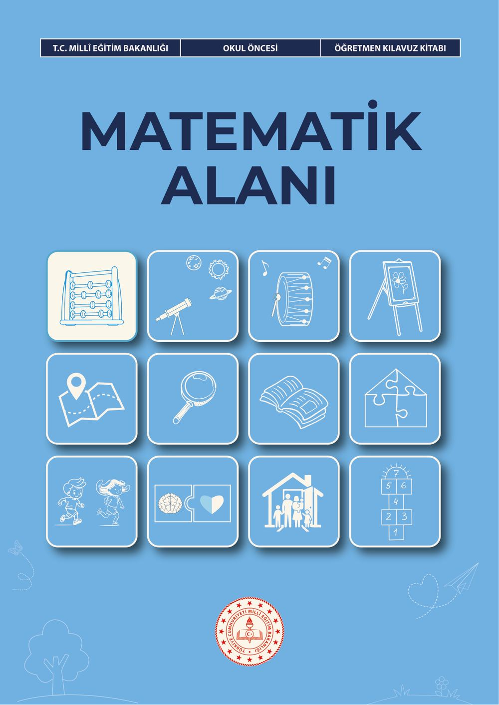
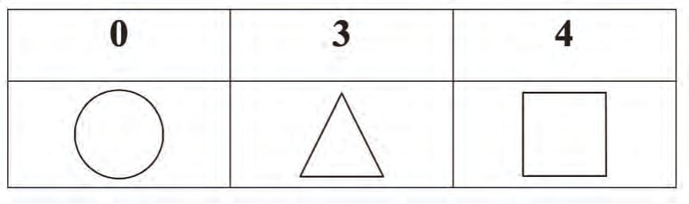
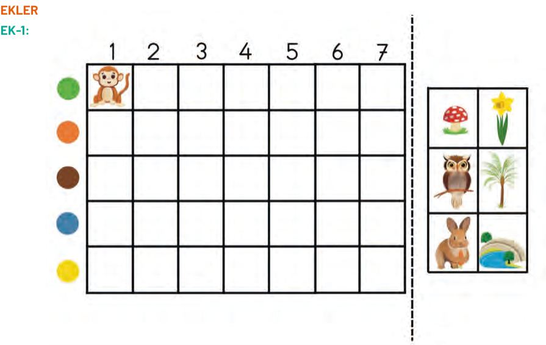
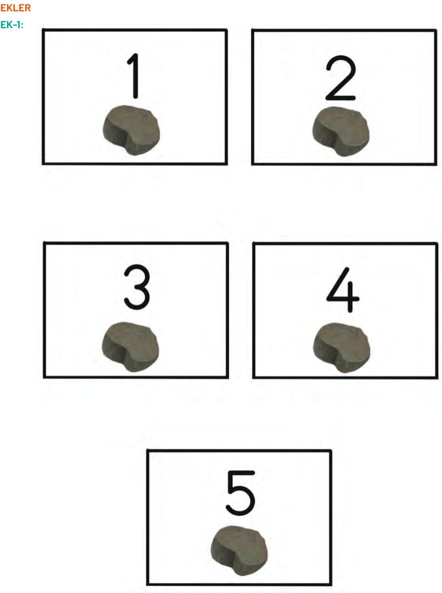
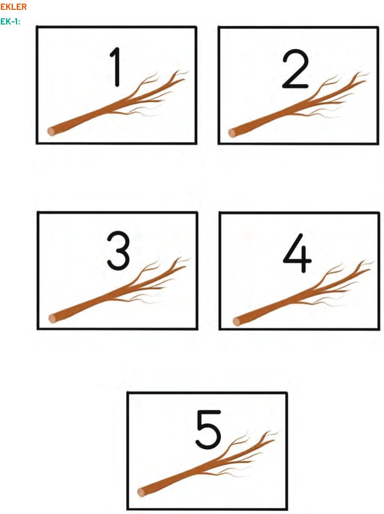
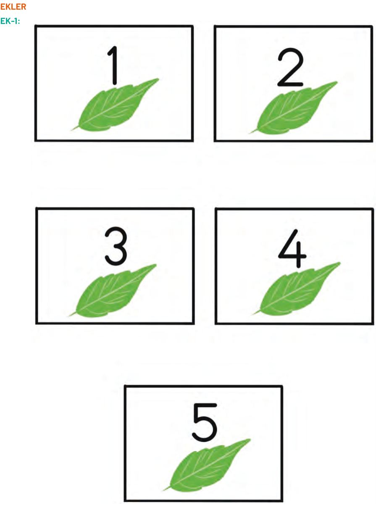
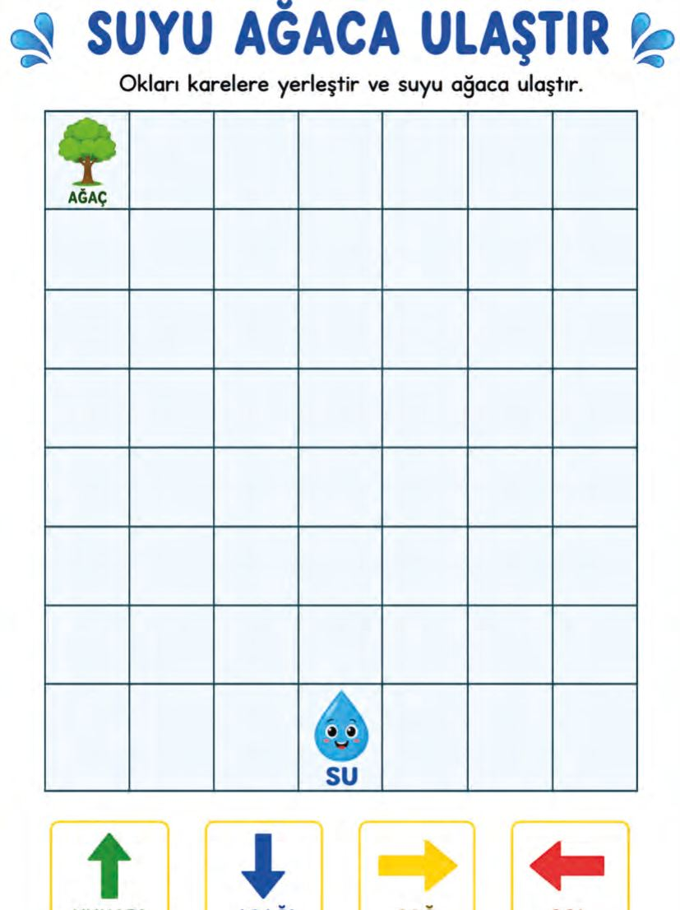
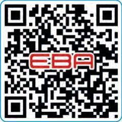
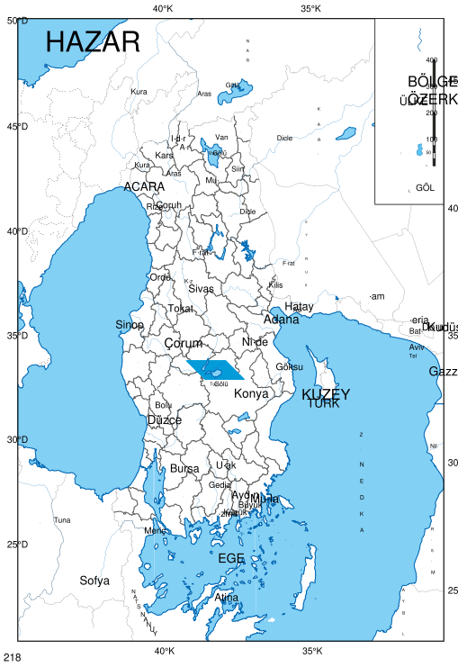
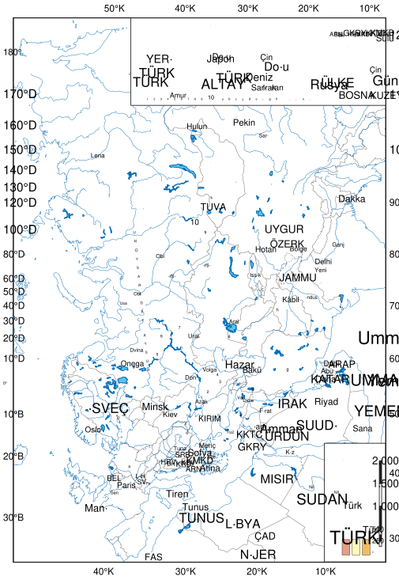

# Okul Öncesi Matematik Alanı Öğretmen Kılavuz Kitabı

<!-- sayfa 0 -->

T.C. MİLLÎ EĞİTİM BAKANLIĞI
OKUL ÖNCESİ
ÖĞRETMEN KILAVUZ KİTABI

# MATEMATİK ALANI

<!-- sayfa 1 -->

Verdiğiniz metin katmanı boş olduğu için (`<<< >>>` arası boş) dönüştürülecek bir içerik bulunmamaktadır. Lütfen metin katmanını içeren içeriği paylaşın, böylece talimatlarınıza uygun şekilde Markdown formatına çevirebilirim.

<!-- sayfa 2 -->

# OKUL ÖNCESİ

# Matematik Alanı Öğretmen Kılavuz Kitabı

## Yazarlar
BETÜL BALLICA
BÜŞRA NUR DURAN YILMAZ
EZGİ AVCI AŞIR
HİDAYET KARAEVLİ
HÜLYA KARA
PINAR ÇAKIR
SİTARE HAYRUNNİSA BEKÖZ

DEVLET KİTAPLARI

<!-- sayfa 3 -->

Milli Eğitim Bakanlığı Yayınları ................................................................................................................ : 11231
Ders Kitapları Dizisi No .......................................................................................................................... : 2658

Her hakkı saklıdır ve Millî Eğitim Bakanlığına aittir. Kitabın metin, soru ve şekilleri kısmen de olsa hiçbir surette alınıp yayımlanamaz.

**Editör**
Prof. Dr. Arzu ÖZYÜREK
Doç. Dr. Gonca ULUDAĞ
Doç. Dr. Türker SEZER

**Dil Uzmanı**
Nilüfer TURHAN

**Görsel Tasarımcı**
Metin BİLAL
Yağmur YILDIRIM

**Çoklu Ortam Tasarımcısı**
Ferhat DEMİRCİ
Gamze SEÇGİN
Gaye ERÇEN
Nilgül ÖNAL

**Program Geliştirme Uzmanı**
Hilal ALTINTAŞ

**Ölçme ve Değerlendirme Uzmanı**
Merve ERELİ

**Rehberlik Uzmanı**
Nur Hilal BABÜR

ISBN
978-625-8867-27-5

Millî Eğitim Bakanlığı Talim ve Terbiye Kurulu Başkanlığının 13 10 2026 tarih ve 172455532 sayılı yazısı ile eğitim

<!-- sayfa 4 -->

# İSTİKLÂL MARŞI

Korkma, sönmez bu şafaklarda yüzen al sancak;
Sönmeden yurdumun üstünde tüten en son ocak.
O benim milletimin yıldızıdır, parlayacak;
O benimdir, o benim milletimindir ancak.

Çatma, kurban olayım, çehreni ey nazlı hilâl!
Kahraman ırkıma bir gül! Ne bu şiddet, bu celâl?
Sana olmaz dökülen kanlarımız sonra helâl.
Hakkıdır Hakk'a tapan milletimin istiklâl.

Mehmet Âkif Ersoy

<!-- sayfa 5 -->

ANDIMIZ

Türküm, doğruyum, çalışkanım.

İlkem küçüklerimi korumak, büyüklerimi saymak; yurdumu, milletimi özümden çok sevmektir.
Ülküm yükselmek, ileri gitmektir.

Ey Büyük Atatürk!

Açtığın yolda, gösterdiğin hedefe durmadan yürüyeceğime ant içerim.

Varlığım Türk varlığına armağan olsun.

Ne mutlu Türküm diyene!

<!-- sayfa 6 -->

MUSTAFA KEMAL ATATÜRK

<!-- yer tutucu bulunamadı: sayfa sonuna eklendi -->

<!-- sayfa 7 -->

Verdiğiniz metin katmanı boş olduğu için (`<<< >>>` arası boş) dönüştürülecek bir içerik bulunmamaktadır. Lütfen metin katmanını içeren içeriği paylaşın, böylece talimatlarınıza uygun şekilde Markdown formatına çevirebilirim.

<!-- sayfa 8 -->

# İÇİNDEKİLER

| | |
| :--- | :---: |
| GİRİŞ | 10 |
| MATEMATİK ALAN BECERİLERİ | 10 |
| MATEMATİK ALANI ETKİNLİKLERİNİN PROGRAMDA YER ALAN DİĞER ALANLARLA İLİŞKİLENDİRİLMESİ | 19 |
| MATEMATİK ALANI ETKİNLİKLERİNİN PROGRAMLAR ARASI BİLEŞENLERLE İLİŞKİLENDİRİLMESİ | 22 |
| MATEMATİK ALANI ETKİNLİK ÖRNEKLERİ | 24 |
| &nbsp;&nbsp;&nbsp;&nbsp;Uçurtmanın Kuyruğu | 24 |
| &nbsp;&nbsp;&nbsp;&nbsp;Daire ile Dans | 26 |
| &nbsp;&nbsp;&nbsp;&nbsp;Bavulumda Ne Var? | 29 |
| &nbsp;&nbsp;&nbsp;&nbsp;Renkli Şekiller | 32 |
| &nbsp;&nbsp;&nbsp;&nbsp;Mavi, Kırmızı ve Sarı ile Kompozisyon | 34 |
| &nbsp;&nbsp;&nbsp;&nbsp;Kelebekten Örüntüye | 37 |
| &nbsp;&nbsp;&nbsp;&nbsp;Portrenin Yarısı | 40 |
| &nbsp;&nbsp;&nbsp;&nbsp;El Çırp, Say | 43 |
| &nbsp;&nbsp;&nbsp;&nbsp;Kuklalarla Şekil Avı | 46 |
| &nbsp;&nbsp;&nbsp;&nbsp;Bir Siyah Bir Beyaz | 49 |
| &nbsp;&nbsp;&nbsp;&nbsp;Şekilleri Tasarlıyorum | 51 |
| &nbsp;&nbsp;&nbsp;&nbsp;Hareketli Otopark | 53 |
| &nbsp;&nbsp;&nbsp;&nbsp;Bütünün Eksik Parçası | 55 |
| &nbsp;&nbsp;&nbsp;&nbsp;Matematik Dedektifleri | 57 |
| &nbsp;&nbsp;&nbsp;&nbsp;Kaç Kenarım Var? | 59 |
| &nbsp;&nbsp;&nbsp;&nbsp;Sayılarla Oyun | 62 |
| &nbsp;&nbsp;&nbsp;&nbsp;Üçgenler Nerede? | 65 |
| &nbsp;&nbsp;&nbsp;&nbsp;Kale ve Güneş | 68 |
| &nbsp;&nbsp;&nbsp;&nbsp;Şekillerden Sanata | 71 |
| &nbsp;&nbsp;&nbsp;&nbsp;Küpleri Dizelim | 74 |
| &nbsp;&nbsp;&nbsp;&nbsp;Ahtapotun Kolları | 76 |
| &nbsp;&nbsp;&nbsp;&nbsp;Sincap Capcap ile Matematik | 79 |
| &nbsp;&nbsp;&nbsp;&nbsp;Sayı Trenim | 82 |
| &nbsp;&nbsp;&nbsp;&nbsp;Tercihlerden Karara | 85 |
| &nbsp;&nbsp;&nbsp;&nbsp;Robotun Şarj İstasyonu | 88 |
| &nbsp;&nbsp;&nbsp;&nbsp;Kırkyama | 90 |

<!-- sayfa 9 -->

| | |
| :--- | :--- |
| Eşit Sepetlerimiz | 96 |
| Kareyi Tamamla | 99 |
| Küp mü, Küre mi? | 102 |
| Sincabın Kış Hazırlığı | 105 |
| Şekillerden Yeni Tasarımlar | 107 |
| Hangi Vagon? | 110 |
| Hangi Meyve Daha Çok? | 113 |
| Boncuklarım Eksik mi, Fazla mı? | 115 |
| Fırlat Roketini | 118 |
| Paylaşım Sepetleri | 120 |
| Hangisi Daha Kısa? | 122 |
| Renkli İpuçlarıyla Yolculuk | 124 |
| Topla, Artır, Ritmini Bul | 127 |
| Günüm Nasıl Geçiyor? | 132 |
| Ölçelim, Karşılaştıralım | 134 |
| Karışık Merdiven Basamakları | 137 |
| Arabanı Tamamla | 139 |
| Güneş Açtı, Ay Çıktı | 141 |
| Köprüyü Güçlendirelim | 143 |
| Hangi Örüntüyü Yapabilirim? | 145 |
| Mümkün mü, Değil mi? | 147 |
| Bütünün Eksik Parçası | 149 |
| Çiz ve Göster | 151 |
| Bahçede Yolculuk | 153 |
| Sayı Sepeti | 156 |
| Kurabiyeler Hazır mı? | 158 |
| Zamanı Karıştıran Kukla | 160 |
| Hikâyenin Kayıp Parçası | 162 |
| Renk Renk Bloklar | 164 |
| En Çok Sevilen Meyveler | 166 |
| En Sevilen Renk | 168 |
| Sınıftaki Oyuncaklar | 171 |
| Karıncanın Yolculuğu | 173 |
| Haydi Kek Yapalım | 176 |

<!-- sayfa 10 -->

| | |
| :--- | :--- |
| Şeritlerin Boyları | 179 |
| İsminde Kaç Harf Var? | 182 |
| Ponponlarla Örüntü | 185 |
| Sayalım Bakalım | 187 |
| Doğum Günü | 189 |
| Üçgenlerle Saklambaç | 191 |
| Yükselen Bloklarım | 194 |
| Dal Parçalarıyla Ne Yapalım? | 196 |
| Boncuklardan Kolye | 198 |
| Görüntüden Örüntüye | 200 |
| Şapkalı Eğlence Günü | 202 |
| Kodlama | 205 |
| Tahmin Et | 208 |
| Zıtlıklarla Oyun | 211 |
| Cahit Arf | 214 |
| KAYNAKÇA | 217 |
| GÖRSEL VE GENEL AĞ KAYNAKÇASI | 217 |
| TÜRKİYE’NİN MÜLKİ İDARE BÖLÜMLERİ İLE KARA VE DENİZ KOMŞULARI HARİTASI | 218 |
| TÜRK DÜNYASI HARİTASI | 219 |

<!-- sayfa 11 -->

# GİRİŞ

Bu kılavuz, Türkiye Yüzyılı Maarif Modeli Okul Öncesi Öğretim Programı matematik alanı kapsamında öğretmenlere yol gösterici bir kaynak olarak hazırlanmıştır. Kılavuzda öncelikle matematik alan becerileri olan sayma, matematiksel muhakeme, matematiksel problem çözme, matematiksel temsil ($36\text{-}48$ <!-- KONTROL: Marker'da karşılığı yok, uydurma olabilir --> ay, $48\text{-}60$ <!-- KONTROL: Marker'da karşılığı yok, uydurma olabilir --> ay, $60\text{-}72$ <!-- KONTROL: Marker'da karşılığı yok, uydurma olabilir --> ay), veri ile çalışma ve veriye dayalı karar verme ($48\text{-}60$ <!-- KONTROL: Marker'da karşılığı yok, uydurma olabilir --> ay, $60\text{-}72$ <!-- KONTROL: Marker'da karşılığı yok, uydurma olabilir --> ay) alan becerilerinin her biri için dikkat edilmesi gereken önemli noktalar ve sınıf içi uygulama önerileri yaş gruplarının özellikleri dikkate alınarak sunulmaktadır. Ayrıca kılavuzda matematik alanı etkinliklerinin programda yer alan diğer alanlarla (Türkçe, fen, sosyal, hareket ve sağlık, sanat, müzik) ve programlar arası bileşenlerle (sosyal-duygusal öğrenme becerileri, erdem: değer-eylem çerçevesi, okuryazarlık becerileri) nasıl ilişkilendirilebileceğine dair öneriler sunulmaktadır. Kılavuzdaki ifadeler öneri niteliğinde olup uygulamalar sınıfın koşullarına, çocukların bireysel farklılıklarına ve gelişim düzeylerine göre uyarlanabilir.

## MATEMATİK ALAN BECERİLERİ

Matematik alan becerileri, öğrenme çıktıları ve süreç bileşenleri; çeşitli matematiksel özellikleri ve ilişkileri ele almaktadır. Bu beceriler, çocukların sadece matematiksel bilgiye ve kavramlara hâkim olmalarına değil aynı zamanda matematiği sevmelerine, matematiksel akıl yürütme ve düşünme becerileri kazanmalarına destek olmaktadır. Matematik alan becerileriyle çocukların matematikle ilgili düşünmenin farklı boyutlarındaki potansiyellerini keşfetmeleri ve geliştirmeleri beklenir. Bu beceriler ile çocukların ritmik saymaları, nesne / varlıkların miktarını sayarak belirlemelerinin yanında algısal olarak saymaları; matematiksel özellik ve ilişkileri çözümleme, yorumlama ve çıkarım yapma gibi akıl yürütme süreçleri sonucunda kendi çabalarıyla anlamlandırmaları; karşılaştıkları matematikle ilgili problem durumlarını fark etmeleri, tanımlayabilmeleri, yorumlayabilmeleri, çözüme ulaştıracak gerekçeli stratejiler ve çözüm yolları geliştirmeleri, matematiksel problemlerin çözümüne ilişkin elde ettikleri deneyimleri ve geliştirdikleri anlayışları farklı problem durumlarını çözüme kavuşturmak için yansıtıcı bir şekilde kullanmaları; matematiksel özellikleri ve ilişkileri ifade eden geometrik şekiller, rakamlar, grafikler gibi çeşitli temsilleri tanımaları, görsel düzeydeki alternatif ifade araçlarını kullanmaları, anlamlarını çözümleyebilmeleri ve çeşitli örneklerini oluşturmaları; günlük yaşamdan temel alan ve araştırılabilecek matematikle ilgili problemleri fark etmeleri ve ifade etmeleri, bu tür problemlere ilişkin bilgi / veri toplamaları, elde ettikleri bilgileri / verileri basit görseller veya modeller üzerinde somutlaştırmaları, yorumlamaları ve yürüttükleri süreçleri ifade etmeleri beklenir.

### MAB6. SAYMA

Sayma becerisi, çocuğun sayıları farklı durumlarda doğru kullanabilmesini kapsar. Bu doğrultuda ileriye - geriye doğru ritmik sayma, nesne / varlık miktarını saymadan bir bakışta söyleme, nesne / varlık miktarını sayarak belirleme, bir sayıdan önceki / sonraki sayıyı söyleme, sayıları küçükten büyüğe ve büyükten küçüğe sıralama, nesne ya da kişilerin sırasını sıra bildiren sayı sözcükleriyle belirtmeyi kapsar. Okul öncesi dönemdeki çocuklar günlük yaşamın içerisinde hemen her yerde sayılarla karşılaşmakta, sayıların telaffuzuna şahit olmakta, sayıların bir anlam ifade ettiğine yönelik anlayış geliştirmektedir. Henüz anlamlı biçimde sayma eylemi gerçekleştiremeseler de bu erken deneyimler, matematik becerilerinin gelişimi açısından büyük önem taşımaktadır.

**Dikkat Edilmesi Gereken Önemli Noktalar**

* Sayma etkinliklerinde çocuklara hemen her durumda sayma fırsatı sunulması önemlidir. $36\text{-}48$ <!-- KONTROL: Marker'da karşılığı yok, uydurma olabilir --> aylık çocuklarla $1\text{-}5$ <!-- KONTROL: Marker'da karşılığı yok, uydurma olabilir --> arası sayma yapılırken $48\text{-}60$ <!-- KONTROL: Marker'da karşılığı yok, uydurma olabilir --> aylık çocuklara $1\text{-}10$ <!-- KONTROL: Marker'da karşılığı yok, uydurma olabilir --> arası, $60\text{-}72$ <!-- KONTROL: Marker'da karşılığı yok, uydurma olabilir --> aylık çocuklara $1\text{-}20$ <!-- KONTROL: Marker'da karşılığı yok, uydurma olabilir --> arası sayma fırsatları verilebilir. Çocukların yaşı ve ilgi düzeylerine göre sayma deneyimleri sunulabilir.
* Çocukların sayıları doğru telaffuz etmesi için tekrarlara yer vermek, grupları oluştururken veya nesneleri paylaştırırken yüksek sesle saymak, çocukların da sesli olarak sayma işlemine eşlik etmelerini istemek etkili olabilir. Sayı atlamadan ritmik biçimde sayma, doğru sayma alışkanlığının kazanılmasında önemli bir

<!-- sayfa 12 -->

• Çocuklar, saymayı pek çok günlük durumda kullanabilir. Bir yiyeceği veya oyuncağı paylaşırken, boya kalemlerinin miktarını karşılaştırırken veya oyunlarda süre tutarken sayma için doğal fırsatlar ortaya çıkar. Masaya kaç tabak konulacağını belirleme gibi sayma gerektiren görevlerde çocuğun aktif rol üstlenmesi somut deneyimler kazandırır.
• Sayma etkinliklerinde ritmik saymanın yanı sıra, verilen bir sayıdan önce veya sonra gelen sayıyı bulmak ezbere saymaktan çok sayılar üzerine düşünmeyi gerektirir. Günlük yaşamdan alınan bu tür problemler, çocuklara sayma üzerine düşünme fırsatı sunar.
• Okul öncesi dönemde çocuklarla sınıfta, açık alanda ve (veya) okul dışı öğrenme ortamında yapılan birçok etkinlikte sıralama doğal olarak kullanılır. Çocukların sıraya girmesini istemek, $1.$, $2.$, $3.$ gibi sıralamalara dikkat çekmek sıra bildiren sayı kavramlarının öğrenilmesini sağlayabilir.
• Çocukları saymaya yönlendirmek amacıyla “Kaç tane / adet?”, “Kaçıncı kitap?”, “İkinci kalemi üçüncü kalemi mi?” gibi sorular sormak, çocukları da sayma gerektiren sorular sormaya teşvik etmek önemlidir.
• Sayma becerisi, çocukların günlük yaşam problemlerini çözmelerine yardımcı olarak sosyal ilişkilerini de olumlu yönde etkileyebilir. Paylaşım gerektiren durumlarda eşitsizliği fark edip sayma yoluyla adil bir paylaşım sağlamak, sosyal çatışmaların önlenmesine de olumlu katkı sunabilir. Örneğin bir miktar yapı bloğunu eşit olarak paylaştırırken saymanın neden önemli olduğunu vurgulamak, çocuklara bu beceriyi sosyal bir araç olarak kullanma konusunda model oluşturabilir.
• Çocukları saymaya zorlamak yerine sayma konusunda model olmak ve teşvik etmek önemlidir. Bu bağlamda aile katılımı sağlanarak ebeveynlerin de ev ortamında ya da okul dışındaki zamanlarda çocuklarıyla birlikte sayma etkinlikleri yapmaları desteklenebilir.

## Sınıf İçi Uygulama Önerileri

**MAB.1. Sayıları farklı durumlarda doğru kullanabilme**

Sınıf rutinleri için günlük bir “sayma görevlisi” belirlenebilir. Bu görevdeki çocuklar gruplara ayrılırken her grupta kaç çocuk olduğu, bahçeye çıkmak için sıraya girildiğinde sıradaki çocuk sayısı sayılır ve sonuç arkadaşlarıyla paylaşılır. “Gruplar eşit olsun diye ne yapmalıyız?” veya “Sen kaçıncı sırada bahçeye çıkacaksın?” gibi problem durumları sunularak çözümün, çocukların kendileri tarafından bulunması teşvik edilir.

Yemek masasını hazırlama görevi verilen çocuğa “Her çocuk için bir tabak ve bir çatal koy.” benzeri bir yönerge verilebilir. Bu basit görünümlü görev; çocuğa birden fazla sayma, problem çözme, karar verme ve deneme-yanılma fırsatı sunar ayrıca eksik ya da fazla koyduğunda durumu fark edip düzeltme süreci de öğrenmenin bir parçası hâline gelir.

Sanat etkinliklerinde kullanılan boyalar, artık materyaller ve kalemler, yapboz parçaları, bloklar, kamyonlar veya bebekler gibi oyuncaklar sayma etkinlikleri için zengin birer materyal kaynağı olarak kullanılabilir. Çocuklardan bu nesneleri sayarak sonucu söylemeleri miktarları karşılaştırmaları ya da hangi grubun daha az veya daha çok olduğuna karar vermeleri istenir.

Çocukların nesneleri ya da kişileri saymadan, bir bakışta kaç tane olduğunu söylemelerine yönelik uygulamalar yapılabilir. Örneğin avuçtaki üç bilye gösterilerek kaç bilye olduğu çocuğa sorulur, ardından sayarak tahmininin doğruluğunu test etmesi istenir.

Saymacalar, sayı tekerlemeleri, saymanın vurgulandığı hikâyeler, şiirler ve saymaya dayalı oyunlar etkinliklerde kullanılabilir. Zaman zaman bir hikâyedeki olaylar dizisi sunulurken zaman zaman da kukla karakteri aracılığıyla ya da sayıların yer aldığı şarkılarla çocukların saymaya olan ilgisi çekilebilir.

Sınıftaki nesnelerin üzerine, çocukların kolayca görebileceği ve dikkatini çekebileceği biçimde o nesnelerin miktarını gösteren sayılar yazılabilir. Böylece çocuklar nesne ile sayı arasındaki ilişkiyi günlük yaşam içinde doğal yollarla keşfedebilir.

<!-- sayfa 13 -->

# MAB1. MATEMATİKSEL MUHAKEME

Matematiksel muhakeme, matematiksel bilgiye dayalı mantıklı çıkarımlar yapma sürecidir. Bu süreç aynı zamanda kapsamlı ve sistemli bir düşünme biçimi olarak da ele alınabilir bir başka deyişle matematiğin “neden?” ve “nasıl?” sorusunu sormayı öğreten boyutudur. Çocuklar erken yaşlardan itibaren çevrelerinde olup bitenleri sorgulama eğilimindedir. Bu doğal meraktan hareketle matematiksel olgu, olay ve ilişkileri düşünmelerine, sormalarına ve sorgulamalarına fırsat verilmeli; böylelikle matematiğe ilişkin kendi anlayışlarını geliştirmeleri desteklenmelidir.

**Dikkat Edilmesi Gereken Önemli Noktalar**

* Matematiksel muhakeme kapsamında çocuklardan oyun hamurundan yapılan bütün bir şekli iki ya da daha fazla eş parçaya ayırabilmeleri, yapboz veya tangram gibi parçalara ayrılabilen yapıların parçalarını belirleyebilmeleri, aynı/benzer ya da ilişkili parçaları bulabilmeleri ve bu parçaları birleştirerek bütünü oluşturabilmeleri beklenmektedir.
* Çocukların yaşı ve gelişim düzeyine göre iki, dört veya altı parçalı yapbozlardan başlanarak giderek daha fazla parçalı yapbozlara geçilebilir. Başlangıçta çocuktan yapboz parçalarını bulup ilişkili olanları eşleştirmesi istenirken ilerleyen süreçte parçalar arasındaki benzerlik, farklılık ve bütüne uygunluk ilişkisini sözel olarak ifade etmesi, parçaları birleştirerek bütünü oluşturması ve bütündeki eksik parçayı bulması beklenebilir. Bu süreçte önce nasıl yapıldığını göstermek ve bunu yaparken düşünce sürecini sesli olarak ifade etmek yol gösterici olacaktır. Son aşamada ise çocuğun yapbozu bağımsız olarak tamamlaması istenebilir, kullandığı stratejiler gözlemlenerek yeni stratejiler geliştirmesine rehberlik edilebilir.
* Parça-bütün ilişkisi bağlamında yapbozlar, görsel dikkat gerektiren ve görsel dikkatin gelişimine katkı sağlayabilen etkinliklerdir. Bu kapsamda sınıfta yapbozlara ayrılmış bir köşe oluşturulabilir ve çocukların bu alana ilgisi çekilerek yapbozlarla oynamaları teşvik edilebilir. Ancak yapboz etkinliği her çocuğun ilgisini aynı ölçüde çekmeyebilir. İlgiyi artırmak amacıyla çocukların sevdiği karakterlerin ve canlı renklerin kullanıldığı yapbozlar tercih edilebilir. Ayrıca az parçalı ve basit yapbozlardan başlanarak giderek daha fazla parçalı ve karmaşık yapbozlara geçilebilir.
* Oyun hamuru veya tangram da bir bütünü parçalarıyla ilişkilendirebilmek, bütünün parçalarını belirleyebilmek ve parçaları birleştirerek bütünü oluşturabilmek için kullanılabilir. Yapboz, oyun hamuru ve tangram gibi somut materyallerle başarılı çalışmaların ardından olay ve olgularla ilgili çalışmalar da denenebilir.
* Çocuklar somut materyallerle çalışırken parçalar ile bütün arasındaki ilişkiyi fark etmeleri için onlara ipuçları verilebilir ya da düşündürücü sorular sorulabilir. Bu süreçte kararı çocuğun kendisinin vermesi büyük önem taşır. Basit bir görevi başarıyla tamamlayan çocuk, zamanla daha zor görevlere de istekle yönelecektir.
* Çocukların matematiksel olgu, olay ve durumları anlamlarını koruyarak farklı biçimlerde ifade edebilmesi beklenir. Bu doğrultuda farklı büyüklük, yön, kenar ve açılara sahip geometrik şekilleri tanımaları ve oluşturmaları; sayıları rakam, nesne veya çizimlerle göstermeleri; varlıkların birbirlerine göre konumlarını ifade etmeleri ve kodlama yoluyla farklı semboller kullanarak oluşturulan matematiksel ifadeleri açıklamaları beklenir.
* Okul öncesi dönemde çocuklardan matematikle ilgili bir durumu nesne, çizim veya sembolle göstermeleri; sayıları nesne, çizim ya da rakam kullanarak ifade etmeleri beklenir. Bu aşamada sayıları temsil eden rakamları tanımalarına, verilen sayıyı rakamla yazarak veya aynı sayıda nesne kullanarak göstermelerine fırsat verilmelidir.
* Çocukların geometrik şekilleri tanıması, ismi söylenen şekli göstermesi ve gösterilen şekli üçgen, kare, daire gibi doğru biçimde isimlendirmesi beklenir. İlerleyen süreçte büyüklüğü veya yönü değişse de geometrik şeklin doğru biçimde tanınabilmesi önem taşır.

<!-- sayfa 14 -->

yönelik uygulamalara yer verilmesi önemlidir. Bir nesnenin yerini tarif eden haritadaki ok, şema veya çizimlere göre bulmaları, ilerleyen süreçte ise kendi haritalarını oluşturmaları desteklenebilir.
• Çocuklarla önce somut nesnelerle, ardından okuma yazmaya hazırlık sayfaları kullanarak örüntü etkinliklerinin yapılması önemlidir. Bu çalışmalarda basit örüntülerden daha karmaşık örüntülere doğru ilerlenmesi ve çocukların örüntüdeki kuralı keşfederek örüntüyü tamamlamaları beklenir. İleri aşamada ise kendilerine özgü örüntüler oluşturmaları desteklenebilir.
• Çocukların olay veya ölçüme ilişkin tahminleriyle elde ettikleri sonuçları karşılaştırmaları, nesne veya varlıkların uzunluk, büyüklük, ağırlık gibi özelliklerini karşılaştırmaları ve günlük yaşamdan gerçekleşmesi mümkün olan veya olmayan olaylara örnekler vermeleri beklenir. Bu doğrultuda tahminlerde bulunmaları, ölçüm yapmaları ve ölçüm sonucuyla tahminlerini karşılaştırmaları teşvik edilebilir. Bu süreçte çocukların merak duygusunu uyandıracak ve sonucu bulmaya yönelik heyecan verici durumların sunulması, dikkatin odaklanmasını ve etkinliklere isteyerek katılımı destekleyebilir.

**Sınıf İçi Uygulama Önerileri**

**MAB.2. Parça-bütün özelliklerini çözümleyebilme**

Çocukların veya çocuk-ebeveyn çiftlerin birlikte kendi yapbozlarını hazırladığı etkinlikler düzenlenebilir. İlgi duydukları ve kendilerine özgü bir resim parçalara ayrılarak yapboz hâline getirilebilir, bu yapbozlar sınıfta tüm çocukların kullanımına sunulabilir.

Sınıfta zengin bir “Yapboz Merkezi” oluşturulabilir. Bu merkezde tanınmış çizgi film veya hikâye karakterleri, çocukların yaptığı boyama çalışmaları, aile fotoğrafları ile çocukların ilgi duyabileceği hayvanlar veya haritalardan oluşan yapbozlar bulundurulabilir. 36–48 aylık çocuklar yetişkinle birlikte az parçalı yapbozlara yönlendirilebilir. 48–60 aylık çocukların, çalışacakları yapbozu kendilerinin seçmesine fırsat verilebilir. 60–72 aylık çocukların ise bu merkezi bağımsız olarak kullanmaları ve ikili-üçlü gruplar hâlinde çok parçalı yapbozlarla çalışmaları desteklenebilir.

Çocuklara yoğurma maddesi kullanarak bir figür oluşturmaları, ardından bu figürü belirli bir kurala göre parçalara ayırmaları ve parçaları birleştirerek yeniden bütün oluşturmaları gibi görevler verilebilir. Oyun hamuru yerine kil kullanılabilir, yapılan figür parçalara ayrıldıktan sonra kurutularak ilerleyen süreçte uzun süreli kullanım imkânı sağlanabilir.

Görsel okuma materyalleri sınıfın farklı noktalarına yerleştirilebilir. Duvarlara afişler, panolara fotoğraflar, raflara kitaplar ve broşürler konularak çocukların gün boyunca bu materyallerle kendiliğinden etkileşim kurmaları sağlanabilir. Materyaller düzenli aralıklarla yenilenerek çocukların ilgisi canlı tutulabilir.

Ünlü bir ressamın resmi kullanılarak yapboz oluşturulabilir. Bu yapbozun bazen bir parçası sayfa üzerine yapıştırılarak geri kalanının boyamayla tamamlanması, bazen de bir parçası eksik verilerek çocuğun bu parçayı boyayarak tamamlaması istenebilir.

Aile katılımı çalışmaları kapsamında ebeveynlere evde çocuklarıyla nitelikli zaman geçirmek amacıyla büyük boy yapbozlar yapmaları önerilebilir. Tamamlanan yapbozların çerçeveletilerek okul ortamında sergilenmesi diğer aileleri de teşvik edici olabilir.

**MAB.3. Matematikle ilgili durumları yorumlayabilme**

Çocuklara bir rakam gösterilerek kaç olduğunu söylemeleri, rakamın temsil ettiği sayı kadar nesne bulup getirmeleri gibi görevler verilebilir. 48–60 ve 60–72 aylık çocuklarla çalışılırken 1–10 arası rakamlar kullanılabilir. Sınıfta, okulda veya okul dışı ortamlarda sayıları ifade eden rakamların nerelerde kullanıldığına örnek vermeleri istenebilir; bu sembollerin günlük yaşamda hangi amaca hizmet ettiği hakkında sohbet edilebilir.

Çocukların geometrik şekilleri tanıması, ismi söylenen şekli göstermesi ve gösterilen şekli üçgen, kare, daire gibi doğru biçimde isimlendirmesi beklenir. Şekiller kenar, köşe ve ayrıtlarına göre isimlendirildiğinden çocuklara farklı büyüklük ve yönlerde çizilmiş şekiller sunulabilir. Dik üçgen, geniş açılı üçgen, eşkenar üçgen gibi yönü, açıları ve büyüklüğü değişse de üç kenar ve köşesi olan her şeklin üçgen olarak adlandırıldığına vurgu yapılması

<!-- sayfa 15 -->

önemlidir. İlerleyen süreçte büyüklüğü veya yönü değişse de geometrik şeklin doğru biçimde tanınabilmesi bu açıdan büyük önem taşır.

48-60 aylık çocuklarla daha fazla sayıda sembolün kullanıldığı, 60-72 aylık çocuklarla ise daha karmaşık ve fazla sayıda sembolün yer aldığı hazine haritaları oluşturulabilir. Çocukların haritadaki sembollerden yararlanarak hazineyi bulmaları istenebilir.

Okulda veya okul dışı ortamlarda çocukların karşılaşabileceği trafik işaretleri, giriş-çıkış, park yeri, TV veya marka görselleri gibi sembollere dikkat çekilebilir. Bu sembollerin farklı kullanımlarıyla ilgili çocukların görüşleri alınabilir.

**MAB.4. Karşılaştırmaya ve tahmine dayalı çıkarım yapabilme**

Çocuklarla sınıftaki bazı nesnelerin veya okul koridorlarının uzunluğunu ve en-boyunu bir iple ölçmeleri, çıkan sonuca göre uzunluk ve kısalıkla ilgili karşılaştırmalar yapmaları, ortaya çıkan sonucun nedenleri üzerine tartışmalarını sağlayacak fırsatlar sunulabilir.

Boncuk, düğme, küp gibi küçük nesnelerden yararlanılarak örüntü çalışmaları yapılabilir. Çocuklardan bu nesneleri belirli bir kurala göre dizmesi, örüntüdeki kuralı bulması ve örüntüyü devam ettirmesi istenebilir.

Basit örüntü çalışmalarının ardından daha geniş kapsamlı örüntü çalışmalarına geçilebilir. Çocukların kırmızı - mavi renkli kartları sırayla dizmesi, meyvelerin masa üzerinde iki üzüm-iki kiraz-bir çilek biçiminde dizilmesi gibi somut örüntülerle çalışılabilir. Son aşamada ise çalışma sayfalarında kâğıt etkinliği olarak örüntü tamamlama çalışmaları yapılabilir. Bu çalışmalar yalnızca sınıfla sınırlı kalmaz, sınıf dışında bulutların dizilişi gözlemlenebilir, hareketleriyle ilgili tahmin oyunları oynanabilir. Bahçede karıncaların hareketleri veya bir bitkinin yapraklarının diziliş sırası incelenerek doğadaki örüntülerin matematiksel boyutuna vurgu yapılabilir.

Çocuklardan somut nesnelerle kendi örüntülerini oluşturmaları istenebilir, ardından bir diğer çocuktan bu örüntünün kuralını söylemesi ve benzer ya da farklı bir örüntü oluşturması beklenebilir.

Sınıf ortamında kapı, masa, tahta veya bazı oyuncakların boyu parmak, karış, ayak boyu, tahta bir blok gibi standart olmayan araçlar kullanılarak ölçülebilir ve sonucu söylemeleri istenebilir. Bu ölçümlerde elde edilen sonuçların farklı olduğuna ve bunun kullanılan standart olmayan ölçüm aracıyla bağlantılı olduğuna dikkat çekilebilir.

“Hangisi daha uzun / kısa, hangisi daha ağır / hafiftir?” gibi sorular sorularak çocukların, nesnelerin özellikleri ile ilgili tahminlerde bulunmaları sağlanabilir. Tahminlerinin nedenleriyle ilgili görüşleri dinlenebilir, ölçüm yapıldıktan sonra sonuç hakkında tartışılabilir. Bir nesnenin ağırlık veya uzunluğuyla ilgili karar vermeye yarayan öncüller konusunda rehberlik edilebilir. Örneğin daha dolgun ve ince olan iki kişiden biri daha ağır olsa da boyları aynı olabilir. Uzakta duran bir kişi yakındakinden kısa gibi görünse de yan yana geldiklerinde aynı boyda oldukları fark edilebilir.

## MAB2. MATEMATİKSEL PROBLEM ÇÖZME

Matematiksel problem çözme becerisi; olay, olgu veya durumların içerdiği problemler karşısında matematiksel çözümler geliştirme sürecini ifade eder. Bu beceri; problemi belirlemeyi, analiz etmeyi, verileri ve çözüm beklentilerini ilişkilendirmeyi, çözüm stratejileri geliştirmeyi, olası sonuçlara ilişkin tahminler ortaya koymayı ve ulaşılan çözümü çeşitli biçimlerde paylaşmayı ve temsil etmeyi kapsar. Okul öncesi dönemde çocuklar günlük yaşam deneyimleri başta olmak üzere matematiği öğrenme ve keşfetme süreçlerinde birbirinden farklı problemlerle karşılaşır. Bu problemler çocukların matematiksel muhakeme yapabilmelerine, sahip oldukları bilgi ve becerileri gözden geçirerek kullanmalarına, farklı ilişkilendirmeler kurmalarına ve böylece yeni bilgiler edinmelerine zemin hazırlar.

**Dikkat Edilmesi Gereken Önemli Noktalar**

* Problem çözme sürecinde çocuğun, matematiksel durumları ve çözüme ulaşma süreçlerini oluşturan parçaları ile bu parçalar arasındaki ilişkileri belirlemesi beklenir. Bir problemi fark etmekten çok verilen

<!-- sayfa 16 -->

çözebileceği problemler sunulması büyük önem taşır.

* 48-60 ay ve 60-72 aylık çocuklardan kendisine sunulan bir nesne grubuyla aynı sayıda yeni bir nesne grubu oluşturması, bir nesne grubunda belirtilen sayıya göre ne kadar eksik veya fazla nesne olduğunu söylemesi, $10$'a kadar olan nesneleri iki kişiye veya kutuya paylaştırması, sınıflandırmaya dâhil edilebilecek ve edilemeyecek nesne veya varlıkları söylemesi, örüntüdeki eksik veya hatalı unsuru belirlemesi beklenir. Bu doğrultuda eşleştirme, iki nesne grubunun sayısal miktarını karşılaştırma, nesneleri iki eşit gruba paylaştırma, sınıflandırma dışında kalması gereken nesneleri belirleme ve verilen bir örüntüde uygun olmayan durumu fark ederek ifade etme fırsatı sunan etkinliklere yer verilmelidir.
* Problem çözme sürecinde çocuğun matematiksel durumları ve çözüme ulaşma süreçlerini oluşturan unsurların anlamlarını koruyarak farklı biçimlerde ifade etmesi ve dönüştürmesi beklenir. Bu nedenle çocukların problem çözme etkinliklerinde aktif rol almalarına özen gösterilmelidir.
* Çocuklardan verilen bir problem durumunu nesnelerle, çizimle veya sözel olarak ifade etmeleri beklenir. Örneğin bir arada bulunan nesneleri farklı özelliklerine göre yeniden sınıflandırabilir, iki nesneyi karşılaştırarak benzerlik ve farklılıklarını söyleyebilir ya da kodlama yoluyla farklı semboller kullanarak matematiksel ifadeler oluşturabilirler. Gün içinde bu tür fırsatların değerlendirilmesi önerilir.
* Bir problem durumunun çözüm öncesi ve sonrasındaki hâlleri karşılaştırılabilir, iki durum arasındaki benzerlik ve farklılıklar tartışılabilir. Örneğin paylaşımdan önce ve sonra her çocuğun elindeki oyuncak sayısını karşılaştırması ya da bir nesne grubuna ekleme yapılmadan önce ve sonraki miktarları söylemesi istenebilir.
* 48-60 ay ve 60-72 aylık çocukların matematiksel bir problemin çözümüne yönelik strateji geliştirmesi, bu stratejilerden yararlanarak problemi çözmesi ve süreci kontrol etmesi beklenir. Çocuklara problemi doğrudan çözmek yerine ipuçları verilerek kendi çözüm fikirlerini geliştirmeleri teşvik edilmelidir. $36-48$ aylık çocuklarla çalışılırken ise yetişkinin çözüm yolları sunarak çocuğun denemeler yapmasına fırsat vermesi önerilir.
* Çocuklardan bir grup nesnenin miktarını saymadan belirlemeye yönelik çözüm yolları oluşturmaları, bu yolları açıklayıp denemeleri, sunulan seçenekler arasından uygun olanı seçerek gerekçelendirmeleri ve iş birliği yapmaları beklenir. Problemlerin basitten zora doğru sunulması ve çözümü olmayan problemlere yer verilmemesi önemlidir. Yetişkin, probleme dikkat çekerek çocuğun denemeler yapmasına fırsat verebilir; probleme ulaşılıp ulaşılmadığında ise nedenleri üzerinde düşünmeye yönlendirebilir.
* Çocukların matematiksel problem çözme deneyimlerini gözden geçirmeleri, bu deneyimlerden çıkarımlar yapmaları ve çıkarımlarını değerlendirmeleri beklenir. Bu doğrultuda çözüm sürecini ifade etmeleri, öğrendikleri stratejiyi farklı problemlere uygulamaları ve deneyimlerini çevreleriyle paylaşmaları desteklenebilir. Bir problemin çözümüyle ilgili fikirlerini arkadaşlarına sunmaları ya da çözüme ulaşıp ulaşmama nedenlerini paylaşmaları da bu sürecin önemli bir parçasını oluşturur.
* Matematiksel problemlerin çözümünde öncelikle problemin ne olduğunun belirlenmesi, ardından çözüm stratejilerinin oluşturulması ve en uygun çözüm yolunun denenmesi önemlidir. Çocukların sıra dışı çözüm önerileri olumlu karşılanmalı ve deneme yaparak sonuçlarını görmelerine fırsat verilmelidir.
* Problemler karşısında nasıl tepki verileceği ve nasıl bir yol izleneceği konusunda çocuğa model olmak büyük önem taşır. Yetişkinin problemi fark edip tanımlaması, çözüm için neler yapacağına ilişkin düşüncelerini sesli olarak ifade etmesi ve denenen yolların işe yarayıp yaramadığının nedenlerini konuşması çocuk için güçlü bir model oluşturur.
* Problem çözme becerilerinin temelinde esnek düşünme ve düşünceleri ifade etme becerileri yer alır. Bu doğrultuda çocukların belirli bir durumu düşünmeleri, düşüncelerini ifade ederek uygulamaya koymaları ve sonuçlarını değerlendirip nedenlerini sözel olarak açıklayabilmeleri desteklenmelidir. Bu süreçte yetişkinin basit sorularla çocukları düşünmeye yönlendirmesi önerilir.

<!-- sayfa 17 -->

# Sınıf İçi Uygulama Önerileri

**MAB.5. Matematikle ilgili problemleri çözümleyebilme**

Güne başlama zamanından günü değerlendirme ve okuldan ayrılmaya kadar pek çok zaman diliminde çocukların, uyumsuzlukları fark ederek çözümlemelerine fırsat sunulabilir. Bahçeye çıkarken 48-60 ay ve 60-72 aylık çocuklardan eldivenlerini giymeleri istenebilir, parmaklarını tam yerleştiremediği durumu ifade etmeleri ve uyumsuzluğu çözmeleri için zaman tanınabilir.

Nesneler kullanılarak eksiltme ve artırma problemleri sunulabilir. Çocuğa 10 boya kaleminden birini arkadaşına verdiğinde kaç kalem kaldığı, tabağındaki 5 zeytinin yanına bir zeytin daha eklendiğinde kaç zeytin olduğu sorulabilir ya da kâsedeki 10 zeytini iki kişiye eşit olarak paylaştırması istenebilir.

**MAB.6. Matematikle ilgili problemleri yorumlayabilme**

Çocukların problem çözümüne geçmeden önce mevcut durumu nesnelerle, çizimle veya sözel olarak yeniden ifade etmeleri ve iki farklı problem durumunu benzerlik veya farklılıkları açısından değerlendirmeleri yorumlama becerilerini geliştirir. Sepetteki yapı blokları çocuklara rastgele paylaştırıldıktan sonra herkesin aynı sayıda yapı bloğuna sahip olup olmadığı sorulabilir, eşitsizliğe dikkat çekilerek yeniden paylaşımları istenebilir ve bunun için neler yapılabileceği düşünülebilir. Paylaşım sonrasında izlenen yol ile öncesi ve sonrasındaki durum hakkında konuşulabilir.

“Başka Nasıl?” çalışmaları yapılabilir. Çocuklara verilen bir problem durumu üzerinde düşünmeleri, ardından sırasıyla çözüm yollarını anlatmaları istenebilir. Aynı çözüm yolu önerildiğinde başka nasıl olabileceği sorularak yeni çözüm yolları bulmaya yönlendirilebilir ve ipuçları verilerek farklı çözümlere ulaşmaları desteklenebilir.

60-72 aylık çocuklarla problem oluşturma çalışmaları yapılabilir. Bireysel veya küçük grup etkinliklerinde çocuklara eşit sayıda küçük figür veya bozuk para gibi nesneler verilerek paylaştırma, eksiltme, artırma ve karşılaştırma problemleri üzerinde çalışılabilir.

**MAB.7. Matematikle ilgili problemlere çözüm yolları geliştirebilme**

36-48 aylık çocuklarla yapboz çalışması yaparken bir parça bilerek yanlış yere yerleştirilebilir ve çocuklar, doğru yeri bulmaları için doğru yeri bulması için yönlendirilebilir. Bu tür problemlerde çocuk düşünmeye sevk edilir ve problemi çözmek için bir yol dener, denemeler ipuçlarıyla desteklenebilir. 48-60 ve 60-72 aylık çocuklara ise yapboz parçalarını zemindeki kart olmadan oluşturmaları istenebilir, doğru yapabilmek için nasıl bir yol izleyecekleri konuşulabilir ve sonuca ulaşamamasının nedenleri tartışılabilir.

Kolaj çalışmalarında gerekli materyalin yeterli sayıda olmadığı durumlarda çocuktan nasıl bir çözüm bulabileceğini düşünmesi istenebilir. Örneğin çocuk figürünün saçlarını oluşturmak için ihtiyaç duyulan renkli iplerin az olması durumunda ipleri parçalara keserek kullanma veya aralarına krepon kâğıdı yerleştirme gibi çözüm yolları geliştirmesine rehberlik edilebilir.

48-60 ay ve 60-72 aylık çocuklara okunan bir hikâyede karakterin karşılaştığı problem ve çözüm yöntemi tartışılabilir, “Sen olsaydın nasıl çözerdin?” sorusuyla farklı çözüm yolları geliştirmeleri teşvik edilebilir.

**MAB.8. Problem çözme deneyimlerini yansıtabilme**

Çocukların bir problemin çözümüyle ilgili deneyimlerini arkadaşlarıyla paylaşmaları istenebilir. Bu yolla çocuğun öz güveni gelişebileceği gibi problem çözme yöntemi diğerlerine de yol gösterici olabilir.

“Konuşmadan Anlat” gibi bir oyun planlanabilir. Bu oyunda çocuktan problem durumuyla ilgili çözümünü konuşmadan, işaretler ve beden diliyle anlatması istenebilir; izleyen çocuklardan ise bu anlatımı sözel olarak ifade etmeleri beklenebilir.

Çocukların, problem çözme sürecini resim veya çizimle anlatmaları istenebilir; bu çizimler sınıfta sergilenerek diğer çocukların da incelemesine sunulabilir. Böylece hem deneyimlerini yansıtmaları hem de birbirlerinin çözüm yollarından ilham almaları desteklenebilir.

MAB3 MATEMATİKSEL TEMSİL

<!-- sayfa 18 -->

nesneler aracılığıyla ifade edilmesi ve sergilenmesidir. Okul öncesi dönemde çocukların bilişsel özellikleri gereği öğrenme süreçlerinde çoklu duyuların kullanılması büyük önem taşır. Bu açıdan matematiksel temsiller hem anlamsal bir derinlik taşımalı hem de matematiksel özellik ve ilişkilerin somut biçimde ortaya konulmasına zemin hazırlamalıdır. Böylece çocukların matematiksel içerikleri fark edip anlamlandırarak kalıcı bir matematiksel anlayış geliştirmeleri desteklenmiş olur.

**Dikkat Edilmesi Gereken Önemli Noktalar**

* Çocuklardan matematiksel olan ve olmayan semboller arasından rakamlar, şekiller ve grafikler gibi matematiksel temsilleri göstermeleri beklenir. İsmi söylenen geometrik şekli, rakamı veya sayıyı göstermeye yönelik çalışmalar bu sembollerin tanınmasını destekler.
* Çocuklardan nesne miktarına karşılık gelen rakamı ve sayıyı göstermeleri, belirtilen durumu yansıtan grafiği göstermeleri beklenir. Bunun yanı sıra boncuk, çubuk, pul gibi materyallerle rakam, şekil ve grafikler oluşturmaları ya da tanıdık bir çevrenin krokisini kullanmaları ve oluşturmaları da beklenir.
* Çocuğun matematiksel temsilin ifade ettiği özellik ve anlamları analiz etmesi, farklı durumlar için oluşturulmuş temsillerle aynı durum için oluşturulmuş farklı temsilleri karşılaştırması beklenir. Bu amaçla sayılar, rakamlar ve grafiklerden yararlanılabilir.
* Çocuklardan kendisine sunulan bir sayı kadar nesne grubu oluşturmaları, gösterilen geometrik şeklin özelliklerini açıklamaları, bir grafikte yer alan kategorilerin azlık-çokluk durumunu söylemeleri, sayıları büyükten küçüğe ve küçükten büyüğe doğru sıralamaları, $10$'a kadar olan sayılarda kendisine söylenen bir sayıdan önceki ve sonraki sayıyı söylemeleri, geometrik şekillerin özelliklerini ve farklı durumları ifade eden grafikleri karşılaştırmaları istenebilir.
* Çocukların matematiksel temsilleri tanımaları ve günlük yaşamdaki kullanımlarını fark edebilmeleri için sınıf panosunda $1$-$10$ arası rakamlar, geometrik şekiller ve çeşitli grafiklere yer verilebilir. Matematik merkezi olarak düzenlenen bu alanda matematiksel temsillerin yer aldığı hikâye kitapları, yapbozlar, oyun ve oyuncaklar, yazı tahtası ve kesme rakamlar gibi materyaller bulundurulabilir.

**Sınıf İçi Uygulama Önerileri**

**MAB.9. Matematikle ilgili temsillerden yararlanabilme**

$36$-$48$ aylık çocuklarla adı söylenen geometrik şekli veya $1$-$5$ arası sayıyı temsil eden rakamı göstermeye yönelik çalışmalar yapılabilir. $48$-$60$ ay ve $60$-$72$ aylık çocuklarla ise adı söylenen geometrik şekli veya $1$-$10$ arası rakamı göstermelerinin ardından gösterilen şeklin veya rakamın adını söylemeleri istenebilir.

Karışık olarak verilen semboller arasından matematikle ilgili olanları tanıyıp gösterme çalışmaları yapılabilir. Trafik işaretleri, yer ve yön işaretleri, toplama-çıkarma işaretleri, geometrik şekiller ve rakamların kartondan kesilmiş modelleri karışık biçimde önlerine konularak matematikle ilgili olanları bulup ayırmaları istenebilir.

Matematikle ilgili temsillerden oluşan bir pano hazırlanabilir ve zaman zaman bu pano kullanılarak temsilleri tanıma çalışmaları yapılabilir.

Çocuklardan makarna, yapı bloğu, minder veya vücutlarını kullanarak rakamlar ya da geometrik şekiller oluşturmaları istenebilir.

Okula gelişten ayrılma zamanına kadar olan süreçte sabah, öğle, akşam, kahvaltı saati, hikâye zamanı gibi ifadelerle günün zamanına vurgu yapılabilir. Çocuklardan da bir durumu anlatırken günün zamanıyla ilgili betimlemeler yapmaları istenebilir. Günün zamanını belirten resimlerin yer aldığı bir pano oluşturulması çocukların zamanla ilgili temsilleri tanıma ve kullanmalarını destekleyebilir.

Bir nesneyi belirli bir özelliğine göre grafik oluşturacak biçimde sıralamaları istenebilir. Sınıftaki çocukları temsil eden figürlerin yer aldığı grafikte farklı grupları farklı renklere boyamaları ve ortaya çıkan grafik hakkında konuşmaları sağlanabilir.

**MAB 10. Matematikle ilgili temsilleri değerlendirebilme**

<!-- sayfa 19 -->

yapılabilir. Üçgen, daire ve karenin kaç köşe ve kenardan oluştuğu elle dokunarak saydırılabilir. 48-60 ay ve 60-72 aylık çocuklarla bu şekillerin benzerlik ve farklılıklarına da dikkat çekilebilir.

Günlük yaşamdaki bazı nesnelerin matematiksel sembollerle benzerliğine dikkat çekilebilir. Bir kutunun veya bisküvi kabının hangi geometrik şekle benzediği sorulabilir ya da sınıf içinde kareye benzeyen nesneleri bulup göstermeleri istenebilir.

# MAB4. VERİ İLE ÇALIŞMA VE VERİYE DAYALI KARAR VERME

Veri ile çalışma ve veriye dayalı karar verme becerisi; çocukların günlük yaşamdan araştırılabilecek bir soru veya sorun tespit etmelerini, buna ilişkin sorular oluşturmalarını, veri elde etmelerini, bu verileri düzenleyip analiz etmelerini ve elde ettikleri bulgulardan sonuç çıkararak değerlendirme yapmalarını kapsar. Okul öncesi dönemde çocuklar dünyayı anlama ve keşfetme süreçlerinde matematiksel özellik ve ilişkilere yönelik bilgi ve veriler edinir. Bu dönemde çocuklar matematiksel olgu ve olaylar hakkında doğal meraklarından hareketle ölçümler yapar, tahminlerde bulunur, çıkarımlar yapar ve elde ettikleri bilgileri çeşitli biçimlerde ifade ederek veriye dayalı kararlar verebilir.

**Dikkat Edilmesi Gereken Önemli Noktalar**

* Veri ile çalışma ve veriye dayalı karar verme becerisi 48-60 aylıktan itibaren ele alınır. 36-48 aylık çocuklarla çalışmada yetişkin desteğine daha fazla gereksinim duyulduğundan verileri sunmak ve problem çözümünde model olmak yeterli olacaktır.
* Çocuğun problemi çözecek bilgi ve verilere ulaşmak için plan yapması, bu verileri elde edip düzenleyerek grafik, figür ve temsil gibi somut araçlarla ifade etmesi beklenir. Bu doğrultuda veri toplanacak kaynakları söylemeleri, verileri kaydetmeleri ve düzenlemeleri önem taşır.
* Elde edilen verilerin analiz edilebilmesi için uygun yolların belirlenmesi büyük önem taşır. Bu süreçte çocuklardan nesne veya varlıkların benzer ve farklı özelliklerini söylemeleri, basit toplama veya çıkarma işlemleri yapmaları, nesneleri eşleştirmeleri, sınıflandırmaları ve sıralamaları beklenir.
* 60-72 aylık çocuklarla bulguları yorumlamaya dayalı çalışmalar yapılabilir. Bu süreçte çocuklardan veri toplama sonucunda ulaştıkları sonuçları dramatizasyon, sanat çalışması, grafik, çizim veya açıklama gibi çeşitli yollarla ifade etmeleri ve ortaya çıkan sonuçlarla ilgili düşüncelerini paylaşmaları beklenir.
* Çocukların matematiksel problemleri çözebilmeleri için verilerden yararlanabilmeleri gerekir. Bu doğrultuda çocuklara problem sunulduğunda veriler üzerinden düşünmeleri ve buna göre karar vermeleri yönünde rehberlik edilmelidir.
* Tüm aşamalarda somuttan soyuta ve basitten zora doğru bir sıra izlemeye dikkat edilmelidir.

## Sınıf İçi Uygulama Önerileri

### MAB. 11. Veriyle çalışabilme

Çocuklara çözüm gerektiren bir problem sunulabilir ve verilerden yararlanmalarına rehberlik edilebilir. Örneğin toplanma zamanında tüm çocukların görev alması istenebilir. Bu durumda çocukların toplanılacak alanları, sınıftaki çocuk sayısını ve en çok zaman geçirilen öğrenme merkezlerini dikkate alarak planlama yapmaları gerekecektir. Birlikte daha iyi çalışacak olanlar gibi bir sınıflandırmayla gruplar belirlenerek toplanma sürecinin veriye dayalı yönetilmesine fırsat verilebilir.

Varsa ara öğün zamanında fındık, ceviz ve leblebi gibi kuru yemişlerin çocuklar tarafından paylaştırılması istenebilir. Bu süreçte sınıftaki çocuk sayısı, kaç kâseye ihtiyaç duyulduğu, her kâseye ne kadar konulması gerektiği, ölçüm aracının nasıl belirleneceği ve paylaşım sonrasında eşitsizlik oluşup oluşmadığı gibi pek çok veriyle ilgili soruya yanıt bulmak çocuklara önemli bir deneyim sunabilir.

### MAB. 12. Bulguya Ulaşabilme

Çocukların matematikle ilgili bir probleme ilişkin verileri farklı yollarla göstermelerine yönelik uygulamalar

<!-- sayfa 20 -->

azlık-çokluğu hakkında konuşulabilir.

Farklı renk ve büyüklüklerde boncuklar ve ipler verilerek boncuk dizme çalışmaları yaptırılabilir. Çocukların dizimi nasıl planladıklarını anlatmaları, kâğıt üzerinde çizimle göstermeleri ve ikisi arasındaki benzerlik ile farklılıkları açıklamaları istenebilir. Her renk veya boyuttan belirli sayıda boncuk kullanma zorunluluğu gibi kurallar konularak daha fazla düşünmeleri sağlanabilir.

Başlangıçta somut nesnelerle yapılan sınıflandırmalar daha sonra kâğıt üzerinde resim veya çizimlerle yaptırılabilir.

Çocuklar küçük gruplara ayrılarak tek bir problem üzerinde birlikte ya da her grup farklı bir problem üzerinde çalışabilir. Ardından grupların veri toplama ve bulgulara ulaşma sürecini birbirlerine anlatmaları desteklenebilir.

**MAB.13. Bulguyu yorumlayabilme**

60-72 aylık çocuklarla bulguları yorumlamaya yönelik çalışmalar yapılabilir. Çocukların bir problemin çözümüyle ilgili kararlarını açıklamalarının ardından bunu nasıl planladıkları, neye göre karar verdikleri ve nasıl bir yol izledikleri sorularak verilerden yararlanmanın gerekliliğine dikkat çekilebilir.

Çocuklardan gösterilen bir grafiğe bakarak ne anlatmak istediğini açıklamaları ve grafikteki sembol ile gösterimlerin neyi ifade ettiğini söylemeleri istenebilir. “Bu grafikte elmalar mı, armutlar mı daha fazla? Neden?” gibi sorular çocuğun veriyi yorumlayarak yanıt vermesini gerektirir.

Matematik alan becerilerinin sınıf içi uygulamalarının yanı sıra bu becerilerin diğer alanlarla ve programlar arası bileşenlerle nasıl ilişkilendirilebileceği de öğretmenler açısından rehber niteliği taşımaktadır. Aşağıda bu ilişkilendirmelere yönelik açıklama ve öneriler yer almaktadır.

# MATEMATİK ALANI ETKİNLİKLERİNİN PROGRAMDA YER ALAN DİĞER ALANLARLA İLİŞKİLENDİRİLMESİ

Matematik alan becerilerinin kazandırılmasında öncelikle çocukların gelişim düzeyleri, bireysel ihtiyaçları ve öğrenme özellikleri göz önünde bulundurulmalıdır. Öğrenme çıktılarına ulaşmada farklı yöntem ve tekniklerle tekrar fırsatlarına yer verilmesi büyük önem taşımaktadır. Çünkü bir beceri, daha kapsamlı başka bir becerinin ön koşulu olabileceği gibi o becerinin içerisinde alt beceri olarak da yer alabilmektedir. Bu nedenle beceriler ele alınırken bilinenden bilinmeyene, basitten karmaşığa, somuttan soyuta ve yakından uzağa ilkeleri gözetilmelidir.

Matematik alan becerileri açısından okul öncesi dönem; temel oluşturma, farkındalık kazandırma, çocukların ilgi ve yeteneklerini keşfetmelerine imkân sağlama ve öğrenmeyi sevdirme açısından kritik bir gelişim evresi olarak değerlendirilmelidir. Matematiğin çocuklar tarafından olumlu algılanması, matematiğe ilgi geliştirilmesi ve matematikle uğraşmanın keyifli bir deneyime dönüşmesi için öğrenme ortamlarının tekdüzelikten uzak, yaşama yakın ve çok duyulu deneyimler sunacak biçimde düzenlenmesi önemlidir. Oyun temelli etkinlikler de bu açıdan çocukların dikkatini çekerek öğrenme sürecine aktif katılımlarını desteklemekte ve öğrenmeyi daha eğlenceli hâle getirmektedir.

Bu dönemde öğrenme çıktıları ve süreç bileşenleri yalnızca tek bir matematiksel kavram ya da bilgi türüyle sınırlandırılmamalı; birden fazla temel beceri, kavram ve içeriği kapsayabilecek esnek bir yapı içerisinde ele alınmalıdır. Örneğin matematiksel muhakeme becerisi; geometrik şekillerin özellikleri, nesnelerin ölçülebilir özellikleri ya da parça–bütün ilişkisi gibi farklı matematiksel içerikler üzerinden geliştirilebilir. Bu doğrultuda nesneleri sınıflandırma ve karşılaştırma, matematiksel durumları farklı bakış açılarıyla modelleme, örüntülerin kuralını keşfetme ve sürdürme, nesnelerin birbirlerine göre konumlarını ifade etme gibi etkinlikler planlanabilir.

Alan becerileri, öğrenme çıktıları ve matematiksel içeriğin bütünleştirilmesinde temel nokta; ilgili alan becerisinin gerektirdiği düşünsel süreçlerin belirlenmesi ve bu süreçlerin ele alınacak matematiksel içerikle uyumlu hâle getirilmesidir. Süreç bileşenlerine odaklanmak, çocuktan hangi düşünme becerilerinin beklendiğinin ortaya konulması açısından yol gösterici olacaktır. Örneğin matematiksel problem çözme becerisi; çocukların karşılaştıkları problemleri ön bilgi ve deneyimlerinden yararlanarak yorumlamalarını,

<!-- sayfa 21 -->

becerileri diğer alan becerileriyle birlikte ele alınmalı ve bütünleşik bir yaklaşımla tasarlanmalıdır. Bu süreçte temel amaç, becerilerin doğrudan aktarılması değil; çocuklara bu becerileri kullanabilecekleri, deneyimleyebilecekleri ve geliştirebilecekleri öğrenme ortamları sunmaktır. Çocukların matematiksel kavramları kendi yaşantıları aracılığıyla keşfetmeleri, anlamlandırmaları ve günlük yaşamla ilişkilendirmeleri beklenmektedir.

Etkinlikler planlanırken matematik alanında hedeflenen öğrenme çıktıları farklı gelişim alanları ve disiplinlerle ilişkilendirilebilir. Örneğin ritmik sayma becerilerinin desteklenmesi amacıyla şarkılar ve ritim etkinlikleri aracılığıyla müzik alanıyla, yaratıcı düşünme ve farklı çözüm yolları geliştirme süreçleri kapsamında sanat uygulamaları yoluyla sanat alanıyla bütünleştirme yapılabilir. Günlük yaşamdan matematiksel bir durumu fark etmeyi, problem oluşturmayı veya araştırmayı gerektiren etkinliklerde sosyal alanla, olay örgüsündeki önemli anların sıralanması veya grafik kartlarının düzenlenmesi gibi süreçlerde hikâye okuma ve oluşturma etkinlikleri aracılığıyla Türkçe alanıyla bağlantı kurulabilir. Veri toplama, düzenleme, analiz etme, yorumlama ve sonuç çıkarma süreçlerini içeren öğrenme deneyimleri fen alanıyla; çocukların harita, kroki veya yönlendirme işaretlerini takip ederek bir hedefe ulaşmalarını içeren oryantiring ve hazine avı gibi etkinlikler aracılığıyla ise hareket ve sağlık alanıyla bütünleştirilebilir.

Diğer alan becerileri, öğrenme çıktıları ve süreç bileşenlerinin; düşünsel, duyuşsal, sosyal, estetik ve devinimsel boyutlarla birlikte ele alınması çocukların farklı öğrenme yollarına hitap eden daha kalıcı öğrenme deneyimlerinin oluşturulmasına katkı sağlayacaktır. Böylece öğrenme süreçleri çocukların bireysel farklılıklarını gözeten kapsayıcı bir eğitim anlayışını da destekleyecektir.

## Türkçe Alanı ile İlişkilendirme

Matematik alanı etkinlikleri Türkçe alanı becerileriyle bütünleşik biçimde ele alınabilir. Matematikle ilgili bir problemin tanımlanmasında dinleme ve izleme etkinliklerinden yararlanılabilir. Okunan hikâyelerde geçen sayı, miktar, sıralama, karşılaştırma ve veriye dayalı karar verme kavramları üzerinde durulabilir; hikâyenin yeniden anlatılması veya canlandırılması aşamalarında bu kavramlara vurgu yapılabilir. Hikâyedeki olayları oluş sırasına göre anlatmaları istenebildiği gibi matematiksel bilgiler kasıtlı olarak yanlış verilerek dikkat ve eleştirel düşünme becerileri de çalıştırılabilir mi desek?

Konuşma becerilerinin gelişiminde de matematiksel bilgilerden yararlanılabilir. Matematiksel kavramların öğrenilmesi kelime dağarcığını zenginleştirirken bu zenginlik çocukların kendilerini daha kolay ifade etmelerini de destekler. Söyleneni anlama ve anladığını sözel olarak ifade etmenin yanı sıra bir problem durumunu beden dili aracılığıyla aktarmaya yönelik etkinlikler de planlanabilir. Çocuklardan hikâyedeki ya da anlatılan olaylardaki durumları oluş sırasına göre açıklamaları, problemin ne olduğunu ve nasıl çözüme kavuştuğunu ya da farklı nasıl çözülebileceğine ilişkin düşüncelerini paylaşmaları istenebilir.

Matematiksel temsillerin öğrenilmesinde görsel okuma becerileri destekleyici bir işlev üstlenir. Bir hikâyedeki veya görseldeki olayları ayrıntılarıyla fark edip anlatmak, çocukların matematiksel problemleri görsel yollarla ifade edebilmelerini ya da grafik gibi görsel verileri yorumlamalarını kolaylaştırır. Matematiksel verileri şekil, grafik veya çizimle temsil etmek ise çocukların düşüncelerini düzenleme ve sözel olarak aktarma becerilerini birlikte geliştirir.

Matematik becerileri erken okuryazarlık becerileriyle de ilişkilendirilebilir. Sözcüklerin hece sayısını belirleme, hece sayısı kadar ritim tutma veya aynı sayıda heceye sahip sözcükler bulma gibi etkinlikler sayma kavramıyla doğrudan bağlantılıdır. Bir sözcüğün başlangıç ve bitiş sesini tanıma gibi okuryazarlık çalışmaları matematik alanındaki sıralama kavramıyla bütünleşik olarak ele alınabilir. Benzerlik–farklılık ve günün zamanını ifade etme gibi kavramlar ise Türkçe etkinliklerindeki kendini ifade etme becerileriyle birlikte işlenebilir.

## Fen Alanı ile İlişkilendirme

Matematik alanı etkinlikleri fen alanı becerileriyle bütünleştirilerek çocukların hem matematiksel hem de bilimsel düşünme becerileri birlikte desteklenebilir Fen alanında bir olayın neden ve nasıl gerçekleştiğini

<!-- sayfa 22 -->

yakından kesişmektedir. Her iki alanda da neden-sonuç ilişkisi kurarak çıkarımlarda bulunma temel bir düşünme becerisi olarak öne çıkmaktadır. Bu kesişim noktaları, günlük fen etkinliklerinden doğa gözlemlerine kadar pek çok uygulamada somut biçimde karşılık bulmaktadır.

Problem çözmeye dayalı etkinliklerde veri toplama aşamasında uzunluk, ağırlık, büyüklük ve hacim gibi ölçümler fen deneyleriyle desteklenebilir. Gündüz-gece, sabah-öğle-akşam gibi zamanla ilgili kavramlar; sıcak-soğuk, uzun-kısa gibi zıt kavramlar ile benzerlik ve farklılıklara dayalı etkinlikler her iki alanda da yer aldığından bütünleşik biçimde ele alınabilir. Haftanın günleri, aylar, mevsimler ve takvim okuma çalışmaları ise matematik alanındaki sayma, sıralama ve ölçme etkinlikleriyle ilişkilendirilebilir. Fen alanında gözlem yoluyla bilgi edinme süreci, matematik alanındaki veri toplama ve veriye dayalı karar verme becerileriyle de örtüşmektedir.

Bitki yetiştirme, hayvan besleme ve doğada gözlem yapma gibi fen etkinliklerinde çocukların benzerlik, farklılık, sayı ve şekil kavramlarını kullanarak çıkarımlarda bulunmaları beklenir. Örneğin hayvanları incelerken bir kedinin kaç ayağı olduğu, kedi ile tavşanın kuyruk boylarının neden farklılaştığı ya da ayıların ne zaman ve ne kadar süreyle uykuya çekildiği gibi konuşmalar matematiksel kavramların doğal bağlamda kullanılmasına zemin hazırlar.

İnceleme gezileri, doğa yürüyüşleri, bitki ve hayvan bakımı ile deney etkinlikleri; sayma, muhakeme, eşleştirme, sıralama, tahmin, veri toplama, verileri matematiksel temsillerle ifade etme ve değerlendirme gibi matematik alanı süreç bileşenleriyle doğrudan örtüşmektedir. Bu nedenle her iki alan için etkinlik planlanırken ortak süreç bileşenlerine birlikte yer verilmesi hem öğrenmeyi derinleştirecek hem de alan bütünleşmesini güçlendirecektir.

**Sosyal Alan ile İlişkilendirme**

Matematik alanı etkinlikleri sosyal alan becerileriyle bütünleştirilerek çocukların toplumsal farkındalık ve iletişim becerileri desteklenebilir. Sayma becerilerine yönelik etkinliklerde çocukların kendileri ve yakın çevrelerindeki kişiler doğal bir kaynak olarak kullanılabilir. Günlük yaşamda sıra beklemeyi gerektiren pek çok durumla karşılaşılmaktadır. Sıraya girerek beklemek; sırada kaçıncı olunduğunu bilmeyi, ne kadar daha bekleneceğine ilişkin tahmin yürütmeyi ve toplumsal kurallara uymayı bir arada gerektirmektedir. Bu tür deneyimler matematiksel düşünmeyle sosyal becerilerin kesiştiği doğal öğrenme fırsatları sunar.

Konuşurken sıra bekleme, söz alarak konuşma, konuşanı dikkatle dinleme, birlikte hareket etme ve bir kişinin yardıma ihtiyacı olup olmadığını fark etme gibi topluluk kuralları; eldeki verileri değerlendirip harekete geçmeyi gerektiren matematiksel süreçlerle örtüşmektedir. Grup çalışmaları bu açıdan önemli bir işlev üstlenir, çocuklar hem birlikte hareket etme kurallarını öğrenir hem de grup içindeki durumları izleme ve değerlendirme becerilerini geliştirir.

Toplumsal yaşamda kullanılan pek çok sembol günlük hayatı kolaylaştırmaktadır. Sokak ve kapı numaraları, telefon numaraları, trafik işaretleri ve binalardaki yönlendirme sembolleri bunların başında gelir. Sayıları ve yer-yön kavramlarını içeren bu semboller aynı zamanda matematik alanı süreç bileşenlerinde de yer almaktadır. Çocukların bir alışveriş merkezinde yön bulmak veya karşıdan karşıya geçmek gibi günlük durumlarda bu temsilleri kullanabilmeleri, matematik öğrenmelerinin yaşama yansımasının somut bir göstergesidir.

Matematiksel problem çözme becerisinin desteklenmesi, çocukların sosyal problem çözme becerilerine de doğrudan katkı sağlar. Her iki durumda da problemin ne olduğunu tanımlamak, olası çözüm yollarını düşünmek ve uygun olanı denemek beklenir. Bu becerilerin gelişimi, çocukların hem akranlarıyla hem de yetişkinlerle kurdukları sosyal ilişkilerin daha olumlu bir nitelik kazanmasını destekler.

**Hareket ve Sağlık Alanı ile İlişkilendirme**

Matematik alanı etkinlikleri hareket ve sağlık alanı becerileriyle bütünleştirilerek çocukların hem matematiksel düşünme becerileri hem de motor gelişimleri ve sağlıklı yaşam alışkanlıkları birlikte desteklenebilir. Harekete dayalı etkinliklerde hareketleri sayarak tekrarlama, aşağı-yukarı gibi yön kavramlarını kullanma ve daha hızlı / daha yavaş gibi karşılaştırmalı ifadeler matematik becerilerini hareketle buluşturur

<!-- sayfa 23 -->

belirleme ya da bir mesafeyi kimin daha uzun atladığını karşılaştırma gibi durumlar standart olmayan ölçüm fırsatları sunar.

Okulda, salonda veya bahçede gerçekleştirilen sportif etkinliklerde, top oyunlarında ve seksek gibi oyunlarda sayma, skor belirleme ve karşılaştırma yapma doğal biçimde gündeme gelir. Harita ve pusula kullanarak yön bulmayı içeren oryantiring gibi etkinlikler ise matematiksel temsil ve uzamsal düşünme becerilerinin gelişimini destekler.

Günlük yaşamda merdiven çıkarken adımları sayma gibi sıradan deneyimler de matematiksel farkındalığın pekişmesine katkı sağlar. Müzikli hareket çalışmalarında ritmik yürüme, iki kısa, bir uzun ritimle el çırpma veya parmak şıklatma gibi etkinlikler ise örüntü ve ritim kavramları aracılığıyla matematik alan becerileriyle ilişkilendirilebilir.

### Sanat Alanı ile İlişkilendirme

Matematik alanı etkinlikleri sanat alanı becerileriyle bütünleştirilerek çocukların yaratıcılık, estetik duyarlılık ve kendini farklı yollarla ifade etme becerileri desteklenebilir. Çocuklardan bir resimde hangi nesneden kaç tane olduğunu ve bu nesnelerin nerede konumlandığını söylemeleri istenebilir. Boyama çalışmalarında renklerin farklı oranlarda karışımıyla ortaya çıkan yeni renkler ise neden-sonuç ilişkisi kurma becerisini doğal bir bağlamda geliştirir.

Kolaj, kâğıt ve resim çalışmalarında geometrik şekillerden yararlanılabilir. Bu şekillerden yeni figürler oluşturulabilir ya da bir şekil katlanarak farklı biçimler elde edilebilir. Çocuktan bir problem durumunu veya probleme ilişkin verileri çizim ya da resimle temsil etmesi istenebilir. Yarım bırakılan bir resmi tamamlama etkinliği ise parça-bütün ilişkisine yönelik matematiksel düşünmeyi destekler.

Yoğurma maddeleriyle geometrik şekillerin üç boyutlu temsilleri yapılabilir. Bir nesnenin farklı açılardan çekilmiş fotoğrafları incelenerek görüntüdeki farklılıkların nedenleri tartışılabilir. Sanat etkinliklerinde kullanılan materyallerin eşit paylaşımı ile bir resim sayfasının belli bir kısmının ya da tamamının orantılı biçimde düzenlenmesi de matematik becerileriyle bütünleşik olarak ele alınabilecek durumlar arasında yer almaktadır.

### Müzik Alanı ile İlişkilendirme

Matematik alan becerileriyle ilgili etkinlikler müzik alanı becerileriyle bütünleştirilerek çocukların ritim duygusu ve ritme uygun hareket etme becerileri geliştirilebilir. Sayılar veya geometrik şekillerle ilgili şarkılar aracılığıyla matematiksel kavramlar eğlenceli bir bağlamda ele alınabilir. Bir şarkıyı doğru sırayla söylemek de olay sıralama becerisiyle ilişkilendirilebilir.

Çocukların şarkıya sesli olarak eşlik etmeleri istendiğinde sesini ve nefesini ayarlama, şarkı söyleme hızını düzenleme, uygun yerde bekleme ya da belirli kısımları tekrarlama gibi beceriler matematiksel düşünmeyle örtüşmektedir. Şarkının melodisindeki uzun-kısa ve hızlı-yavaş gibi karşıtlıklar matematiksel kavram bilgisiyle ilişkilendirilerek ele alınabilir. Matematiksel sembolleri tanıyan çocukların müziğe ait sembolleri fark ederek müzik dilini daha kolay öğrenmeleri de beklenen bir kazanım olarak değerlendirilebilir.

Ritim aletleriyle şarkıya eşlik etme etkinliklerinde marakasın müziğin ritmine göre hareket ettirilmesi, tefe vurulması veya bloklarla ses çıkarılması matematiksel muhakeme ve temsil becerileriyle bütünleşik biçimde planlanabilir.

# MATEMATİK ALANI ETKİNLİKLERİNİN PROGRAMLAR ARASI BİLEŞENLERLE İLİŞKİLENDİRİLMESİ

### Sosyal-Duygusal Öğrenme Becerileri

Türkiye Yüzyılı Maarif Modeli Okul Öncesi Öğretim Programı’nda önemli görülen bileşenlerden biri sosyal-duygusal öğrenme becerileridir. Bu beceriler üç boyutta ele alınmaktadır: bireyin kendine dönük benlik

<!-- sayfa 24 -->

ve birey-toplum etkileşimine dayalı sosyal ve duygusal açılardan da donanımlı bireyler olarak yetişmesi hedeflenmektedir.

Matematik alanı etkinlikleri, çocukların sosyal-duygusal öğrenme becerilerinin gelişimi için önemli fırsatlar sunar. Öze dönük beceriler açısından çocuklar sahip oldukları matematiksel bilgi ve deneyimi gözden geçirerek ileriki öğrenmelerine taşıyabilir, mevcut düşünme ve çözüm stratejilerini yeniden düzenleyebilir, yani yansıtma yapabilirler. Örneğin bir problem çözme etkinliğinin ardından çocuğa “Bu sefer neyi farklı yaptın?” veya “Bir dahaki seferde nasıl bir yol deneyebilirsin?” gibi sorular yöneltmek, öz değerlendirme ve yansıtma becerilerini matematiksel bir bağlamda destekler.

Matematiksel bilginin sosyal bağlamda yapılandırılması sürecinde çocuklar arkadaşları ve çalışma gruplarıyla iş birliği ve iletişim içinde olabilir. Örneğin küçük grupların birlikte veri toplayıp grafik oluşturduğu etkinliklerde çocuklar hem matematiksel süreçleri deneyimler hem de görev paylaşımı yapma, farklı fikirlere saygı gösterme ve ortak karara ulaşma gibi sosyal-duygusal becerileri geliştirir. Hem bireysel hem de sosyal boyutu ilgilendiren durumlarda ise çocuklardan görev paylaşımı çerçevesinde grup çalışmasının başarısını etkileyecek kararları sorumluluk bilinciyle almaları beklenir.

**Erdem: Değer-Eylem Çerçevesi**

Matematik alanı etkinlikleri, çocukların erdem-değer-eylem çerçevesini içselleştirmelerinde etkili bir araç olarak kullanılabilir. Bu bütünleşme, öğrenme çıktılarının doğal olarak gerektirdiği yaşantıların değerlerle doğrudan ilişkilendirilmesi ya da öğrenme çıktılarının öngördüğü yaşantılarla değerlerin öngördüğü yaşantıların uyumlu biçimde bir araya getirilmesi yoluyla sağlanabilir.

Bireysel değerler açısından ele alındığında; bir grup nesneyi veya yiyeceği arkadaşları arasında bire bir eşleme yaparak paylaştırma etkinlikleri, çocukların hakkaniyetli davranma ve ekip çalışmalarında aktif rol alma becerileriyle ilişkilendirilerek adalet ve çalışkanlık değerlerini yaşatır. Matematiksel problemlerin çözüm sürecinde sebat etmeleri beklenen çocuklar bu yolla sabır değerini de deneyimler.

Toplumsal ve çevresel değerler açısından ise farklı bitki veya hayvan türlerinin gözlemlenmesi, sayılması ve grafik oluşturulması gibi çalışmalar; çevreye ve canlılara değer verme, insanı ve doğayı sevme bağlamında duyarlılık değeriyle bütünleştirilebilir. Grupta en çok veya en az tercih edilen seçeneklerin belirlendiği ve etkinliklere yön verdiği demokratik sınıf uygulamaları, kişisel ve toplumsal haklara saygı gösterme açısından özgürlük değeriyle ilişkilendirilebilir. Oryantiring gibi sınıf dışı ve doğal ortamlarda gerçekleştirilen etkinlikler, sosyal ve sportif faaliyetlere katılma bağlamında sağlıklı yaşam değeriyle örtüşmektedir. Bir problemi çözerken grup arkadaşlarına yardım etme ise yardımseverlik değerinin matematiksel bağlamda yaşatılmasına zemin hazırlar.

**Okuryazarlık Becerileri**

Matematik alanı etkinlikleri, programlar arası bileşenler arasında yer alan okuryazarlık becerilerinin geliştirilmesinde ortak bir işlev üstlenebilir. Bu beceriler; genel okuryazarlığın yanı sıra veri okuryazarlığını, görsel okuryazarlığı ve sayısal okuryazarlığı da kapsamaktadır.

Yazı sembolü olarak harfleri tanıma ve belirli bir sırayla yan yana getirerek sözcük oluşturma, sözcüğü oluşturan heceleri belirleme, sözcüğün başlangıç ve bitiş sesini bulma gibi etkinlikler; sıralama, örüntü ve sembol tanıma becerileri aracılığıyla matematik alanıyla doğrudan ilişkilendirilebilir. Bu çalışmalar sayma, muhakeme ve problem çözme gibi matematik alan becerileriyle bütünleşik biçimde ele alınabilir.

Görsel okuryazarlık bağlamında ise bir hikâyedeki ya da araştırma sürecindeki verilerin şema, grafik veya çizimle temsil edilmesi; çocukların hem görsel bilgiyi okuma hem de matematiksel düşüncelerini görsel yollarla ifade etme becerilerini destekler. Grafik okuma etkinliklerinde hangi kategorinin daha fazla ya da daha az olduğunu belirleme, iki kategoriyi karşılaştırma ve grafikten çıkarım yapma gibi süreçler veri okuryazarlığı ile veriyle çalışma becerilerinin kesiştiği noktalardır Sayısal okuryazarlık açısından ise günlük yaşamda

<!-- sayfa 25 -->

# MATEMATİK ALANI ETKİNLİK ÖRNEKLERİ

**ETKİNLİK ADI:** Uçurtmanın Kuyruğu  
**ALAN ADI:** Matematik  
**YAŞ GRUBU:** 36- 48 ay  

**ALAN BECERİLERİ, ÖĞRENME ÇIKTILARI VE SÜREÇ BİLEŞENLERİ**  
**MATEMATİK ALANI**  
**MAB1. Matematiksel Muhakeme**  
**MAB.4. Karşılaştırmaya ve tahmine dayalı çıkarım yapabilme**  
&nbsp;&nbsp;&nbsp;&nbsp;MAB.4.a. Basit bir örüntüdeki kuralı söyler.  
&nbsp;&nbsp;&nbsp;&nbsp;MAB.4.b. Örüntüyü nesne / çizim kullanarak kopyalar.  

**EĞİLİMLER**  
**E3. Entelektüel Eğilimler**  
&nbsp;&nbsp;&nbsp;&nbsp;E3.2. Odaklanma  

**PROGRAMLAR ARASI BİLEŞENLER**  
**Sosyal-Duygusal Öğrenme Becerileri**  
**SDB2.2. İş Birliği**  

**Değerler**  
**D3. Çalışkanlık**  
&nbsp;&nbsp;&nbsp;&nbsp;D3.4. Çalışmalarda aktif rol almak  

**Okuryazarlık Becerileri**  
**OB4. Görsel Okuryazarlık**  

**Kavramlar:** Renk: kırmızı, mavi  
**Sözcükler:** uçurtma, fiyonk  
**Materyaller:** uçurtma görseli, renkli fiyonk kartları  
**Eğitim / Öğrenme Ortamları:** Etkinlik öncesinde uçurtma görseli, renkli fiyonk kartları hazırlanır.

<!-- sayfa 26 -->

# ETKİNLİKLER

## Matematik (Büyük Grup Etkinliği)
* Çocuklar yarım ay şeklinde oturur. Öğretmen, “Bugün sizinle birlikte tekrar eden şeyleri keşfedeceğiz. Sınıfımızda ya da çevremizde düzenli olarak tekrar eden hangi nesneler, hareketler veya desenler var?” sorusunu yöneltir. Çocukların düşüncelerini paylaşmaları ve günlük yaşamdan örnekler vermeleri sağlanır. Kıyafet ve halı desenleri, günlük rutinler gibi tekrar eden düzenlerden örnekler verilir. Bu tür düzenli tekrarların örüntü olarak adlandırıldığı açıklanır.
* Ardından öğretmen, çocukların rahatça inceleyebileceği büyüklükte hazırlanmış bir uçurtma görseli gösterir. Uçurtmanın kuyruğunda kırmızı-mavi-kırmızı-mavi-kırmızı-mavi şeklinde tekrar eden fiyonklar bulunmaktadır. Çocukların uçurtmayı ve özellikle kuyruğundaki fiyonkları dikkatlice incelemelerine fırsat verilir (E3.2). Fiyonkların renkleri hakkında konuşmaları ve gözlemlerini arkadaşlarıyla paylaşmaları desteklenir (SDB2.2).
* Çocukların uçurtmanın kuyruğundaki renk sıralamasını fark etmeleri sağlanır. “Fiyonkların renkleri nasıl sıralanmış?”, “Kırmızı fiyonktan sonra hangi renk geliyor?”, “Sizce sıradaki fiyonk hangi renk olmalı?” gibi sorular yöneltilerek örüntünün nasıl devam edeceğine ilişkin tahminlerde bulunmaları desteklenir (MAB.4.a).
* Daha sonra çocukların çalışma alanlarına kırmızı ve mavi renkte fiyonk kartları bırakılır. Çocuklardan uçurtmanın kuyruğunda gördükleri kırmızı-mavi-kırmızı-mavi örüntüsünü kendi alanlarında oluşturmaları istenir (MAB.4.b). Çocukların kartları yerleştirirken renklerin tekrar etme biçimine dikkat etmeleri ve oluşturdukları örüntüyü kontrol etmeleri sağlanır (OB4).
* Çalışmalar tamamlandıktan sonra çocukların oluşturdukları örüntüleri arkadaşlarıyla karşılaştırmaları sağlanır. Örüntülerdeki benzerlik ve farklılıklar hakkında konuşulur (D3.4). Farklı örüntülerin de oluşturulabileceği belirtilerek etkinlik tamamlanır.

# DEĞERLENDİRME
* Uçurtmanın kuyruğunda bir fiyonk daha olsaydı hangi renk olurdu? Neden?
* Örüntünü oluştururken nelere dikkat ettin?
* Kıyafetlerde, halılarda veya çevremizde hangi örüntülere rastlayabiliriz?
* Günlük yaşamda tekrar eden başka hangi örüntüleri görebiliriz?
* Örüntü oluştururken zorlandığın bir yer oldu mu? Nasıl çözdün?
* Oluşturduğun örüntü ile arkadaşının örüntüsü arasında benzerlikler var mıydı?

# FARKLILAŞTIRMA

**Zenginleştirme:** Çocuklara boş bir uçurtma kuyruğu ve farklı renklerde fiyonklar verilebilir. Çocuklar kendi belirledikleri bir kurala göre uçurtma kuyruklarını tasarlayabilir. Daha sonra oluşturdukları kuyruğun örüntü kuralını arkadaşlarına söyleyebilir ve örüntünün nasıl devam edeceğini açıklayabilir.

**Destekleme:** Çocuklarla birlikte uçurtmanın kuyruğundaki fiyonklar yeniden incelenebilir. Örüntü yavaş bir şekilde takip edilerek renklerin tekrar etme biçimi üzerinde durulabilir. Daha sonra çocuklara iki renkten oluşan başka kısa örüntüler sunulabilir. Çocuklar örüntüde yer alan renkleri sırayla söyleyerek örüntüyü tamamlayabilir. Gerektiğinde ek süre verilebilir.

# AİLE VE TOPLUM KATILIMI

**Aile Katılımı:** Ailelerden çocuklarıyla birlikte evde bulunan farklı renklerdeki nesneleri (kapaklar, mandallar, düğmeler vb.) kullanarak bir örüntü oluşturmaları istenebilir. Çocuk oluşturulan örüntünün nasıl devam ettiğini ailesine açıklar ve aynı örüntüyü sürdürebilir.

<!-- sayfa 27 -->

**ETKİNLİK ADI:** Daire ile Dans 
**ALAN ADI:** Matematik, Sanat, Müzik
**YAŞ GRUBU:** 36- 48 ay

**ALAN BECERİLERİ, ÖĞRENME ÇIKTILARI VE SÜREÇ BİLEŞENLERİ**

**MATEMATİK ALANI**
**MAB1. Matematiksel Muhakeme**
**MAB.4. Karşılaştırmaya ve tahmine dayalı çıkarım yapabilme**
MAB.4.c. Nesne / olgu / olaylar arasında basit karşılaştırma yapar.

**MAB3. Matematiksel Temsil**
**MAB.9. Matematikle ilgili temsillerden yararlanabilme**
MAB.9.a. Söylenen geometrik şekli gösterir.
**MAB.10. Matematikle ilgili temsilleri değerlendirebilme**
MAB.10.b. Basit geometrik şekillerin özelliklerini söyler.

**SANAT ALANI**
**SNAB4. Sanatsal Uygulama Yapma**
**SNAB.4. Sanat etkinliği uygulayabilme**
SNAB.4.c. Sanat etkinliklerine aktif olarak katılır.
SNAB.4.ç. Sanat etkinliklerinde özgün ürünler oluşturur.

**MÜZİK ALANI**
**MHB4. Müziksel Hareket**
**MHB.2. Müzik eserleriyle hareket / dans edebilme**
MHB.2.b. Müzik eşliğinde doğaçlama hareket / dans sergiler.

**EĞİLİMLER**
**E2. Sosyal Eğilimler**
E2.5. Oyunseverlik
**E3. Entelektüel Eğilimler**
E3.3. Yaratıcılık

**PROGRAMLAR ARASI BİLEŞENLER**
**Sosyal-Duygusal Öğrenme Becerileri**
SDB2.1. İletişim 
**Okuryazarlık Becerileri**
OB4. Görsel Okuryazarlık  

**Kavramlar:** Geometrik Şekiller: daire
**Sözcükler:** -
**Materyaller:** yere konulmak üzere hazırlanmış daireler, kutu içine yerleştirmek üzere içinde dairenin de bulunduğu farklı şekiller, kutu, sanat etkinliği için gerekli olabilecek malzemeler
**Eğitim / Öğrenme Ortamları:** Çocuklar gelmeden önce en az çocuk sayısı kadar kâğıttan / kartondan aynı büyüklükte ve renkte daire, sınıfın tabanına karışık olarak dağıtılır.

<!-- sayfa 28 -->

# ETKİNLİKLER

**Matematik, Sanat, Müzik (Bütünleştirilmiş Büyük Grup Etkinliği)**

* Çocuklara büyük bir daire gösterilir. “Bu şeklin adını biliyor musunuz?”, “Köşesi var mı?” ve “Sınıfımızda bu şekle benzeyen neler görebiliriz?” soruları yöneltilerek şekli incelemeleri sağlanır (OB4). Çocukların dairenin çevresini parmaklarıyla takip etmelerine ve daireyi farklı yönlere çevirmelerine fırsat verilir. Dairenin köşesinin bulunmadığı ve çevresinin eğri bir çizgiden oluştuğu üzerinde durularak çocuklardan dairenin özelliklerini söylemeleri istenir (MAB.10.b).
* Büyük daire yere yerleştirilir. Çocuklardan dairenin çevresinde yürümeleri ve şekle yukarıdan bakmaları istenir. Ardından kare ve üçgen gösterilerek bu şekiller daireyle karşılaştırılır. “Hangi şekillerin köşeleri var?”, “Hangi şeklin köşesi yok?” ve “Şekillerin benzer ve farklı özellikleri nelerdir?” soruları yöneltilerek çocukların şekiller arasında basit karşılaştırmalar yapmaları sağlanır (MAB.4.c).
* Çocuklardan sınıfta daireye benzeyen nesneleri bulup göstermeleri istenir. Bulunan nesneler birlikte incelenerek hangi özellikleri nedeniyle daireye benzedikleri hakkında konuşulur. Sınıfın uygun bir alanına aynı büyüklükteki daire, kare, üçgen ve dikdörtgenler karışık biçimde yerleştirilir. Her çocuk şekiller arasından bir daire seçerek daire kutusuna koyar (MAB.9.a).
* Ayırma işlemi tamamlandıktan sonra kutudaki şekiller birlikte kontrol edilir. Daire olmayan bir şekil bulunması durumunda bu şeklin neden daire grubuna ait olmadığı hakkında konuşulur. Daireler ve diğer şekiller ayrı gruplar hâlinde sayılır; gruplardaki şekil miktarları karşılaştırılır (MAB.4.c).
* Ardından farklı renk ve büyüklüklerdeki şekiller zemine yerleştirilir. Hareketli müzik eşliğinde çocukların şekillere basmadan dans etmeleri sağlanır (MHB.2.b). Müzik durduğunda “Bir dairenin üzerinde hareket etmeden dur.” yönergesi verilerek oyun başlatılır (E2.5). Çocuklar söylenen geometrik şekli bulup üzerinde dururlar (MAB.9.a). Oyun ilerledikçe “Büyük kırmızı dairenin üzerinde dur.” veya “Küçük mavi dairenin üzerinde dur.” gibi renk ve büyüklük özelliklerinin birlikte kullanıldığı yönergeler verilebilir.
* Oyunun ardından çocuklardan seçtikleri daireleri kullanarak güneş, çiçek, araba veya hayal ettikleri başka bir ürün oluşturmaları istenir. Çocukların boya, yapıştırıcı, makas ve renkli kâğıtlardan yararlanarak sanat çalışmasına katılmaları sağlanır (SNAB.4.c). Daireleri farklı biçimlerde kullanarak özgün ürünler oluşturmalarına fırsat verilir (NAB.4.ç, E3.3).
* Çalışmalar tamamlandığında çocuklar ürünlerini arkadaşlarına göstererek ne oluşturduklarını açıklarlar (SDB2.1). Ürünlerinde kaç daire kullandıklarını ve kullandıkları dairelerin büyüklüklerini söylerler.

# DEĞERLENDİRME

* Bu etkinlikte hangi şekli kullandık? Bu şekle benzeyen başka hangi nesneler var?
* Dairenin köşeleri olsaydı ne olurdu? Yuvarlanabilir miydi?
* Kutumuzun içine yanlışlıkla bir üçgen girmiş olsaydı, onun bir daire olmadığını ilk bakışta nasıl anlardık?
* Kare ile daire el ele tutuşup yarış yapsa sizce hangisi daha hızlı yuvarlanır? Neden?
* Etkinlikte en çok ne yapmaktan hoşlandın?
* Daireyi kullanarak ne yaptın? Başka neler yapılabilir? Arkadaşların dairelerini neye dönüştürmüştü?
* Elindeki daire şeklindeki kartondan bir üçgen elde etmek için neler yapabilirsin?

# FARKLILAŞTIRMA

**Zenginleştirme:** Sınıfın bir alanına büyük boy duyusal nesnelerden oluşan bir “Daire Arama ve Dokuma” istasyonu kurulabilir. İstasyona içlerinde daire kesiti bulunan büyük ahşap halkalar, büyük düğmeler, plastik kavanoz kapakları ile farklı dokuya sahip daire kumaşlar yerleştirilebilir ve çocuklardan bu nesneleri dokunarak incelemeleri, büyüklüklerine göre (büyük-küçük) üst üste dizerek kule yapmaları veya ipe / çubuğa dizerek kendi “daire zincirlerini” oluşturmaları istenebilir. Ardından oluşturdukları zincirdeki daireleri parmaklarıyla gösterip kaç tane olduğunu söyleyerek paylaşmaları teşvik edilebilir.

**Destekleme:** Çocukların dans ettiği alan sınırlandırılarak (ip, bant vb.) nerede dans edeceklerini kendileri anlayabilecek şekilde bir düzenleme yapılabilir. Kartonlar köşeleri sivri olmayacak şekilde hazırlanır. Kartondaki şekle benzeyen şekiller bulunurken benzer olan şekiller masaya konularak çocuklara gösterilir, bunlar gerekirse eşleştirilebilir. Çocukların benzer olan nesnelerin kenar ve köşelerini ayırt etmeleri için kenar ve köşelere

<!-- sayfa 29 -->

# AİLE VE TOPLUM KATILIMI

**Aile Katılımı:** Ailelere daire etkinliği ile ilgili bilgilendirme mektubu gönderilip çocuklarıyla evde, alışverişte veya doğa gezilerinde daire bulma oyunu oynamaları önerilebilir. Ailelerden çocuklarıyla birlikte bir hikâye kitabını incelemeleri ve kitapta yer alan daire şeklindeki varlıkları bulmaları önerilebilir.

<!-- sayfa 30 -->

**ETKİNLİK ADI:** Bavulumda Ne Var?
**ALAN ADI:** Matematik
**YAŞ GRUBU:** 36- 48 ay

**ALAN BECERİLERİ, ÖĞRENME ÇIKTILARI VE SÜREÇ BİLEŞENLERİ**

**MATEMATİK ALANI**

**MAB6. Sayma**
* **MAB.1. Sayıları farklı durumlarda doğru kullanabilme**
    * MAB.1.a. 1 ile 5 arasında ileriye doğru birer ritmik sayar.
    * MAB.1.b. 1 ile 5 arasındaki nesne / varlık miktarını sayarak belirler.

**MAB1. Matematiksel Muhakeme**
* **MAB.4. Karşılaştırmaya ve tahmine dayalı çıkarım yapabilme**
    * MAB.4.c. Nesne / olgu / olaylar arasında basit karşılaştırma yapar.

**MAB3. Matematiksel Temsil**
* **MAB.9. Matematikle ilgili temsillerden yararlanabilme**
    * MAB.9.ç. 1-5 arasındaki miktarları nesne/ çizim/ rakam gibi farklı temsillerle gösterir.

**EĞİLİMLER**

**E2. Sosyal Eğilimler**
* E2.5. Oyunseverlik

**E3. Entelektüel Eğilimler**
* E3.2. Odaklanma

**PROGRAMLAR ARASI BİLEŞENLER**

**Sosyal-Duygusal Öğrenme Becerileri**
**SDB2.1. İletişim**

**Kavramlar:** Sayı / Sayma: 1-5 arası sayılar
**Sözcükler:** bavul, yolculuk, olta
**Materyaller:** bavul, nesneler, ip, mıknatıs, mıknatıs yapıştırılmış 5 adet balık görseli, 1’den 5'e kadar sayı kartı
**Eğitim / Öğrenme Ortamları:** Etkinlik öncesinde bahçede kullanılacak olta ve balık materyalleri (ip, mıknatıs, sopa ve kâğıtlar) hazırlanarak düzenlenir. Sınıf etkinliği için tekerlekli bavul içine çocukların taşıyabileceği ağırlıkta çeşitli nesneler yerleştirilir.

<!-- sayfa 31 -->

# ETKİNLİKLER

## Matematik (Büyük Grup ve Bireysel Etkinlik)

* Çocuklara “Bugün Sayı Adası’na bir yolculuk yapacağız. Sayı Adası’na ulaşmak için adımlarımızı birlikte saymamız gerekiyor.” denilerek oyun başlatılır. Çocuklar tren biçiminde sıralanır ve $1$'den $5$'e kadar ritmik sayarak sınıf içinde ilerlerler. Beş adımın sonunda önceden hazırlanmış kapalı bir bavulun yanına ulaşılır (MAB.1.a, E2.5).
* Çocuklar bavulun çevresinde çember oluştururlar. Bavulun içinde neler olabileceğine ilişkin çocukların tahminleri dinlenir. Ardından bavul açılır. Bavuldan $1$'den $5$'e kadar rakam kartları ile farklı miktarlarda hazırlanmış nesne grupları çıkarılır. Gruplarda sırasıyla bir, iki, üç, dört ve beş nesne bulunur (MAB.9.ç).
* Rakam kartları çocuklarla birlikte $1$'den $5$'e kadar sıralanır ve her rakamın adı söylenir. Çocuklar nesne gruplarındaki nesneleri tek tek sayarak miktarlarını belirlerler (MAB.1.b). Ardından her nesne grubunu uygun rakam kartının yanına yerleştirirler. Örneğin üç nesneden oluşan grup, $3$ rakamının yanına konur (MAB.9.ç). Çocuklardan nesneleri nasıl saydıklarını ve neden o rakamla eşleştirdiklerini açıklamaları istenir (SDB2.1).
* Bütün gruplar yerleştirildikten sonra rakam-miktar eşleştirmeleri birlikte kontrol edilir. “Hangi grupta daha fazla nesne var?”, “Hangi grupta daha az nesne var?” ve “Hangi grupların nesne miktarları aynı?” soruları yöneltilir. Nesne grupları azdan çoğa doğru yeniden sıralanarak miktarları karşılaştırılır (MAB.4.c).
* Ardından bahçede veya sınıfın uygun bir bölümünde hazırlanan balık tutma alanına geçilir. Mıknatısla tutulabilecek balık görselleri mavi bir örtünün üzerine yerleştirilir. Çocuklar çember düzeninde otururlar. Rakam kartları kapalı olarak bir kutuya konur.
* Sırası gelen çocuk kutudan bir rakam kartı çeker ve kartı dikkatle inceler (E3.2). Karttaki rakamı söyler ve rakamın gösterdiği miktarı parmaklarıyla gösterir. Ardından mıknatıslı oltayı kullanarak karttaki rakam kadar balık tutar. Tuttuğu balıkları önüne yerleştirerek sesli biçimde sayar ve miktarını belirler (MAB.1.b).
* Çocuk balık tutma işlemini tamamladığında diğer çocuklardan rakam ile balık miktarının uygunluğunu kontrol etmeleri istenir. “Balıkların sayısı karttaki rakamla aynı mı?”, “Balıkların sayısı daha az mı, daha fazla mı?” ve “Balıkların sayısını rakama uygun hâle getirmek için ne yapabiliriz?” soruları yöneltilir. Çocuğun balık miktarını yeniden düzenleyerek doğru eşleştirmeye ulaşması desteklenir (MAB.4.c).
* Her çocuğun oyuna katılmasının ardından tutulan balıklar $1$'den $5$'e kadar olan rakam kartlarının yanına yerleştirilir. Rakamlar ve karşılık gelen balık miktarları birlikte sayılarak etkinlik tamamlanır.

## DEĞERLENDİRME

* Sayı Adası’na giderken hangi sayıları söyledik?
* Rakam kartlarını hangi sıraya göre dizdik?
* Seçtiğin kartta hangi rakam vardı?
* Karttaki rakamı parmaklarınla gösterebilir misin?
* Kartındaki rakam kadar balık tuttuğunu nasıl kontrol ettin?
* Hangi rakamın yanında daha fazla balık vardı?
* Hangi rakamın yanında daha az balık vardı?
* Bir balık eksik olduğunda ne yaptın?
* Bir balık fazla olduğunda ne yaptın?

# FARKLILAŞTIRMA

**Zenginleştirme:** Rakam kartlarının yanına aynı miktarları gösteren nokta ve parmak kartları eklenerek çocuklardan farklı gösterimleri eşleştirmeleri istenebilir. Balıkların üzerindeki rakamlar kapatılarak çocuklardan balıkları saymaları ve uygun rakam kartının yanına yerleştirmeleri sağlanabilir. İki çocuğun tuttuğu balıklar karşılaştırılarak hangi grupta daha fazla, daha az veya eşit sayıda balık olduğu belirlenebilir. “Üç balığın yanına bir balık daha gelirse kaç balık olur?” veya “Beş balıktan biri denize dönerse kaç balık kalır?” gibi problem durumları oluşturulabilir. Çocukların balık ekleyip çıkararak yeni miktarı belirlemeleri ve ulaştıkları sonucu...

<!-- sayfa 32 -->

**Destekleme:** Bavulda yer alması için keselerin içinde $1, 2, 3, 4, 5$ adet dil çubuğu bulundurularak nesneler somutlaştırılabilir. İsteyen çocuklar kâğıt üzerinde gruplama, nokta birleştirme yaparken isteyen çocuklar da dil çubuklarını diledikleri gibi süsleyebilir. Balık tutacak olan çocuk için ise gireceği çemberin sınırı hulahop ile belirginleştirilebilir, bu çocuğun kese içindeki $3$ boyutlu sayılardan seçerek hangi sayıyı çektiyse mıknatıs yardımıyla o kadar balık tutmasına rehberlik edilebilir. Etkinlik sürecinde çocuklara sorulan sorular basitleştirilerek çocukların katılımları desteklenebilir.

**AİLE VE TOPLUM KATILIMI**

**Aile Katılımı:** Ailelerden çocuklarıyla birlikte $1$-$5$ arasında bir sayı seçmeleri ve çocuğun evde bulunan nesnelerden seçilen sayı kadarını bir araya getirmesini istemeleri önerilebilir. Nesneler birlikte sayılarak miktarın doğruluğu kontrol edilebilir. Ardından gruba bir nesne eklenip çıkarılarak yeni miktarın çocuk tarafından belirlenmesi istenebilir.

<!-- sayfa 33 -->

**ETKİNLİK ADI:** Renkli Şekiller  
**ALAN ADI:** Matematik  
**YAŞ GRUBU:** 36- 48 ay  

**ALAN BECERİLERİ, ÖĞRENME ÇIKTILARI VE SÜREÇ BİLEŞENLERİ**  
**MATEMATİK ALANI**  
**MAB1. Matematiksel Muhakeme**  
**MAB.2. Parça-bütün özelliklerini çözümleyebilme**  
MAB.2.a Bir bütünü oluşturan parçaları gösterir.  
**MAB3. Matematiksel Temsil**  
**MAB.10. Matematikle ilgili temsilleri değerlendirebilme**  
MAB.10.b. Basit geometrik şekillerin özelliklerini söyler.  

**EĞİLİMLER**  
**E2. Sosyal Eğilimler**  
E2.5. Oyunseverlik  
**E3. Entelektüel Eğilimler**  
E3.2. Odaklanma  

**PROGRAMLAR ARASI BİLEŞENLER**  
**Sosyal-Duygusal Öğrenme Becerileri**  
SDB2.2. İş Birliği  
**Değerler**  
**D4. Dostluk**  
D4.2. Arkadaşları ile etkili iletişim kurmak  
**D6. Dürüstlük**  
D6.1. Samimi olmak  
**Okuryazarlık Becerileri**  
OB4. Görsel Okuryazarlık  

**Kavramlar:** Geometrik Şekil: üçgen, kare, kenar, köşe  
**Sözcükler:** -  
**Materyaller:** kenarları farklı renklerde çizilmiş üçgen ve kare şekilleri olan kâğıtlar, iki adet masa, elektrik bandı, şekillerin kenarları ile aynı renk ince dil çubukları (Farklı renkte şöniller veya farklı renklerde fon kartonundan kesilmiş şeritler de olabilir.)  

**Eğitim / Öğrenme Ortamları:** Etkinlik öncesinde sınıf içinde parkur düzeni oluşturulur. Bunun için iki masa belirli bir mesafeye yerleştirilir ve aralarına elektrik bandı dalgalı bir yol oluşturacak şekilde zemine yapıştırılır. Üçgen ve kare şekillerin bulunduğu kartlar bir kutuya yerleştirilerek bir masaya konur, diğer masaya ise etkinlikte kullanılacak renklerle uyumlu ince dil çubukları karışık şekilde bırakılır.

<!-- sayfa 34 -->

# ETKİNLİKLER

## Matematik (Küçük Grup Etkinliği)

* Çocuklarla birlikte çember oluşturulur. Daha önce ele alınan geometrik şekiller hatırlanır. Çocuklara hangi şekilleri hatırladıkları sorulur ve şekillerin özellikleri hakkında sohbet edilir. Söylenen şekillerin kenar ve köşe sayıları sorularak çocukların cevapları dinlenir (MAB.10.b).
* Ardından çocuklara bir oyun oynayacakları söylenerek oyun alanına geçilir. Çocuklardan ikili gruplar oluşturmaları istenir ve oyunun nasıl oynanacağı açıklanır. Her gruptan ilk masanın üzerindeki kutudan bir kâğıt seçmesi istenir (E2.5). Çocuklar, seçtikleri kâğıtta yer alan şekli dikkatle inceler (E3.2). Şeklin ne olduğunu, kaç kenar ve köşeden oluştuğunu ve kenarlarının hangi renklerde gösterildiğini belirler (MAB.10.b, OB4).
* Eşlerden biri, yerde elektrik bandıyla oluşturulan çizgiyi takip ederek renkli dil çubuklarının bulunduğu masaya gider. İnceledikleri şekli oluşturabilmek için uygun sayı ve renklerdeki dil çubuklarını seçer (MAB.2.a). Ardından aynı çizgiyi takip ederek eşinin yanına döner.
* Çocuklar, seçtikleri kâğıdı inceleyerek üzerinde yer alan şeklin aynısını dil çubuklarıyla birlikte oluşturur (E3.2). Şekli oluştururken fikirlerini paylaşmaları, görev dağılımı yapmaları ve birbirlerine yardımcı olmaları desteklenir (SDB2.2, D6.1).
* Şekil tamamlandıktan sonra çocuklardan oluşturdukları şeklin adını söylemeleri; kenar ve köşelerini göstermeleri, kenar ve köşe sayılarını belirtmeleri istenir (MAB.10.b). Ayrıca kullandıkları dil çubuklarının sayılarını ve renklerini açıklamaları desteklenir (D4.2). Oyun, bütün çocuklar katılıncaya kadar sürdürülür. Çocukların istekleri doğrultusunda farklı şekil kartları seçilerek tekrar oynanabilir.

## DEĞERLENDİRME

* Seçtiğiniz kâğıtta hangi şekil vardı?
* Şekli oluşturmak için kaç dil çubuğu kullandınız?
* Hangi renklerde dil çubukları seçtiniz?
* Oluşturduğunuz şeklin kenarlarını ve köşelerini gösterir misiniz?
* Dil çubuklarını seçerken nelere dikkat ettiniz?
* Arkadaşınla şekli oluştururken görevleri nasıl paylaştınız?
* Başka bir şekil oluşturmak isteseydiniz dil çubuklarında neleri değiştirmeniz gerekirdi?

# FARKLILAŞTIRMA

**Zenginleştirme:** Dikdörtgenin köşe ve kenarları hakkında, dairenin sonsuz kenarı hakkında bilgi verilebilir. Kare ve dikdörtgen arasındaki benzerlikler ve farklılıklar tartışılabilir. İsteyen çocuklar grup arkadaşları ile birlikte yere yatarak kendi bedenleriyle şekil oluşturabilirler, isteyenler etkileşimli günlüklerine şeklin kenar / köşe özelliklerini çizebilirler.

**Destekleme:** Yerdeki bantların belirgin olmasını sağlamak için kalın hasır ip veya belirginleştirici herhangi bir malzeme kullanılabilir. Şekillerin kenarlarındaki renkler farklı dokularla somutlaştırılıp aynı dokulardan dil çubuklarına da yapıştırılabilir. Çocukların gelişimsel özelliklerine göre parkurun bir kısmını ya da tamamını tamamlamalarına destek olunabilir. Eşleşen çocukların ne yapacakları öğretmen tarafından model olunarak çocuklara gösterilebilir.

# AİLE VE TOPLUM KATILIMI

**Aile Katılımı:** Ailelere evde bulabildikleri (ya da bahçeye çıkıp dal vs. materyal toplayarak) düz nesnelerle üçgen ve kare şekillerini oluşturmaları ve bu şekiller ile ilgili sohbet etmeleri önerilebilir.

**Toplum Katılımı:** Park, orman, botanik bahçesi vb. bir yere doğa gezisi düzenlenerek doğadaki geometrik şekillere benzeyen nesneler üzerine sohbet edilebilir.

<!-- sayfa 35 -->

**ETKİNLİK ADI:** Mavi, Kırmızı ve Sarı ile Kompozisyon
**ALAN ADI:** Matematik, Sanat
**YAŞ GRUBU:** 36- 48 ay

**ALAN BECERİLERİ, ÖĞRENME ÇIKTILARI VE SÜREÇ BİLEŞENLERİ**

**MATEMATİK ALANI**

**MAB6. Sayma**
* **MAB.1. Sayıları farklı durumlarda doğru kullanabilme**
    * MAB.1.b. 1 ile 5 arasındaki nesne / varlık miktarını sayarak belirler.

**MAB1. Matematiksel Muhakeme**
* **MAB.2. Parça-bütün özelliklerini çözümleyebilme**
    * MAB.2.b. İlişkili parçaları birleştirerek bütünü oluşturur.
* **MAB.4. Karşılaştırmaya ve tahmine dayalı çıkarım yapabilme**
    * MAB.4.c. Nesne / olgu / olaylar arasında basit karşılaştırma yapar.

**MAB3. Matematiksel Temsil**
* **MAB.9. Matematikle ilgili temsillerden yararlanabilme**
    * MAB.9.a. Söylenen geometrik şekli gösterir.
* **MAB.10. Matematikle ilgili temsilleri değerlendirebilme**
    * MAB.10.b. Basit geometrik şekillerin özelliklerini söyler.

**SANAT ALANI**

**SNAB2. Sanat Eseri İnceleme**
* **SNAB.2. Sanat eserini eleştirebilme**
    * SNAB.2.c. Sanat eserinde dikkatini çeken özellikleri söyler.

**EĞİLİMLER**

**E3. Entelektüel Eğilimler**
* E3.2. Odaklanma

**PROGRAMLAR ARASI BİLEŞENLER**

**Sosyal-Duygusal Öğrenme Becerileri**
**SDB2.1. İletişim**

**Değerler**
**D10. Mütevazılık**
* D10.1. İnsan ilişkilerinde yapıcı olmak

**Okuryazarlık Becerileri**
**OB4. Görsel Okuryazarlık**

**Kavramlar:** Renkler: kırmızı, mavi, sarı, beyaz
Geometrik Şekil: kare, dikdörtgen

**Sözcükler:** eser, ressam

**Materyaller:** sözsüz müzik, büyük boy beyaz kumaş, 4 renk (kırmızı, mavi, sarı, beyaz) parmak boya, Piet Mondrian’ın (Pit Mandırıyin) fotoğrafının ve farklı eserlerinin bulunduğu broşür, tebeşir

**Eğitim / Öğrenme Ortamları:** Etkinlik öncesinde beyaz kumaş üzerine Piet Mondrian’ın “Mavi, Kırmızı ve Sarı ile

<!-- sayfa 36 -->

**Matematik, Sanat (Bütünleştirilmiş Büyük Grup Etkinliği)**

* Çocuklara Piet Mondrian'ın "Mavi, Kırmızı ve Sarı ile Kompozisyon" adlı eseri gösterilir. Çocukların eseri dikkatle incelemelerine fırsat verilir (**OB4**). "Eserde hangi geometrik şekilleri görüyorsunuz?", "Kareyi ve dikdörtgeni eser üzerinde gösterebilir misiniz?" soruları yöneltilir (**MAB.9.a**). "Kare ve dikdörtgenleri birbirinden nasıl ayırt edebiliriz?" sorusu üzerinden şekillerin temel özellikleri hakkında konuşulur (**MAB.10.b**). "Eserde hangi renkler kullanılmış?", "En büyük ve en küçük şekil hangisidir?" ve "Eserde en çok dikkatinizi çeken özellik nedir?" soruları yöneltilerek çocukların eserde dikkatlerini çeken özellikleri söylemeleri sağlanır (**SNAB.2.c**). Çocukların cevaplarını eser üzerinde göstererek açıklamalarına fırsat verilir (**SDB2.1**).
* Eserdeki kırmızı, mavi ve sarı şekiller ayrı ayrı sayılır (**MAB.1.b**). "Kaç kırmızı şekil var?", "Kaç mavi şekil var?", "Hangi renkteki şekiller daha fazla?", "Hangi renkteki şekiller daha az?" ve "Eşit sayıda olan renkler var mı?" soruları yöneltilerek şekillerin miktarları arasında basit karşılaştırmalar yapılır (**MAB.4.c**). Şekillerin konumlarına dikkat çekilerek "Sarı şeklin yanında hangi şekil var?" ve "Mavi şeklin üstünde veya altında ne bulunuyor?" gibi sorular yöneltilir.
* Sınıfın uygun bir alanına farklı büyüklüklerde hazırlanmış beş kare ve beş dikdörtgen yerleştirilir. Şekillerin mavi, kırmızı, sarı ve beyaz renklerde olmasına dikkat edilir. Çocuklardan parçaları önce geometrik şekillerine, ardından renklerine ve büyüklüklerine göre ayrı ayrı gruplandırmaları istenir. Oluşturulan gruplardaki parçalar sayılır; hangi grupta daha fazla, daha az veya eşit sayıda parça olduğu birlikte belirlenir. Çocuk sayısına göre çalışma yeni şekil gruplarıyla tekrarlanabilir.
* Sınıfın ortasına beyaz bir kumaş serilir. Kumaşın üzerine siyah şeritler yerleştirilerek farklı büyüklüklerde bölümler oluşturulur. Çocuklar sırayla bir geometrik parça seçerek verilen konum yönergesine göre kumaşa yerleştirirler. İlk olarak "Kırmızı kareyi kumaşın üst bölümüne yerleştir." ve "Mavi dikdörtgeni sarı karenin yanına koy." gibi daha az özellik içeren yönergeler verilir. Çocukların gelişim düzeyleri doğrultusunda "Büyük kırmızı dikdörtgeni kumaşın üst bölümüne yerleştir." gibi şeklin türü, rengi, büyüklüğü ve konumuna ilişkin daha ayrıntılı yönergeler kullanılabilir. Çocukların söylenen geometrik şekli bulup uygun yere yerleştirmeleri sağlanır (**MAB.9.a, E3.2**).
* Bütün parçalar yerleştirildiğinde parçaların bir araya getirilmesiyle oluşan ortak çalışma incelenir (**MAB.2.b**). Kare ve dikdörtgenler ayrı ayrı sayılarak renk ve büyüklüklerine göre karşılaştırılır. "Çalışmamızda kaç kare var?", "Kaç dikdörtgen var?", "Hangi şekil daha fazla?" ve "En büyük şekil nerede?" soruları yöneltilir. Çocukların ortak çalışma sırasında sıralarını beklemeleri, parçaları paylaşmaları ve birbirlerinin tercihlerine saygı göstermeleri desteklenir (**D10.1**).
* Ardından farklı renk ve büyüklüklerdeki kareler ile dikdörtgenler zemine yerleştirilir. Sözsüz müzik eşliğinde çocuklar şekillerin arasında dans ederler. Müzik durduğunda önce "Mavi kare" veya "Büyük dikdörtgen" gibi daha az özellik içeren bir yönerge verilir. Oyun ilerledikçe "Küçük mavi kare" veya "Büyük kırmızı dikdörtgen" gibi daha fazla özellik içeren yönergeler kullanılabilir. Çocuklar söylenen özelliklere uygun geometrik şekli bulup yanında dururlar (**MAB.9.a**). Her turun sonunda seçilen şeklin adı, rengi ve büyüklüğü birlikte tekrar edilir. Oyun bütün şekiller kullanılıncaya kadar sürdürülür.

**DEĞERLENDİRME**

* Bugün incelediğimiz sanat eserinde hangi şekilleri gördün?
* Boyamada parmak boyalarıyla neler yaptın?
* Hep beraber boyama yaparken zorlandığın şeyler oldu mu? Bunlar nelerdi?
* Renkli şekillerle başka resimler yapabilir misin? Neler yapabilirsin?

**FARKLILAŞTIRMA**

**Zenginleştirme:** Eserde kullanılmayan diğer geometrik şekiller sorulup bunların da görselleri getirildikten sonra diğerlerinin benzer ve farklı yönleri kıyaslanabilir. “Bu eserin ressamı Piet Mondrian sınıfımıza misafir olsa ona eserle ilgili ne sormak isterdiniz?” sorusu sorulabilir. Olası cevap senaryolarıyla Piet Mondrian ve çocuklar arasındaki diyalog, yaratıcı drama teknikleri kullanılarak canlandırılabilir. Çocuklardan kendilerini Piet Mondrian’ın yerine koyarak oyunda kullanılan geometrik şekilleri kullanıp özgün bir sanat eseri oluşturmaları...

<!-- sayfa 37 -->

sorulabilir.

**Destekleme:** Çocukların söylenen şekil ve renkleri bulmasını desteklemek için farklı türlerde ipuçları kullanılarak rehberlik edilebilir. Çocukların sorulan sorulara kartlar aracılığı ile yanıt vermeleri sağlanarak tepkileri farklılaştırılabilir. Müzikli oyunun oynanması sürecinde çocuklara model olunabilir ve gerektiğinde fiziksel yardım kullanılarak çocuklar desteklenebilir.

### AİLE VE TOPLUM KATILIMI

**Aile Katılımı:** Piet Mondrian’nın “Mavi, Kırmızı ve Sarı ile Kompozisyon” isimli eserinin görselinin bulunduğu bilgilendirme yazısı ailelere gönderilebilir. Eserdeki şekiller incelendikten sonra evde ve çevrede bulunan benzer geometrik şekiller hakkında konuşmaları önerilebilir.

**Toplum Katılımı:** Çocuklarla sanat galerileri veya resim sergileri ziyaret edilebilir. Özellikle geometrik şekilleri konu alan ve yansıtan eserlere dikkatleri çekilir. Görevlilerden bilgilendirmeler alınabilir, çocuklarla eserlerin benzerleri üretilmeye çalışılabilir.

<!-- sayfa 38 -->

**ETKİNLİK ADI:** Kelebekten Örüntüye
**ALAN ADI:** Matematik, Fen, Sanat
**YAŞ GRUBU:** 36- 48 ay

**ALAN BECERİLERİ, ÖĞRENME ÇIKTILARI VE SÜREÇ BİLEŞENLERİ**

**MATEMATİK ALANI**
**MAB6. Sayma**
**MAB.1. Sayıları farklı durumlarda doğru kullanabilme**
MAB.1.a. 1 ile 5 arasında ileriye doğru birer ritmik sayar.
**MAB1. Matematiksel Muhakeme**
**MAB.4. Karşılaştırmaya ve tahmine dayalı çıkarım yapabilme**
MAB.4. b. Örüntüyü nesne / çizim kullanarak kopyalar.

**FEN ALANI**
**FBAB1. Bilimsel Gözlem**
**FAB.1. Günlük yaşamında fenle ilgili olaylara / olgulara ve durumlara yönelik bilimsel gözlem yapabilme**
FAB.1.a. Çevresinde merak ettiği nesne, varlık ve durumları gözlemler.

**SANAT ALANI**
**SNAB4. Sanatsal Uygulama Yapma**
**SNAB.4. Sanat etkinliği uygulayabilme**
SNAB.4. c. Sanat etkinliklerine aktif olarak katılır.
SNAB.4.ç. Sanat etkinliklerinde özgün ürünler oluşturur.

**EĞİLİMLER**
**E3. Entelektüel Eğilimler**
E3.2. Odaklanma

**PROGRAMLAR ARASI BİLEŞENLER**
**Sosyal-Duygusal Öğrenme Becerileri**
SDB2.2. İş Birliği

**Değerler5**
**D5. Duyarlılık**
D5.2. Çevreye ve canlılara değer vermek
**D7. Estetik**
D7.1. Duyusal derinliği anlamak

**Okuryazarlık Becerileri**
OB4. Görsel Okuryazarlık  

**Kavramlar:** Zaman: önce, şimdi, sonra
**Sözcükler:** koza, pupa, larva, döngü
**Materyaller:** tırtıl, yumurta, koza, kelebek görselleri
**Eğitim / Öğrenme Ortamları:** Sınıfın çeşitli yerlerine ve merkezlere çeşitli boyutlarda kelebek, tırtıl, yumurta ve koza resimleri yerleştirilir.

<!-- sayfa 39 -->

**Matematik, Fen, Sanat (Bütünleştirilmiş Büyük Grup Etkinliği)**

* Çocukların dikkatleri, sınıfın farklı bölümlerine yerleştirilen görsellere çekilir. Görsellerde hangi renklerde kelebekler gördükleri ve kelebeklerin kanatlarındaki desenlerin nasıl olduğu sorulur. Çocukların görselleri incelemeleri ve gözlemlerini paylaşmaları desteklenir (**OB4**). Ardından çocuktan görseller arasından bir kelebek görseli seçerek sandalyesine oturması istenir (**D5.2**).
* Çocuklarla birlikte tırtılın kelebeğe dönüşüm sürecini anlatan bir video izlenir. Videonun ardından “Kelebek oluşmadan önce hangi aşamalardan geçti?” sorusu yöneltilerek çocukların gözlemlerini paylaşmaları sağlanır (**FAB.1.a**). Kelebeğin gelişim sürecinin yumurta, larva (tırtıl), pupa (koza) ve kelebek aşamalarından oluştuğu açıklanır. Bu aşamalarda meydana gelen değişimler hakkında konuşulur.
* Çocuklardan sırasıyla yumurta, tırtıl ve koza görsellerini bulup getirmeleri istenir. Çocukların daha önce seçtikleri kelebek görselleri de kullanılarak kelebeğin gelişim aşamaları doğru sıraya yerleştirilir. Görseller birlikte incelenerek her aşamanın özellikleri hakkında konuşulur. Ardından kelebeklerin kanatlarındaki renk ve desenlere dikkat çekilir. Her kelebeğin kanatlarında farklı renk ve desenlerin bulunabileceği vurgulanır (**D7.1**).
* Yumurta, tırtıl, koza ve kelebek görselleri bir sepetin içine yerleştirilir. Öğretmen, masanın üzerinde bir tırtıl-bir kelebek-bir tırtıl-bir kelebek biçiminde bir örüntü oluşturur. Çocukların örüntüdeki tekrar eden düzeni incelemeleri sağlanır (**E3.2**). Çocuklar sırayla masaya gelerek oluşturulan örüntünün aynısını yapar (**MAB.4.b**). Oyun, bütün çocukların örüntüyü oluşturuncaya kadar sürdürülür (**SDB2.2**).
* Çocuklara üzerinde desen bulunmayan kelebek çizimleri verilir. Ardından içerisinde $1$'den $5$'e kadar rakam kartlarının bulunduğu kutu gösterilir. Her çocuk kutudan bir kart seçer ve kartın üzerindeki rakamı söyler (**MAB.1.a**). Çocuklardan, seçtikleri kartta gösterilen sayı kadar daireyi kelebeğin kanatlarına çizmeleri ve daireleri istedikleri renklerde boyamaları istenir (**SNAB.4.c, SNAB.4.ç**). Çocuklar çizdikleri daireleri tek tek sayarak daire sayısının kartta gösterilen sayıya uygun olup olmadığını kontrol eder (**MAB.1.a**). Çalışmalar tamamlandığında çocuklar kelebeklerini arkadaşlarına göstererek seçtikleri rakamı ve kelebeklerinin kanatlarına çizdikleri daire sayısını açıklar.

**DEĞERLENDİRME**

* Oluşturduğumuz örüntüde hangi görseller tekrar ediyordu?
* Örüntüde tırtıl görselinden sonra hangi geliyordu?
* Kelebeğinin kanatlarına kaç daire çizdin?
* Çizdiğin dairelerin sayısının karttaki rakama uygun olduğunu nasıl kontrol ettin?
* Daireleri boyarken hangi renkleri kullandın?
* Kelebeğinin kanat desenini arkadaşlarına nasıl anlatırsın?
* Etkinliğin en çok hangi bölümünü sevdin? Neden?

**FARKLILAŞTIRMA**

**Zenginleştirme:** Çocuklardan çektikleri rakam kadar daireyi kelebeğin bir kanadına çizmeleri, ardından diğer kanada da aynı sayıda daire eklemeleri istenebilir. İki kanattaki daireler bire bir eşleştirilerek miktarların eşit olup olmadığı kontrol edilebilir. Kelebekler, kanatlarındaki daire sayılarına göre azdan çoğa veya çoktan aza sıralanabilir. Rakam kartları kapatılarak çocuklardan daireleri saymaları ve kelebekleri uygun rakam kartlarıyla eşleştirmeleri istenebilir. Daireler iki farklı renk kullanılarak tekrar eden bir renk örüntüsüne göre boyanabilir, örüntünün bazı bölümleri boş bırakılarak eksik rengin bulunması ve örüntünün tamamlanması sağlanabilir.

**Destekleme:** Etkinlik sürecinde video izlenirken sesli betimleme yapılabilir. Görseller farklı büyüklüklerde ve zıt renkli zemine yapıştırılabilir. Resimleri bulma sürecinde çocuklara sözel ve işaret ipucu gibi yardımlar sunulabilir. Örüntüyü basitleştirmek için iki resim kullanılabilir. Çeşitli türlerde geri bildirimler verilerek çocukların etkinliğe katılımları desteklenebilir. Tırtılın kelebeğe dönüşüm sürecini anlatan bir resimli çocuk kitabının görselleri çocuklar için büyütülüp okunarak etkinlik süreci bütünleştirilebilir.

**AİLE VE TOPLUM KATILIMI**

<!-- sayfa 40 -->

1 ile 5 arasında bir sayı söyleyebilir ve çocuktan kelebeğin her iki kanadına söylenen sayı kadar daire çizmesi beklenebilir. Çizilen daireler birlikte sayılarak her iki kanattaki miktarların eşit olup olmadığı kontrol edilebilir. Ardından daireler, iki farklı renk kullanılarak tekrar eden bir örüntü oluşturacak şekilde boyanabilir.

<!-- sayfa 41 -->

**ETKİNLİK ADI:** Portrenin Yarısı
**ALAN ADI:** Matematik, Sanat
**YAŞ GRUBU:** 36-48 ay

**ALAN BECERİLERİ, ÖĞRENME ÇIKTILARI VE SÜREÇ BİLEŞENLERİ**

**MATEMATİK ALANI**
**MAB1. Matematiksel Muhakeme**
**MAB.2. Parça-bütün özelliklerini çözümleyebilme**
MAB.2.a. Bir bütünü oluşturan parçaları gösterir.

**SANAT ALANI**
**SNAB2. Sanat Eseri İnceleme**
**SNAB.2. Sanat eserini eleştirebilme**
SNAB.2.a. Sanat eserine odaklanır.
SNAB.2.b. Sanat eserinde gördüklerini söyler.

**EĞİLİMLER**

**E1. Benlik Eğilimleri**
E1.1. Merak

**E2. Sosyal Eğilimler**
E2.5. Oyunseverlik

**E3. Entelektüel Eğilimler**
E3.2. Odaklanma

**PROGRAMLAR ARASI BİLEŞENLER**

**Sosyal-Duygusal Öğrenme Becerileri**
SDB2.1. İletişim

**Değerler**
**D7. Estetik**
D7.2. Sanatsal ve görsel zevkleri hayatın bir parçası hâline getirmek

**Okuryazarlık Becerileri**
OB4. Görsel Okuryazarlık

**Kavramlar:** Renkler, yarım-tam
**Sözcükler:** portre, ressam
**Materyaller:** çocuk sayısından bir fazla balon, sınıftaki çocukların fotoğrafı, sözsüz müzik, Nuri İyem’ in fotoğrafı ve yaptığı portrelerin görselleri, kâğıt, boya kalemleri, sınıftaki çocukların fotoğrafları
**Eğitim / Öğrenme Ortamları:** Nuri İyem’ in portre eserlerinin görselleri hazırlanır ve görseller 2 parçaya bölünür. Görsellerin bir parçası sınıfta farklı yerlere saklanır.

<!-- sayfa 42 -->

# ETKİNLİKLER

## Matematik, Sanat (Bütünleştirilmiş Büyük Grup Etkinliği)

* Yapılacak etkinlik için çocukların fotoğrafları A4 kâğıdına iki tane olacak şekilde çıktı alınır. Nuri İyem’in bir fotoğrafı da aynı şekilde hazırlanır. Fotoğraflar şişirilen balonlara yapıştırılır. Çocukların fotoğraflarının yapıştırıldığı balonlar sınıf zeminine dağınık bir şekilde bırakılır. Çocuklar, sınıfta dağınık duran balonların üzerinde kendi fotoğraflarını arar. Kendi fotoğrafını bulan çocuk balondaki fotoğrafını istediği arkadaşlarına gösterir. Ardından balonlar dağınık şekilde tekrar yere bırakılır.
* Sözsüz bir müzik açılır ve çocuklar kendilerine ait fotoğrafın bulunduğu balon dışında başka bir balon alır. Çocuklar balonları yukarı atar ve seçtikleri balonu düşürmemeye çalışır. Balonlardan biri yere düştüğünde müzik durur, tüm balonlar havaya atılır ve çocuklar donar. Ardından kendilerine en yakın balonu alarak balonun üzerindeki fotoğrafın kime ait olduğunu söyler ve fotoğraftaki arkadaşına yaklaşırlar. Oyun bir süre devam ettikten sonra Nuri İyem’in fotoğrafının yapıştırıldığı balon diğer balonların arasına bırakılır.
* Tekrar müzik açılır, balonlarla dans edilir, müzik durduğunda çocuklar kendi fotoğraflarının olduğu balon haricinde bir balonu seçer ve balonda fotoğrafı olan arkadaşına verir (**E2.5**). Çocuklar, üzerinde Nuri İyem’in fotoğrafının olduğu balonun sahibini bulamadığında çocuklara fotoğraftaki kişinin kim olabileceği sorulur (**E1.1**). Çocuklar fikirlerini paylaşır ve ardından Nuri İyem’ in fotoğrafı tahtaya asılır. Fotoğraftaki kişi incelenir (**OB4**).
* Çocuklar bu kişinin kim olabileceğini tahmin eder. Çocukların isim tahminleri tahtaya yazılır. Ardından çocuklar ikişerli eş olur. Eşler kâğıt ve boya kalemleri alarak karşılıklı oturur. Her çocuğa karşısındaki arkadaşının portresinin yarısının bulunduğu kâğıt verilir. Çocuklar karşısındaki arkadaşına bakarak kâğıttaki yarım portreyi tamamlar.
* Portreyi tamamlayan çocuklar sanat merkezine çalışmasını asar ve tamamlanan portreleri inceler. Ardından çocukların portrelerinin yanına Nuri İyem’in yaptığı portre görsellerinin yarısı asılır. Çocuklar eserlerin görsellerinin yarısının bulunduğu kâğıtları inceler (**SNAB.2.a, E3.2**).
* Ardından görsellerin diğer yarısının sınıfta saklı olduğu söylenir. Sözsüz bir müzik açılır ve sınıfta görsel avına çıkılır. Bulunan parçalar uygun görselin yanına yapıştırılır ve portreler tamamlanır. (**MAB.2.a**). Tamamlanan portreler incelenir. Portrelerdeki kişiler hakkında konuşulur. Çocuklara sanat eserinin kimi veya neyi hatırlattığı sorulur (**SNAB.2.b, SDB2.1, OB4**). Ardından çocuklara tahtaya yapıştırılan fotoğraf ile bu portreler arasında nasıl bir ilişki olabileceği sorulur. Çocuklar tahtadaki kişiyle portre resimleri arasında nasıl bir bağlantı olabileceğini düşünür.
* Çocukların cevaplarının ardından fotoğraftaki kişinin Türk ressam Nuri İyem olduğu bilgisi verilir. Nuri İyem’in görsel avında sınıftan toplanan portreleri yapan ressam olduğu, ressamın Anadolu’da yaşayan kadınları, bu kadınların geleneksel kıyafetlerini ve uğraşlarını resmettiği, bir sanat akımında ülkemiz için önde gelen bir isim olduğu açıklanır (**D7.2**).

# DEĞERLENDİRME

* Balondaki fotoğrafın kime ait olduğunu nasıl anladın?
* Bir portrenin yarısını tamamlamak için nelere dikkat ettin?
* Portreyi oluşturan parçalar nelerdir?
* Parçalardan biri eksik olduğunda portre tamamlanmış olur mu? Neden?
* Bulduğun parçanın doğru portreye ait olduğunu nasıl belirledin?
* İki parçayı birleştirirken hangi özelliklerin uyumuna dikkat ettin?
* Parçalar birleştiğinde nasıl bir bütün oluştu?
* Nuri İyem’in portrelerinde neler gördün?
* Nuri İyem’in fotoğrafı ile incelediğimiz portreler arasında nasıl bir ilişki vardı?
* Etkinliğin en çok hangi bölümünü sevdin? Neden?

# FARKLILAŞTIRMA

**Zenginleştirme:** Portre görselleri iki, üç veya dört parçaya ayrılarak çocuklardan parçaları uygun biçimde birleştirmeleri istenebilir. Farklı portrelere ait parçalar karıştırılarak çocukların renk, çizgi, yüz bölümü ve kenar uyumuna dikkat ederek aynı bütüne ait parçaları bulmaları sağlanabilir. Bir portreden parça çıkarılarak

<!-- sayfa 43 -->

açıklamaları istenebilir. Parçalar farklı yönlerde çevrilerek uygun konuma getirilmesi sağlanabilir. Çocuklar kendi portrelerini oluşturduktan sonra çalışmalarını parçalara ayırabilir ve arkadaşlarından bu parçaları yeniden bir bütün hâline getirmelerini isteyebilirler. 

**Destekleme:** Fotoğraflar dokunsal özellikler eklenerek kabartmalı hâle getirilebilir. Örneğin fotoğrafların dış sınırları tutkal ile belirginleştirilebilir. Sınıf görsel avında bulunan yarım portreleri eşleştirmek üzere ikişerli gruplara ayrılabilir. Çocukların yarım portrelerin eşlerini bulmasında akran desteğine fırsat tanınabilir. Öğrenme ortamı farklılaştırılarak çocukların etkinliği tekrar edebilecekleri geçici bir öğrenme merkezi oluşturulabilir.

### AİLE VE TOPLUM KATILIMI

**Aile Katılımı:** Aileler okulda düzenlenen sergiye davet edilebilir. Sınıfta yapılan etkinlikle ilgili aileler bilgilendirilir ve Nuri İyem’in eserlerinin bulunduğu broşür ailelere gönderilebilir. Ailelerin, çocukları ile eserleri inceleyip eserler hakkında sohbet etmeleri önerilebilir.

**Toplum Katılımı:** Yakın çevrede geleneksel sanatlarla uğraşan kişiler veya ressamlarla etkinlikler düzenlenebilir, gerekli güvenlik önlemleri alınarak onların atölyelerine veya sanat evlerine geziler düzenlenip oralarda etkinlikler yapılabilir.

<!-- sayfa 44 -->

**ETKİNLİK ADI:** El Çırp, Say  
**ALAN ADI:** Matematik, Fen  
**YAŞ GRUBU:** 36-48 ay  

**ALAN BECERİLERİ, ÖĞRENME ÇIKTILARI VE SÜREÇ BİLEŞENLERİ**

**MATEMATİK ALANI**  
**MAB6. Sayma**  
**MAB.1. Sayıları farklı durumlarda doğru kullanabilme**  
MAB.1.a. 1 ile 5 arasında ileriye doğru birer ritmik sayar.  

**MAB1. Matematiksel Muhakeme**  
**MAB.4. Karşılaştırmaya ve tahmine dayalı çıkarım yapabilme**  
MAB.4. b. Örüntüyü nesne / çizim kullanarak kopyalar.  

**FEN ALANI**  
**FBAB1. Bilimsel Gözlem**  
**FAB.1. Günlük yaşamında fenle ilgili olaylara / olgulara ve durumlara yönelik bilimsel gözlem yapabilme**  
FAB.1. a. Çevresinde merak ettiği nesne, varlık ve durumları gözlemler.  

**SANAT ALANI**  
**SNAB4. Sanatsal Uygulama Yapma**  
**SNAB.4. Sanat etkinliği uygulayabilme**  
SNAB.4. c. Sanat etkinliklerine aktif olarak katılır.  
SNAB.4. ç. Sanat etkinliklerinde özgün ürünler oluşturur.  

**EĞİLİMLER**  
**E3. Entelektüel Eğilimler**  
E3.2. Odaklanma  

**PROGRAMLAR ARASI BİLEŞENLER**  
**Sosyal-Duygusal Öğrenme Becerileri**  
SDB2.2. İş Birliği  

**Değerler**  
**D5. Duyarlılık**  
D5.2. Çevreye ve canlılara değer vermek  
**D7. Estetik**  
D7.1. Duyusal derinliği anlamak  

**Okuryazarlık Becerileri**  
**OB4. Görsel Okuryazarlık**  

**Kavramlar:** Sayı / Sayma: 1-20 arası sayılar  
Geometrik Şekil: daire  

**Sözcükler:** kelebek, yumurta, tırtıl, koza, kanat, desen, örüntü, daire  

**Materyaller:** kelebek görselleri, kelebek gelişim aşamalarını gösteren görseller, kelebeğin gelişim sürecini anlatan video, yumurta-tırtıl-pupa-kelebek görselleri, sepet, 1-5 arası rakam kartları, üzerinde desen bulunmayan kelebek çizimleri, boya kalemleri  

**Eğitim / Öğrenme Ortamları:** Sınıfın farklı bölümlerine kelebek görselleri yerleştirilir. Kelebeğin gelişim

<!-- sayfa 45 -->

**ETKİNLİKLER**

**Matematik, Fen (Bütünleştirilmiş Büyük Grup Etkinliği)**

* Çocukların dikkatleri, sınıfın farklı bölümlerine yerleştirilen görsellere çekilir. Görsellerde hangi renklerde kelebekler gördükleri ve kelebeklerin kanatlarında hangi desenlerin bulunduğu sorulur. Çocukların görselleri incelemeleri ve gözlemlerini paylaşmaları desteklenir (**OB4**). Ardından çocuktan çeşitli görseller arasından bir kelebek görseli bularak sandalyesine oturması istenir (**D5.2**).
* Çocuklarla birlikte kelebeğin gelişim sürecini anlatan bir video izlenir. Videonun ardından çocuklara kelebeğin hangi aşamalardan geçerek oluştuğu sorulur. Çocukların videodan edindikleri bilgilere dayanarak gözlemlerini açıklamaları desteklenir (**FAB.1.a**). Kelebeğin gelişim sürecinin yumurta, tırtıl, pupa (koza) ve kelebek aşamalarından oluştuğu açıklanır.
* Çocuklardan yumurta, tırtıl, pupa ve kelebek görsellerini sınıfta bulup getirmeleri istenir. Çocukların daha önce seçtikleri kelebek görselleri de kullanılarak kelebeğin gelişim aşamaları sıralanır. Görseller birlikte incelenerek her aşamada meydana gelen değişimler hakkında konuşulur. Daha sonra kelebek görsellerinin renk ve desen bakımından birbirinden farklı olabileceğine dikkat çekilir (**D7.1**).
* Yumurta, tırtıl, pupa ve kelebek görselleri bir sepetin içine yerleştirilir. Öğretmen, bu görseller arasından tırtıl ve kelebek görsellerini seçerek masanın üzerinde tırtıl-kelebek-tırtıl-kelebek biçiminde bir örüntü oluşturur. Çocukların örüntünün tekrar eden birimi incelemeleri ve örüntünün nasıl devam edeceğini söylemeleri sağlanır (**E3.2**). Ardından çocuklar sırayla masaya gelerek aynı kurala uygun bir örüntü oluşturur (**MAB.4.b**). Oyun, bütün çocuklar katılıncaya kadar sürdürülür (**SDB2.2**).
* Çocuklara üzerinde desen bulunmayan kelebek çizimleri dağıtılır. İçerisinde $1$'den $5$'e kadar rakam kartlarının bulunduğu kutu gösterilir. Her çocuk kutudan bir kart seçerek kartın üzerindeki rakamı söyler (**MAB.1.a**). Çocuklardan, seçtikleri kartta gösterilen sayı kadar daireyi kelebeğin kanatlarına çizmeleri ve daireleri istedikleri renklerde boyamaları istenir (**SNAB.4.c, SNAB.4.ç**). Çocuklar çizdikleri daireleri sayarak daire sayısının kartta gösterilen sayıya uygun olup olmadığını kontrol eder (**MAB.1.a**).
* Çalışmalar tamamlandığında çocuklar kelebeklerini arkadaşlarına gösterir. Seçtikleri rakamı, kelebeklerinin kanatlarına çizdikleri daire sayısını ve kullandıkları renkleri açıklar.

**DEĞERLENDİRME**

* Kelebeğin gelişim aşamalarını sırasıyla söyler misin?
* Tırtıldan sonra hangi aşama gelir?
* Oluşturduğumuz örüntüde hangi görseller tekrar ediyordu?
* Tırtıl-kelebek-tırtıl-kelebek örüntüsüne hangi görsel gelmelidir?
* Seçtiğin kartta hangi rakam vardı? Kelebeğinin kanatlarına kaç daire çizdin?
* Çizdiğin dairelerin sayısını nasıl kontrol ettin?
* Kelebeğinin kanatlarında hangi renkleri kullandın?

**FARKLILAŞTIRMA**

**Zenginleştirme:** Dairelerin yanına $1$'den $5$'e kadar rakam kartları yerleştirilerek çocuklardan rakamlarla doğal materyal miktarlarını eşleştirmeleri istenebilir. Dairelerin sırası değiştirilerek çocukların, nesne sayılarına göre daireleri azdan çoğa veya çoktan aza sıralamaları sağlanabilir. Bazı dairelerdeki materyaller eksiltilip artırılarak çocuklardan yeni miktarı tahmin etmeleri, ardından nesneleri sayarak tahminlerini kontrol etmeleri istenebilir. Çocuklar bir hareket kartı seçerek her dairede yapılacak hareketi belirleyebilir veya arkadaşları için kendi sayı-hareket parkurlarını hazırlayabilirler.

**Destekleme:** Parkur başlangıcına sırasıyla "sayma, el çırpma, zıplama" eylemlerini resmeden önce / sonra kartları eklenebilir. Oyunun tekerlemesi söylenirken model olunabilir. Çocukların etkinliğe aktif katılımının sağlanması için oyunun kurallarının çocuklarla birlikte koyulmasına destek olunabilir. Çocukların sayıyı kurallı bir şekilde sesli söylemesi yerine; sadece ritim çubuklarını birbirine o sayı kadar vurması, yere doğrudan ayaklarını vurarak ritim tutması veya "3 tane taş var, değil mi?" diye sorulduğunda başını sallayarak onaylama mimiği yapması geçerli bir öğrenme kanıtı olarak kabul edilebilir.

<!-- sayfa 46 -->

# AİLE VE TOPLUM KATILIMI

**Aile Katılımı:** Ailelere çocuklarına bugün hangi oyunu oynadıklarını sorarak oyunun kurallarını kendilerine anlatmalarını istemeleri önerilebilir. Oyun ailecek nasıl oynanabilir diye düşünülerek oyunu aile üyeleriyle oynamaları istenebilir.

<!-- sayfa 47 -->

**ETKİNLİK ADI:** Kuklalarla Şekil Avı
**ALAN ADI:** Matematik, Müzik
**YAŞ GRUBU:** 36-48 ay

**ALAN BECERİLERİ, ÖĞRENME ÇIKTILARI VE SÜREÇ BİLEŞENLERİ**

**MATEMATİK ALANI**
**MAB3. Matematiksel Temsil**
**MAB.9. Matematikle ilgili temsillerden yararlanabilme**
MAB.9.a. Söylenen geometrik şekli gösterir.
**MAB.10. Matematikle ilgili temsilleri değerlendirebilme**
MAB.10.a. Matematikle ilgili temsiller / semboller arasından benzer olanları gösterir.

**MÜZİK ALANI**
**MSB2. Müziksel Söyleme**
**MSB.2. Söyleme becerilerini sınıf içinde sergileyebilme**
MSB.2.a. Şarkıyı grupla / tek başına söyler.

**EĞİLİMLER**
**E1. Benlik Eğilimleri**
E1.1. Merak
E1.5. Kendine Güvenme (Öz güven)
**E2. Sosyal Eğilimler**
E2.5. Oyunseverlik

**PROGRAMLAR ARASI BİLEŞENLER**
**Sosyal-Duygusal Öğrenme Becerileri**
SDB2.2. İş Birliği

**Değerler**
D3. Çalışkanlık
D3.4.Çalışmalarda aktif rol almak

**Okuryazarlık Becerileri**
OB4. Görsel Okuryazarlık

**Kavramlar:** Geometrik Şekil: çember, kare, üçgen
**Sözcükler:** şekil
**Materyaller:** çember kuklası, kare kuklası, üçgen kuklası, şekillerin görselleri, şekillerin kartları, mektup zarfı, şekillerle ilgili 1 çocuk şarkısı, hulahop
**Eğitim / Öğrenme Ortamları:** Çember, üçgen ve kare kuklaları ile şekil kartlarının bulunduğu zarflar hazırlanır. Zarflar ip yardımıyla hulahopun çevresine asılır.

<!-- sayfa 48 -->

# ETKİNLİKLER

**Matematik, Müzik (Bütünleştirilmiş Büyük Grup Etkinliği)**

* Çocuklar sınıfın uygun bir alanında yarım ay biçiminde oturur. Çember, üçgen ve kare kuklaları çocuklara gösterilir. Çocukların kuklaları dikkatle incelemeleri sağlanır (E1.1, OB4). “Bugün sınıfımıza üç şekil arkadaşı geldi. Acaba onları tanıyor musunuz?” sorusu yöneltilerek çocuklardan tanıdıkları şekillerin adlarını söylemeleri istenir (MAB.10.a).
* İlk olarak çember kuklası konuşturulur: “Merhaba çocuklar! Benim adım çember. Köşem yok. Çevrenizde bana benzeyen nesneler görebilirsiniz.” Çocuklardan kuklayı inceleyerek çemberin köşesinin bulunmadığını göstermeleri istenir (MAB.9.a, OB4). Ardından üçgen kuklası, “Benim adım üçgen. Üç kenarım ve üç köşem var.” diyerek kendisini tanıtır. Çocuklar üçgen kuklasının kenarlarını ve köşelerini göstererek sayar (MAB.9.a). Kare kuklası ise “Benim adım kare. Dört kenarım ve dört köşem var.” der. Çocuklar kare kuklasının kenarlarını ve köşelerini göstererek sayar (MAB.9.a).
* Çocukların kuklaları incelemelerine ve parmaklarıyla şekillerin çevresini takip etmelerine fırsat verilir (OB4). “Çemberin köşesi var mı?”, “Üçgenin kaç kenarı var?”, “Karenin kaç köşesi var?” gibi sorular yöneltilir. Çocukların şekillerin kenar ve köşe sayılarını söylemeleri (MAB.9.a), şekilleri özelliklerine göre karşılaştırmaları desteklenir (MAB.10.a).
* Çocuklardan sınıfta çembere, üçgene ve kareye benzeyen nesneler bulmaları istenir. Taşınabilen nesneler ilgili şekil kuklasının yanına yerleştirilir; taşınamayan nesneler ise bulundukları yerde gösterilir. Çocuklar, buldukları nesnenin hangi şekle benzediğini söyler (MAB.10.a). Nesnenin biçimsel özellikleri ile şeklin özelliklerini karşılaştırarak bu şekli seçme nedenlerini açıklar (OB4). Nesneler ile şekil kuklaları arasındaki benzerlikler ve farklılıklar hakkında konuşulur.
* Önceden hazırlanan çember, üçgen ve kare kartları zarflara yerleştirilir. Zarflar, iplerle bir hulahopun çevresine asılır. Çocuklar sırayla bir zarf seçerek açar ve içinden çıkan şekli dikkatle inceler (E1.1, OB4). Her çocuk kartındaki şeklin adını söyler (MAB.10.a) ve şeklin kenar ya da köşe sayısı gibi belirgin bir özelliğini açıklar (MAB.9.a).
* Ardından “Şeklini Göster” oyunu oynanır. Öğretmen bir şeklin adını söylediğinde ilgili şekil kartına sahip çocuklar kartlarını havaya kaldırır. Daha sonra şekillerin adları söylenmeden “Üç köşesi olan şekil”, “Dört kenarı ve dört köşesi olan şekil” veya “Köşesi olmayan şekil” gibi ipuçları verilir. Çocuklar, verilen ipucuyla kartlarındaki şeklin özelliklerini karşılaştırarak uygun kartı gösterir (MAB.9.a, MAB.10.a). Çocukların oyunu kurallarına uygun biçimde sürdürmeleri desteklenir (E2.5).
* Çocuklar ellerindeki kartlara göre çember, üçgen ve kare gruplarına ayrılır (MAB.10.a). Şekillerle ilgili bir çocuk şarkısı dinletilir. Çocukların şarkıya birlikte eşlik etmeleri sağlanır (MSB.2.a, SDB2.2). Çocuklar, ellerindeki şeklin adı şarkıda geçtiğinde kartlarını havaya kaldırır (E1.5). Şarkı süresince birbirlerini dinlemeleri ve birlikte hareket etmeleri desteklenir (D3.4).
* Etkinliğin sonunda şekil kuklaları yeniden gösterilir. Çocuklardan kuklalardan birini seçerek şeklin adını söylemeleri (MAB.10.a), kenar ve köşe özelliklerini açıklamaları istenir (MAB.9.a).

# DEĞERLENDİRME

* Bugün hangi şekilleri tanıdık?
* Hangi şeklin köşesi yoktur?
* Üçgenin kenarlarını ve köşelerini gösterir misin?
* Karenin üçgenden farklı olan özelliği nedir?
* Sınıfta bulduğun nesne hangi şekle benziyordu?
* Üç köşeli bir şekil göstermeni istesem hangi kartı seçerdin?
* Şekilleri birbirinden ayırt ederken hangi özelliklerine dikkat ettin?

# FARKLILAŞTIRMA

**Zenginleştirme:** Halı üzerinde ya da bahçede çocukların ilgi ve tercihlerine göre vücutlarıyla şekilleri oluşturma denemeleri yapmaları istenebilir. EVA kâğıdı ya da strafor gibi kalın sünger malzemelerden hazırlanan şekiller kullanılarak, çocukların şekilleri dokunsal olarak keşfetmeleri ve kenar ile köşe gibi özelliklerini fark etmeleri sağlanabilir. Kum tepsisinde saklanan şekilleri bulma oyunu oynanabilir. Çocukların ahşap ya da sünger şekillerle kareleri birleştirerek dikdörtgen elde etmeyi, üçgenleri birleştirerek kare elde etmeyi keşfetmeleri sağlanabilir.

<!-- sayfa 49 -->

**Destekleme:** Kuklalar konuşturulurken çocukların oturma düzeni çocukların ihtiyaçlarına göre düzenlenebilir. Yönergeler bireysel de verilerek tekrar edilebilir ve çocuklar desteklenebilir. Gruplara ayrılma konusunda rehberlik yapılabilir. Seçilen şarkıların önce ilk dörtlüğü dinlenebilir. Şarkılar güne başlama sürecinde de ön bilgi oluşturmak için fonda çalınabilir. Etkinlik esnasında rahat hareket edebilmek adına, fiziksel hareketi engelleyen her şey sınıf düzenine göre yerleştirilebilir. Çeşitli türlerde geri bildirim verilerek çocukların etkinliğe katılımları desteklenebilir.

**AİLE VE TOPLUM KATILIMI**

**Aile Katılımı:** Ailelere çocukları ile gazete ve dergileri incelemeleri önerilir. Bunlar arasında çember, üçgen ve kare şekline benzeyen nesne veya varlıklar işaretlenebilir. Aile üyeleriyle birlikte şekillerle ilgili bir çocuk şarkısı söylenebilir.

<!-- sayfa 50 -->

**ETKİNLİK ADI:** Bir Siyah Bir Beyaz
**ALAN ADI:** Matematik, Fen, Sanat
**YAŞ GRUBU:** 36-48 ay

**ALAN BECERİLERİ, ÖĞRENME ÇIKTILARI VE SÜREÇ BİLEŞENLERİ**

**MATEMATİK ALANI**
**MAB1. Matematiksel Muhakeme**
**MAB.4. Karşılaştırmaya ve tahmine dayalı çıkarım yapabilme**
MAB.4.b. Örüntüyü nesne / çizim kullanarak kopyalar.

**FEN ALANI**
**FBAB1. Bilimsel Gözlem**
**FAB.1. Günlük yaşamında fenle ilgili olaylara / olgulara ve durumlara yönelik bilimsel gözlem yapabilme**
FAB.1.ç. Çevresinde dikkatini çeken canlılara ait ses ve hareketleri taklit eder.

**SANAT ALANI**
**SNAB4. Sanatsal Uygulama Yapma**
**SNAB.4. Sanat etkinliği uygulayabilme**
SNAB.4.c. Sanat etkinliklerine aktif olarak katılır.

**EĞİLİMLER**
**E1. Benlik Eğilimleri**
E1.1. Merak
**E2. Sosyal Eğilimler**
E2.5. Oyunseverlik
**E3. Entelektüel Eğilimler**
E3.8 Soru Sorma

**PROGRAMLAR ARASI BİLEŞENLER**
**Sosyal-Duygusal Öğrenme Becerileri**
SDB2.1. İletişim

**Değerler**
**D5. Duyarlılık**
D5.2. Çevreye ve canlılara değer vermek

**Okuryazarlık Becerileri**
OB4. Görsel Okuryazarlık
OB7. Veri Okuryazarlığı

**Kavramlar:** Renk: siyah,beyaz
**Sözcükler:** zebra, panda, kokarca, balina, kar baykuşu, penguen
**Materyaller:** siyah-beyaz hayvan görselleri (zebra, panda, kokarca, balina, kar baykuşu, penguen), siyah-beyaz kesilmiş şerit hâlinde kâğıtlar, yapıştırıcı, çocuk sayısı kadar A4 boyutunda kâğıt
**Eğitim / Öğrenme Ortamları:** Öğretmen etkinlik öncesinde zebra, panda, kokarca, balina, kar baykuşu ve penguen görsellerini sınıfın farklı noktalarına yerleştirir. Ayrıca örüntü çalışmasında kullanılmak üzere siyah ve beyaz şerit kâğıtları ile bir örnek örüntü hazırlar ve zebra görselini sınıfta uygun bir yere saklar.

<!-- sayfa 51 -->

# ETKİNLİKLER

## Matematik, Fen, Sanat (Bütünleştirilmiş Büyük Grup Etkinliği)

* Çocuklar sınıfa geldiğinde daha önceden asılan panda, kokarca, balina, kar baykuşu, penguen gibi siyah-beyaz renkleri olan hayvanların görselleri ile çocukların dikkatleri çekilir. Görsellerdeki hayvanlar incelenir. Bu görsellerdeki hayvanların isimlerini hatırlayan çocuklardan söylemeleri, bu hayvanların benzer ve farklı özelliklerini açıklamaları istenir (**OB4**).
* Görsellerdeki hayvanlardan hangilerinin karada, hangilerinin denizde yaşadığı hakkında çocukların fikirleri alınır. Çocuklardan istedikleri bir hayvan görselinin önünde durmaları ve bu hayvanın nasıl hareket ettiğinin taklidini yapmaları istenir (**FAB.1.ç, E2.5**). Örneğin bir kar baykuşu gibi uçma hareketi yapması veya bir balina gibi yüzme hareketi yapması beklenir. Oyun sonunda çocuklardan bu hareketleri yaparken ne / neler hissettiklerini anlatmaları istenir (**SDB2.1**).
* Bu hayvanlarla ilgili soru sormak isteyen çocuklar desteklenir ve sorular yanıtlanır (**D5.2, E1.1, E3.8**). Ardından çocuklara siyah-beyaz renkleri olan hayvan görsellerinden birinin sınıfta saklı olduğu söylenerek bu görseli bulmaları istenir. Sınıfta saklanan zebra görseli bulunduktan sonra görsel tahtaya yapıştırılır. Çocuklara zebra görselinde hangi renklerin tekrar ettiği sorulur (**OB7**).
* Zebraların derisinin desenine dikkat çekilerek önceden hazırlanan ve siyah-beyaz şeritlerle kaplanan A4 kâğıdı çocuklara gösterilir. Bu kâğıda sırayla bir siyah, bir beyaz şerit yapıştırılmıştır. Çocukların dikkatleri bu kâğıttaki düzenli tekrara çekilir ve çocuklardan tekrar durumunu anlatmaları istenir. Bu tekrar durumunun adının “örüntü” olduğu çocuklarla paylaşılır. Çocuklardan da aynı bu kâğıttaki gibi bir örüntü oluşturmaları istenir ve her çocuğa yapacağı örüntü için siyah ve beyaz renklerde kesilen şeritler dağıtılır. Dağıtılan A4 kâğıtlarına siyah-beyaz şeritleri uygun şekilde yapıştırarak örüntüyü kopyalamaları istenir (**MAB.4.b, SNAB.4. c**).
* Yapılan örüntü kâğıtları zebra görselinin bulunduğu tahtaya asılır.

## DEĞERLENDİRME

* Bugün sınıfımızda hangi hayvanların görselleri vardı? Benzer yanları nelerdi?
* Size gösterilen kâğıttaki örüntünün kuralı neydi?
* Kendi örüntünüzü yaparken nelere dikkat ettiniz?

# FARKLILAŞTIRMA

**Zenginleştirme:** Zebraların çizgilerinin yapı ve sayısının birbirinden farklı olduğundan bahsedilebilir. “Bir siyah ve bir beyaz şerit yapıştırmak dışında zebrayı nasıl oluşturabiliriz?” diye sorularak iki siyah, iki beyaz şerit ya da bir beyaz, iki siyah şerit gibi farklı örüntü düzenleri de çalışılabilir. Şeritlerden oluşan boş bir zebra görseli verilerek çocukların zebrayı örüntü düzeninde boyamaları istenebilir ya da zebra bileklikleri oluşturmak amacıyla verilen örüntü kuralına uyarak ip, siyah ve beyaz boncuklar ile örüntü bileklikleri oluşturulabilir. Evde aileleriyle birlikte konuyla ilgili projeler yürütmeleri için çocuklar desteklenebilir.

**Destekleme:** Görseller farklı büyüklüklerde ve zıt renkli zemine yapıştırılabilir. Görseller incelenirken sesli düşünülerek çocuklara model olunabilir. Gerekiyorsa çocuklara farklı türlerde ipuçları ve yardımlar sunularak destek olunabilir. Çeşitli türlerde geri bildirimler verilerek çocukların etkinliğe katılımları desteklenebilir. Örüntü oluşturma sürecinde çocuklara model olunabilir. Küçük grup çalışması yapılarak çocukların sosyal etkileşimleri desteklenebilir. Örüntü oluşturma sürecini desteklemek için akran desteğinden yararlanılabilir.

# AİLE VE TOPLUM KATILIMI

**Aile Katılımı:** Ailelere yapılan etkinlikle ilgili bilgilendirme yazısı gönderilir. Evde iki nesneden örüntü oluşturarak çocuklarla örüntü çalışmaları yapmaları önerilebilir. Örüntü örnekleri bilgilendirme yazısında yazılabilir.

**Toplum Katılımı:** Çocuklarla tabiat parkları gibi doğal yaşam alanlarına ziyaretler düzenlenebilir, ilgili görevlilerle birlikte orada yaşayan canlılar hakkında gözlemler yapılabilir hayvanların bulunduğu atlas veya kataloglar

<!-- sayfa 52 -->

**ETKİNLİK ADI:** Şekilleri Tasarlıyorum
**ALAN ADI:** Matematik, Sanat
**YAŞ GRUBU:** 48-60 ay

**ALAN BECERİLERİ, ÖĞRENME ÇIKTILARI VE SÜREÇ BİLEŞENLERİ**

**MATEMATİK ALANI**
**MAB3. Matematiksel Temsil**
**MAB.9. Matematikle ilgili temsillerden yararlanabilme**
MAB.9.a. Temel geometrik şekilleri isimlendirir.
MAB.9.d. Temel geometrik şekilleri farklı materyallerle oluşturur.

**SANAT ALANI**
**SNAB4. Sanatsal Uygulama Yapma**
**SNAB.4. Sanat etkinliği uygulayabilme**
SNAB.4.c. Sanat etkinliklerine aktif olarak katılır.

**EĞİLİMLER**
**E3. Entelektüel Eğilimler**
E3.3. Yaratıcılık

**PROGRAMLAR ARASI BİLEŞENLER**
**Sosyal-Duygusal Öğrenme Becerileri**
SDB1.2. Kendini Düzenleme (Öz Düzenleme)

**Değerler**
**D7. Estetik**
D7.2. Sanatsal ve görsel zevkleri hayatın bir parçası hâline getirmek

**Okuryazarlık Becerileri**
**OB1. Bilgi Okuryazarlığı**

**Kavramlar:** Geometrik Şekil: daire, üçgen, kare, dikdörtgen
**Sözcükler:** şekil, daire, üçgen, kare, dikdörtgen
**Materyaller:** boya, tuz seramiği hamuru, görseller (daire, kare, üçgen ve dikdörtgen)
**Eğitim / Öğrenme Ortamları:** Şekil kartları ve tuz seramiği hamurları çocuklar için önceden hazırlanır. Çocukların rahatça şekil oluşturabilecekleri ve süsleme yapabilecekleri masa düzeni oluşturulur. Tamamlanan çalışmaların sergilenebileceği bir alan hazırlanır.

<!-- sayfa 53 -->

**Matematik, Sanat (Bütünleştirilmiş Büyük Grup Etkinliği)**

* Çocuklar çember şeklini alır. Daire, kare, üçgen ve dikdörtgen şekil kartları gösterilir. Çocuklar şekilleri inceleyerek adlarını söylerler (**MAB.9.a**). Sınıfta ya da çevrede gösterilen şekillere benzeyen nesnelere örnekler vermeleri istenir.
* Sonra bugün şekillerden tasarımlar yapılacağı belirtilerek masalara geçilir ve önceden hazırlanmış tuz seramiği hamurları dağıtılır. Çocuklar seçtikleri veya gösterilen şeklin ismini söylerler ve tuz seramiğini kullanarak aynı şekli oluşturmaya çalışırlar (**MAB.9.d, SDB1.2**).
* Oluşturulan şekiller fırınlanmak üzere ayrılır. Kuruyan şekiller daha sonra çocuklara yeniden dağıtılır. Çocuklar şekillerini boya ve çeşitli süsleme materyalleriyle diledikleri gibi süslerler (**SNAB.4.c, E3.3**).
* Çalışmalar tamamlandıktan sonra her çocuk hazırladığı şekil kurabiyesini arkadaşlarına tanıtır. Oluşturduğu şeklin adını söyler, şekli nasıl yaptığını anlatır ve süslemeleri hakkında bilgi verir (**D7.2, OB1**).
* Etkinliğin sonunda çocukların hazırladıkları şekiller sınıfta sergilenir ve çalışmalar birlikte incelenir.

**DEĞERLENDİRME**

* Masanızda hangi geometrik şekillerin kartları vardı?
* Tuz seramiği hamuruna şekil verirken ve hamuru süslerken hangi malzemeleri kullandınız?
* Şeklini yaparken en çok hangi bölüm hoşuna gitti?
* Oluşturduğun şekli günlük yaşamda nerelerde görüyorsun?
* Tuz seramiğini kullanarak yaptığımız şekilleri başka hangi malzemeleri kullanarak oluşturabilirdik?

# FARKLILAŞTIRMA

**Zenginleştirme:** Çocuklardan oluşturdukları şekilleri bir araya getirerek yeni bir ürün (ev, robot, araç vb.) tasarlamaları istenebilir. Çocuklar akıllı tahta üzerinde farklı geometrik şekilleri inceleyerek kendi şekilleriyle karşılaştırabilir, ilgi ve tercihlerine göre sınıfta sergi alanının düzenlenmesinde aktif rol alabilir.

**Destekleme:** Çocukları şekil çıkarma konusunda desteklemek için kalıplar sunulabilir. Çocukların şekilleri oluştururken şekil kartlarından yararlanmalarına fırsat verilebilir. Gerektiğinde şekillerin köşe ve kenar özelliklerine dikkat çekilerek sözel ipuçları verilebilir. Yapım aşamaları görsel işlem çizelgesi ile belirlenerek çocukların masalarına yapıştırılabilir.

# AİLE VE TOPLUM KATILIMI

**Aile Katılımı:** Ailelere çocuklarıyla birlikte evde bulunan nesnelerin şekillerini incelemeleri önerilebilir. Çocukların evde daire, kare, üçgen ve dikdörtgen şeklindeki nesneleri bulup aile bireylerine göstermeleri teşvik edilebilir.

<!-- sayfa 54 -->

**ETKİNLİK ADI:** Hareketli Otopark  
**ALAN ADI:** Matematik  
**YAŞ GRUBU:** 48-60 ay  

**ALAN BECERİLERİ, ÖĞRENME ÇIKTILARI VE SÜREÇ BİLEŞENLERİ**  
**MATEMATİK ALANI**  
**MAB2. Matematiksel Problem Çözme**  
**MAB.5. Matematikle ilgili problemleri çözümleyebilme**  
MAB.5.b. 1-10 arası nesne / varlıkların artmasına / azalmasına ilişkin durumu söyler.  

**EĞİLİMLER**  
**E2. Sosyal Eğilimler**  
E2.5. Oyunseverlik  

**PROGRAMLAR ARASI BİLEŞENLER**  
**Sosyal-Duygusal Öğrenme Becerileri**  
SDB3.3. Sorumlu Karar Verme  

**Değerler**  
D3. Çalışkanlık  
D3.4. Çalışmalarda aktif rol almak  

**Okuryazarlık Becerileri**  
OB1. Bilgi Okuryazarlığı  

**Kavramlar:** Sayı / Sayma: 1-10 arası sayılar  
**Sözcükler:** otopark, oyuncak araba, artma, azalma  
**Materyaller:** oyuncak arabalar, otopark görseli  
**Eğitim / Öğrenme Ortamları:** Çocukların çember şeklinde oturabilecekleri uygun bir alan düzenlenir. Otopark görseli ve en fazla 10 adet oyuncak araba çocukların görebilecekleri şekilde hazırlanır. Çocukların arabaları otoparka ekleyip çıkarabilecekleri güvenli ve erişilebilir bir öğrenme ortamı oluşturulur.

<!-- sayfa 55 -->

# ETKİNLİKLER

## Matematik (Büyük Grup Etkinliği)
* Çocuklar çember şeklinde otururlar. Ortaya, üzerinde park yerleri bulunan bir otopark görseli yerleştirilir. Etkinlikte kullanılmak üzere en fazla 10 oyuncak araba hazırlanır.
* Çocukların otoparkı ve arabaları incelemelerine fırsat tanınır. “Bu otoparka gün boyunca arabalar geliyor ve ayrılıyor.” denilerek etkinliğe giriş yapılır.
* “Otoparka yeni arabalar geldi.” ifadesiyle birkaç araba otoparka yerleştirilir. Çocuklardan otoparktaki araba sayısında nasıl bir değişiklik olduğunu söylemeleri istenir. Çocuklar araba sayısının arttığını ifade ederler.
* Daha sonra “Bazı arabalar işlerini bitirip otoparktan ayrıldı.” denilerek birkaç araba otoparktan çıkarılır. Çocukların, araba sayısındaki değişimin azalma yönünde olduğunu fark etmeleri sağlanır (SDB3.3, D3.4).
* Birkaç örnek uygulamanın ardından çocuklar sırayla otoparka araba ekler veya otoparktan araba çıkarırlar. Diğer çocuklar ise araba sayısında meydana gelen değişikliğin arttığını mı yoksa azaldığını mı açıklarlar (MAB.5.b).
* Etkinlik, çocukların ilgi ve istekleri doğrultusunda farklı otopark hikâyeleri oluşturularak sürdürülür (E2.5).
* Etkinliğin sonunda çocuklarla otoparktaki araba sayısının hangi durumlarda arttığı ve hangi durumlarda azaldığı hakkında sohbet edilir (OB1).

## DEĞERLENDİRME
* Otoparka yeni arabalar geldiğinde araba sayısında nasıl bir değişiklik oldu?
* Günlük yaşamda nerelerde otopark gördün? Otoparktaki araba sayısı zamanla değişir mi?
* Etkinliğin en çok hangi bölümü hoşuna gitti? Neden?

# FARKLILAŞTIRMA

**Zenginleştirme:** Çocuklara, üzerinde 1-10 arasında araba bulunan otopark görselleri gösterilebilir. Görseller üzerinde bazı arabaların geldiği veya ayrıldığı durumlar oluşturulabilir. Çocuklardan araba sayısında meydana gelen değişimi açıklamaları istenebilir. Dijital ortamda hazırlanan otopark görselleri üzerinde araba ekleme ve çıkarma çalışmaları yapılarak sayının artma veya azalma durumlarını ifade etmeleri sağlanabilir. Çocukların ilgi ve istekleri doğrultusunda farklı otopark hikâyeleri oluşturulabilir; ayrıca beyin fırtınası yapılarak yenilikçi çözümler üretmeleri, bu çözümleri bloklarla inşa etmeleri veya resim çizerek ifade etmeleri desteklenebilir.

**Destekleme:** Etkinlik sürecinde kademeli olarak araba sayısı artırılabilir. Çocukların araba sayısındaki değişimi fark etmeleri için sözel ipuçları verilebilir. Artma ve azalma kavramları somut örneklerle desteklenebilir. Çocukların sözlü ifade kullanmalarına alternatif olarak artma durumunda ellerini iki yana açarak “çok” işareti yapmaları, azalma durumunda başparmaklarını aşağı indirmeleri veya üzerinde az / çok araba resmi olan yanıt kartlarını havaya kaldırarak fikirlerini belirtmeleri kabul edilebilir.

# AİLE VE TOPLUM KATILIMI

**Aile Katılımı:** Ailelere çocuklarıyla birlikte otoparkları gözlemlemeleri önerilebilir. Çocuklardan otoparklarda araba sayısının gün içinde değişebileceği hakkında aileleriyle sohbet etmeleri istenebilir.

<!-- sayfa 56 -->

**ETKİNLİK ADI:** Bütünün Eksik Parçası  
**ALAN ADI:** Matematik, Sanat  
**YAŞ GRUBU:** 48-60 ay  

**ALAN BECERİLERİ, ÖĞRENME ÇIKTILARI VE SÜREÇ BİLEŞENLERİ**  

**MATEMATİK ALANI**  
**MAB2. Matematiksel Problem Çözme**  
**MAB.6. Matematikle ilgili problemleri yorumlayabilme**  
MAB.6.a. Problem durumunu nesnelerle / çizimle / sözel olarak ifade eder.  
MAB.6. b. Problemin çözümden önceki ve sonraki durumlarını benzerlik / farklılıklarına göre karşılaştırır.  

**SANAT ALANI**  
**SNAB4. Sanatsal Uygulama Yapma**  
**SNAB.4. Sanat etkinliği uygulayabilme**  
SNAB.4. ç. Sanat etkinliklerinde özgün ürünler oluşturur.  

**EĞİLİMLER**  
**E3. Entelektüel Eğilimler**  
E3.2. Odaklanma  

**PROGRAMLAR ARASI BİLEŞENLER**  
**Sosyal-Duygusal Öğrenme Becerileri**  
SDB3.3. Sorumlu Karar Verme  
**Okuryazarlık Becerileri**  
OB4. Görsel Okuryazarlık  

**Kavramlar:** Zıt: düzenli, dağınık  
**Sözcükler:** çözüm, problem  
**Materyaller:** kartondan hazırlanmış parçalı şekiller  
**Eğitim / Öğrenme Ortamları:** Etkinlik, çocukların rahat hareket edebileceği çember oturma düzeninde başlatılır. Sınıfta farklı tür oyuncakların (arabalar, bebekler, ahşap bloklar vb.) bulunduğu karışık bir sepet ve boş sınıflandırma sepetleri hazırlanır. Sepetlerin üzerine görsel etiketler (oyuncak araba, bebek, blok) yerleştirilir. Çizim çalışması için masa düzeni oluşturulur, her çocuğa A4 kâğıt ve boya kalemleri sağlanır.

<!-- sayfa 57 -->

# ETKİNLİKLER
## Matematik, Sanat (Bütünleştirilmiş Büyük Grup Etkinliği)
* Çocuklar çember şeklinde otururlar. Öğretmen, sınıfa içinde oyuncak arabalar, bebekler, ahşap bloklar ve farklı oyuncakların bulunduğu karışık bir sepetle gelir. “Çocuklar, ahşap bloklara ihtiyacım var. Ancak sepet çok karışık olduğu için blokları bulmakta zorlanıyorum. Sizce burada nasıl bir problem var?” sorusunu yöneltir. Çocukların problemi tanımlamalarına ve problemin çözümüne ilişkin farklı öneriler sunmalarına fırsat verilir (**SDB3.3, E3.2**).
* Çocukların çözüm önerileri dinlenir. Ardından “Oyuncakları benzer özelliklerine göre gruplandırırsak aradığımız blokları daha kolay bulabilir miyiz?” sorusu yöneltilir. Çocuklardan oyuncakları türlerine göre gruplandırmaları istenir. Ahşap bloklar bir sepete, oyuncak arabalar başka bir sepete, bebekler ise ayrı bir sepete yerleştirilir. Sepette bulunan diğer oyuncaklar da benzer özelliklerine göre uygun gruplara ayrılır.
* Sınıflandırma işlemi tamamlandıktan sonra başlangıçtaki durum ile oyuncakların düzenlenmesinden sonraki durum birlikte değerlendirilir. Çocuklara şu sorular yöneltilir:
    * İlk durumda sepet nasıldı?
    * Oyuncakları düzenledikten sonra ne değişti?
    * Sepetin önceki ve sonraki durumunun benzer yönleri nelerdir?
    * Sepetin önceki ve sonraki durumunun farklı yönleri nelerdir?
    * Ahşap blokları bulmak şimdi daha kolay mı? Neden?
* Daha sonra çocuklara kâğıt ve boya kalemleri verilir. Çocuklardan kâğıdın bir bölümüne oyuncaklar düzenlenmeden önceki durumu, diğer bölümüne ise oyuncaklar gruplandırıldıktan sonraki durumu çizmeleri istenir. Çocuklar problem durumunun çözümden önceki ve sonraki hâlini çizim yoluyla gösterirler (**MAB.6.a**). Çizimlerini tamamlayarak sanat etkinliğine aktif biçimde katılırlar (**SNAB.4.ç**).
* Çocuklar çizimlerini arkadaşlarına göstererek birbirlerinin çalışmalarını incelerler (**OB4**). Çizimlerinden hareketle oyuncakların düzenlenmesinden önceki ve sonraki durumun benzer ve farklı yönlerini açıklarlar (**MAB.6.b**). Oyuncakları gruplandırmanın başlangıçta belirlenen problemin çözümüne nasıl yardımcı olduğu hakkında konuşularak etkinlik tamamlanır.

# DEĞERLENDİRME
* Sepetin içini ilk gördüğünde neler fark ettin?
* Eğer bu sepet senin oyuncak sepetin olsaydı evde nasıl düzenlerdin?
* Evde ya da okulda buna benzer bir karışıklıkla karşılaştığında ne yapabilirsin?
* Oyuncakları nasıl gruplandırdık?

# FARKLILAŞTIRMA
**Zenginleştirme:** Öğrenme sürecinde daha ileri düzeyde performans gösteren çocuklar için yere sıralanan sayı kartlarından biri saklanabilir. Çocuktan eksik olan sayıyı belirlemesi ve bu sayının hangi iki sayı arasında bulunması gerektiğini açıklaması istenebilir. Ardından çocuk bir sayı kartı seçerek bu sayıdan bir fazla veya bir eksik sayıdaki nesneyi bir araya getirebilir. Oluşan miktarın ilk miktardan nasıl farklılaştığını açıklaması desteklenebilir.

**Destekleme:** Sınıflandırma yapmayı desteklemek için birkaç oyuncak ayrılmış küçük bir sepet gösterilebilir. Çocuklara “Bu oyuncak nereye ait olabilir?” gibi yönlendirici ve seçenekli sorular sorularak karar vermeleri kolaylaştırılır. Oyuncak sepeti üstüne görsel ipuçları yapıştırılabilir. Çizim sürecinde alternatif olarak yarısı tamamlanmış şablonlar çocuklara verilebilir.

# AİLE VE TOPLUM KATILIMI
**Aile Katılımı:** Ailelerden evde karışık bir alan oluşturarak (örneğin oyuncak kutusu, çatal-kaşık çekmecesi, kıyafet dolabı gibi) çocuğun bu alanı düzenlemesine fırsat vermeleri istenebilir. Çocuğun evde yaptığı

<!-- sayfa 58 -->

**ETKİNLİK ADI:** Matematik Dedektifleri  
**ALAN ADI:** Matematik  
**YAŞ GRUBU:** 48-60 ay  

**ALAN BECERİLERİ, ÖĞRENME ÇIKTILARI VE SÜREÇ BİLEŞENLERİ**  
**MATEMATİK ALANI**  
**MAB2. Matematiksel Problem Çözme**  
**MAB.5. Matematikle ilgili problemleri çözümleyebilme**  
MAB.5.a. Verilen problemdeki eksik / fazla / uyumsuz durumları söyler.  
**MAB.7. Matematikle ilgili problemlere çözüm yolları geliştirebilme**  
MAB.7.a. Bir problemin çözümüne ilişkin yollar önerir.  
MAB.7.b. Seçtiği çözüm yolunu dener.  

**EĞİLİMLER**  
**E1. Benlik Eğilimleri**  
E1.5. Kendine Güvenme (Öz Güven)  

**PROGRAMLAR ARASI BİLEŞENLER**  
**Sosyal-Duygusal Öğrenme Becerileri**  
**SDB3.3. Sorumlu Karar Verme**  
**Değerler**  
**D12. Sabır**  
D12.2. İstikrarlı olmak  
**Okuryazarlık Becerileri**  
**OB4. Görsel Okuryazarlık**  

**Kavramlar:** -  
**Sözcükler:** dedektif, problem, çözüm  
**Materyaller:** oyuncak arabalar, çorap eşleri, bardaklar, dedektif rozeti, görseller  
**Eğitim / Öğrenme Ortamları:** Çocukların problem durumlarını rahatça inceleyebilecekleri bir öğrenme alanı hazırlanır. Görseller ve materyaller çocukların erişebilecekleri şekilde düzenlenir. Çocukların grup hâlinde çalışabilecekleri ve çözüm önerilerini paylaşabilecekleri uygun bir ortam oluşturulur.

<!-- sayfa 59 -->

# ETKİNLİKLER

## Matematik (Büyük Grup Etkinliği)

* Çocuklarla çember şeklinde oturulur. Bugün birer “matematik dedektifi” olunacağı belirtilerek dedektif rozetleri dağıtılır.
* Ortaya çeşitli problem durumları içeren görseller ve materyaller yerleştirilir (**OB4**). Örneğin dört kişilik masada üç bardak bulunması, üç araba için hazırlanmış garajda beş araba olması veya çift çorapların arasına farklı bir çorabın karışması gibi somut durumlar oluşturulur.
* Çocuklar görselleri ve materyalleri inceleyerek eksik, fazla veya uyumsuz durumu belirlerler. Sorunun ne olduğunu arkadaşlarıyla paylaşırlar (**MAB.5.a**).
* “Bu sorunu nasıl çözebiliriz?” sorusu yöneltilerek çocukların probleme ilişkin çözüm önerileri sunmaları desteklenir (**MAB.7.a**).
* Çocuklardan önerdikleri çözüm yollarından birini seçmeleri istenir. Çocuklar eksik olan bardağı ekler, fazla arabayı garajdan çıkarır veya uyumsuz çorabı doğru çiftle eşleştirirler (**E1.5**).
* Çözüm uygulandıktan sonra çocuklar sorunun çözülüp çözülmediğini birlikte değerlendirirler (**SDB3.3**).
* Daha sonra çocuklar küçük gruplara ayrılır. Her grup, hazırlanan materyalleri kullanarak içinde eksik, fazla veya uyumsuz bir durum bulunan yeni bir problem oluşturur. Gruplar birbirlerinin problemlerini inceleyerek sorunu belirler, çözüm önerileri sunar ve seçtikleri çözüm yolunu uygularlar (**MAB.7.b, D12.2**). Etkinlik, çocukların oluşturdukları farklı problem durumları ve çözüm önerileriyle sürdürülür.

## DEĞERLENDİRME

* Problemi çözmek için nasıl bir öneride bulundun? Seçtiğin öneri işe yaradı mı?
* Problemi çözdüğünde ne hissettin?
* Günlük yaşamında eksik, fazla veya uyumsuz bir durumla karşılaştığında ne yaparsın?

# FARKLILAŞTIRMA

**Zenginleştirme:** Çocuklardan birden fazla eksik, fazla veya uyumsuz durum içeren problem ortamları oluşturmaları istenebilir. Çocuklar dijital ortamda hazırlanan problem görsellerini inceleyerek eksik, fazla ve uyumsuz durumları belirleyebilirler ve çözüm önerileri geliştirebilirler. Çocukların küçük gruplara ayrılıp kendi problem durumlarını oluşturdukları aşamada düşün-eşleş-paylaş tekniği kullanılabilir.

**Destekleme:** Çocukların problemi fark etmelerine yardımcı olmak amacıyla sözel ve görsel ipuçları verilebilir. Çözüm önerilerini ifade etmeleri için akran eşleştirmesi yapılabilir ve süreçte rehberlik edilebilir. Materyallerin devrilmesini önlemek için masalara matlar serilebilir.

# AİLE VE TOPLUM KATILIMI

**Aile Katılımı:** Ailelere çocuklarıyla birlikte evde eksik, fazla veya uyumsuz durumlar içeren küçük oyunlar hazırlamaları önerilebilir. Çocukların evde fark ettikleri bir problemi aile bireyleriyle birlikte çözmeleri teşvik edilebilir.

<!-- sayfa 60 -->

**ETKİNLİK ADI:** Kaç Kenarım Var?
**ALAN ADI:** Matematik
**YAŞ GRUBU:** 48-60 ay

**ALAN BECERİLERİ, ÖĞRENME ÇIKTILARI VE SÜREÇ BİLEŞENLERİ**

**MATEMATİK ALANI**

**MAB1. Matematiksel Muhakeme**
**MAB.3. Matematikle ilgili durumları yorumlayabilme**
MAB.3.a. Matematikle ilgili bir durumu nesne / çizim / sembolle gösterir.

**MAB.3. Matematiksel Temsil**
**MAB.9. Matematikle ilgili temsillerden yararlanabilme**
MAB9.a. Temel geometrik şekilleri isimlendirir.
MAB.9.c. Çeşitli semboller arasından matematikle ilgili temsili / sembolü gösterir.

**EĞİLİMLER**

**E2. Sosyal Eğilimler**
E2.5. Oyunseverlik

**E3. Entelektüel Eğilimler**
E3.2. Odaklanma
E3.6. Analitiklik

**PROGRAMLAR ARASI BİLEŞENLER**

**Sosyal-Duygusal Öğrenme Becerileri**
SDB2.1. İletişim

**Değerler**
D12. Sabır
D12.2. İstikrarlı olmak

**Okuryazarlık Becerileri**
OB4. Görsel Okuryazarlık

**Kavramlar:** Sayı / Sayma: $1-10$ <!-- KONTROL: Marker'da karşılığı yok, uydurma olabilir --> arası sayılar
Geometrik Şekil: daire, üçgen, kare

**Sözcükler:** temsil

**Materyaller:** çocuk sayısı kadar zarf ve şifre kâğıdı, tebeşir

**Eğitim / Öğrenme Ortamları:** Temsil tablosu tüm çocukların rahatlıkla görebileceği büyüklükte çıktı alınır (Ek-1). Çocuk sayısı kadar zarfa şifreler konur. Tüm zarfların içine aynı şifre konur. Bahçeye çocukların sığabileceği büyüklükte daire, üçgen ve kare şekilleri çizilir. $0, 3$ ve $4$ yazılı sayı kartları hazırlanır.

<!-- sayfa 61 -->

# ETKİNLİKLER

## Matematik (Büyük Grup Etkinliği)
* Temsil tablosu çocukların görebileceği bir yere asılır. Önceden hazırlanan “$0$, $3$ ve $4$” rakamlarına karşılık gelen “daire, üçgen ve kare” şekilleri için hazırlanmış temsil tablosu (Ek-1) çocuklara tanıtılır. Çocukların, şekillerin adlarını ifade etmeleri ve şekillerin köşe sayıları hakkında görüşlerini paylaşmaları sağlanarak geometrik şekillerin özellikleri üzerine sohbet edilir (MAB.9.a). Çocuklara rakamlarla şekiller arasında nasıl bir ilişkilendirme yapılmış olabileceği sorulur (MAB.9.c, E3.6, OB4). Çocukların fikirleri alınır. Rakamların, eşleştirilmiş olduğu şekillerin kenar sayılarını temsil ettiği fikrine ulaşılınca çocuklara içinde şifreler olan zarflar dağıtılır.
* Tüm çocuklara verilen şifreler aynıdır. Çocuklardan kendilerine verilen şifreyi çözmeleri ve kâğıdında yer alan rakamların karşısındaki kutucuklara her rakamı temsil eden şekilleri çizmeleri istenir (MAB.3.a, E3.2). Çözümlemeyi tamamlayan çocukların diğer arkadaşları çözümlemeyi bitirene kadar sabırla beklemeleri gerektiği hatırlatılır (D12.2).
* Tüm çocuklar şifreleri tamamladıktan sonra çözümlerini birbirlerine gösterip karşılaştırırlar. Çözülen şifrelerde farklılıklar olması durumunda çocuklarla bunun nedenleri tartışılır ve öğretmen rehberliğinde doğru çözüme ulaşılması sağlanır (SDB2.1).
* Ardından çocuklarla bahçeye çıkılır ve birlikte bir oyun oynanacağı söylenir. Çocukların dikkati önceden zemine tebeşirle çizilmiş şekillere (daire, üçgen, kare) toplanır. Daha sonra gösterilen rakama bakıp temsil ettiği şeklin içine girmeleri istenir. “$0$, $3$ ve $4$” rakamları sırasıyla gösterilir ve çocukların “$0$” gösterildiğinde daire, “$3$” gösterildiğinde üçgen, “$4$” gösterildiğinde kare şeklinin içine girmeleri beklenir (E2.5, OB4). Oyun bu şekilde çocukların ilgilerine göre sürdürülür.

# DEĞERLENDİRME
* Size verilen şifreleri çözerken hangi şekilleri kullandınız?
* Çözdüğünüz şifrelerin hepsi doğru muydu? Yanlışlıkları nasıl düzelttiniz?
* Bahçede oyun oynarken hangi rakamları temsil eden şekillerin etrafına toplandınız? Bu oyunu oynarken şekillerin üzerine sığabilmek için neler yaptınız?
* Etkinlikte kullandığın şifrelemeyi düşün. Buna göre güneşi / evin çatısını / pencereyi hangi rakamla temsil edersin? Neden?

# FARKLILAŞTIRMA

**Zenginleştirme:** Farklı geometrik şekiller olarak çokgenlerden (beşgen ve altıgen) bahsedilebilir. Bu şekillerin kenar sayıları, benzer ve farklı yönleri hakkında konuşulup sınıfta veya evde bu şekillere benzeyen nesnelerin neler olduğu hakkında sohbet edilebilir. Oyuna beşgen ve altıgen gibi diğer şekiller eklenerek oyunun zorluk seviyesi artırılabilir. Kartların temsil ettikleri şeklin içine giderken farklı komutlar verilebilir. Tek ayakla zıplayarak, ördek yürüyüşü yaparak, en sevdiğin hayvanı taklit ederek, adımlarını sayarak ilerle ya da kenarına gidilen şeklin kenar sayısı kadar zıpla vb. komutlar eklenebilir. Temsil kartları sayılarla değil de o sayıya denk gelen nesnelerle gösterilebilir. Örneğin üç yerine, üç tane nokta olan bir kart gösterilebilir.

**Destekleme:** Çocuklar gruplara ayrılarak her bir gruba daire, üçgen ve kare adları verilebilir. Çocukların hangi şekil grubunda olacaklarına kendilerinin karar vermesi istenebilir. Her gruptan kendi geometrik şeklinin görselini bant vb. ürünlerle oluşturmaları istenebilir. Oluşturulan görsellerin içine köşe sayıları yazılarak ($3$, $4$) rakamlar ile ilişkilendirmeleri sağlanabilir. Görseller oluşturulurken zıt renkler kullanılabilir. Gerektiğinde çocuklara ek süre verilebilir.

# AİLE VE TOPLUM KATILIMI

**Aile Katılımı:** Ailelerden çocuklarıyla birlikte evde bulunan daire, üçgen ve kare şeklindeki nesneleri belirlemeleri ve bu şekillerin özellikleri hakkında sohbet etmeleri istenir. Ardından ailelerin çocuklarıyla “$0$, $3$ ve $4$” rakamları ile daire, üçgen ve kare şekilleri arasındaki ilişkiyi hatırlatan küçük bir şifre oyunu oluşturmaları önerilebilir. Çocukların hazırlanan şifreleri çözmeleri ve daha sonra aile bireyleri için kendi şekil şifrelerini oluşturmaları teşvik edilebilir.

<!-- sayfa 62 -->

AİLE VE TOPLUM KATILIMI
EK-1:

| 0 | 3 | 4 |
| :---: | :---: | :---: |
|  |  |  |

<!-- sayfa 63 -->

**ETKİNLİK ADI:** Sayılarla Oyun
**ALAN ADI:** Matematik
**YAŞ GRUBU:** 48-60 ay

**ALAN BECERİLERİ, ÖĞRENME ÇIKTILARI VE SÜREÇ BİLEŞENLERİ**

**MATEMATİK ALANI**

**MAB6. Sayma**

**MAB.1. Sayıları farklı durumlarda doğru kullanabilme**
* MAB.1.a. 1 ile 10 arasında ileriye doğru birer ritmik sayar.
* MAB.1.ç. 1 ile 10 arasındaki nesne / varlık miktarını sayarak belirler.

**MAB.3. Matematiksel Temsil**

**MAB.9. Matematikle ilgili temsillerden yararlanabilme**
* MAB.9.ç. 1-10 arasındaki miktarları nesne / çizim / rakam gibi farklı temsillerle gösterir.

**EĞİLİMLER**

**E2. Sosyal Eğilimler**
* E2.5. Oyunseverlik

**E3. Entelektüel Eğilimler**
* E3.2. Odaklanma

**PROGRAMLAR ARASI BİLEŞENLER**

**Sosyal-Duygusal Öğrenme Becerileri**
**SDB3.3. Sorumlu Karar Verme**

**Değerler**
**D12. Sabır**
* D12.2. İstikrarlı olmak

**Okuryazarlık Becerileri**
**OB4. Görsel Okuryazarlık**

**Kavramlar:** Sayı / Sayma: 1-10 arası sayılar
**Sözcükler:** tekerleme
**Materyaller:** 1'den 10'a kadar sayıların yazdığı 10 adet balon, sözsüz müzik, dijital araç, çocuk sayısı kadar renkli zarf, zarfların içinde 1'den 10'a kadar olan sayılardan birinin bulunduğu kâğıt, tebeşir, boya kalemleri

**Eğitim / Öğrenme Ortamları:** Etkinliğin sınıfta uygulanacak olan bölümü için 10 adet balon şişirilir ve her bir balonun üzerine 1'den 10'a kadar olan sayılardan biri yazılır. Bahçede yapılacak bölümü için ise çocuk sayısı kadar renkli zarf hazırlanır ve her bir zarfın içine 1'den 10'a kadar olan sayılardan birinin yazılı olduğu kâğıt koyulur. Zarflar bahçede çocukların göreceği şekilde yerleştirilir.

<!-- sayfa 64 -->

**Matematik (Bütünleştirilmiş Büyük Grup Etkinliği)**

* Çocuklar sınıfa geldiğinde dikkatleri, sınıfın farklı yerlerine bırakılan balonlara çekilir. Balonların üzerinde $1$'den $10$'a kadar sayılar bulunmaktadır. Çocuklardan balonların üzerindeki sayıları incelemeleri istenir (**E3.2**). Müzik başladığında balonları yere düşürmeden hareket etmeleri, müzik durduğunda ise bir balon yakalamaları istenir (**D12.2**). Öğretmen çocuklardan birinin adını söyler. Adı söylenen çocuk, elindeki balonun üzerinde bulunan sayıyı söyler (**E2.5**).
* Çocuklardan, arkadaşlarının balonunda bulunan sayıya kadar birer ritmik saymaları istenir (**MAB.1.a**). Örneğin üzerinde $7$ sayısının bulunduğu balon seçildiğinde çocuklar hep birlikte $1$'den $7$'ye kadar sayar. Oyun, farklı balonlar seçilerek çocukların ilgileri doğrultusunda sürdürülür.
* Ardından EBA üzerinden “Sayılar” başlıklı tekerleme videosu izlenir. Video izlendikten sonra çocuklardan tekerlemenin hatırladıkları bölümlerini tekrar etmeleri istenir. Daha sonra video yeniden açılarak tekerleme çocuklarla birlikte söylenir: “Gökte duran $10$ yıldız, $10$ yıldız, say bak, say bak; $1, 2, 3, 4, 5, 6, 7, 8, 9, 10$.” Çocukların tekerlemedeki sayıları doğru sırayla söylemeleri desteklenir (**MAB.1.a**). Tekerleme tekrar edilerek bahçeye çıkılır.
* Bahçenin farklı bölümlerine çocuk sayısı kadar renkli zarf yerleştirilir. Her zarfın içinde, üzerinde $1$'den $10$'a kadar sayılardan birinin bulunduğu bir kâğıt yer alır. Çocuklar istedikleri zarfın yanında durur ve zarfın içindeki kâğıdı arkadaşlarına göstermeden çıkarır. Çocuklardan kâğıtlarında bulunan sayıyı incelemeleri istenir (**OB4**). Her çocuk bahçede, kâğıdında gösterilen sayı kadar nesne bulur ve nesneleri bir araya getirir (**MAB.1.ç**). Topladığı nesneleri tek tek sayarak nesne sayısı ile kâğıtta gösterilen sayının aynı olup olmadığını kontrol eder (**MAB.9.ç**).
* Bahçede kâğıtta gösterilen sayı kadar nesne bulunamaması durumunda çocuklardan karşılaştıkları durumu açıklamaları istenir. Çocukların farklı bir alanda arama, başka türde nesneler seçme veya buldukları nesneleri farklı nesnelerle tamamlama gibi çözüm önerileri geliştirmeleri ve uygun buldukları çözümü uygulamaları desteklenir (**SDB3.3**).
* Çocuklardan topladıkları nesnelerin resimlerini, zarftan çıkan kâğıdın arka yüzüne çizmeleri istenir. Çizdikleri nesnelerin sayısı ile kâğıtta gösterilen sayıyı karşılaştırmaları sağlanır (**MAB.9.ç**). Ardından çocuklarla çember oluşturulur. Her çocuk bulduğu nesneleri arkadaşlarına göstererek nesnelerin adını ve kaç tane olduğunu söyler (**MAB.1.ç**).
* Üzerinde $1$'den $10$'a kadar sayıların bulunduğu daire biçimindeki kâğıtlar, sayı sırasına uygun olarak yere yapıştırılır. Çocuklardan $1$ sayısından başlayarak sayıların üzerine sırayla zıplamaları ve her zıplamada üzerinde durdukları sayıyı söylemeleri istenir (**MAB.1.a**). Oyun, çocukların katılımıyla bir süre sürdürülür.

**DEĞERLENDİRME**

* Balonunda hangi rakam yazıyordu?
* $1$'den $10$'a kadar sayıları hangi sırayla söyledik?
* Zarfından hangi rakam çıktı?
* Kâğıdındaki rakam kadar nesne topladığını nasıl kontrol ettin?
* Bahçeden hangi nesneleri topladın?
* Bulduğun nesneler ile çizdiğin nesnelerin sayısı aynı mıydı?
* İstenen sayıda nesne bulamadığında nasıl bir çözüm düşündün?
* Etkinliğin en çok hangi bölümünü sevdin? Neden?

**FARKLILAŞTIRMA**

**Zenginleştirme:** Öğrenme sürecinde daha ileri düzeyde performans gösteren çocuklar için yere sıralanan sayı kartlarından biri saklanabilir. Çocuktan eksik olan sayıyı belirlemesi ve bu sayının hangi iki sayı arasında bulunması gerektiğini açıklaması istenebilir. Ardından çocuk bir sayı kartı seçerek bu sayıdan bir fazla veya bir eksik sayıdaki nesneyi bir araya getirebilir. Oluşan miktarın ilk miktardan nasıl farklılaştığını açıklaması desteklenebilir.

**Destekleme:** Balon yakalama sürecinde akran eşlemesi yapılarak çocukların sosyal etkileşim kurmasına

<!-- sayfa 65 -->

# AİLE VE TOPLUM KATILIMI

**Aile Katılımı:** Ailelere çocuklarına sayılarla ilgili geleneksel oyunlar öğretmeleri önerilir (Beş Taş, Dokuz Kiremit, Seksek, Saklambaç gibi). Çocukların öğrendikleri bu oyunları sınıfta arkadaşlarıyla oynaması teşvik edilebilir.

<!-- sayfa 66 -->

**ETKİNLİK ADI:** Üçgenler Nerede?
**ALAN ADI:** Matematik
**YAŞ GRUBU:** 48-60 ay

**ALAN BECERİLERİ, ÖĞRENME ÇIKTILARI VE SÜREÇ BİLEŞENLERİ**

**MATEMATİK ALANI**
**MAB.3. Matematiksel Temsil**
**MAB.10. Matematikle ilgili temsilleri değerlendirebilme**
MAB.10.a. Geometrik şekilleri kenar / köşe, sayı ve özelliklerine göre isimlendirir.
MAB.10.b. Matematikle ilgili temsillerin / sembollerin benzerliklerini söyler.

**EĞİLİMLER**
**E1. Benlik Eğilimleri**
E1.1. Merak
**E3. Entelektüel Eğilimler**
E3.2. Odaklanma

**PROGRAMLAR ARASI BİLEŞENLER**

**Sosyal-Duygusal Öğrenme Becerileri**
**SDB1.2. Kendini Düzenleme (Öz Düzenleme)**
**SDB2.2. İş Birliği**

**Değerler**
**D3. Çalışkanlık**
D3.4. Çalışmalarda aktif rol almak

**Okuryazarlık Becerileri**
**OB4. Görsel Okuryazarlık**

**Kavramlar:** Geometrik Şekiller: üçgen
**Sözcükler:** sürpriz, zarf
**Materyaller:** renkli karton, makas, bant
**Eğitim / Öğrenme Ortamları:** Öğretmen etkinlik öncesinde mektubu ve kapıya asılacak yazıyı hazırlar. Çocuklar sınıfta değilken yazıyı kapıya asar, mektubu ise sınıfta görünür bir yere yerleştirir. Ayrıca çocuk sayısı kadar hazırlanan üçgen kartonları sınıfın çeşitli noktalarına saklar.

<!-- sayfa 67 -->

**Matematik (Büyük Grup Etkinliği)**

* Çocukların dikkati kapıya yapıştırılmış kâğıda çekilir. Kapı kapalıyken kâğıdın bütün çocuklar tarafından görülmesi sağlanır. Kâğıtta yer alan “Sizleri içeride bir sürpriz bekliyor!” yazısı çocuklara okunur. “Sizce içeride nasıl bir sürpriz olabilir?” sorusu yöneltilerek çocukların tahminleri alınır (E1.1).
* Çocukların cevapları dinlendikten sonra sınıfın kapısı açılır. Masalardan birinin üzerinde bulunan katlanmış kâğıt veya zarf fark edilir. Zarf açılarak içindeki “Sınıfınıza geldim ve her bir çocuk için kâğıttan bir üçgen sakladım. Bakalım sakladığım üçgenleri bulabilecek misiniz?” yazısı okunur.
* Çocuklarla üçgenin nasıl bir şekil olduğu ve diğer şekiller arasından nasıl tanınabileceği hakkında konuşulur. Çocuklardan üçgenin kenar ve köşe özelliklerini söylemeleri istenir (MAB.10.a).
* Çocuklar üç veya dört kişilik gruplara ayrılır. Her grubun, bütün üyelerinin birer üçgen bulmasını sağlamak için nasıl hareket edebileceği hakkında konuşulur. Grup üyelerinden arama yapacakları yerler konusunda fikir alışverişinde bulunmaları, birbirleriyle görev paylaşımı yapmaları ve bir üçgen bulamayan arkadaşlarına ipucu vererek yardımcı olmaları istenir. Grupların koşmadan hareket etme, bulunan üçgenlerden yalnızca birini alma ve arkadaşlarının arama alanına dikkat etme kuralları üzerinde anlaşmaları sağlanır (SDB2.2).
* Çocuklar grup arkadaşlarıyla birlikte sınıfın farklı yerlerine gizlenen üçgenleri dikkatle ararlar (E3.2). Grup üyeleri, bütün arkadaşları birer üçgen buluncaya kadar birbirlerine yardımcı olur ve arama çalışmasına aktif biçimde katılırlar (D3.4). Her çocuk bulduğu üçgenin arkasındaki bandı kullanarak şekli kıyafetinin üzerine yapıştırır. Çocuklar gerektiğinde üçgenlerini kıyafetlerine yapıştırırken de birbirlerine yardımcı olurlar.
* Arama tamamlandıktan sonra çocuklarla süreç hakkında konuşulur. “Grubunuzla üçgenleri bulmak için nasıl bir yol izlediniz?”, “Aranızda nasıl görev paylaşımı yaptınız?”, “Üçgenini bulmakta zorlanan arkadaşınıza nasıl yardımcı oldunuz?”, “Farklı düşündüğünüzde nasıl anlaştınız?”, “Arama sırasında arkadaşlarınızın hareketlerini engellememek için nelere dikkat ettiniz?” ve “Bir engelle karşılaştığınızda ne yaptınız?” soruları yöneltilerek çocukların arama sürecindeki duygu, düşünce ve davranışlarını değerlendirmeleri sağlanır (SDB1.2).
* Çocuklar sandalyelerini alarak çember düzeninde otururlar. Öğretmen, kendisi için hazırladığı üçgeni kıyafetine takar. Çocuklardan üçgen hakkında hatırladıklarını söylemeleri istenir. Üçgenin özellikleri ile daha önce öğrenilen daire, çember ve karenin özellikleri karşılaştırılarak bu şekillerin benzer ve farklı yönleri hakkında konuşulur (MAB.10.b).
* Çocuklara “Sınıfımızda üçgene benzeyen hangi nesneler var?” sorusu yöneltilir. Çocuklardan sınıftaki nesneleri inceleyerek üçgene benzeyenleri bulup göstermeleri istenir (OB4). Ardından “Yaşadığımız çevrede üçgene benzeyen başka hangi nesneler bulunabilir?” sorusu yöneltilerek çocukların düşüncelerini paylaşmaları desteklenir.

**DEĞERLENDİRME**

* Bugün sınıfta hangi şekli aradın?
* Üçgen şeklinin kaç kenarı, kaç köşesi var?
* Gizlenmiş üçgen görsellerini / üçgen şekline benzer nesneleri bulmakta zorlandın mı?
* Çevremizde üçgen şekline benzer neler görüyorsun?

**FARKLILAŞTIRMA**

**Zenginleştirme:** Sınıfın farklı bölümlerine değişik büyüklük, renk ve yönlerde üçgenler yerleştirilerek çocuklardan bu şekilleri bulmaları istenebilir. Üçgenlerin yönü veya büyüklüğü değişse de üç kenar ve üç köşe özelliklerinin aynı kaldığı fark ettirilebilir. Çocuklar çubuk, ip veya oyun hamuru kullanarak kendi üçgenlerini oluşturabilirler. Birden fazla üçgen bir araya getirilerek kare, ev, çatı, ağaç veya çocukların hayal ettikleri farklı görseller meydana getirilebilir. Hazırlanan çalışmalar incelenerek kullanılan üçgenlerin sayıları, büyüklükleri ve konumları karşılaştırılabilir.

**Destekleme:** Çocukların ilgisi ek yönergelerle etkinlik başlangıcına yönlendirilebilir.

<!-- sayfa 68 -->

verilen cevaplardaki cümlelerin zorluk düzeyleri çocuk özelliklerine göre farklılaştırılabilir. Şekiller hakkında sohbet aşaması görsellerle desteklenebilir. Alternatif destekleyici iletişim sistemleri kullanılabilir. Üçgenle karşılaştırılan şekil sayısı azaltılabilir. Değerlendirme sürecinde çocukların farklı şekilde tepki verebilmelerine fırsat sunmak için işaret etme, resimli kartı havaya kaldırma, görseli gösterme gibi farklı seçeneklerle cevap verebilmelerine imkân sağlanabilir.

**AİLE VE TOPLUM KATILIMI**

**Aile Katılımı:** Sınıfta yapılan etkinlikler hakkında ailelere bilgi verilir. Ailelerden çocuklarıyla evlerinde bulunan üçgen şekline benzer nesneleri bulmaları istenebilir.

<!-- sayfa 69 -->

**ETKİNLİK ADI:** Kale ve Güneş
**ALAN ADI:** Matematik, Sanat
**YAŞ GRUBU:** 48-60 ay

**ALAN BECERİLERİ, ÖĞRENME ÇIKTILARI VE SÜREÇ BİLEŞENLERİ**

**MATEMATİK ALANI**
**MAB1. Matematiksel Muhakeme**
**MAB.3. Matematikle ilgili durumları yorumlayabilme**
MAB.3.c. Farklı büyüklükte / yönlerde sunulan geometrik şekilleri doğru isimlendirir.

**MAB3. Matematiksel Temsil**
**MAB.9. Matematikle ilgili temsillerden yararlanabilme**
MAB.9.a. Temel geometrik şekilleri isimlendirir.

**SANAT ALANI**
**SNAB2. Sanat Eseri İnceleme**
**SNAB.2. Sanat eserini eleştirebilme**
SNAB.2.a. Sanat eserine odaklanır.
SNAB.2.b. Sanat eserinde gördüklerini söyler.
SNAB.2.ç. Sanat eserinin konusu hakkında tahmin yürütür.

**SNAB4. Sanatsal Uygulama Yapma**
**SNAB.4. Sanat etkinliği uygulayabilme**
SNAB.4.ç. Sanat etkinliklerinde özgün ürünler oluşturur.

**EĞİLİMLER**
**E1. Benlik Eğilimleri**
E1.1. Merak
**E2. Sosyal Eğilimler**
E2.5. Oyunseverlik

**PROGRAMLAR ARASI BİLEŞENLER**
**Sosyal-Duygusal Öğrenme Becerileri**
SDB2.2. İş Birliği

**Değerler**
**D6. Dürüstlük**
D6.2. Doğru ve güvenilir olmak

**Okuryazarlık Becerileri**
OB4. Görsel Okuryazarlık

**Kavramlar:** Geometrik Şekiller: daire, üçgen, kare, dikdörtgen
**Sözcükler:** ressam, kale, güneş
**Materyaller:** Paul Klee (Pal Kıley)’in Kale ve Güneş isimli eserinin görüntüsü, yapıştırıcı, A3 boyutunda 4 adet kâğıt, parmak boya, kutu, çocuk sayısından daha fazla geometrik şekil, büyük boy bez kumaş, sözsüz müzik, renkli kartonlardan kesilen farklı büyüklükte kare, dikdörtgen, üçgen, daire

**Eğitim / Öğrenme Ortamları:** Renkli kartonlardan farklı büyüklük ve formlarda kesilen geometrik şekiller dört

<!-- sayfa 70 -->

# ETKİNLİKLER
## Matematik, Sanat (Bütünleştirilmiş Küçük Grup Etkinliği)

* Paul Klee’nin “Kale ve Güneş” adlı eseri dijital araç kullanılarak çocuklara gösterilir. Çocukların esere dikkatlerini vererek eseri incelemeleri sağlanır (SNAB.2.a). Çocuklardan eserde gördükleri renkleri ve geometrik şekilleri söylemeleri istenir (SNAB.2.b, OB4). “Sizce bu resim neyi anlatıyor olabilir?” sorusu yöneltilerek çocukların eserin konusu hakkında tahminde bulunmaları sağlanır (SNAB.2.ç). Resimdeki yere veya şekillere benzeyen yapılarla daha önce karşılaşan çocuklara deneyimlerini açıklama fırsatı verilir.
* “Bizim isimlerimiz olduğu gibi her eserin de bir ismi vardır. Sizce bu eserin adı ne olabilir?” sorusu yöneltilir. Çocukların eserin adına ilişkin tahminlerini ve bu tahminlerinin nedenlerini açıklamaları sağlanır (E1.1). Çocukların önerdiği isimler tahtaya yazılır ancak eserin gerçek adı henüz açıklanmaz.
* Çocuklar dört küçük gruba ayrılır. Her gruba bir A3 kâğıdı ile önceden renkli kartonlardan hazırlanmış farklı renk ve büyüklüklerde kare, dikdörtgen, daire ve üçgenler verilir. Çocuklardan şekilleri inceleyerek adlarını söylemeleri istenir (MAB.3.c).
* Grup üyeleri, şekilleri kullanarak nasıl bir eser oluşturacakları hakkında fikir alışverişinde bulunurlar. Şekilleri kâğıda nasıl yerleştireceklerine birlikte karar verir; görev paylaşımı yaparak sıralarını bekler ve gerektiğinde birbirlerine yardımcı olurlar (SDB2.2). Çocuklar geometrik şekilleri kullanarak gruplarına ait özgün bir eser oluştururlar (SNAB.4.ç).
* Her grup hazırladığı esere birlikte karar verdiği bir isim verir. Ardından gruplar sırayla eserlerinin adını, eseri hazırlarken neler hissettiklerini ve eserlerini oluştururken neler düşündüklerini açıklarlar. Çocukların kendi duygu ve düşüncelerini açıkça ifade etmeleri ve diğer grupların eserlerine ilişkin görüşlerini paylaşmaları sağlanır (D6.2).
* Etkinliğin devamında bahçeye çıkılır. Uygun bir duvara Paul Klee’nin “Kale ve Güneş” eserindeki geometrik şekillerin yalnızca dış çizgilerinin bulunduğu, içi boyanmamış büyük bir bez asılır. Çocuklara bu eseri daha önce görüp görmedikleri sorulur ve bezdeki şekilleri incelemeleri sağlanır.
* Çocuklar bezin önünde üçerli sıralar hâlinde dururlar. Bir kutuya bezde bulunan şekillerle eşleşen geometrik şekil kartları konur. Sırası gelen üç çocuk kutudan birer şekil kartı alır. Çocuklar kartlarındaki şeklin benzerini bez üzerinde bulurlar (OB4). Ardından buldukları şeklin içini parmak boyasıyla istedikleri renge boyarlar. Örneğin daire kartını seçen çocuk, bez üzerindeki dairelerden birini bulup boyar. Bütün çocukların sırayla katıldığı oyun, bezdeki şekiller boyanıncaya kadar devam eder (E2.5).
* Sınıfa dönüldüğünde boş bir alana kartondan kesilmiş dörder kare, üçgen, dikdörtgen ve daire yerleştirilir. Çocuklar dört kişilik gruplar hâlinde oyuna katılırlar. Sözsüz müzik açıldığında oynayan gruptaki çocuklar şekillerden uzakta dans ederler. Müzik durduğunda bir geometrik şeklin adı söylenir. Çocuklar söylenen şekli bulup yanına geçerler (MAB.9.a). Her turun sonunda seçilen şeklin adı birlikte tekrar edilir. Gruplar değiştirilerek bütün çocukların oyuna katılması sağlanır.
* Oyunun ardından Paul Klee’nin “Kale ve Güneş” adlı eseri dijital araçla yeniden gösterilir. Eserin Paul Klee tarafından yapıldığı ve adının “Kale ve Güneş” olduğu açıklanır. Çocukların başlangıçta önerdiği eser adları yeniden okunur. Tahminleri ile eserin gerçek adı arasındaki benzerlik ve farklılıklar hakkında konuşularak etkinlik tamamlanır.

# DEĞERLENDİRME

* Etkinliğin başında incelediğimiz ressama ait resimde hangi geometrik şekilleri gördün?
* Ressam, resminde hangi renkleri kullanmış?
* Sen bu resmi oluştursaydın hangi renkleri kullanırdın?
* Grubunla birlikte nasıl bir şekil oluşturdunuz?
* Şekli oluştururken görevleri nasıl paylaştınız?
* Grubunla çalışırken anlaşamadığınız bir durum oldu mu? Bu durumu nasıl çözdünüz?
* İncelediğimiz ressama ait resim sana ne hissettirdi?
* Grubunla birlikte resim oluştururken neler hissettin?

# FARKLILAŞTIRMA
## Zenginleştirme: 
Çocuklardan sınıfta bulunan blok, geometrik nesneler gibi materyalleri kullanarak farklı

<!-- sayfa 71 -->

şehir inşa etmeleri istenebilir. Çocuklardan yapmış oldukları eserlerle ilgili bir hikâye, şiir vb. farklı ürünler oluşturmaları istenebilir.

**Destekleme:** Çocuklara kendi eserlerini oluşturma sürecinde çeşitli ipucu ve yardım süreçleri ile destek olunabilir. Grup oluşturulurken birbirine destek olabilecek akranlar bir araya getirilebilir. Çeşitli türlerde geri bildirimler verilerek çocukların etkinliğe katılımları desteklenebilir. Görseller farklı büyüklüklerde ve zıt renkli olarak zemine yapıştırılabilir. Dijital araçlar kullanılırken çocuklara sesli betimleme yapılabilir. Kesme yapmak yerine çocuklardan farklı renklerdeki oyun / kil hamurunu kullanarak geometrik şekiller oluşturmaları ve bu şekilleri kullanarak da kendi tablolarını tasarlamaları istenebilir.

### AİLE VE TOPLUM KATILIMI

**Aile Katılımı:** Ailelere Paul Klee’in “Kale ve Güneş” eserinin tanıtımının yapıldığı bir broşür gönderilebilir. Aileler çocukları ile birlikte bu eseri inceler ve gördükleri şekilleri söyler. Ardından evde ve yaşadıkları çevredeki nesnelerin şekilleri hakkında konuşmaları önerilebilir.

<!-- sayfa 72 -->

**ETKİNLİK ADI:** Şekillerden Sanata  
**ALAN ADI:** Matematik, Fen, Sanat  
**YAŞ GRUBU:** 48-60 ay  

**ALAN BECERİLERİ, ÖĞRENME ÇIKTILARI VE SÜREÇ BİLEŞENLERİ**

**MATEMATİK ALANI**  
**MAB3. Matematiksel Temsil**  
* **MAB.9. Matematikle ilgili temsillerden yararlanabilme**  
    * MAB.9.c. Çeşitli semboller arasından matematikle ilgili temsili / sembolü gösterir.  
* **MAB.10. Matematikle ilgili temsilleri değerlendirebilme**  
    * MAB.10.a. Geometrik şekilleri kenar / köşe, sayı ve özelliklerine göre isimlendirir.  
    * MAB.10.b. Matematikle ilgili temsillerin / sembollerin benzerliklerini söyler.  

**FEN ALANI**  
**FBAB1. Bilimsel Gözlem**  
* **FAB.1. Günlük yaşamında fenle ilgili olaylara / olgulara ve durumlara yönelik bilimsel gözlem yapabilme**  
    * FAB.1.c. Duyuları aracılığıyla nesne / olay / olguların gözlemlenebilir özelliklerini belirler.  

**SANAT ALANI**  
**SNAB2. Sanat Eseri İnceleme**  
* **SNAB.2. Sanat eserini eleştirebilme**  
    * SNAB.2.ç. Sanat eserinin konusu hakkında tahmin yürütür.  

**EĞİLİMLER**  
**E1. Benlik Eğilimleri**  
* E1.1. Merak  
**E3. Entelektüel Eğilimler**  
* E3.3. Yaratıcılık  

**PROGRAMLAR ARASI BİLEŞENLER**  
**Değerler**  
**D7. Estetik**  
* D7.1. Duyusal derinliği anlamak  

**Okuryazarlık Becerileri**  
**OB4. Görsel Okuryazarlık**  

**Kavramlar:** Şekil: kenar, köşe, aynı, benzer, farklı  
**Sözcükler:** üçgen, kare, dikdörtgen, daire, geometrik şekil  
**Materyaller:** orta boy kutu, ahşap veya mukavvadan yapılmış geometrik şekiller (kare, üçgen, daire, dikdörtgen), makas, yapıştırıcı, boya  
**Eğitim / Öğrenme Ortamları:** Öğretmen etkinlik öncesinde orta büyüklükte bir karton kutu hazırlar ve kutunun bir yüzüne çocukların ellerini rahatlıkla geçirebileceği büyüklükte açıklıklar oluşturur. Kutunun içerisine ise bu açıklıklardan çıkarılamayacak büyüklükte, farklı geometrik şekilleri temsil eden dayanıklı materyaller yerleştirir.

<!-- sayfa 73 -->

# ETKİNLİKLER
**Matematik, Fen, Sanat (Bütünleştirilmiş Büyük Grup Etkinliği)**

* Çocukların dikkati kapalı bir kutuya çekilir. “Sizce bu kutunun içinde neler olabilir?” sorusu yöneltilerek çocukların tahminleri alınır ve kutunun içindekilere ilişkin merak uyandırılır (E1.1).
* Çocuklar sırayla kutunun yanına gelirler. Her çocuktan kutunun içine bakmadan elini uzatması, geometrik şekillerden birini yalnızca dokunarak incelemesi ve şeklin özelliklerini arkadaşlarına tarif etmesi istenir. Çocuklar dokundukları şeklin kenarlarını ve köşelerini inceleyerek hangi geometrik şekil olabileceğini söylerler (MAB.10.a, FAB.1.c). Her çocuktan önce kutu hafifçe sallanarak şekillerin yerleri değiştirilir.
* Bütün çocuklar şekilleri dokunarak inceleyip tahminlerini açıkladıktan sonra kutu açılır. Çocuklar kutudaki şekilleri görsel olarak inceler ve dokunarak yaptıkları tahminlerin doğru olup olmadığını kontrol ederler. Benzer özelliklere sahip şekilleri belirleyerek aynı olanları bir araya getirir ve bu şekillerin ortak özelliklerini söylerler (MAB.10.b).
* Çocuklar “U” düzeninde otururlar. Ressam Wassily Kandinsky’nin (Vasili Kendiski) “Composition (Kompozişın) VIII” adlı eseri akıllı tahtaya yansıtılır. Çocuklara “Sizce bu eser neyi anlatıyor olabilir?” ve “Ressam bu eseri oluştururken neler düşünmüş veya hissetmiş olabilir?” soruları yöneltilerek eserin konusu hakkında tahminde bulunmaları sağlanır (SNAB.2.ç).
* Çocuklara tabloda, kutudan çıkan şekillere benzeyen şekiller bulunup bulunmadığı sorulur. Ardından çocuklardan daire, üçgen, kare ve dikdörtgen örneklerini tablo üzerinde bulmaları ve bu şekillerin bulundukları yerleri tarif etmeleri istenir (MAB.9.c, OB4).
* Çocukların tablodaki renkleri, çizgileri ve geometrik şekilleri dikkatle incelemeleri sağlanır. “Eserde en çok hangi bölüm dikkatinizi çekti?”, “Hangi renklerin ve şekillerin bir arada kullanılmasını beğendiniz?” ve “Bu bölümü neden beğendiniz?” soruları yöneltilerek çocukların esere ilişkin olumlu duygu ve düşüncelerini ifade etmelerine fırsat verilir (D7.1).
* Geometrik şekillerin farklı biçimlerde bir araya getirilerek bir sanat eseri oluşturabileceği açıklanır. Çocuklardan Kandinsky’nin eserinden ilham alarak geometrik şekillerle kendi eserlerini oluşturmaları istenir. Masalara farklı renklerdeki kâğıtlardan hazırlanmış geometrik şekiller, makas, yapıştırıcı ve boyalar yerleştirilir. Çocuklar geometrik şekilleri istedikleri biçimde düzenleyip diğer sanat materyalleriyle tamamlayarak özgün eserlerini oluştururlar (E3.3).
* Çalışmalar tamamlandıktan sonra eserler çocukların görebileceği biçimde sergilenir. Çocuklar sergideki eserleri sırayla ve dikkatle incelerler. Her çocuktan arkadaşlarından birinin eserinde beğendiği bir rengi, şekli veya düzenlemeyi göstermesi ve neden beğendiğini açıklaması istenir. Böylece çocukların sanat eserlerini dikkatle incelemeleri ve eserlerin estetik özelliklerine olumlu tepki vermeleri desteklenir (D7.1).

# DEĞERLENDİRME
* Kutunun içindeki nesneyi görmeden sadece dokunarak tahmin etmeye çalışmak sana ne hissettirdi?
* Çalışmanda hangi geometrik şekilleri kullandın? Neler tasarladın?
* Arkadaşlarının çalışmalarını incelediğinde benzer / farklı figürler kullanılmış mı?
* Hiç kenarı olmayan, 3 kenarı olan, 4 kenarı olan şekiller hangisiydi?
* Resme bakarken ne hissetin?

# FARKLILAŞTIRMA
**Zenginleştirme:** Çocuklardan aynı geometrik şekli farklı büyüklüklerde ve yönlerde bulmaları istenebilir. Birden fazla şekli yan yana getirerek yeni şekiller veya nesne görselleri oluşturmaları sağlanabilir. Kandinsky’nin eserindeki bazı bölümler büyütülerek şekillerin konumları, renkleri, birbirleriyle ilişkileri ve oluşturdukları düzen incelenebilir. Çocuklardan eserlerinde kullandıkları şekilleri saymaları, benzer özellikte olanları gruplandırmaları ve şekilleri neden bu biçimde yerleştirdiklerini açıklamaları istenebilir. Oluşturulan çalışmalar bir araya getirilerek sınıfa ait ortak bir geometrik şekiller panosu hazırlanabilir.

**Destekleme:** Öğretmen etkinlik başlangıcında kutunun içinde bulunan şekilleri betimleyerek örnekler verebilir.

<!-- sayfa 74 -->

kendini ifade etme imkânı bulabilir. Kutu dışında bulunan şekiller sınıfın çeşitli yerlerine konarak bire bir eşleştirme yöntemiyle çocukların grup oluşturması sağlanabilir. Tabloyu inceleme sırasında kolaylık sağlamak için oturma düzenine çocukların ihtiyaç ve isteklerine göre karar verilebilir. Benzerlikleri ve tanıdıkları şeyleri sözel olarak ifade etmelerine alternatif olarak şekilleri de göstererek cevap verme imkânı bulabilirler ya da resmedebilirler. Masalara malzemeler dağıtılırken çocukların ihtiyaçlarına göre çalışma kâğıdı masaya sabitlenebilir. Makas tutmayı kolaylaştırıcı aparatlar ya da malzemeler kullanılabilir. Yapıştırıcı kullanımına alternatif olarak yapışkanlı materyaller kullanılabilir.

**AİLE VE TOPLUM KATILIMI**

**Aile Katılımı:** Ailelere Wassilly Kandisnky’nin eserlerinden bazılarının görselleri gönderilebilir. Çocuklarla eseri inceleyerek eserdeki geometrik şekilleri bulmaları ve söylemeleri önerilir. Ardından çocuklarıyla bir müzeyi ziyaret ederek orada gördükleri eserleri incelemeleri ve eserlerde geometrik şekiller kullanılıp kullanılmadığını keşfetmeleri önerilir.

**Toplum Katılımı:** Yakın çevrede bulunan bir sanat galerisi veya müzesine ziyaretler düzenlenerek özellikle kübik eserler veya geometrik özellikleri ön plana çıkan eserler incelenebilir.

<!-- sayfa 75 -->

**ETKİNLİK ADI:** Küpleri Dizelim
**ALAN ADI:** Matematik
**YAŞ GRUBU:** 48-60 ay

**ALAN BECERİLERİ, ÖĞRENME ÇIKTILARI VE SÜREÇ BİLEŞENLERİ**

**MATEMATİK ALANI**

**MAB6. Sayma**
* **MAB.1. Sayıları farklı durumlarda doğru kullanabilme**
    * MAB.1.ç. 1 ile 10 arasındaki nesne / varlık miktarını sayarak belirler.

**MAB1. Matematiksel Muhakeme**
* **MAB.3. Matematikle ilgili durumları yorumlayabilme**
    * MAB.3.a. Matematikle ilgili bir durumu nesne / çizim / sembolle gösterir.
* **MAB.4. Karşılaştırmaya ve tahmine dayalı çıkarım yapabilme**
    * MAB.4.a. Uzunluk, büyüklük, ağırlık veya miktara ilişkin tahmini ile sonucu karşılaştırır.

**EĞİLİMLER**

**E1. Benlik Eğilimleri**
* E1.1. Merak

**E3. Entelektüel Eğilimler**
* E3.2. Odaklanma

**PROGRAMLAR ARASI BİLEŞENLER**

**Sosyal-Duygusal Öğrenme Becerileri**
* SDB1.2. Kendini Düzenleme (Öz Düzenleme)

**Değerler**
* D12. Sabır
    * D12.2. İstikrarlı olmak

**Okuryazarlık Becerileri**
* OB4. Görsel Okuryazarlık

**Kavramlar:** Boyut: uzun, kısa
**Sayı / Sayma:** 1-10 arası sayılar
**Sözcükler:** -
**Materyaller:** 1-10 arası sayıların yazılı olduğu kâğıtlar, birim küpler
**Eğitim / Öğrenme Ortamları:** Çocuk sayısı kadar çalışma kâğıdı hazırlanarak üzerlerine 1-10 arasındaki sayılar karışık sırada ve kare çerçeveler içerisinde yazılır. Dört masa birleştirilerek ortalarına birim küpler yerleştirilir ve masaların etrafına çocukların oturabileceği şekilde sandalyeler dizilir.

<!-- sayfa 76 -->

# ETKİNLİKLER

## Matematik (Bireysel Etkinlik)

* Etkinlik öncesinde çocuk sayısı kadar kâğıda $1$-$10$ arası sayılar karışık sırada ve kare şeklindeki çerçeveler içine yazılır. Dört tane masa birleştirilir. Masaların ortasına birim küpler bırakılır. Masaların kenarına sandalyeler yerleştirilir. Çocuklar etkinlik için masalara yönlendirilir. Çocuklara neden böyle bir oturma düzeni oluşturulmuş olabileceği, burada neler yapılabileceği sorulur ve çocukların fikirleri alınır (**E1.1**). Ardından çocukların masalardaki birim küpleri incelemelerine, bunları diledikleri gibi üst üste ya da yan yana dizerek çalışmalar yapmalarına fırsat verilir.
* Ardından çocuklara üzerinde $1$-$10$ arası sayıların karışık sırada ve kare şeklindeki çerçeveler içinde yazılı olduğu çalışma kâğıtları dağıtılır. Çocuklara kâğıtlarda yazılan sayıların neler olduğu sorulur ve cevaplar alınır. $1$-$10$ arası sayılar karışık sırada söylenirken çocuklardan her seferinde, söylenen sayının üstüne sayı kadar birim küpü / çerçevenin içini tam kapatmayacak şekilde üst üste dizmeleri istenir (**MAB.1.ç, MAB.3.a, SDB1.2**).
* Tüm çocukların süreci sonuna kadar devam ettirmesi desteklenir (**SDB1.2**). Çocuklar küpleri üst üste dizme işlemini bitirdikten sonra çocuklara “Hangi sayının üstünde duran küplerin boyu en uzun, hangisi en kısa oldu?” sorusu yöneltilerek çocukların üst üste dizdikleri küplerin yüksekliklerini görsel olarak karşılaştırmaları sağlanır (**MAB.4.a, E3.2, D12.2, OB4**).

## DEĞERLENDİRME

* Küpleri dizerken zorlandınız mı? Küpleri üst üste dizerken neye dikkat ettiniz?
* Hangi sayıdaki küplerin boyu en uzun / en kısa oldu?
* Hangi küplerin daha fazla / az olduğunu nasıl anladınız?
* Aynı boyda iki sıra küp var. Bu iki sıradan birinin daha uzun / kısa olması için ne yaparsın?

# FARKLILAŞTIRMA

**Zenginleştirme:** Birbirine geçmeli yapı bloklarıyla sınıftaki nesnelerin boylarının kaç yapı bloğu boyunda olduğu hesaplanabilir. Örneğin masa, sandalye, dolap, çanta kaç yapı bloğu boyunda ise sayılarak grafik oluşturulabilir. Öğrencilere geçmişten günümüze kullanılan nesne ölçüm araçları gösterilerek kendi ölçüm araçlarını artık malzemeler, farklı iplikler, sanat malzemeleri kullanarak oluşturmaları istenebilir. Öğrencilere terzi-müşteri rolü verilerek kartonlardan, krepon kâğıdından uzun ve kısa elbiseler, ceketler, pantolonlar tasarlamaları istenebilir. Tasarladıkları kıyafetlerin yaka, manşet, düğme, fermuar, cep gibi parçalarının birleşip tüm bu parçaların bütün elbiseyi nasıl oluşturduğuna ilişkin bir sohbet başlatılabilir.

**Destekleme:** Yaş grubunun özelliklerine göre $1$-$5$ arası rakamlar kullanılarak da etkinlik planlanabilir. Blokları üst üste dizme sürecini desteklemek için rehberlik edilebilir, bloklar yan yana dizilerek boy karşılaştırması yapılabilir. Gerektiğinde ek süre verilebilir. Akran eşleştirmesi yapılarak çocukların süreçte iş birlikli çalışmalarına fırsat verilebilir.

# AİLE VE TOPLUM KATILIMI

**Aile Katılımı:** Ailelere evde bulunan domino taşları, bloklar gibi materyalleri belirtilen sayıca üst üste dizerek oyunlar oynamaları ve sayıca karşılaştırmaları önerilebilir.

<!-- sayfa 77 -->

**ETKİNLİK ADI:** Ahtapotun Kolları
**ALAN ADI:** Matematik, Hareket ve Sağlık
**YAŞ GRUBU:** 48-60 ay

**ALAN BECERİLERİ, ÖĞRENME ÇIKTILARI VE SÜREÇ BİLEŞENLERİ**

**MATEMATİK ALANI**
**MAB1. Matematiksel Muhakeme**
**MAB.4. Karşılaştırmaya ve tahmine dayalı çıkarım yapabilme**
MAB.4.b. Örüntüyü kuralına uygun olarak devam ettirir.

**HAREKET VE SAĞLIK ALANI**
**HSAB1. Aktif Yaşam İçin Motor Beceriler**
**HSAB.3. Müzik ve ritim eşliğinde hareket örüntüleri sergileyebilme**
HSAB.3.b. Müzik eşliğinde gösterilen basit dans figürlerini grupla birlikte yapar.

**EĞİLİMLER**
**E3. Entelektüel Eğilimler**
E3.2. Odaklanma

**PROGRAMLAR ARASI BİLEŞENLER**
**Sosyal-Duygusal Öğrenme Becerileri**
SDB2.1. İletişim
SDB3.3. Sorumlu Karar Verme

**Değerler**
D3. Çalışkanlık
D3.4. Çalışmalarda aktif rol almak

**Okuryazarlık Becerileri**
OB7. Veri Okuryazarlığı

**Kavramlar:** Sayı / Sayma: 1-10 Arası sayılar
Renk: kırmızı, mavi
**Sözcükler:** örüntü
**Materyaller:** “Abimin Bavulu” (365 Gün Öykü Serisi) kitabı, ahtapot maketi, örüntü kartları
**Eğitim / Öğrenme Ortamları:** Daire şeklinde kesilen bir kartona kırmızı, mavi, kırmızı, mavi, kırmızı, mavi, kırmızı, mavi örüntüsü olacak şekilde çoraplar asılarak hazırlanır.

<!-- sayfa 78 -->

**ETKİNLİKLER**

**Matematik, Hareket ve Sağlık (Bütünleştirilmiş Büyük Grup Etkinliği)**

* Matematik merkezine örüntü kartları konur. Etkinlik için hazırlanan sandalye düzeni, etkinlik sürecinde asılacak olan ahtapot maketini herkesin görebileceği şekilde oluşturulur. “Abimin Bavulu” (365 Gün Öykü) kitabının şarkısı söylenerek çocukların dikkati çekilir ve hikâye etkinliği için hazırlanmaya başlanır (E3.2).

“Abimin bavuluna hop dedim atladım. İçinde çorap varmış.
Ben onu balık sandım.
Abimin bavuluna hop dedim atladım. İçinde gözlük varmış.
Ben onu yengeç sandım.
Abimin bavuluna hop dedim atladım. İçinde kemer varmış.
Ben onu yılan sandım.”

* Çocukların dikkati çekildikten sonra hazırlanan sandalyelere geçmeleri istenir. Yapılacak beden müziği (beden perküsyonu) örüntüsü gösterilerek (bir kere el çırpma ve bir kere dizlere vurma) “Çocuklar, şekillerin ve sayıların örüntüleri olduğu gibi hareketlerin ve seslerin de örüntüleri vardır. Bu şarkıyı beden müziği (beden perküsyonu) ile ikili örüntü oluşturarak söylemeye devam edeceğiz.” denir.

* (Önceden yaptıkları örüntü etkinlikleri hatırlatılarak örüntülerin olay ya da nesnelerin düzenli şekilde tekrarlanması olduğu bir kez daha vurgulanır.) “Abimin Bavulu” şarkısına “bir kere el çırpma ve bir kere dizlere vurma” örüntüsü ile ritim tutulur. Bu ritme şarkı bitene kadar aynı tempoda devam edilir (MAB.4.b, HSAB.3.b).

* Daha sonra “Şimdi bu şarkının kitabını okuyacağız. Bakalım, hangi eşyalar şarkıdaki gibi deniz canlılarına dönüşmüş.” denilerek kitap etkileşimli bir biçimde okunur. Şarkının sözleri ile ilgili resimlere sıra gelince “Gözlüğü hangi deniz canlısı zannetmişler? Peki, balığı hangi eşyaya benzetmişler?” gibi sorularla şarkıda geçen eşyalara ve deniz canlılarına dikkat çekilir. Hikâye bitiminde çocuklara bir plastik torba gösterilerek “Çocuklar, ben de sizin için çoraplardan bir deniz canlısı hazırladım. Şimdi size bu deniz canlısı ile ilgili bir bilmece soracağım. Doğru cevabı bulduğunuzda da onu sizinle tanıştıracağım.” denir. Bilmece ahtapotların dikkat çekici özellikleri vurgulanarak sorulur. (Örneğin “Sekiz kolum var.” derken kollar bedenin etrafında dalgalanır gibi hareket ettirilir.)

* “Yumuşacık gövdemde sekiz uzun kolum var. Kanım mavidir benim. Üç tane de kalbim var.” (Ahtapot)

* Çocuklara tahmin etmeleri için zaman verilir (SDB2.1). Doğru cevap bulununca ahtapot maketi çıkarılır. Maket, çocukların oturdukları yerden kolaylıkla görebilecekleri bir yere asılır.

* Çocukların ahtapotlar ile ilgili soruları varsa cevaplanır. Aileleriyle ahtapotlar hakkında araştırma yapabilecekleri ve öğrendikleri bilgileri arkadaşlarıyla paylaşabilecekleri söylenir. (Ahtapot, daire şeklinde kesilen bir kartona kırmızı, mavi, kırmızı, mavi, kırmızı, mavi... örüntüsü ile asılmış çoraplardan oluşturulmuştur, yedinci sırada olması gereken kırmızı çorap asılmamıştır.) “Ahtapotumuzun kolları hangi renklerden oluşmuş, beraber bakalım. ‘Kırmızı, mavi, kırmızı, mavi, kırmızı, mavi, …. Aaa yedinci kolu yok. Hangi renk çorap olmalıydı burada’ denilerek çocukların örüntüdeki eksik kırmızı çorabı fark etmeleri sağlanır. “Ahtapot kırmızı çorabını kaybedince ne hissetmiştir?” diye sorularak çocukların yaşanan durum hakkındaki duygu ve düşünceleri alınır (SDB2.1, OB7).

* Örüntü yapılırken renk sırasını vurgulamaya dikkat edilir. İki örüntü arasında es verilerek kırmızı, mavi (es) kırmızı, mavi, (es) kırmızı, mavi, (es) ...... , mavi şeklinde söylenir. Böylece eksik çorabın rengini kolaylıkla fark etmeleri sağlanır (MAB.4. b, SDB3.3). Çocuklar eksik çorabın rengini bulunca “Şimdi de kayıp çorabı bulma oyunu oynayalım, siz çorabı ararken ben ikili örüntü ritmini tekrarlayacağım, (Bir kere el çırpma ve bir kere dizlere vurma örüntüsü ile ritim tutulur.) siz çoraba yaklaşınca hızlanacağım, çoraptan uzaklaşınca da yavaşlayacağım.” denir.

* Öğretmenin ritim yönergeleri eşliğinde çorap aranır. İçinde kayıp çorabın olduğu plastik torba bulununca torba merakla açılır. Çocukların dikkatini çekebilecek şekilde ses tonu biraz kısılarak “Acaba burada mı? Buldum! Buraya saklanmış. Hemen yerine asalım, örüntüyü tamamlayalım.” denir. Eksik kırmızı kol tamamlanınca kollar sayılır ve ikili örüntü renkleri tekrar edilir. Etkinlik bitiminde matematik merkezindeki örüntü kartları incelenir. (D3.4).

<!-- sayfa 79 -->

# DEĞERLENDİRME
* Ahtapotun kaç kolu vardı? Ben ahtapotun kollarını çoraplarla hazırladım. Sen bir ahtapot yapsan kollarını hangi malzeme ile yapardın?
* Senin bir eşyan kaybolsa ne hissederdin?
* Okuduğumuz kitapta gözlükler hangi deniz hayvanına benzetilmişti?
* Renk örüntüsünde kırmızı ve mavi renkler kullanılmıştı. Sen bir örüntü hazırlasan hangi renkleri seçerdin? Neden?

## FARKLILAŞTIRMA

**Zenginleştirme:** Ahtapotun kollarında iki renk yerine üç farklı renk kullanılarak daha karmaşık örüntüler oluşturulabilir. Örüntünün birden fazla ögesi eksik bırakılarak çocuklardan eksik renkleri belirlemeleri ve uygun çoraplarla örüntüyü tamamlamaları istenebilir. Renk örüntüsü el çırpma, dize vurma ve parmak şıklatma gibi beden perküsyonu hareketleriyle eşleştirilebilir. Çocuklardan kendi ahtapotlarını tasarlamaları, kollarında farklı bir örüntü oluşturmaları ve örüntünün tekrar eden bölümünü arkadaşlarına açıklamaları istenebilir. Hazırlanan örüntüler matematik merkezine yerleştirilerek çocukların birbirlerinin örüntülerini devam ettirmeleri sağlanabilir.

**Destekleme:** Çocuklara söylenen şarkının sözleri görseller üzerinden somutlaştırılarak söylenebilir. Beden perküsyonu kullanılırken önce model olunabilir ve sesli betimleme yapılarak etkinliğin nasıl yapıldığı açıklanabilir. Gerekiyorsa çocuklara farklı türlerde ipuçları ve yardımlar sunularak destek olunabilir. Öğrenme merkezine çocukların etkinliği tekrar edebilecekleri alanlar oluşturulabilir. Çeşitli türlerde geri bildirimler verilerek ve sorulan sorular basitleştirilerek çocukların etkinliğe katılımları desteklenebilir.

## AİLE VE TOPLUM KATILIMI

**Aile Katılımı:** Ailelere çocukları ile birlikte ahtapotlar hakkında araştırma yapmaları önerilebilir. Çocukların öğrendikleri bilgileri arkadaşları ile paylaşabilecekleri belirtilebilir.

<!-- sayfa 80 -->

**ETKİNLİK ADI:** Sincap Capcap ile Matematik  
**ALAN ADI:** Matematik  
**YAŞ GRUBU:** 48-60 ay  

**ALAN BECERİLERİ, ÖĞRENME ÇIKTILARI VE SÜREÇ BİLEŞENLERİ**  
**MATEMATİK ALANI**  
**MAB2. Matematiksel Problem Çözme**  
&nbsp;&nbsp;&nbsp;&nbsp;**MAB.7. Matematikle ilgili problemlere çözüm yolları geliştirebilme**  
&nbsp;&nbsp;&nbsp;&nbsp;&nbsp;&nbsp;&nbsp;&nbsp;MAB.7.a. Bir problemin çözümüne ilişkin yollar önerir.  
**MAB3. Matematiksel Temsil**  
&nbsp;&nbsp;&nbsp;&nbsp;**MAB.9. Matematikle ilgili temsillerden yararlanabilme**  
&nbsp;&nbsp;&nbsp;&nbsp;&nbsp;&nbsp;&nbsp;&nbsp;MAB.9.c. Çeşitli semboller arasından matematikle ilgili temsili / sembolü gösterir.  

**EĞİLİMLER**  
**E1. Benlik Eğilimleri**  
&nbsp;&nbsp;&nbsp;&nbsp;E1.1. Merak  
**E3. Entelektüel Eğilimler**  
&nbsp;&nbsp;&nbsp;&nbsp;E3.2. Odaklanma  

**PROGRAMLAR ARASI BİLEŞENLER**  
**Sosyal-Duygusal Öğrenme Becerileri**  
SDB2.1. İletişim  
**Değerler**  
D3. Çalışkanlık  
&nbsp;&nbsp;&nbsp;&nbsp;D3.2. Planlı olmak  
**Okuryazarlık Becerileri**  
OB1. Bilgi Okuryazarlığı  
OB4. Görsel Okuryazarlık  

**Kavramlar:** Sayı / Sayma: 1-10 arası sayılar  
**Sözcükler:** problem, takvim, dergi, fiş  
**Materyaller:** sincap kuklası, eski gazete ve dergiler, kâğıt cetveller, broşürler, fiyat listeleri, alışveriş fişleri, takvimler  
**Eğitim / Öğrenme Ortamları:** Etkinlik öncesinde öğretmen; eski gazete ve dergiler, restoranlara ait fiyat listelerinin yer aldığı broşürler, kâğıt cetveller, alışveriş fişleri, takvimler, makas ve yapıştırıcıları çocukların kolay erişebileceği şekilde masalara yerleştirilir.

<!-- sayfa 81 -->

**Matematik (Küçük Grup Etkinliği)**

* Çocuklar sınıfın uygun bir alanında “U” düzeninde otururlar. Bir sincap kuklasıyla çocuklar selamlanır. Kukla çocuklara şöyle seslenir:
“Merhaba çocuklar, ben Sincap Capcap. Bugün yapmam gereken dört görev vardı. Annem benden 3 meşe palamudu, öğretmenim 5 kozalak, arkadaşım 7 fındık ve kardeşim 9 yaprak getirmemi istedi. Fakat ben 3, 5, 7 ve 9 rakamlarını sürekli unutuyorum. Bu rakamları unutmadan görevlerimi tamamlayabilmem için bana yardım eder misiniz?” (E1.1).
* Çocuklardan Capcap’ın yaşadığı problemi açıklamaları ve problemin çözümüne yönelik önerilerde bulunmaları istenir (MAB.7.a). Çocukların Capcap’ın rakamları ve istenen miktarları unutmaması için bir hatırlatma kartı hazırlanmasına karar verilir. Çocuklarla kartın hazırlanmasında izlenecek aşamalar planlanır: Kartta yer alacak rakamın belirlenmesi, rakama karşılık gelen miktarın nesne veya çizimlerle gösterilmesi ve hazırlanan kartın kontrol edilmesi. Çocukların hatırlatma kartını belirlenen aşamaları sırasıyla uygulayarak hazırlamaları sağlanır (D3.2).
* Ardından çocuklarla masalara geçilir. Masalara eski gazete ve dergiler, takvimler, alışveriş fişleri, restoran menüleri ve kâğıt cetveller yerleştirilir. Ayrıca rakam, harf, geometrik şekil, noktalama işareti ve çeşitli görsellerin bulunduğu kartlar hazırlanır. Çocuklardan materyalleri inceleyerek matematikle ilgili sembolleri göstermeleri istenir (MAB.9.c). Çocukların dikkati özellikle 3, 5, 7 ve 9 rakamlarına çekilir. Bu rakamların materyallerde nerelerde ve hangi amaçlarla kullanılmış olabileceği hakkında tahminde bulunmaları sağlanır (E3.2, OB4).
* Rakamların; yaşımızı, evimizin katını, bir ürünün fiyatını veya bir nesnenin miktarını belirtmek gibi günlük yaşamın birçok alanında kullanıldığı açıklanır (OB1). Çocuklardan günlük yaşamda rakamları gördükleri yerlere örnekler vermeleri istenir.
* Çocuklar dört gruba ayrılır. Her gruba Capcap’ın unuttuğu görevlerden biri verilir:
    Birinci grup: 3 meşe palamudu
    İkinci grup: 5 kozalak
    Üçüncü grup: 7 fındık
    Dördüncü grup: 9 yaprak
* Her gruptan Capcap’ın kendilerine verilen rakamı ve miktarı hatırlamasına yardımcı olacak bir hatırlatma kartı hazırlaması istenir. Çocuklar masadaki çeşitli semboller arasından gruplarına verilen rakamı bulup gösterirler (MAB.9.c). Daha sonra seçtikleri rakamı kartlarına yapıştırırlar. Rakamın gösterdiği miktarı anlatmak için kartlarına aynı sayıda nokta, çizgi veya nesne resmi eklerler. Örneğin 3 rakamının bulunduğu karta üç meşe palamudu, 5 rakamının bulunduğu karta beş kozalak yerleştirirler.
* Grupların kartlarını hazırlarken “Capcap rakamı unuttuğunda kartınızdan nasıl yararlanabilir?”, “Kartınızda rakamın yanında neden nesne veya nokta kullandınız?” ve “Capcap doğru miktarı nasıl belirleyebilir?” soruları yöneltilir. Çocukların problemin çözümüne ilişkin geliştirdikleri yolları grup arkadaşlarıyla paylaşmaları sağlanır (MAB.7.a, SDB2.1).
* Kartlar tamamlandığında Capcap yeniden çağrılır. Her grup hazırladığı kartı kuklaya göstererek kartta bulunan rakamı, kullanılan matematiksel temsilleri ve önerdikleri çözüm yolunu açıklar (MAB.7.a, MAB.9.c, SDB2.1).
* Capcap, grupların hazırladığı kartlardan sırasıyla yararlanır. Önce kart üzerindeki rakamı inceler, ardından karttaki nokta, çizgi veya nesne resimlerini sayarak kaç nesne toplaması gerektiğini belirler. Sınıfta önceden hazırlanmış meşe palamudu, kozalak, fındık ve yaprak görsellerinden kartlarda belirtilen miktarlar kadar toplar. Çocuklar, Capcap’ın topladığı nesneleri karttaki matematiksel temsillerle karşılaştırarak miktarların doğru olup olmadığını kontrol ederler.
* Etkinliğin sonunda bütün kartlar yan yana sergilenir. Çocuklara “Capcap’ın problemi neydi?”, “Problemi çözmek için nasıl bir yol önerdik?”, “Kartlarımızda hangi rakamları kullandık?”, “Rakamların gösterdiği miktarları başka hangi yollarla anlattık?” ve “Hazırladığımız kartlar Capcap’a nasıl yardımcı oldu?” soruları yöneltilir. Çocukların matematiksel sembol ve temsillerden yararlanarak geliştirdikleri çözüm yollarını açıklamalarına fırsat verilir (MAB.7.a, MAB.9.c). Hazırlanan kartlar sınıf panosunda sergilenir.

<!-- sayfa 82 -->

# DEĞERLENDİRME
* Sincap Capcap’ın problemine nasıl bir çözüm buldun? Bulduğun çözümün işe yarayacağını düşünüyor musun?
* Çevrende gördüğün sayılar sana neler anlatıyor?
* Sayılar olmasaydı ne olurdu?
* Sincap Capcap’a yardımcı olmak sana nasıl hissettirdi?
* Evinizin kapı numarası kaç? Bunu bilmek ne işe yarayabilir?

## FARKLILAŞTIRMA
**Zenginleştirme:** Gruplardan kendilerine verilen $3, 5, 7$ ve $9$ sayılarını farklı matematiksel temsiller kullanarak yeniden göstermeleri istenebilir. Çocuklar sayıları rakam, nesne resmi, nokta, çizgi veya parmak gösterimiyle ifade edebilirler. Hazırlanan kartların üzerindeki rakamlar kapatılarak diğer gruplardan temsil edilen sayıyı bulmaları istenebilir. Capcap’ın yeni görevlerde farklı miktarları unutması üzerine yeni problem durumları oluşturulabilir ve çocuklar bu problemlerin çözümü için farklı hatırlatma kartları tasarlayabilirler.

**Destekleme:** Etkinlik alanı çocukların birbirini ve öğretmenlerini rahatça görebileceği şekilde düzenlenebilir. Çocukların yanına gelinerek yönergelerde daha da basitleştirme yapılabilir. Örneğin “Bu sayfada sayılar / semboller var mı? Sence bu sayı / sembol neyi ifade ediyor?” şeklinde sorular sorulabilir. Sorulan sorulara çocukların bireysel özelliklerine ve gereksinimlerine göre konuşarak, göstererek veya işaret ederek cevap vermeleri sağlanabilir.

## AİLE VE TOPLUM KATILIMI
**Aile Katılımı:** Ailelerden çocukları ile sayı avına çıkmaları istenebilir. Evde bulunan eşyaların, materyallerin üzerindeki sayıların neden konulduğu hakkında sohbet edilebilir.

**Toplum Katılımı:** Çocuklardan aileleriyle birlikte market, eczane, restoran veya toplu taşıma durakları gibi günlük yaşam alanlarında karşılaştıkları sayı, rakam ve diğer matematiksel sembolleri gözlemlemeleri istenebilir. Gözlemledikleri sembollerden birkaç örneği sınıfta arkadaşlarıyla paylaşmaları desteklenebilir.

<!-- sayfa 83 -->

**ETKİNLİK ADI:** Sayı Trenim  
**ALAN ADI:** Matematik  
**YAŞ GRUBU:** 48-60 ay  

**ALAN BECERİLERİ, ÖĞRENME ÇIKTILARI VE SÜREÇ BİLEŞENLERİ**  
**MATEMATİK ALANI**  
**MAB6. Sayma**  
**MAB.1. Sayıları farklı durumlarda doğru kullanabilme**  
* MAB.1.a. 1 ile 10 arasında ileriye doğru birer ritmik sayar.  
* MAB.1.ç. 1 ile 10 arasındaki nesne / varlık miktarını sayarak belirler.  

**MAB1. Matematiksel Muhakeme**  
**MAB.2. Parça-bütün özelliklerini çözümleyebilme**  
* MAB.2.a. Bir bütünü oluşturan parçaları gösterir.  
* MAB.2.c. İlişkili parçaları birleştirerek bütünü oluşturur.  

**MAB.4. Karşılaştırmaya ve tahmine dayalı çıkarım yapabilme**  
* MAB.4.d. Nesne / olgu / olayları tek bir özelliğe göre karşılaştırır.  

**EĞİLİMLER**  
**E3. Entelektüel Eğilimler**  
E3.2. Odaklanma  

**PROGRAMLAR ARASI BİLEŞENLER**  
**Değerler**  
**D12. Sabır**  
D12.2. İstikrarlı olmak  

**Kavramlar:** Miktar: az, çok  
Boyut: uzun, kısa  

**Sözcükler:** sıralama, sayma, vagon, lokomotif  

**Materyaller:** karton, yapıştırıcı, masa  

**Eğitim / Öğrenme Ortamları:** Kartondan yeterli sayıda A5 boyutunda tren vagonu ve her çocuk için bir lokomotif hazırlanır. Farklı renklerde hazırlanan lokomotiflerin üzerine, eklenecek vagon sayısını gösterecek şekilde 1-5 veya 1-10 arası noktalar yerleştirilir.

<!-- sayfa 84 -->

# ETKİNLİKLER

## Matematik (Büyük Grup Etkinliği)

* Çocuklar sınıfın uygun bir alanında “U” düzeninde minderlerine veya sandalyelerine otururlar. Aşağıdaki tekerleme söylenirken çocuklar $1$'den $10$'a kadar ritmik sayar ve sözlere uygun hareketleri yaparlar (**MAB.1.a**):
    * “$1, 2, 3, 4, 5, 6, 7, 8, 9, 10$, buz gibi don.”
    (Çocuklar bir süre hareketsiz kalırlar.)
    * “$1, 2, 3, 4, 5, 6, 7, 8, 9, 10$, sensin şampiyon.”
    (Güçlü kas hareketi yaparlar.)
    * “$1, 2, 3, 4, 5, 6, 7, 8, 9, 10$, arabada direksiyon.”
    (Direksiyon çevirme hareketi yaparlar.)
    * “$1, 2, 3, 4, 5, 6, 7, 8, 9, 10$, trende vagon.”
    (“Çuf çuf!” sesi çıkararak tren hareketi yaparlar.)
    * “$1, 2, 3, 4, 5, 6, 7, 8, 9, 10$, ağaçta var limon.”
    (Limon yemiş gibi yüzlerini ekşitirler.)
    * “$1, 2, 3, 4, 5, 6, 7, 8, 9, 10$, şimdilik son.”
    (İki ellerini yana açarlar.)
* Tekerlemenin ardından çocuklar masalara geçerler. Çocuklara üzerlerinde $1$ ile $10$ arasında değişen sayılarda noktalar bulunan lokomotif kartları gösterilir. “Bir tren yalnızca lokomotiften oluşur mu?”, “Trenin tamamlanması için başka hangi parçalara ihtiyaç vardır?” ve “Lokomotif ile vagonlar bir araya geldiğinde ne oluşur?” soruları yöneltilir.
* Her çocuğa bir lokomotif kartı dağıtılır. Çocuklardan dikkatlerini lokomotiflerindeki noktalara vermeleri ve noktaları tek tek sayarak miktarlarını belirlemeleri istenir (**MAB.1.ç, E3.2**). Ardından her çocuk ortak masada bulunan aynı büyüklükteki vagon kartlarından, lokomotifindeki nokta sayısı kadar alır. Çocuklar aldıkları vagonları yeniden sayarak lokomotiflerinin arkasına dizerler.
* “Trenimiz hangi parçalardan oluşuyor?”, “Lokomotif olmazsa tren tamamlanır mı?” ve “Vagonlar olmazsa tren tamamlanır mı?” soruları yöneltilir. Çocuklardan lokomotifi ve vagonları göstererek treni oluşturan parçaları açıklamaları istenir (**MAB.2.a**).
* Çocuklar lokomotiflerindeki noktalar ile aldıkları vagonların sayılarını karşılaştırarak iki miktarın birbirine uygun olup olmadığını kontrol ederler. Eksik veya fazla vagon bulunması durumunda vagonları yeniden sayarak gerekli düzenlemeyi yaparlar. İlk denemelerinde uygun sayıda vagona ulaşamayan çocukların tekrar saymaları ve doğru sonuca ulaşıncaya kadar farklı düzenlemeler yapmaları desteklenir (**D12.2**).
* Nokta ve vagon sayılarının uygunluğu kontrol edildikten sonra lokomotif ve vagon kartları birbirine yapıştırılır. Çocukların lokomotif ile ilişkili vagon parçalarını birleştirerek bütün bir tren oluşturmaları sağlanır (**MAB.2.c**).
* Hazırlanan trenler yan yana yerleştirilir. Eşit miktarları karşılaştırabilmek için önceden en az iki lokomotif kartının aynı sayıda nokta içermesi sağlanır. Trenler yalnızca vagon sayıları dikkate alınarak karşılaştırılır. “Hangi trenin daha fazla vagonu var?”, “Hangi trenin daha az vagonu var?” ve “Hangi trenlerin vagon sayıları eşittir?” soruları yöneltilir. Çocuklardan en fazla ve en az vagona sahip trenler ile eşit sayıda vagonu bulunan trenleri göstermeleri istenir (**MAB.4.d**).
* Etkinlik, çocukların oluşturdukları trenleri birlikte incelemeleri ve trenlerindeki vagon sayılarını arkadaşlarıyla paylaşmalarıyla tamamlanır.

## DEĞERLENDİRME

* Tekerlemede hangi sayıları saydık?
* Lokomotifinin üzerinde kaç nokta vardı?
* Lokomotifine kaç vagon ekledin?
* Vagon sayısını nasıl belirledin?
* Tren hangi parçalardan oluşur?
* Lokomotif veya vagonlardan biri olmadığında tren tamamlanmış olur mu? Neden?
* Lokomotifindeki noktalar ile vagonlarının sayısı birbirine uygun mu?

<!-- sayfa 85 -->

| DEĞERLENDİRME | • Hangi trenin vagon sayısı daha fazladır? • Hangi trenin vagon sayısı daha azdır? • Eşit sayıda vagonu bulunan trenler hangileridir? • Trenleri karşılaştırırken hangi özelliklerine dikkat ettin? • Etkinliğin en çok hangi bölümünü sevdin? Neden? |
| :--- | :--- |

# FARKLILAŞTIRMA

**Zenginleştirme:** Çocuklardan hazırladıkları trenleri vagon sayılarına göre azdan çoğa veya çoktan aza doğru sıralamaları istenebilir. Lokomotiflerin üzerindeki nokta gösterimleri rakamlarla eşleştirilebilir. Bazı trenlerden bir veya birkaç vagon çıkarılarak çocuklardan eksik vagon sayısını belirlemeleri ve treni tamamlamaları beklenebilir. Eşit sayıda vagona sahip trenler gruplandırılabilir. Çocuklar, farklı sayıdaki vagonları kullanarak kendi trenlerini tasarlayabilir ve trenlerinin kaç parçadan oluştuğunu arkadaşlarına açıklayabilir.

**Destekleme:** Etkinliğe hazırlık olarak güne başlama sürecinde, oluşturulan merkezde çocukların vagonları takıp çıkararak deneme yapabilecekleri ortam oluşturulabilir. Sayma zamanı hareketler yapılırken öğretmen rol model olabilir. Yönergelerin özellikleri çocuklara göre ayarlanabilir. Akran modeli kullanılabilir. Bazı vagon kartlarındaki noktalar dokunsal hâle getirilebilir (silikonla geçme, farklı dokuda kâğıt vb.). Çalışma için etkinlik aşamalarını anlatan görseller hazırlanabilir. Her aşama teker teker yapılarak etkinlik tamamlanabilir.

# AİLE VE TOPLUM KATILIMI

**Aile Katılımı:** Ailelere yapılan çalışma ile ilgili bilgi verilir. Sayılabilecek nesnelerle evde çalışmalar yapmaları önerilir. Evde kendi sayı trenlerini oluşturabilmeleri için gerekli materyal önerilerinde bulunulabilir.

**Toplum Katılımı:** Gerekli güvenlik önlemleri alındıktan sonra tren müzesine veya tren istasyonuna bir gezi düzenlenebilir. Oradaki görevlilerin rehberliğinde trenler incelenebilir; vagonları, tekerleri sayılabilir.

<!-- sayfa 86 -->

**ETKİNLİK ADI:** Tercihlerden Karara  
**ALAN ADI:** Matematik  
**YAŞ GRUBU:** 60-72 ay  

**ALAN BECERİLERİ, ÖĞRENME ÇIKTILARI VE SÜREÇ BİLEŞENLERİ**  
**MATEMATİK ALANI**  
**MAB4. Veri ile Çalışma ve Veriye Dayalı Karar Verme**  
**MAB.11. Veriyle çalışabilme**  
MAB.11.b. Veri toplar.  
MAB.11.ç. Verileri benzer özelliklerine göre sınıflandırır.  
**MAB.12. Bulguya ulaşabilme**  
MAB.12.a. Sınıflandırılmış verileri göstermek için grafik / tablo / çizim gibi uygun bir yol seçer.  
MAB.12.b. Ulaştığı sonuçları çeşitli yollarla ifade eder.  

**EĞİLİMLER**  
**E2. Sosyal Eğilimler**  
E2.5. Oyunseverlik  

**PROGRAMLAR ARASI BİLEŞENLER**  
**Sosyal-Duygusal Öğrenme Becerileri**  
**SDB2.2. İş Birliği**  
**Değerler**  
**D11. Özgürlük**  
D11.1. Kararlı olmak  
**Okuryazarlık Becerileri**  
**OB7. Veri Okuryazarlığı**     

**Kavramlar:** Miktar: az, çok  
**Sözcükler:** grafik, tablo  
**Materyaller:** saklambaç, köşe kapmaca, mendil kapmaca ve evcilik oyunlarını temsil eden görseller, çocukların isim kartları veya çıkartmalar, grafik ve tablo oluşturmak için kâğıt veya karton, boya kalemleri, yapıştırıcı, kalem, sınıf panosu ve oynanacak oyuna uygun materyaller  

**Eğitim / Öğrenme Ortamları:** Oyun görselleri çocukların kolayca inceleyebilecekleri şekilde sınıfın uygun bir bölümüne yerleştirilir. Çocukların seçimlerini yapabilmeleri için görsellerin altlarında yeterli alan bırakılır. Grafik, tablo veya çizim oluşturma aşamasında çocukların birlikte çalışabilecekleri uygun masa düzeni hazırlanır. Etkinlik sonunda oluşturulan grafik, çizelge veya tablo sınıf panosunda çocukların görebileceği bir yüksekliğe asılır.

<!-- sayfa 87 -->

# ETKİNLİKLER

## Matematik (Büyük Grup Etkinliği)

* Çocuklarla çember oluşturulur. Daha önce oynadıkları oyunlar hakkında sohbet edilir ve oynamaktan en çok hoşlandıkları oyunları arkadaşlarıyla paylaşmaları istenir. Saklambaç, köşe kapmaca, mendil kapmaca ve evcilik oyunlarını temsil eden görseller, çocukların görebileceği biçimde yerleştirilir.
* Çocuklara “Bu oyunlardan hangisini oynamayı daha çok seviyorsunuz?” sorusu yöneltilir. Her çocuktan en sevdiği oyuna ait küçük bir görsel kartı seçerek kutuya atması istenir. Böylece sınıftaki çocukların oyun tercihlerine ilişkin veriler toplanır (**MAB.11.b**).
* Bütün çocuklar seçimlerini tamamladıktan sonra kutu açılır. Çocuklar kartları inceleyerek aynı oyuna ait olanları ilgili oyun görselinin altında bir araya getirirler (**MAB.11.ç**). Ardından her gruptaki kartlar sayılır ve grupların miktarları karşılaştırılır.
* Çocuklara “Elde ettiğimiz verilere bakarak arkadaşlarımıza hangi soruları sorabiliriz?” denir. Çocukların “En çok hangi oyun tercih edildi?”, “En az hangi oyun tercih edildi?” ve “Eşit sayıda tercih edilen oyunlar var mı?” gibi verilere dayalı sorular oluşturmaları desteklenir (**OB7**).
* “Gruplandırdığımız bu kartları, sonuçları daha kolay görebilmek için nasıl gösterebiliriz?” sorusu yöneltilir. Çocukların grafik, tablo veya çizim oluşturulmasına ilişkin önerileri alınır. Öneriler değerlendirilerek verilerin gösterilmesinde kullanılacak yönteme birlikte karar verilir (**MAB.12.a**).
* Seçilen yönteme göre oyun kartları düzenlenir. Grafik oluşturulmasına karar verilmesi durumunda her oyuna ait kartlar, başlangıç noktaları aynı olacak biçimde üst üste veya yan yana dizilir. Oluşturulan grafik, tablo veya çizim üzerinden “En çok hangi oyun tercih edildi?”, “En az hangi oyun tercih edildi?” ve “Eşit sayıda tercih edilen oyunlar var mı?” soruları yanıtlanır. Çocukların ulaştıkları sonuçları hazırlanan görselden yararlanarak açıklamaları sağlanır (**MAB.12.b**).
* Çocuklar elde ettikleri sonuçları arkadaşlarıyla paylaşırlar. En çok tercih edilen oyun belirlenerek sınıfça bu oyunun oynanmasına karar verilir. Çocukların kendi tercihlerinden farklı bir oyun seçilmiş olsa da sınıfın ortak seçiminin sonucunu kabul etmeleri desteklenir (**D11.1**).
* Hazırlanan “En Çok Sevilen Oyunlar” grafiği, tablosu veya çizimi sınıf panosunda sergilenir. Çocuklar birlikte seçilen oyuna istekli olarak katılırlar (**SDB2.2**). Çocukların oyundan keyif almaları desteklenerek etkinlik tamamlanır (**E2.5**).

## DEĞERLENDİRME

* En çok hangi oyunu oynamayı seviyorsun? Neden?
* Sınıfımızda en çok tercih edilen oyun hangisi oldu?
* En az tercih edilen oyun hangisi oldu?
* Seçtiğin oyun ile en çok tercih edilen oyun aynı mı?
* Grafiğe / tabloya baktığında hangi oyunun daha fazla tercih edildiğini nasıl anladın?
* Başka bir sınıfta aynı çalışmayı yapsaydık sonuçların aynı olacağını düşünüyor musun? Neden?
* Arkadaşlarınla birlikte oyun seçerken nelere dikkat ettiniz?
* En sevdiğin oyunu oynarken neler hissettin?

# FARKLILAŞTIRMA

**Zenginleştirme:** Çocuklardan oluşturulan grafik veya tabloyu inceleyerek oyunlar arasındaki farkları belirlemeleri istenebilir. En çok ve en az tercih edilen oyun arasındaki farkın kaç kişi olduğunu bulmaları sağlanabilir. Çocuklardan “Bir kişi daha saklambacı seçseydi grafik nasıl değişirdi?” veya “İki kişi mendil kapmacayı seçseydi sonuç ne olurdu?” gibi varsayımsal durumlar üzerinden verilerin nasıl değişeceğini tahmin etmeleri istenebilir. Ayrıca çocukların kendi seçtikleri bir oyun için yeni bir grafik oluşturmaları ve elde ettikleri sonuçları arkadaşlarına anlatmaları sağlanabilir.

**Destekleme:** Oyunları tanımakta veya seçim yapmakta zorlanan çocuklara oyun görselleri gösterilerek oyunların nasıl oynandığı hatırlatılabilir. Grafik ve tabloyu anlamakta zorlanan çocukların verileri daha kolay fark edebilmeleri için görseller, nesneler veya renkli çıkartmalar kullanılabilir. “Hangi sütunda daha fazla çıkartma var?” “Hangi oyunun altında daha az isim kartı bulunuyor?” gibi somut ve yönlendirici sorularla

<!-- sayfa 88 -->

çıkartmaları tek tek saymalarına rehberlik edilebilir. Grup çalışması sırasında ihtiyaç duyan çocukların bir arkadaşının desteğinden yararlanmasına fırsat verilebilir.

### AİLE VE TOPLUM KATILIMI

**Aile Katılımı:** Ailelerden evde aile bireylerinin en sevdikleri etkinlik, yemek veya oyun hakkında veri toplamaları ve sonuçları çocuklarıyla birlikte basit bir çizim ya da tablo ile göstermeleri istenebilir. Çocuklarla günlük yaşamda karar verirken bilgi toplamanın ve elde edilen bilgilere göre seçim yapmanın önemi üzerine sohbet edilmesi önerilebilir.

<!-- sayfa 89 -->

**ETKİNLİK ADI:** Robotun Şarj İstasyonu
**ALAN ADI:** Matematik, Sosyal
**YAŞ GRUBU:** 60-72 ay

**ALAN BECERİLERİ, ÖĞRENME ÇIKTILARI VE SÜREÇ BİLEŞENLERİ**

**MATEMATİK ALANI**

**MAB1. Matematiksel Muhakeme**

**MAB.2. Parça-bütün özelliklerini çözümleyebilme**
* MAB.2.b. Parçalar arasındaki benzerlik, eşlik ya da uygunluk ilişkisini söyler.

**MAB.4. Karşılaştırmaya ve tahmine dayalı çıkarım yapabilme**
* MAB.4.a. Uzunluk / büyüklük / ağırlık / miktar gibi birden fazla özelliğe ilişkin tahmini ile sonucu karşılaştırır.

**MAB4. Veri İle Çalışma ve Veriye Dayalı Karar Verme**

**MAB.13. Bulguyu yorumlayabilme**
* MAB.13.a. Elde ettiği sonuçlara ilişkin basit çıkarımlarda bulunur.

**SOSYAL ALAN**

**SBAB10. Harita**

**SAB.11. Yakın çevresi ile ilgili olan basit krokiyi / haritayı okuyabilme**
* SAB.11.c. Kendisi ve nesnelerin yerini yön / konum sözcükleri ile söyler.

**EĞİLİMLER**

**E3. Entelektüel Eğilimler**

**E3.3. Yaratıcılık**

**PROGRAMLAR ARASI BİLEŞENLER**

**Sosyal-Duygusal Öğrenme Becerileri**

**SDB1.2. Kendini Düzenleme (Öz Düzenleme)**

**Değerler**

**D12. Sabır**
* D12.2. İstikrarlı olmak

**Okuryazarlık Becerileri**

**OB4. Görsel Okuryazarlık**

**Kavramlar:** Yön / Mekânda Konum: ileri-geri, sağ-sol
**Sözcükler:** istasyon, şarj
**Materyaller:** oyuncak robot, yer-yön kartları
**Eğitim / Öğrenme Ortamları:** Okul bahçesinde zemine dörde dört şeklinde bir kare tablo hazırlanır. Robot ve yer-yön kartları tablonun başlangıç noktasına yerleştirilir.

<!-- sayfa 90 -->

# Matematik, Sosyal (Bütünleştirilmiş Küçük Grup Etkinliği)

**ETKİNLİKLER**

* Sözsüz bir müzik açılır ve çocukların robot gibi dans etmesi teşvik edilir. Müzik durduğunda öğretmen sağa dön, zıpla; sola dön, zıpla gibi tekrar eden hareketleri söyler. Etkinlik yer ve yön konumları değiştirilerek bir süre devam eder (SDB1.2).
* Ardından etkinlikte kullanılacak robot çocuklara tanıtılır. “Çocuklar, bugün sınıfımızda çok özel bir misafirimiz var. Haydi, bu robota önce bir isim verelim” der. Çocuklardan gelen fikirler dinlenir ve ortak bir isme karar vermeleri desteklenir. Her çocuğa önceden hazırlanan yer-yön kartları dağıtılır. Çocuklar yer-yön kartlarını incelerler ve bu konuda çocuklarla sohbet edilir (OB4). Kartlarda bulunan yer ve yön durumları sorulur ve çocukların dikkati çekilir.
* Sonrasında okul bahçesine çıkılır. Okul bahçesinde zemine hazırlanmış olan dört de dört şeklinde kare tablo ve başlangıç noktasındaki robot çocuklara gösterilir. Bitiş noktası işaret edilerek robotun bir sebeple bitiş noktasına ilerlemediği, bunun sebebinin ne olabileceği ve ne yapılması gerektiği çocuklara sorulur. Çocuklardan gelen cevaplar değerlendirilir (MAB.13.a).
* Robotun şarjının bittiği ve şarj istasyonuna gitmesi gerektiği açıklanır. Bitiş noktasının şarj istasyonu olduğunun farkına varmaları desteklenir.
* Her bir çocuk hazırlanan yer-yön kartlarından birini seçer. Ardından sırayla kare tablonun içine girerek robotla birlikte elindeki karta uygun olarak şarj istasyonuna ilerler (D12.2, SAB.11.c) Çocukların her biri süreci tamamlayana kadar devam edilir.
* Ardından sınıfa geçilir ve çocuklar dört gruba ayrılır. Her grup farklı geometrik şekilleri kullanarak robot tasarımı yapar (MAB.2.b, E3.3). Tasarım bitince gruplar robotların benzer ve farklı yönlerini karşılaştırır. “Hangisi daha uzun?”, “Hangisinde mavi renk kullanılmış” gibi sorularla çocuklar yönlendirilerek robotların özellikleri karşılaştırılır (MAB4.a).

**DEĞERLENDİRME**

* Robotun sağa dönme ve zıplama hareketlerini yaparken hangi yönleri kullandın?
* Bahçedeki kare tabloda robotun neden başlangıç noktasından bitiş noktasına gidemediğini nasıl fark ettin?
* Robotun şarj istasyonuna ulaşması için hangi yer-yön kartlarını kullandın?
* Gruplar hâlinde yaptığınız robot tasarımlarında hangi şekilleri kullandınız? Robotlarınızın benzer / farklı yönleri nelerdi?

# FARKLILAŞTIRMA

**Zenginleştirme:** Robotun şarj istasyonuna ulaşması için en kısa yolu bulma ve farklı yolları karşılaştırma çalışmaları yapılabilir. Kare tabloya engeller eklenerek çocukların akranlarıyla birlikte alternatif rota planlamaları ve çözüm üretmeleri teşvik edilebilir. Tasarım bölümünde robotlara bir görev belirlemeleri istenerek karşılaştırma aşamasında ise parça sayma, renk sayma veya basit ölçme etkinlikleriyle robotların özelliklerini daha ayrıntılı incelemeleri desteklenebilir.

**Destekleme:** Yer-yön kavramlarında komutlar için iki seçenekten başlayabilir (“Sağ mı, sol mu?”). Çocukların etkinliğe katılımı bir akran desteğiyle birlikte yapılabilir. Kare tablo üzerinde ilerleme aşamasında çocuklarla önce daha küçük bir alan üzerinde deneme yapılıp sonra $4 \times 4$ <!-- KONTROL: Marker'da karşılığı yok, uydurma olabilir --> tabloya geçilebilir. “Robot neden ilerlemedi?” bölümünde çocukların düşünmesini desteklemek için fiziksel, görsel ya da sözel ipucu verilebilir, sorularla yönlendirme yapılabilir.

# AİLE VE TOPLUM KATILIMI

**Aile Katılımı:** Ailelerden çocuklarıyla birlikte evde bulunan renkli bloklarla bir robot tasarlamaları ve çocuklara yer-yön tarif ederek robotlarını belli bir yere ulaştırmaları için desteklemeleri istenebilir.

<!-- sayfa 91 -->

**ETKİNLİK ADI:** Kırkyama
**ALAN ADI:** Matematik, Sanat
**YAŞ GRUBU:** 60-72 ay

**ALAN BECERİLERİ, ÖĞRENME ÇIKTILARI VE SÜREÇ BİLEŞENLERİ**

**MATEMATİK ALANI**
**MAB4. Veri ile Çalışma ve Veriye Dayalı Karar Verme**
**MAB.11. Veriyle çalışabilme**
* MAB.11.b. Veri toplar.
* MAB.11.ç. Verileri benzer özelliklerine göre sınıflandırır.

**MAB.12. Bulguya ulaşabilme**
* MAB.12.a. Sınıflandırılmış verileri göstermek için grafik / tablo / çizim gibi uygun bir yol seçer.
* MAB.12.b. Ulaştığı sonuçları çeşitli yollarla ifade eder.

**MAB.13. Bulguyu yorumlayabilme**
* MAB.13.a. Elde ettiği sonuçlara ilişkin basit çıkarımlarda bulunur.

**SANAT ALANI**
**SNAB4. Sanatsal Uygulama Yapma**
**SNAB.4. Sanat etkinliği uygulayabilme**
* SNAB.4.ç. Sanat etkinliklerine aktif olarak katılır.
* SNAB.4.d. Sanat etkinliklerinde özgün ürünler oluşturur.

**EĞİLİMLER**
**E3. Entelektüel Eğilimler**
* E3.6. Analitiklik

**PROGRAMLAR ARASI BİLEŞENLER**

**Sosyal-Duygusal Öğrenme Becerileri**
**SDB1.2. Kendini Düzenleme (Öz Düzenleme)**
**SDB2.1. İletişim**

**Değerler**
**D3. Çalışkanlık**
* D3.4. Çalışmalarda aktif rol almak

**Okuryazarlık Becerileri**
**OB4. Görsel Okuryazarlık**

**Kavramlar:** Zıt: aynı, farklı, benzer
Geometrik Şekil: daire

**Sözcükler:** kırkyama, motif

**Materyaller:** kırkyama görselleri, dalga–iki nokta–daire şekillerinin bulunduğu küp, kare kartonlar, kurşun kalemler, silgi, grafik kâğıtları, boya kalemleri ve sınıf panosu

**Eğitim / Öğrenme Ortamları:** Üzerinde dalga, iki nokta ve daire şekilleri bulunan bir küp hazırlanır. Küpün altı yüzünün iki yüzüne dalga, iki yüzüne iki nokta, iki yüzüne daire çizilir.

<!-- sayfa 92 -->

# ETKİNLİKLER
## Matematik, Sanat (Bütünleştirilmiş Büyük Grup Etkinliği)

* Çocuklara kırkyamanın farklı renk ve desenlerdeki kumaş parçalarının bir araya getirilmesiyle oluşturulan geleneksel bir el sanatı olduğu açıklanır. Çeşitli kırkyama örnekleri gösterilerek çocukların bu örneklerdeki renkleri, şekilleri ve tekrar eden desenleri incelemeleri sağlanır.
* Önceden hazırlanan, yüzlerinde dalga, iki nokta ve daire görsellerinin bulunduğu bir küp çocuklara tanıtılır. Her görselin küpün iki yüzünde yer almasına dikkat edilir. Çocukların küpün yüzlerindeki görselleri inceleyerek tanımaları sağlanır (OB4).
* Her çocuğa kare biçiminde bir kart verilir. Çocuklar sırayla öğretmenin yanına gelerek küpü atarlar. Küpün üst yüzüne gelen görseli belirler ve aynı görseli kare kartlarına çizerler. Çocukların küp atma ve çizim sürecine aktif olarak katılmaları sağlanır (D3.4). Sırasını bekleyen çocukların arkadaşlarının çalışmalarını dikkatle izlemeleri ve oyun sürecine uygun davranmaları desteklenir (SDB1.2).
* Çocuklar kare kartlarında dalga, iki nokta veya daire görselini çizerek sanat çalışmasına katılırlar (SNAB.4.ç). Çizimlerini istedikleri renklerle tamamlayarak kendilerine ait ürünler oluştururlar (SNAB.4.d). Bütün çocuklar çalışmalarını tamamladıktan sonra kare kartlar sınıfın ortasında yan yana getirilerek büyük bir kırkyama deseni oluşturulur.
* Ortaya çıkan kırkyama deseni birlikte incelenir. “Kırkyamamızda hangi görseller var?”, “Kırkyamamız kaç kare karttan oluşuyor?”, “Hangi görselin daha fazla veya daha az kullanıldığını nasıl belirleyebiliriz?” soruları yöneltilir. Çocuklardan dalga, iki nokta ve daire görsellerine ait verileri ayrı gruplar hâlinde düşünmeleri ve aynı türdeki görselleri belirlemeleri istenir (MAB.11.ç).
* Her bir görsel türünün kırkyamada kaç kez kullanıldığı sayılarak veriler toplanır (MAB.11.b). Çocuklara elde edilen verilerin nasıl gösterilebileceği sorulur. Grafik, tablo veya çizim önerileri değerlendirildikten sonra verilerin sütun grafiğiyle gösterilmesine karar verilir (MAB.12.a).
* Öğretmen, dalga, iki nokta ve daire görselleri için üç ayrı sütundan oluşan grafiği çocuklarla birlikte hazırlar. Her görsel türü için belirlenen miktar kadar kare boyanır veya işaretlenir. Öğretmen, verileri grafiğe aktarırken hangi sütunu neden işaretlediğini ve boyanan kare sayısını nasıl belirlediğini açıklar. Grafik tamamlandıktan sonra kırkyama deseni ile grafik karşılaştırılarak verilerin doğru aktarılıp aktarılmadığı kontrol edilir.
* İkinci aşamada küp atma ve gelen görseli kare kart üzerine çizme işlemi tekrarlanır. Oluşturulan yeni kare kartlar yan yana getirilerek ikinci bir kırkyama deseni hazırlanır. Her çocuğa dalga, iki nokta ve daire görselleri için ayrı sütunların bulunduğu boş bir grafik kâğıdı verilir.
* Çocuklar ikinci kırkyama desenindeki iki nokta görsellerini sayarak grafikte aynı miktarda kareyi boyarlar. Ardından dalga ve daire görsellerini de ayrı ayrı sayarak ilgili sütunlarda uygun sayıda kareyi işaretler veya boyarlar. Böylece elde ettikleri sonuçları grafik üzerinde gösterirler (MAB.12.b).
* Çocuklar hazırladıkları grafik ile kırkyama desenini karşılaştırarak görsel sayılarının grafiğe doğru aktarılıp aktarılmadığını kontrol ederler. Farklılık bulunması durumunda görselleri ve grafikteki kareleri yeniden sayarak gerekli düzeltmeleri yaparlar (E3.6).
* Grafikler tamamlandıktan sonra çocuklar çalışmalarını arkadaşlarına gösterir ve ulaştıkları sonuçları sözlü olarak ifade ederler (SDB2.1). “Hangi görsel kırkyamada daha fazla kullanılmıştır?”, “Hangi görsel daha az kullanılmıştır?” ve “Eşit sayıda kullanılan görseller var mı?” soruları yöneltilerek çocukların grafiklerdeki verilere dayalı basit çıkarımlarda bulunmaları sağlanır (MAB.13.a). Etkinlik, hazırlanan kırkyama desenlerinin ve grafiklerin sınıfta sergilenmesiyle tamamlanır.

# DEĞERLENDİRME

* Oluşturduğumuz kırkyama deseninde hangi şekilleri gördün? Hangi şeklin daha fazla olduğunu nasıl anladın?
* Kendi yaptığın grafikle arkadaşının yaptığı grafik aynı mıydı? Neden?
* Kırkyama desenini oluştururken arkadaşlarınla nasıl bir iş birliği yaptınız?

# FARKLILAŞTIRMA

**Zenginleştirme:** Çocuklara farklı şekil ve renklerden oluşan küpler sunularak yeni kırkyama desenleri

<!-- sayfa 93 -->

kaç tane fark var?”, “Bir şekilden iki tane daha eklenirse grafik nasıl değişir?” gibi sorular üzerinden verileri karşılaştırmaları ve sonuçlar hakkında tahminlerde bulunmaları istenebilir. Ayrıca çocukların kendi kırkyama desenlerini tasarlamaları, desenlerinde kullanacakları şekilleri ve tekrar sayılarını kendilerinin belirlemeleri sağlanabilir. Oluşturdukları desenleri arkadaşlarıyla paylaşmaları ve arkadaşlarının bu desenlere ait verileri sayarak grafik oluşturmaları istenebilir. 

**Destekleme:** Küpte yer alan desen sayısı azaltılabilir (örneğin $3$ desen yerine $2$ desen). Çocukların desen çıkartmalarını desteklemek için damgalar veya hazır kartlar kullanılabilir. Grafik oluşturma aşamasında çocuklardan çizim yapmaları yerine hazır sembolleri yapıştırmaları istenebilir. Grafik çalışması ikili veya küçük gruplar hâlinde yapılabilir. Gerektiğinde çocuklara ek süre verilebilir. 

**AİLE VE TOPLUM KATILIMI**

**Aile Katılımı:** Ailelere etkinlik hakkında kısa bir bilgilendirme notu gönderilebilir. Ailelerden ev ortamında çocuklarıyla birlikte desenleri incelemeye ve sınıflandırmaya yönelik basit çalışmalar yapmaları istenebilir. Evde bulunan halı, kilim, perde veya kıyafetler üzerindeki desenleri çocuklarıyla birlikte gözlemlemeleri istenebilir. Çocukların gördükleri desenleri sözel olarak ifade etmeleri ve benzer olanları eşleştirmeleri desteklenir. Aileler, çocuklarıyla birlikte en çok karşılaşılan desenin hangisi olduğunu konuşarak karşılaştırma yapmalarına rehberlik edebilir. Evdeki desenlerle ilgili yapılan çalışmaların, çocuk tarafından sınıfta sözlü olarak paylaşılması teşvik edilebilir.

<!-- sayfa 94 -->

**ETKİNLİK ADI:** Seramik Hamuru  
**ALAN ADI:** Matematik, Sanat  
**YAŞ GRUBU:** 60-72 ay  

**ALAN BECERİLERİ, ÖĞRENME ÇIKTILARI VE SÜREÇ BİLEŞENLERİ**  

**MATEMATİK ALANI**  
**MAB2. Matematiksel Problem Çözme**  
**MAB5. Matematikle ilgili problemleri çözümleyebilme**  
MAB5.a. Verilen problemdeki eksik / fazla / uyumsuz durumları söyler.  
**MAB7. Matematikle ilgili problemlere çözüm yolları geliştirebilme**  
MAB7.a. Bir problemin çözümüne ilişkin yollar önerir.  
MAB7.b. Seçtiği çözüm yolunu dener.  
MAB7.c. Çözüme ulaşamazsa başka bir yol dener.  
MAB7.ç. Denediği yolla ulaştığı sonucu gerekçeleriyle açıklar.  

**SANAT ALANI**  
**SNAB4. Sanatsal Uygulama Yapma**  
**SNAB4. Sanat etkinliği uygulayabilme**  
SNAB4.d. Sanat etkinliklerinde özgün ürünler oluşturur.  

**EĞİLİMLER**  
**E1. Benlik Eğilimleri**  
E1.1. Merak  

**PROGRAMLAR ARASI BİLEŞENLER**  

**Sosyal-Duygusal Öğrenme Becerileri**  
**SDB2.2. İş Birliği**  

**Değerler**  
**D18. Temizlik**  
D18.2. Yaşadığı ortamın temizliğine dikkat etmek  

**Okuryazarlık Becerileri**  
**OB4. Görsel Okuryazarlık**  

**Kavramlar:** Boyut: büyük, orta, küçük  
**Sayı / Sayma:** 1-20 arası sayılar  
**Duyu:** sert, yumuşak  
**Sözcükler:** kil, seramik, grafik  
**Materyaller:** seramik için kil veya tuz, grafik için fon kartonu, büyük ve küçük boylarda su bardakları  
**Eğitim / Öğrenme Ortamları:** Masanın üzerine seramik hamuru yapımında kullanılacak malzemeler (un, tuz, su, bardak ve gıda boyası) yerleştirilir. Grafik oluşturmak için karton ve kalem gibi gerekli materyaller hazır bulundurulur.

<!-- sayfa 95 -->

# Matematik, Sanat (Bütünleştirilmiş Küçük Grup Etkinliği)

* Çocuklara masadaki un, tuz, su, ölçü kapları ve karıştırma kabı gösterilir. “Sizce bu malzemelerle ne yapabilirsiniz?” sorusu yöneltilerek çocukların malzemeleri incelemelerine ve tahminlerini paylaşmalarına fırsat verilir (E1.1). Ardından tuz seramiği hamuru hazırlanacağı açıklanır. Malzemelerin yenilmemesi gerektiği hatırlatılır.
* Un ve tuzun büyük ölçü kabıyla, suyun ise küçük ölçü kabıyla ölçüleceği açıklanır. Çocuklara malzemelerin ve kullanılacak ölçü kaplarının görsellerinin bulunduğu iki farklı malzeme grafiği gösterilir. Grafiklerden birinde un miktarı, diğerinde ise su miktarı olması gerekenden fazla gösterilir. Çocukların grafiklerdeki malzeme ve ölçü kabı görsellerini inceleyerek grafiğin ne anlattığını açıklamaları sağlanır (OB4).
* “Bir malzemeyi olması gerekenden fazla veya az kullanırsak hamurumuz istediğimiz gibi olmayabilir. Bu nedenle uygun ölçüyü bulmamız gerekiyor.” açıklaması yapılır. Çocuklar iki küçük gruba ayrılır ve her gruba grafiklerden biri verilir.
* Grup üyeleri grafikte gösterilen malzemeleri ve miktarları birlikte inceler. Malzemeleri ölçme, kaba aktarma, karıştırma ve yoğurma görevlerini paylaşırlar. Çocukların görev paylaşımı yaparak hamuru birlikte hazırlamaları sağlanır (SDB2.2). Un ve tuz büyük ölçü kabıyla, su ise küçük ölçü kabıyla ölçülerek grafikte gösterilen miktarlarda karıştırma kabına aktarılır.
* Hamurlar hazırlandığında iki grubun hamuru birlikte incelenir. Çocuklardan hamurların sert, dağılabilir, yumuşak veya ele yapışan özelliklerini söylemeleri istenir. “Hamurumuz istediğimiz kıvamda mı?”, “Hangi malzemeyi fazla kullanmış olabiliriz?” ve “Hangi malzemeye biraz daha ihtiyacımız olabilir?” soruları yöneltilerek problemdeki fazla veya eksik malzemeyi belirlemeleri sağlanır (MAB.5.a).
* Çocuklardan hamuru uygun kıvama getirebilmek için kullanılabilecek çözüm yollarını önermeleri istenir (MAB.7.a). Sert veya dağılan hamura ölçülü biçimde su ekleme; yumuşak ve ele yapışan hamura ise ölçülü biçimde un ekleme önerileri değerlendirilir.
* Grup üyeleri öneriler arasından birini seçerek hamurlarına uygun miktarda malzeme eklemeyi denerler (MAB.7.b). Hamur istenen kıvama gelmezse miktarları yeniden kontrol ederek başka bir çözüm yolu denerler (MAB.7.c). Her eklemenin ardından hamur yeniden yoğrularak kıvamı kontrol edilir.
* Hamurlar uygun kıvama ulaştığında çocuklardan hangi malzemenin fazla veya eksik olduğunu, hangi çözüm yolunu denediklerini ve bu çözümün hamuru nasıl değiştirdiğini açıklamaları istenir (MAB.7.ç).
* Hamurlar gruplardaki çocuk sayısı dikkate alınarak eşit biçimde paylaştırılır. Her çocuk kendisine düşen hamuru kullanarak istediği figürü oluşturur. Kuruyan ürünler farklı renklerle boyanarak tamamlanır ve çocukların özgün sanat ürünleri oluşturmaları sağlanır (SNAB.4.d).
* Etkinlik sonunda çocuklar görev paylaşımı yaparak ölçü kaplarını ve kullanılabilir malzemeleri uygun yerlere yerleştirir, masaları siler ve çalışma alanını temizlerler (D18.2). Hazırlanan tuz seramiği ürünleri sınıfta sergilenerek etkinlik tamamlanır.

# DEĞERLENDİRME

* Malzemeler için neden farklı ölçü kapları kullandık?
* Hamuru yaparken grafikteki kurala uymak neden önemliydi?
* Grupta en sevdiğin görev neydi, neden o görevi seçtin ya da yaptın?
* Hazırladığınız grafikte un ve su miktarlarını nasıl belirlediniz? Hamurunuzun sert ya da yumuşak olmasının nedeni su ve un miktarıyla ilgili olabilir mi? Neden?

# FARKLILAŞTIRMA

**Zenginleştirme:** Çocuklara malzemeler ve ölçü kapları verilerek gruptan bazı çocukların istedikleri kıvamda bir hamur yapmaları, diğer çocukların ise yaptıkları hamurun tarifini kullanarak bir grafik oluşturmaları istenebilir. Çocuklar ilgi ve tercihlerine göre dijital araçlar kullanarak tarif yapım videoları çekebilir.

**Destekleme:** Tarif sadeleştirilebilir ve çocuklara yalnızca tek bir ölçü kabı verilebilir. Örneğin hamur hazırlamak için sadece büyük kap kullanılabilir. Tarifteki tüm ölçüler aynı kapla ifade edilebilir. Beyaz kil için iki büyük kap

<!-- sayfa 96 -->

bir büyük kap ölçüsünde eklenebilir. Tarif ve yapım aşamaları görselleştirilebilir ve çocukların masalarına yapıştırılabilir. Çocuklar istediklerinde dijital araçlar kullanarak tarif yapım videolarını tekrar izleyebilir.

### AİLE VE TOPLUM KATILIMI

**Aile Katılımı:** Ailelere, çocuklarıyla birlikte mutfakta basit ölçüm etkinlikleri yapmaları önerilebilir. Örneğin bir su bardağının büyük ölçü kabı, bir kahve fincanının ise küçük ölçü kabı olarak kullanılması sağlanabilir. Çocuklardan, su bardağını kahve fincanıyla kaç kez doldurabileceklerini deneyerek bu denklik üzerine bir grafik oluşturmaları istenebilir. Ailelere, çocukların kendi problemlerini kendilerinin çözmeleri için gerekli zamanı vermenin ve destek olmanın önemi hatırlatılabilir.

<!-- sayfa 97 -->

**ETKİNLİK ADI:** Eşit Sepetlerimiz  
**ALAN ADI:** Matematik  
**YAŞ GRUBU:** 60-72 ay  

**ALAN BECERİLERİ, ÖĞRENME ÇIKTILARI VE SÜREÇ BİLEŞENLERİ**  
**MATEMATİK ALANI**  
**MAB2. Matematiksel Problem Çözme**  
**MAB.5. Matematikle ilgili problemleri çözümleyebilme**  
MAB.5.b. 1-10 arası nesne / varlıkların artması / azalmasıyla oluşan yeni sonucu söyler.  
MAB.5.c. 10'a kadar olan nesneleri eşit olarak paylaştırır.  

**EĞİLİMLER**  
**E.3. Entelektüel Eğilimler**  
E3.6. Analitiklik  

**PROGRAMLAR ARASI BİLEŞENLER**  
**Sosyal-Duygusal Öğrenme Becerileri**  
SDB2.1. İletişim  
SDB2.2. İş Birliği  

**Değerler**  
**D3. Çalışkanlık**  
D3.2. Planlı olmak  

**Kavramlar:** Renk: kırmızı  
Miktar: az-çok, eşit  
Sayı / Sayma: 1-20 arası sayılar  

**Sözcükler:** elma, sepet (kutu), paylaştırmak, fark, kontrol etmek  

**Materyaller:** 10 adet elma görseli, tebeşir veya ip  

**Eğitim / Öğrenme Ortamları:** Zemine tebeşir veya iple yan yana iki büyük daire çizilir. 10 adet kırmızı elma görseli hazırlanır ve çocukların erişebileceği bir yere yerleştirilir.

<!-- sayfa 98 -->

# Matematik (Büyük Grup Etkinliği)

* Çocuklara $10$ elma görseli ile zeminde çizilmiş iki büyük daire tanıtılır. Dairelerin birer sepeti temsil ettiği açıklanır.
* Çocuklar sözsüz müzik eşliğinde serbestçe dans ederler. Müzik durduğunda $10$ çocuk birer elma görseli alır. Elma görseli alan çocuklar, görsellerini herkesin görebileceği biçimde tutarak iki dairenin arasındaki boş alanda yan yana dururlar. Elma görseli almayan çocukların ise elmaları iki sepete eşit biçimde paylaştıracağı açıklanır.
* Paylaşımı başlatmak için aşağıdaki tekerleme söylenir:
  “Bahçede $10$ elma,
  İki sepet yan yana.
  Öyle bir paylaşalım ki
  Eşit düşsün her yana.”
* Tekerlemenin ardından çocukların elmaları nasıl paylaştırabilecekleri hakkında konuşmaları ve önerilerini arkadaşlarına açıklamaları sağlanır (SDB2.1). Çocuklar önerileri değerlendirerek hangi yolu uygulayacaklarına birlikte karar verirler ve elma görseli tutan arkadaşlarını iki daireye eşit sayıda yerleştirirler (SDB2.2, MAB.5.c).
* Gerektiğinde “Birinci sepette kaç elma var?”, “İkinci sepette kaç elma var?”, “İki sepetteki elma sayıları eşit mi?” ve “Diğer sepette kaç elma olması gerekir?” soruları yöneltilerek paylaşımın kontrol edilmesi desteklenir.
* Paylaşım tamamlandıktan sonra müzik yeniden açılır. Önceki turda elma görseli almayan çocuklara öncelik verilerek roller değiştirilir. Tekerleme tekrar söylenir ve $10$ elmanın iki daireye eşit olarak paylaştırılması farklı çocuklarla yeniden uygulanır.
* Bir tur tamamlandığında “Eyvah! Elmaları ikisi kurtçuk yedi.” denilerek dairelerden birinde bulunan bir çocuk, ellerindeki elma görselleriyle birlikte dairenin dışına çıkarılır. Çocuklardan iki dairede kalan elmaları sayarak azalma sonucunda oluşan yeni miktarları söylemeleri istenir (MAB.5.b).
* “İki dairedeki elma sayıları arasında nasıl bir farklılık oluştu?”, “Hangi dairede daha fazla, hangisinde daha az elma var?” ve “Elmaların yeniden eşit olması için ne yapabiliriz?” soruları yöneltilerek çocukların durumu incelemeleri sağlanır (E3.6).
* Çocuklarla eşitliği yeniden sağlamak için uygulanabilecek yollar üzerinde konuşulur. Önce her dairedeki elmaların sayılması, ardından hangi düzenlemenin yapılacağına karar verilmesi ve düzenleme sonrasında eşitliğin yeniden kontrol edilmesi planlanır (D3.2). Çocuklar, elmanın bulunduğu daireden bir elmayı diğer elmanın bulunduğu daireye geçirerek her iki dairede de dörder elma olmasını sağlayabilirler. Alternatif olarak fazla olan daireden iki elma çıkararak her iki dairede üçer elma bırakabilir veya elma görseli bulunmayan bir çocuğa yeni elma görselleri vererek çocukları eksik olan daireye yerleştirebilirler.
* Her çözüm denemesinden sonra dairelerdeki elmalar sayılır. Eşitliği sayı kullanmadan kontrol etmek için çocuklar iki daireden “Bir buradan, bir buradan.” denilerek eş zamanlı biçimde çıkarılır. İki dairedeki çocukların aynı anda bitmesi durumunda elmaların eşit sayıda olduğu sonucuna ulaşılır. Oyun, çocukların ilgi ve istekleri doğrultusunda roller değiştirilerek sürdürülür.

# DEĞERLENDİRME

* Elmaları iki daireye eşit şekilde paylaştırırken nelere dikkat ettin?
* Kurtçuk iki elmayı yedikten sonra dairelerde kaç elma kaldı?
* Elmaları tekrar eşit olması için nasıl bir çözüm düşündün?
* Oyunda en çok hangi bölüm hoşuna gitti? Neden?

# FARKLILAŞTIRMA

**Zenginleştirme:** Çocuklara $4$, $6$, $8$ ve $10$ gibi farklı sayılarda elma görselleri verilerek bu elmaları iki sepete eşit biçimde paylaştırmaları istenebilir. Paylaşıma başlamadan önce çocukların her sepete kaç elma düşeceğine

<!-- sayfa 99 -->

istenebilir. Artan elmanın neden ortaya çıktığı ve bu elmayla ne yapılabileceği hakkında çözüm önerileri geliştirmeleri desteklenebilir. Çocuklar gerçekleştirdikleri paylaşımları nesne, çizim veya rakamlarla göstererek arkadaşlarına açıklayabilir ve eşit paylaşmaya yönelik kendi problem durumlarını oluşturabilirler.

**Destekleme:** Öğretmen, sayma sırasında her elmayı tek tek işaretleyerek veya eşleyerek birebir rehberlik edebilir. Eşitliğe dikkat çekmek için her bir dairede duran çocuklar ikişerli olabilir. Gerektiğinde çocuklara ek süre verilebilir. Dijital araçlarla çocukların sayma tekrarları yapmalarına imkân sunulabilir.

# AİLE VE TOPLUM KATILIMI

**Aile Katılımı:** Ailelere evdeki kurabiye, meyve veya oyuncak gibi nesneleri aile üyeleri arasında eşit paylaşma ve birinin diğerinden birkaç tane fazla olması durumlarını oluşturma etkinlikleri yapmaları önerilebilir. Ailenin bir sonraki mutfak alışverişinde çocukla birlikte kaç elma veya kaç portakal aldıklarını sayıp not etmeleri istenebilir.

<!-- sayfa 100 -->

**ETKİNLİK ADI:** Kareyi Tamamla
**ALAN ADI:** Matematik, Sanat
**YAŞ GRUBU:** 60-72 ay

**ALAN BECERİLERİ, ÖĞRENME ÇIKTILARI VE SÜREÇ BİLEŞENLERİ**

**MATEMATİK ALANI**

**MAB1. Matematiksel Muhakeme**
* **MAB.2. Parça-bütün özelliklerini çözümleyebilme**
    * MAB.2.a. Bir bütünü oluşturan parçaları gösterir.
* **MAB.3. Matematikle ilgili durumları yorumlayabilme**
    * MAB.3.c. Farklı büyüklükte / yönlerde sunulan geometrik şekilleri doğru isimlendirir.

**MAB3. Matematiksel Temsil**
* **MAB.9. Matematikle ilgili temsillerden yararlanabilme**
    * MAB.9.a. Temel geometrik şekilleri isimlendirir.
    * MAB.9.d. Temel geometrik şekilleri farklı materyallerle oluşturur.

**SANAT ALANI**

**SNAB4. Sanatsal Uygulama Yapma**
* **SNAB.4. Sanat etkinliği uygulayabilme**
    * SNAB.4.d. Sanat etkinliklerinde özgün ürünler oluşturur.

**EĞİLİMLER**

**E.3. Entelektüel Eğilimler**
* E3.2. Odaklanma

**PROGRAMLAR ARASI BİLEŞENLER**

**Sosyal-Duygusal Öğrenme Becerileri**
**SDB1.2. Kendini Düzenleme (Öz Düzenleme)**

**Kavramlar:** Geometrik Şekil: kare
**Sözcükler:** çerçeve
**Materyaller:** EBA’da yer alan “Yardımlaşma Halısı” adlı hikâye kitabı, büyük kare çerçeve, dört eş kare parçanın yerleştirilebileceği büyük kare kâğıtlar, eş büyüklükte küçük kareler, kırmızı, sarı ve mavi grup kartları, iki, dört ve sekiz eş parçaya ayrılmış kare setleri, kutular, pastel boya ve kuru boyalar, yapıştırıcı

**Eğitim / Öğrenme Ortamları:** Hikâye okuma ve sohbet süreci için çocukların yarım ay biçiminde oturabilecekleri bir alan oluşturulur. Büyük kare çerçeve, bütün çocukların görebileceği bir yere yerleştirilir. Küçük grup çalışmaları için üç ayrı çalışma alanı hazırlanır. Her çalışma alanına eş parçalardan oluşan kare setlerinden biri, boya kalemleri ve yapıştırıcılar yerleştirilir. Grup çalışmalarının bir araya getirilebilmesi için sınıfın zemininde geniş bir alan, sergilenebilmesi için de uygun bir pano hazırlanır.

<!-- sayfa 101 -->

# ETKİNLİKLER

## Matematik, Sanat (Bütünleştirilmiş Büyük ve Küçük Grup Etkinliği)

* Çocuklar yarım ay biçiminde oturur ve “Yardımlaşma Halısı” adlı hikâye kitabı okunur. Hikâyenin ardından çocuklarla yardımlaşmanın önemi hakkında sohbet edilir. Hikâyedeki karakterlerin yardımlaşarak neler yaptıkları üzerinde durulur. Çocuklara bu etkinlikte onların da yardımlaşarak küçük parçaları birleştirecekleri ve yeni bir bütün oluşturacakları açıklanır.
* Çocuklara iç bölümü boş olan büyük bir kare çerçeve gösterilir. Çerçevenin hangi geometrik şekle benzediği sorulur. Çocukların çerçevenin biçimini incelemeleri, şeklin adını söylemeleri ve belirgin özelliklerini açıklamaları sağlanır (MAB.3.c, MAB.9.a). Ardından “Bu çerçevenin içindeki boş alanı küçük parçalarla nasıl doldurabiliriz?” sorusu yöneltilerek çocukların tahminlerini paylaşmaları desteklenir.
* Çocuklara aynı biçim ve büyüklükte küçük kareler dağıtılır. Kareleri incelemeleri ve büyüklüklerini karşılaştırmaları istenir. “Karelerin büyüklükleri aynı mı?”, “Bunlara eş parçalar diyebilir miyiz?” soruları yöneltilerek çocukların düşüncelerini açıklamaları desteklenir (E3.2). Ardından kareler üst üste yerleştirilir. Çocukların karelerin aynı biçim ve büyüklükte olduğunu görsel olarak karşılaştırarak fark etmeleri sağlanır (OB4). Gerektiğinde eş parçaların aynı biçim ve büyüklükte olduğu açıklanır.
* Her çocuğa, dört küçük eş karenin yerleştirilebileceği büyüklükte bir kare kâğıt verilir. Çocuklardan küçük kareleri büyük karenin üzerine, boşluk kalmayacak ve üst üste gelmeyecek biçimde yerleştirmeleri istenir. Her parça yerleştirildiğinde parçalar birlikte sayılır: “Bir parça yerleştirdik, iki parça yerleştirdik...” Çocukların dört eş parçayı bir araya getirerek büyük kareyi tamamlamaları sağlanır (MAB.2.a). Süreçte “Büyük kareyi kaç parçayla tamamladık?”, “Küçük parçalar birleşince hangi şekil oluştu?” ve “Parçalardan biri eksik olsaydı kare tamamlanır mıydı?” soruları yöneltilerek parça-bütün ilişkisini açıklamaları desteklenir.
* Önceden hazırlanan kırmızı, sarı ve mavi kare kartlar çocukların seçebilecekleri biçimde yerleştirilir. Her çocuk bir kart seçer. Aynı renkte kart seçen çocuklar bir araya gelerek küçük gruplar oluşturur. Hikâyedeki yardımlaşma ile çocukların grup hâlinde gerçekleştirecekleri çalışma arasında ilişki kurulur.
* Her gruba bir büyük kareyi oluşturan eş parçalardan oluşan bir set verilir. Birinci grubun seti iki, ikinci grubun seti dört, üçüncü grubun seti ise sekiz eş parçadan oluşur. Çocuklar kutudaki parçaları inceleyerek kendi gruplarına ait bütünün kaç parçaya ayrıldığını belirler.
* Çocuklar kutudan sırayla bir parça seçer. Seçtikleri parçaları istedikleri renklerle boyar ve üzerlerine resimler çizer. Boyama çalışmaları tamamlandıktan sonra grup üyeleri parçaların nasıl yerleştirileceği hakkında konuşur. Çocuklar, sürece ilişkin görüşlerini paylaşarak ortak bir karara varır (SDB1.2). Ardından parçaları boşluk kalmayacak ve üst üste gelmeyecek biçimde birleştirerek büyük kareyi yeniden oluşturur (MAB.9.d).
* Her grup oluşturduğu büyük karenin kaç eş parçadan meydana geldiğini sayar. Grupların kareleri birlikte incelenir ve parça sayıları karşılaştırılır. “Hangi grubun karesi daha fazla parçadan oluşuyor?”, “Hangi grubun karesi daha az parçadan oluşuyor?” ve “Bunu nasıl belirlediniz?” soruları yöneltilir.
* Sürecin devamında grupların oluşturduğu büyük kareler sınıfın zemininde bir araya getirilir. Çocukların karelerin nasıl yerleştirileceğine ilişkin görüşlerini paylaşmaları ve yerleştirme sürecine katılmaları sağlanır (SDB1.2). Tüm kareler birleştirildiğinde ortaya çıkan çalışmanın parçaların bir araya gelmesiyle oluşturulmuş bir “sınıf halısı” olduğu vurgulanır. Çocuklardan sınıf halısı için isim önermeleri istenir. Belirlenen isim çalışmanın üzerine yazılır ve sınıf halısı uygun bir alanda sergilenir.

## DEĞERLENDİRME

* Bugün etkinliğimizde hangi geometrik şekille çalıştık?
* Sınıfımızda kare şeklinde olan hangi nesneler var?
* Boyadığın parçanın üzerine ne çizmeyi tercih ettin?
* Parçaların tek tek durduğu ilk hâllerini düşün. Birleştirdiğimizdeki haliyle arasında nasıl bir fark oldu?
* Bir şekil düşün, örneğin üçgen. İki veya daha fazla sayıda üçgeni birleştirdiğinde ortaya hangi şekil / şekillerin çıkması beklenir? Sence yine aynı şekil mi oluşur, farklı şekiller de oluşabilir mi? .

## FARKLILAŞTIRMA

**Zenginleştirme:** Etkinlikte kullanılan karenin parça sayıları küçültülerek farklı şekiller oluşturulabilir veya

<!-- sayfa 102 -->

sunulabilir. Buna ek olarak çocuklardan, ortaya çıkan halının sadece ismini koymaları değil halının üzerindeki şekillerden yola çıkarak bir özgün şarkı bestelemeleri veya bir öykü kitapçığı oluşturup arkadaşlarına sunmaları istenebilir. 

**Destekleme:** Çocukların daha az parçaya ayrılmış karelerle çalışmaları sağlanabilir. Aşamalı olarak parça sayısı artırılabilir. Birbirinden farklı parçaları boyarken veya birleştirirken malzeme kayıplarını önlemek veya alan sınırlarını belirlemek için her grubun önüne sınırları belirgin bir plastik tepsi veya çalışma altlığı konabilir. Parçaları birleştirme sürecinde akran etkileşimini desteklemek için görünmez destek sağlanabilir. Sayışmaca ile çocukların arkadaşlarıyla birlikte çalışmaları teşvik edilebilir. 

# AİLE VE TOPLUM KATILIMI

**Aile Katılımı:** Ailelerden evde peçete, karton veya blok gibi materyaller kullanarak çocuklarıyla “Kaç Parça ile Kare Yapabiliriz?” oyununu oynamaları istenir. Oyun için seçilen materyallerden kare oluşturabilecek parçalar hazırlanır. Aile bireylerinden biri parçaları çocuğun önüne yerleştirerek “Bu parçaları kullanarak bir kare oluşturabilir misin?” sorusunu yöneltir. Çocuğun parçaları bir araya getirerek kare oluşturması desteklenir. Ardından kullanılan parça sayısı birlikte sayılır. Farklı sayıda parça kullanılarak yeni kareler oluşturulmaya çalışılır ve “Bu kez kareyi kaç parçayla yaptık?”, “Daha az ya da daha fazla parça kullanarak da kare oluşturabilir miyiz?” gibi sorularla oyun sürdürülür.

<!-- sayfa 103 -->

**ETKİNLİK ADI:** Küp mü, Küre mi?
**ALAN ADI:** Matematik, Hareket ve Sağlık 
**YAŞ GRUBU:** 60-72 ay

**ALAN BECERİLERİ, ÖĞRENME ÇIKTILARI VE SÜREÇ BİLEŞENLERİ**

**MATEMATİK ALANI**
**MAB1. Matematiksel Muhakeme**
**MAB.3. Matematikle ilgili durumları yorumlayabilme**
MAB.3.ç. Küp / küre gibi üç boyutlu cisimlere benzeyen nesneleri gösterir.

**HAREKET VE SAĞLIK ALANI**
**HSAB1. Aktif Yaşam İçin Motor Beceriler**
**HSAB.2. Farklı büyüklük ve özellikteki nesneleri kullanabilme**
HSAB.2.b. Parmak uçlarıyla nesne kontrolü sağlar.

**EĞİLİMLER**
**E1. Benlik Eğilimleri**
E1.1. Merak
**E3. Entelektüel Eğilimler**
E3.2. Odaklanma

**PROGRAMLAR ARASI BİLEŞENLER**
**Sosyal-Duygusal Öğrenme Becerileri**
SDB1.2. Kendini Düzenleme (Öz Düzenleme)

**Kavramlar:** Geometrik Şekil: kenar, köşe
**Sözcükler:** küp, küre
**Materyaller:** küp ve küre şekline benzeyen çeşitli nesneler, oyun küpü, küp bloklar, toplar, sepet veya kutu
**Eğitim / Öğrenme Ortamları:** Etkinlik, çocukların nesneleri rahatça inceleyebilecekleri ve hareket edebilecekleri sınıf ortamında gerçekleştirilir. Çocukların bir araya gelebileceği geniş bir etkinlik alanı oluşturulur. Küp ve küre şekline benzeyen nesnelerin sergileneceği bir inceleme ve keşif alanı hazırlanır. Nesnelerin yuvarlanma özelliklerinin gözlemlenebilmesi için düz ve güvenli bir masa yüzeyi kullanılır.

<!-- sayfa 104 -->

# ETKİNLİKLER

**Matematik, Hareket ve Sağlık (Bütünleştirilmiş Büyük Grup Etkinliği)**

* Çocuklar etkinlik alanında bir araya davet edilir. İçerisinde top, oyun küpü, küp blok, kutu gibi küp ve küre şekillerine benzeyen farklı nesnelerin bulunduğu bir sepet çocukların görebileceği bir yere getirilir. Çocukların nesneleri tek tek incelemelerine, ellerine alarak dokunmalarına ve fiziksel özelliklerini keşfetmelerine fırsat verilir.
* Nesneler sırayla çocuklara gösterilir ve gözlemlerini paylaşmaları için aşağıdaki sorular yöneltilir:
    * Bu nesneye dokunduğunuzda ne hissediyorsunuz?
    * Sizce bu nesne hangi şekle benziyor?
    * Nesnenin köşeleri var mı? Göster.
    * Bu nesne yuvarlanır mı yoksa sabit mi durur?
    * Sizce neden yuvarlanıyor ya da yuvarlanmıyor?
* Çocukların nesnelerle ilgili düşüncelerini ifade etmeleri ve birbirlerinin cevaplarını dinlemeleri desteklenir (**E1.1, E3.2**).
* Çocukların gözlemleri dinlendikten sonra top gösterilir ve “Yuvarlak olan, köşesi bulunmayan ve her yöne yuvarlanabilen bu şeklin adı küredir.” açıklaması yapılır. Ardından küp blok gösterilerek “Düz yüzeyleri ve köşeleri bulunan, kutuya benzeyen bu şeklin adı ise küptür.” bilgisi verilir. Çocukların küp ve küre modellerini ellerine alarak incelemeleri, yüzeylerini ve şekillerini karşılaştırmaları sağlanır (**E3.2**).
* Daha sonra çocuklara sınıf içerisinde küp ve küre şekline benzeyen farklı nesneleri arayacakları söylenir. Çocuklar sınıf içinde dolaşarak uygun olduğunu düşündükleri nesneleri bulur, parmak uçlarıyla dikkatlice kavrayarak inceleme alanına getirirler (**HSAB.2.b, SDB1.2**).
* Bulunan nesneler bir araya getirildikten sonra çocuklar sırayla seçtikleri bir nesneyi arkadaşlarına gösterir, nesnenin hangi şekle benzediğini ve neden böyle düşündüğünü açıklar. Çocukların açıklamalarını desteklemek amacıyla “Bu nesnenin köşeleri var mı?”, “Yüzeyleri nasıl?”, “Sence neden küpe / küreye benziyor?” gibi sorular yöneltilir. Böylece çocukların gözlem yapmaları, karşılaştırmaları ve düşüncelerini gerekçeleriyle ifade etmeleri desteklenir (**MAB.3.ç**).
* Etkinliğin sonunda bulunan tüm nesneler birlikte incelenir. Nesnelerin köşe, yüzey ve yuvarlanma özellikleri üzerinde durulur. Çocuklarla birlikte nesneler küp şekline benzeyenler ve küre şekline benzeyenler olmak üzere iki gruba ayrılır (**SDB1.2**).
* Gruplama tamamlandıktan sonra nesneler masa üzerinde tek tek yuvarlanarak gözlemlenir. Çocuklardan gözlemlerini “Yuvarlandı.” veya “Yuvarlanmadı, dik durdu.” şeklinde ifade etmeleri istenir. Böylece çocukların küp ve küre arasındaki temel şekil ve hareket özelliklerini yaşayarak keşfetmeleri sağlanır.

# DEĞERLENDİRME

* Etkinlikte hangi şekilleri inceledik?
* Bulduğun nesnenin hangi şekle (küp veya küre) benzediğine nasıl karar verdin?
* Sınıfta bulduğumuz nesneler en çok hangi şekle benziyordu?
* Senin bulduğun nesne hangi grupta yer aldı?
* Evinizde küreye veya küpe benzeyen bir nesne var mı? Nedir?
* Eğer yuvarlanmasını veya yuvarlanmamasını istediğin bir oyuncak tasarlaydın ona hangi şekli verirdin? Neden?

# FARKLILAŞTIRMA

**Zenginleştirme:** Eğitim ortamına silindir ve dikdörtgen prizma gibi farklı üç boyutlu cisimlere benzeyen nesneler eklenebilir. Çocukların bu nesneleri inceleyerek küp ve küre ile benzer / farklı özelliklerini karşılaştırmalarına imkân tanınır. Nesneleri özelliklerine göre gruplandırmaları sağlanabilir. Akran eşleştirmesi yapılarak “Düşün - Eşleş - Paylaş” tekniğiyle inceleme derinleştirilebilir.

**Destekleme:** Üzerinde küp ve küre görsellerinin bulunduğu kartlar hazırlanabilir. Çocuklar önlerindeki nesneleri inceleyerek doğru kartın üzerine yerleştirebilirler. Yönlendirici sorularla çocukların nesne

<!-- sayfa 105 -->

göre basitleştirilebilir, yanıtların yalnızca sözel değil işaret, resim veya sembollerle gösterilmesine de olanak tanınabilir.

### AİLE VE TOPLUM KATILIMI
**Aile Katılımı:** Çocuklardan aileleriyle birlikte evlerinde bulunan bir küp ve bir küre şeklindeki nesnenin resmini çizmeleri istenebilir. Çizilen resimler sınıfa getirilerek bu nesnelerin biçimsel özellikleri üzerine sohbet edilebilir.

<!-- sayfa 106 -->

**ETKİNLİK ADI:** Sincabın Kış Hazırlığı
**ALAN ADI:** Matematik, Hareket ve Sağlık
**YAŞ GRUBU:** 60-72 ay

**ALAN BECERİLERİ, ÖĞRENME ÇIKTILARI VE SÜREÇ BİLEŞENLERİ**

**MATEMATİK ALANI**
**MAB.6. Sayma**
**MAB.1. Sayıları farklı durumlarda doğru kullanabilme**
MAB.1.ç. 1 ile 20 arasındaki nesne / varlık miktarını sayarak belirler.

**MAB.2. Matematiksel Problem Çözme**
**MAB.5. Matematikle ilgili problemleri çözümleyebilme**
MAB.5.b. 1-10 arası nesne / varlıkların artması / azalmasıyla oluşan yeni sonucu söyler.

**HAREKET VE SAĞLIK ALANI**
**HSAB1. Aktif Yaşam İçin Motor Beceriler**
**HSAB.1. Farklı çevre ve fiziksel etkinliklerde temel hareket becerilerini sergileyebilme**
HSAB.1.c. Nesne kontrolü becerilerini koordineli biçimde gerçekleştirir.

**HSAB.4. Beden farkındalığına dayalı doğru duruş sergileyebilme**
HSAB.4.b. Beden bölümlerini amaca uygun koordineli biçimde hareket ettirir.

**EĞİLİMLER**
**E1. Benlik Eğilimleri**
E1.1. Merak

**E2. Sosyal Eğilimler**
E2.2. Sorumluluk

**E3. Entelektüel Eğilimler**
E3.2. Odaklanma

**PROGRAMLAR ARASI BİLEŞENLER**
**Sosyal-Duygusal Öğrenme Becerileri**
SDB1.2. Kendini Düzenleme (Öz Düzenleme)
SDB2.2. İş birliği

**Değerler**
**D3. Çalışkanlık**
D3.4. Çalışmalarda aktif rol almak

**Kavramlar:** Sayı / Sayma: 1-20 arası sayılar
**Sözcükler:** sincap, palamut, ceviz, yuva, orman, sepet
**Materyaller:** sincap kuklası, palamut, ceviz veya bunları temsil eden materyaller, sepetler, müzik çalar, yuva ve orman alanını oluşturmak için yardımcı materyaller, sayı kartları
**Eğitim / Öğrenme Ortamları:** Etkinlik, çocukların rahatça hareket edebilecekleri geniş ve güvenli bir sınıf ortamında gerçekleştirilir. Sınıfın bir bölümü “orman”, başka bir bölümü ise “sincabın yuvası” olarak düzenlenir.

<!-- sayfa 107 -->

**ETKİNLİKLER**

**Matematik, Hareket ve Sağlık (Bütünleştirilmiş Büyük Grup Etkinliği)**

* Öğretmen çocukları etkinlik alanında bir araya getirir ve çocuklara bir sincap kuklası gösterir. Sincap kuklası aracılığıyla çocuklara kış mevsiminin yaklaştığı, havaların soğumasıyla birlikte yiyecek bulmanın zorlaşabileceği anlatılır. Sincabın kış boyunca beslenebilmek için yuvasına palamut ve ceviz biriktirmesi gerektiği söylenerek çocuklardan yardım istenir (**E2.2**).
* Etkinlik için sınıfın bir bölümü “orman”, başka bir bölümü ise “sincabın yuvası” olarak düzenlenir. Orman alanına palamut, ceviz veya bunları temsil eden materyaller yerleştirilir. Çocuklara birer sepet verilerek ormandaki yiyecekleri toplayıp sincabın yuvasına götürecekleri açıklanır (**E1.1**).
* Müzik başladığında çocuklar sepetleriyle orman alanında dolaşarak palamut ve cevizleri toplarlar. Müzik durduğunda öğretmen bir yönerge verir. “Sepetine bir palamut al.”, “Bir palamut daha ekle.” gibi yönergelerle çocukların sepetlerindeki nesne sayılarını değiştirmeleri sağlanır. Ardından “Sepetinde kaç palamut oldu?”, “Palamutların sayısı arttı mı?” gibi sorular sorularak çocukların yaptıkları işlemi fark etmeleri ve sonucu ifade etmeleri desteklenir (**MAB.5.b**).
* Müzik yeniden başladığında çocuklar toplamaya devam eder. Etkinlik ilerledikçe yönergeler çeşitlendirilir. Çocuklardan “İki ceviz al, bir tane daha ekle.” veya “Üç palamut al, bir tanesini arkadaşına ver.” gibi yönergeleri uygulamaları istenir. Böylece çocukların nesneleri ekleyerek artırma ve çıkararak azaltma durumlarını somut materyaller üzerinden deneyimlemeleri sağlanır (**HSAB.1.c, HSAB.4.b**).
* Belirli aralıklarla çocuklar topladıkları palamut ve cevizleri sincabın yuvasına götürürler. Öğretmen bu sırada “Yuvada kaç palamut vardı?”, “Şimdi kaç palamut oldu?”, “Yiyeceklerin sayısı arttı mı?” gibi sorular sorarak çocukların miktarlardaki değişimi fark etmelerine yardımcı olur (**SDB1.2, E3.2**).
* Etkinliğin sonunda sincabın yuvasında biriken palamut ve cevizler birlikte sayılır. Çocuklarla başlangıçtaki ve etkinlik sonundaki miktarlar karşılaştırılır. Çocukların “Arttı.”, “Azaldı.” ve “Aynı kaldı.” ifadelerini kullanarak gözlemlerini paylaşmaları desteklenir (**MAB.1.ç, SDB2.2, D3.4**).
* Etkinlik, sincap kuklasının çocuklara teşekkür etmesiyle sonlandırılır. Sincap, çocukların yardımı sayesinde kış için yeterli yiyecek biriktirdiğini söyler ve çocuklarla vedalaşır.

**DEĞERLENDİRME**

* Sincaba yardımcı olmak için en fazla hangi yiyecekten topladın?
* Sepetindeki yiyecekler hangi durumlarda azaldı / arttı?
* İki farklı nesneden (örneğin palamut ve cevizlerden) hangisinin daha fazla / az olduğunu nasıl / hangi yöntemlerle belirleyebilirsin? Sincabın palamut ve cevizlerini kullanarak göster.
* Sence sincap, ona yiyecek toplamanızla ilgili neler hissetmiş olabilir? Sen ne hissettin?

**FARKLILAŞTIRMA**

**Zenginleştirme:** Öğretmen etkinliğin ilerleyen aşamalarında müziği durdurduğunda çocuklara sayı kartları gösterebilir. Çocuklardan, gösterilen sayı kadar palamut veya ceviz toplamaları istenebilir. Çocuklar topladıkları materyalleri sayarak sepetlerine yerleştirebilirler ve arkadaşlarıyla karşılaştırabilirler. Ardından öğretmen, “Sepetinde gösterilen sayıdan fazla mı, az mı yoksa aynı sayıda mı yiyecek var?” gibi sorular yönelterek çocukların miktarları karşılaştırmasını sağlayabilir.

**Destekleme:** Etkinlik sırasında çocukların topladıkları palamut ve cevizleri sayabilmeleri için materyalleri yan yana veya sıra hâlinde dizmelerine, ikişerli-beşerli gruplar yaparak hangisinin fazla / az olduğuna karar vermelerine fırsat verilebilir. Öğretmen, sayma sürecinde çocuklarla birlikte ritmik sayma yaparak miktarları belirlemelerine rehberlik edebilir. Müzik durduğunda verilen yönergeler gerektiğinde görsel olarak da desteklenebilir ve çocukların topladıkları materyalleri yeniden saymalarına olanak tanınabilir. Böylece çocukların miktarları fark etmeleri ve sayı-miktar ilişkisini kurmaları desteklenebilir. Çocukların ilgisine göre palamut ve cevizleri kullanarak artırma-eksiltme denemeleri yapmalarına fırsat verilebilir.

**AİLE VE TOPLUM KATILIMI**

**Aile Katılımı:** Ailelerden, evde bulunan düğme, mandal, makarna, ceviz, kestane gibi materyallerle çocuklarıyla birlikte bir toplama oyunu oynamaları istenebilir. Oyunda çocuk, bir kaba belirli sayıda materyal koyar; ardından

<!-- sayfa 108 -->

**ETKİNLİK ADI:** Şekillerden Yeni Tasarımlar  
**ALAN ADI:** Matematik, Sanat  
**YAŞ GRUBU:** 60-72 ay  

**ALAN BECERİLERİ, ÖĞRENME ÇIKTILARI VE SÜREÇ BİLEŞENLERİ**

**MATEMATİK ALANI**  
**MAB3. Matematiksel Temsil**  
**MAB.9. Matematikle ilgili temsillerden yararlanabilme**  
MAB.9.a. Temel geometrik şekilleri isimlendirir.  
MAB.9.d. Temel geometrik şekilleri farklı materyallerle oluşturur.  

**SANAT ALANI**  
**SNAB4. Sanatsal Uygulama Yapma**  
**SNAB.4. Sanat etkinliği uygulayabilme**  
SNAB.4.b. Sanat etkinliği için gerekli materyalleri seçer.  
SNAB.4.d. Sanat etkinliklerinde özgün ürünler oluşturur.  

**EĞİLİMLER**  
**E2. Sosyal Eğilimler**  
E2.2. Sorumluluk  
**E3. Entelektüel Eğilimler**  
E3.3. Yaratıcılık  

**PROGRAMLAR ARASI BİLEŞENLER**  

**Sosyal-Duygusal Öğrenme Becerileri**  
**SDB2.2. İş birliği**  

**Değerler**  
**D3. Çalışkanlık**  
D3.4. Çalışmalarda aktif rol almak  

**Okuryazarlık Becerileri**  
**OB4. Görsel Okuryazarlık**  

**Kavramlar:** Geometrik Şekil: daire, üçgen, kare, dikdörtgen  
**Sözcükler:** istasyon, tasarım  
**Materyaller:** geometrik şekil kartları, istasyon kartları, ipler, dondurma çubukları, pipetler, bloklar, fon kartonu ve çeşitli artık materyaller  
**Eğitim / Öğrenme Ortamları:** Sınıfın farklı bölümlerinde Daire İstasyonu, Kare İstasyonu, Üçgen İstasyonu ve Dikdörtgen İstasyonu oluşturulur. Her istasyona ilgili geometrik şeklin görseli ve adı yerleştirilir.

<!-- sayfa 109 -->

**Matematik, Sanat (Bütünleştirilmiş Küçük Grup Etkinliği)**

* Öğretmen etkinlik alanına daire, kare, üçgen ve dikdörtgen şeklindeki geometrik şekilleri yerleştirir. Çocuklar şekilleri inceleyerek isimlerini söyler. Öğretmen, şekillerin kenar ve köşe özellikleri hakkında çocuklarla sohbet eder. Çocuklardan günlük yaşamda bu şekillere benzeyen nesnelere örnek vermeleri istenir (MAB.9.a).
* Ardından üzerinde daire, kare, üçgen ve dikdörtgen şekillerinin bulunduğu kartlar çocuklara dağıtılır. Çocuklardan ellerindeki kartta bulunan şekli incelemeleri ve aynı şekle sahip arkadaşlarını bulmaları istenir. Aynı şekle sahip çocuklar bir araya gelerek dört ayrı grup oluşturur (OB4).
* Sınıfın farklı bölümlerinde Daire İstasyonu, Kare İstasyonu, Üçgen İstasyonu ve Dikdörtgen İstasyonu hazırlanır. Her istasyona ilgili geometrik şeklin adı ve görselinin bulunduğu bir kart yerleştirilir. İstasyonlarda şekilleri oluşturmak için farklı materyaller bulundurulur. Daire istasyonunda ipler, kare istasyonunda dondurma çubukları, üçgen istasyonunda pipetler ve dikdörtgen istasyonunda bloklar kullanılır. Çocuklar ellerindeki kartta bulunan şeklin istasyonuna geçer. Gruplardan bulundukları istasyonun adını taşıyan geometrik şekli, verilen materyalleri kullanarak oluşturmaları istenir (MAB.9.d). Çocuklar şekli oluştururken materyalleri dener, farklı çözüm yolları geliştirir ve arkadaşlarıyla iş birliği yapar (D3.4).
* Belirlenen sürenin sonunda grupların bir sonraki istasyona geçmeleri sağlanır. Çocuklar her istasyonda farklı bir materyal kullanarak ilgili geometrik şekli yeniden oluşturur (E2.2). Tüm gruplar bütün istasyonları ziyaret edene kadar istasyon değişimleri devam eder. Böylece çocukların aynı geometrik şekli farklı materyaller kullanarak oluşturması ve şekillerin özelliklerini farklı yollarla keşfetmesi sağlanır.
* İstasyon çalışmaları tamamlandıktan sonra çocuklar etkinlik alanında bir araya gelir. Her grup, ziyaret ettiği istasyonlarda hangi şekilleri oluşturduğunu, hangi materyalleri kullandığını ve şekilleri oluştururken neleri fark ettiğini arkadaşlarıyla paylaşır (SNAB.4.b). Öğretmen, çocukların geometrik şekilleri doğru isimlendirmelerine ve şekillerin kenar ve köşe özelliklerini ifade etmelerine rehberlik eder.
* Daha sonra çocuklara çeşitli geometrik şekiller ve farklı materyaller sunulur. Gruplardan bu şekilleri bir araya getirerek ev, araç, robot, bahçe veya hayal ettikleri başka bir tasarım oluşturmaları istenir (SNAB.4.d, E3.3). Çocuklar tasarımlarını oluştururken kullandıkları şekillerin isimlerini söyler ve farklı geometrik şekilleri bir araya getirerek yeni bir ürün ortaya çıkarırlar (SDB2.2).
* Tasarımlar tamamlandığında her grup oluşturduğu ürünü arkadaşlarına tanıtır. Çocuklar tasarımlarında hangi geometrik şekilleri kullandıklarını, şekilleri oluşturmak için hangi materyallerden yararlandıklarını ve tasarım sürecinde neler yaptıklarını anlatırlar. Çocukların birbirlerinin çalışmalarını dinlemeleri ve farklı tasarımları incelemeleri sağlanır. Etkinlik, tamamlanan ürünlerin sınıf panosunda sergilenmesiyle sonlandırılır.

**DEĞERLENDİRME**

* Etkinlikte hangi geometrik şekilleri inceledik?
* Geometrik şekilleri oluşturmak için hangi materyalleri kullanmak daha eğlenceliydi?
* Yeni bir tasarım oluştururken geometrik şekillerden nasıl yararlandınız?
* Çevrene dikkatlice baktığında bu geometrik şekillere benzeyen neler görüyorsun?

**FARKLILAŞTIRMA**

**Zenginleştirme:** Etkinliğin ardından çocuklara kâğıt ve kalemler dağıtılabilir, sınıf içinde ve okulun uygun alanlarında geometrik şekil avına çıkılabilir. Tüm çocuklardan gözlemlerine yönelik çizimlerini karşılaştırarak benzerlik / farklılık olarak neler bulduklarını anlatmaları istenebilir. Çocuklara ürün oluştururken dijital araçları kullanma fırsatı verilebilir. Gerektiğinde ilgileri doğrultusunda gruplara ek süre verilebilir.

**Destekleme:** Etkinlik süresince geometrik şekillerin görselleri istasyonlarda görünür şekilde bulundurulur. Çocukların oluşturdukları şekilleri incelemelerine, şekilleri görsellerle karşılaştırmalarına ve gerekirse yeniden düzenlemelerine fırsat tanınabilir. Öğretmen, çocukların şekilleri oluşturma sürecinde yönlendirici

<!-- sayfa 110 -->

tekrar oluşturabilmelerine olanak sağlanarak öğrenme süreci desteklenir. Öğretmen, sınıf içinde materyaller hakkında konuşurken üçgene benzeyen kâğıtları kullanma, dikdörtgen şeklindeki masalara oturma, kare minder getirme gibi şekillere vurgu yapan ifadelere yer vererek çocukların dikkatlerini nesnelerin şekillerine çekebilir. 

**AİLE VE TOPLUM KATILIMI**

**Aile Katılımı:** Ailelerden çocuklarıyla birlikte evde bulunan karton, kâğıt, pipet, çubuk, ip veya benzeri materyalleri kullanarak daire, kare, üçgen ve dikdörtgen oluşturmaları istenebilir. Etkinlik sırasında aile bireyleri çocuktan seçtiği şekli oluşturmak için hangi materyalleri kullanacağına karar vermesini ve materyalleri uygun biçimde bir araya getirmesini isteyebilir. Oluşturulan şekillerin kenar ve köşe özellikleri birlikte incelenebilir; “Bu şeklin kaç kenarı var?”, “Kaç köşesi var?”, “Hangi şekle benziyor?” gibi sorular yöneltilebilir. Ardından oluşturulan şekiller kullanılarak bir resim veya özgün bir ürün hazırlanabilir. Çalışma sonucunda ortaya çıkan ürünün ya da etkinlik sürecinin fotoğrafı sınıfa gönderilebilir.

<!-- sayfa 111 -->

**ETKİNLİK ADI:** Hangi Vagon?  
**ALAN ADI:** Matematik, Hareket ve Sağlık  
**YAŞ GRUBU:** 60-72 ay  

**ALAN BECERİLERİ, ÖĞRENME ÇIKTILARI VE SÜREÇ BİLEŞENLERİ**  

**MATEMATİK ALANI**  
**MAB6. Sayma**  
**MAB.1. Sayıları farklı durumlarda doğru kullanabilme**  
MAB.1.d. $10$'a kadar verilen bir sayıdan önce / sonra verilen sayıyı söyler.  

**HAREKET VE SAĞLIK ALANI**  
**HSAB1. Aktif Yaşam İçin Motor Beceriler**  
**HSAB.1. Farklı çevre ve fiziksel etkinliklerde temel hareket becerilerini sergileyebilme**  
HSAB.1.a. Yer değiştirme becerilerini koordineli biçimde yapar.  

**EĞİLİMLER**  
**E3. Entelektüel Eğilimler**  
E3.2. Odaklanma  

**PROGRAMLAR ARASI BİLEŞENLER**  

**Sosyal-Duygusal Öğrenme Becerileri**  
SDB1.1. Kendini Tanıma (Öz Farkındalık)  

**Değerler**  
**D3. Çalışkanlık**  
D3.4. Çalışmalarda aktif rol almak  

**Okuryazarlık Becerileri**  
**OB6. Vatandaşlık Okuryazarlığı**  

**Kavramlar:** Sayı / Sayma: önceki, sonraki  
**Sözcükler:** istasyon, kondüktör, lokomotif, vagon, bilet  
**Materyaller:** kartondan hazırlanmış tren vagonları, biletler  
**Eğitim / Öğrenme Ortamları:** Etkinlik, çocukların rahatça hareket edebilecekleri geniş ve güvenli bir sınıf ortamında gerçekleştirilir. Sınıfın uygun bir bölümü “Sayı Treni İstasyonu” olarak düzenlenir. Yere $1$'den $10$'a kadar numaralandırılmış vagonlar ve kartondan hazırlanmış lokomotif yerleştirilir.

<!-- sayfa 112 -->

# Matematik, Hareket ve Sağlık (Bütünleştirilmiş Büyük Grup Etkinliği)

**ETKİNLİKLER**

* Çocuklar etkinlik alanında çember şeklinde toplanırlar. Sınıfın uygun bir bölümüne kartondan hazırlanmış bir lokomotif ile üzerlerinde $1$'den $10$'a kadar sayıların bulunduğu vagonlar sıralı biçimde yerleştirilir. Sınıf mevcudu $10$'dan fazlaysa oyun, çocukların sırayla katıldığı gruplar hâlinde uygulanır. Oyuna katılan her çocuğa üzerinde farklı bir vagon numarası bulunan bilet kartı verilir.
* Öğretmen kendisini kondüktör olarak tanıtır ve “Birazdan Sayı Treni istasyona gelecek. Sizler de bu trenin yolcularısınız. Biletinizde hangi vagona bineceğinizi gösteren bir sayı bulunuyor. Biletinizi sırayla gösterecek ve biletinizdeki sayının bulunduğu vagona geçeceksiniz.” açıklamasını yapar. Tren yolculuğunda bilet kullanma, sırasını bekleme ve kendisi için belirlenen vagona yerleşme gibi kurallar hakkında konuşulur (OB6).
* Öğretmen “Çuf çuf, çuf çuf! Sayı Treni geliyor.” diyerek oyunu başlatır. Çocuklar sırayla biletlerini kondüktöre gösterirler. Her çocuktan biletindeki sayıya dikkat etmesi, sayıyı söylemesi ve aynı sayının bulunduğu vagonu bulması istenir (E3.2). Çocuk bulduğu vagonun yanında bekler. Kondüktör ve diğer çocuklar biletteki sayı ile vagon numarasının aynı olup olmadığını kontrol ederler.
* Bütün çocuklar doğru vagonlarını bulduktan sonra $1$ numaralı vagondan başlanarak sayı sırasına göre lokomotifin arkasında dizilirler. Öğretmen “Bütün yolcular doğru vagonlarına yerleşti. Trenimiz artık hareket edebilir.” der.
* Çocuklar öğretmenin arkasında, birbirleriyle güvenli mesafeyi koruyarak tren oluştururlar. “Çuf çuf!” sesi çıkarıp sınıf içinde koordineli biçimde ilerleyerek oyuna aktif olarak katılırlar (HSAB.1.a, D3.4).
* Bir süre ilerledikten sonra öğretmen “Trenimiz istasyona ulaştı.” diyerek treni durdurur. Çocuklar vagonların bulunduğu alana döner ve herhangi bir vagonun yanında dururlar. Kondüktör çocukların biletlerini yeniden kontrol eder.
* Biletindeki sayı ile yanında bulunduğu vagonun numarası farklı olan çocuklara önceki ve sonraki sayılara ilişkin ipuçları verilir. Örneğin “Biletinde $5$ yazıyor, şu anda $6$ numaralı vagonun yanındasın. Aradığın vagon $6$'dan önce geliyor.” veya “Biletinde $7$ yazıyor, şu anda $6$ numaralı vagondasın. Aradığın vagon $6$'dan sonra geliyor.” denir. Çocukların bulundukları sayıdan önce veya sonra gelen sayıyı belirleyerek doğru vagona geçmeleri sağlanır (MAB.1.d).
* Bütün çocuklar doğru vagonlarına yerleştikten sonra vagon numaralarının sırası birlikte kontrol edilir. Çocuklar yeniden sayı sırasına göre tren oluşturur ve sınıf içinde hareket ederler. Oyuna katılmayan çocuklar yeni turda yolcu olur. Biletler değiştirilerek her çocuğun farklı sayılarla çalışmasına fırsat verilir.
* Etkinliğin sonunda çocuklara “Biletindeki vagonu bulurken nelere dikkat ettin?”, “Hangi bölümde zorlandın?”, “Doğru vagonu bulmana ne yardımcı oldu?” ve “Oyunda iyi yaptığını düşündüğün şey neydi?” soruları yöneltilir. Çocukların oyun sürecindeki deneyimlerine ve kendi performanslarına ilişkin farkındalıklarını ifade etmeleri sağlanır (SDB1.1). “Sayı Treni istasyona ulaştı, yolculuğumuz burada sona erdi.” denilerek etkinlik tamamlanır.

**DEĞERLENDİRME**

* Bu oyunda en çok ne yapmaktan hoşlandın? Neden?
* Vagonlara yerleşmek için neye ihtiyacın vardı?
* Kondüktör yolcuları doğru yerlere yerleştirmek için nasıl bir yol izledi? Başka ne yapabilirdi?
* Sence yolculuklarda herkes istediği vagona veya koltuğa otursaydı neler olurdu?

**FARKLILAŞTIRMA**

**Zenginleştirme:** Vagonlar sıra numarasına göre değil numaraları karışık olarak yerleştirilebilir. Biletlerin üzerine yalnız vagon değil koltuk numaraları da eklenebilir ve her bir vagona iki çocuk yerleştirilebilir. Vagon değişikliği yerine koltuk değişiklikleri yapılabilir. Çocuklara yerdeki vagonlara bakarak “$5$. Vagondan sonra / önce hangi vagon var?” “Üçüncü sıradaki vagon kaç numaralı vagon?” gibi sorular sorularak sıralama sayılarını kullanmaları desteklenebilir. Çocukların biletlerine vagon numarası yerine numaranın yanına önce ve sonrayı

<!-- sayfa 113 -->

**Destekleme:** Etkinlik öncesinde çocuklarla birlikte $1$'den $10$'a kadar olan sayı sırası tren vagonları üzerinde tekrar edilebilir. Biletler dağıtılmadan önce öğretmen tarafından örnek uygulama yapılabilir. Bir çocukla birlikte örnek bir bilet okunarak doğru vagonun nasıl bulunacağı modellenebilir. Sayıları ayırt etmekte zorlanan çocuklar için vagonların üzerine sayıların yanında aynı miktarı gösteren nokta veya görseller eklenebilir. Biletlerde yer alan ipuçları görsellerle desteklenebilir. Örneğin “önce” ve “sonra” kavramlarını ifade eden ok işaretleri kullanılabilir.

**AİLE VE TOPLUM KATILIMI**

**Aile Katılımı:** Ailelerden günlük yaşamda da asansör, kapı, ev numarası, otobüs veya araç plakası gibi ortamlarda karşılaşılan sayılar hakkında çocuklarıyla sohbet etmeleri ve çocukların sayıları fark etmelerine fırsat vermeleri istenebilir.

<!-- sayfa 114 -->

**ETKİNLİK ADI:** Hangi Meyve Daha Çok?  
**ALAN ADI:** Matematik, Hareket ve Sağlık  
**YAŞ GRUBU:** 60-72 ay  

**ALAN BECERİLERİ, ÖĞRENME ÇIKTILARI VE SÜREÇ BİLEŞENLERİ**  

**MATEMATİK ALANI**  
**MAB4. Veri ile Çalışma ve Veriye Dayalı Karar Verme**  
**MAB. 11. Veriyle çalışabilme**  
* MAB. 11. a. Veri toplamak için plan yapar.  
* MAB. 11.b. Veri toplar.  

**MAB.12. Bulguya ulaşabilme**  
* MAB. 12. a. Sınıflandırılmış verileri göstermek için grafik / tablo / çizim gibi uygun bir yol seçer.  
* MAB.12.b. Ulaştığı sonuçları çeşitli yollarla ifade eder.  

**HAREKET VE SAĞLIK ALANI**  
**HSAB1. Aktif Yaşam İçin Motor Beceriler**  
**HSAB.1. Farklı çevre ve fiziksel etkinliklerde temel hareket becerilerini sergileyebilme**  
* HSAB.1.c. Nesne kontrolü becerilerini koordineli biçimde gerçekleştirir.  

**EĞİLİMLER**  
**E1. Benlik Eğilimleri**  
* E1.1. Merak  

**PROGRAMLAR ARASI BİLEŞENLER**  

**Sosyal-Duygusal Öğrenme Becerileri**  
**SDB1.2. Kendini Düzenleme (Öz Düzenleme)**  

**Değerler**  
**D3. Çalışkanlık**  
* D3.2. Planlı olmak  

**Kavramlar:** Miktar: az-çok  
**Sözcükler:** tablo, grafik  
**Materyaller:** meyve, sepet, doğrama tahtası  
**Eğitim / Öğrenme Ortamları:** Çocukların meyvelerini tanıtabilecekleri ve veri toplama çalışmalarını birlikte yapabilecekleri bir alan oluşturulur. Meyvelerin yıkanması, doğranması ve meyve salatasının hazırlanması için hijyen kurallarına uygun bir hazırlık alanı oluşturulur. Hazırlanan meyve salatasının birlikte tadılabilmesi için çocukların oturabileceği uygun bir tadım alanı düzenlenir.

<!-- sayfa 115 -->

**Matematik, Hareket ve Sağlık (Bütünleştirilmiş Büyük Grup Etkinliği)**

* Çocuklardan sevdikleri bir meyveyi sınıfa getirmeleri istenir. Etkinlik saatinde çocuklar çember şeklinde toplanır. Her çocuk getirdiği meyveyi arkadaşlarına göstererek meyvenin adını, rengini ve özelliklerini anlatır. Tanıtılan meyveler daha sonra ortadaki sepette bir araya getirilir.
* Öğretmen çocuklara, “Bugün birlikte meyve salatası hazırlayacağız. Önce elimizde hangi meyvelerden kaç tane olduğunu bulmamız gerekiyor. Sizce bunu nasıl öğrenebiliriz? Hangi meyveden daha çok, hangisinden daha az var?” sorularını yöneltir. Çocukların düşüncelerini ve çözüm önerilerini paylaşmalarına fırsat verilir (**MAB.11.a, E1.1**).
* Meyvelerin sayısını belirlemek için nasıl bir yol izlenebileceği çocuklarla birlikte konuşulur. Çocukların “Meyveleri türlerine göre ayırabiliriz.”, “Tek tek sayabiliriz.”, “Resimlerini çizebiliriz.” veya “Tablo oluşturabiliriz.” gibi önerileri dinlenir. Çocuklardan veri toplamak için kullanabilecekleri yöntemi açıklamaları istenir (**MAB.12.a, SDB1.2**).
* Çocukların önerileri doğrultusunda ortak bir yöntem belirlenir. Meyveler elma, muz, portakal, mandalina gibi türlerine göre gruplandırılır. Her gruptaki meyveler çocuklarla birlikte tek tek sayılır ve elde edilen sonuçlar basit bir veri tablosuna kaydedilir (**MAB.11.b, D3.2**).
* Veri toplama işlemi tamamlandıktan sonra tablo çocuklarla birlikte incelenir. Öğretmen, “En çok hangi meyveden var?”, “En az hangi meyveden var?”, “Kaç tane elma var?”, “Muz mu daha fazla, elma mı?” gibi sorular yöneltir. Çocukların tabloyu kullanarak sorulara cevap vermeleri ve meyvelerin miktarlarını karşılaştırmaları desteklenir (**MAB.12.b**).
* Daha sonra meyveler hijyen kurallarına uygun şekilde yıkanır. Öğretmen tarafından gerekli hazırlıklar yapıldıktan sonra çocukların güvenli bir şekilde sürece katılmaları sağlanır. Çocuklar sırayla hazırlanan meyveleri büyük bir kaba ekler ve birlikte meyve salatasını hazırlarlar (**HSAB.1.c**).
* Meyve salatası hazırlandıktan sonra çocuklarla birlikte tadım yapılır. Çocuklara “Hangi meyvenin tadını daha çok sevdin?”, “Meyve salatasında hangi meyveler vardı?” gibi sorular yöneltilerek etkinlik hakkında düşüncelerini paylaşmaları sağlanır. Etkinlik, kullanılan meyveler ve elde edilen veriler hakkında kısa bir değerlendirme yapılmasıyla sonlandırılır.

**DEĞERLENDİRME**

* Meyve salatası yapmadan önce ne yaptık? Neden?
* Meyve salatasında en çok hangi meyveden vardı?
* Meyve salatası hazırlamada en çok ne yapmaktan hoşlandın? Neden?
* Getirdiğimiz meyveleri nasıl gruplandırdık?
* Hangi meyvenin daha az, hangisinin daha çok olduğunu nasıl anlayabilirsin?

**FARKLILAŞTIRMA**

**Zenginleştirme:** Çocuklar etkinliklerini bitirdiklerinde, ek etkinlik sepetinden kendi grafik veya tablo tasarımlarını oluşturmalarını destekleyecek etkinliği alarak sürece devam edebilir. Ayrıca meyveleri renklerine, büyüklüklerine veya çekirdekli-çekirdeksiz olmalarına göre yeniden sınıflandırarak yeni veri tablolar oluşturabilirler. Meyvelerin sapları, çekirdekleri veya soyulan kabukları kullanılarak farklı tablo veya grafikler oluşturulabilir.

**Destekleme:** Çocuklardan akran eşleşmesi ile meyveleri renklerine göre gruplandırıp saymaları istenebilir. Daha az çeşit meyve ile çalışma yapılabilir. Çocukların dikkat süresini desteklemek için etkinlik küçük grup çalışması şeklinde uygulanabilir. Her çocuğa kendi meyve salatasını yapması için istedikleri meyvelerden istedikleri miktarda almaları ve kâselerine koymaları söylenebilir. Bu sayede süreç çocukların ilgi ve tercihlerine göre farklılaştırılabilir.

**AİLE VE TOPLUM KATILIMI**

**Aile Katılımı:** Çocuklardan aileleriyle birlikte evlerinde küp ve küre biçiminde olan nesneleri araştırmaları istenebilir. Buldukları nesnelerin biçimsel özellikleri hakkında aile bireyleriyle konuşmaları ve bu nesnelerden...

<!-- sayfa 116 -->

**ETKİNLİK ADI:** Boncuklarım Eksik mi, Fazla mı?
**ALAN ADI:** Matematik, Hareket ve Sağlık
**YAŞ GRUBU:** 60-72 ay

**ALAN BECERİLERİ, ÖĞRENME ÇIKTILARI VE SÜREÇ BİLEŞENLERİ**

**MATEMATİK ALANI**
**MAB2. Matematiksel Problem Çözme**
**MAB5. Matematikle ilgili problemleri çözümleyebilme**
MAB.5.a. Verilen problemdeki eksik / fazla / uyumsuz durumları söyler.
MAB.5.b. $1$-$10$ arası nesne / varlıkların artması / azalmasıyla oluşan yeni sonucu söyler.
**MAB6. Matematikle ilgili problemleri yorumlayabilme**
MAB.6. b. Problemin çözümden önceki ve sonraki durumlarını benzerlik / farklılıklarına göre karşılaştırır.
**MAB7. Matematikle ilgili problemlere çözüm yolları geliştirebilme**
MAB.7.a. Bir problemin çözümüne ilişkin yollar önerir.
MAB.7.b. Seçtiği çözüm yolunu dener.

**HAREKET VE SAĞLIK ALANI**
**HSAB1. Aktif Yaşam İçin Motor Beceriler**
**HSAB.2. Farklı büyüklük ve özellikteki nesneleri kullanabilme**
HSAB.2.b. Parmak uçlarıyla nesne kontrolü sağlar.

**EĞİLİMLER**
**E3. Entelektüel Eğilimler**
E3.2. Odaklanma

**PROGRAMLAR ARASI BİLEŞENLER**
**Sosyal-Duygusal Öğrenme Becerileri**
**SDB3.3. Sorumlu Karar Verme**
**Değerler**
**D3. Çalışkanlık**
D3.2. Planlı olmak

**Kavramlar:** Sayı / Sayma: $1$-$20$ <!-- KONTROL: Marker'da karşılığı yok, uydurma olabilir --> arası sayılar
**Sözcükler:** -
**Materyaller:** renkli boncuklar, ip
**Eğitim / Öğrenme Ortamları:** Her çocuğun önüne farklı sayılarda boncukların bulunduğu kaplar yerleştirilir. Boncukların güvenli kullanımına uygun büyüklükte olmasına dikkat edilir. Boncukları sayma, ayırma ve ekleme işlemlerini kolaylaştırmak amacıyla çocukların bireysel olarak çalışabilecekleri yeterli alan oluşturulur. Boncukları ipe geçirebilmeleri için uygun uzunlukta ipler hazırlanır.

<!-- sayfa 117 -->

# Matematik, Hareket ve Sağlık (Bütünleştirilmiş Büyük Grup Etkinliği)

**ETKİNLİKLER**

* Etkinlikte çocukların yaşlarına uygun büyüklükte boncuklar ve kolay kullanılabilen kalın ipler hazırlanır. Boncuklarla çalışılırken çocukların güvenliği için süreç yakından takip edilir. Her çocuğa içinde farklı sayılarda boncuk bulunan bir kap verilir. Kaplar, bazı çocuklarda $10$'dan az, bazılarında $10$, bazılarında ise $10$'dan fazla boncuk bulunacak şekilde hazırlanır.
* Öğretmen “Bilekliğimizi yapabilmek için $10$ boncuğa ihtiyacımız var. Acaba kabınızdaki boncuklar yeterli mi? Boncuklarınız eksik mi, fazla mı?” sorularını yöneltir. Çocukların dikkatlerini boncuklarına vererek boncukları tek tek saymaları ve miktarlarını belirlemeleri sağlanır (**E3.2**).
* Çocuklara “Kabında kaç boncuk var?”, “Boncukların $10$’dan az mı, fazla mı?”, “Boncuklarının sayısı $10$’a eşit mi?” soruları yöneltilir. Çocukların başlangıçtaki boncuk miktarında eksik veya fazla olan durumu belirlemeleri sağlanır (**MAB.5.a**).
* Çocuklara “$10$ boncuğa ulaşabilmek için ne yapabilirsin?”, “Fazla boncuğun varsa kaç tanesini ayırman gerekir?” ve “Eksik boncuğun varsa kaç tane eklemen gerekir?” soruları yöneltilir. Çocukların $10$ boncuğa ulaşmaya yönelik farklı çözüm yolları önermeleri sağlanır (**MAB.7.a**).
* Çocuklarla çözümün uygulanmasında izlenecek aşamalar planlanır: Boncukları sayma, miktarı $10$ ile karşılaştırma, eksik veya fazla boncuk sayısını belirleme, gerekli ekleme veya çıkarma işlemini yapma ve boncukları yeniden sayarak sonucu kontrol etme (**D3.2**).
* Fazla boncuğu bulunan çocuklar ihtiyaçlarının üzerindeki boncukları ortak boncuk kutusuna bırakırlar. Boncuğu eksik olan çocuklar ise ihtiyaç duydukları boncukları ortak kutudan alırlar. Çocukların boncuk sayılarını $10$’a tamamlamak için uygun çözümü seçmeleri ve denemeleri desteklenir (**MAB.7.b, SDB3.3**).
* Ekleme veya çıkarma işlemi tamamlandıktan sonra çocuklar boncuklarını yeniden sayarlar. Boncukların artması veya azalması sonucunda oluşan yeni miktarın $10$ olduğunu söylerler (**MAB.5.b**). Boncuk sayısı $10$ olmayan çocukların yaptıkları işlemi gözden geçirerek gerekli düzenlemeyi yapmaları sağlanır.
* Her çocuk $10$ boncuğa ulaştığında bileklik yapımına geçilir. Çocuklar boncukları parmak uçlarıyla kontrol ederek tek tek ipe geçirirler (**HSAB.2.b**). İplerin uçları yetişkin tarafından güvenli biçimde birleştirilerek bileklikler tamamlanır.
* Bileklikler tamamlandıktan sonra çocuklara “Başlangıçta kaç boncuğun vardı?”, “Boncuklarının sayısı $10$’dan az mı, fazla mıydı?”, “$10$ boncuğa ulaşmak için ne yaptın?” ve “Şimdi kaç boncuğun var?” soruları yöneltilir. Çocukların başlangıçtaki boncuk miktarları ile etkinliğin sonunda ulaştıkları miktarı karşılaştırarak iki durum arasındaki benzerlik ve farklılıkları açıklamaları sağlanır (**MAB.6.b**).
* Etkinliğin sonunda çocuklar hazırladıkları bileklikleri isterlerse seçtikleri bir arkadaşlarına hediye eder veya kendileri kullanırlar. Kullanılmayan boncuklar birlikte toplanarak uygun kutulara yerleştirilir.

**DEĞERLENDİRME**

* Boncuk kutusunu açtığında toplam kaç boncuğun vardı?
* Bileklik yaparken nelere dikkat ettin? Nasıl bir yol izledin?
* Boncuk eklediğinde boncuklarının sayısı nasıl değişti?
* Boncuk ayırdığında boncuklarının sayısı nasıl değişti?
* Etkinlikte senin için en kolay ve en zor olan bölüm hangisiydi?
* Bileklik yaparken boncukları ipe geçirirken nelere dikkat ettin?

**FARKLILAŞTIRMA**

**Zenginleştirme:** Çocukların $10$’dan fazla boncukla çalışmaları sağlanarak $10$ boncuğu ayırdıktan sonra kaç boncuk kaldığını bulmaları istenebilir. Boncukları farklı renk ve şekillerde gruplandırarak $10$ boncukla çeşitli bileklik tasarımları oluşturmaları desteklenebilir. Çocuklardan arkadaşlarının kaplarındaki boncuk sayılarını tahmin etmeleri ve daha sonra boncukları sayarak tahminlerini kontrol etmeleri istenebilir. Ayrıca eksik boncukları arkadaşlarından alma, fazla boncuklarını paylaşma veya boncukları gruplandırma gibi farklı çözüm yollarını kullanmaları teşvik edilebilir. Bilekliklerini tamamlayan çocuklardan tasarımlarını arkadaşlarına anlatmaları istenebilir.

<!-- sayfa 118 -->

bir grup gösterilerek kendi boncuklarıyla karşılaştırmaları sağlanabilir. “Kaç tane eksik?”, “Kaç tane eksik?”, “Kaç tane fazla?” gibi sorular somut materyaller ve görsel destekler kullanılarak daha anlaşılır hâle getirilebilir. Çocuğun boncuklarını iki gruba ayırarak eksik ve fazla olan boncukları fark etmesi sağlanabilir. Boncukları ipe geçirmekte zorlanan çocuklara bireysel destek verilebilir ve gerekirse daha büyük boncuklar kullanılabilir. Çocuğun çözüm yolunu kendisinin bulmasına fırsat verilerek ihtiyaç duyduğu durumlarda küçük ipuçları ve yönlendirici sorularla desteklenebilir.

# AİLE VE TOPLUM KATILIMI
## Aile Katılımı:
Ailelerden çocuklarıyla birlikte evde farklı nesneleri kullanarak $10$'a tamamlama çalışması yapmaları istenebilir. Çocukların evde bulunan kalem, kapak, mandal veya kaşık gibi nesnelerden bir grup oluşturmaları ve nesneleri sayarak $10$'a ulaşıp ulaşmadıklarını belirlemeleri sağlanabilir. Nesneler $10$'dan az olduğunda “$10$ olması için kaç tane daha eklemeliyiz?”, $10$'dan fazla olduğunda ise “$10$ tane olması için kaç tanesini ayırmalıyız?” gibi sorular yöneltilerek çocukların düşünmeleri ve farklı çözüm yolları geliştirmeleri desteklenebilir. Etkinlik sırasında ailelerin çocuklara doğrudan cevap vermek yerine düşünmeleri için zaman tanımaları ve buldukları çözüm yollarını anlatmalarını teşvik etmeleri önerilebilir.

<!-- sayfa 119 -->

**ETKİNLİK ADI:** Fırlat Roketini
**ALAN ADI:** Matematik, Hareket ve Sağlık
**YAŞ GRUBU:** 60-72 ay

**ALAN BECERİLERİ, ÖĞRENME ÇIKTILARI VE SÜREÇ BİLEŞENLERİ**

**MATEMATİK ALANI**
**MAB6. Sayma**
**MAB.1. Sayıları farklı durumlarda doğru kullanabilme**
MAB.1.b. 10'dan 1'e geriye doğru ritmik sayar.

**HAREKET VE SAĞLIK ALANI**
**HSAB1. Aktif Yaşam İçin Motor Beceriler**
**HSAB.4. Beden farkındalığına dayalı doğru duruş sergileyebilme**
HSAB.4.b. Beden bölümlerini amaca uygun koordineli biçimde hareket ettirir.

**EĞİLİMLER**
**E1. Benlik Eğilimleri**
E1.1. Merak

**E3. Entelektüel Eğilimler**
E3.2. Odaklanma

**PROGRAMLAR ARASI BİLEŞENLER**

**Sosyal-Duygusal Öğrenme Becerileri**
**SDB2.2. İş Birliği**

**Değerler**
**D3. Çalışkanlık**
D3.1. Azimli olmak
D3.4. Çalışmalarda aktif rol almak

**Okuryazarlık Becerileri**
**OB4. Görsel Okuryazarlık**

**Kavramlar:** Sayı / Sayma: 10'dan 1'e geriye doğru
**Sözcükler:** rakam, sayı
**Materyaller:** 1-10 rakam kartları, roket görseli
**Eğitim / Öğrenme Ortamları:** 1'den 10'a kadar rakam kartları, kartondan hazırlanmış roket görseli ve grupların kullanacağı geri sayma kartları hazır bulundurulur. Rakam kartlarının çocukların kolayca görebileceği ve ulaşabileceği şekilde yerleştirilmesine dikkat edilir.

<!-- sayfa 120 -->

**ETKİNLİKLER**

**Matematik, Hareket ve Sağlık(Bütünleştirilmiş Büyük Grup Etkinliği)**

* Çocuklar çember şeklinde oturur. Ortaya $1$'den $10$'a kadar olan rakam kartları yerleştirilir ve çocukların kartları incelemelerine fırsat verilir ($E1.1, OB4$). Öğretmen, kartlarda bulunan rakamları tek tek göstererek çocuklarla birlikte $1$'den $10$'a kadar ileriye doğru ritmik sayma çalışması yapar ($E3.2$).
* Daha sonra öğretmen, önceden kartondan hazırladığı roket görselini çocuklara gösterir. Rakam kartlarını $10$'dan $1$'e doğru sıralayarak roketlerin uzaya fırlatılmadan önce geri sayım yaptığını açıklar. Çocukların dikkatini geri saymaya çekmek amacıyla “Roketimiz uzaya çıkmadan önce birlikte geri sayım yapalım mı?” denilir.
* Çocuklarla birlikte ayağa kalkılır. Öğretmen “Şimdi sayıları söylerken her sayıyı bir kez el çırparak destekleyeceğiz. Örneğin ‘$10$' dediğimde bir kez, ardından ‘$9$' dediğimde bir kez daha ellerimizi çırpacağız. Sayılar azalarak $1$'e ulaşana kadar bu şekilde devam edeceğiz.” açıklamasını yapar ($HSAB.4.b$). Ardından çocuklarla birlikte $10$'dan $1$'e kadar geriye doğru ritmik sayma yapılır ($MAB.1.b$). Çocuklar her sayıyı söylerken bir kez el çırparak saymaya eşlik eder ($SDB2.2, D3.1$).
* Geri sayım $1$'e ulaştığında hep birlikte “Roket fırlıyor!” denilir. Çocuklar kollarını yukarı doğru kaldırarak roketin havalanmasını canlandırır ve roket sesi çıkarır ($D3.4$).
* Geri sayma çalışmasının ardından çocuklar iki gruba ayrılır. Her gruba öğretmen tarafından hazırlanan $10$'dan $1$'e kadar olan rakam kartları verilir. Gruplardan kartları inceleyerek $10$'dan $1$'e geriye doğru sırada dizmeleri istenir. Çocukların grup arkadaşlarıyla iş birliği yaparak kartları sıralamaları desteklenir ($SDB2.2, D3.1$). Öğretmen süreç boyunca çocukları gözlemler, ihtiyaç duyan çocuklara yönlendirici sorular sorarak rehberlik eder.
* Kartları doğru sırayla tamamlayan grup, sınıfta öğretmenin önceden uygun bir noktaya yerleştirdiği roket görseline ulaşır. Diğer grubun da kartlarını tamamlaması beklenir. Tüm çocuklar roket görselinin önünde bir araya gelerek $10$'dan $1$'e doğru son bir geri sayım yapar. “$10, 9, 8, 7, 6, 5, 4, 3, 2, 1…$ Roket fırlıyor!” denilerek çocukların roket hareketlerini canlandırmalarıyla etkinlik tamamlanır ($MAB.1.b$).

**DEĞERLENDİRME**

* Geri saymaya hangi sayıdan başladık?
* $10$'dan sonra geriye doğru saydığımızda hangi sayı / rakam geldi?
* Arkadaşlarınla birlikte çalışırken kartları nasıl sıraladınız?
* Roket fırlatılırken neler hissettin?

**FARKLILAŞTIRMA**

**Zenginleştirme:** İlgi ve tercihlerine göre çocuklar sayı kartlarını kendileri sıralayarak arkadaşlarına geri sayım yaptırabilirler. Çocuklar farklı temalarla (roket, araba yarışı, uçak kalkışı vb.) geri sayım senaryoları oluşturmaya teşvik edilebilir. $15$'ten $1$'e veya $20$'den $1$'e kadar geriye doğru ritmik sayma çalışmaları yapılarak öğrenme deneyimi genişletilir. Çocukların her birinin bir sayıyı söylemesi şeklinde ileriye ve geriye doğru sayma çalışmaları yapılabilir.

**Destekleme:** Geriye doğru ritmik saymada çocuklarla rakam kartları kullanılarak bireysel veya küçük grup çalışması yapılabilir. Öğretmen, rakam kartlarını görünür şekilde sıralayarak çocukların sayı sırasını takip etmelerine rehberlik edebilir. Çocukların sayıları söylerken el çırparak ritmi korumalarına destek olunabilir ve gerektiğinde birlikte sayma yapılabilir. Sayarak ileriye ve geriye doğru adımlayarak sayma çalışmaları yapılabilir.

**AİLE VE TOPLUM KATILIMI**

**Aile Katılımı:** Ailelerden çocuklarıyla günlük yaşam içinde geri sayma etkinlikleri yapmaları istenir. Örneğin asansör beklerken, oyun başlatırken veya bir etkinliğe başlamadan önce $10$'dan $1$'e kadar birlikte geriye saymaları önerilir. Ailelerden televizyonda atletizm ve bilgi yarışması gibi programları izlerken yarışmacıya verilen süreye, sürenin tamamlanmasını gösterir ileriye-geriye doğru saymaya dikkat çekmeleri istenebilir.

<!-- sayfa 121 -->

**ETKİNLİK ADI:** Paylaşım Sepetleri
**ALAN ADI:** Matematik, Müzik
**YAŞ GRUBU:** 60-72 ay

**ALAN BECERİLERİ, ÖĞRENME ÇIKTILARI VE SÜREÇ BİLEŞENLERİ**

**MATEMATİK ALANI**
**MAB2. Matematiksel Problem Çözme**
**MAB5. Matematikle ilgili problemleri çözümleyebilme**
* MAB.5.c. $10$'a kadar olan nesneleri eşit olarak paylaştırır.
**MAB7. Matematikle ilgili problemlere çözüm yolları geliştirme**
* MAB.7.a. Bir problemin çözümüne ilişkin yollar önerir.
* MAB.7.b. Seçtiği çözüm yolunu dener.
* MAB.7.c. Çözüme ulaşmazsa başka bir yol dener.

**MÜZİK ALANI**
**MSB2. Müziksel Söyleme**
**MSB1. Şarkılara kendi sesiyle eşlik edebilme**
* MSB.1.ç. Yaşına ve gelişim düzeyine uygun şarkıdaki sözcükleri müziğin ritmine uygun şekilde söyler.

**EĞİLİMLER**
**E1. Benlik Eğilimleri**
* E1.1. Merak
**E3. Entelektüel Eğilimler**
* E3.2. Odaklanma
* E3.8. Soru Sorma

**PROGRAMLAR ARASI BİLEŞENLER**
**Sosyal-Duygusal Öğrenme Becerileri**
**SDB2.2. İş Birliği**
**Değerler**
**D3. Çalışkanlık**
* D3.1. Azimli olmak
* D3.4. Çalışmalarda aktif rol almak

**Kavramlar:** Miktar: eşit
**Sözcükler:** paylaştırma
**Materyaller:** 10 adet sayılabilir nesne (blok, düğme, kapak, ponpon vb.), iki adet tabak veya kap
**Eğitim / Öğrenme Ortamları:** Etkinliğin uygulanabilmesi için sınıf ortamı, çocukların ikili gruplar hâlinde rahatça hareket edebileceği, masa üzeri düzeneklerinin rahatça yerleştirilebileceği geniş ve düzenli çalışma alanları oluşturularak hazırlanabilir. Çocukların dikkatini dağıtmayacak şekilde nesne kapları ve tabakların her grubun kolayca erişebileceği konumda bulundurulması sağlanabilir.

<!-- sayfa 122 -->

# ETKİNLİKLER

## Matematik, Müzik (Bütünleştirilmiş Küçük Grup Etkinliği)

* Çocuklar ikili gruplara ayrılır. Her gruba içerisinde $10$ adet nesne bulunan bir kap ve iki küçük tabak verilir. Çocukların nesneleri incelemeleri ve bu nesneleri iki tabağa nasıl eşit şekilde paylaştırabilecekleri hakkında düşünmeleri sağlanır. Soru sormaya, birbirleriyle fikir alışverişinde bulunmaya ve kendi stratejilerini uygulamaya teşvik edilirler (E3.2, E3.8, SDB2.2).
* Süreç boyunca “Her tabakta kaç nesne var?”, “Nesnelerin eşit olduğu nasıl anlaşıldı?” ve “Eşit paylaşmak için nasıl bir yol izlendi?” gibi sorular yöneltilerek düşüncelerin ifade edilmesine destek olunur (MAB.7.a, MAB.7.b, MAB.7.c, E1.1).
* Paylaşma stratejilerine rehberlik etmek ve süreci kolaylaştırmak amacıyla birlikte bir ritim oluşturulabilir.
“Bir sana, bir bana,
Paylaşalım yana yana.
Bir sana, bir bana,
Eşit olsun paylaşma.”
tekerlemesi söylenir. Çocuklar tekerlemeyi tekrar ederken nesneleri tabaklara sırayla yerleştirirler. “Bir sana” denildiğinde birinci tabağa, “bir bana” denildiğinde ise ikinci tabağa birer nesne konur. Tekerleme tamamlanıncaya kadar nesneler sırayla dağıtılır (MSB.1.ç, D3.4).
* Tüm nesneler paylaştırıldıktan sonra tabaklardaki nesneler sayılır. Tabaklarda bulunan nesne sayıları karşılaştırılarak nesnelerin eşit paylaştırılıp paylaştırılmadığı incelenir (MAB.5.c). Eşit paylaşımın gerçekleşmediği durumlar tespit edilerek farklı çözüm yolları denenir ve nesneler yeniden düzenlenir (D3.1).
* Etkinliğin devamında farklı sayıda nesnelerle aynı çalışma tekrarlanır.

## DEĞERLENDİRME

* Nesneleri eşit paylaşmak için nasıl bir yol izledin?
* Paylaşımın eşit olduğunu nasıl kontrol ettin?
* Paylaşma sırasında zorlandığın bir durum oldu mu? Bu durumu nasıl çözdün?
* Arkadaşının hangi fikri sana yardımcı oldu?
* Sen arkadaşına nasıl yardımcı oldun?

# FARKLILAŞTIRMA

**Zenginleştirme:** Çocuklardan kahvaltıda zeytinleri veya blok merkezindeki blokları vb. gruptakilerle eşit paylaşmaları istenebilir. Bunun için sınıf ortamındaki her fırsat değerlendirilebilir. Paylaşım esnasındaki eşitsizlik durumlarında neler yapılabileceği ile ilgili yeni yöntemler düşünüp uygulamaları istenebilir.

**Destekleme:** Materyallerin eşit sayıda paylaşılmasını desteklemek için çocuklarla daha az sayıda nesne ($4$ veya $6$ nesne) kullanılarak eşit paylaştırma çalışmaları yapılabilir. Çocukların nesneleri sırayla dağıtmalarına fırsat verilerek paylaştırma süreci somutlaştırılabilir. Paylaşım sırasını hatırlatmak için masalara “Al, Say, Tabağa Koy” adımlarını içeren görsel işlem çizelgeleri eklenebilir.

# AİLE VE TOPLUM KATILIMI

**Aile Katılımı:** Ailelerden çocuklarıyla birlikte evde bulunan meyve, oyuncak, kalem veya benzeri nesneleri aile bireyleri arasında eşit şekilde paylaştırma çalışmaları yapmaları istenebilir. Çocukların evde gerçekleştirdikleri paylaşma deneyimlerini ertesi gün arkadaşlarıyla paylaşmaları teşvik edilebilir.

**Toplum Katılımı:** Sınıfa bir aşçı veya manav davetli konuşmacı olarak çağrılarak malzemeleri nasıl eşit porsiyonlara ayırdığı üzerine sohbet edilebilir.

<!-- sayfa 123 -->

**ETKİNLİK ADI:** Hangisi Daha Kısa?
**ALAN ADI:** Matematik
**YAŞ GRUBU:** 60-72 ay

**ALAN BECERİLERİ, ÖĞRENME ÇIKTILARI VE SÜREÇ BİLEŞENLERİ**

**MATEMATİK ALANI**

**MAB1. Matematiksel Muhakeme**

**MAB.4. Karşılaştırmaya ve tahmine dayalı çıkarım yapabilme**
* MAB.4.a. Uzunluk / büyüklük / ağırlık / miktar gibi birden fazla özelliğe ilişkin tahmini ile sonucu karşılaştırır.
* MAB.4.d. Nesne / olgu / olayları birden fazla özelliğe göre karşılaştırır.

**MAB2. Matematiksel Problem Çözme**

**MAB.6. Matematikle ilgili problemleri yorumlayabilme**
* MAB.6.a. Problem durumunu nesnelerle / çizimle / sözel olarak ifade eder.

**MAB.7. Matematikle ilgili problemlere çözüm yolları geliştirebilme**
* MAB.7. a. Bir problemin çözümüne ilişkin yollar önerir.
* MAB.7. b. Seçtiği çözüm yolunu dener.

**EĞİLİMLER**

**E3. Entelektüel Eğilimler**
* E3.2. Odaklanma

**PROGRAMLAR ARASI BİLEŞENLER**

**Sosyal-Duygusal Öğrenme Becerileri**
**SDB1.2. Kendini Düzenleme (Öz Düzenleme)**

**Değerler**
**D3. Çalışkanlık**
* D3.2. Planlı olmak

**Kavramlar:** Boyut: uzun, kısa
**Sözcükler:** kıvrımlı, düz
**Materyaller:** kartonlardan hazırlanmış biri düz diğeri kıvrımlı olacak şekilde yol, oyuncak araba, oyuncak ev veya ev görseli, ip
**Eğitim / Öğrenme Ortamları:** Sınıf zeminine kartonlardan iki farklı yol hazırlanır. Yollardan biri kıvrımlı, diğeri ise düz olacak şekilde düzenlenir. Yolların başlangıç noktasına oyuncak bir araba, bitiş noktasına ise oyuncak bir ev veya ev görseli yerleştirilir.

<!-- sayfa 124 -->

**Matematik (Büyük Grup Etkinliği)**

* Etkinliğe bir görsel veya model üzerinde başlangıç ve bitiş noktaları aynı olan iki farklı yol ile bir oyuncak araba gösterilerek başlanır. Çocuklardan yollara dikkatlerini vererek yolları incelemeleri istenir (**E3.2**). “Oyuncak araba evine ulaşmak istiyor. Sizce hangi yolu seçerse daha kısa bir yol gider?” sorusu yöneltilerek çocukların tahminleri alınır.
* Çocuklardan karşılaşılan problemi kendi ifadeleriyle açıklamaları istenir. Çocukların iki yoldan hangisinin daha kısa olduğunun belirlenmesi gerektiğini söylemeleri sağlanır (**MAB.6.a**). “Hangi yolun daha kısa olduğunu düşünüyorsun?” ve “Neden bu yolu seçtin?” soruları yöneltilerek çocukların başlangıçtaki tahminleri kaydedilir.
* “Bu yolların hangisinin daha kısa olduğunu kesin olarak nasıl anlayabiliriz?” sorusu yöneltilir. Çocukların yolları karşılaştırmak için kullanılabilecek farklı çözüm yolları önermelerine fırsat verilir (**MAB.7.a**).
* Çocukların önerileri değerlendirildikten sonra yolların uzunluklarının ip kullanılarak karşılaştırılması kararlaştırılır. Çocuklarla ölçme sırasında izlenecek aşamalar planlanır: Yolların başlangıç ve bitiş noktalarını belirleme, ipleri yolların üzerine yerleştirme, ipleri düzleştirme, başlangıç noktalarını aynı hizaya getirme ve uzunluklarını karşılaştırma (**D3.2**).
* Farklı renklerdeki iki ip, yolların başlangıç noktasından bitiş noktasına kadar yolun biçimini takip edecek şekilde yerleştirilir. İplerin yolların tamamını kaplayan bölümleri işaretlenir. Ardından ipler düz bir zemine alınarak başlangıç noktaları aynı hizaya gelecek biçimde yan yana yerleştirilir. Çocukların seçilen çözüm yolunu uygulayarak yolların uzunluklarını karşılaştırmaları sağlanır (**MAB.7.b**).
* Çocuklara “Hangi yola ait ip daha uzun?”, “Hangi yola ait ip daha kısa?” ve “Buna bakarak hangi yolun daha uzun veya kısa olduğunu söyleyebiliriz?” soruları yöneltilir. Çocukların yolları uzunluk özelliklerine göre karşılaştırmaları sağlanır (**MAB.4.d**).
* Başlangıçta kaydedilen tahminler yeniden hatırlatılır. Çocuklardan başlangıçtaki tahminleri ile ipleri kullanarak ulaştıkları sonucu karşılaştırmaları istenir (**MAB.4.a**). “Başlangıçta hangi yolun daha kısa olduğunu düşünmüştün?”, “İpleri karşılaştırdıktan sonra düşüncen değişti mi?”, “Düşüncen değiştiyse buna ne sebep oldu?” ve “İpi kullanmak problemi çözmemize nasıl yardımcı oldu?” soruları yöneltilerek çocukların yeni bilgiler doğrultusunda düşüncelerini değerlendirmeleri ve gerektiğinde düzenlemeleri sağlanır (**SDB1.2**).
* Oyuncak araba, kısa olduğu belirlenen yol üzerinde hareket ettirilerek başlangıç noktasından eve ulaştırılır ve etkinlik tamamlanır.

**DEĞERLENDİRME**

* Yolların uzunluklarını ölçmek için ne kullandık?
* Ölçerken ipi yolun üzerine nasıl yerleştirdik?
* Hangi yol daha uzun olduğunu nasıl belirledik?
* Yolların uzunluklarını ipten başka hangi materyallerle ölçebilirdik?
* Yeni ve kıvrımlı bir yol tasarlasaydın bu yolun uzunluğunu nasıl ölçerdin?
* Tasarladığın yolun diğer yollardan daha uzun mu, yoksa daha kısa mı olduğunu nasıl anlardın?

**FARKLILAŞTIRMA**

**Zenginleştirme:** Çocukların çözüm sürecinde cevaplarını farklı şekilde ifade etmelerine fırsat sunulabilir. Örneğin, çocuklar gruplara ayrılabilir; ilgi ve tercihlerine göre çözüm sürecine afiş, resim, yapıştırma gibi seçeneklerle katılabilir.

**Destekleme:** Yolları incelerken ve ipleri yerleştirirken alan sınırlarını belirlemek için yolların etrafına renkli bantlarla veya silinebilir malzemelerle belirgin fiziksel sınırlar / durma kutucukları çizilebilir.

**AİLE VE TOPLUM KATILIMI**

**Aile Katılımı:** Ailelerden çocuklarla birlikte “Oyuncaklarını daha kısa sürede nasıl toplayabilirsin?” sorusu yöneltilerek çocuktan kendi stratejisini belirlemesine ve belirlediği stratejiyi uygulamasına yönelik öneri sunulabilir. Ailelere çocuklarının problemleri fark etmeleri ve kendi kendilerine çözebilmeleri konusunda fırsat...

<!-- sayfa 125 -->

**ETKİNLİK ADI:** Renkli İpuçlarıyla Yolculuk  
**ALAN ADI:** Matematik  
**YAŞ GRUBU:** 60-72 ay  

**ALAN BECERİLERİ, ÖĞRENME ÇIKTILARI VE SÜREÇ BİLEŞENLERİ**  
**MATEMATİK ALANI**  
**MAB1. Matematiksel Muhakeme**  
**MAB.3. Matematikle ilgili durumları yorumlayabilme**  
MAB.3.a. Matematikle ilgili bir durumu nesne / çizim / sembolle gösterir.  
**MAB3. Matematiksel Temsil**  
**MAB.9. Matematikle ilgili temsillerden yararlanabilme**  
MAB.9.c. Çeşitli semboller arasından matematikle ilgili temsili / sembolü gösterir.  

**EĞİLİMLER**  
**E3. Entelektüel Eğilimler**  
E3.2. Odaklanma  

**PROGRAMLAR ARASI BİLEŞENLER**  
**Sosyal-Duygusal Öğrenme Becerileri**  
**SDB1.2. Kendini Düzenleme (Öz Düzenleme)**  
**Değerler**  
**D3. Çalışkanlık**  
D3.1. Azimli olmak  
**Okuryazarlık Becerileri**  
**OB4. Görsel Okuryazarlık**  

**Kavramlar:** Renk: sarı-turuncu-yeşil-kahverengi-mavi  
**Sözcükler:** kesişim, ipucu, yol haritası  
**Materyaller:** renk ve sayıların yer aldığı etkinlik sayfası, yapıştırıcı  
**Eğitim / Öğrenme Ortamları:** Ek-1’de yer alan çalışma sayfası çocuk sayısı kadar çoğaltılarak hazırlanır.

<!-- sayfa 126 -->

# Matematik (Büyük Grup Etkinliği)

* Her çocuğa Ek-1’de yer alan sayfa bireysel olarak verilir ve görseli incelemeleri için zaman tanınır. Ardından çocukların dikkati sayfanın üst kısmındaki rakamlara ve sol tarafındaki renklere çekilir. “Bu sayfada neler görüyorsunuz? Üst tarafta neler var? Yan tarafta hangi renkleri fark ettiniz?” gibi sorular yöneltilerek çocukların görseli keşfetmeleri sağlanır (**OB4**).
* Daha sonra, “Şimdi bu sayfadaki karelerin bize bir yol haritası gibi ipucu verdiğini düşünelim” diyerek çocuklar sürece hazırlanır. Çocuklardan bir parmaklarıyla üstteki bir rakamın üzerinden, diğer parmaklarıyla da yan taraftaki bir rengin üzerinden iz sürmeleri istenir (**SDB1.2, E3.2**).
* Öğretmen “İşaret parmaklarınızı yavaşça karelerin üzerinde gezdirin. Parmaklarınız nerede buluştu?” sorusunu yöneltir. Çocukların parmaklarının birleştiği noktayı fark etmeleri sağlanır ve “Bu buluştuğu yerin özel bir adı olabilir mi?” sorusuyla düşünmeleri desteklenir.
* Çocukların cevapları alındıktan sonra öğretmen, parmakların birleştiği bu noktanın kesişim noktası olduğunu ifade eder (**MAB.3.a**). “Bir renk ile bir rakamın kesiştiği yerde bizi bekleyen ipuçları var.” diyerek etkinliğin devamında ipuçlarını birlikte kullanacaklarını belirtir. Ardından çocuklara, “Şimdi anlatacağım hikâyeyi dikkatlice dinleyelim. Hikâye boyunca sizlere söyleyeceğim renkleri ve rakamları takip ederek kesişim noktalarını bulalım. Bu noktalara ait görselleri uygun yerlere yerleştirelim.” diyerek etkinliği başlatır. Öğretmen hikâyeyi yavaş yavaş okur. Bu sırada belirlenen bölüm kesilerek uygun kesişim / birleşim noktasına yerleştirilir (**MAB.9.c, D3.1**).

“Bir sabah Maymun, yeşil-bir ($\color{green}{\bullet}$ <!-- KONTROL: Marker'da karşılığı yok, uydurma olabilir -->-$1$) kesişim noktasında durmuş ve en sevdiği muz ağacına gitmeye karar vermiş. Yola çıkmadan önce etrafına bakınmış ve yol boyunca ona ipucu olacak bazı renkler ile rakamlar fark etmiş.

Yoluna devam ederken sarı-iki ($\color{yellow}{\bullet}$ <!-- KONTROL: Marker'da karşılığı yok, uydurma olabilir -->-$2$) kesişim noktasına gelmiş ve orada bir mantar görmüş. Etrafına bakınırken az ileride mavi-üç ($\color{blue}{\bullet}$ <!-- KONTROL: Marker'da karşılığı yok, uydurma olabilir -->-$3$) kesişiminde çok güzel bir çiçek fark etmiş. Çiçeğin yanına gidip onu koklamış. Ancak aklı hâlâ muz ağacındaymış.

Yoluna devam ederken turuncu-dört ($\color{orange}{\bullet}$ <!-- KONTROL: Marker'da karşılığı yok, uydurma olabilir -->-$4$) kesişiminde arkadaşı Tavşan ile karşılaşmış. Tavşan, ‘Nereye gidiyorsun böyle?’ diye sormuş. Maymun, “En sevdiğim muz ağacına gidiyorum.” demiş ve ilerlemeye devam etmiş. Dereyi geçebilmesi için bir köprüye ulaşması gerekiyormuş. Yeşil-beş ($\color{green}{\bullet}$ <!-- KONTROL: Marker'da karşılığı yok, uydurma olabilir -->-$5$) kesişiminde köprüyü görmüş ve köprüden karşıya geçmiş.

Az ileride duran Baykuş’un yanına giderek ‘Muz ağacını gördün mü?’ diye sormuş. Baykuş da ‘Kahverengi-altı ($\color{brown}{\bullet}$ <!-- KONTROL: Marker'da karşılığı yok, uydurma olabilir -->-$6$) kesişimine gidersen muz ağacını bulabilirsin.’ demiş. Baykuş’un söylediği yere giden Maymun, sonunda çok sevdiği muz ağacına kavuşmuş.”

# DEĞERLENDİRME

* Hikâyede maymunun muz ağacını bulmasına yardım eden renk ve rakamları sen nasıl takip ettin?
* Sen olsaydın maymunun yerinde hangi kesişim noktasında durup etrafına bakmak isterdin? Neden?
* Sen maymuna yeni bir ipucu vermek isteseydin hangi renk ve rakamı söylerdin? O noktada ne olmasını isterdin?

# FARKLILAŞTIRMA

**Zenginleştirme:** Hikâyeye yeni renk / rakam durakları eklenerek çocukların daha fazla ipucunu takip etmeleri sağlanabilir. Örneğin “mor 7, pembe 8, gri 9” gibi yeni kesişimler belirlenip bu noktalara ait görseller çocukların önüne karışık olarak konularak çocuklar hikâyede duydukları ipuçlarına göre görsel seçip uygun kesişim noktasına yerleştirebilirler. Bir sonraki aşamada çocuklardan hikâyeyi kendilerinin devam ettirmesi istenerek “Sence maymun şimdi hangi renk / rakam kesişimine gitmeli?” sorusuyla yeni duraklar üretmeleri sağlanabilir.

**Destekleme:** Izgara yerine renkli şeritler ve numaralı kartlardan oluşan bir “kesişim panosu” kullanılabilir. Zemine / yere yan yana 3-4 renk şeridi (sarı, mavi, yeşil gibi) yapıştırılıp üst tarafa da 1-4 arasında numaralı kartlar yerleştirilir ve çocukların kesişimi daha kolay fark etmesi sağlanabilir. İlk örneği öğretmen yaparak “Sarı şeridi takip ediyorum, şimdi 1 numaranın hizasına geliyorum, parmaklarım burada buluştu.” şeklinde modeli...

<!-- sayfa 127 -->

# AİLE VE TOPLUM KATILIMI
**Aile Katılımı:** Ailelere etkinlikle ilgili bilgilendirme yapılıp evde küçük bir “renk / rakam kesişim” tablosu hazırlanarak ailenin verdiği ipuçlarına göre çocuğun kesişim noktasını bulması ve o noktaya çıkartma yapıştırması sağlanabilir.

## EKLER
### EK-1:

<!-- sayfa 128 -->

**ETKİNLİK ADI:** Topla, Artır, Ritmini Bul
**ALAN ADI:** Matematik, Müzik
**YAŞ GRUBU:** 60-72 ay

**ALAN BECERİLERİ, ÖĞRENME ÇIKTILARI VE SÜREÇ BİLEŞENLERİ**

**MATEMATİK ALANI**

**MAB6. Sayma**

**MAB1. Sayıları farklı durumlarda doğru kullanabilme**

MAB.1.ç. 1 ile 20 arasındaki nesne / varlık miktarını sayarak belirler.

**MAB2. Matematiksel Problem Çözme**

**MAB5. Matematikle ilgili problemleri çözümleyebilme**

MAB.5.b. 1-10 arası nesne / varlıkların artması / azalmasıyla oluşan yeni sonucu söyler.

**MÜZİK ALANI**

**MÇB3. Müziksel Çalma**

**MÇB1. Duyduğu sesleri / müzik eserlerini çalabilme**

MÇB.1.c. Bedenini / nesneleri / vurmalı çalgıları kullanarak ritim çalışmaları yapar.

**EĞİLİMLER**

**E3. Entelektüel Eğilimler**

E3.2. Odaklanma

**PROGRAMLAR ARASI BİLEŞENLER**

**Sosyal-Duygusal Öğrenme Becerileri**

SDB2.1. İletişim

**Değerler**

D3. Çalışkanlık

D3.4. Çalışmalarda aktif rol almak

**Okuryazarlık Becerileri**

OB4. Görsel Okuryazarlık 

**Kavramlar:** Miktar: az, çok
**Sözcükler:** ritim
**Materyaller:** doğal materyal görselleri ve rakamların bulunduğu kartlar, taş, dal parçası, yaprak
**Eğitim / Öğrenme Ortamları:** Üzerinde doğal materyallerin (taş, dal parçası, yaprak vb.) ve rakamların yer aldığı kartlar (Ek-1) hazırlanır. Kartlardaki görseller, her kartta yalnızca bir materyal türü bulunacak ve materyal sayısı en fazla beş olacak şekilde düzenlenir.

<!-- sayfa 129 -->

**Matematik, Müzik (Bütünleştirilmiş Büyük Grup Etkinliği)**

* Çocuklara Ek-1’de yer alan kartlar sunulur. Her çocuk bu kartlardan birini seçer. Ardından çocuklarla birlikte okul bahçesine çıkılır. Çocuklardan, seçtikleri kartta yer alan doğal materyali, kartta belirtilen sayı kadar bulup toplamaları istenir (OB4, E3.2). Bu süreçte çocukların topladıkları materyalleri tek tek saymaları için sözel ipuçlarıyla destek sağlanır.
* Çocuklara birazdan doğanın seslerini duyacaklarını; “hışır hışır” dendiğinde yaprak toplayanların, “tak tak” dendiğinde taş toplayanların, “çıt çıt” dendiğinde dal toplayanların bir arkadaşını bulup eşleşmeleri gerektiği belirtilir.
* Çıkarılan seslerle çocukların ikişerli eşleşmesine rehberlik edilir. Eşleşen çocuklar, topladıkları doğal materyalleri masanın üzerine ya da zemine koyar. Önce kendi materyallerini sayar ve kaç tane topladığını arkadaşlarına söyler (MAB.1.ç, SDB2.1). Daha sonra materyaller birleştirilir ve oluşan yeni materyal grubu birlikte sayılır. Sayma sürecinin ardından çocuklara “Materyalleri birleştirince sayı nasıl değişti?”, “Önce kaç tane vardı?”, “Şimdi toplam kaç tane oldu?” soruları yöneltilerek çocukların süreci değerlendirmesi beklenir (MAB.5.b).
* Etkinlik bitiminde her çocuğa iki adet taş, iki adet yaprak ve iki adet dal parçası verilir. Çocukların materyalleri incelemelerine ve çıkardıkları sesleri keşfetmelerine kısa bir süre tanınır. Ardından ritim çalışmasına geçilir. Çocuklardan verilen yönergeleri dikkatle dinleyerek materyallerle ses çıkarmaları istenir. “Taşları iki kez birbirine vur, yaprakları birbirine sürt, dal parçasını üç kez masaya ya da yere hafifçe vur.” gibi yönergeler verilerek ritim oluşturulur. Bu yönergeleri tüm çocukların farklı sıralarla tekrar ederek ritmi sürdürmeleri desteklenir (MÇB.1.c, D3.4).

**DEĞERLENDİRME**

* Kartında hangi rakam vardı?
* Materyalleri birleştirince toplam materyal sayısı nasıl değişti / kaç tane oldu?
* Hangi materyal daha yüksek ses çıkardı?
* Kartlarda hangi nesneler vardı?
* Bahçede karttaki nesneler dışında neler gördün? Bunların adını söyleyerek kaç nesne görmüş olabileceğini söyle.

**FARKLILAŞTIRMA**

**Zenginleştirme:** Materyalleri birleştirmeden önce toplam sayıyı tahmin etmeleri istenebilir. Kartlarda verilen rakamlar artırılabilir. Ritim çalışmasında çocukların kendi ritim örüntülerini oluşturmalarına fırsat verilebilir. Çocuklar, doğadaki nesnelerden çıkan seslerin (kalın / ince, sert / yumuşak) özelliklerini bir zihin haritası üzerinde toplayarak sınıf panosunda sergileyebilir. Bu zihin haritalarını aileleriyle doğa yürüyüşlerinde geliştirmek üzere evlerine taşıyarak okul dışı öğrenmeyle süreç pekiştirilebilir.

**Destekleme:** Materyaller birlikte sayılarak sayma sırasında parmakla dokunma ve yüksek sesle sayma desteklenebilir. Dış mekândaki çoklu uyaranlardan dolayı çocukları desteklemek için bahçenin daha sakin bir köşesinde minderlerin olduğu sessiz merkez hazırlanabilir. Ritim çalışmasında taşı veya ince dalı kavramayı kolaylaştırması için materyallerin tutma yerlerine paket lastiği, oyun hamuru veya sünger sarılarak ergonomik tutamaklar eklenebilir.

**AİLE VE TOPLUM KATILIMI**

**Aile Katılımı:** Ailelerden, çocuklarıyla birlikte evde bulunan nesnelerle (fasulye, blok, düğme, boncuk vb.) artırma oyunları oynamaları istenebilir.

<!-- sayfa 130 -->

EKLER
EK-1:

<!-- sayfa 131 -->

EKLER
EK-1:

<!-- sayfa 132 -->

EKLER
EK-1:

<!-- sayfa 133 -->

**ETKİNLİK ADI:** Günüm Nasıl Geçiyor?
**ALAN ADI:** Matematik 
**YAŞ GRUBU:** 60-72 ay

**ALAN BECERİLERİ, ÖĞRENME ÇIKTILARI VE SÜREÇ BİLEŞENLERİ**

**MATEMATİK ALANI**
**MAB3. Matematiksel Temsil**
**MAB.9. Matematikle ilgili temsillerden yararlanabilme**
MAB.9.b. Günün zamanına ilişkin özellikleri söyler.

**EĞİLİMLER** 
**E3. Entelektüel Eğilimler**
E3.2. Odaklanma

**PROGRAMLAR ARASI BİLEŞENLER** 

**Sosyal-Duygusal Öğrenme Becerileri**
**SDB2.2. İş Birliği**

**Değerler**
**D3. Çalışkanlık**
D3.4. Çalışmalarda aktif rol almak

**Okuryazarlık Becerileri**
**OB4. Görsel Okuryazarlık**  

**Kavramlar:** Zaman: sabah, öğle, akşam
**Sözcükler:** zaman, gün, sıralama 
**Materyaller:** sabah, öğle ve akşamı gösteren görseller, günlük yaşam etkinliklerini içeren resim kartları, zaman panosu 
**Eğitim / Öğrenme Ortamları:** Etkinlik öncesinde zaman görselleri, günlük yaşam etkinliklerini içeren görseller ve zaman panosu hazırlanarak sınıfta uygun yerlere yerleştirilir.

<!-- sayfa 134 -->

# ETKİNLİKLER

## Matematik (Küçük Grup Etkinliği)

* Öğretmen çocuklarla sohbet ederek güne ne zaman başladıklarını sorar. “Sabah kalkınca ilk ne yapıyorsunuz?, Okula günün hangi zamanında geliyorsunuz?, Öğle vakti neler yapıyorsunuz?, Akşam olunca evde neler yapıyorsunuz?” gibi. Çocukların cevapları dinlenir ve sabah, öğle ve akşam zaman dilimlerini gösteren görseller birlikte incelenir.
* Ardından sınıfın ortasına üzerinde sabah, öğle ve akşam bölümleri bulunan büyük bir zaman panosu yerleştirilir. Günlük yaşamda gerçekleştirilen etkinlikleri gösteren resim kartları karışık şekilde ortaya konulur.
* Çocuklar sırayla bir kart seçer, kartı inceler ve kartta yer alan olayın günün hangi zamanında gerçekleştiğini düşünür (E3.2, OB4). Kartını uygun bölüme yerleştirir ve neden o bölümü seçtiğini açıklar (MAB.9.b).
* Daha sonra çocuklar küçük gruplara ayrılır. Her gruba günlük yaşamda gerçekleşen olayları gösteren birkaç resim kartı verilir. Çocuklardan kartları inceleyerek günün akışını oluşturmaları istenir (SDB2.2). Çocuklar kartları kendi düşüncelerine göre sıralar ve oluşturdukları sıralamayı arkadaşlarına anlatırlar.
* Grupların sunumlarının ardından tüm çocuklarla birlikte oluşturulan sıralamalar incelenir. Sabah ile başlayan günün, öğle ve akşam ile devam ettiği üzerinde konuşulur. Çocukların kendi günlük yaşantılarından örnekler vermelerine fırsat tanınarak etkinlik sonlandırılır (D3.4).

# DEĞERLENDİRME

* Günün hangi zamanında okula geliyorsun?
* Sabah yaptığın bir etkinliği söyleyebilir misin?
* Öğle vakti genellikle neler yaparsın?
* Akşam olunca evde neler yaparsın?
* Sabah ile akşam arasında ne gibi farklılıklar vardır?
* Günün zamanlarını sırasıyla söyleyebilir misin?

# FARKLILAŞTIRMA

**Zenginleştirme:** Çocuklardan sabah, öğle ve akşam zaman dilimlerinde yaptıkları etkinlikleri düşünerek kendi günlük rutinlerini oluşturmaları istenebilir. Günlük yaşam olaylarını gösteren daha fazla resim kartı eklenerek çocukların kartları sabah, öğle ve akşamın yanı sıra “önce-sonra” ilişkisine göre sıralamaları sağlanabilir. Çocuklardan oluşturdukları günlük akışı arkadaşlarına anlatmaları ve farklı grupların sıralamalarını karşılaştırmaları istenebilir. Ayrıca “Sabah kahvaltı yapmadan önce mi, sonra mı okula gideriz?”, “Akşamdan sonra hangi zaman gelir?” gibi sorular yöneltilerek zaman kavramları arasındaki ilişkileri fark etmeleri desteklenebilir.

**Destekleme:** Öğretmen; sabahı, öğleyi ve akşamı temsil eden üç farklı alan oluşturabilir. Çocuklar günlük yaşam etkinliklerini gösteren kartları inceleyerek uygun alana götürürler ve arkadaşlarıyla birlikte neden o alanı seçtiklerini paylaşabilirler. İki boyutlu resim kartları yerine, gerçek / somut nesneler (sabah için gerçek bir diş fırçası, akşam için bir uyku bandı veya yastık) kullanılarak çocukların dokunsal ipuçlarıyla zamanı eşleştirmeleri desteklenebilir.

# AİLE VE TOPLUM KATILIMI

**Aile Katılımı:** Ailelerden çocuklarıyla birlikte bir gün boyunca yaptıkları etkinlikleri konuşmaları ve sabah, öğle, akşam olmak üzere üç zaman dilimine ayırarak resimlemeleri istenebilir.

<!-- sayfa 135 -->

**ETKİNLİK ADI:** Ölçelim, Karşılaştıralım
**ALAN ADI:** Matematik
**YAŞ GRUBU:** 60-72 ay

**ALAN BECERİLERİ, ÖĞRENME ÇIKTILARI VE SÜREÇ BİLEŞENLERİ**

**MATEMATİK ALANI**

**MAB1. Matematiksel Muhakeme**

**MAB.4. Karşılaştırmaya ve tahmine dayalı çıkarım yapabilme**

MAB.4.d. Nesne / olgu / olayları birden fazla özelliğe göre karşılaştırır.

**MAB4. Veri ile Çalışma ve Veriye Dayalı Karar Verme**

**MAB.12. Bulguya ulaşabilme**

MAB.12.b. Ulaştığı sonuçları çeşitli yollarla ifade eder.

**MAB.13. Bulguyu yorumlayabilme**

MAB.13. a. Elde ettiği sonuçlara ilişkin basit çıkarımlarda bulunur.

MAB.13.b. Elde ettiği sonuçlara ilişkin soruları yanıtlar.

**EĞİLİMLER**

**E3. Entelektüel Eğilimler**

E3.6. Analitiklik

**PROGRAMLAR ARASI BİLEŞENLER**

**Sosyal-Duygusal Öğrenme Becerileri**

SDB1.2. Kendini Düzenleme (Öz Düzenleme)

**Okuryazarlık Becerileri**

OB7. Veri Okuryazarlığı

**Kavramlar:** Boyut: uzun, kısa

Miktar: az, çok

**Sözcükler:** ölçme, karış

**Materyaller:** uzun çubuk, kalem, silgi, sürahi, bardak, cezve, fincan, bardak, kaşık, kuru bakliyat

**Eğitim / Öğrenme Ortamları:** Sınıfta uygun yerlere üç ayrı masa yerleştirilir, masalar etkinlik için düzenlenir. Etkinlik öncesinde kalem, silgi, bardak, cezve, fincan, kaşık ve kuru bakliyat gibi ölçümde kullanılacak materyallerin görselleri hazırlanır.

<!-- sayfa 136 -->

# Matematik (Küçük Grup Etkinliği)

* Görsellerde; kalem, silgi, bardak, cezve, fincan, kaşık ve çeşitli kuru bakliyatlar yer almaktadır. Bu materyaller çocuklara sunulur ve çocuklardan diledikleri görseli seçmeleri istenir. Ardından çocuklar, seçtikleri materyallerin bulunduğu ilgili masalara yönlendirilir.
* Herkes masadaki yerini aldıktan sonra ölçüm etkinliği başlatılır. Uygulamaya geçmeden önce çocuklara ölçümün nasıl yapılacağı anlatılır. Her ölçüm adımının ardından sayma yapmaları ve ulaştıkları sonuçları çalışma kâğıtlarına kaydetmeleri gerektiği ifade edilir (**SDB1.2**).

**Birinci Masada (Uzunluk Ölçümü):** Masanın ortasında uzun bir çubuk bulunur. Çocukların kullanımı için karış, kalem ve silgi gibi standart olmayan ölçme araçları hazırlanmıştır. Kayıt tutabilmeleri için yan yana dizilmiş karelerden oluşan çalışma kâğıtları yerleştirilmiştir. Bu masadaki çocuklar, seçtikleri ölçme aracıyla çubuğun uzunluğunu ölçer. Her adımla birlikte kullandıkları araç sayısını takip eder ve bu sayı kadar kareyi boyayarak sonuçları kaydeder.

**İkinci Masada (Sıvı Miktarı Ölçümü):** Her çocuk için birer sürahi ile bardak, cezve ve fincan gibi farklı boyutlarda standart olmayan ölçme araçları bulunur. Çocuklar, seçtikleri kaplarla sürahiye su doldurarak ölçüm yapar. Sürahiye ekledikleri her kap suyu sayar ve ulaştıkları ölçüm sayısını çalışma kâğıdındaki kareleri boyayarak kayıt altına alır.

**Üçüncü Masada (Kütle / Hacim Ölçümü):** Her çocuk için eşit boyutlarda cam bardak ve kaşıklar ile pirinç, bulgur, fasulye gibi kuru bakliyatlar hazırlanmıştır. Çocuklar, bakliyatları kaşık yardımıyla bardağa doldurarak ölçüm gerçekleştirir. Bardağı doldurmak için kaç kaşık bakliyat kullandıklarını sayar ve her bir ölçüm sonucunu çalışma sayfasındaki kareleri boyayarak kaydeder (**MAB.12.b, OB7**).

* Tüm ölçüm süreçleri tamamlandıktan sonra çocuklardan elde ettikleri sonuçları karşılaştırmaları istenir. Çocuklara,
“Hangi ölçümde sayı daha fazla ya da daha az çıktı?”
“Aynı nesneyi veya miktarı ölçmemize rağmen sonuçlar neden farklı olabilir?”
“Sence ölçme aracının uzunluğu ya da büyüklüğü ölçüm sonucunu etkiler mi?” (**MAB.4.d, E3.6**)
gibi sorular yöneltilerek sonuçları değerlendirmeleri sağlanır. Böylece çocukların ölçüm sonuçlarını karşılaştırmalarına ve ölçme aracının büyüklüğü ile uzunluğunun ölçüm sonucunu doğrudan etkilediğini fark etmelerine rehberlik edilir (**MAB.13.a, MAB.13.b**).

## DEĞERLENDİRME

* Ölçüm yaparken hangi ölçme aracını seçtin?
* Aynı nesneyi farklı bir ölçme aracıyla ölçseydin sence sonuç nasıl olurdu?
* Ölçüm sonuçlarının farklı çıkmasının nedeni ne olabilir?
* En kolay ölçüm yaptığın masa hangisiydi? Neden?

## FARKLILAŞTIRMA

**Zenginleştirme:** Çocuklardan aynı nesneyi iki farklı ölçme aracıyla ölçmeleri istenerek sonuçları tabloya yazmaları ve “Hangi araçla sayı daha çok / az çıktı?” çıkarımı yapmaları sağlanabilir. Ölçümlere “tahmin” adımı eklenerek çocukların ölçmeden önce “Sence kaç kalem / kaç bardak / kaç kaşık olur?” demeleri, sonra gerçek sonuçla karşılaştırmaları istenebilir. Ayrıca çocuklar gruplara ayrılıp sonuçlarını sınıf panosunda birleştirerek en az-en çok ölçüm yapanı bulabilir, ölçme aracının büyüklüğü ile ölçüm sayısı arasındaki ilişkiyi açıklamaları desteklenebilir.

**Destekleme:** Her masada daha az seçenek sunularak (örneğin sadece kalemle ölçme, sadece bardakla doldurma, sadece kaşıkla doldurma) süreç sadeleştirilebilir. Ölçümün nasıl yapılacağı öğretmen tarafından adım adım modellenerek çocukların saymayı kaçırmaması için her ölçümden sonra “say, boya, dur” kuralı hatırlatılabilir. Kare boyama kısmında çocuklara başlangıç için birkaç kare birlikte boyanarak örnek gösterilip gerekiyorsa çocuklar eşli çalışmada biri ölçebilir diğeri sayabilir ve kaydedebilir.

<!-- sayfa 137 -->

# AİLE VE TOPLUM KATILIMI

**Aile Katılımı:** Ailelere kısa bir bilgilendirme yapılarak evde bir nesneyi (masa, kitap, yastık gibi) standart olmayan iki araçla ölçmeleri istenebilir (Örneğin, karış ve kalem; bardak ve küçük fincan vb.). Çocuk ölçüm sayısını sayar, aile bir kâğıtta kareler çizerek çocuğun her sayıda bir kare boyamasını sağlayabilir. Sonuçlar sınıfa getirilebilir.

<!-- sayfa 138 -->

**ETKİNLİK ADI:** Karışık Merdiven Basamakları  
**ALAN ADI:** Matematik, Hareket ve Sağlık  
**YAŞ GRUBU:** 60-72 ay  

**ALAN BECERİLERİ, ÖĞRENME ÇIKTILARI VE SÜREÇ BİLEŞENLERİ**

**MATEMATİK ALANI**  
**MAB6. Sayma**  
**MAB.1. Sayıları farklı durumlarda doğru kullanabilme**  
MAB.1.e. Sayıları küçükten büyüğe / büyükten küçüğe sıralar.

**HAREKET VE SAĞLIK ALANI**  
**HSAB1. Aktif Yaşam İçin Motor Beceriler**  
**HSAB.1. Farklı çevre ve fiziksel etkinliklerde temel hareket becerilerini sergileyebilme**  
HSAB.1.a. Yer değiştirme becerilerini koordineli biçimde yapar.

**EĞİLİMLER**  
**E3. Entelektüel Eğilimler**  
E3.2. Odaklanma

**PROGRAMLAR ARASI BİLEŞENLER**  
**Değerler**  
**D3. Çalışkanlık**  
D3.4. Çalışmalarda aktif rol almak  
**Okuryazarlık Becerileri**  
**OB4. Görsel Okuryazarlık**

**Kavramlar:** Sayı / Sayma: önceki, sonraki  
**Sözcükler:** önce, sonra, merdiven  
**Materyaller:** üzerinde sayılar bulunan merdiven görseli  
**Eğitim / Öğrenme Ortamları:** Etkinlik öncesinde kullanılacak görseller ve sayı kartları hazırlanır.

<!-- sayfa 139 -->

**ETKİNLİKLER**

**Matematik, Hareket ve Sağlık (Bütünleştirilmiş Büyük Grup Etkinliği)**

* Öğretmen tarafından karışık şekilde yerleştirilmiş merdiven basamakları çocuklara inceltilir (OB4). “Basamakların üzerinde hangi sayılar var?”, “Sayılar doğru sırada yerleştirilmiş gibi görünüyor mu?”, “Sizce ilk basamakta hangi sayı olmalı?” gibi sorular yöneltilerek çocukların basamaklardaki sayılara dikkat etmeleri sağlanır.
* Çocukların görüşleri dinlendikten sonra öğretmen, “Bu merdivenin basamakları karışmış. Merdiveni kullanmak isteyenler basamakların doğru sırada olmadığını fark etmişler. Basamakları yeniden düzenlemelerine yardım edebilir miyiz?” diyerek problem durumunu açıklar. Çocukların sayı basamaklarını inceleyerek hangi basamağın önce, hangisinin sonra gelmesi gerektiği hakkında düşünmeleri sağlanır (E3.2). Çocukların görüşleri doğrultusunda basamaklar birlikte küçükten büyüğe doğru sıralanır (MAB.1.e, HSAB.1.a).
* Sıralama tamamlandıktan sonra oluşturulan merdiven çocuklarla birlikte incelenir. “İlk basamakta hangi sayı var?”, “Son basamakta hangi sayı var?”, “Bu sayıdan sonra hangi sayı gelmelidir?”, “Bu sayıdan önce hangi sayı gelmelidir?” gibi sorular yöneltilerek çocukların, sayıların sırasını fark etmeleri ve düşüncelerini ifade etmeleri desteklenir (D3.4.).

**DEĞERLENDİRME**

* Merdivenin ilk basamağında hangi sayı vardı? Neden?
* Son basamağında hangi sayı vardı?
* Merdiveni küçükten büyüğe sıralarken hangi sayıdan başladın?
* Bugün merdivendeki sayıları hangi iki farklı şekilde sıraladık?
* Sayıları sıralarken zorlandığın oldu mu? Nasıl çözdün?

**FARKLILAŞTIRMA**

**Zenginleştirme:** Çocuklara $1$'den $10$'a kadar olan sayıların yanı sıra daha büyük sayılardan oluşan merdiven basamakları da sunulabilir. Basamakların farklı şekillerde karıştırılması ve çocuklardan sayıları küçükten büyüğe ve büyükten küçüğe doğru sıralamaları istenebilir. Çocuklardan belirli bir sayının öncesinde ve sonrasında hangi sayının geldiğini bulmaları ve eksik bırakılan basamağa uygun sayıyı yerleştirmeleri istenebilir. Ayrıca çocukların kendi sayı merdivenlerini oluşturmaları ve arkadaşlarının hazırladığı merdivenlerdeki sayıların doğru sıralanıp sıralanmadığını kontrol etmeleri sağlanabilir. Sayıların sıralanışı ile hareket arasında ilişki kurulması amacıyla merdiven çıkarken ileriye, inerken geriye doğru ritmik sayma çalışmaları yapılabilir.

**Destekleme:** Yere numaralandırılmış ayak izleri yerleştirilebilir. Çocuklar ayak izlerini inceleyerek sayıların sırasını takip edebilirler. Daha sonra bazı ayak izleri yerlerinden çıkarılarak karışık şekilde yerleştirilebilir. Çocuklardan eksik veya yeri değişen sayıları fark etmeleri ve ayak izlerini doğru sıraya yerleştirmeleri istenebilir. Etkinlik sırasında çocukların sayıları yüksek sesle söylemelerine ve sayıların sıraları hakkında konuşmalarına fırsat verilebilir.

**AİLE VE TOPLUM KATILIMI**

**Aile Katılımı:** Ailelerden çocuklarıyla birlikte evde bulunan nesneleri (kitaplar, oyuncaklar, bloklar, plastik bardaklar vb.) sayarak bunlara sayı kartları yerleştirmeleri istenebilir. Çocuk, aile bireylerinin desteğiyle sayı kartlarını önce küçükten büyüğe ardından büyükten küçüğe sıralar. Yapılan çalışma hakkında ertesi gün sınıfta arkadaşlarıyla paylaşımda bulunabilirler.

<!-- sayfa 140 -->

**ETKİNLİK ADI:** Arabanı Tamamla
**ALAN ADI:** Matematik, Hareket ve Sağlık
**YAŞ GRUBU:** 60-72 ay

**ALAN BECERİLERİ, ÖĞRENME ÇIKTILARI VE SÜREÇ BİLEŞENLERİ**

**MATEMATİK ALANI**
**MAB1. Matematiksel Muhakeme**
**MAB.2. Parça-bütün özelliklerini çözümleyebilme**
MAB.2.c. İlişkili parçaları birleştirerek bütünü oluşturur.

**HAREKET VE SAĞLIK ALANI**
**HSAB1. Aktif Yaşam İçin Motor Beceriler**
**HSAB.1. Farklı çevre ve fiziksel etkinliklerde temel hareket becerilerini sergileyebilme**
HSAB.1.a. Yer değiştirme becerilerini koordineli biçimde yapar.

**EĞİLİMLER**
**E3. Entelektüel Eğilimler**
E3.2. Odaklanma

**PROGRAMLAR ARASI BİLEŞENLER**
**Sosyal-Duygusal Öğrenme Becerileri**
SDB2.2. İş birliği

**Değerler**
**D3. Çalışkanlık**
D3.4. Çalışmalarda aktif rol almak

**Okuryazarlık Becerileri**
**OB4. Görsel Okuryazarlık**

**Kavramlar:** Miktar: parça, bütün
**Sözcükler:** araba
**Materyaller:** araba görseli ve eksik parça kartları
**Eğitim / Öğrenme Ortamları:** Etkinlik öncesinde araba görselleri ve eksik parça kartları hazırlanır.

<!-- sayfa 141 -->

**ETKİNLİKLER**

**Matematik, Hareket ve Sağlık (Bütünleştirilmiş Büyük Grup Etkinliği)**

* Çocuklara rahatça inceleyebileceği büyüklükte hazırlanmış bir oyuncak araba görseli sunulur. Görseldeki arabanın bazı parçalarının eksik olduğu fark ettirilir.
* Görselin detaylıca incelenmesine fırsat tanınır ve eksik parçalar üzerine konuşulması desteklenir. “Bu oyuncak araba ile oynamak isteyen bir çocuk varmış. Ancak arabanın bazı parçaları yerinden çıkmış. Arabayı yeniden tamamlamasına yardım edebilir miyiz?” sorusu yöneltilerek dikkat, eksik parçalara çekilir.
* Tekerlek, direksiyon ve far parçaları çocuklara gösterilir. Parçaları inceleyen çocukların, hangi parçanın arabanın neresine ait olduğunu tahmin etmeleri sağlanır (E3.2, OB4). Ardından parçalar uygun yerlere yerleştirilerek araba tamamlanır (MAB.2.c, SDB2.2). Tüm parçalar birleştirildikten sonra bütünleşen araba hep birlikte incelenir.
* Etkinliğin devamında çocuklara farklı bir oyuncak araba görseli ile bu arabaya ait parçalar dağıtılır. Parçaların birleştirilmesiyle arabaların tamamlanması sağlanır (D3.4).
* Arabalarını tamamlayan çocuklar bahçeye yönlendirilir. Belirlenen alanda arabalarını sürüyormuş gibi hareket edilerek serbest sürüş oyunu oynanır (HSAB.1.a).

**DEĞERLENDİRME**

* Arabanın hangi parçaları eksikti?
* Parçaları birleştirince ne oldu?
* Bir parçanın arabanın neresine ait olduğunu tahmin ederken neye dikkat ettiniz? (Örneğin şekline, boyutuna, yerine vb.)
* Arabanın eksik parçaları tamamlanmasaydı bu arabayı sürmek mümkün olur muydu? Neden?
* Etrafımızda veya evinizde parçaları eksik olduğu için çalışmayan başka hangi eşyalar veya oyuncaklar var?
* Gerçek bir arabanın tekerleği veya direksiyonu olmasaydı ne olurdu?

**FARKLILAŞTIRMA**

**Zenginleştirme:** Çocuklara; tekerlek, direksiyon, kanat ve pervane gibi çok çeşitli ve karmaşık parçaları eksik bırakılmış farklı araç ile nesne görselleri sunulabilir. Çocukların bu parçaları inceleyerek doğru yerlere yerleştirmeleri ve eksik olan bütünü tamamlamaları sağlanabilir.

**Destekleme:** Parçalar daha büyük boyutlarda hazırlanabilir ve eksik parçaların yerleri belirgin hâle getirilebilir. Çocukların parçaları deneyerek uygun yere yerleştirmelerine fırsat tanınabilir. İki boyutlu görselleri anlamlandırmayı desteklemek için gerçek, somut oyuncak arabalar kullanılarak tekerleği tak-çıkar işlemi üç boyutlu ve dokunsal hâle getirilebilir.

**AİLE VE TOPLUM KATILIMI**

**Aile Katılımı:** Ailelerden evde bulunan yapboz, oyuncak veya görsellerin parçalarını birlikte incelemeleri ve parçaları bir araya getirerek bütünü oluşturmaları konusunda çocuklarını desteklemeleri istenebilir.

<!-- sayfa 142 -->

**ETKİNLİK ADI:** Güneş Açtı, Ay Çıktı  
**ALAN ADI:** Matematik, Hareket ve Sağlık  
**YAŞ GRUBU:** 60-72 ay  

**ALAN BECERİLERİ, ÖĞRENME ÇIKTILARI VE SÜREÇ BİLEŞENLERİ**

**MATEMATİK ALANI**  
**MAB3. Matematiksel Temsil**  
**MAB.9. Matematikle ilgili temsillerden yararlanabilme**  
MAB.9.b. Günün zamanına ilişkin özellikleri söyler.

**HAREKET VE SAĞLIK ALANI**  
**HSAB1. Aktif Yaşam İçin Motor Beceriler**  
**HSAB.4. Beden farkındalığına dayalı doğru duruş sergileyebilme**  
HSAB.4.b. Beden bölümlerini amaca uygun koordineli biçimde hareket ettirir.

**EĞİLİMLER**  
**E3. Entelektüel Eğilimler**  
E3.2. Odaklanma

**PROGRAMLAR ARASI BİLEŞENLER**  

**Sosyal-Duygusal Öğrenme Becerileri**  
**SDB1.2. Kendini Düzenleme (Öz Düzenleme)**

**Değerler**  
**D3. Çalışkanlık**  
D3.4. Çalışmalarda aktif rol almak

**Okuryazarlık Becerileri**  
**OB4. Görsel Okuryazarlık**

**Kavramlar:** Zaman: gece, gündüz  
**Sözcükler:** güneş, yıldız  
**Materyaller:** güneş, ay ve yıldız görselleri  
**Eğitim / Öğrenme Ortamları:** Etkinlik öncesinde kartondan hazırlanmış güneş, ay ve yıldız görselleri sınıfın uygun bölümüne yerleştirilir.

<!-- sayfa 143 -->

**ETKİNLİKLER**

**Matematik, Hareket ve Sağlık (Bütünleştirilmiş Büyük Grup Etkinliği)**
* Çocuklarla birlikte güneş, yıldız ve ay görselleri incelenir (**OB4**).
* Çocuklar çember şeklinde otururlar. Öğretmen güneş ve ay görsellerini sırayla gösterir (**E3.2**). Çocuklar görselleri inceleyerek gece ve gündüze ilişkin gözlemlerini paylaşırlar (**MAB.9.b**). Güneşin gündüz, ay ve yıldızların ise gece görüldüğü üzerine sohbet edilir.
* Çocuklardan güneş görselini gördüklerinde “gündüz”, ay veya yıldız görselini gördüklerinde “gece” demeleri istenir (**D3.4**).
* Öğretmen güneş görselini kaldırdığında çocuklar sınıf içerisinde yürür, gerinir, oyun oynar ve güne başlamış gibi hareket ederler (**HSAB.4.b**).
* Daha sonra güneş görseli indirilip ay ve yıldız görselleri gösterilir. Çocuklar uyuyormuş gibi çömelir, başlarını ellerinin üzerine koyar ve dinlenme hareketleri yaparlar (**SDB1.2**).
* Oyun birkaç kez tekrarlanır. Çocukların gece ve gündüzü hareketleriyle deneyimlemelerine fırsat verilir.

**DEĞERLENDİRME**
* Güneşi ne zaman görürüz?
* Yıldızları ne zaman görürüz?
* Gündüz neler yaparız?
* Gece neler yaparız?
* Gece ve gündüzü birbirinden nasıl ayırt edebiliriz?

**FARKLILAŞTIRMA**

**Zenginleştirme:** Çocukların gece ve gündüz kavramları arasındaki ilişkiyi daha ayrıntılı fark etmeleri amacıyla “Gündüzden Geceye” bir zaman şeridi oluşturulabilir. Çocuklara güneşin doğması, kahvaltı yapma, okula gitme, oyun oynama, akşam yemeği yeme, ayın ve yıldızların görülmesi, uyuma gibi günlük yaşam olaylarını gösteren görseller verilerek bu görselleri günün akışına uygun şekilde sıralamaları istenebilir. Çocuklardan oluşturdukları sıralamayı arkadaşlarına anlatmaları ve olayların neden bu sırada gerçekleştiğini açıklamaları sağlanabilir. Ardından “Gündüz yerine gece olsaydı bu olaylardan hangileri değişirdi?”, “Gece ve gündüz arasında geçiş olmasaydı neler olurdu?” gibi sorular yöneltilerek çocukların zaman, neden-sonuç ve günlük yaşam arasındaki ilişkileri kurmaları desteklenebilir. Ayrıca çocuklardan kendi günlük yaşamlarını düşünerek “Benim Gündüzüm ve Gecem” başlıklı iki bölümlü bir çalışma oluşturmaları ve gündüz ile gece yaptıkları etkinlikleri resimlerle ifade etmeleri istenebilir.

**Destekleme:** Çocuklara güneş ve ay görselleri gösterilebilir. Görselleri adlandırmaları ve gece-gündüz kavramlarını söylemeleri için destek olunabilir. Görseller üzerinden tekrar yapılarak kavramların pekişmesi sağlanabilir. Yere renkli bantlarla kutucuklar veya belirgin sınırlar çizilerek her çocuğun kendi güvenli alanında (örneğin kendi çemberi içinde) hareket etmesi sağlanabilir.

**AİLE VE TOPLUM KATILIMI**

**Aile Katılımı:** Ailelerden çocuklarıyla birlikte gün batımını veya akşam gökyüzünü gözlemlemeleri istenebilir. Gözlem sırasında çocuklarıyla “Şu an gece mi, gündüz mü?”, “Gökyüzünde neler görüyorsun?” gibi sorular üzerine sohbet etmeleri önerilebilir.

<!-- sayfa 144 -->

**ETKİNLİK ADI:** Köprüyü Güçlendirelim  
**ALAN ADI:** Matematik  
**YAŞ GRUBU:** 60-72 ay  

**ALAN BECERİLERİ, ÖĞRENME ÇIKTILARI VE SÜREÇ BİLEŞENLERİ**  
**MATEMATİK ALANI**  
**MAB2. Matematiksel Problem Çözme**  
**MAB.7. Matematikle ilgili problemlere çözüm yolları geliştirebilme**  
MAB.7.a. Bir problemin çözümüne ilişkin yollar önerir.  
MAB.7.b. Seçtiği çözüm yolunu dener.  

**EĞİLİMLER**  
**E3. Entelektüel Eğilimler**  
E3.2. Odaklanma  

**PROGRAMLAR ARASI BİLEŞENLER**  
**Sosyal-Duygusal Öğrenme Becerileri**  
SDB3.3. Sorumlu Karar Verme  

**Değerler**  
D3. Çalışkanlık  
D3.1. Azimli olmak  

**Okuryazarlık Becerileri**  
OB7. Veri Okuryazarlığı  

**Kavramlar:** Miktar: az, çok  
**Sözcükler:** köprü, sağlam  
**Materyaller:** farklı boyutlarda bloklar, oyuncak araba  
**Eğitim / Öğrenme Ortamları:** Sınıfın ortasında çember düzeni oluşturulur ve güvenli bir alan hazırlanır. Farklı boyutlarda bloklar ve oyuncak arabalar çocukların ulaşabileceği şekilde yerleştirilir. Köprü kurulumu için düz bir zemin kullanılır ve çocukların iş birliği yapabileceği, gözlem ve deneme fırsatı bulabileceği bir öğrenme ortamı oluşturulur.

<!-- sayfa 145 -->

**ETKİNLİKLER**

**Matematik (Büyük Grup Etkinliği)**

* Çocuklar çember şeklinde toplanır. Çemberin ortasına, çok sağlam olmayan bloklardan yapılmış bir köprü yerleştirilir. Köprünün üzerinden bir oyuncak araba geçirilir. Araba köprüden geçerken köprü yıkılır.
* Çocuklara şu soru yöneltilir: “Arabamız köprüden geçerken köprü yıkıldı. Köprü neden yıkılmış olabilir?” (**E3.2**) Çocukların cevapları dinlenir.
* Daha sonra çocuklara “Acaba köprüyü nasıl daha sağlam yapabiliriz?” sorusu yöneltilir. Çocukların fikirlerini paylaşmalarına fırsat verilir. “Daha fazla blok koyabiliriz.”, “Blokları yan yana dizerek köprüyü genişletebiliriz.” gibi öneriler dinlenir. Çocuklara daha fazla blok kullanarak köprünün daha sağlam yapılabileceği söylenir (**D3.1**).
* Ardından köprünün kurulacağı alana çocuklarla birlikte daha fazla blok getirilir. Daha fazla blok kullanılarak sağlam bir köprü oluşturulur (**MAB.7.a, SDB3.3**).
* Oluşturulan köprüden oyuncak araba tekrar geçirilerek köprünün sağlamlığı test edilir. Son olarak çocuklar arabaları sırayla köprüden geçirir. Köprünün dayanıklılığı birlikte gözlemlenir ve sonuç hakkında konuşulur (**MAB.7.b, OB7**).

**DEĞERLENDİRME**

* “Araba köprüden geçerken ne oldu?”
* “Köprü neden yıkıldı?”
* “Köprüyü nasıl daha sağlam yaptık?”
* “Sence köprü şimdi güçlü mü? Neden?”

**FARKLILAŞTIRMA**

**Zenginleştirme:** Köprüyü ilgi ve tercihlerine göre farklı materyallerle yapmaları istenebilir. Farklı bir tasarımla kendi köprülerini oluşturmaları istenebilir. Kendi köprü tasarımlarını çizmeleri, bloklarla uygulamaları istenebilir. Çocuklardan sadece köprüyü sağlamlaştırmaları değil köprünün altından bir “nehir” (mavi kumaş veya kâğıt) geçtiğini hayal etmeleri ve köprünün ayağını suya değdirmeden çok daha geniş bir açıklığı geçebilecek veya aynı anda birden fazla arabayı taşıyabilecek kapasitede zorlu bir köprü inşa etmeleri istenebilir.

**Destekleme:** Köprü kurma sürecinde çocuklara daha büyük ve hafif bloklar verilebilir. Blokları yerleştirmeyi desteklemek için model olunarak “Önce altına koyuyoruz, sonra üstüne ekliyoruz.” şeklinde adım adım yönlendirme yapılabilir. Gerekli durumlarda çocuklar küçük gruplara ayrılarak akran desteğiyle çalışma yapabilir.

**AİLE VE TOPLUM KATILIMI**

**Aile Katılımı:** Ailelerin çocuklarıyla birlikte evde farklı materyaller (, kutu, karton vb.) kullanarak küçük bir köprü yapma etkinliği gerçekleştirmeleri sağlanabilir. Yapılan köprülerin fotoğrafları aileler tarafından çekilerek sınıfla paylaşılabilir ve çocukların kendi tasarımlarını arkadaşlarına anlatmalarına fırsat verilebilir.

<!-- sayfa 146 -->

**ETKİNLİK ADI:** Hangi Örüntüyü Yapabilirim?
**ALAN ADI:** Türkçe, Matematik
**YAŞ GRUBU:** 60-72 ay

**ALAN BECERİLERİ, ÖĞRENME ÇIKTILARI VE SÜREÇ BİLEŞENLERİ**

**TÜRKÇE ALANI**
**TAOB. Okuma**
**TAOB.2. Resimli öykü kitabı, dijital içerikler, afiş, broşür gibi görsel okuma materyallerinden anlamlar oluşturabilme**
TAOB.2. c. Görsel okuma materyallerinde yer alan bilgilerden yararlanarak çıkarım yapar.

**MATEMATİK ALANI**
**MAB1. Matematiksel Muhakeme**
**MAB.4. Karşılaştırmaya ve tahmine dayalı çıkarım yapabilme.**
MAB.4.e. Gerçekleşmesi mümkün olan / olmayan durumları söyler.

**EĞİLİMLER**
**E3. Entelektüel Eğilimler**
E3.2. Odaklanma

**PROGRAMLAR ARASI BİLEŞENLER**
**Sosyal-Duygusal Öğrenme Becerileri**
**SDB3.3. Sorumlu Karar Verme**

**Değerler**
**D3. Çalışkanlık**
D3.4. Çalışmalarda aktif rol almak

**Okuryazarlık Becerileri**
**OB4. Görsel Okuryazarlık**

**Kavramlar:** Geometrik Şekil: daire, üçgen, kare
**Sözcükler:** örüntü
**Materyaller:** kartondan hazırlanmış şekiller ve örüntü dizinleri
**Eğitim / Öğrenme Ortamları:** Çocukların çember şeklinde oturabileceği geniş bir alan düzenlenir. Örüntü görselleri herkesin görebileceği şekilde sergilenir. Üçgen ve daire şekilleri çocukların kolayca ulaşabileceği şekilde hazırlanır. Çocukların gözlem yapabilecekleri, düşüncelerini paylaşabilecekleri ve materyallerle örüntü oluşturabilecekleri etkileşimli bir öğrenme ortamı oluşturulur.

<!-- sayfa 147 -->

**Türkçe, Matematik (Bütünleştirilmiş Büyük Grup Etkinliği)**

**ETKİNLİKLER**

* Çocuklar çember biçiminde oturur. Her çocuğa aynı renk kartondan hazırlanmış üç üçgen ve üç daire verilir. Çocuklardan kendilerine verilen şekilleri incelemeleri, şekillerin adlarını söylemeleri ve her birinden kaç tane olduğunu belirlemeleri istenir.
* Öğretmen, çocukların görebileceği büyüklükte hazırlanmış iki farklı örüntü görselini gösterir. Çocukların örüntülerde kullanılan şekilleri ve bu şekillerin tekrar etme düzenini incelemeleri sağlanır (**E3.2, OB4**).
    * Birinci örüntü: Üçgen-daire-üçgen-daire-üçgen-daire
    * İkinci örüntü: Üçgen-daire-kare-üçgen-daire-kare-üçgen-daire-kare
* Çocuklardan ellerindeki şekiller ile örüntü görsellerinde kullanılan şekilleri karşılaştırmaları istenir. “Elinizde hangi şekiller var?”, “Birinci örüntüyü oluşturmak için hangi şekillere ihtiyacınız var?”, “İkinci örüntüde elinizde bulunmayan bir şekil var mı?” soruları yöneltilir. Çocukların ellerindeki materyallerle hangi örüntüyü oluşturabileceklerini belirlemeleri sağlanır (**MAB.4.e**).
* Çocuklardan seçimlerinin nedenini açıklamaları istenir. Ellerinde üçgen ve daire bulunduğu için birinci örüntünün oluşturulabileceğini, kare bulunmadığı için ikinci örüntünün oluşturulamayacağını fark etmeleri desteklenir (**TAOB.2.c**). İkinci örüntüyü oluşturabilmek için ne yapılabileceği sorularak çocukların eksik şekli belirlemeleri ve çözüm önerilerini paylaşmaları sağlanır (**SDB3.3**).
* Çocukların arkadaşlarını sırayla dinlemeleri ve arkadaşlarının oluşturduğu örüntüler arasındaki benzerlikler ve farklılıklar hakkında konuşmaları desteklenir (**D3.4**). Ardından çocuklar, ellerindeki üçgen ve daireleri kullanarak gösterilen birinci örüntünün aynısını oluştururlar. Oluşturdukları örüntüdeki şekillerin sırasını örnek örüntüyle karşılaştırarak örüntünün kurala uygun olup olmadığını kontrol ederler (**MAB.4.e**).
* Etkinlik, üçgen ve dairelerden oluşan farklı örüntü görselleriyle sürdürülür. Çocuklar her örüntüyü inceleyerek ellerindeki şekillerin örüntüyü oluşturmak için uygun ve yeterli olup olmadığını belirler. Uygun olan örüntüleri materyallerini kullanarak oluştururlar.

**DEĞERLENDİRME**

* Elinde hangi şekiller vardı? Her şekilden kaç tane vardı?
* Ellerindeki şekillerle hangi örüntüyü oluşturabildin?
* İkinci örüntüyü neden oluşturamadın?
* İkinci örüntüyü oluşturabilmek için hangi şekle ihtiyacın vardı?
* Oluşturduğun örüntüde hangi şekiller tekrar ediyordu?
* Şekilleri doğru sıraya yerleştirdiğini nasıl kontrol ettin?

**FARKLILAŞTIRMA**

**Zenginleştirme:** Çocuklara farklı sayıda ve farklı şekillerden oluşan materyaller verilerek daha karmaşık örüntüler oluşturmaları istenebilir. Oluşturulan örüntülerde tekrar eden birimlerin fark edilmesi ve örüntünün nasıl devam edeceğinin tahmin edilmesi sağlanabilir. Çocuklardan verilen bir örüntünün devamını tamamlamaları, eksik bırakılan şekli belirlemeleri ve neden o şeklin gelmesi gerektiğini açıklamaları istenebilir. Ayrıca çocukların kendi örüntülerini tasarlamaları, oluşturdukları örüntüyü bir arkadaşının devam ettirmesini istemeleri ve arkadaşının doğru tamamlayıp tamamlamadığını kontrol etmeleri sağlanabilir.

**Destekleme:** Örüntüyü oluşturmakta zorlanan çocuklarla öncelikle iki şekilden oluşan daha basit örüntülerle çalışılabilir. Çocukların örüntüde tekrar eden şekilleri fark edebilmeleri için şekiller tek tek gösterilerek birlikte incelenebilir. “İlk hangi şekil geldi?”, “Sonra hangi şekil geldi?”, “Şimdi sıra hangi şekilde?” gibi yönlendirici sorularla çocukların, örüntünün kuralını fark etmeleri desteklenebilir. Gerektiğinde örüntünün ilk birkaç adımı öğretmen tarafından oluşturularak çocuğun devamını tamamlaması sağlanabilir. Şekilleri ayırt etmekte veya materyalleri eşleştirmekte zorlanan çocuklara şekilleri dokunarak ve görsel özelliklerini karşılaştırarak inceleme fırsatı verilebilir.

**AİLE VE TOPLUM KATILIMI**

**Aile Katılımı:** Ailelerden, çocuklarıyla birlikte evde farklı geometrik şekiller (kâğıt, karton, kapak, düğme vb.)

<!-- sayfa 148 -->

**ETKİNLİK ADI:** Mümkün mü, Değil mi?
**ALAN ADI:** Türkçe, Matematik
**YAŞ GRUBU:** 60-72 ay

**ALAN BECERİLERİ, ÖĞRENME ÇIKTILARI VE SÜREÇ BİLEŞENLERİ**

**TÜRKÇE ALANI**
**TAKB. Konuşma**
**TAKB.2. Konuşma sürecinin içeriğini oluşturabilme**
TAKB.2. a. Konuşacağı konu ile ön bilgileri arasında bağlantı kurar.

**MATEMATİK ALANI**
**MAB1. Matematiksel Muhakeme**
**MAB.4. Karşılaştırmaya ve tahmine dayalı çıkarım yapabilme**
MAB.4.e. Gerçekleşmesi mümkün olan / olmayan durumları söyler.

**EĞİLİMLER**
**E3. Entelektüel Eğilimler**
E3.2. Odaklanma

**PROGRAMLAR ARASI BİLEŞENLER**

**Sosyal-Duygusal Öğrenme Becerileri**
SDB3.3. Sorumlu Karar Verme

**Değerler**
D3. Çalışkanlık
D3.4. Çalışmalarda aktif rol almak

**Okuryazarlık Becerileri**
OB7. Veri Okuryazarlığı

**Kavramlar:** -
**Sözcükler:** tartmak, ölçmek
**Materyaller:** kırmızı ve yeşil renkte kartlar
**Eğitim / Öğrenme Ortamları:** Çocukların çember şeklinde oturabileceği geniş bir alan düzenlenir. Kırmızı ve yeşil kartlar etkinlik öncesinde hazırlanarak çocukların kolayca kullanabileceği şekilde dağıtılır. Çocukların birbirlerini görebileceği, düşüncelerini rahatça paylaşabileceği ve grup tartışmalarına katılabileceği etkileşimli bir öğrenme ortamı oluşturulur.

<!-- sayfa 149 -->

**ETKİNLİKLER**

**Türkçe, Matematik (Bütünleştirilmiş Büyük Grup Etkinliği)**

* Çocuklar çember şeklinde otururlar. Her çocuğa birer kırmızı ve yeşil kart dağıtılır. Yeşil kartın gerçekleşmesi mümkün olan, kırmızı kartın ise gerçekleşmesi mümkün olmayan durumları temsil ettiği açıklanır.
* “Çocuklar, şimdi size bazı durumlar söylenecek. Eğer bu durumun gerçekleşebileceğini düşünüyorsanız yeşil kartı, gerçekleşemeyeceğini düşünüyorsanız kırmızı kartı kaldırın.” denilerek süreç başlatılır. Ardından aşağıdaki durumlar sırasıyla okunur ve çocukların uygun kartı kaldırmaları sağlanır (**E3.2, D3.4**):
    * Bir kovaya kaç bardak su sığdığını ölçebilirim.
    * Bir odanın uzunluğunu adımlayarak ölçebilirim.
    * Bir kitabın ağırlığını tartabilirim.
    * Bir ipin uzunluğunu metre ile ölçebilirim.
    * Bardakla denizi ölçebilirim.
    * Bir fili çay kaşığı ile taşıyabilirim.
    * Bir bardağa zürafayı sığdırabilirim.
    * Bir tane tuğla ile ev yapabilirim.
    * Bir futbol sahasını tek adımda geçebilirim.
    * Bir masayı cetvelle ölçebilirim.
* Her durumun ardından çocuklara; “Neden böyle düşündün?”, “Bu durum neden gerçekleşebilir?”, “Bu durum neden gerçekleşemez?” gibi yönlendirici sorular sorulur. Böylece çocukların kendi fikirlerini gerekçeleriyle açıklamaları ve düşüncelerini ifade etmeleri desteklenir (**TAKB.2.a, MAB.4.e, SDB3.3**).
* Etkinliğin devamında, çocuklardan gerçekleşmesi mümkün olmayan ve olan durumlara dair kendi örneklerini vermeleri istenir (**OB7**). Çocuklar tarafından sunulan örnekler grupça değerlendirilir ve hangi kartın kaldırılması gerektiği üzerine sohbet edilerek etkinlik tamamlanır.

**DEĞERLENDİRME**

* Oyunda gerçekleşmesi mümkün olan durumlar için hangi renk kartı, mümkün olmayan durumlar için hangi renk kartı kaldırdık?
* Bir durumun gerçekleşip gerçekleşemeyeceğine nasıl karar verdin?
* Günlük yaşamda gerçekleşmesi mümkün olan başka hangi durumlarla karşılaşıyoruz?
* Bu etkinlikte seni en çok şaşırtan durum hangisi oldu? Neden?

**FARKLILAŞTIRMA**

**Zenginleştirme:** Çocuklardan gerçekleşmesi mümkün ve mümkün olmayan durumlara yönelik kartlar veya küçük çizimler hazırlamaları istenebilir. Hazırladıkları kartları kullanarak sınıfta “Doğru kartı bul” oyunu oynayabilirler. Çocuklardan gerçekleşmesi mümkün olan ve olmayan durumları resimleyerek, afiş oluşturarak, kesme-yapıştırma yaparak vb. arkadaşlarına sunmaları istenebilir.

**Destekleme:** Gerçekleşmesi mümkün olan ve olmayan durumlar çocuklar için görsellerle desteklenebilir. Çocukların karar vermelerini kolaylaştırmak amacıyla öğretmen, örnek durumları canlandırabilir veya somut materyaller kullanabilir. Gerektiğinde çocuklara iki seçenek sunularak düşüncelerini ifade etmeleri için ek süre verilebilir.

**AİLE VE TOPLUM KATILIMI**

**Aile Katılımı:** Ailelerden çocuklarıyla birlikte evde günlük yaşamdan “olabilir” ve “olamaz” durumlara örnekler bulmaları istenebilir. Örneğin yemek hazırlarken, evdeki nesnelerle ilgili ya da dış ortamdan seçtikleri durumları konuşmaları sağlanabilir. Aileler, buldukları örneklerden birkaçını not ederek veya kısa bir çizim yaparak sınıfa gönderebilirler.

<!-- sayfa 150 -->

**ETKİNLİK ADI:** Bütünün Eksik Parçası  
**ALAN ADI:** Matematik, Hareket ve Sağlık  
**YAŞ GRUBU:** 60-72 ay  

**ALAN BECERİLERİ, ÖĞRENME ÇIKTILARI VE SÜREÇ BİLEŞENLERİ**  

**MATEMATİK ALANI**  
**MAB1. Matematiksel Muhakeme**  
**MAB.2. Parça-bütün özelliklerini çözümleyebilme**  
* MAB.2. a. Bir bütünü oluşturan parçaları gösterir.  
* MAB.2. c. İlişkili parçaları birleştirerek bütünü oluşturur.  
* MAB.2. ç. Bir bütündeki eksik parçayı bulur.  

**HAREKET VE SAĞLIK ALANI**  
**HSAB1. Aktif Yaşam İçin Motor Beceriler**  
**HSAB.2. Farklı büyüklük ve özellikteki nesneleri kullanabilme**  
* HSAB.2.b. Parmak uçlarıyla nesne kontrolü sağlar.  

**EĞİLİMLER**  
**E3. Entelektüel Eğilimler**  
* E3.2. Odaklanma  

**PROGRAMLAR ARASI BİLEŞENLER**  

**Sosyal-Duygusal Öğrenme Becerileri**  
**SDB3.3. Sorumlu Karar Verme**  

**Değerler**  
**D12. Sabır**  
* D12.2. İstikrarlı olmak  

**Okuryazarlık Becerileri**  
**OB4. Görsel Okuryazarlık**  

**Kavramlar:** Miktar: parça, bütün  
**Sözcükler:** parça  
**Materyaller:** kartondan hazırlanmış parçalı şekiller  
**Eğitim / Öğrenme Ortamları:** Etkinlik öncesinde sınıfın uygun bir bölümüne farklı geometrik şekillerin (daire, kare, üçgen vb.) eksik parçaları ve bu parçaları tamamlayacak şekil kartları hazırlanarak yerleştirilir. Çocuk sayısı kadar eksik parçalı şekil kartları ve tamamlayıcı parça kartları hazırlanır. Çocukların materyallere kolay ulaşabileceği, rahatça inceleme ve eşleştirme yapabilecekleri bir alan oluşturulur.

<!-- sayfa 151 -->

**ETKİNLİKLER**
**Matematik, Hareket ve Sağlık (Bütünleştirilmiş Büyük Grup Etkinliği)**

* Üzerinde eksik bölümler bulunan daire, kare ve üçgen gibi temel geometrik şekil kartları çocuklara sunulur. Kartlarda örneğin, bir dairenin bir bölümü, bir karenin kenarı veya bir üçgenin köşesi eksik bırakılmıştır (E3.2, OB4).
* Her şekil kartı için eksik kısmı tamamlayabilecek birkaç alternatif parça hazırlanır. Çocuklardan öncelikle şekli dikkatle incelemeleri ve şeklin hangi bölümünün eksik olduğunu tespit etmeleri istenir (MAB.2.ç). Ardından sunulan parçalar arasından şekli doğru biçimde tamamlayacak parçayı seçmeleri sağlanır (MAB.2.a, D12.2).
* Çocuklar seçtikleri parçayı şeklin üzerine yerleştirerek bütünü oluştururlar (MAB.2.c). Tamamlama adımının ardından ulaştıkları şeklin adını söylerler; “Bu parçayı neden seçtin?”, “Şeklin hangi kısmı eksikti?”, “Başka bir parça kullansaydık şekil tamamlanır mıydı?” gibi sorulara yanıt verirler (HSAB.2.b, SDB3.3).
* Süreç boyunca çocukların şeklin özelliklerini (kenar, köşe, yuvarlaklık vb.) fark etmelerine ve parça-bütün ilişkisi kurmalarına rehberlik edilir. Etkinlik sonunda çocuklar tamamladıkları şekilleri arkadaşlarına göstererek eksik parçayı nasıl tespit ettiklerini ve bütünü nasıl oluşturduklarını açıklarlar.

**DEĞERLENDİRME**

* Bugün kartlarımızda hangi geometrik şekiller vardı?
* Kartlardaki şekillerin nereleri eksik bırakılmıştı?
* Doğru parçayı seçmeyip yerine başka bir parça koysaydık şekil nasıl görünürdü?
* Seçtiğin parçanın doğru parça olduğunu nereden anladın?
* Şekil tamamlandığında hangi şekil ortaya çıktı?

**FARKLILAŞTIRMA**

**Zenginleştirme:** Çocuklardan verilen parçalar arasından seçim yapmak yerine eksik parçayı kâğıt, karton veya oyun hamuru kullanarak kendilerinin oluşturmaları istenebilir. Tamamlanan şekillerle yeni bir resim veya model oluşturmaları teşvik edilebilir. Örneğin, tamamlanan şekiller kullanılarak bir ev, robot veya araç tasarımları sağlanabilir. Çocuklara birden fazla eksik bölümü bulunan daha karmaşık şekiller verilerek tüm eksik parçaları bulup tamamlamaları istenebilir.

**Destekleme:** Şekilleri ayırt etmeyi desteklemek için çocuklara daha büyük boyutlu ve belirgin kenarlara sahip şekil kartları sunulabilir. Şekillerin etrafı silikon ya da iplerle geçilerek dokunsal açıdan işlevsel hâle getirilebilir. Çocukların eksik parçayı bulmalarını kolaylaştırmak amacıyla her şekil için iki seçenek verilerek seçim yapmaları desteklenebilir. Şeklin özelliklerine dikkat çekerek ipuçları verilebilir. Örneğin öğretmen “Eksik olan parça köşeli olabilir mi?” şeklinde rehberlik yapabilir.

**AİLE VE TOPLUM KATILIMI**

**Aile Katılımı:** Ailelerden, çocuklarıyla birlikte evde parça-bütün ilişkisini destekleyen bir etkinlik yapmaları istenebilir. Bu doğrultuda bir resim, yapboz veya günlük yaşamdan seçilen bir nesne (oyuncak, meyve, ev eşyası vb.) belirlenip seçilen bütünün küçük bir parçası çocuğa gösterilmeden saklanabilir. Çocuğun eksik kısmı tahmin etmesi ve hangi parçanın eksik olduğunu ifade etmesi desteklenebilir. Ardından aile ile birlikte eksik parça bulunarak bütün oluşturulabilir.

<!-- sayfa 152 -->

**ETKİNLİK ADI:** Çiz ve Göster
**ALAN ADI:** Matematik
**YAŞ GRUBU:** 60-72 ay

**ALAN BECERİLERİ, ÖĞRENME ÇIKTILARI VE SÜREÇ BİLEŞENLERİ**

**MATEMATİK ALANI**

**MAB6. Sayma**
**MAB.1. Sayıları farklı durumlarda doğru kullanabilme**
MAB.1.ç. 1 ile 20 arasındaki nesne / varlık miktarını sayarak belirler.

**MAB3. Matematiksel Temsil**
**MAB.9. Matematikle ilgili temsillerden yararlanabilme**
MAB.9.ç. 1-10 arasındaki miktarları nesne / çizim / rakam gibi farklı temsillerle gösterir.

**EĞİLİMLER**

**E1. Benlik Eğilimleri**
E1.5. Kendine Güvenme (Öz Güven)

**PROGRAMLAR ARASI BİLEŞENLER**

**Sosyal-Duygusal Öğrenme Becerileri**
**SDB1.2. Kendini Düzenleme (Öz Düzenleme)**

**Değerler**
**D16. Sorumluluk**
D16.3. Görev bilincine sahip olmak

**Okuryazarlık Becerileri**
**OB4. Görsel Okuryazarlık**

**Kavramlar:** Sayı / Sayma: 1-20 arası sayılar
**Sözcükler:** top, balon, çiçek, elma
**Materyaller:** görsel kartlar, kâğıt
**Eğitim / Öğrenme Ortamları:** Nesne kartları, rakam kartları, kâğıt ve boya kalemleri çocukların ulaşabilecekleri şekilde yerleştirilir. Çocukların rahatça çalışabilecekleri masa düzeni oluşturulur. Çalışmaların paylaşılabileceği bir alan hazırlanır.

<!-- sayfa 153 -->

**ETKİNLİKLER**

**Matematik (Büyük Grup Etkinliği)**

* Çocuklar çalışma masalarına geçer. Öğretmen, üzerinde $1-20$ arasında değişen sayıda nesne görseli bulunan kartları gösterir. Kartlarda top, çiçek, balon ve elma gibi günlük yaşamda karşılaşılabilecek nesnelerin görsellerine yer verilir. Çocukların kartları dikkatle incelemeleri sağlanır (**OB4**). Kartlarda hangi nesnelerin bulunduğu ve bu nesnelerden kaç tane olduğu hakkında konuşulur.
* Her çocuk bir kart seçer. Çocuklardan kartlarındaki nesneleri sırayla işaret ederek saymaları ve toplam nesne sayısını söylemeleri istenir (**MAB.1.ç**). Ardından çocuklara birer kâğıt dağıtılır. Çocuklardan kartlarında bulunan nesne sayısı kadar nesne ya da daire, çizgi ve nokta gibi basit şekiller çizmeleri istenir (**MAB.9.ç**). Örneğin kartında üç balon bulunan çocuk, kâğıdına üç balon veya üç daire çizebilir.
* Çocuklar çizimlerini tamamladıktan sonra çizdiklerini yeniden sayar. Çizdiklerinin sayısı ile kartlarındaki nesnelerin sayısını karşılaştırır. Sayıların aynı olmadığını fark eden çocukların çizimlerini yeniden kontrol etmeleri ve gerekli düzenlemeleri yapmaları teşvik edilir (**E1.4**). Çocukların karşılaştıkları uyumsuzluğu fark ederek çözüm üretmeleri ve başladıkları çalışmayı sürdürmeleri desteklenir (**SDB1.2**).
* Üzerinde rakamların bulunduğu kartlar masaya yerleştirilir. Çocuklardan çizdikleri nesne sayısını gösteren rakam kartını bulmaları ve çizimlerinin yanına yerleştirmeleri istenir (**MAB.9.ç**). Çocuklar kartlarındaki nesneleri ve kendi çizimlerini yeniden sayarak seçtikleri rakamın doğru olup olmadığını kontrol eder (**MAB.1.ç**).
* Çalışmalar tamamlandığında çocuklar çalışmalarını arkadaşlarına gösterir. Kartlarında gördükleri nesneyi, nesne sayısını, çizdiklerinin sayısını ve seçtikleri rakamı “Kartımda üç balon vardı. Ben de üç daire çizdim ve $3$ rakamını seçtim.” gibi ifadelerle açıklar (**D16.3**). Çocukların çalışmaları birlikte incelenerek nesne sayısı, çizim sayısı ve rakam arasındaki eşleşmeler hakkında konuşulur.

**DEĞERLENDİRME**

* Kartında hangi nesne vardı? Bu nesneden kaç tane vardı?
* Kartındaki nesnelerin sayısını nasıl belirledin?
* Kâğıdına kaç tane nesne veya şekil çizdin?
* Çizdiklerinin sayısı ile kartındaki nesnelerin sayısının aynı olduğunu nasıl kontrol ettin?
* Çizimlerinin yanına hangi rakam kartını yerleştirdin?
* Kartında bir nesne daha olsaydı toplam kaç nesne olurdu?
* Evde veya okulda aynı sayıda bulunan hangi nesneleri örnek verebilirsin?

**FARKLILAŞTIRMA**

**Zenginleştirme:** Çocuklara öğretmenin hazırladığı miktar kartları kısa süreyle gösterilebilir. Çocuklardan gördükleri miktarı akıllarında tutarak kâğıtlarına çizmeleri ve uygun rakam kartını seçmeleri istenebilir. Çocuklar tablet veya akıllı tahta üzerinde gördükleri miktarı çizim ve rakam kullanarak dijital ortamda göstermeyi deneyebilir.

**Destekleme:** Çocukların çizim yapmalarını kolaylaştırmak amacıyla büyük boy kâğıtlar ve kalın boya kalemleri kullanılabilir. Kalemlerin etrafına bir sünger yardımıyla destek sağlanabilir, böylece çocukların kalemleri tutmaları kolaylaşabilir. Gerektiğinde çocuklara çizimlerini oluştururken sözel ve görsel ipuçları verilebilir.

**AİLE VE TOPLUM KATILIMI**

**Aile Katılımı:** Ailelere çocuklarıyla birlikte evde bulunan nesnelerden $1$'den $20$'ye kadar olacak şekilde istedikleri sayıda seçmeleri önerilebilir. Çocukların seçtikleri nesnelerin resimlerini çizmeleri teşvik edilebilir.

<!-- sayfa 154 -->

**ETKİNLİK ADI:** Bahçede Yolculuk  
**ALAN ADI:** Matematik  
**YAŞ GRUBU:** 60-72 ay  

**ALAN BECERİLERİ, ÖĞRENME ÇIKTILARI VE SÜREÇ BİLEŞENLERİ**  
**MATEMATİK ALANI**  
**MAB1. Matematiksel Muhakeme**  
**MAB.3.Matematikle ilgili durumları yorumlayabilme**  
MAB.3.d. Bir nesnenin konumunu ok / şema / çizim kullanarak gösterir.  
**MAB3. Matematiksel Temsil**  
**MAB.9. Matematikle ilgili temsillerden yararlanabilme**  
MAB.9.e. Tanıdık çevreye ilişkin basit krokiyi kullanır.  

**EĞİLİMLER**  
**E1. Benlik Eğilimleri**  
E1.5. Kendine Güvenme (Öz Güven)  

**PROGRAMLAR ARASI BİLEŞENLER**  
**Sosyal-Duygusal Öğrenme Becerileri**  
**SDB2.2. İş birliği**  

**Değerler**  
**D16. Sorumluluk**  
D16.3. Görev bilincine sahip olmak  

**Okuryazarlık Becerileri**  
**OB4. Görsel Okuryazarlık**  

**Kavramlar:** Yön / Mekânda Konum: altında, ortasında, üstünde  
**Sözcükler:** kroki, bank  
**Materyaller:** A4 kâğıdı  
**Eğitim / Öğrenme Ortamları:** Bahçede çocukların güvenli bir şekilde hareket edebilecekleri uygun bir alan belirlenir. Kullanılacak materyaller önceden hazırlanarak bahçenin uygun noktalarına yerleştirilir. Çocukların krokileri inceleyebilecekleri ve uygulama yapabilecekleri öğrenme ortamı düzenlenir.

<!-- sayfa 155 -->

# ETKİNLİKLER

## Matematik (Küçük Grup Etkinliği)

* Çocuklarla birlikte okul bahçesine çıkılır. Bahçe gezilerek salıncak, kaydırak, ağaç, bank ve kum havuzu gibi bölümler incelenir. “Bahçede hangi alanları gördünüz?”, “Kaydırak, salıncağın hangi tarafında bulunuyor?”, “Bir arkadaşınıza kaydırağın yerini tarif etmeniz gerekse nasıl anlatırdınız?” gibi sorular yöneltilerek çocukların bahçedeki bölümlerin birbirlerine göre konumlarını gözlemlemeleri sağlanır.
* Ardından çocuklara okul bahçesinin basit bir krokisi gösterilir. Krokide bahçede bulunan bölümler görsel ve sembollerle belirtilir. Çocuklardan krokiyi inceleyerek sembollerin bahçedeki hangi alanları gösterdiğini belirlemeleri istenir (OB4). “Bu sembol sizce nereyi gösteriyor?”, “Bu alanın bahçedeki yerini nasıl anladınız?” ve “Bu ok neyi gösteriyor olabilir?” soruları yöneltilerek çocukların düşüncelerini açıklamalarına fırsat verilir.
* Çocuklar küçük gruplara ayrılır. Her gruba üzerinde başlangıç noktası, bahçedeki bölümlere ait semboller ve yön gösteren okların bulunduğu bir bahçe krokisi verilir. Grup üyelerinin krokiyi birlikte incelemeleri, izleyecekleri yol hakkında fikir alışverişinde bulunmaları ve ortak bir karara ulaşmaları sağlanır (SDB2.2).
* Oklar, bahçede önceden saklanan bir nesnenin bulunduğu yere yönlendirmektedir. Çocuklar kroki üzerindeki başlangıç noktasını belirler; okları, çizgileri ve sembolleri takip ederek bahçede saklanan nesneyi bulmaya çalışırlar (MAB.9.e). İzlenecek yön konusunda çocukların kendi kararlarını ifade etmeleri ve gerektiğinde gruba öncülük ederek belirledikleri yolu denemeleri teşvik edilir (E1.5). Her grup için farklı bir nesne ve rota hazırlanarak grupların sırayla çalışmaları sağlanır.
* Nesne bulunduktan sonra her gruptan bahçede farklı bir nokta belirlemesi ve bu noktaya bir nesne yerleştirmesi istenir. Grup üyeleri belirledikleri noktanın yerini bahçe krokisi üzerinde ok, çizgi veya semboller kullanarak gösterirler (MAB.3.d). Çocukların krokide kullanılacak işaretlere birlikte karar vermeleri, krokiyi hazırlarken görev paylaşımı yapmaları ve üstlendikleri görevleri tamamlamaları sağlanır (D16.3).
* Gruplar hazırladıkları krokileri birbirleriyle değiştirirler. Her grup kendisine verilen krokiyi inceleyerek işaretlenen noktayı ve bu noktaya ulaşmak için izlenmesi gereken yolu belirler. Ardından krokiyi takip ederek diğer grubun bahçede bıraktığı nesneyi bulmaya çalışır (MAB.9.e).
* Etkinliğin sonunda çocuklarla “Kroki nesneyi bulmanıza nasıl yardımcı oldu?”, “Nesnenin yerini göstermek için hangi işaretleri kullandınız?”, “Oklar size neyi gösterdi?”, “Krokiyi takip ederken zorlandığınız bir bölüm oldu mu?” ve “Grup arkadaşlarınızla nasıl bir yol izlediniz?” soruları üzerinden sohbet edilir.

## DEĞERLENDİRME

* Krokide saklanan nesnenin yerini bulurken sana en çok ne yardımcı oldu?
* Hazırladığın krokide arkadaşlarının yeri bulabilmesi için hangi işaretleri kullandın?
* Bahçede arkadaşlarınla birlikte çalışırken kendini nasıl hissettin?
* Okul dışında bir yere giderken yönünü bulmak için hiç işaret, tabela veya harita kullandın mı?

# FARKLILAŞTIRMA

**Zenginleştirme:** Çocuklar öğretmenin rehberliğinde tablet veya akıllı tahta üzerinde bahçenin dijital krokisini inceleyebilir. Dijital kroki üzerinde belirlenen noktaları ok, çizgi ve semboller kullanarak işaretleyebilirler. Çocuklardan bahçede seçtikleri bir nesnenin veya noktanın yerini dijital ortamda göstermeleri istenebilir. Arkadaşları oluşturulan dijital krokiyi inceleyerek gösterilen noktayı tahmin etmeye çalışabilirler. Çocuklara kendi ürünlerini seçmeleri için bir menü sunulabilir. Örneğin, sınıftaki blokları kullanarak bahçenin üç boyutlu modelini tasarlama, krokiyi çizmek yerine yolu bir film şeridi şeklinde sıralama veya bedensel devinimleri kullanarak yolu arkadaşlarına pandomim / rol oynama yoluyla hareketlerle anlatma gibi farklılaştırılmış ürün seçenekleri sunulabilir.

<!-- sayfa 156 -->

nesnenin yerini gösterirken tek bir ok veya sembol kullanmaları teşvik edilerek süreç aşamalı olarak desteklenebilir. Çocuklar, plastik bir tepsinin içine gerçek kum ve gerçek bir yaprak yerleştirip, nesneyi bu materyallerin yanına koyarak krokiyi üç boyutlu ve dokunsal bir diyagram şeklinde ortaya koyabilirler.

### AİLE VE TOPLUM KATILIMI

**Aile Katılımı:** Ailelerden çocuklarıyla birlikte evlerinin bir bölümünün (oda, salon veya bahçe) basit krokisini çizmeleri istenebilir. Çocuklar evde belirledikleri bir nesnenin yerini ok ve işaretler kullanarak gösterir, aile bireylerinden nesneyi bulmalarını isterler. Hazırlanan krokilerin sınıfa getirilerek arkadaşlarla paylaşılması teşvik edilebilir.

<!-- sayfa 157 -->

**ETKİNLİK ADI:** Sayı Sepeti
**ALAN ADI:** Matematik
**YAŞ GRUBU:** 60-72 ay

**ALAN BECERİLERİ, ÖĞRENME ÇIKTILARI VE SÜREÇ BİLEŞENLERİ**

**MATEMATİK ALANI**
**MAB3. Matematiksel Temsil**
**MAB.9. Matematikle ilgili temsillerden yararlanabilme**
MAB.9.c. Çeşitli semboller arasından matematikle ilgili temsili / sembolü gösterir.

**EĞİLİMLER**
**E2. Sosyal Eğilimler**
E2.5. Oyunseverlik

**PROGRAMLAR ARASI BİLEŞENLER**

**Sosyal-Duygusal Öğrenme Becerileri**
**SDB1.2. Kendini Düzenleme (Öz Düzenleme)**

**Değerler**
**D3. Çalışkanlık**
D3.4. Çalışmalarda aktif rol almak

**Okuryazarlık Becerileri**
**OB4. Görsel Okuryazarlık**

**Kavramlar:** Sayı / Sayma: 1-20 arası sayılar
**Sözcükler:** rakam, sayı, sembol, harf, sepet
**Materyaller:** 1, 2 ve 3 rakam kartları, harf kartları, çeşitli sembol kartları, sepet
**Eğitim / Öğrenme Ortamları:** Sayı, harf ve sembol kartları çocukların inceleyebilecekleri şekilde yerleştirilir. Sayı sepeti için kartların toplanacağı alan hazırlanır. Çocukların kartları rahatça seçip sınıflandırabilecekleri bir oturma düzeni oluşturulur.

<!-- sayfa 158 -->

# Matematik (Büyük Grup Etkinliği)

**ETKİNLİKLER**

* Ortaya; üzerinde sayılar, harfler ve farklı semboller bulunan kartlar yerleştirilir. Çocuklarla birlikte kartlar incelenir ve kartların üzerinde neler görüldüğü hakkında sohbet edilir. “Kartlarda neler görüyorsunuz?”, “Birbirine benzeyen kartlar var mı?” soruları yöneltilerek çocukların kartları detaylıca incelemelerine fırsat tanınır (**OB4**).
* Ardından çocuklara boş bir sepet gösterilerek bunun bir “Sayı Sepeti” olduğu ifade edilir. “Sizce bu sepete hangi kartlar konulmalı?” sorusu yöneltilir. Çocukların tahminleri dinlendikten sonra sepete yalnızca sayı kartlarının yerleştirileceği açıklanır (**E2.5**).
* Çocuklar sırayla birer kart seçerler (**SDB1.2, D3.4**). Seçtikleri kart, arkadaşlarına gösterilir ve üzerinde ne görüldüğü ifade edilir. “Bu kartta ne görüyorsun?”, “Sence bu bir sayı mı, harf mi yoksa başka bir sembol mü?”, “Bunu sana düşündüren ne oldu?” soruları sorularak çocukların seçimlerini gerekçelendirmeleri desteklenir (**MAB.9.c**).
* Kartın sayı olduğuna karar verilirse kart Sayı Sepeti’ne atılır. Sayı olmadığı düşünülen kartlar ise ayrı bir alana dizilir. Her kart yerleştirildikten sonra “Arkadaşınızın seçimine katılıyor musunuz? Neden?” sorusu yöneltilerek çocukların birbirlerinin düşüncelerini dinlemelerine ve farklı görüşleri değerlendirmelerine imkân sağlanır.
* Tüm çocuklar kartlarını yerleştirdikten sonra Sayı Sepeti birlikte açılır. Sepette bulunan kartlar tek tek çıkarılarak üzerindeki sayılar söylenir. “Sepette sayı olmayan bir kart var mı?”, “Varsa bunu nasıl fark ettiniz?” sorularıyla yapılan sınıflandırmanın yeniden gözden geçirilmesi sağlanır.
* Daha sonra sayı olmayan kartların toplandığı alan incelenir. “Bu kartlar neden Sayı Sepeti’ne girmedi?”, “Harflerle sayılar arasında nasıl bir fark var?” soruları sorularak matematiksel sembollerin diğer sembollerden ayırt edilmesi desteklenir.
* Etkinliğin sonunda sayı kartları ortaya karışık olarak yerleştirilir. Bir sayı söylenir ve çocuklardan söylenen sayı kartını bulup göstermeleri beklenir. Daha sonra çocuklar sırayla arkadaşlarına bir sayı söyler, arkadaşları da doğru sayı kartını bulmaya çalışırlar. “Söylediğin sayıyı arkadaşın doğru buldu mu?”, “Bu sayıyı nasıl tanıdın?” sorularıyla etkinlik sonlandırılır (**MAB.9.c, SDB1.2**).

**DEĞERLENDİRME**

* Sayı kartlarını diğer kartlardan ayırırken sana en çok hangi özellik yardımcı oldu?
* Eğer sepete yanlışlıkla bir harf kartı atsaydık bunu nasıl fark edebilirdik?
* Etkinlikte en çok hangi bölümü yaparken keyif aldın? Neden?
* Sayıları günlük yaşamda nerelerde görüyorsun? Orada ne işe yarıyorlar?

**FARKLILAŞTIRMA**

**Zenginleştirme:** Çocuklara sayı, harf ve sembollerin bulunduğu kartlar kısa süreyle gösterilebilir. Kart kaldırıldıktan sonra çocuklardan gördükleri sayı kartını hatırlayıp göstermeleri istenebilir. Akıllı tahta üzerinde karışık semboller arasından sayı kartlarını seçme çalışmaları yapılabilir. Öğrenme ortamını zenginleştirmek için sınıfın duvarlarına harflerin, rakamların ve sembollerin günlük yaşamda kullanıldığı yerleri (tabelalar, plakalar, klavyeler vb.) gösteren bir kavram haritası veya zihin haritası asılabilir.

**Destekleme:** Başlangıçta yalnızca sayı ve tek bir sembol türü kullanılabilir. Çocukların sayı kartlarını fark etmeleri için sayı kartları diğer kartlardan daha büyük hazırlanabilir. Kartların inceleneceği alan ve Sayı Sepeti’nin duracağı yer renkli bantlarla veya silinebilir malzemelerle belirgin fiziksel sınırlarla işaretlenebilir. Değerlendirme süreci dijital araçlarla oyunlaştırılarak dokunmatik ekranda sayıları eşleştirdikleri kaygısız ve motive edici bir ürün sunumuna dönüştürülebilir.

**AİLE VE TOPLUM KATILIMI**

**Aile Katılımı:** Ailelere çocuklarıyla birlikte evde sayıların bulunduğu nesneleri (kapı numarası, saat, kumanda vb.) incelemeleri önerilebilir. Çocukların gördükleri sayıları aile bireyleriyle paylaşmaları teşvik edilebilir.

<!-- sayfa 159 -->

**ETKİNLİK ADI:** Kurabiyeler Hazır mı?
**ALAN ADI:** Matematik
**YAŞ GRUBU:** 60-72 ay

**ALAN BECERİLERİ, ÖĞRENME ÇIKTILARI VE SÜREÇ BİLEŞENLERİ**

**MATEMATİK ALANI**

**MAB1. Matematiksel Muhakeme**

**MAB.4. Karşılaştırmaya ve tahmine dayalı çıkarım yapabilme**

MAB.4.a. Uzunluk / büyüklük / ağırlık / miktar gibi birden fazla özelliğe ilişkin tahmini ile sonucu karşılaştırır.

**MAB6. Sayma**

**MAB.1. Sayıları farklı durumlarda doğru kullanabilme**

MAB.1.c. 1 ile 5 arasında nesne / varlık miktarını saymadan / bir bakışta söyler.

**EĞİLİMLER**

**E1. Benlik Eğilimleri**

E1.1. Merak

**PROGRAMLAR ARASI BİLEŞENLER**

**Sosyal-Duygusal Öğrenme Becerileri**

SDB2.1. İletişim

**Değerler**

D3. Çalışkanlık

D3.4. Çalışmalarda aktif rol almak

**Okuryazarlık Becerileri**

OB7. Veri Okuryazarlığı

**Kavramlar:** Sayı / sayma: 1-20 arası sayılar

**Sözcükler:** kurabiye, tabak

**Materyaller:** tabak, örtü

**Eğitim / Öğrenme Ortamları:** Kurabiyeler etkinlik öncesinde tabaklara 1, 2 veya 3 adet olacak şekilde yerleştirilir ve üzerleri örtülür. Çocukların tabakları rahatça görebilecekleri yarım ay oturma düzeni oluşturulabilir. Kurabiyelerin ve tabakların kolayca görülebileceği uygun bir alan hazırlanır.

<!-- sayfa 160 -->

**Matematik (Büyük Grup Etkinliği)**

* Çocuklar masalarının etrafında bir araya gelirler. İçerisinde $1$, $2$ veya $3$ kurabiye bulunan tabakların üzeri bir örtü ile kapatılır. Çocuklara “Biraz sonra tabakların üzerindeki örtü kaldırılacak. Tabaktaki kurabiyelere dikkatlice bakın. Sizce saymadan kaç kurabiye olduğunu söyleyebilir misiniz?” denilerek çocukların dikkati etkinliğe çekilir (**MAB.1.c, E1.1**).
* İlk aşamada tabakların üzerindeki örtüler sırayla kaldırılır. Çocuklara tabaktaki kurabiyeleri incelemeleri için yeterli süre verilir. “Tabakta kaç kurabiye görüyorsun?”, “Kurabiyeleri tek tek saymadan bunu nasıl anladın?”, “Kurabiyelere baktığında sana bunu düşündüren ne oldu?” soruları yöneltilerek çocukların düşüncelerini açıklamalarına fırsat verilir (**MAB.1.c**).
* İlk aşama tamamlandıktan sonra tabakların üzeri yeniden örtülür. Bu kez örtü kısa süreliğine kaldırılıp tabaklar gösterilir ve tekrar kapatılır. Çocuklardan gördükleri kurabiye miktarını saymadan söylemeleri istenir. “Tabakta kaç kurabiye gördün?”, “Gördüğün kurabiye miktarını aklında nasıl tuttun?”, “İlk söylediğin cevap ile şimdi söylediğin cevap aynı mı?” soruları sorularak çocukların gözlem yapmalarına ve hatırlama becerilerini kullanmalarına fırsat verilir. Çocuklar miktarı “bir kurabiye”, “iki kurabiye” veya “üç kurabiye” şeklinde ifade ederler (**SDB2.1, D3.4**).
* Çocuklar arkadaşlarının cevaplarını dinler ve kendi gözlemlerini paylaşırlar (**SDB2.1**).
* Daha sonra çocuklar tabakları karşılaştırırlar. “Sizce hangi tabakta daha çok kurabiye var?”, “Hangi tabakta daha az kurabiye var?”, “İki tabakta da aynı sayıda kurabiye var mı?”, “Bunu saymadan nasıl anlayabiliriz?” soruları yöneltilerek çocukların miktarları karşılaştırmalarına fırsat verilir (**MAB.4.a, OB7**).
* Çocuklara “Sence hangi tabakta daha çok kurabiye vardı?”, “Neden böyle düşündün?” gibi sorular yöneltilerek düşüncelerini açıklamaları desteklenir (**MAB.4.a, OB7**).
* Etkinliğin sonunda kurabiyeler afiyetle yenir.

**DEĞERLENDİRME**

* Kurabiyelerin sayısını söylemeden önce nelere dikkat ettin?
* Senin tabağın ile arkadaşının tabağındaki kurabiyeler arasında nasıl bir benzerlik ya da farklılık vardı?
* Hangi tabakta daha fazla ya da daha az kurabiye olduğunu nasıl fark ettin?
* Bu oyunda oynasaydın kurabiyeler yerine hangi nesneleri kullanmak isterdin? Neden o nesneleri seçerdin?

**FARKLILAŞTIRMA**

**Zenginleştirme:** Çocuklara üzerinde $1$, $2$ ve $3$ nokta bulunan kartlar sırayla kısa bir süre gösterilebilir. Kart kaldırıldıktan sonra çocuklardan gördükleri nokta miktarını saymadan öğrenme ortamından bu miktara uygun sayıda nesne getirip göstermeleri istenebilir. Çocuklar getirdikleri nesneleri arkadaşlarıyla paylaşarak miktarları birlikte kontrol edebilirler.

**Destekleme:** Kurabiyeleri rahatça görebilmeleri için kurabiyeler birbirinden ayrık şekilde yerleştirilebilir. Çocukların miktarı fark etmelerini desteklemek amacıyla “Bir tane mi var, iki tane mi var?” gibi seçenek sunan sorular kullanılabilir. Başlangıçta $1$, $2$ ve $3$ kurabiyeyi aynı anda sunmak yerine, sadece iki zıt seçenek (örneğin $1$ kurabiyeli tabak ile $3$ kurabiyeli tabak) sunularak karşılaştırma belirginleştirilebilir.

**AİLE VE TOPLUM KATILIMI**

**Aile Katılımı:** Ailelere çocuklarıyla birlikte evde bulunan yiyecek veya oyuncaklardan $1$, $2$ ve $3$ tane olacak şekilde gruplar oluşturmaları önerilebilir. Çocukların oluşturdukları gruplardaki nesne miktarlarını saymadan söylemeleri desteklenebilir.

<!-- sayfa 161 -->

**ETKİNLİK ADI:** Zamanı Karıştıran Kukla  
**ALAN ADI:** Matematik  
**YAŞ GRUBU:** 60-72 ay  

**ALAN BECERİLERİ, ÖĞRENME ÇIKTILARI VE SÜREÇ BİLEŞENLERİ**  
**MATEMATİK ALANI**  
**MAB3. Matematiksel Temsil**  
**MAB.9. Matematikle ilgili temsillerden yararlanabilme**  
MAB.9.b. Günün zamanına ilişkin özellikleri söyler.  

**EĞİLİMLER**  
**E3. Entelektüel Eğilimler**  
E3.2. Odaklanma  

**PROGRAMLAR ARASI BİLEŞENLER**  
**Sosyal-Duygusal Öğrenme Becerileri**  
SDB1.2. Kendini Düzenleme (Öz Düzenleme)  

**Değerler**  
**D3. Çalışkanlık**  
D3.4. Çalışmalarda aktif rol almak  

**Okuryazarlık Becerileri**  
OB4. Görsel Okuryazarlık  

**Kavramlar:** Zaman: sabah, öğle, akşam  
**Sözcükler:** kukla  
**Materyaller:** kukla ve sabah, öğle ve akşam görselleri  
**Eğitim / Öğrenme Ortamları:** Etkinlik köşesine kukla ve günün zamanlarını gösteren kartlar önceden hazırlanıp yerleştirilir.

<!-- sayfa 162 -->

**Matematik (Büyük Grup Etkinliği)**

**ETKİNLİKLER**
* Sınıfa getirilen kukla çocuklara tanıtılır ve bu kuklanın günün zamanlarını karıştırdığı belirtilir.
* Kukla çocuklara, örneğin “Bugün sabah kalktım, akşam kahvaltı yaptım, sonra öğle vakti okula geldim. Acaba doğru mu yaptım?” diyerek seslenir. Çocuklar kuklanın söylediklerini dikkatle dinlerler ve her bir ifadeye dair doğru olup olmadığı hakkındaki görüşlerini paylaşırlar (**E3.2, D3.4**).
* Sabah, öğle ve akşam vakitlerine ait görseller çocukların rahatça görebileceği bir yere yerleştirilir (**OB4**). Ardından kukla günlük yaşamla ilgili çeşitli durumlar anlatmaya başlar: “Kahvaltı yapıyorum.”, “Öğle yemeği yiyorum.”, “Ailemle akşam yemeği yiyorum.”, “Okula geliyorum.”, “Eve dönüyorum.” gibi. Çocuklar anlatılan bu durumların günün hangi zaman diliminde gerçekleşebileceğini söylerler ve gerekçelerini açıklarlar (**MAB.9.b, SDB1.2**).
* Etkinliğin sonunda, o gün yapılan çalışmalar ve yaşananlar üzerine çocuklarla sohbet edilir. Çocuklardan, o sabah sınıfa geldikleri zamanın ile akşam evlerine dönecekleri zamanın günün hangi bölümüne denk geldiğini söylemeleri istenir.

**DEĞERLENDİRME**
* Okula günün hangi zamanında geliyorsun?
* Kahvaltıyı ne zaman yaparsın?
* Öğle yemeğini ne zaman yeriz?
* Eve dönmeye hazırlandığımız zaman günün hangi bölümüdür?
* Şu an günün hangi zamanındayız?

**FARKLILAŞTIRMA**
**Zenginleştirme:** Çocuklardan gün içinde yaptıkları üç etkinliği anlatmaları ve bunların sabah, öğle veya akşamdan hangisinde gerçekleştiğini söylemeleri istenebilir. Ayrıca çocuklardan o günkü etkinlikleri sözlü anlatmaları yerine gün akışlarını gösteren bir film şeridi, kolaj çalışması veya üç boyutlu bir model tasarlayarak alternatif ürünler ortaya koymaları beklenebilir. Öğretmen süreçte genişletici sorularla rehberlik edebilir.
**Destekleme:** Sabah, öğle ve akşam görselleri tekrar incelenebilir. Çocukların günlük rutinlerinden örnekler verilerek günün zamanlarını adlandırmaları desteklenebilir. Sabah, öğle, akşam gibi günün birçok zaman dilimini aynı anda zihninde sıralamakta, bilişsel karmaşayı önlemek için uyaranlar sınırlandırılır; etkinlik basitleştirilerek başlangıçta sadece iki zıt zaman dilimi (örneğin sadece sabah ve gece) üzerinden çalışma yapılabilir. Kuklayla sohbet sırasında kişisel alan sınırlarını belirlemek için çember etrafına renkli bantlarla veya silinebilir nesnelerle belirgin fiziksel sınırlar çizilebilir.

**AİLE VE TOPLUM KATILIMI**
**Aile Katılımı:** Ailelerden gün içerisinde farklı zamanlarda çocuklarına “Şu an günün hangi zamanındayız?” sorusunu yöneltmeleri ve günlük etkinlikleri bu zaman dilimleriyle ilişkilendirerek konuşmaları istenebilir.

<!-- sayfa 163 -->

**ETKİNLİK ADI:** Hikâyenin Kayıp Parçası  
**ALAN ADI:** Türkçe, Matematik  
**YAŞ GRUBU:** 60-72 ay  

**ALAN BECERİLERİ, ÖĞRENME ÇIKTILARI VE SÜREÇ BİLEŞENLERİ**  

**TÜRKÇE ALANI**  
**TADB. Dinleme / İzleme**  
**TADB.1. Dinleyecekleri / izleyecekleri şiir, hikâye, tekerleme, video, tiyatro, animasyon gibi materyalleri yönetebilme**  
TADB.1.a. Dinleyecekleri / izleyecekleri materyalleri seçer.  

**MATEMATİK ALANI**  
**MAB1. Matematiksel Muhakeme**  
**MAB.2. Parça-bütün özelliklerini çözümleyebilme**  
MAB.2.a. Bir bütünü oluşturan parçaları gösterir.  
MAB.2.b. Parçalar arasındaki benzerlik, eşlik ya da bütüne uygunluk ilişkisini söyler.  
MAB.2.c. İlişkili parçaları birleştirerek bütünü oluşturur.  
MAB.2.ç. Bir bütündeki eksik parçayı bulur.  

**EĞİLİMLER**  
**E3. Entelektüel Eğilimler**  
E3.2. Odaklanma  

**PROGRAMLAR ARASI BİLEŞENLER**  

**Sosyal-Duygusal Öğrenme Becerileri**  
**SDB1.2. Kendini Düzenleme (Öz Düzenleme)**  

**Değerler**  
**D12. Sabır**  
D12.2. İstikrarlı olmak  

**Okuryazarlık Becerileri**  
**OB2. Dijital Okuryazarlık**  
**OB4. Görsel Okuryazarlık**  

**Kavramlar:** Miktar: parça, bütün  
**Sözcükler:** kitap, parça  
**Materyaller:** kitaplar  
**Eğitim / Öğrenme Ortamları:** Hikâye görsellerine ait parçalar çocukların inceleyebilecekleri şekilde hazırlanır. Çocukların küçük gruplar hâlinde çalışabilecekleri uygun masa düzeni oluşturulur. Tamamlanan görsellerin paylaşılabileceği ve seçilen hikâyenin okunabileceği bir alan düzenlenir.

<!-- sayfa 164 -->

# ETKİNLİKLER

**Türkçe, Matematik (Küçük Grup Etkinliği)**

* Öğretmen sınıfta üç farklı masaya, 365 Gün Öykü Kitaplığı’nda yer alan “Temiz Deniz”, “Sıddık ile Fındık” ve “Renkli Çizmeler” kitap kapaklarına ait karışık görsel parçalarını yerleştirir. Çocuklar masalardaki görselleri incelemeye davet edilir. Öğretmen, “Masalarda sizi bekleyen karışık parçalar var. Sizce bu parçalar neye ait olabilir?” sorusunu yönelterek çocukların tahminlerini dinler.
* Çocuklar küçük gruplara ayrılarak bir masayı seçerler. Her grup kendilerine verilen görsel parçalarını dikkatlice inceler. Öğretmen, “Hangi parçaların birbirine ait olduğunu nasıl anlayabilirsiniz?”, “Önce hangi parçaları birleştirmeyi düşünüyorsunuz?” sorularını yönelterek çocukların düşünmelerine fırsat verir. Çocuklar ilişkili parçaları bir araya getirerek görselin bütününü oluştururlar (MAB.2.a, MAB.2.b).
* Görsel tamamlandıktan sonra çocuklar oluşturdukları kitabın kapağını arkadaşlarına gösterirler. Öğretmen, “Kapakta neler görüyorsunuz?”, “Bu kitabın konusu sizce ne olabilir?”, “Bu hikâyede kimler yer alıyor olabilir?” sorularını yönelterek çocukların tahminlerini paylaşmalarını sağlar (E3.2).
* Ardından her gruba tamamladıkları görselin bir parçası eksik bırakılmış hâli verilir. Çocuklardan görseli yeniden incelemeleri istenir. Öğretmen, “Sizce hangi bölüm eksik?”, “Eksik parçayı nasıl bulabiliriz?”, “Parçanın buraya ait olduğunu nereden anladın?” sorularını yöneltir. Çocuklar verilen parçalar arasından uygun olanı seçerek bütünü tamamlarlar (MAB.2.c, MAB.2.ç, SDB1.2).
* Tüm gruplar çalışmalarını tamamladıktan sonra görseller birlikte incelenir. Çocuklar eksik parçayı hangi ipuçlarından yararlanarak bulduklarını ve parçaların bütünü nasıl oluşturduğunu açıklarlar. Öğretmen, “Başka bir parça da buraya uyabilir miydi? Neden?” sorusuyla çocukların düşünmelerini destekler.
* Tüm gruplar çalışmalarını tamamladıktan sonra görseller yeniden incelenir. Çocuklar dijital ortamda sunulan kitap kapaklarını inceleyerek okumak istedikleri kitabı seçerler (TADB.1.a, OB2). Hikâye okuma sürecinin ardından çocuklar tahminleri ile hikâyede geçen olayları karşılaştırarak görüşlerini paylaşırlar (D12.2, OB4).

# DEĞERLENDİRME

* Eksik parçayı bulurken sana en çok hangi ipucu yardımcı oldu?
* Kitabın kapağına bakarak yaptığın tahmin ile hikâyede anlatılanlar benzer miydi? Seni şaşırtan bir bölüm oldu mu?
* Arkadaşlarınla birlikte görseli tamamlarken kendini nasıl hissettin?

# FARKLILAŞTIRMA

**Zenginleştirme:** Çocuklar öğretmen rehberliğinde akıllı tahta veya tablet üzerinden dijital hikâye görsellerini inceleyebilirler. Görsellerde eksik bırakılan bölümleri belirleyerek uygun parçaları dijital ortamda sürükleyip bırakarak tamamlayabilirler. Gerektiğinde çocuklara ilgi ve tercihlerine göre ek süre verilebilir.

**Destekleme:** Çocuklara daha az parçadan oluşan görseller verilebilir. Çocukların görsel parçaları arasındaki ilişkileri fark etmelerine yardımcı olmak amacıyla parçaların renk, şekil ve görsel özelliklerine dikkat çekilebilir.

# AİLE VE TOPLUM KATILIMI

**Aile Katılımı:** Ailelere EBA veya 365 Gün Öykü Kitaplığı’nda yer alan hikâyelerin bağlantıları gönderilebilir. Çocukların aileleriyle birlikte seçtikleri bir hikâyeyi sesli kitap olarak dinlemeleri veya okumaları önerilebilir. Hikâye dinleme sonrasında aile bireyleri çocuklarıyla hikâyede en çok dikkatlerini çeken bölüm hakkında sohbet edebilir. Çocukların ertesi gün dinledikleri hikâyeyi ve görüşlerini arkadaşlarıyla paylaşmaları teşvik edilebilir.

**Toplum Katılımı:** Çocuklar okul kütüphanesini ziyaret ederek farklı hikâye kitaplarının kapak görsellerini inceleyebilirler. Görsellerden hareketle kitapların içeriği hakkında tahminlerde bulunabilirler.

<!-- sayfa 165 -->

**ETKİNLİK ADI:** Renk Renk Bloklar  
**ALAN ADI:** Matematik  
**YAŞ GRUBU:** 60-72 ay  

**ALAN BECERİLERİ, ÖĞRENME ÇIKTILARI VE SÜREÇ BİLEŞENLERİ**  
**MATEMATİK ALANI**  
**MAB3. Matematiksel Temsil**  
**MAB.9. Matematikle ilgili temsillerden yararlanabilme**  
MAB.9.f. Tek özelliğe dayalı verileri grafik kullanarak sembolleştirir.  
**MAB4. Veri ile Çalışma ve Veriye Dayalı Karar Verme**  
**MAB. 12. Bulguya ulaşabilme**  
MAB.12.a. Sınıflandırılmış verileri göstermek için grafik / tablo / çizim gibi uygun bir yol seçer.  
MAB.12.b. Ulaştığı sonuçları çeşitli yollarla ifade eder.  

**EĞİLİMLER**  
**E3. Entelektüel Eğilimler**  
E3.2. Odaklanma  

**PROGRAMLAR ARASI BİLEŞENLER**  
**Sosyal-Duygusal Öğrenme Becerileri**  
SDB2.2. İş Birliği  
**Değerler**  
D3. Çalışkanlık  
D3.4. Çalışmalarda aktif rol almak  
**Okuryazarlık Becerileri**  
OB7. Veri Okuryazarlığı  

**Kavramlar:** Miktar: az, çok  
**Sözcükler:** blok, sınıflandırma, grafik  
**Materyaller:** farklı renklerde bloklar, büyük boy fon kartonu veya grafik kâğıdı, renkli çıkartmalar  
**Eğitim / Öğrenme Ortamları:** Etkinlik, çocukların blokları inceleyip sınıflandırabilecekleri şekilde düzenlenmiş blok merkezinde başlatılır. Verilerin grafiğe aktarılması, grafiğin incelenmesi ve sonuçların paylaşılması aşamaları ise çocukların bir araya gelebileceği büyük grup etkinlik alanında gerçekleştirilir.

<!-- sayfa 166 -->

# ETKİNLİKLER
## Matematik (Büyük Grup Etkinliği)
* Çocuklar blok merkezine davet edilir ve farklı renklerdeki bloklar ortaya yerleştirilir. “Sizce en fazla hangi renkte blok vardır?” sorusu yöneltilerek çocukların tahminlerini paylaşmaları istenir (E3.2).
* Tahminler alındıktan sonra blokların renklerine göre incelenmesi sağlanır. Çocuklar blokları renk özelliklerine göre sınıflandırır ve her renkteki blokları bir araya getirirler (SDB2.2). Sınıflandırma tamamlandıktan sonra her renk grubundaki bloklar hep birlikte sayılır (D3.4).
* Elde edilen sonuçların nasıl görselleştirilebileceği üzerine çocuklarla sohbet edilir. Çocukların fikir ve önerileri doğrultusunda büyük bir kâğıt üzerinde sütun grafiği oluşturulur (MAB.12.a). Hazırlanan grafikte her renk için ayrı bir sütun belirlenir. Çocuklar saydıkları her bir blok için ilgili renk sütununa birer sembol (çıkartma, kare, nokta vb.) ekleyerek verileri grafiğe aktarırlar (MAB.9.f, OB7). Böylece blok miktarları grafik üzerinde sembolleştirilmiş olur.
* Grafik tamamlandıktan sonra çocuklar görseli detaylıca incelerler. En fazla ve en az blok bulunan renkleri belirler, sayıları eşit olan renk gruplarını fark eder ve başta yaptıkları tahminlerle ortaya çıkan sonuçları karşılaştırırlar.
* Çocuklar ulaştıkları sonuçları sözlü olarak ifade eder, grafiği işaret ederek açıklar veya resim çizerek anlatırlar (MAB.12.b). Etkinlik sonunda oluşturulan sütun grafiği sınıf panosunda sergilenir ve çocukların gün içerisinde materyali yeniden incelemelerine imkân tanınır.

# DEĞERLENDİRME
* Blokları hangi özelliğine göre sınıflandırdık?
* Sonuçlarımızı göstermek için hangi yolu seçtik?
* Grafikte kullandığımız semboller neyi gösteriyordu?
* En fazla hangi renkte blok vardı?
* En az hangi renkte blok vardı?
* Sayıları eşit olan renkler var mıydı?

# FARKLILAŞTIRMA
**Zenginleştirme:** Çocuklardan blokları bu kez renklerine göre değil şekillerine veya büyüklüklerine göre sınıflandırmaları istenebilir. Elde edilen veriler yeni bir grafik üzerinde gösterilebilir. Oluşturulan grafikler akran eşleşmesi ile karşılaştırılabilir. Çocukların elde ettiği verileri dijital araçlar kullanarak da sunmasına destek verilebilir.

**Destekleme:** Çocukların blokları renklerine göre sınıflandırmaları, saymaları ve sayıları kadar sembolü grafiğe yerleştirmeleri sırasında bireysel destek sunulabilir. Gerektiğinde bloklar birlikte sayılır ve sembollerle eşleştirilebilir. Eşleştirme sırasında öğretmen desteği kademeli olarak geri çekilebilir.

# AİLE VE TOPLUM KATILIMI
**Aile Katılımı:** Ailelerden, günlük yaşamda karşılaştıkları nesneler hakkında çocuklarıyla sohbet etmeleri ve “Evimizde en çok hangi renkte eşya var?”, “Masamızda hangi renkten daha fazla nesne bulunuyor?” gibi sorularla çocuklarının gözlem yapmalarını desteklemeleri önerilebilir.

<!-- sayfa 167 -->

**ETKİNLİK ADI:** En Çok Sevilen Meyveler  
**ALAN ADI:** Matematik  
**YAŞ GRUBU:** 60-72 ay  

**ALAN BECERİLERİ, ÖĞRENME ÇIKTILARI VE SÜREÇ BİLEŞENLERİ**  
**MATEMATİK ALANI**  
**MAB4. Veri ile Çalışma ve Veriye Dayalı Karar Verme**  
**MAB. 11. Veriyle çalışabilme**  
MAB.11.b. Veri toplar.  
MAB.11.c. Elde edilen verinin kaynağını söyler.  

**EĞİLİMLER**  
**E3. Entelektüel Eğilimler**  
E3.2. Odaklanma  

**PROGRAMLAR ARASI BİLEŞENLER**  
**Sosyal-Duygusal Öğrenme Becerileri**  
**SDB2.2. İş Birliği**  
**Değerler**  
**D3. Çalışkanlık**  
D3.4. Çalışmalarda aktif rol almak  

**Okuryazarlık Becerileri**  
**OB7. Veri Okuryazarlığı**  

**Kavramlar:** Miktar: az, çok  
**Sözcükler:** meyve, tercih  
**Materyaller:** çeşitli meyve görselleri, çocuklara ait isim kartları  
**Eğitim / Öğrenme Ortamları:** Etkinlik, çocukların yarım ay şeklinde oturduğu sınıf ortamında gerçekleştirilir. Meyve görsellerinin ve isim kartlarının yerleştirilebileceği bir pano veya zemin alanı hazırlanarak çocukların verileri birlikte incelemeleri sağlanır.

<!-- sayfa 168 -->

**ETKİNLİKLER**

**Matematik (Büyük Grup Etkinliği)**

* Çocuklar yarım ay şeklinde otururlar ve önlerine farklı meyvelerin görselleri (elma, muz, çilek, portakal vb.) yerleştirilir. Çocuklardan görselleri incelemeleri istenir (**E3.2**). “Sınıfımızda en çok sevilen meyvenin hangisi olduğunu öğrenebilir miyiz?” sorusu yöneltilerek süreç başlatılır.
* Çocuklarla birlikte bu sorunun cevabını bulmak için bilgi toplanması gerektiği konuşulur. Her çocuğa bir isim kartı verilir. Hazırlanan meyve görsellerinin altına çocukların sırayla isim kartlarını yerleştirmeleri sağlanır. Her çocuk en sevdiği meyvenin görselinin altına kartını bırakır (**D3.4**).
* Tüm çocuklar kartlarını yerleştirdikten sonra her meyvenin altında kaç kart bulunduğu çocuklarla birlikte sayılır (**SDB2.2**). Sayım sırasında ulaşılan sonuçlar büyük bir kâğıda işaretlenir (**MAB.11.b**). Daha sonra çocukların elde edilen bilgileri incelemelerine imkân tanınır.
* “Bu bilgileri nasıl öğrendik?”, “Kartları kimler yerleştirdi?”, “Bu sonuçlar nereden geldi?” gibi yönlendirici sorular sorulur. Böylece çocukların, elde edilen verilerin sınıftaki arkadaşlarının tercihleri sonucunda oluştuğunu fark etmeleri desteklenir (**OB7**).
* Etkinliğin sonunda çocuklar hangi meyvenin daha çok, hangisinin daha az tercih edildiğini gözlemlerler. Elde edilen verilerin kaynağının sınıftaki çocukların verdiği bilgiler olduğu üzerine konuşularak etkinlik tamamlanır (**MAB.11.c**).

**DEĞERLENDİRME**

* En çok tercih edilen meyve hangisi oldu?
* En az tercih edilen meyve hangisi oldu?
* Verileri kimlerden topladık?
* Sonuçları öğrenmek için neler yaptık?

**FARKLILAŞTIRMA**

**Zenginleştirme:** Çocuklara alternatif bir soru yöneltilebilir. Örneğin “En sevdiğiniz oyun hangisidir?” Çocuklar aynı yöntemle veri toplar, sonuçları sayar ve elde ettikleri bilgileri önceki verilerle karşılaştırabilirler. Böylece veri toplama sürecini farklı durumlarda deneyimleme fırsatı bulabilirler. Veri toplama sürecinde öğretmen rehberlik sağlayabilir. Gerektiğinde çocuklara ek süre verilebilir.

**Destekleme:** Etkinlik sırasında çocuklara bireysel sorular yöneltilerek tercihlerini ifade etmelerine fırsat verilebilir. Sayma aşamasında çocuklarla birlikte kartlar tek tek işaret edilerek sayılabilir. Çocukların veri toplama sürecini takip edebilmeleri için görsel ipuçları ve sözel yönlendirmeler kullanılabilir.

**AİLE VE TOPLUM KATILIMI**

**Aile Katılımı:** Evde çocuklarla yapılan etkinlik hakkında sohbet edilmesi önerilebilir. Aile üyelerinin kendi sevdikleri meyveleri paylaşmaları ve çocuklardan sınıfta hangi meyvenin daha çok tercih edildiğini anlatmalarının istenmesi sağlanabilir.

<!-- sayfa 169 -->

**ETKİNLİK ADI:** En Sevilen Renk
**ALAN ADI:** Matematik
**YAŞ GRUBU:** 60-72 ay

**ALAN BECERİLERİ, ÖĞRENME ÇIKTILARI VE SÜREÇ BİLEŞENLERİ**

**MATEMATİK ALANI**

**MAB3. Matematiksel Temsil**
* **MAB.9. Matematikle ilgili temsillerden yararlanabilme**
    * MAB.9.f. Tek özelliğe dayalı verileri grafik kullanarak sembolleştirir.

**MAB4. Veri ile Çalışma ve Veriye Dayalı Karar Verme**
* **MAB.11. Veriyle çalışabilme**
    * MAB.11.a. Veri toplamak için plan yapar.
    * MAB.11.b. Veri toplar.
    * MAB.11.c. Elde edilen verinin kaynağını söyler.
    * MAB.11.ç. Verileri benzer özelliklerine göre sınıflandırır.
* **MAB.12. Bulguya ulaşabilme**
    * MAB.12. a. Sınıflandırılmış verileri göstermek için grafik / tablo / çizim gibi uygun bir yol seçer.
    * MAB.12. b. Ulaştığı sonuçları çeşitli yollarla ifade eder.

**EĞİLİMLER**

**E1. Benlik Eğilimleri**
* E1.1. Merak

**PROGRAMLAR ARASI BİLEŞENLER**

**Sosyal-Duygusal Öğrenme Becerileri**
**SDB.3.3. Sorumlu Karar Verme**

**Değerler**
**D15. Sevgi**
* D15.1. Anlayışlı ve barışçıl olmak

**Okuryazarlık Becerileri**
**OB7. Veri Okuryazarlığı**

**Kavramlar:** Miktar: az, çok
**Sözcükler:** veri, grafik
**Materyaller:** renk kartları, karton kutu
**Eğitim / Öğrenme Ortamları:** Renk kartları, grafik için gerekli malzemeler çocukların kolayca erişebileceği şekilde hazırlanır ve uygun alanlara yerleştirilir.

<!-- sayfa 170 -->

# ETKİNLİKLER

## Matematik (Büyük Grup Etkinliği)

* Çocuklardan sınıftaki eşyalara dikkatlice bakmaları ve eşyaların renklerini incelemeleri istenir. “Sınıfımızda hangi renkleri görüyorsunuz?”, “Sizce sınıfımızda en çok hangi renk bulunuyor?” ve “Sınıfımızda en çok bulunan renk ile arkadaşlarımızın en sevdiği renk aynı olabilir mi?” soruları yöneltilerek çocukların düşünceleri alınır.
* “Sizce sınıfımızda en çok sevilen renk hangisidir?” sorusuyla çocukların konuya ilişkin merakları desteklenir (E1.1). “Sınıfımızdaki çocukların en sevdiği rengi öğrenmek için arkadaşlarımıza hangi soruyu sorabiliriz?” denilerek çocukların veri toplamaya yönelik sorular oluşturmalarına fırsat verilir (OB7).
* Çocuklara “Sınıfımızda en çok sevilen rengi belirlemek için nasıl bir yol izleyebiliriz?” sorusu yöneltilir. Çocukların veri toplamak için kullanılabilecek yöntemlere ilişkin önerileri dinlenir. Öneriler doğrultusunda her çocuğun en sevdiği renge ait bir kartı seçerek kutuya atmasına karar verilir ve veri toplama süreci planlanır (MAB.11.a).
* Her renk için yeterli sayıda kart hazırlanır. Çocuklar sırayla en sevdikleri renge ait bir kartı seçerek kutuya atarlar. Her çocuğun yalnızca bir renk kartı seçmesine dikkat edilir. Böylece sınıftaki çocukların renk tercihlerine ilişkin veriler toplanır (MAB.11.b).
* Çocuklar çember düzeninde otururlar ve kutu açılır. “Bu kartlardaki bilgileri kimlerden elde ettik?” sorusu yöneltilerek çocukların verilerin kaynağının sınıftaki arkadaşlarının renk tercihleri olduğunu söylemeleri sağlanır (MAB.11.c).
* “Kutuda çok sayıda renk kartı var. Sınıfımızda en çok sevilen rengi belirlemek için bu kartları nasıl düzenleyebiliriz?” sorusu yöneltilir. Çocukların çözüm önerileri dinlenir ve önerdikleri yolları denemelerine fırsat verilir (SDB3.3). Çocuklara ortak bir karara ulaşabilmek için arkadaşlarını dikkatle dinlemeleri ve farklı öneriler üzerinde uzlaşmaları gerektiği hatırlatılır (D15.1).
* Renk kartlarını gruplandırma ve sayma önerisi çocuklardan gelmezse öğretmen, “Aynı renkteki kartları bir araya getirsek işimiz kolaylaşır mı?” sorusuyla çocukları yönlendirir. Kartlar benzer renklerine göre gruplandırılır (MAB.11.ç). Her renk grubundaki kartlar sayılır.
* Çocuklara gruplandırılan kartların sonuçlarını nasıl gösterebilecekleri sorulur. Kartları yan yana veya uç uca dizme, tablo ya da grafik oluşturma gibi öneriler değerlendirilir. Çocuklarla birlikte sonuçları göstermek için sütun grafiği kullanılmasına karar verilir (MAB.12.a). Aynı renkteki kartlar, başlangıç noktaları aynı olacak biçimde uç uca yerleştirilerek sütun grafiği oluşturulur (MAB.9.f).
* Oluşturulan grafik çocuklarla birlikte incelenir. “Sınıfımızda en çok hangi renk seviliyor?”, “En az sevilen renk hangisidir?”, “Eşit sayıda tercih edilen renkler var mı?” ve “Bunu grafiğe bakarak nasıl anladınız?” soruları yöneltilir. Çocukların ulaştıkları sonuçları grafikten yararlanarak açıklamaları sağlanır (MAB.12.b).
* Hazırlanan renk grafiği sınıfta uygun bir yere asılır. Fikrini değiştiren bir çocuk olması durumunda ilgili renk kartının grafikteki yeri değiştirilir. Grafiğin önceki ve sonraki durumu incelenerek yapılan değişikliğin sonuçları nasıl etkilediği hakkında konuşulur.

## DEĞERLENDİRME

* En çok / en az sevilen renkleri belirlemek için nasıl bir yol izledik / neler yaptık?
* En çok sevilen rengin hangisi olacağını tahmin etmiştin? Tahmininle grafikte gördüğün sonuç aynı mı? Farklı olan nedir?
* En çok sevilen renk kartları yerine başka ne kullanarak grafiği oluşturabilirdik?

## FARKLILAŞTIRMA

**Zenginleştirme:** Çocuklara “Acaba sınıfımızda en çok hangi renk var?” sorusu sorularak cevaba ulaşmak için bir renk avına çıkılacağı söylenebilir. Renk avı için her çocuğa üzerinde sınıfta yer alan belli başlı renklerin olduğu kâğıtlar verilir ve çocuklardan hangi renkten kaç tane görürlerse kâğıt üzerine o kadar işaretleme yapmaları istenebilir. Sonuca ulaşmak için renk işaretlemeleri sayılarak grafik çalışması yapılabilir. Öğretmen, çocuklara kit...

<!-- sayfa 171 -->

işaretler. Daha sonra grafikte en çok işaretlenen kitap okunabilir. Farklı grafik türlerinden bahsedilebilir ve grafikler ile ilgili geçici bir öğrenme merkezi oluşturulabilir.

**Destekleme:** Renk sayıları sınırlandırılabilir. Çocukların etkinlikte ne yapılacağını anlamasını kolaylaştırmak için etkinliğe geçmeden önce örnek uygulama yapılabilir. Örnek uygulama sonrası çocukların etkinliğe katılım sırası düzenlenerek birbirlerini gözlemlemelerine fırsat verilebilir. Etkinlik sonunda grafikte yer alan renklerin sayıları sembollerle ifade edilebilir. Çocuklara sorulan sorular basitleştirilerek onların katılımları desteklenebilir.

### AİLE VE TOPLUM KATILIMI

**Aile Katılımı:** Okulda tüm öğrencilerin görebileceği bir yere grafik etkinliği ile ilgili tüm dokümanlar “Veri Oluşturuyorum, Grafik Okuyorum Köşesi” hazırlanarak sergilenebilir. Aileler sergiyi ziyaret için okula davet edilir ve ziyaretleri sırasında çocukların grafikleri anlatmaları sağlanabilir.

<!-- sayfa 172 -->

**ETKİNLİK ADI:** Sınıftaki Oyuncaklar
**ALAN ADI:** Matematik
**YAŞ GRUBU:** 60-72 ay

**ALAN BECERİLERİ, ÖĞRENME ÇIKTILARI VE SÜREÇ BİLEŞENLERİ**

**MATEMATİK ALANI**

**MAB3. Matematiksel Temsil**

**MAB.9. Matematikle ilgili temsillerden yararlanabilme**
* MAB.9.ç. 1-10 arasındaki miktarları nesne / çizim / rakam gibi farklı temsillerle gösterir.

**MAB4. Veri ile Çalışma ve Veriye Dayalı Karar Verme**

**MAB.11. Veriyle çalışabilme**
* MAB.11.b. Veri toplar.

**MAB.12. Bulguya ulaşabilme**
* MAB.12.a. Sınıflandırılmış verileri göstermek için grafik / tablo / çizim gibi uygun bir yol seçer.
* MAB.12.b. Ulaştığı sonuçları çeşitli yollarla ifade eder.

**EĞİLİMLER**

**E1. Benlik Eğilimleri**
* E1.1. Merak

**PROGRAMLAR ARASI BİLEŞENLER**

**Sosyal-Duygusal Öğrenme Becerileri**
**SDB3.3. Sorumlu Karar Verme**

**Değerler**
**D12. Sabır**
* D12.2. İstikrarlı olmak

**Okuryazarlık Becerileri**
**OB7. Veri Okuryazarlığı**

**Kavramlar:** Miktar: az, çok
**Sözcükler:** veri, grafik
**Materyaller:** blok, araba, bebek gibi oyuncaklar, renkli kâğıt parçaları, boya kalemleri
**Eğitim / Öğrenme Ortamları:** Sınıftaki oyuncaklardan birer adet alınarak masa veya yere koyulur.

<!-- sayfa 173 -->

**ETKİNLİKLER**

**Matematik (Büyük Grup Etkinliği)**

* Çocuklara sınıfa dikkatlice bakmaları söylenir ve "Sizce sınıfımızda en çok / en az hangi oyuncaktan var?" sorusu yöneltilerek fikirlerini ifade etmelerine fırsat verilir (E1.1). Sınıfta çok fazla sayıda oyuncak bulunduğu vurgulanır. En fazla veya en az hangi oyuncaktan olduğunu bulmak için nasıl bir yol izlenebileceği üzerine konuşulur.
* Çocuklardan ikili gruplar oluşturmaları istenir. Masanın üzerindeki oyuncak türlerinden birini seçip sınıfta bu türe ait buldukları tüm oyuncakları bir sepete veya tepsiye toplayıp getirmeleri sağlanır. Toplanan oyuncaklar türlerine göre ayrılarak yan yana gelecek şekilde yere dizilir (MAB.11.b, OB7).
* Yana yana dizilen oyuncak gruplarından hangisinin daha fazla olduğu sorulur. Oyuncak boyutları farklı olduğundan kapladıkları alanın yanıltıcı olabileceğine dikkat çekilir, bu durumda en fazla oyuncağın hangisi olduğunu doğru anlamak için ne yapılabileceği tartışılır ve çocukların önerileri denenir (SDB3.3). Oyuncakların tek tek sayılarak gerçek miktarlarının belirlenmesine rehberlik edilir.
* Ardından her gruba, getirdikleri oyuncak sayısı kadar renkli kâğıt parçaları / pul gibi eşit büyüklükte nesneler verilir veya oyuncak sayısı kadar alanın boyanabileceği kareli kâğıtlar dağıtılır. Çocukların kendi oyuncak sayılarını temsil edecek miktarda kareyi boyamaları sağlanır (MAB.9.ç, D12.2). Boyama işlemi tamamlandıktan sonra ortaya çıkan somut grafik birlikte değerlendirilir. En az ve en çok olan oyuncak türüne karar verilir (MAB.12.a, MAB.12.b, OB7).
* Etkinlik sonunda ulaşılan sonuçlar, başlangıçta yapılan tahminlerle karşılaştırılır ve benzerlik ile farklılıklar üzerine sohbet edilir. Çocukların süreç boyunca yaşadıkları duyguları paylaşmalarına fırsat verilir (D12.2).

**DEĞERLENDİRME**

* Oyuncak sayısı tahmininle sonuç arasında farklılık var mıydı? Nasıl bir fark vardı?
* Oyuncak sayılarını karşılaştırmak için oyuncakları yan yana koyarak karar veremedik, sence neden?
* Oyuncak sayısını belirledikten sonra karşılaştırma yapmak için nasıl bir yol izledik?
* Yaptığımız grafiğe dikkatlice bak. Sence bu grafikte sayısı aynı olan oyuncak var mı? Hangisi / hangileri?

**FARKLILAŞTIRMA**

**Zenginleştirme:** Sınıftaki materyaller yerine bahçeye çıkılarak ağaçlar, çitler, taşlar vb. çeşitli materyaller toplanıp grafik oluşturma çalışmaları yapılabilir. Materyal seçilirken çocukların ilgi ve tercihleri göz önünde bulundurulabilir. Grafik oluşturmada toprağa çizimler yapılarak, taşlar dizilerek vb. farklı yöntemler kullanılabilir. Sütun oluşturulduktan sonra sütunların en üst kısımlarından olmak üzere bir ip soldan sağa doğru yerleştirilir ve nesneler grafikten alınabilir. Ortaya çıkan çizgi grafik üzerinde konuşulabilir.

**Destekleme:** Etkinlik sürecinde çocuklara yönergeler verilirken basitleştirilebilir. Grafik oluşturma sürecinde ikişer / üçer kişilik gruplar oluşturulabilir. Sorulan sorulara çocukların bireysel özelliklerine göre konuşarak, göstererek veya işaret ederek cevap vermeleri sağlanabilir. Çocuklara sorulan sorular basitleştirilerek onların etkinliğe katılımları desteklenebilir.

**AİLE VE TOPLUM KATILIMI**

**Aile Katılımı:** Ailelerden evdeki ortak kullanım alanları ile ilgili yapılacak bir düzenleme için tüm aile bireylerinin fikirlerini alarak ve bunları tartışarak kararlar almaları istenebilir.

**Toplum Katılımı:** Çocuklar okulun farklı bölümlerini ziyaret ederek belirlenen konularda gözlem yapabilirler. Gözlemlerini arkadaşlarıyla paylaşırlar. Gözlemlenen durumlarla ilgili gözlem sonuçları karşılaştırılarak sohbet edilebilir.

<!-- sayfa 174 -->

**ETKİNLİK ADI:** Karıncanın Yolculuğu  
**ALAN ADI:** Matematik  
**YAŞ GRUBU:** 60-72 ay  

**ALAN BECERİLERİ, ÖĞRENME ÇIKTILARI VE SÜREÇ BİLEŞENLERİ**  
**MATEMATİK ALANI**  
**MAB1. Matematiksel Muhakeme**  
**MAB.4. Karşılaştırmaya ve tahmine dayalı çıkarım yapabilme**  
MAB.4.a. Uzunluk / büyüklük / ağırlık / miktar gibi birden fazla özelliğe ilişkin tahmini ile sonucu karşılaştırır.  
MAB.4.d. Nesne / olgu / olayları birden fazla özelliğe göre karşılaştırır.  

**EĞİLİMLER**  
**E3. Entelektüel Eğilimler**  
E3.2. Odaklanma  
E3.6. Analitiklik  

**PROGRAMLAR ARASI BİLEŞENLER**  
**Sosyal-Duygusal Öğrenme Becerileri**  
**SDB3.3. Sorumlu Karar Verme**  

**Değerler**  
**D9. Merhamet**  
D9.3. İnsanı ve doğayı sevmek  
**D19. Vatanseverlik**  
D19.2. Millî kimliğini tanımak  

**Okuryazarlık Becerileri**  
**OB1. Bilgi Okuryazarlığı**  

**Kavramlar:** Boyut: büyük-orta-küçük, geniş-dar  
**Sözcükler:** -  
**Materyaller:** karınca kuklası, farklı genişliklerde üç mavi karton, eş büyüklükte küpler, köprü görselleri, farklı uzunluk ve genişliklerde karton şeritler, tahta çubuklar, bloklar, bant ve ölçüm tablosu  
**Eğitim / Öğrenme Ortamları:** Etkinlik öncesinde sınıfın geniş bir alanında mavi karton veya kumaş kullanılarak farklı genişliklerde üç dere oluşturulur. Derelerin yakınına farklı uzunluk ve genişliklerde karton şeritler, tahta çubuklar ve bloklar; ölçme çalışmaları için de eş büyüklükte küpler yerleştirilir. Köprü görselleri çocukların rahatlıkla görebileceği bir alanda sergilenir.

<!-- sayfa 175 -->

**ETKİNLİKLER**

**Matematik (Büyük Grup Etkinliği)**

* Etkinlik öncesinde sınıfın uygun bir alanına mavi kumaş veya fon kartonlarından farklı genişliklerde üç dere hazırlanır. Dereler “A”, “B” ve “C” olarak adlandırılır. Ölçme çalışmalarında kullanılmak üzere aynı büyüklükte küpler; köprü yapımı için farklı uzunluk, genişlik, ağırlık ve miktarlarda tahta çubuklar, karton şeritler ve bloklar hazırlanır.
* Çocuklar “U” düzeninde otururlar. Aşağıdaki bilmece sorularak çocukların dikkati karıncaya çekilir:
“Altı ayağım var,
Sıra sıra yürürüm.
Toprağın altında yuva kurar,
Yiyecek taşırım.”
(Karınca)
* Bilmece cevaplandıktan sonra çocuklara bir karınca kuklası gösterilir. Karıncanın yiyeceğine ulaşmak için bir yolculuğa çıktığı ancak karşısına çıkan dereleri geçemediği açıklanır. Çocuklara “Karıncanın yolculuğuna devam edebilmesi için ne yapabiliriz?” sorusu yöneltilir. Çocukların doğadaki bir canlının karşılaştığı probleme çözüm üretmeleri desteklenir (D9.3).
* Üç dere yan yana yerleştirilerek çocukların incelemesine sunulur. Çocuklardan hangi derenin en geniş, hangisinin en dar olduğunu tahmin etmeleri istenir. Tahminler “A, B ve C” dere görsellerinin bulunduğu bir tabloya işaretlenir. “Hangi dereyi geçmek daha zor olabilir?”, “Hangi dere için daha uzun bir köprü gerekir?” soruları yöneltilerek çocukların, derelerin genişliklerine odaklanmaları sağlanır (MAB.4.a, E3.2).
* Tahminlerin ardından derelerin genişlikleri aynı büyüklükteki küplerle ölçülür. Küpler, derenin bir kenarından diğer kenarına kadar aralarında boşluk bırakılmadan yan yana yerleştirilir. Her dere için kullanılan küpler sayılarak sonuçlar tabloya kaydedilir. Çocuklardan ölçüm sonuçlarını ilk tahminleriyle karşılaştırmaları istenir. Tahminleri ile ölçüm sonuçlarının aynı veya farklı olma nedenleri hakkında konuşulur (MAB.4.a).
* Dereler; genişlikleri, kapladıkları alan ve ölçümde kullanılan küp miktarı bakımından karşılaştırılır. Çocuklardan en geniş, en dar ve orta genişlikteki dereyi belirlemeleri; dereleri bu özelliklere göre sıralamaları istenir (MAB.4.d, E3.6).
* Çocuklara ülkemizde bulunan farklı köprülerin fotoğrafları gösterilir. Köprülerin görünüşleri, uzunlukları, genişlikleri ve yapımında kullanılan malzemeler incelenir. Farklı özelliklere sahip olmalarına rağmen köprülerin iki yakayı birbirine bağlama amacı taşıdığı üzerinde durulur. Çocukların görsellerden edindikleri bilgileri paylaşmalarına fırsat verilir (D19.2, OB1).
* Ardından köprü yapımında kullanılabilecek tahta çubuklar, karton şeritler ve bloklar alınır. Materyaller uzun-kısa, geniş-dar, hafif-ağır ve az-çok olma özellikleri bakımından incelenir. Çocuklardan iki materyali aynı anda birden fazla özelliğe göre karşılaştırmaları istenir. Örneğin “Bu karton şerit daha uzun ancak daha dar, tahta parçası ise daha kısa fakat daha geniş. Hangisi dereyi geçmek için daha uygun olabilir?” sorusu yöneltilebilir (MAB.4.d, E3.6).
* Çocuklar üç gruba ayrılır ve her gruba bir dere verilir. Gruplardan önce derelerinin ölçüm sonucunu incelemeleri, ardından uygun olduğunu düşündükleri köprü malzemesini seçmeleri istenir. Seçim yaparken materyalin uzunluğunu, genişliğini, ağırlığını ve miktarını birlikte değerlendirmeleri sağlanır. Her grup seçtiği materyalin neden uygun olduğunu açıklar (MAB.4.a, MAB.4.d, SDB3.3, OB1).
* Gruplar köprü malzemelerinin uzunluğunu, derelerin ölçümünde kullanılan küplerle ölçerler. Derenin genişliği ile köprü malzemesinin uzunluğunu karşılaştırarak materyalin iki kıyıyı birleştirmeye yeterli olup olmadığını tahmin ederler. Tahminler kaydedildikten sonra materyaller derelerin üzerine yerleştirilerek uygunlukları denenir (MAB.4.a).
* Köprü kısa, dar veya yetersiz olduğunda çocuklara “Köprünün hangi özelliğini değiştirmeliyiz?”, “Daha uzun bir parça mı seçmeliyiz yoksa parça sayısını mı artırmalıyız?” soruları yöneltilir. Grupların ölçüm sonuçlarından yararlanarak yeni bir materyal seçmeleri veya kullandıkları parça miktarını değiştirmeleri sağlanır. Çocukların güvenli ve uygun köprüyü oluşturana kadar kararlarını gözden geçirmeleri desteklenir (SDB3.3, E3.6).
* Köprüler tamamlandığında karınca oyuncağı her köprüden geçirilir. Çocuklardan köprüleri uzunluk, genişlik, kullanılan parça miktarı ve taşıma durumu bakımından karşılaştırmaları istenir. İlk tahminler ile uygulama sonuçları birlikte değerlendirilir (MAB.4.a, MAB.4.d).
* Etkinliğin sonunda “Hangi dere en genişti?”, “Derenin genişliğini nasıl belirledik?”, “Köprü malzemesini seçerken hangi özelliklere dikkat ettik?”, “İlk seçtiğimiz materyal uygun olmadığında ne yaptık?” ve

<!-- sayfa 176 -->

| DEĞERLENDİRME |
| :--- |
| • Derelerin genişliklerini ölçmeden önce nasıl tahmin ettin? • Dereleri ölçmek için hangi materyali kullandık? • Küpleri yerleştirirken nelere dikkat ettik? • Tahminin ile ölçüm sonucun aynı mıydı? • Köprü malzemelerini hangi özelliklerine göre karşılaştırdık? • Seçtiğin köprü malzemesi uzun, geniş, ağır veya hafif miydi? • Deren için uygun köprü malzemesini nasıl belirledin? • Köprü kısa veya dar olduğunda nasıl bir çözüm buldun? • Köprü yapmak için kullandığın parça miktarı yeterli miydi? • İncelediğimiz köprülerden hangisini hatırlıyorsun? • Etkinliğin en çok hangi bölümünü sevdin? Neden? |

**FARKLILAŞTIRMA**

**Zenginleştirme:** Aynı derenin genişliği küp, blok veya tahta çubuk gibi farklı büyüklükteki birimlerle ölçülebilir; ölçüm sonuçlarının neden değiştiği tartışılabilir. Daha geniş, yeni bir dere oluşturularak çocuklardan uygun köprü uzunluğunu tahmin etmeleri ve sınırlı sayıdaki parçaları birleştirerek köprü tasarlamaları istenebilir. Hazırlanan köprülerin üzerine küpler tek tek yerleştirilerek taşıma kapasiteleri incelenebilir. Köprüler uzunluk, genişlik, kullanılan parça miktarı ve taşıyabildikleri küp sayısı bakımından karşılaştırılabilir.

**Destekleme:** Bir ölçü birimi olarak farklı materyaller de kullanılarak hangi materyalin hangi dere üzerinde karşıdan karşıya uzanacak uzunlukta olup olmadığı tespit edilebilir. Gerektiğinde öğretmen çocuklara fiziksel destek sağlayabilir. Çocuklarla dereden atlayarak geçme, köprüden geçme gibi drama çalışmaları yapılabilir.

**AİLE VE TOPLUM KATILIMI**

**Aile Katılımı:** Ailelerden evde iki nesne arasında küçük bir boşluk oluşturmaları ve çocuklarından bu boşluğa uygun köprü malzemesini tahmin ederek seçmelerini istemeleri önerilebilir. Karton, tahta çubuk veya blok gibi güvenli materyaller denenerek tahmin ile sonuç karşılaştırılabilir.

**Toplum Katılımı:** Yakın çevrede bulunan bir köprü varsa çocuklarla birlikte gidilebilir ve köprünün oluşturulmasında kullanılan taş, tahta gibi materyallerin nasıl bir araya getirilerek oluşturulduğu gözlemlenebilir.

<!-- sayfa 177 -->

**ETKİNLİK ADI:** Haydi Kek Yapalım
**ALAN ADI:** Matematik
**YAŞ GRUBU:** 60-72 ay

**ALAN BECERİLERİ, ÖĞRENME ÇIKTILARI VE SÜREÇ BİLEŞENLERİ**

**MATEMATİK ALANI**

**MAB1. Matematiksel Muhakeme**
* **MAB.2. Parça-bütün özelliklerini çözümleyebilme**
    * MAB.2.a. Bir bütünü oluşturan parçaları gösterir.

**MAB2. Matematiksel Problem Çözme**
* **MAB.6.Matematikle ilgili problemleri yorumlayabilme**
    * MAB.6.a. Problem durumunu nesnelerle / çizimle / sözel olarak ifade eder.
* **MAB.7. Matematikle ilgili problemlere çözüm yolları geliştirebilme**
    * MAB.7.a. Bir problemin çözümüne ilişkin yollar önerir.
    * MAB.7.b. Seçtiği çözüm yolunu dener.
    * MAB.7.ç. Denediği yolla ulaştığı sonucu gerekçeleriyle açıklar.

**EĞİLİMLER**

**E2. Sosyal Eğilimler**
* E2.2. Sorumluluk

**E3. Entelektüel Eğilimler**
* E3.3. Yaratıcılık

**PROGRAMLAR ARASI BİLEŞENLER**

**Sosyal-Duygusal Öğrenme Becerileri**
* SDB2.2. İş Birliği

**Değerler**
* **D3. Çalışkanlık**
    * D3.2. Planlı olmak
    * D3.4. Çalışmalarda aktif rol almak

**Kavramlar:** Sayı / Sayma: 1-20 arası sayılar
**Sözcükler:** malzeme listesi, tarif
**Materyaller:** kek yapımında kullanılacak malzemelerin görselleri (3 set), kek yapmak için gerekli malzemeler (6 yumurta, 2 su bardağı toz şeker, 2 su bardağı süt, 1 su bardağı sıvı yağ, 6 su bardağı un, 2 paket vanilya, 2 paket kabartma tozu, 2 tepsi ve fırın)
**Eğitim / Öğrenme Ortamları:** Masaya üzerinde 3 yumurta (9 tane), 1 su bardağı toz şeker (3 tane), 1 su bardağı süt (3 tane), yarım su bardağı yağ (3 tane), 1 paket vanilya (3 tane), 1 paket kabartma tozu (3 tane) yer alan kartlar konulur. Kek yapımında kullanılacak olan malzemeler mutfakta hazır bulundurulur.

<!-- sayfa 178 -->

ETKİNLİKLER

**Matematik (Büyük Grup Etkinliği)**

* Çocuklardan sınıfın farklı bölümlerine yerleştirilen malzeme kartlarını incelemeleri ve kartlardaki görsellerin neler olduğunu söylemeleri istenir. “Sizce bu malzemelerle ne yapılabilir?” sorusu yöneltilerek çocukların farklı fikirler üretmelerine fırsat verilir (E3.3).
* Çocukların cevapları dinlendikten sonra “Çocuklar, bugün birlikte kek yapacağız. Şimdi size malzeme listesini okuyacağım. Her malzemeden ne kadar kullanacağımızı dikkatlice dinleyin. Daha sonra söylediğim malzemelerin görsellerini, belirtilen miktarlara dikkat ederek birlikte bulup getirin.” açıklaması yapılır. Bir tepsi kek için gerekli malzeme listesi okunur:
    3 yumurta
    1 su bardağı toz şeker
    1 su bardağı süt
    Yarım su bardağı sıvı yağ
    3 su bardağı un
    1 paket vanilya
    1 paket kabartma tozu
* Malzeme listesi bir kez daha okunur. Çocukların listeyi hatırlamalarını kolaylaştırmak amacıyla resimli tarif kartı görünür bir yere yerleştirilir. Çocuklar hangi malzeme kartlarını kimin bulacağı hakkında görev paylaşımı yapar ve belirtilen miktarlara uygun kartları birlikte bulurlar (SDB2.2).
* Çocukların getirdiği kartlar masaya yerleştirilerek resimli tarif listesiyle karşılaştırılır. Her malzemenin tarifte bulunup bulunmadığı ve miktarının uygun olup olmadığı birlikte kontrol edilir. Malzemelerin her birinin kekin oluşmasını sağlayan bütünün bir parçası olduğu üzerinde durulur (MAB.2.a).
* “Bu malzemelerle bir tepsi kek yapabiliriz. Ancak bir tepsi kek hepimize yetmeyecek gibi görünüyor. Bu nedenle iki tepsi kek yapmamız gerekiyor. İki tepsi kek hazırlayabilmek için malzemelerimizi nasıl düzenlemeliyiz?” sorusu yöneltilir. Çocuklardan problem durumunu kendi ifadeleriyle açıklamaları istenir (MAB.6.a).
* Çocukların iki tepsi kek için gerekli malzeme miktarlarını belirlemeye yönelik çözüm yolları önermelerine fırsat verilir (MAB.7.a). Çözümün somutlaştırılması amacıyla masada “Birinci Tepsi” ve “İkinci Tepsi” alanları oluşturulur. Çocuklar, birinci tepsi için hazırlanan her malzeme kartının aynısını ikinci tepsi alanına da yerleştirmeyi denerler (MAB.7.b).
* Kartlar yerleştirildikten sonra iki tepsi için belirlenen malzeme miktarları birlikte kontrol edilir. Çocukların iki tepsi için 6 yumurta, 2 su bardağı toz şeker, 2 su bardağı süt, 1 su bardağı sıvı yağ, 6 su bardağı un, 2 paket vanilya ve 2 paket kabartma tozu gerektiğini fark etmeleri desteklenir. İki yarım su bardağı sıvı yağ görseli bir araya getirilerek bir su bardağı sıvı yağ oluşturduğu gösterilir.
* Çocuklardan kullandıkları çözüm yolunu ve bu yolla ulaştıkları sonucu açıklamaları istenir. “Bir tepsi için üç yumurta gerekiyorsa iki tepsi için neden altı yumurta gerekir?” ve “İki yarım su bardağı sıvı yağ neden bir su bardağı eder?” gibi sorular yöneltilerek ulaştıkları sonuçları gerekçelendirmeleri sağlanır (MAB.7.ç).
* Çocuklarla kekin hazırlanma süreci planlanır. Kullanılacak malzemeler, malzemelerin miktarları, izlenecek aşamalar ve çocukların üstlenecekleri görevler birlikte belirlenir (D3.2). Uygulama öncesinde çocukların besin alerjileri ve beslenme gereksinimleri kontrol edilir; ellerini yıkamaları ve çalışma alanının temizlenmesi sağlanır.
* Çocuklar arasında malzemeleri getirme, yetişkin rehberliğinde ölçme, çırpma kabına ekleme ve karıştırma görevleri paylaştırılır. Çocukların üstlendikleri görevleri özenle yerine getirmeleri desteklenir (E2.2). Çocukların güvenli biçimde gerçekleştirebilecekleri kek hazırlama aşamalarına aktif olarak katılmaları sağlanır (D3.4). Yumurtaların kırılması, elektrikli araçların kullanılması ve keklerin fırına yerleştirilip çıkarılması işlemleri yetişkin tarafından gerçekleştirilir.
* Hazırlanan iki tepsi için kullanılan malzeme miktarları resimli tarif kartlarıyla yeniden karşılaştırılır. Kekler pişirilip soğuduktan sonra çocuklara “İki tepsi kek için malzeme miktarlarını nasıl belirledik?”, “Bir tepsilik tarifteki malzemeleri nasıl değiştirdik?” ve “İki yarım su bardağı sıvı yağı bir araya getirdiğimizde ne elde ettik?” soruları yöneltilerek etkinlik tamamlanır.

<!-- sayfa 179 -->

| DEĞERLENDİRME | • Problemimiz neydi? İki tepsi kek yapmak için nasıl bir çözüm buldun? • İki tepsi kek için malzemeler yeterli miydi? İki tepsi kek yapmak için malzeme miktarıyla ilgili ne yapmak gerekti? • Keki beğendin mi? Kekin tadını değiştirmek isteseydin ne eklerdin? • Kekin tarifini birine anlatacak olsan aşamalarını nasıl anlatırsın? |
| :--- | :--- |

# FARKLILAŞTIRMA

**Zenginleştirme:** Kek yapılırken kullanılacak malzemelerin görsel kartları masaya karışık bir biçimde yerleştirildikten sonra “Çocuklar, burada bir problem var, sizce ne olabilir? denilerek çocuklardan kartları kekin yapım aşamasına göre sıraya dizmeleri iskele kurma yöntemiyle sağlanabilir. Scamper tekniği ile “Sizce bu malzemelerden başka ne gibi yiyecekler yapabiliriz, keki kabartmak için kabartma tozu yerine ne kullanabiliriz, malzemelerin miktarını arttırırsak veya azaltırsak kekte nasıl bir değişim olur, malzemelerin eklenme sırasını değiştirirsek ne gibi sonuçlarla karşılaşabiliriz?” gibi sorular sorulup cevaplarını gerekçeleriyle açıklamaları istenebilir. Çocuklarla kek yapımı için kullanılan malzemelerin miktarlarını nasıl hesapladıkları hakkında konuşulabilir. Tek tepsi kek için kullanılacak malzeme miktarları ile iki tepsi kek için kullanılacak malzeme miktarları tablo veya grafiğe işlenerek miktarlar karşılaştırılabilir.

**Destekleme:** Kek yapım sürecinin aşamaları görselleştirilerek bu aşamalar üzerinden çocuklara süreç anlatılabilir ve malzeme listesi bunun üzerinden konuşulabilir. İki tepsi kek yapımı konusunda neler yapılacağı ile ilgili çocuklara ipuçları verilebilir. Örneğin “Kalabalık misafir geldiğinde iki tepsi börek yapmak isteyenler malzemelerden ikişer tane (ya da iki kat) fazla kullanırlar.” gibi anlatılabilir. Malzemelerin keke eklenmesi sırasında çocuklara sözel veya model ipucu ya da fiziksel yardım sunulabilir. Kek yaparken kullanılacak malzemelerin görsel kartları çocukların kullanacakları sıra ile dizilerek görebilecekleri bir alana asılabilir. Görev dağılımı sırasında çocukların bireysel özelliklerine göre yönlendirmeler yapılabilir. Çeşitli türlerde geri bildirimler verilerek çocukların etkinliğe katılımları desteklenebilir.

# AİLE VE TOPLUM KATILIMI

**Aile Katılımı:** Ailelere evde çocukları ile kek, poğaça ya da kurabiye yapmak için bir tarif seçerek birlikte yapmaları; bu esnada olabildiğince çocuğa rol vermeleri önerilebilir.

**Toplum Katılımı:** Çocuklarla birlikte yakın çevrede bulunan bir pastane veya fırına gezi düzenlenebilir. Pastacı / fırıncı ile görüşülerek kek ve benzeri ürünlerin hangi malzemelerle ve hangi ölçülerle hazırlandığı, püf noktalarıyla ilgili bilgi edinilebilir. Çocukların gözlem yapmalarına ve sorular sormalarına fırsat verilir.

# DEĞERLENDİRME
* Problemimiz neydi? İki tepsi kek yapmak için nasıl bir çözüm buldun?
* İki tepsi kek için malzemeler yeterli miydi? İki tepsi kek yapmak için malzeme miktarıyla ilgili ne yapmak gerekti?
* Keki beğendin mi? Kekin tadını değiştirmek isteseydin ne eklerdin?
* Kekin tarifini birine anlatacak olsan aşamalarını nasıl anlatırsın?

<!-- sayfa 180 -->

**ETKİNLİK ADI:** Şeritlerin Boyları  
**ALAN ADI:** Matematik  
**YAŞ GRUBU:** 60-72 ay  

**ALAN BECERİLERİ, ÖĞRENME ÇIKTILARI VE SÜREÇ BİLEŞENLERİ**  
**MATEMATİK ALANI**  
**MAB1. Matematiksel Muhakeme**  
**MAB.4. Karşılaştırmaya ve tahmine dayalı çıkarım yapabilme**  
MAB.4.a. Uzunluk / büyüklük / ağırlık / miktar gibi birden fazla özelliğe ilişkin tahmini ile sonucu karşılaştırır.  
MAB.4.d. Nesne / olgu / olayları birden fazla özelliğe göre karşılaştırır.  

**EĞİLİMLER**  
**E1. Benlik Eğilimleri**  
E1.1. Merak  
E1.3. Azim ve Kararlılık  

**PROGRAMLAR ARASI BİLEŞENLER**  
**Sosyal-Duygusal Öğrenme Becerileri**  
**SDB2.2. İş Birliği**  
**Değerler**  
**D3. Çalışkanlık**  
D3.4. Çalışmalarda aktif rol almak  

**Kavramlar:** Boyut: uzun, kısa  
**Sözcükler:** karış  
**Materyaller:** siyah şerit, çocuk sayısının yarısı kadar kare blok, renkli kalem  
**Eğitim / Öğrenme Ortamları:** Blok boyu baz alınarak çocuk sayısının yarısı kadar aynı kalınlıkta siyah kartondan şeritler (1 blok boyunda, 2 blok boyunda...) sınıfın çeşitli yerlerine karışık olarak yerleştirilir.

<!-- sayfa 181 -->

# ETKİNLİKLER
## Matematik (Büyük Grup Etkinliği)

* “Çocuklar, sınıftaki oyuncak arabalarımızla oynayabilmek için kâğıt şeritlerden yollar hazırladım. Ancak şeritler birbirine karıştı. Yolları düzenlemek için yardımınıza ihtiyacım var.” denilerek çocukların dikkati hazırlanan şeritlere çekilir. Şeritler birlikte toplanarak yere karışık biçimde yerleştirilir.
* Çocuklardan şeritleri inceleyerek en uzun ve en kısa şeridin hangisi olduğunu tahmin etmeleri istenir. Ardından şeritlerin birer uçları aynı hizaya getirilerek uzunlukları karşılaştırılır. Çocuklar tahminleri ile karşılaştırma sonucunda ulaştıkları sonucu karşılaştırırlar (MAB.4.a).
* En uzun ve en kısa olduğu belirlenen şeritlerin üzerine ayırt edici işaretler yerleştirilir. Şeritler çocukların tahminleri doğrultusunda kısadan uzuna doğru sıralanır. “Sizce şeritleri doğru sıraladık mı?”, “Şeritlerin uzunluklarını başka nasıl ölçebiliriz?” ve “Ölçmek için neler kullanabiliriz?” soruları yöneltilerek çocukların farklı ölçme yollarına ilişkin düşünceleri alınır (E1.1).
* Karışla ölçme fikri üzerinde durularak şeritlerden biri seçilir. Öğretmen şeridi kendi karışıyla ölçer ve sonucu kaydeder. Ardından birkaç çocuk aynı şeridi kendi karışlarıyla ölçer. Elde edilen sonuçlar karşılaştırılarak “Aynı şeridi ölçtüğümüz hâlde sonuçlarımız neden farklı oldu?” sorusu yöneltilir. Öğretmenin ve çocukların karış uzunluklarının birbirinden farklı olduğu için ölçme sonuçlarının da farklılaştığı sonucuna ulaşılır. Sonuçların karşılaştırılabilmesi için aynı büyüklükte ölçme birimlerinin kullanılması gerektiği açıklanır.
* Çocuklara geçmişte ve günlük yaşamda uzunluk ölçmek için karış, kulaç ve adım gibi standart olmayan ölçme birimlerinin kullanılabildiği açıklanır. Çocukların sınıftaki uygun nesne ve mesafeleri karış, kulaç ve adımla ölçmeyi denemelerine fırsat verilir.
* Ardından çocuklar ikili gruplara ayrılır. Her gruba bir kâğıt şerit ve aynı büyüklükte kare bloklar verilir. Grup üyelerinden biri blokları şeridin bir ucundan diğer ucuna kadar aralarında boşluk bırakmadan ve üst üste getirmeden yan yana yerleştirir. Diğer çocuk blokları sayar. Daha sonra görevler değiştirilerek ölçme işlemi birlikte kontrol edilir. Çocukların görev paylaşımı yaparak ölçme çalışmasını birlikte tamamlamaları sağlanır (SDB2.2, D3.4).
* Her grup ulaştığı ölçme sonucunu söyler. Çocuklar ölçme sonucuna uygun rakam kartını seçerek şeridin yanına yerleştirirler. Yazma konusunda yardıma ihtiyaç duyan çocukların sonuçları öğretmen tarafından şeritlerin üzerine kaydedilir.
* Bütün şeritler ve ölçme sonuçları bir araya getirilir. Aynı büyüklükteki kare bloklarla ölçülen şeritlerin sonuçları karşılaştırılır. Aynı ölçme biriminin kullanılmasının sonuçları karşılaştırmayı kolaylaştırdığı üzerinde durulur.
* Çocuklara standart bir ölçme aracı olan cetvel tanıtılır. Şeritler öğretmen rehberliğinde cetvelle yeniden ölçülür ve sonuçlar şeritlerin diğer yüzüne kaydedilir. Kare bloklarla ve cetvelle yapılan ölçümlerin sonuçları incelenir. Kullanılan ölçme birimleri farklı olduğu için sonuçların farklı sayılarla ifade edildiği; cetvelin ise herkes tarafından kullanılan standart birimlerle ölçüm yapılmasını sağladığı açıklanır.
* Çocuklara şeritlerin kısadan uzuna doğru nasıl sıralanabileceği sorulur. Aynı ölçme birimiyle elde edilen sonuçlardan yararlanılarak şeritler uzunluklarına göre karşılaştırılır ve sıralanır (MAB.4.d). Sıralama sırasında fark edilen hatalar üzerinde konuşulur; çocukların yeni önerilerde bulunmalarına ve önerilerini deneyerek sıralamayı yeniden düzenlemelerine fırsat verilir (E1.3).
* Şeritler doğru biçimde sıralandıktan sonra çocuklara yardımları için teşekkür edilir. Şeritler oyuncak arabalarla oynanmak üzere yere yerleştirilir. Çocukların ölçtükleri şeritleri kullanarak birbiriyle bağlantılı yollar oluşturmalarına ve arabalarını bu yollar üzerinde sürmelerine fırsat verilir.

## DEĞERLENDİRME

* Bu şeritlerin boyunu başka neler kullanarak ölçebilirdik? Sınıfımızda başka nelerin boyunu ölçebiliriz?
* Ölçümlerin doğru sonuç vermesi için karış yerine neler kullanılabilir?
* Günlük hayatta hangi durumlarda bir şeyleri ölçme ihtiyacı hissederiz?
* Ölçme yaparken zorlandığın bir yer oldu mu? Çözüm için nasıl bir yol izledin?
* Şeritleri ölçtükten sonra sıralarken nelere dikkat ettik?
* Etkinliğin hangi bölümünde daha çok eğlendin?

<!-- sayfa 182 -->

**FARKLILAŞTIRMA**

**Zenginleştirme:** Aynı şerit, farklı büyüklükteki bloklarla ölçülerek elde edilen sonuçlar karşılaştırılabilir. Kullanılan ölçme birimi küçüldükçe daha fazla, büyüdükçe daha az birime ihtiyaç duyulmasının nedeni tartışılabilir. Çocuklardan ölçmeden önce bir şeridin kaç blok uzunluğunda olduğunu tahmin etmeleri, ardından ölçerek tahminlerini kontrol etmeleri istenebilir. İki şerit uç uca eklenerek oluşan yeni yolun uzunluğu belirlenebilir. Oyuncak arabaların geçmesi için iki nokta arasındaki boşluğa uygun şeridi seçme gibi problem durumları oluşturulabilir. Çocuklar seçimlerini önce tahmine göre yapabilir, ardından ölçüm yaparak şeridin uygunluğunu kontrol edebilirler.

**Destekleme:** Çocukların sıralama yapacakları materyaller daha az sayıda nesneden başlanarak çocukların bireysel özelliklerine ve gereksinimlerine göre arttırılabilir veya azaltılabilir. Çocukların rakamları net görebilecekleri bir cetvel, mezura, metre gibi ölçme araçları kullanılabilir. Ölçüm sonuçları her çocuğun görebileceği şekilde sınıfa asılarak not alınabilir. Ölçme sonuçları yazılırken somut nesneler kullanılabilir ya da çocukların sonuçları içeren kâğıtlardan yapıştırma yapmalarına fırsat verilebilir. Etkinliği tamamlamalarına destek olmak için çocuklara ek süre verilebilir. Sorular çocukların düzeyinde basitleştirilerek etkinliğe katılımları desteklenebilir.

**AİLE VE TOPLUM KATILIMI**

**Aile Katılımı:** Ailelere çocukları ile birlikte belirledikleri bazı eşyaları aynı ölçme aracını (kürdan, belli bir boyda kesilmiş kurdele vs.) kullanarak ölçmeleri ve ölçüm sonuçlarını karşılaştırmaları önerilebilir.

<!-- sayfa 183 -->

**ETKİNLİK ADI:** İsminde Kaç Harf Var?
**ALAN ADI:** Matematik, Türkçe
**YAŞ GRUBU:** 60-72 ay

**ALAN BECERİLERİ, ÖĞRENME ÇIKTILARI VE SÜREÇ BİLEŞENLERİ**

**TÜRKÇE ALANI**
**TAEOB. Erken Okuryazarlık**
**TAEOB.3. Sözcük-harf ilişkisini açıklayabilme**
TAEOB.3.a. Sözcüklerin harflerden oluştuğunu söyler.

**MATEMATİK ALANI**
**MAB1. Matematiksel Muhakeme**
**MAB.2. Parça-bütün özelliklerini çözümleyebilme**
MAB.2.b. Parçalar arasındaki benzerlik, eşlik ya da bütüne uygunluk ilişkisini söyler.

**MAB4. Veri ile Çalışma ve Veriye Dayalı Karar Verme**
**MAB.13. Bulguyu yorumlayabilme**
MAB.13.a. Elde ettiği sonuçlara ilişkin basit çıkarımlarda bulunur.

**EĞİLİMLER**
**E1. Benlik Eğilimleri**
E1.1. Merak
**E3. Entelektüel Eğilimler**
E3.2. Odaklanma

**PROGRAMLAR ARASI BİLEŞENLER**

**Sosyal-Duygusal Öğrenme Becerileri**
SDB2.1. İletişim

**Değerler**
**D12. Sabır**
D12.2. İstikrarlı olmak
**D14. Saygı**
D14.1. Nezaketli olmak

**Okuryazarlık Becerileri**
OB4. Görsel Okuryazarlık

**Kavramlar:** Miktar: az, çok
**Sözcükler:** grafik, harf
**Materyaller:** “İsminde kaç harf var?” grafiği, çocukların fotoğrafları, çocukların isimlerindeki harflerin daireler içinde yazılı olduğu kâğıtlar, isim kartları
**Eğitim / Öğrenme Ortamları:** Öğretmen etkinlik öncesinde çocukların fotoğraflarının yer aldığı bir kutu hazırlar. Dikey eksende çocukların fotoğraflarının bulunduğu bir grafik oluşturur ve her fotoğrafın karşısına çember içine alınmış harfleri yerleştirir. Ayrıca çocukların isimlerinde bulunan harflerin çember içinde gösterildiği kartlar ile çocukların kontrol amaçlı kullanabilecekleri isim kartlarını hazırlar.

<!-- sayfa 184 -->

# ETKİNLİKLER
**Matematik, Türkçe (Bütünleştirilmiş Büyük Grup Etkinliği)**

* Etkinlikten önce ailelerden çocukların birer fotoğrafı istenir. Her çocuk için bir isim kartı ve ismin her harfi ayrı bir çemberin içinde olacak şekilde bir isim şeridi hazırlanır. “İsminde Kaç Harf Var?” başlıklı grafiğin sol bölümüne çocukların fotoğrafları alt alta yerleştirilir. Fotoğrafların yanına harf çemberlerinin yapıştırılabileceği eşit büyüklükte boş bölümler hazırlanır. Çocukların fotoğrafları bir kutuya konur.
* Çocuklara kapalı kutu gösterilir. Kutuyu incelemelerine, sallamalarına ve çıkan sesi dinlemelerine fırsat verilir. “Sizce kutunun içinde ne olabilir?” sorusu yöneltilerek tahminleri alınır (E1.1). Ardından “Bugün fotoğraf dedektifi olacağız. Kutudan çıkan fotoğrafın kime ait olduğunu bulmaya çalışacağız.” denir.
* Çocuklar sırayla kutudan bir fotoğraf çekerler. Fotoğraftaki arkadaşları bulup fotoğrafı sahibine verirler. Çocukların, sıralarını sabırla beklemeleri ve fotoğrafları dikkatli kullanmaları desteklenir (D14.1). Bütün fotoğraflar sahiplerine ulaştığında çocuklara “Fotoğraflarımız olmasaydı birbirimizin eşyalarını nasıl bulabilirdik?” sorusu yöneltilerek isimlerin bizi tanıtan özelliklerden biri olduğu üzerinde konuşulur (D12.2).
* Her çocuğa üzerinde kendi isminin yazılı olduğu isim kartı verilir. Harflerin ayrı çemberler içinde bulunduğu isim şeritleri ise sınıfın uygun bir alanına karışık olarak yerleştirilir. Çocuklardan isim kartlarını incelemeleri ve yerdeki şeritler arasından kendi isimlerini bulmaları istenir. Çocukların; isimlerin ilk harfine, harflerin biçimlerine ve sıralarına dikkat etmeleri sağlanır (TAEOB.3.a, MAB.2.b, OB4).
* İsim şeridini bulan çocuk masaya geçer. İsminin bulunduğu çemberlere tek tek dokunarak harflerini sayar. Her çocuğa “İsminde kaç harf var?” diye sorulur. Çocuklar buldukları sayıyı arkadaşlarıyla paylaşırlar.
* Bütün isimler sayıldıktan sonra çocuklara “Sizce kimin isminde daha fazla harf var?”, “Bunu nasıl anlayabiliriz?” soruları yöneltilir. Çocukların önerileri dinlenir (SDB2.1). Ardından “İsminde Kaç Harf Var?” grafiği gösterilir. Her çocuğun grafikte kendi fotoğrafını bulması istenir.
* Çocuklar isim şeritlerindeki harf çemberlerini sırasıyla grafikte kendi fotoğraflarının yanına yapıştırırlar. Böylece her fotoğrafın yanında, çocuğun ismindeki harf sayısı kadar çemberden oluşan bir sıra meydana gelir. Harflerin isimdeki sırasına uygun yerleştirilmesine rehberlik edilir (MAB.13.a, OB4).
* Grafik tamamlandığında çocuklar harf sıralarını birlikte incelerler. “Hangi isimde daha fazla harf var?”, “Hangi isimde daha az harf var?”, “Eşit sayıda harfi bulunan isimler hangileri?” ve “Senin isminle aynı sayıda harfi olan bir arkadaşın var mı?” soruları yöneltilir. Çocuklardan cevaplarını grafik üzerinde göstererek açıklamaları istenir (E3.2, OB4).
* Etkinliğin sonunda çocuklar kendi isimlerini ve isimlerindeki harf sayısını söylerler. Hazırlanan grafik, çocukların inceleyebilmesi için sınıfın uygun bir bölümünde sergilenir.

# DEĞERLENDİRME

* Kendi isim kartını diğer kartlardan nasıl ayırt ettin?
* İsminin ilk harfi hangisidir?
* İsminde kaç harf vardır?
* Harfleri sayarken nasıl bir yol izledin?
* Grafikte kendi fotoğrafını ve ismini gösterebilir misin?
* Hangi isimde en fazla harf vardır?
* Hangi isimde en az harf vardır?
* Eşit sayıda harfi bulunan isimler hangileridir?
* Senin isminle aynı sayıda harfi olan bir arkadaşın var mı?
* Grafikteki harf sıralarını karşılaştırırken nelere dikkat ettin?
* Etkinliğin en çok hangi bölümünü sevdin? Neden?

<!-- sayfa 185 -->

# FARKLILAŞTIRMA

**Zenginleştirme:** Nesnelerin, şekillerin ve etraftaki bütün şeylerin bir ismi olduğuna dikkat çekilebilir. Bu isimlerin farklı dillerde farklı kelimelerle ifade edildiğine ve bu kelimelerin de harflerden oluştuğuna değinilebilir. Ardından harf sistemlerinin alfabelerden oluştuğundan bahsedilebilir ve her dilin alfabesinin harf sayısı ve kendine has farklı karakterleri olduğu ifade edilir. Okul bahçesi zemininde doğal materyaller ile bir isim grafiği çalışması yapılabilir. Çocuklar isimlerinde yer alan harf sayısı kadar farklı doğal materyali grafiğe yerleştirebilir. Doğal materyaller ile zeminde isimlerinin başladığı harfi oluşturulabilir.

**Destekleme:** Çocukların fotoğraflarının boyutları çocukların ihtiyaçlarına göre farklı boyutlarda hazırlanabilir. Harflerin daha dikkat çekici hâle getirilebilmesi için harf ve zemin renkleri zıt şekilde hazırlanabilir. İsim kartlarını ve harflerinin yazılı olduğu kâğıtları bulma aşamasında öğretmen, çocukları destekleyebilir. İsmin bulunmasını desteklemek için eşleştirme yapabilmek üzere ayrıca hazırlanan isim kartı ya da isminin yazılı olduğu başka örnek bir nesne gösterilerek rehberlik edilebilir. Kesme işlemi için -ihtiyaç dâhilinde- makaslara tutmayı kolaylaştırıcı özellikler eklenebilir. Değerlendirme sırasında sözel olarak verilen cevaplar haricinde çocukların grafikte göstererek de cevap vermeleri sağlanabilir.

# AİLE VE TOPLUM KATILIMI

**Aile Katılımı:** Ailelere çocuklarıyla evde bulunan kaşık, çatal, bardak gibi nesnelerin kaç tane olduğu, en çok hangisinden olduğu gibi çokluk durumlarını belirleyebilecekleri bir grafik oluşturmaları önerilebilir. Ayrıca çocuklarıyla çocuklarının giysilerinin çokluk durumlarıyla ilgili bir grafik oluşturulabilir.

<!-- sayfa 186 -->

**ETKİNLİK ADI:** Ponponlarla Örüntü
**ALAN ADI:** Matematik
**YAŞ GRUBU:** 60-72 ay

**ALAN BECERİLERİ, ÖĞRENME ÇIKTILARI VE SÜREÇ BİLEŞENLERİ**

**MATEMATİK ALANI**

**MAB6. Sayma**
* **MAB.1. Sayıları farklı durumlarda doğru kullanabilme**
    * MAB.1.a. 1 ile 20 arasında ileriye doğru birer ritmik sayar.
    * MAB.1.ç. 1 ile 20 arasındaki nesne / varlık miktarını sayarak belirler.

**MAB1. Matematiksel Muhakeme**
* **MAB.4. Karşılaştırmaya ve tahmine dayalı çıkarım yapabilme**
    * MAB.4.b. Örüntüyü kuralına uygun olarak devam ettirir.

**EĞİLİMLER**

**E2. Sosyal Eğilimler**
* E2.5. Oyunseverlik

**E3. Entelektüel Eğilimler**
* E3.2. Odaklanma

**PROGRAMLAR ARASI BİLEŞENLER**

**Sosyal-Duygusal Öğrenme Becerileri**
* SDB2.2. İş Birliği

**Değerler**
* D12. Sabır
    * D12.2. İstikrarlı olmak

**Okuryazarlık Becerileri**
* OB4. Görsel Okuryazarlık

**Kavramlar:** Sayı / Sayma: 1-20 arası sayılar
**Sözcükler:** örüntü
**Materyaller:** yeteri kadar ponpon, zarf, örüntü kartları, zil
**Eğitim / Öğrenme Ortamları:** Zarfların içine yeteri kadar örüntü kartı hazırlanarak yerleştirilir. Sınıfta oluşturulacak grup sayısına göre kutu ve kutuların her birinin içine yirmişer adet ponpon hazırlanır.

<!-- sayfa 187 -->

# ETKİNLİKLER

## Matematik (Bireysel Etkinlik)

* Avuç içine renkli ponponlar alınır ve çocuklara “Çocuklar avucumun içinde bir şey var. İlginizi çekeceğini düşündüğüm bir şey bu. Bu şeyin ne olduğunu bulabilmeniz için bazı ipuçları vereceğim. Haydi başlayalım!” denir. Ardından ipuçları verilir: “Çeşit çeşit renkleri var, yuvarlak yapıya sahiptir, yumuşaktır, etkinliklerimizde kullanırız.” vb. Çocukların tek tek fikirleri alınır. Daha sonra avuç açılır ve ponponlar gösterilir. Ponponlarla neler yapılabileceği sorulur ve çocuklardan cevaplar alınır. Ardından çocuklardan içinde renkli ponponlar bulunan bir kesenin içinden birer ponpon seçmeleri istenir (Sınıf mevcuduna göre 4 grup oluşturulacak şekilde ponponlar ayarlanır.).
* Çocuklar aldıkları ponponun rengine göre grup oluştururlar. Her gruba, bir kutu / torba içinde 20 adet renkli ponpon ve 1 adet zarf verilir. Zarfın içinde numaralandırılmış örüntü kartları bulunmaktadır. Çocuklardan verilen materyalleri incelemeleri istenir (OB4). Ardından çocuklar kutu / torba içindeki ponponları sayıp kaç tane olduğunu söylerler (MAB.1.a, MAB.1.ç).
* Çocuklara “Çocuklar, şimdi bir rakam söyleyeceğim. Siz de grup arkadaşlarınızla önce o rakamın yazılı olduğu örüntü kartını seçeceksiniz. Sonra karttaki örüntünün aynısını ponponları kullanarak oluşturacaksınız.” denir (MAB.4.b, E3.2). Çocuklar örüntü oluşturma sürecinde grup olarak hareket eder ve birbirleriyle yardımlaşır (SDB2.2). Gruplar örüntülerini bitirdiğinde haber vermek için alkış yapar ve diğer grupların, örüntüsünü tamamlamasını bekler (E2.5, D12.2).
* Tüm örüntüler tamamlandıktan sonra gruplar birbirlerinin örüntülerini kontrol etmek üzere yer değiştirir. Son kontrollerden sonra sıra diğer örüntü kartına geçer. Oyun çocukların ilgileri doğrultusunda sürdürülür.

## DEĞERLENDİRME

* Etkinlikte hangi renklerde ponponlar kullandın?
* Etkinlikte zorlandığın yerler oldu mu? Nasıl bir çözüm yolu düşündün?
* Bugün ponponlarla yaptığımız örüntüler gibi örüntüleri başka nelerle yapabilirdik?

# FARKLILAŞTIRMA

**Zenginleştirme:** Çocuklarla örüntünün günlük yaşamımızda kilim desenleri, halı desenleri, şifreler, telefon numaraları, haftanın günleri vb. farklı farklı yerlerde bulunduğu hakkında sohbet edilebilir.

Sınıfa, örüntüyü ve desenleri yakından inceleyebilecekleri “çiçek dürbünü (kaleydoskop)” getirilebilir.

Çocuklardan ritim ve dans hareketlerini kullanarak 2 veya 3 kez art arda tekrarlayan hareket ile kendi dans örüntülerini oluşturup kısa bir performansla bunları sergilemeleri istenebilir.

**Destekleme:** Yönergelerin açık ve anlaşılır olmasına dikkat edilebilir ve ihtiyaç hissedildiğinde yönergeler tekrar edilebilir. Seçilen ponpon renklerine göre gruplara ayrılma esnasında çocuk özelliklerine göre akran desteğinden yararlanılabilir. Grup etkinliği boyunca akran desteğinin devam etmesi sağlanabilir. Etkinlikler adımlara bölünebilir, çocuklar istediğinde etkinliğin adımlarını tekrar edebilirler. Çocuklara anında olumlu geri bildirim sağlanarak desteklenebilir. Örüntü kuralı basitleştirilerek çocukların katılımları desteklenebilir.

# AİLE VE TOPLUM KATILIMI

**Aile Katılımı:** Ailelere örüntü çalışmaları hakkında bilgi verilebilir. Evde de bu bilgiler doğrultusunda örüntüler oluşturmaları önerilebilir.

<!-- sayfa 188 -->

**ETKİNLİK ADI:** Sayalım Bakalım
**ALAN ADI:** Matematik
**YAŞ GRUBU:** 60-72 ay

**ALAN BECERİLERİ, ÖĞRENME ÇIKTILARI VE SÜREÇ BİLEŞENLERİ**

**MATEMATİK ALANI**

**MAB2. Matematiksel Problem Çözme**

**MAB.5. Matematikle ilgili problemleri çözümleyebilme**

MAB.5.b. $1\text{-}10$ <!-- KONTROL: Marker'da karşılığı yok, uydurma olabilir --> arası nesne / varlıkların artması / azalmasıyla oluşan yeni sonucu söyler.

**EĞİLİMLER**

**E3. Entelektüel Eğilimler**

E3.2. Odaklanma

E3.6. Analitiklik

**PROGRAMLAR ARASI BİLEŞENLER**

**Sosyal-Duygusal Öğrenme Becerileri**

SDB1.2. Kendini Düzenleme (Öz Düzenleme)

SDB2.1. İletişim

**Değerler**

**D1. Adalet**

D1.2. Hakkaniyetli davranmak

**Kavramlar:** Sayı / Sayma: $1\text{-}20$ <!-- KONTROL: Marker'da karşılığı yok, uydurma olabilir --> arası sayılar

**Sözcükler:** eksiltme, azaltma

**Materyaller:** yeşil karton, kırmızı plastik top, koli bandı, plastik tabak, ponpon

**Eğitim / Öğrenme Ortamları:** Büyük boy fon kartonuna ağaç görseli hazırlanır ve sınıf duvarına asılır. Üzerine çift taraflı koli bandı ile elmaları temsil edecek $5$ adet kırmızı plastik top yapıştırılır. Çocuklar gelmeden önce ağacın üzeri bir örtü ile kapatılır.

<!-- sayfa 189 -->

**Matematik (Bireysel Etkinlik)**

* Çocukların dikkati örtüye çekilir, “Çocuklar, sizce bu örtünün arkasında ne var?” (E3.2) diye sorulur, çocuklardan tahminleri alınır. Ardından “Haydi 5’ten geriye doğru sayalım ve örtüyü açalım.” denir. Saymanın ardından “Örtü açılmıyor; haydi, biraz daha güçlü geriye doğru sayalım.” denilerek tekrar sayılır ve örtü açılır. Şaşkınlıkla “Ne kadar güzel bir elma ağacı, üzerinde kaç elma var, birlikte sayalım.” denir ve elmalar hep birlikte sayılır. Daha sonra “Çocuklar, ben bu elmalardan bir tanesini yiyeceğim.” denir, ağaçtaki elmalardan bir tanesi koparılır ve yeme öykünmesi yapılır. Ağaçta kalan elmalar tekrar sayılır. Bir süre sonra “Elmalar çok güzelmiş, bir tane daha yiyeyim.” denilerek ağaçtan bir elma daha koparılır. Kalan elmalar çocuklarla tekrar sayılır (E3.6).
* Ardından çocuklara “Ağaçtaki elmalar sizce artıyor mu, azalıyor mu?” sorusu sorulur (SDB2.1). Alınan cevapların ardından ağaçtaki elmaların sayısının azaldığı söylenir. Çocuklardan masaya geçmeleri istenir. Her çocuğun önüne plastik tabak konularak içine 5 tane top ya da ponpon konur. “Şimdi sizin tabaklarınızda da elmalar var.” denilerek çocuklara yönergeler verilir:
    * Tabağınızdaki elmalardan 1 tanesini yiyin, kaç elmanız kaldı? Sayalım. Tabağınızdaki elmalardan 2 tanesini yiyin, kaç elmanız kaldı? Sayalım. Tabağınızdaki elmalardan 1 tanesini yiyin, kaç elmanız kaldı? Sayalım (MAB.5.b). Her seferinde kalan elmalar sesli bir şekilde sayılır (D1.2). Etkinlik yapılırken çocuklara kendi performanslarını değerlendirme fırsatı vermeye özen gösterilir. Yaptıkları işlemleri kontrol etmeleri için yeterli zaman tanınır ve hatalı olanları belirlemeleri istenir (SDB1.2). Çocukların dikkati elmaların azalmasına, eksilmesine çekilir. Etkinlik, çocukların ilgileri doğrultusunda devam ettirilir.

**DEĞERLENDİRME**

* Ağacımızdaki elmalar arttı mı, azaldı mı? Tabağındaki elmalar arttı mı, azaldı mı?
* Etrafında azalan / eksilen bir şeye örnek verir misin?
* Etkinlik sırasında zorlandığın bir yer oldu mu? Nasıl bir çözüm yolu düşündün? Başka neler yapabilirdin?
* Evden okula kadar yürümen gerekiyor. Yürüdükçe okula kadar olan mesafe azalır mı / çoğalır mı?
* Kumbaranda biriken paralardan bir kısmını aldığında ne olur?

**FARKLILAŞTIRMA**

**Zenginleştirme:** Bahçeye çıkılarak yere düşen yapraklar toplanabilir. Bahçeye çıkmak mümkün değilse öğretmen sınıfa çeşitli renk ve büyüklükte yapraklar getirebilir. Öğretmen rehberliğinde yapraklar sayılabilir. Her çocuğa farklı sayıda yaprak verilerek artırma ve eksiltme yapılabilir. Toplanan yapraklar renklerine göre gruplandırılabilir ve büyüklüklerine göre sıralanabilir.

**Destekleme:** Sayma sürecini sözel olarak yürütmenin yanı sıra isteyen çocuklardan rakam resimlerini sırayla göstermesi istenebilir. Tabaktaki elmaların azalması sürecinde rakamlar da gösterilerek çocukların rakam-nesne ilişkisi kurmasına destek olunabilir. Etkinliği tamamlamalarına destek olmak için çocuklara ek süre verilebilir. Çeşitli türlerde geri bildirimler verilerek çocukların etkinliğe katılımları desteklenebilir.

**AİLE VE TOPLUM KATILIMI**

**Aile Katılımı:** Ailelerden çocuklarıyla bir kutu içine nesneler yerleştirmeleri ve bu nesnelerle arttırma eksiltme işlemleri yapmaları istenebilir.

<!-- sayfa 190 -->

**ETKİNLİK ADI:** Doğum Günü  
**ALAN ADI:** Matematik, Sosyal  
**YAŞ GRUBU:** 60-72 ay  

**ALAN BECERİLERİ, ÖĞRENME ÇIKTILARI VE SÜREÇ BİLEŞENLERİ**  

**MATEMATİK ALANI**  
**MAB2. Matematiksel Problem Çözme**  
**MAB.5. Matematikle ilgili problemleri çözümleyebilme**  
MAB.5.b. 1-10 arası nesne / varlıkların artması / azalmasıyla oluşan yeni sonucu söyler.  

**SOSYAL ALAN**  
**SBAB1. Zamanı Algılama ve Kronolojik Düşünme**  
**SAB.1. Günlük hayatta karşılaştığı kavram / nesne / yer / toplum / olay / kişilere ilişkin zaman içerisinde değişen ve benzerlik gösteren özellikleri karşılaştırabilme**  
SAB.1.a. Gece-gündüz, sabah-akşam, dün-bugün gerçekleştirilen günlük yaşam etkinliklerini karşılaştırır.  

**EĞİLİMLER**  
**E3. Entelektüel Eğilimler**  
E3.2. Odaklanma  

**PROGRAMLAR ARASI BİLEŞENLER**  

**Sosyal-Duygusal Öğrenme Becerileri**  
**SDB1.1. Kendini Tanıma (Öz Farkındalık)**  

**Değerler**  
**D19. Vatanseverlik**  
D19.2. Millî kimliğini tanımak  

**Okuryazarlık Becerileri**  
**OB4. Görsel Okuryazarlık**  

**Kavramlar:** Miktar: az, çok  
Sayı / Sayma: 1-20 arası sayılar, ilk-orta-son  
Zaman: dün, bugün, yarın  

**Sözcükler:** takvim, afiş  

**Materyaller:** ‘Doğum Günüm Ne Zaman?’ (365 Gün Öykü) kitabı, Türk bayrağı, beş adet balon, takvim, çocukların vesikalık fotoğrafları, doğum günü afişi  

**Eğitim / Öğrenme Ortamları:** Sınıftaki kitaplığın önüne hikâye etkinliği için çocuk sayısı kadar minder dizilir. Önceden hazırlanan doğum günü afişi tahtaya asılır.

<!-- sayfa 191 -->

**ETKİNLİKLER**

**Matematik, Sosyal (Bütünleştirilmiş Büyük Grup Etkinliği)**

* Çocuklara sınıf takvimi gösterilerek “Takvim ne işe yarar?”, “Önemli günleri unutmamak için takvimden nasıl yararlanabiliriz?” soruları yöneltilir. Ardından 365 Gün Öykü serisindeki “Doğum Günüm Ne Zaman?” kitabının kapağı gösterilir. Çocuklardan kapak görselini inceleyerek kitabın adını ve konusunu tahmin etmeleri istenir. Tahminler dinlendikten sonra hikâye, görselleri vurgulanarak okunur.
* Hikâyenin ardından çocuklara “Ece, doğum gününün yaklaştığını öğrendiğinde ne hissetmiş olabilir?” ve “Siz doğum gününüz yaklaşırken ne / neler hissedersiniz?” soruları yöneltilir. Çocukların duygularını ifade etmelerine ve hikâye kahramanının duyguları hakkında düşünmelerine fırsat verilir (SDB1.1).
* Çocuklara ayların yer aldığı doğum günü afişi gösterilir. Afişin, doğum günlerini hatırlamak amacıyla kullanılacağı açıklanır (OB4). Her çocuk kendi fotoğrafını doğduğu ayın bölümüne yapıştırır. Fotoğraflar yerleştirilirken ayların adları birlikte söylenir.
* Kitapta geçen 29 Ekim tarihi hatırlatılır. “29 Ekim, Cumhuriyetimizin ilan edildiği gündür. Her yıl bu tarihi Cumhuriyet Bayramı olarak kutlarız.” açıklaması yapılır. Doğum günü afişinin ekim ayı bölümüne Türk bayrağı görseli yapıştırılarak 29 Ekim tarihi işaretlenir (D19.2).
* Cumhuriyet Bayramı’na beş gün kaldığında takvimde ilgili tarihler daire içine alınır. Tahtaya beş kâğıt balon asılır. Her balonun kalan bir günü temsil ettiği açıklanır. İlk kâğıt balon kaldırılarak dört balon kaldığı birlikte belirlenir. Takvimde o güne ait daire boyanır (MAB.5.b, E3.2).
* Aynı çalışma 29 Ekim’e kadar her gün tekrarlanır. Her gün bir kâğıt balon kaldırılır, kalan balonlar sayılır ve takvimde ilgili gün işaretlenir. Süreçte “bugün”, “yarın”, “gündüz”, “gece” ve “gün” kavramları üzerinde durulur (SAB.1.a). Son balon kaldırıldığında Cumhuriyet Bayramı’nın geldiği açıklanır ve günün anlamına uygun sınıf içi kutlama yapılır (D19.2).

**DEĞERLENDİRME**

* Bugün günlerden ne? 29 Ekim Cumhuriyet Bayramı’na kaç gün kalmış?
* Beş balonumuz vardı, birini patlatınca kaç balon kaldı? Diğer balonu patlatabilmemiz için yarın olmasını beklemeliyiz. Şu an gündüz, gece olmadan yarın olabilir mi?
* Gündüz / gece olduğunu nasıl anlıyoruz?
* Takvimde doğum gününün ne zaman olduğunu işaretleyelim. Ne kadar gün kaldığını / eksilen günleri anlamak için her gün ne yapabilirsin?

**FARKLILAŞTIRMA**

**Zenginleştirme:** Geçmişten günümüze kadar kullanılan takvim çeşitleri ile ilgili çocuklara fotoğraflar gösterilip video izletilebilir. Sınıfa getirilen bir takvimin üzerine her çocuğun doğum günü işaretlenebilir. Çocuklardan kendi takvimlerini tasarlamaları istenebilir. Oluşturulan takvimlere gece-gündüz, sabah-akşam, dün-bugün-yarın kavramlarının eklenip eklenemeyeceği beyin fırtınası yoluyla tartışılabilir. Çocuklarla 29 Ekim Cumhuriyet Bayramı için fiziksel veya sanal takvime hatırlatma eklenebilir. Takvim üzerinden kaç gün kaldığı sayılabilir.

**Destekleme:** Etkinliği takvim üzerinde sürdürmek istemeyen çocuklar farklı zeminler üzerinde çalışabilirler. Örneğin bahçede belirlenen bir alanda, sınıfın uygun bir yerinde ya da okulun bir duvarında oluşturulmuş bir takvimde çalışılabilir. Yanıt verme sürecini desteklemek için tekrar söz hakkı verebilmek üzere kitap yeniden okunabilir. Kitap tekrar okunduğunda hem aynı sorular hem de çeşitlendirme adına yeni sorular sorulabilir. Çeşitli türlerde geri bildirimler verilerek çocukların etkinliğe katılımları desteklenebilir.

**AİLE VE TOPLUM KATILIMI**

**Aile Katılımı:** Ailelerden 29 Ekim Cumhuriyet Bayramı’nı çocuklar ile takvimlerinde işaretlemeleri ve bu bayramla ilgili anılarını çocuklarıyla paylaşmaları istenir.

<!-- sayfa 192 -->

**ETKİNLİK ADI:** Üçgenlerle Saklambaç
**ALAN ADI:** Matematik
**YAŞ GRUBU:** 60-72 ay

**ALAN BECERİLERİ, ÖĞRENME ÇIKTILARI VE SÜREÇ BİLEŞENLERİ**

**MATEMATİK ALANI**

**MAB1. Matematiksel Muhakeme**
**MAB.3. Matematikle ilgili durumları yorumlayabilme**
MAB.3.c. Farklı büyüklükte / yönlerde sunulan geometrik şekilleri doğru isimlendirir.

**MAB2. Matematiksel Problem Çözme**
**MAB.5. Matematikle ilgili problemleri çözümleyebilme**
MAB.5.a. Verilen problemdeki eksik / fazla / uyumsuz durumları söyler.

**MAB3. Matematiksel Temsil**
**MAB.10. Matematikle ilgili temsilleri değerlendirebilme**
MAB.10.a. Geometrik şekilleri kenar / köşe, sayı ve özelliklerine göre isimlendirir.
MAB.10.b. Matematikle ilgili temsillerin / sembollerin benzerlik / farklılıklarını söyler.

**EĞİLİMLER**

**E1. Benlik Eğilimleri**
E1.1. Merak

**E2. Sosyal Eğilimler**
E2.5. Oyunseverlik

**PROGRAMLAR ARASI BİLEŞENLER**

**Sosyal-Duygusal Öğrenme Becerileri**
SDB1.2. Kendini Düzenleme (Öz Düzenleme)
SDB3.3. Sorumlu Karar Verme

**Değerler**
D3. Çalışkanlık
D3.4. Çalışmalarda aktif rol almak

**Okuryazarlık Becerileri**
OB4. Görsel Okuryazarlık

**Kavramlar:** Geometrik Şekiller: üçgen
**Sözcükler:** sürpriz
**Materyaller:** farklı boyut ve açılarda hazırlanmış üçgenler, dil çubuğu, balon, not kâğıdı
**Eğitim / Öğrenme Ortamları:** Etkinlik öncesinde farklı kenar, açı ve yönelim özelliklerine sahip çok sayıda üçgen ile diğer geometrik şekiller sınıfın çeşitli noktalarına yerleştirilir. Ayrıca içerisinde üçgen şeklinde hazırlanmış bir not bulunan balon şişirilerek çocukların dikkatini çekebilecek bir noktaya asılır.

<!-- sayfa 193 -->

# ETKİNLİKLER

## Matematik (Bütünleştirilmiş Grup Etkinliği)

* Çocuklar sınıfa gelmeden sınıfın çeşitli yerlerine çok sayıda üçgen ve diğer şekiller saklanır, bazıları da asılır. Özellikle üçgenlerin farklı biçimsel özelliklerde yani kenar-açı ve duruş özelliklerinde olmaları (eşkenar üçgen, çeşitkenar üçgen, ikizkenar üçgen, geniş açılı üçgen, tepe noktası aşağıda, tepe noktası sağda gibi merkezî bir noktadan döndürülmüş şekilde asılan üçgen örnekleri) gerekir. Sınıfta çocukların fark edeceği bir yere içinde bir not olan balon şişirilip asılır. Not kâğıdı da üçgen şeklinde kesilmiş ve notlar üzerine yazılmıştır (“Biz üçgen ailesiyiz, türlü türlü çeşidiz. Kolaydır tanımak bizi, say kenarımızı köşemizi, 1-2-3. Saydıysan sana bir sürpriz var: saklandık sınıfta her yere, haydi bizi ebele!”). Balon çocukların dikkatini çekecektir, çekmezse “Bugün sınıfta dün burada olmayan şeyler var, gören var mı?” gibi cümlelerle sürece giriş yapılır. Asılı olan üçgenler ve balon arasında balona dikkat çekilir. Balon biraz yukarı asılmıştır. Öğretmen uzanır, alamaz. Çocuklara balonun neden alınamadığı, almak için neler yapılabileceği sorulur, çözüm önerileri denenir (SDB1.2, SDB3.3)
* Bulunan çözümle balon indirilir. Balon sallanır ve “Çocuklar, balonun içinde bir şey var! Nedir acaba? Nasıl öğrenebiliriz, çok merak ediyorum!” denir. Balonu patlatarak nota ulaşılmaya karar verildiğinde nasıl patlatılacağı çocuklara sorulur (sivri / küt bir şeyle mi, üstüne oturarak mı vs). Balon çocukların söylediği yöntemle patlatılır ve nota ulaşılır. Çocukların dikkati not kâğıdının şekline çekilir. Çocuklardan bu şeklin ismini söylemeleri, nasıl bir şekil olduğunu açıklamaları beklenir (MAB.3.c, MAB.10.a). Not çocuklara okunur: “Biz üçgen ailesiyiz, türlü türlü çeşidiz. Kolaydır tanımak bizi, say kenarımızı köşemizi, 1-2-3. Saydıysan sana bir sürpriz var: Saklandık sınıfta her yere, haydi bizi ebele!”
* “Aaa, çocuklar sanırım bu üçgen ailesi bizimle bir oyun oynamak istiyor! Bu oyuna benzer bir oyun bilen var mı?” denilerek çocukların “saklambaç” cevabından sonra “Haydi o zaman, şimdi Üçgen Dedektifi olup bu saklanan üçgenleri bulalım.” denir. Çocukların sevdiği veya öğretmenin belirlediği merak ve gizem uyandıran herhangi bir müzik açılır (E1.1, E2.5). Çocuklar saklanan şekilleri bulur. Çocuklar üçgenleri bulurken saklanan diğer şekillerden (kare, yamuk, dikdörtgen, beşgen vb.) de bulacaklardır.
* Oyun bittiğinde çocuklara neler buldukları sorulur. Farklı şekiller bulunduğu görüldüğünde “Çocuklar buradaki şekillerin hepsi üçgen mi? Üçgen olmadığını nasıl anladınız? Bir şekle üçgen diyebilmemiz için hangi özelliklerin olması gerekiyor? Üçgene benzer hangi nesneler var?” gibi sorular sorulur, cevaplar dinlenir (MAB.10.b). “Görüyorum ki üçgen ailesinin arasına başka şekiller de karışmış. Bu şekilleri ayırmalıyız.” denir ve çocuklara bir oyunla bunu yapacakları söylenerek oyun anlatılır. 2 kutu hazırlanır. Kutulardan biri “Üçgen Kutusu”, diğeri “Diğer Şekiller” kutusu olacaktır. “Haydi! üçgenleri ve diğer şekilleri birbirinden ayıralım (MAB.5.a). Herkes ayağa kalksın ve donsun. Müzik açacağım, hep birlikte dans edeceğiz. Müzik durduğunda hangi rakamı söylersem o kadar sayıda adım atarak kutulara yaklaşmaya çalışacaksınız.
* Tekrar müzik açtığımda yine olduğunuz yerde durup dans etmeye devam edeceksiniz. Kutuya ulaşanlar elindeki şekilleri uygun kutulara atıp diğer arkadaşlarını beklemeli.” denir (E2.5, D3.4). Oyun oynanır. Oyun sonunda kutulardaki şekiller kontrol edilir.
* Çocuklara “Çocuklar, üçgen ailesinde bir şey dikkatinizi çekti mi? Onlar da bizim gibi farklı farklı. Kimi uzun, kimi kısa, kimi ince, kimi kalın. Bu, onların üçgen olduğu gerçeğini değiştirir mi, neden?” sorusu yöneltilir (OB4). Çocukların fikirleri dinlendikten sonra içinde dil çubukları olan bir kutu çocuklara gösterilir. Her çocuğa dilediği kadar çubuk seçebileceği söylenir. Çocuklar seçtikleri çubuklarla kenar uzunluğu-açı özelliği bakımından farklı üçgenler oluşturur. Çocuklar denemelerini yaparken çocuklara rehberlik edilir (MAB.3.c).
* Sonrasında çocuklardan diğer arkadaşlarının oluşturduğu üçgenlerin özelliklerini incelemeleri, hepsi üçgen olduğu hâlde neden farklı sayılarda çubuklar kullanılarak yapıldıkları, neden farklı biçimsel özelliklerde oldukları, kenar ve köşe sayıları aynı olduğu hâlde neden farklı göründükleri konusunda fikirleri alınır.

## DEĞERLENDİRME

* Bir şekle üçgen diyebilmemiz için hangi özelliklerin olması gerekiyordu?
* Başka hangi malzemeleri kullanarak üçgen oluşturabilirsin?
* Şekiller arasından üçgen olanları nasıl belirledin?
* Eğer grup hâlinde çalışmasaydınız şekilleri ayırma oyunu bu kadar kısa sürede tamamlanır mıydı? Neden?
* Etkinliğin hangi bölümünde daha çok eğlendiğini hissettin?

<!-- sayfa 194 -->

# FARKLILAŞTIRMA
**Zenginleştirme:** Mısır Piramitleri, cam piramit gibi üçgen ve üçgen prizma formda olan yapılar incelenebilir. Farklı görseller, örneğin doğa manzaraları çeşitli boyutlarda üçgen parçalara bölünerek yapboz hâline getirilebilir. Altıgen ve sekizgenler üçgenlere ayrılarak şekil yapbozları oluşturulabilir. Çocuklardan, farklı boyutlarda verilen üçgenlerden bir resim oluşturup anlatmaları istenebilir.

**Destekleme:** Dil çubukları ile üçgen şeklini oluşturma işleminden önce öğretmen tarafından sadece 3 dil çubuğu ile üçgen oluşturulabileceği gibi daha fazla dil çubuğu ile de oluşturulabileceği gösterilir. Çocuklara örnek olması adına bir ya da iki örnek paylaşılabilir. Üçgen şeklinin tanınmasını desteklemek için bir üçgen kolyesi hazırlanarak boyunlarına takılabilir. Oyun sırasında kaç adım atılacağının takibini kolaylaştırmak için ikili eşleme yapılıp akran desteğinden yararlanılabilir ve birlikte hareket etmeleri sağlanabilir. Çeşitli geri bildirimler verilerek çocukların etkinliğe katılımları desteklenebilir.

# AİLE VE TOPLUM KATILIMI
**Aile Katılımı:** Ailelere çocukları ile farklı materyaller kullanarak farklı boyut ve açılarda üçgenler yapmaları, üçgen şekline benzer kurabiye, pasta yapmaları önerilebilir.

**Toplum Katılımı:** Çocukların yapmış oldukları özgün üçgen tasarımları okul koridorunda sergilenebilir.

<!-- sayfa 195 -->

**ETKİNLİK ADI:** Yükselen Bloklarım
**ALAN ADI:** Matematik 
**YAŞ GRUBU:** 60-72 ay

**ALAN BECERİLERİ, ÖĞRENME ÇIKTILARI VE SÜREÇ BİLEŞENLERİ**

**MATEMATİK ALANI**

**MAB6. Sayma**
**MAB.1. Sayıları farklı durumlarda doğru kullanabilme**
MAB.1.ç. 1 ile 20 arasındaki nesne / varlık miktarını sayarak belirler.

**MAB1. Matematiksel Muhakeme**
**MAB.4. Karşılaştırmaya ve tahmine dayalı çıkarım yapabilme**
MAB.4.a. Uzunluk / büyüklük / ağırlık / miktar gibi birden fazla özelliğe ilişkin tahmini ile sonucu karşılaştırır.

**MAB2. Matematiksel Problem Çözme** 
**MAB.5. Matematikle ilgili problemleri çözümleyebilme**
MAB.5.a. Verilen problemdeki eksik / fazla / uyumsuz durumları söyler.

**EĞİLİMLER** 

**E1. Benlik Eğilimleri** 
E1.1. Merak

**E3. Entelektüel Eğilimler**
E3.2. Odaklanma

**PROGRAMLAR ARASI BİLEŞENLER** 

**Sosyal-Duygusal Öğrenme Becerileri**
SDB2.1. İletişim

**Değerler**
D3. Çalışkanlık
D3.4. Çalışmalarda aktif rol almak

**Okuryazarlık Becerileri**
OB7. Veri Okuryazarlığı

**Kavramlar:** Boyut: uzun, kısa
**Sözcükler:** -
**Materyaller:** sınıf mevcudu sayısınca sayı küpü, renkli bloklar 
**Eğitim / Öğrenme Ortamları:** Masalar, çocukların karşılıklı oturarak birbirlerini görebileceği şekilde paralel olarak yan yana dizilir. Çocuk sayısı kadar rakam küpü bir kutunun içine yerleştirilir ve çocukların ulaşabileceği miktarda masaların üzerinde hazır bulundurulur.

<!-- sayfa 196 -->

# Matematik (Büyük Grup Etkinliği)

**ETKİNLİKLER**

* Kutu sallanarak çocukların dikkati çekilir (E1.1). Çocuklara “Çocuklar, bu kutunun içinden ses geliyor. Hadi bakalım, içinde ne varmış?” denilerek kutu açılır. Rakam küpleri gösterilir. Çocuklara “Kutumuzun içinden ne çıktı? Bu rakam küplerini ne için kullanabiliriz?” soruları sorularak cevaplar dinlenir. Her çocuk bir rakam küpü alır. Çocuklara rakam küplerinin üzerindeki rakamları söylemeleri ve rakam küplerini incelemeleri için süre verilir. Ardından “Çocuklar, şimdi bir oyun oynayacağız. Bu oyun için arkadaşınızla eş olmanız gerekiyor. Sıra ile rakam küpünü masanın üzerinde yavaşça yuvarlayacaksınız. Rakam küpünün üstte kalan kısmında hangi rakam varsa o rakam kadar bloku üst üste dizeceksiniz.” denir. Birbirleri ile eş olan çocukların sıra ile rakam küpünü atmaları istenir. Çocuklar rakam küpünün üst kısmında kalan rakam kadar bloku alıp üst üste dizerler (E3.2).
* Bu oyun her çocuk 2 defa rakam küpünü atacak şekilde tekrar eder. Çocuklar her defasında gelen rakam kadar üstüne blok ekleyerek oyunu devam ettirirler (D3.4). Oyun bitince “Rakam küpümüzde gelen rakam kadar bloklarımızı dizerek tamamladık. Şimdi dizdiğimiz blokları inceleyelim. Kaç tane bloku üst üste dizmişiz?” denir. Sıra ile çocukların kaç tane bloku üst üste dizdikleri dinlenir, verdikleri cevaplar tartışılır (MAB.1.ç.). Bu esnada çocukların sıra ile konuşmalarına ve birbirlerinin sözlerini kesmemelerine özen gösterilir (SDB2.1).
* Sonra çocukların karşılarında bulunan arkadaşlarının bloklarını inceleyip saymaları istenir ve bunun için zaman verilir (OB7). Her çocuğun kendi blokları ile karşısındaki arkadaşının bloklarını azlık-çokluk durumuna göre karşılaştırmaları istenir (MAB.4.a). Süreç içinde “Bütün blok dizilimleri aynı boyda mı? Neden farklı boydalar? En uzun olan blok dizilimi hangisi? En kısa olan blok dizilimi hangisidir? Arkadaşından kaç eksik / fazla bloku üst üste dizdin?” gibi sorular sorularak çocukların cevapları alınır (MAB.5.a). Bu cevaplarda blok boylarının farklı olmasının sebebinin her çocuğun attığı rakam küpündeki sayı kadar bloku üst üste dizmesi olduğu çıkarımına ulaşılması beklenir.

**DEĞERLENDİRME**

* Grup arkadaşınla oynarken ne / neler hissettin? Kendi sıranı beklerken nasıl hissettin?
* Arkadaşınla eşli bir şekilde oyunu oynarken hanginizin kulesinin daha fazla / az bloka sahip olduğunu nasıl anladın?
* Sınıfımızdaki en uzun / en kısa blok dizilimine ulaşmak için üst üste hangi sayının gelmesi gerektiğini düşünüyorsun?
* Sayı küpünü kullanarak başka nasıl oyunlar oynayabiliriz?

**FARKLILAŞTIRMA**

**Zenginleştirme:** Okul bahçesinde ya da imkân var ise orman gibi açık alanlarda toplanan taşlar ve çamur ile doğa kuleleri yapılabilir. Çocuklar ikili gruplara ayrılarak üzerlerinde 1-20 arasında noktalar olan sayı kartlarının bulunduğu torbadan bir sayı kartı çekebilir ve çekilen karttaki noktaları önce sayıp sonra söyleyerek söyledikleri sayı kadar taşı bir araya getirip çamur yardımı ile bu kule inşa edebilirler.

**Destekleme:** Blokları üst üste dizme sürecini desteklemek için fiziksel yardım sunulabilir, bloklar yan yana birlikte dizilebilir. Blokların birbirine geçmesini kolaylaştırma adına mıknatıslı bloklardan yararlanılabilir. Çocuk özellikleri dikkate alınarak akran eşleştirmeleri yapılabilir. Grup arkadaşlarının birbirini desteklemesine rehberlik edilebilir. Etkinlik sürecinde öğretmen ya da akran, rol model olabilir. Karşılaştırma sürecinde ek açıklamalar yapılabilir ve ek süre tanınabilir.

**AİLE VE TOPLUM KATILIMI**

**Aile Katılımı:** Ailelere sayı küpü ile yapılan etkinlik hakkında bilgi verilebilir. Evde de birlikte sayı veya renk küpü oluşturarak belirtilen sayı veya renkte oyuncak toplama etkinliği yapmaları önerilebilir.

**Toplum Katılımı:** Çocuklarla huzur evlerine ziyaretler düzenlenebilir, yaşlı bireylere çocukluklarında oynadıkları oyunlar sorulabilir ve birlikte oyunlar oynanabilir.

<!-- sayfa 197 -->

**ETKİNLİK ADI:** Dal Parçalarıyla Ne Yapalım?
**ALAN ADI:** Matematik, Fen
**YAŞ GRUBU:** 60-72 ay

**ALAN BECERİLERİ, ÖĞRENME ÇIKTILARI VE SÜREÇ BİLEŞENLERİ**

**MATEMATİK ALANI**
**MAB6. Sayma**
**MAB1. Sayıları farklı durumlarda doğru kullanabilme**
MAB.1.ç. 1 ile 20 arasındaki nesne / varlık miktarını sayarak belirler.

**MAB2. Matematiksel Problem Çözme**
**MAB5. Matematikle ilgili problemleri çözümleyebilme**
MAB.5.a. Verilen problemdeki eksik / fazla / uyumsuz durumları söyler.

**FEN ALANI**
**FBAB1. Bilimsel Gözlem**
**FAB1. Günlük yaşamında fenle ilgili olaylara / olgulara ve durumlara yönelik bilimsel gözlem yapabilme**
FAB.1.c. Duyuları aracılığıyla nesne / olay / olguların gözlemlenebilir özelliklerini açıklar.

**EĞİLİMLER**
**E2. Sosyal Eğilimler**
E2.5. Oyunseverlik
**E3. Entelektüel Eğilimler**
E3.2. Odaklanma

**PROGRAMLAR ARASI BİLEŞENLER**
**Sosyal-Duygusal Öğrenme Becerileri**
SDB2.1. İletişim

**Değerler**
**D5. Duyarlılık**
D5.2. Çevreye ve canlılara değer vermek

**Okuryazarlık Becerileri**
**OB1. Bilgi Okuryazarlığı**
**Kavramlar:** Boyut: uzun, kısa
Zıt: aynı, farklı, benzer
**Sözcükler:** büyüteç, budak
**Materyaller:** dal parçaları, büyüteç, mikroskop, masa sayısı kadar kutu
**Eğitim / Öğrenme Ortamları:** Fen merkezine çok sayıda büyüteç ile varsa mikroskop hazırlanır ve sıralama işleminden sonra dal parçalarını koymak için her masaya birer kutu bırakılır. Ayrıca çocukların aileleriyle yaptıkları doğa yürüyüşünde toplayıp okula getirdikleri kuru dal parçaları hazır bulundurulur.

<!-- sayfa 198 -->

**Matematik, Fen (Bütünleştirilmiş Büyük Grup Etkinliği)**

**ETKİNLİKLER**

* Önceki günlerde çocuklara aileleriyle birlikte bir doğa yürüyüşü yapmaları ve dolaşırken sadece kuru dal parçaları toplamaları görevi verilmiştir (Toplanacak dalların özellikle yere düşen dal parçaları olması ve bunların arasında herhangi bir canlının yaşamadığına dikkat edilmesi gerektiği belirtilmiştir.). Çocuklar aileleri ile birlikte topladıkları dalları okula getirirler. Çocuklardan dalları kendi önlerine koymaları istenir. Ardından çocuklara bu dalları incelemeleri söylenir. (Her çocuk kendi getirdiği dalları inceleyecektir.) Bu inceleme için fen merkezinde bulunan materyalleri de kullanabilecekleri bilgisi verilir. Çocuklara dalları incelerken dokunmaları, koklamaları, farklı dalları birbirine vurduklarında çıkan sesleri dinlemeleri yönünde rehberlik edilir. Dalların, ağaçların bir parçası olduğu ve ağaçlar da canlı oldukları için yere düşen dal parçalarını topladıklarına vurgu yapılır. Büyüteç yardımıyla ağaçları da inceleyebilecekleri söylenir (**D5.2**).
* Sonrasında “Çocuklar önünüzdeki dal parçalarının hepsi aynı mı? Farklılıkları neler, benzerlikleri neler? Dokusu nasıl? Dalların üzerindeki oyuklara ne deniyor (budak)? Kokusu nasıl? Farklı dalları birbirine vurduğunuzda çıkan ses aynı mıydı, nasıldı?” gibi sorular sorulur ve cevaplar dinlenir (**FAB.1.c, SDB2.1**). İncelemelerin ardından çocuklardan dalları uzundan kısaya doğru sıralamaları istenir (Kalın, ince, budak sayısı gibi sıralamalar da eklenebilir.). Sıralama işleminden sonra dal parçalarını koymak için her masaya bir kutu bırakılır, masadaki tüm çocukların dal parçalarını kutuya koymaları istenir.
* Çocuklara “Şimdi bir toplama oyunu oynayacağız. Ben kaç kez el çırparsam o kadar dal parçasını alıp önünüze koyacaksınız. Bakalım, en sonda kaç dal parçanız olacak?” denir (**E2.5**). Alkış hareketi yapılır ve çocuklara dal parçasını dikkatlice seçmeleri için zaman tanınır (**E3.2**). Grubun ilgi ve seviyesine göre oyun devam ettirilir. Oyun sonlandığında “Çocuklar, acaba toplam kaç kere alkış yaptım? Bunu nasıl öğrenebiliriz?” denir. Gelen cevaplardan sonra da her alkış için bir dal parçası alındığı ve dal parçaları sayıldığında sonuca ulaşılabileceği üzerine konuşulur (**OB1**). Çocuklara dal parçalarını saymaları için zaman tanınır (**MAB.1.ç**).
* Tüm çocuklar sayımı tamamladıktan sonra birbirleriyle sonuçlarını karşılaştırmaları ve kimin eksik, kimin fazla, kimlerin eşit dal parçasının olduğunu bulmalarına rehberlik edilir (**MAB.5.a**).

**DEĞERLENDİRME**

* Etkinlikler sırasında neden kurumuş dal parçaları kullanmış olabiliriz?
* Sınıfımızda başka nelerle sıralama yapabiliriz?
* Toplamda kaç dal parçamız olmuştu?
* Bazı sonuçların farklı olması neden olmuş olabilir?
* Etkinliğin hangi bölümünde daha çok eğlendiğini hissettin?

**FARKLILAŞTIRMA**

**Zenginleştirme:** Toplanan dal parçaları kullanılarak bir uzun, bir kısa kuralı ile örüntü kurulabilir. Örüntü sınıf seviyesine göre alternatifler oluşturularak zorlaştırılabilir. Örneğin örüntü kuralı “bir uzun dal, bir kısa dal, bir yaprak” şeklinde olabilir. Çocuklar kendi özgün örüntü kurallarını da oluşturabilir. Dalların kalınlık ve uzunluklarıyla ilgili gözlemler yapılabilir, uzun ve kalın dalların daha dayanıklı olup olmadığı gruplar oluşturularak tartışılabilir.

**Destekleme:** Dalları inceleme sürecinde öğretmen sesli düşünerek büyüteç ile çocuklara model olabilir. Örneğin “Bu dal da çok kısaymış, üzerinde minik minik noktalar var.” gibi ifadeler kullanılabilir. Soruların yanıtlarına yönelik ipucu verilebilir ya da sorular basitleştirilerek çocukların katılımı desteklenebilir. Oyunun nasıl oynanacağına model olunabilir. Gerekiyorsa çocuklara farklı türlerde ipuçları ve yardımlar sunularak destek olunabilir.

**AİLE VE TOPLUM KATILIMI**

**Aile Katılımı:** Etkinlik öncesinde ailelerden çocuklarıyla birlikte doğa yürüyüşü yapmaları ve çeşitli özelliklerde kuru dal parçaları toplamaları istenebilir.

<!-- sayfa 199 -->

**ETKİNLİK ADI:** Boncuklardan Kolye
**ALAN ADI:** Matematik, Sanat
**YAŞ GRUBU:** 60-72 ay

**ALAN BECERİLERİ, ÖĞRENME ÇIKTILARI VE SÜREÇ BİLEŞENLERİ**

**MATEMATİK ALANI**
**MAB2. Matematiksel Problem Çözme**
**MAB.7. Matematikle ilgili problemlere çözüm yolları geliştirebilme**
MAB.7.a. Bir problemin çözümüne ilişkin yollar önerir.
MAB.7.ç. Denediği yolla ulaştığı sonucu gerekçeleriyle açıklar.

**SANAT ALANI**
**SNAB4. Sanatsal Uygulama Yapma**
**SNAB.4. Sanat etkinliği uygulayabilme**
SNAB.4.d. Sanat etkinliklerinde özgün ürünler oluşturur.

**EĞİLİMLER**
**E1. Benlik Eğilimleri**
E1.1. Merak

**PROGRAMLAR ARASI BİLEŞENLER**
**Sosyal-Duygusal Öğrenme Becerileri**
SDB2.2. İş Birliği

**Değerler**
D3. Çalışkanlık
D3.4. Çalışmalarda aktif rol almak

**Okuryazarlık Becerileri**
OB1. Bilgi Okuryazarlığı

**Kavramlar:** Miktar: ağır, hafif
Duyu: sert, yumuşak

**Sözcükler:** kolye, boncuk

**Materyaller:** büyük boncuklar, kolye için kalın ip

**Eğitim / Öğrenme Ortamları:** İçi görünmeyen kapalı bir kutu içerisinde büyük boncuklardan yapılmış bir kolye ile etkinlikte kullanılacak müzik hazır bulundurulur.

<!-- sayfa 200 -->

**Matematik, Sanat (Bütünleştirilmiş Büyük Grup Etkinliği)**

* Üzeri kapalı, içi görünmeyen bir kutu gösterilerek çocukların dikkatleri çekilir. Kutunun içinde ne olabileceği sorulur. Kutuyu çocukların incelemesine fırsat tanınır. Çocuklar sırayla kutuya dokunarak, kutuyu sallayarak vb. yollarla inceleme yapar. Bu süreçte çocuklara “Kutunun içindeki şey katı mı, sıvı mı sizce? Ağır mı, hafif mi? Salladığında nasıl bir ses çıkıyor? Kokusu var mı?” gibi sorular sorulur ve çocukların cevapları dinlenir (**E1.1**). Kutu açılır, içinden büyük boncuklarla yapılmış bir kolye çıkar. Öğretmen kolyeyi boynuna takar, kolyeyi kendisinin yaptığını ve isterse herkesin kendi kolyesini yapabileceğini söyler.
* Sınıfın ortasına masalar hazırlanır. Masaların etrafı rahat hareket edilebilecek şekilde boşaltılır. Boncuklar ve renkli ipler masaya karışık olarak konur. Masaya boncuk renklerinde birer tane A4 kâğıdı da karışık olarak bırakılır. “Çocuklar, boncukların renkleri birbirine karışmış görünüyor. Bu şekilde istediğiniz renkte boncuğu kolaylıkla bulabilir misiniz?” denir. Çocuklardan gelen cevaplardan sonra “İstediğimiz renkteki boncuğu kolaylıkla bulabilmemiz için nasıl bir çözüm üretebiliriz?” denir (**OB1**). Çocuklardan “onları ayırma-sınıflama” cevabı gelene kadar onlara rehberlik edilir (**MAB.7.a**).
* Çocuklar çember olur ve sayışma yoluyla renk sayısı kadar gruba ayrılır (Sayışma olarak çocuklara sırasıyla mavi-sarı-mor-kırmızı-kahverengi şeklinde renkler söylenir ve çocuklar söylenen renk grubuna katılırlar.) Grupların ellerine kendi renklerinde bir işaret çizilir. Ardından oyuna geçilir. “Şimdi müzik açacağım. Müzik açıkken dans edebilir, istediğiniz hareketleri yapabilirsiniz. Müzik durduğunda herkes kendi grubunun renginde bir boncuk alarak aynı renkteki kâğıdın üzerine bırakıp masadan uzaklaşacak.
* Müzik tekrar başladığında yine aynısını yapacaksınız.” denir. 10’dan geriye doğru sayılır ve müzik açılır, oyun başlatılır (**SDB2.2, D3.4**). Oyundan sonra çocuklara istedikleri renkleri seçerek kendi kolyelerini oluşturabilecekleri söylenir (**SNAB.4.d**). ‘’Boncuklarımızı renklerine göre gruplandırmasaydık kolye yaparken nasıl sorunlar yaşardık?” sorusu yöneltilerek çocukların cevaplar alınır (**MAB.7.ç**).
* Kolyeler tamamlandıktan sonra herkesten kolyesini boynuna takması istenir. “Kolyeleriniz çok güzel görünüyor. Şimdi müzikte dans etmenizi ve müzik durduğunda ismini söylediğim kişinin kolyesini tanıtmasını istiyorum.” denir. Bir çocuk şarkısı açılır ve dans edilir. Müzik durdurulup sınıftan bir çocuğun ismi söylenir. İsmi söylenen çocuk kolyesini arkadaşlarına tanıtır (Hangi renkleri kullandı, kaç tane boncuk kullandı, kullandığı ip ne renk vs.). Müzik tekrar açılır, dans edildikten bir süre sonra durdurulur. Bu kez kolyesini tanıtan çocuktan bir arkadaşının ismini söylemesi istenir. Oyun bu şekilde devam eder. Tüm çocukların söz hakkı almasına dikkat edilir.

**DEĞERLENDİRME**

* Kolyende hangi renk boncuktan daha fazla / daha az sayıda vardı?
* Boncukları renklerine göre ayırırken nelere dikkat ettiniz?
* Bu boncukları kullanarak başka neler yapabiliriz?
* Etkinliğin hangi bölümünde daha çok eğlendiğini hissettin?
* Boncukları tek başına ayırmaya çalışsaydın aynı sürede ayırabilir miydin?
* Tek başına ayırmak daha uzun mu sürerdi, daha kısa mı? Neden?

**FARKLILAŞTIRMA**

**Zenginleştirme:** Kare, üçgen, küp boncuk gibi boncuk türleri çeşitlendirilerek şekiller de pekiştirilebilir. Çocuklara ağırlığı farklı boncuklar verilebilir (büyük taşlı ağır boncuklar ve küçük taşlı daha hafif boncuklar). Böylece çocuklar kolyelerini tasarladıktan sonra ağırlık karşılaştırması yapabilirler. Her çocuğun kolyesinde kaç tane ağır, kaç tane hafif boncuk kullandığı sayılabilir.

**Destekleme:** Etkinlik sırasında sorulan sorular basitleştirilerek çocukların katılımları desteklenebilir. Müzikli oyun sırasında her aşamada rol model olunabilir. Etkinlik aşamaları görselleştirilerek çocuklara etkinlik bu görseller üzerinden açıklanabilir. Kolye oluşturma sırasında boncukları ipe dizerken çocuklara rehberlik edilebilir. İpin ucuna sert plastik iğnelerden takılıp materyal uyarlaması yapılabilir. Bu iğneler çocukların fiziksel özelliklerine göre büyük ya da küçük olabilir. Farklı türden ve malzemeden boncuklar kullanılabilir. Gerekiyorsa çocuklara farklı türlerde ipuçları ve yardım sunularak destek olunabilir.

<!-- sayfa 201 -->

**ETKİNLİK ADI:** Görüntüden Örüntüye
**ALAN ADI:** Matematik
**YAŞ GRUBU:** 60-72 ay

**ALAN BECERİLERİ, ÖĞRENME ÇIKTILARI VE SÜREÇ BİLEŞENLERİ**

**MATEMATİK ALANI**

**MAB1. Matematiksel Muhakeme**

**MAB.3. Matematikle ilgili durumları yorumlayabilme**
* MAB.3.a. Matematikle ilgili bir durumu nesne / çizim / sembolle gösterir.

**MAB.4. Karşılaştırmaya ve tahmine dayalı çıkarım yapabilme**
* MAB.4.ç. Özgün örüntü oluşturur.
* MAB.4.d. Nesne / olgu / olayları birden fazla özelliğe göre karşılaştırır.

**EĞİLİMLER**

**E3. Entelektüel Eğilimler**
* E3.2. Odaklanma

**PROGRAMLAR ARASI BİLEŞENLER**

**Sosyal-Duygusal Öğrenme Becerileri**
**SDB1.2. Kendini Düzenleme (Öz Düzenleme)**

**Değerler**
**D3. Çalışkanlık**
* D3.4. Çalışmalarda aktif rol almak

**D20. Yardımseverlik**
* D20.1. Cömert olmak

**Okuryazarlık Becerileri**
**OB4. Görsel Okuryazarlık**

**Kavramlar:** Zıt: başlangıç, bitiş
**Sözcükler:** örüntü
**Materyaller:** örüntü çalışma görüntüleri, taş, yaprak vb. doğal materyaller
**Eğitim / Öğrenme Ortamları:** Çeşitli örüntü kartları hazırlanır.

<!-- sayfa 202 -->

**Matematik (Büyük Grup Etkinliği)**

* Etkinlik için çok bahçesine çıkılır. Çocuklardan etkinlikte kullanmak üzere taş, yaprak, dal parçası gibi materyallerden birini seçerek yeterli miktarda malzeme toplamaları istenir (**D3.4**).
* Ardından sınıfa geçilerek çocuklar “U” düzeninde oturtulur. “Çocuklar, bazen nesneler yan yana dizilirken aralarında gizli bir kural koyarlar ve birbirlerini hiç şaşırmadan, hep aynı şekilde takip ederler; işte nesnelerin belli bir kurala göre bu şekilde sıralanmasına örüntü denir. Gelin, hep birlikte alkış-diz vurma, alkış-diz vurma şeklinde bir kural oluşturalım. Bakın, hiç şaşırmadan neyin geleceğini tahmin edebiliyoruz çünkü bu oyunun bir düzen kuralı var.” ifadeleriyle örüntü tanımı yapılır.
* Çocuklara farklı örüntülere ait görseller gösterilir. Görseller birlikte incelenir. Bu görsellerde örüntülerin nasıl oluşturulduğuna ve iki görsel arasındaki farklara dair çocukların fikirleri alınır (**MAB.4.d, SDB1.2, OB4**). Ardından çocuklara sunulan örüntü örneklerinin sunulan örneklerinin basılı olduğu A4 çalışma kâğıtları dağıtılır. Çocuklardan kendilerine verilen örüntünün kuralına göre materyallerden yeni bir örüntü oluşturmaları istenir (**MAB.3.a, MAB.4.ç, E3.2, SDB1.2, OB4**).
* Çalışmalar esnasında çocukların birbirleriyle yardımlaşmaları teşvik edilerek birbirlerine etkinlik sürecinde arkadaşına yardımcı olabileceği bir şey olup olmadığını sormaları ve birbirlerine destek olmalarına rehberlik edilir (**D20.1**). İsteyen çocuklar çalışmasını kâğıt üzerinde yapıştırıcı yardımı ile sabitleyebilir ve bu çalışmalar sınıf panosunda sergilenir. Çocuklarla etkinlik esnasında birbirlerine nasıl yardım ettikleri, yardım ederken kendilerini nasıl hissettikleri üzerine sohbet edilir.

**DEĞERLENDİRME**

* Bahçeden malzemeleri seçerken neye göre karar verdin?
* Çevremizde bu şekilde kurallı olarak devam eden / tekrar eden başka neler var?
* Örüntüleri dönüştürürken hangi renk düğme için hangi materyali kullandınız? Yeni diziliminizi neye göre oluşturduunuz?
* Arkadaşına yardımcı olmak sana nasıl hissettirdi?
* Başka neleri kullanarak örüntü oluşturabiliriz?

**FARKLILAŞTIRMA**

**Zenginleştirme:** Örüntü; ilk önce renk kartlarıyla kırmızı kart, mavi kart, kırmızı kart, mavi kart şeklinde sonrasında renk çeşitliliği artırılarak ve en sonunda renk kartlarının üzerine şekiller de eklenerek renk-şekil örüntüsü şeklinde oluşturulabilir. Boncuklar kullanarak örüntüden kolye tasarlama veya örüntüden oluşan dans gösterilerini izleme vb. ilgili etkinlikler yapılabilir. Dans hareketlerinin arasındaki örüntüye ve uyuma dikkat çekilebilir. Doğa gezisi düzenlenerek doğada görülen örüntüler keşfedilebilir.

**Destekleme:** Örüntü kavramı anlatılırken cümleler basitleştirilebilir. Ekranda anlatılan örnek renk örüntüsü her çocukla beraber uygulamalı olarak yapılarak somutlaştırılabilir. Örüntüde kullanılan nesne sayıları azaltılabilir. Örüntüde görseller kullanılıyor ise bu görseller dokunsal özellikler eklenerek kabartmalı hâle getirilebilir. Örüntü kuralı gereği sayı azaltılarak örüntü oluşturulabilir. İki nesneli oluşturulan örüntülerde akran rol model olabilir. Ayrıca örüntü yapılan A4 kâğıtlarının ve yuvarlak / kaygan doğa materyallerinin masadan düşmesini önlemek için çalışma zeminine çift taraflı bant çekilebilir veya altlarına mat serilerek materyaller masaya sabitlenebilir.

**AİLE VE TOPLUM KATILIMI**

**Aile Katılımı:** Ailelere evde aynılarından çok sayıda bulunan çeşitli materyalleri kullanarak çocukları ile çeşitli kuralları olan örüntüler oluşturmaları önerilebilir. Yaptıkları bir örüntünün kuralına sadık kalarak farklı materyaller kullanıp örüntüyü dönüştürmeleri ve resimlerini çekip sınıfta sergilenmek üzere ulaştırmaları istenebilir.

**Toplum Katılımı:** Sınıfta hazırlanmış olan çalışma kâğıtları okulda sergilenebilir.

<!-- sayfa 203 -->

**ETKİNLİK ADI:** Şapkalı Eğlence Günü
**ALAN ADI:** Matematik
**YAŞ GRUBU:** 60-72 ay

**ALAN BECERİLERİ, ÖĞRENME ÇIKTILARI VE SÜREÇ BİLEŞENLERİ**
**MATEMATİK ALANI**
**MAB1. Matematiksel Muhakeme**
**MAB.4. Karşılaştırmaya ve tahmine dayalı çıkarım yapabilme**
MAB.4.ç. Özgün örüntü oluşturur.

**EĞİLİMLER**
**E1. Benlik Eğilimleri**
E1.5. Kendine Güvenme (Öz Güven)
**E2. Sosyal Eğilimler**
E2.5. Oyunseverlik
**E3. Entelektüel Eğilimler**
E3.2. Odaklanma

**PROGRAMLAR ARASI BİLEŞENLER**
**Sosyal-Duygusal Öğrenme Becerileri**
**SDB1.2. Kendini Düzenleme (Öz Düzenleme)**

**Değerler**
**D10. Mütevazılık**
D10.1. İnsan ilişkilerinde yapıcı olmak

**Okuryazarlık Becerileri**
**OB7. Veri Okuryazarlığı**

**Kavramlar:** Renkler
**Sözcükler:** şapka, dans
**Materyaller:** 2 adet şapka, 4 farklı renkte düğme, yapıştırıcı, çocuk sayı kadar kâğıt, boya kalemleri, ritim aletleri, sözsüz müzik
**Eğitim / Öğrenme Ortamları:** Birbirinin aynısı 2 adet şapka önceden hazırlanarak farklı renklerdeki 4 düğme veya pul, şapkaların birinin içine konur ayrıca sınıfta örüntü için yeterli sayıda renkli düğme veya pul hazır bulundurulur ve ailelere bilgilendirme yapılarak çocukların okula kendi şapkalarıyla gelmeleri sağlanır.

<!-- sayfa 204 -->

# Matematik (Küçük Grup Etkinliği)

* Etkinlik öncesinde iki şapka hazırlanır. Farklı renklerdeki dört düğme, şapkalardan birinin içine yerleştirilir. Örüntü çalışmasında kullanılmak üzere aynı renklerde yeterli sayıda düğme bulundurulur. Düğme bulunmaması durumunda renkli pullardan ya da kartondan hazırlanmış dairelerden yararlanılabilir. Ailelere önceden “Şapkalı Eğlence Günü” düzenleneceği bildirilerek çocukların etkinlik günü bir şapka getirmeleri istenir. Şapka getiremeyen çocukların kullanabilmesi için sınıfta yedek şapkalar bulundurulur.
* Çocuklar şapkalarını takar. Öğretmen de şapkasını takarak müziği açar ve çocuklarla birlikte dans eder. Müzik durdurulduktan sonra öğretmen, şapkasının içinde bazı nesnelerin bulunduğunu söyler. Nesneleri göstermeden şapkayı sallayarak ses çıkarır. Çocukların sesi dinlemeleri ve şapkanın içinde ne olduğuna ilişkin tahminde bulunmaları sağlanır (E3.2).
* Çocukların tahminleri dinlendikten sonra düğmeler şapkadan çıkarılır. Düğmelerin renkleri ve ortak özellikleri hakkında konuşulur. Çocuklar sayışmaca yoluyla iki gruba ayrılır. Her gruptan düğmeler arasından iki renk seçmesi istenir. Grup üyelerinin hangi renkleri seçeceklerine birlikte karar vermeleri ve görüşlerini paylaşmaları desteklenir (OB7).
* Grupların seçtikleri renklerdeki düğmeler çalışma alanlarına yerleştirilir. Çocuklardan iki farklı renkteki düğmeleri belirli bir kurala göre sıralayarak örüntü oluşturmaları istenir (MAB.4.ç). Grup üyelerinin düğmelerin nasıl sıralanacağı hakkında fikir alışverişinde bulunmaları ve ortak bir örüntü kuralı belirlemeleri desteklenir. Örüntüler tamamlandığında her grup, oluşturduğu örüntüde tekrar eden renkleri ve örüntünün nasıl devam ettiğini açıklar (OB7).
* Ardından bahçeye çıkılır. Çocuklardan kendi gruplarıyla çember oluşturmaları istenir. Öğretmen, iki hareketten oluşan bir örüntüyü birkaç kez tekrarlar. Örneğin zıplama-alkışlama-zıplama-alkışlama biçiminde bir hareket örüntüsü oluşturur. Çocuklar hareketleri öğretmenle birlikte tekrar eder. Hareketlerin hangi sırayla tekrar ettiği ve örüntünün tekrar eden biriminin hangi hareketlerden oluştuğu belirlenir.
* Öğretmenin oluşturduğu hareket örüntüsü incelendikten sonra gruplardan kendi hareket örüntülerini oluşturmaları istenir. Her grupta bir çocuk iki hareket belirler ve bu hareketleri belirli bir sıraya göre tekrar ederek arkadaşlarına gösterir (MAB.4.ç). Grup üyeleri gösterilen hareketleri dikkatle izler ve aynı sırayla tekrar eder (D10.1, E1.5). Çocukların yaptıkları hareketleri örüntünün kuralıyla karşılaştırmaları ve hareket sırasını gerektiğinde yeniden düzenlemeleri desteklenir (SDB1.2).
* Hareket örüntüsünü belirleyen çocuğun lider olduğu anlaşılması için çocuk şapkalardan birini takar. Çocuk, hareket örüntüsünü arkadaşlarına gösterdikten sonra şapkayı sıradaki arkadaşına verir. Böylece çocukların sırayla liderlik yapmaları ve oyunun kurallarına uygun hareket etmeleri sağlanır (E2.5). Oyun, farklı hareket örüntüleri oluşturularak çocukların ilgileri doğrultusunda sürdürülür.

# DEĞERLENDİRME

* Şapkanın içinde ne olduğunu nasıl tahmin ettin?
* Grubunuz örüntü oluşturmak için hangi renkleri seçti?
* Düğmelerle oluşturduğunuz örüntünün kuralı neydi?
* Örüntünüze bir düğme daha ekleseydiniz hangi renkte düğme seçerdiniz?
* Hareket örüntünüzde hangi hareketler tekrar ediyordu?
* Hareketleri doğru sırayla yaptığınızı nasıl kontrol ettiniz?
* Grubunuzla örüntüyü oluştururken nasıl karar verdiniz?
* Şapkayı takarak arkadaşlarına hareket örüntüsü gösterdiğinde neler hissettin?

# FARKLILAŞTIRMA

**Zenginleştirme:** Çocuklardan üç veya dört farklı renkte düğme kullanarak daha uzun ve karmaşık örüntüler oluşturmaları istenebilir. Hazırlanan örüntülerin bazı düğmeleri çıkarılarak eksik olan rengin bulunması ve örüntünün tamamlanması sağlanabilir. Çocuklar arkadaşlarının oluşturduğu örüntünün kuralını belirleyerek örüntüyü devam ettirebilirler. Düğmelerle oluşturulan renk örüntüleri; hareket, ses veya ritim örüntülerine dönüştürülebilir. Örneğin kırmızı düğme zıplama, sarı düğme el çırpma hareketiyle eşleştirilerek aynı örüntünün

<!-- sayfa 205 -->

**Destekleme:** Küçük grup çalışmaları ile etkinlik gerçekleştirilebilir. Bazı gruplarda örüntüdeki nesne sayısı azaltılabilir. Bahçe etkinliği öncesinde bahçeye çıkılarak ne yapılacağı aşama aşama görseller üzerinden çocuklara anlatılabilir. Oyun sırasında gerekiyorsa çocuklara farklı türlerde ipuçları ve yardımlar sunularak destek olunabilir. Sorulan sorular basitleştirilerek çocukların etkinliğe katılımları desteklenebilir.

**AİLE VE TOPLUM KATILIMI**

**Aile Katılımı:** Ailelerden çocuklarıyla birlikte evde farklı renklerde bulunan düğme, boncuk, kapak veya benzeri materyalleri kullanarak iki renkli örüntüler oluşturmaları istenebilir. Oluşturulan örüntünün tekrar eden birimi çocukla birlikte belirlenebilir ve örüntünün devam ettirilmesi sağlanabilir. Ayrıca aile üyelerinden biri iki farklı hareketten oluşan bir örüntü (alkışlama-zıplama, elleri kaldırma-çömelme vb.) oluşturabilir ve çocuktan bu hareket örüntüsünü tekrar ederek sürdürmesi istenebilir.

<!-- sayfa 206 -->

**ETKİNLİK ADI:** Kodlama  
**ALAN ADI:** Matematik  
**YAŞ GRUBU:** 60-72 ay  

**ALAN BECERİLERİ, ÖĞRENME ÇIKTILARI VE SÜREÇ BİLEŞENLERİ**  
**MATEMATİK ALANI**  
**MAB2. Matematiksel Problem Çözme**  
**MAB.7. Matematikle ilgili problemlere çözüm yolları geliştirebilme**  
* MAB.7.a. Bir problemin çözümüne ilişkin yollar önerir.  
* MAB.7.b. Seçtiği çözüm yolunu dener.  
* MAB.7.c. Çözüme ulaşamazsa başka bir yol dener.  
* MAB.7.ç. Denediği yolla ulaştığı sonucu gerekçeleriyle açıklar.  
**MAB.8. Problem çözme deneyimlerini yansıtabilme**  
* MAB.8.a. Problem çözme sürecindeki deneyimlerini anlatır.  

**EĞİLİMLER**  
**E3. Entelektüel Eğilimler**  
E3.6. Analitiklik  

**PROGRAMLAR ARASI BİLEŞENLER**  
**Değerler**  
**D3. Çalışkanlık**  
D3.2. Planlı olmak  
D3.4. Çalışmalarda aktif rol almak  

**Kavramlar:** Yön / Mekânda konum: ileri-geri, sağ-sol  
**Sözcükler:** kodlama  
**Materyaller:** Ek-1’de yer alan kodlama sayfası  
**Eğitim / Öğrenme Ortamları:** Ek-1’de yer alan kodlama sayfasından gerektiği kadar ve kodlama sayfasında kullanılmak üzere yeterli sayıda ok işareti çıktısı alınır.

<!-- sayfa 207 -->

# Matematik (Bireysel Etkinlik)

**ETKİNLİKLER**

* Çocuklara suya ihtiyacı olan bir ağaç ve su damlası görseli gösterilir. “Çocuklar, ağacın suya ihtiyacı var. Minik su damlası ağaca ulaşmak istiyor ancak hangi yöne gideceğini bilmiyor. Sizce ona nasıl yardımcı olabiliriz?” denilerek çocukların düşünceleri alınır.
* Çocukların cevaplarının ardından “Su damlasına izlemesi gereken yolu oklarla gösterebiliriz. Bir hedefe ulaşmak için yapmamız gerekenleri doğru sırayla göstermeye kodlama denir.” açıklaması yapılır. Yukarı, aşağı, sağ ve sol yönlerini gösteren ok kartları tanıtılır. Okların gösterdiği yönler çocuklarla birlikte beden hareketleriyle canlandırılır.
* Kodlama çalışma sayfası çocuklara gösterilir. Sayfanın alt bölümünde bulunan suyun başlangıç noktası, üst bölümünde bulunan ağacın ise ulaşılması gereken hedef olduğu açıklanır. Sayfadaki her boş karenin bir adımı temsil ettiği ve su damlasının her okta yalnızca bir kare ilerleyebileceği belirtilir. Çocukların kuralları anlayabilmeleri için farklı bir örnek üzerinde öğretmen rehberliğinde kısa bir uygulama yapılır.
* Her çocuğa bir kodlama çalışma sayfası ve yön okları verilir. Çocuklardan önce 1 numaralı yolu incelemeleri ve suyu ağaca ulaştırmak için hangi yönlere ilerlemeleri gerektiğini düşünmeleri istenir. Okları yerleştirmeden önce izleyecekleri yolu parmaklarıyla takip etmeleri ve kullanacakları okların sırasına karar vermeleri sağlanır (MAB.7.a, MAB.7.b, E3.6, D3.2).
* Çocuklar yön oklarını başlangıç noktasından ağaca doğru boş karelere sırasıyla yerleştirirler. Daha sonra su görselini veya parmaklarını okların gösterdiği yönlerde kare kare ilerleterek oluşturdukları kodu kontrol ederler.
* Su ağaca ulaşmadığında “Su hangi karede yanlış yöne gitti?”, “Hangi oku değiştirebilirsin?” ve “Başka hangi oku kullanabilirsin?” soruları yöneltilir. Çocuğun hatalı oku fark etmesi, yeni bir çözüm düşünmesi ve kodunu yeniden düzenlemesi için zaman tanınır (MAB.7.c).
* Birinci yolu tamamlayan çocuklardan aynı işlemleri 2 ve 3 numaralı yollar için de yapmaları istenir. Böylece her çocuk suyu, ağaca ulaştıran üç farklı kod oluşturur. Yardıma ihtiyaç duyan çocuklara yolu doğrudan göstermek yerine yönlendirici sorularla rehberlik edilir.
* Çalışmalar tamamlandıktan sonra çocuklardan, oluşturdukları kodlardan birini seçmeleri ve suyun ağaca nasıl ulaştığını okları sırasıyla göstererek anlatmaları istenir. Çocuklara “Suyu ağaca ulaştırmak için hangi yönlere ilerledin?”, “Okları hangi sırayla yerleştirdin?”, “Bir hata yaptın mı?”, “Hatayı nasıl fark ettin ve düzelttin?”, “Hangi yolu oluştururken zorlandın?” ve “Aynı hedefe kaç farklı yoldan ulaştın?” soruları yöneltilir. Çocukların oluşturdukları kodu değerlendirmeleri ve çözüm yollarını açıklamaları sağlanır (MAB.7.ç, MAB.8.a).

**DEĞERLENDİRME**

* Suyu ağaca ulaştırmak için hangi yönleri kullandın?
* Yolunu oluşturmadan önce parmağınla yolu takip etmek sana nasıl yardımcı oldu?
* Hatalı oku bulduktan sonra nasıl düzelttin?
* Aynı hedefe ulaşmak için farklı bir yol oluşturabilir miydin?
* En kolay bulduğun yol hangisiydi? Neden?
* Kod oluştururken en önemli şey sence neydi?
* Bir arkadaşına bu etkinliği öğretmek istesen ona neler anlatırdın?
* Günlük yaşamda yönleri bilmek hangi durumlarda işimize yarar?

**FARKLILAŞTIRMA**

**Zenginleştirme:** Çocuklara kodlama yapabilecekleri bir hikâye veya problem durumu verilerek çocukların düşünmeleri ve beyin fırtınası yapmaları istenebilir. Sınıfta veya okul bahçesinde renkli bantlar veya hulahoplar kullanılarak bir kodlama alanı oluşturulabilir ve çocukların kodlama yaparak sonuca ulaşmaları istenebilir. Kodlama alanlarına farklı renkler verilerek o alana gelindiğinde zıplama, el çırpma gibi farklı hareketleri yapmaları istenebilir. Web 2.0 araçları kullanılarak çocuklara sanal ortamlarda kodlama yapabilecekleri öğrenme materyalleri sunulabilir. Çocuklardan ritim oluşturarak kodlamaya eşlik etmeleri istenebilir. Örneğin

<!-- sayfa 208 -->

alınabilir ve kodlama sınırları dokunsal özellikler eklenerek belirginleştirilebilir. Grupların oklarının birbirine karışmaması için her grup için farklı renklerde oklar kullanılabilir. Çocuklar kodlamayı kâğıt üzerinde yapmadan önce A4 kâğıtları yere dizilerek kodlama zemini oluşturulup bu zemin üzerinde deneme çalışmaları yapılabilir.

**AİLE VE TOPLUM KATILIMI**

**Aile Katılımı:** Ailelerden, güvenli ve engelsiz bir alanda çocuklarının “İleri git, sağa dön, sola dön.” gibi yönergelerle belirlenen bir hedefe ulaşmasını sağlamaları istenebilir.

**EKLER**

**EK-1:**

<!-- sayfa 209 -->

**ETKİNLİK ADI:** Tahmin Et
**ALAN ADI:** Matematik
**YAŞ GRUBU:** 60-72 ay

**ALAN BECERİLERİ, ÖĞRENME ÇIKTILARI VE SÜREÇ BİLEŞENLERİ**

**MATEMATİK ALANI**

**MAB1. Matematiksel Muhakeme**

**MAB.4. Karşılaştırmaya ve tahmine dayalı çıkarım yapabilme**
* MAB.4.a. Uzunluk / büyüklük / ağırlık / miktar gibi birden fazla özelliğe ilişkin tahmini ile sonucu karşılaştırır.
* MAB.4.d. Nesne / olgu / olayları birden fazla özelliğe göre karşılaştırır.

**EĞİLİMLER**

**E3. Entelektüel Eğilimler**
* E3.6. Analitiklik

**PROGRAMLAR ARASI BİLEŞENLER**

**Sosyal-Duygusal Öğrenme Becerileri**
* SDB2.1. İletişim
* SDB3.3. Sorumlu Karar Verme

**Değerler**
* D3. Çalışkanlık
* D3.2. Planlı olmak

**Okuryazarlık Becerileri**
* OB1. Bilgi Okuryazarlığı

**Kavramlar:** Boyut: uzun, kısa
Miktar: ağır, hafif

**Sözcükler:** ölçme, tartı, metre, uzunluk, ağırlık

**Materyaller:** farklı boyutlarda ve şekillerde nesneler (bloklar, oyuncaklar, kitaplar, meyve-sebzeler vb.), cetvel, ölçü bandı, terazi gibi ölçüm araçları, kâğıt ve kalemler

**Eğitim / Öğrenme Ortamları:** Matematik merkezinde “Ölçme Aletleri Müzesi” oluşturulur; ailelerden gelen metre, cetvel, terazi gibi ölçme araçları ile bloklar, kitaplar, oyuncaklar ve meyve-sebzeler bu merkezde hazır bulundurulur.

<!-- sayfa 210 -->

# ETKİNLİKLER

## Matematik (Küçük Grup Etkinliği)

* Matematik merkezinde oluşturulacak “Ölçme Araçları Müzesi” için ailelerden bir gün önceden metre, cetvel, mezura, ölçme bandı, terazi ve mutfak tartısı gibi standart ölçme araçlarını okula göndermeleri istenir. Müzeye bu araçların yanı sıra blok, ataş, eşit uzunluktaki tahta çubuk, ip, kitap, oyuncak bebek, oyuncak araba, kalem, meyve ve sebze gibi materyaller yerleştirilir. Ağırlık ölçme çalışmalarında kullanılmak üzere askı ve iki eş kaptan hazırlanan basit bir denge aracı ile aynı büyüklükte küpler bulundurulur.
* Çocuklar matematik merkezindeki “Ölçme Araçları Müzesi”ni incelerler. Müzedeki standart ölçme araçlarının adları söylenir. Çocukların araçların biçimlerini, büyüklüklerini ve üzerlerindeki sayı ve çizgileri incelemelerine fırsat verilir. Cetvel, metre, mezura ve ölçme bandının uzunluk; terazi ve tartının ise ağırlık ölçmek amacıyla kullanıldığı açıklanır (OB1). Bu araçların etkinlik sırasında kullanılmayacağı, yalnızca tanıtım amacıyla müzede sergilendiği belirtilir.
* Çocuklara “Bu ölçme araçlarını kullanmadan sınıfımızdaki nesnelerin uzunluklarını ve ağırlıklarını nasıl ölçebiliriz?” sorusu yöneltilir. Çocukların problem durumuna ilişkin çözüm önerileri dinlenir (SDB3.3). Blok, ataş, eşit uzunluktaki tahta çubuk, ip, karış ve adım gibi standart olmayan ölçme birimlerinden yararlanılabileceği açıklanır.
* Her çocuktan ölçmek istediği bir nesneyi ve ölçmede kullanacağı standart olmayan birimi seçmesi istenir. Çocuklara seçtikleri nesnenin hangi özelliğini ölçmek istedikleri sorulur. Uzunluk ölçmek isteyen çocukların blok, ataş, tahta çubuk, karış veya adımı; ağırlık ölçmek isteyen çocukların ise basit denge aracını ve eşit büyüklükteki küpleri kullanabilecekleri konuşulur.
* Çocuklar ölçme çalışmalarını hangi sırayla gerçekleştireceklerini planlarlar: Ölçülecek nesneyi ve özelliği belirleme, uygun ölçme birimini seçme, tahminde bulunma, ölçme ve tahmini sonuçla karşılaştırma (D3.2). Seçilen nesne, ölçülecek özellik ve ölçme birimi arasında uygunluk kurulması sağlanır. Uygun olmayan seçimlerde çocuklarla birlikte farklı çözüm yolları aranır.
* Çocuklar “uzunluk ölçenler” ve “ağırlık ölçenler” olmak üzere iki gruba ayrılırlar. Uzunluk ölçen gruptaki çocuklardan seçtikleri nesnenin kaç blok, ataş, çubuk, karış veya adım uzunluğunda olduğunu ölçmeden önce tahmin etmeleri istenir. Ardından seçilen standart olmayan birimler, nesnenin bir ucundan diğer ucuna kadar aralarında boşluk bırakılmadan ve üst üste getirilmeden yan yana yerleştirilir. Kullanılan birimler sayılarak nesnenin uzunluğu belirlenir. Çocuklar tahminleriyle ölçme sonucunu karşılaştırırlar (MAB.4.a).
* Ağırlık ölçen gruptaki çocuklardan iki nesneyi ellerine alarak hangisinin daha ağır veya daha hafif olduğunu tahmin etmeleri istenir. Ardından nesnelerden biri basit denge aracının bir tarafına yerleştirilir. Diğer tarafa denge sağlanıncaya kadar aynı büyüklükte küpler konur. Kullanılan küpler sayılarak nesnenin ağırlığı standart olmayan birimlerle ifade edilir. Çocuklar tahminleriyle ölçme sonucunu karşılaştırarak tahminlerinin sonuçla uyumlu olup olmadığını açıklarlar (MAB.4.a, E3.6).
* Gruplar çalışmalarını tamamladıktan sonra yer değiştirir. Böylece bütün çocukların hem uzunluk hem de ağırlık ölçme çalışmasına katılması sağlanır. Ölçme sonuçlarının karşılaştırılabilmesi için aynı tür standart olmayan birimin kullanılması gerektiği vurgulanır. Aynı birimle ölçülen nesneler karşılaştırılarak hangisinin daha uzun veya kısa, daha ağır veya hafif olduğu belirlenir (MAB.4.d).
* Daha sonra aynı nesne, farklı standart olmayan birimlerle ölçülür. Örneğin bir masanın uzunluğu önce bloklarla, ardından karışla ölçülür. “Aynı masayı ölçtüğümüz hâlde sonuçlarımız neden farklı çıktı?” sorusu yöneltilir. Kullanılan birimlerin büyüklükleri farklı olduğunda ölçme sonuçlarının da farklı olabileceği hakkında konuşulur.
* Etkinliğin sonunda çocuklara “Hangi ölçme araçlarını tanıdık?”, “Uzunluğu ölçerken hangi nesneleri kullandık?”, “Ağırlığı nasıl ölçtük?”, “Ölçme yaparken kullandığımız nesneleri nasıl yerleştirdik?” ve “Hangi nesne daha uzun, daha kısa, daha ağır veya daha hafifti?” soruları yöneltilir. İstekli çocuklardan yaptıkları ölçmeleri, tahminlerini ve ulaştıkları sonuçları arkadaşlarına anlatmaları istenir (SDB2.1).

## DEĞERLENDİRME

* Müzede hangi ölçme araçlarını inceledik?
* Cetvel, metre ve mezura neyi ölçmek için kullanılır?
* Terazi ve tartı neyi ölçmek için kullanılır?
* Bir nesneyi blok veya ataşlarla ölçerken nelere dikkat ettik?

<!-- sayfa 211 -->

# DEĞERLENDİRME
* Ölçtüğün nesne kaç blok, ataş, çubuk, karış veya adım uzunluğundaydı?
* Karşılaştırdığın nesnelerden hangisi daha uzun veya daha kısaydı?
* Karşılaştırdığın nesnelerden hangisi daha ağır veya daha hafifti?
* Aynı nesneyi farklı büyüklükteki birimlerle ölçtüğümüzde sonuç neden değişti?
* Ölçüm sonuçlarını karşılaştırırken neden aynı tür birimleri kullanmalıyız?
* Etkinlikte en çok hangi ölçme çalışmasını sevdin? Neden?

# FARKLILAŞTIRMA
**Zenginleştirme:** Çocuklardan sınıftaki masa, dolap, halı ve kapı gibi farklı büyüklükteki nesneleri seçtikleri standart olmayan birimlerle ölçmeleri istenebilir. Ölçüm yapmadan önce sonuçlara ilişkin tahminde bulunmaları ve ölçüm sonrasında tahminleriyle gerçek sonuçları karşılaştırmaları sağlanabilir. Aynı nesne blok, ataş, karış veya adım gibi farklı büyüklükteki birimlerle ölçülerek elde edilen sonuçların neden değiştiği tartışılabilir. Çocuklar ölçüm sonuçlarını resim, sembol veya sayı kullanarak bir tabloya kaydedebilir; aynı birimle ölçtükleri nesneleri uzunluk veya ağırlıklarına göre sıralayabilirler. Ayrıca çocuklardan kendi standart olmayan ölçme birimlerini tasarlamaları ve bu birimi kullanarak seçtikleri bir nesneyi ölçmeleri istenebilir.

**Destekleme:** Çocukların ölçme araçlarını inceleme sürecinde sesli düşünülüp model olunarak çocuklara destek olunabilir. Çocukların uzun açıklamalar yapmalarına alternatif olarak sadece ağır / uzun olan nesneyi parmağıyla işaret etmesi, öğretmenin sunduğu üzerinde “uzun” ve “kısa” çizimleri olan yanıt kartlarından doğru olanı havaya kaldırması veya bedeniyle kollarını açarak büyüklüğü / uzunluğu göstermesi geçerli bir öğrenme kanıtı kabul edilebilir. Küçük grup çalışmaları ile çocukların etkinliği gerçekleştirmeleri sağlanarak ölçme araçlarını kendilerinin tanıtmaları istenebilir.

# AİLE VE TOPLUM KATILIMI
**Aile Katılımı:** Ailelerden çocukları ile ölçme araçlarını kullanarak evde ölçümler yapmaları istenebilir. Bir markete gezi düzenlenerek çocukların manav reyonunda sebze ve meyvelerin ağırlıkları hakkında tahminler yapmaları ve gerçek ölçme sonuçlarını incelemeleri sağlanabilir.

<!-- sayfa 212 -->

**ETKİNLİK ADI:** Zıtlıklarla Oyun  
**ALAN ADI:** Matematik, Sosyal  
**YAŞ GRUBU:** 60-72 ay  

**ALAN BECERİLERİ, ÖĞRENME ÇIKTILARI VE SÜREÇ BİLEŞENLERİ**

**MATEMATİK ALANI**  
**MAB1. Matematiksel Muhakeme**  
**MAB.2. Parça-bütün özelliklerini çözümleyebilme**  
MAB.2.a. Bir bütünü oluşturan parçaları gösterir.

**SOSYAL ALAN**  
**SBAB1. Zamanı Algılama ve Kronolojik Düşünme**  
**SAB.1. Günlük hayatta karşılaştığı kavram / nesne / yer / toplum / olay / kişilere ilişkin zaman içerisinde değişen ve benzerlik gösteren özellikleri karşılaştırabilme**  
SAB.1.a. Gece-gündüz, sabah-akşam, dün-bugün gerçekleştirilen günlük yaşam etkinliklerini karşılaştırır.

**EĞİLİMLER**  
**E1. Benlik Eğilimleri**  
E1.1. Merak  
**E2. Sosyal Eğilimler**  
E2.5. Oyunseverlik  
**E3. Entelektüel Eğilimler**  
E3.2. Odaklanma

**PROGRAMLAR ARASI BİLEŞENLER**  

**Sosyal-Duygusal Öğrenme Becerileri**  
SDB2.1. İletişim  

**Değerler**  
**D3. Çalışkanlık**  
D3.4. Çalışmalarda aktif rol almak  

**Okuryazarlık Becerileri**  
OB4. Görsel Okuryazarlık  

**Kavramlar:** Duyu: sıcak, soğuk, ılık  
Mevsimler: yaz, kış  
Yön / Mekânda Konum: yukarı-aşağı, ileri-geri, uzak-yakın  
Zaman: gece-gündüz  

**Sözcükler:** yavru  

**Materyaller:** “İnci ve Lili” (365 Gün Öykü Serisi) kitabı, kırmızı kutu, hikâyedeki zıt kavramların görsellerinden hazırlanan eşleme kartları  

**Eğitim / Öğrenme Ortamları:** Kırmızı kutuya benzer bir hediye kutusu hazırlanır, zıt kavram görsellerinin olduğu kartların eşleri sınıfın belirli yerlerine saklanır ve süreçte kullanılacak “İnci ve Lili” kitabı ile akıllı tahtadaki yapboz oyunu hazır bulundurulur.

<!-- sayfa 213 -->

# ETKİNLİKLER
## Matematik, Sosyal (Bütünleştirilmiş Büyük Grup Etkinliği)

* Etkinlik öncesinde kitapta bulunan kırmızı kutuya benzer bir hediye kutusu hazırlanır. Üzerinde zıt kavramların görsellerinin olduğu kartların eşleri (soğuk, kış, uzak, yukarıda, gündüz, geri) sınıfın belirli yerlerine saklanır. Çocuklar karışık düzende ayakta dururken önceden hazırlanan kırmızı kutu öğretmen tarafından alınır. Çocukların yanlarından geçilirken kutu elde sallanır. Çıkan sesle çocukların dikkatleri kutuya çekilir. Aşağıdaki dörtlük söylenerek hep beraber masalara geçilir.
    * “Kırmızı bir kutum var, Sallayınca ses çıkar. Masalara geçelim, Bakalım içinde ne var?”
* Masalara geçilince kutu, çocukların rahatlıkla görebilmeleri için karşılarına konur. “Çocuklar, sizce bu kutunun içinde ne var?” denilerek çocukların kutunun içinde ne olduğu ile ilgili tahminlerde bulunmaları istenir.
* Çocukların cevaplarından sonra kutuya sonra bakacakları bilgisi verilerek çocuklara “İnci ve Lili” kitabı gösterilir. “Kutunun içinde ne olduğunun cevabı bu kitabın içinde olabilir.” denilir ve çocukların, kitabı ilgiyle dinlemeleri sağlanır (E3.2). İçerikteki zıt kavramlara dikkat çekmek için görsellerdeki detaylar vurgulanır. Çocukların içerikler ile ilgili yorumları sırayla dinlenir, sorular cevaplanır (SDB2.1,OB4). Gece-gündüz kavramları ile ilgili sayfaya sıra gelince “Çocuklar sabah olduğunu nasıl anlarız? Sabah kalktığımızda bulunduğumuz ortamdaki kişilere ne deriz? Gündüzleri neler yaparız? Peki, gece olduğunu nasıl anlarız? Gece yatmadan önce bulunduğumuz ortamdaki kişilere ne deriz? Gece neler yaparız?” denilerek zamana uygun kullanılması gereken nezaket sözcükleri hatırlatılır (SAB.1.a).
* Kitap okunmaya devam edilir, kırmızı kutulu son sayfaya gelince de “İnci ve Lili de kutunun içinde ne olduğunu çok merak etmiş, hemen açalım, içinde ne var bakalım?” denilerek masadaki kutu açılır (E1.1). Kutunun içindekiler çocuklara gösterilir. Kutunun içinden kitapta geçen zıt kavramların kartları çıkar. Sıcak, yaz, yakın, aşağıda, gece, ileri. (Diğer eşleri de önceden sınıfın belirli yerlerine saklanmıştır. Soğuk, kış, uzak, yukarıda, gündüz, geri.) Kutudan çıkan kartlardaki görseller ve bunların anlamları tekrar edilerek masaya dizilir (OB4).
* Kartlardaki görsellerin zıt kavramları hatırlatılarak “Çocuklar, işte bu zıt kavramlarla ilgili kartları da sınıfımızdaki eşyaların arasına sakladım. Şimdi bir müzik açacağım, müzik eşliğinde dans ederek kartları bulmanız gerekiyor. Kartları buldukça masalardaki zıt kavramları ile eşleştireceğiz.” denilir (E2.5). Müzik durdurulunca bulunan kartlar masadaki zıt kavramları ile eşleştirilirken çocuklara rehberlik edilir. Kartların bulundukları yerler hakkında sohbet edilir (masanın altında, kitapların yanında vb.). Eşleştirilen kartlar gösterilerek kavramlar tekrar edilir. Oyun bitiminde eşleme kartları çocuklar tekrar oynayabilsin diye matematik merkezine konulur. Etkinlik bitiminde çocuklar 2 gruba ayrılır. Gruplardan birbirleri ile iş birliği yaparak akıllı tahtada açılan “İnci ve Lili” kitabı ile ilgili yapboz oyununu tamamlamaları istenir (MAB.2.a, D3.4). Eğer sınıfta akıllı tahta bulunmuyorsa yapboz, öğretmen tarafından önceden hazırlanarak etkinlik uygulanabilir.

## DEĞERLENDİRME

* Kırmızı kutuyu ilk gördüğünüzde içinde ne olduğunu düşündünüz?
* Kartların eşlerini bulmakta zorlandınız mı?
* Hikâyedeki Lili’nin evi neredeymiş?
* Gece olduğunu nasıl anlarız? Okula ne zaman geliyoruz? Gece mi, gündüz mü?
* Yapboz oyununda kaç tane yapboz parçası vardı, hatırlıyor musunuz?
* En çok hangi etkinliği sevdiniz? Neden?

## FARKLILAŞTIRMA

**Zenginleştirme:** Çocuklardan sınıfta bulunan nesneleri inceleyerek etkinlikte yer almayan büyük-küçük, ağır-hafif, açık-kapalı, uzun-kısa gibi zıt kavramlara örnekler bulmaları istenebilir. Buldukları zıt kavram çiftlerinin resimlerini çizerek kendi eşleştirme kartlarını hazırlamaları sağlanabilir. Hazırlanan kartlar karıştırılarak çocuklardan kartların eşlerini bulmaları ve kavramları birer cümle içinde kullanmaları istenebilir. Çocuklar ikili gruplara ayrılarak her gruba bir zıt kavram çifti verilebilir. Grupların bu kavramları beden hareketleriyle canlandırmaları, diğer çocukların ise canlandırılan kavramları tahmin etmeleri sağlanabilir.

**Destekleme:** Kitabın sayfaları dijital araçlara aktarılarak bu araçlar üzerinden çocuklarla paylaşılabilir. Çocuklar

<!-- sayfa 214 -->

desteklenebilir. Görseller farklı büyüklüklerde ve zıt renkli zemine yapıştırılabilir.

**AİLE VE TOPLUM KATILIMI**

**Aile Katılımı:** Hikâyede geçen zıt kavramlardan gece-gündüz, sabah-akşam kavramları ile ilgili aileler bilgilendirilerek bu zaman diliminde yaptıkları gündelik rutinler hakkında çocukları ile sohbet etmeleri önerilebilir.

<!-- sayfa 215 -->

**ETKİNLİK ADI:** Cahit Arf  
**ALAN ADI:** Matematik, Sanat  
**YAŞ GRUBU:** 60-72 ay  

**ALAN BECERİLERİ, ÖĞRENME ÇIKTILARI VE SÜREÇ BİLEŞENLERİ**

**MATEMATİK ALANI**  
**MAB3. Matematiksel Temsil**  
**MAB.9. Matematikle ilgili temsillerden yararlanabilme**  
MAB.9.c. Çeşitli semboller arasından matematikle ilgili temsili / sembolü gösterir.  
MAB.9.ç. 1-10 arasındaki miktarları nesne / çizim / rakam gibi farklı temsillerle gösterir.  
**MAB.10. Matematikle ilgili temsilleri değerlendirebilme**  
MAB.10.a. Geometrik şekilleri kenar / köşe, sayı ve özelliklerine göre isimlendirir.  
MAB.10.b. Matematikle ilgili temsillerin / sembollerin benzerlik / farklılıklarını söyler.  

**SANAT ALANI**  
**SNAB4. Sanatsal Uygulama Yapma**  
**SNAB.4. Sanat etkinliği uygulayabilme**  
SNAB.4.d. Sanat etkinliklerinde özgün ürünler oluşturur.  

**EĞİLİMLER**  
**E2. Sosyal Eğilimler**  
E2.5. Oyunseverlik  
**E3. Entelektüel Eğilimler**  
E3.2. Odaklanma  
E3.3. Yaratıcılık  

**PROGRAMLAR ARASI BİLEŞENLER**  
**Sosyal-Duygusal Öğrenme Becerileri**  
SDB2.2. İş Birliği  
**Değerler**  
D19. Vatanseverlik  
D19.2. Millî kimliğini tanımak  
**Okuryazarlık Becerileri**  
OB4. Görsel Okuryazarlık  

**Kavramlar:** Geometrik şekiller: üçgen, daire, kare, dikdörtgen  
**Sözcükler:** geometri, bilim insanı  
**Materyaller:** karton veya kâğıt, renkli kalemler veya boya kalemleri, makas, Cahit Arf resimleri, geometrik şekiller afişi, kâğıttan kesilmiş yıldızlar  
**Eğitim / Öğrenme Ortamları:** Matematik merkezine Cahit Arf ve geometrik şekillerin olduğu afişler ile rakamların, hayvanların, meyvelerin olduğu görseller yerleştirilir.

<!-- sayfa 216 -->

ETKİNLİKLER

# Matematik, Sanat (Bütünleştirilmiş Büyük Grup Etkinliği)

* Çocuklardan matematik merkezinde bulunan Cahit Arf’a ve geometrik şekillere ait görselleri incelemeleri istenir (OB4). “Merkezimizde hangi görseller var?”, “Bu görseller arasında nasıl bir ilişki olabilir?”, “Bu şekillerin adlarını biliyor musunuz?”, “Çevrenizde bu şekillere benzeyen neler görüyorsunuz?”, “Görseldeki kişi kim olabilir?” ve “Bu görseller bugün yapacağımız çalışmalar hakkında size nasıl bir ipucu veriyor?” soruları yöneltilerek çocukların görseller arasındaki ilişki üzerine düşünmeleri sağlanır (E3.2).
* Görseldeki kişinin Cahit Arf olduğu açıklanır. Çocuklara “Cahit Arf, matematik alanında çalışmalar yapan dünyaca tanınmış bir Türk bilim insanıdır. Sayılar ve cebir başta olmak üzere matematiğin farklı alanlarında önemli çalışmalar yapmış, geliştirdiği yöntem ve kavramlarla matematik bilimine katkı sağlamıştır.” bilgisi verilir.
* Çocuklara 10 TL’lik banknot gösterilerek banknotun ön ve arka yüzünü incelemeleri istenir. Matematik bilimine yaptığı önemli katkılar nedeniyle Cahit Arf’ın portresine 10 TL’lik banknotun arka yüzünde yer verildiği açıklanır (D19.2). Çocukların ilgileri doğrultusunda EBA’da yer alan Cahit Arf konulu belgesel izlenir. Belgeselin ardından çocukların dikkatini çeken noktalar hakkında kısa bir değerlendirme yapılır ve matematik merkezine geçilir.
* “Çocuklar, matematik merkezimizdeki görselleri düzenlememiz gerekiyor. Görselleri inceleyelim ve matematikle ilişkili olanları belirleyelim.” denir. Çocukların Cahit Arf’a ve geometrik şekillere ait görselleri diğer görsellerden ayırmalarına rehberlik edilir (MAB.9.c).
* Çocuklar masalara yönlendirilir. Masalarda farklı renk ve büyüklüklerde hazırlanmış yeterli sayıda üçgen, kare, daire ve dikdörtgen çizilmiş olduğu kağıtlar ile makas bulundurulur. Çocuklardan kâğıtlardaki şekilleri kesmeleri istenir. Kesme işlemi tamamlandıktan sonra artan kâğıt parçaları geri dönüşüm kutusuna atılır ve geometrik şekiller masaya ya da yere karışık biçimde yerleştirilir.
* Çocuklarla şekillerin kenarları ve köşeleri incelenir. Kare, dikdörtgen ve üçgenin kenar ve köşeleri belirlenir; dairenin ise köşesinin bulunmadığı fark edilir (MAB.10.a). Çocuklardan şekillerin kenar uzunluklarını önce boya kalemlerini standart olmayan ölçme aracı olarak kullanarak, ardından cetvelle ölçmeleri istenir. Elde edilen ölçme sonuçları karşılaştırılır ve farklı ölçme araçları kullanıldığında sonuçların neden farklı biçimlerde ifade edildiği hakkında konuşulur (MAB.10.b). “Çevrenizde bu geometrik şekillere benzeyen neler görüyorsunuz?” sorusu yöneltilerek bütün çocukların düşüncelerini paylaşmalarına fırsat verilir.
* Ardından “Şimdi oyun zamanı!” denilerek oyunun kuralları açıklanır. Çocuklar iki gruba ayrılır ve grup arkadaşlarıyla birlikte verilen yönergelere uygun şekilleri bulmaya çalışır (SDB2.2). Çocuklara sırasıyla aşağıdaki yönergeler verilir:
    * Her grup altı daire toplasın.
    * Her grup yalnızca mavi renkli üç dikdörtgen toplasın.
    * Her grup yalnızca kırmızı renkli beş üçgen toplasın.
    * Her grup beş daire ve beş dikdörtgen toplasın.
    * Her grup köşesi olmayan yedi şekil toplasın.
    * Her grup köşesi olan on şekil toplasın.
    * Her grup köşesi olmayan iki şekil ile köşesi olan iki şekil toplasın.
* Çocukların her yönergeyi dikkatle dinleyerek uygun sayı ve özelliklerdeki şekilleri toplamaları sağlanır (E2.5). Her yönergenin ardından grupların seçtiği şekiller birlikte incelenir; şekillerin yönergede belirtilen sayı, renk ve geometrik özelliklere uygun olup olmadığı kontrol edilir (MAB.9.ç). Kontrolün ardından şekiller yeniden oyun alanına bırakılır ve yeni yönergeye geçilir. Yönergeler çocukların ilgi ve gelişim özelliklerine göre çeşitlendirilebilir.
* Oyunun ardından sakin bir müzik açılır. Çocuklara geometrik şekillerin bulunduğu çalışma kâğıtları dağıtılır. Çocuklardan şekillerin neye benzediğini düşünmeleri ve bu şekilleri farklı varlık ya da nesnelere dönüştürerek özgün resimler oluşturmaları istenir (E3.3, SNAB.4.d). Çalışmalar tamamlandıktan sonra çocukların eserleriyle “Geometrik Şekiller Sergisi” hazırlanır.

<!-- sayfa 217 -->

**DEĞERLENDİRME**
* Evden okula gelirken daire, üçgen, kare, dikdörtgen şekline benzer neler görüyorsun?
* Grubunla yönergeleri uygularken en çok nerede zorlandın? Neden?
* Kağıdındaki şekli neye benzettin?
* Ülkemizde yetişen başka bilim insanı tanıyor musun?
* Sen bir bilim insanı olsaydın hangi konu hakkında çalışmak isterdin? Neden?

# FARKLILAŞTIRMA
**Zenginleştirme:** Cahit Arf’ın matematiğe diğer katkıları, örneğin Arf halkaları gibi bilimsel temsilleri, bilimsel dergi ve kitaplar ya da sanal ortam aracılığıyla incelenebilir. Arf halkalarının çıktısı alınarak ya da çizilerek çocuklara gösterilebilir. Çocuklarla büyük bir zemin üzerine halkalar çizilip, büyük ve küçük halkalar ayrı ayrı sayılarak az-çok grafiği yapılabilir. İlgi ve tercihlerine göre çocuklar Arf halkalarına yönelik aileleriyle proje çalışmaları yürütmesi için teşvik edilebilir.

**Destekleme:** Görseller dokunsal özellikler eklenerek veya zıt renkli zemine yapıştırılarak görme bakımında işlevsel hâle getirilebilir. Çocuklara yönergeler verilirken basitleştirme yapılabilir. Çizimlerini yaparken çocuklara ek süre verilebilir. Sorulan sorulara çocukların bireysel özelliklerine ve gereksinimlerine göre konuşarak, göstererek veya işaret ederek cevap vermeleri sağlanabilir. Çeşitli türlerde geri bildirim verilerek çocukların etkinliğe katılımları desteklenebilir. Etkinlik çocukların düzeyine göre basitleştirilerek (belli aşamalara ayrılarak) önce üç şekil, daha sonra belli sayıda üç şekil, daha sonra belli renkte üç şekil toplamaları istenebilir.

# AİLE VE TOPLUM KATILIMI
**Aile Katılımı:** Ailelerden evde çocuklarıyla geometrik şekillere benzeyen nesneleri bularak şekil avı oyunu oynamaları istenebilir.

**Toplum Katılımı:** Okula bir matematik öğretmeni davet edilerek matematiğin hayatımızdaki önemi hakkında çocuklarla sohbet etmesi istenebilir.

<!-- sayfa 218 -->

# KAYNAKÇA

Millî Eğitim Bakanlığı. Talim ve Terbiye Kurulu (2025). Türkiye Yüzyılı Maarif Modeli Ortak Metni.

Millî Eğitim Bakanlığı. Talim ve Terbiye Kurulu (2026). Türkiye Yüzyılı Maarif Modeli Okul Öncesi Eğitim Programı.

Bu kaynakça APA Stili 7. Sürümüne göre hazırlanmıştır.

# GÖRSEL VE GENEL AĞ KAYNAKÇASI

<!-- yer tutucu bulunamadı: sayfa sonuna eklendi -->

<!-- yer tutucu bulunamadı: sayfa sonuna eklendi -->

<!-- sayfa 219 -->

50°
45°D
40°D
35°D
30°D
25°D

UKRAYNA
RUSYA FEDERASYONU
HAZAR DENİZİ
AZERBAYCAN
ERMENİSTAN
GÜRCİSTAN
İRAN
IRAK
SURİYE
LÜBNAN
GÜNEY KIBRIS RUM YÖNETİMİ
KUZEY KIBRIS TÜRK CUMHURİYETİ
FİLİSTİN
İSRAİL
MISIR
BEYRUT
Şam
Bağdat
Tel Aviv
Doğu Kudüs
Gazze Şeridi
Batı Şeria
ROMANYA
BULGARİSTAN
YUNANİSTAN
ATİNA
EGE DENİZİ
AKDENİZ
KARADENİZ
MARMARA DENİZİ

Adana
Adıyaman
Afyonkarahisar
Ağrı
Amasya
Ankara
Antalya
Artvin
Aydın
Balıkesir
Bilecik
Bingöl
Bitlis
Bolu
Burdur
Bursa
Çanakkale
Çankırı
Çorum
Denizli
Diyarbakır
Edirne
Elâzığ
Erzincan
Erzurum
Eskişehir
Gaziantep
Giresun
Gümüşhane
Hakkâri
Hatay
Isparta
Mersin
İstanbul
İzmir
Kars
Kastamonu
Kayseri
Kırklareli
Kırşehir
Kocaeli
Konya
Kütahya
Malatya
Manisa
Kahramanmaraş
Mardin
Muğla
Muş
Nevşehir
Niğde
Ordu
Rize
Sakarya
Samsun
Siirt
Sinop
Sivas
Tekirdağ
Tokat
Trabzon
Tunceli
Şanlıurfa
Uşak
Van
Yozgat
Zonguldak
Aksaray
Bayburt
Karaman
Kırıkkale
Batman
Şırnak
Bartın
Ardahan
Iğdır
Yalova
Karabük
Kilis
Osmaniye
Düzce

Kura N.
Aras N.
Fırat N.
Meriç N.
Sakarya N.
Kızılırmak N.
Dicle N.
Asi N.
Tuna N.
Nil N.
Süveyş K.
Ceyhan N.
Seyhan N.
Göksu N.
Büyük Menderes N.
Bakırçay N.
Küçük Menderes N.
Gediz N.
Çoruh N.
Yeşilırmak N.

Van Gölü
Tuz Gölü
Urumiye Gölü

TÜRKİYE'NİN MÜLKİ İDARE BÖLÜMLERİ İLE KARA VE DENİZ KOMŞULARI HARİTASI

BAŞKENT
İL MERKEZİ
GÖL
AKARSU
ÜLKE SINIRI
ÖZERK BÖLGE SINIRI

0 100 200 300 400 km

Harita Genel Müdürlüğü tarafından üretilmiştir.

<!-- sayfa 220 -->

: ÜRK DÜNYASI HARİTASI

180° 170°D 160°D 150°D 140°D 130°D 120°D 120°D 110°D 100°D 100°D 90°D 80°D 80°D 70°D 60°D 60°D 50°D 50°D 40°D 40°D 30°B 30°B 20°B 10°B 0° 10°B 20°B 30°B

**Bağımsız Türk Devletleri**
**Türk Cumhuriyetleri, Türk Bölgeleri**
**Türk Toplulukları**

km
250
500
1.000
1.500
2.000

**ÜLKE KISALTMALARI**
| | |
|---|---|
| ARNAVUTLUK ARN | BELÇİKA BEL |
| BOSNA - HERSEK BH | GÜNEY KIBRIS RUM YÖNETİMİ GKRY |
| HIRVATİSTAN HRV | KARADAĞ KRD |
| İSVİÇRE İSV | KOSOVA KSV |
| KUZEY KIBRIS TÜRK CUMHURİYETİ KKTC | KUZEY MAKEDONYA KMKD |
| LİHTENŞTAYN LİH | SIRBİSTAN SRB |

**TÜRK CUMHURİYETLERİ, TÜRK BÖLGELERİ**
1 GAGAVUZ YERİ
2 KARAÇAY-ÇERKESYA
3 KABARDİN-BALKARYA C.
4 DAĞISTAN C.
5 ÇUVAŞİSTAN C.
6 TATARİSTAN C.
7 BAŞKURT C.
8 KARAKALPAKİSTAN C.
9 ALTAY C.
10 HAKASYA C.

**TÜRK TOPLULUKLARI**
**Avrupa'daki Türkler**
a Kosova Türkleri
b Yunanistan Türkleri
c Bulgaristan Türkleri
ç Romanya Türkleri
d Suriye Türkmenleri
e Irak Türkmenleri
f İran Türkleri
g Afganistan Türkmenleri
ğ Pakistan Türkmenleri
h Hindistan Türkmenleri
ı Çin H. C. Türkleri
i Moğolistan Türkleri
j Rusya Federasyonu Türkleri

---

**Harita Üzerindeki Yer İsimleri ve Coğrafi Bilgiler (Metin Katmanından):**

**Denizler ve Okyanuslar:**
Norveç Denizi, Barents Denizi, Kuzey Denizi, Baltık Denizi, Tiren Denizi, Adriyatik Denizi, Akdeniz, Ege Denizi, Karadeniz, Azak Denizi, Hazar Denizi, Umman Denizi, Yemen Denizi, Kızıldeniz, Basra Körfezi, Hint Okyanusu, Güney Çin Denizi, Doğu Çin Denizi, Sarı Deniz, Japon Denizi, Ohotsk Denizi, Bering Denizi.

**Nehirler ve Göller:**
Volga N., Ural N., Don N., Peçora N., Obi N., Yenisey N., Lena N., İrtiş N., Amur N., Nil N., Dicle N., Fırat N., Ganj N., Tuna N., Baykal G., Aral G., Ladoga G., Balkaş G., Onega G., Van G., Urumiye G., Hulun G., Tuz G.

**Ülkeler ve Bölgeler:**
RUSYA FEDERASYONU, KAZAKİSTAN, ÖZBEKİSTAN, TÜRKMENİSTAN, KIRGIZİSTAN, TACİKİSTAN, AFGANİSTAN, PAKİSTAN, HİNDİSTAN, ÇİN HALK CUMHURİYETİ, SİNCAN UYGUR ÖZERK BÖLGESİ, MOĞOLİSTAN, İRAN, IRAK, SURİYE, TÜRKİYE, GÜRCİSTAN, AZERBAYCAN, NAHÇIVAN Ö.C., UKRAYNA, BELARUS, POLONYA, ALMANYA, FRANSA, İSPANYA, İTALYA, YUNANİSTAN, BİRLEŞİK KRALLIK, İRLANDA, İZLANDA, MISIR, SUDAN, LİBYA, TUNUS, CEZAYİR, SUUDİ ARABİSTAN, YEMEN, OMAN, BİRLEŞİK ARAP EMİRLİKLERİ, KATAR, KUVEYT.

**Şehirler:**
Moskova, Astana, Taşkent, Aşkabat, Bişkek, Duşanbe, Ankara, Bakü, Tiflis, Tahran, Bağdat, Şam, Kahire, Riyad, İslamabad, Yeni Delhi, Pekin, Ulanbator, Londra, Paris, Berlin, Roma, Atina, Kiev, Varşova, Brüksel, Amsterdam, Stockholm, Helsinki, Oslo, Madrid, Tunus, Trablus, Hartum, Dakka.

<!-- sayfa 221 -->

# Bu kitaba sığmayan daha neler var!

: Karekod görseli ve teknolojik ürünlerin illüstrasyonları.

**eba**
www.eba.gov.tr

Karekodu okut, bu kitapla ilgili EBA içeriklerine ulaş!

## Teknoloji Yolculuğumuz

* İstanbul Havalimanı
* Mikro Uydu Fırlatma Sistemi
* TÜRKSAT
* GÖKMEN
* KAAN
* GÖKBEY
* İnsansız Hava Aracı
* Sondaj ve Sismik Arama Gemisi
* Yerli ve Milli Otomobil
* Yüksek Hızlı Tren
* TCG Anadolu
* Turbofan Motoru

BU DERS KİTABI MİLLÎ EĞİTİM BAKANLIĞINCA ÜCRETSİZ OLARAK VERİLMİŞTİR.
**PARA İLE SATILAMAZ.**

Bandrol Uygulamasına İlişkin Usul ve Esaslar Hakkında Yönetmeliğin Beşinci Maddesinin
