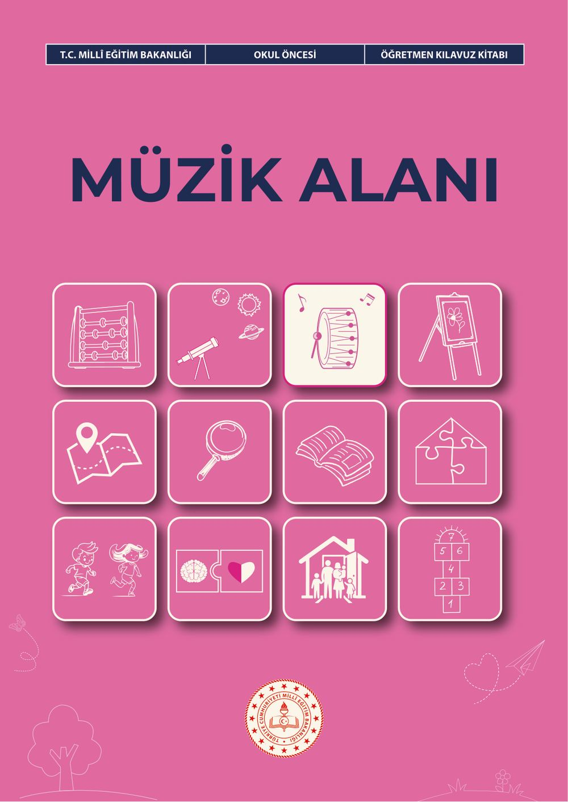
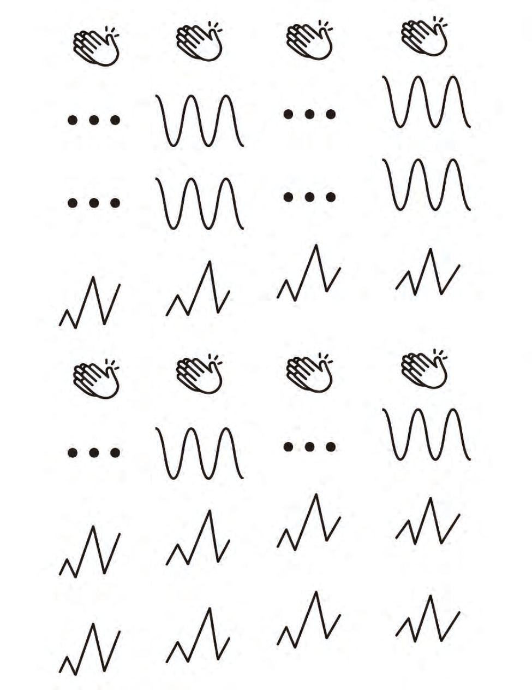
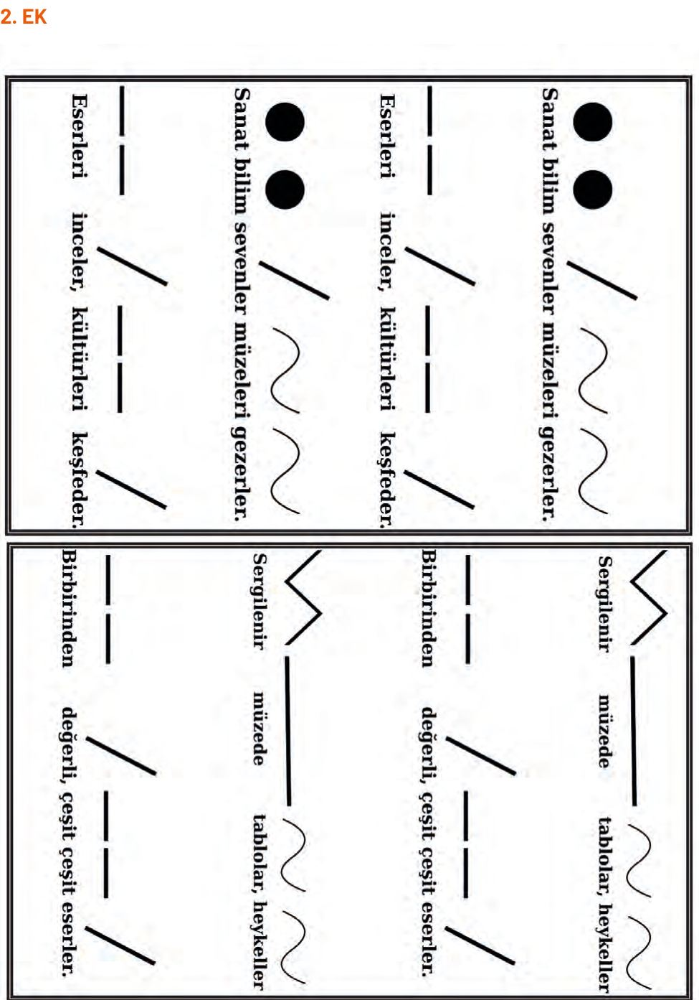
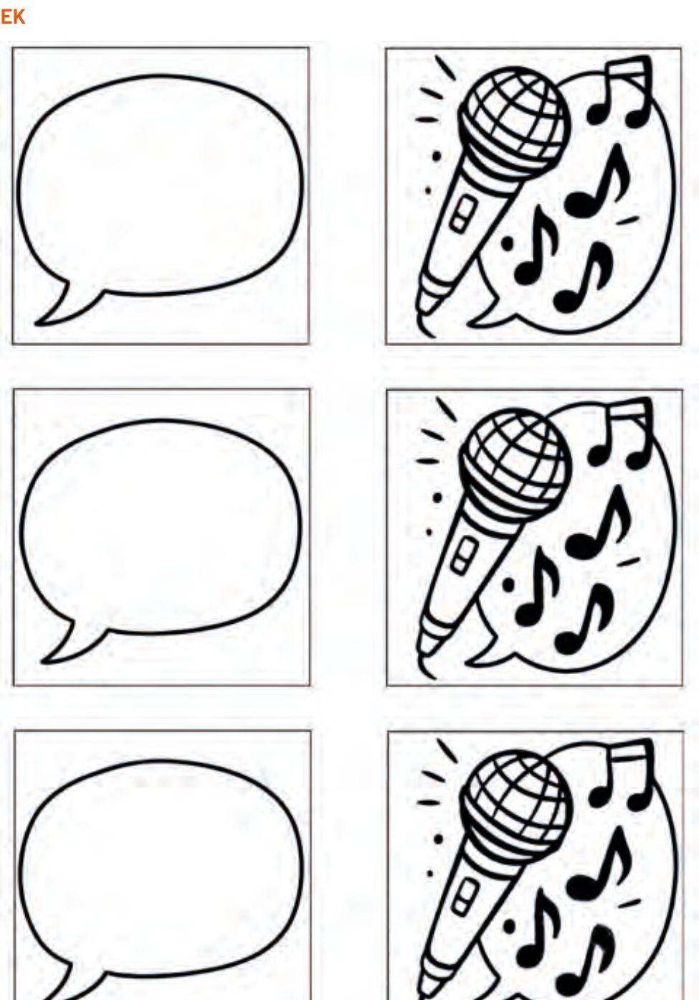
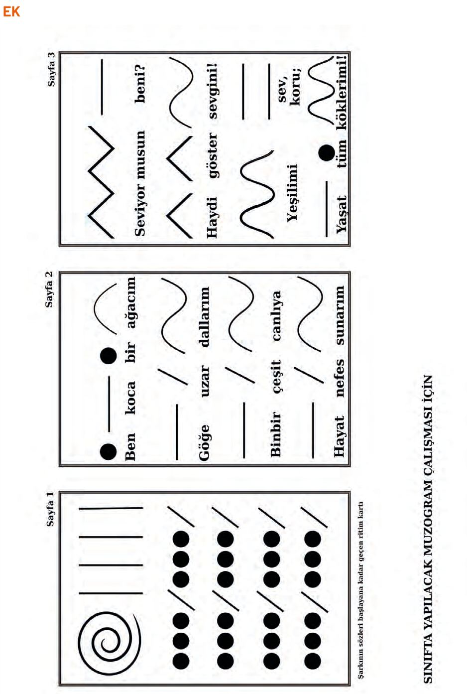
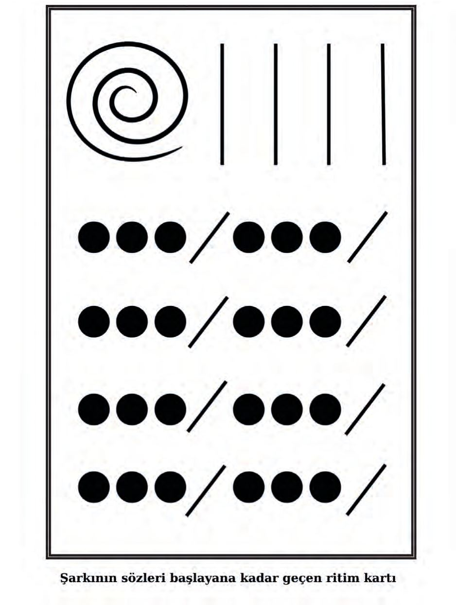
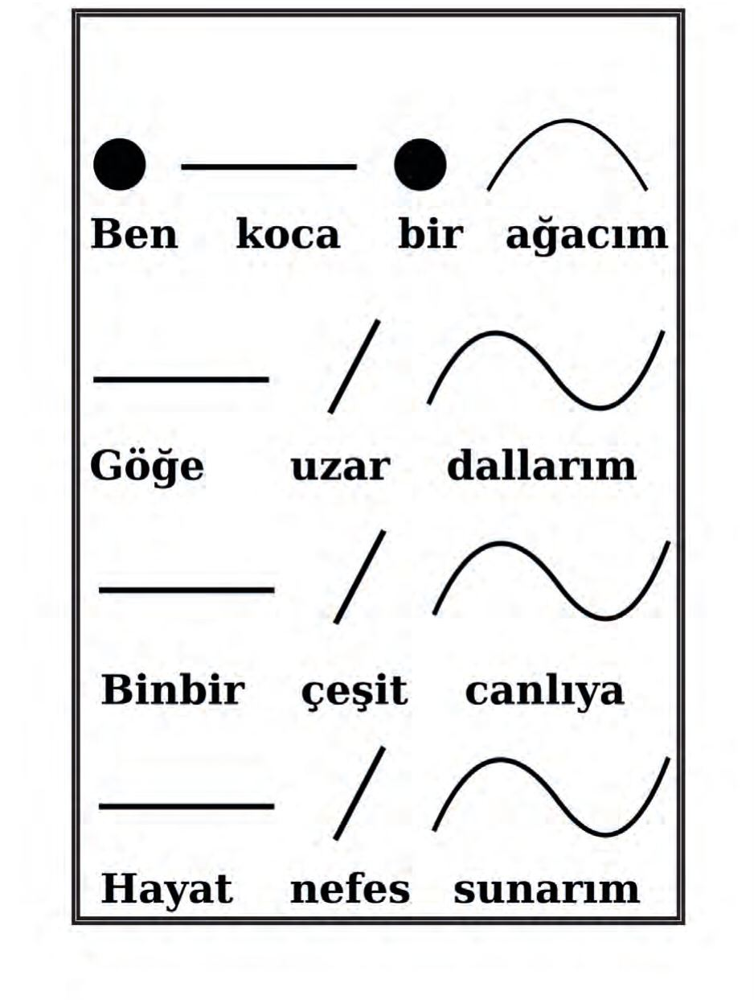
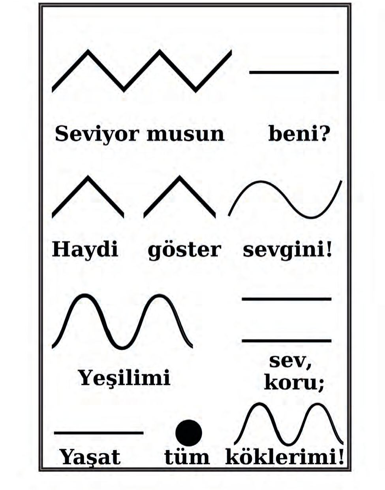
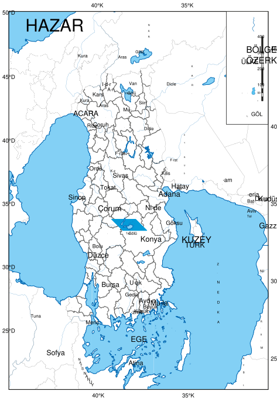
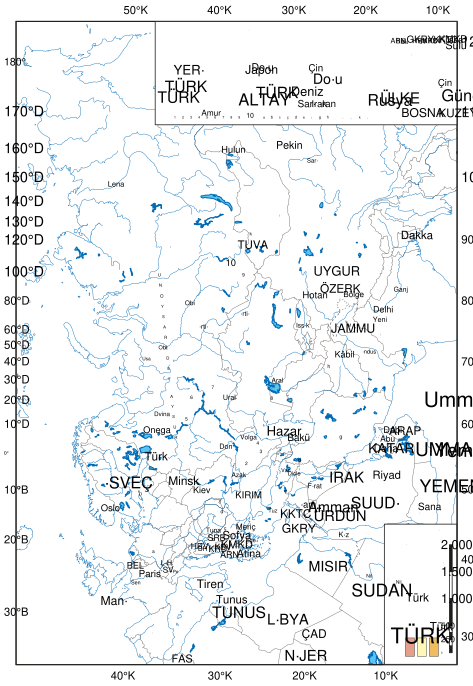

# Okul Öncesi Müzik Alanı Öğretmen Kılavuz Kitabı

<!-- sayfa 0 -->

| T.C. MİLLÎ EĞİTİM BAKANLIĞI | OKUL ÖNCESİ | ÖĞRETMEN KILAVUZ KİTABI |
| :--- | :---: | ---: |

# MÜZİK ALANI

<!-- sayfa 1 -->

Verdiğiniz metin katmanı boş olduğu için (`<<< >>>` arası boş) dönüştürülecek herhangi bir içerik bulunmamaktadır. Lütfen metin katmanını içeren içeriği paylaşın, böylece talimatlarınıza uygun şekilde Markdown formatına çevirebilirim.

<!-- sayfa 2 -->

# Müzik Alanı
# Öğretmen Kılavuz Kitabı

OKUL ÖNCESİ

**Yazarlar**
AYŞEGÜL PARLAK
BAŞAK TÜRK
BETÜL SÜREK
BÜŞRA YILDIRIM
GAMZE AKYOL

DEVLET KİTAPLARI

<!-- sayfa 3 -->

Millî Eğitim Bakanlığı Yayınları ................................................................................................................ 11235
Ders Kitapları Dizisi No........................................................................................................................... 2662

Her hakkı saklıdır ve Millî Eğitim Bakanlığına aittir. Kitabın metin, soru ve şekilleri kısmen de olsa hiçbir surette alınıp yayımlanamaz.

**Editör**
Dr. Öğrt. Üyesi Demet AYDIN
Dr. Öğrt. Üyesi Mehmet İNCE

**Dil Uzmanı**
Özlem ALDEMİR

**Görsel Tasarımcı**
Metin BİLAL

**Çoklu Ortam Tasarımcısı**
EZGİ AVCI AŞIR
FERHAT DEMİRCİ
GAYE ERÇEN
İLKAY CAN

**Program Geliştirme Uzmanı**
Dr. Emine SELMANOĞLU

**Ölçme ve Değerlendirme Uzmanı**
Merve ERELİ

**Rehberlik Uzmanı**
Buket KOÇ

ISBN
978-625-8867-32-9

Millî Eğitim Bakanlığı Talim ve Terbiye Kurulu Başkanlığının 13 10 2026 tarih ve 172455532 sayılı yazısı ile eğitim

<!-- sayfa 4 -->

# İSTİKLÂL MARŞI

Korkma, sönmez bu şafaklarda yüzen al sancak;
Sönmeden yurdumun üstünde tüten en son ocak.
O benim milletimin yıldızıdır, parlayacak;
O benimdir, o benim milletimindir ancak.

Çatma, kurban olayım, çehreni ey nazlı hilâl!
Kahraman ırkıma bir gül! Ne bu şiddet, bu celâl?
Sana olmaz dökülen kanlarımız sonra helâl.
Hakkıdır Hakk'a tapan milletimin istiklâl.

Mehmet Âkif Ersoy

<!-- sayfa 5 -->

ANDIMIZ

Türküm, doğruyum, çalışkanım.

İlkem küçüklerimi korumak, büyüklerimi saymak; yurdumu, milletimi özümden çok sevmektir.
Ülküm yükselmek, ileri gitmektir.

Ey Büyük Atatürk!

Açtığın yolda, gösterdiğin hedefe durmadan yürüyeceğime ant içerim.

Varlığım Türk varlığına armağan olsun.

Ne mutlu Türküm diyene!

<!-- sayfa 6 -->

MUSTAFA KEMAL ATATÜRK

<!-- yer tutucu bulunamadı: sayfa sonuna eklendi -->

<!-- sayfa 7 -->

Verdiğiniz metin katmanı boş olduğu için (`<<< >>>` arası boş) dönüştürülecek bir içerik bulunmamaktadır. Lütfen metin katmanını içeren içeriği paylaşın, böylece kurallara uygun şekilde Markdown formatına çevirebilirim.

<!-- sayfa 8 -->

# İÇİNDEKİLER

| | |
| :--- | :---: |
| GİRİŞ | 8 |
| MÜZİK ALANI BECERİLERİ | 8 |
| MÜZİK ALANI ETKİNLİKLERİNİN PROGRAMDA YER ALAN DİĞER ALANLARLA İLİŞKİLENDİRİLMESİ | 13 |
| MÜZİK ALANI ETKİNLİKLERİNİN PROGRAMLAR ARASI BİLEŞENLERLE İLİŞKİLENDİRİLMESİ | 14 |
| MÜZİK ALANI ETKİNLİK ÖRNEKLERİ | 15 |
| &nbsp;&nbsp;&nbsp;&nbsp;Elden Ele Çalgılar | 15 |
| &nbsp;&nbsp;&nbsp;&nbsp;Dansı Sen Belirle | 17 |
| &nbsp;&nbsp;&nbsp;&nbsp;Bizim Ritmimiz | 19 |
| &nbsp;&nbsp;&nbsp;&nbsp;Tohumun Müzik Haritası | 21 |
| &nbsp;&nbsp;&nbsp;&nbsp;Ritim Treni | 24 |
| &nbsp;&nbsp;&nbsp;&nbsp;Plastik Şişeler | 26 |
| &nbsp;&nbsp;&nbsp;&nbsp;Ses Keşfi | 29 |
| &nbsp;&nbsp;&nbsp;&nbsp;Eşyaların Sesi | 31 |
| &nbsp;&nbsp;&nbsp;&nbsp;Ritimli Pazar | 34 |
| &nbsp;&nbsp;&nbsp;&nbsp;Sabah Şarkısı | 37 |
| &nbsp;&nbsp;&nbsp;&nbsp;İnceden Kalına | 39 |
| &nbsp;&nbsp;&nbsp;&nbsp;Alkışsever Gitar | 41 |
| &nbsp;&nbsp;&nbsp;&nbsp;Dört Mevsim | 44 |
| &nbsp;&nbsp;&nbsp;&nbsp;Farklı Müzikler Dinleyelim | 46 |
| &nbsp;&nbsp;&nbsp;&nbsp;Merhametli Kalpler Şarkısı | 49 |
| &nbsp;&nbsp;&nbsp;&nbsp;23 Nisan Ulusal Egemenlik ve Çocuk Bayramı | 52 |
| &nbsp;&nbsp;&nbsp;&nbsp;Bavuldan Hayat Çıktı | 54 |
| &nbsp;&nbsp;&nbsp;&nbsp;Muzogram | 56 |
| &nbsp;&nbsp;&nbsp;&nbsp;Hayvanların Sesleri ve Hareketleri | 61 |
| &nbsp;&nbsp;&nbsp;&nbsp;Sesin Düğmesi | 64 |
| &nbsp;&nbsp;&nbsp;&nbsp;Bu Ses Hangi Çalgının? | 67 |
| &nbsp;&nbsp;&nbsp;&nbsp;Adımız Ritim Oldu | 70 |
| &nbsp;&nbsp;&nbsp;&nbsp;Kap Kap Kaplumbağa | 72 |
| &nbsp;&nbsp;&nbsp;&nbsp;İki Daire | 75 |
| &nbsp;&nbsp;&nbsp;&nbsp;Nota Avcıları | 78 |
| &nbsp;&nbsp;&nbsp;&nbsp;Deney Dedektifi | 81 |
| &nbsp;&nbsp;&nbsp;&nbsp;Salyangoz ve Tavşan | 84 |
| &nbsp;&nbsp;&nbsp;&nbsp;Okyanusun Dalgaları Olduk | 86 |
| &nbsp;&nbsp;&nbsp;&nbsp;Nefesimin Görünmez Gücü | 88 |
| &nbsp;&nbsp;&nbsp;&nbsp;Bu Ses Nereden Geliyor? | 90 |
| &nbsp;&nbsp;&nbsp;&nbsp;Müzik Müzesi | 92 |
| &nbsp;&nbsp;&nbsp;&nbsp;Şarkı mı, Tekerleme mi? | 95 |
| &nbsp;&nbsp;&nbsp;&nbsp;Yeşili Sev, Koru Muzogram Çalışması | 99 |
| KAYNAKÇA | 106 |
| GÖRSEL VE GENEL AĞ KAYNAKÇASI | 106 |
| TÜRKİYE’NİN MÜLKİ İDARE BÖLÜMLERİ İLE KARA VE DENİZ KOMŞULARI HARİTASI | 107 |

<!-- sayfa 9 -->

# GİRİŞ

Türkiye Yüzyılı Maarif Modeli Okul Öncesi Eğitim Programı’nda müzik, okul öncesi dönemde çocukların sesleri keşfetmelerine, müziksel özellikleri fark etmelerine ve müziği dinleme, söyleme, çalma ve hareket yoluyla deneyimlemelerine olanak sağlayan önemli bir öğrenme alanı olarak ele alınmaktadır. Çocuklar günlük yaşam içinde çevresel seslerden insan sesine, farklı çalgıların seslerinden çeşitli müzik eserlerine kadar çok sayıda işitsel uyaranla karşılaşmaktadır. Bu doğal deneyimlerin planlı ve nitelikli öğrenme yaşantılarıyla desteklenmesi; çocukların müziğe yönelik ilgilerinin gelişmesine, işitsel dikkatlerini kullanmalarına ve müziksel özellikleri fark ederek bunlara uygun tepkiler oluşturmalarına katkıda bulunmaktadır.

Okul öncesi dönemde müzik eğitimi, çocukların yalnızca şarkı söylediği ya da belirli ritimleri tekrar ettiği etkinliklerle sınırlı değildir. Çocuğun bir müzik eserini dikkatle dinlemesi, seslerin kaynaklarını ayırt etmesi, müzikteki farklılıkları fark etmesi, sesini müziğe uygun biçimde kullanması, bedenini veya çalgıları kullanarak müziğe eşlik etmesi ve müziği hareketleriyle ifade etmesi müziksel gelişimin birbirini tamamlayan boyutlarını oluşturmaktadır. Bu doğrultuda Müzik Alanı; Müziksel Dinleme, Müziksel Söyleme, Müziksel Çalma ve Müziksel Hareket olmak üzere dört temel beceri alanı üzerine yapılandırılmıştır.

## MÜZİK ALAN BECERİLERİ

### MDB1. MÜZİKSEL DİNLEME

Müziksel dinleme becerisi, çocuğun çeşitli müzik eserleri arasından seçim yaparak dinlemesini, duyduğu seslerin kaynaklarını anlamlandırmasını ve müzik eserlerindeki temel özellikleri fark ederek ifade etmesini kapsar. Okul öncesi dönemde çocuklar çevresel sesler, insan sesi, çalgı sesleri ve farklı müzik türleriyle karşılaşmakta; zamanla bu işitsel uyaranların benzer ve farklı özelliklerini ayırt etmeye başlamaktadır. Başlangıçta daha belirgin ve kolay ayırt edilebilir sesler ile müziksel karşıtlıklara dayanan dinleme deneyimleri, gelişimle daha seçici, ayrıntılı ve karşılaştırmalı bir nitelik kazanmaktadır.

**Dikkat Edilmesi Gereken Önemli Noktalar**

* Çocuklara dinletilecek müzik eserleri; yaş ve gelişim özelliklerine uygun, nitelikli ve farklı müziksel deneyimler sunabilecek örnekler arasından seçilmelidir. Çocuk şarkılarının yanı sıra ulusal ve uluslararası müzik türlerinden yaş grubuna uygun eserlere de yer verilmelidir.
* Müzik eserlerinin süresi ve müziksel yapısının karmaşıklığı çocukların yaş ve gelişim özellikleri dikkate alınarak belirlenmelidir. Özellikle 36-48 aylık çocuklarda daha kısa ve belirgin müziksel özellikler taşıyan eserlerle başlanabilir. Çocukların gelişimi ve dinleme deneyimleri arttıkça daha uzun ve çeşitli eserlere yer verilebilir.
* Dinleme sırasında kullanılan ses düzeyi, çocukların işitsel rahatlığını destekleyecek ve sınıftaki tüm çocukların müziği rahatlıkla duyabileceği biçimde ayarlanmalıdır.
* Çocukların dinleyecekleri müzik eserini seçmelerine fırsat verilmelidir. Sunulacak seçeneklerin sayısı yaş ve gelişim özelliklerine göre farklılaştırılabilir. 36-48 aylık çocuklara daha sınırlı sayıda seçenek sunulurken ilerleyen yaşlarda seçenek sayısı artırılabilir. Çocukların tanıdıkları eserlerin yanı sıra yeni müzik eserleri arasından da seçim yapmalarına fırsat verilebilir.
* Sesin kaynağını belirlemeye yönelik çalışmalarda çocukların öncelikle sesi görsel ipucu olmadan dinlemeleri desteklenmelidir. Çocuğun tahmininin ardından ses kaynağı gerçek nesne, çalgı, görsel veya görüntülü kayıt aracılığıyla gösterilerek çocuğun ses-kaynak ilişkisini doğrulamasına fırsat verilebilir.
* Müzik eserlerindeki temel özelliklerin fark edilmesine yönelik çalışmalarda yaş gruplarına ilişkin aşamalılık gözetilmelidir. 36-48 aylık çocuklarda hızlı-yavaş tempo ve kuvvetli-hafif ses farklılıklarına; 48-60 aylık çocuklarda bunlara ek olarak kalın-ince ses, ezgi ve çalgı farklılıklarına; 60-72 aylık çocuklarda ise ritim farklılıklarına da yer verilmelidir.
* Müziksel özelliklerin fark edilmesini kolaylaştırmak amacıyla ilk deneyimlerde karşıtlıkların belirgin olduğu

<!-- sayfa 10 -->

# Sınıf İçi Uygulama Önerileri

* Öğretmen, çocuklara yaş ve gelişim özelliklerine uygun müzik eserleri sunarak dinlemek istedikleri eseri seçmelerini sağlayabilir. Seçilen eser birlikte dinlenir. Zaman zaman çocukların merakını desteklemek amacıyla daha önce karşılaşmadıkları müzik eserleri de seçenekler arasına alınabilir.
* Çevredeki hayvan, doğa, taşıt, insan veya çalgı sesleri kaynakları gösterilmeden çocuklara dinletilebilir. Çocuklardan duydukları seslerin kaynaklarını tahmin etmeleri ve ifade etmeleri istenebilir. Ardından gerçek nesne, çalgı veya görsel gösterilerek tahminlerini kontrol etmelerine fırsat verilebilir. Çocukların yaş ve gelişim özelliklerine göre aynı anda sunulan seslerin sayısı artırılabilir.
* Hızlı-yavaş tempo ve kuvvetli-hafif ses farklılıklarının belirgin olduğu müzik örnekleri çocuklara dinletilebilir. Öğretmen aynı müzik eserini ya da ezgiyi farklı tempo veya ses kuvvetlerinde sunarak çocukların aradaki farklılıkları fark etmelerini ve ifade etmelerini destekleyebilir.
* Kalın-ince ses farklılıklarını fark etmeye yönelik olarak belirgin karşıtlıklar taşıyan insan sesi, çalgı sesi veya farklı ses kaynaklarından yararlanılabilir. Çocuklardan dinledikleri sesleri karşılaştırmaları ve bunların aralarındaki farklılıkları ifade etmeleri istenebilir.
* Çocukların çalgı farklılıklarını fark etmelerini desteklemek amacıyla tanıdıkları çalgıların kullanıldığı müzik eserleri dinletilebilir. Çocuklardan eserde duydukları çalgıları belirlemeleri istenebilir. Deneyimleri arttıkça birden fazla çalgının yer aldığı müzik eserlerine geçilebilir.
* Ezgi farklılıklarının fark edilmesi amacıyla müziksel özellikleri birbirinden belirgin biçimde ayrılan iki eser veya ezgi dinletilebilir. Çocukların eserleri karşılaştırmaları ve fark ettikleri özellikleri kendi ifadeleriyle açıklamaları desteklenebilir.
* Ritim farklılıklarının ele alındığı çalışmalarda farklı ritmik yapılara sahip müzik örnekleri kullanılabilir. Çocukların ritimdeki benzerlik ve farklılıkları dinleyerek fark etmeleri ve bunları ifade etmeleri sağlanabilir.

## MSB2. MÜZİKSEL SÖYLEME

Müziksel söyleme becerisi, çocuğun şarkılara kendi sesiyle eşlik etmesini, nefesini ve sesini uygun biçimde kullanmasını; ezgi, ritim ve tempoya uyum sağlayarak şarkı söylemesini ve söyleme becerilerini bireysel ya da grup içinde sergilemesini kapsar. Okul öncesi dönemde çocuklar şarkılar aracılığıyla seslerini keşfetmekte, dinledikleri ezgileri taklit etmekte ve müziğe sesleriyle katılmayı deneyimlemektedir. Başlangıçta taklit ve basit eşlik etme yoluyla gelişen bu deneyimler; zamanla nefes, ses, ritim ve tempo üzerinde daha fazla kontrolün sağlandığı, bireysel ve grupla söyleme becerilerinin geliştiği bir yapıya dönüşmektedir.

**Dikkat Edilmesi Gereken Önemli Noktalar**

* Nefes çalışmalarının gerçekleştirileceği ortamın yeterince havalandırılmış olmasına dikkat edilmelidir. Çalışmalar kısa süreli, doğal ve oyunlaştırılmış biçimde gerçekleştirilmeli; çocuklardan nefeslerini uzun süre tutmaları veya nefes kapasitelerini zorlayacak uygulamalar yapmaları beklenmemelidir.
* Söylenecek şarkılar çocukların yaş ve gelişim özelliklerine uygun olmalıdır. Şarkı sözlerinin anlaşılır, telaffuzunun kolay; ezgi-söz uyumunun uygun ve ses aralığının ise çocukların ses özelliklerine elverişli olmasına dikkat edilmelidir.
* Çocukların farklı müziksel deneyimler edinmeleri amacıyla konu, ezgi, tempo, ritmik yapı ve müziksel karakter bakımından çeşitlilik gösteren nitelikli şarkılara yer verilmelidir.
* Şarkıların uzunluğu ve müziksel yapısı çocukların yaş ve gelişim özelliklerine göre farklılaştırılmalıdır. Daha küçük yaş gruplarında kısa, tekrarlı ve kolay taklit edilebilir ezgilere öncelik verilebilir. Gelişimle sözcük sayısı, ezgisel yapı ve ritmik özellikler aşamalı biçimde çeşitlendirilebilir.
* Öğretmen şarkının öğrenilmesi sürecinde çocuklara doğru bir müziksel model sunmalıdır. Şarkılar öğretmenin sesinden, canlı müzik eşliğinde veya nitelikli ses kayıtlarından yararlanılarak çocuklarla buluşturulabilir.

<!-- sayfa 11 -->

• Söyleme becerisine ilişkin beklentiler gelişimsel olarak aşamalı biçimde ele alınmalıdır. Başlangıçta çocuğun şarkıya katılması, ezgiyi sesiyle taklit etmesi ve tempoya uyum sağlaması desteklenirken; ilerleyen süreçte sözcükleri ritme uygun seslendirme, müzikle başlayıp bitirme, sesi bulunduğu ortama ve grubun ses düzeyine göre ayarlama gibi becerilere yer verilmelidir.
• Çocukların ses özellikleri, müziksel deneyimleri ve söylemeye yönelik isteklilikleri farklılık gösterebilir. Çocukların şarkı söylemeye katılımı desteklenmeli ancak tek başına söyleme konusunda zorlayıcı bir yaklaşım benimsenmemelidir.

**Sınıf İçi Uygulama Önerileri**

• Şarkı söyleme öncesinde çocukların nefeslerini kontrollü kullanmalarını destekleyecek kısa ve oyunlaştırılmış çalışmalar yapılabilir. Çiçek koklar gibi nefes alma, mum alevini söndürmeden hafifçe hareket ettirecek biçimde üfleme, hafif bir tüyü veya kâğıt parçasını nefesiyle hareket ettirme gibi uygulamalardan yararlanılabilir.
• Öğretmen şarkının kısa bir ezgi bölümünü sesiyle modelleyebilir ve çocuklardan duydukları ezgiyi sesleriyle tekrar etmelerini isteyebilir. Çocukların deneyimleri arttıkça tekrar edilen ezgi bölümleri aşamalı olarak çeşitlendirilebilir.
• Çocukların tempoya uyum sağlayarak söylemelerini desteklemek amacıyla bildikleri bir şarkı farklı tempolarda söylenebilir. Çocukların şarkının hızındaki değişikliği fark ederek söyleme hızlarını müziğe göre ayarlamaları desteklenebilir.
• Şarkının sözleri, şarkı söylenmeden önce ritmik konuşma yoluyla çalışılabilir. Öğretmen sözcükleri şarkının ritmik yapısına uygun biçimde söyleyerek çocuklardan tekrar etmelerini isteyebilir. Ardından aynı sözcükler ezgiyle birleştirilerek şarkı söylenebilir.
• Şarkıya birlikte başlayıp bitirme becerisini desteklemek amacıyla öğretmen el hareketi, ritim veya kısa bir müziksel işaret kullanabilir. Çocuklardan bu işareti takip ederek şarkıya birlikte başlamaları ve şarkıyı birlikte tamamlamaları istenebilir.
• Çocuklarla grup hâlinde şarkı söylenirken zaman zaman müzik durdurulup yeniden başlatılarak çocukların müziği dinlemeleri, uygun zamanda şarkıyı söylemeye başlamaları ve grupla uyumlarını sürdürmeleri desteklenebilir.
• Çocukların seslerini bulunduğu ortama ve grubun ses düzeyine uygun kullanmalarını desteklemek amacıyla aynı şarkının farklı ses düzeylerinde söylenmesi denenebilir. Ardından “Birlikte söylerken birbirimizin sesini duyabiliyor muyuz?” gibi sorularla çocukların kendi seslerini ve grubun sesini fark etmeleri sağlanabilir.
• Çocuklara şarkıları grupla söylemenin yanı sıra istekleri doğrultusunda tek başına veya küçük gruplar hâlinde söyleme fırsatları da sunulabilir. Böylece çocukların söyleme becerilerini farklı durumlarda sergilemeleri desteklenebilir.

### MÇB3. MÜZİKSEL ÇALMA

Müziksel çalma becerisi, çocuğun farklı çalgıları ve ses kaynaklarını tanımasını; bedenini, nesneleri ve vurmalı çalgıları kullanarak müziğe eşlik etmesini, ritim üretmesini ve çalma becerilerini bireysel ya da grup içinde sergilemesini kapsar. Okul öncesi dönemde çocuklar ses ve ritim üretme deneyimleri aracılığıyla müziğe etkin biçimde katılmaktadır. Başlangıçta basit vuruşlar, taklit ve grupla eşlik etme yoluyla gelişen çalma deneyimleri; zamanla tempo ve ses özelliklerine uyum sağlama, ritim kalıplarını tekrar etme, doğaçlama yapma ve farklı ritim kalıpları oluşturma gibi daha kontrollü ve yaratıcı deneyimlere dönüşmektedir.

**Dikkat Edilmesi Gereken Önemli Noktalar**

• Çalma çalışmalarında çocukların kolaylıkla kullanabilecekleri, yaş ve gelişim özelliklerine uygun vurmalı çalgılara öncelik verilebilir. Ritim çubukları, tahta ses blokları, küçük davul, tef, zil ve çelik üçgen gibi çalgılar farklı ses ve ritim üretme deneyimleri için kullanılabilir.
• Çocukların farklı çalgı gruplarını tanımaları da desteklenmelidir. Sınıfta bulunmayan vurmalı, nefesli veya

<!-- sayfa 12 -->

* Çalgıların yanı sıra beden ve güvenli günlük yaşam nesneleri de ses ve ritim üretmek amacıyla kullanılabilir. El çırpma, dizlere vurma, parmak şıklatma gibi beden sesleri ile uygun özellikteki tahta kaşık, kutu veya kaplar farklı ses kaynaklarını keşfetmek amacıyla değerlendirilebilir.
* Çocukların çalgıyla müziğe eşlik etmeye yönelik ilk deneyimlerinde tanıdıkları ve temel vuruşunu kolaylıkla takip edebilecekleri müzik eserlerinden yararlanılabilir. Deneyimleri arttıkça farklı ritmik yapılara sahip müzik eserlerine yer verilebilir.
* Çalma çalışmalarında müziğin temel özelliklerine yönelik gelişimsel aşamalılık gözetilmelidir. Başlangıçta hızlı-yavaş tempo farklılıklarına uyum sağlayarak çalma desteklenirken ilerleyen süreçte kuvvetli-hafif ses farklılıkları ve farklı ritmik yapılar da çalışmalara dâhil edilebilir.
* Ritim çalışmaları başlangıçta kısa, belirgin ve kolay tekrar edilebilir vuruşlarla yapılandırılmalı; çocukların deneyimleri arttıkça ritim kalıplarının uzunluğu ve çeşitliliği aşamalı biçimde artırılmalıdır.
* Grup hâlinde gerçekleştirilen çalma çalışmalarında çocukların birbirlerini ve müziği duyabilecekleri uygun bir ses düzeyinin korunmasına dikkat edilmelidir. Öğretmen gerektiğinde çocuklarla çalarak tempo, ritim ve grupla uyum konusunda model olabilir.
* Çocukların çalma becerilerindeki bireysel farklılıklar dikkate alınmalıdır. Ritim üretmede daha ileri düzey performans gösteren çocuklara farklı ritim kalıpları deneme ve doğaçlama yapma fırsatları sunulabilir.

**Sınıf İçi Uygulama Önerileri**

* Öğretmen sınıfta bulunan farklı çalgıları çocuklarla inceleyebilir; çalgıların adları, nasıl ses çıkardıkları ve birbirlerinden farklı ses özellikleri üzerinde durabilir. Çalgılar görülmeden sesleri dinletilerek çocuklardan duydukları sesin hangi çalgıya ait olduğunu tahmin etmeleri de istenebilir.
* Çocuklara farklı vurmalı çalgılar verilerek bildikleri bir müzik eserinin temel vuruşlarına eşlik etmeleri sağlanabilir. Aynı çalışma el çırpma, dizlere vurma veya ayaklarla yere hafifçe ritim verme gibi beden sesleriyle ve uygun günlük yaşam nesneleriyle de gerçekleştirilebilir.
* Öğretmen basit bir ritim kalıbını vurmalı bir çalgıyla çalabilir ve çocuklardan duydukları ritmi tekrar etmelerini isteyebilir. Çocukların deneyimleri arttıkça ritim kalıpları çeşitlendirilebilir ve birden fazla ritim kalıbının art arda kullanıldığı çalışmalara geçilebilir.
* Hızlı-yavaş tempo veya kuvvetli-hafif ses farklılıklarının belirgin olduğu müzik eserlerine vurmalı çalgılarla eşlik edilebilir. Çocukların müzikte meydana gelen değişiklikleri dinleyerek çalma biçimlerini buna göre değiştirmeleri desteklenebilir.
* “Ritim lideri” uygulamasında bir çocuk vurmalı çalgıyla kısa bir ritim oluşturabilir, diğer çocuklar bu ritmi tekrar edebilir. Lider değiştirilerek farklı çocukların kendi ritimlerini üretmelerine fırsat verilebilir.
* Çocukların doğaçlama ritim üretmelerine olanak sağlanabilir. Çocuklardan belirli bir süre boyunca seçtikleri vurmalı çalgıyla kendi ritimlerini oluşturmaları, ardından oluşturdukları ritmi arkadaşlarına sunmaları istenebilir.
* Öğretmen iki farklı kısa ritim kalıbı sunabilir. Çocuklar bu ritimleri ayrı ayrı tekrar ettikten sonra kalıpları farklı sıralarda bir araya getirerek yeni ritim örüntüleri oluşturabilir ve oluşturdukları örüntüyü vurmalı çalgılarla sergileyebilirler.
* Sınıfa bir müzisyen davet edilerek müzisyenin kullandığı çalgıyı çocuklara tanıtması, çalgının ses özelliklerini göstermesi ve kısa bir müzik örneği seslendirmesi sağlanabilir. Çocukların çalgıyı yakından incelemelerine, sesini dinlemelerine ve müzisyene sorular yöneltmelerine fırsat verilebilir.

### MHB4. MÜZİKSEL HAREKET

Müziksel hareket becerisi, çocuğun müzik eserlerindeki temel özellikleri bedeniyle ifade etmesini, müzik eşliğinde hareket etmesini veya dans etmesini ve doğaçlama ya da planlı hareketler sergilemesini kapsar. Okul öncesi dönemde çocuklar müziği yalnızca işitsel olarak değil bedensel hareketler yoluyla da deneyimlemektedir. Başlangıçta müziğe basit beden hareketleriyle tepki veren çocuklar; geliştikçe tempo, kuvvetli-hafif ses, kalın-

<!-- sayfa 13 -->

**Dikkat Edilmesi Gereken Önemli Noktalar**

* Hareket ve dans çalışmalarının yapılacağı ortamın çocukların güvenli ve rahat hareket etmelerine olanak sağlayacak yeterli büyüklükte olmasına dikkat edilmelidir. Çocukların hareket alanı sınırlandırılmalı, zeminin uygunluğu kontrol edilmeli ve hareketi engelleyebilecek nesneler ortamdan uzaklaştırılmalıdır.
* Hareket ve dans çalışmalarında kullanılacak müzik eserleri çocukların yaş ve gelişim özelliklerine uygun olmalıdır. Farklı tempo, ezgi, ritim ve müziksel karakter taşıyan nitelikli eserlere yer verilerek çocukların çeşitli müziksel deneyimler edinmeleri sağlanmalıdır.
* Müziksel özellikleri hareketle ifade etmeye yönelik çalışmalarda gelişimsel aşamalılık gözetilmelidir. Başlangıçta hızlı-yavaş tempo gibi kolay fark edilebilen özelliklerden yararlanılabilir. Çocukların deneyimleri arttıkça kuvvetli-hafif ses, kalın-ince ses, ezgi ve ritim farklılıkları da hareket çalışmalarına dâhil edilebilir.
* Çocukların hareketlerinin dinledikleri müzikle ilişki kurmalarına olanak vermesine dikkat edilmelidir. Hareketler yalnızca öğretmenin gösterdiği figürlerin tekrarıyla sınırlandırılmamalı, çocukların müziği dinleyerek kendi hareketlerini oluşturmalarına da fırsat verilmelidir.
* Öğretmen tarafından gösterilecek planlı hareket ve dans figürleri çocukların yaş ve gelişim özelliklerine uygun, güvenli ve uygulanabilir olmalıdır. Birden fazla hareketten oluşan figürler küçük bölümlere ayrılarak gösterilmeli ve çocukların deneyimleri arttıkça aşamalı biçimde birleştirilmelidir.
* Doğaçlama hareket çalışmalarında tek bir doğru hareket beklentisi oluşturulmamalıdır. Çocukların müzikten hareketle farklı beden ifadeleri geliştirmeleri desteklenmeli ve oluşturdukları hareketlere saygı gösterilmelidir.
* Çocukların motor gelişimleri, denge ve koordinasyon becerileri, hareket deneyimleri ve katılım istekleri birbirinden farklı olabilir. Hareket ve dans çalışmaları bu bireysel farklılıklara göre uyarlanmalı; çocuklar belirli hareketleri yapmaya veya tek başına dans etmeye zorlanmamalıdır.
* Çocuklar hareket ederken veya dans ederken şarkı söylemeyi bırakabilir ve dikkatlerini bedensel hareketlerine yöneltebilirler. Bu durum doğal karşılanmalıdır. Şarkı söyleme ile hareketi aynı anda gerçekleştirme becerisi kısa, tekrarlı ve aşamalı çalışmalarla desteklenmelidir.

**Sınıf İçi Uygulama Önerileri**

* Öğretmen çocuklara yaş ve gelişim özelliklerine uygun müzik eserleri sunarak hareket etmek veya dans etmek istedikleri eseri seçmelerini sağlayabilir. Çocuklardan seçtikleri müziği dinlemeleri ve müziğin kendilerinde uyandırdığı hareketleri serbestçe oluşturmaları istenebilir.
* Öğretmen, bir vurmalı çalgıyla hızlı ve yavaş tempolarda ritim çalabilir. Çocuklardan ritmin hızındaki değişiklikleri dinleyerek hareketlerinin hızını buna göre değiştirmeleri istenebilir. Aynı uygulama tempo değişikliklerinin belirgin olduğu müzik eserleriyle de gerçekleştirilebilir.
* Kuvvetli ve hafif ses farklılıklarının belirgin olduğu müzik örnekleri dinletilebilir. Çocuklardan müzikteki ses kuvveti değiştikçe hareketlerini de değiştirmeleri ve duydukları farklılığı bedenleriyle kendi seçtikleri biçimde ifade etmeleri istenebilir.
* Kalın ve ince ses farklılıklarını belirgin biçimde yansıtan iki ses kaynağı veya müzik örneği kullanılabilir. Çocukların sesler arasındaki farklılığı dinlemeleri ve her ses için farklı hareketler oluşturmaları desteklenebilir. Çocukların ürettikleri hareketlerin neden farklılaştığı üzerine konuşulabilir.
* Ezgisel özellikleri birbirinden farklı iki müzik eseri sırayla dinletilebilir. Çocuklardan müzik değiştiğinde hareketlerini de değiştirmeleri istenebilir. Ardından iki müzik eserinin kendilerinde uyandırdığı hareketlerin neden farklı olduğu hakkında konuşmaları sağlanabilir.
* Ritim değişikliklerinin belirgin olduğu bir müzik eseri dinletilerek çocuklardan ritimdeki değişiklikleri hareketleriyle yansıtmaları istenebilir. Çocukların ritim değiştiğinde hareketlerini durdurma, sürdürme, değiştirme veya yeni bir hareket oluşturma biçimleri gözlemlenebilir.
* “Hareket lideri” çalışmasında bir çocuk müziğe uygun bir hareket oluşturabilir, diğer çocuklar bu hareketi

<!-- sayfa 14 -->

•	Öğretmen yaş ve gelişim özelliklerine uygun planlı bir hareket veya dans figürünü çocuklara gösterebilir. Hareketler başlangıçta küçük bölümler hâlinde çalışılabilir; çocuklar her bölümü gerçekleştirdikçe hareketler birleştirilerek müzik eşliğinde sergilenebilir.
•	Çocukların bildikleri, sözleri ve hareketleri kolaylıkla hatırlanabilecek bir şarkı seçilebilir. Önce şarkı, ardından şarkıya eşlik edilecek hareketler ayrı ayrı çalışılabilir. Daha sonra çocukların şarkıyı söylerken aynı zamanda hareketleri gerçekleştirmeleri desteklenebilir.
•	Çocuklar küçük gruplara ayrılarak dinledikleri müzik için kendi hareket veya dans düzenlerini oluşturabilirler. Gruplar hazırladıkları hareketleri arkadaşlarına sergileyebilir; diğer çocuklar müzik ile hareketler arasındaki ilişkiye yönelik düşüncelerini paylaşabilirler.

# MÜZİK ALANI ETKİNLİKLERİNİN PROGRAMDA YER ALAN DİĞER ALANLARLA İLİŞKİLENDİRİLMESİ

Müzik alan becerileri diğer alan becerileriyle ilişkilendirilmeye elverişli özelliktedir. Çocuğun bir şarkıyı dinlemesi ve söylemesi, bir ritmi fark ederek tekrar etmesi, farklı ses kaynaklarını keşfetmesi ya da müziği bedeniyle ifade etmesi sırasında farklı alanlara ilişkin beceriler doğal olarak öğrenme sürecine dâhil olabilmektedir. Bu nedenle müzik alanına yönelik öğrenme yaşantıları planlanırken etkinliğin içeriği ve amacı doğrultusunda Türkçe, matematik, fen, sosyal, sanat ile hareket ve sağlık alanı becerileriyle anlamlı ilişkiler kurulabilir.

Alanlar arası ilişkilendirmede temel ölçüt, farklı alanların aynı etkinlik içinde yer alması değil beceriler arasında doğal ve işlevsel bir bağ kurulabilmesidir. Bir müzik etkinliğinin birden fazla alanla ilişkilendirilmesi zorunlu değildir. Etkinlik içinde doğrudan kullanılmayan veya çocuğun öğrenme sürecinde gözlenemeyen alan becerilerine yalnızca bütünleştirme amacıyla yer verilmemelidir. Müzik alanı merkeze alınarak planlanan bir etkinlikte diğer alan becerileri, müziksel öğrenme sürecini desteklediği ve etkinliğin doğal akışı içinde ortaya çıktığı ölçüde sürece dâhil edilmelidir.

**Türkçe Alanı İle İlişkilendirme:** Şarkı, tekerleme ve ritmik sözler; çocukların dinleme ve konuşma becerilerini kullanabilecekleri doğal öğrenme ortamları oluşturur. Çocukların bir şarkıyı dinlemeleri, şarkıda geçen sözcükler ve anlatılanlar hakkında konuşmaları, duydukları sesleri veya müziksel farklılıkları sözlü olarak ifade etmeleri, şarkının sözlerine ritmik biçimde eşlik etmeleri müzik ve Türkçe alan becerilerinin birlikte kullanılmasına olanak sağlar.

**Matematik Alanı İle İlişkilendirme:** Ritim ve müziksel yapı içinde bulunan tekrar ve sıralama matematiksel ilişkilerin fark edilmesine fırsat sunabilir. Ritim kalıplarını tekrar etme, farklı ritim kalıplarını belirli bir düzende bir araya getirme, vuruşları sayma veya tekrarlayan ritmik yapılardaki örüntüleri fark etme gibi çalışmalar matematik alanındaki sayma ve örüntü becerileriyle doğal biçimde ilişkilendirilebilir.

**Fen Alanı İle İlişkilendirme:** Çocukların çevrelerindeki sesleri ve çalgı seslerini dinlemeleri, seslerin kaynaklarını araştırmaları, farklı nesnelerin çıkardığı sesleri karşılaştırmaları ve ses oluşumuna ilişkin gözlemler yapmaları fen alanı becerileriyle ilişki kurulmasını sağlayabilir. Farklı materyallerden elde edilen seslerin keşfedilmesi ve ses kaynaklarının özelliklerinin incelenmesi özellikle bilimsel gözlem süreçlerini destekleyebilir.

**Sosyal Alan İle İlişkilendirme:** Farklı yörelere, kültürlere ve toplumlara ait müzik eserleri, çocuk şarkıları, çalgılar ve halk dansları çocukların yaşadıkları toplumun ve farklı kültürlerin müziksel birikimiyle karşılaşmalarına olanak sağlayabilir. Geleneksel çocuk şarkıları, millî kültüre ait müzik eserleri, yöresel çalgılar ve danslar aracılığıyla müziksel deneyimler sosyal alanın kültürel unsurlarıyla ilişkilendirilebilir.

**Sanat Alanı İle İlişkilendirme:** Dinlenen müzik eserlerinin çocuklarda oluşturduğu izlenimlerin çizgi, renk, biçim veya farklı materyaller aracılığıyla ifade edilmesi müzik ve sanat alanları arasında doğal ilişkiler kurulmasına olanak sağlar. Çocuklar dinledikleri bir müziği görsel olarak ifade edebilir, müzikte fark ettikleri değişikliklerden hareketle farklı sanatsal ürünler oluşturabilirler.

**Hareket ve Sağlık Alanı İle İlişkilendirme:** Müziğe eşlik eden hareket ve dans çalışmaları; çocukların bedenlerini kontrollü kullanmaları, hareketlerini müziğin temposuna ve ritmine göre düzenlemeleri, denge ve koordinasyonlarını kullanmaları açısından hareket ve sağlık alanıyla doğrudan ilişkilendirilebilir Özellikle

<!-- sayfa 15 -->

# MUZIK ALANI ETKİNLİKLERİNİN PROGRAMLAR ARASI BİLEŞENLERLE İLİŞKİLENDİRİLMESİ

Müzik alanına yönelik öğrenme yaşantıları; sosyal-duygusal öğrenme becerileri, değerler ve okuryazarlık becerilerinin çocukların doğal deneyimleri içinde ele alınmasına elverişli bir yapı sunmaktadır. Birlikte şarkı söyleme, müzik dinleme, çalgı çalma, ritim oluşturma, dans etme ve doğaçlama yapma gibi süreçlerde çocuklar yalnızca müziksel becerilerini kullanmamakta; aynı zamanda kendilerini ifade etme, başkalarıyla uyum içinde hareket etme, farklılıklara saygı gösterme ile çeşitli müzik ve kültürel unsurları anlamlandırma fırsatları elde etmektedir.

Programlar arası bileşenlerin müzik etkinlikleriyle ilişkilendirilmesinde etkinliğin doğal akışı ve ele alınan müziksel beceri temel alınmalıdır. Her etkinlikte bütün programlar arası bileşenlere yer verilmesi beklenmemeli, etkinlik içinde gerçekten karşılık bulan ve çocukların davranışları aracılığıyla gözlenebilen bileşenler seçilmelidir.

**Sosyal-Duygusal Öğrenme Becerileri İle İlişkisi:** Müziksel deneyimler çocukların hem bireysel hem de grupla gerçekleştirdikleri süreçler aracılığıyla sosyal-duygusal öğrenme becerilerini kullanmalarına fırsat sunar. Çocuğun müzik yoluyla kendisini ifade etmesi, müziksel tercihlerini belirtmesi, bir şarkıyı veya ritmi sürdürebilmek için dikkatini düzenlemesi, grup hâlinde şarkı söylerken ya da çalgı çalarken diğer çocukları dinlemesi, grubun temposuna ve ses düzeyine uyum sağlaması, sırasını beklemesi ve ortak bir müziksel ürün oluşturmak için arkadaşlarıyla iş birliği yapması bu becerilerin müzik alanında doğal olarak ortaya çıkabileceği durumlardır. Öğretmen bu süreçlerde çocukların yalnızca ortaya koydukları müziksel performansa değil birlikte çalışma ve sürece katılma biçimlerine de dikkat etmelidir.

**Değerlerle İlişkisi:** Müzik etkinlikleri, değerlerin günlük davranışlar ve eylemler aracılığıyla yaşantıya dönüştürülmesine olanak sağlayabilir. Çocukların arkadaşlarının söylediği şarkıyı veya oluşturduğu ritmi dikkatle dinlemeleri, farklı müziksel tercihlere ve özgün ifadelere saygı göstermeleri, grup çalışmalarında birbirlerine destek olmaları, kullandıkları çalgı ve materyalleri özenli kullanmaları ve kullanım sonrasında yerine yerleştirmeleri gibi deneyimler değerlerin doğal biçimde ele alınmasını destekler. Bunun yanı sıra çocukların millî ve kültürel mirasımızın bir parçası olan şarkılar, türküler, çalgılar ve danslarla karşılaşmaları; kendi kültürel değerlerini tanımalarına ve farklı kültürel müzik örneklerine yönelik farkındalık geliştirmelerine katkıda bulunabilir. Değerler müzik etkinliklerine yalnızca şarkı sözleri veya sözel açıklamalar yoluyla eklenmemeli, mümkün olduğunca çocukların öğrenme sürecindeki davranış ve eylemleriyle ilişkilendirilmelidir.

**Okuryazarlık Becerileri İle İlişkisi:** Çocukların farklı müzik eserlerini, çalgıları, müziksel anlatım biçimlerini ve kültürel müzik örneklerini tanımaları; bunlar arasındaki benzerlik ve farklılıkları fark etmeleri ve müziksel deneyimlerini anlamlandırmaları farklı okuryazarlık becerileriyle ilişki kurulmasına olanak sağlar. Özellikle farklı toplumlara ve yörelere ait müzik, çalgı ve dans örneklerinin incelenmesi kültürel unsurları tanıma ve anlamlandırmayı; müzik eserlerine ilişkin görsel materyallerin, basit sembollerin ve görsel ipuçlarının kullanılması görsel unsurları anlamlandırmayı destekleyebilir. Müzik eserlerine dijital araçlar yoluyla ulaşıldığı durumlarda ise dijital içeriklerin amaçlarına uygun ve bilinçli biçimde kullanılması için gelişim düzeyine uygun deneyimler oluşturulabilir.

<!-- sayfa 16 -->

# MUZIK ALANI ETKİNLİK ÖRNEKLERİ

**ETKİNLİK ADI:** Elden Ele Çalgılar  
**ALAN ADI:** Müzik, Hareket ve Sağlık  
**YAŞ GRUBU:** 36–48 ay  

## ALAN BECERİLERİ, ÖĞRENME ÇIKTILARI VE SÜREÇ BİLEŞENLERİ

### HAREKET VE SAĞLIK ALANI
**HSAB1. Aktif Yaşam İçin Motor Beceriler**  
**HSAB.1. Farklı çevre ve fiziksel etkinliklerde temel hareket becerilerini sergileyebilme**  
HSAB1.d. Nesneleri yakın mesafeye atar.

### MÜZİK ALANI
**MÇB3. Müziksel Çalma**  
**MÇB.1. Duyduğu sesleri / müzik eserlerini çalabilme**  
MÇB.1. a. Çalgıların ismini söyler.

## EĞİLİMLER
**E2. Sosyal Eğilimler**  
E2.5. Oyunseverlik  
**E3. Entelektüel Eğilimler**  
E3.2. Odaklanma

## PROGRAMLAR ARASI BİLEŞENLER
**Sosyal-Duygusal Öğrenme Becerileri**  
SDB2.1. İletişim

**Değerler**  
D12. Sabır  
D12.1. Düşünce, duygu ve davranışlarında kontrollü olmak

**Okuryazarlık Becerileri**  
OB4.Görsel Okuryazarlık

**Kavramlar:** Duyu: sesli-sessiz  
**Sözcükler:** çalgı  
**Materyaller:** yumuşak bir top, çalgı görselleri  
**Eğitim / Öğrenme Ortamları:** Yumuşak bir top ile çalgı görselleri önceden hazır bulundurulmalıdır.

<!-- sayfa 17 -->

**Müzik, Hareket ve Sağlık (Bütünleştirilmiş Büyük Grup Etkinliği)**

**ETKİNLİKLER**

* Çocuklarla geniş bir çember oluşturulur. “Sevdiğimiz şarkıları söylerken müzik yapmak amacıyla kullandığımız aletlere ne ad verilir?” sorusu yöneltilir. Çocuklardan gelen cevaplar dinlenir. “Şarkılarımıza ritim katan bu aletlere çalgı diyoruz. Örneğin davul, tef, marakas birer çalgıdır.” şeklinde kısa bir açıklama yapılır.
* Yumuşak bir top gösterilir ve çocuklara bu topun müziği çok sevdiği söylenerek oyun tanıtılır (**E2.5**). Öğretmen bir çalgı görseli seçip çocuklara bu çalgıyı gösterir ve topu çocuklardan birine atar (**OB4**). Topu yakalayan çocuk görseldeki çalgının adını söyler ve topu başka bir arkadaşına atar (**MÇB.1.a**). Topu yakalayan her çocuk öğretmenin gösterdiği görseldeki çalgının adını söyler ve topu başka bir arkadaşına atar. Farklı çalgı görselleri kullanılarak oyun sürdürülür (**E3.2**).
* Çocuklar çalgı isimlerini tanımaya başladıktan sonra görseller kaldırılır. Oyunun işleyişi tekrar hatırlatılır. Bir çalgı ismi söylenerek top çocuklardan birine atılır. Topu yakalayan çocuğun aklında kalan bir çalgının ismini söyleyerek topu çemberdeki başka bir arkadaşına atması veya yuvarlaması istenir (**HSAB1.d**).
* Top elden ele dolaştıkça sınıfta farklı çalgı isimleri ifade edilir (**SDB2.1**). Tüm çocuklar söz hakkı aldıktan sonra oyun tamamlanır (**D12.1**).

**DEĞERLENDİRME**

* Oyun topu sana geldiğinde arkadaşlarına hangi çalgının adını söyledin?
* Hangi çalgıların görselini hatırlıyorsun?
* Müzik dinlerken en çok hangi çalgının sesini duyuyorsun?

**FARKLILAŞTIRMA**

**Zenginleştirme:** Çocuklara gerçek çalgılar verilebilir. İsimlerini öğrendikleri çalgıları bu kez gerçekten çalarak hep birlikte serbest bir sınıf orkestrası oluşturmaları ve ortaya çıkan müziğe eşlik etmeleri sağlanabilir.

**Destekleme:** Çocuklar topu aldıklarında istedikleri bir çalgıyı parmaklarıyla göstermeleri veya çalgının sesini taklit etmeleri desteklenebilir. Çocuklar arasındaki mesafeyi azaltmak için çember daraltılabilir.

**AİLE VE TOPLUM KATILIMI**

**Aile Katılımı:** Ailelerden evdeki geri dönüştürülebilir malzemeleri kullanarak çocuklarıyla basit bir çalgı yapmaları ve yaptıkları bu çalgıyı sınıfa göndermeleri istenebilir.

<!-- sayfa 18 -->

**ETKİNLİK ADI:** Dansı Sen Belirle
**ALAN ADI:** Müzik, Hareket ve Sağlık
**YAŞ GRUBU:** 36-48 ay

**ALAN BECERİLERİ, ÖĞRENME ÇIKTILARI VE SÜREÇ BİLEŞENLERİ**

**HAREKET VE SAĞLIK ALANI**

**HSAB1. Aktif Yaşam İçin Motor Beceriler**

**HSAB.3. Müzik ve ritim eşliğinde hareket örüntüleri sergileyebilme**

HSAB.3.a. Basit dans hareketleri yapar.

**MÜZİK ALANI**

**MHB4. Müziksel Hareket**

**MHB.2. Müzik eserleriyle hareket / dans edebilme**

MHB.2. b. Müzik eşliğinde doğaçlama hareket / dans sergiler.

**EĞİLİMLER**

**E3. Entelektüel Eğilimler**

E3.3. Yaratıcılık

**PROGRAMLAR ARASI BİLEŞENLER**

**Sosyal-Duygusal Öğrenme Becerileri**

**SDB1.2. Kendini Düzenleme (Öz Düzenleme)**

**Değerler**

**D4. Dostluk**

D4.4. Arkadaşlarını ve onlarla vakit geçirmeyi önemsemek

**Kavramlar:** Zıt: hızlı-yavaş
**Sözcükler:** dans
**Materyaller:** çocuk sayısı kadar renkli tül veya kurdele, ses sistemi veya hoparlör
**Eğitim / Öğrenme Ortamları:** Sınıf ortamı, çocukların rahatça dans edebileceği genişlikte ayarlanmalı ve etkinlik için kullanılacak tül veya kurdele önceden hazır bulundurulmalıdır.

<!-- sayfa 19 -->

**Müzik, Hareket ve Sağlık (Bütünleştirilmiş Büyük Grup Etkinliği)**

| ETKİNLİKLER |
| :--- |
| • Çocuklarla geniş bir çember oluşturulur. Renkli tüller gösterilerek çocukların kendi dansını oluşturacağı söylenir. Müzik açılmadan önce çocukların tülleri havaya atma, sağa sola sallama, kendi etrafında dönerek tülü dalgalandırma gibi dans hareketlerini keşfetmelerine alan tanınır **(HSAB3.a).** • Arka planda ritmi belirgin yer yer hızlanıp yavaşlayan sözsüz bir müzik açılır. Çocukların tülleriyle müziğe eşlik etmeleri ve doğaçlama hareketler yapmaları desteklenir **(MHB2.b).** • Çocukların sırayla kendi özel dans hareketlerini arkadaşlarına göstermeleri istenir **(E3.3).** Diğer çocukların gösterilen dans hareketlerine eşlik etmesi desteklenir **(SDB1.2).** Süreç boyunca çocukların arkadaşlarıyla eğlenerek dans etmeleri sağlanarak birlikte vakit geçirmenin önemi vurgulanır **(D4.4).** • Tüm çocuklar danslarını sergiledikten sonra müziğin sesi yavaşça azaltılır ve tüller toplanır. Çocuklar değerlendirme yapmak üzere tekrar çembere geçer. |

| DEĞERLENDİRME |
| :--- |
| • Müzik çalarken tülünle dans etmek sana ne hissettirdi? • Müzik hızlandığında ve yavaşladığında dans ederken hareketlerin nasıl değişti? • Evde en sevdiğin şarkı çaldığında genellikle nasıl dans edersin? • Dışarıda rüzgâr estiğinde ağaçların yaprakları nasıl dans ediyor olabilir? |

**FARKLILAŞTIRMA**

**Zenginleştirme:** Çocuklara tüllerin yanı sıra ritim çubukları veya ziller gibi ses çıkaran materyaller de sunulabilir. Çocuklar hem kendi danslarını belirleyebilir hem de hareketlerine çalgılarla eşlik edebilir.

**Destekleme:** Dans hareketleri belirleme sürecinde “Tülünü bir kuş gibi havada mı sallamak istersin yoksa rüzgâr gibi yerde mi sürüklersin?” gibi seçenekler sunulabilir.

**AİLE VE TOPLUM KATILIMI**

**Aile Katılımı:** Ailelerden akşam evde loş bir ortam yaratarak bir el feneri veya gece lambası ışığında duvarda oluşan kendi gölgeleriyle doğaçlama dans etmeleri istenebilir.

<!-- sayfa 20 -->

**ETKİNLİK ADI:** Bizim Ritmimiz
**ALAN ADI:** Müzik
**YAŞ GRUBU:** 36-48 ay

**ALAN BECERİLERİ, ÖĞRENME ÇIKTILARI VE SÜREÇ BİLEŞENLERİ**

**MÜZİK ALANI**

**MÇB3. Müziksel Çalma**

**MÇB.1. Duyduğu sesleri / müzik eserlerini çalabilme**

MÇB.1. b. Bedenini / nesneleri / vurmalı çalgıları kullanarak ritim çalışmaları yapar.

**EĞİLİMLER**

**E3. Entelektüel Eğilimler**

E3.2. Odaklanma

**PROGRAMLAR ARASI BİLEŞENLER**

**Sosyal-Duygusal Öğrenme Becerileri**

**SDB2.2. İş Birliği**

**Değerler**

**D7. Estetik**

D7.1. Duyusal derinliği anlamak

**Kavramlar:** Duyu: sesli-sessiz

**Sözcükler:** çalgı, ritim, beden, ses

**Materyaller:** ritim çalgıları (tef, ritim çubuğu vb.)

**Eğitim / Öğrenme Ortamları:** Sınıf ortamı, çocukların rahatça çember düzeninde oturabileceği genişlikte ayarlanmalı ve etkinlik için kullanılacak çalgılar önceden hazır bulundurulmalıdır.

<!-- sayfa 21 -->

# ETKİNLİKLER
## Müzik (Büyük Grup Etkinliği)
* Çocuklarla çember oluşturulur. Beden perküsyonu (el çırpma, dizlere vurma ve ayaklarla yere vurma) ile başlanır. Basit hareketler yapılarak çocukların bu ritme kendi bedenleriyle eşlik etmeleri desteklenir.
* Öğretmen, çocukların ellerine hafifçe dokunarak her birine “ses”, “çalgı” ve “hareket” sözcüklerinden birini söyler. Aynı sözcüğü alan çocukların bir araya gelerek üç grup oluşturmaları sağlanır. Ardından “Ses grubundaki çocuklar ağızlarıyla sesler çıkararak, çalgı grubundaki çocuklar bir çalgı kullanarak, hareket grubundaki çocuklar ise bedenlerini kullanarak ritim tutar.” yönergesi verilir.
* Grupların belirlenen yöntemle (ses, çalgı, beden) 2 vuruşluk ritim oluşturmalarına destek olunur. İlk olarak tüm grupların sırayla oluşturdukları ritmi arkadaşlarına sergilemeleri istenir (MÇB1.b). Ardından tüm grupların eş zamanlı olarak ritim tutmaları söylenir (SDB2.2).
* Oluşturulan ortak ritim devam ederken sırayla bir grubun kısa bir süreliğine durması, diğerlerinin ise devam etmesi istenir. Ardından duran çocuklar yeniden ritme dâhil edilir. Bu durdurup devam ettirme sürecinde çocukların ortak ritimdeki değişiklikleri fark etmeleri sağlanır (E3.2).
* Çocukların ritme katılma biçimlerini değiştirmelerine fırsat verilir. Örneğin çalgı kullanan bir çocuğun bu kez ellerini çırparak, ellerini çırpan bir çocuğun ise bir ses çıkararak sürece katılması teşvik edilir (D7.1).

# DEĞERLENDİRME
* Arkadaşların farklı yollarla ritim tutarken sen kendi ritmini nasıl devam ettirdin?
* Bir grubun ritimden çıkması ortak çalışmayı nasıl etkiledi?

# FARKLILAŞTIRMA
**Zenginleştirme:** Öğretmen ellerini havaya kaldırdığında grupların kendi ritimlerini daha yüksek, ellerini aşağı indirdiğinde ise ritimlerini fısıltıyla veya çok hafif dokunuşlarla tutmaları istenebilir.

**Destekleme:** Öğretmen kendi bedeniyle veya sesiyle birebir model olabilir.

# AİLE VE TOPLUM KATILIMI
**Aile Katılımı:** Ailelerden evdeki güvenli eşyaları (plastik kaplar, tahta kaşıklar vb.) veya bedenlerini kullanarak kendi “Aile Ritmi” oluşturmaları istenebilir.

**Toplum Katılımı:** Okulun diğer sınıfları sınıfa davet edilerek oluşturulan ortak ritme dâhil olmaları istenebilir.

<!-- sayfa 22 -->

**ETKİNLİK ADI:** Tohumun Müzik Haritası
**ALAN ADI:** Müzik
**YAŞ GRUBU:** 48-60 ay

**ALAN BECERİLERİ, ÖĞRENME ÇIKTILARI VE SÜREÇ BİLEŞENLERİ**

**MÜZİK ALANI**

**MDB1. Müziksel Dinleme**

**MDB1. Çeşitli müzik eserlerini dinleyebilme**
MDB1. b. Müzik eserlerini dinler.

**MDB3. Müzik eserlerindeki temel özellikleri ifade edebilme**
MDB3. a. Müzik eserlerindeki hızlı ve yavaş tempo farklılıklarını ifade eder.

**EĞİLİMLER**

**E3. Entelektüel Eğilimler**
E3.2. Odaklanma

**PROGRAMLAR ARASI BİLEŞENLER**

**Sosyal-Duygusal Öğrenme Becerileri**
SDB1.2. Kendini Düzenleme (Öz Düzenleme)

**Değerler**
**D7. Estetik**
D7.1. Duyusal derinliği anlamak

**Kavramlar:** Duyu: sesli-sessiz
**Sözcükler:** çalgı, ritim, beden, ses
**Materyaller:** muzogram kâğıtları, yumuşak bir top, çalgı görselleri
**Eğitim / Öğrenme Ortamları:** Sınıf ortamı, çocukların rahatça çember düzeninde oturabileceği genişlikte ayarlanmalı ve etkinlik için kullanılacak yumuşak bir top ile çalgı görselleri önceden hazır bulundurulmalıdır.

<!-- sayfa 23 -->

**ETKİNLİKLER**

**Müzik (Büyük Grup Etkinliği)**

* Çocuklara EBA (Eğitim Bilişim Ağı) üzerinden “Tohum” şarkısı açılarak çocukların müziği dinlemelerine, sözlerdeki hikâyeyi hayal etmelerine zaman tanınır (**D7.1**). “Tohum toprağa ekilir, güneşle suyla beslenir. Tohum toprağa ekilir, güneşle suyla beslenir. Yırtar kabuğu yeşerir, filiz ve kökler sevinir. Yırtar kabuğu yeşerir, filiz ve kökler sevinir.” şarkı sözleri çocuklarla tekrar edilir (**MDB1.b**).
* “Çocuklar, dinlediğimiz bu tohum şarkısının bir haritası var. Şarkıyı dinlerken müziğin yollarında parmağımızla gezeceğiz.” denilerek çocukların görebileceği bir alana şarkıya ait bir muzogram asılır.
* Şarkı tekrar açılır. Şarkının sözlerine ve ritmine uygun olarak kâğıt üzerindeki semboller takip edilir. Noktalara müziğin ritmiyle dokunulur, dalgalı çizgilerde parmak yavaşça kaydırılır, zikzaklarda zıplatılır. Bu modelleme sırasında müziğin hızına göre parmak hareketlerini yavaşlatmanın veya hızlandırmanın önemi görsel olarak hissettirilir (**OB4**).
* Modellemenin ardından her çocuğa kendi küçük muzogram kâğıtları dağıtılır. Şarkı baştan açılır ve tüm çocukların kendi kâğıtları üzerinde müziğin ritmine uyarak şekilleri parmaklarıyla takip etmeleri sağlanır (**E3.2**).
* Çocukların müziğin hızına göre parmak hareketlerini yavaşlatması veya hızlandırmasına dikkat çekilir (**SDB1.2**). Hangi kısımlarda hızlı, hangi kısımlarda yavaş olunduğu çocuklar tarafından ifade edilir (**MDB.3.a**).

**DEĞERLENDİRME**

* Parmağınla şarkının haritasında gezinmek sana ne hissettirdi?
* Müzikte tohumun kabuğunu yırtığı o hızlı yerde (zikzaklarda) parmağını nasıl hareket ettirdin?
* Parmağının hızını neye göre ayarladın?
* Bu şarkının haritasını sen çizseydin üzerine hangi şekilleri koyardın?

**FARKLILAŞTIRMA**

**Zenginleştirme:** Haritadaki semboller tebeşirle bahçeye veya geniş bir alana büyükçe çizilebilir. Çocuklar müziğin ritmine göre noktaların üzerinde zıplayarak, dalgalı çizgilerin üzerinde dengede yürüyerek, kendi bedenleriyle canlı bir muzogram oluşturabilirler.

**Destekleme:** Sadece iki şekilden oluşan daha sadeleştirilmiş bir harita sunulabilir.

**AİLE VE TOPLUM KATILIMI**

**Aile Katılımı:** Ailelerden evdeki güvenli eşyaları (plastik kaplar, tahta kaşıklar vb.) veya bedenlerini kullanarak kendi “Aile Ritmi”ni oluşturmaları istenebilir.

**Toplum Katılımı:** Ailelerden evde sevdikleri sözsüz ve sakin bir müziği açarak boş bir kâğıda müzik hızlandıkça karmaşık, yavaşladıkça düz çizgiler çizmeleri istenebilir.

<!-- sayfa 24 -->

EK

👏 👏 👏 👏
... $\mathcal{W}$ <!-- KONTROL: Marker'da karşılığı yok, uydurma olabilir --> ... $\mathcal{W}$ <!-- KONTROL: Marker'da karşılığı yok, uydurma olabilir -->
... $\mathcal{W}$ <!-- KONTROL: Marker'da karşılığı yok, uydurma olabilir --> ... $\mathcal{W}$ <!-- KONTROL: Marker'da karşılığı yok, uydurma olabilir -->
$\mathcal{N}$ <!-- KONTROL: Marker'da karşılığı yok, uydurma olabilir --> $\mathcal{N}$ <!-- KONTROL: Marker'da karşılığı yok, uydurma olabilir --> $\mathcal{N}$ <!-- KONTROL: Marker'da karşılığı yok, uydurma olabilir --> $\mathcal{N}$ <!-- KONTROL: Marker'da karşılığı yok, uydurma olabilir -->
👏 👏 👏 👏
... $\mathcal{W}$ <!-- KONTROL: Marker'da karşılığı yok, uydurma olabilir --> ... $\mathcal{W}$ <!-- KONTROL: Marker'da karşılığı yok, uydurma olabilir -->
$\mathcal{N}$ <!-- KONTROL: Marker'da karşılığı yok, uydurma olabilir --> $\mathcal{N}$ <!-- KONTROL: Marker'da karşılığı yok, uydurma olabilir --> $\mathcal{N}$ <!-- KONTROL: Marker'da karşılığı yok, uydurma olabilir --> $\mathcal{N}$ <!-- KONTROL: Marker'da karşılığı yok, uydurma olabilir -->
$\mathcal{N}$ <!-- KONTROL: Marker'da karşılığı yok, uydurma olabilir --> $\mathcal{N}$ <!-- KONTROL: Marker'da karşılığı yok, uydurma olabilir --> $\mathcal{N}$ <!-- KONTROL: Marker'da karşılığı yok, uydurma olabilir --> $\mathcal{N}$ <!-- KONTROL: Marker'da karşılığı yok, uydurma olabilir -->

<!-- sayfa 25 -->

**ETKİNLİK ADI:** Ritim Treni
**ALAN ADI:** Müzik, Matematik
**YAŞ GRUBU:** 48-60 ay

**ALAN BECERİLERİ, ÖĞRENME ÇIKTILARI VE SÜREÇ BİLEŞENLERİ**

**MATEMATİK ALANI**

**MAB1. Matematiksel Muhakeme**

**MAB.4. Karşılaştırmaya ve tahmine dayalı çıkarım yapabilme**

MAB.4.b. Örüntüyü kuralına uygun olarak devam ettirir.

**MÜZİK ALANI**

**MÇB3. Müziksel Çalma**

**MÇB.1. Duyduğu sesleri / müzik eserlerini çalabilme**

MÇB.1. c. Bedenini / nesneleri / vurmalı çalgıları kullanarak ritim çalışmaları yapar.

**EĞİLİMLER**

**E3. Entelektüel Eğilimler**

E3.2. Odaklanma

**PROGRAMLAR ARASI BİLEŞENLER**

**Sosyal-Duygusal Öğrenme Becerileri**

**SDB1.2. Kendini Düzenleme (Öz Düzenleme)**

**Değerler**

**D12. Sabır**

D12.1. Düşünce, duygu ve davranışlarında kontrollü olmak

**Okuryazarlık Becerileri**

**OB4. Görsel Okuryazarlık**

**Kavramlar:**

**Sözcükler:** örüntü

**Materyaller:** oyuncak tren, beden hareketi görselleri

**Eğitim / Öğrenme Ortamları:** Sınıf ortamı, çocukların rahatça hareket edebileceği şekilde ayarlanmalı ve etkinlik için kullanılacak oyuncak tren ile beden hareketi görselleri önceden hazır bulundurulmalıdır.

<!-- sayfa 26 -->

# ETKİNLİKLER
## Müzik, Matematik (Bütünleştirilmiş Büyük Grup Etkinliği)

* Çocuklarla çember şeklinde oturulur. Vagonlarında alkışlama ve dize vurma gibi beden hareketlerini gösteren görseller bulunan oyuncak tren çocuklara tanıtılır. Bu ritim treninin sadece çocukların çıkaracağı ritim seslerinin gücüyle hareket edebildiği söylenir (**OB4**).
* Trene ait bazı vagonların yolculuk sırasında kaybolduğu ve trenin yola devam edebilmesi için eksik olan ritim vagonunu çocukların bulması gerektiği belirtilir. Süreci somutlaştırmak için ilk modelleme beden perküsyonuyla başlatılır: “Alkış – Dize Vurma – Alkış – Dize Vurma – Alkış – ?”
* Çocuklardan örüntüyü dikkatlice dinlemeleri ve eksik olan hareketi kendi bedenleriyle göstermeleri istenir (**MAB.4.b**). Doğru ritim bulunduğunda “Evet, vagon eklendi, tren yola çıkıyor!” denilerek hep birlikte ritim tekrarlanırken trenin hareket ettiği canlandırılır (**SDB1.2**).
* Sürecin devamında vagonların üzerindeki görseller değiştirilerek oyuna farklı beden hareketleri (ayakla yere vurma, omuzlara dokunma veya parmak şıklatma vb.) dâhil edilir (**E3.2**).
* Trenin kaybolduğu varsayılan vagonları için farklı kombinasyonlarla yeni ritim örüntüleri (alkış – alkış – ayak vurma – alkış – alkış – ? vb.) kurgulanır ve çocukların eksik hareketleri bularak treni yeniden hareket ettirmeleri sağlanır (**MÇB.1.c**).
* Son aşamada çocukların kendi seçtikleri görselleri vagonlara dizerek kendi ritim örüntülerini oluşturmalarına fırsat verilir ve trenin yolculuğu çocukların ürettiği bu farklı ritimlerin hep birlikte çalınmasıyla eğlenceli bir şekilde sonlandırılır (**D12.1**).

## DEĞERLENDİRME

* Ritim trenini hareket ettirmek için bedenimizle hangi hareketleri yaptık?
* Tren yokuş aşağı hızlıca giderken ritim tutmak sana ne hissettirdi?
* Sınıfımızda başka neleri kullanarak bir ritim treni sesi çıkarabiliriz?
* Trenin eksik ritmini nasıl buldun?

# FARKLILAŞTIRMA

**Zenginleştirme:** Tren vagonlarına beden hareketlerinin yanı sıra marakas veya ritim çubuğu gibi çalgıların görselleri de eklenerek örüntüler karmaşıklaştırılabilir (alkış - dize vurma - marakas salla - ? vb.). Ayrıca trenin yola devam ettiği kurgusuna “tünelden geçme” veya “açık alana çıkma” gibi yönergeler eklenebilir. Tren tünelden geçerken çocukların ritmi fısıltı seviyesinde (sessiz), tünelden çıkınca ise daha yüksek sesle (sesli) olmaları sağlanabilir.

**Destekleme:** Örüntüdeki hareket sayısı iki ile sınırlandırılabilir. Eksik vagonu bulma aşamasında eşlik edilebilir.

# AİLE VE TOPLUM KATILIMI

**Aile Katılımı:** Ailelerden evdeki günlük bir rutin sırasında örneğin akşam yemeği hazırlığında sofraya dizilen eşyalarla örüntü oluşturmaları istenebilir.

**Toplum Katılımı:** El sanatlarının barındırdığı ritim ve örüntüleri çocuklara fark ettirmek amacıyla örgü örmeyi bilen bir yetişkin elindeki küçük bir örgü işiyle sınıfa davet edilebilir. Konuğun örgü örerken kullandığı bir ters, bir düz gibi tekrar eden ilmek sıralamaları incelenerek bu kuralın aslında görsel bir örüntü olduğuna dikkat çekilebilir.

<!-- sayfa 27 -->

**ETKİNLİK ADI:** Plastik Şişeler
**ALAN ADI:** Müzik, Fen, Sanat
**YAŞ GRUBU:** 48-60 ay

**ALAN BECERİLERİ, ÖĞRENME ÇIKTILARI VE SÜREÇ BİLEŞENLERİ**

**FEN ALANI**

**FBAB1. Bilimsel Gözlem**

**FAB1. Günlük yaşamında fenle ilgili olaylara / olgulara ve durumlara yönelik bilimsel gözlem yapabilme**

FAB1.c. Duyuları aracılığıyla nesne / olay / olguların gözlemlenebilir özelliklerini belirler.

FAB1.e. Gözlemlediği nesne / olay / olguların benzer ve farklı özelliklerini açıklar.

**SANAT ALANI**

**SNAB4. Sanatsal Uygulama Yapma**

**SNAB.4. Sanat etkinliği uygulayabilme**

SNAB.4.b. Sanat etkinliği için gerekli materyalleri seçer.

SNAB.4.ç. Sanat etkinliklerinde özgün ürünler oluşturur.

**MÜZİK ALANI**

**MDB1. Müziksel Dinleme**

**MDB.3. Müzik eserlerindeki temel özellikleri ifade edebilme**

MDB.3.b. Müzik eserlerindeki kuvvetli ve hafif ses farklılıklarını ifade eder.

**MÇB3. Müziksel Çalma**

**MÇB.1. Duyduğu sesleri / müzik eserlerini çalabilme**

MÇB.1.d. Duyduğu seslere / müzik eserlerine kuvvetli ve hafif ses farklılıklarına göre vurmalı çalgılarla eşlik eder.

**MÇB.2. Çalgıları çalma becerilerini sergileyebilme**

MÇB.2.a. Vurmalı çalgıyı grupla birlikte / tek başına çalar.

**EĞİLİMLER**

**E3. Entelektüel Eğilimler**

E3.3. Yaratıcılık

**PROGRAMLAR ARASI BİLEŞENLER**

**Sosyal-Duygusal Öğrenme Becerileri**

**SDB1.2. Kendini Düzenleme (Öz Düzenleme)**

**Değerler**

**D17. Tasarruf**

D17.3. Sahip olduklarının değerini bilmek

**Okuryazarlık Becerileri**

<!-- sayfa 28 -->

**Kavramlar:**

**Sözcükler:** atık, ritim, kuvvetli, hafif

**Materyaller:** her çocuk için iki adet su şişesi, makas, atık materyaller

**Eğitim / Öğrenme Ortamları:** Sanat çalışması için masalar hazırlanır. Malzemeler çocukların doğrudan ulaşamayacakları bir yerde bulundurulur. Çocukların yaptıkları şişe çalgılarıyla güvenli biçimde müziğe eşlik edebilecekleri bir alan oluşturulur.

---

**ETKİNLİKLER**

**Müzik, Fen, Sanat (Bütünleştirilmiş Büyük Grup Etkinliği)**

* Çocuklara temiz ve boş bir plastik şişe gösterilir. “Bu şişenin içindeki su bittikten sonra şişeyi ne yapabiliriz?” ve “Şişeyi çöpe atmak yerine başka bir amaçla kullanabilir miyiz?” soruları yöneltilir. Çocukların düşünceleri alındıktan sonra bazı atıkların yeniden kullanılabileceği ve yeniden kullanımın atık miktarını azaltmaya yardımcı olduğu açıklanır (**OB8**).
* Çocuklara plastik şişeyi yeniden kullanarak bir çalgıya dönüştürecekleri söylenir. Kullanılmış bir şişeye yeni bir işlev kazandırmanın sahip olunan materyalleri değerlendirme yollarından biri olduğu belirtilir (**D17.3**).
* Masalara önceden kesilmiş atık kâğıtlar, kumaş ve kurdele parçaları, çıkartmalar, keçeli kalemler ve yapıştırıcılar yerleştirilir. Çocuklar şişelerini tasarlarken kullanmak istedikleri sanat materyallerini seçer (**SNAB.4.b**). Seçtikleri materyalleri istedikleri biçimde kullanarak özgün şişe çalgılarını oluştururlar (**SNAB.4.ç, E3.3**).
* Ses çıkarıcı küçük malzemeler şişelerin içine yerleştirilir. Kapaklar sıkıca kapatılır ve açılmayacak biçimde bantla sabitlenir.
* Çocuklar hazırladıkları şişe çalgılarını sırayla tek başına çalarak çıkardıkları sesi dinler (**MÇB.2.a**). Çocuklardan çalgılarını önce daha az, ardından daha fazla kuvvet uygulayarak birer kez sallamaları istenir. Her iki denemede de sallama hızının mümkün olduğunca aynı tutulmamasına dikkat edilir.
* Çocuklar daha az ve daha fazla kuvvet uyguladıklarında şişeden çıkan sesleri dinler ve seslerin özelliklerini belirler (**FAB.1.c**). Çocuklara “İki ses aynı mıydı, farklı mıydı?”, “Hangi ses daha kuvvetli, hangisi daha hafifti?” ve “Şişeyi çalış biçiminde neyi değiştirdin?” soruları yöneltilir. Çocukların iki ses arasındaki benzerlik ve farklılıkları açıklamaları desteklenir (**FAB.1.e**).
* Kuvvetli ve hafif ses değişikliklerinin belirgin biçimde duyulduğu kısa bir müzik eseri dinletilir. Dinlemenin ardından çocuklara “Müziğin hangi bölümünde sesler daha kuvvetliydi?”, “Hangi bölümünde daha hafifti?” soruları yöneltilir. Çocukların müzik eserindeki kuvvetli ve hafif ses farklılıklarını ifade etmeleri desteklenir (**MDB.3.b**).
* Müzik yeniden açılır. Çocuklardan müziğin hafif duyulan bölümlerinde şişe çalgılarını daha az kuvvet uygulayarak, kuvvetli duyulan bölümlerinde ise daha fazla kuvvet uygulayarak çalması istenir. Çocukların şişe çalgılarıyla müzikteki kuvvetli ve hafif ses değişikliklerine uygun biçimde eşlik etmeleri sağlanır (**MÇB.1.d**).
* Müzikteki ses özelliği değiştikçe çocuklardan çalgılarına uyguladıkları kuvveti yeni duruma göre değiştirmesi istenir. Müzik durduğunda çalgılarını çalmayı bırakır ve yeniden başladığında müziğe uygun biçimde eşlik etmeye devam ederler (**SDB1.2**).
* Etkinliğin sonunda çocuklar şişe çalgılarını çemberin ortasına getirir. İsteyen çocuklar çalgılarına verdikleri adı, çalgılarını hangi materyallerle tasarladıklarını ve plastik şişeye nasıl yeni bir kullanım amacı kazandırdıklarını arkadaşlarına anlatır.

<!-- sayfa 29 -->

| DEĞERLENDİRME | • Plastik şişeyi çöpe atmak yerine nasıl değerlendirdik?   • Çalgını tasarlarken hangi materyalleri seçtin?   • Şişe çalgından hafif ses çıkarmak için ne yaptın?   • Şişe çalgından kuvvetli ses çıkarmak için ne yaptın?   • Şişeyi çalış biçimini değiştirdiğinde çıkan ses nasıl değişti?   • Müzikteki kuvvetli ve hafif sesleri nasıl ayırt ettin? |
| :--- | :--- |

# FARKLILAŞTIRMA

**Zenginleştirme:** Öğretmen tarafından farklı miktarda dolgu malzemesiyle doldurulup güvenli biçimde kapatılan iki şişenin sesleri karşılaştırılabilir. Çocuklardan şişelerdeki dolgu miktarının çıkan ses üzerindeki etkisine ilişkin tahminlerini söylemeleri ve sesleri deneyerek karşılaştırmaları istenebilir. Bir çocuk şef rolünü üstlenerek el hareketleriyle grubun kuvvetli veya hafif çalmasını yönetebilir.

**Destekleme:** Kolay kavranabilen küçük ve hafif şişeler kullanılabilir. Sanat materyalleri önceden kesilmiş ve yapıştırılmaya hazır biçimde sunulabilir. Kuvvetli ve hafif ses örnekleri kısa ve belirgin biçimde dinletilebilir. Öğretmen şişenin nasıl daha az veya daha fazla kuvvetle sallanacağını modelleyebilir.

# AİLE VE TOPLUM KATILIMI

**Aile Katılımı:** Ailelerden çocuklarıyla evde bulunan temiz ve güvenli bir ambalajı yeniden değerlendirerek yeni bir ürün tasarlamaları istenebilir. Müzik aleti yapılacaksa küçük parçaların şişeye yetişkin tarafından yerleştirilmesi ve kapağın açılmayacak biçimde sabitlenmesi gerektiği belirtilir.

<!-- sayfa 30 -->

**ETKİNLİK ADI:** Ses Keşfi  
**ALAN ADI:** Müzik, Fen  
**YAŞ GRUBU:** 48-60 ay  

**ALAN BECERİLERİ, ÖĞRENME ÇIKTILARI VE SÜREÇ BİLEŞENLERİ**

**FEN ALANI**

**FBAB1. Bilimsel Gözlem**

**FAB1. Günlük yaşamında fenle ilgili olaylara / olgulara ve durumlara yönelik bilimsel gözlem yapabilme**

FAB1.c. Duyuları aracılığıyla nesne / olay / olguların gözlemlenebilir özelliklerini belirler.

**FBAB2. Sınıflandırma**

**FAB2. Fene yönelik nesne / olay / olguları benzerlik ve farklılıklarına göre sınıflandırabilme**

FAB2.c. Nesne / olay / olguları gözlemlenebilir özelliklerine göre gruplandırır.

**MÜZİK ALANI**

**MDB1. Müziksel Dinleme**

**MDB2. Seslerin kaynağını anlayabilme**

MDB2.a. Sesin kaynağını gösterir.

MDB2.b. Sesin kaynağını söyler.

**EĞİLİMLER**

**E1. Benlik Eğilimleri**

E1.1. Merak

**E3. Entelektüel Eğilimler**

E3.2. Odaklanma

**PROGRAMLAR ARASI BİLEŞENLER**

**Sosyal-Duygusal Öğrenme Becerileri**

**SDB2.1. İletişim**

**Değerler**

**D4. Dostluk**

D4.2. Arkadaşları ile etkili iletişim kurmak

**Kavramlar:** Zıt : canlı-cansız  
**Sözcükler:** canlı, cansız  
**Materyaller:** dijital ses kayıtları  
**Eğitim / Öğrenme Ortamları:** Okul bahçesinde uygun bir alana çocukların oturabileceği minderler hazırlanır.

<!-- sayfa 31 -->

**ETKİNLİKLER**

**Müzik, Fen (Bütünleştirilmiş Büyük Grup Etkinliği)**

* Çocuklarla okul bahçesine çıkılır. Çocuklardan belirlenen güvenli alan içinde serbestçe yürümeleri ve çevrelerinde duydukları seslere dikkat etmeleri istenir. “Bahçede hangi sesleri keşfedebiliriz?” sorusu yöneltilerek çocukların çevredeki ses kaynaklarını merak etmeleri desteklenir **(E1.1)**.
* Yürüyüşün ardından minderler çember biçiminde yerleştirilir. Çocuklar minderlerine oturur. İsteyen çocuklar gözlerini kapatır ve bir süre konuşmadan çevredeki seslere odaklanır **(E3.2)**.
* Dinleme süresinin ardından çocuklar duydukları sesleri ve bu seslerin özelliklerini açıklar **(FAB.1.c)**. Çocukların konuşmak için sıralarını beklemeleri desteklenir **(SDB2.1)**. Konuşan çocuğun arkadaşları tarafından etkin biçimde dinlenmesi desteklenir **(D4.2)**.
* Çocuklardan duydukları sesin geldiği yönü veya ses kaynağını göstermeleri istenir **(MDB.2.a)**. Ardından sesin kaynağını söylemeleri beklenir **(MDB.2.b)**. Ses kaynağı görülemiyorsa çocukların sesin kaynağına ilişkin tahminleri alınır ve tahminlerini hangi ses özelliklerine dayandırdıklarını açıklamalarına fırsat verilir.
* Çocuklarla belirlenen ses kaynaklarının canlı mı, cansız mı olduğu hakkında konuşulur **(SDB2.1)**. Kuş, insan veya böcek gibi canlı ses kaynakları ile araç, zil veya rüzgâr gibi cansız kaynaklardan oluşan sesler iki grupta ele alınır. Çocukların ses kaynaklarını canlı ve cansız olma özelliklerine göre gruplandırmaları sağlanır **(FAB.2.c)**.

**DEĞERLENDİRME**

* Bahçede hangi sesleri duydun?
* Duyduğun ses nereden geliyordu?
* Sesin kaynağını nasıl buldun?
* Duyduğumuz seslerden hangilerinin kaynağı canlıydı?
* Hangi seslerin kaynağı cansızdı?
* Canlı ve cansız ses kaynakları arasında nasıl farklılıklar vardı?

**FARKLILAŞTIRMA**

**Zenginleştirme:** Çocuklardan aynı anda veya art arda duydukları iki farklı sesin kaynağını belirlemeleri istenebilir. Sesler kaynağı, geldiği yön, benzerlik ve farklılıkları bakımından karşılaştırılabilir. Çocuklardan bahçede duydukları seslere yeni örnekler vermeleri ve bu seslerin kaynaklarını canlı-cansız olarak gruplandırmaları istenebilir.

**Destekleme:** Seslere odaklanabilmek için daha sakin ve ses kaynaklarının daha belirgin olduğu bir alanda çalışılabilir. Ses kaynağı önce gösterilerek dinletilebilir ardından çocuklar kaynağı görmeden aynı sesi belirlemeye çalışabilir. Gerektiğinde ses tekrar dinletilebilir ve iki ses kaynağı görseli sunularak seçenekler azaltılabilir. Gözlerini kapatmak istemeyen çocukların önlerinde belirlenen bir noktaya bakarak dinlemelerine fırsat verilebilir. Canlı-cansız gruplandırmasında kuş-zil veya insan-araç gibi birbirinden belirgin örneklerle başlanabilir.

**AİLE VE TOPLUM KATILIMI**

**Aile Katılımı:** Ailelerden çocukları ile bir doğa gezisi yapmaları, bu gezi sırasında duydukları sesler ve kaynakları hakkında sohbet etmeleri istenebilir.

<!-- sayfa 32 -->

**ETKİNLİK ADI:** Eşyaların Sesi
**ALAN ADI:** Müzik, Fen
**YAŞ GRUBU:** 60-72 ay

**ALAN BECERİLERİ, ÖĞRENME ÇIKTILARI VE SÜREÇ BİLEŞENLERİ**

**FEN ALANI**

**FBAB1. Bilimsel Gözlem**

**FAB1. Günlük yaşamında fenle ilgili olaylara / olgulara ve durumlara yönelik bilimsel gözlem yapabilme**

* FAB1.c. Duyuları aracılığıyla nesne / olay / olguların gözlemlenebilir özelliklerini açıklar.
* FAB1.e. Gözlemlediği nesne / olay / olguların özelliklerini karşılaştırarak açıklar.

**MÜZİK ALANI**

**MDB1. Müziksel Dinleme**

**MDB2. Seslerin kaynağını anlayabilme**

* MDB2.a. Sesin kaynağını gösterir.
* MDB2.b. Sesin kaynağını söyler.

**MSB2. Müziksel Söyleme**

**MSB2. Söyleme becerilerini sınıf içinde sergileyebilme**

* MSB2.a. Şarkıyı grupla ya da tek başına söyler.

**MÇB3. Müziksel Çalma**

**MÇB1. Duyduğu sesleri / müzik eserlerini çalabilme**

* MÇB1.c. Bedenini / nesneleri / vurmalı çalgıları kullanarak ritim çalışmaları yapar.

**EĞİLİMLER**

**E1. Benlik Eğilimleri**

* E1.1. Merak

**E3. Entelektüel Eğilimler**

* E3.6. Analitiklik

**PROGRAMLAR ARASI BİLEŞENLER**

**Değerler**

**D17. Tasarruf**

* D17.3. Sahip olduklarının değerini bilmek

**Kavramlar:** Zıt: aynı-farklı-benzer
**Sözcükler:** ses, ritim, şarkı
**Materyaller:** ahşap ritim çubukları
**Eğitim/Öğrenme Ortamları:** Ahşap, plastik, karton ve güvenli metal eşyalar çocukların kolaylıkla ulaşabilecekleri biçimde yerleştirilir.

<!-- sayfa 33 -->

# ETKİNLİKLER
## Müzik, Fen (Bütünleştirilmiş Büyük Grup Etkinliği)

* Ahşap blok, plastik kap, karton kutu ve metal kap çocuklara gösterilir. Çocuklarla eşyaların yapıldığı materyaller, kullanım amaçları ve özellikleri hakkında konuşulur. “Sizce bu eşyalara tahta çubukla dokunduğumuzda nasıl sesler çıkar?” sorusu yöneltilir ve çocukların tahminleri alınır (**E1.1**).
* Ahşap ritim çubuğuyla eşyalara sırayla hafifçe dokunulur. Çocuklardan çıkan sesleri dikkatle dinlemeleri ve seslerin özelliklerini açıklamaları istenir (**FAB.1.c**). Ardından “Hangi sesler aynı, farklı veya benzerdi?”, “Metal kap ile karton kutunun sesleri arasında nasıl bir farklılık vardı?” soruları yöneltilir. Çocukların farklı materyallerden yapılmış eşyaların seslerini karşılaştırarak açıklamaları desteklenir (**FAB.1.e**).
* Her çocuğa güvenli bir eşya ve ahşap ritim çubuğu verilir. Eşyalara zarar verecek kadar kuvvetli vurmama, eşyaları amacı dışında kullanmama ve etkinlik sonunda uygun yerlerine bırakma kuralları açıklanır. Çocukların kendilerine verilen ve ortak kullanılan eşyaları özenli biçimde kullanmaları desteklenir (**D17.3**).
* İki veya üç vuruştan oluşan kısa bir ritim kalıbı oluşturulur. Çocuklar duydukları ritmi önlerindeki eşyaları kullanarak tekrar eder (**MÇB.1.c**). Ritim kalıpları, çocukların tekrar edebilme durumları dikkate alınarak basitten karmaşığa doğru çeşitlendirilir.
* Çocuklarla daha önceden öğrendikleri ve yaş grubuna uygun bir şarkı seçilir. Çocuklar şarkıyı grup hâlinde söyler (**MSB.2.a**). Şarkıya eşlik etmek için kullanılacak basit bir ritim çocuklarla belirlenir. Çocuklar şarkıyı söylerken önlerindeki eşyaları kullanarak belirlenen ritmi çalar (**MÇB.1.c**).
* Eşyalar çocuklar arasında değiştirilerek şarkı ve ritim çalışması yeniden gerçekleştirilir. Çocuklara “Eşya değiştiğinde duyduğun ses nasıl değişti?” ve “Hangi iki eşyanın sesi birbirine benziyordu?” soruları yöneltilerek farklı eşyalardan çıkan sesleri karşılaştırmaları sağlanır (**FAB.1.e**).
* Etkinliğin son bölümünde eşyalar çocukların göremeyeceği biçimde paravanın arkasına yerleştirilir. Eşyalardan birine ahşap ritim çubuğuyla hafifçe dokunulur. Çocuklar duydukları sesin kaynağı olduğunu düşündükleri eşyanın görselini gösterir (**MDB.2.a**) ve eşyanın adını söyler (**MDB.2.b**).
* Çocuklara “Bu sesin hangi eşyaya ait olduğunu nasıl anladın?” sorusu yöneltilir. Çocukların sesin kaynağını belirlerken yararlandıkları işitsel ipuçlarını ve sesler arasındaki benzerlik veya farklılıkları açıklamalarına fırsat verilir (**E3.6**).

# DEĞERLENDİRME

* Bugün hangi eşyaları kullanarak ses çıkardık?
* Eşyan değiştiğinde çıkardığın ses nasıl değişti?
* Öğretmenin oluşturduğu ritmi nasıl hatırladın?
* Materyali görmeden sesin hangi eşyaya ait olduğunu nasıl anladın?
* Evde ritim oluşturmak için hangi eşyaları kullanabilirsin?

# FARKLILAŞTIRMA

**Zenginleştirme:** Çocuklardan farklı materyallerden yapılmış üç eşya seçerek bu eşyalarla özgün bir ritim kalıbı oluşturmaları istenebilir. Oluşturulan ritimde eşyaların hangi sırayla kullanılacağına çocuk karar verebilir ve ritmini arkadaşlarına sunabilir. Çocuklardan bir eşyanın sesini dinlemeden önce nasıl bir ses çıkaracağını tahmin etmeleri, daha sonra tahminleri ile duydukları sesi karşılaştırmaları istenebilir.

<!-- sayfa 34 -->

Destekleme: Başlangıçta karton kutu ve metal kap gibi sesleri birbirinden belirgin biçimde farklı iki eşya kullanılabilir. Aynı ses gerektiğinde birkaç kez dinletilebilir. Çocuk beden perküsyonu kullanarak ritim çalışmasına katılabilir. Ritim kalıpları başlangıçta iki belirgin vuruştan oluşturulabilir. Çocuğun ritmi dinledikten sonra tekrar edebilmesi için kısa bir bekleme süresi verilebilir. Ritimdeki her vuruşu temsil eden görsel işaretlerden yararlanılabilir.

**AİLE VE TOPLUM KATILIMI**

**Aile Katılımı:** Evde çeşitli mutfak eşyalarını kullanarak ritim çalışmaları yapılabilir. Farklı eşyalardan nasıl sesler çıktığını birlikte denemeleri istenebilir.

<!-- sayfa 35 -->

**ETKİNLİK ADI:** Ritimli Pazar
**ALAN ADI:** Müzik, Türkçe
**YAŞ GRUBU:** 60-72 ay

**ALAN BECERİLERİ, ÖĞRENME ÇIKTILARI VE SÜREÇ BİLEŞENLERİ**

**TÜRKÇE ALANI**

**TAEOB. Erken Okuryazarlık**
* **TAEOB.2. Ses bilgisel farkındalık becerileri gösterebilme**
    * TAEOB.2.c. Sözcükleri hecelerine ayırarak sayar.

**MÜZİK ALANI**

**MÇB3. Müziksel Çalma**
* **MÇB.1. Duyduğu sesleri / müzik eserlerini çalabilme**
    * MÇB.1.c. Bedenini / nesneleri / vurmalı çalgıları kullanarak ritim çalışmaları yapar.

**MHB4. Müziksel Hareket**
* **MHB.2. Müzik eserleriyle hareket / dans edebilme**
    * MHB.2.a. Müzik eşliğinde grupla birlikte hareket / dans eder.

**EĞİLİMLER**

**E3. Entelektüel Eğilimler**
* E3.2. Odaklanma
* E3.3. Yaratıcılık

**PROGRAMLAR ARASI BİLEŞENLER**

**Sosyal-Duygusal Öğrenme Becerileri**
**SDB2.2. İş Birliği**

**Değerler**
**D12. Sabır**
* D12.1. Düşünce, duygu ve davranışlarında kontrollü olmak

**Okuryazarlık Becerileri**
**OB4. Görsel Okuryazarlık**

**Kavramlar:** Miktar: az–çok
Zıt : aynı–farklı

**Sözcükler:** pazar, ritim

**Materyaller:** portakal ve mandalina görselleri, çocuk sayısına uygun miktarda portakal ve mandalina kartı, iki sepet, kartondan yapılmış paralar, belirgin ritimli sözsüz müzik, video kayıt aracı, çocukların tüketimine uygun şekilde hazırlanmış portakal ve mandalinalar

**Eğitim / Öğrenme Ortamları:** Sınıfta çocukların çember biçiminde oturabilecekleri ve iki grubun ayrı çalışabileceği alanlar hazırlanır. Okul bahçesinde portakal ve mandalina sepetlerinin bulunduğu güvenli bir

<!-- sayfa 36 -->

**Müzik, Türkçe (Küçük Grup ve Bireysel Etkinlik)**

* Çocuklara portakal ve mandalina görselleri gösterilir. Çocuklardan görsellerdeki meyveleri tanımaları ve meyvelerin adlarını söylemeleri istenir (**OB4**). Meyve adları önce öğretmenle ardından çocuklar tarafından bağımsız olarak hecelerine ayrılır. “Por-ta-kal” sözcüğünün üç, “man-da-li-na” sözcüğünün dört heceden oluştuğu belirlenir. Çocuklar her hecede bir kez el çırparak heceleri sayar (**TAEOB.2.c**).
* Çocuklara bahçede ritimli bir pazar kurulduğu açıklanır. Pazarda belirlenen yolu takip etme, grupla hareket etme ve sepetlerden kart alırken bekleme kuralları çocuklarla belirlenir (**SDB2.2, D12.1**).
* Belirgin ritimli sözsüz bir müzik açılır. Çocuklar müziğe uyum sağlayarak grup hâlinde pazar yolu üzerinde yürür (**MHB.2.a, E3.2**). Portakal sepetine ilerlerken “por-ta-kal” diyerek her hecede bir adım atarlar. Sepete ulaştıklarında sıralarını bekleyerek bir portakal kartı alırlar (**D12.1**).
* Çocuklar müzik eşliğinde yürümeye devam eder. Mandalina sepetine ilerlerken “man-da-li-na” diyerek her heceyi bir beden hareketiyle gösterirler. Birinci hecede el çırpar, ikinci hecede dizlerine vurur, üçüncü hecede ayaklarını yere vurur ve dördüncü hecede yeniden el çırparlar (**MÇB.1.c**). Sepete ulaştıklarında sıralarını bekleyerek bir mandalina kartı alırlar.
* Sınıfa dönüldüğünde çocuklar çemberde sırayla “portakal” ve “mandalina” olarak adlandırılarak iki gruba ayrılır. “Portakal Grubu” ve “Mandalina Grubu” sınıfın farklı köşelerinde hazırlanan çalışma alanlarına geçer. Her iki grupta da portakal ve mandalina kartlarının bulunması sağlanır.
* Gruplar ellerindeki kartları çalışma alanlarının ortasına koyar. Çocuklardan meyve kartlarını birlikte belirledikleri bir sıraya göre dizmeleri ve grup içindeki görevleri paylaşmaları istenir (**SDB2.2**). Çocuklar kartları dizme, ritmi başlatma ve grup çalışmasını tanıtma görevlerini paylaşır. Bütün çocukların beden perküsyonuna katılması sağlanır.
* Çocuklar oluşturdukları kart sırasına göre meyve adlarını hecelerine ayırır (**TAEOB.2.c**). Portakal kartı için üç, mandalina kartı için dört beden hareketinden oluşan bir ritim düzenlerler. El çırpma, dize vurma ve ayakları yere vurma gibi hareketlerden yararlanarak özgün bir beden perküsyonu çalışması oluştururlar (**MÇB.1.c, E3.3**).
* Gruplar hazır olduğunda oluşturdukları kart sırasını göstererek beden perküsyonu çalışmalarını sırayla sunar. Sunum yapan grup ritmini sergilerken diğer grup arkadaşlarını izler ve sırasını bekler (**D12.1**).
* Gerekli veli izinleri doğrultusunda grup sunumları video kaydına alınır. Çocuklarla kayıtlar izlenerek kartların sırası ile beden hareketleri arasındaki uyum, grupların oluşturduğu ritimlerin benzer ve farklı yönleri ve grup içinde nasıl karar verdikleri hakkında konuşulur. Video kayıtları yalnızca etkinliğin değerlendirilmesi amacıyla kullanılır herhangi bir kişi veya platformla paylaşılmaz ve değerlendirme tamamlandıktan sonra öğretmen tarafından kalıcı olarak silinir.
* Etkinlik sonunda çocukların ellerini yıkamaları sağlanır. Besin alerjileri ve bireysel sağlık durumları dikkate alınarak sınıfa getirilen portakal ve mandalinalar çocuklarla yenir.

**DEĞERLENDİRME**

* Hangi meyvenin adında daha çok hece bulunuyor?
* Grubunuz meyve kartlarının sırasına nasıl karar verdi?
* Grup içinde hangi görevi üstlendin?
* Kartların sırası ile beden hareketleriniz birbiriyle uyumlu muydu?
* İki grubun oluşturduğu ritimlerin benzer ve farklı yönleri nelerdi?
* Video kaydını izlediğinde çalışmanızla ilgili neleri fark ettin?
* Çalışmayı yeniden yapsaydınız neyi değiştirmek isterdiniz?

<!-- sayfa 37 -->

# FARKLILAŞTIRMA

**Zenginleştirme:** Gruplara domates, patates, salatalık ve karnabahar gibi farklı hece sayılarına sahip ürün kartları eklenebilir. Çocuklardan daha uzun kart dizileri oluşturmaları, her ürün için farklı bir beden hareketi belirlemeleri ve oluşturdukları ritmi hızını değiştirmeden tekrarlamaları istenebilir.

**Destekleme:** Meyve adları yavaş ve belirgin biçimde söylenebilir. Kartların altına her heceyi temsil eden renkli daireler yerleştirilebilir. Çocukların grup çalışmasında üstlenebilecekleri görevler görsel kartlarla sunulabilir. Beden hareketleri öğretmen veya bir akran tarafından modellenebilir ve kart dizisi başlangıçta iki kartla sınırlandırılabilir. 

# AİLE VE TOPLUM KATILIMI

**Aile Katılımı:** Ailelerden çocuklarıyla evde bulunan meyve ve sebzelerin adlarını hecelerine ayırmaları, heceleri saymaları ve her hece için bir beden hareketi belirleyerek kısa bir aile ritmi oluşturmaları istenebilir.

<!-- sayfa 38 -->

**ETKİNLİK ADI:** Sabah Şarkısı  
**ALAN ADI:** Müzik, Sosyal  
**YAŞ GRUBU:** 60-72 ay  

**ALAN BECERİLERİ, ÖĞRENME ÇIKTILARI VE SÜREÇ BİLEŞENLERİ**

**SOSYAL ALAN**

**SBAB1. Zamanı Algılama ve Kronolojik Düşünme**

* **SAB2. Yakın çevresindeki olay / dönem / kavramları kronolojik olarak sıralayabilme**
    * SAB2.a. Gün akışındaki eylemlerini oluş sırasına uygun olarak sıralar.

**MÜZİK ALANI**

**MSB2. Müziksel Söyleme**

* **MSB1. Şarkılara kendi sesiyle eşlik edebilme**
    * MSB1.ç. Yaşına ve gelişim düzeyine uygun şarkıdaki sözcükleri müziğin ritmine uygun şekilde söyler.
* **MSB2. Söyleme becerilerini sınıf içinde sergileyebilme**
    * MSB2.a. Şarkıyı grupla ya da tek başına söyler.

**EĞİLİMLER**

**E3. Entelektüel Eğilimler**

* E3.3. Yaratıcılık

**PROGRAMLAR ARASI BİLEŞENLER**

**Sosyal-Duygusal Öğrenme Becerileri**

**SDB2.1. İletişim**

**Değerler**

**D4. Dostluk**

* D4.2. Arkadaşları ile etkili iletişim kurmak

**Okuryazarlık Becerileri**

**OB4. Görsel Okuryazarlık**

**Kavramlar:** Zaman: önce-şimdi-sonra  
**Sözcükler:**  
**Materyaller:** üzerinde yataktan kalkan, yüzünü yıkayan, kahvaltı yapan, okula giden çocuk görselinin bulunduğu dört adet olay sıralama kartı  
**Eğitim / Öğrenme Ortamları:** Çocukların görselleri inceleyebilecekleri ve kartları birlikte sıralayabilecekleri bir alan hazırlanır.

<!-- sayfa 39 -->

**Müzik, Sosyal (Bütünleştirilmiş Büyük Grup Etkinliği)**

* Çocuklarla çember biçiminde oturulur. Olay sıralama kartları karışık biçimde çemberin ortasına yerleştirilir. Çocuklara kartları incelemeleri için süre verilir. “Bu görsellerde neler görüyorsunuz?” ve “Sizce bu kartlar ne anlatıyor?” soruları yöneltilir. Çocukların görsellerdeki eylemleri tanımaları ve açıklamaları desteklenir **(OB4)**.
* Çocuklara “Bu çocuk önce ne yapmış olabilir?”, “Sonra ne yapmış?”, “En son hangi olay gerçekleşmiş?” soruları yöneltilir. Çocuklar kartları olayların oluş sırasına göre yerleştirir. Kartların bir çocuğun uyanmasından okula gelmesine kadar gerçekleştirdiği eylemleri anlattığı belirlenir **(SAB.2.a)**.
* Çocuklarla sabah yaptıkları hakkında konuşulur. Her çocuğun sabah akışının birbirinden farklı olabileceği belirtilir. Çocuklardan sabah yaptıkları eylemleri “Önce..., sonra..., en son...” ifadelerini kullanarak oluş sırasına göre anlatmaları istenir **(SAB.2.a, SDB2.1)**. Konuşan çocukların arkadaşları tarafından dinlenmesi desteklenir **(D4.2)**.
* Kartlarda yer alan eylemleri basit ve tekrarlı bir ezgiyle söylenir:
  
  Sabah uyandım,
  Elimi yüzümü yıkadım.
  Kahvaltımı yaptım,
  Sonra okuluma geldim.
* Şarkı birkaç kez öğretmenle söylenir. Çocukların şarkıdaki sözcükleri ezginin ritmine uygun biçimde söylemeleri desteklenir **(MSB.1.ç)**. Ardından “Şimdi kendi sabahımızı şarkıya dönüştürelim.” denir. Çocuklardan biri sabah gerçekleştirdiği eylemleri oluş sırasına göre anlatır. Çocuğun ifadeleri öğretmenin sunduğu basit ezgiye uygun hâle getirilerek birlikte söylenir.
* Çocukların kendi yaşantılarından hareketle şarkıya farklı eylemler eklemelerine fırsat verilir **(E3.3)**. Şarkısını söylemek isteyen çocuklar sırayla tek başına söyler; ardından oluşturulan bölüm bütün grupla tekrar edilir **(MSB.2.a, SDB2.1, D4.2)**.

**DEĞERLENDİRME**

* Kartlardaki görsellerde çocuk önce ne yaptı?
* Kahvaltı yapmadan önce hangi olay gerçekleşti?
* Görseldeki çocuk en son nereye gitti?
* Sen sabah uyandıktan sonra sırasıyla neler yaptın?
* Kendi sabah akışın ile kartlardaki çocuğun sabah akışı aynı mıydı, farklı mıydı?
* Şarkıyı tek başına söylemek ile grupla söylemek arasında nasıl bir fark vardı?

**FARKLILAŞTIRMA**

**Zenginleştirme:** Çocuklara sınıfa giriş, oyun oynama, yemek yeme ve eve dönme gibi günün farklı bölümlerine ait yeni kartlar verilebilir. Çocuklardan kartları gün içindeki oluş sırasına göre yerleştirmeleri ve daha uzun bir “Günümüzün Şarkısı” oluşturmaları istenebilir. Kartlardan birinin yeri değiştirilerek sıralamadaki uyumsuzluğu bulmaları sağlanabilir.

**Destekleme:** Başlangıçta dört kart yerine birbirinden belirgin üç olay kartı kullanılabilir. Kartların üzerine “önce”, “sonra” ve “en son” ifadelerini temsil eden görsel işaretler yerleştirilebilir. Çocukların önce eylemi söylemelerine, ardından öğretmenle veya bir akranıyla ezgiye uygun biçimde tekrar etmelerine fırsat verilebilir.

**AİLE VE TOPLUM KATILIMI**

**Aile Katılımı:** Ailelerden çocukları ile hafta sonu yaptıklarını, olay sıralamasına göre konuşmaları ve ardından

<!-- sayfa 40 -->

**ETKİNLİK ADI:** İnceden Kalına
**ALAN ADI:** Müzik
**YAŞ GRUBU:** 60-72 ay

**ALAN BECERİLERİ, ÖĞRENME ÇIKTILARI VE SÜREÇ BİLEŞENLERİ**

**MÜZİK ALANI**

**MDB1. Müziksel Dinleme**
**MDB.3. Müzik eserlerindeki temel özellikleri ifade edebilme**
MDB.3.c. Müzik eserlerindeki kalın ve ince ses farklılıklarını ifade eder.

**MÇB3. Müziksel Çalma**
**MÇB.2. Çalgıları çalma becerilerini sergileyebilme**
MÇB.2.a. Vurmalı çalgıyı grupla birlikte / tek başına çalar.

**MHB4. Müziksel Hareket**
**MHB.1. Harekete / dansa eşlik eden müzik eserlerinin temel özelliklerini ifade edebilme**
MHB.1.c. Harekete / dansa eşlik eden müzik eserlerindeki kalın ve ince ses farklılıklarını bedeniyle ifade eder.

**EĞİLİMLER**

**E3. Entelektüel Eğilimler**
E3.6. Analitiklik

**PROGRAMLAR ARASI BİLEŞENLER**

**Sosyal-Duygusal Öğrenme Becerileri**
**SDB1.2. Kendini Düzenleme (Öz Düzenleme)**

**Değerler**
**D7. Estetik**
D7.1. Duyusal derinliği anlamak

**Okuryazarlık Becerileri**
**OB1. Bilgi Okuryazarlığı**

**Kavramlar:**

**Sözcükler:** ksilofon, metalofon

**Materyaller:** kısa bir ezginin ince ve kalın ses alanlarında çalındığı iki ses kaydı, ince ve kalın seslerin dönüşümlü olarak duyulduğu kısa bir müzik eseri, ksilofon veya metalofon

**Eğitim / Öğrenme Ortamları:** Ksilofon veya metalofon, çocukların sırayla deneyebilecekleri güvenli bir alana yerleştirilir.

<!-- sayfa 41 -->

**ETKİNLİKLER**

**Müzik (Büyük ve Küçük Grup Etkinliği)**

* Çocuklara kısa bir ezginin önce ince, ardından kalın ses alanında çalındığı iki ayrı kaydı dinletilir. Çocukların iki kaydı dikkatle dinlemeleri sağlanır (**D7.1**).
* Dinlemenin ardından çocuklara “İki kayıtta aynı ezgiyi mi dinledik?”, “İki kaydın sesleri aynı mıydı, farklı mıydı?”, “Hangi kayıttaki sesler daha ince, hangisindeki sesler daha kalındı?” soruları yöneltilir. Çocukların ezginin aynı kaldığını ancak seslerin incelik ve kalınlık özelliklerinin değiştiğini açıklamaları desteklenir (**MDB.3.c, E3.6**).
* İnce ve kalın seslerin dönüşümlü olarak duyulduğu kısa müzik eseri açılır. Çocuklar kalın sesleri duyduklarında bedenlerini küçülterek yere doğru çömelir, ince sesleri duyduklarında ise yükselerek kollarını yukarı uzatır (**MHB.1.c**). Müzikteki ses değiştiğinde çocukların yaptıkları hareketi durdurarak yeni sese uygun harekete geçmeleri desteklenir (**SDB1.2**).
* Çocuklara ksilofon veya metalofon gösterilir. Çalgının farklı levhalarına benzer kuvvette birer kez vurulur. Çocuklara “Bu levhaların sesleri aynı mı?”, “Hangi levhanın sesi daha ince, hangisinin sesi daha kalın?” soruları yöneltilir.
* “Bu levhaları inceden kalına doğru sıralamak istesek bunu nasıl yapabiliriz?” diye sorulur. Çocukların levhaların seslerini dinlemeleri, gerektiğinde yeniden çalmaları ve bu sesleri birbirleriyle karşılaştırmaları gerektiğini fark etmeleri sağlanır (**OB1**).
* Çocuklar sırayla ksilofonun veya metalofonun seçilen iki levhasına birer kez vurur (**MÇB.2.a**). Çocuklardan iki sesi dinlemeleri ve hangi sesin daha ince, hangisinin daha kalın olduğunu söylemeleri istenir. Çocukların kararlarını seslerin özelliklerine dayanarak açıklamaları desteklenir (**E3.6**).
* Birbirinden belirgin biçimde farklı ses çıkaran üç levha belirlenir. Çocuklar levhaların seslerini tek tek dinler. Levhalar önce kalından inceye, ardından inceden kalına doğru sırayla çalınır. İsteyen çocuklar aynı sıralamayı çalgı üzerinde tek başına tekrar eder (**MÇB.2.a**).
* Etkinliğin sonunda ezginin ince ve kalın ses alanlarındaki kayıtları yeniden dinletilir. Çocuklardan duydukları sesin ince mi yoksa kalın mı olduğunu beden hareketleriyle göstermeleri istenir (**MHB.1.c**).

**DEĞERLENDİRME**

* İnce ve kalın sesleri bedeninle nasıl gösterdin?
* Sınıfımızda ince ses çıkaran başka neler olabilir? Kalın ses çıkaran neler olabilir?
* Sen bir müzik oluştursaydın ince ve kalın sesleri nasıl kullanırdın?
* Çevrende duyduğun ince bir sese örnek verebilir misin?
* Çevrende duyduğun kalın bir sese örnek verebilir misin?

**FARKLILAŞTIRMA**

**Zenginleştirme:** Ksilofon veya metalofonda üç yerine dört ya da beş farklı ses kullanılabilir. Çocuklardan sesleri inceden kalına veya kalından inceye doğru sıralamaları istenebilir. Aynı ezginin keman ve çello gibi farklı ses özelliklerine sahip çalgılarla çalındığı kayıtlar dinletilerek sesler karşılaştırılabilir. Çocuklardan oluşturulan ince–kalın ses dizisini beden hareketleriyle arkadaşlarına göstermeleri istenebilir.

**Destekleme:** Başlangıçta yalnızca birbirinden belirgin biçimde farklı iki ses kullanılabilir. Sesler kısa aralıklarla ve gerektiğinde birkaç kez dinletilebilir. Çocukların ksilofonu öğretmenle çalmalarına veya bir akranını izledikten sonra denemelerine fırsat verilebilir.

**AİLE VE TOPLUM KATILIMI**

**Aile Katılımı:** Çocuklardan aileleriyle evde farklı sesler çıkaran nesneleri keşfetmeleri ve hangilerinin daha ince ya da daha kalın ses çıkardığını dinlemeleri istenebilir. Çocuklar ertesi gün keşiflerini sınıfta arkadaşlarıyla...

<!-- sayfa 42 -->

**ETKİNLİK ADI:** Alkışsever Gitar
**ALAN ADI:** Müzik, Türkçe
**YAŞ GRUBU:** 60-72 ay

**ALAN BECERİLERİ, ÖĞRENME ÇIKTILARI VE SÜREÇ BİLEŞENLERİ**

**TÜRKÇE ALANI**

**TAKB. Konuşma**

**TAKB.1. Konuşma sürecini yönetebilme**

TAKB.1.c. İletişim sırasında uygun zamanda söz alır.

**MÜZİK ALANI**

**MDB1. Müziksel Dinleme**

**MDB.3. Müzik eserlerindeki temel özellikleri ifade edebilme**

MDB.3.a. Müzik eserlerindeki hızlı ve yavaş tempo farklılıklarını ifade eder.

MDB.3.c. Müzik eserlerindeki kalın ve ince ses farklılıklarını ifade eder.

**MHB4. Müziksel Hareket**

**MHB.1. Harekete / dansa eşlik eden müzik eserlerinin temel özelliklerini ifade edebilme**

MHB.1.a. Harekete / dansa eşlik eden müzik eserlerindeki tempo farklılıklarını bedeniyle ifade eder.

MHB.1.c. Harekete / dansa eşlik eden müzik eserlerindeki kalın ve ince ses farklılıklarını bedeniyle ifade eder.

**EĞİLİMLER**

**E3. Entelektüel Eğilimler**

E3.8. Soru Sorma

**PROGRAMLAR ARASI BİLEŞENLER**

**Sosyal-Duygusal Öğrenme Becerileri**

SDB2.1. İletişim

**Değerler**

D14. Saygı

D14.1. Nezaketli olmak

**Kavramlar:** Zıt: hızlı–yavaş
**Sözcükler:** tempo
**Materyaller:** gitar, yumuşak ve renkli bir top
**Eğitim / Öğrenme Ortamları:** Davet edilen müzik öğretmeninin gitar çalabileceği uygun bir yer hazırlanır.

<!-- sayfa 43 -->

**Müzik, Türkçe (Bütünleştirilmiş Büyük Grup Etkinliği)**

* Sınıfa gitar çalan bir müzik öğretmeni davet edilir. Çocukların davetli müzik öğretmenini uygun ifadelerle karşılamaları desteklenir (**D14.1**). Müzik öğretmeni kendisini tanıtır ve gitarının adının “Alkışsever” olduğunu söyler. Gitarın, çaldığı müziğe el çırparak eşlik edilmesinden hoşlandığını belirterek çocuklar oyuna davet edilir.
* Müzik öğretmeni kısa bir ezgiyi gitarıyla önce kalın, ardından ince ses alanında çalar. Her iki çalmada da ezginin, temponun ve ses şiddetinin mümkün olduğunca aynı kalmasına dikkat edilir. Çocuklara “İki kez aynı ezgiyi mi dinledik?”, “İki müzik arasında nasıl bir farklılık vardı?”, “Hangisinde sesler daha ince, hangisinde daha kalındı?” soruları yöneltilir. Çocukların aynı ezginin farklı ses alanlarında çalındığını ifade etmeleri desteklenir (**MDB.3.c**).
* Müzik öğretmeni aynı ezginin kalın ve ince sesli bölümlerini dönüşümlü olarak çalar. Çocuklar kalın sesleri duyduklarında bedenlerini küçülterek yere doğru çömelir, ince sesleri duyduklarında ise bedenlerini yükselterek kollarını yukarı uzatır (**MHB.1.c**).
* Müzik öğretmeni bu kez aynı kısa ezgiyi önce yavaş, ardından hızlı tempoda çalar. Ezginin ses alanının ve ses şiddetinin mümkün olduğunca değiştirilmemesine dikkat edilir. Çocuklara “Hangi ezgi daha hızlıydı?”, “Hangisi daha yavaştı?” ve “Müziğin hızlı veya yavaş olduğunu nasıl anladınız?” soruları yöneltilir. Çocukların iki çalma arasındaki tempo farklılığını açıklamaları desteklenir (**MDB.3.a**).
* Müzik öğretmeni çocuklardan gitarla çaldığı ezgiye alkışlarıyla eşlik etmelerini ister. Çocuklar yavaş tempoda çalınan ezgiye daha uzun aralıklarla, hızlı tempoda çalınan ezgiye ise daha kısa aralıklarla el çırparak eşlik eder. Tempo değiştiğinde çocukların alkışlarını yeni tempoya göre düzenlemeleri sağlanır (**MHB.1.a**).
* Çember şeklinde oturulur ve “Tempo Topu” çocuklardan birine verilir. Müzik öğretmeni gitarı yavaş tempoda çaldığında top çocuklar arasında daha uzun aralıklarla, hızlı tempoda çaldığında ise daha kısa aralıklarla elden ele aktarılır. Topun atılmaması ve yalnızca yanındaki arkadaşına verilmesi gerektiği açıklanır. Çocukların el ve kol hareketlerini müziğin temposuna göre düzenlemeleri desteklenir (**MHB.1.a**).
* Müzik durduğunda top hangi çocuktaysa o çocuk uygun zamanda söz alarak adını söyler ve kendisini kısaca tanıtır (**TAKB.1.c**). İsterse sevdiği bir oyun, şarkı veya etkinlik hakkında bilgi verir. Diğer çocukların konuşan arkadaşlarını dinlemeleri desteklenir (**SDB2.1**). Çocuğun kendisiyle ilgili ayrıntılı bilgi vermek istememesi durumunda yalnızca adını söylemesi veya topu başka bir arkadaşına vermesi kabul edilir.
* Oyunun ardından çocuklara gitar veya müzik öğretmenliği hakkında merak ettikleri bir konu olup olmadığı sorulur. Çocukların merak ettikleri konulara ilişkin sorular oluşturmalarına fırsat verilir (**E3.8**). Soru sormak isteyen çocuklar sıralarını bekleyerek uygun zamanda söz alır ve sorularını müzik öğretmenine yöneltir (**TAKB.1.c, SDB2.1**).
* Etkinliğin sonunda müzik öğretmenine sınıfa geldiği için teşekkür edilir ve uygun ifadelerle vedalaşılır (**D14.1**).

**DEĞERLENDİRME**

* İnce ve kalın sesleri bedeninle nasıl gösterdin?
* Müziğin hızlı veya yavaş olduğunu nasıl anladın?
* Tempo değiştiğinde alkışlarını nasıl değiştirdin?
* “Tempo Topu”nu aktarırken müziğin hangi özelliğine dikkat ettin?
* Söz alma zamanının geldiğini nasıl anladın?

<!-- sayfa 44 -->

# FARKLILAŞTIRMA

**Zenginleştirme:** Müzik öğretmeni ezginin temposunu çocuklara önceden söylemeden değiştirebilir. Çocuklardan tempo değişikliğini fark ederek alkış aralıklarını ve topu aktarma hızlarını kendiliğinden değiştirmeleri istenebilir. İnce-kalın ses ve hızlı-yavaş tempo değişiklikleri birlikte sunularak çocukların sesin özelliğine göre beden pozisyonlarını, tempoya göre alkışlarını değiştirmeleri sağlanabilir.

**Destekleme:** İnce-kalın ses ve hızlı-yavaş tempo çalışmaları ayrı aşamalarda uygulanabilir. Ses ve tempo farklılıkları belirgin biçimde sunulabilir ve gerektiğinde tekrar edilebilir. Çocukların topu kendi hızlarında vermelerine fırsat tanınabilir.

# AİLE VE TOPLUM KATILIMI

**Aile Katılımı:** Ailelerden çocuklarıyla evlerinde farklı müzik türlerinden kısa müzik örnekleri dinlemeleri istenebilir. Dinleme sırasında müziklerin hızlı–yavaş ya da ince–kalın ses özellikleri hakkında sohbet etmeleri ve çocuklarının en çok ilgisini çeken müzik hakkında konuşmaları önerilebilir.

<!-- sayfa 45 -->

**ETKİNLİK ADI:** Dört Mevsim
**ALAN ADI:** Müzik, Sosyal
**YAŞ GRUBU:** 60-72 ay

**ALAN BECERİLERİ, ÖĞRENME ÇIKTILARI VE SÜREÇ BİLEŞENLERİ**

**SOSYAL ALAN**

**SBAB8. Coğrafi Sorgulama**

**SAB7. Merak ettiği coğrafi olay / olgu ve mekân / durumlara yönelik sorular sorabilme**

SAB7.a. Görseli / sembolü gösterilen hava olaylarının isimlerini söyler.

**MÜZİK ALANI**

**MDB1. Müziksel Dinleme**

**MDB1. Çeşitli müzik eserlerini dinleyebilme**

MDB1.b. Müzik eserlerini dinler.

**MHB4. Müziksel Hareket**

**MHB2. Müzik eserleriyle hareket / dans edebilme**

MHB2.a. Müzik eşliğinde grupla birlikte hareket / dans eder.
MHB2.b. Doğaçlama / planlı hareket / dans sergiler.

**EĞİLİMLER**

**E3. Entelektüel Eğilimler**

E3.3. Yaratıcılık

**PROGRAMLAR ARASI BİLEŞENLER**

**Sosyal-Duygusal Öğrenme Becerileri**

**SDB2.2. İş Birliği**

**Değerler**

**D4. Dostluk**

D4.1. Arkadaşlarına destek olmak

**Okuryazarlık Becerileri**

**OB4. Görsel Okuryazarlık**

**Kavramlar:**

**Sözcükler:** mevsim, hava olayı

**Materyaller:** ilkbahar, yaz, sonbahar ve kış mevsimlerine ilişkin hava olaylarının belirgin biçimde görüldüğü görseller, farklı renklerde tüller, her mevsime ilişkin kısa ve yaşa uygun müzik eserleri

**Eğitim / Öğrenme Ortamları:** Dört masaya dört mevsim görselleri yerleştirilir. Çocukların grupla çalışabilecekleri ve müzik eşliğinde güvenli biçimde hareket edebilecekleri boş bir alan hazırlanır.

<!-- sayfa 46 -->

**Müzik, Sosyal (Küçük Grup Etkinliği)**

* Sınıftaki dört masaya ilkbahar, yaz, sonbahar ve kış mevsimlerine ilişkin görseller yerleştirilir. Çocuklar dengeli biçimde dört gruba ayrılır ve her grup bir masanın çevresinde toplanır. Çocuklara görselleri ayrıntılı biçimde incelemeleri için süre verilir (**OB4**).
* Çocuklara “Görselde hangi hava olaylarını görüyorsunuz?”, “Kar, yağmur, rüzgâr veya güneş görüyor musunuz?” soruları yöneltilir. Çocukların görsellerde yer alan hava olaylarının isimlerini söylemeleri desteklenir (**SAB.7.a**). Ardından “Bu görsel hangi mevsimi anlatıyor olabilir?” ve “Bunu görseldeki hangi ayrıntılardan anladınız?” soruları yöneltilir.
* Gruplar sırayla diğer masalara geçerek bütün mevsim görsellerini inceler. Her grup başladığı masaya döndüğünde görselde anlatılan mevsimin adını ve bu mevsimi belirlemelerine yardımcı olan görsel ipuçlarını açıklar (**OB4**).
* Çocuklar farklı renklerdeki tülleri inceler ve canlandırmak istedikleri mevsime uygun olduğunu düşündükleri tülleri seçer. Çocukların tül seçimlerinin nedenlerini ifade etmelerine fırsat verilir.
* İlkbahar, yaz, sonbahar ve kış mevsimlerine ilişkin kısa müzik eserleri sırayla dinletilir. Müzik dinletilmeden önce çocuklara konuşmadan dinlemeleri ve müziğin kendilerine hangi mevsimi hatırlattığını düşünmeleri istenir (**MDB.1.b**). Dinlemenin ardından çocuklar müziğin kendilerine hangi mevsimi hatırlattığını ve bu düşüncelerine hangi sözlerin veya müziksel özelliklerin yardımcı olduğunu açıklar.
* Müzikler yeniden açılır. Bütün çocuklar ellerindeki tülleri kullanarak dinledikleri mevsim müziğine uygun biçimde grup hâlinde hareket eder. Çocukların birbirlerine ve çevredeki nesnelere uygun mesafede hareket etmelerine rehberlik edilir (**MHB.2.a**).
* Çocuklar yeniden dört mevsim grubuna ayrılır. Her gruptan kendi mevsimini anlatacak iki veya üç hareket belirlemesi istenir. Çocuklar hareketleri birlikte seçer, hareketlerin sırasına karar verir ve kısa bir planlı dans oluşturur (**MHB.2.b, E3.3, SDB2.2**). Grup içinde çocukların birbirine destek olmaları sağlanır (**D4.1**).
* Gruplar hazır olduğunda mevsim müzikleri sırayla açılır. Her grup seçtiği tüllerle oluşturduğu planlı hareketleri arkadaşlarına sunar (**MHB.2.b**). Sunumu izleyen çocuklar hareketlerin hangi hava olayını veya mevsim özelliğini anlattığına ilişkin düşüncelerini paylaşır.

**DEĞERLENDİRME**

* Görsellerde hangi hava olaylarını gördün?
* Bir görselin hangi mevsimi anlattığını nasıl belirledin?
* Dinlediğin müziğin hangi mevsimi anlattığını nasıl tahmin ettin?
* Seçtiğin tülün mevsiminle ilişkili olduğunu neden düşündün?
* Grubunuz mevsimi anlatan hareketlere nasıl karar verdi?
* Arkadaşına grup çalışması sırasında nasıl destek oldun?
* Hangi mevsimi hareketlerle anlatmak daha kolaydı? Neden?

**FARKLILAŞTIRMA**

**Zenginleştirme:** Çocuklara söz içermeyen kısa müzik eserleri dinletilerek müziğin kendilerine hangi mevsimi hatırlattığını açıklamaları istenebilir. Gruplar danslarına mevsime ilişkin birden fazla hava olayını anlatan hareketler ekleyebilir. Bir grup tarafından oluşturulan hareket dizisinin diğer gruplar tarafından izlenerek hangi mevsimi anlattığının tahmin edilmesi sağlanabilir.

**Destekleme:** Başlangıçta özellikleri birbirinden daha belirgin iki mevsimin görselleri kullanılabilir. Görseller yüksek karşıtlığa sahip zeminlere yerleştirilebilir ve kar, yağmur, güneş gibi belirgin bir hava olayı görselleriyle desteklenebilir. Hareket oluşturmakta zorlanan çocuklara iki hareket seçeneği sunulabilir.

**AİLE VE TOPLUM KATILIMI**

**Aile Katılımı:** Ailelerden çocuklarıyla sevdikleri bir mevsim hakkında konuşmaları ve bu mevsimde yaşadıkları

<!-- sayfa 47 -->

**ETKİNLİK ADI:** Farklı Müzikler Dinleyelim
**ALAN ADI:** Müzik, Matematik, Sanat
**YAŞ GRUBU:** 60-72 ay

**ALAN BECERİLERİ, ÖĞRENME ÇIKTILARI VE SÜREÇ BİLEŞENLERİ**

**MATEMATİK ALANI**

**MAB4. Veri ile Çalışma ve Veriye Dayalı Karar Verme**

**MAB.11. Veriyle çalışabilme**
* MAB.11.b. Veri toplar.
* MAB.11.ç. Verileri benzer özelliklerine göre sınıflandırır.

**MAB.13. Bulguyu yorumlayabilme**
* MAB.13.a. Elde ettiği sonuçlara ilişkin basit çıkarımlarda bulunur.

**SANAT ALANI**

**SNAB4. Sanatsal Uygulama Yapma**

**SNAB.4. Sanat etkinliği uygulayabilme**
* SNAB.4.d. Sanat etkinliklerinde özgün ürünler oluşturur.

**MÜZİK ALANI**

**MDB1. Müziksel Dinleme**

**MDB.1. Çeşitli müzik eserlerini dinleyebilme**
* MDB.1.a. Kendisine sunulan seçenekler arasından dinleyeceği müzik eserini seçer.
* MDB.1.b. Müzik eserlerini dinler.

**MDB.3. Müzik eserlerindeki temel özellikleri ifade edebilme**
* MDB.3.a. Müzik eserlerindeki hızlı ve yavaş tempo farklılıklarını ifade eder.
* MDB.3.ç. Müzik eserlerindeki ezgi / çalgı / ritim farklılıklarını söyler.

**EĞİLİMLER**

**E3. Entelektüel Eğilimler**
* E3.3. Yaratıcılık

**PROGRAMLAR ARASI BİLEŞENLER**

**Sosyal-Duygusal Öğrenme Becerileri**
**SDB1.1. Kendini Tanıma (Öz Farkındalık)**

**Değerler**
**D7. Estetik**
* D7.2. Sanatsal ve görsel zevkleri hayatın bir parçası hâline getirmek

**Okuryazarlık Becerileri**
**OB5. Kültür Okuryazarlığı**

<!-- sayfa 48 -->

**Kavramlar:** Duygu: mutluluk, üzüntü
**Sözcükler:** ninni, marş, tempo, ritim, çalgı

**Materyaller:** ninni, çocuk şarkısı, türkü, marş ve klasik müzik eserini temsil eden resimli kartlar, her müzik örneğine ait kısa ses kayıtları, müzik seçim grafiği, çocukları temsil eden sembol veya çıkartmalar, resim kâğıtları ve farklı türlerde boyalar

**Eğitim / Öğrenme Ortamları:** Resimli müzik kartları ve seçim grafiği çocukların ulaşabilecekleri bir yere yerleştirilir. Sanat çalışması için masalara kâğıt ve farklı türlerde boyalar hazırlanır.

---

**ETKİNLİKLER**

**Müzik, Matematik, Sanat (Bütünleştirilmiş Büyük Grup ve Bireysel Etkinlik)**

* Çocuklara gün içinde farklı müzik örnekleri dinleyecekleri açıklanır. Ninni, çocuk şarkısı, türkü, marş ve klasik müzik eserini temsil eden resimli kartlar gösterilir. Ninnilerin bebekleri sakinleştirmek, marşların belirli gün ve törenlere eşlik etmek amacıyla söylenebildiği, türkülerin ise toplumun duygu, düşünce ve yaşantılarından izler taşıdığı açıklanır. Çocukların farklı müzik örneklerini kültürel yaşamın bir parçası olarak fark etmeleri desteklenir (OB5).
* Resimli kartlar çocukların görebileceği bir yere yerleştirilir. Her kartla ilişkili yaş grubuna uygun kısa bir müzik örneği sırayla dinletilir. Çocukların müzik eserlerini konuşmadan ve dikkatle dinlemeleri sağlanır (MDB.1.b).
* Her dinlemenin ardından çocuklara “Müzik hızlı mıydı, yavaş mıydı?”, “Diğer müziklerden daha hızlı veya daha yavaş mıydı?” soruları yöneltilir. Çocukların müzik örneklerinin tempolarını karşılaştırarak hızlı ve yavaş tempo farklılıklarını açıklamaları desteklenir (MDB.3.a).
* Çocuklara “Bu müzikte hangi çalgıları duydunuz?”, “Bu müziğin ritmi diğerlerinden farklı mıydı?” ve “Müziklerin ezgileri arasında nasıl bir farklılık vardı?” soruları yöneltilir. Çocukların müzik eserlerindeki ezgi, çalgı ve ritim farklılıklarından fark edebildiklerini söylemelerine fırsat verilir (MDB.3.ç).
* Çocuklara her müziği dinlediklerinde ne hissettikleri sorulur. Çocukların kendilerinde oluşan mutluluk, üzüntü, sakinlik veya heyecan gibi duyguları fark ederek ifade etmeleri desteklenir (SDB1.1). Aynı müziğin farklı çocuklarda farklı duygular uyandırabileceği açıklanır.
* Çocuklara “Bu müziklerden hangisini yeniden dinlemek istersiniz?” sorusu yöneltilir. Her çocuk dinlemek istediği müzik eserini seçer (MDB.1.a). Çocuklar kendilerini temsil eden sembol veya çıkartmayı seçtikleri müzik kartının altına yerleştirir. Böylece çocukların tercihlerini gösteren veriler toplanır (MAB.11.b). Aynı müziği seçen çocukların sembolleri ilgili kartın altında bir araya getirilerek veriler müzik tercihlerine göre sınıflandırılır (MAB.11.ç).
* Çocuklarla her kartın altında bulunan semboller sayılır. “En fazla hangi müzik seçildi?”, “En az hangi müzik seçildi?”, “Eşit sayıda seçilen müzikler var mı?” soruları yöneltilir. Çocukların sınıfın müzik tercihleri hakkında basit çıkarımlarda bulunmaları desteklenir (MAB.13.a).
* En fazla tercih edilen müzik eseri yeniden dinletilir (MDB.1.b). Eşit sayıda tercih edilen eserler bulunması durumunda bu eserlerin her birinden kısa bir bölüm dinletilir.
* Çocuklardan dinledikleri müzik örneklerinden birini seçmeleri ve müziğin kendilerinde oluşturduğu duygu, düşünce veya hayali resimle anlatmaları istenir. Çocuklar müziği yeniden dinlerken renk, çizgi ve şekilleri istedikleri biçimde kullanarak özgün ürünlerini oluşturur (SNAB.4.d, E3.3).
* Çalışmalar tamamlandığında isteyen çocuklar resimlerini arkadaşlarına göstererek hangi müzikten etkilendiklerini ve resimlerinde neleri anlatmak istediklerini açıklar. Çocukların müzik ve sanat etkinliklerine katılmaları desteklenir (D7.2).

<!-- sayfa 49 -->

# DEĞERLENDİRME
* Bugün hangi müzik örneklerini dinledik?
* Dinlediğin müziklerden hangisi daha hızlı, hangisi daha yavaştı?
* Müziklerde hangi çalgıların seslerini duydun?
* Sınıfımızda en fazla hangi müzik tercih edildi?
* En az tercih edilen müzik hangisiydi?
* Resminde hangi müziği anlatmak istedin?
* Müziği resimle anlatırken hangi renkleri, çizgileri veya şekilleri kullandın? Neden?

## FARKLILAŞTIRMA

**Zenginleştirme:** Farklı ülkelerden çocuk şarkıları ve farklı kültürlere ait müzik örnekleri dinletilebilir. Çocuklardan iki müziği tempo, kullanılan çalgılar, ritim ve kendilerinde oluşturduğu duygular bakımından karşılaştırmaları istenebilir. Seçim grafiğindeki veriler kullanılarak müzikler en çok tercih edilenden en az tercih edilene doğru sıralanabilir. Çocuklar dinledikleri müziği resmin yanı sıra beden hareketleriyle de ifade edebilir.

**Destekleme:** Başlangıçta özellikleri birbirinden belirgin iki veya üç müzik örneği kullanılabilir. Müzik örnekleri kısa tutulabilir ve gerektiğinde yeniden dinletilebilir. Resimli kartlar yüksek karşıtlığa sahip zeminlere yerleştirilebilir veya dokunsal özelliklerle desteklenebilir.

## AİLE VE TOPLUM KATILIMI

**Aile Katılımı:** Ailelerden çocuklarıyla ninni, türkü, marş, çocuk şarkısı veya klasik müzik eseri gibi farklı müzik örnekleri dinlemeleri istenebilir. Aile üyeleri dinledikleri müziğin temposu, kullanılan çalgılar ve kendilerinde oluşturduğu duygular hakkında konuşabilir. Çocuk, ailesinin en çok tercih ettiği müzik örneğini sınıfta paylaşabilir.

<!-- sayfa 50 -->

**ETKİNLİK ADI:** Merhametli Kalpler Şarkısı  
**ALAN ADI:** Müzik, Hareket ve Sağlık  
**YAŞ GRUBU:** 60-72 ay  

**ALAN BECERİLERİ, ÖĞRENME ÇIKTILARI VE SÜREÇ BİLEŞENLERİ**

**HAREKET VE SAĞLIK ALANI**  
**HSAB1. Aktif Yaşam İçin Motor Beceriler**  
**HSAB.3. Müzik ve ritim eşliğinde hareket örüntüleri sergileyebilme**  
HSAB.3.a. Müziğin temposuna ve ritmine uygun bireysel / eşli / grupla dans eder.

**MÜZİK ALANI**  
**MDB1. Müziksel Dinleme**  
**MDB.1. Çeşitli müzik eserlerini dinleyebilme**  
MDB.1.b. Müzik eserlerini dinler.  
**MSB2. Müziksel Söyleme**  
**MSB.2. Söyleme becerilerini sınıf içinde sergileyebilme**  
MSB.2.a. Şarkıyı grupla ya da tek başına söyler.  
**MHB4. Müziksel Hareket**  
**MHB.2. Müzik eserleriyle hareket / dans edebilme**  
MHB.2.a. Müzik eşliğinde grupla birlikte hareket / dans eder.

**EĞİLİMLER**  
**E2. Sosyal Eğilimler**  
E2.3. Girişkenlik

**PROGRAMLAR ARASI BİLEŞENLER**  

**Sosyal-Duygusal Öğrenme Becerileri**  
**SDB2.1. İletişim**  
**SDB3.3. Sorumlu Karar Verme**

**Değerler**  
**D9. Merhamet**  
D9.1. Vicdanlı olmak

**Okuryazarlık Becerileri**  
**OB4. Görsel Okuryazarlık**

**Kavramlar:** Duygu: mutluluk, üzüntü  
**Sözcükler:** merhamet, şefkat  
**Materyaller:** birlikte oynayan, oyunu uzaktan izleyen ve üzgün görünen çocuk görselleri  
**Eğitim / Öğrenme Ortamları:** Görseller çocukların inceleyebileceği şekilde sınıfa yerleştirilir  
Merhametli Kalpler Şarkısı

<!-- sayfa 51 -->

**ETKİNLİKLER**

**Müzik, Hareket ve Sağlık (Bütünleştirilmiş Büyük Grup Etkinliği)**

* Birlikte oynayan çocuklar ile oyunu uzaktan izleyen bir çocuğun yer aldığı görsellerin incelenmesi sağlanır. Görsellerdeki çocukların ne yaptıkları ve nasıl hissettikleri hakkında konuşulur **(OB4)**. “Tek başına duran çocuk nasıl hissediyor olabilir?”, “Oyuna katılmak isteyip istemediğini nasıl öğrenebiliriz?” ve “Katılmak isterse ona ne söyleyebiliriz?” soruları yöneltilir. Çocukların düşüncelerini sırayla paylaşmalarına fırsat verilir **(SDB2.1)**.
* Çocuklar küçük gruplara ayrılır ve her gruba farklı bir durum görseli verilir. Görseldeki durumun değerlendirilmesi, çözüm önerilerinin üretilmesi ve uygun bulunan çözümün seçilmesi istenir **(SDB3.3)**. Üzgün veya yardıma ihtiyaç duyan kişiye nasıl destek olunabileceği belirlenir **(D9.1)**.
* Belirlenen çözümün kısa bir drama ile canlandırılması sağlanır. İsteyen çocukların arkadaşını oyuna davet eden veya ona yardım teklif eden rolleri üstlenmelerine fırsat verilir **(E2.3)**. Canlandırmaların ardından “Bu davranış çocuğun kendisini nasıl hissetmesini sağlamış olabilir?” sorusu yöneltilir.
* EBA’da yer alan “Merhametli Kalpler” şarkısı açılarak dinlenir **(MDB.1.b)**.

MERHAMETLİ KALPLER

Merhametli kalpler, incitmez hiç kimseyi.
Sevgi ve saygıyla kucaklar tüm kalpleri.
Merhametli kalpler, incitmez hiç kimseyi.
Sevgi ve saygıyla kucaklar tüm kalpleri.
Merhametli kalpler, ayırmaz hiç kimseyi.
İlgi ve şefkatle kucaklar tüm kalpleri.
Merhametli kalpler, ayırmaz hiç kimseyi.
İlgi ve şefkatle kucaklar tüm kalpleri.
Merhametli kalpler üzmeden hiç kimseyi,
Karşılıksız severek kucaklar tüm kalpleri.
Merhametli kalpler üzmeden hiç kimseyi,
Karşılıksız severek kucaklar tüm kalpleri.
Merhametli kalpler...

* Şarkı ikinci kez açıldığında “Merhametli kalpler, incitmez hiç kimseyi.” ve yinelenen diğer bölümlere grupça eşlik edilmesi sağlanır **(MSB.2.a)**.
* Çocukların şarkı eşliğinde çemberde birlikte hareket etmeleri sağlanır **(MHB.2.a)**. Hareketlerin müziğin temposuna ve ritmine uygun biçimde gerçekleştirilmesine rehberlik edilir **(HSAB.3.a)**.

**DEĞERLENDİRME**

* Bir arkadaşının oyuna katılmak isteyip istemediğini nasıl öğrenebilirsin?
* Oyuna katılmak isteyen bir arkadaşına ne söyleyebilirsin?
* Merhametli davranmak ne demektir?
* Şarkıda merhametli kalplerin nasıl davrandığı anlatıldı?

<!-- sayfa 52 -->

# FARKLILAŞTIRMA

**Zenginleştirme:** Çocuklardan görseldeki durum için farklı çözüm yolları üretmeleri ve bu çözümlerin olası sonuçlarını açıklamaları istenebilir. Üretilen çözüm yolları canlandırılabilir ve çocuğun isteğine saygı gösteren çözüm birlikte belirlenebilir.

**Destekleme:** Çocuklara duygu ve davranış kartları sunulabilir. “Bizimle oynamak ister misin?” ve “Sana yardım edebilir miyim?” gibi ifadeler modellenebilir. Çocukların görsel işaret ederek, kukla kullanarak veya beden hareketleriyle sürece katılmaları desteklenebilir. 

# AİLE VE TOPLUM KATILIMI

**Aile Katılımı:** Ailelerden oyuncak veya kuklalarla “Parkta bir çocuk diğer çocukların oyununu izliyor.” durumunu canlandırmaları istenebilir. Çocuğun oyuna katılmak isteyip istemediğinin nasıl sorulabileceği konuşulabilir. Birlikte belirlenen destekleyici bir ifade çocuk tarafından resimlenerek sınıfa gönderilebilir.

<!-- sayfa 53 -->

**ETKİNLİK ADI:** 23 Nisan Ulusal Egemenlik ve Çocuk Bayramı  
**ALAN ADI:** Müzik, Sanat  
**YAŞ GRUBU:** 60-72 ay  

**ALAN BECERİLERİ, ÖĞRENME ÇIKTILARI VE SÜREÇ BİLEŞENLERİ**

**SANAT ALANI**

**SNAB4. Sanatsal Uygulama Yapma**

**SNAB.4. Sanat etkinliği uygulayabilme**

* SNAB.4.c. Sanat materyallerini amacına uygun biçimde kullanır.
* SNAB.4.ç. Sanat etkinliklerine aktif olarak katılır.

**MÜZİK ALANI**

**MDB1. Müziksel Dinleme**

**MDB.1. Çeşitli müzik eserlerini dinleyebilme**

* MDB.1.b. Müzik eserlerini dinler.

**MSB2. Müziksel Söyleme**

**MSB.1. Şarkılara kendi sesiyle eşlik edebilme**

* MSB.1.c. Yaşına ve gelişim düzeyine uygun şarkıyı temposuna uyum sağlayarak söyler.

**MSB.2. Söyleme becerilerini sınıf içinde sergileyebilme**

* MSB.2.a. Şarkıyı grupla ya da tek başına söyler.

**EĞİLİMLER**

**E2. Sosyal Eğilimler**

* E2.2. Sorumluluk

**PROGRAMLAR ARASI BİLEŞENLER**

**Sosyal-Duygusal Öğrenme Becerileri**

**SDB2.2. İş Birliği**

**Değerler**

**D19. Vatanseverlik**

* D19.2. Millî kimliğini tanımak

**Okuryazarlık Becerileri**

**OB5. Kültür Okuryazarlığı**

**Kavramlar:** Renk: kırmızı-beyaz  
**Sözcükler:** 23 Nisan, Atatürk, armağan, bayram, Türk bayrağı, kedi merdiveni  
**Materyaller:** kırmızı ve beyaz renkli kâğıt şeritler, Türk bayrağı görselleri, çocuk makasları, yapıştırıcı, bant, ip / şerit, 23 Nisan şarkısı ve ses sistemi  
**Eğitim / Öğrenme Ortamları:** Sınıfta çocukların şarkıyı birlikte dinleyip söyleyebilecekleri bir alan oluşturulur

<!-- sayfa 54 -->

**Müzik, Sanat (Bütünleştirilmiş Büyük Grup ve Bireysel Etkinlik)**

* Çocukların görebileceği bir alana “23 Nisan” yazılı bir takvim yaprağı ile Türk bayrağı yerleştirilir. Çocuklara “Takvimde hangi tarihi görüyorsunuz?”, “23 Nisan denildiğinde aklınıza neler geliyor?” soruları yöneltilir. Çocukların görüşleri dinlendikten sonra 23 Nisan Ulusal Egemenlik ve Çocuk Bayramı’nın yaklaştığı ve sınıfın hep birlikte bayrama hazırlanacağı söylenir. Çocukların 23 Nisan ve Türk bayrağı gibi millî kültüre ilişkin unsurları fark etmeleri desteklenir (**OB5**).
* EBA’da yer alan “23 Nisan” isimli şarkı açılır. Çocuklardan ilk dinlemede yalnızca şarkıyı dikkatle dinlemeleri beklenir (**MDB.1.b**). Şarkı bittikten sonra “Şarkıda hangi bayramdan söz ediliyordu?”, “Şarkıda 23 Nisan’ın bize kimden armağan olduğu söyleniyordu?”, “Şarkıda ülkemizle ilgili neler söylendi?” soruları yöneltilir.
* Şarkı yeniden açılır. Çocuklar şarkının temposuna uyum sağlayarak öğretmenle söyler (**MSB.1.c**). Sınıfta henüz bayram süslemelerinin bulunmadığına dikkat çekilerek “Şarkımız hazır ama sınıfımız henüz 23 Nisan’a hazır görünmüyor. Sizce sınıfımızı bayrama nasıl hazırlayabiliriz?” diye çocuklara sorulur. Çocukların önerileri alınır. Ardından masalardaki kırmızı-beyaz kâğıt şeritler ve bayraklar gösterilerek çocuklara sınıfı hep birlikte süsleyecekleri açıklanır (**E2.2**).
* İki uzun kâğıt şeritten biri kırmızı, diğeri beyaz olacak şekilde kedi merdiveni yapımı gösterilir. İki şerit uçlarından birbirine dik olacak biçimde yerleştirilir. Şeritler sırayla birbirlerinin üzerine katlanarak ilerler. Katlama tamamlandığında ortaya çıkan kırmızı-beyaz kedi merdiveni çocuklara gösterilir.
* Çocuklara kırmızı ve beyaz kâğıt şeritler dağıtılır. Çocuklar şeritleri sırayla katlayarak kendi kedi merdivenlerini oluşturur (**SNAB.4.c**).
* Kedi merdivenleri tamamlandıktan sonra çocuklara Türk bayrağı görselleri verilir. Bayrakların sınıfta nerelerde kullanılabileceği birlikte konuşulur. Çocuklar kendi hazırladıkları kedi merdivenlerini ve bayrakları kullanarak sınıfın 23 Nisan için hazırlanmasına aktif biçimde katılır (**SNAB.4.ç, D19.2**).
* Kısa kedi merdivenleri uçlarından birbirine eklenerek daha uzun kırmızı-beyaz süsler oluşturulur. Çocuklar hazırladıkları parçaları bir araya getirirken birbirlerine yardım eder ve sınıfın süslenmesinde birlikte çalışır (**SDB2.2**).
* Etkinliğin sonunda çocuklar hazırladıkları kırmızı-beyaz süslemelerin bulunduğu alanda bir araya gelir. “23 Nisan” şarkısı yeniden açılır ve çocuklar şarkıyı hep birlikte söyleyerek etkinliği tamamlar (**MSB.2.a**).

**DEĞERLENDİRME**

* Dinlediğimiz şarkı hangi bayramı anlatıyordu?
* Şarkıda 23 Nisan’ın bize kimden armağan edildiği söyleniyordu?
* Sınıfımızı 23 Nisan için nasıl hazırladık?
* Kedi merdivenini oluştururken kırmızı ve beyaz şeritleri nasıl kullandın?
* Şarkının en çok hangi bölümünü söylemek hoşuna gitti?

**FARKLILAŞTIRMA**

**Zenginleştirme:** Çocuklardan hazırlanan kedi merdivenleri ve bayrakların sınıfın hangi bölümlerine yerleştirilebileceğine ilişkin öneriler geliştirmeleri ve hazırlanan süslemelerin düzenlenmesinde sorumluluk almaları istenebilir. Şarkıyı öğrenen çocuklar şarkının seçtikleri bir bölümünü küçük gruplar hâlinde söyleyebilir.

**Destekleme:** Kedi merdiveni yapımında daha geniş ve kolay katlanabilen kâğıt şeritler kullanılabilir. İlk katlamalar öğretmen tarafından hazırlanabilir veya yapım basamaklarını gösteren görsel kartlardan yararlanılabilir. Şarkının öğrenilmesinde kısa bölümler tekrarlanabilir ve çocukların gruba eşlik etmesi desteklenebilir.

**AİLE VE TOPLUM KATILIMI**

**Aile Katılımı:** Ailelerden çocuklarıyla kendi çocukluklarında katıldıkları 23 Nisan kutlamaları hakkında konuşmaları ve varsa o dönemlere ait bir fotoğrafını ya da anısını çocuklarıyla paylaşmaları istenebilir.

<!-- sayfa 55 -->

**ETKİNLİK ADI:** Bavuldan Hayat Çıktı
**ALAN ADI:** Müzik, Türkçe, Sanat
**YAŞ GRUBU:** 60-72 ay

**ALAN BECERİLERİ, ÖĞRENME ÇIKTILARI VE SÜREÇ BİLEŞENLERİ**

**TÜRKÇE ALANI**

**TAKB. Konuşma**

**TAKB.2. Konuşma sürecinin içeriğini oluşturabilme**
TAKB.2.e. Şiir, hikâye, tekerleme gibi özgün sözlü ürün oluşturur.

**TAKB.3. Konuşma sürecinde Türkçeyi doğru kullanabilme**
TAKB.3.b. Konuşurken benzetme ve örneklendirme içeren ifadeler kullanır.

**SANAT ALANI**

**SNAB4. Sanatsal Uygulama Yapma**

**SNAB.4. Sanat etkinliği uygulayabilme**
SNAB.4.d. Sanat etkinliklerinde özgün ürünler oluşturur.

**MÜZİK ALANI**

**MDB1. Müziksel Dinleme**

**MDB.1. Çeşitli müzik eserlerini dinleyebilme**
MDB.1.b. Müzik eserlerini dinler.

**MSB2. Müziksel Söyleme**

**MSB.2. Söyleme becerilerini sınıf içinde sergileyebilme**
MSB.2.a. Şarkıyı grupla ya da tek başına söyler.

**EĞİLİMLER**

**E3. Entelektüel Eğilimler**
E3.3. Yaratıcılık

**PROGRAMLAR ARASI BİLEŞENLER**

**Sosyal-Duygusal Öğrenme Becerileri**
SDB2.2. İş Birliği

**Okuryazarlık Becerileri**
OB4. Görsel Okuryazarlık

**Kavramlar:** Zıt: aynı-farklı-benzer
**Sözcükler:** bavul, gözlük, kemer, gölge
**Materyaller:** bavul, çorap, plastik gözlük, kemer, tahta kaşık, süzgeç, eldiven, tarak gibi nesneler, beyaz kumaş, el feneri, büyük boy kâğıtlar, boya ve kolaj materyalleri
**Eğitim / Öğrenme Ortamları:** Sınıfta gölge çalışması için beyaz kumaş ve el fenerinin bulunduğu bir alan hazırlanır Masalara günlük yaşam nesneleri ve sanat materyalleri yerleştirilir

<!-- sayfa 56 -->

**ETKİNLİKLER**

**Müzik, Türkçe, Sanat (Bütünleştirilmiş Büyük ve Küçük Grup Etkinliği)**

* Sınıfa kapalı bir bavulla gelinir. Çocuklara bavulun içinde neler olabileceği sorulur. Ardından “Abimin Bavulu” şarkısı açılır ve çocuklar şarkıyı dinler (**MDB.1.b**).
* Şarkının ardından bavul açılır. Çorap, gözlük ve kemer çıkarılır. Bu nesnelerin şarkıda nelere benzetildiği konuşulur.
* Nesneler sırayla gölge perdesinin arkasında farklı yönlerde tutulur. Çocuklar gölgeleri inceler (**OB4**). “Bu gölge neye benziyor?” sorusuna “Bu nesne ... gibi görünüyor.” veya “Bu gölge bana ... hatırlattı.” ifadelerini kullanarak cevap verir (**TAKB.3.b**).
* Çocuklar küçük gruplara ayrılır ve her grup bavuldan bir nesne seçer. Grup üyeleri nesnenin başka nelere benzeyebileceğini konuşarak ortak bir fikre karar verir (**SDB2.2**).
* Seçilen nesnenin ana hatları büyük boy kâğıda çizilir. Çocuklar bu çizime yeni ayrıntılar ekleyerek nesneyi hayal ettikleri farklı bir varlığa dönüştürür ve özgün bir sanat ürünü oluşturur (**SNAB.4.d, E3.3**).
* “Abimin Bavulu” şarkısı yeniden söylenir. Her grup şarkıdaki “İçinde ... varmış, ben onu ... sandım.” cümlesini kendi nesnesine göre tamamlar. Böylece şarkıya yeni bir dize oluşturur (**TAKB.2.e**). Her grup sırası geldiğinde kendi oluşturduğu dizeyi şarkıya ekler (**MSB.2.a**).

**DEĞERLENDİRME**

* Şarkıda bavuldaki nesneler nelere benzetilmişti?
* Aynı gölge neden farklı şeylere benzetilebilir?
* Grubunuz hangi nesneyi seçti ve neye dönüştürdü?
* Nesneyi dönüştürürken hangi özelliğinden yararlandınız?
* Şarkıya hangi yeni dizeyi eklediniz?

**FARKLILAŞTIRMA**

**Zenginleştirme:** Çocuklardan iki nesnenin gölgesini birleştirerek neye benzediğini düşünmeleri ve bu nesne ile ilgili yeni bir şarkı dizesi yazmaları istenebilir. Oluşturulan dizeler bir araya getirilerek sınıfa ait “Bizim Bavulumuz” adlı yeni bir şarkı ya da şiir oluşturulabilir ve etkinlik sonunda hep birlikte söylenebilir.

**Destekleme:** Gölge ve gerçek nesne yan yana gösterilebilir. Çocuğa iki benzetme seçeneği sunulabilir. Sanat çalışmasında nesnenin ana hatları önceden çizilebilir ve “Bu nesne bana ... hatırlatıyor.” cümle kalıbı kullanılabilir. Etkinlikte kullanılacak nesneler farklı boyut ve dokularda hazırlanarak çocukların kolayca inceleyebileceği şekilde düzenlenebilir. Çizim aşamasında kalın keçeli kalemler, farklı boyutlarda boya kalemleri ve çeşitli kolaj materyalleri sunulabilir.

**AİLE VE TOPLUM KATILIMI**

**Aile Katılımı:** Ailelerden çocuklarıyla evde güvenli bir nesne seçerek bu nesnenin başka nelere benzeyebileceği hakkında konuşmaları ve şarkıya yeni bir dize oluşturmaları istenebilir.

<!-- sayfa 57 -->

**ETKİNLİK ADI:** Muzogram
**ALAN ADI:** Müzik
**YAŞ GRUBU:** 60-72 ay

**ALAN BECERİLERİ, ÖĞRENME ÇIKTILARI VE SÜREÇ BİLEŞENLERİ**

**MÜZİK ALANI**

**MDB1. Müziksel Dinleme**

**MDB1. Çeşitli müzik eserlerini dinleyebilme**
MDB1.b. Müzik eserlerini dinler.

**MDB3. Müzik eserlerindeki temel özellikleri ifade edebilme**
MDB3.ç. Müzik eserlerindeki ezgi / çalgı / ritim farklılıklarını söyler.

**MÇB3. Müziksel Çalma**

**MÇB1. Duyduğu sesleri / müzik eserlerini çalabilme**
MÇB1.c. Bedenini / nesneleri / vurmalı çalgıları kullanarak ritim çalışmaları yapar.
MÇB1.ç. Duyduğu seslere / müzik eserlerine hızlı ve yavaş tempo farklılıklarına göre vurmalı çalgılarla eşlik eder.

**MHB4. Müziksel Hareket**

**MHB1. Harekete / dansa eşlik eden müzik eserlerinin temel özelliklerini ifade edebilme**
MHB1.d. Harekete / dansa eşlik eden müzik eserlerindeki ritim farklılıklarını bedeniyle ifade eder.

**EĞİLİMLER**

**E3. Entelektüel Eğilimler**
E3.2. Odaklanma

**PROGRAMLAR ARASI BİLEŞENLER**

**Okuryazarlık Becerileri**
OB4. Görsel Okuryazarlık

**Kavramlar:** Zıt: hızlı-yavaş, aynı-farklı
**Sözcükler:** muzogram, sembol, ritim, tempo, vuruş
**Materyaller:** EBA’da yer alan “Okul Öncesi Çocuk Şarkıları-2” içeriğindeki “Müze” şarkısı, şarkı için hazırlanmış muzogram kartları, hızlı ve yavaş tempo kartları, ritim çubukları, marakaslar veya küçük davullar
**Eğitim / Öğrenme Ortamları:** Büyük muzogram kartı çocukların göz hizasında olacak şekilde yerleştirilir. Ritim araçları çocukların güvenli biçimde ulaşabilecekleri bir alanda hazır bulundurulur.

Muzogram

<!-- sayfa 58 -->

**ETKİNLİKLER**

**Müzik (Büyük Grup Etkinliği)**

* Çocuklara “Müze” şarkısı için hazırlanmış muzogram kartı gösterilir. Kartta bulunan düz, dalgalı, zikzak, spiral ve noktalı sembolleri incelemeleri sağlanır. “Sizce bu semboller bize ne anlatıyor olabilir?”, “Bu sembolleri bir şarkıyı dinlerken nasıl kullanabiliriz?” soruları yöneltilir. Çocuklar muzogramdaki görsel sembolleri inceleyerek bunların kullanımına ilişkin düşüncelerini paylaşır (**OB4**).
* EBA’da yer alan “Müze” şarkısı, muzogram kullanılmadan bir kez dinletilir. Çocukların şarkıyı başından sonuna kadar dinlemeleri sağlanır (**MDB.1.b**).
* Şarkının ardından çocuklara “Şarkının bütün bölümleri aynı mıydı?”, “Ritmin değiştiğini düşündüğün bölümler oldu mu?”, “Hangi bölüm diğerlerinden farklı geldi?” soruları yöneltilir. Çocukların şarkıda fark ettikleri ritim veya ezgi farklılıklarını söylemelerine fırsat verilir (**MDB.3.ç**).
* “Müze” şarkısı yeniden açılır. Öğretmen şarkı ilerledikçe muzogramdaki sembolleri parmağıyla eş zamanlı olarak takip eder. Çocukların sembollerin sırasına ve şarkıyla değişimine odaklanmaları desteklenir (**E3.2**).
* Çocuklar şarkıyı tekrar dinlerken muzogramdaki sembolleri kendi parmaklarıyla takip eder. Sembol değiştiğinde parmak hareketlerini yeni sembolün biçimine uygun şekilde değiştirir. Çocuklar düz çizgide ellerini tek yönde ilerletir, noktalı bölümlerde kısa ve kesik hareketler yapar, dalgalı bölümlerde ellerini dalga biçiminde hareket ettirir. Çocuklar şarkıdaki ritim farklılıklarını muzogram sembollerine uygun beden hareketleriyle ifade eder (**MHB.1.d**).
* Çocuklara ritim çubukları, marakaslar veya küçük davullar dağıtılır. Her muzogram sembolü için kullanılacak vuruş biçimi gösterilir. Çocuklar önce müzik olmadan sembolleri sırayla takip ederek ritim araçlarıyla kısa alıştırmalar yapar (**MÇB.1.c**).
* “Müze” şarkısı yeniden açılır. Muzogramdaki semboller sırasıyla gösterilir. Çocuklar sembollere karşılık gelen vuruşları ritim araçlarıyla gerçekleştirerek şarkıya eşlik eder (**MÇB.1.c**).
* Yavaş ve hızlı tempo kartları tanıtılır. Muzogramın belirlenen kısa bir bölümü önce öğretmenin oluşturduğu yavaş tempoya, ardından hızlı tempoya uygun olarak çalınır. Çocuklar yavaş tempoda vuruşlarının arasını açar, hızlı tempoda ise vuruşlarını sıklaştırır.
* Çocuklar hızlı ve yavaş tempo kartlarına göre ritim araçlarını kullanarak şarkının ilgili bölümüne eşlik eder (**MÇB.1.ç**).
* Son aşamada “Müze” şarkısı baştan sona dinletilir. İstekli bir çocuk muzogram üzerinde ilerleyen sembolleri gösterir. Diğer çocuklar sembolleri izleyerek ritim araçlarıyla şarkıya eşlik eder.

**DEĞERLENDİRME**

* Kartta hangi semboller vardı?
* Hangi sembolü takip etmek daha kolaydı? Neden?
* Şarkının bütün bölümlerindeki ritimler aynı mıydı?
* Ritim değiştiğinde el veya beden hareketlerini nasıl değiştirdin?
* Yavaş tempoda ritim aracını nasıl çaldın?
* Hızlı tempoda vuruşların nasıl değişti?
* Muzogramı parmağınla takip ederken zorlandığın bir bölüm oldu mu?

<!-- sayfa 59 -->

FARKLILAŞTIRMA

**Zenginleştirme:** Çocuklardan “Müze” şarkısının kısa bir bölümü için kendi muzogram sembollerini oluşturmaları istenebilir. Oluşturulan semboller yan yana sıralanarak çocukların ritim araçlarıyla seslendirecekleri yeni bir ritim dizisi hazırlanabilir.

**Destekleme:** Muzogramdaki sembol sayısı azaltılabilir ve başlangıçta yalnızca birbirinden belirgin biçimde ayrılan iki sembol kullanılabilir. Öğretmen sembolleri önce parmağıyla takip ederek model olabilir. Çalışmaya müzik olmadan kısa ritim alıştırmalarıyla başlanabilir. Şarkının kısa bir bölümü yavaş tempoda tekrar edilebilir. Çocuğun ritim aracını öğretmenle veya bir akranıyla kullanmasına fırsat verilebilir.

AİLE VE TOPLUM KATILIMI

**Aile Katılımı:** Ailelere muzogram hakkında kısa bir bilgilendirme notu gönderilebilir. Ailelerden çocuklarıyla sevdikleri bir çocuk şarkısını dinlemeleri ve şarkının ritmik akışını düz, dalgalı, zikzak veya noktalı çizgilerle göstermeleri istenebilir.

<!-- sayfa 60 -->

1. EK

| | |
| :--- | :--- |
| ● ● / $\sim$ <!-- KONTROL: Marker'da karşılığı yok, uydurma olabilir --> $\sim$ <!-- KONTROL: Marker'da karşılığı yok, uydurma olabilir -->   Sanat bilim severler müzeleri gezerler. | $\text{M}$ — $\sim$ <!-- KONTROL: Marker'da karşılığı yok, uydurma olabilir --> $\sim$ <!-- KONTROL: Marker'da karşılığı yok, uydurma olabilir -->   Sergilenir müzede tablolar, heykeller |
| — / — —   Eserleri inceler, kültürleri keşfeder. | — — / — $\sim$ <!-- KONTROL: Marker'da karşılığı yok, uydurma olabilir --> $\sim$ <!-- KONTROL: Marker'da karşılığı yok, uydurma olabilir -->   Birbirinden değerli, çeşit çeşit eserler. |
| ● ● / $\sim$ <!-- KONTROL: Marker'da karşılığı yok, uydurma olabilir --> $\sim$ <!-- KONTROL: Marker'da karşılığı yok, uydurma olabilir -->   Sanat bilim severler müzeleri gezerler. | $\text{M}$ — $\sim$ <!-- KONTROL: Marker'da karşılığı yok, uydurma olabilir --> $\sim$ <!-- KONTROL: Marker'da karşılığı yok, uydurma olabilir -->   Sergilenir müzede tablolar, heykeller |
| — / — —   Eserleri inceler, kültürleri keşfeder. | — — / — $\sim$ <!-- KONTROL: Marker'da karşılığı yok, uydurma olabilir --> $\sim$ <!-- KONTROL: Marker'da karşılığı yok, uydurma olabilir -->   Birbirinden değerli, çeşit çeşit eserler. |

<!-- yer tutucu bulunamadı: sayfa sonuna eklendi -->

<!-- sayfa 61 -->

2. EK

| | |
| :--- | :--- |
| ● ● / $\sim$ <!-- KONTROL: Marker'da karşılığı yok, uydurma olabilir --> $\sim$ <!-- KONTROL: Marker'da karşılığı yok, uydurma olabilir -->   Sanat bilim severler müzeleri gezerler. | $\text{\textasciitilde}$ <!-- KONTROL: Marker'da karşılığı yok, uydurma olabilir --> $\text{\textasciitilde}$ <!-- KONTROL: Marker'da karşılığı yok, uydurma olabilir -->   Sergilenir müzede tablolar, heykeller |
| — / —   Eserleri inceler, kültürleri keşfeder. | — —   Birbirinden değerli, çeşit çeşit eserler. |
| ● ● / $\sim$ <!-- KONTROL: Marker'da karşılığı yok, uydurma olabilir --> $\sim$ <!-- KONTROL: Marker'da karşılığı yok, uydurma olabilir -->   Sanat bilim severler müzeleri gezerler. | $\text{\textasciitilde}$ <!-- KONTROL: Marker'da karşılığı yok, uydurma olabilir --> $\text{\textasciitilde}$ <!-- KONTROL: Marker'da karşılığı yok, uydurma olabilir -->   Sergilenir müzede tablolar, heykeller |
| — / —   Eserleri inceler, kültürleri keşfeder. | — —   Birbirinden değerli, çeşit çeşit eserler. |

<!-- yer tutucu bulunamadı: sayfa sonuna eklendi -->

<!-- sayfa 62 -->

**ETKİNLİK ADI:** Hayvanların Sesleri ve Hareketleri
**ALAN ADI:** Müzik, Türkçe, Hareket ve Sağlık
**YAŞ GRUBU:** 60-72 ay

**ALAN BECERİLERİ, ÖĞRENME ÇIKTILARI VE SÜREÇ BİLEŞENLERİ**

**TÜRKÇE ALANI**

**TAKB. Konuşma**

**TAKB.2. Konuşma sürecinin içeriğini oluşturabilme**
TAKB.2.g. Topluluk önünde sözlü sunum yapar.

**TAKB.3. Konuşma sürecinde Türkçeyi doğru kullanabilme**
TAKB.3.b. Konuşurken benzetme ve örneklendirme içeren ifadeler kullanır.

**HAREKET VE SAĞLIK ALANI**

**HSAB1. Aktif Yaşam İçin Motor Beceriler**

**HSAB.3. Müzik ve ritim eşliğinde hareket örüntüleri sergileyebilme**
HSAB.3.a. Müziğin temposuna ve ritmine uygun bireysel / eşli / grupla dans eder.
HSAB.3.b. Bireysel / eşli / grupla hayal gücünü kullanarak özgün hareket dizileri oluşturur.

**MÜZİK ALANI**

**MDB1. Müziksel Dinleme**

**MDB.2. Seslerin kaynağını anlayabilme**
MDB.2.b. Sesin kaynağını söyler.

**MHB4. Müziksel Hareket**

**MHB.1. Harekete / dansa eşlik eden müzik eserlerinin temel özelliklerini ifade edebilme**
MHB.1.a. Harekete / dansa eşlik eden müzik eserlerindeki tempo farklılıklarını bedeniyle ifade eder.

**EĞİLİMLER**

**E3. Entelektüel Eğilimler**
E3.3. Yaratıcılık

**PROGRAMLAR ARASI BİLEŞENLER**

**Sosyal-Duygusal Öğrenme Becerileri**
SDB2.2. İş Birliği

**Okuryazarlık Becerileri**
OB4. Görsel Okuryazlık

**Kavramlar:** Zıt: hızlı–yavaş
**Sözcükler:** ses kaynağı, tempo, taklit
**Materyaller:** çeşitli hayvan görsellerinin yer aldığı kartlar, zarflar
**Eğitim / Öğrenme Ortamları:** Hayvan kartlarının bulunduğu kapalı zarflar çember alanına yerleştirilir.

<!-- sayfa 63 -->

**ETKİNLİKLER**

**Müzik, Türkçe, Hareket ve Sağlık (Bütünleştirilmiş Büyük Grup ve Bireysel Etkinlik)**

* Çocuklara bir hayvana ait ses kaydı dinletilir. Çocuklardan sesi dikkatle dinlemeleri ve sesin hangi hayvana ait olabileceğini söylemeleri istenir. Tahminler alındıktan sonra ses kaydı yeniden dinletilir. Çocuklar duydukları sesin hangi hayvana ait olduğunu söyler (MDB.2.b).
* Farklı hayvanlara ait birkaç ses kaydı aynı yöntemle dinletilir. Çocuklara “Bu sesin hangi hayvana ait olduğunu nasıl anladın?” ve “Ses sana hayvanın hangi özelliğini düşündürdü?” soruları yöneltilir. Çocukların tahminlerini gerekçeleriyle açıklamalarına fırsat verilir.
* Sesleri dinletilen hayvanlara ve farklı hayvanlara ait görsel kartlar gösterilir. Çocuklar görselleri inceler, görsellerdeki hayvanları algılar ve tanıdıkları hayvanların adlarını söyler.
* Çocuklar küçük gruplara ayrılır. Her grup, içinde bir hayvan görseli bulunan kapalı zarflardan birini seçer. Grup üyeleri zarftan çıkan görseli diğer gruplara göstermeden birlikte inceler (OB4).
* Grup üyeleri, görseldeki hayvanın hangi özelliklerini ipucu olarak kullanabilecekleri hakkında konuşur ve verecekleri ipuçlarına birlikte karar verir (SDB2.2).
* Çocuklar hayvanın adını söylemeden iki veya üç ipucu belirler. İpuçlarından en az birinde benzetme veya örneklendirme içeren bir ifade kullanır. Örneğin “Kulakları yelpaze gibi büyüktür.” veya “Havuç ve yeşillik yemeyi sever.” diyebilir (TAKB.3.b). Grup üyeleri ipuçlarını kimin söyleyeceğine, hayvanın sesini kimin taklit edeceğine ve hayvanın nasıl canlandırılacağına birlikte karar verir. Gruplar sırayla sınıfın önüne gelir. Her grup, seçtiği hayvanın adını söylemeden hazırladığı ipuçlarını arkadaşlarına sunar (TAKB.2.g).
* Diğer çocuklar verilen sözel ipuçlarından hareketle hangi hayvan olduğunu tahmin eder. Tahminlerin ardından sunum yapan grup hayvanın sesini taklit eder. Gerekli durumlarda hayvanın gerçek ses kaydı yeniden dinletilir.
* Hayvan belirlendikten sonra yavaş tempolu bir müzik açılır. Çocuklar hayvanın yavaş tempoya uygun biçimde nasıl hareket edebileceğini düşünerek hayvanı beden hareketleriyle canlandırır. Ardından müziğin temposu hızlandırılır. Çocuklar aynı hayvanın hareketlerini hızlı tempoya uygun biçimde değiştirerek müzikteki tempo farklılıklarını bedenleriyle ifade eder (MHB.1.a).
* Çocuklar müziğin temposuna ve ritmine uygun biçimde bireysel olarak ve grupla hareket eder (HSAB.3.a). Her grup, seçtiği hayvana özgü birkaç hareketi bir araya getirerek kısa bir hareket dizisi oluşturur (HSAB.3.b). Çocuklar kuş gibi kanat çırpma, tavşan gibi sıçrama veya kedi gibi sessizce yürüme hareketlerini kendi hayal güçlerinden yararlanarak çeşitlendirir (E3.3).
* Diğer grupların sunum ve canlandırmalarıyla süreç devam eder. Etkinliğin sonunda farklı bir hayvan sesi dinletilir. Çocuklar sesin ait olduğu hayvanı belirler (MDB.2.b). Ardından bu hayvanın hareketlerini müziğin hızlı veya yavaş temposuna uygun biçimde yeniden canlandırır (MHB.1.a).

**DEĞERLENDİRME**

* Dinlediğin hayvan seslerinden hangisini ayırt etmek senin için daha kolaydı?
* Bir hayvanın sesini duymadan önce onun nasıl bir hayvan olduğunu tahmin etmek için hangi ipuçlarından yararlanabilirsin?
* Arkadaşlarının verdiği ipuçlarından seni doğru hayvana ulaştıran bir ipucu oldu mu? Neden?
* Grup olarak bir hayvanı canlandırırken hareketlerinizi nasıl uyumlu hâle getirdiniz?

<!-- sayfa 64 -->

# FARKLILAŞTIRMA

**Zenginleştirme:** Çocuklara aynı anda veya art arda iki farklı hayvan sesi dinletilebilir. Çocuklardan her iki sesin ait olduğu hayvanları belirlemeleri ve seslerin hangi sırayla duyulduğunu söylemeleri istenebilir. Daha sonra iki hayvanın hareketlerini içeren özgün bir hareket dizisi oluşturmaları istenebilir.

**Destekleme:** Çocukların hayvanları tahmin etmesi istenirken hayvanların rengi, büyüklüğü, yaşadığı yer veya hareket biçimi hakkında açık uçlu sorular sorulabilir. Gruplara dağıtılan ipucu kartları çocukların kolay takip edebileceği büyüklükte hazırlanabilir.

# AİLE VE TOPLUM KATILIMI

**Aile Katılımı:** Ailelerden çocuklarıyla hayvan temalı kitap ve görselleri incelemeleri istenebilir. Aile üyelerinden biri bir hayvanın ses kaydını dinletebilir ve çocuk sesin hangi hayvana ait olduğunu tahmin edebilir. Daha sonra aile üyeleri hızlı ve yavaş ritimler oluşturarak çocuğun seçtiği hayvanı bu ritimlere uygun hareketlerle canlandırmasını isteyebilir.

<!-- sayfa 65 -->

**ETKİNLİK ADI:** Sesin Düğmesi  
**ALAN ADI:** Müzik, Fen  
**YAŞ GRUBU:** 60-72 ay  

**ALAN BECERİLERİ, ÖĞRENME ÇIKTILARI VE SÜREÇ BİLEŞENLERİ**

**FEN ALANI**

**FBAB8. Bilimsel Çıkarım Yapma**

**FAB8. Günlük hayatındaki fene yönelik olaylar hakkında gözlemlerine dayalı basit düzeyde bilimsel çıkarımlar yapabilme**

**FAB8.b. Nesnelerde ve olaylarda gözlemlediği değişimlere ilişkin neden-sonuç ilişkileri kurar.**

**MÜZİK ALANI**

**MDB1. Müziksel Dinleme**

**MDB3. Müzik eserlerindeki temel özellikleri ifade edebilme**

**MDB3.b. Müzik eserlerindeki kuvvetli ve hafif ses farklılıklarını ayırt eder.**

**MÇB3. Müziksel Çalma**

**MÇB1. Duyduğu sesleri / müzik eserlerini çalabilme**

**MÇB1.b. Duyduğu seslere / müzik eserlerine vurmalı çalgıları kullanarak eşlik eder.**

**MÇB1.c. Bedenini / nesneleri / vurmalı çalgıları kullanarak ritim çalışmaları yapar.**

**MHB4. Müziksel Hareket**

**MHB1. Harekete / dansa eşlik eden müzik eserlerinin temel özelliklerini ifade edebilme**

**MHB1.b. Harekete / dansa eşlik eden müzik eserlerindeki kuvvetli ve hafif ses farklılıklarını bedeniyle ifade eder.**

**EĞİLİMLER**

**E3. Entelektüel Eğilimler**

**E3.2. Odaklanma**

**PROGRAMLAR ARASI BİLEŞENLER**

**Sosyal-Duygusal Öğrenme Becerileri**

**SDB2.2. İş Birliği**

**Kavramlar:** Zıt: sesli-sessiz  
**Sözcükler:** kuvvetli, hafif, şef  
**Materyaller:** üzerinde ses ayarı olan bir radyo  
**Eğitim / Öğrenme Ortamları:** Çocukların ses düğmesi görselini ve birbirlerini rahatça görebilecekleri hareket etmelerine uygun geniş bir sınıf ortamı hazırlanır.

Sesin Düğmesi

<!-- sayfa 66 -->

# ETKİNLİKLER

**Müzik, Fen (Bütünleştirilmiş Büyük Grup Etkinliği)**

* Çember biçiminde oturulur. Etkinlik boyunca ses şefinin işaretlerini takip etme, çalma işareti verildiğinde çalgıları çalma, sessizlik işareti verildiğinde çalmayı bırakma ve çalgıları özenli kullanma gibi kurallar çocuklarla belirlenir. Çocukların etkinlik boyunca belirlenen ortak kurallara uymaları desteklenir (**SDB2.2**).
* Sınıfa ses ayarı bulunan bir radyo veya dijital müzik çalar getirilir. Cihazın ses düğmesi çocuklara gösterilerek “Bu düğme ne işe yarıyor olabilir?” sorusu yöneltilir. Çocukların tahminlerini açıklamalarına fırsat verilir.
* Aynı müzik bölümü, cihazın ses düzeyi önce azaltılıp ardından artırılarak iki kez dinletilir. Çocuklardan iki dinleme arasındaki farklılığı söylemeleri istenir. “Müzik neden ilkinden daha kuvvetli duyuldu?” ve “Düğmeyi diğer yöne hareket ettirdiğimde ne değişti?” soruları yöneltilir. Çocukların ses düğmesinin hareketi ile müziğin ses düzeyinde meydana gelen değişim arasında neden-sonuç ilişkisi kurmaları desteklenir (**FAB.8.b**).
* Kuvvetli ve hafif ses farklılıklarının belirgin biçimde duyulduğu sözsüz bir müzik eseri dinletilir. Çocuklardan müziğin hangi bölümlerinde kuvvetli, hangi bölümlerinde hafif sesler duyduklarını söylemeleri istenir (**MDB.3.b**).
* “Şimdi ellerim ses düğmesi olacak.” denilerek ellerin hareketlerinin anlamını açıklanır. Ellerini yukarı kaldırdığında ve birbirinden uzaklaştırdığında “kuvvetli”, aşağı indirdiğinde ve birbirine yaklaştırdığında “hafif”, tamamen birleştirdiğinde ise “sessiz” olunacağı gösterilir.
* Çocuklar ellerini dizlerine vurarak müziğin ritmine eşlik eder. Öğretmen ellerini yukarı kaldırdığında dizlerine kuvvetli, aşağı indirdiğinde hafif vururlar. Öğretmen ellerini birleştirdiğinde vurmayı bırakarak sessiz olurlar. Çocukların bedenlerini kullanarak ritim çalışması yapmaları sağlanır (**MÇB.1.c**).
* Çocuklardan ses şefinin el hareketlerine odaklanmaları istenir. Çocuklar işaretlerde meydana gelen değişiklikleri takip ederek dizlerine vurma kuvvetlerini ayarlar ve sessizlik işaretinde hareketlerini durdurur (**E3.2**).
* Çocuklara davul, marakas ve ritim çubukları gibi vurmalı çalgılar dağıtılır. Çocuklar seçtikleri vurmalı çalgılarla müzik eserine eşlik eder (**MÇB.1.b**). Ses şefinin elleri yukarıdayken çalgılarını kuvvetli, aşağıdayken hafif çalar, eller birleştiğinde çalmayı bırakırlar.
* “Bu kez ses düğmesini bedenimizle gösterelim.” denir. Müzik kuvvetli duyulduğunda çocuklar büyük ve belirgin, hafif duyulduğunda küçük ve yumuşak hareketler yapar. Müzik sustuğunda hareketsiz kalır. Böylece çocuklar müzikteki kuvvetli ve hafif ses farklılıklarını bedenleriyle ifade eder (**MHB.1.b**).
* Ses şefi olmak isteyen çocuklara sırayla fırsat verilir. Ses şefi olan çocuk ellerini yukarı kaldırma, aşağı indirme veya birleştirme işaretlerinden birini kullanır. Diğer çocuklar ses şefinin işaretlerine göre vurmalı çalgılarının ses düzeyini veya beden hareketlerini ayarlar. Ses şefinin işaretleri arasında arkadaşlarının tepki vermesine yetecek kadar süre bırakması desteklenir.

# DEĞERLENDİRME

* Ses düğmesi ne işe yaradı?
* Ses düğmesini hareket ettirdiğimizde müziğin sesinde nasıl bir değişiklik oldu?
* Müzik ne zaman kuvvetli, ne zaman hafif duyuldu?
* Kuvvetli sesi vurmalı çalgınla nasıl gösterdin?
* Hafif sesi vurmalı çalgınla nasıl gösterdin?

<!-- sayfa 67 -->

# FARKLILAŞTIRMA

**Zenginleştirme:** Çocuklardan kuvvetli, hafif ve sessiz bölümlerden oluşan özgün bir işaret dizisi oluşturmaları istenebilir. Ses şefi olan çocuk hazırladığı işaret dizisini arkadaşlarına gösterebilir ve diğer çocuklar vurmalı çalgıları veya beden hareketleriyle bu diziyi takip edebilir. Kuvvetli ve hafif ses farklılıklarını kolaylıkla ayırt eden çocuklardan gözlerini kapatarak müziğin ses düzeyindeki değişimleri yalnızca işitme yoluyla belirlemeleri istenebilir. Daha sonra duydukları değişimleri vurmalı çalgı veya beden hareketleriyle ifade etmeleri sağlanabilir.

**Destekleme:** Başlangıçta yalnızca kuvvetli ve hafif olmak üzere iki belirgin işaret kullanılabilir. Öğretmen el hareketlerini yavaş ve belirgin biçimde göstererek model olabilir. İşaretlerin hatırlanmasını kolaylaştırmak amacıyla kuvvetli ses için büyük, hafif ses için küçük bir görsel kullanılabilir. Çocuğun öğretmeni ve ses şefini daha rahat görebileceği bir konumda bulunması sağlanabilir. Çocuklar ellerini dizlerine vurarak veya el çırparak etkinliğe katılabilir. Yüksek ses yerine daha hafif ses çıkaran bir çalgı verilebilir ve müziğin ses düzeyi çocuğa göre ayarlanabilir.

# AİLE VE TOPLUM KATILIMI

**Aile Katılımı:** Ailelerden çocuklarıyla “Sesin Düğmesi” oyununu oynamaları istenebilir. Aile üyelerinden biri ellerini yukarı kaldırdığında çocuk kuvvetli, aşağı indirdiğinde hafif biçimde alkışlar; eller birleştirildiğinde alkışlamayı bırakır. Daha sonra çocuk ses şefi rolünü üstlenerek aile üyelerinin çıkardıkları sesleri yönetebilir. Oyun sonunda ses düğmesinin hareketi ile ses düzeyindeki değişim hakkında konuşulabilir.

**Toplum Katılımı:** Müzikle ilgilenen bir birey sınıfa davet edilerek kullandığı çalgıları tanıtması, farklı ses şiddetleri oluşturması ve çocuklarla ritim çalışması yapması sağlanabilir.

<!-- sayfa 68 -->

**ETKİNLİK ADI:** Bu Ses Hangi Çalgının?
**ALAN ADI:** Müzik
**YAŞ GRUBU:** 60-72 ay

**ALAN BECERİLERİ, ÖĞRENME ÇIKTILARI VE SÜREÇ BİLEŞENLERİ**

**MÜZİK ALANI**

**MDB1. Müziksel Dinleme**

**MDB2. Seslerin kaynağını anlayabilme**
* MDB2. a. Sesin kaynağını gösterir.
* MDB2. b. Sesin kaynağını söyler.

**MÇB3. Müziksel Çalma**

**MÇB1. Duyduğu sesleri / müzik eserlerini çalabilme**
* MÇB1. a. Çalgıların ismini söyler.

**EĞİLİMLER**

**E1. Benlik Eğilimleri**
* E1.1. Merak

**E2. Sosyal Eğilimler**
* E2.5. Oyunseverlik

**PROGRAMLAR ARASI BİLEŞENLER**

**Sosyal-Duygusal Öğrenme Becerileri**
**SDB2.1. İletişim**

**Değerler**
**D4. Dostluk**
* D4.2. Arkadaşları ile etkili iletişim kurmak

**Okuryazarlık Becerileri**
**OB4. Görsel Okuryazarlık**

**Kavramlar:** Zıt: aynı- farklı
**Sözcükler:** keman, gitar, bağlama
**Materyaller:** piyano, keman, bağlama ve gitar görselleri ve bu çalgılara ait dijital ses kayıtları
**Eğitim / Öğrenme Ortamları:** Sınıfın bir alanına piyano, keman, bağlama ve gitar görselleri yerleştirilir. Çalgılara ait ses kayıtlarının dinletilebileceği dijital içerikler hazırlanır.

<!-- sayfa 69 -->

# Müzik (Büyük Grup Etkinliği)

**ETKİNLİKLER**

* Sınıfın bir alanına yerleştirilen piyano, keman, bağlama ve gitar görselleri incelenir (**OB4**). “Bu çalgılardan hangilerini daha önce gördünüz?” ve “Bu çalgıların nasıl ses çıkardığını merak ediyor musunuz?” soruları yöneltilir. Çocukların çalgılara ilişkin merak ettikleri konuları paylaşmaları desteklenir (**E1.1**).
* Piyano görseli gösterilerek çalgının adı söylenir ve ardından piyanoya ait ses kaydı dinletilir. Çocuklar dinledikleri sesi ilgili çalgının görseliyle eşleştirir (**MDB.2.a**) ve çalgının adını söyler (**MÇB.1.a**). Aynı uygulama keman, gitar ve bağlama için tekrarlanır.
* Çalgılar tanıtıldıktan sonra sesleri birbirinden belirgin biçimde farklı olan iki çalgının sesi art arda dinletilir. Çocuklara “Bu iki ses aynı mı, farklı mı?” sorusu yöneltilir. Çocukların sesler arasındaki farklılıkları açıklamalarına fırsat verilir.
* Çalgı seslerinden biri karışık sırayla dinletilir. Çocuklar sesin ait olduğunu düşündükleri çalgının görselini gösterir (**MDB.2.a**) ve çalgının adını söyler (**MDB.2.b**). Gerektiğinde ses kaydı yeniden dinletilir. Çocuklara doğru cevap hemen söylenmeden sesi yeniden dinlemeleri ve tahminlerini gözden geçirmeleri için süre verilir.
* Sınıfın farklı bölümleri piyano, keman, gitar ve bağlama alanları olarak düzenlenir. Her alana ilgili çalgının görseli yerleştirilir. Bir çalgı sesi dinletildiğinde çocuklar oyun kurallarına uygun biçimde sesin ait olduğunu düşündükleri çalgı alanına gider (**E2.5**). Ulaştıkları alandaki çalgının görselini gösterir (**MDB.2.a**) ve çalgının adını söyler (**MDB.2.b**). Ses yeniden dinletilerek doğru çalgı çocuklarla belirlenir. Oyun farklı çalgı sesleriyle sürdürülür.
* Oyunun ardından çocuklarla kısa bir paylaşım çemberi oluşturulur. Çocuklardan çalgı sesi nasıl tanıdıklarını ve çalgının adını tahmin ederken hangi özelliklerden yararlandıklarını açıklamaları istenir. Çocukların konuşan arkadaşlarını dinlemeleri ve aynı ya da farklı düşündükleri noktaları uygun biçimde ifade etmeleri desteklenir (**SDB2.1, D4.2**).
* Etkinliğin sonunda çalgı sesleri, görseller gösterilmeden yeniden dinletilir. Çocuklar sesin ait olduğu çalgının görselini seçer (**MDB.2.a**) ve çalgının adını söyler (**MDB.2.b**). Tahminlerin ardından ilgili görsel gösterilerek ses ile çalgı yeniden eşleştirilir.

**DEĞERLENDİRME**

* Bugün hangi çalgıların seslerini dinledik?
* Dinlediğimiz çalgıların sesleri aynı mıydı, farklı mıydı?
* Bir sesin hangi çalgıya ait olduğunu nasıl anladın?
* Hangi çalgıların seslerini birbirinden ayırmak daha kolaydı?
* Hangi çalgının sesini tanımakta zorlandın?
* Bu çalgılardan herhangi birini daha önce gördün mü veya dinledin mi? Nerede?

**FARKLILAŞTIRMA**

**Zenginleştirme:** Çalgı sesleri çalgı görselleri gösterilmeden dinletilebilir. Çocuklardan sesin hangi çalgıya ait olduğunu söylemeleri ve tahminlerini hangi ses özelliklerine dayanarak yaptıklarını açıklamaları istenebilir. İki çalgının sesi kısa aralıklarla art arda dinletilerek seslerin aynı mı yoksa farklı mı olduğunu belirlemeleri sağlanabilir.

**Destekleme:** Çalışmaya, sesleri birbirinden daha kolay ayırt edilebilen piyano ve kemanla başlanabilir. Çocuğa başlangıçta yalnızca iki çalgı görseli sunularak seçenekler azaltılabilir. Çalgının görseli ile sesi eş zamanlı olarak sunulabilir ve aynı ses gerektiğinde birkaç kez dinletilebilir. Çocuğun çalgının adını hatırlamakta zorlanması durumunda çalgı adının ilk sesi söylenerek sözel ipucu verilebilir.

<!-- sayfa 70 -->

# AİLE VE TOPLUM KATILIMI

**Aile Katılımı:** Ailelerden çocuklarıyla bir çalgının adını öğrenmesi, mümkünse çalgıya ait bir müzik kaydı dinlemesi ve çalgının nasıl çalındığı hakkında sohbet edilmesi istenebilir. Çocuklar dinledikleri çalgının sesini hangi özellikleriyle hatırladıklarını (ince, kalın, güçlü, yumuşak vb.) aileleriyle paylaşabilir. Ailelerden çocuklarıyla evde ya da bir video aracılığıyla farklı çalgı seslerini dinleyip hangi çalgıya ait olduğunu birlikte söylemeleri istenebilir.

**Toplum Katılımı:** Çocukların farklı müzik aletlerini ve bu aletlerin seslerini yakından tanımalarını desteklemek amacıyla okula bir müzisyen, müzik öğretmeni veya çalgı çalmayı bilen bir veli davet edilebilir. Davetli kişi kullandığı çalgıyı çocuklara tanıtabilir ve kısa bir dinleti sunabilir. Çocuklardan merak ettikleri soruları davet edilen kişiye sormaları istenebilir.

<!-- sayfa 71 -->

**ETKİNLİK ADI:** Adımız Ritim Oldu
**ALAN ADI:** Müzik, Türkçe
**YAŞ GRUBU:** 60-72 ay

**ALAN BECERİLERİ, ÖĞRENME ÇIKTILARI VE SÜREÇ BİLEŞENLERİ**

**TÜRKÇE ALANI**

**TAEOB. Erken Okuryazarlık**

**TAEOB.2. Ses bilgisel farkındalık becerileri gösterebilme**

TAEOB.2.c. Sözcükleri hecelerine ayırarak sayar.

**MÜZİK ALANI**

**MÇB3. Müziksel Çalma**

**MÇB.1. Duyduğu sesleri / müzik eserlerini çalabilme**

MÇB.1.c. Bedenini / nesneleri / vurmalı çalgıları kullanarak ritim çalışmaları yapar.

**MÇB.2. Çalgıları çalma becerilerini sergileyebilme**

MÇB.2.a. Vurmalı çalgıyı grupla birlikte / tek başına çalar.

MÇB.2.b. Vurmalı çalgıyla doğaçlama / planlı ritim vurur.

**EĞİLİMLER**

**E2. Sosyal Eğilimler**

E2.3. Girişkenlik

**E3. Entelektüel Eğilimler**

E3.2. Odaklanma

E3.3. Yaratıcılık

**PROGRAMLAR ARASI BİLEŞENLER**

**Değerler**

**D4. Dostluk**

D4.2. Arkadaşları ile etkili iletişim kurmak

**Kavramlar:** Zıt: az-çok, aynı-farklı, önce-şimdi-sonra

**Sözcükler:** hece, ritim, yankı, vuruş

**Materyaller:** çocuk sayısı kadar vurmalı çalgı (ritim çubuğu, tef vb.) çocukların adlarının yazılı / fotoğraflı olduğu kartlar, neşeli ve belirgin ritimli kısa bir müzik

**Eğitim / Öğrenme Ortamları:** Çeşitli vurmalı çalgılar kolay ulaşılabilecek şekilde yerleştirilir ve ritimli müziklerin dinletilebilmesi için gerekli dijital içerikler hazırlanır.

<!-- sayfa 72 -->

**Müzik, Türkçe (Bütünleştirilmiş Büyük Grup Etkinliği)**

* Çocuklarla daire biçiminde oturulur. Öğretmen kendi adını hecelerine ayırarak söyler ve her heceyi söylerken bir kez el çırpar. Adının kaç heceden oluştuğunu ve kaç vuruş yaptığını söyler. Çocuklar da sırayla adlarını söyler ve hecelerine ayırır. Her çocuk, adının her hecesinde bir kez el çırparak hecelerini sayar (TAEOB.2.c).
* Ardından her çocuk seçtiği vurmalı çalgıyla adını yeniden hecelerine ayırarak söyler ve her hecede çalgısına bir kez vurur (MÇB.1.c). Bütün çocuklar adlarının ritmini oluşturduktan sonra adlardaki hece ve vuruş sayıları karşılaştırılır. Çocuklara “Hangi adlarda aynı sayıda vuruş yaptık?”, “Hangi adlarda vuruş sayısı farklıydı?”, “Hangi ad ritimleri birbirine benziyordu?”, “Hangi adın vuruş sayısı daha az, hangisinin daha çoktu?” soruları yöneltilir.
* “Şimdi ritim yankısı oynayacağız.” diyerek vurmalı çalgıyla iki veya üç vuruştan oluşan kısa bir ritim kalıbı çalınır. Çocuklar ritmi dikkatle dinler ve aynı vuruş sırasıyla tekrar edilir (MÇB.2.b, E3.2). Ritim kalıpları, çocukların ritimleri tekrar edebilme durumları dikkate alınarak basitten karmaşığa doğru aşamalı biçimde çeşitlendirilir.
* Ritim lideri olmak isteyen çocuklardan biri gönüllü olarak bu görevi üstlenir (E2.3). Ritim lideri, iki, üç veya dört vuruştan oluşan özgün bir ritim oluşturur ve seçtiği vurmalı çalgıyla çalar (MÇB.2.b, E3.3). Diğer çocuklar arkadaşlarının oluşturduğu ritmi etkin biçimde dinler (D4.2) ve aynı ritim hâlinde tekrar eder (MÇB.2.a). Ritim liderliği yapmak isteyen farklı çocuklara sırayla fırsat verilir.

**DEĞERLENDİRME**

* Adının ritmini çalarken kaç vuruş yaptın?
* Hangi arkadaşlarının adı seninkiyle aynı sayıda vuruştan oluştu?
* Hangi arkadaşının adının vuruş sayısı daha az, hangisinin daha çoktu?
* Ritim yankısı oyununda duyduğun ritmi nasıl hatırladın?
* Arkadaşının oluşturduğu ritmi tekrar ederken nelere dikkat ettin?
* Ritim lideri olduğunda nasıl bir ritim oluşturdun?
* Ritim lideri olmak sana nasıl hissettirdi?

**FARKLILAŞTIRMA**

**Zenginleştirme:** Çocuklardan isim ritimlerine kendi soyadlarının ritmini de ekleyerek daha uzun ritim kalıpları oluşturmaları istenebilir. Ritim yankısı oyununda lider olan çocukların kendi ritimlerini oluşturup arkadaşlarına tekrar ettirmelerine fırsat verilebilir. Çocuklar küçük gruplara ayrılarak farklı vurmalı çalgılarla ortak bir ritim düzenlemesi hazırlayabilir ve diğer gruplara sunabilirler. İki çocuğun ad ritmi birleştirilerek daha uzun bir ritim oluşturulabilir.

**Destekleme:** Çocukların öğretmen veya bir akranıyla eşleşerek birlikte ritim almaları sağlanabilir. Çocukların hece sayısını fark etmeleri için görsel destek olarak her heceyi temsil eden renkli kartlar kullanılabilir. Doğaçlama ritim oluşturma sürecini desteklemek için iki veya üç vuruştan oluşan örnek ritimler sunularak bunları tekrar etmeleri ve ardından küçük değişiklikler yapmaları teşvik edilebilir.

**AİLE VE TOPLUM KATILIMI**

**Aile Katılımı:** Ailelerden çocuklarıyla aile bireylerinin adlarını hecelere ayırıp el çırparak ya da bir nesneye vurarak ritme dökmeleri istenebilir.

<!-- sayfa 73 -->

**ETKİNLİK ADI:** Kap Kap Kaplumbağa
**ALAN ADI:** Müzik, Fen
**YAŞ GRUBU:** 60-72 ay

**ALAN BECERİLERİ, ÖĞRENME ÇIKTILARI VE SÜREÇ BİLEŞENLERİ**

**FEN ALANI**

**FBAB1. Bilimsel Gözlem**

**FAB1. Günlük yaşamında fenle ilgili olaylara / olgulara ve durumlara yönelik bilimsel gözlem yapabilme**

FAB1.c. Duyuları aracılığıyla nesne / olay / olguların gözlemlenebilir özelliklerini açıklar.

FAB1.e. Gözlemlediği nesne / olay / olguların özelliklerini karşılaştırarak açıklar.

**MÜZİK ALANI**

**MDB1. Müziksel Dinleme**

**MDB1. Çeşitli müzik eserlerini dinleyebilme**

MDB1.b. Müzik eserlerini dinler.

**MDB3. Müzik eserlerindeki temel özellikleri ifade edebilme**

MDB3.c. Müzik eserlerindeki kalın ve ince ses farklılıklarını ifade eder.

**MSB2. Müziksel Söyleme**

**MSB2. Söyleme becerilerini sınıf içinde sergileyebilme**

MSB2.a. Şarkıyı grupla ya da tek başına söyler.

**MÇB3. Müziksel Çalma**

**MÇB2. Çalgıları çalma becerilerini sergileyebilme**

MÇB2.a. Vurmalı çalgıyı grupla / tek başına çalar.

MÇB2.b. Vurmalı çalgıyla doğaçlama / planlı ritim vurur.

**MHB4. Müziksel Hareket**

**MHB1. Harekete / dansa eşlik eden müzik eserlerinin temel özelliklerini ifade edebilme**

MHB1.a. Harekete / dansa eşlik eden müzik eserlerindeki tempo farklılıklarını bedeniyle ifade eder.

**EĞİLİMLER**

**E1. Benlik Eğilimleri**

E1.1. Merak

**PROGRAMLAR ARASI BİLEŞENLER**

**Sosyal-Duygusal Öğrenme Becerileri**

SDB2.2. İş Birliği

**Değerler**

**D3. Çalışkanlık**

D3.4. Çalışmalarda aktif rol almak

<!-- sayfa 74 -->

**Sözcükler:** guruldamak, lahana, marakas, ritim

**Materyaller:** dört renkte hazırlanmış grup kartları, plastik şişeler, plastik yumurtalar, kapaklı plastik kaplar, havlu kâğıt ruloları, kum, boncuk, küçük taş, plastik kaşıklar, renkli bantlar, yapıştırıcı ve marakas görseli

**Eğitim / Öğrenme Ortamları:** Sınıfta çocukların müzik eşliğinde güvenle hareket edebilecekleri bir alan oluşturulur. Dört çalışma masası farklı renklerle işaretlenir. Her masaya farklı türde kap ve dolgu malzemeleri yerleştirilir. Her gruptaki çocukların kendi marakaslarını yapabilmelerine yetecek sayıda materyal hazırlanır.

ETKİNLİKLER

**Müzik, Fen (Bütünleştirilmiş Büyük Grup ve Bireysel Etkinlik)**

* Sınıfın farklı yerlerine dört renkte hazırlanmış kartlar saklanır. Kartların her birinde marakas yapımında kullanılacak kapların birinin görseli bulunur. Çocuklara “Bugün sınıfımızda bir kaplumbağa dolaşmış ve arkasında bazı izler bırakmış. Bu izleri bulduğumuzda bizi bir müzik atölyesine götürecek.” denir. Çocuklar kartlarda ne olduğunu merak ederek kartları aramaya başlar (E1.1). Kartlar aranırken EBA’dan “Kaplumbağa” şarkısı açılır ve çocuklar şarkıyı dinler (MDB.1.b). Çocuklar şarkının yavaş bölümlerinde kaplumbağa gibi yavaş, hızlı bölümlerinde ise daha hızlı hareket eder (MHB.1.a).
* Her çocuk bir kart bulduktan sonra şarkı durdurulur. Çocuklar kartlarıyla aynı renkte işaretlenmiş çalışma masasına geçer. Böylece dört grup oluşturulur: Sarı kartı bulan çocuklar plastik şişe masasındadır. Kırmızı kartı bulan çocuklar plastik yumurta masasındadır. Mavi kartı bulan çocuklar kapaklı plastik kap masasındadır. Yeşil kartı bulan çocuklar havlu kâğıt rulosu masasındadır.
* Masalardaki kaplar ve dolgu malzemeleri çocuklara gösterilir. “Bu kapların içine farklı malzemeler koyarsak nasıl sesler duyabiliriz?”, “Bütün kaplardan aynı ses mi çıkar?” ve “Sizce hangi malzeme daha ince ya da daha kalın bir ses çıkarır?” soruları yöneltilir. Çocukların tahminleri dinlenir.
* Öğretmen boş bir kabın içine dolgu malzemesi koyarak marakas yapım aşamalarını sırasıyla gösterir.
    1. Her çocuk kendi masasından bir kap seçer.
    2. Plastik kaşık yardımıyla kabın içine bir miktar dolgu malzemesi koyar.
    3. Kabın kapağını kapatır.
    4. Marakasını hafifçe sallayarak çıkan sesi dinler.
    5. İsterse marakasını renkli bantlarla süsler.
* Çocuklar, kap ve dolgu malzemelerini arkadaşlarıyla paylaşarak ve sırayla kullanarak grup için belirlenen ortak kurallara uyar (SDB2.2). Her çocuk kendi marakasını hazırlayarak sürece etkin biçimde katılır (D3.4). Küçük dolgu malzemelerinin güvenli kullanılması takip edilir ve hazırlanan marakasların ağızları açılmayacak biçimde sabitlenir.
* Marakaslar tamamlandıktan sonra çocuklar kendi marakaslarını hafifçe sallayarak çıkan sesi dinler. Çocuklara “Marakasının sesi nasıl?”, “İçindeki malzemeler hareket ederken nasıl bir ses duyuyorsun?” ve “Ses sana ince mi, kalın mı geliyor?” soruları yöneltilir (FAB.1.c).
* Gruplar sırayla işaret edilir. İşaret edilen gruptaki çocuklar marakaslarını birlikte çalar, diğer çocuklar ise çıkan sesi dinler (MÇB.2.a). Her grup çaldıktan sonra “Bu marakasların sesi önceki grubun marakaslarından farklı mı?”, “Hangi grubun marakasları daha ince ses çıkardı?” ve “Hangi grubun marakasları daha kalın ses çıkardı?” soruları yöneltilir. Çocuklar farklı kap ve dolgu malzemeleriyle hazırlanan marakasların seslerini karşılaştırarak benzerliklerini ve farklılıklarını açıklar (FAB.1.e). Çocuklar marakaslardan çıkan ince ve kalın sesleri ifade eder (MDB.3.c). Yapılan karşılaştırmalardan hareketle marakasların yapıldığı kapların ve içlerine konulan dolgu malzemelerinin farklı olmasının çıkan sesleri etkilediği sonucuna ulaşılır.

<!-- sayfa 75 -->

# ETKİNLİKLER

* Daha sonra “Şimdi marakaslarımızla bir kaplumbağa orkestrası kuracağız. Ancak her grup yalnızca kendi sözcüğünü duyduğunda çalacak.” denir. Grupların çalma zamanları açıklanır.
    * “Gurul gurul” sözü duyulduğunda havlu kâğıt rulosu grubu,
    * “kap kap” sözü duyulduğunda plastik şişe grubu,
    * “şıp şıp” sözü duyulduğunda plastik yumurta grubu,
    * “kırt kırt” sözü duyulduğunda kapaklı plastik kap grubu çalacaktır.
* Şarkı açılmadan önce prova yapılır. Sözcükler karışık sırayla söylenir. Çocuklar yalnızca kendi gruplarına ait sözcüğü duyduklarında marakaslarını bir kez sallar. Başka bir grubun sözcüğü söylendiğinde marakaslarını çalmadan bekler.
* Provanın ardından “Kaplumbağa” şarkısı yeniden açılır. Çocuklar şarkıyı dikkatle dinler ve kendi gruplarına ait yansıma sözcüğü duyulduğunda marakaslarıyla önceden belirlenen ritmi çalar (MÇB.2.b). Şarkının nakarat bölümüne gelindiğinde bütün gruplara birlikte çalma işareti verilir. Çocuklar nakaratı grup hâlinde söyler (MSB.2.a). Nakarat boyunca bütün gruplar marakaslarıyla ortak ritme eşlik eder.
* Şarkının sonunda gruplar sırayla işaret edilir. Her grup marakasını bir kez çalar. Son işarette bütün çocuklar marakaslarını birlikte çalarak kaplumbağa orkestrasını tamamlar.

# DEĞERLENDİRME

* Sence marakaslardan neden farklı sesler çıktı?
* Hangi marakas daha ince, hangisi daha kalın ses çıkardı?
* Şarkıda marakasını ne zaman çalacağını nasıl anladın?
* Etkinlikte en çok hangi bölüm hoşuna gitti?

# FARKLILAŞTIRMA

**Zenginleştirme:** Çocuklardan marakaslarını kullanarak “Kaplumbağa” şarkısına uygun kendi ritimlerini oluşturmaları ve oluşturdukları ritmi arkadaşlarına sunmaları istenebilir.

**Destekleme:** Yönergeler sadeleştirilerek tek tek ve gerektiğinde tekrarlanarak verilebilir. Çocuğun çalma zamanını hatırlamasını kolaylaştırmak amacıyla grubuna ait yansıma sözcüğün görsel kartı gösterilebilir. Materyal seçimi ve kullanımı sırasında öğretmen model olabilir ve gerektiğinde sözel destek sağlayabilir. Çocuklara daha büyük ve kolay kavranabilir materyaller sunulabilir.

# AİLE VE TOPLUM KATILIMI

**Toplum Katılımı:** Sınıfa bir müzik öğretmeni, vurmalı çalgı sanatçısı veya çalgı yapımcısı davet edilebilir. Konuk, çocuklara farklı vurmalı çalgıları tanıtabilir ve bu çalgıların çıkardığı sesleri çocuklarla inceleyebilir. Çocuklar hazırladıkları marakasları konuğa tanıtabilir ve “Kaplumbağa” şarkısına birlikte eşlik edebilir.

<!-- sayfa 76 -->

**ETKİNLİK ADI:** İki Daire

**ALAN ADI:** Müzik, Hareket ve Sağlık, Matematik

**YAŞ GRUBU:** 60-72 ay

**ALAN BECERİLERİ, ÖĞRENME ÇIKTILARI VE SÜREÇ BİLEŞENLERİ**

**MATEMATİK ALANI**

**MAB3. Matematiksel Temsil**

**MAB10. Matematikle ilgili temsilleri değerlendirebilme**

MAB10.a. Geometrik şekilleri kenar / köşe, sayı ve özelliklerine göre isimlendirir.

**HAREKET VE SAĞLIK ALANI**

**HSAB1. Aktif Yaşam İçin Motor Beceriler**

**HSAB3. Müzik ve ritim eşliğinde hareket örüntüleri sergileyebilme**

HSAB3.a. Müziğin temposuna ve ritmine uygun bireysel / eşli / grupla dans eder.

HSAB3.b. Bireysel / eşli / grupla hayal gücünü kullanarak özgün hareket dizileri oluşturur.

**MÜZİK ALANI**

**MDB1. Müziksel Dinleme**

**MDB1. Çeşitli müzik eserlerini dinleyebilme**

MDB1.b. Müzik eserlerini dinler.

**MÇB3. Müziksel Çalma**

**MÇB1. Duyduğu sesleri / müzik eserlerini çalabilme**

MÇB1.c. Bedenini / nesneleri / vurmalı çalgıları kullanarak ritim çalışmaları yapar.

**MHB4. Müziksel Hareket**

**MHB2. Müzik eserleriyle hareket / dans edebilme**

MHB2.a. Müzik eşliğinde grupla birlikte hareket / dans eder.

MHB2.b. Doğaçlama / planlı hareket / dans sergiler.

**EĞİLİMLER**

**E3. Entelektüel Eğilimler**

**E3.3. Yaratıcılık**

**PROGRAMLAR ARASI BİLEŞENLER**

**Değerler**

**D3. Çalışkanlık**

D3.4. Çalışmalarda aktif rol almak

**Kavramlar:** Geometrik Şekil: daire, kenar, köşe
Renk: kırmızı, mavi, sarı

**Sözcükler:** daire, köşe, kenar, ritim

<!-- sayfa 77 -->

*Eğitim / Öğrenme Ortamları:* Sınıf zemini çocukların rahatça hareket edebileceği şekilde boşaltılır. Kırmızı, mavi ve sarı büyük daireler, çocukların aralarında güvenli biçimde hareket edebilecekleri uzaklıkta sınıf zeminine yerleştirilir. Etkinliğin ikinci bölümünde kullanılmak üzere küçük karton daireler bir sepette hazır bulundurulur.

**ETKİNLİKLER**

**Müzik, Hareket ve Sağlık, Matematik (Bütünleştirilmiş Büyük Grup Etkinliği)**

* Çocuklar sınıfa girdiklerinde zemine yerleştirilen kırmızı, mavi ve sarı daireleri inceler. Çocuklara “Sizce bu dairelerle birazdan ne yapacağız?” diye sorulur ve çocukların tahminleri dinlenir. EBA Kütüphanesinde yer alan “Okul Öncesi Çocuk Şarkıları-1”de bulunan “Daire” şarkısı açılır ve çocuklar şarkıyı dinler (**MDB.1.b**). Müzik çalarken dairelerin arasında serbestçe hareket edileceği, müzik durduğunda ise her ayağın farklı renkte bir dairenin üzerinde olacak şekilde durulacağı açıklanır.
* Müzik başladığında çocuklar dairelerin arasında müziğin ritmine uygun biçimde hareket eder ve dans eder (**HSAB.3.a**). Müzik durduğunda her çocuk iki farklı renkte daire bulur, bir ayağını bir dairenin, diğer ayağını farklı renkteki diğer dairenin üzerine yerleştirerek hareketini durdurur.
* Müzik yeniden başladığında çocuklar dairelerin arasında hareket etmeye devam eder. Her turda müzik farklı bir anda durdurularak çocukların farklı renkte iki daire bulmaları sağlanır. Oyun birkaç tur tekrarlanır.
* Oyunun ardından her çocuğa iki küçük karton daire verilir. Çocuklar daireleri elleriyle inceleyerek parmaklarını şeklin çevresinde gezdirir. Ardından öğretmen daire, kare ve üçgen şekillerini çocukların görebileceği şekilde yerleştirir. Çocuklardan şekilleri incelemeleri, köşe ve kenar özellikleri bakımından birbirleriyle karşılaştırmaları istenir. Çocuklar kare ve üçgenin kenar ve köşelerini gösterip sayar dairenin özelliklerini diğer şekillerden ayırarak şekilleri isimlendirir (**MAB.10.a**).
* Çocukların dikkati ellerindeki iki daireye yöneltilerek “Peki, iki daire yalnızca daire olmak zorunda mı? İki daireyi başka neye dönüştürebiliriz?” diye sorulur. Çocuklara daireleri farklı biçimlerde kullanmaları için düşünme ve deneme süresi verilir. Çocuklar iki daireyi yan yana getirerek gözlük, tekerlek, kulak, başlarının üzerinde tutarak şapka gibi farklı biçimlerde kullanır ve kendi fikirlerini oluşturur (**E3.3**).
* Ardından “İki dairemizle hareket ettik. Acaba onlarla ritim de oluşturabilir miyiz?” diye sorulur. Çocuklar daireleri birbirine, avuçlarına veya dizlerine hafifçe vurarak farklı sesler dener. Daha sonra iki daireyi kullanarak kendi kısa ritimlerini oluştururlar (**MÇB.1.c**).
* “Daire” şarkısı yeniden açılır. Çocuklar ellerindeki iki daireyi istedikleri biçimde kullanarak müzik eşliğinde grupla dans eder (**MHB.2.a**). Daireleri gözlük, tekerlek, direksiyon, kulak veya kendi düşündükleri farklı nesnelere dönüştürerek müziğin ritmine uygun özgün hareket dizileri oluştururlar (**HSAB.3.b**). Çocuklar oluşturdukları hareketleri danslarına yansıtarak doğaçlama hareketler sergiler (**MHB.2.b**).
* Şarkının belirli bir bölümünde müziğin sesi azaltılır ve isteyen çocukların oluşturdukları kısa ritimleri arkadaşlarına göstermelerine fırsat verilir. Diğer çocuklar arkadaşlarının ritmini iki daireleriyle tekrar eder. Çocuklar bireysel ve grup çalışmalarına etkin biçimde katılır (**D3.4**).

**DEĞERLENDİRME**

* Dairenin kare ve üçgenden farklı olan özellikleri nelerdi?
* İki daireyi hangi nesneye dönüştürdün?
* İki daireyle nasıl bir ritim oluşturdun?
* Arkadaşlarının dairelerle oluşturduğu fikirlerden en çok hangisini beğendin?
* Dairelerle hareket ederken en çok hangi hareketi yapmaktan hoşlandın?

<!-- sayfa 78 -->

# FARKLILAŞTIRMA

**Zenginleştirme:** Müzik hızlı ve yavaş tempolu bölümler hâlinde sunularak çocuklardan hareketlerini müziğin temposuna göre değiştirmeleri istenebilir. Ardından bir çocuk ritim lideri olabilir ve iki daireyle kısa bir ritim oluşturabilir. Diğer çocuklar liderin oluşturduğu ritmi tekrar edebilir.

**Destekleme:** Zemine yerleştirilen renkli daireler çocukların kolay fark edebileceği büyüklükte hazırlanabilir. Gerekli durumlarda dairelerin kenarları kalın şerit, ip veya kabartma materyallerle belirginleştirilerek şeklin daha kolay algılanması desteklenebilir. 

# AİLE VE TOPLUM KATILIMI

**Aile Katılımı:** Çocuklardan evde aileleriyle daire biçimindeki iki nesne (kapak, tabak, karton daire vb.) bulmaları istenebilir. Çocuk ve aile üyesi bu iki nesneyi kullanarak sırayla kısa bir ritim oluşturabilir ve karşısındakinin oluşturduğu ritmi tekrar edebilir.

<!-- sayfa 79 -->

**ETKİNLİK ADI:** Nota Avcıları
**ALAN ADI:** Müzik, Sosyal, Hareket ve Sağlık
**YAŞ GRUBU:** 60-72 ay

**ALAN BECERİLERİ, ÖĞRENME ÇIKTILARI VE SÜREÇ BİLEŞENLERİ**

**SOSYAL ALAN**

**SBAB9. Coğrafi Gözlem ve Saha Çalışması**
* **SAB9. Coğrafi gözlem ve okul dışı planlanan çalışmaları çevreye duyarlı biçimde uygulayabilme**
    * SAB9.b. Okul dışı öğrenme çalışma sahasında çevreyi olumsuz etkileyecek davranışlardan kaçınır.
* **SAB10. Coğrafi gözlem ve çalışma sahasından elde edilen sonuçları sözel/görsel yolla sunabilme**
    * SAB10.a. Okul dışı öğrenme etkinliğinde elde ettiği materyallerden ürün oluşturur.

**SBAB10. Harita**
* **SAB11. Yakın çevresi ile ilgili olan basit krokiyi / haritayı okuyabilme**
    * SAB11.a. Krokide / haritada yaygın olarak kullanılan basit renk, şekil ve sembollerin isimlerini söyler.
* **SAB12. Yakın çevresinde bulunan kişi / nesne / mekânın konumunu belirlemek üzere takip edeceği krokiyi çözümleyebilme**
    * SAB12.b. Belirlenen hedef bölgeyi / nesneyi krokiyi takip ederek bulur.

**HAREKET VE SAĞLIK ALANI**

**HSAB3. Güvenlik Becerileri**
* **HSAB9. Kaza, afet ve tehlikeli durumlarda güvenli davranışları sergileyebilme**
    * HSAB9.b. Okul ve ev ortamındaki güvenlik kurallarını söyler.

**MÜZİK ALANI**

**MDB1. Müziksel Dinleme**
* **MDB1. Çeşitli müzik eserlerini dinleyebilme**
    * MDB1.b. Müzik eserlerini dinler.

**MSB2. Müziksel Söyleme**
* **MSB2. Söyleme becerilerini sınıf içinde sergileyebilme**
    * MSB2.a. Şarkıyı grupla ya da tek başına söyler.

**MÇB3. Müziksel Çalma**
* **MÇB2. Çalgıları çalma becerilerini sergileyebilme**
    * MÇB2.a. Vurmalı çalgıyı grupla birlikte / tek başına çalar.
    * MÇB2.b. Vurmalı çalgıyla doğaçlama / planlı ritim vurur.

**EĞİLİMLER**

**E1. Benlik Eğilimleri**
* E1.1. Merak

<!-- sayfa 80 -->

**PROGRAMLAR ARASI BİLEŞENLER**

**Değerler**

**D5. Duyarlılık**

D5.2. Çevreye ve canlılara değer vermek

**D17. Tasarruf**

D17.3. Sahip olduklarının değerini bilmek

**Kavramlar:** Miktar: parça-bütün

**Sözcükler:** nota, kroki, ipucu

**Materyaller:** kilitli sandık; anahtar, yedi parçadan oluşan okul bahçesi krokisi, yedi zarf, EK Nota Kartları (Do, Re, Mi, Fa, Sol, La ve Si), bilmece kartları, “Müzik Kahramanı” rozetleri, sepetler, sınıf mevcuduna uygun sayıda temiz ve güvenli kullanılmış plastik şişe, kuru fasulye, küçük dal parçaları, boncuklar, çakıl taşları, ceviz kabukları, kum

**Eğitim / Öğrenme Ortamları:** Sınıfın ortasına kilitli bir sandık yerleştirilir. Sandığın altına çocukları ilk istasyona yönlendirecek kroki parçasının bulunduğu zarf bırakılır. Okul bahçesinde yedi farklı arama noktası belirlenir. Her noktaya bir nota kartı, bilmece, sonraki noktayı gösteren kroki parçası ve bilmecenin cevabıyla ilişkili güvenli materyaller önceden yerleştirilir.

**ETKİNLİKLER**

**Müzik, Sosyal, Hareket ve Sağlık (Bütünleştirilmiş Büyük Grup Etkinliği)**

• Çocuklar sınıfa girdiklerinde ortada duran kilitli sandığa dikkat çeker. Sandığın nasıl açılabileceği ve içinde ne olabileceği hakkında düşüncelerini paylaşırlar (E1.1). Sandığın çevresini incelerken altında bulunan ilk zarfı fark ederler.

• Zarf açıldığında içinden okul bahçesinin bir bölümünü gösteren kroki parçası ve “7 notayı bul, ritmi yakala! Müzik seni bekliyor!” yazılı ipucu çıkar. Çocuklar kroki parçasındaki renk, şekil ve sembolleri inceleyerek bunların neyi gösterebileceği hakkında konuşur ve bildikleri sembolleri isimlendirir (SAB.11.a). Kroki üzerindeki ilk sembolün okul bahçesindeki bir noktayı gösterdiğini fark ederler.

• Bahçeye çıkmadan önce “Nota avına çıkıyoruz. Peki bahçede arama yaparken kendimizi korumak için nelere dikkat etmeliyiz?” diye sorulur. Çocuklar okul bahçesinde uymaları gereken güvenlik kurallarını söyler (HSAB.9.b).

• Çocuklarla ayrıca arama sırasında bitkilere zarar verilmemesi, dalların koparılmaması ve yalnızca istasyonlarda bulunan ya da yere düşmüş olarak belirlenmiş materyallerin alınması gerektiği konuşulur. Çocuklar arama boyunca çevreye zarar verecek davranışlardan kaçınır (SAB.9.b).

• Çocuklar ellerindeki kroki parçasını takip ederek ilk istasyonu bulur (SAB.12.b). İstasyondaki zarf açıldığında Do nota kartı, bir bilmece ve bir sonraki istasyonu gösteren kroki parçası çıkar.

1. İstasyon-DO: “Hem kurusu hem yeşilinden yapılır yemeğim, Böbrek gibidir şeklim, Şişede takırdarım, tıkır tıkır sesim.” Çocuklar bilmecenin cevabının “fasulye” olduğunu bulur ve istasyonda bulunan fasulyeleri ortak sepete yerleştirir. Yeni kroki parçası incelenir ve çocuklar krokide gösterilen ikinci noktayı bularak oraya ilerler (SAB.12.b).

2. İstasyon-RE: “Ağaçların koluyum, rüzgârda sallanırım. Doğanın ritmine katılır, tak tak diye çalarım.” Çocuklar cevabın “dal parçası” olduğunu bulur. İstasyonda önceden hazırlanmış küçük dal parçalarını sepete yerleştirir.

3. İstasyon-Mİ: “Kolye olur boyna takılırım, bileklik olur ele yakışırım. Küçüğüm ama renk renk olurum.” Çocuklar cevabın “boncuk” olduğunu bulur ve boncukları sepete ekler.

4. İstasyon-FA: “Kayadan kopup geldim ben, sertim, bazen soğuğum. Bahçede bulursun beni, sek...”

<!-- sayfa 81 -->

ETKİNLİKLER

5. İstasyon-SOL: “İki yarım, bir bütündüm, içimde cevizi korurdum. Şimdi başka bir iş için sizi burada bekliyorum.” Çocuklar cevabın “ceviz kabuğu” olduğunu bulur ve ceviz kabuklarını sepete ekler.
6. İstasyon-LA: “Çocuklar benimle oynamayı çok sever, suyla buluşursam çamur olurum.” Çocuklar cevabın “toprak / kum” olduğunu bulur ve istasyonda hazırlanmış kumu sepete ekler.
7. İstasyon-Sİ: “İçecekleri taşırım, kullanılınca atılmak zorunda değilim. Başka bir işe yarayabilir, yeniden kullanılabilirim.” Çocuklar cevabın “plastik şişe” olduğunu bulur. Son istasyonda Si nota kartıyla sandığın anahtarı da bulunur.

• Çocuklar arama sırasında okul bahçesine zarar vermemeye ve kullandıkları alanı temiz bırakmaya özen gösterir (D5.2). Yedi istasyon tamamlandığında çocukların elinde Do, Re, Mi, Fa, Sol, La ve Si nota kartları ile yedi kroki parçası bulunur. Kroki parçaları bir araya getirilerek okul bahçesinin bütün krokisi oluşturulur. Çocuklar buldukları yedi nota kartını yan yana yerleştirerek nota adlarını tekrar eder.
• Anahtar alınarak sınıfa dönülür ve sandık açılır. Sandığın içinden marakas yapımını gösteren bir video, bir müzik görevi ve “Müzik Kahramanı” rozetleri çıkar.
• Çocuklar marakas yapımını gösteren videoyu izledikten sonra bahçedeki istasyonlardan topladıkları materyalleri inceler. “Bulduğumuz bu malzemeleri kullanarak nasıl bir müzik aleti yapabiliriz?” diye sorulur ve çocukların önerileri alınır.
• Her çocuk daha önce kullanılmış temiz bir plastik şişe seçer ve topladıkları materyallerden istediklerini şişesine koyarak okul dışı öğrenme sürecinde elde ettikleri materyallerden kendi marakasını oluşturur (SAB.10.a). Çocuklar daha önce farklı bir amaçla kullanılmış materyalleri yeni bir amaçla değerlendirir (D17.3). Şişelerin kapakları öğretmen tarafından güvenli biçimde sabitlenir.
• Marakaslar tamamlandığında çocuklar önce tek ardından arkadaşlarıyla marakaslarını çalar (MÇB.2.a). EBA Kütüphanede yer alan “Okul Çocuk Şarkıları-2”deki “Saklambaç” şarkısı açılır ve çocuklar şarkıyı dinler (MDB.1.b). İlk tekrarda çocuklar şarkıya hep birlikte sesleriyle eşlik eder (MSB.2.a).
• İkinci tekrarda çocuklar marakaslarını alır. Çocuklara şarkıya eşlik edecek kısa bir ritim örneği verilir. Çocuklar oluşturdukları marakaslarla şarkıya belirlenen ritme uygun biçimde eşlik eder (MÇB.2.b).
• Etkinliğin sonunda sandıktan çıkan “Müzik Kahramanı” rozetleri çocuklara verilir.

DEĞERLENDİRME

• Sandığı ilk gördüğünde içinde ne olduğunu düşünmüştün?
• Hangi bilmece daha zordu?
• İstasyonlarda hangi notaları bulduk?
• Bahçede arama yaparken çevreyi korumak için nelere dikkat ettik?
• Topladığımız materyalleri daha sonra ne için kullandık?
• Farklı materyaller kullandığımızda marakasların sesleri aynı mı oldu?
• Şarkıya marakasla eşlik ederken ritmi nasıl takip ettin?

FARKLILAŞTIRMA

**Zenginleştirme:** Çocuklardan kendi marakaslarıyla kısa bir ritim oluşturmaları ve arkadaşlarından bu ritmi tekrar etmeleri istenebilir.

**Destekleme:** Kroki üzerindeki hedef noktalar daha belirgin renk ve sembollerle gösterilebilir. Bilmece çözümünde gerektiğinde görsel ipuçları kullanılabilir. Şarkının ritmini marakasla öğretmen önce modelleyebilir ardından çocukla çalarak desteğini aşamalı olarak azaltabilir.

AİLE VE TOPLUM KATILIMI

**Aile Katılımı:** Ailelerden çocuklarıyla evde yeniden kullanılabilecek güvenli bir materyal seçmeleri ve bu

<!-- sayfa 82 -->

**ETKİNLİK ADI:** Deney Dedektifi
**ALAN ADI:** Müzik, Fen
**YAŞ GRUBU:** 60-72 ay

**ALAN BECERİLERİ, ÖĞRENME ÇIKTILARI VE SÜREÇ BİLEŞENLERİ**

**FEN ALANI**

**FBAB1. Bilimsel Gözlem**

**FAB1. Günlük yaşamında fenle ilgili olaylara / olgulara ve durumlara yönelik bilimsel gözlem yapabilme**
* FAB.1.a. Çevresinde merak ettiği nesne / olay / olguları odaklanarak gözlemler.
* FAB.1.b. Gözlemlediği nesne / olay / olguların betimsel / fiziksel özelliklerini ayrıntılı olarak tanımlar.
* FAB.1.e. Gözlemlediği nesne / olay / olguların özelliklerini karşılaştırarak açıklar.

**MÜZİK ALANI**

**MDB1. Müziksel Dinleme**
**MDB1. Çeşitli müzik eserlerini dinleyebilme**
* MDB.1.b. Müzik eserlerini dinler.

**MSB2. Müziksel Söyleme**
**MSB.2. Söyleme becerilerini sınıf içinde sergileyebilme**
* MSB.2.a. Şarkıyı grupla ya da tek başına söyler.
* MSB.2.b. Şarkı söylerken sesini, sınıf ortamına ve grubun ses yüksekliğine uygun şekilde ayarlar.

**MHB4. Müziksel Hareket**
**MHB.2. Müzik eserleriyle hareket / dans edebilme**
* MHB.2.b. Doğaçlama / planlı hareket / dans sergiler.

**EĞİLİMLER**

**E3. Entelektüel Eğilimler**
* E3.2. Odaklanma

**PROGRAMLAR ARASI BİLEŞENLER**

**Değerler**
**D3. Çalışkanlık**
* D3.3. Araştırmacı ve sorgulayıcı olmak

**Okuryazarlık Becerileri**
**OB1. Bilgi Okuryazarlığı**

**Kavramlar:** Zıt: aynı–farklı
**Sözcükler:** deney, gözlem, mikroskop, büyüteç, mercek
**Materyaller:** soğan, şeffaf ipucu kavanozları, büyüteçler, mikroskop, öğretmen tarafından önceden hazırlanmış soğan zarı preparatları

<!-- sayfa 83 -->

Eğitim / Öğrenme Ortamları: Sınıfın farklı ve güvenli noktalarına içinde soğan kabuğu veya küçük soğan parçaları bulunan şeffaf ipucu kavanozları saklanır. Fen inceleme masasına büyüteçler, mikroskop ve öğretmen tarafından önceden hazırlanmış soğan zarı preparatları yerleştirilir.

**ETKİNLİKLER**

**Müzik, Fen (Bütünleştirilmiş Büyük Grup Etkinliği)**

*   EBA Kütüphanede Okul Öncesi Çocuk Şarkıları-1 içinde yer alan “Deney Dedektifi” şarkısı açılır ve çocuklar şarkıyı dinler (MDB.1.b). Şarkı ikinci kez açıldığında çocuklar şarkıya grup hâlinde eşlik eder (MSB.2.a). Şarkıyı söylerken seslerini arkadaşlarının ve grubun ses yüksekliğine uygun biçimde ayarlarlar (MSB.2.b).
*   Şarkıda geçen mikroskop, büyüteç ve deney tüpü gibi araçlardan hareketle çocuklarla bu araçların ne amaçla kullanılabileceği hakkında konuşulur. Şarkı tekrar edilirken “mikroskop” sözcüğü duyulduğunda hayali bir mikroskoptan bakma, “büyüteç” sözcüğü duyulduğunda elleriyle büyüteç oluşturma gibi planlı hareketler gerçekleştirirler (MHB.2.b).
*   Şarkının ardından “Şimdi biz de birer deney dedektifi olacağız. Sınıfımızda neyi inceleyeceğimizi gösteren bazı ipuçları saklı” denir. Çocuklar sınıfta arama yaparak içinde soğan kabuğu veya küçük soğan parçaları bulunan şeffaf kavanozları bulur. Bulunan kavanozlar bir araya getirilir. Çocuklar kavanozların içindeki ipuçlarını inceler ve bunların hangi nesneye ait olabileceğine ilişkin düşüncelerini paylaşır. İpuçlarının soğana ait olduğu belirlendikten sonra öğretmen bir soğanı çocukların önüne koyar.
*   Öğretmen “Soğanın dışını görebiliyoruz. Peki, gözümüzle göremediğimiz daha küçük ayrıntıları olabilir mi?”, “Bunu öğrenmek için neye ihtiyacımız var?” sorularını yöneltir. Çocuklar daha fazla bilgi edinmek için hangi araçlardan yararlanabilecekleri üzerine düşünerek bilgi ihtiyaçlarını fark eder (OB1).
*   Fen masasına geçilir. “Soğana büyüteçle ve mikroskopla baktığımızda aynı şeyleri mi göreceğiz?” denir. Çocukların tahminleri alınır. Önce çocuklar soğan parçalarını çıplak gözle ve ardından büyüteç kullanarak inceler (FAB.1.a, E3.2). Gördükleri renk, çizgi, yüzey ve benzeri özellikleri kendi ifadeleriyle tanımlarlar (FAB.1.b).
*   Daha sonra soğanın iç kısmından alınan çok ince zar tabakasından önceden hazırlanmış preparatı mikroskoba yerleştirilir. Çocuklar sırayla mikroskoptan bakarak soğan zarında çıplak gözle veya büyüteçle fark edemedikleri küçük bölmeleri ve çizgileri inceler (FAB.1.a). Mikroskop ve büyüteç gibi bilimsel araçların kullanıldığı gözlem sürecine katılırlar (D3.3).
*   Tüm çocukların incelemelerini tamamlamalarının ardından büyüteç ve mikroskopla yapılan gözlemler karşılaştırılır. “Büyüteçle neleri görebildin?”, “Mikroskopla baktığında farklı olarak ne gördün?”, “Hangi araç daha fazla ayrıntı görmemizi sağladı?” soruları yöneltilir. Çocuklar iki araçla yaptıkları gözlemler arasındaki benzerlikleri ve farklılıkları karşılaştırarak açıklar (FAB.1.e).

**DEĞERLENDİRME**

*   Kavanozlardaki ipuçlarının soğana ait olduğunu nasıl anladın?
*   Soğana büyüteçle baktığında neler gördün?
*   Mikroskopla baktığında büyüteçten farklı olarak neler gördün?
*   Büyüteç ve mikroskop arasında nasıl bir fark vardı?
*   Başka hangi nesneleri mikroskopla incelemek isterdin?
*   Şarkıda hangi araçların adını duydun?

<!-- sayfa 84 -->

# FARKLILAŞTIRMA

**Zenginleştirme:** Çocuklardan büyüteç ve mikroskopla yaptıkları gözlemleri ayrı ayrı çizerek “Dedektif Gözlem Defteri” oluşturmaları istenebilir. İki çizim yan yana incelenerek hangi araçla daha fazla ayrıntı görüldüğü üzerine konuşulabilir.

**Destekleme:** İnceleme süreci basamaklara ayrılarak yavaş biçimde ilerletilebilir. Soğan parçaları, çocukların ayrıntıları daha kolay inceleyebilmelerini desteklemek amacıyla daha büyük boyutlarda hazırlanabilir. İncelenecek yüzeyler belirginleştirilerek gözlem yapılacak bölgeye odaklanmaları kolaylaştırılabilir. Mikroskopta görülen yapının büyük boyutlu fotoğrafı veya çizimi gözlem alanına yerleştirilebilir. Çocuklar mikroskoptan baktıktan sonra gördükleri ayrıntıları bu görselle karşılaştırabilir.

# AİLE VE TOPLUM KATILIMI

**Toplum Katılımı:** Sınıfa fen bilimleri öğretmeni davet edilebilir. Konuk, çocuklara mikroskobun hangi amaçlarla kullanıldığını yaşlarına uygun biçimde gösterebilir. Çocuklar merak ettikleri soruları konuğa yöneltebilir ve etkinlikte gerçekleştirdikleri gözlemleri paylaşabilir.

<!-- sayfa 85 -->

**ETKİNLİK ADI:** Salyangoz ve tavşan
**ALAN ADI:** Müzik
**YAŞ GRUBU:** 60-72 ay

**ALAN BECERİLERİ, ÖĞRENME ÇIKTILARI VE SÜREÇ BİLEŞENLERİ**

**MÜZİK ALANI**

**MDB1. Müziksel Dinleme**

**MDB3. Müzik eserlerindeki temel özellikleri ifade edebilme**

MDB3. a. Müzik eserlerindeki hızlı ve yavaş tempo farklılıklarını ifade eder.

**MHB4. Müziksel Hareket**

**MHB1. Harekete / dansa eşlik eden müzik eserlerinin temel özelliklerini ifade edebilme**

MHB1. a. Harekete / dansa eşlik eden müzik eserlerindeki tempo farklılıklarını bedeniyle ifade eder.

**EĞİLİMLER**

**E3. Entelektüel Eğilimler**

E3.2. Odaklanma

**E2. Sosyal Eğilimler**

E2.5. Oyunseverlik

**PROGRAMLAR ARASI BİLEŞENLER**

**Sosyal-Duygusal Öğrenme Becerileri**

**SDB1.2. Kendini Düzenleme (Öz Düzenleme)**

**Değerler**

**D13. Sağlıklı Yaşam**

D13.2. Sosyal ve sportif etkinliklere katılmak

**Okuryazarlık Becerileri**

**OB4. Görsel Okuryazarlık**

**Kavramlar:** Zıt: hızlı-yavaş, hareketli-hareketsiz

**Sözcükler:** tempo

**Materyaller:** salyangoz, tavşan görselleri, biri yavaş biri hızlı tempolu iki kısa müzik, ritim çubukları

**Eğitim / Öğrenme Ortamları:** Salyangoz ve tavşan görselleri görünür şekilde yerleştirilir. Yavaş ve hızlı tempolu müzikler ile ritim araçları etkinlik için hazır bulundurulur.

Salyangoz ve Tavşan

<!-- sayfa 86 -->

**ETKİNLİKLER**

**Müzik (Büyük Grup Etkinliği)**

* Çocuklara salyangoz ve tavşan görselleri gösterilip görseller incelenir; “Salyangoz nasıl hareket eder?”, “Tavşan nasıl hareket eder?”, “Hangisi daha hızlıdır?” soruları yöneltilir. Çocukların yavaş ve hızlı hareketlere ilişkin gözlemlerini paylaşmaları desteklenir (**OB4**).
* Çocuklardan önce salyangozun ardından tavşanın hareketlerini bedenleriyle canlandırmaları istenir. Hareketler karşılaştırılarak salyangozun yavaş, tavşanın ise hızlı hareket ettiği söylenir.
* Yavaş tempolu bir müzik dinletilir ve “Bu müzik hangi hayvanın hareket hızına daha uygun olabilir?” diye sorulur. Ardından hızlı tempolu bir müzik dinletilip aynı soru tekrarlanır. Çocukların cevapları dinlenir (**MDB.3.a, E3.2**).
* Müzik yeniden açılır. Yavaş tempolu bölümde çocuklar salyangoz gibi ağır ağır ilerler, hızlı tempolu bölümde tavşan gibi hızlı hareket eder. Böylece çocuklar tempo farklılığını bedenleriyle ifade eder (**MHB.1.a, E2.5, D13.2**).
* Müzik beklenmedik anlarda yavaş ve hızlı tempolar arasında değiştirilir. Çocuklar müziği dikkatle dinleyerek hareketlerinin hızını değişen tempoya uygun şekilde ayarlar (**MHB.1.a, SDB1.2**).
* Etkinliğin sonunda öğretmen tarafından el çırparak ya da ritim çubuklarıyla vurarak farklı tempolarda ritimler oluşturulur. Çocuklar duydukları ritmin salyangozun mu yoksa tavşanın mı hareket hızına uygun olduğunu söyleyerek tempo farklılıklarını ifade eder (**MDB.3.a**).

**DEĞERLENDİRME**

* Hangi hayvan yavaş, hangisi hızlı hareket ediyordu?
* Müziğin hızına göre bedenini nasıl hareket ettirdin?
* Günlük hayatta yavaş ve hızlı hareket eden başka neler var?
* Salyangoz gibi yavaş mı, tavşan gibi hızlı mı hareket etmek daha çok hoşuna gitti?

**FARKLILAŞTIRMA**

**Zenginleştirme:** Çocuklar müziği yöneten kişi olabilir ve yavaş-hızlı geçişleri belirleyebilir. Çocuklar için iki hızın arasında orta tempoda hareket eden bir hayvan (kedi, köpek vb.) eklenerek tempo algısı daha karmaşık hâle getirilebilir.

**Destekleme:** Önce yalnızca çok belirgin biçimde yavaş ve hızlı iki tempoyla başlanabilir. Salyangoz ve tavşan hareketlerine model olunabilir. Yavaş-hızlı için resimli kartlar gösterilebilir. Müzik hızlandığında eş zamanlı olarak tavşan görseli yavaşladığında ise salyangoz görseli havaya kaldırılarak görsel ipuçları verilebilir.

**AİLE VE TOPLUM KATILIMI**

**Aile Katılımı:** Ailelerden çocuklarıyla evde salyangoz gibi yavaş, tavşan gibi hızlı hareket etme oyunu oynayıp yavaş ve hızlı müziklerle eşleştirmeleri istenebilir.

**Toplum Katılımı:** Okul bahçesinde okulun tüm öğrencilerinin katıldığı yavaş-hızlı hareket oyunu düzenlenebilir.

<!-- sayfa 87 -->

**ETKİNLİK ADI:** Okyanusun Dalgaları Olduk
**ALAN ADI:** Müzik
**YAŞ GRUBU:** 60-72 ay

**ALAN BECERİLERİ, ÖĞRENME ÇIKTILARI VE SÜREÇ BİLEŞENLERİ**

**MÜZİK ALANI**

**MHB4. Müziksel Hareket**

**MHB.1. Harekete / dansa eşlik eden müzik eserlerinin temel özelliklerini ifade edebilme**
* MHB.1. a. Harekete / dansa eşlik eden müzik eserlerindeki tempo farklılıklarını bedeniyle ifade eder.
* MHB.1. d. Harekete / dansa eşlik eden müzik eserlerindeki ritim farklılıklarını bedeniyle ifade eder.

**MHB.2. Müzik eserleriyle hareket / dans edebilme**
* MHB.2. a. Müzik eşliğinde grupla birlikte hareket / dans eder.
* MHB.2. b. Doğaçlama / planlı hareket / dans sergiler.

**EĞİLİMLER**

**E3. Entelektüel Eğilimler**
* E3.3. Yaratıcılık

**PROGRAMLAR ARASI BİLEŞENLER**

**Sosyal-Duygusal Öğrenme Becerileri**
**SDB2.2. İş Birliği**

**Değerler**
**D10. Mütevazılık**
* D10.1. İnsan ilişkilerinde yapıcı olmak

**Okuryazarlık Becerileri**
**OB4. Görsel Okuryazarlık**

**Kavramlar:** Zıt: hızlı-yavaş, yukarı-aşağı, hareketli-hareketsiz, az-çok
**Sözcükler:** okyanus, ritim, tempo
**Materyaller:** büyük, mavi bir kumaş veya paraşüt bezi su seslerini içeren ritmik bir müzik, dalga hareketlerini gösteren kısa dijital içerikler veya görseller
**Eğitim / Öğrenme Ortamları:** Sınıfın geniş ve güvenli bir alanına büyük mavi bir kumaş serilir. Dalga görselleri veya dijital içerikler ile su sesleri içeren müziklerin kullanılabileceği, çocukların hareket edip dans edebilecekleri uygun bir öğrenme ortamı hazırlanır.

Okyanusun Dalgaları Olduk

<!-- sayfa 88 -->

# ETKİNLİKLER
## Müzik (Büyük Grup Etkinliği)
* Sınıfın geniş bir alanına büyük, mavi bir kumaş serilir ve çocuklara bu kumaşın neden burada olabileceği sorulur. Çocukların fikirleri alınır. Kumaşın bir okyanusu temsil ettiği söylenir. Ardından farklı dalga hareketlerini gösteren dijital içerikler ya da görseller incelenir. Dalgaların kimi zaman yavaş kimi zaman hızlı ve büyük olabildiği ve bunun rüzgârla ilgisi olduğu üzerine sohbet edilir (OB4).
* Su sesleri içeren ritmik bir müzik açılır. Çocuklardan okyanusun çevresinde toplanıp kumaşın kenarlarından tutmaları istenir. “Şimdi hep birlikte bu okyanusun dalgaları olacağız.” denir ve çocuklar müziğin ritmine uyarak kumaşı önce yavaşça aşağı yukarı hareket ettirir; ritim değiştikçe el hareketlerini de değiştirerek ritim farklılıklarını bedenleriyle ifade eder (MHB.1.d).
* Müziğin temposu arttığında rüzgârın hızlandığı ve dalgaların büyüdüğü söylenir. Çocuklar tempo hızlanınca kumaşı daha hızlı ve büyük, yavaşlayınca daha sakin hareket ettirerek etkinliği sürdürürler (MHB.1.a).
* Kumaş tutulmaya devam edilirken, çocuklar ritme uygun olarak grupça sağa doğru senkronize adımlar atarak çember etrafında dönmeye başlar. Bu sırada hangi yöne ne zaman dönüleceği grupça iletişim kurularak sağlanır ve herkes ortak harekete uyar (MHB.2.a, SDB2.2).
* Öğretmenin yönlendirmesiyle çocuklar kumaşı yavaşça yere bırakır, her çocuğun mavi okyanusun üzerinde birer su damlası olduğu söylenir. Çocuklar su sesini dinleyip dalga gibi süzülerek kendi doğaçlama hareketleriyle dans eder; birbirine çarpmadan, uyum içinde hareket eder (MHB.2.b, E3.3, D10.1).
* Dans bittiğinde çocuklar, dalgaların ne zaman yavaş ve sakin ne zaman hızlı ve büyük olduğunu, bu değişimleri bedenleriyle nasıl gösterdiklerini kendi sözleriyle anlatır. Suyun ve denizlerin temiz tutulmasının önemi kısaca konuşulur (MHB.2.a).

## DEĞERLENDİRME
* Müzik yavaşladığında kumaşı nasıl hareket ettirdiniz?
* Müzik hızlandığında dalgalarda ne değişti?
* Müziğin hızlandığını veya yavaşladığını nasıl anladın?
* Arkadaşlarınla birlikte hareket ederken nelere dikkat ettin?
* Bir su damlası olduğunda nasıl hareket ettin?
* Dans ederken arkadaşlarına çarpmamak için ne yaptın?
* Etkinlikte en çok hangi hareketi yapmaktan hoşlandın?
* Denizleri ve okyanusları temiz tutmak için neler yapabiliriz?

# FARKLILAŞTIRMA
**Zenginleştirme:** Kumaşın üstüne hafif bir top konularak topun dalgalarla nasıl zıpladığı izlenebilir. Müziğe “durgun deniz” ve “fırtına” bölümleri eklenerek hareketler çeşitlendirilebilir; mavi tüylerle her çocuk kendi dalga dansını sergileyebilir.

**Destekleme:** Önce yalnızca yavaş aşağı-yukarı hareketle başlanabilir. Öğretmen dönüş yönünü ve tempoyu sayarak (bir... iki...) gösterip model olabilir, çember küçük tutularak takip kolaylaştırılabilir.

# AİLE VE TOPLUM KATILIMI
**Aile Katılımı:** Denizlerin ve suyun temiz tutulması için çocuklarla basit kurallar belirlenip sınıfa gönderilebilir.

<!-- sayfa 89 -->

**ETKİNLİK ADI:** Nefesimin Görünmez Gücü
**ALAN ADI:** Müzik
**YAŞ GRUBU:** 60-72 ay

**ALAN BECERİLERİ, ÖĞRENME ÇIKTILARI VE SÜREÇ BİLEŞENLERİ**

**MÜZİK ALANI**

**MSB2. Müziksel Söyleme**

**MSB.1. Şarkılara kendi sesiyle eşlik edebilme**
* MSB.1. a. Nefesini doğru kullanma çalışmaları yapar.
* MSB.1. b. Şarkıdaki ezgi iniş ve çıkışlarını sesiyle taklit eder.
* MSB.1. c. Yaşına ve gelişim düzeyine uygun şarkıyı temposuna uyum sağlayarak söyler.

**MSB.2. Söyleme becerilerini sınıf içinde sergileyebilme**
* MSB.2. a. Şarkıyı grupla ya da tek başına söyler.

**EĞİLİMLER**

**E1. Benlik Eğilimleri**
* E1.1. Merak

**E3. Entelektüel Eğilimler**
* E3.8. Soru Sorma

**PROGRAMLAR ARASI BİLEŞENLER**

**Sosyal-Duygusal Öğrenme Becerileri**

**SDB1.2. Kendini Düzenleme (Öz Düzenleme)**

**Değerler**

**D12. Sabır**
* D12.1. Düşünce, duygu ve davranışlarında kontrollü olmak

**Okuryazarlık Becerileri**

**OB4. Görsel Okuryazarlık**

**Kavramlar:** Zıt: uzun-kısa, ince-kalın, yukarı-aşağı, boş-dolu
**Sözcükler:** nefes, buğu, ezgi
**Materyaller:** her çocuk için bir peçete veya ince kâğıt / tüy ve küçük, kırılmaz / çerçeveli bir ayna,
**Eğitim / Öğrenme Ortamları:** Etkinlik için kullanılacak peçeteler ile kırılmaz güvenli aynalar önceden hazır bulundurulmalıdır.

<!-- sayfa 90 -->

# ETKİNLİKLER

## Müzik (Büyük Grup Etkinliği)

* Sınıfa peçeteler ve küçük güvenli aynalarla gelinir. Çocuklara “Bugün nefesimizin görünmeyen gücünü keşfedeceğiz. Acaba nefesimizi görebilir miyiz?” diye sorulur. Çocuklar tahminlerini paylaşır ve nefesle ilgili neyi merak ettiklerini, ne keşfetmek istediklerini söyler (**E1.1, E3.8, SDB1.2**).
* Her çocuğa bir peçete verilir ve çocuklar peçeteyi yüzlerinin önünde tutar. Önce yavaş ve hafif bir nefes verip peçetenin nasıl hafifçe kıpırdadığını dikkatle inceler ardından daha güçlü bir nefes verip peçetedeki hareketin nasıl arttığını gözlemler. Böylece nefeslerini hafiften güçlüye doğru kontrollü kullanmayı dener (**MSB.1.a, OB4**).
* Çocuklara küçük aynalar dağıtılır. Çocuklar aynayı ağızlarına yaklaştırıp uzun ve yumuşak bir “sss...” sesiyle nefes vererek aynada oluşan buğuyu inceler, sonra daha güçlü bir “huuu...” nefesiyle buğunun nasıl arttığını gözlemler. Çocuklara peçetenin nefesin hareketini, aynanın ise nefesin izini gösterdiğine dikkat çekilir. Bu uzun ve yavaş nefesin heyecanlıyken sakinleşmek için de kullanılabileceği söylenir ve çocuklar derin nefesle kendilerini sakinleştirmeyi dener (**MSB.1.a, SDB1.2**).
* Kısa bir ezgi söylenir. Ezgi tizleştikçe çocuklar peçetelerini yukarı kaldırıp seslerini inceltir, ezgi pesleştikçe peçetelerini aşağı indirip seslerini kalınlaştırarak ezginin iniş ve çıkışlarını sesleriyle taklit eder. Çocuklar aynaya bakarak ses çıkarırken ağızlarının nasıl hareket ettiğini de gözlemler (**MSB.1.b, OB4**).
* Kısa bir şarkı söylenir. Çocuklar önce dikkatle dinler, sonra şarkıyı temposuna uyum sağlayarak hep birlikte söyler. Şarkı söylerken cümle başlarında nefeslerini kontrollü alır, ardından isteyen çocuklar aynı şarkıyı tek başına da söyler (**MSB.1.c, MSB.2.a**).
* Çocukların peçete ve aynalarla yaptıkları deney sırasında elde ettikleri gözlemleri arkadaşlarıyla paylaşmaları beklenir. Çocuklara nefesimizi hem şarkı söylerken kullanabileceğimiz hem de sakinleşmek istediğimizde kullanabileceğimiz hatırlatılır (**SDB1.2, D12.1**).

## DEĞERLENDİRME

* Hafif ve güçlü nefesi nasıl verdin, ezgi yükselince ve alçalınca sesini nasıl yaptın?
* Daha önce hiç soğuk bir günlerde nefesinin oluşturduğu buğuyu gördün mü?
* Heyecanlandığında derin nefes almak sana nasıl hissettirir?
* Nefesinin görünmez gücünü keşfetmek sana nasıl hissettirdi?

# FARKLILAŞTIRMA

**Zenginleştirme:** Çocuklardan tüy ya da küçük bir kâğıt parçasını nefesleriyle havada tutmaya çalışmaları istenebilir. Tüyler, rüzgârgülü veya sabun köpüğü gibi materyaller eklenerek nefesin farklı nesneler üzerindeki etkileri incelenebilir. Aynadaki buğuya parmakla küçük şekiller çizilerek nefesin izi görselleştirilebilir. Nefesle uzun ve kısa sesler çıkarılarak süreleri karşılaştırılabilir.

**Destekleme:** Kısa süreli ve küçük hedefler (“sadece peçeteyi hafifçe oynat” vb.) verilebilir. Önce model olarak yavaş ve güçlü nefes alıp verme örnekleri gösterilebilir. Çocukların öğretmenin yaptığı hareketi taklit etmeleri sağlanabilir.

# AİLE VE TOPLUM KATILIMI

**Toplum Katılımı:** Okulun yakın çevresinde görev yapan bir sağlık çalışanı (hemşire, doktor vb.) ya da müzik öğretmeni sınıfa davet edilebilir ve nefesin doğru kullanımı, ses oluşumu ve ses sağlığı hakkında çocukların anlayabileceği şekilde kısa bir paylaşım yapması sağlanabilir.

<!-- sayfa 91 -->

**ETKİNLİK ADI:** Bu Ses Nereden Geliyor?  
**ALAN ADI:** Müzik, Matematik  
**YAŞ GRUBU:** 60-72 ay  

**ALAN BECERİLERİ, ÖĞRENME ÇIKTILARI VE SÜREÇ BİLEŞENLERİ**

**MATEMATİK ALANI**

**MAB1. Matematiksel Muhakeme**

**MAB.4. Karşılaştırmaya ve tahmine dayalı çıkarım yapabilme**

MAB.4.d. Nesne / olgu / olayları birden fazla özelliğe göre karşılaştırır.

**MÜZİK ALANI**

**MDB1. Müziksel Dinleme**

**MDB.2. Seslerin kaynağını anlayabilme**

MDB.2.a. Sesin kaynağını gösterir.  
MDB.2.b. Sesin kaynağını söyler.  
MDB.2.c. Aynı anda verilen iki ya da daha fazla sesin kaynağını ifade eder.

**EĞİLİMLER**

**E3. Entelektüel Eğilimler**

E3.6. Analitiklik

**PROGRAMLAR ARASI BİLEŞENLER**

**Sosyal-Duygusal Öğrenme Becerileri**

SDB1.2. Kendini Düzenleme (Öz Düzenleme)

**Kavramlar:** Zıt: hızlı-yavaş, yukarı-aşağı, hareketli-hareketsiz  
**Sözcükler:** ses kaynağı, titreşim, çalgı  
**Materyaller:** küçük çalgılar veya ses çıkaran nesneler (zil, kaşık, bardak, kâğıt vb.), bez ya da opak torba, çeşitli doğa ve günlük yaşam seslerini içeren ses kayıtları, ses çıkaran nesnelere ait görsel kartlar  
**Eğitim / Öğrenme Ortamları:** Ses çıkaran nesneler (zil, kaşık, bardak, kâğıt, davul vb.) kolay erişilebilir şekilde hazırlanır.

<!-- sayfa 92 -->

# Müzik, Matematik (Bütünleştirilmiş Büyük Grup Etkinliği)

* Çocuklarla çember biçiminde oturulur. Sesleri dikkatle dinleyebilmek için uyulması gereken kurallar çocuklarla belirlenir. Ses çıkarırken sessiz olma, öğretmenin işaretini bekleme vb. kurallar üzerinde konuşulur. Çocukların etkinlik boyunca belirlenen ortak kurallara uymaları desteklenir (SDB1.2).
* Zil, davul, kaşık, bardak ve kâğıt gösterilir. Nesnelerin adları söylenir. Her nesneyle ayrı ayrı ses çıkarılır. Çocukların nesneyi görürken çıkardığı sesi dikkatle dinlemelerine fırsat verilir. Böylece çocukların sonraki aşamalarda karşılaşacakları ses kaynaklarını önceden tanımaları sağlanır.
* Nesneler opak torbanın içine yerleştirilir. Çocuklardan gözlerini kapatmaları istenir. Zil çocukların göremeyecekleri biçimde sınıfın farklı bir bölümünde çalınır. Çocuklar gözlerini açmadan sesin geldiğini düşündükleri yönü elleriyle gösterir (MDB.2.a). Ardından gözlerini açarak sesin kaynağının zil olduğunu söyler (MDB.2.b).
* Uygulama, zil sınıfın farklı yönlerinden çalınarak tekrarlanır. Her denemede “Ses hangi yönden geldi?” sorusu yöneltilir. Çocuklara bireysel olarak düşünmeleri için kısa bir süre verilir. Ardından çocuklar öğretmenin işaretiyle sesin geldiğini düşündükleri yönü aynı anda gösterir (MDB.2.a).
* Zil önce çocuklara yakın, ardından daha uzak bir konumda çalınır. Her iki uygulamada da zile aynı kuvvetle vurmaya dikkat edilir. Çocuklar sesin geldiği yönü gösterir (MDB.2.a). Ardından “İlk ses mi, ikinci ses mi size daha yakından geldi?” sorusu yöneltilerek ses kaynağının uzak ve yakın konumlarını ayırt etmeleri sağlanır.
* Zil ve davulun sesleri art arda dinletilir. Çocuklara “Bu iki ses aynı mı, farklı mı?”, “Seslerin benzer özellikleri var mı?”, “Hangi ses çınlayarak hangi ses şeklinde duyuldu?”, “Hangi ses daha uzun, hangisi daha kısa sürdü?” soruları yöneltilir. Çocukların sesleri özelliklerine ayırarak incelemeleri, benzer ve farklı yönlerini belirlemeleri ve yaptıkları karşılaştırmalardan hareketle düşüncelerini açıklamaları desteklenir (E3.6). Çocukların iki sesi sesin niteliği ve sürme süresi gibi birden fazla özelliğe göre karşılaştırmaları desteklenir (MAB.4.d, MDB.2.c.).

## DEĞERLENDİRME

* Bugün hangi nesnelerin seslerini dinledik?
* Bir sesin hangi yönden geldiğini nasıl anladın?
* Hangi sesler birbirine benziyordu?
* Hangi sesler birbirinden farklıydı?
* Zil ve davulun seslerini hangi özelliklerine göre karşılaştırdın?
* Hangi ses daha uzun, hangisi daha kısa sürdü?
* Hangi sesin kaynağını bulmak daha kolaydı? Neden?
* Hangi sesin kaynağını bulmakta zorlandın? Neden?

## FARKLILAŞTIRMA

**Zenginleştirme:** Aynı anda üç veya daha fazla ses kaynağı kullanılabilir. Çocuklar kendi “ses hafızası” kartlarını oluşturabilirler. Doğa seslerini içeren kayıtlar sınıfta dinlenebilir ve seslerin kaynağı sorulabilir.

**Destekleme:** Ses kaynağının ayırt edilmesini kolaylaştırmak için sesler önce tek tek ve daha belirgin şekilde dinletilebilir. Gerekli durumlarda aynı ses birkaç kez tekrar edilerek çocukların sesi tanımalarına fırsat verilebilir. Çocukların tahmin yapmalarını kolaylaştırmak amacıyla ses çıkaran materyaller görünür şekilde önlerinde bulundurulabilir ve seçenek sayısı azaltılabilir.

## AİLE VE TOPLUM KATILIMI

**Aile Katılımı:** Ailelerden çocuklarıyla evin farklı bölümlerinde ve sokakta duydukları seslerin kaynaklarını birlikte bulmaları istenebilir.

<!-- sayfa 93 -->

**ETKİNLİK ADI:** Müzik Müzesi
**ALAN ADI:** Müzik, Sanat
**YAŞ GRUBU:** 60-72 ay

**ALAN BECERİLERİ, ÖĞRENME ÇIKTILARI VE SÜREÇ BİLEŞENLERİ**

**SANAT ALANI**

**SNAB3. Sanata Değer Verme**
* **SNAB3. Sanatın önemini fark edebilme**
    * SNAB3.c. Dijital / gerçek sanat ortamlarını ziyaret eder.
    * SNAB3.ç. Dijital / gerçek sanat ortamlarında sergilenen eserleri inceler.
* **SNAB4. Sanatsal Uygulama Yapma**
    * **SNAB4. Sanat etkinliği uygulayabilme**
        * SNAB4.b. Sanat etkinliği için gerekli materyalleri seçer.
        * SNAB4.d. Sanat etkinliklerinde özgün ürünler oluşturur.

**MÜZİK ALANI**

**MÇB3. Müziksel Çalma**
* **MÇB1. Duyduğu sesleri / müzik eserlerini çalabilme**
    * MÇB1.b. Duyduğu seslere / müzik eserlerine vurmalı çalgıları kullanarak eşlik eder.

**EĞİLİMLER**

**E3. Entelektüel Eğilimler**
* E3.3. Yaratıcılık

**PROGRAMLAR ARASI BİLEŞENLER**

**Sosyal-Duygusal Öğrenme Becerileri**
* SDB2.1. İletişim

**Değerler**
* D17. Tasarruf
    * D17.3. Sahip olduklarının değerini bilmek

**Okuryazarlık Becerileri**
* OB2. Dijital Okuryazarlık
* OB4. Görsel Okuryazarlık

**Kavramlar:** Zıt: eski-yeni
**Sözcükler:** çalgı, enstrüman, müze, sanal müze, sergi, vurmalı çalgı
**Materyaller:** önceden erişimi ve çocuklara uygunluğu kontrol edilmiş dijital müze içeriği, farklı dönemlere ait çalgı görselleri, temiz yoğurt kapları, peynir kutuları, karton kutular, havlu kâğıt ruloları, tahta çubuklar, pirinç, iri taneli taşlar, kum, renkli kâğıtlar, çocuk makasları, yapıştırıcı, bant

<!-- sayfa 94 -->

**Eğitim / Öğrenme Ortamları:** Sınıfta dijital müze gezisinin gerçekleştirileceği bir izleme alanı hazırlanır. Çalgı tasarım süreci için masalar çocukların materyalleri rahatça inceleyip kullanabilecekleri biçimde düzenlenir. Sınıfın bir bölümü tamamlanan çalgıların sergilenmesi amacıyla “Geçici Çalgı Müzesi” olarak hazırlanır.

**ETKİNLİKLER**

**Müzik, Sanat (Bütünleştirilmiş Büyük Grup ve Bireysel Etkinlik)**

* Çocuklara “Daha önce bir müzeye gittiniz mi?”, “Sizce bir müzik müzesinde neler bulunabilir?” soruları yöneltilir. Müzenin tarihî, kültürel veya sanatsal değeri bulunan eserlerin korunduğu ve sergilendiği bir yer olduğu açıklanır.
* Önceden erişimi ve çocuklara uygunluğu kontrol edilen dijital müze içeriği açılır. Çocukların dijital ortam aracılığıyla bir müzik müzesini ziyaret etmeleri sağlanır (**SNAB.3.c**).
* Dijital müze içeriğine bilgisayar veya akıllı tahta aracılığıyla nasıl ulaşıldığı gösterilir (**OB2**). Çocuklar dijital müzede sergilenen farklı dönemlere ait çalgıları inceler (**SNAB.3.ç**). Çalgıların biçimleri, renkleri, yapıldıkları materyaller ve ses oluşturan bölümleri üzerine sohbet edilir.
* Müzedeki açıklama ve tarih bilgilerinden yararlanılarak eski ve yeni dönemlere ait iki çalgı karşılaştırılır. Bir çalgının eski veya yeni olduğuna yalnızca görünüşünden ya da parlaklığından hareketle karar verilemeyeceği açıklanır. Çocuklara “Bu çalgılar hangi materyallerden yapılmış?”, “İki çalgının biçimleri arasında nasıl farklılıklar var?” soruları yöneltilir.
* Sanal gezide incelenen çalgıların renkli görselleri sınıf panosuna yerleştirilir. Çocukların görsellerdeki çalgıların biçimlerini, bölümlerini ve yapıldıkları materyalleri incelemeleri sağlanır. “Sınıfımızda bir müzik müzesi oluştursaydık müzemize nasıl bir çalgıyla katkıda bulunmak isterdiniz?” sorusu yöneltilir. Çocuklar görsellerden hareketle oluşturmak istedikleri çalgıya ilişkin düşüncelerini paylaşır (**OB4**).
* Çocuklara yoğurt kapları, karton kutular, havlu kâğıt ruloları gibi yeniden kullanılabilir materyaller gösterilir. Materyallerin daha önce farklı amaçlarla kullanıldığı, artık yeni bir amaçla değerlendirilebileceği açıklanır.
* Çocuklar materyalleri inceleyerek oluşturmak istedikleri vurmalı çalgı için gerekli materyalleri seçer (**SNAB.4.b**).
* Çocuklar seçtikleri kapların içine ses oluşturmak amacıyla pirinç, taş veya kum koyar. Kapların açılmaması için kapaklar öğretmen tarafından güvenli biçimde sabitlenir. Çocuklar çalgılarının dış yüzeylerini renkli kâğıtlar ve farklı süsleme materyalleriyle düzenler. Böylece çocuklar kullanım ömrü sona ermiş materyalleri yeni bir amaç doğrultusunda değerlendirir (**D17.3**).
* Çocukların sanal müzede gördükleri çalgılardan esinlenerek kendilerine özgü vurmalı çalgılar oluşturmaları sağlanır (**SNAB.4.d**). Tasarımlarında farklı biçim, renk ve materyal birliktelikleri denemeleri desteklenir (**E3.3**).
* Çalışmalar tamamlandıktan sonra sınıfın belirlenen bölümünde “Geçici Çalgı Müzesi” oluşturulur. Çocuklar tasarladıkları çalgıları müze alanına yerleştirir. Her çocuğa sırayla müze rehberi olma fırsatı verilir.
* Müze rehberi olan çocuk, çalgısına verdiği adı, çalgıyı hangi materyallerden oluşturduğunu ve çalgının nasıl ses çıkardığını arkadaşlarına anlatır. Arkadaşlarının sorularını dinleyerek cevaplaması desteklenir (**SDB2.1**).
* Çocuk tasarladığı çalgıyı çalarak sesini arkadaşlarına tanıtır. Bütün çocuklar rehberlik yaptıktan sonra geçici müze alanı birlikte gezilir.
* EBA Kütüphane bölümündeki “Okul Öncesi Çocuk Şarkıları-2” materyalinde yer alan “Müze” şarkısı açılır. Çocuklar oluşturdukları vurmalı çalgıları kullanarak müzik eserine eşlik eder (**MÇB.1.b**).
* Müzik çalışması tamamlandıktan sonra çocuklar çalgılarını yeniden müze alanına yerleştirir. Oluşturulan “Geçici Çalgı Müzesi” son kez birlikte gezilerek etkinlik tamamlanır.

<!-- sayfa 95 -->

# DEĞERLENDİRME
* Müzik müzesinde hangi çalgıları gördün?
* Müzede en çok hangi çalgı dikkatini çekti? Neden?
* Eski ve yeni çalgılar arasında hangi farklılıklar vardı?
* Bir çalgının eski veya yeni olduğunu nasıl anlayabiliriz?
* Tasarlamak istediğin çalgıya karar verirken hangi görsellerden yararlandın?
* Çalgını oluşturmak için hangi materyalleri seçtin? Bu materyalleri neden seçtin?
* Kullanım ömrü sona ermiş materyalleri yeniden kullanmak neden önemlidir?

## FARKLILAŞTIRMA
**Zenginleştirme:** Çocuklardan geçici çalgı müzesine gelen ziyaretçiler için katalog kartları hazırlamaları istenebilir. Kartlarda çalgının adı, yapımında kullanılan materyaller ve çalma biçimi görsellerle gösterilebilir. Çocuklar farklı dolgu materyalleri kullanılarak oluşturulan çalgıların seslerini karşılaştırabilir. İstekli çocuklar müzenin bölümlerini düzenleyerek müze için basit bir tanıtım afişi hazırlayabilir.

**Destekleme:** Çocuklara oluşturabilecekleri vurmalı çalgılara ilişkin iki veya üç görsel seçenek sunulabilir. Materyal sayısı azaltılarak seçim yapmaları kolaylaştırılabilir. Kapların doldurulması için geniş ağızlı hunilerden yararlanılabilir. Öğretmen çalgı oluşturma sürecini basamaklara ayırarak her aşamaya model olabilir.

## AİLE VE TOPLUM KATILIMI
**Aile Katılımı:** Çocuklar aileleriyle seçtikleri bir şarkıya tasarladıkları çalgıyla eşlik edebilir. Yakın çevrede çocukların gelişim düzeyine uygun bir müze bulunması durumunda ailece müze ziyareti gerçekleştirilebilir.

<!-- sayfa 96 -->

**ETKİNLİK ADI:** Şarkı mı, Tekerleme mi?
**ALAN ADI:** Müzik, Türkçe
**YAŞ GRUBU:** 60-72 ay

**ALAN BECERİLERİ, ÖĞRENME ÇIKTILARI VE SÜREÇ BİLEŞENLERİ**

**TÜRKÇE ALANI**

**TADB. Dinleme / İzleme**
* **TADB.1. Dinleyecekleri / izleyecekleri şiir, hikâye, tekerleme, video, tiyatro, animasyon gibi materyalleri yönetebilme**
    * TADB.1.a. Dinleyecekleri / izleyecekleri materyalleri seçer.
    * TADB.1.b. Seçilen materyalleri dinler / izler.
* **TADB.4. Dinledikleri / izledikleri şiir, hikâye, tekerleme, video, tiyatro, animasyon gibi materyalleri değerlendirebilme**
    * TADB.4.a. Dinledikleri / izledikleri materyallere ilişkin duygu ve düşüncelerini ifade eder.

**TAOB. Okuma**
* **TAOB.2. Resimli öykü kitabı, dijital içerikler, afiş, broşür gibi görsel okuma materyallerinden anlamlar oluşturabilme**
    * TAOB.2.c. Görsel okuma materyallerinde yer alan bilgilerden yararlanarak çıkarım yapar.

**MÜZİK ALANI**

**MDB1. Müziksel Dinleme**
* **MDB.1. Çeşitli müzik eserlerini dinleyebilme**
    * MDB.1.b. Müzik eserlerini dinler.

**MSB2. Müziksel Söyleme**
* **MSB.2. Söyleme becerilerini sınıf içinde sergileyebilme**
    * MSB.2.a. Şarkıyı grupla ya da tek başına söyler.
    * MSB.2.b. Şarkı söylerken sesini, sınıf ortamına ve grubun ses yüksekliğine uygun şekilde ayarlar.

**EĞİLİMLER**

**E3. Entelektüel Eğilimler**
* E3.3. Yaratıcılık

**PROGRAMLAR ARASI BİLEŞENLER**

**Sosyal-Duygusal Öğrenme Becerileri**
* SDB2.2. İş Birliği

**Değerler**
* D11. Özgürlük
    * D11.2. Kişisel ve toplumsal haklara saygı göstermek

**Okuryazarlık Becerileri**

<!-- sayfa 97 -->

**Kavramlar:** Sayı / Sayma: 1-20 arası sayılar  
Zıt: açık-kapalı  
**Sözcükler:** seçim, oy, seçim sandığı, gizli oy, açık sayım  
**Materyaller:** üzerinde nota ve konuşma balonu görselleri bulunan seçim sandığı, şarkı ve tekerleme seçeneklerini gösteren EK’ te yer alan görsel seçim kartları, “Toplanma Zamanıymış” şarkısı  
**Eğitim / Öğrenme Ortamları:** Seçim sandığı bütün çocukların görebileceği bir yere yerleştirilir. Çocukların seçimlerini arkadaşlarından etkilenmeden yapabilmeleri için basit bir kapalı oy kullanma alanı oluşturulur. Sayım sırasında kartların herkes tarafından görülebileceği ayrı bir alan hazırlanır.

ETKİNLİKLER

**Müzik, Türkçe (Bütünleştirilmiş Büyük Grup ve Bireysel Etkinlik)**  
• Toplanma zamanı yaklaştığında üzerinde nota ve konuşma balonu görselleri bulunan kapalı bir kutuyla sınıfa gelinir. Çocukların kutuyu ve üzerindeki görselleri dikkatle incelemeleri sağlanır (**OB4**). “Bu kutu ne işe yarıyor olabilir?”, “Nota ve konuşma balonu görselleri bize ne anlatıyor olabilir?” soruları yöneltilir (**E3.3**). Çocuklar görsellerdeki bilgilerden yararlanarak kutunun kullanım amacına ilişkin çıkarımda bulunur (**TAOB.2.c**).  
• Nota görselinin şarkıyı, konuşma balonu görselinin ise tekerlemeyi temsil ettiği açıklanır. Çocuklara sınıfın toplanması sırasında kullanılacak şarkı veya tekerlemeyi birlikte seçecekleri söylenir. Her çocuğun bir oy hakkına sahip olduğu ve istediği seçeneği özgürce seçebileceği belirtilir (**D11.2**).  
• Öncelikle EBA’da yer alan “Toplanma Zamanıymış” şarkısı çocuklara dinletilir (**MDB.1.b**). Şarkının kısa bölümleri tekrar edilerek çocukların şarkıya eşlik etmeleri sağlanır. Çocuklar şarkıyı grup hâlinde söyler (**MSB.2.a**). Şarkıyı söylerken seslerini sınıf ortamına ve grubun ses yüksekliğine uygun biçimde ayarlar (**MSB.2.b**).  
• Ardından “Hopla, Zıpla, Topla” tekerlemesi ritmik biçimde söylenir. Çocuklar tekerlemeyi dikkatle dinler (**TADB.1.b**). Tekerleme kısa bölümlere ayrılarak tekrar edilir ve çocukların eşlik etmelerine fırsat verilir.

*Hopla, zıpla ve topla!*  
*Yerine şimdi arabalar.*  
*Hopla, zıpla ve topla!*  
*Yerine şimdi bebekler.*  
*Hopla, zıpla ve topla!*  
*Yerine şimdi bloklar.*  
*Hopla, zıpla ve topla!*  
*Yerine şimdi peluşlar.*  
*Hopla, zıpla ve topla!*  
*Yerine şimdi legolar.*  
*Hopla, zıpla ve topla!*  
*Yerine şimdi kuklalar.*  
(Sınıfta toplanması gereken oyuncak ve materyallerin adları tekerlemenin ilgili bölümlerine eklenebilir.)  
• Şarkı ve tekerleme dinlendikten sonra çocuklara “Şarkıyı dinlerken neler hissettiniz?”, “Tekerlemenin hangi bölümünü sevdiniz?”, “Oyuncakları toplarken hangisini kullanmak istersiniz? Neden?” soruları yöneltilir. Çocuklar dinledikleri şarkı ve tekerlemeye ilişkin duygu ve düşüncelerini ifade eder

<!-- sayfa 98 -->

# ETKİNLİKLER

* Mikrofon ve konuşma balonu görsellerinin bulunduğu seçim kartları çocuklara gösterilir. Mikrofon görselinin şarkıyı, konuşma balonu görselinin ise tekerlemeyi temsil ettiği açıklanır. Şarkı dinletilirken mikrofon kartı, tekerleme söylenirken konuşma balonu kartı gösterilir. Ardından çocuklardan sınıfı toplarken kullanılmasını istedikleri seçeneğe ait kartı almaları istenir. Çocuklar dinledikleri şarkı ve tekerleme arasından tercihlerini belirler (TADB.1.a).
* Çocuklar sırayla kapalı oy kullanma alanına geçerek seçtikleri kartı arkadaşlarına göstermeden sandığa atar. Her çocuğun yalnızca bir oy kullanmasına ve başka bir çocuğun tercihine müdahale edilmemesine dikkat edilir. Çocukların kendi seçim haklarını kullanırken arkadaşlarının farklı seçimlerine saygı göstermeleri desteklenir (D11.2). Gizli oy kullanma süreci aracılığıyla çocukların temel bir demokratik karar alma uygulamasına katılmaları sağlanır (OB6).
* Bütün çocuklar oy kullandıktan sonra sandık açılır. Sandığın oy verme sırasında kapalı, sayım sırasında açık olduğu fark ettirilir. Oylar çocukların görebileceği şekilde birer birer sayılır. Nota ve konuşma balonu kartları iki ayrı grupta yan yana dizilir. Her seçeneğin aldığı oy sayısı çocuklarla belirlenir. Sayımın herkesin görebileceği şekilde yapılmasının “açık sayım” olduğu açıklanır (OB6).
* En fazla oyu alan seçenek açıklanır. Sonuç açıklanırken “kazananlar” ve “kaybedenler” şeklinde bir ayrım yapılmaz; seçimin sınıfın ortak tercihini belirlemek amacıyla gerçekleştirildiği vurgulanır. Çocuklara “Seçtiğin seçenek daha fazla oy aldığında veya almadığında ne hissettin?” sorusu yöneltilir. Farklı seçimlerin doğal olduğu ve herkesin tercihine saygı gösterilmesi gerektiği açıklanır (D11.2).
* Çoğunluğun tercih ettiği şarkı veya tekerleme yeniden dinlenir (TADB.1.b). Seçilen materyal kısa bölümler hâlinde tekrar edilerek bütün çocukların katılması desteklenir.
* Çocuklar seçilen şarkıyı veya tekerlemeyi söyleyerek sınıftaki oyuncak ve materyalleri yerlerine yerleştirir. Sınıfın düzenlenmesi için oyuncakları türlerine ve ait oldukları öğrenme merkezlerine göre birlikte toplar (SDB2.2). Bireysel tercihleri farklı olsa da sınıfın birlikte aldığı karara uygun hareket etmeleri desteklenir (D11.2).
* Toplanma tamamlandığında çocuklarla seçim süreci kısaca değerlendirilir. Herkesin oy kullanabilmesi, oyların gizli verilmesi, sayımın açık yapılması ve farklı tercihlere saygı gösterilmesi üzerinde durulur (OB6).

# DEĞERLENDİRME

* Nota ve konuşma balonu görselleri hangi seçenekleri temsil ediyordu?
* Şarkı ve tekerleme hakkında ne düşündün?
* Hangi seçeneği tercih ettin? Neden?
* Oyların açık biçimde sayılması ne demektir?
* Arkadaşlarının senden farklı bir seçeneği seçmesi sana ne hissettirdi?
* Birlikte aldığımız karara neden uymamız gerekir?
* Seçtiğimiz şarkı veya tekerleme sınıfı toplamamıza nasıl yardımcı oldu?

# FARKLILAŞTIRMA

**Zenginleştirme:** Çocuklardan toplanma zamanı için yeni bir şarkı veya tekerleme oluşturmaları istenebilir. Oluşturulan seçenekler görsel kartlarla temsil edilerek ikinci bir sınıf oylaması yapılabilir. İlk ve ikinci oylamada kullanılan kart sayıları karşılaştırılabilir.

**Destekleme:** Şarkı ve tekerleme kısa bölümler hâlinde yavaş ve anlaşılır biçimde tekrar edilebilir. Seçenekleri gösteren kartlarda büyük ve kolay ayırt edilebilir görseller kullanılabilir. Oy kullanma sırası görsel bir sıra kartıyla desteklenebilir.

# AİLE VE TOPLUM KATILIMI

**Aile Katılımı:** Ailelere evde gerçekleştirilecek ortak bir düzenleme işi için iki müzik seçeneği belirlemeleri ve

<!-- sayfa 99 -->

EK

<!-- sayfa 100 -->

**ETKİNLİK ADI:** Yeşili Sev, Koru Muzogram Çalışması
**ALAN ADI:** Müzik, Türkçe
**YAŞ GRUBU:** 60-72 ay

**ALAN BECERİLERİ, ÖĞRENME ÇIKTILARI VE SÜREÇ BİLEŞENLERİ**

**TÜRKÇE ALANI**

**TAOB. Okuma**
* **TAOB.2. Resimli öykü kitabı, dijital içerikler, afiş, broşür gibi görsel okuma materyallerinden anlamlar oluşturabilme**
    * TAOB.2.a. Görsel okuma materyali ile ön bilgileri arasında ilişki kurar.

**MÜZİK ALANI**

**MDB1. Müziksel Dinleme**
* **MDB.1. Çeşitli müzik eserlerini dinleyebilme**
    * MDB.1.b. Müzik eserlerini dinler.
* **MDB.3. Müzik eserlerindeki temel özellikleri ifade edebilme**
    * MDB.3.a. Müzik eserlerindeki hızlı ve yavaş tempo farklılıklarını ifade eder.
    * MDB.3.ç. Müzik eserlerindeki ezgi / çalgı / ritim farklılıklarını söyler.

**MSB2. Müziksel Söyleme**
* **MSB.1. Şarkılara kendi sesiyle eşlik edebilme**
    * MSB.1.c. Yaşına ve gelişim düzeyine uygun şarkıyı temposuna uyum sağlayarak söyler.
* **MSB.2. Söyleme becerilerini sınıf içinde sergileyebilme**
    * MSB.2.a. Şarkıyı grupla ya da tek başına söyler.
    * MSB.2.b. Şarkı söylerken sesini, sınıf ortamına ve grubun ses yüksekliğine uygun şekilde ayarlar.

**MHB4. Müziksel Hareket**
* **MHB.1. Harekete / dansa eşlik eden müzik eserlerinin temel özelliklerini ifade edebilme**
    * MHB.1.d. Harekete / dansa eşlik eden müzik eserlerindeki ritim farklılıklarını bedeniyle ifade eder.

**EĞİLİMLER**

**E1. Benlik Eğilimleri**
* E1.3. Azim ve Kararlılık

**E3. Entelektüel Eğilimler**
* E3.2. Odaklanma

**PROGRAMLAR ARASI BİLEŞENLER**

**Sosyal-Duygusal Öğrenme Becerileri**
* SDB2.2. İş Birliği

**Değerler**
* **D5. Duyarlılık**
    * D5.2. Çevreye ve canlılara değer vermek

<!-- sayfa 101 -->

Okuryazarlık Becerileri

**OB4. Görsel Okuryazarlık**

**Kavramlar:** Zıt: hızlı-yavaş, aynı-farklı-benzer

**Sözcükler:** muzogram, ritim, tempo, spiral, dikey çizgi, zikzak

**Materyaller:** 1. EK ve 2. EK'te yer alan muzogram kartları, “Yeşili Sev, Koru” şarkısı, doğa gezisi için sepet veya bez çantalar, kozalaklar, kuru dal parçaları, çakıl taşları, kuru yapraklar, jüt ip

**Eğitim / Öğrenme Ortamları:** 1. EK ve 2. EK'te yer alan muzogram kartları çocukların rahatça inceleyebilecekleri şekilde masalara yerleştirilir. Açık hava çalışması için okul bahçesinde çocukların güvenli biçimde doğal materyal arayabilecekleri ve buldukları materyallerle çalışabilecekleri bir alan belirlenir.

---

**ETKİNLİKLER**

**Müzik, Türkçe (Bütünleştirilmiş Büyük Grup ve Bireysel Etkinlik)**

* Çocuklarla ormanların ve yeşil alanların canlılar için önemi hakkında kısa bir sohbet başlatılır. “Yeşil alanları korumak için neler yapabiliriz?”, “Doğal materyalleri toplarken nelere dikkat etmeliyiz?” soruları yöneltilir. Çocukların canlı bitkilere zarar verilmemesi, ağaçlardan dal ve yaprak koparılmaması ve yalnızca yere düşmüş doğal materyallerin toplanması gerektiğini ifade etmeleri desteklenir (**D5.2**).
* Çocuklara 1. EK'te yer alan muzogram kartları dağıtılır. Muzogramın müzikteki ritmik ve melodik hareketlerin çizgi ve semboller yardımıyla takip edilmesini sağlayan görsel bir müzik haritası olduğu açıklanır. Çocukların kartlarda bulunan spiral çizgileri, dikey çizgileri, noktaları ve zikzakları dikkatle incelemeleri sağlanır (**OB4**).
* Çocuklara “Bu sembollere benzeyen çizgileri veya şekilleri daha önce nerelerde gördünüz?”, “Çevrenizde bu sembollere benzeyen hangi nesneler var?” soruları yöneltilir. Çocuklar muzogram kartındaki semboller ile daha önce gördükleri çizgiler, şekiller ve nesneler arasında ilişki kurar (**TAOB.2.a**).
* Çocuklar muzogram kartındaki sembolleri sırasına uygun biçimde parmaklarıyla takip eder. Ardından spiral, dikey çizgi, nokta ve zikzak biçimlerini parmaklarıyla havada çizer. Çocukların sembollerin yönüne ve sıralanışına odaklanmaları desteklenir (**E3.2**).
* EBA Kütüphane bölümünde yer alan “Okul Öncesi Çocuk Şarkıları-2” materyalinden “Yeşili Sev, Koru” şarkısı dinletilir. Çocukların şarkıyı başından sonuna kadar dikkatle dinlemeleri sağlanır (**MDB.1.b**).
* Muzogram kartındaki sembollerin şarkı dinlenirken hangi hareketlerle takip edileceği 1. EK'teki düzenlemeye uygun biçimde gösterilir. Şarkı yeniden dinletilir. Çocuklar şarkının ritmik ve melodik akışına uygun olarak sembolleri parmaklarıyla takip eder.
* Şarkının kısa bir bölümü önce yavaş, ardından hızlı tempoda söylenir. Çocuklardan iki söyleyiş arasındaki farklılığı açıklamaları istenir. Çocuklar dinledikleri hızlı ve yavaş tempo farklılıklarını ifade eder (**MDB.3.a**).
* Şarkının ritmik veya melodik hareketleri bakımından farklılaşan kısa bölümleri yeniden dinletilir. Çocuklardan muzogramdaki sembollerin ve yaptıkları takip hareketlerinin hangi bölümlerde değiştiğini söylemeleri istenir. Çocuklar şarkıda fark ettikleri ritim veya ezgi farklılıklarını ifade eder (**MDB.3.ç**).
* Şarkı yeniden dinletilir. Çocuklar muzogramdaki sembolleri müziğin ritmik hareketleriyle eş zamanlı olarak parmakları, elleri veya kollarıyla takip eder. Ritim değiştiğinde hareketlerini muzogramdaki sembollere uygun biçimde değiştirerek ritim farklılıklarını bedenleriyle ifade eder (**MHB.1.d**).
* Çocuklar şarkıyı öğretmen ve arkadaşlarıyla şarkının temposuna uyum sağlayarak söyler (**MSB.1.c**). Şarkının tamamını grup hâlinde seslendirir (**MSB.2.a**). Şarkı söylerken seslerini sınıf ortamına ve grubun ses yüksekliğine uygun biçimde ayarlar (**MSB.2.b**).

<!-- sayfa 102 -->

# ETKİNLİKLER

* Sınıf içindeki muzogram çalışmasının ardından çocuklarla açık alana çıkılır. Canlı bitkilere zarar verilmemesi, ağaçlardan dal veya yaprak koparılmaması ve yalnızca yere düşmüş materyallerin toplanması gerektiği yeniden hatırlatılır **(D5.2)**.
* Çocuklar üç gruba ayrılır ve her gruba bir muzogram kartı verilir. Gruplardan kartlarındaki sembolleri dikkatle incelemeleri ve bu sembollere benzeyen düşmüş doğal materyalleri aramaları istenir. Çocuklar arama sürecinde muzogram kartındaki sembollere odaklanır **(E3.2)**.
* Çocuklar buldukları kozalakları, kuru dalları, çakıl taşlarını ve kuru yaprakları muzogram kartındaki sembollerle görsel özellikleri bakımından karşılaştırır. Sembollere benzediğini düşündükleri doğal materyalleri seçer **(OB4)**.
* Çocuklara “Bu materyali neden seçtin?”, “Bu dal parçası kartındaki hangi sembole benziyor?”, “Bu taş hangi sembolün yerine kullanılabilir?” soruları yöneltilir. Çocuklar doğal materyaller ile muzogram kartındaki semboller arasında ilişki kurar **(TAOB.2.a)**.
* Her grup, topladığı doğal materyalleri kullanarak kendisine verilen muzogram kartındaki sembolleri belirlenen alanda oluşturur. Çocuklar materyallerin seçilmesi, taşınması ve yerleştirilmesi sırasında grup arkadaşlarıyla çalışır **(SDB2.2)**.
* Uygun materyali bulmakta veya sembolü oluşturmakta zorlanan çocukların farklı materyalleri deneyerek çalışmalarını sürdürmeleri desteklenir **(E1.3)**. Çocuklar gruplarına verilen doğal muzogramı tamamlayarak üstlendikleri görevi yerine getirir **(D16.3)**.
* Doğal materyallerle oluşturulan muzogramlar tamamlandığında her grup kendi çalışmasının çevresinde yerini alır. “Yeşili Sev, Koru” şarkısı yeniden dinletilir. Çocuklar oluşturdukları doğal muzogramdaki sembolleri şarkının ritmik akışına uygun biçimde takip ederek ritim farklılıklarını bedenleriyle ifade eder **(MHB.1.d)**.
* Çocuklar şarkıyı grup hâlinde söyler **(MSB.2.a)**. Şarkının temposuna uyum sağlar **(MSB.1.c)**. Açık hava ortamını ve grubun ses yüksekliğini dikkate alarak seslerini uygun biçimde ayarlar **(MSB.2.b)**.

# DEĞERLENDİRME

* Muzogram kartında hangi semboller bulunuyordu?
* Şarkı hızlı ve yavaş söylendiğinde sembolleri takip etme biçimin nasıl değişti?
* Şarkının ritmi değiştiğinde el ve parmak hareketlerin nasıl değişti?
* Muzogram sembollerinizi oluşturmak için hangi doğal materyalleri kullandınız?
* Seçtiğin doğal materyal karttaki hangi sembole benziyordu?
* Grup arkadaşlarınla görev paylaşımını nasıl yaptınız?
* Doğal materyalleri toplarken çevreye zarar vermemek için nelere dikkat ettiniz?
* Başka hangi şarkı için muzogram hazırlamak isterdin?

# FARKLILAŞTIRMA

**Zenginleştirme:** Çocuklara boş kâğıtlar verilerek “Yeşili Sev, Koru” şarkısının kısa bir bölümünde duydukları ritmik veya melodik hareketleri kendi oluşturdukları sembollerle göstermeleri istenebilir. Çocuklar oluşturdukları sembollerin hangi müzikal hareketi temsil ettiğini arkadaşlarına açıklayabilir. Hazırlanan farklı muzogramlar karşılaştırılarak aynı şarkı bölümünün farklı sembollerle nasıl gösterilebildiği incelenebilir.

**Destekleme:** Muzogram kartındaki sembol sayısı azaltılabilir ve başlangıçta yalnızca birbirinden belirgin biçimde ayrılan iki sembol kullanılabilir. Öğretmen sembolleri parmağıyla takip ederek çocuklara model olabilir. Şarkının kısa bir bölümü yavaş tempoda tekrar edilebilir. Doğal materyal arama sürecinde çocuğa sembolle eşleşebilecek iki materyal seçeneği sunulabilir.

# AİLE VE TOPLUM KATILIMI

**Aile Katılımı:** Ailelere sınıfta gerçekleştirilen muzogram çalışması hakkında kısa bir bilgi notu gönderilebilir. Ailelerden çocuklarıyla sevdikleri bir şarkının kısa bölümünü dinlemeleri ve şarkıda duydukları ritmik hareketleri...

<!-- sayfa 103 -->

# 1. EK

| Sayfa 1 | Sayfa 2 | Sayfa 3 |
| :--- | :--- | :--- |
|  | Ben koca bir ağacım | Seviyor musun beni? |
| | Göğe uzar dallarım | Haydi göster sevgini! |
| | Binbir çeşit canlıya | Yeşili koru; |
| | Hayat nefes sunarım | Yaşat tüm köklerimi! |

Şarkının sözleri başlayana kadar geçen ritim kartı

SINIFTA YAPILACAK MUZOGRAM ÇALIŞMASI İÇİN

<!-- sayfa 104 -->

2. EK

Şarkının sözleri başlayana kadar geçen ritim kartı

<!-- sayfa 105 -->

3. EK

<!-- sayfa 106 -->

4. EK

Seviyor musun beni?

Haydi göster sevgini!

Yeşilimi sev, koru;

Yaşat tüm köklerimi!

<!-- sayfa 107 -->

# KAYNAKÇA

Millî Eğitim Bakanlığı. Talim ve Terbiye Kurulu (2025). *Türkiye Yüzyılı Maarif Modeli Ortak Metni*.

Millî Eğitim Bakanlığı. Talim ve Terbiye Kurulu (2026). *Türkiye Yüzyılı Maarif Modeli Okul Öncesi Eğitim Programı*.

Bu kaynakça APA Stili 7. Sürümüne göre hazırlanmıştır.

# GÖRSEL VE GENEL AĞ KAYNAKÇASI

<!-- yer tutucu bulunamadı: sayfa sonuna eklendi -->

<!-- yer tutucu bulunamadı: sayfa sonuna eklendi -->

<!-- sayfa 108 -->

# Türkiye’nin Mülki İdare Bölümleri ile Kara ve Deniz Komşuları Haritası

**Harita Bilgileri ve Yer İsimleri:**

*   **Denizler ve Göller:**
    *   KARADENİZ
    *   EGE DENİZİ
    *   AKDENİZ
    *   MARMARA DENİZİ
    *   HAZAR DENİZİ
    *   Van Gölü
    *   Tuz Gölü
    *   Urumiye Gölü

*   **Komşu Ülkeler ve Bölgeler:**
    *   ROMANYA (Bükreş)
    *   BULGARİSTAN (Sofya)
    *   YUNANİSTAN (Atina)
    *   GÜRCİSTAN (Tiflis)
    *   ERMENİSTAN (Erivan)
    *   NAHÇIVAN Ö.C. (AZERBAYCAN)
    *   AZERBAYCAN
    *   İRAN (Urumiye Gölü yakınları)
    *   IRAK (Bağdat)
    *   SURİYE (Şam)
    *   LÜBNAN (Beyrut)
    *   KUZEY KIBRIS TÜRK CUMHURİYETİ
    *   GÜNEY KIBRIS RUM YÖNETİMİ (Lefkoşa)
    *   FİLİSTİN (Gazze Şeridi, Batı Şeria)
    *   İSRAİL (Tel Aviv, Kudüs)
    *   MISIR (Nil N., Süveyş K.)
    *   LİBYA
    *   UKRAYNA
    *   RUSYA FEDERASYONU

*   **Akarsular:**
    *   Meriç N.
    *   Sakarya N.
    *   Kızılırmak N.
    *   Yeşilırmak N.
    *   Çoruh N.
    *   Kura N.
    *   Aras N.
    *   Fırat N.
    *   Dicle N.
    *   Ceyhan N.
    *   Seyhan N.
    *   Göksu N.
    *   Büyük Menderes N.
    *   Küçük Menderes N.
    *   Bakırçay N.
    *   Gediz N.
    *   Asi N.
    *   Nil N.

*   **İller (Alfabetik/Dağınık Liste):**
    Adana, Adıyaman, Afyonkarahisar, Ağrı, Amasya, Ankara, Antalya, Artvin, Aydın, Balıkesir, Bilecik, Bingöl, Bitlis, Bolu, Burdur, Bursa, Çanakkale, Çankırı, Çorum, Denizli, Diyarbakır, Edirne, Elâzığ, Erzincan, Erzurum, Eskişehir, Gaziantep, Giresun, Gümüşhane, Hakkâri, Hatay, Isparta, Mersin, İstanbul, İzmir, Kars, Kastamonu, Kayseri, Kırklareli, Kırşehir, Kocaeli, Konya, Kütahya, Malatya, Manisa, Kahramanmaraş, Mardin, Muğla, Muş, Nevşehir, Niğde, Ordu, Rize, Sakarya, Samsun, Siirt, Sinop, Sivas, Tekirdağ, Tokat, Trabzon, Tunceli, Şanlıurfa, Uşak, Van, Yozgat, Zonguldak, Aksaray, Bayburt, Karaman, Kırıkkale, Batman, Şırnak, Bartın, Ardahan, Iğdır, Yalova, Karabük, Kilis, Osmaniye, Düzce.

*   **Koordinatlar:**
    $25^\circ\text{D}$ <!-- KONTROL: Marker'da karşılığı yok, uydurma olabilir -->, $30^\circ\text{D}$ <!-- KONTROL: Marker'da karşılığı yok, uydurma olabilir -->, $35^\circ\text{D}$ <!-- KONTROL: Marker'da karşılığı yok, uydurma olabilir -->, $40^\circ\text{D}$ <!-- KONTROL: Marker'da karşılığı yok, uydurma olabilir -->, $45^\circ\text{D}$ <!-- KONTROL: Marker'da karşılığı yok, uydurma olabilir -->, $50^\circ\text{D}$ <!-- KONTROL: Marker'da karşılığı yok, uydurma olabilir -->
    $35^\circ\text{K}$ <!-- KONTROL: Marker'da karşılığı yok, uydurma olabilir -->, $40^\circ\text{K}$ <!-- KONTROL: Marker'da karşılığı yok, uydurma olabilir -->

**Lejant:**

**TÜRKİYE'NİN MÜLKİ İDARE BÖLÜMLERİ İLE KARA VE DENİZ KOMŞULARI HARİTASI**

*   ● BAŞKENT (Ankara)
*   ● İL MERKEZİ (Elâzığ)
*   〰️ GÖL
*   ⎯⎯ AKARSU
*   ━ ÜLKE SINIRI
*   --- ÖZERK BÖLGE SINIRI

**Ölçek:**
0 --- 100 --- 200 --- 300 --- 400 km

Harita Genel Müdürlüğü tarafından üretilmiştir.

<!-- sayfa 109 -->

# TÜRK DÜNYASI HARİTASI

**TÜRK DÜNYASI HARİTASI**

**Lejant:**
* Bağımsız Türk Devletleri
* Türk Cumhuriyetleri, Türk Bölgeleri
* Türk Toplulukları

**Ölçek:**
0 250 500 1.000 1.500 2.000 km

**TÜRK CUMHURİYETLERİ, TÜRK BÖLGELERİ**
1. GAGAVUZ YERİ
2. KARAÇAY-ÇERKESYA
3. KABARDİN-BALKARYA C.
4. DAĞISTAN C.
5. ÇUVAŞİSTAN C.
6. TATARİSTAN C.
7. BAŞKURT C.
8. KARAKALPAKİSTAN C.
9. ALTAY C.
10. HAKASYA C.

**TÜRK TOPLULUKLARI**
**Avrupa'daki Türkler**
a. Kosova Türkleri
b. Yunanistan Türkleri
c. Bulgaristan Türkleri
d. Romanya Türkleri
e. Suriye Türkmenleri
f. Irak Türkmenleri
g. İran Türkleri
h. Afganistan Türkmenleri
i. Pakistan Türkmenleri
j. Hindistan Türkmenleri
k. Çin H. C. Türkleri
l. Moğolistan Türkleri
m. Rusya Federasyonu Türkleri

**ÜLKE KISALTMALARI**
ARN: ARNAVUTLUK
BEL: BELÇİKA
BH: BOSNA - HERSEK
HRV: HIRVATİSTAN
İSV: İSVİÇRE
KMKD: KUZEY MAKEDONYA
KRD: KARADAĞ
KSC: KOSOVA (Metinde KSV olarak geçiyor)
KSV: KOSOVA
KKTC: KUZEY KIBRIS TÜRK CUMHURİYETİ
LİH: LİHHTENŞTAYN
SRB: SIRBİSTAN
GKRY: GÜNEY KIBRIS RUM YÖNETİMİ

---

**Harita Üzerindeki Diğer Bilgiler (Koordinatlar ve Coğrafi İsimler):**

**Boylamlar:**
$180^\circ$ <!-- KONTROL: Marker'da karşılığı yok, uydurma olabilir -->, $170^\circ\text{D}$ <!-- KONTROL: Marker'da karşılığı yok, uydurma olabilir -->, $160^\circ\text{D}$ <!-- KONTROL: Marker'da karşılığı yok, uydurma olabilir -->, $150^\circ\text{D}$ <!-- KONTROL: Marker'da karşılığı yok, uydurma olabilir -->, $140^\circ\text{D}$ <!-- KONTROL: Marker'da karşılığı yok, uydurma olabilir -->, $130^\circ\text{D}$ <!-- KONTROL: Marker'da karşılığı yok, uydurma olabilir -->, $120^\circ\text{D}$ <!-- KONTROL: Marker'da karşılığı yok, uydurma olabilir -->, $110^\circ\text{D}$ <!-- KONTROL: Marker'da karşılığı yok, uydurma olabilir -->, $100^\circ\text{D}$ <!-- KONTROL: Marker'da karşılığı yok, uydurma olabilir -->, $90^\circ\text{D}$ <!-- KONTROL: Marker'da karşılığı yok, uydurma olabilir -->, $80^\circ\text{D}$ <!-- KONTROL: Marker'da karşılığı yok, uydurma olabilir -->, $70^\circ\text{D}$ <!-- KONTROL: Marker'da karşılığı yok, uydurma olabilir -->, $60^\circ\text{D}$ <!-- KONTROL: Marker'da karşılığı yok, uydurma olabilir -->, $50^\circ\text{D}$ <!-- KONTROL: Marker'da karşılığı yok, uydurma olabilir -->, $40^\circ\text{D}$ <!-- KONTROL: Marker'da karşılığı yok, uydurma olabilir -->, $30^\circ\text{D}$ <!-- KONTROL: Marker'da karşılığı yok, uydurma olabilir -->, $20^\circ\text{D}$ <!-- KONTROL: Marker'da karşılığı yok, uydurma olabilir -->, $10^\circ\text{D}$ <!-- KONTROL: Marker'da karşılığı yok, uydurma olabilir -->, $0^\circ$ <!-- KONTROL: Marker'da karşılığı yok, uydurma olabilir -->, $10^\circ\text{B}$ <!-- KONTROL: Marker'da karşılığı yok, uydurma olabilir -->, $20^\circ\text{B}$ <!-- KONTROL: Marker'da karşılığı yok, uydurma olabilir -->, $30^\circ\text{B}$ <!-- KONTROL: Marker'da karşılığı yok, uydurma olabilir -->

**Enlemler:**
$50^\circ\text{K}$ <!-- KONTROL: Marker'da karşılığı yok, uydurma olabilir -->, $40^\circ\text{K}$ <!-- KONTROL: Marker'da karşılığı yok, uydurma olabilir -->, $30^\circ\text{K}$ <!-- KONTROL: Marker'da karşılığı yok, uydurma olabilir -->, $20^\circ\text{K}$ <!-- KONTROL: Marker'da karşılığı yok, uydurma olabilir -->, $10^\circ\text{K}$ <!-- KONTROL: Marker'da karşılığı yok, uydurma olabilir -->

**Denizler ve Okyanuslar:**
Bering Denizi, Ohotsk Denizi, Doğu Çin Denizi, Japon Denizi, Doğu Denizi, Sarı Deniz, Güney Çin Denizi, Umman Denizi, Hint Okyanusu, Kızıldeniz, Akdeniz, Ege Denizi, Adriyatik Denizi, Tiren Denizi, Baltık Denizi, Kuzey Denizi, Norveç Denizi, Barents Denizi, Manş Denizi, Atlantik Okyanusu.

**Nehirler ve Göller:**
Volga N., Ural N., Don N., Dicle N., Fırat N., Nil N., Tuna N., Amur N., Obi N., Yenisey N., İrtiş N., Sırderya N., Baykal G., Aral G., Balkaş G., Ladoga G., Onega G., Hazar Denizi, Karadeniz, Azak Denizi.

**Ülkeler ve Bölgeler:**
RUSYA FEDERASYONU, UKRAYNA, BELARUS, POLONYA, ALMANYA, FRANSA, İSPANYA, PORTEKİZ, İTALYA, YUNANİSTAN, TÜRKİYE, SURİYE, IRAK, İRAN, AFGANİSTAN, PAKİSTAN, HİNDİSTAN, ÇİN HALK CUMHURİYETİ, SİNCAN UYGUR ÖZERK BÖLGESİ, MOĞOLİSTAN, KAZAKİSTAN, ÖZBEKİSTAN, KIRGIZİSTAN, TACİKİSTAN, TÜRKMENİSTAN, SAHA (YAKUT) C., TUVA C.

<!-- sayfa 110 -->

# Bu kitaba sığmayan daha neler var!

: Karekod ve teknolojik ürünlerin illüstrasyonu

**eba**
www.eba.gov.tr

Karekodu okut, bu kitapla ilgili EBA içeriklerine ulaş!

## Teknoloji Yolculuğumuz

* İstanbul Havalimanı
* Mikro Uydu Fırlatma Sistemi
* TÜRKSAT
* GÖKMEN
* KAAN
* GÖKBEY
* İnsansız Hava Aracı
* Sondaj ve Sismik Arama Gemisi
* Yerli ve Milli Otomobil
* Yüksek Hızlı Tren
* TCG Anadolu
* Turbofan Motoru

BU DERS KİTABI MİLLÎ EĞİTİM BAKANLIĞINCA ÜCRETSİZ OLARAK VERİLMİŞTİR.
**PARA İLE SATILAMAZ.**

Bandrol Uygulamasına İlişkin Usul ve Esaslar Hakkında Yönetmeliğin Beşinci Maddesinin
