# Okul Öncesi Okul Dışı Öğrenme Etkinlikleri Öğretmen Kılavuz Kitabı

<!-- sayfa 0 -->

T.C. MİLLÎ EĞİTİM BAKANLIĞI
OKUL ÖNCESİ
ÖĞRETMEN KILAVUZ KİTABI

# OKUL DIŞI ÖĞRENME ETKİNLİKLERİ

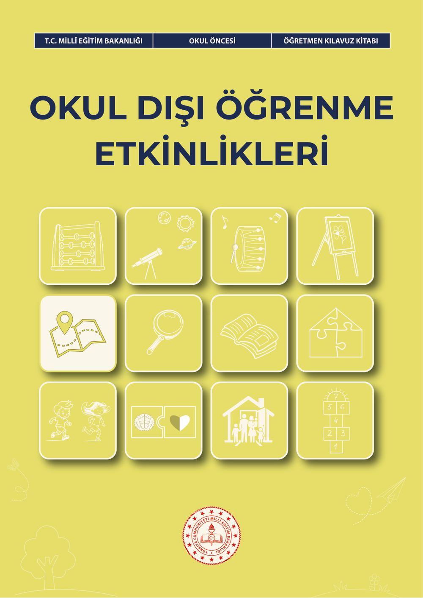

<!-- sayfa 1 -->

Verdiğiniz metin katmanı boş olduğu için (`<<< >>>` arası boş) dönüştürülecek bir içerik bulunmamaktadır. Lütfen metin katmanını içeren içeriği paylaşın, böylece talimatlarınıza uygun şekilde Markdown formatına çevirebilirim.

<!-- sayfa 2 -->

OKUL ÖNCESİ

# Okul Dışı Öğrenme Etkinlikleri Öğretmen Kılavuz Kitabı

## Yazarlar

BETÜL SÜREK
BÜŞRA NUR DURAN YILMAZ
EZGİ AVCI AŞIR
GAMZE SEÇGİN
KÜBRA KARAKUŞ

DEVLET KİTAPLARI

<!-- sayfa 3 -->

Milli Eğitim Bakanlığı Yayınları ................................................................................................................ 11239
Ders Kitapları Dizisi No ......................................................................................................................... 2666

Her hakkı saklıdır ve Milli Eğitim Bakanlığına aittir. Kitabın metin, soru ve şekilleri kısmen de olsa hiçbir surette alınıp yayımlanamaz.

# Editör
Prof.Dr. Özgül POLAT
Prof. Dr. Sinan KOÇYİĞİT

## Dil Uzmanı
Elif ERDEMİR

## Görsel Tasarımcı
Arzu GÜNAL GÜN
Metin BİLAL

## Çoklu Ortam Tasarımcısı
Didem EROL
İlkay CAN
Merve ÖZTEMİR
Yudum CAN

## Program Geliştirme Uzmanı
Dr. Emine SELMANOĞLU

## Ölçme ve Değerlendirme Uzmanı
Merve ERELİ

## Rehberlik Uzmanı
Buket KOÇ

### ISBN
978-625-8867-34-3

Millî Eğitim Bakanlığı Talim ve Terbiye Kurulu Başkanlığının 13.10.2026 tarih ve 172455532 sayılı yazısı ile eğitim

<!-- sayfa 4 -->

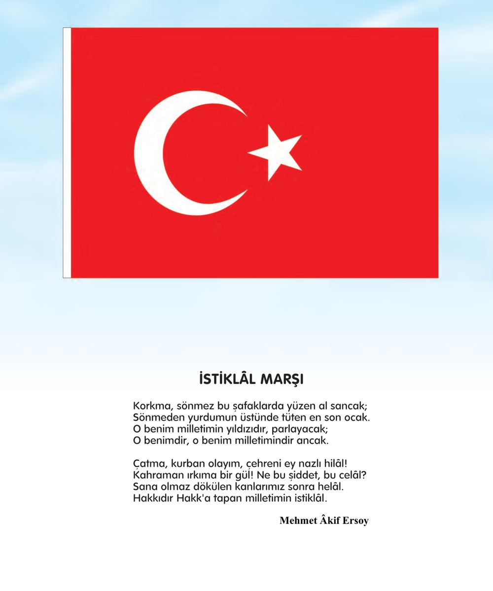

# İSTİKLÂL MARŞI

Korkma, sönmez bu şafaklarda yüzen al sancak;
Sönmeden yurdumun üstünde tüten en son ocak.
O benim milletimin yıldızıdır, parlayacak;
O benimdir, o benim milletimindir ancak.

Çatma, kurban olayım, çehreni ey nazlı hilâl!
Kahraman ırkıma bir gül! Ne bu şiddet, bu celâl?
Sana olmaz dökülen kanlarımız sonra helâl.
Hakkıdır Hakk'a tapan milletimin istiklâl.

**Mehmet Âkif Ersoy**

<!-- sayfa 5 -->

ANDIMIZ

Türküm, doğruyum, çalışkanım.

İlkem küçüklerimi korumak, büyüklerimi saymak; yurdumu, milletimi özümden çok sevmektir.
Ülküm yükselmek, ileri gitmektir.

Ey Büyük Atatürk!

Açtığın yolda, gösterdiğin hedefe durmadan yürüyeceğime ant içerim.

Varlığım Türk varlığına armağan olsun.

Ne mutlu Türküm diyene!

<!-- sayfa 6 -->

MUSTAFA KEMAL ATATÜRK

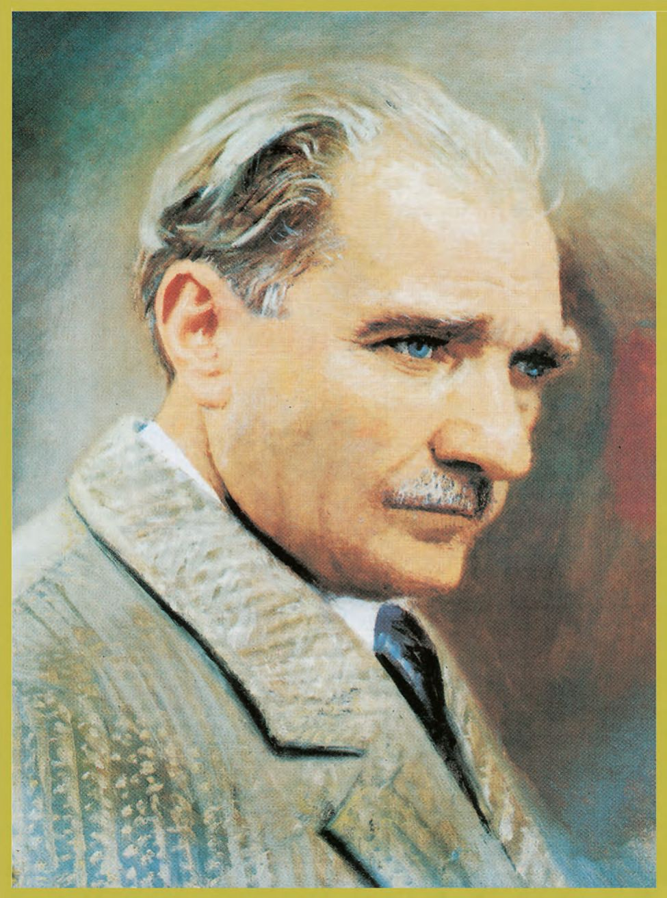
<!-- yer tutucu bulunamadı: sayfa sonuna eklendi -->

<!-- sayfa 7 -->

Verdiğiniz metin katmanı boş olduğu için (`<<< >>>` arası boş) dönüştürülecek bir içerik bulunmamaktadır. Lütfen metin katmanını içeren içeriği paylaşın, böylece talimatlarınıza uygun şekilde Markdown formatına çevirebilirim.

<!-- sayfa 8 -->

# İÇİNDEKİLER

| | |
| :--- | :---: |
| GİRİŞ | 9 |
| OKUL DIŞI ÖĞRENMENİN TANIMI VE KAPSAMI | 9 |
| OKUL DIŞI ÖĞRENME ETKİNLİKLERİ KAPSAMINDA GEZİLEBİLECEK YERLER | 10 |
| OKUL DIŞI ÖĞRENME ETKİNLİKLERİNİN PLANLANMASI VE UYGULANMASI | 12 |
| OKUL DIŞI ÖĞRENME ETKİNLİKLERİNİN ALAN BECERİLERİYLE İLİŞKİLENDİRİLMESİ | 14 |
| OKUL DIŞI ÖĞRENME ETKİNLİKLERİNİN PROGRAMLAR ARASI BİLEŞENLERLE İLİŞKİLENDİRİLMESİ | 16 |
| OKUL DIŞI ÖĞRENME ETKİNLİK ÖRNEKLERİ | 18 |
| &nbsp;&nbsp;&nbsp;&nbsp;Ankara Etnografya Müzesi 1 | 18 |
| &nbsp;&nbsp;&nbsp;&nbsp;Manyas Kuş Cenneti (Kuş Cenneti Millî Parkı) | 21 |
| &nbsp;&nbsp;&nbsp;&nbsp;Çocuk Kütüphanesi 1 | 24 |
| &nbsp;&nbsp;&nbsp;&nbsp;Van Kedisi Evi | 26 |
| &nbsp;&nbsp;&nbsp;&nbsp;Nallıhan Kuş Cenneti | 28 |
| &nbsp;&nbsp;&nbsp;&nbsp;Adana Arkeoloji Müzesi | 32 |
| &nbsp;&nbsp;&nbsp;&nbsp;Ankara Etnografya Müzesi 2 | 35 |
| &nbsp;&nbsp;&nbsp;&nbsp;Ege Üniversitesi Botanik Bahçesi ve Herbaryum Araştırma ve Uygulama Merkezi Gezisi 1 | 38 |
| &nbsp;&nbsp;&nbsp;&nbsp;Erzurum Bilim Merkezi | 42 |
| &nbsp;&nbsp;&nbsp;&nbsp;İstanbul Resim Heykel Müzesi | 45 |
| &nbsp;&nbsp;&nbsp;&nbsp;Sivrihisar Kilim Müzesi | 48 |
| &nbsp;&nbsp;&nbsp;&nbsp;Çini Müzesi | 50 |
| &nbsp;&nbsp;&nbsp;&nbsp;Çocuk Kütüphanesi 2 | 55 |
| &nbsp;&nbsp;&nbsp;&nbsp;Fotoğraf Makinesi Müzesi | 57 |
| &nbsp;&nbsp;&nbsp;&nbsp;Isparta Gül Bahçeleri | 61 |
| &nbsp;&nbsp;&nbsp;&nbsp;Meteoroloji Müzesi | 65 |
| &nbsp;&nbsp;&nbsp;&nbsp;Nevşehir Avanos Çömlek Atölyesi | 68 |
| &nbsp;&nbsp;&nbsp;&nbsp;SEKA Kâğıt Müzesi | 70 |
| &nbsp;&nbsp;&nbsp;&nbsp;Merinos Tekstil Sanayi Müzesi | 73 |
| &nbsp;&nbsp;&nbsp;&nbsp;Dr. Hüseyin Parkan Sanlıkol Müzik Enstrümanları Müzesi | 77 |
| &nbsp;&nbsp;&nbsp;&nbsp;Ankara Devlet Tiyatrosu | 79 |
| &nbsp;&nbsp;&nbsp;&nbsp;Ekmek Fabrikası | 81 |
| &nbsp;&nbsp;&nbsp;&nbsp;Geri Dönüşüm Merkezi | 84 |
| &nbsp;&nbsp;&nbsp;&nbsp;Konya Tropikal Kelebek Bahçesi | 88 |
| &nbsp;&nbsp;&nbsp;&nbsp;Kültür ve Sanat Merkezi | 92 |
| &nbsp;&nbsp;&nbsp;&nbsp;Sivas Arkeoloji Müzesi | 95 |
| &nbsp;&nbsp;&nbsp;&nbsp;Ankara Resim ve Heykel Müzesi | 97 |

<!-- sayfa 9 -->

| Akdeniz Üniversitesi Botanik Bahçesi Uygulama ve Araştırma Merkezi | 101 |
| :--- | :--- |
| Ankara Etnografya Müzesi 3 | 105 |
| Ege Üniversitesi Botanik Bahçesi ve Herbaryum Araştırma ve Uygulama Merkezi 2 | 108 |
| İstanbul Bilim Merkezi | 112 |
| İtfaiye İstasyonu | 115 |
| İzmir Efes Antik Kenti | 118 |
| Somut Olmayan Kültürel Miras Müzesi | 122 |
| Karacabey Longoz Ormanları | 125 |
| Akvaryum | 129 |
| Ankara Üniversitesi Oyuncak Müzesi | 133 |
| Çocuk Kütüphanesi 3 | 136 |
| Divriği Ulu Cami | 138 |
| PTT Pul Müzesi | 140 |
| Sağlık Kuruluşu | 143 |
| Ankara Şehit Cuma Dağ Tabiat Tarihi Müzesi | 147 |
| KAYNAKÇA | 150 |
| GÖRSEL VE GENEL AĞ KAYNAKÇASI | 150 |
| TÜRKİYE’NİN MÜLKİ İDARİ BÖLÜMLERİ İLE KARA VE DENİZ KOMŞULARI HARİTASI | 151 |
| TÜRK DÜNYASI HARİTASI | 152 |

<!-- sayfa 10 -->

# GİRİŞ

Bu kılavuz, Türkiye Yüzyılı Maarif Modeli Okul Öncesi Eğitim Programı kapsamında okul dışı öğrenme etkinliklerini planlama, uygulama ve değerlendirme süreçlerinde öğretmenlere yol gösterici bir kaynak olarak hazırlanmıştır. Kılavuzda okul dışı öğrenmenin kapsamı ve temel özellikleri açıklanmakta, okul dışı öğrenme ortamlarının ve bu ortamlarda gerçekleştirilebilecek etkinliklerin türleri tanıtılmakta, etkinliklerin programda yer alan alan becerileri, öğrenme çıktıları, süreç bileşenleri, eğilimler ve programlar arası bileşenlerle nasıl ilişkilendirilebileceğine yönelik açıklama ve örneklere yer verilmektedir.

Kılavuzda 36-48 ay, 48-60 ay ve 60-72 aylık çocuklara yönelik olarak hazırlanan okul dışı öğrenme etkinliği örnekleri bulunmaktadır. Bu etkinlikler müzeler, bilim merkezleri, botanik bahçeleri, doğal yaşam alanları, tiyatrolar, kültür ve sanat merkezleri, üretim tesisleri ve geri dönüşüm merkezleri gibi farklı öğrenme ortamlarını kapsamaktadır. Etkinliklerde çocukların gelişimsel özellikleri, ilgi ve ihtiyaçları, öğrenme ortamının sunduğu olanaklar ve programda yer alan öğrenme çıktıları dikkate alınmıştır. Öğretmenler etkinlikleri; çocukların bireysel farklılıklarına, yaş grubuna, okulun ve yakın çevrenin koşullarına, ulaşılabilir okul dışı öğrenme ortamlarına ve mevcut olanaklara göre uyarlayabilir.

## OKUL DIŞI ÖĞRENMENİN TANIMI VE KAPSAMI

Okul dışı öğrenme; çocukların okul binasının dışında bulunan doğal, tarihî, kültürel, sanatsal, bilimsel ve teknolojik çevrelerle doğrudan etkileşim kurarak öğrenmelerini sağlayan planlı ve amaçlı öğrenme yaşantılarını kapsamaktadır. Müzeler, bilim merkezleri, kütüphaneler, planetaryumlar, botanik bahçeleri ve hayvanat bahçeleri belirli eğitim içerikleri ve ziyaretçi deneyimleri sunan yapılandırılmış okul dışı öğrenme ortamları arasında yer almaktadır. Bunun yanında parklar, ormanlık alanlar, sulak alanlar, tarihî yapılar, pazarlar, tiyatrolar, kültür merkezleri, üretim tesisleri, geri dönüşüm merkezleri, meteoroloji istasyonları, su arıtma tesisleri, sağlık kuruluşları ve çocukların yaşadıkları çevrede bulunan diğer mekânlar da öğrenme amaçları doğrultusunda okul dışı öğrenme ortamı olarak değerlendirilebilir.

Okul dışı öğrenme, programda yer alan alanlardan bağımsız yeni bir öğrenme alanı değildir. Programdaki alan becerilerinin, öğrenme çıktılarının ve süreç bileşenlerinin gerçek yaşam bağlamlarında işe koşulmasına imkân sağlayan bir öğrenme yaklaşımı ve öğrenme ortamı düzenlemesidir. Dolayısıyla bir etkinliğin “okul dışı” olarak adlandırılması yalnızca okul binasının dışında gerçekleştirilmesine bağlı değildir. Etkinliğin belirli bir öğrenme amacı doğrultusunda planlanması, çocukların doğrudan deneyim edinmelerine imkân vermesi, etkin katılımlarını desteklemesi ve edinilen deneyimlerin önceki ve sonraki öğrenmelerle ilişkilendirilmesi gerekir.

Okul dışı öğrenme, sınıf ortamında sunulan öğrenme yaşantılarının alternatifi değil, bu yaşantıları tamamlayan ve genişleten bir süreçtir. Sınıfta bir görsel veya kitap üzerinden karşılaşılan bir kavramın gerçek ortamında gözlemlenmesi, çocuğun kavramla somut bir deneyim kurmasını sağlar. Örneğin çocuklar bitkilerin bölümlerini görsellerden inceleyebilir ancak bir botanik bahçesinde farklı bitkilerin yapraklarını, gövdelerini, renklerini ve kokularını karşılaştırdıklarında çoklu duyulara dayalı ve daha kalıcı bir öğrenme yaşantısı edinirler. Benzer biçimde bir sanat eserinin fotoğrafını incelemek ile müzede eserin gerçek boyutunu, dokusunu, renklerini ve bulunduğu mekânı gözlemlemek aynı nitelikte deneyimler değildir. Okul dışı öğrenme, çocuğun bilgi ile gerçek yaşam arasındaki ilişkiyi görmesine ve öğrendiklerini yeni bağlamlarda kullanmasına yardımcı olur.

Okul dışı öğrenme aynı zamanda çocukların yaşadıkları çevreyi tanımalarına ve kendilerini bu çevrenin bir parçası olarak görmelerine katkıda bulunur. Çocuklar bir müzeyi ziyaret ettiklerinde kültürel mirasla, bir geri dönüşüm merkezini ziyaret ettiklerinde çevresel sorumlulukla, bir üretim tesisini ziyaret ettiklerinde emek ve üretim süreçleriyle, bir tiyatroyu ziyaret ettiklerinde sanat ve toplumsal yaşamla ilişki kurarlar. Bu yönüyle okul dışı öğrenme, çocukların yalnızca akademik becerilerini değil çevreye, kültüre, sanata, topluma ve ortak yaşama yönelik farkındalıklarını da destekleyen bütüncül bir öğrenme yaklaşımıdır.

Fiziksel ziyaretin mümkün olmadığı durumlarda sanal geziler ve dijital ortamlar da okul dışı öğrenme deneyimlerini desteklemek amacıyla kullanılabilir. Sanal müze gezileri, canlı kamera görüntüleri, üç boyutlu mekân incelemeleri ve uzmanlarla gerçekleştirilen çevrim içi görüşmeler çocukların farklı yerlere ve bilgi

<!-- sayfa 11 -->

doğrudan deneyimin yerini alan temel uygulamalar olarak değil, fiziksel deneyimi hazırlayan, tamamlayan veya erişilemeyen bir ortamı görünür hâle getiren araçlar olarak değerlendirilmelidir.

# OKUL DIŞI ÖĞRENME ETKİNLİKLERİ KAPSAMINDA GEZİLEBİLECEK YERLER

## Müzeler

Arkeoloji, etnografya, tarih, resim ve heykel, oyuncak, kent, bilim, doğa tarihi ve açık hava müzeleri okul öncesi çocuklar için zengin öğrenme fırsatları sunar. Müzelerde çocuklar geçmişten günümüze ulaşan eserleri, sanat ürünlerini, günlük yaşam araçlarını ve farklı dönemlere ait kültürel özellikleri gerçek örnekleri üzerinden inceleyebilir. Eserlerin yapıldığı malzeme, renk, biçim, desen, büyüklük ve kullanım amacı hakkında gözlem yapabilir; geçmişte kullanılan bir eşya ile günümüzdeki karşılığını karşılaştırabilirler.

Müze ziyareti, çocuklara çok sayıda eser adı öğretmek veya müzenin bütün salonlarını gezdirmek amacıyla planlanmamalıdır. Yaş grubuna ve öğrenme amacına uygun birkaç eser önceden seçilmeli; çocukların bu eserler üzerinde düşünmelerine, ayrıntıları fark etmelerine ve sorularını ifade etmelerine zaman ayrılmalıdır. Arkeoloji müzesinde bir testi veya mozaiğin incelenmesi, etnografya müzesinde çini ve geleneksel kullanım eşyalarına odaklanılması ya da resim ve heykel müzesinde seçilen bir eserin duygu, renk ve biçim özelliklerinin ele alınması derinlemesine öğrenmeye örnek oluşturur.

Müzeler; millî kültürün, ortak hafızanın ve sanat birikiminin çocuklar tarafından fark edilmesini destekleyen önemli ortamlardır. Çocukların tarihî eserlerin geçmiş ile bugün arasında bağ kurduğu, bu eserlerin ortak kültürel mirasın bir parçası olduğu ve korunmalarının gelecek kuşaklar açısından önem taşıdığı konusunda farkındalık geliştirmeleri sağlanabilir. Bu süreçte vatanseverlik, sorumluluk, saygı ve estetik değerleri eserlerle kurulan somut etkileşimler üzerinden ele alınabilir.

## Bilim Merkezleri, Gözlemevleri ve Planetaryumlar

Bilim merkezleri, çocukların etkileşimli düzenekleri kullanarak ışık, ses, hareket, mıknatıs, hava, uzay ve enerji gibi konularla ilgili gözlem ve denemeler yapmalarına olanak tanır. Gözlemevleri ve planetaryumlar gökyüzü, Dünya, gezegenler ve uzayla ilgili merakın desteklenebileceği öğrenme ortamlarıdır. Bu ziyaretlerde amaç çocuklara yoğun bilimsel bilgi aktarmak değil; soru sormalarını, tahmin yürütmelerini, denemelerini ve gözlemledikleri sonuçları ifade etmelerini desteklemektir.

Bilim merkezi ziyaretlerinde çocukların yaşına uygun ve güvenli düzenekler önceden belirlenmelidir. Her düzeneği kısa süre içinde denemek yerine birkaç düzenek üzerinde tekrar deneme yapmalarına ve ilk tahminleri ile gözlem sonuçlarını karşılaştırmalarına fırsat verilmelidir. “Bilim Avı”, “Bilim Pasaportu” ve görsel görev kartları gibi araçlar çocukların dikkatlerini belirli özelliklere yönlendirebilir. Planetaryumlarda karanlık ortam, yüksek ses veya uzun süreli gösterimlerden etkilenebilecek çocuklar için önceden bilgilendirme ve gerekli uyarlamalar yapılmalıdır.

## Kütüphaneler

Çocuk kütüphaneleri, halk kütüphaneleri ve kurumların bünyesinde bulunan özel kitaplıklar çocukların kitap, dergi, afiş, katalog ve dijital kaynak gibi farklı okuma materyalleriyle karşılaşmalarını sağlar. Kütüphane ziyaretleri çocukların kitap seçme, görselleri inceleme, kitapların düzenlenme biçimini fark etme, sessiz çalışma alanlarını kullanma ve ödünç alma süreçlerini tanımalarına katkıda bulunur.

Ziyaret sırasında kütüphane görevlisinin sorumlulukları tanıtılabilir, çocukların ilgi duydukları kitapları seçmelerine ve belirli bir süre incelemelerine fırsat verilebilir. Kitapların ortak kullanım materyali olduğu, özenle korunması ve zamanında geri getirilmesi gerektiği üzerinde durularak sorumluluk ve saygı değerleri gerçek bir kullanım durumu içerisinde desteklenebilir. Yerel tarih, kültür, masal, kahramanlık, aile, yardımlaşma ve doğa konulu nitelikli çocuk kitapları aracılığıyla millî ve manevi değerlerle ilişki kurulabilir.

## Camiler

<!-- sayfa 12 -->

ve sanatsal özellikleriyle çocukların gözlem yapmalarına, karşılaştırmalarda bulunmalarına, estetik farkındalık geliştirmelerine imkân verir. Çocuklar yapının biçimini, kullanılan malzemeleri ve süslemeleri yaşlarına uygun biçimde inceleyebilir, ışığın iç mekâna yansımasını ve mekânın ses özelliklerini keşfedebilirler.

Cami ziyaretleri, çocukların manevi ve kültürel mirasla doğrudan ilişki kurmalarına olanak tanır. Temizlik, saygı, paylaşma, yardımlaşma, merhamet ve sabır gibi değerler, caminin toplumsal ve kültürel işlevlerinden hareketle somutlaştırılabilir. Ziyaret öncesinde caminin anlamı ile kullanım amacı, yaşa uygun, sade ve doğru ifadelerle açıklanmalıdır. Çocuklarla mekâna saygı gösterme, uygun ses düzeyini kullanma, temizliğe dikkat etme, ziyaret edilen bölümlerde birlikte hareket etme ve ibadet eden kişileri rahatsız etmeme kuralları konuşulmalıdır. Ziyaret, ilgili görevlilerle önceden planlanmalı, ibadet düzenini aksatmayacak bir zaman dilimi seçilmelidir.

## Yerel Kültürel Miras Alanları

Kaleler, hanlar, hamamlar, köprüler, çeşmeler, geleneksel evler, tarihî çarşılar ve antik yerleşimler çocukların geçmişteki yaşam biçimleriyle günümüz arasında bağ kurabilecekleri okul dışı öğrenme ortamlarıdır. Bu yapılarda kullanılan taş, ahşap, kemer, kubbe ve süsleme özellikleri incelenebilir; yapıların geçmişte hangi amaçlarla kullanıldığı ve günümüzde neden korunduğu üzerine konuşulabilir.

Yerel kültürel miras alanları, çocukların kendi şehirlerine veya yaşadıkları bölgeye yönelik aidiyet geliştirmelerinde özel bir öneme sahiptir. Çocukların “Bu yapı neden burada?”, “Geçmişte insanlar bu yapıyı nasıl kullanmış olabilir?” ve “Bu yapı korunmazsa ne olur?” gibi sorular üzerinde düşünmeleri sağlanabilir. Ziyaret sırasında yapıya zarar vermeme, çevreyi temiz tutma ve kültürel mirası koruma sorumluluğu çocukların gerçekleştirdiği eylemlerle ilişkilendirilmelidir. Böylece vatanseverlik değeri yalnızca ülkeyi sevme ifadesiyle sınırlı kalmaz; ülkenin tarihî, doğal ve kültürel değerlerini tanıma, koruma ve gelecek kuşaklara aktarma sorumluluğu olarak somutlaşır.

## Millî Tarih ve Ortak Hafıza Mekânları

Millî tarih açısından önem taşıyan yerler çocukların bağımsızlık, vatan sevgisi, birlik, dayanışma ve ortak hafıza kavramlarıyla yaşa uygun biçimde karşılaşmalarını sağlayabilir. Bu mekânlar çocukların ülkenin geçmişine ilişkin aidiyet geliştirmelerine, bugün sahip olunan ortak değerlerin önceki kuşakların emek ve fedakârlıklarıyla ilişkisini fark etmelerine katkıda bulunabilir.

Okul öncesi dönemde millî tarih anlatımı çocukların gelişim özelliklerine uygun, somut ve güven verici bir çerçevede ele alınmalıdır. Bağımsızlığın, dayanışmanın, cesaretin, sorumluluğun ve birlikte hareket etmenin önemi vurgulanmalıdır. Bayrak, tarihî bir fotoğraf, döneme ait günlük bir eşya veya çocukların anlayabileceği kısa bir yaşam öyküsü üzerinden geçmiş ile bugün arasında bağ kurulabilir.

## Kültür ve Sanat Merkezleri, Tiyatrolar ve Sanat Atölyeleri

Tiyatrolar, opera ve konser salonları, kültür merkezleri, sanat galerileri, belediye sanat mekânları ve atölyeler çocukların farklı sanat dallarıyla karşılaşmalarını sağlar. Çocuklar sahne, perde, dekor, kostüm ve seyirci alanlarını inceleyebilir; sanatçıların ve sahne arkasında görev yapan kişilerin sorumluluklarını öğrenebilir; resim, seramik, ebru, çini ve dokuma gibi sanat uygulamalarını gözlemleyebilirler. Bu ortamlar çocukların estetik duyarlılık geliştirmelerinin yanı sıra geleneksel sanatları ve kültürel üretimi tanımalarına katkı sağlar. Ebru, çini, hat, minyatür, dokuma, ahşap ve taş işçiliği gibi sanatların incelenmesi millî kültürün görsel ve sanatsal birikiminin fark edilmesini destekleyebilir. Çocukların sanat eserlerindeki emek, kullanılan malzeme, sanatçının tercihleri ve eserin kendilerinde oluşturduğu duygu üzerine konuşmaları sağlanmalıdır.

## Doğal Yaşam Alanları, Parklar ve Botanik Bahçeleri

Parklar, ormanlar, botanik bahçeleri, kuş gözlem alanları ve millî parklar çocukların doğayla doğrudan bağ kurabilecekleri ortamlardır. Bu alanlarda bitki ve hayvanların gözlemlenebilir özellikleri, mevsimsel değişimler, canlıların yaşam alanları ve doğal çevrenin korunması ele alınabilir.

Doğa ziyaretlerinde yerel özellikler öncelikli olmalıdır Deniz kıyısındaki bir okul kıyı canlılarını ve balıkçılığı

<!-- sayfa 13 -->

bulunan okul ise ürünlerin yetişme süreçlerini inceleyebilir. Çocukların kendi yaşadıkları çevrenin doğal özelliklerini tanımaları, doğaya yönelik aidiyet ve sorumluluk geliştirmelerinin temelini oluşturur.

### Üretim Yerleri ve Geleneksel Zanaat Atölyeleri

Ekmek fabrikaları, süt ve gıda üretim tesisleri, seralar, çiftlikler, çömlek, dokuma, bakır, ahşap ve benzeri geleneksel zanaat atölyeleri çocukların üretimin aşamalarını ve emeğin ürüne dönüşme sürecini gözlemlemelerine imkân verir. Çocuklar kullanılan malzemeleri, araçları ve meslekleri inceleyebilir; bir ürünün oluşum sırasını takip edebilirler.

Yerel zanaat atölyeleri millî kültürün yaşayan yönünün fark edilmesinde önemlidir. Çocukların yalnızca geçmişte üretilmiş eserleri müzede görmeleri değil, geleneksel bilginin günümüzde bir usta tarafından nasıl sürdürüldüğünü gözlemlemeleri kültürel sürekliliği anlamlandırmalarına katkı sağlar. Ustanın emeğine, kullanılan malzemeye ve ortaya çıkan ürüne saygı gösterilmesi; çalışkanlık, sabır, sorumluluk ve estetik değerleriyle ilişkilendirilebilir.

### Kamu Kurumları ve Toplumsal Hizmet Alanları

Belediye birimleri, itfaiye merkezleri, postaneler, sağlık kuruluşları, meteoroloji istasyonları, su arıtma tesisleri, geri dönüşüm merkezleri ve ulaşım birimleri toplum yaşamının sürdürülmesine katkıda bulunan kurumlardır. Çocuklar bu kurumlarda çalışan kişilerin görevlerini, kullanılan araç ve sembolleri ve sunulan hizmetlerin günlük yaşamla ilişkisini gözlemleyebilir.

Bu ziyaretler çocukların toplumun farklı üyelerinin ortak yaşam için sorumluluk üstlendiğini fark etmelerine yardımcı olabilir. Kurum ziyaretlerinde güvenlik, mahremiyet ve hizmetin aksamaması öncelikli olmalı; hastane, itfaiye veya üretim birimi gibi ortamlarda çocukların bulunabileceği güvenli alanlar kurum görevlileriyle birlikte belirlenmelidir.

### Somut Olmayan Kültürel Mirasın Deneyimlenebileceği Ortamlar

Okul dışı öğrenme yalnızca yapıların ve nesnelerin ziyaret edilmesiyle sınırlı değildir. Masallar, türküler, halk oyunları, geleneksel çocuk oyunları, yemek kültürü, bayram hazırlıkları, misafirperverlik uygulamaları, yerel söyleyişler ve kuşaktan kuşağa aktarılan üretim bilgileri somut olmayan kültürel mirasın parçalarıdır. Yerel sanatçılar, aile büyükleri, halk oyunları ekipleri, aşçılar, masal anlatıcıları ve zanaatkârlarla gerçekleştirilen buluşmalar bu mirasın çocuklar tarafından canlı bir deneyim içerisinde tanınmasını sağlar.

Bu buluşmalarda millî ve manevi değerler çocuğun günlük yaşamıyla ilişkilendirilebilir. Bayramlarda paylaşma ve dayanışma, aile büyüklerine saygı, misafire ikram, ortak oyunlarda adalet ve sabır, yerel üretimde emek ve çalışkanlık gibi değerler somut uygulamalar üzerinden ele alınabilir. Kültürel uygulamalar değişmez kalıplar olarak sunulmamalı; bölgesel çeşitliliğin millî kültürün zenginliğini oluşturduğu vurgulanmalıdır.

# OKUL DIŞI ÖĞRENME ETKİNLİKLERİNİN PLANLANMASI VE UYGULANMASI

Nitelikli bir okul dışı öğrenme deneyimi; etkinlik öncesi hazırlık, etkinlik sırasındaki uygulamalar ve etkinlik sonrası anlamlandırma, pekiştirme olmak üzere birbirini tamamlayan üç aşamada planlanır. Bu aşamalar birbirinden bağımsız değil, aynı öğrenme sürecinin devamı olarak ele alınmalıdır.

#### Etkinlik Öncesi

Planlamanın ilk adımı etkinliğin amacının ve programla ilişkisinin belirlenmesidir. Öğretmen çocukların hangi alan becerilerini kullanmalarını, hangi öğrenme çıktıları doğrultusunda deneyim edinmelerini ve süreç sonunda hangi gözlenebilir davranışları ortaya koymalarını beklediğini belirlemelidir. Daha sonra seçilen ortamın bu amaçları karşılayıp karşılamadığı değerlendirilmelidir. Aynı ortam farklı amaçlarla ziyaret edilebilir örneğin bir botanik bahçesi fen alanında bilimsel gözlem yapmak, matematik alanında veri toplamak ve grafik oluşturmak veya sanat alanında renk, biçim ve dokuları incelemek amacıyla kullanılabilir. Etkinliğin odağı, ziyaret edilen yerin adından değil, seçilen öğrenme çıktılarından hareketle belirlenmelidir

<!-- sayfa 14 -->

erişilebilirlik koşullarını, dinlenme alanlarını ve olası riskleri belirlemesi açısından önemlidir. Kurum görevlileriyle görüşülerek çocukların yaş grubu, ziyaret amacı, grup büyüklüğü, etkinlik süresi ve gerçekleştirilecek uygulamalar paylaşılmalıdır. Ziyaret sırasında çocukların kullanacağı gözlem kâğıtları, görev kartları, krokiler veya diğer materyaller ortamın gerçek özelliklerine göre hazırlanmalıdır.

Etkinlik öncesinde okul yönetimi ve ailelerle gerekli iletişim kurulmalı, resmî izin ve onay süreçleri tamamlanmalıdır. Ulaşım planı, yetişkin-çocuk oranı, yoklama ve grup kontrolü, çocuklara ait temel bilgiler, sağlık gereksinimleri, acil durum iletişimi ve alternatif uygulamalar önceden belirlenmelidir. Yaka kartları kullanılacaksa çocukların güvenliğini tehlikeye atabilecek kişisel bilgilerin açık biçimde görünmemesine dikkat edilmeli, kurumun güncel güvenlik uygulamaları esas alınmalıdır.

Çocukların etkinliğe bilişsel ve duygusal olarak hazırlanması da planlamanın önemli bir parçasıdır. Ziyaret edilecek ortama ait fotoğraf, kısa video, harita, nesne, sanat eseri veya öykü kullanılabilir. “Sizce burada neler görebiliriz?”, “En çok neyi merak ediyorsunuz?”, “Bu araç ne işe yarıyor olabilir?” gibi sorularla çocukların ön bilgileri ve tahminleri ortaya çıkarılabilir. Çocukların merak ettikleri sorular resim veya sembollerle kaydedilebilir ve gezi sırasında bu soruların yanıtlarını aramaları sağlanabilir.

Gezi öncesi hazırlık çocuklara ziyaret edilecek yerle ilgili bütün bilgilerin verilmesi anlamına gelmez. Çocuğun keşfetme isteğini ortadan kaldıracak ayrıntılı açıklamalar yerine gözlem yapmasına yardımcı olacak temel kavramlar ve ipuçları sunulmalıdır. Çocukların karşılaşacakları ortama ilişkin belirsizliklerini azaltmak amacıyla gezi akışı görsel bir planla tanıtılabilir. Özellikle yeni ortamlara uyum sağlamakta zorlanan çocuklar için gezi akışı, ulaşım, giriş, gözlem, dinlenme ve dönüş aşamalarını gösteren görsel akış kartlarından yararlanılabilir.

## Etkinlik Sırası

Etkinlik sırasında öncelikle çocukların güvenliği, grup bütünlüğü ve temel ihtiyaçları sürekli gözetilmelidir. Öğretmen ve sürece eşlik eden yetişkinler görev paylaşımı yapmalı, çocukların hangi yetişkinle hareket edeceği önceden belirlenmelidir. Yoklama yalnızca başlangıç ve bitişte değil, ortamlar arası geçişlerde de tekrarlanmalıdır. Çocukların yorulma, acıkma, tuvalet ihtiyacı veya duyusal olarak zorlanma belirtileri izlenmeli ve gerektiğinde plan esnetilmelidir.

Öğretmen, çocukların dikkatini öğrenme amacıyla ilişkili noktalara yönlendirirken gözlemlerini sınırlandırmamalıdır. “Burada ne görüyorsun?” gibi genel soruların ardından “Yaprağın kenarları nasıl?”, “Bu iki eserin malzemeleri aynı mı?”, “Düzenek hareket etmeden önce ne yaptın?” gibi gözlemi derinleştiren sorular kullanılabilir. Soruların hemen ardından öğretmenin yanıt vermesi yerine çocuklara düşünmeleri, yeniden incelemeleri ve akranlarının görüşlerini dinlemeleri için süre tanınmalıdır.

Ortamda görev yapan rehber, sanatçı, bilim insanı, üretici veya diğer uzmanlarla iş birliği kurulabilir. Ancak yetişkin açıklamalarının çocukların dikkat ve dil gelişimi düzeyine uygun, kısa ve etkileşimli olması sağlanmalıdır. Çocukların uzmanlara kendi sorularını yöneltmeleri desteklenmeli, yalnızca yetişkinler arasında gerçekleşen uzun bilgilendirmelerden kaçınılmalıdır. Öğretmen gerekli durumlarda uzman açıklamalarını çocukların anlayabileceği biçimde yeniden ifade edebilir.

Gözlem kâğıtları, bilim pasaportları, arama kartları ve görevler çocukların dikkatini belirli özelliklere yöneltmek için kullanılabilir. Bu araçlarda az sayıda ve anlaşılır görsel yönerge bulunmalıdır. Çocukların çevreyi incelemek yerine sürekli kâğıt üzerinde çalışmasına neden olacak yoğun formlar kullanılmamalıdır. Gözlem kaydı; işaretleme, basit çizim, çıkartma yerleştirme, fotoğraf seçme veya öğretmene sözel olarak aktarma biçiminde gerçekleştirilebilir.

Etkinlik sırasında fotoğraf, ses veya video kaydı alınacaksa ilgili izinler ve mahremiyet ilkeleri gözetilmelidir. Kayıt alma işlemi çocukların doğrudan deneyiminin önüne geçmemeli, yalnızca gezi sonrasında yeniden inceleme ve değerlendirme amacıyla gerekli ölçüde kullanılmalıdır. Tarihî eserlere, canlılara, üretim araçlarına ve diğer ziyaretçilere ilişkin kurum kurallarına uyulmalıdır.

## Etkinlik Sonrası

Etkinlik sonrasında yapılacak çalışmalar; çocukların deneyimlerini hatırlamalarını, düzenlemelerini ve

<!-- sayfa 15 -->

paylaşmalarına fırsat veren kısa bir sohbetle başlayabilir. “En çok ne dikkatini çekti?”, “Seni şaşırtan ne oldu?” ve “Gezi öncesindeki tahminlerinden hangileri değişti?” gibi sorular çocukların deneyimlerini yeniden düşünmelerine yardımcı olur.

Değerlendirme yalnızca çocukların yer veya nesne adlarını hatırlayıp hatırlamadıklarını belirlemeye yönelik olmamalıdır. Çocukların gözlem yapma, karşılaştırma, çıkarımda bulunma, sorun çözme, iletişim kurma ve deneyimlerini ifade etme süreçleri de değerlendirilmelidir. Öğretmen; çocukların gezi öncesinde oluşturdukları soruları ve tahminleri yeniden ele alabilir, hangi soruların yanıtlandığını, hangilerinin araştırılmaya devam edeceğini çocuklarla birlikte belirleyebilir.

Çocuklar deneyimlerini resim, drama, hikâye, deney, model, grafik, sergi veya ortak pano yoluyla ifade edebilir. Müzede incelenen bir tablonun bedenle canlandırılması, botanik bahçesinde yapılan gözlemlerden yaprak rengi grafiği oluşturulması, bilim merkezinde incelenen bir düzeneğin basit modelinin tasarlanması veya geri dönüşüm merkezindeki deneyimlerden yeni bir ürün oluşturulması öğrenmenin farklı alanlarla bütünleştirilerek pekiştirilmesini sağlar. Ortaya çıkan ürünün estetik görünümünden çok, çocuğun gözlemlerini ve düşünme sürecini ne ölçüde yansıttığı önemlidir.

Gezi sonrası süreç tek bir etkinlikle sınırlandırılmayabilir. Çocukların ilgisi devam ediyorsa sınıfta ilgili bir öğrenme merkezi oluşturulabilir, uzman davet edilebilir, ailelerle gözlem çalışmaları yürütülebilir veya yeni bir araştırma sorusu üzerinden proje geliştirilebilir. Böylece okul dışındaki deneyim sınıf yaşamına taşınır ve öğrenme süreklilik kazanır.

# OKUL DIŞI ÖĞRENME ETKİNLİKLERİNİN ALAN BECERİLERİYLE İLİŞKİLENDİRİLMESİ

Okul dışı öğrenme ortamları, programda yer alan Türkçe, matematik, fen, sosyal, sanat, müzik, hareket ve sağlık alan becerilerinin gerçek yaşam durumları içerisinde ele alınmasına yönelik zengin fırsatlar sunar. İlişkilendirmede öncelikle ortamın özellikleri, etkinliğin amacı ve öğrenme çıktıları dikkate alınmalıdır. Her ortamın bütün alanlarla ilişkilendirilmesi gerekmez. Etkinliğin doğal akışı içerisinde birbirini destekleyen alanların seçilmesi ve alanlar arasında içeriksel bir bütünlük kurulması önemlidir.

## Türkçe Alanı ile İlişkilendirme

Türkçe alanı okul dışı öğrenme sürecinin bütün aşamalarında kullanılabilir. Gezi öncesinde çocukların merak ettikleri soruları ifade etmeleri, ziyaret edilecek ortama ilişkin tahminlerde bulunmaları ve görselleri inceleyerek anlam oluşturmaları dinleme/izleme, konuşma ve görsel okuma becerilerini destekler. Gezi sırasında rehberin açıklamalarını dinlemeleri, çevredeki yazılı ve görsel göstergeleri incelemeleri, soru sormaları ve gözlemlerini betimlemeleri Türkçe alanıyla doğrudan ilişkilidir.

Gezi sonrasında çocukların deneyimlerini sıralı biçimde anlatmaları, yeni öğrendikleri sözcükleri kullanmaları, gözlemledikleri bir canlıyı veya eseri betimlemeleri, ortak hikâye oluşturmaları ve geziye ilişkin resimlerini arkadaşlarına tanıtmaları konuşma becerilerini destekleyebilir. Tabela, afiş, yönlendirme işareti, müze açıklaması, ürün etiketi, harita ve sembollerin incelenmesi görsel okuma ve yazı farkındalığına yönelik doğal materyaller sunar. Bu çalışmalar çocuklara sözcük veya harf öğretme amacına indirgenmemeli; yazı ve görsellerin gerçek yaşamda bilgi verme, yönlendirme ve iletişim kurma işlevlerini fark etmeleri sağlanmalıdır.

## Matematik Alanı ile İlişkilendirme

Okul dışı ortamlardaki nesneler, canlılar, yapılar ve göstergeler matematiksel düşünme için gerçek bağlamlar sağlar. Çocuklar nesneleri sayabilir, miktarları karşılaştırabilir, belirli özelliklere göre sınıflandırabilir, sıralayabilir, örüntüleri fark edebilir, konum ve yön ilişkilerini inceleyebilir ve gözlemlerinden veri oluşturabilirler.

Botanik bahçesinde gözlemlenen yaprakların renk veya biçimlerine göre sınıflandırılması, müzedeki kilim ve çinilerde tekrar eden motiflerin belirlenmesi, tarihî eserlerin büyüklüklerinin karşılaştırılması, bir üretim sürecindeki aşamaların sıralanması ve gözlem sonuçlarından grafik oluşturulması matematik alanıyla kurulabilecek ilişkilere örnek verilebilir. Matematiksel etkinlikler, ortamdan kopuk sayma sorularına

<!-- sayfa 16 -->

# Fen Alanı ile İlişkilendirme

Fen alanı; canlıların, doğal çevrenin, madde ve malzemelerin, değişim süreçlerinin ve bilimsel düzeneklerin doğrudan gözlemlenmesi yoluyla okul dışı öğrenmeyle güçlü biçimde ilişkilendirilebilir. Çocukların bitki ve hayvanların gözlemlenebilir özelliklerini incelemeleri, benzerlik ve farklılıkları belirlemeleri, yaşam alanlarıyla ilgili sorular sormaları ve gözlemlerini basit yollarla kaydetmeleri bilimsel gözlem ve sınıflandırma becerilerini destekler.

Bilim merkezlerindeki düzenekler üzerinde tahmin yapma ve deneme gerçekleştirme, ekmek üretiminde hamurun geçirdiği değişimleri gözlemleme, geri dönüşüm merkezinde farklı malzemelerin özelliklerini inceleme ve doğal ortamlarda mevsimsel değişimlere ilişkin veri toplama fen alanında araştırma-sorgulama süreçlerine örnek oluşturur. Öğretmen bilimsel açıklamayı doğrudan vermek yerine çocukların gözlem, tahmin ve önceki deneyimlerinden hareket etmeli; görüşlerini yeni kanıtlar doğrultusunda yeniden değerlendirmelerine fırsat vermelidir.

# Sosyal Alan ile İlişkilendirme

Okul dışı öğrenme, çocukların yaşadıkları çevreyi, toplumsal kurumları, kültürel miras ögelerini, meslekleri ve insanların farklı görevlerini tanımalarına imkân verir. Müze, tiyatro, fabrika, geri dönüşüm merkezi ve kültür-sanat merkezi gibi ortamlarda çocuklar bu kurumların ne amaçla oluşturulduğunu, kimlerin görev yaptığını ve ortak yaşamın sürdürülebilmesi için hangi kurallara ihtiyaç duyulduğunu gözlemleyebilir.

Tarihî eserlerin ve geleneksel sanat ürünlerinin incelenmesi geçmiş ile günümüz arasında ilişki kurulmasını; üretim ortamlarının ziyaret edilmesi emek, iş birliği ve sorumlulukların fark edilmesini; toplum hizmeti sunan kurumların tanınması ise toplumsal yaşama katılımı destekleyebilir. Çocukların kuralları yalnızca yerine getirmeleri değil, bu kuralların kendilerinin, başkalarının ve çevrenin güvenliği açısından neden gerekli olduğunu anlamaları sağlanmalıdır.

# Sanat Alanı ile İlişkilendirme

Müzeler, galeriler, kültür merkezleri, tarihî yapılar ve doğal çevre; çocukların renk, biçim, doku, desen, hareket ve estetik özellikleri doğrudan incelemelerine olanak tanır. Çocukların bir sanat eserine odaklanmaları, ayrıntılarını fark etmeleri, eserin kendilerinde uyandırdığı duygu ve düşünceleri paylaşmaları ve farklı eserleri karşılaştırmaları sanatsal inceleme becerilerini destekler.

Gezi sonrasında çocuklar gözlemledikleri eserlerden, doğal varlıklardan veya çevresel ayrıntılardan esinlenerek resim, kolaj, kil, baskı, mozaik, dokuma veya üç boyutlu tasarım çalışmaları oluşturabilir. Bu süreçte çocuklardan gördüklerini aynen kopyalamaları beklenmemeli; gözlemlerini kendi seçimleri ve özgün ifade biçimleriyle yeniden yorumlamalarına fırsat verilmelidir. Ürünlerin sergilenmesi çocukların çalışmalarını paylaşmalarını ve başkalarının ürünlerine saygı göstermelerini destekleyebilir.

# Müzik Alanı ile İlişkilendirme

Okul dışı ortamlarda bulunan çevresel sesler, gösteriler ve kültürel uygulamalar müzik alanıyla ilişkilendirilebilir. Çocuklar doğal yaşam alanlarında kuş, rüzgâr ve su seslerini; üretim ortamlarında makinelerin oluşturduğu ritmik sesleri; tiyatro ve kültür merkezlerinde müzik, ses tonu ve sahne kullanımını inceleyebilir. Farklı ses kaynaklarını ayırt etmeleri, seslerin kuvvet, hız ve incelik-kalınlık özelliklerini fark etmeleri desteklenebilir.

Gezi sonrasında çocuklar gözlemledikleri bir ortamın seslerini beden, ses veya ritim araçlarıyla yeniden oluşturabilir; bir üretim sürecini ritmik sıralamayla ifade edebilir veya tiyatro deneyiminden hareketle müzikli bir canlandırma hazırlayabilir. Müziksel ilişkilendirme, etkinliğe bağımsız bir şarkı eklemekle sınırlı görülmemeli; çocukların okul dışı ortamda karşılaştıkları işitsel özellikleri fark etmelerine ve anlamlandırmalarına dayanmalıdır.

# Hareket ve Sağlık Alanı ile İlişkilendirme

Okul dışı öğrenme etkinlikleri çocukların farklı çevrelerde güvenli hareket etmelerini bedenlerini ve çevrelerini

<!-- sayfa 17 -->

dengeli hareket etme, açık alanlarda belirlenen güzergâhı izleme, müze ve bilim merkezi gibi ortamlarda beden hareketlerini mekâna uygun biçimde düzenleme hareket becerileriyle ilişkilendirilebilir.

Sağlıklı yaşamla ilişkili üretim yerleri ve sağlık kuruluşları ziyaret edilerek beslenme, temizlik, güvenlik ve sağlığı koruma konuları gerçek yaşam bağlamında ele alınabilir. Bununla birlikte uzun yürüyüş veya hareket içeren gezilerde çocukların bedensel dayanıklılıklarının farklı olduğu dikkate alınmalı; dinlenme, su içme, beslenme, hava koşullarına uygun giyinme ve hijyen gereksinimleri öğrenme sürecinin bir parçası olarak planlanmalıdır.

# OKUL DIŞI ÖĞRENME ETKİNLİKLERİNİN PROGRAMLAR ARASI BİLEŞENLERLE İLİŞKİLENDİRİLMESİ

Okul dışı öğrenme etkinlikleri, programlar arası bileşenlerin gerçek yaşam durumları içerisinde ele alınmasına ve çocuklar tarafından eyleme dönüştürülmesine yönelik doğal fırsatlar sunar. Sosyal-duygusal öğrenme becerileri, Erdem-Değer-Eylem Çerçevesi ve okuryazarlık becerileri etkinliğin konusu, amacı ve öğrenme ortamının özellikleri doğrultusunda alan becerileriyle bütünleştirilebilir. Her etkinlikte bütün programlar arası bileşenlere yer verilmesi beklenmemeli; çocukların etkinlik içerisinde doğrudan deneyimleyebilecekleri ve gözlemlenebilir davranışlara dönüştürebilecekleri bileşenler seçilmelidir.

## Sosyal-Duygusal Öğrenme Becerileri

Okul dışı öğrenme ortamları çocukların kendilerini düzenlemeleri, yeni ortamlara uyum sağlamaları, iletişim kurmaları, grup içinde hareket etmeleri, ortak kurallara uymaları, sıra beklemeleri, sorumluluk üstlenmeleri ve akranlarıyla iş birliği yapmaları için doğal fırsatlar oluşturur. Çocukların gezi öncesinde duygu ve beklentilerini paylaşmaları, merak ettikleri soruları ifade etmeleri ve yeni bir ortama ilişkin kaygıları hakkında konuşmaları benlik becerilerini destekleyebilir.

Gezi sırasında çocukların rehber ve kurum çalışanlarıyla iletişim kurmaları, akranlarının gözlemlerini dinlemeleri, küçük grup görevlerini paylaşmaları ve gerektiğinde birbirlerine yardım etmeleri sosyal yaşam becerileriyle ilişkilendirilebilir. Birlikte karar verme, ortak bir gözlem kâğıdı kullanma veya grup ürünü oluşturma süreçleri ortak/birleşik becerilerin kullanılmasına imkân verir.

Öğretmen bu becerileri etkinliğe dışarıdan eklenen ayrı çalışmalar olarak değil, okul dışı öğrenmenin doğal etkileşimleri içerisinde desteklemelidir. Gezi sonrasında çocukların hangi görevleri yerine getirdiklerini, zorlandıkları durumlarda ne yaptıklarını ve grup olarak nasıl çalıştıklarını değerlendirmeleri sağlanabilir. Böylece çocuklar yalnızca ortamla ilgili öğrendiklerini değil, kendi katılım ve etkileşim süreçlerini de düşünme fırsatı bulurlar.

## Erdem: Değer-Eylem Çerçevesi

Okul dışı öğrenme ortamları değerlerin gerçek yaşamda karşılaşılan durumlar üzerinden anlamlandırılmasına ve eyleme dönüştürülmesine imkân verir. Doğal yaşam alanlarında canlılara zarar vermeden gözlem yapmak duyarlılık, merhamet ve saygı; müzelerde tarihî ve sanatsal eserleri korumak estetik, sorumluluk ve vatanseverlik; üretim ortamlarında çalışanların emeğini fark etmek saygı ve çalışkanlık; geri dönüşüm merkezlerinde kaynakların korunmasını gözlemlemek tasarruf, temizlik ve sorumluluk değerleriyle ilişkilendirilebilir.

Değerler yalnızca gezi öncesinde kuralların açıklanması veya gezi sonrasında değer adlarının söylenmesi yoluyla ele alınmamalıdır. Çocukların somut eylemlerinin değerlerle ilişkisi görünür hâle getirilmelidir. Bir bitkiyi koparmadan incelemenin, müzedeki esere dokunmamanın, sıradaki arkadaşını beklemenin, kullanılan materyalleri toplamanın ve ortak alanı temiz bırakmanın neden önemli olduğu çocuklarla konuşulabilir. Çocuğun değerleri gündelik bir durum içerisinde deneyimlemesi, değer ile eylem arasındaki ilişkinin kurulmasını destekler.

Sanat ve kültür ortamları estetik değerinin; doğal alanlar duyarlılık ve merhametin; toplumsal kurumlar adalet, sorumluluk ve saygının; üretim ortamları çalışkanlık, tasarruf ve emeğe saygının ele alınması için uygun bağlamlar sağlayabilir. Ancak değer seçimi ortamın adı üzerinden otomatik biçimde yapılmamalı, etkinlik akışında gerçekten karşılığı bulunan davranış ve kararlarla ilişkilendirilmelidir.

<!-- sayfa 18 -->

# Okuryazarlık Becerileri

Okul dışı öğrenme ortamları farklı bilgi kaynaklarının, görsel göstergelerin, sembollerin, temsillerin ve gerçek yaşam uygulamalarının incelenmesine olanak tanıdığı için okuryazarlık becerilerinin geliştirilmesinde zengin bağlamlar sunar. Çocukların müzelerdeki açıklayıcı görselleri, bilim merkezlerindeki düzenekleri, geri dönüşüm sembollerini, bitki tanıtım levhalarını, haritaları ve çevredeki yönlendirme işaretlerini incelemeleri bilgi ve görsel okuryazarlık becerilerine katkı sağlayabilir.

Çocukların farklı kaynaklardan edindikleri bilgileri karşılaştırmaları, bir bilginin nereden elde edildiğini fark etmeleri ve gözlemlerini uygun yollarla kaydetmeleri bilgi okuryazarlığının temelini oluşturur. Gezi öncesinde incelenen bir görseldeki bilgi ile gerçek ortamda yapılan gözlemin karşılaştırılması, çocukların bilginin farklı kaynaklarda sunulabileceğini fark etmelerini sağlar. Doğal yaşam alanlarının, canlı çeşitliliğinin, üretim ve geri dönüşüm süreçlerinin incelenmesi sürdürülebilirlik okuryazarlığını destekleyebilir. Çocukların doğal kaynakların sınırlı olduğunu, atıkların azaltılabileceğini, canlıların yaşam alanlarının korunması gerektiğini ve bireysel eylemlerin çevre üzerinde sonuçları bulunduğunu somut deneyimler üzerinden fark etmeleri sağlanabilir.

Müzeler, tarihî yapılar, geleneksel sanat atölyeleri ve kültür merkezlerinde edinilen deneyimler kültür ve sanat okuryazarlığıyla ilişkilendirilebilir. Çocukların bir eserin hangi döneme veya kültürel yaşama ait olabileceği üzerine düşünmeleri, geleneksel motifleri incelemeleri ve sanat eserlerini duygu ve düşünceleriyle yorumlamaları kültürel ve sanatsal anlamlandırma süreçlerini destekler.

Toplumsal kurumların görevlerinin, ortak alanlardaki kuralların, hak ve sorumlulukların gözlemlenmesi vatandaşlık okuryazarlığına temel oluşturabilir. Pazar ve üretim ortamlarında ürün, ihtiyaç, tüketim ve tasarruf kavramlarının ele alınması finansal okuryazarlığın yaşa uygun temellerini destekleyebilir. Sanal gezi ve dijital içeriklerden yararlanılması durumunda dijital araçların amaca uygun, güvenli ve ölçülü kullanılması dijital okuryazarlık becerileriyle ilişkilendirilebilir.

<!-- sayfa 19 -->

# OKUL DIŞI ÖĞRENME ETKİNLİK ÖRNEKLERİ

**ETKİNLİK ADI:** Ankara Etnografya Müzesi 1

**ALAN ADI:** Sanat

**YAŞ GRUBU:** 36-48 ay

**ALAN BECERİLERİ, ÖĞRENME ÇIKTILARI VE SÜREÇ BİLEŞENLERİ**

**SANAT ALANI**

**SNAB4. Sanatsal Uygulama Yapma**

**SNAB4. Sanat etkinliği uygulayabilme**

SNAB.4.ç. Sanat etkinliklerinde özgün ürünler oluşturur.

**EĞİLİMLER**

**E1. Benlik Eğilimleri**

E1.1. Merak

**PROGRAMLAR ARASI BİLEŞENLER**

**Sosyal-Duygusal Öğrenme Becerileri**

**SDB2.1. İletişim**

**Değerler**

**D7. Estetik**

D7.1. Duyusal derinliği anlamak

D7.2. Sanatsal ve görsel zevkleri hayatın bir parçası hâline getirmek

**Okuryazarlık Becerileri**

**OB1.Bilgi Okuryazarlığı**

**Kavramlar:** Renkler: kırmızı, mavi, sarı

**Sözcükler:** çini, porselen

**Materyaller:** müze binasına ait fotoğraf, müzede bulunan çini ve porselen salonu fotoğrafları, çocuk sayısı kadar kâğıt tabak, kırmızı ve mavi renkte parmak boyalar

**Eğitim / Öğrenme Ortamları:** Çocukların gezi süresince kendi güvenlik ve sağlıklarını korumaları, aynı zamanda müzedeki eserleri güvenli bir şekilde incelemeleri amacıyla okul dışı etkinliği ile ilgili açıklamalar yapılır. Sınıfta müze binasının fotoğrafı ve müzede zaman geçirilecek çini ve porselen eserler salonuna ait ayrıntılı fotoğraflar hazırlanır. Gezi öncesinde çocukların güvenliğini sağlamak amacıyla, üzerinde çocukların ad-soyad bilgileri ile okulun iletişim bilgilerinin yer aldığı yaka kartları hazırlanır ve gezi süresince çocukların yakalarına takılır. Gezi sonrasında çocuk sayısı kadar kâğıt tabak hazırlanır. Sanat etkinliği sırasında çocukların kullanması için çinilerde sıklıkla görülen mavi, kırmızı gibi renklerde parmak boyalar hazırlanır.

<!-- sayfa 20 -->

# ETKİNLİKLER

## Sanat (Küçük Grup Etkinliği)

* Gezi öncesi, çocuklara Etnografya Müzesi’ni ziyaret edecekleri söylenir ve “Sizce müzede neler bulunur?” diye sorulur. Çocukların fikirleri alındıktan sonra müzeler hakkında bilgi verilir. Müzede eski dönemlere ait birçok farklı eser olduğu anlatılır. Daha sonra çocuklara müze binasına ait bir fotoğraf gösterilir. Çocuklardan fotoğrafı dikkatlice incelemeleri istenir. “Sizce binanın içinde neler olabilir?”, “Binada hangi renkleri görüyorsunuz?”, “Daha önce buna benzer bina/binalar gördünüz mü?” soruları yöneltilir (**E1.1**). Çocuklar düşüncelerini açıklar. Ardından, müzede zaman geçirilecek çini ve porselen salonuna ait fotoğraflar birlikte incelenerek bu alan hakkında sohbet edilir.
* Müzede dikkat edilmesi gereken kurallar çocuklarla birlikte konuşulur ve gezi için hazırlık yapılır. Çocuklara yaka kartları gösterilerek “Bugün hepimiz müze gezginiyiz. Bu kartlar da bizim özel müze gezgini kartlarımız.” denir. Kartların üzerinde adlarının ve okul bilgilerinin bulunduğu açıklanır. Çocuklarla okulun adı tekrar edilir; ardından adlarını ve öğretmenlerinin adını söylemeleri desteklenir.
* Küçük grup etkinliği sırasında müze gezisinde dikkat edilecek davranışlar hakkında sohbet edilir. “Öğretmenimizin yanında hep birlikte yürüyeceğiz.”, “Müzede birbirimizi duyabileceğimiz sakin bir sesle konuşacağız.”, “Eserleri gözlerimizle dikkatlice inceleyeceğiz.” gibi olumlu ifadeler kullanılır. Çocukların bu davranışları kendi cümleleriyle ifade etmelerine ve tekrar etmelerine fırsat verilir.
* Gezi sırasında müze rehberi eşliğinde müze gezilir. Öncelikle müze binası birlikte incelenir. Çocukların binanın rengi, büyüklüğü ve dikkatlerini çeken özellikleri hakkında konuşmaları desteklenir. Ardından önceden belirlenen çini ve porselen eserler salonu ziyaret edilir.
* Çini ve porselen eserlerin sergilendiği salona gelindiğinde çocukların dikkatleri eserlerin üzerindeki desen ve motiflere çekilir. Çocuklara “Çini, topraktan yapılan ve üzeri renkli desenlerle süslenen tabak, kase ya da benzeri eşyalardır.” şeklinde kısa ve somut bir açıklama yapılır. Ardından bu eserlerden bazılarının çok eskiden yapıldı ve geçmişten günümüze ulaştığı belirtilir.
* Çocuklara çinilerin üzerinde neler gördükleri, desenlerin onlara neyi hatırlattığı ve en çok hangi deseni beğendikleri sorulur. Eserlerin üzerinde çiçek, yaprak veya farklı şekiller fark edip etmedikleri hakkında konuşulur (**D7.1**). Çinilerin renklerine dikkat çekilir ve hangi renkleri gördükleri sorulur. Eserlerde turkuaz, mavi, kırmızı gibi renklerin sıkça görülebileceği belirtilir (**OB1**). Ana renklere dikkat çekilerek kırmızı, mavi ve sarı renklerini hangi eserlerde gördükleri sorulur. Çocukların kendi çinilerini tasarlasalar hangi renkleri kullanmak isteyecekleri hakkında sohbet edilir.
* Gezi sonrası sınıfta çocuklarla gezi hakkında kısa bir sohbet edilir (**SDB2.1**). Müzede dikkatlerini en çok çeken eserler hatırlatılır. Özellikle çinilerin üzerindeki desenler ve renkler hakkında konuşulur. Çocuklara “Müzede gördüğünüz çini ve porselenlerde hangi renkleri hatırlıyorsunuz?” gibi sorular yöneltilir. Ardından çocuklara kâğıt tabaklar dağıtılır. Çocuklardan müzede gördükleri çinilerden ve porselenlerden esinlenerek kendi eserlerini tasarlamaları istenir (**SNAB.4.ç**).
* Etkinlik sonunda çocuklar çalışmalarını arkadaşlarına gösterir ve tasarımlarında hangi desenleri kullandıklarını anlatırlar. Hazırlanan eserler sınıfta “Müze Hatırası Çini Sergisi” adıyla sergilenir (**D7.2**).

Gezi sonrası çocuklarla müzede gördükleri eserler hakkında sohbet edilir.
* Müzede hangi eserleri gördünüz?
* İlginizi en çok çeken şey ne oldu?
* Müzede gördüğün eserlerden hangileri sana ilginç geldi?
* Müze gezisinde ilk kez karşılaştığın eserler hangileri?

# DEĞERLENDİRME

<!-- sayfa 21 -->

# FARKLILAŞTIRMA

**Zenginleştirme:** Öğrenme içeriğinin farklılaştırılması amacıyla, gezi öncesinde ve gezi sırasında müzede bulunan eserler hakkında daha ayrıntılı bilgi verilebilir. Öğrenme ortamını zenginleştirmek amacıyla sanat merkezinde farklı çini ve porselen görsellerinin yer aldığı küçük bir “Çini ve Porselen İstasyonu” oluşturulabilir. Çocukların farklı eserleri incelemeleri, karşılaştırmaları ve keşfetmeleri desteklenebilir.

**Destekleme:** Müzedeki eserleri incelemekte veya sorulara cevap vermekte zorlanan çocuklara ek açıklamalar yapılır ve eserleri daha yakından gözlemlemeleri için rehberlik edilir. Çini tasarlama etkinliğinde desteğe ihtiyaç duyan çocuklar küçük gruplara ayrılabilir. Bazı gruplar ilk aşamada sanat etkinliğinde bireysel ürün oluşturmak yerine grupla bir ürün hazırlayabilir.

# AİLE VE TOPLUM KATILIMI

**Aile Katılımı:** Ailelerden çocuklarıyla bir müzeyi ziyaret etmeleri ve müzede bulunan eserleri birlikte incelemeleri istenebilir. Gezi sırasında çocuklarla “Bu eser ne için kullanılmış olabilir?”, “Buna benzer bir eşyayı evimizde gördün mü?”, “Bu eser günümüzde nerelerde kullanılıyor olabilir?” gibi sorular üzerinden sohbet etmeleri desteklenebilir. Çocukların müzede ilgilerini çeken bir eseri seçmeleri ve bu eserin kullanım amacı hakkında aileleriyle konuşmaları teşvik edilebilir. Ertesi gün çocuklara aileleriyle gerçekleştirdikleri müze gezisini ve bu gezide ilgilerini en çok çeken eseri arkadaşlarıyla paylaşmaları için fırsat verilebilir.

**Toplum Katılımı:** Toplum katılımı kapsamında çocukların yaşadıkları çevrede bulunan müzeler, tarihî yapılar ve kültürel miras ögeleri hakkında farkındalık kazanmaları desteklenebilir. Müzede görev yapan rehberlerin, güvenlik görevlilerinin ve diğer çalışanların toplumdaki görevleri hakkında sohbet edilebilir. Çocukların kültürel mirasın korunmasının önemi hakkındaki düşüncelerini paylaşmalarına fırsat verilebilir. Gezi sonrasında “Müze Hatırası Çini Sergisi” diğer sınıflarla paylaşılabilir.

<!-- sayfa 22 -->

**ETKİNLİK ADI:** Manyas Kuş Cenneti (Kuş Cenneti Millî Parkı)
**ALAN ADI:** Fen, Sanat
**YAŞ GRUBU:** 36-48 ay

**ALAN BECERİLERİ, ÖĞRENME ÇIKTILARI VE SÜREÇ BİLEŞENLERİ**

**FEN ALANI**
**FBAB1. Bilimsel Gözlem**
**FAB1. Günlük yaşamında fenle ilgili olaylara / olgulara ve durumlara yönelik bilimsel gözlem yapabilme**
FAB1.c. Gözlemlediği varlıkların canlı ya da cansız olma durumuna ilişkin verileri basit çizim ve işaretleme kullanarak kaydeder.

**SANAT ALANI**
**SNAB2. Sanat Eseri İnceleme**
**SNAB2. Sanat eserini eleştirebilme**
SNAB2.a. Sanat eserine odaklanır.

**EĞİLİMLER**
**E3. Entelektüel Eğilimler**
E3.2. Odaklanma

**PROGRAMLAR ARASI BİLEŞENLER**
**Sosyal-Duygusal Öğrenme Becerileri**
SDB2.1. İletişim

**Değerler**
D7. Estetik
D7.1. Duyusal derinliği anlamak

**Okuryazarlık Becerileri**
OB4.Görsel Okuryazarlık

**Kavramlar:** Renkler
**Sözcükler:** pelikan, Karabatak Kuşu, Kaşıkçı Kuşu
**Materyaller:** kuş gözlem kâğıdı

**Eğitim / Öğrenme Ortamları:** Çocukların gezi süresince kendi güvenlik ve sağlıklarını korumaları, aynı zamanda güvenli bir şekilde inceleme yapmaları amacıyla okul dışı etkinliği ile ilgili açıklamalar yapılır. Kuş gözlem kâğıdı (Ek – 1) ile gezi sırasında araştırma yapacakları gezi öncesi belirtilir. Gezi öncesinde çocukların güvenliğini sağlamak amacıyla, üzerinde çocukların ad-soyad bilgileri ile okulun iletişim bilgilerinin yer aldığı yaka kartları hazırlanır ve gezi süresince çocukların yakalarına takılır.

<!-- sayfa 23 -->

**Fen, Sanat (Bütünleştirilmiş Büyük Grup Etkinliği)**

**ETKİNLİKLER**

* Gezi öncesi çocuklara “Manyas Kuş Cenneti”ni ziyaret edecekleri söylenir ve “Sizce burada hangi canlılar bulunur?”, “Hangi kuş türlerini biliyorsunuz?” gibi sorular sorulur. Çocuklara gezi yapılacak yere ait görseller sunulur. Gezi alanının fotoğraflarını incelenir. Gezi yapılacak yere dair çocuklara bilgi verilir. Burada farklı türde kuşlar olduğu anlatılır. Ayrıca gezi sürecinde karşılaşmaları muhtemel kuş türlerine ait görseller incelenir. Ardından farklı ressamlara ait kuş resimleri gösterilir. Çocuklar eserleri inceler (**SNAB.2.a**). Çocuklara, ressamın kuşu çizerken neler hissetmiş olabileceği sorulur. Resimde yer alan kuşların nasıl göründüğü hakkında sohbet edilir. Eserde kullanılan renkler incelenir ve bu renklerin çocuklarda uyandırdığı duygular üzerine konuşulur. Ardından çocuklara, daha önce buna benzer bir kuş resmi veya sanat eseri görüp görmedikleri sorular (**D7.1**). Ardından gezide dikkat edilmesi gereken kurallar anlatılır ve gezi için hazırlık yapılır. Çocuklara yaka kartlarının neden önemli olduğu sorulur. Gezi sırasında uyulması gereken kurallar hakkında sohbet edilir. Millî parkta dikkat edilmesi gereken kurallar çocuklarla birlikte konuşulur ve gezi için hazırlık yapılır. Çocuklara yaka kartlarının neden takıldığı açıklanır. Yaka kartlarında adlarının ve okul bilgilerinin bulunduğu belirtilir. Çocuklarla okulun adı tekrar edilir. Ardından çocuklara adları ve öğretmenlerinin adı sorularak tekrar etmeleri desteklenir.
* Gezi sırasında öğretmenin yanında yürüme, gruptan ayrılmama, sessiz konuşma ve eserlere dokunmama gibi kurallar hakkında sohbet edilir. Çocukların kuralları tekrar etmelerine fırsat verilir.
* Gezi sırasında Kuş Cenneti, rehber eşliğinde gezilir. Önceden belirlenen bölümler sırasıyla ziyaret edilir. Çocuklar ellerindeki kuş gözlem kâğıdındaki görselleri inceleyerek parkta gördükleri kuşlarla karşılaştırır; suda yüzen, uzun bacaklı, uzun gagalı veya koyu renkli kuşları bulmaya çalışır (**E3.2**). Gözlemledikleri kuşları öğretmenin rehberliğinde kuş gözlem kâğıdında işaretler (**FAB.1.c**).
* Gezi boyunca kuşların gaga, kanat, ayak ve tüy gibi temel vücut yapılarına dikkatleri çekilir. “Bu kuşun gagası nasıl?”, “Bacakları uzun mu kısa mı?”, “Tüyleri hangi renkte?” gibi sorularla gözlemledikleri özellikleri ifade etmeleri desteklenir (**OB4**). Ardından çocuklara sınıfta inceledikleri sanat eserleri hatırlatılır ve resimlerde gördükleri kuşlara benzeyen kuşlarla karşılaşıp karşılaşmadıkları sorulur.
* Gezi sonrası sınıfta çocuklarla gezi hakkında kısa bir sohbet edilir (**SDB2.1**). Gezi sırasında en çok dikkatlerini çeken kuşlar hatırlatılır. Özellikle dikkatlerini çeken kuşların tüyleri, rengi ve gagası hakkında konuşulur. Çocuklar kuş gözlem kâğıtlarını arkadaşlarıyla paylaşarak gördükleri kuşların isimlerini söylerler. Ardından çocuklara gezi sırasında ne hissettikleri sorulur. Çocuklardan, gözlem kâğıdındaki duygu bölümünü öğretmenin rehberliğinde işaretlemeleri ve seçtikleri duyguyu neden seçtiklerini açıklamaları istenir.

**DEĞERLENDİRME**

* Bugün geziye nereye gittik?
* Kuş Cenneti’nde hangi kuşları gördün?
* En çok hangi kuş dikkatini çekti? Neden?
* Gördüğün kuşlardan hangisinin gagası daha uzundu?
* Kuşların tüylerinde hangi renkleri fark ettin?
* Kuşlar nerede yaşıyordu?
* Gezi sırasında kuşları gözlemlemek sana ne hissettirdi?

**FARKLILAŞTIRMA**

**Zenginleştirme:** Çocuklarla birlikte gözlem kâğıdında yer almayan farklı kuşlar da incelenebilir. Ardından çocuklar, en çok dikkatlerini çeken kuşun resmini pastel boya veya kuru boya kullanarak çizer. İsteyen çocuklar, kuşun tüylerini renkli kâğıt parçalarıyla tamamlayabilir. Hazırlanan resimler sınıfta sergilenir. Çocuklar yaptıkları resmi arkadaşlarına göstererek seçtikleri kuşun adını ve dikkatlerini çeken bir özelliğini paylaşabilir.

**Destekleme:** Çocuklara gözlem yapmalarını kolaylaştırmak amacıyla daha az sayıda kuş görseli sunulabilir. Kuş gözlem kâğıdındaki görseller öğretmenin rehberliğinde birlikte incelenerek kuşların renk, gaga ve büyüklük gibi belirgin özelliklerine dikkat çekilebilir.

**AİLE VE TOPLUM KATILIMI**

**Aile Katılımı:** Ailelerden, çocuklarıyla evlerinin balkonunda, bahçesinde veya yakınlarındaki bir parkta kuş gözlemi yapmaları istenebilir. Çocukların gözlemledikleri kuşun rengi, büyüklüğü veya çıkardığı ses hakkında aileleriyle sohbet etmeleri ve dikkatlerini çeken bir özelliği ertesi gün sınıfta arkadaşlarıyla paylaşmaları teşvik edilebilir.

<!-- sayfa 24 -->

*Ek-1 Kuş Gözlem Kâğıdı*

**ADI SOYADI:**                                                                           **TARİH:**

Kuş görsellerini inceleyelim. Gezi sırasında gördüğümüz kuşun altındaki kutucuğu boyayalım.

| **BALIKÇIL** | **PELİKAN** |
| :---: | :---: |
| 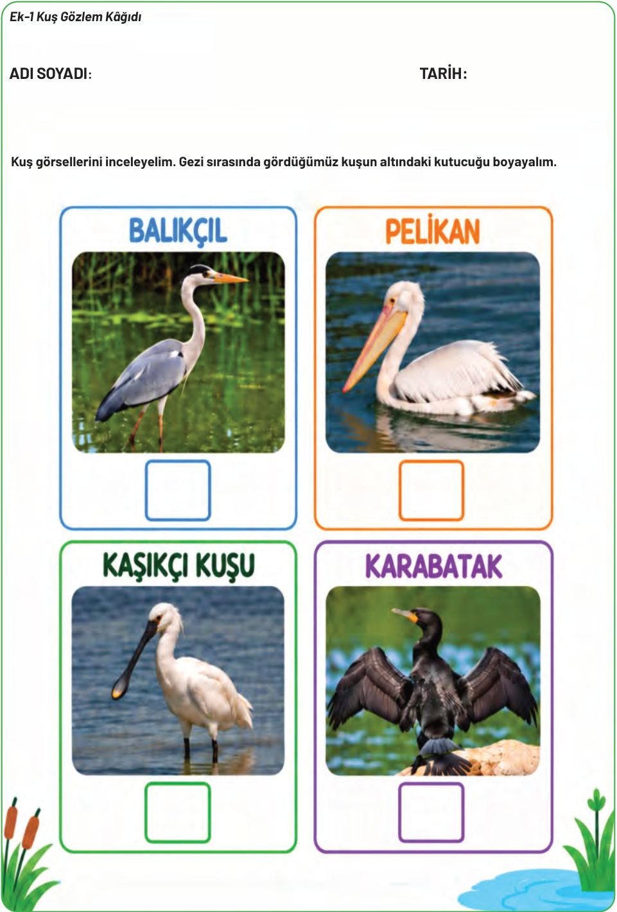 |  |
| $\square$ <!-- KONTROL: Marker'da karşılığı yok, uydurma olabilir --> | $\square$ <!-- KONTROL: Marker'da karşılığı yok, uydurma olabilir --> |

| **KAŞIKÇI KUŞU** | **KARABATAK** |
| :---: | :---: |
|  |  |
| $\square$ <!-- KONTROL: Marker'da karşılığı yok, uydurma olabilir --> | $\square$ <!-- KONTROL: Marker'da karşılığı yok, uydurma olabilir --> |

<!-- sayfa 25 -->

**ETKİNLİK ADI:** Çocuk Kütüphanesi 1
**ALAN ADI:** Türkçe
**YAŞ GRUBU:** 36–48 ay

**ALAN BECERİLERİ, ÖĞRENME ÇIKTILARI VE SÜREÇ BİLEŞENLERİ**
**TÜRKÇE**
**TADB. Dinleme / İzleme**
**TADB.1. Dinleyecekleri / izleyecekleri şiir, hikâye, tekerleme, video, tiyatro, animasyon gibi materyalleri yönetebilme**
TADB.1.a. Kendisine sunulan seçenekler arasından dinleyecekleri/izleyecekleri materyalleri seçer.
**TADB.3. Dinledikleri / izledikleri şiir, hikâye, tekerleme, video, tiyatro, animasyon gibi materyalleri çözümleyebilme**
TADB.3.a. Yetişkin rehberliğinde, dinledikleri/izledikleri materyallerdeki temel unsurları söyler.

**EĞİLİMLER**
**E2. Sosyal Eğilimler**
E2.5. Oyunseverlik

**PROGRAMLAR ARASI BİLEŞENLER**
**Sosyal-Duygusal Öğrenme Becerileri**
**SDB1.2. Kendini Düzenleme (Öz Düzenleme)**
**Değerler**
**D16. Sorumluluk**
D16.2. Topluma karşı görevlerini yerine getirmek
**Okuryazarlık Becerileri**
**OB4.Görsel Okuryazarlık**

**Kavramlar:** Duyu: sesli - sessiz
**Sözcükler:** kütüphane
**Materyaller:** resimli çocuk kitabı, A4 kâğıdı, boya kalemleri
**Eğitim / Öğrenme Ortamları:** Çocukların gezi süresince kendi güvenlik ve sağlıklarını korumaları, aynı zamanda kütüphaneyi güvenli bir şekilde incelemeleri amacıyla kütüphanedeki bölümler ve gezi sırasında uyulması gereken kurallar hakkında açıklama yapılır. Gezi öncesinde çocukların güvenliğini sağlamak amacıyla, üzerinde çocukların ad-soyad bilgileri ile okulun iletişim bilgilerinin yer aldığı yaka kartları hazırlanır ve gezi süresince çocukların yakalarına takılır. Kütüphaneye hediye etmek için kitap merkezindeki bir kitap belirlenir.

<!-- sayfa 26 -->

**Türkçe (Bireysel Etkinlik)**

* Gezi öncesi, çocuklarla kütüphaneler hakkında sohbet edilir. “Kütüphanede neler bulunur?”, “Kütüphaneye neden gidilir?”, “Kitaplara nasıl davranmalıyız?” gibi sorular yöneltilerek çocukların ön bilgilerini paylaşmaları desteklenir.
* Çocuklara kütüphaneye ait fotoğraflar gösterilir. Fotoğraflar incelenirken raflar, kitaplar, okuma alanları ve kütüphanecinin çalışma alanı hakkında kısa bilgiler verilir. Ardından kütüphaneye gezi yapacakları ve kütüphane kuralları açıklanır. Kütüphanede uyulması gereken kurallar görsel kartlar kullanarak anlatılır **(D16.2)**.
* Gezi sırasında, çocuklar kütüphane görevlisi tarafından karşılanır. Görevli, çocuklara kütüphanenin bölümlerini tanıtır ve kitapların nasıl düzenlendiğini yaş düzeylerine uygun ifadelerle açıklar. Ardından çocuklardan öğretmenin verdiği yönergeleri dikkatle dinleyerek kütüphanede belirtilen özelliklere sahip kitapları bulmaları istenir **(SDB1.2)**. Öğretmen tarafından sırasıyla; “Kırmızı kapaklı bir kitap bulalım?”, “Hayvanların olduğu bir kitap bulalım.”, “Büyük boy bir kitap bulabilir misiniz?”, “Resimleri çok olan bir kitap bulalım.” gibi yönergeler verilir **(E2.5)**. Daha sonra öğretmen, “Şimdi herkes bu kitaplar içerisinden en çok hoşuna giden kitabı seçsin.” yönergesini verir **(TADB.1.a)**. Çocuklar seçtikleri kitabı alarak küçük gruplar hâlinde inceler ve kitapta dikkatlerini çeken resimleri arkadaşlarına gösterir **(TADB.3.a, OB4)**.
* Gezi sonrasında, çocuklarla birlikte sınıf kitaplığı düzenlenir. Çocuklardan kitapları öğretmen rehberliğinde uygun raflara yerleştirmeleri istenir **(SDB1.2)**. Kitaplara özen göstermenin ve kullandıktan sonra yerine koymanın önemi hakkında kısa bir sohbet edilerek etkinlik sonlandırılır.

**DEĞERLENDİRME**

* Bugün nereye gittik?
* Kütüphanede en çok hangi kitabı beğendin?
* Bulduğun kitapta hangi görseller vardı?
* Kütüphaneci neler yapıyordu?
* Kütüphane kuralları hakkında neler öğrendin?
* Arkadaşlarınla birlikte kitap ararken ne hissettin?
* Kütüphaneye tekrar gitmek ister misin? Neden?
* Kitapları kullandıktan sonra neden yerine koymalıyız?

**FARKLILAŞTIRMA**

**Zenginleştirme:** Çocuklardan seçtikleri kitabın kapağını inceleyerek kitabın içeriğine ilişkin kısa tahminlerde bulunmaları ve tahminlerini arkadaşlarıyla paylaşmaları istenebilir. Çocuklardan kütüphanede dikkatlerini çeken farklı bir bölümü (çocuk kitapları rafı, okuma köşesi, ödünç alma bankosu vb.) arkadaşlarına tanıtmaları ve bu bölümün ne amaçla kullanıldığını söylemeleri istenebilir.

**Destekleme:** Kütüphanede kitap arama etkinliği sırasında çocuklara tek yönerge verilerek belirtilen özelliğe sahip kitabı bulmaları desteklenebilir. Gerektiğinde öğretmen veya kütüphane görevlisi tarafından sözel ipuçları verilerek çocukların uygun kitabı bulmalarına rehberlik edilebilir. Kitapların kapakları, renkleri ve resimleri çocuklarla birlikte incelenerek çocukların dikkatlerini belirgin özelliklere (renk, büyük-küçük, hayvan görseli vb.) yönlendiren sorular kullanılabilir. Kütüphaneci rolünü üstlenirken desteğe ihtiyaç duyan çocukların etkinliği bir arkadaşlarıyla birlikte gerçekleştirmelerine fırsat verilebilir.

**AİLE VE TOPLUM KATILIMI**

**Aile Katılımı:** Ailelerden, çocuklarıyla birlikte yaşadıkları çevrede bulunan bir kütüphaneyi veya kitapçıyı ziyaret etmeleri, çocuklarının ilgisini çeken bir kitabı birlikte incelemeleri istenir. Ertesi gün öğrencilerin aileleriyle gerçekleştirdikleri ziyaret sırasında dikkatlerini çeken özellikleri sınıfta arkadaşlarıyla paylaşmaları teşvik edilebilir.

<!-- sayfa 27 -->

**ETKİNLİK ADI:** Van Kedisi Evi
**ALAN ADI:** Fen
**YAŞ GRUBU:** 36-48 ay

**ALAN BECERİLERİ, ÖĞRENME ÇIKTILARI VE SÜREÇ BİLEŞENLERİ**

**FEN ALANI**
**FBAB1. Bilimsel Gözlem**
**FAB1. Günlük yaşamında fenle ilgili olaylara / olgulara ve durumlara yönelik bilimsel gözlem yapabilme**
FAB1.a. Çevresinde merak ettiği nesne, varlık ve durumları gözlemler.

**EĞİLİMLER**
**E3. Entelektüel Eğilimler**
E3.2. Odaklanma

**PROGRAMLAR ARASI BİLEŞENLER**

**Sosyal-Duygusal Öğrenme Becerileri**
**SDB1.2. Kendini Düzenleme (Öz Düzenleme)**

**Değerler**
**D3. Çalışkanlık**
D3.4. Çalışmalarda aktif rol almak

**Okuryazarlık Becerileri**
**OB4.Görsel Okuryazarlık**

**Kavramlar:** Zıt: aynı - farklı - benzer
**Sözcükler:** Van kedisi, cins
**Materyaller:** farklı kedi türlerine ait görseller
**Eğitim / Öğrenme Ortamları:** Çocukların gezi süresince kendi güvenlik ve sağlıklarını korumaları, aynı zamanda kedi evini güvenli bir şekilde incelemeleri amacıyla gezi sırasında uyulması gereken kurallar hakkında açıklama yapılır. Gezi öncesinde çocukların güvenliğini sağlamak amacıyla, üzerinde çocukların ad - soyad bilgileri ile okulun iletişim bilgilerinin yer aldığı yaka kartları hazırlanır ve gezi süresince çocukların yakalarına takılır.

<!-- sayfa 28 -->

**ETKİNLİKLER**

**Fen (Bireysel Etkinlik)**

* Gezi öncesi, çocuklara Van kedisi ve farklı özelliklere sahip kedi görselleri gösterilir. “Görseldeki hayvanı daha önce gördün mü?”, “Kediler nasıl ses çıkarır?” gibi sorular sorulur. Çocukların yanıtları dinlenir (OB4). Van kedisi görseli gösterilerek “Van kedisini diğer kedilerden ayıran özellikler neler olabilir?” sorusu sorulur. Ardından Van kedisinin özellikleri (beyaz tüyleri, farklı renklerdeki gözleri, yumuşak tüy yapısı, iyi bir yüzücü olması vb.) açıklanır. Çocuklara gezi sırasında uymaları gereken kurallar (kedilere zarar vermemek, dikkatli gözlem yapmak) anlatılır. Her çocuğa farklı bir kedi cinsine ait görsel verilir. Çocuklardan gezi sırasında Van kedilerini inceleyerek ellerindeki kedi görseli ile Van kedisi arasındaki benzer ve farklı özellikleri gözlemlemeleri istenir.
* Gezi sırasında, çocuklardan Van kedilerinin tüy renklerini, göz renklerini, hareketlerini, beslenme ve dinlenme davranışlarını gözlemlemeleri istenir (FAB.1.a, E3.2). Çocuklara “Van kedisinin tüyleri senin kartındaki kediye benziyor mu?”, “Van kedisi ile kartındaki kedinin kuyrukları veya kulakları arasında fark var mı?” gibi sorular yöneltilerek karşılaştırma yapmaları beklenir (SDB1.2, D3.4.). Çocuklara kedilerin yaşam alanları, bakımları ve ihtiyaçları hakkında bilgi verilir. Gezi sırasında çocuklar Van kedilerini incelerken ve karşılaştırma etkinliğine katılırken fotoğrafları çekilir.
* Gezi sonrasında, çocuklarla gezi sırasında çekilen fotoğraflar incelenir. Çocuklardan ellerindeki kedi görseli ile Van kedisi arasındaki benzer ve farklı özellikleri arkadaşlarıyla paylaşmaları istenir. “Van kedisinin hangi özelliği dikkatini çekti?”, “Senin kartındaki kedi ile Van kedisinin benzer yönleri nelerdi?”, “Farklı olan özellikleri nelerdi?”, “Kedilerin nelere ihtiyacı vardır?”, “Hayvanları korumak için neler yapabiliriz?” gibi sorular sorularak sohbet edilir. Gezi sırasında çekilen fotoğraflar sınıf panosunda sergilenir.

**DEĞERLENDİRME**

* Van kedisinin tüyleri hangi renkteydi?
* Van kedisinin gözleri nasıldı?
* Kartındaki kedi ile Van kedisinin benzer yönleri nelerdi?
* Kartındaki kedi ile Van kedisinin farklı yönleri nelerdi?

**FARKLILAŞTIRMA**

**Zenginleştirme:** Çocuklara Van kedisinin yanı sıra Ankara kedisi, tekir ve sarman gibi farklı kedi cinslerine ait görseller gösterilebilir. Görseller birlikte incelenerek kedilerin tüy rengi, göz rengi, kulak ve kuyruk yapıları karşılaştırılabilir.

**Destekleme:** Gezi sonrasında çekilen fotoğraflar ve kullanılan kedi görselleri birlikte incelenerek çocukların gözlemlerini hatırlamaları desteklenebilir.

**AİLE VE TOPLUM KATILIMI**

**Aile Katılımı:** Ailelere gezi ile ilgili bilgi verilir. Ailelerden çocuklarıyla kitap, dergi veya dijital ortamlardan farklı kedi cinslerine ait görseller incelemeleri, Van kedisi ile diğer kedilerin benzer ve farklı özellikleri hakkında sohbet etmeleri istenebilir.

**Toplum Katılımı:** Gezi sonrasında sınıfa veteriner davet edilerek Van kedisi ve farklı cinslerdeki kedilerin özellikleri hakkında çocuklara bilgiler vermesi istenebilir.

<!-- sayfa 29 -->

**ETKİNLİK ADI:** Nallıhan Kuş Cenneti
**ALAN ADI:** Fen, Sanat
**YAŞ GRUBU:** 48-60 ay

**ALAN BECERİLERİ, ÖĞRENME ÇIKTILARI VE SÜREÇ BİLEŞENLERİ**

**FEN ALANI**

**FBAB1. Bilimsel Gözlem**
**FAB.1. Günlük yaşamında fenle ilgili olaylara / olgulara ve durumlara yönelik bilimsel gözlem yapabilme**
FAB.1.b. Gözlemlediği nesne / olay / olguların betimsel / fiziksel özelliklerini ifade eder.

**FBAB2. Sınıflandırma**
**FAB.2. Fene yönelik nesne / olay / olguları benzerlik ve farklılıklarına göre sınıflandırabilme**
FAB.2.b. Nesne / olay / olguları benzer ve farklı özelliklerine göre ayırt eder.

**SANAT ALANI**

**SNAB.2. Sanat Eseri İnceleme**
**SNAB.2. Sanat eserini eleştirebilme**
SNAB.2.a. Sanat eserine odaklanır.

**SNAB.4. Sanatsal Uygulama Yapma**
**SNAB.4. Sanat etkinliği uygulayabilme**
SNAB.4.ç. Sanat etkinliklerinde özgün ürünler oluşturur.

**EĞİLİMLER**

**E3. Entelektüel Eğilimler**
E3.2. Odaklanma

**PROGRAMLAR ARASI BİLEŞENLER**

**Sosyal-Duygusal Öğrenme Becerileri**
SDB2.1. İletişim

**Değerler**
**D7. Estetik**
D7.1. Duyusal derinliği anlamak

**Okuryazarlık Becerileri**
OB4.Görsel Okuryazarlık

**Kavramlar:** Renkler
**Sözcükler:** Angut Kuşu, Sakarmeke, Suna Kuşu, Leylek, Macar Ördeği, Küçük Batağan Kuşu
**Materyaller:** kuş gözlem kâğıdı, kil, boya kalemi
**Eğitim / Öğrenme Ortamları:** Çocukların gezi süresince kendi güvenlik ve sağlıklarını korumaları, aynı zamanda güvenli bir şekilde inceleme yapmaları amacıyla okul dışı etkinliği ile ilgili açıklamalar yapılır. Kuş gözlem kâğıdı (Ek - 1) ile gezi sırasında araştırma yapacakları gezi öncesi belirtilir. Gezi öncesinde çocukların güvenliğini sağlamak amacıyla, üzerinde çocukların ad - soyad bilgileri ile okulun iletişim bilgilerinin yer aldığı yaka kartları hazırlanır ve gezi süresince çocukların yakalarına takılır.

<!-- sayfa 30 -->

# ETKİNLİKLER
## Fen, Sanat (Bütünleştirilmiş Büyük Grup Etkinliği)

* Gezi öncesinde çocuklara Nallıhan Kuş Cenneti’ni ziyaret edecekleri söylenir. “Sizce burada hangi kuşlar yaşıyor?”, “Daha önce hangi kuşları gördünüz?”, “En çok hangi kuşu merak ediyorsunuz?” gibi sorular sorularak sohbet edilir. Çocuklara Nallıhan Kuş Cenneti’ne ait fotoğraflar gösterilir. Fotoğraflar birlikte incelenir ve burada birçok farklı kuşun yaşadığı açıklanır. Gezi sırasında karşılaşabilecekleri angut, leylek, macar ördeği, suna, küçük batağan ve sakarmeke gibi kuşların görselleri gözlem kâğıdında (**Ek-1**) incelenir. Ardından farklı ressamların yaptığı kuş resimleri çocuklarla birlikte incelenir. Çocukların resimlerde dikkatlerini çeken renkler, şekiller ve kuşlar hakkında konuşmaları desteklenir (**SNAB.2.a**). Ardından gezi sırasında uyulması gereken kurallar hatırlatılır. Çocuklarla yaka kartlarının neden takıldığı ve grupla beraber hareket etmenin önemi hakkında sohbet edilir. Gezi için gerekli hazırlıklar birlikte tamamlanır.
* Gezi sırasında Kuş Cenneti, rehber eşliğinde gezilir. Önceden belirlenen bölümler sırasıyla ziyaret edilir. Çocuklar ellerindeki kuş gözlem kâğıdındaki görselleri inceleyerek parkta gördükleri kuşları karşılaştırır ve angut, leylek, macar ördeği, suna, küçük batağan ve sakarmeke kuşlarını bulmaya çalışır (**E3.2**). Gözlemledikleri kuşları, öğretmen rehberliğinde kuş gözlem kâğıdında işaretler. Gezi boyunca kuşların gaga, kanat, ayak ve tüy gibi temel vücut yapılarını gözlemler ve bu yapıların özellikleri hakkında sohbet eder (**FAB.1.b, OB4**). Gözlem kâğıdındaki kuşlar ile gezi sırasında gördükleri diğer kuşlar karşılaştırılır. Çocukların kuşların renkleri, büyüklükleri, gagaları, ayakları, kanatları ve yaşadıkları ortamlar gibi özellikleri fark etmeleri desteklenir. “Hangi kuş diğerlerinden daha büyüktü?”, “Hangi kuşun rengi dikkatini çekti?”, “Bu kuşların benzer yönleri neler?”, “Farklı yönleri neler?” gibi sorular yöneltilerek çocukların gözlemlerini ifade etmelerine fırsat verilir (**FAB2.b**). Ardından gözlem formunda yer alan ancak gezi sırasında görülmeyen kuşlar hakkında çocuklarla sohbet edilir. “Sizce bu kuşları neden görememiş olabiliriz?” sorusu yöneltilir. Bazı kuşların yalnızca belirli mevsimlerde bölgeye geldikleri ve hava soğuyunca daha sıcak yerlere göç ettikleri açıklanır. Ayrıca bazı kuş türlerinin sayısının günümüzde çok azaldığı, bu nedenle onları görmenin her zaman mümkün olmayabileceği ifade edilir. Kuşları ve kuşların yaşam alanlarını korumanın önemi üzerine sohbet edilerek etkinlik sonlandırılır.
* Gezi sonrası sınıfta çocuklarla gezi hakkında kısa bir sohbet edilir (**SDB2.1**). Gezi sırasında en çok dikkatlerini çeken kuşlar hatırlatılır. Özellikle dikkatlerini çeken kuşların tüyleri, renkleri ve gagaları hakkında konuşulur. Çocuklar kuş gözlem kâğıtlarını arkadaşlarıyla paylaşarak gördükleri kuşların isimlerini söyler. Ardından çocuklardan gezide gördükleri kuşlardan ilham alarak doğada bulunmayan, tamamen hayal güçlerini kullanacakları yeni bir kuş görseli tasarlamaları istenir. Çocuklar kil ve atık materyaller kullanarak kuşlarını şekillendirir; kuşlarına istedikleri büyüklükte kanatlar, farklı biçimlerde gagalar, ilginç kuyruklar veya hayal ettikleri başka özellikler ekler (**SNAB.4.ç**). Çalışmalar tamamlandıktan sonra her çocuk tasarladığı kuşa bir isim verir ve kuşunun nerede yaşadığını, neler yediğini ve onu diğer kuşlardan ayıran özelliklerini arkadaşlarıyla paylaşır. Ardından çocuklara, “Bu kuş bugün ne hissediyor olabilir?”, “Onu mutlu eden şeyler neler olabilir?”, “Nelerden korkuyor olabilir?” gibi sorular yöneltilir, çocukların yanıtları dinlenir (**D7.1**)

## DEĞERLENDİRME

* Bugün geziye nereye gittik?
* Dikkatini en çok hangi kuş çekti? Neden? 
* Gördüğün kuşlardan hangisinin gagası daha uzundu? 
* Kuşların tüylerinde hangi renkleri fark ettin? 
* Kuşlar nerede yaşıyordu? 
* Kuşlar ne yapıyordu? (Uçuyor, yüzüyor, dinleniyor, besleniyor vb.) 
* Kuş gözlem kâğıdında hangi kuşları işaretledin? 
* Gezi sırasında seni en çok şaşırtan şey ne oldu?

<!-- sayfa 31 -->

**FARKLILAŞTIRMA**

**Zenginleştirme:** Çocuklarla birlikte gözlem kâğıdında yer almayan farklı kuşlar da incelenebilir. Ardından çocuklar, en çok dikkatlerini çeken kuşun resmini pastel boya veya kuru boya kullanarak çizer. İsteyen çocuklar, kuşun tüylerini renkli kâğıt parçalarıyla kolaj çalışması yaparak tamamlayabilir. Hazırlanan resimler sınıfta “Kuş Sergisi” oluşturularak sergilenir. Çocuklar yaptıkları resmi arkadaşlarına göstererek seçtikleri kuşun adını ve dikkatlerini çeken bir özelliğini paylaşabilir.

**Destekleme:** Çocuklara gözlem yapmalarını kolaylaştırmak amacıyla daha az sayıda kuş görseli sunulabilir. Kuş gözlem kâğıdındaki görseller öğretmenin rehberliğinde birlikte incelenerek kuşların renk, gaga ve büyüklük gibi belirgin özelliklerine dikkat çekilebilir.

**AİLE VE TOPLUM KATILIMI**

**Aile Katılımı:** Ailelerden, çocuklarıyla birlikte evlerinin balkonunda, bahçesinde veya yakınlarındaki bir parkta kuş gözlemi yapmaları istenebilir. Çocukların gözlemledikleri kuşun rengi, büyüklüğü veya çıkardığı ses hakkında aileleriyle sohbet etmeleri ve dikkatlerini çeken bir özelliği ertesi gün sınıfta arkadaşlarıyla paylaşmaları teşvik edilebilir.

**Toplum Katılımı:** Okula bir kuş gözlemcisi veya Millî Parklar personeli davet edilerek çocuklarla kuşlar ve doğal yaşam hakkında bir sohbet gerçekleştirilmesi sağlanabilir.

<!-- sayfa 32 -->

“Ek-1 Kuş Gözlem Kâğıdı”

**ADI SOYADI:**                                                                           **TARİH:**

Kuş görsellerini inceleyelim. Gezi sırasında gördüğümüz kuşun altındaki kutucuğu boyayalım. Gezi sırasında en çok dikkatimizi çeken kuşu çerçevenin içine çizelim.

| Angut Kuşu | Leylek | Macar Ördeği |
| :---: | :---: | :---: |
|  |  |  |
| ☐ | ☐ | ☐ |

| Suna Kuşu | Küçük Batağan Kuşu | Sakarmeke |
| :---: | :---: | :---: |
|  |  |  |
| ☐ | ☐ | ☐ |

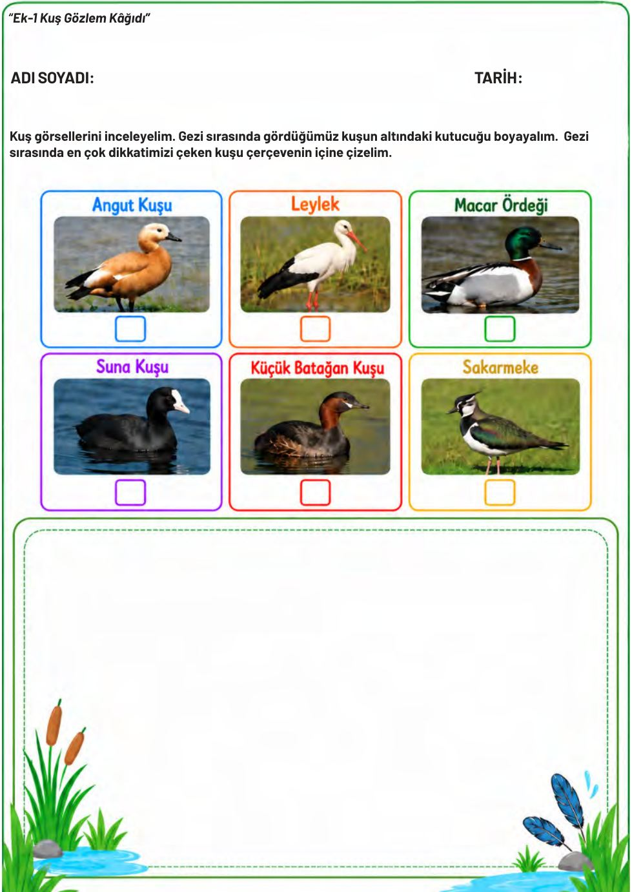

<!-- sayfa 33 -->

**ETKİNLİK ADI:** Adana Arkeoloji Müzesi  
**ALAN ADI:** Sanat  
**YAŞ GRUBU:** 48-60 ay  

**ALAN BECERİLERİ, ÖĞRENME ÇIKTILARI VE SÜREÇ BİLEŞENLERİ**

**SANAT ALANI**

**SNAB2. Sanat Eseri İnceleme**  
**SNAB.2. Sanat eserini eleştirebilme**  
SNAB.2.a. Sanat eserine odaklanır.

**SNAB4. Sanatsal Uygulama Yapma**  
**SNAB.4. Sanat etkinliği uygulayabilme**  
SNAB.4.ç. Sanat etkinliklerinde özgün ürünler oluşturur.

**EĞİLİMLER**

**E1. Benlik Eğilimleri**  
E1.1. Merak

**E3. Entelektüel Eğilimler**  
E3.2. Odaklanma

**PROGRAMLAR ARASI BİLEŞENLER**

**Sosyal-Duygusal Öğrenme Becerileri**  
SDB2.3. Sosyal Farkındalık

**Değerler**  
**D7. Estetik**  
D7.1. Duyusal derinliği anlamak

**Okuryazarlık Becerileri**  
OB4.Görsel Okuryazarlık

**Kavramlar:** Zıt: eski - yeni  
**Sözcükler:** arkeoloji, arkeolog, mozaik, müze, testi  
**Materyaller:** Adana Arkeoloji Müzesine ait görseller, çocuk sayısı kadar Adana Arkeoloji Müzesinde sergilenen testi görseli, kil, açıklama kartı

**Eğitim / Öğrenme Ortamları:** Gezi öncesinde içerisinde Adana Arkeoloji Müzesine ait eser ve mekân görsellerinin yer aldığı bir kutu hazırlanır. Ayrıca her çocuk için Adana Arkeoloji Müzesinde sergilenen kulplu testiye ait bir görsel çoğaltılır. Müze ziyareti sırasında çocukların uygulamalı sanat etkinliğini gerçekleştirebilecekleri müze bahçesinde uygun bir alan belirlenir. Etkinlikte kullanılacak kil ve diğer gerekli malzemeler önceden hazırlanarak müzeye götürülür. Gezi öncesinde çocukların güvenliğini sağlamak amacıyla, üzerinde çocukların ad - soyad bilgileri ile okulun iletişim bilgilerinin yer aldığı yaka kartları hazırlanır ve gezi süresince çocukların yakalarına takılır.

<!-- sayfa 34 -->

# ETKİNLİKLER
## Sanat (Bütünleştirilmiş Büyük Grup Etkinliği)

* Çocuklara Adana Arkeoloji Müzesine ait fotoğrafların bulunduğu kutu gösterilir. Çocuklar kutudan bir görsel seçerek inceleme yapar. Çocuklara Adana Arkeoloji Müzesi’ne ait fotoğrafların bulunduğu kutu gösterilir. Çocuklar kutudan bir görsel seçerek inceler. Çok çok önceden, biz, anne-babamız hatta büyükanne ve büyükbabalarımız bile yokken insanların yaşadığı bazı yerlerin zamanla toprağın altında kaldığı açıklanır. Günümüzde bu yerlerde yapılan çalışmalar sırasında o zamanlarda kullanılan bazı eşyaların bulunabildiği belirtilir. Çocuklara “Sence bu eşyalar toprağın altından nasıl bulunmuş olabilir?” sorusu yöneltilir (E1.1, OB4). Çocukların görüşlerinin ardından bu eserleri araştıran kişilere arkeolog denildiği açıklanır. Arkeologların toprağı özel araçlarla dikkatlice kazdıkları, buldukları eserleri zarar vermeden çıkardıkları, temizleyip inceledikleri, daha sonra bu eserlerin korunarak arkeoloji müzelerinde sergilendiği açıklanır. Bu eserlerden biri olan ve Adana Arkeoloji Müzesinde sergilenen bir kulplu testiye ait görsel çocuklara dağıtılır. Çocukların görseli dikkatle incelemelerine fırsat verilir. Adana Arkeoloji Müzesini ziyaret edecekleri söylenir. Daha sonra çocuklara bu görseli gezi boyunca yanlarında taşıyacakları ve müzeyi gezerken görselde yer alan testinin sergilendiği bölümü bulmaya çalışacakları açıklanır (OB4).
* Çocuklarla birlikte gezi sırasında uyulması gereken kurallar hakkında konuşulur. Müzedeki eserlere dokunulmaması, grupla beraber hareket edilmesi, müze görevlisinin açıklamalarının dikkatle dinlenilmesi, müze ortamında sessiz olunması ve eserleri dikkatlice inceleyerek gözlem yapılması gerektiği birlikte belirlenir (SDB2.3, E3.2).
* Gezi sırasında müze görevlisi çocukları karşılar ve müze hakkında kısa bir bilgilendirme yapar. Müzenin bölümleri gezilirken eserlerin çok eski zamanlardan kaldığı ve ne amaçla kullanıldıkları anlatılır. Örneğin çanakların yemek kabı olarak kullanıldığı açıklanır. Ardından çocuklardan bu eserleri günümüzdeki eşyalarla karşılaştırmaları istenir. Çocuklar gördükleri eserin günümüzdeki karşılığını tahmin eder. Çocuklara verilen görseldeki kulplu testinin bulunduğu bölüme gelindiğinde testinin üzerindeki desenler gösterilerek bu desenlerin ne anlatıyor olabileceği hakkında çocukların tahminleri alınır (SNAB2.a, D7.1).
* Ardından, müzenin uygun bir alanına geçilerek çocukların önceden yanlarında getirdikleri kil parçalarıyla uygulamalı bir etkinlik gerçekleştirilir. Etkinlik kapsamında çocuklardan, kili kullanarak günlük yaşamda kullandıkları bir eşyayı tasarlamaları istenir (SNAB.4.ç). Tasarımlar tamamlandıktan sonra çocuklar oluşturdukları ürünleri arkadaşlarına tanıtarak hangi eşyayı yaptıklarını ve bu eşyayı neden seçtiklerini anlatırlar.
* Gezi sonrasında çocukların müzede tasarladıkları kil çalışmaları okulda kuruduktan sonra desenlerle süslenir ve sergilenir. Her çalışmanın yanına çocukların “Ben bunu …’ya benzettim.” ifadesini tamamladıkları kısa bir açıklama kartı eklenir. Açıklama kartının yanında ise çocuğun tasarımına benzeyen günümüzde kullanılan eşyanın (vazo, sürahi, bardak, tabak, testi vb.) görseline yer verilir.

# DEĞERLENDİRME

* Müzede en çok hangi eseri incelemek hoşuna gitti? Neden?
* Müzede gördüğün kulplu testi ile günümüzde kullandığın eşyalar arasında benzerlik var mı?
* Müzede kil çalışması yaparken ne hissettin?
* Kil çalışmasını günümüzdeki hangi eşyadan esinlenerek yaptın?
* Kil çalışmasında hangi deseni kullandın? Neden?

<!-- sayfa 35 -->

# FARKLILAŞTIRMA

**Zenginleştirme:** Etkinlik, farklı arkeolojik eser görselleri (mühür, kandil, küp, sikke, takı vb.) eklenerek zenginleştirilebilir. Çocukların kazı alanında buldukları eserleri benzer özelliklerine göre (yapıldığı malzeme, kullanım amacı veya büyüklüğü gibi) gruplamaları istenebilir. Ayrıca çocuklara başka arkeolojik eserler inceletilerek çocuklardan farklı renk ve geometrik şekiller kullanarak kilden sanat eserleri tasarlamaları istenebilir.

**Destekleme:** Çocuklara kil yerine şekillendirmesi daha kolay olan oyun hamuru sunulabilir. Tasarım sürecinde zorlanan çocuklara vazo, testi, bardak, tabak ve sürahi gibi günümüzde kullanılan eşyalara ait görseller gösterilerek seçim yapmaları ve seçtikleri görselden yararlanarak tasarım oluşturmaları desteklenebilir. Desenleri hazırlarken daha kolay şekiller kullanmaları desteklenebilir.

# AİLE VE TOPLUM KATILIMI

**Aile Katılımı:** Ailelerden çocuklarıyla yaşadıkları çevrede bulunan tarihî yapı, müze veya ören yerlerine gezi düzenlemeleri önerilebilir.

**Toplum Katılımı:** Müze görevlisi veya bir arkeolog sınıfa davet edilerek çocuklarla mesleği hakkında kısa bir söyleşi gerçekleştirebilir. Çocukların arkeologların kullandıkları araç gereçleri incelemelerine ve meslek hakkında merak ettikleri soruları sormalarına fırsat verilebilir.

<!-- sayfa 36 -->

**ETKİNLİK ADI:** Ankara Etnografya Müzesi 2
**ALAN ADI:** Sosyal, Sanat
**YAŞ GRUBU:** 48-60 ay

**ALAN BECERİLERİ, ÖĞRENME ÇIKTILARI VE SÜREÇ BİLEŞENLERİ**

**SOSYAL ALAN**
**SBAB16. Eleştirel Sosyolojik Düşünme**
**SAB.14. Toplumsal yaşama yönelik nesne, olgu ve olayları çözümleyebilme**
SAB.14.a. Türk kültürüne ait özelliklere örnek verir.

**SANAT ALANI**
**SNAB.3. Sanata Değer Verme**
**SNAB3. Sanatın önemini fark edebilme**
SNAB.3.c. Dijital / gerçek sanat ortamlarını ziyaret eder.
**SNAB4. Sanatsal Uygulama Yapma**
**SNAB4. Sanat etkinliği uygulayabilme**
SNAB.4.ç. Sanat etkinliklerinde özgün ürünler oluşturur.

**EĞİLİMLER**
**E1. Benlik Eğilimleri**
E1.1. Merak

**PROGRAMLAR ARASI BİLEŞENLER**
**Sosyal-Duygusal Öğrenme Becerileri**
**SDB2.1. İletişim**

**Değerler**
**D7. Estetik**
D7.2. Sanatsal ve görsel zevkleri hayatın bir parçası hâline getirmek

**Kavramlar:** Renkler: kırmızı, mavi, turkuaz
**Sözcükler:** çini, porselen, seramik, metal, cam, motif
**Materyaller:** müze binasına ait fotoğraf, müzede bulunan çini ve porselen salonu ile seramik, metal, cam salonunun fotoğrafları, çocuk sayısı kadar kâğıt tabak, kırmızı, mavi ve turkuaz renkte parmak boyalar

**Eğitim / Öğrenme Ortamları:** Çocukların gezi süresince kendi güvenlik ve sağlıklarını korumaları, aynı zamanda müzedeki eserleri güvenli bir şekilde incelemeleri amacıyla okul dışı etkinliği ile ilgili açıklamalar yapılır. Sınıfta müze binasının bir kısmına ait bir fotoğraf ve müzede fazla zaman geçirilecek (çini ve porselen eserler veseramik, metal ve cam) salonlara ait fotoğraflar hazırlanır. Gezi öncesinde çocukların güvenliğini sağlamak amacıyla, üzerinde çocukların ad - soyad bilgileri ile okulun iletişim bilgilerinin yer aldığı yaka kartları hazırlanır ve gezi süresince çocukların yakalarına takılır. Gezi sonrasında çocuk sayısı kadar kâğıt tabaklar hazırlanır. Sanat etkinliği sırasında çocukların kullanacağı turkuaz, mavi ve kırmızı gibi çinilerde sık kullanılan renklere ait parmak boyalar hazırlanır.

<!-- sayfa 37 -->

**Sosyal, Sanat (Bütünleştirilmiş Büyük Grup Etkinliği)**

* Gezi öncesi, çocuklara Ankara Etnografya Müzesini ziyaret edecekleri söylenir ve “Sizce müzede neler bulunur?” diye sorulur. Çocukların fikirleri alındıktan sonra müzeler hakkında kısa bilgi verilir. Müzede farklı dönemlere ve kültürlere ait birçok farklı eser olduğu anlatılır. Daha sonra çocuklara müze binasına ait eksik bir fotoğrafın bulunduğu fotoğraf gösterilir. Çocuklardan fotoğrafı dikkatlice incelemeleri ve eksik kısmın nasıl göründüğü hakkında düşüncelerini paylaşmaları istenir. “Sizce binanın diğer bölümü nasıl olabilir?”, “Eğer siz bir müze tasarlasaydınız içinde neler olmasını isterdiniz?” soruları yöneltilir (**E1.1**). Çocuklar düşüncelerini açıklar ve binanın tamamının fotoğrafı gösterilir. Müze binasına ait fotoğraf incelenir. Ardından, Müzede daha fazla zaman geçirilecek bölümlere ait fotoğraflar birlikte incelenerek bu alanlar hakkında sohbet edilir. Müzede dikkat edilmesi gereken kurallar anlatılır ve müze gezisi için hazırlık yapılır. Çocuklara yaka kartlarının neden önemli olduğu sorulur. Ardından çocuklar küçük gruplara ayrılarak gezi sırasında uyulması gereken kurallar hakkında sohbet edilir. Çocukların görüşlerini paylaşmalarına fırsat verilerek müzede sessiz konuşma, gruptan ayrılmama ve eserlere dokunmama gibi kurallar birlikte belirlenir.
* Gezi sırasında müze rehberi eşliğinde müze gezilir. Öncelikle müze binası birlikte incelenir. Çocukların binanın büyüklüğü, şekli ve dikkatlerini çeken özellikleri hakkında konuşmaları desteklenir. Ardından önceden belirlenen çini ve porselen eserler ile seramik, metal ve cam eserler salonları ziyaret edilir (**SNAB.3.c**).
* Çini ve porselen eserlerin sergilendiği salona gelindiğinde çocukların dikkatleri eserlerin üzerindeki desen ve şekillere çekilir. Çocuklara çinilerin, topraktan yapılan ve üzeri renkli desenlerle süslenen tabak, kase veya benzeri eşyalar olduğu açıklanır. Bu eşyaların bazılarının çok çok önceden yapıldığı ve uzun yıllar boyunca korunarak günümüze ulaştığı belirtilir. Çocuklara çinilerin üzerinde neler gördükleri, desenlerin onlara neyi hatırlattığı ve en çok hangi deseni beğendikleri sorulur (**SAB.14.a**).
* Gezi sonrası sınıfta çocuklarla gezi hakkında kısa bir sohbet edilir (**SDB2.1**). Müzede en çok dikkatlerini çeken eserler hatırlatılır. Özellikle çinilerin üzerindeki desenler ve renkler hakkında konuşulur. Çocuklara “Müzede gördüğünüz çinilerde hangi desenler vardı?”, “Hangi renkleri hatırlıyorsunuz?” gibi sorular yöneltilir. Ardından çocuklara kâğıt tabaklar dağıtılır. Çocuklardan müzede gördükleri çinilerden esinlenerek kendi çinilerini tasarlamaları istenir. İsteyen çocuklar çiçek, yaprak, lale, geometrik şekiller gibi motifler çizebilir. Çalışmalarında ağırlıklı olarak turkuaz, mavi ve kırmızı renkleri kullanmaları için teşvik edilirler (**SNAB.4.ç**).
* Etkinlik sonunda çocuklar çalışmalarını arkadaşlarına gösterir ve tasarımlarında hangi desenleri kullandıklarını anlatırlar. Hazırlanan çiniler sınıfta veya açık havada sergilenir (**D7.2**).

**DEĞERLENDİRME**

* Müzede hangi eserleri gördünüz?
* Müzede gördüğün eserlerden hangisi sana ilginç geldi?
* Müze gezisinde ilk kez karşılaştığın eserler hangileri?
* Müzedeki eserlerden hangilerini günlük yaşamında gördün?
* Ankara Etnografya Müzesini tekrar gezmek ister misin? Neden?

<!-- sayfa 38 -->

# FARKLILAŞTIRMA

**Zenginleştirme:** Öğrenme içeriğinin farklılaştırılması amacıyla, gezi öncesinde ve gezi sırasında müzede bulunan eserler hakkında daha ayrıntılı bilgi verilebilir. Ayrıca müzenin krokisi dağıtılarak çocukların ziyaret edilecek salonları krokiyi kullanarak bulmaları desteklenebilir. Öğrenme ortamını zenginleştirmek amacıyla sanat merkezinde cam, metal, kil ve benzeri materyallerin yer aldığı küçük bir “Geleneksel Sanatlar Merkezi” oluşturulabilir. Çocukların farklı materyalleri incelemeleri, karşılaştırmaları ve keşfetmeleri desteklenebilir.

**Destekleme:** Çini tasarlama etkinliğinde çocuklara sade motif örnekleri sunulabilir ve desen oluşturmaları konusunda bireysel yardım sağlanabilir. Çocuklar küçük gruplara ayrılabilir. Bazı gruplar ilk aşamada sanatetkinliğinde bireysel ürün oluşturmak yerine grupla bir ürün hazırlayabilir.

# AİLE VE TOPLUM KATILIMI

**Aile Katılımı:** Ailelerden çocuklarıyla birlikte bir müzeyi ziyaret etmeleri ve müzede bulunan eserleri birlikte incelemeleri istenebilir. Çocukların müzede ilgilerini çeken bir eseri seçmeleri ve bu eserin kullanım amacı hakkında aileleriyle konuşmaları teşvik edilebilir. Ertesi gün çocuklara aileleriyle gerçekleştirdikleri müze gezisini ve en çok ilgilerini çeken eseri arkadaşlarıyla paylaşmaları için fırsat verilebilir.

**Toplum Katılımı:** Toplum katılımı kapsamında çocukların yaşadıkları çevrede bulunan müzeler, tarihî yapılar ve kültürel miras ögeleri hakkında farkındalık kazanmaları desteklenebilir. Çocukların kültürel mirasın korunmasının önemi hakkında düşüncelerini paylaşmalarına fırsat verilebilir. Gezi sonrasında hazırlanan sergi diğer sınıflarla paylaşılabilir.

<!-- sayfa 39 -->

**ETKİNLİK ADI:** Ege Üniversitesi Botanik Bahçesi ve Herbaryum Araştırma ve Uygulama Merkezi Gezisi 1
**ALAN ADI:** Fen
**YAŞ GRUBU:** 48–60 ay

**ALAN BECERİLERİ, ÖĞRENME ÇIKTILARI VE SÜREÇ BİLEŞENLERİ**

**FEN ALANI**
**FBAB1. Bilimsel Gözlem**
**FAB1. Günlük yaşamında fenle ilgili olaylara / olgulara ve durumlara yönelik bilimsel gözlem yapabilme**
FAB1.d. Gözlemlediği nesne / olay / olgulara ilişkin verileri çizim, işaretleme yoluyla kaydeder.

**EĞİLİMLER**
**E3. Entelektüel Eğilimler**
E3.2. Odaklanma

**PROGRAMLAR ARASI BİLEŞENLER**
**Sosyal-Duygusal Öğrenme Becerileri**
SDB2.1. İletişim

**Değerler**
**D7. Estetik**
D7.1. Duyusal derinliği anlamak

**Okuryazarlık Becerileri**
OB4. Görsel Okuryazarlık

**Kavramlar:** Duyu: sivri, küt
**Sözcükler:** tohum, bitki, kök, gövde, dal, botanik, herbaryum, koleksiyon
**Materyaller:** botanik bahçeye ve herbaryuma ait fotoğraflar, çocuk sayısı kadar farklı bitki görseli, bitki gözlem kâğıdı (Ek - 1) , kavanoz

**Eğitim / Öğrenme Ortamları:** Çocukların gezi süresince kendi güvenlik ve sağlıklarını korumaları, aynı zamanda araştırma ve uygulama merkezini güvenli bir şekilde incelemeleri amacıyla okul dışı etkinliği ile ilgili açıklamalar yapılır. Sınıf ortamında, araştırma ve uygulama merkezine ilişkin fotoğraflar çocuklara sunulur. Ayrıca, her çocuk için gezi sırasında görebilecekleri birer bitki görseli hazırlanır. Bitki gözlem kâğıdı (Ek - 1) ile gezi sırasında araştırma yapacakları gezi öncesi belirtilir. Fen merkezine her çocuk için birer kavanoz bırakılır. Gezi öncesinde çocukların güvenliğini sağlamak amacıyla, üzerinde çocukların ad-soyad bilgileri ile okulun iletişim bilgilerinin yer aldığı yaka kartları hazırlanır ve gezi süresince çocukların yakalarına takılır.

<!-- sayfa 40 -->

# ETKİNLİKLER

## Fen (Büyük Grup Etkinliği)

* Gezi öncesi, çocuklara botanik bahçesi ve herbaryum araştırma ve uygulama merkezini ziyaret edecekleri söylenir ve “Sizce botanik bahçesinde neler bulunur?”, “Herbaryum ne demektir?”, “Bu araştırma merkezinde ne araştırılıyor olabilir?” gibi sorular sorulur. Çocuklara gezi yapılacak yere ait görseller sunulur. Fotoğrafları inceleyip gezi yapılacak yere dair çocukların fikirleri sorulur. Fikirler alındıktan sonra botanik bahçe ve herbaryum hakkında kısa bilgi verilir. Burada farklı türden bitkiler olduğu anlatılır. “Botanik bahçe, çok çeşitli bitkilerin bir arada yetiştirildiği özel bir yerdir. Burada farklı ağaçlar, çiçekler, yapraklı bitkiler ve bazen küçük meyve ağaçları bulunur.” açıklaması yapılır. Herbaryumun ise bilimsel amaçlı farklı bitkilerin kurutularak saklandığı bir koleksiyon olduğuna değinilir. Çocuklar küçük gruplara ayrılır ve “Doğayı korumak için neler yapmalıyız?” sorusu sorulur. Grup içinde fikirler üretilir.
* Gezide dikkat edilmesi gereken kurallar anlatılır ve gezi için hazırlık yapılır. Çocuklara yaka kartlarının neden önemli olduğu sorulur. Gezi sırasında uyulması gereken kurallar hakkında sohbet edilir. Çocukların görüşlerini paylaşmalarına fırsat verilerek gruptan ayrılmama ve bitkilere zarar vermeme gibi kurallar birlikte belirlenir. Ayrıca gezi sürecinde karşılaşmaları muhtemel bitki türlerine ait görseller hazırlanarak her çocuğa birer görsel dağıtılır.
* Gezi sırasında uygulama ve araştırma merkezi bir rehber eşliğinde gezilir. Önceden belirlenen bölümler sırayla ziyaret edilir. Bu sırada çocuklar ellerindeki bitki görselleri ile botanik bahçesindeki bitkileri karşılaştırarak görseldeki bitkiyi bulmaya çalışır (E3.2). Bitki gözlem kâğıdına öğretmenin rehberliğinde işaretleme yaparlar (FAB.1.d). Bitkilerin yaprağı, çiçeği, kokusu, gövdesi incelenir (OB4.).
* Herbaryum bölümü ziyaret edilerek kurutulmuş bitki örnekleri incelenir ve çocuklarla bu bitkilerle daha önce karşılaşıp karşılaşmadıkları hakkında sohbet edilir. Bitkiler hakkında kısa bilgiler verilir. İlgilerini çeken bitkiler hakkında soru sormaları teşvik edilir ve sohbet edilir (D7.1).
* Gezi sonrası sınıfta çocuklarla gezi hakkında kısa bir sohbet edilir (SDB2.1). Gezi sırasında en çok dikkatlerini çeken bitkiler hatırlamaları için sorular sorulur. Özellikle dikkatlerini çeken bitkilerin kokusu ve rengi hakkında konuşulur. Çocuklara “Gördüğünüz ağaçların yaprakların ucu sivri miydi, küt müydü?”, “Hangi renk bitkileri hatırlıyorsunuz?” gibi sorular yöneltilir. Çocuklar bitki gözlem kâğıtlarını arkadaşlarıyla paylaşarak inceledikleri bitki hakkında bilgi verir. Ardından çocuklara herbaryum örneğinden hareketle sınıfta bir yaprak koleksiyonu oluşturulacağı açıklanır. Her çocuk için hazırlanan yaprak kavanozları fen merkezine yerleştirilir. Çocukların, aileleriyle birlikte çevrelerinde karşılaştıkları farklı yaprakları toplayarak bu kavanozlarda biriktirmeleri istenir.

# DEĞERLENDİRME

* Bugün hangi yeri ziyaret ettik?
* Botanik bahçesinde neler gördük?
* Herbaryumda neler inceledik?
* En çok hangi bitki dikkatini çekti? Neden?
* Hangi renk bitkiler gördün?
* Bitkilerden herhangi birinin kokusunu hatırlıyor musun?
* Elindeki görselde bulunan bitkiyi bahçede bulabildin mi?

<!-- sayfa 41 -->

# FARKLILAŞTIRMA

**Zenginleştirme:** Çocuklarla birlikte sınıfta toplanan yapraklar incelenebilir. Yaprakların renkleri, büyüklükleri ve şekilleri karşılaştırılabilir. Ardından çocuklar seçtikleri yaprakların baskısını boya kullanarak kâğıda çıkarabilir. Elde edilen çalışmalarla sınıfta “Yaprak Baskısı Sergisi” oluşturulabilir. Çocuklar çalışmalarını arkadaşlarına tanıtarak yaprakların benzer ve farklı özellikleri hakkında sohbet edilebilir.

**Destekleme:** Çocukların bitki gözlemlerini daha kolay yapabilmeleri için gezi öncesinde bitki türlerini tanımaya yönelik bitki eşleştirme kartları hazırlanabilir. Bu kartlarda yaprak şekli, çiçek rengi ve bitki adı sade bir görsel le sunulabilir.

# AİLE VE TOPLUM KATILIMI

**Aile Katılımı:** Ailelerden çocuklarıyla açık havada vakit geçirmeleri ve çevrede bulunan farklı büyüklükteki yaprakları toplamaları istenebilir. Yaprak toplama sürecinde çocukların dikkatini çeken veya merak ettikleri bitkiler hakkında sohbet etmeleri teşvik edilebilir. Ailelerin, çocukların sorularını dinlemeleri, bitkilerin özellikleri üzerine konuşmaları ve birlikte gözlem yapmaları önerilir. Toplanan yapraklar daha sonra sınıftaki yaprak koleksiyonuna eklenerek çocukların doğaya yönelik farkındalıklarının ve gözlem becerilerinin desteklenmesi amaçlanır. Çocuğun evde bulunan bir bitkinin bakımını üstlenmesi ve bakım sürecine düzenli olarak katılması desteklenebilir. 

**Toplum Katılımı:** Çocukların hazırladığı yaprak koleksiyonu okulun ortak alanında sergilenir. Sergiyi gezen çocuklar, veliler ve öğretmen; bitkilerin korunması ve doğaya zarar vermeden yaşamanın önemi hakkında sohbet edebilirler.

<!-- sayfa 42 -->

**Ek-1 Bitki Gözlem Kâğıdı**

**ADI SOYADI:**                                                                    **TARİH:**

Bitki gözlem kâğıdını inceleyelim. Dikkatimizi çeken bir bitkiyi seçelim. Soruları sırayla dinleyelim ve uygun kutucuğu boyayalım.

1. Bitki ne renk?
2. Bitkinin çiçeği var mı, yok mu?
3. Bitkinin yaprağının ucu nasıl?
4. Bitkinin yaprağının yüzeyi nasıl?
5. Bitkinin kokusu var mı, yok mu?

İncelediğimiz bir bitkiyi çerçevenin içine çizelim.

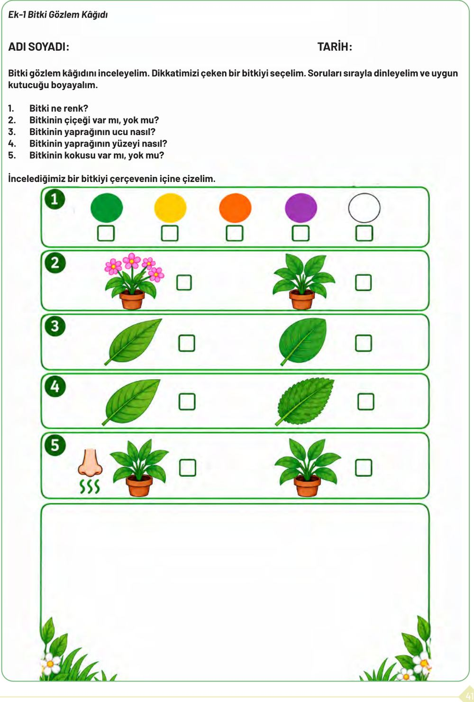

<!-- sayfa 43 -->

**ETKİNLİK ADI:** Erzurum Bilim Merkezi
**ALAN ADI:** Fen, Sanat
**YAŞ GRUBU:** 48-60 ay

**ALAN BECERİLERİ, ÖĞRENME ÇIKTILARI VE SÜREÇ BİLEŞENLERİ**

**FEN ALANI**
**FBAB7. Deney Yapma**
**FAB7. Merak ettiği konular / olay / durum hakkında deneyler yapabilme**
FAB7.b.Seçtiği malzemelerle deneyler yapar.
FAB7.c. Deney sürecinde ortaya çıkan değişimleri gözlemler.

**SANAT ALANI**
**SNAB4. Sanatsal Uygulama Yapma**
**SNAB4. Sanat etkinliği uygulayabilme**
SNAB4.b. Sanat etkinliği için gerekli materyalleri seçer.
SNAB4.c. Sanat etkinliklerine aktif olarak katılır.

**EĞİLİMLER**
**E1. Benlik Eğilimleri**
E1.1. Merak
**E3. Entelektüel Eğilimler**
E3.6. Analitiklik

**PROGRAMLAR ARASI BİLEŞENLER**

**Sosyal-Duygusal Öğrenme Becerileri**
**SDB2.2. İş Birliği**

**Değerler**
**D16. Sorumluluk**
D16.2. Topluma karşı görevlerini yerine getirmek

**Okuryazarlık Becerileri**
**OB7. Veri Okuryazarlığı**

**Kavramlar:** Duyu: sesli - sessiz
**Sözcükler:** bilim, deney
**Materyaller:** “Bilim Gözlem Kâğıdı” kartları (Ek - 1), kraft kâğıdı (2 adet), çeşitli boyalar, çıkartmalar ve kalemler
**Eğitim / Öğrenme Ortamları:** Çocukların gezi süresince kendi güvenlik ve sağlıklarını korumaları, aynı zamanda bilim merkezindeki materyalleri güvenli bir şekilde incelemeleri amacıyla okul dışı etkinliği ile ilgili açıklamalar yapılır. Sınıf ortamında, bilim merkezine ilişkin fotoğraflar çocuklara sunulur. Bilim merkezinde kullanılmak üzere 2 adet $70 \times 100$ <!-- KONTROL: Marker'da karşılığı yok, uydurma olabilir --> ebatlarında kraft kâğıdı hazırlanır. Ayrıca, her çocuk için gezi sırasında üzerinde işaretleme yapacakları birer “Bilim Gözlem Kâğıdı” kartları hazırlanır. “Bilim Gözlem Kâğıdı” kartları (Ek - 1) ile gezi sırasında araştırma yapacakları gezi öncesi belirtilir. Gezi öncesinde çocukların güvenliğini sağlamak amacıyla, üzerinde çocukların ad - soyad bilgileri ile okulun iletişim bilgilerinin yer aldığı yaka kartları hazırlanır ve gezi süresince çocukların yakalarına takılır.

<!-- sayfa 44 -->

**Fen, Sanat (Bütünleştirilmiş Büyük Grup Etkinliği)**

**ETKİNLİKLER**

* Gezi öncesi, çocuklarla bilimin günlük yaşamımızdaki yeri hakkında sohbet edilir. Çocuklara “Sizce bilim merkezlerinde neler görebiliriz?”, “Bilim insanları neleri araştırır?”, “Bir deneyi izlerken nelere dikkat etmeliyiz?” gibi sorular yöneltilerek görüşlerini paylaşmaları desteklenir. Ardından bilim merkezinde yer alan deney düzenekleri hakkında yaş düzeylerine uygun kısa bilgiler verilir. Bilim merkezinde uygulanması gereken kurallar (grupla beraber hareket etme, düzenekleri yalnızca görevlinin ya da öğretmenin yönlendirmesiyle kullanmak, dikkatli gözlem yapmak ve arkadaşlarının sırasını beklemek) çocuklara hatırlatılır. Geziye ilişkin merak duygusunu desteklemek amacıyla bilim merkezine ait fotoğraflar ve kısa tanıtım videoları izlenir (**(E1.1)**).
* Çocuklara gezi boyunca kullanacakları “Bilim Pasaportu” tanıtılır. Pasaportta gezi sırasında yerine getirebilecekleri görevlerin (bir düzeneği dikkatlice gözlemleme, tahminde bulunma, soru sorma, yeni bir şey keşfetme vb.) yer aldığı açıklanır. Çocuklara, gezi boyunca gerçekleştirdikleri her görevin sonunda pasaportlarındaki ilgili bölüme bir çıkartma yapıştıracakları ve gezi sonunda pasaportlarını birlikte inceleyecekleri söylenir.
* Gezi sırasında çocukları bilim merkezinde görevli bir rehber karşılar. Görevli personel eşliğinde farklı bölümler gezilir. Etkileşimli deney düzenekleri incelenir ve çocukların bireysel olarak gözlem yapmaları teşvik edilir. Çocuklar basit bilimsel etkinliklere veya deney atölyelerine katılır. Çocuklara deneyler esnasında güvenlikleri göz önünde bulundurularak sorumluluk almaları ve denemeler yapmaları için fırsat verilir (**(FAB.7.b, E3.6, OB7)**. Çocuklar deney sonrası malzemelerin toplanmasına yardımcı olur **(D16.2)**.
* Çocuklar iki gruba ayrılır. Bilim merkezinin uygun bir yerinde iki büyük kâğıt yerleştirilir. Birinci gruptan deney esnasında neler yapıldığını hatırlayarak resmini çizmeleri istenir. İkinci gruptan ise deney sonucunu anlatan bir resim çizmeleri istenir **(SNAB.4.b, SNAB.4.c, SDB2.2)**. Grup çizimleri tamamlandığında yapılan çalışmaların anlatılması istenerek deney sürecinde ortaya çıkan değişimler üzerine konuşulur **(FAB.7.c)**.
* Gezi sonunda çocuklarla sınıfta toplanılır. “Bilim Pasaportu”nda yer alan görevler çocuklarla birlikte yeniden gözden geçirilir. Çocuklardan gezi boyunca tamamladıkları görevleri hatırlayarak ilgili bölümlere çıkartmalarını yapıştırmaları istenir. Etkinlik sonunda bilim merkezinde edindikleri deneyimler üzerine kısa bir değerlendirme sohbeti gerçekleştirilir.

**DEĞERLENDİRME**

* Bilim merkezinde en çok hangi bölüm dikkatini çekti? Neden?
* Gezi sırasında hangi deney düzeneğini inceledin?
* Katıldığın deneyde hangi malzemeler kullanıldı?
* Deney yaparken ne hissettin?
* Deneye başlamadan önce nasıl bir sonuç olacağını tahmin ettin?
* Deney sonucunda ne oldu?
* Bilim merkezinde öğrendiğin yeni bir bilgiyi anlatır mısın?

**FARKLILAŞTIRMA**

**Zenginleştirme:** Çocuklardan bilim merkezinde en çok dikkatlerini çeken düzeneği seçmeleri ve bu düzeneğin ne yaptığını ya da nasıl çalıştığını kendi ifadeleriyle anlatmaları istenebilir. Ardından benzer görünen başka bir düzeneği öğretmenleriyle birlikte bulmaları ve iki düzeneğin benzer yönlerini söylemeleri desteklenebilir. Gezi sonrasında çocuklardan en çok ilgilerini çeken deneyi pastel boya, oyun hamuru veya farklı geri dönüşüm materyalleri kullanarak resmetmeleri ya da basit bir modelini oluşturmaları istenebilir.

**Destekleme:** Bilim merkezinde karşılaşılabilecek düzenekler ve deneyler görsellerle gezi öncesinde tanıtılabilir. “Bilim Pasaportu” etkinliğinde kullanılan görev kartları büyük görseller ve sembollerle hazırlanarak çocukların düzenekleri daha kolay fark etmeleri desteklenebilir. Çocukların düzenekleri incelerken akranlarıyla iş birliği yapmalarına ve gözlemlerini paylaşmalarına fırsat tanınabilir.

**AİLE VE TOPLUM KATILIMI**

**Aile Katılımı:** Gezi öncesinde ailelere bilim merkezi gezisinin amacı, gezi programı ve gerçekleştirilecek etkinlikler hakkında bilgilendirme yapılabilir. Ailelerden çocuklarıyla birlikte günlük yaşamda karşılaştıkları basit bilim olayları (mıknatısın kullanımı, ışık, ses, hareket vb.) hakkında sohbet etmeleri istenebilir.

<!-- sayfa 45 -->

Ek-1 Bilim Gözlem Kâğıdı

ADI SOYADI:                                     TARİH:

Bilim gözlem kâğıdını inceleyelim. Gezi sırasında gördüğümüz araçların altındaki kutucuğu işaretleyelim. Gezi sırasında en çok ilgimizi çeken aracı çerçevenin içine çizelim.

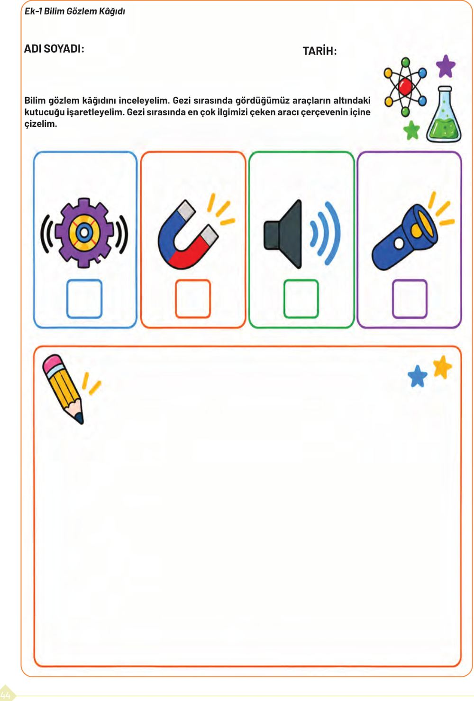

<!-- sayfa 46 -->

**ETKİNLİK ADI:** İstanbul Resim ve Heykel Müzesi  
**ALAN ADI:** Sanat  
**YAŞ GRUBU:** 48-60 ay  

**ALAN BECERİLERİ, ÖĞRENME ÇIKTILARI VE SÜREÇ BİLEŞENLERİ**  
**SANAT ALANI**  
**SNAB.2. Sanat Eseri İnceleme**  
**SNAB.2. Sanat eserini eleştirebilme**  
SNAB.2.a. Sanat eserine odaklanır.  
SNAB.2.b. Sanat eserinde gördüklerini söyler.  

**SNAB.3. Sanata Değer Verme**  
**SNAB3. Sanatın önemini fark edebilme**  
SNAB.3.ç. Dijital / gerçek sanat ortamlarında sergilenen eserleri inceler.  

**EĞİLİMLER**  
**E2. Sosyal Eğilimler**  
E2.5. Oyunseverlik  
**E3. Entelektüel Eğilimler**  
E3.2. Odaklanma  

**PROGRAMLAR ARASI BİLEŞENLER**  
**Sosyal-Duygusal Öğrenme Becerileri**  
SDB2.3. Sosyal Farkındalık  

**Değerler**  
**D7. Estetik**  
D7.1. Duyusal derinliği anlamak  

**Okuryazarlık Becerileri**  
OB4. Görsel Okuryazarlık  

**Kavramlar:** Duygu: mutluluk, üzüntü, korku, şaşkınlık  
Renk: kırmızı, yeşil, mavi, sarı  
Duyu: sesli- sessiz  

**Sözcükler:** sergi, karakalem, portre, manzara  

**Materyaller:** müzede yer alan eserlere ait fotoğraflar, üzeri kırmızı, yeşil, mavi, sarı renklerde çocuk sayısı kadar kart, tahta, mukavva, karton ya da çıtalardan hazırlanmış içi boş çerçeve  

**Eğitim / Öğrenme Ortamları:** Çocukların gezi süresince kendi güvenlik ve sağlıklarını korumaları, aynı zamanda sergi salonundaki tabloların korunması ile ilgili ve okul dışı etkinliğinde uyulması gereken kurallarla ilgili açıklamalar yapılır. Sınıfta karakalem çizimler, manzara resimleri, portreler gibi farklı resim tekniklerine ait görseller hazırlanır. Gezi öncesinde çocukların güvenliğini sağlamak amacıyla, üzerinde çocukların ad - soyad bilgileri ile okulun iletişim bilgilerinin yer aldığı yaka kartları hazırlanır ve gezi süresince çocukların yakalarına takılır. Gezi sırasında kullanılmak üzere kırmızı, yeşil, mavi, sarı renklerde kartlar hazırlanır.

<!-- sayfa 47 -->

# ETKİNLİKLER

## Sanat (Büyük Grup Etkinliği)

* Gezi öncesinde, çocuklara “Sanat müzesi nedir?” sorusu sorulur ve cevaplar dinlenir. Ardından sanat müzelerin sanat eserlerini koruyan, sergileyen ve insanların onları tanımasını sağlayan özel mekânlar olduğu açıklanır.
* İnsan yüzlerinin, doğadaki görüntülerin, hayvanların ve farklı nesnelerin yer aldığı çeşitli resimler çocuklara gösterilir. Resimlerde neler gördükleri ve resimlerin birbirinden hangi yönleriyle farklı olduğu hakkında kısaca konuşulur. Çocuklardan müzede bu resimlere benzeyen hangi tür resimlerle karşılaşabileceklerini tahmin etmeleri istenir (**OB4**).
* Müze gezisinde dikkat etmeleri gereken temel kurallar (sessiz hareket etmek, eserlere dokunmamak, dikkatlice gözlem yapmak) açık ve anlaşılır şekilde açıklanır. Müze gezisi esnasında çocukların kendi sağlıklarını ve güvenliklerini korumak için uymaları gereken kurallar hakkında konuşulur.
* Gezi sırasında çocuklar müzedeki kurallara uyarak sergi alanını dikkatlice gözlemler. Her bir eseri sakin bir şekilde incelemeleri için çocuklara zaman tanınır (**SNAB.3.ç**). Her çocuktan, ilgisini çeken bir tablo seçmesi istenir.
* Çocuklara “Bu eserde hangi renkleri görüyorsun?”, “Bu tablo sence ne anlatıyor?”, “Sence bu kişi ya da sahne nasıl bir duygu taşıyor?”, “Bu tabloya baktığında hangi duyguyu hissediyorsun?” gibi sorular sorulur ve cevaplar dinlenir (**SNAB.2.a, D7.1**).
* Müzenin uygun bir noktasında kısa bir duraklama yapılır ve seçtikleri tabloda yer alan karakterlere ilişkin “Bu tablodaki kişiler/hayvanlar konuşsaydı ne söylerdi?” sorusu sorulur. Ardından çocuklara üzerinde farklı renklerin (kırmızı, mavi, sarı, yeşil vb.) bulunduğu renk kartları dağıtılır. Çocuklardan kartlarında yer alan rengi müzede inceledikleri tablolarda dikkatlice gözlemleyerek bulmaları istenir. Rengi bulduklarında ilgili eseri arkadaşlarına göstererek “Ben kırmızı rengi bu tabloda buldum.” gibi ifadelerle birbirleriyle paylaşmaları teşvik edilir (**SNAB.2.b, E3.2**). Etkinlik esnasında müzeyi gezen diğer ziyaretçilerin rahatsız olmaması için inceleme yaparken ses tonlarını uygun yükseklikte ayarlamalarının önemi hatırlatılır (**SDB2.3**).
* Gezi sonrası sınıfta kısa bir değerlendirme yapılarak müzede gördükleri eserler hakkında sohbet edilir. Tahtadan, mukavvadan, kartondan ya da çıtalardan hazırlanmış; yalnızca dört kenarı bulunan, büyük ve içi boş bir çerçeve sınıfa yerleştirilir. Bu çerçeve etkinlik boyunca “canlı tablo alanı” olarak kullanılır.
* Çocuklar 3-4 kişilik küçük gruplara ayrılır. Her grup, müzede gördükleri tablolardan birini bedenleriyle canlandırmak üzere çerçevenin arkasına geçer. Çocuklar tablodaki kişilerin ya da nesnelerin duruşlarını grup olarak taklit eder. Diğer çocuklar bu “canlı tabloyu” izler (**E2.5**).
* İzleyici gruptaki çocuklara “Tabloda hangi renkleri görüyorsunuz?”, “Bu tablo sizce ne anlatıyor?”, “Bu kişiler ne hissediyor olabilir?”, “Renkler ve duruşlar size neyi hatırlatıyor?” soruları sorularak izleyici çocuklardan yanıtlar alınır.

## DEĞERLENDİRME

* Müzede gezerken hangi kurallara dikkat ettin?
* Tablolarda hangi renkleri ve ayrıntıları fark ettin?
* Saklanmış renkleri bulurken sana hangi ipuçları yardımcı oldu?
* Müze gezisinin en çok hangi bölümünü sevdin? Neden?
* Bedeninle bir resmi canlandırmak sana ne hissettirdi?
* Canlandırdığın tabloda hangi karakteri ya da nesneyi canlandırdın?

<!-- sayfa 48 -->

# FARKLILAŞTIRMA

**Zenginleştirme:** Çocuklar, müzede inceledikleri eserlerden ilham alarak boya, kolaj, baskı veya doğal materyaller gibi farklı sanat malzemelerini kullanarak kendi özgün çalışmalarını oluşturabilir. Dijital ortamda veya sınıfta farklı sanat eserleri incelenerek çocukların eserlerde gördükleri renkleri, şekilleri ve belirgin ayrıntıları karşılaştırmaları desteklenebilir. Çocuklardan seçtikleri bir eseri arkadaşlarına tanıtmaları, eserde en çok dikkatlerini çeken bölümü göstermeleri ve esere kendi istedikleri bir isim vermeleri istenebilir.

**Destekleme:** Müze kuralları; fotoğraflar, resimli kartlar ve kısa drama çalışmalarıyla somutlaştırılabilir. Gezi süreci, görsellerden oluşan basit bir akış panosu kullanılarak çocuklara önceden tanıtılabilir. Müzedeki eserler incelenirken çocukların dikkatini belirli ayrıntılara yöneltmek amacıyla “Bu tabloda hangi rengi görüyorsun?”, “Burada bir kuş var mı?” gibi kısa ve somut sorular sorulabilir. Renk bulma etkinliğinde çocukların kolay fark edebileceği büyük ve belirgin renk alanları bulunan tablolar tercih edilebilir. Canlandırma etkinliğinde ise önce örnek bir canlandırma yapılarak çocuklara model olunabilir. Çocukların tek başına veya bir arkadaşlarıyla birlikte canlandırmaya katılmaları desteklenebilir.

# AİLE VE TOPLUM KATILIMI

**Aile Katılımı:** Gezi sonrasında ailelere müze ziyaretinde gerçekleştirilen etkinlikler, çocukların gözlemledikleri eserler ve edindikleri deneyimler hakkında bilgi verilebilir. Ailelerden çocuklarıyla yaşadıkları çevrede bulunan heykel, duvar resmi, mozaik veya süsleme gibi sanatsal öğeleri gözlemlemeleri ve bunlardan birini fotoğraflayarak ya da birinin resmini çizerek sınıfa getirmeleri istenebilir.

**Toplum Katılımı:** Yakın çevrede bulunan bir sanatçı, ressam veya görsel sanatlar öğretmeni sınıfa davet edilerek çocuklarla bir sanat uygulaması gerçekleştirilebilir ve katılımcı kendi çalışmalarını tanıtabilir.

<!-- sayfa 49 -->

**ETKİNLİK ADI:** Sivrihisar Kilim Müzesi
**ALAN ADI:** Sanat
**YAŞ GRUBU:** 48-60 ay

**ALAN BECERİLERİ, ÖĞRENME ÇIKTILARI VE SÜREÇ BİLEŞENLERİ**

**SANAT ALANI**
**SNAB4. Sanatsal Uygulama Yapma**
**SNAB.4. Sanat etkinliği uygulayabilme**
* SNAB.4.c. Sanat etkinliklerine aktif olarak katılır.
* SNAB.4.ç. Sanat etkinliklerinde özgün ürünler oluşturur.

**EĞİLİMLER**
**E1. Benlik Eğilimleri**
* E1.1. Merak
**E3. Entelektüel Eğilimler**
* E3.2. Odaklanma

**PROGRAMLAR ARASI BİLEŞENLER**

**Sosyal-Duygusal Öğrenme Becerileri**
**SDB2.2. İş Birliği**

**Değerler**
**D4. Dostluk**
* D4.1. Arkadaşlarına destek olmak

**Okuryazarlık Becerileri**
**OB4. Görsel Okuryazarlık**

**Kavramlar:** Sayı / sayma: önceki - sonraki
**Sözcükler:** desen, halı, hayat ağacı
**Materyaller:** keçe parçaları, farklı geometrik şekillerde kesilmiş karton parçaları
**Eğitim / Öğrenme Ortamları:** Çocukların gezi süresince kendi güvenlik ve sağlıklarını korumaları, aynı zamanda müzede yer alan tarihî halıları güvenli bir şekilde incelemeleri amacıyla okul dışı etkinliği ile ilgili açıklamalar yapılır. Sınıfta ziyaret edilecek alanlara ait fotoğraflar hazırlanır. Gezi öncesinde çocukların güvenliğini sağlamak amacıyla, üzerinde çocukların ad - soyad bilgileri ile okulun iletişim bilgilerinin yer aldığı yaka kartları hazırlanır ve gezi süresince çocukların yakalarına takılır. Gezide kullanılmak üzere müzede yer alan bir kilimin üzerinde bulunan motiflerin çıktısı büyük bir kâğıt üzerine çıktı alınır.

<!-- sayfa 50 -->

# ETKİNLİKLER

## Sanat (Bütünleştirilmiş Büyük Grup Etkinliği)

* Gezi öncesi, çocuklarla halı ve kilimlerin nerelerde kullanıldığı, nasıl yapıldığı ve üzerlerindeki desenler hakkında sohbet edilir. Çocuklara “Sizce bu desenleri kim yapmış olabilir?”, “Bu desenler size neleri hatırlatıyor?”, “Sence aynı desen neden birçok kez kullanılmış olabilir?” gibi sorular yöneltilerek çocukların görüşlerini paylaşmaları desteklenir..
* Çocuklara farklı kilim motiflerini içeren görseller (üçgen, yıldız, dalga, çiçek vb.) gösterilir. Görseller incelenirken motiflerin şekilleri, renkleri ve benzerlikleri üzerine sohbet edilir.
* Ardından çocuklara, geçmişten günümüze ulaşan halı ve kilimlerin sergilendiği bir müzeye gezi düzenleneceği açıklanır. Müzede farklı dokuma örneklerini inceleyecekleri ve bu eserleri dikkatle gözlemleyecekleri belirtilir.
* Gezi öncesinde müze ortamında uyulması gereken sessiz konuşma, eserlere dokunmama, grup hâlinde hareket etme, dikkatli gözlem yapma ve merak ettikleri konularda soru sorma gibi kurallar çocuklarla birlikte hatırlanır.
* Müzenin girişinde çocuklara bir dokuma tezgâhının görseli gösterilir. Görsel incelendikten sonra “Bugün müzede bu aracı birlikte bulacağız.” denilir (E1.1). Çocuklar renk kartlarıyla dörder kişilik gruplara ayrılır. Her gruba dokuma tezgâhını hatırlatacak küçük bir ipucu kartı (örneğin iplik, mekik veya kilim motifi görseli) verilir. Gruplardan ipucunu dikkate alarak müzeyi dikkatlice gözlemlemeleri ve gerçek dokuma tezgâhını birlikte bulmaları istenir (SDB2.2).
* Dokuma tezgâhı bulunduğunda çocuklar tezgâhın önünde toplanır. Üzerindeki kilim detaylı biçimde incelenir. Çocuklara “Hangi renkleri görüyorsunuz?”, “Bu kilimde nasıl şekiller var?” gibi sorular yöneltilerek sohbet edilir (OB4).
* Kilim incelendikten sonra çocukların dikkati üzerindeki farklı şekil, renk ve desenlere yönlendirilir. Öğretmen, çocuklarla birlikte kilimdeki desenleri inceleyerek “Kilimde hangi şekilleri görüyorsunuz?”, “Hadi birlikte bir kuşu/çiçeği bulmaya çalışalım.”, “Bu desen sana neyi hatırlatıyor?” gibi sorular yöneltir (E3.2). Çocukların dikkatlerini çeken desenleri göstermelerine, benzetmeler yapmalarına ve düşüncelerini paylaşmalarına fırsat verilir.
* Çocuklara müzede gördükleri kilim motiflerinden esinlenerek hazırlanmış büyük bir motif taslağı sunulur. Renkli geometrik şekiller, keçe parçaları veya çıkartmalar kullanarak motifi birlikte tamamlamaları istenir (SNAB.4.c, SNAB.4.ç). Çocuklar çalışırken istedikleri arkadaşlarından destek alabilecekleri ve ihtiyacı olan arkadaşlarına destek olabilecekleri hatırlatılır (D4.1). Etkinlik sonunda oluşturulan motif incelenerek kullanılan renkler, şekiller ve tekrar eden desenler hakkında sohbet edilir.
* Çizimler tamamlandıktan sonra çocuklar kâğıtlarını belirlenen alana dizer. Çocukların çizimleri bir araya getirilerek “Çocukların Halısı” adlı pano oluşturulur.

## DEĞERLENDİRME

* Müzedeki kilimlerde hangi renkleri fark ettiniz?
* Kilimlerde tekrar eden hangi şekilleri gördünüz?
* Dokuma tezgâhı ne işe yarıyordu?
* Motifi tamamlarken nelere dikkat ettiniz?
* Bugün öğrendiğiniz yeni bir şeyi bizimle paylaşır mısın?

## FARKLILAŞTIRMA

**Zenginleştirme:** Farklı kültürlere ait halı ve kilim örnekleri incelenerek motifler arasındaki benzerlik ve farklılıklar hakkında sohbet edilebilir. Halılardaki tekrar eden motifler arasında benzerlik ve farklılıkları karşılaştırmaları desteklenebilir.

**Destekleme:** Çocuklara daha az ayrıntı içeren ve belirgin renklerden oluşan motif örnekleri sunulabilir. Çocukların motifte tekrar eden şekilleri fark etmelerini kolaylaştırmak amacıyla sözel ipuçları verebilir. Gerekli durumlarda çocukların geometrik şekilleri doğru konumlandırmalarına rehberlik sağlanabilir veya akran desteğinden yararlanmaları teşvik edilebilir.

## AİLE VE TOPLUM KATILIMI

**Aile Katılımı:** Ailelerden çocuklarıyla evdeki halı, kilim, örtü veya yastık gibi eşyaların desenlerini incelemeleri istenebilir. Birlikte bir motif resmi yapmaları istenebilir. Hazırlanan motif resimleri okulda sergilenebilir.

**Toplum Katılımı:** Dokumacılık yapan bir zanaatkâr veya Halk Eğitim Merkezi eğitmeni sınıfa davet edilerek

<!-- sayfa 51 -->

**ETKİNLİK ADI:** Çini Müzesi
**ALAN ADI:** Matematik, Sanat
**YAŞ GRUBU:** 48-60 ay

**ALAN BECERİLERİ, ÖĞRENME ÇIKTILARI VE SÜREÇ BİLEŞENLERİ**

**MATEMATİK ALANI**
**MAB1. Matematiksel Muhakeme**
**MAB4. Karşılaştırmaya ve tahmine dayalı çıkarım yapabilme**
MAB.4.ç. Basit bir özgün örüntü oluşturur.

**SANAT ALANI**
**SNAB2. Sanat Eseri İnceleme**
**SNAB.2. Sanat eserini eleştirebilme**
SNAB.2.a. Sanat eserine odaklanır.
SNAB.2.b. Sanat eserinde gördüklerini söyler.
SNAB.2.c. Sanat eserinde dikkatini çeken özellikleri söyler.

**SNAB3. Sanata Değer Verme**
**SNAB. 3. Sanatın önemini fark edebilme**
SNAB.3.c. Dijital / gerçek sanat ortamlarını ziyaret eder.
SNAB.3.ç. Dijital / gerçek sanat ortamlarında sergilenen eserleri inceler.

**SNAB4. Sanatsal Uygulama Yapma**
**SNAB.4. Sanat etkinliği uygulayabilme**
SNAB.4.ç. Sanat etkinliklerinde özgün ürünler oluşturur.

**EĞİLİMLER**
**E1. Benlik Eğilimleri**
E1.1. Merak
**E3. Entelektüel Eğilimler**
E3.3. Yaratıcılık

**PROGRAMLAR ARASI BİLEŞENLER**

**Sosyal-Duygusal Öğrenme Becerileri**
SDB2.2. İş Birliği

**Değerler**
**D7. Estetik**
D7.1. Duyusal derinliği anlamak
**D19. Vatanseverlik**
D19.3. Ülke varlıklarına sahip çıkmak

**Okuryazarlık Becerileri**
OB5. Kültür Okuryazarlığı

**Kavramlar:** Geometrik şekil: daire, kare
Boyut: büyük - orta - küçük
Miktar: yarım - tam, parça - bütün

**Sözcükler:** çini, kil, motif, desen, kültürel miras

**Materyaller:** kil parçası, çini tabak veya çini tabak görseli, çini eser görselleri, eksik desen bulunan çini kartları, desensiz kâğıt tabak şablonları, kurşun kalem, keçeli kalem, pastel boya, (Ek - 1, 2)

**Eğitim / Öğrenme Ortamları:** Müze gezisinde kullanılmak üzere eksik desen bulunan çini kartları hazırlanır. Gezi sonrasında gerçekleştirilecek istasyon etkinlikleri için sınıfta “Desen Oluşturma”, “Boyama” ve “Sergileme” olmak üzere üç çalışma alanı oluşturulur. Desen istasyonuna desensiz karton tabak şablonları ve kurşun kalemler, boyama istasyonuna boya kalemleri, sergileme istasyonuna ise eser etiketleri ve çocukların çalışmalarını sergileyebilecekleri pano veya masa yerleştirilir.

<!-- sayfa 52 -->

# ETKİNLİKLER
## Matematik, Sanat (Bütünleştirilmiş Küçük Grup Etkinliği)

* Gezi öncesinde öğretmen sınıfa yumuşak bir kil parçası ve üzerinde geleneksel desenler bulunan bir çini tabak ya da çini görseli getirir. Çocukların kile dokunmalarına fırsat verilir ve “Bu kil ile neler yapabiliriz?” sorusu yöneltilir (E1.1). Ardından çini tabak birlikte incelenir. Çocuklarla tabağın renkleri, desenleri ve parlak yüzeyi hakkında konuşulur. Kilin ustalar tarafından şekillendirildiği, desenlerle süslendiği ve özel fırınlarda pişirilerek çiniye dönüştüğü açıklanır (D7.1). Çocuklara, çini eserleri yakından incelemek amacıyla Kütahya Çini Müzesine gidecekleri söylenir (OB5).
* Gezi öncesinde müzede uyulması gereken kurallar çocuklara hatırlatılır. Gruptan ayrılmama, müze görevlisini dikkatle dinleme, eserlere dokunmama ve eserleri dikkatlice inceleme kuralları tekrar edilir (SDB2.2).
* Gezi sırasında müzenin bölümleri görevli eşliğinde gezilir. Çocukların dikkatleri çini eserlerin renklerine, şekillerine ve üzerlerindeki desenlere çekilir (SNAB.2.a, SNAB.3.c, SNAB.3.ç). Çocuklara “Çini Dedektifi Kartı” (Ek-1) dağıtılır. Kartta kuş, lale, yaprak ve geometrik şekil görsellerinin bulunduğu açıklanır. Çocuklardan müzedeki eserleri dikkatle incelemeleri, karttaki sembollerle eşleşen özellikleri bulduklarında ilgili kutucuğu işaretlemeleri istenir (SNAB.2.c).
* Çocuklarla tabak, vazo ve kâse gibi farklı çini eserler incelenir. Eserlerin şekilleri, renkleri ve desenleri karşılaştırılır. Çocuklara “En çok hangi rengi gördün?”, “Bu desen sana neyi hatırlattı?” ve “Aynı motifi başka bir eserde de gördün mü?” gibi sorular yöneltilir (SNAB.2.b). Ardından eksik bir bölümü bulunan çini eser veya görsel çocuklara gösterilir. “Sence eksik bölümde hangi desen olabilir?” sorusu yöneltilir. Her çocuğa eksik bölümleri bulunan bir çini desen kartı (Ek-2) verilir. Çocuklardan müzede gördükleri motiflerden yararlanarak eksik bölümü tamamlamaları istenir. Çizimler tamamlandıktan sonra çocuklar desenlerini arkadaşlarına göstererek hangi motifi kullandıklarını anlatır.
* Gezi sonrasında çocuklara birer çini ustası olacakları söylenir. Sınıfta üç istasyon hazırlanır ve çocuklar küçük gruplara ayrılır. Gruplar belirlenen sürenin sonunda sıradaki istasyona geçer.

### 1. İstasyon: Desenini Çiz
* Çocuklara boş kâğıt tabaklar verilir. Müze gezisinde gördükleri lale, yaprak, kuş ve geometrik motiflerden birini seçerek tabaklarına çizmeleri istenir (SNAB.4.ç). Çocukların motifleri tekrar ederek basit bir desen oluşturmaları desteklenir (MAB.4.ç, E3.3.).

### 2. İstasyon: Renklendir
* Çocuklar hazırlanan tabakları mavi, kırmızı, yeşil ve benzeri renklerle boyar. Boyama sırasında müzede gördükleri çini renklerini hatırlamaları sağlanır (SNAB.4.ç, E3.3.).

### 3. İstasyon: Sergile
* Tamamlanan tabaklar sınıfta hazırlanan “Küçük Çini Müzesi” alanına yerleştirilir. Her çalışmanın yanına çocuğun ve eserin adının bulunduğu bir etiket eklenir. Çocuklar eserlerinde kullandıkları motifi arkadaşlarına tanıtır.

* Etkinliğin sonunda “Küçük Çini Müzesi” birlikte gezilir. Çocukların çalışmalardaki farklı renk ve motifleri incelemeleri sağlanır. Çini eserlerinin geçmişten günümüze ulaşan kültürel miras ürünleri olduğu yaş düzeyine uygun ifadelerle açıklanır (D19.3).

# DEĞERLENDİRME
* Çini eserlerde en çok hangi deseni veya motifi gördün?
* Çini eserlerde en çok hangi renkler kullanılmıştı?
* Eksik deseni tamamlarken hangi ipuçlarından yararlandın?
* Kendi çini tabağını hazırlarken en çok hangi istasyonda çalışmaktan hoşlandın? Neden?
* Çini yapımında desen çizmek mi, boyamak mı daha kolaydı? Neden?
* Sence çini eserleri neden müzelerde korunuyor?

<!-- sayfa 53 -->

**FARKLILAŞTIRMA**

**Zenginleştirme:** Farklı dönemlere ve bölgelere ait çini eser görselleri (İznik çinisi, Kütahya çinisi, çini panolar, cami süslemeleri, çini tabaklar, vazolar ve karolar) eklenebilir. Çocuklardan bu eserleri; kullanılan motifler (lale, karanfil, yaprak, kuş, geometrik desenler), renkler, şekiller (tabak, vazo, karo, kâse) veya kullanım amaçları gibi özelliklerine göre gruplamaları istenebilir. Ayrıca aynı motifin farklı çini eserlerde nasıl kullanıldığı birlikte incelenerek çocukların benzerlik ve farklılıkları fark etmeleri, kendi çini desenlerine yeni motif ve ayrıntılar eklemeleri sağlanabilir.

**Destekleme:** Desen kartlarındaki motifler sadeleştirilebilir veya daha büyük boyutta hazırlanabilir. Boyama aşamasında kalın gövdeli boya kalemleri kullanılabilir ve gerekirse desenlerin ana hatları önceden belirginleştirilerek çocukların boyama sürecine katılımı kolaylaştırılabilir. İstasyon çalışmalarında çocukların birbirinden destek alarak etkinliği tamamlamalarına fırsat sağlanabilir.

**AİLE VE TOPLUM KATILIMI**

**Aile Katılımı:** Ailelerden çocuklarıyla birlikte evlerinde veya yaşadıkları çevrede bulunan çini ve seramik ürünleri (tabak, fincan, karo, vazo vb.) incelemeleri istenebilir. Ürünlerin üzerindeki desenler, renkler ve motifler hakkında sohbet etmeleri; hangi motifleri fark ettiklerini ve bu ürünlerin günlük yaşamda nerelerde kullanıldığını birlikte gözlemlemeleri istenebilir.

**Toplum Katılımı:** Çocukların hazırladığı çini tabaklar ve müze gezisinde çektikleri fotoğraflardan oluşan “Küçük Çini Müzesi” sergisi okulda ziyarete açılabilir. Sergi sırasında çocuklar rehber rolünü üstlenerek diğer sınıflardan gelen öğrencilere çini sanatının nasıl yapıldığını, müzede neler öğrendiklerini ve eserlerde gördükleri motifleri anlatabilir.

<!-- sayfa 54 -->

Ek-1 Çini Dedektifleri Kâğıdı

ADI SOYADI:                                                                                                       TARİH:

Müzedeki çini eserlerini inceleyelim. Gezi sırasında çini eserlerinde gördüğümüz desenlerin altındaki kutucuğu boyayalım.

Müzede gördüğümüz çinilerin şekline benzeyen görseli/görselleri bulup altındaki kutucuğu boyayalım.

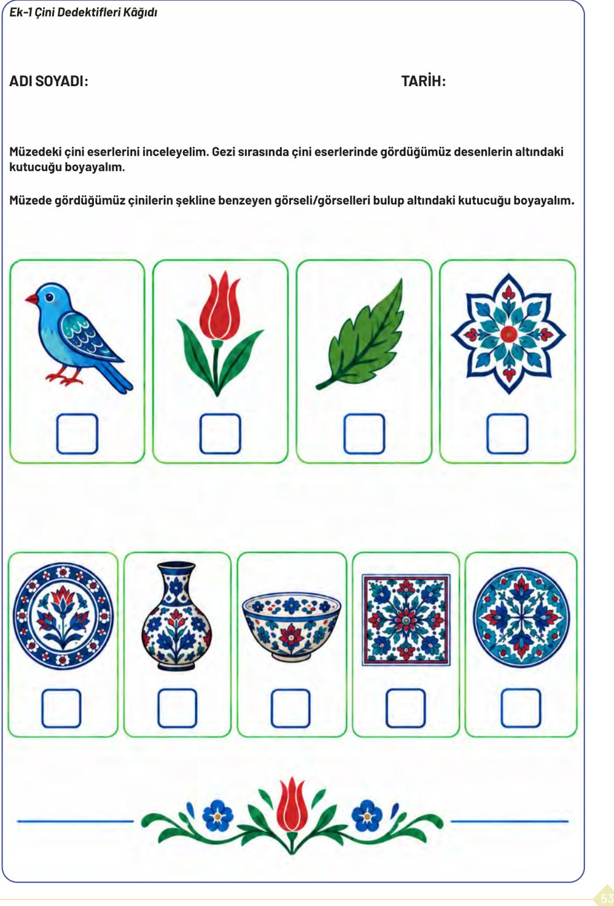

<!-- sayfa 55 -->

Ek-2 Çini Deseni

ADI SOYADI:                                     TARİH:

Çini desenini inceleyelim.
Diğer yarısını istediğimiz desenleri çizerek tamamlayalım.

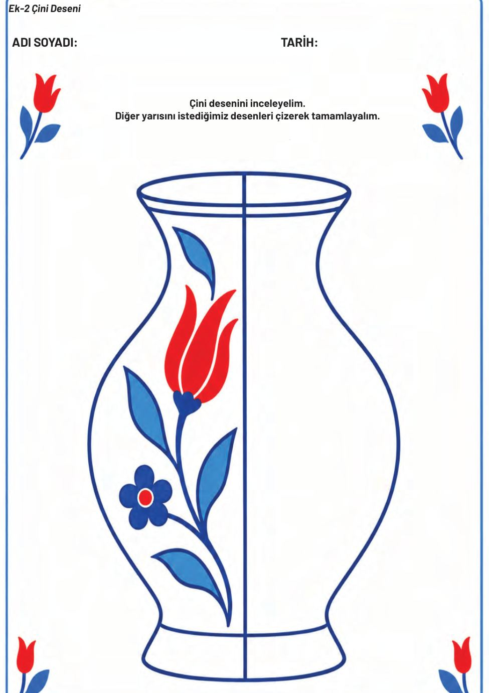

<!-- sayfa 56 -->

**ETKİNLİK ADI:** Çocuk Kütüphanesi 2
**ALAN ADI:** Türkçe
**YAŞ GRUBU:** 48-60 ay

**ALAN BECERİLERİ, ÖĞRENME ÇIKTILARI VE SÜREÇ BİLEŞENLERİ**

**TÜRKÇE ALANI**
**TAKB. Konuşma**
**TAKB.3. Konuşma sürecinde Türkçeyi doğru kullanabilme**
TAKB.3.a. Yetişkin rehberliğinde konuşacağı konuyu planlar.
TAKB.3.ç. Söylemek istediklerini açık biçimde ifade eder.

**EĞİLİMLER**
**E3. Entelektüel Eğilimler**
E3.2. Odaklanma

**PROGRAMLAR ARASI BİLEŞENLER**
**Sosyal-Duygusal Öğrenme Becerileri**
**SDB1.1.Kendini Tanıma (Öz Farkındalık)**

**Değerler**
**D14. Saygı**
D14.1. Nezaketli olmak

**Okuryazarlık Becerileri**
**OB4. Görsel Okuryazarlık**

**Kavramlar:** Duyu: sesli - sessiz
**Sözcükler:** kütüphane
**Materyaller:** resimli çocuk kitabı, A4 kâğıdı, boya klemleri
**Eğitim / Öğrenme Ortamları:** Çocukların gezi süresince kendi güvenlik ve sağlıklarını korumaları, aynı zamanda kütüphaneyi güvenli bir şekilde incelemeleri amacıyla kütüphanedeki bölümler ve gezi sırasında uyulması gereken kurallar hakkında açıklama yapılır. Gezi öncesinde çocukların güvenliğini sağlamak amacıyla, üzerinde çocukların ad - soyad bilgileri ile okulun iletişim bilgilerinin yer aldığı yaka kartları hazırlanır ve gezi süresince çocukların yakalarına takılır. Ailelerle iş birliği yapılarak çocuklarının sevdiği bir çocuk kitabını sınıfa getirmeleri istenir. Kütüphaneye hediye etmek için kitap merkezinden bir kitap belirlenir.

<!-- sayfa 57 -->

**ETKİNLİKLER**

**Türkçe (Bireysel Etkinlik)**

* Gezi öncesi, çocuklarla sınıfa getirdikleri kitaplar hakkında sohbet edilir. Çocuklara kitabın konusu ve kapak görseli hakkında konuşmaları için sorular sorulur. Çocuklara “Kitabının kapağında neler görüyorsun?”, “Sence bu kitapta neler anlatılıyor olabilir?”, “Bu kitabı neden seçtin?” gibi sorular yöneltilir. Çocukların kitaplarını arkadaşlarına tanıtmalarına fırsat verilir (E3.2, OB4). Ardından kütüphaneye gezi yapacakları ve kütüphane kuralları açıklanır. Kütüphanede sessiz konuşma, kitapları dikkatli kullanma, kitapları izinsiz almama ve görevlilerin yönlendirmelerine uyma gibi kurallar çocuklarla birlikte belirlenir.
* Gezi sırasında, kütüphanenin bölümleri çocuklara açıklanır. Ardından çocuk kitaplarının bulunduğu bölüme geçilir. Çocuklardan kitapları incelemeleri ve bir tane resimli çocuk kitabı seçmeleri istenir. Çocuklarla seçtikleri kitabın kapak görseli hakkında sohbet edilir ve her çocuğa seçtiği kitabın kapak görselinde ne gördüğünü, kitabın konusunun ne olabileceği ile ilgili tahminini arkadaşlarıyla paylaşması için fırsat verilir (TAKB.3.a, TAKB.3.ç, SDB1.1). Ardından kütüphaneye hediye edilecek kitap çocuklara gösterilir. Çocuklara bu kitapla ilgili neler hatırladıkları sorulur. Kitap hakkında kısa bir sohbet edildikten sonra kitap kütüphaneye hediye edilerek teslim edilir (D14.1).
* Gezi sonrasında, çocuklara “Kütüphanede hangi bölümü beğendin?” ve “Kütüphanede hangi kurallara uymamız gerekiyordu?” soruları sorulur. Yanıtları dinlenir. Ardından kitap merkezinden birlikte bir kitap seçilir ve etkileşimli olarak okunur.

**DEĞERLENDİRME**

* Kütüphane gezisinde neler yaptık?
* Kütüphanede hangi bölümleri gördük?
* Kütüphanede en çok hangi bölüm ilgini çekti? Neden?
* Kütüphanede kitaplar nasıl düzenlenmişti?
* Kütüphanede hangi kurallara uymamız gerekti?
* Kitapları neden dikkatli kullanmalıyız?
* Seçtiğin kitabın kapağında neler vardı?
* Kütüphaneye hangi kitabı hediye ettik?

**FARKLILAŞTIRMA**

**Zenginleştirme:** Kitap merkezine farklı türlerde yeni kitaplar eklenebilir. Sınıfta “Kitap Tanıtım Merkezi” oluşturulabilir. Çocuklardan bu merkezde seçtikleri kitabı arkadaşlarına tanıtmaları ve kitabı neden seçtiklerini anlatmaları istenebilir.

**Destekleme:** Kitap seçmekte güçlük yaşayan çocuklara rehberlik edilebilir. Kitap kapakları incelenirken “Bu kitapta ne anlatılıyor olabilir? Kapak görselinde ne görüyorsun?” gibi sorular sorulabilir.

**AİLE VE TOPLUM KATILIMI**

**Aile Katılımı:** Ailelerden çocuklarıyla kitap okuma etkinliği yapmaları ve bu deneyimi kısa bir not veya resimle sınıfa göndermeleri istenebilir.

**Toplum Katılımı:** Çocuk kitabı yazarı, masal anlatıcısı veya çocuk kitabı çizeri ya da kütüphaneye davet edilerek çocuklarla kitap okuma ve söyleşi etkinliği gerçekleştirilebilir.

<!-- sayfa 58 -->

**ETKİNLİK ADI:** Fotoğraf Makinesi Müzesi  
**ALAN ADI:** Matematik, Sanat  
**YAŞ GRUBU:** 48-60 ay  

**ALAN BECERİLERİ, ÖĞRENME ÇIKTILARI VE SÜREÇ BİLEŞENLERİ**  
**SANAT ALANI**  
**SNAB3. Sanata Değer Verme**  
**SNAB. 3. Sanatın önemini fark edebilme**  
SNAB.3.c. Dijital / gerçek sanat ortamlarını ziyaret eder.  
SNAB.3.ç. Dijital / gerçek sanat ortamlarında sergilenen eserleri inceler.  
**SNAB4. Sanatsal Uygulama Yapma**  
**SNAB.4. Sanat etkinliği uygulayabilme**  
SNAB.4.b. Sanat etkinliği için gerekli materyalleri seçer.  
SNAB.4.c. Sanat etkinliklerine aktif olarak katılır.  
SNAB.4.ç. Sanat etkinliklerinde özgün ürünler oluşturur.  

**EĞİLİMLER**  
**E3. Entelektüel Eğilimler**  
E3.2. Odaklanma  
E3.3. Yaratıcılık  

**PROGRAMLAR ARASI BİLEŞENLER**  
**Sosyal-Duygusal Öğrenme Becerileri**  
SDB2.1. İletişim  
SDB2.2. İş Birliği  

**Değerler**  
**D7. Estetik**  
D7.1. Duyusal derinliği anlamak  

**Okuryazarlık Becerileri**  
**OB5. Kültür Okuryazarlığı**  

**Kavramlar:** Zıt: eski - yeni, farklı - benzer  
**Sözcükler:** objektif, kadraj, film  
**Materyaller:** siyah-beyaz ve renkli fotoğraflar, A4 resim kâğıdı, kurşun kalem, boya kalemleri, kartondan hazırlanmış Fotoğraf Makinesi Etkinlik Kâğıdı (Ek - 1), Fotoğraf Makinesi Gözlem Kâğıdı çalışma sayfası (Ek - 2), gezi sırasında çekilen dijital fotoğraflar, fotoğraf çıktıları, pano, yapıştırıcı, bant  
**Eğitim / Öğrenme Ortamları:** Müze gezisinde kullanılmak üzere kartondan Fotoğraf Makinesi Etkinlik Kâğıdı (Ek - 1) ve Fotoğraf Makinesi Gözlem Kâğıdı çalışma sayfaları (Ek - 2) hazırlanır. Gezi sonrasında gerçekleştirilecek etkinlik için kurşun kalem, kuru boya kalemleri ve keçeli kalemler yerleştirilir. Gezi sırasında çekilen fotoğrafların dijital olarak izlenebilmesi için akıllı tahta veya projeksiyon hazırlanır.

<!-- sayfa 59 -->

**ETKİNLİKLER**

**Fen, Sanat (Bütünleştirilmiş Büyük Grup)**

* Sınıfa eski bir fotoğraf albümü getirilir. Önce albümdeki siyah-beyaz fotoğraflar ardından renkli fotoğraflar gösterilir. Çocukların fotoğrafları incelemelerine fırsat verilerek “Bu fotoğraflar neden çekilmiş olabilir?, Sizce insanlar telefonlar yokken anılarını nasıl saklıyordu?, Fotoğraf çekebilmek için telefondan başka neler kullanılmış olabilir?, Acaba eskiden fotoğraf makinelerinin büyüklüğü nasıldı?, Hepsi aynı şekilde mi çalışıyordu?” gibi sorular yöneltilir (**E3.2**). Çocukların tahminleri dinlendikten sonra, eski fotoğraf makinelerinin nasıl göründüğüne ilişkin tahminlerini bir kâğıda çizmeleri istenir (**SNAB.4.c, SNAB.4.ç, E3.3**). Bu soruların cevaplarını birlikte keşfetmek ve geçmişten günümüze kullanılan birbirinden farklı fotoğraf makinelerini yakından incelemek amacıyla Fotoğraf Makinesi Müzesi’ne gezi düzenleneceği söylenir (**SNAB.3.c, OB5**).
* Çocuklarla birlikte gezi sırasında uyulması gereken kurallar hakkında konuşulur. Gruptan ayrılmama, müze görevlisinin açıklamalarını dikkatle dinleme, müzedeki eserleri dikkatlice inceleyerek gözlem yapılması gerektiği birlikte belirlenir (**SDB2.2**). Müzenin girişinde çocuklara küçük karton bir çerçeve fotoğraf kadrajı olarak (Ek-1) verilir. “Fotoğrafçılar fotoğraf çekmeden önce dikkatlice bakar ve sonra en güzel görüntüyü seçer. Biz de bugün gözlerimizi fotoğraf makinesi gibi kullanacağız.” denilerek çocuklardan müzeyi gezerken ilgilerini çeken bölümlerde durmaları ve kadrajın içinden bakarak en çok ilgilerini çeken fotoğraf makinesini veya ayrıntıyı seçmeleri istenir (**E3.2**).
* Çocukların dikkati müzede sergilenen eski aile fotoğraflarına veya tarihî fotoğraflara çekilir. Çocuklardan fotoğrafları dikkatlice incelemeleri istenir (**SNAB3.ç**). “Fotoğraftaki insanlar ne yapıyor olabilir?, Sence bu fotoğraf hangi mevsimde çekilmiş olabilir?, Nereye gitmişler? Bu insanlar nasıl hissediyor olabilir?” gibi sorular yöneltilir. Verilen cevaplarla fotoğrafa bir hikâye oluşturulur. Fotoğrafa bir isim verilebilir. Örneğin dedemin ilk fotoğrafı, piknik günü gibi (**OB5, SDB2.1**).
* Gezi sonunda çocuklarla müzede gördükleri fotoğraf makineleri hakkında kısaca sohbet edilir. Ardından üzerinde yalnızca fotoğraf makinesinin dış hatlarının bulunduğu Ek-2 çocuklara dağıtılır. Çocuklardan “Şimdi sen de hayalindeki fotoğraf makinesini tasarla. İstediğin renkleri, şekilleri ve ayrıntıları ekleyebilirsin.” yönergesiyle kendi fotoğraf makinelerini oluşturmaları istenir (**SNAB.4.b**). Çocukların çizimlerini özgürce tamamlamalarına ve isteyenlerin tasarımlarını arkadaşlarıyla paylaşmalarına fırsat verilir (**SNAB.4.ç**).

**DEĞERLENDİRME**

* Müzede seni en çok şaşırtan fotoğraf makinesi hangisiydi? Neden?
* Eski fotoğraf makineleri ile bugün kullandığımız telefon veya fotoğraf makineleri arasında hangi benzerlikleri ve farklılıkları fark ettin?
* Fotoğrafçılar neden fotoğraf çekmeden önce dikkatlice bakıyor olabilir?
* Kendi tasarladığın fotoğraf makinesine neden bu özellikleri ekledin?
* Eğer bugün müzede sadece bir fotoğraf çekebilseydin neyin fotoğrafını çekerdin? Neden?

**FARKLILAŞTIRMA**

**Zenginleştirme:** Çocuklara geçmişten günümüze kullanılan farklı fotoğraf makinelerine (körüklü fotoğraf makinesi, filmli fotoğraf makinesi, dijital fotoğraf makinesi ve cep telefonu kamerası) ait görseller gösterilebilir. Görselleri inceleyerek benzer ve farklı özelliklerini karşılaştırmaları istenebilir. Gelecekte ne gibi fotoğraf makineleri tasarlanabileceği sorularak çizmeleri ya da atık materyallerle tasarlamaları istenebilir.

**Destekleme:** Fotoğraf makinelerinin belirgin özelliklerini gösteren büyük boy görseller kullanılabilir. Gözlem yapmaları için tek seferde daha az ayrıntıya odaklanmaları sağlanabilir ve gerektiğinde sözel ipuçları ile öğretmen rehberliği sunulabilir.

**AİLE VE TOPLUM KATILIMI**

**Aile Katılımı:** Ailelerden çocuklarıyla geçmiş yıllara ait aile fotoğraf albümlerini incelemeleri istenebilir. Fotoğraflar üzerinden “Bu fotoğraf ne zaman çekildi?”, “Fotoğrafta kimler var?”, “O gün neler yaşanmış olabilir?”

<!-- sayfa 60 -->

**EK-1 Fotoğraf Makinesi Etkinlik Kâğıdı**

**ADI SOYADI:**                                                                    **TARİH:**

Fotoğraf makinesi görselini kesik çizgilerden keselim. Ortasındaki daireyi keserek çıkaralım. Fotoğraf makinemiz artık hazır. Gezi sırasında ilgimizi çeken yerlerde makinemizi kullanalım.

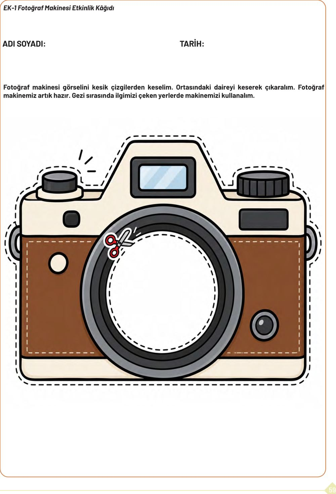

<!-- sayfa 61 -->

**Ek-2 Fotoğraf Makinesi Gözlem Kâğıdı**

**ADI SOYADI:**  **TARİH:**

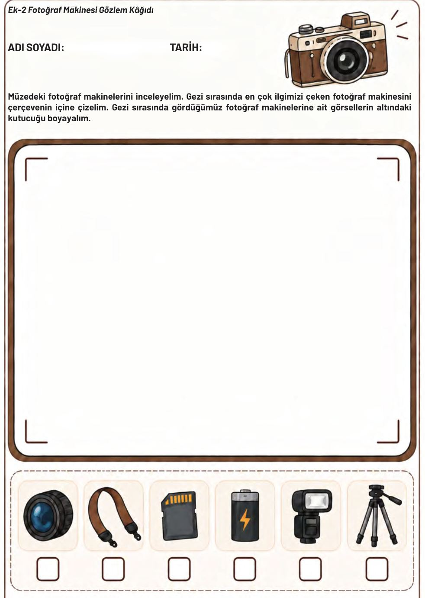

Müzedeki fotoğraf makinelerini inceleyelim. Gezi sırasında en çok ilgimizi çeken fotoğraf makinesini çerçevenin içine çizelim. Gezi sırasında gördüğümüz fotoğraf makinelerine ait görsellerin altındaki kutucuğu boyayalım.

<!-- sayfa 62 -->

**ETKİNLİK ADI:** Isparta Gül Bahçeleri
**ALAN ADI:** Fen
**YAŞ GRUBU:** 48-60 ay

**ALAN BECERİLERİ, ÖĞRENME ÇIKTILARI VE SÜREÇ BİLEŞENLERİ**

**FEN ALANI**

**FBAB1. Bilimsel Gözlem**
**FAB1. Günlük yaşamında fenle ilgili olaylara / olgulara ve durumlara yönelik bilimsel gözlem yapabilme**
* FAB1.a. Çevresinde merak ettiği nesne / olay / olguları dikkatle gözlemler.
* FAB1.d. Gözlemlediği nesne / olay / olgulara ilişkin verileri çizim, işaretleme yoluyla kaydeder.

**EĞİLİMLER**

**E3. Entelektüel Eğilimler**
E3.2. Odaklanma

**PROGRAMLAR ARASI BİLEŞENLER**

**Sosyal-Duygusal Öğrenme Becerileri**
**SDB1.2. Kendini Düzenleme (Öz Düzenleme)**

**Değerler**
**D3. Çalışkanlık**
D3.4. Çalışmalarda aktif rol almak

**Okuryazarlık Becerileri**
**OB4. Görsel Okuryazarlık**

**Kavramlar:** Zıt: canlı - cansız
**Sözcükler:** gül yetiştiriciliği
**Materyaller:** gül bahçesi gözlem Kağıdı (Ek-1), kalem, farklı renklerde (kırmızı, pembe, beyaz, sarı vb.) gül görselleri

**Eğitim / Öğrenme Ortamları:** Çocukların gezi süresince kendi güvenlik ve sağlıklarını korumaları, aynı zamanda gül bahçesini güvenli bir şekilde incelemeleri amacıyla gezi sırasında uyulması gereken kurallar hakkında açıklama yapılır. Gezi öncesinde çocukların güvenliğini sağlamak amacıyla, üzerinde çocukların ad-soyad bilgileri ile okulun iletişim bilgilerinin yer aldığı yaka kartları hazırlanır ve gezi süresince çocukların yakalarına takılır.

<!-- sayfa 63 -->

**Fen (Bireysel Etkinlik)**

* Gezi öncesinde çocuklara farklı renklerde (kırmızı, pembe, beyaz, sarı vb.) gül görselleri gösterilir. Görseller incelenirken “Bu çiçeği daha önce gördün mü?”, “Sence güller nerede yetişir?”, “Güller başka hangi renklerde olabilir?” gibi sorular yöneltilir. Görsellere ilişkin düşüncelerini ve önceki deneyimlerini paylaşmalarına fırsat verilir (**OB4**). Ardından gülün bazı özellikleri hakkında kısaca sohbet edilir; Isparta’da çok sayıda gül yetiştirildiği ve güllerden gül suyu, gül yağı gibi farklı ürünler elde edilebildiği açıklanır.
* Gezi öncesinde bahçede dikkat edilmesi gereken davranışlar çocuklarla olumlu ifadeler kullanılarak konuşulur. Güllerin koparılmadan inceleneceği, çevrenin temiz tutulacağı ve bahçede birlikte hareket edileceği belirtilir. Arılarla karşılaşıldığında “Arılar güllerin en yakın arkadaşlarından biridir. Bir arı çiçeğin üzerindeyken onun etrafında kocaman, görünmez bir çember olduğunu hayal ediyor ve iki adım geriden izliyoruz.” açıklaması yapılır. Güllerin dikenlerine ilişkin ise “Dikenler güllerin koruyucusudur. Kıyafetlerimizin bizi güneşten ve soğuktan koruması gibi dikenler de gülleri korur. Güllerin sınırına saygı duyup acele etmeden, dikkatlice yaklaşıyoruz.” denir (**SDB1.2, D3.4**).
* Gezi sırasında çocukların dikkatleri gül bahçesindeki bitkilere ve diğer canlılara yönlendirilir. Bahçenin farklı bölümlerinde güllerin renklerini, büyüklüklerini, yapraklarını ve çevrede gördükleri canlıları incelemelerine fırsat verilir (**FAB.1.a**). Bu süreçte çocuklardan herhangi bir form doldurmaları beklenmez; çevrelerini doğrudan duyuları aracılığıyla keşfetmeleri desteklenir.
* Öğretmen zaman zaman çocukların dikkatini işittikleri seslere, kokulara ve dokunsal özelliklere yönlendirir. “Şu anda hangi sesleri duyuyorsunuz?”, “Burnunuza en çok hangi koku geliyor?”, “Bu gülün kokusu size neyi hatırlatıyor?”, “Bir yaprağa nazikçe dokunduğunuzda nasıl hissediyorsunuz; yumuşak mı, kaygan mı, gıdıklayıcı mı?” gibi sorular sorulur. Çocukların kendi duyumlarını fark etmelerine ve bunları kendi sözcükleriyle ifade etmelerine fırsat verilir (**E3.2**). Güvenli olduğu değerlendirilen yaprak veya çiçeklere yalnızca öğretmenin yönlendirmesiyle ve dikenlerden uzak bölümlerden nazikçe dokunmalarına izin verilir.
* Çocukların bahçede gördükleri arı, kelebek veya diğer canlıları uzaktan gözlemlemeleri sağlanır. Canlıların ne yaptıkları hakkında konuşulur; ancak çocuklardan canlılara yaklaşmaları veya dokunmaları istenmez. Gezi sırasında çocukların duyusal keşif yaptıkları, çevreyi inceledikleri ve gözlemlerini paylaştıkları anlardan fotoğraflar çekilir.
* Gezi sonrasında “Gül Bahçesini Keşfediyorum” gözlem formu çocuklara dağıtılır. Çocuklardan gezi sırasında gördüklerini hatırlayarak formdaki farklı renklerdeki güller ile arı, kelebek gibi canlılardan gördüklerini işaretlemeleri istenir (**FAB.1.d**). Böylece form, gezi sırasında çocukların dikkatini çevreden uzaklaştıran bir görev olmaktan çıkarılarak gezi deneyimini hatırlama ve yeniden düşünme aracı olarak kullanılır.
* Ardından gezi sırasında çekilen fotoğraflar birlikte incelenir. Çocuklara “En çok hangi gülü beğendin?”, “Bahçede hangi canlıları gördün?”, “En çok hangi kokuyu hatırlıyorsun?”, “Bahçede duyduğun hangi ses aklında kaldı?” ve “Gül bahçesini korumak için neler yapabiliriz?” gibi sorular yöneltilir. Çocukların gözlemlerini, duyularıyla fark ettiklerini ve geziye ilişkin deneyimlerini arkadaşlarıyla paylaşmaları desteklenir. Tamamlanan gözlem formları, çocukların çizimleri ve gezi fotoğrafları sınıf panosunda sergilenir.

**DEĞERLENDİRME**

* Gül bahçesinde hangi canlıları gördün?
* Gözlem kağıdında hangi gülleri ve canlıları işaretledin?
* Arılar ve kelebekler neden gül bahçesine geliyor olabilir?
* Güllerin kokuları birbirine benziyor muydu, farklı mıydı?

<!-- sayfa 64 -->

# FARKLILAŞTIRMA

**Zenginleştirme:** Çocuklarla gülün yaşam döngüsünü gösteren görseller (tomurcuk, açmış gül ve solmuş gül) incelenebilir. Farklı renk ve büyüklükte gül yaprakları incelenerek renk, büyüklük ve doku özellikleri karşılaştırılabilir.

**Destekleme:** Gezi sırasında, çocuklara gözlem formunda işaretleme yaparken sözel ipuçları verilebilir. Gezi sonrasında, fotoğraflar ve gözlem formları birlikte incelenerek çocukların gezi sırasında gördükleri güller ve canlıları hatırlamaları desteklenebilir.

# AİLE VE TOPLUM KATILIMI

**Aile Katılımı:** Ailelere gezi ile ilgili bilgi verilebilir. Çocuklarıyla güllerden elde edilen ürünlerin (gül lokumu, gül sabunu, gül yağı, gül kolonyası vb.) görsellerini incelemeleri ve kullanım alanları hakkında sohbet etmeleri istenebilir.

<!-- sayfa 65 -->

*Ek-1 Gül Bahçesi Gözlem Kâğıdı*

**ADI SOYADI:**                                         **TARİH:**

**Gezi sırasında gül bahçesinde gördüğümüz canlıların görsellerinin altındaki kutucuğu boyayalım.**

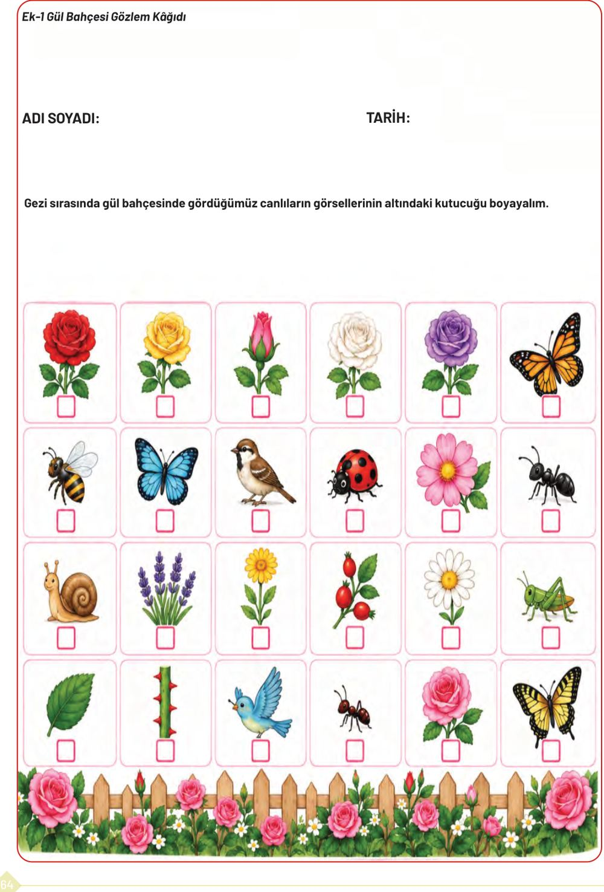

<!-- sayfa 66 -->

**ETKİNLİK ADI:** Meteoroloji Müzesi  
**ALAN ADI:** Sosyal, Fen, Sanat  
**YAŞ GRUBU:** 48-60 ay  

**ALAN BECERİLERİ, ÖĞRENME ÇIKTILARI VE SÜREÇ BİLEŞENLERİ**

**FEN ALANI**  
**FBAB3. Bilimsel Gözleme Dayalı Tahmin**  
**FAB.3. Günlük yasamda fen olaylarına yönelik bilimsel gözleme dayalı tahminlerde bulunabilme**  
FAB.3.a. Gözlemlediği çevresel durumların olası etkilerine yönelik tahminlerde bulunur.  
FAB.3.b. Yakın çevresinde gözlemlediği değişimlere yönelik tahminler yapar.  
FAB.3.c. Gözlemlediği çevresel değişimlere göre giyinme gibi tercihlerini belirler.  

**FBAB4. Bilimsel Veriye Dayalı Tahmin**  
**FAB.4. Fene yönelik olay ve / veya olgular hakkında bilimsel veriye dayalı tahminlerde bulunabilme**  
FAB.4. a. Gözlemleri ve önceki deneyimlerine göre tahminlerde bulunur.  
FAB.4. b. Olay ve durumların olası sonuçlarını tahmin eder.  

**SOSYAL ALAN**  
**SBAB8. Coğrafi Sorgulama**  
**SAB.7. Merak ettiği coğrafi olay / olgu ve mekân / durumlara yönelik sorular sorabilme**  
SAB.7.a. Hava olaylarına ilişkin gözlemlerini söyler.  
SAB.7.b. Merak ettiği hava olayları / yeryüzü şekilleri ile ilgili sorular sorar.  

**SANAT ALANI**  
**SNAB4. Sanatsal Uygulama Yapma**  
**SNAB.4. Sanat etkinliği uygulayabilme**  
SNAB.4.ç. Sanat etkinliklerinde özgün ürünler oluşturur.  

**EĞİLİMLER**  
**E3. Entelektüel Eğilimler**  
E3.3.Yaratıcılık  

**PROGRAMLAR ARASI BİLEŞENLER**  
**Sosyal-Duygusal Öğrenme Becerileri**  
SDB2.1. İletişim  

**Değerler**  
**D3. Çalışkanlık**  
D3.3. Araştırmacı ve sorgulayıcı olmak  

**Okuryazarlık Becerileri**  
**OB1. Bilgi Okuryazarlığı**  

**Kavramlar:** Duyu: sıcak - soğuk  
**Sözcükler:** meteorolog, meteoroloji, ölçüm, tahmin  
**Materyaller:** şemsiye, yağmurluk, güneş gözlüğü ve hava durumu sembolleri, çeşitli atık materyaller (karton kutular, pipetler, pet şişeler, karton rulolar, kapaklar, tahta çubuklar, alüminyum folyo vb. ), hava durumu grafiği  

**Eğitim / Öğrenme Ortamları:** Gezi öncesinde çocukların güvenliğini sağlamak amacıyla, üzerinde çocukların ad - soyad bilgileri ile okulun iletişim bilgilerinin yer aldığı yaka kartları hazırlanır ve gezi süresince çocukların yakalarına takılır. Dikdörtgen şeklinde bir kutunun iç kısmı kesilerek arkası görünecek şekilde televizyon ekranı olarak kullanılmak amacıyla hazırlanır.

<!-- sayfa 67 -->

**ETKİNLİKLER**

**Sosyal, Fen ve Sanat (Bütünleştirilmiş Büyük Grup)**

* Sınıfa boş bir bavul getirilir. Çocuklara farklı bir şehre yada ülkeye gidecekleri ve bavul hazırlamaları gerektiği söylenir. Bir alanda çorap, atkı, bere, şemsiye, şort, güneş gözlüğü, şapka gibi hem de yazlık hemde kışlık materyaller bulunur. Gidilecek yer ile ilgili tahminde bulunmaları istenir. Ülkenin sıcak ya da soğuk olma durumuna göre bavulun hazırlanacağı ifade edilir. Hava durumunu nasıl anlayacakları ile ilgili sorular sorulur (**FAB.4.b**). Örneğin “Başka bir şehirdeki hava durumunu nasıl öğrenebiliriz?”, “Sadece bugünün hava durumunu mu bilebiliriz yoksa sonraki günleri de öğrenebilir miyiz?”, “Hava durumu gün içerisinde değişir mi yoksa hep aynı mı kalır?” gibi sorular sorularak çocukların cevapları dinlenir (**FAB.3.a, FAB.3.b**). Bir şehir ya da ülke seçilerek oradaki hava durumuna uygun olarak seçilen eşyalar bavula konulur (**FAB.3.c**).
* Televizyon olarak hazırlanan kutudan çerçevenin arkasına geçilir. Çocuklara üzerinde yağmur, kar, şimşek, güneş, rüzgâr görselleri bulunan hava durumu grafiği gösterilir. Görsellerin neyi ifade ettiği sorulur (**SAB.7.a**). Bir spiker gibi konuşularak hava durumu ile ilgili bilgiler verilir. Farklı şehirlerdeki farklı hava durumuna dikkat çekilir. Cümlenin içinde “meteorolog” kelimesi geçirilir ve çocuklara bunun ne anlama geldiği sorulur. Gelen cevaplar çocukların da görebileceği şekilde yazılarak kavram haritası oluşturulur. Tahminlerin ardından, hava durumunu önceden tahmin eden bilim insanlarına meteorolog adı verildiği açıklanır. İnsanların yalnızca gözlem yaparak değil özel aletler sayesinde havanın durumunu tahmin ettiği ve rüzgârın hızını, yağmurun miktarını, sıcaklığı ölçebildiği ifade edilir (**OB1**).
* Müze gezisi sırasında “Meteorolojik Alet ve Cihazlar” bölümü incelenir. Çocukların cihazların hareket eden parçalarını, göstergelerini ve ölçeklerini dikkatlice gözlemlemeleri sağlanır. Müze görevlisinin açıklamalarından sonra çocuklardan ilk tahminleri ile öğrendikleri bilgileri karşılaştırmaları istenir (**D3.3**).
* Gezi sonrasında çocuklar küçük gruplara ayrılır. Gruplara atık materyaller verilir. Her gruptan müzede inceledikleri araçlardan esinlenerek yeni bir meteorolojik ölçüm aracı tasarlamaları istenir (**SNAB.4.ç, E3.3**). Tasarımlarını oluştururken hangi materyalleri neden seçtiklerini, tasarladıkları aracın neyi ölçtüğünü ve nasıl çalışacağını arkadaşlarına açıklamaları desteklenir (**SDB2.1**). Daha sonra bütün tasarımlar birlikte incelenir. Çocuklar tasarladıkları araçların hangi hava olayını ölçebileceğini karşılaştırır, birbirlerinin ürünleri hakkında sorular sorarak görüşlerini paylaşır (**SAB.7.b**). Süreç sonunda gerçek meteoroloji araçları ile tasarlanan araçların benzer ve farklı yönleri konuşulur (**FAB.4.a**).

**DEĞERLENDİRME**

* Bir yere gitmeden önce hava durumunu öğrenmek neden önemli olabilir?
* Hava durumu tahminini doğru çıkmazsa neler olabilir? Böyle bir durumda ne yapabiliriz?
* Müzede gördüğün meteorolojik ölçüm araçlarından seni en çok hangisi şaşırttı? Neden?
* Başka bir grubun tasarımında beğendiğin bir fikir oldu mu? Bu fikri neden beğendin?

<!-- sayfa 68 -->

**FARKLILAŞTIRMA**

**Zenginleştirme:** Çocuklara “Hava Durumu Gözlem Takvimi” hazırlanabilir. Her gün hava gözlemleri yapılarak gökyüzü, rüzgâr, sıcaklık ve bulut durumuna ilişkin gözlemlerini resim, sembol veya işaretlerle kaydetmeleri istenebilir. Ay sonunda yapılan gözlemler birlikte incelenerek hava durumundaki değişimler hakkında konuşulabilir ve meteorologların neden düzenli ölçüm yaptığı üzerine değerlendirme yapılabilir. Meteorologların yaptığı ölçüm ve tahminlerin tarım, ulaşım, havacılık, denizcilik ve günlük yaşam açısından önemi hakkında sohbet edilebilir.

**Destekleme:** Çocukların materyalleri dokunarak, inceleyerek ve karşılaştırarak gruplandırmaları konusunda bireysel rehberlik sağlanabilir. Tasarım etkinliğinde desteğe ihtiyaç duyan çocuklara materyal seçimi ve birleştirme sürecinde bireysel yardım edilebilir. Gerekli durumlarda çocukların ikili ya da küçük gruplar hâlinde ortak bir ürün oluşturmaları desteklenebilir.

**AİLE VE TOPLUM KATILIMI**

**Aile Katılımı:** Ailelerden çocuklarıyla bir hafta boyunca hava durumunu gözlemlemeleri istenir. Her gün havanın güneşli, bulutlu, yağmurlu veya rüzgârlı olup olmadığını birlikte konuşmaları, uygun hava durumu sembolünü işaretlemeleri ve o gün hava koşullarına göre neden belirli kıyafetleri seçtiklerini çocuklarıyla paylaşmaları önerilir. Ailelerden çocuklarıyla birlikte televizyon, radyo, gazete veya telefon uygulamalarından bir hava durumu tahminini incelemeleri istenir. Ertesi gün tahmin ile gerçekleşen hava durumunu birlikte karşılaştırmaları ve “Tahmin doğru çıktı mı?” sorusu üzerine sohbet etmeleri önerilebilir.

**Toplum Katılımı:** Gezi sonrasında çocukların tasarladıkları meteorolojik ölçüm araçları okulda düzenlenecek sergide diğer sınıflarla paylaşılabilir.

<!-- sayfa 69 -->

**ETKİNLİK ADI:** Nevşehir Avanos Çömlek Atölyesi
**ALAN ADI:** Fen, Sanat
**YAŞ GRUBU:** 48-60 ay

**ALAN BECERİLERİ, ÖĞRENME ÇIKTILARI VE SÜREÇ BİLEŞENLERİ**

**FEN ALANI**
**FBAB1. Bilimsel Gözlem**
**FAB1. Günlük yaşamında fenle ilgili olaylara / olgulara ve durumlara yönelik bilimsel gözlem yapabilme**
FAB1.a. Çevresinde merak ettiği nesne / olay / olguları dikkatle gözlemler.

**SANAT ALANI**
**SNAB4. Sanatsal Uygulama Yapma**
**SNAB.4. Sanat etkinliği uygulayabilme**
SNAB.4.ç. Sanat etkinliklerinde özgün ürünler oluşturur.

**EĞİLİMLER**
**E3. Entelektüel Eğilimler**
E3.2. Odaklanma

**PROGRAMLAR ARASI BİLEŞENLER**
**Sosyal-Duygusal Öğrenme Becerileri**
**SDB1.2. Kendini Düzenleme (Öz Düzenleme)**

**Değerler**
**D3. Çalışkanlık**
D3.3. Araştırmacı ve sorgulayıcı olmak

**Okuryazarlık Becerileri**
**OB4. Görsel Okuryazarlık**

**Kavramlar:** Duyu: sert - yumuşak
**Sözcükler:** çömlek, usta
**Materyaller:** kil, oyun hamuru, çömlek, çömlek yapımı ve çömlek ustalarına ait görseller
**Eğitim / Öğrenme Ortamları:** Çocukların gezi süresince kendi güvenlik ve sağlıklarını korumaları, aynı zamanda atölyeyi güvenli bir şekilde incelemeleri amacıyla gezi sırasında uyulması gereken kurallar hakkında açıklama yapılır. Gezi öncesinde çocukların güvenliğini sağlamak amacıyla, üzerinde çocukların ad - soyad bilgileri ile okulun iletişim bilgilerinin yer aldığı yaka kartları hazırlanır ve gezi süresince çocukların yakalarına takılır.

<!-- sayfa 70 -->

**Fen, Sanat (Bireysel Etkinlik)**

**ETKİNLİKLER**

* Gezi öncesi, çocuklara çömlek, çömlek yapımı ve çömlek ustalarına ait görseller gösterilir. “Bu nesneyi daha önce gördün mü?”, “Sence bu kaplar hangi malzemeden yapılmış olabilir?”, “Toprakla neler yapılabilir?”, “Bu çömlekler nerede kullanılıyor olabilir?” gibi sorular sorulur. Çocukların yanıtları dinlenir. Ardından Nevşehir Avanos’un çömlek yapımıyla tanınan bir yer olduğu, çömleklerin topraktan yapıldığı, ustaların toprağa şekil vererek farklı ürünler oluşturduğu hakkında sohbet edilir. Çömlek yapımında kullanılan toprağın özellikleri, toprağın su ile birleştiğinde şekil alabilmesi ve kuruduğunda sertleşmesi hakkında açıklama yapılır. Çocuklara gezi sırasında uymaları gereken kurallar (atölyede dikkatli hareket etmek, kullanılan malzemelere izin almadan dokunmamak, ustayı dikkatle dinlemek, çevreyi temiz tutmak) açıklanır.
* Gezi sırasında, çocuklardan çömlek atölyesindeki çalışmaları incelemeleri istenir. Çocuklar atölyenin farklı bölümlerine yönlendirilerek çömleklerin şekilleri, büyüklükleri, renkleri, üzerlerindeki desenler ve yapım aşamaları hakkında gözlem yapmaları beklenir (**FAB.1.a, E3.2**). Çocuklara çömlek ustasının çalışma süreci izletilir. Ustanın toprağı yoğurması, çark üzerinde şekillendirmesi ve çömleğe farklı şekiller vermesi gözlemlenir. Uygun olması hâlinde çocukların güvenli şekilde çamura dokunarak şekil verme deneyimi yaşamaları sağlanabilir.
* Gezi sonrasında, çocuklara “Çömlek yaparken hangi malzemeler kullanıldı?”, “Toprağa nasıl şekil verildi?”, “En çok hangi çömleği beğendin?”, “Çömlek ustasının yaptığı hangi aşama ilgini çekti?”, “Çamurun eline değmesi nasıl bir histi?”, “Çamurun yumuşaklığı, soğukluğu neyi hatırlattı?” gibi sorular sorularak sohbet edilir. Ardından çocuklar etkinlik için masalara yönlendirilir. Çocuklardan masalarda bulunan kil veya oyun hamurunu kullanarak kendi çömleklerini tasarlamaları, çömleklere isim vermeleri ve ürünlerini arkadaşlarına tanıtmaları istenir (**SNAB.4.ç, SDB1.2, D3.3, OB4**).

**DEĞERLENDİRME**

* Çömlek ustası ne iş yapar?
* Atölyedeki çömleklerin şekilleri nasıldı?
* En çok beğendiğin çömlek hangisiydi? Neden?
* Çömlekler hangi amaçlarla kullanılabilir?
* Çömlek tasarlarken nelere dikkat ettin?
* Çömlek tasarlarken hangi malzemeleri kullandın?
* Çömlek tasarlarken ne hissettin?
* Çamurun eline değmesi nasıl bir histi?
* Çamurun yumuşaklığı, soğukluğu neyi hatırlattı?

**FARKLILAŞTIRMA**

**Zenginleştirme:** Farklı kültürlere ait çömlek örnekleri, geleneksel kaplar ve sanat eserleri incelenebilir. Çocuklardan gözlemledikleri çömleklerin şekil, renk, desen ve kullanım amaçlarını karşılaştırmaları istenebilir.
**Destekleme:** Çocuklara çömlek tasarlarken farklı büyüklükte kil parçaları, şekil verme araçları ve kalıplar sunulabilir. Çocuklar çömleklerini tanıtırken “Benim çömleğimin ismi ...”, “Çömleğimi ... için yaptım.” gibi başlangıç cümleleri verilebilir.

**AİLE VE TOPLUM KATILIMI**

**Aile Katılımı:** Ailelerden çocuklarıyla çömlekçilik ve çömlek yapımı konularında kısa bir belgesel izlemeleri istenebilir.
**Toplum Katılımı:** Çocukların hazırladığı çömlekler sınıfta sergilenerek diğer sınıflardaki çocuklar ve ailelere [...]

<!-- sayfa 71 -->

**ETKİNLİK ADI:** SEKA Kağıt Müzesi
**ALAN ADI:** Türkçe, Fen
**YAŞ GRUBU:** 48-60 ay

**ALAN BECERİLERİ, ÖĞRENME ÇIKTILARI VE SÜREÇ BİLEŞENLERİ**

**TÜRKÇE ALANI**
**TAEOB. Erken Okuryazarlık**
**TAEOB.4. Okuma öncesi becerileri kazanabilme**
TAEOB.4.a. Kitabın temel unsurlarını açıklar.

**FEN ALANI**
**FBAB1. Bilimsel Gözlem**
**FAB1. Günlük yaşamında fenle ilgili olaylara / olgulara ve durumlara yönelik bilimsel gözlem yapabilme**
FAB1.e. Gözlemlediği nesne / olay / olguların benzer ve farklı özelliklerini açıklar.

**FBAB7. Deney Yapma**
**FAB7. Merak ettiği konular / olay / durumlar hakkında deneyler yapabilme**
FAB7.c. Deney sürecinde ortaya çıkan değişimleri gözlemler.

**EĞİLİMLER**
**E1. Benlik Eğilimleri**
E1.1. Merak

**PROGRAMLAR ARASI BİLEŞENLER**

**Sosyal-Duygusal Öğrenme Becerileri**
**SDB2.2. İş Birliği**

**Değerler**
**D5. Duyarlılık**
D5.2. Çevreye ve canlılara değer vermek
**D17. Tasarruf**
D17.2. İsraftan kaçınmak
D17.3. Sahip olduklarının değerini bilmek

**Okuryazarlık Becerileri**
**OB8. Sürdürülebilirlik Okuryazarlığı**

**Kavramlar:** Zaman: önce - şimdi - sonra
**Sözcükler:** kâğıt hamuru, lif
**Materyaller:** büyük fon kartonu, kâğıttan üretilen ve üretilmeyen nesnelere ait görsel kartlar, boş karton kutu, eski gazete, kullanılmış kâğıt, peçete, karton parçası

**Eğitim / Öğrenme Ortamları:** Gezi öncesinde çocukların güvenliğini sağlamak amacıyla, üzerinde çocukların ad - soyad bilgileri ile okulun iletişim bilgilerinin yer aldığı yaka kartları hazırlanır ve gezi süresince çocukların yakalarına takılır.

<!-- sayfa 72 -->

**ETKİNLİKLER**

**Türkçe, Fen (Bütünleştirilmiş Büyük Grup Etkinliği)**

* Sınıfta uygun bir yere büyük bir fon kartonu yerleştirilir. Üzerine “KAĞIT” yazılır. Üzerinde bir nesne ve nesnenin altında adının yazılı olduğu görsel kartlar hazırlanır. Bu nesnelerin bir kısmı kâğıttan üretilen (kitap, defter, kutu, gazete, peçete, yumurta kolisi, karton bardak, hediye kutusu, tuvalet kâğıdı vb. ), bir kısmı da kâğıttan üretilmeyen nesnelerdir. Çocuklardan “KAĞIT” yazısının etrafına kâğıttan yapılmış nesnelerin görsellerini bulup yapıştırmaları istenir (FAB.1.e).
* “Bu materyaller kâğıttan nasıl yapılmış olabilir?” sorusu ile çocukların dikkati kâğıdın oluşumuna çekilir. Boş bir karton kutu, eski bir gazete, kullanılmış bir kâğıt, peçete ve küçük bir karton parçası gösterilir. Materyaller tek tek incelenir ve çocukların dokunmalarına fırsat verilir. “Bunlar artık işe yaramıyor mu?”, “Sence bunları çöpe mi atmalıyız?”, “Bu kâğıtlar yeniden kullanılabilir mi?”, “Bir ağaç nasıl deftere, kitaba ya da karton kutuya dönüşüyor olabilir?” soruları yöneltilir. Çocukların tahminlerini ifade etmelerine fırsat verilir (E1.1). Ardından kâğıdın üretim ve geri dönüşüm yolculuğunu yakından görebilecekleri yerlerden birinin SEKA Kâğıt Müzesi olduğu söylenir. Müze gezisi sırasında kâğıdın nasıl üretildiğini, hangi makinelerden geçtiğini ve kullanılmış kâğıtların nasıl yeniden değerlendirilebildiğini görebilecekleri açıklanır.
* Çocuklarla birlikte gezi sırasında dikkat edilmesi gereken davranışlar hakkında konuşulur. Öğretmenleriyle birlikte hareket edecekleri, müze görevlisinin açıklamalarını dikkatle dinleyecekleri ve müzedeki eserleri dikkatlice inceleyecekleri belirtilir. Çocukların bu davranışları kendi ifadeleriyle tekrar etmelerine fırsat verilir (SDB2.2).
* Gezi sırasında müzenin bölümleri birlikte gezilirken çocukların dikkatleri önce Hamur Hazırlama Salonu’na çekilir. Ağaçlardan elde edilen liflerin ve yeniden değerlendirilen eski kâğıtların burada su ile karıştırılarak yumuşak bir kâğıt hamuruna dönüştürüldüğü açıklanır. Ardından çocuklarla birlikte hamurun hazırlandığı makineler incelenir.
* Daha sonra Kâğıt Makinesi Salonu’na geçilir. Hazırlanan hamurun makinenin tel bölümüne yayıldığı ve burada fazla suyunun süzüldüğü açıklanır. Çocuklara “Sence hamurun içindeki su neden azaltılıyor olabilir?” sorusu yöneltilir. Daha sonra üretim hattındaki pres bölümü incelenir. Büyük silindirlerin hamura bastırarak içinde kalan suyun azalmasını sağladığı açıklanır. Ardından çocukların dikkatleri kurutma silindirlerine yönlendirilir ve kâğıdın sıcak silindirlerden geçerek kuruduğu belirtilir.
* Çocuklar kâğıdın oluşum sürecini; hamurun hazırlanması, şekillenmesi, suyunun azaltılması ve kurutulması aşamalarını sırasıyla gözlemler. Ardından kendi kâğıtlarını üretebilecekleri alanda süreci deneyimleyerek kâğıt yapımını keşfederler (FAB.7.c). Çocukların ürettikleri kâğıtlar daha sonra kullanılmak üzere sınıfa götürülür (OB8).
* Gezi sonrasında çocuklarla kâğıdın tekrar tekrar geri dönüştürülemeyeceği ve zamanla yapısının zayıfladığı hakkında yaş düzeylerine uygun biçimde konuşulur. Bu nedenle yalnızca geri dönüşümün değil, kâğıdı dikkatli kullanmanın ve gereksiz yere tüketmemenin de önemli olduğu vurgulanır (D5.2). Bir kâğıdın kullanılabilir durumda olan iki yüzünden de yararlanmanın daha az kâğıt tüketilmesine ve daha az atık oluşmasına katkı sağladığı açıklanır (D17.2). Kâğıt tüketimini azaltmanın doğal kaynakların korunmasına yardımcı olduğu belirtilir (D17.3).
* Çocuklara müze gezisinin sonunda verilen kâğıtlar dağıtılır. Kâğıdın bir yüzüne resim yapmaları istenir. Resimlerini tamamlayan çocuklar kâğıtlarını ters çevirir. Çocukların resimleriyle ilgili anlattıkları kısa cümleler öğretmen tarafından kâğıdın diğer yüzüne yazılır veya çocukların oluşturdukları kısa metinler kaydedilir. Çocuklardan kendi isimlerini eklemeleri istenir.
* Daha sonra tüm sayfalar bir araya getirilerek sınıfın ortak kitabı hazırlanır. Kitabın başlık, yazar ve çizer gibi bölümleri hakkında çocuklarla konuşulur (TAEOB.4.a). Çocukların önerileri doğrultusunda kitaba bir isim verilir ve oluşturulan kitap sınıf kitaplığına yerleştirilerek çocukların incelemelerine sunulur.

**DEĞERLENDİRME**

* SEKA Kâğıt Müzesinde en çok hangi bölüm ilgini çekti? Neden?
* Kâğıt üretilirken hangi aşamalardan geçiyordu?
* Kâğıt hamuru hangi malzemelerin karıştırılmasıyla hazırlanıyordu?
* Müzedeki makinelerden hangisi dikkatini çekti?
* Gezi sırasında kendi kâğıdını üretirken neler yaptın?

<!-- sayfa 73 -->

# FARKLILAŞTIRMA

**Zenginleştirme:** Sınıfa farklı gramaj, doku ve kullanım amacına sahip kâğıt örnekleri (gazete kâğıdı, karton, peçete, kraft kâğıdı, mukavva, oluklu karton, kitap sayfası vb.) getirilebilir. Çocuklardan bu kâğıtları dokunarak incelemeleri, benzer ve farklı yönlerini karşılaştırmaları, hangi kâğıdın hangi amaçla kullanıldığı üzerine tahminlerde bulunması istenebilir. Geri dönüştürülmüş kâğıttan üretilmiş ürünler incelenerek geri dönüşüm sembolü üzerine konuşulabilir.

**Destekleme:** Kâğıdın üretim aşamalarını hatırlamak için ağaç, kâğıt hamuru, makine, kâğıt ve defter gibi görseller verilerek bu görselleri doğru sıraya dizmeleri istenebilir. Kitap oluşturma etkinliğinde belirli bir temaya yönelik çizim yapmaları istenebilir. 

# AİLE VE TOPLUM KATILIMI

**Aile Katılımı:** Ailelerden çocuklarıyla evlerinde bulunan tek yüzü kullanılmış ya da artık kullanılmayacak bir kâğıdı değerlendirerek çocukluklarında oynadıkları bir kâğıt oyuncağını (uçak, gemi, şapka vb.) birlikte yapmaları istenir. Çalışma sırasında ailelerin kendi çocukluk anılarından örnekler paylaşmaları ve geçmişte kâğıttan yaptıkları oyuncaklar hakkında çocuklarıyla sohbet etmeleri önerilebilir.

**Toplum Katılımı:** “Kâğıdımı İsraf Etmiyorum” başlıklı bir pano hazırlanır. Panoda kâğıdı bilinçli kullanmaya yönelik öneriler yer alır. Pano okulun ortak alanında sergilenerek diğer sınıfların da incelemesine sunulabilir.

<!-- sayfa 74 -->

**ETKİNLİK ADI:** Merinos Tekstil Sanayi Müzesi  
**ALAN ADI:** Sosyal, Hareket ve Sağlık, Sanat  
**YAŞ GRUBU:** 48-60 ay  

**ALAN BECERİLERİ, ÖĞRENME ÇIKTILARI VE SÜREÇ BİLEŞENLERİ**  
**HAREKET VE SAĞLIK ALANI**  
**HSAB1.** Aktif Yaşam İçin Motor Beceriler  
**HSAB.2. Farklı büyüklük ve özellikteki nesneleri kullanabilme**  
HSAB.2.b. Parmak uçlarıyla nesne kontrolü sağlar.  

**SANAT ALANI**  
**SNAB4. Sanatsal Uygulama Yapma**  
**SNAB.4. Sanat etkinliği uygulayabilme**  
SNAB.4.c. Sanat eserine aktif olarak katılır.  
SNAB.4.ç. Sanat etkinliklerinde özgün ürünler oluşturur.  

**EĞİLİMLER**  
**E3. Entelektüel Eğilimler**  
E3.2. Odaklanma  

**PROGRAMLAR ARASI BİLEŞENLER**  
**Sosyal-Duygusal Öğrenme Becerileri**  
**SDB2.2. İş Birliği**  

**Değerler**  
**D17. Tasarruf**  
D17.3. Sahip olduklarının değerini bilmek  

**Okuryazarlık Becerileri**  
**OB5. Kültür Okuryazarlığı**  

**Kavramlar:** Yön / mekânda konum: altında - üstünde  
**Sözcükler:** dokuma, yün, kumaş  
**Materyaller:** farklı ipler, kumaş parçaları, dokuma yapmak üzere hazırlanmış karton, ip geçirmek için üzerinde delikler hazırlanmış karton, istasyonlara asmak için Ek - 1’ de yer alan görsel  
**Eğitim / Öğrenme Ortamları:** “Kırkyama”, “Dokuma” ve “Dikiş” istasyonları oluşturulur. Gezi öncesinde çocukların güvenliğini sağlamak amacıyla, üzerinde çocukların ad - soyad bilgileri ile okulun iletişim bilgilerinin yer aldığı yaka kartları hazırlanır ve gezi süresince çocukların yakalarına takılır.

<!-- sayfa 75 -->

**ETKİNLİKLER**

**Sosyal, Hareket Ve Sağlık, Sanat (Bütünleştirilmiş Büyük ve Küçük Grup Etkinliği)**

* Çocuklara farklı türlerde ipler (pamuk ip, yün ip, renkli örgü ipler vb.) bulunan bir sepet gösterilir. İplere dokunmaları istenerek incelemeleri ve özellikleri hakkında konuşmaları sağlanır. “Bu ipler nerelerde kullanılıyor?”, “Sence bu ipler nasıl yapılıyor olabilir?”, “Bir tişörtün ya da kazağın içindeki ipler nereden geliyor olabilir?” soruları yöneltilir. Çocukların tahminleri dinlendikten sonra bugün kullandığımız kumaşların önce ince ipliklerden oluştuğu, bu ipliklerin ise geçmişte büyük fabrikalarda özel makineler yardımıyla üretildiği açıklanır. İpliklerin hazırlanması, dokunarak kumaşa dönüştürülmesi ve kumaşların giysilere dönüşmesinde çalışan kişilerin emek verdiği vurgulanır. Çocuklara bu üretim sürecini anlatan yerlerden birinin Merinos Tekstil Sanayi Müzesi olduğu söylenir (OB5). Ardından her çocuğa farklı renklerde bir ip parçası dağıtılır. Çocuklardan gezi boyunca bu ipi yanlarında taşımaları istenir. Bu iple gezi sonrasında etkinlik yapılacağı söylenir (E3.2). Müze gezisi sırasında ipliğin hangi makinelerden geçtiğini, nasıl kumaşa dönüştüğünü ve kendi ip parçalarıyla benzerlik kurabilecekleri bölümleri dikkatle incelemeleri gerektiği açıklanır.
* Çocuklarla birlikte gezi sırasında uyulması gereken kurallar hakkında konuşulur. Gruptan ayrılmama, müze görevlisinin açıklamalarını dikkatle dinleme, müzedeki eserleri dikkatlice inceleyerek gözlem yapılması gerektiği birlikte belirlenir (SDB2.2).
* Müze görevlisi tarafından iplerin bir aşağı bir yukarı geçirilerek birbirinin arasından nasıl ilerlediği uygulamalı olarak gösterilir. “Bakın, ipler bir aşağı bir yukarı geçiyor, yan yana geliyor ve sonunda hepsi birleşerek kocaman bir kumaş oluyor.” şeklinde açıklama yapılır. Ardından çocuklardan çevrelerine bakarak iplerin bu şekilde bir araya gelmesiyle yapılmış olabilecek kumaş ürünlerini bulmaları istenir (D17.3).
* Gezi sonrasında sınıfta üç farklı istasyon hazırlanır. Çocuklar küçük gruplara ayrılır. Her grup etkinliğe farklı bir istasyondan başlar. Belirlenen sürenin sonunda zil çalınır ve tüm gruplar sıradaki istasyona geçer. Bu uygulama tüm çocuklar her istasyonda görev alana kadar sürdürülür. Dokuma ya da dikiş atölyesinde müze gezisi boyunca yanlarında taşıdıkları ipi kullanmaları istenir.

**1. İstasyon: Kırkyama**

* Çocuklara farklı renk, desen ve dokularda kumaş parçaları verilir. Çocuklar seçtikleri kumaş parçalarını karton üzerine istedikleri şekilde yerleştirip yapıştırarak kendi kırkyama çalışmalarını oluşturur (SNAB.4.c, SNAB.4.ç).

**2. İstasyon: Dokuma**

* Çocuklara önceden hazırlanmış karton dokuma çerçeveleri ile farklı renklerde yün ipler verilir. Çocuklar ipleri kartondaki aralıklardan sırayla bir alt bir üst geçirerek küçük bir dokuma çalışması oluşturur.

**3. İstasyon: Dikiş**

* Çocuklara üzerinde eşit aralıklarla delikler bulunan kuş, kelebek, çiçek, yaprak veya tişört gibi figürlerin yer aldığı dikiş kartonları dağıtılır. Kalın uçlu plastik iğneler (veya güvenli dikiş aparatları) ve yün ipler kullanılarak çocuklardan ipi deliklerden sırayla bir önden bir arkadan geçirerek figürün kenarlarını dikmeleri istenir (HSAB.2.b).

**DEĞERLENDİRME**

* Elindeki ipin kumaşa dönüşme yolculuğunda en çok hangi aşama dikkatini çekti?
* Müzede gördüğün makineler olmasaydı kumaşlar nasıl yapılabilirdi?
* Sınıftaki istasyonlardan en çok hangisinde çalışmaktan hoşlandın? Neden?
* Dokuma, kırkyama ve dikiş çalışmaları arasında hangisini yapmak sana daha kolay ya da daha zor geldi?
* Evinde kullandığın hangi eşyalar kumaştan yapılmış olabilir?

<!-- sayfa 76 -->

# FARKLILAŞTIRMA

**Zenginleştirme:** Çocuklardan materyalleri renklerine, dokularına, kalınlıklarına veya kullanım alanlarına göre gruplamaları istenebilir. İpin farklı kullanım alanlarını gösteren görseller (paraşüt, kaya tırmanışı ekipmanları, çadırlar, gemicilikte kullanılan halatlar, kale ağları vb.) incelenebilir. Bu ürünlerin neden farklı türde ip ve kumaşlardan üretildiği hakkında tahminlerde bulunmaları sağlanabilir. İsteyen çocuklar farklı renk ve desenlerde ip ve kumaş parçalarını kullanarak yeni bir tekstil ürünü tasarlayabilir veya kendi kumaş desenlerini oluşturabilir.

**Destekleme:** İstasyonlarda kullanılacak materyaller sadeleştirilebilir ve daha büyük boyutlu materyaller tercih edilebilir. Dokuma kartlarının aralıkları geniş tutulabilir, daha kalın yün ipler ve büyük plastik dikiş iğneleri kullanılabilir. Kırkyama etkinliğinde kumaş parçası sayısı azaltılarak seçim yapmaları kolaylaştırılabilir. Öğretmen, ipi kartondan bir önden bir arkadan geçirme, kumaş parçalarını yerleştirme ve yapıştırma süreçlerinde model olarak, sözel ipuçları vererek ve gerektiğinde fiziksel rehberlik sağlayarak çocukların etkinliğe katılımını destekleyebilir.

# AİLE VE TOPLUM KATILIMI

**Aile Katılımı:** Ailelerden çocuklarıyla evlerinde örgü, tığ işi, nakış veya dokuma gibi tekstil çalışmalarını gözlemlemeleri istenebilir.

**Toplum Katılımı:** Sınıfa örgü yapmak üzere babaanne, anneanne ya da çevrede bu alanda üretim yapan kişiler davet edilebilir. Çocuklarla birlikte örgü örme, ilmek çalışmaları yapılabilir.

<!-- sayfa 77 -->

Ek-1 İstasyon Görselleri

ADI SOYADI:                                           TARİH:

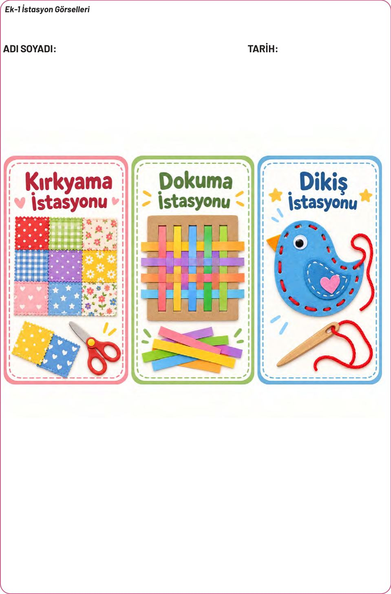

<!-- sayfa 78 -->

**ETKİNLİK ADI:** Dr. Hüseyin Parkan Sanlıkol Müzik Enstrümanları Müzesi
**ALAN ADI:** Matematik, Sanat, Müzik
**YAŞ GRUBU:** 48-60 ay

**ALAN BECERİLERİ, ÖĞRENME ÇIKTILARI VE SÜREÇ BİLEŞENLERİ**

**MATEMATİK ALANI**
**MAB4. Veri İle Çalışma ve Veriye Dayalı Karar Verme**
* **MAB11. Veriyle çalışabilme**
    * MAB11.c. Verileri benzer özelliklerine göre sınıflandırır.

**SANAT ALANI**
**SNAB4. Sanatsal Uygulama Yapma**
* **SNAB.4. Sanat etkinliği uygulayabilme**
    * SNAB.4.c. Sanat etkinliklerine aktif olarak katılır.
    * SNAB.4.ç. Sanat etkinliklerinde özgün ürünler oluşturur.

**MÜZİK ALANI**
**MDB1. Müziksel Dinleme**
* **MDB.2. Seslerin kaynağını anlayabilme**
    * MDB.2.a. Sesin kaynağını gösterir.
    * MDB.2.b. Sesin kaynağını söyler.
**MÇB3. Müziksel Çalma**
* **MÇB.1. Duyduğu sesleri / müzik eserlerini çalabilme**
    * MÇB.1.a. Çalgıların ismini söyler.

**EĞİLİMLER**
**E1. Benlik Eğilimleri**
* E1.1. Merak
**E3. Entelektüel Eğilimler**
* E3.2. Odaklanma
* E3.3. Yaratıcılık

**PROGRAMLAR ARASI BİLEŞENLER**

**Sosyal-Duygusal Öğrenme Becerileri**
* SDB2.1. İletişim
* SDB2.2. İş Birliği

**Değerler**
**D7. Estetik**
* D7.2. Sanatsal ve görsel zevkleri hayatın bir parçası hâline getirmek
**D14. Saygı**
* D14.3. Çevresine, millî ve manevi değerlerine saygı duymak
**D19. Vatanseverlik**
* D19.3. Ülke varlıklarına sahip çıkmak

**Okuryazarlık Becerileri**
**OB5. Kültür Okuryazarlığı**

**Kavramlar:** Duyu: sesli - sessiz
**Zıt:** aynı - benzer - farklı
**Sözcükler:** enstrüman, çalgı, ritim
**Materyaller:** bilgisayar / akıllı tahta, farklı müzik aletlerine ait ses kayıtları, resim kâğıdı, boya kalemleri, farklı kültürlere ait müzik aleti görselleri, telli - üflemeli - vurmalı çalgıları temsil eden üç farklı renkte kartlar, müzede çekilen müzik aleti fotoğrafları veya dijital görseller

**Eğitim / Öğrenme Ortamları:** Farklı kültürlere ait müzik aletlerinin görselleri sınıfın çeşitli yerlerine asılır. Ses dinletileri için bilgisayar, hoparlör veya akıllı tahta hazırlanır. Çocukların resim yapabilmeleri için masa düzeni oluşturulur; kâğıt ve boya kalemleri hazır bulundurulur Gezi sonrasında kullanılacak müzik aleti görselleri ile

<!-- sayfa 79 -->

**Matematik, Sanat ve Müzik ( Bütünleştirilmiş Büyük Grup)**

* Gezi öncesinde müzede yer alan bölümlerden biri seçilir. Çocuklar sınıfa geldiklerinde çalgılara ait sesler sırayla dinletilir. “Sizce bu sesi çıkaran nasıl bir müzik aleti olabilir?”, “Boyutu nasıl olabilir?”, “Hangi malzemeden yapılmış olabilir?”, “Sizce bu enstrüman nasıl çalınır?”, “Vurararak mı, üflererek mi, tellerine dokunarak mı ses çıkarır?” gibi sorular sorulur. Çocukların tahminleri dinlenir (E1.1, E3.2). Kâğıt ve boya kalemleri dağıtılarak dinledikleri sesi çıkaran müzik aletlerinin nasıl göründüğünü hayal etmeleri ve resmetmeleri istenir (**SNAB.4.c, SNAB.4.ç, E3.3**).
* Çocuklarla birlikte gezi sırasında uyulması gereken kurallar hakkında konuşulur. Gruptan ayrılmama, müze görevlisinin açıklamalarını dikkatle dinleme, müzedeki eserleri dikkatlice inceleyerek gözlem yapılması gerektiği birlikte belirlenir (**SDB2.2, D14.3, D19.3**).
* Gezi sırasında çocuklar müzenin etkileşimli ses sisteminin bulunduğu alanda toplanır. Farklı müzik aletlerine ait sesler sırayla dinletilir. Her sesin ardından çocuklardan müze içerisinde sesi çıkaran müzik aletini bulmaları için süre verilir (**MDB.2.a**). Süre sonunda sesin ait olduğu enstrümanın önünde toplanılarak müzik aletinin adı, özellikleri, ait olduğu bölge ve çalgı grubu (telli, vurmalı, üflemeli) incelenir (**MÇB.1.a**). Müzenin farklı bölümlerinde yer alan müzik aletleriyle aynı çalışma sürdürülür (**MDB.2.b, SDB2.1, D7.2**).
* Gezi sonrasında çocuklara müzede incelenen müzik aletleri hatırlatılır. Her çocuğa üç farklı renkte kart dağıtılır. Biri telli çalgıları, biri üflemeli çalgıları, diğeri ise vurmalı çalgıları temsil eder. Ardından müzede görülen müzik aletlerinin görselleri ya da dijital fotoğrafları sırayla gösterilir. Çocuklardan konuşmadan, yalnızca müzik aletinin ait olduğunu düşündükleri çalgı grubunu temsil eden renk kartını kaldırmaları istenir (**MAB.11.c, SDB2.2**). Müzeye gitmeden önce tahmin ederek çizdikleri müzik aletlerinin gerçek fotoğrafları yan yana yapıştırılır ve sergilenir. Benzerlik ve farklılıkları hakkında konuşulur (**OB5**).

**DEĞERLENDİRME**

* Bugün dinlediğin seslerden en çok hangisini beğendin?
* Müzede seni en çok şaşırtan müzik aleti hangisiydi? Neden?
* Aynı çalgı grubunda yer alan iki müzik aleti söyleyebilir misin?
* Sence hangi müzik aleti en yüksek sesi çıkarıyordu?
* Sen bir müzik aleti çalacak olsaydın hangisini seçerdin? Neden?

**FARKLILAŞTIRMA**

**Zenginleştirme:** Çocuklarla ilgi duydukları çalgı grubuna göre bir müzik topluluğu oluşturulabilir. Her grup seçtikleri çalgı grubunun sesini ritim araçları veya beden perküsyonu ile canlandırabilir. Son aşamada tüm gruplar bir araya gelerek ortak bir performans sergileyebilir.

**Destekleme:** Daha az sayıda müzik aletiyle çalışma yapılabilir. Gerektiğinde öğretmen tarafından sözel ipuçları verilerek veya model olunarak çocukların müzik aletlerini sesleriyle eşleştirmeleri ve telli, vurmalı, üflemeli çalgılar olarak sınıflandırmaları desteklenebilir.

**AİLE VE TOPLUM KATILIMI**

**Aile Katılımı:** Ailelerden çocuklarıyla farklı yörelere veya ülkelere ait müzikler dinlemeleri istenebilir. Müziklerde kullanılan müzik aletleri hakkında araştırma yapılarak sohbet edilebilir.

**Toplum Katılımı:** Bir müzisyen, müzik eğitmeni veya bir müzik aleti çalabilen bir kişi sınıfa davet edilebilir. Davetli, çaldığı müzik aletinin özelliklerini, hangi çalgı grubunda yer aldığını ve nasıl ses çıkardığını çocuklara tanıtabilir.

<!-- sayfa 80 -->

**ETKİNLİK ADI:** Ankara Devlet Tiyatrosu  
**ALAN ADI:** Sosyal, Sanat  
**YAŞ GRUBU:** 60-72 ay  

**ALAN BECERİLERİ, ÖĞRENME ÇIKTILARI VE SÜREÇ BİLEŞENLERİ**

**SOSYAL ALAN**  
**SBAB9. Coğrafi Gözlem ve Saha Çalışması**  
**SAB8. Coğrafi gözlem ve saha çalışmasını gerçekleştirebilmek için gerekli olan hazırlığı yapabilme**  
SAB8.a. Okul dışı öğrenme etkinlikleri kapsamında gidilecek mekân ve yapılacak çalışmalara yönelik görselleri inceler.

**SANAT ALANI**  
**SNAB2. Sanat Eseri İnceleme**  
**SNAB.2. Sanat eserini eleştirebilme**  
SNAB.2.e. Sanat eserine yönelik duygu ve düşüncelerini ifade eder.  
**SNAB3. Sanata Değer Verme**  
**SNAB.3. Sanatın önemini fark edebilme**  
SNAB.3.c. Dijital / gerçek sanat ortamlarını ziyaret eder.  
SNAB.3.ç. Dijital / gerçek sanat ortamlarında sergilenen eserleri inceler.  
**SNAB4. Sanatsal Uygulama Yapma**  
**SNAB.4. Sanat etkinliği uygulayabilme**  
SNAB.4.b. Sanat etkinliği için gerekli materyalleri seçer.  
SNAB.4.d. Sanat etkinliklerinde özgün ürünler oluşturur.

**EĞİLİMLER**  
**E3. Entelektüel Eğilimler**  
E3.2. Odaklanma  
E3.3. Yaratıcılık  

**PROGRAMLAR ARASI BİLEŞENLER**  
**Sosyal-Duygusal Öğrenme Becerileri**  
SDB2.3. Sosyal Farkındalık  
**Değerler**  
D7. Estetik  
D7.1. Duyusal derinliği anlamak  
**Okuryazarlık Becerileri**  
OB4. Görsel okuryazarlık  

**Kavramlar:** Duyu: sesli - sessiz  
**Sözcükler:** kültür, sanat, tiyatro  
**Materyaller:** Ankara Devlet Tiyatrosuna ait fotoğraflar, farklı tiyatro oyunlarına ait afişler, şapka, pelerin, maske, çeşitli kostüm aksesuarları, ad -soyad bilgileri ile okulun iletişim bilgilerinin yer aldığı yaka kartları  
**Eğitim / Öğrenme Ortamları:** Gezi öncesinde çocukların güvenliğini sağlamak amacıyla üzerinde ad - soyad bilgileri ile okulun iletişim bilgilerinin yer aldığı yaka kartları hazırlanır. Ankara Devlet Tiyatrosuna ait fotoğraflar ile farklı tiyatro oyunlarına ait afişler gezi öncesinde kullanılmak üzere hazırlanır. Gezi sonrasında gerçekleştirilecek drama etkinliği için sınıfta küçük bir sahne alanı hazırlanır ve çocukların kullanabilecekleri

<!-- sayfa 81 -->

**ETKİNLİKLER**

**Sosyal, Sanat (Bütünleştirilmiş Büyük Grup Etkinliği)**
* Çocuklara Ankara Devlet Tiyatrosunu ziyaret edecekleri söylenir. Ardından farklı tiyatro oyunlarına ait afişler ile Ankara Devlet Tiyatrosu’na ait fotoğraflar çocuklarla birlikte incelenir. Tiyatronun, oyuncuların sahnede farklı karakterleri canlandırarak hikâyeler anlattıkları bir gösteri türü olduğu açıklanır. Sahne, perde ve oyuncu kavramları çocuklara tanıtılır. Sahnenin oyunun sergilendiği alan olduğu, oyuncuların burada farklı karakterleri canlandırdığı, perdenin oyunun başlangıcında açılıp sonunda kapandığı açıklanır. Çocuklara, bugün bu bölümlerin tamamını ziyaret edecekleri söylenir (**SAB.8.a, OB4**).
* Ardından çocuklarla tiyatro salonunda uyulması gereken kurallar konuşulur. Oyun sırasında sessiz olunması, oyun sırasında yerlerinden kalkılmaması, oyuncuların dikkatini dağıtacak davranışlardan kaçınılması ve oyunun sonunda oyuncuların alkışlanmasının tiyatro izleme kültürünün bir parçası olduğu açıklanır (**SDB2.3**).
* Gezi sırasında çocukların dikkatleri sahne, perde, seyirci koltukları ve ışık sistemlerine çekilerek bu bölümler tanıtılır. Çocuklara oyuncuların canlandıracakları karaktere uygun kostümler giydikleri, kullandıkları dekorların hikâyenin geçtiği yeri gösterdiği ve sahnedeki eşyaların oyunun daha gerçekçi görünmesine yardımcı olduğu açıklanır (**SNAB.3.c**). Çocuklar salondaki yerlerini aldıktan sonra tiyatro oyunu birlikte izlenir (**E3.2**). Oyun süresince çocukların karakterlerin mimiklerini, ses tonlarını, hareketlerini, kullandıkları kostümleri ve sahnede kullanılan dekorları dikkatle gözlemlemeleri desteklenir (**SNAB.3.ç**). Oyun sonunda oyuncular alkışlanır. Mümkün olması durumunda çocukların oyuncularla kısa süreli tanışmaları ve tiyatro hakkında merak ettikleri konuları dinlemeleri sağlanabilir.
* Gezi sonrasında çocukların oyunda en çok dikkatlerini çeken karakterler, olaylar ve sahneler üzerine sohbet edilir (**SNAB.2.e, D7.1**). Çocuklar küçük gruplara ayrılır. Ardından sınıfta küçük bir tiyatro sahnesi hazırlanır. Her grup tiyatro oyununda akıllarında kalan bir sahneyi seçerek kendi aralarında rol paylaşımı yapar. Şapka, maske ve benzeri basit kostüm materyallerinden yararlanarak seçtikleri sahneyi canlandırırlar (**SNAB.4.b, SNAB.4.d, E3.3**). Çocukların karakterleri ses tonu, mimik ve beden hareketleriyle ifade etmeleri konusunda rehberlik edilir. Canlandırmalar tamamlandıktan sonra her grup, arkadaşlarının alkışlarıyla sahneden ayrılır.

**DEĞERLENDİRME**
* Tiyatroda hangi bölümleri gördünüz?
* İzlediğiniz oyunda en çok hangi karakter dikkatinizi çekti? Neden?
* Oyuncular canlandırdıkları karakterleri nasıl anlattılar?
* Oyuncuların kullandıkları kostüm ve dekorlardan hangilerini hatırlıyorsunuz?
* Sahne ile seyircilerin oturduğu bölüm arasında nasıl bir fark vardı?
* Tiyatro oyunu izlerken hangi kurallara dikkat ettiniz?
* Canlandırma yaparken hangi karakteri ya da sahneyi seçtiniz?
* Seçtiğiniz karakteri canlandırırken sesinizi, yüz ifadelerinizi veya hareketlerinizi nasıl kullandınız?
* Tiyatro gezisinde en çok hangi bölüm hoşunuza gitti? Neden?

**FARKLILAŞTIRMA**

**Zenginleştirme:** Çocuklara farklı tiyatro türlerine (kukla tiyatrosu, gölge oyunu, müzikal ve çocuk tiyatrosu v.b.) ait görseller ve kısa video kesitleri sunulabilir. Çocukların bu gösterileri karşılaştırmaları, kullanılan kostüm, dekor ve kukla gibi özellikler hakkında sohbet etmeleri desteklenebilir.

**Destekleme:** Rol paylaşımı sırasında öğretmen rehberliğinde uygun roller çocuklara önerilebilir. İsteyen çocukların canlandırmaya bir arkadaşlarıyla birlikte katılmaları sağlanabilir.

**AİLE VE TOPLUM KATILIMI**

**Aile Katılımı:** Ailelerden çocuklarıyla bir çocuk tiyatrosu izlemeleri veya ev ortamında kısa bir hikâyeyi birlikte canlandırmaları istenebilir. Canlandırma sırasında basit kostüm ve evde bulunan materyallerden yararlanarak farklı karakterler oluşturmaları desteklenebilir.

**Toplum Katılımı:** Toplum katılımı kapsamında tiyatro sanatçıları ve sahne arkasında görev yapan çalışanlar

<!-- sayfa 82 -->

**ETKİNLİK ADI:** Ekmek Fabrikası
**ALAN ADI:** Türkçe, Fen, Sosyal
**YAŞ GRUBU:** 60-72 ay

**ALAN BECERİLERİ, ÖĞRENME ÇIKTILARI VE SÜREÇ BİLEŞENLERİ**

**TÜRKÇE ALANI**
**TAOB. Okuma**
**TAOB.1. Resimli öykü kitabı, dijital içerikler, afiş, broşür gibi görsel okuma materyallerini seçebilme**
**TAOB.1.a.** Görsel okuma materyallerini inceler.

**FEN ALANI**
**FBAB7. Deney Yapma**
**FAB.7. Merak ettiği konular / olay / durum hakkında deneyler yapabilme**
**FAB.7.c.** Deney sonucunda gözlemlediği durumu ifade eder.

**SOSYAL ALAN**
**SBAB9. Coğrafi Gözlem ve Saha Çalışması**
**SAB.8. Coğrafi gözlem ve saha çalışmasını gerçekleştirebilmek için gerekli olan hazırlığı yapabilme**
**SAB.8.b.** Okul dışı öğrenme etkinliklerinde kendi güvenliğini ve sağlığını korumak için dikkat edilmesi gereken hususları söyler.
**SAB.9. Coğrafi gözlem ve okul dışı planlanan çalışmaları çevreye duyarlı biçimde uygulayabilme**
**SAB.9.a.** Okul dışı öğrenme etkinliğinde takip edilecek sözel / görsel yönergeleri uygular.
**SAB.10. Coğrafi gözlem ve çalışma sahasından elde edilen sonuçları sözel/görsel yolla sunabilme**
**SAB.10.a.** Okul dışı öğrenme etkinliğinde elde ettiği materyallerden ürün oluşturur.

**EĞİLİMLER**
**E1. Benlik Eğilimleri**
**E1.1.** Merak
**E3. Entelektüel Eğilimler**
**E3.8.** Soru Sorma

**PROGRAMLAR ARASI BİLEŞENLER**
**Sosyal-Duygusal Öğrenme Becerileri**
**SDB2.3.** Sosyal Farkındalık

**Değerler**
**D19. Vatanseverlik**
**D19.3.** Ülke varlıklarına sahip çıkmak

**Kavramlar:** Duyu: taze - bayat
**Sözcükler:** un, hamur, simit, ürün, fiyat, fabrika, deney
**Materyaller:** “unun var mı?” öykü kitabı, ekmek ve unlu mamullerin üretim aşamalarını gösteren görseller, farklı ekmek ve unlu mamul görselleri, A3 veya A4 boyutunda poster kâğıtları, renkli kalemler, pastel boya veya keçeli kalemler, yapıştırıcı, makas

**Eğitim / Öğrenme Ortamları:** Gezi öncesinde çocukların güvenliğini sağlamak amacıyla, üzerinde çocukların ad-soyad bilgileri ile okulun iletişim bilgilerinin yer aldığı yaka kartları hazırlanır ve gezi süresince çocukların yakalarına takılır. Gezi sonrası yapılacak etkinlik için ekmek üretim sürecini temsil edecek üç masa hazırlanır. Birinci masa hamurun hazırlanması aşamasını, ikinci masa yoğurma ve mayalanma aşamasını, üçüncü masa ise pişirme ve ürün aşamasını temsil edecek şekilde düzenlenir. Ayrıca ekmek ve unlu mamullerin üretim aşamalarına ve ürün çeşitlerine ilişkin görseller ile poster çalışmasına uygun materyaller önceden hazırlanır.

<!-- sayfa 83 -->

# ETKİNLİKLER

**Türkçe, Fen, Sosyal (Bütünleştirilmiş Büyük Grup Etkinliği)**

* Gezi öncesinde çocuklara birlikte ekmek fabrikasını ziyaret edecekleri söylenir. “Sence bir ekmek soframıza gelene kadar hangi aşamalardan geçiyor olabilir?” ve “Ekmek fabrikasında neler üretiliyor olabilir?” soruları yöneltilerek çocukların cevapları dinlenir (E1.1).
* Ardından 365 Gün Öykü Serisi’nde yer alan “Unun Var Mı?” adlı öykü kitabı etkileşimli olarak okunur. Okuma öncesinde kitabın kapağı çocuklarla birlikte incelenerek çocuklara “Sence bu kitapta neden söz ediliyor olabilir? Un hangi besinden elde edilir? Un kullanılarak hangi yiyecekler yapılabilir?” soruları sorulur. Okuma sırasında buğdayın değirmende una dönüşmesini gösteren görsellere dikkat çekilir. Çocuklardan sürecin sonraki aşamalarını tahmin etmeleri istenir. Unun maya, su ve tuzla karıştırıldığında ekmek, pide, lavaş ve bazlamaya, yumurta, şeker ve sütle karıştırıldığında farklı yiyeceklere dönüşebileceği hakkında konuşulur. “Sence una bu malzemeler eklenince ne olacak? Sen olsaydın unu kullanarak ne yapmak isterdin?” sorularıyla çocukların öyküye katılımları desteklenir. Öykü sonrasında buğdayın tarladan toplanarak değirmende öğütülmesi, un hâline gelmesi, hazırlanan hamurun şekillendirilip pişirilmesi ve ekmeğe dönüşmesi aşamaları çocuklarla birlikte sıralanır (TAOB.1.a.). Ardından çocuklara ziyaret sırasında ekmek üretiminin hangi aşamalarını gözlemleyecekleri açıklanır.
* Gezi öncesinde çocuklara uyulması gereken bazı kuralların olduğu söylenir. Gezi boyunca gruptan ayrılmadan hareket edilmesi, üretim alanındaki araç ve gereçlere izinsiz dokunulmaması ve çalışanların yönlendirmelerine uyulmasının önemi üzerinde durulur (SAB.8.b, SDB2.3).
* Gezi sırasında üretim alanlarına geçmeden önce çocuklara burada görebilecekleri ve duyabilecekleri şeyler hakkında kısa bir açıklama yapılır. “Birazdan büyük fırınların ve makinelerin olduğu bölüme geçeceğiz. Fırınlar çok sıcak çalışıyor, makineler de biraz gürültü çıkarabiliyor. Birlikte dikkatlice gezeceğiz.” denilerek çocukların karşılaşacakları ortamı önceden bilmeleri sağlanır.
* Ardından çocuklar görevli eşliğinde üretim alanlarını gezmeye başlar. Üretim alanları sırasıyla gezilirken unun hazırlanması, hamurun yoğurulması, mayalanması, şekillendirilmesi ve pişirilmesi aşamaları gözlemlenir. Çocukların dikkatleri her aşamada meydana gelen değişikliklere çekilir. Hamurun yoğrulmadan önceki ve sonraki görünümü, mayalanma sonrasında oluşan değişiklikler ve pişirme işlemi sonrasındaki farklılıklar üzerine gözlem yapmaları desteklenir.
* Üretim sürecinde kullanılan araç, gereç ve makineler incelenir. Çocukların gözlemledikleri araçların ne işe yaradığına ilişkin tahminlerini paylaşmalarına ve görevlinin açıklamalarını dinleyerek düşüncelerini yeniden değerlendirmelerine fırsat verilir.
* Gezinin devamında fabrikada üretilen farklı ekmek ve unlu mamuller incelenir. Simidin ülkemizde yaygın olarak tüketilen geleneksel unlu mamullerden biri olduğu söylenir (D19.3). Ardından çocukların dikkatleri farklı unlu mamullerin benzer ve farklı özelliklerine çekilir. “Sence bu ürünlerin birbirinden farklı olmasının nedeni ne olabilir?” sorusuyla çocukların gözlemlerini ifade etmeleri istenir (E1.1). Daha sonra simit hamurunun hazırlanması, şekillendirilmesi ve pişirilme aşamaları görevli tarafından tanıtılır. Uygun ve güvenli koşullar sağlanması durumunda çocukların simit hamuruna şekil verme sürecini deneyimlemelerine fırsat tanınabilir (SAB.9.a, SAB.10.a). Çocuklar fabrikada görev yapan çalışanlarla tanışır. Fırıncılar ve diğer çalışanlar yaptıkları işleri çocuklara tanıtır. Çocukların üretim süreci ve mesleklerle ilgili merak ettikleri soruları çalışanlara yöneltmeleri desteklenir (E3.8). Çocuklara fabrikada üretilen ekmek ve unlu mamullerin fırınlarda satıldığı söylenir.
* Gezi sonrası çocuklarla “Ekmeğe Ne Olur?” deneyi gerçekleştirilir. Sınıfa aynı ekmekten alınmış iki dilim getirilir. Dilimlerden biri ağzı kapalı bir poşete, diğeri ise açık bir tabağa yerleştirilir. Çocuklardan ekmek dilimlerinin yumuşaklık, koku ve görünüm özelliklerini dokunmadan gözlemlemeleri ve zamanla dilimlerde nasıl bir değişiklik olabileceğini tahmin etmeleri istenir. Tahminler kaydedildikten sonra ekmekler sınıfın uygun bir bölümünde birkaç gün bekletilir. Her gün aynı saatte ekmeklerin görünümündeki ve sertliğindeki değişiklikler gözlemlenir. Çocuklar gözlemlerini arkadaşlarıyla paylaşır (FAB.7.c).

# ĞERLENDİRME

* Ekmeğin hazırlanma sürecinde en çok hangi bölüm zor veya kolay görünüyordu?
* Eğer sen ekmek yapım sürecinde bir görev alsaydın bu hangi aşama olurdu, neden?
* Hamurun üretim sürecinde nasıl değiştiğini anlatır mısın?
* Gezi sırasında öğrendiğin yeni bir bilgiyi paylaşır mısın?
* Masada hazırlanan ekmek üretim sürecinin hangi kısmında görev aldın?

<!-- sayfa 84 -->

# FARKLILAŞTIRMA
**Zenginleştirme:** Öğrenme ortamında farklı unlu mamul çeşitlerinin (ekmek, simit, pide vb.) üretim süreçlerine ait görsellerle bir “Üretim Süreci Merkezi” oluşturulabilir. Çocukların bu ürünlerin üretim aşamalarını karşılaştırmaları, benzerlik ve farklılıkları keşfetmeleri ve süreçleri ilişkilendirmeleri desteklenebilir.

**Destekleme:** Ekmek üretim aşamaları için ek açıklamalar yapılır ve üretim süreci somut örneklerle yeniden anlatılır. Görsel destekler artırılarak hamur, un ve ekmek aşamaları bireysel olarak tekrar incelenir. Çocuklar deney sırasındaki gözlemlerini resim çizerek ifade edebilir.

# AİLE VE TOPLUM KATILIMI
**Aile Katılımı:** Ailelerden çocuklarıyla birlikte evde un kullanarak bir ürün hazırlamaları istenebilir.

<!-- sayfa 85 -->

**ETKİNLİK ADI:** Geri Dönüşüm Merkezi
**ALAN ADI:** Sosyal, Fen
**YAŞ GRUBU:** 60–72 ay

**ALAN BECERİLERİ, ÖĞRENME ÇIKTILARI VE SÜREÇ BİLEŞENLERİ**

**SOSYAL ALAN**
**SBAB9. Coğrafi Gözlem ve Saha Çalışması**
**SAB.8. Coğrafi gözlem ve saha çalışmasını gerçekleştirebilmek için gerekli olan hazırlığı yapabilme**
* SAB.8.a. Okul dışı öğrenme etkinlikleri kapsamında gidilecek mekân ve yapılacak çalışmalara yönelik görselleri inceler.
* SAB.8.b. Okul dışı öğrenme etkinliklerinde kendi güvenliğini ve sağlığını korumak için dikkat edilmesi gereken hususları söyler.

**SAB.10. Coğrafi gözlem ve çalışma sahasından elde edilen sonuçları sözel/ görsel yolla sunabilme**
* SAB.10.a. Okul dışı öğrenme etkinliğinde elde ettiği materyallerden ürün oluşturur.
* SAB.10.b. Okul dışı öğrenme etkinliğinde oluşturduğu ürünleri sözel ya da görsel olarak sunar.

**FEN ALANI**
**FBAB1. Bilimsel Gözlem**
**FAB.1. Günlük yaşamında fenle ilgili olaylara / olgulara ve durumlara yönelik bilimsel gözlem yapabilme**
* FAB.1.a. Çevresinde merak ettiği nesne / olay / olguları odaklanarak gözlemler.
* FAB.1.b. Gözlemlediği nesne / olay / olguların betimsel / fiziksel özelliklerini ayrıntılı olarak tanımlar.

**EĞİLİMLER**
**E1. Benlik Eğilimleri**
**E1.1. Merak**

**PROGRAMLAR ARASI BİLEŞENLER**
**Sosyal-Duygusal Öğrenme Becerileri**
**SDB2.3. Sosyal Farkındalık**

**Değerler**
**D5. Duyarlılık**
* D5.2. Çevreye ve canlılara değer vermek

**Okuryazarlık Becerileri**
**OB4. Görsel Okuryazarlık**
**OB8. Sürdürülebilirlik Okuryazarlığı**

**Kavramlar:** Zıt: aynı - farklı - benzer
**Sözcükler:** geri dönüşüm merkezi, dönüşüm, sembol, geri dönüşüm kutusu, çevre kirliliği
**Materyaller:** plastik, cam, metal, kâğıt ve karton gibi farklı geri dönüştürülebilir materyaller, geri dönüşüm merkezine ait fotoğraflar, geri dönüşüm kutularını ve sembollerini gösteren görseller, boş kutu, gezi sonrasında yapılacak etkinlikte kullanılacak atık materyaller (plastik kapaklar, karton kutular, tuvalet kâğıdı ruloları, yumurta kolileri, pet şişeler, gazete ve dergi kâğıtları, kumaş parçaları vb.), Atık Gözlem Kağıdı (Ek-1)

**Eğitim / Öğrenme Ortamları:** Çocukların gezi sürecinde güvenliklerini sağlamak amacıyla üzerinde ad - soyad bilgilerinin ve okul iletişim bilgilerinin yer aldığı yaka kartları hazırlanır. Gezi öncesinde kullanılmak üzere farklı atık materyaller, geri dönüşüm merkezine ve geri dönüşüm kutularına ait görseller sınıfta incelemeye uygun şekilde düzenlenir. Sınıfta gruplanan atık materyaller geri dönüşüm merkezine götürülmek üzere hazırlanır. Gezi sonrasında gerçekleştirilecek etkinlik için sınıfta grup çalışmasına uygun masalar hazırlanır. Masalara...

<!-- sayfa 86 -->

# ETKİNLİKLER

## Sosyal, Fen (Bütünleştirilmiş Küçük Grup Etkinliği)

* Gezi öncesi çocuklara plastik, cam, metal, kâğıt ve karton gibi farklı atık materyaller gösterilir. “Bu materyalleri daha önce hangi amaçla kullanıyorduk? Sizce artık işimiz bittiyse bunları hemen çöpe mi atmalıyız? Bu materyalleri yeniden kullanabilir miyiz? Nasıl değerlendirebiliriz?” soruları yöneltilir (E1.1). Çocukların görüşlerinin ardından materyaller birlikte incelenir. Çocuklara kullanılan birçok materyalin işi bittikten sonra hemen çöpe atılmak yerine yeniden kullanılabileceği söylenir. Eşyaları gereksiz yere atmamanın, yeniden değerlendirmenin hem atık miktarını azalttığı hem de doğal kaynakların korunmasına katkı sağladığı açıklanır (D5.2). Ardından çocuklara geri dönüşüm merkezini ziyaret edecekleri söylenir. Geri dönüşüm merkezine ait fotoğraflar çocuklarla birlikte incelenir (SAB.8.a, OB4). Fotoğrafların incelenmesinin ardından geri dönüşüm sürecinde atıkların önce türlerine göre ayrıldığı söylenir. Materyallerin yapıldıkları malzemelerin birbirinden farklı olduğuna dikkat çekilir (FAB.1.a). Bazılarının cam ve sert olduğu, bazılarının kâğıt, karton ya da plastik gibi daha esnek olduğu açıklanır. Daha sonra çocuklardan bu benzer özelliklerden yararlanarak materyalleri birlikte gruplandırmaları istenir. Çocuklarla birlikte ayrıştırılan materyaller gezi sırasında geri dönüşüm merkezine götürülmek üzere uygun kutulara yerleştirilir (FAB.1.b).
* Ardından çocuklarla birlikte gezi sırasında uyulması gereken kurallar gözden geçirilir. Çocukların gruptan ayrılmaması, makinelere izinsiz yaklaşmaması, görevlilerin yönlendirmelerine uyması ve gözlem yaparken güvenli davranmaları gerektiği söylenir (SAB.8.b, SDB2.3).
* Gezi sırasında geri dönüşüm alanına geçmeden önce çocuklara burada karşılaşabilecekleri ortam hakkında kısa bir açıklama yapılır. “Birazdan büyük makinelerin olduğu bir bölüme geçeceğiz. Bu makineler atıkları sıkıştırırken ve yeni bir şekle dönüştürürken biraz gürültülü sesler çıkarabilir. Makineler çok büyük görünebilir ama biz onları güvenli bir mesafeden birlikte izleyeceğiz.” denilerek çocukların görecekleri ve duyacakları şeylere ilişkin önceden bilgi sahibi olmaları sağlanır.
* Ardından geri dönüşüm merkezi görevli eşliğinde gezilir. Çocukların dikkatleri farklı atık türlerinin toplandığı alanlara çekilir. Plastik, cam ve kâğıt atıkların birbirinden nasıl ayrıldığı gözlemlenir. Çocukların geri dönüşüm sürecinde kullanılan makineleri güvenli bir mesafeden incelemelerine fırsat verilir. Geri dönüştürülmüş ürünlerden örnekler gösterilir ve bu ürünlerin daha önce kullanılmış malzemelerin yeniden değerlendirilmesiyle elde edildiği açıklanır (D5.2). Çocuklardan gözlemledikleri ürünlerin hangi malzemelerden yapılmış olabileceğini tahmin etmeleri istenir.
* Ardından geri dönüşüm kutularının renkleri ve üzerlerindeki semboller birlikte incelenir. Kutuların üzerindeki görsellerden ve sembollerden yararlanılarak hangi malzemelerin hangi kutuya bırakılabileceği hakkında konuşulur (OB8).
* Gezi sonrasında sınıfta geri dönüştürülebilir materyaller (plastik kapaklar, karton kutular, tuvalet kâğıdı ruloları, yumurta kolileri, pet şişeler, gazete ve dergi kâğıtları, kumaş parçaları vb.) çocukların inceleyebileceği şekilde hazırlanır. Çocuklar küçük gruplara ayrılır. Her grup seçtiği artık materyalleri kullanarak yeni bir ürün tasarlar. Çocuklar tasarım sürecinde materyalleri hangi amaçla seçtiklerini ve ürünlerini nasıl oluşturduklarını açıklar (SAB.10.a, SAB.10.b).

## DEĞERLENDİRME

* Geri dönüşüm merkezinde en çok hangi bölümü incelemek hoşuna gitti? Neden?
* Gezi sırasında hangi atık türlerini gördük?
* Plastik, cam, metal, kâğıt ve karton atıkları neden ayrı kutulara koyuyoruz?
* Geri dönüşüm kutularının üzerindeki semboller bize ne anlatıyor?
* Geri dönüşüm merkezinde gördüğün makineler ne işe yarıyordu?
* Geri dönüştürülmüş ürünlerden hangilerini hatırlıyorsun?
* Sence bir pet şişe ya da kâğıt çöpe atılmak yerine nasıl yeniden değerlendirilebilir?
* Eğer geri dönüşüm yapılmazsa çevremizde neler olabilir?
* Artık materyalleri kullanarak yaptığın ürünün adı nedir?

<!-- sayfa 87 -->

# FARKLILAŞTIRMA

**Zenginleştirme:** Gezi sırasında gözlemledikleri geri dönüştürülmüş ürünlerden birini seçmeleri ve bu ürünün hangi atık materyallerden üretildiğini tahmin etmeleri istenebilir. Gezi sonrasında sınıfta plastik, cam ve kâğıt atıklara ilişkin ayrı grafikler hazırlanabilir. Çocukların gezi sırasında gözlemledikleri atık türlerine göre grafikleri oluşturmaları, grafikleri karşılaştırmaları ve elde ettikleri verilerden çıkarım yapmaları istenebilir.

**Destekleme:** Materyaller tek tek incelenerek ek açıklamalar yapılabilir. Çocukların materyalleri dokunarak, inceleyerek ve karşılaştırarak gruplandırmaları konusunda bireysel rehberlik sağlanabilir. Tasarım etkinliğinde, çocuklara materyal seçimi ve birleştirme sürecinde bireysel yardım edilebilir. Gerekli durumlarda çocukların ikili ya da küçük gruplar hâlinde ortak bir ürün oluşturmaları desteklenebilir.

# AİLE VE TOPLUM KATILIMI

**Aile Katılımı:** Aile katılımı kapsamında “Evimizdeki Atıkları Gözlemliyoruz” (Ek - 1) adlı atık gözlem kâğıdı hazırlanarak ailelere gönderilebilir. Ailelerden, belirlenen süre boyunca çocuklarıyla birlikte evde oluşan geri dönüştürülebilir atıkları kâğıt, plastik, cam ve metal olarak ayırmaları ve her atık türünün miktarını gözlem kâğıdına kaydetmeleri istenebilir. Süre sonunda aileler çocuklarıyla birlikte kayıtları inceleyerek evlerinde en fazla hangi tür atığın oluştuğunu belirleyebilir. Tamamlanan gözlem kâğıdı, çocuğun sınıfta arkadaşlarıyla paylaşması için okula gönderilebilir.

<!-- sayfa 88 -->

Ek-1 Evimizdeki Atıkları Ayrıştırıyoruz

ADI SOYADI:                                          TARİH:

Bir hafta boyunca evimizde oluşan atıkları ailemizle birlikte türlerine göre ayıralım. Her gün oluşan atıkların sayısını ilgili kutucuğa yazalım. En fazla ve en az oluşan atık türü hangisi oldu, konuşalım.

| GÜNLER | PLASTİK | KÂĞIT | CAM | METAL | ORGANİK |
| :--- | :---: | :---: | :---: | :---: | :---: |
| PAZARTESİ | | | | | |
| SALI | | | | | |
| ÇARŞAMBA | | | | | |
| PERŞEMBE | | | | | |
| CUMA | | | | | |
| CUMARTESİ | | | | | |
| PAZAR | | | | | |

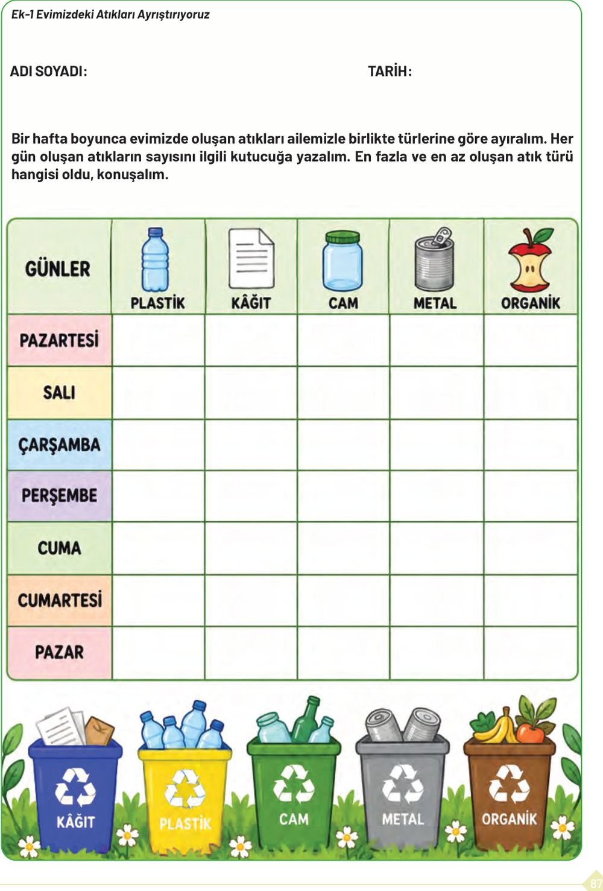

<!-- sayfa 89 -->

**ETKİNLİK ADI:** Konya Tropikal Kelebek Bahçesi
**ALAN ADI:** Fen, Sosyal, Sanat
**YAŞ GRUBU:** 60-72 ay

**ALAN BECERİLERİ, ÖĞRENME ÇIKTILARI VE SÜREÇ BİLEŞENLERİ**

**FEN ALANI**
**FBAB2. Sınıflandırma**
**FAB.2. Fene yönelik nesne, olayları / olguları benzerlik ve farklılıklarına göre sınıflandırabilme**
FAB.2.a. Nesne / olay / olguların gözlemlenebilir özelliklerini karşılaştırarak söyler.

**FBAB4. Bilimsel Veriye Dayalı Tahmin**
**FAB.4. Fene yönelik olay ve / veya olgular hakkında bilimsel veriye dayalı tahminlerde bulunabilme**
FAB.4.a. Elde ettiği verilerden ve ön bilgilerinden hareketle tahminde bulunur.

**FBAB8. Bilimsel Çıkarım Yapma**
**FAB.8. Günlük hayatındaki fene yönelik olaylar hakkında gözlemlerine dayalı basit düzeyde bilimsel çıkarımlar yapabilme**
FAB.8.a. Canlı / cansız varlıkların niteliklerine ilişkin gözlemlerinden sonuçlar çıkarır.

**SOSYAL ALAN**
**SBAB9. Coğrafi Gözlem ve Saha Çalışması**
**SAB.8. Coğrafi gözlem ve saha çalışmasını gerçekleştirebilmek için gerekli olan hazırlığı yapabilme**
SAB.8.a. Okul dışı öğrenme etkinlikleri kapsamında gidilecek mekân ve yapılacak çalışmalara yönelik görselleri inceler.
SAB.8.b. Okul dışı öğrenme etkinliklerinde kendi güvenliğini ve sağlığını korumak için dikkat edilmesi gereken hususları söyler.

**SAB.10. Coğrafi gözlem ve çalışma sahasından elde edilen sonuçları sözel / görsel yolla sunabilme**
SAB.10.a. Okul dışı öğrenme etkinliğinde elde ettiği materyallerden ürün oluşturur.

**SANAT ALANI**
**SNAB4. Sanatsal Uygulama Yapma**
**SNAB4. Sanat etkinliği uygulayabilme**
SNAB.4.d. Sanat etkinliklerinde özgün ürünler oluşturur.

**EĞİLİMLER**
**E1. Benlik Eğilimleri**
E1.1. Merak

**PROGRAMLAR ARASI BİLEŞENLER**
**Sosyal-Duygusal Öğrenme Becerileri**
SDB2.3. Sosyal Farkındalık

**Değerler**
**D5. Duyarlılık**
D5.2. Çevreye ve canlılara değer vermek

**Okuryazarlık Becerileri**
OB4. Görsel Okuryazarlık

**Kavramlar:** Boyut: büyük - orta - küçük
Duyu: sıcak - soğuk - ılık
Zıt: aynı - farklı - benzer

**Sözcükler:** değişim, tropikal, desen, kanat, koza

**Materyaller:** boya kalemleri, çocuk sayısı kadar kelebek görsellerinin olduğu kâğıtlar, farklı kelebek görselleri, Konya Tropikal Kelebek Bahçesine ait görseller, kelebek boyama sayfası (Ek-1)

**Eğitim / Öğrenme Ortamları:** Sınıfta gezi öncesi gösterilmek amacıyla kelebeklerin yaşam döngüsünün olduğu bir görsel hazırlanır. Gezi öncesinde çocukların güvenliğini sağlamak amacıyla, üzerinde çocukların ad - soyad bilgileri ile okulun iletişim bilgilerinin yer aldığı yaka kartları hazırlanır ve gezi süresince çocukların yakalarına takılır. Gezi sonrasında çocuk sayısı kadar ekte yer alan çalışmalar hazırlanır.

<!-- sayfa 90 -->

# ETKİNLİKLER

## Fen, Sosyal, Sanat (Bütünleştirilmiş Büyük Grup Etkinliği)

* Gezi öncesinde çocukların dikkatleri kelebek görsellerine çekilir. Çocuklara “Bir kelebek sizce nasıl oluşur?”, “Kelebek her zaman aynı görünümde mi olur?” soruları sorulur (FAB.4.a, E1.1, OB4). Ardından kelebeğin yaşam döngüsüne ait görsel çocukların inceleyebileceği şekilde sunulur. Çocuklardan görselleri inceleyerek yaşam döngüsünün aşamalarını sıralamaları istenir. Süreç içerisinde yumurta, tırtıl, koza ve kelebek evrelerine dikkat çekilerek meydana gelen değişiklikleri fark etmeleri sağlanır (OB4).
* Çocuklara “Sizce kelebekler nerelerde yaşar?” sorusu yöneltilir (E1.1). Çocukların fikirlerini paylaşmaları için fırsat verilir. Ardından kelebeklerin yaşayabilmeleri için nelere ihtiyaç duyabilecekleri üzerine sohbet edilir. Çocukların paylaşımlarından hareketle kelebeklerin; çiçeklerin, bitkilerin ve ağaçların bulunduğu yaşam alanlarında yaşadıkları söylenir. Bazı kelebek türlerinin sıcak bölgelerde yaşadığı belirtilir. “Bu kelebekleri yakından gözlemleyebilmek için nasıl bir ortam hazırlanmış olabilir?” sorusu yöneltilerek çocukların tahminleri alınır (FAB.4.a).
* Çocuklara kelebekleri ve yaşadıkları ortamları yakından inceleyebilmek için Konya Tropikal Kelebek Bahçesini ziyaret edecekleri söylenir. Ardından buraya ait fotoğraflar çocuklarla paylaşılır (SAB.8.a). Çocuklara kelebek bahçesinde uyulması gereken kurallar söylenir. Gezi boyunca gruptan ayrılmadan birlikte hareket edilmesi, kelebeklere ve bitkilere zarar vermeden gözlem yapılması gerektiği söylenir. Çocukların ifadelerinden hareketle hem kendi güvenliklerini hem de canlıların yaşam alanlarını korumak için kurallara uymanın önemi vurgulanır (SAB.8.b, SDB2.3, D5.2).
* Bahçeye girmeden önce çocuklara burada karşılaşabilecekleri ortam ve kelebeklerle nasıl etkileşim kurabilecekleri hakkında kısa bir açıklama yapılır. “Birazdan kelebeklerin yaşadığı özel bir bahçeye gireceğiz. Kelebekler sıcak ve nemli havayı çok sever. İçeri girdiğimizde banyodan çıktıktan sonraki gibi sıcak ve biraz nemli hissedebiliriz.” denilerek çocukların ortamın duyusal özelliklerine hazırlanmaları sağlanır.
* Ardından “Bazı kelebekler bizi merak edip omzumuza, kolumuza ya da kıyafetimize konabilir. Böyle bir durumda çiçek ya da heykel gibi sakin durup kelebeğin ne kadar hafif olduğunu hissedebiliriz. Kelebeğe dokunmadan, onun kendiliğinden uçmasını bekleriz.” açıklaması yapılır.
* Gezi sırasında bahçeye girişte çocuklara ortamı incelemeleri için zaman verilir. Çocukların dikkatleri uçuşan kelebeklere, tropikal bitkilere ve ortamın sıcak ve nemli olmasına çekilir. Çocuklardan gözlemledikleri kelebeklerin renkleri, büyüklükleri, kanatlarındaki desenler ve üzerinde ya da yakınında bulundukları bitkiler hakkında gözlemlerini paylaşmaları istenir.
* Gezi süresince çocuklar görevli eşliğinde bahçenin farklı bölümlerini gezer. Kelebeklerin yaşam döngüsüne ilişkin gözlem alanları incelenir. Çocukların sınıfta inceledikleri yaşam döngüsü görselleri ile karşılaştıkları örnekler arasında ilişki kurmaları ve benzerlikleri fark etmeleri sağlanır. “Tırtıl, koza ve kelebek evrelerinden hangilerini görebiliyorsunuz? Kelebeklerin çevresinde hangi bitkiler bulunuyor?” gibi sorularla çocukların gözlemlerini ifade etmelerine fırsat verilir. Çocukların dikkatleri kelebeklerin renklerine, kanat desenlerine, büyüklüklerine ve hareketlerine yönlendirilir. Çocuklardan gözlemledikleri kelebeklerin benzer ve farklı özelliklerini paylaşmaları istenir. Kelebeklerin hangi bitkilerin üzerinde bulundukları ve nasıl hareket ettikleri üzerine sohbet edilir (FAB.2.a).
* Gezi sonrasında çocuklarla sınıfta gezi deneyimi üzerine sohbet edilir. “Bahçede gördüğünüz kelebeklerin çoğu neden çiçeklerin yakınında bulunuyordu sizce?”, “Sınıfta öğrendiklerinizden farklı olarak neler gözlemlediniz?” gibi sorular sorularak çocukların cevapları dinlenir (FAB.8.a).
* Ardından çocuklara gezi sırasında gözlemledikleri kelebeklerden esinlenerek kendi kelebeklerini tasarlayacakları söylenir. Kelebek boyama sayfası (Ek-1) ve boya materyalleri çocuklara dağıtılır. Çocuklar kelebeklerini çizer (SAB.10.a, SNAB.4.d).
* Çalışmalar tamamlandığında çocuklara “Kelebeğinde hangi renkleri kullandın?”, “Bu deseni oluştururken hangi kelebekten esinlendin?” gibi sorular yöneltilerek resimlerini anlatmalarına fırsat verilir.
* Hazırlanan çalışmalar sınıfta sergilenmek üzere uygun alanlara yerleştirilir.

## DEĞERLENDİRME

* Bugün kelebekler hakkında seni en çok şaşırtan şey ne oldu?
* Gördüğün kelebeklerin birbirine benzeyen ve farklı olan özellikleri nelerdi?
* Sence kelebeklerin yaşayabilmesi için nasıl bir ortama ihtiyaçları var?

<!-- sayfa 91 -->

# FARKLILAŞTIRMA

**Zenginleştirme:** Çocuklar gezi sırasında dikkatlerini çeken iki farklı kelebek türünü renk, kanat deseni, büyüklük ve bulunduğu ortam açısından karşılaştırmaları için desteklenebilir. Çocukların gözlemlerinden hareketle kelebeklerin yaşam alanları ile fiziksel özellikleri arasında ilişki kurmaları sağlanabilir. Sanat etkinliğinde ise çocuklardan tasarladıkları kelebeği tanıtırken hangi gerçek kelebekten esinlendiklerini, çalışmalarına hangi gözlemledikleri özellikleri yansıttıklarını ve bu özellikleri seçme nedenlerini açıklamaları istenebilir. Farklı kelebek türleri araştırılabilir.

**Destekleme:** Gezi sırasında çocukların dikkatlerini belirli özelliklere odaklayabilmeleri amacıyla kanat rengi, kanat deseni veya kelebeğin bulunduğu bitki gibi tek bir gözleme yönelmeleri sağlanabilir. Sanat etkinliğinde ise çocukların gözlemledikleri kelebek özelliklerini çalışmalarına yansıtmalarını kolaylaştırmak amacıyla kelebek fotoğrafları yeniden sunulabilir ve gerektiğinde sözel ipuçları verilebilir.

# AİLE VE TOPLUM KATILIMI

**Aile Katılımı:** Çocuklardan gezide edindikleri gözlem ve deneyimlerini aileleriyle paylaşmaları istenebilir. Ailelerden çocuklarıyla birlikte çevrelerinde görebilecekleri kelebek, çiçek veya farklı böcekleri gözlemlemeleri önerilebilir.

<!-- sayfa 92 -->

Ek-1 Kelebek Boyama Sayfası

ADI SOYADI: 
TARİH:

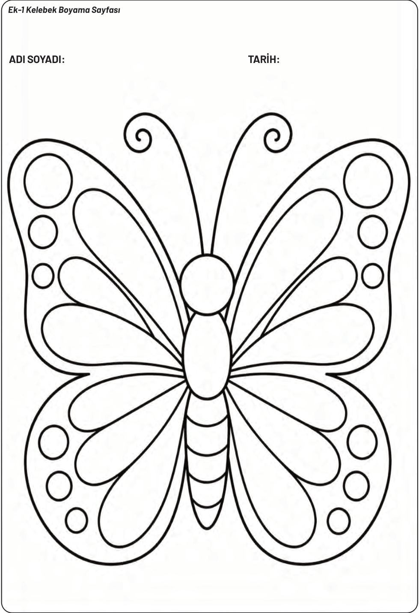

<!-- sayfa 93 -->

**ETKİNLİK ADI:** Kültür ve Sanat Merkezi  
**ALAN ADI:** Sosyal, Sanat  
**YAŞ GRUBU:** 60-72 ay  

**ALAN BECERİLERİ, ÖĞRENME ÇIKTILARI VE SÜREÇ BİLEŞENLERİ**

**SOSYAL ALAN**  
**SBAB9. Coğrafi Gözlem ve Saha Çalışması**  
**SAB.8. Coğrafi gözlem ve saha çalışmasını gerçekleştirebilmek için gerekli olan hazırlığı yapabilme**  
SAB.8.a. Okul dışı öğrenme etkinlikleri kapsamında gidilecek mekân ve yapılacak çalışmalara yönelik görselleri inceler.  
SAB.8.b. Okul dışı öğrenme etkinliklerinde kendi güvenliğini ve sağlığını korumak için dikkat edilmesi gereken hususları söyler.  

**SANAT ALANI**  
**SNAB2. Sanat Eseri İnceleme**  
**SNAB.2. Sanat eserini eleştirebilme**  
SNAB.2.c. Sanat eserinde dikkatini çeken özellikleri söyler.  
SNAB.2.e. Sanat eserine yönelik duygu / düşüncelerini ifade eder.  

**SNAB3. Sanata Değer Verme**  
**SNAB.3. Sanatın önemini fark edebilme**  
SNAB.3.b. Sanat eserlerinin nasıl yapıldığına ilişkin tahmin yürütür.  
SNAB.3.c. Dijital / gerçek sanat ortamlarını ziyaret eder.  
SNAB.3.ç. Dijital / gerçek sanat ortamlarında sergilenen eserleri inceler.  

**SNAB4. Sanatsal Uygulama Yapma**  
**SNAB.4. Sanat etkinliği uygulayabilme**  
SNAB.4.b. Sanat etkinliği için gerekli materyalleri seçer.  
SNAB.4.c. Sanat materyallerini amacına uygun biçimde kullanır.  
SNAB.4.d. Sanat etkinliklerinde özgün ürünler oluşturur.  

**EĞİLİMLER**  
**E3. Entelektüel Eğilimler**  
E3.2. Odaklanma  
E3.3. Yaratıcılık  

**PROGRAMLAR ARASI BİLEŞENLER**  
**Sosyal-Duygusal Öğrenme Becerileri**  
SDB2.3. Sosyal Farkındalık  

**Değerler**  
**D7.Estetik**  
D7.1. Duyusal derinliği anlamak  
D7.2. Sanatsal ve görsel zevkleri hayatın bir parçası hâline getirmek  

**Okuryazarlık Becerileri**  
OB4. Görsel Okuryazarlık  
OB5. Kültür Okuryazarlığı  

**Kavramlar:** Renkler  
**Sözcükler:** kültür, sanat, ebru, geleneksel sanatlar, çini, atölye  
**Materyaller:** resim, heykel, müzik ve tiyatro gibi sanat dallarının görselleri, kil, seramik hamuru veya hava ile kuruyan modelleme hamuru  

**Eğitim / Öğrenme Ortamları:** Çocukların gezi süresince güvenliklerini sağlamak amacıyla üzerinde ad-soyad bilgileri ile okulun iletişim bilgilerinin yer aldığı yaka kartları hazırlanır ve gezi boyunca çocukların yakalarına takılır. Gezi öncesinde sınıfta geçici bir sanat merkezi oluşturulur. Merkezde resim, heykel, ebru ve çini sanatına ait görseller ile farklı boya türleri, fırçalar, kil ve çeşitli sanat materyalleri çocukların öğrenme merkezlerinde oyun zamanında inceleyebileceği şekilde düzenlenir. Kültür ve sanat merkezine ait fotoğraflar gezi öncesinde çocuklarla paylaşılmak üzere hazırlanır. Gezi sonrasında gerçekleştirilecek sanat etkinliği için çocuk sayısı kadar kil, boya malzemeleri ve çini eserlerine ait görsel örnekler önceden hazırlanır. Çocukların tamamladıkları

<!-- sayfa 94 -->

**Sosyal, Sanat (Bütünleştirilmiş Büyük Grup Etkinliği)**

* Resim, heykel, seramik, ebru ve çini sanatına ait görseller çocuklara gösterilir. “Bu görsellerde yer alan çalışmalardan hangisini daha önce gördünüz?”, “Sizce bu eserler nasıl yapılmış olabilir?”, “Bu eserleri yapan kişiler hangi malzemeleri kullanmış olabilir?” gibi sorular sorulur (SNAB.3.b, OB4). Ardından kültür ve sanat merkezine ait fotoğraflar çocuklarla birlikte incelenir. Çocukların daha önce inceledikleri sanat eserlerinin kültür ve sanat merkezlerinde sergilendiği açıklanır. Bu merkezlerde resim, heykel ve geleneksel sanat eserlerinin sergilendiği, ayrıca farklı sanat etkinlikleri ve atölye çalışmalarının gerçekleştirildiği söylenir. Çocuklara gezi sırasında bu eserleri yakından inceleyecekleri söylenir (SAB.8.a).
* Gezi öncesinde çocuklarla birlikte kültür ve sanat merkezinde uyulması gereken kurallar söylenir. “Sergide eserleri neden dikkatli incelemeliyiz?”, “Sanat eserlerine neden izinsiz dokunmamalıyız?”, “Atölyede çalışırken nelere dikkat etmeliyiz?” soruları sorulur. Çocukların görüşlerinden hareketle sessiz konuşma, eserleri koruma, atölye malzemelerini dikkatli kullanma ve görevlilerin yönlendirmelerine uyma kuralları birlikte belirlenir (SAB.8.b, SDB2.3).
* Gezi sırasında kültür ve sanat merkezi görevli eşliğinde gezilir (SNAB.3.c). Çocukların dikkatleri sanat galerisinde yer alan sanat eserlerine çekilir. Eserleri dikkatle incelemelerine fırsat verilir. Çocuklar renkler, desenler, şekiller ve kullanılan farklı malzemeler üzerine gözlem yapmaları konusunda yönlendirilir (SNAB.3.ç, D7.1). Çocukların eserleri incelerken “Bu eserde hangi renkler daha çok kullanılmış?”, “Bu eser sana neyi hatırlattı?”, “Sence sanatçı bu eseri yaparken neler düşünmüş olabilir?” gibi düşünmelerini sağlayacak sorularla gözlemlerini paylaşmaları desteklenir (SNAB.2.c). Ardından geleneksel sanatlar atölyesi ziyaret edilir. Çocuklara ebru ve çini gibi geleneksel sanatlar hakkında açıklamalar yapılır. Küçük gruplar hâlinde atölye çalışmalarına katılmaları sağlanır (D7.2).
* Gezi sonrası sınıfta çocuklarla gezi hakkında sohbet edilir. Çocukların en çok ilgilerini çeken sanat eserleri ve atölye çalışmaları hakkında sohbet edilir. Sanat merkezinde gözlemledikleri eserlerin aynı ve farklı özellikleri üzerine sohbet edilir (SNAB.2.c, SNAB.2.e). Ardından çocuklara çini sanatına ait görseller gösterilir. Çini sanatının ülkemize özgü geleneksel sanatlarımızdan biri olduğu açıklanır. Çocukların dikkatleri çini eserlerinde kullanılan mavi, turkuaz, lacivert ve beyaz gibi renkler ile çiçek, yaprak ve geometrik desenlere çekilir. Görseller birlikte incelenir (OB5).
* Daha sonra çocukların farklı sanat materyalleri (kil, seramik hamuru veya hava ile kuruyan modelleme hamuru gibi) arasından çalışmaları için kullanmak istedikleri materyali seçmeleri sağlanır. Çocuklar istedikleri şekilleri oluşturur (E3.2). Çalışmalar kuruduktan sonra çocuklar oluşturdukları ürünleri çini sanatından esinlenerek kendi seçtikleri renk ve desenlerle süsler (E3.3). Çocuklar materyal tercihlerini, seçtikleri desenleri ve renkleri neden tercih ettiklerini açıklarlar. Çalışmalar tamamlandıktan sonra çocukların ürünleri sınıfta sergilenir (SNAB.4.b, SNAB.4.c, SNAB.4.d).

**DEĞERLENDİRME**

* Kültür ve sanat merkezinde en çok hangi bölümü gezmeyi sevdin?
* Orada gördüğün hangi sanat çalışmasını hatırlıyorsun?
* Atölyede hangi çalışmayı yaptın? Yaparken neler hissettin?
* Çini çalışmanda hangi renkleri kullandın?
* Çalışmana bir isim vermek istesen ne koyardın?

<!-- sayfa 95 -->

# FARKLILAŞTIRMA

**Zenginleştirme:** Çocuklara kültür ve sanat merkezinde gördükleri eserlerin dışında ülkemizin farklı bölgelerine ait geleneksel sanat örnekleri sunulabilir. Çocukların çini, ebru, minyatür ve hat sanatına ait eserleri birlikte incelemeleri, bu eserlerde kullanılan renk, desen ve motifleri karşılaştırmaları desteklenebilir. Çocukların farklı sanat dallarını karşılaştırmaları, eserlerde kullanılan renk, desen ve motifler hakkında sohbet etmeleri ve ilgilerini çeken bir sanat eserini farklı materyaller kullanarak yeniden yorumlamaları desteklenebilir.

**Destekleme:** Sanat eserlerini inceleme ve düşüncelerini ifade etme sürecinde çocuklara görseller, açık uçlu sorular ve ek açıklamalarla rehberlik edilebilir. Atölye çalışmaları sırasında materyallerin kullanımı öğretmen tarafından modellenebilir ve çocuklara bireysel yönlendirmeler sunulabilir. Çocukların etkinliğe etkin katılımlarını desteklemek amacıyla ikili veya küçük grup çalışmaları planlanabilir.

# AİLE VE TOPLUM KATILIMI

**Aile Katılımı:** Ailelerden çocuklarıyla birlikte yaşadıkları çevrede bulunan bir sanat galerisi, sergi veya kültür merkezini ziyaret etmeleri istenebilir. Ayrıca ailelerin çocuklarıyla birlikte evde farklı sanat materyallerini kullanarak ortak bir sanat çalışması hazırlamaları istenebilir.

<!-- sayfa 96 -->

**ETKİNLİK ADI:** Sivas Arkeoloji Müzesi  
**ALAN ADI:** Sosyal, Sanat  
**YAŞ GRUBU:** 60-72 ay  

**ALAN BECERİLERİ, ÖĞRENME ÇIKTILARI VE SÜREÇ BİLEŞENLERİ**  
**SOSYAL ALAN**  
**SBAB9. Coğrafi Gözlem ve Saha Çalışması**  
**SAB8. Coğrafi gözlem ve saha çalışmasını gerçekleştirebilmek için gerekli olan hazırlığı yapabilme**  
SAB8.a. Okul dışı öğrenme etkinlikleri kapsamında gidilecek mekân ve yapılacak çalışmalara yönelik görselleri inceler.  
**SAB9. Coğrafi gözlem ve okul dışı planlanan çalışmaları çevreye duyarlı biçimde uygulayabilme**  
SAB9.a. Okul dışı öğrenme etkinliğinde takip edilecek sözel / görsel yönergeleri uygular.  
SAB9.b. Okul dışı öğrenme çalışma sahasında çevreyi olumsuz etkileyecek davranışlardan kaçınır.  
**SAB10. Coğrafi gözlem ve çalışma sahasından elde edilen sonuçları sözlü / görsel yolla sunabilme**  
SAB10.a. Okul dışı öğrenme etkinliğinde elde ettiği materyallerden ürün oluşturur.  

**SANAT ALANI**  
**SNAB2. Sanat Eseri İnceleme**  
**SNAB.2. Sanat eserini eleştirebilme**  
SNAB.2.a. Sanat eserine odaklanır.  
SNAB.2.ç. Sanat eserine ilişkin sorular sorar.  

**EĞİLİMLER**  
**E1. Benlik Eğilimleri**  
E1.1. Merak  
**E3. Entelektüel Eğilimler**  
E3.2. Odaklanma  

**PROGRAMLAR ARASI BİLEŞENLER**  
**Sosyal-Duygusal Öğrenme Becerileri**  
SDB2.3. Sosyal Farkındalık  
**Değerler**  
D7. Estetik  
D7.1. Duyusal derinliği anlamak  
**Okuryazarlık Becerileri**  
OB4. Görsel Okuryazarlık  

**Kavramlar:** Zıt: eski - yeni  
**Sözcükler:** arkeoloji, arkeolog, mozaik, müze  
**Materyaller:** eski eşyaları temsil eden çeşitli materyaller (seramik parçası, taş, boncuk, madeni para), eski yerleşim yerleri ve ören yerlerine ait görseller, arkeologların çalışma alanlarına ve kullandıkları araç gereçlere ait fotoğraflar, Sivas Arkeoloji Müzesinde sergilenen taban mozaiği görseli, geniş plastik kazı kabı, oyun kumu / elenmiş toprak, küçük kürek / kaşık, yumuşak fırçalar, şeffaf kilitli poşetler, oyuncak figürler, oyuncak dinozorlar, değeri olmayan takılar, farklı renklerde küçük mozaik taşlar  

**Eğitim / Öğrenme Ortamları:** İçerisinde eski eşyaları temsil eden çeşitli materyallerin bulunduğu keşif kutusu hazırlanır. Eski yerleşim yerleri ve ören yerlerine ait görseller, arkeologların kullandığı araç gereçleri gösteren fotoğraflar ile taban mozaiği görseli hazırlanır. Merkezde oyun kumu / elenmiş toprak bulunan kazı kabı, küçük kürekler, fırçalar, şeffaf poşetler, oyuncak fosiller, seramik parçaları, taşlar, boncuklar, değeri olmayan takılar ve eser etiketler hazırlanır. Çocukların kazı yapmaları, buldukları materyalleri temizlemeleri ve sergilemeleri için üç istasyon masası hazırlanır. Gezi öncesinde çocukların güvenliğini sağlamak amacıyla, üzerinde çocukların ad-soyad bilgileri ile okulun iletişim bilgilerinin yer aldığı yaka kartları hazırlanır ve gezi süresince çocukların

<!-- sayfa 97 -->

# Sosyal, Sanat (Bütünleştirilmiş Büyük Grup Etkinliği)

**ETKİNLİKLER**

* Çocuklara eski yerleşim yerleri ve ören yerlerine ait fotoğraflar gösterilir. Geçmişte insanların yaşadığı bazı yerleşim alanlarının zamanla toprağın altında kaldığı, günümüzde bu alanlarda yapılan çalışmalar sonucunda geçmişe ait eşyaların bulunabildiği açıklanır. Çocuklara “Sence bu eşyalar nasıl bulunmuş olabilir?” sorusu yöneltilir (**E1.1, OB4**). Çocuklar düşüncelerini söyledikten sonra bu eserleri araştıran kişilere arkeolog denildiği açıklanır. Arkeologların toprağı özel araçlarla dikkatlice kazdıkları, buldukları eserleri zarar vermeden çıkardıkları, temizleyip inceledikleri, daha sonra bu eserlerin korunarak arkeoloji müzelerinde sergilendiği açıklanır. Bu eserlerden biri olan ve Sivas Arkeoloji Müzesinde sergilenen bir taban mozaiğine ait görsel çocuklara dağıtılır. Çocukların görseli dikkatle incelemelerine fırsat verilir. Çocuklara bugün Sivas Arkeoloji Müzesini ziyaret edecekleri söylenir. Daha sonra çocuklara bu görseli gezi boyunca yanlarında taşıyacakları ve müzeyi gezerken görselde yer alan mozaiğin sergilendiği bölümü bulmaya çalışacakları açıklanır (**SAB.8.a.**).
* Çocuklarla birlikte gezi sırasında uyulması gereken kurallar hakkında konuşulur. Müzedeki eserlere dokunulmaması, gruptan ayrılmama, müze görevlisinin açıklamalarını dikkatle dinleme, müze ortamında sessiz olunması ve eserleri dikkatlice inceleyerek gözlem yapılması gerektiği birlikte belirlenir (**SAB.9.b, SDB2.3**).
* Gezi sırasında müze görevlisi çocukları karşılar ve müze hakkında kısa bir bilgilendirme yapar. Müze gezilir. Çocuklar kendilerinde bulunan taban mozaiğinin bulunduğu bölüme gelindiğinde taban mozaiği üzerindeki desenler gösterilerek, bu desenlerin ne anlatıyor olabileceği hakkında çocuklardan tahminleri istenir (**SNAB2.a, SNAB2.ç, D7.1**). Ardından bu mozaiğin, küçük taşların yan yana getirilmesiyle yapıldığı açıklanır. Çok eski zamanda insanların yaşadığı evlerin tabanını süslemek için yapıldığı söylenir.
* Gezi sonrasında müzenin uygun bir alanına geçilerek çocukların önceden yanlarında getirdikleri küçük mozaik taşlar kullanılarak uygulamalı bir etkinlik gerçekleştirilir. Bu etkinlikte çocuklara, küçük mozaik taşlar yan yana getirerek kendi mozaik çalışmalarını tasarlamaları istenir (**SAB.9.a, SAB.10.a, E3.2**).

**DEĞERLENDİRME**

* Müzede en çok hangi eseri incelemek hoşuna gitti? Neden?
* Kazı yaparken nelere dikkat ettin?
* Müzede gördüğün mozaikle yaptığın mozaik çalışması arasında benzerlik var mı?
* Sınıfta en çok hangi istasyonda çalışmaktan hoşlandın?
* Arkeolojik eserleri neden korumamız gerektiğini düşünüyorsun?

**FARKLILAŞTIRMA**

**Zenginleştirme:** Sınıfta bir kazı alanı hazırlanabilir. Toprağa yerleştirilmiş kil hamurundan oluşturulmuş fosiller, madeni paralar, oyuncak figürler ve değeri olmayan takı gibi eşyalar çocuklar tarafından küçük kürek (veya uygun kaşık) yardımıyla dikkatlice ortaya çıkarılabilir. Etkinlik, farklı arkeolojik eser görselleri (mühür, kandil, küp, sikke, takı vb.) eklenerek zenginleştirilebilir. Çocukların kazı alanında buldukları eserleri benzer özelliklerine göre (yapıldığı malzeme, kullanım amacı veya büyüklüğü gibi) gruplamaları istenebilir. Ayrıca farklı mozaik örnekleri incelenerek çocukların değişik renk ve geometrik şekiller kullanarak yeni mozaik desenleri oluşturmaları sağlanabilir.

**Destekleme:** Eserlerini inceleme ve düşüncelerini ifade etme sürecinde çocuklara görseller, açık uçlu sorular ve ek açıklamalarla rehberlik edilebilir. Mozaik çalışması sırasında materyallerin kullanımı öğretmen tarafından modellenir ve çocuklara bireysel yönlendirmeler sunulabilir. Çocukların etkinliğe etkin katılımlarını desteklemek amacıyla ikili veya küçük grup çalışmaları planlanabilir.

**AİLE VE TOPLUM KATILIMI**

**Aile Katılımı:** Ailelerden çocuklarıyla birlikte yaşadıkları çevrede bulunan tarihî yapı, müze veya ören yerlerine gezi düzenlemeleri önerilebilir.

**Toplum Katılımı:** Müze görevlisi veya bir arkeolog sınıfa davet edilerek çocuklarla mesleği hakkında kısa bir bilgilendirme yapması istenebilir.

<!-- sayfa 98 -->

**ETKİNLİK ADI:** Ankara Resim ve Heykel Müzesi  
**ALAN ADI:** Sosyal, Sanat  
**YAŞ GRUBU:** 60-72 ay  

**ALAN BECERİLERİ, ÖĞRENME ÇIKTILARI VE SÜREÇ BİLEŞENLERİ**  
**SOSYAL ALAN**  
**SBAB9. Coğrafi Gözlem ve Saha Çalışması**  
**SAB.8. Coğrafi gözlem ve saha çalışmasını gerçekleştirebilmek için gerekli olan hazırlığı yapabilme**  
* SAB.8.a. Okul dışı öğrenme etkinlikleri kapsamında gidilecek mekân ve yapılacak çalışmalara yönelik görselleri inceler.  
* SAB.8.b. Okul dışı öğrenme etkinliklerinde kendi güvenliğini ve sağlığını korumak için dikkat edilmesi gereken hususları söyler.  

**SAB.9. Coğrafi gözlem ve okul dışı planlanan çalışmaları çevreye duyarlı biçimde uygulayabilme**  
* SAB.9. b. Okul dışı öğrenme çalışma sahasında çevreyi olumsuz etkileyecek davranışlardan kaçınır.  

**SANAT ALANI**  
**SNAB2. Sanat Eseri İnceleme**  
**SNAB.2. Sanat eserini eleştirebilme**  
* SNAB.2.a. Sanat eserine odaklanır.  
* SNAB.2.b. Sanat eserinde gördüklerini söyler.  

**SNAB3. Sanata Değer Verme**  
**SNAB.3. Sanatın önemini fark edebilme**  
* SNAB.3.ç. Dijital / gerçek sanat ortamlarında sergilenen eserleri inceler.  

**EĞİLİMLER**  
**E2. Sosyal Eğilim**  
* E2.5. Oyunseverlik  

**E3. Entelektüel Eğilimler**  
* E3.2. Odaklanma  

**PROGRAMLAR ARASI BİLEŞENLER**  
**Sosyal-Duygusal Öğrenme Becerileri**  
SDB2.3. Sosyal Farkındalık  

**Değerler**  
D7.Estetik  
* D7.1. Duyusal derinliği anlamak  

**Okuryazarlık Becerileri**  
OB4. Görsel Okuryazarlık  

**Kavramlar:** Duygu: mutluluk, üzüntü, korku, şaşkınlık  
**Sözcükler:** sergi, karakalem, portre, manzara  
**Materyaller:** müzede yer alan eserlere ait fotoğraflar, “Tabloda Ne Var?” (Ek - 1), tahta, mukavva, kartın ya da çıtalardan hazırlanmış içi boş çerçeve  

**Eğitim / Öğrenme Ortamları:** Çocukların gezi süresince kendi güvenlik ve sağlıklarını korumaları, aynı zamanda sergi salonundaki tabloların korunması ile ilgili okul dışı etkinliğinde uyulması gereken kurallarla ilgili açıklamalar yapılır. Sınıfta karakalem çizimler, manzara resimleri, portreler gibi farklı resim tekniklerine ait görseller hazırlanır. Gezi öncesinde çocukların güvenliğini sağlamak amacıyla, üzerinde çocukların ad-soyad bilgileri ile okulun iletişim bilgilerinin yer aldığı yaka kartları hazırlanır ve gezi süresince çocukların yakalarına takılır Gezi sırasında kullanılmak üzere “Tabloda Ne Var?” adlı (Ek - 1) etkinlik sayfası hazırlanır ve çocuklara

<!-- sayfa 99 -->

# ETKİNLİKLER
## Sosyal, Sanat (Bütünleştirilmiş Büyük Grup Etkinliği)

* Gezi öncesinde, çocuklara “Sanat Müzesi nedir?” sorusu sorulur ve cevaplar dinlenir. Ardından müzelerin sanat eserlerini koruyan, sergileyen ve insanların onları tanımasını sağlayan özel mekânlar olduğu açıklanır.
* Farklı tekniklerle hazırlanmış sanat eserleri (karakalem çizimler, manzara resimleri, portreler vb. ) çocuklara gösterilerek resim türleri hakkında kısaca konuşulur. Çocuklardan hangi tür eserleri müzede görebileceklerini tahmin etmeleri istenir (**SAB.8.a, OB4**).
* Müze gezisi öncesinde çocuklarla müzede dikkat edilmesi gereken davranışlar hakkında konuşulur. Tabloların ve diğer eserlerin çok eski ve özel malzemelerle hazırlanmış olabileceği açıklanarak “Bu eserleri korumak için onlara dokunmadan gözlerimizle dikkatlice inceleyelim.” denir. Müzede sakin bir şekilde hareket etmenin ve birbirini rahatsız etmeyecek bir ses tonuyla konuşmanın eserleri rahatça incelemeye yardımcı olacağı belirtilir (**SAB.9.b**).
* Gezi sırasında öğretmenle ve grupla birlikte hareket etmenin, yürürken çevreye dikkat etmenin ve müze içinde belirlenen alanlarda kalmanın önemli olduğu çocuklarla konuşulur (**SAB.8.b**).
* Gezi sırasında çocuklar müzedeki kurallara uyarak sergi alanını dikkatlice gözlemler. Her bir eseri sakin bir şekilde incelemeleri için çocuklara zaman tanınır (**SNAB.3.ç**). Her çocuktan, ilgisini çeken bir tablo seçmesi istenir.
* Çocukların seçtikleri eseri daha derinlemesine incelemeleri için çocuklara “Bu eserde hangi renkleri görüyorsun?”, “Bu tablo sence ne anlatıyor?”, “Sence bu kişi ya da sahne nasıl bir duygu taşıyor?”, “Bu tabloya baktığında hangi duyguyu hissediyorsun?” soruları yöneltilir (**SNAB.2.a, D7.1**).
* Müzenin uygun bir noktasında kısa bir duraklama yapılır ve çocuklara seçtikleri tabloda yer alan karakterlere ilişkin “Bu tablodaki kişiler/hayvanlar konuşsaydı ne söylerdi?” sorusu sorulur. Cevaplar dinlenir.
* Ardından her çocuğa “Tabloda Ne Var?” (Ek-1) etkinlik sayfası verilir. Önceden seçilmiş müzede inceledikleri tablolara ait küçük ayrıntıları gösteren kartlar hazırlanır (örneğin bir el detayı, bir çiçek, bir kuş). Çocuklar kartlardaki nesneleri inceler ve müzedeki eserlerin içinde bu ayrıntıları bulmaya çalışır. Nesneyi bulduklarında ilgili yeri göstererek “Kuş burada!” gibi ifadelerle paylaşır ve etkinlik kâğıtlarında ilgili bölümü işaretlerler (**SNAB.2.b, E3.2.**). Etkinlik sırasında müzeyi gezen diğer ziyaretçilerin rahatsız olmaması için çocuklara inceleme yaparken ses seviyelerini uygun yükseklikte ayarlamalarının önemi hatırlatılır (**SDB2.3.**).
* Gezi sonrası sınıfta kısa bir değerlendirme yapılarak müzede gördükleri eserler hakkında kısaca sohbet edilir. Tahtadan, mukavvadan, kartondan ya da çıtalardan hazırlanmış yalnızca dört kenarı bulunan, çocuk boyutunda büyük ve içi boş bir çerçeve sınıfa yerleştirilir. Bu çerçeve etkinlik boyunca “canlı tablo alanı” olarak kullanılır.
* Çocuklar 3-4 kişilik küçük gruplara ayrılır.
* Her grup, müzede gördükleri tablolardan birini bedenleriyle canlandırmak üzere çerçevenin arkasına geçer. Çocuklar tablodaki kişilerin ya da nesnelerin duruşlarını grup olarak taklit eder. Diğer çocuklar bu “canlı tabloyu” izler (**E2.5**). İzleyici gruptaki çocuklara şu sorular yöneltilir: “Tabloda hangi renkleri görüyorsunuz?”, “Bu tablo sizce ne anlatıyor?”, “Bu kişiler ne hissediyor olabilir?”, “Renkler ve duruşlar size neyi hatırlatıyor?” Öğrencilerin verdikleri cevaplar dinlenir.

## DEĞERLENDİRME
* Müzede gezerken hangi kurallara uydunuz?
* Tablolarda hangi renkleri ve ayrıntıları fark ettiniz?
* Saklanmış nesneleri bulurken size hangi ipuçları yardımcı oldu?
* Bedeninle bir resmi canlandırmak sana ne hissettirdi?
* Tabloda hangi karakteri ya da nesneyi canlandırdın?

<!-- sayfa 100 -->

# FARKLILAŞTIRMA

**Zenginleştirme:** Çocuklar, müzede inceledikleri eserlerden ilham alarak farklı sanat tekniklerini (kolaj, baskı, doku çalışması, doğal materyallerle tasarım vb.) kullanarak özgün sanat eserleri oluşturabilir. Dijital ortamda farklı müzelerden seçilen eserler incelenerek çocukların farklı sanat anlayışlarını karşılaştırmaları ve benzerlik-farklılıkları fark etmeleri desteklenebilir. Çocuklardan müzede sergilenen bir eser hakkında gözlemlerini arkadaşlarına anlatmaları veya esere farklı bir isim vermeleri istenebilir.

**Destekleme:** Müze kuralları fotoğraf, resim kartları veya kısa canlandırma çalışmalarıyla somutlaştırılabilir. Gezi akışı görsel bir günlük program şeklinde sunularak çocukların süreç hakkında önceden bilgi sahibi olmaları sağlanabilir. Müzedeki eserler incelenirken çocukların dikkatini odaklamalarını kolaylaştırmak amacıyla eserlerdeki belirgin renkler, şekiller ve nesneler hakkında yönlendirici sorular kullanılabilir. “Tabloda Ne Var?” etkinliğinde daha belirgin ve büyük ayrıntılar içeren görsel kartlar hazırlanabilir. Canlı tablo etkinliğinde çocuklara tek başına ya da ikili gruplar hâlinde canlandırma yapma seçeneği sunularak etkinliğe katılımları desteklenebilir.

# AİLE VE TOPLUM KATILIMI

**Aile Katılımı:** Gezi sonrasında ailelere müze ziyaretinde gerçekleştirilen etkinlikler, çocukların gözlemledikleri eserler ve edindikleri deneyimler hakkında bilgi verilebilir. Ailelerden çocuklarıyla gezi süreci hakkında sohbet etmeleri ve müzede en çok ilgilerini çeken eser ya da etkinliği birlikte değerlendirmeleri istenir. Ailelerden çocuklarıyla birlikte evlerinde bulunan bir sanat eserini (tablo, el işi, seramik, hat çalışması, aile büyüklerinin yaptığı bir el sanatı ürünü vb.) incelemeleri ve dikkatlerini çeken özellikleri sınıfta paylaşmaları istenebilir.

**Toplum Katılımı:** Yakın çevrede bulunan bir sanatçı, ressam veya görsel sanatlar öğretmeni sınıfa davet edilerek çocuklarla kısa bir sanat uygulaması gerçekleştirebilir ve kendi çalışmalarını tanıtabilir.

<!-- sayfa 101 -->

*Ek-1 Tabloda Ne Var?*

**ADI SOYADI:**                                                                                                        **TARİH:**

**Müzedeki eserleri inceleyelim. Gezi sırasında eserlerde gördüğümüz varlıklara ait görsellerin altındaki kutucuğu boyayalım.**

| | |
| :---: | :---: |
| 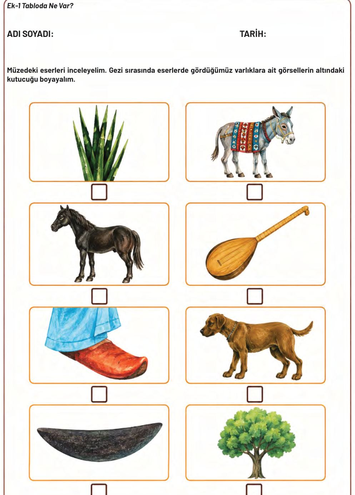 |  |
| ☐ | ☐ |
|  |  |
| ☐ | ☐ |
|  |  |
| ☐ | ☐ |
|  |  |
| ☐ | ☐ |

<!-- sayfa 102 -->

**ETKİNLİK ADI:** Akdeniz Üniversitesi Botanik Bahçesi Uygulama ve Araştırma Merkezi  
**ALAN ADI:** Matematik, Sosyal  
**YAŞ GRUBU:** 60-72 ay  

**ALAN BECERİLERİ, ÖĞRENME ÇIKTILARI VE SÜREÇ BİLEŞENLERİ**  
**MATEMATİK ALANI**  
**MAB4. Veri ile Çalışma ve Veriye Dayalı Karar Verme**  
**MAB. 11. Veriyle çalışabilme**  
MAB.11.b. Veri toplar.  
MAB.11.ç. Verileri benzer özelliklerine göre sınıflandırır.  
**MAB. 12. Bulguya ulaşabilme**  
MAB.12.a. Sınıflandırılmış verileri göstermek için grafik / tablo / çizim gibi uygun bir yol seçer.  
**MAB.13. Bulguyu yorumlayabilme**  
MAB.13.a. Elde ettiği sonuçlara ilişkin basit çıkarımlarda bulunur.  

**SOSYAL ALAN**  
**SBAB9. Coğrafi Gözlem ve Saha Çalışması**  
**SAB.8. Coğrafi gözlem ve saha çalışmasını gerçekleştirebilmek için gerekli olan hazırlığı yapabilme**  
SAB.8.a. Okul dışı öğrenme etkinlikleri kapsamında gidilecek mekân ve yapılacak çalışmalara yönelik görselleri inceler.  
SAB.8.b. Okul dışı öğrenme etkinliklerinde kendi güvenliğini ve sağlığını korumak için dikkat edilmesi gereken hususları söyler.  

**EĞİLİMLER**  
**E1. Benlik Eğilimleri**  
E1.1. Merak  

**PROGRAMLAR ARASI BİLEŞENLER**  
**Sosyal-Duygusal Öğrenme Becerileri**  
SDB2.3. Sosyal Farkındalık  
**Değerler**  
D9. Merhamet  
D9.3. İnsanı ve doğayı sevmek  
**Okuryazarlık Becerileri**  
OB4. Görsel Okuryazarlık  

**Kavramlar:** Miktar: az - çok  
Zıt: sivri - küt, kalın - ince  

**Sözcükler:** tohum, bitki, kök, gövde, dal, botanik  

**Materyaller:** farklı bitki türlerine (ağaç, çalı, çiçek, kaktüs, sukulent ve palmiye gibi) ait görseller, Akdeniz Üniversitesi Botanik Bahçesi Uygulama ve Araştırma Merkezi’ne ait fotoğraflar, her çocuk için bitki gözlem kâğıdı (Ek - 1) ve kalem, grafik tablosu  

**Eğitim / Öğrenme Ortamları:** Sınıf ortamında, araştırma ve uygulama merkezine ilişkin fotoğraflar çocuklara sunulur. Ayrıca, her çocuk için bitki gözlem kâğıdı (Ek - 1) hazırlanır. Gezi sonrası oluşturulacak grafik tablosu hazırlanır. Gezi öncesinde çocukların güvenliğini sağlamak amacıyla, üzerinde çocukların ad - soyad bilgileri ile okulun iletişim bilgilerinin yer aldığı yaka kartları hazırlanır ve gezi süresince çocukların yakalarına takılır.

<!-- sayfa 103 -->

**Matematik, Sosyal (Bütünleştirilmiş Büyük Grup Etkinliği)**

* Gezi öncesinde çocuklara ağaç, çalı, çiçek, kaktüs, sukulent ve palmiye görselleri gösterilir. “Bu bitkilerden hangilerini daha önce gördün?”, “Bitkilerin birbirinden farklı özellikleri nelerdir?” gibi sorular yöneltilerek çocukların görselleri incelemeleri istenir (**E1.1, OB4**). Ardından Akdeniz Üniversitesi Botanik Bahçesi Uygulama ve Araştırma Merkezine ait fotoğraflar incelenir. Çocuklardan bahçede karşılaşabilecekleri bitkilere ilişkin tahminlerini paylaşmaları istenir (**SAB.8.a**). Çocukların cevaplarının ardından botanik bahçelerinin farklı bitki türlerinin yetiştirildiği, korunduğu ve incelendiği özel alanlar olduğu açıklanır.
* Çocuklara gezi sırasında kullanacakları bitki gözlem kâğıdı (Ek-1) tanıtılır. Gözlem kâğıdında bitkinin yaprak rengi, yaprağın ucunun sivri mi yoksa küt mü olduğu, çiçeğinin bulunup bulunmaması ve gövdesinin kalın ya da ince olmasına ilişkin bölümlerin yer aldığı açıklanır. Her çocuğun gezi sırasında dikkatini çeken bir bitkiyi seçerek bu bitkinin özelliklerini gözlem kâğıdına işaretleyeceği belirtilir.
* Gezi öncesinde çocuklarla uyulması gereken kurallar konuşulur. Bitkileri koparmama, yürüyüş yollarını kullanma, gruptan ayrılmama ve rehberin yönlendirmelerine uyma kuralları hatırlatılır. Bahçede karşılaşılabilecek böceklerin doğal yaşamın bir parçası olduğu ve onlara dokunmadan gözlem yapılması gerektiği açıklanır (**SAB.8.b, SDB2.3, D9.3**).
* Gezi sırasında farklı bitkiler rehber eşliğinde incelenir. Çocukların dikkatleri bitkilerin yaprak, gövde, dal ve çiçek gibi gözlemlenebilir bölümlerine çekilir. Çocuklar bitkilere zarar vermeden yaprakların renklerini, büyüklüklerini ve yüzey özelliklerini; gövdelerin ise kalınlıklarını inceler. Ardından her çocuk dikkatini çeken bir bitkiyi seçer ve öğretmenin rehberliğinde bitki gözlem kâğıdındaki uygun bölümleri işaretler (**MAB.11.b**).
* Gezi sonrasında çocuklar gözlem kâğıtlarını arkadaşlarıyla birlikte inceler. Aynı yaprak rengini işaretleyen çocuklar bir araya gelerek gözlem kâğıtlarını yaprak renklerine göre sınıflandırır (**MAB.11.ç**). Ardından sınıfta yeşil, sarı, turuncu ve diğer renkleri temsil eden sütunların bulunduğu grafik panosu incelenir. Her çocuk, gözlemlediği yaprağın rengini temsil eden kartı grafikteki uygun sütuna yerleştirir. Böylece sınıfın yaprak rengi grafiği oluşturulur (**MAB.12.a**).
* Grafik tamamlandıktan sonra sütunlar birlikte karşılaştırılır. “Hangi sütunda daha çok kart var?”, “Hangi sütunda daha az kart var?”, “En çok hangi renkte yaprak gözlemledik?” ve “Hiç gözlemlemediğimiz bir yaprak rengi var mı?” soruları yöneltilir. Çocukların grafikte yer alan verilerden yararlanarak basit çıkarımlarda bulunmaları desteklenir (**MAB.13.a**).

**DEĞERLENDİRME**

* Bugün hangi yeri ziyaret ettik?
* Botanik bahçesinde neler gördük?
* En çok hangi bitki dikkatini çekti? Neden?
* İncelediğin bitkinin yaprakları nasıldı?
* İncelediğin bitkinin çiçeği var mıydı?
* Hangi renk bitkiler gördün?

<!-- sayfa 104 -->

# FARKLILAŞTIRMA

**Zenginleştirme:** Gezi sırasında çocukların botanik bahçesinde bulunan bitkilerin isim levhalarını rehber eşliğinde incelemeleri ve bitkilerin yetişme koşulları hakkında ek bilgiler edinmeleri desteklenebilir. Yaprak büyüklüğü, gövde kalınlığı veya çiçeği bulunan ve bulunmayan bitkiler özelliklerine ilişkin verilere uygun yeni sınıf grafikleri oluşturmaları desteklenebilir. Sınıfta bir botanik köşesi oluşturulabilir. Gezi sırasında yere doğal olarak düşmüş yapraklar, tohumlar ve dal parçaları bu köşede sergilenebilir. Çocukların bu doğal materyalleri büyüteç yardımıyla incelemeleri, gözlem kartlarındaki bilgilerle ilişkilendirmeleri; bu materyallerin benzer ve farklı özelliklerini karşılaştırmaları desteklenebilir.

**Destekleme:** Bitkilerin özelliklerini gözlemleme ve bitki gözlem kâğıdını kullanma sürecinde çocuklara bireysel rehberlik sunulabilir. Gözlem kâğıdındaki semboller çocuklarla birlikte yeniden incelenerek her sembolün temsil ettiği özellikler somut örnekler üzerinden açıklanabilir. Gözlem sürecini kolaylaştırmak amacıyla tek bir bitki seçilerek bu bitkinin özelliklerinin ayrıntılı biçimde incelenmesi sağlanabilir. Grafik oluşturma sırasında renk kartları çocuklarla birlikte karşılaştırılabilir. Aynı renkteki kartları seçmeleri ve grafikteki uygun sütuna yerleştirmeleri sözel ipuçları ve model olma yoluyla desteklenebilir.

# AİLE VE TOPLUM KATILIMI

**Aile Katılımı:** Ailelerden çocuklarıyla yaşadıkları çevrede bulunan bir park, bahçe veya yeşil alanı ziyaret etmeleri istenebilir. Ziyaret sırasında çocukların farklı yaprak ve bitki türlerini gözlemlemeleri, yaprakların renkleri, büyüklükleri ve şekilleri hakkında sohbet etmeleri istenebilir. 

**Toplum Katılımı:** Akdeniz Üniversitesi Botanik Bahçesi Uygulama ve Araştırma Merkezinde görev yapan rehberler ve uzmanların bitkileri koruma, araştırma ve tanıtma görevleri hakkında çocuklara bilgi vermeleri istenebilir. Gezi sırasında bitkilerin korunmasının ve biyolojik çeşitliliğin sürdürülebilmesinin önemi üzerinde durulabilir.

<!-- sayfa 105 -->

*Ek-1 Bitki Gözlem Kâğıdı*

**ADI SOYADI:**                                                                          **TARİH:**

**Bitki gözlem kâğıdını inceleyelim. Dikkatimizi çeken bir bitkiyi seçelim. Soruları sırayla dinleyelim ve uygun kutucuğu boyayalım.**

1. Bitki ne renk?
2. Bitkinin yaprağının şekli hangisine benziyor?
3. Bitkinin çiçeği var mı, yok mu?
4. Bitkinin gövdesi kalın mı, ince mi?

**İncelediğimiz bitkinin resmini çerçevenin içine çizelim.**

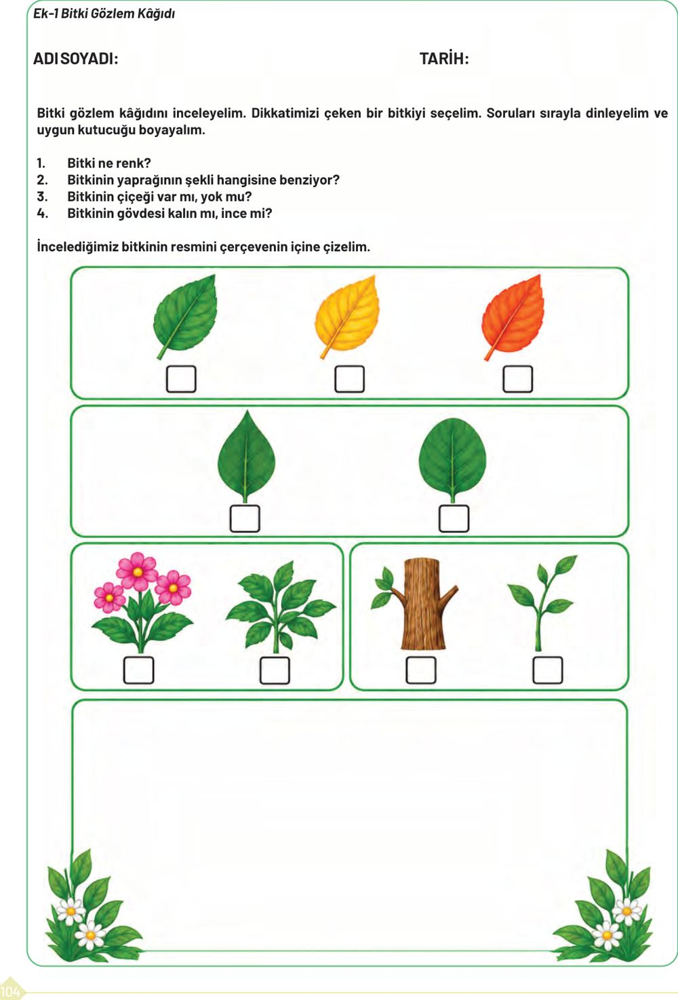

<!-- sayfa 106 -->

**ETKİNLİK ADI:** Ankara Etnografya Müzesi 3
**ALAN ADI:** Sosyal, Sanat
**YAŞ GRUBU:** 60-72 ay

**ALAN BECERİLERİ, ÖĞRENME ÇIKTILARI VE SÜREÇ BİLEŞENLERİ**

**SOSYAL ALAN**
**SBAB9. Coğrafi Gözlem ve Saha Çalışması**
**SAB8. Coğrafi gözlem ve saha çalışmasını gerçekleştirebilmek için gerekli olan hazırlığı yapabilme**
* SAB8.a. Okul dışı öğrenme etkinlikleri kapsamında gidilecek mekân ve yapılacak çalışmalara yönelik görselleri inceler.
* SAB8.b. Okul dışı öğrenme etkinliklerinde kendi güvenliğini ve sağlığını korumak için dikkat edilmesi gereken hususları söyler.

**SAB10. Coğrafi gözlem ve çalışma sahasından elde edilen sonuçları sözel/ görsel yolla sunabilme**
* SAB10.a. Okul dışı öğrenme etkinliğinde elde ettiği materyallerden ürün oluşturur.

**SANAT ALANI**
**SNAB2. Sanat Eseri İnceleme**
**SNAB2. Sanat eserini eleştirebilme**
* SNAB2.a. Sanat eserine odaklanır.
* SNAB2.b. Sanat eserinde gördüklerini söyler.
* SNAB2.c. Sanat eserinde dikkatini çeken özellikleri söyler.

**SNAB4. Sanatsal Uygulama Yapma**
**SNAB4. Sanat etkinliği uygulayabilme**
* SNAB4.d. Sanat etkinliklerinde özgün ürünler oluşturur.

**EĞİLİMLER**
**E1. Benlik Eğilimleri**
* E1.1. Merak

**PROGRAMLAR ARASI BİLEŞENLER**
**Sosyal-Duygusal Öğrenme Becerileri**
**SDB2.1. İletişim**

**Değerler**
**D7. Estetik**
* D7.1. Duyusal derinliği anlamak
* D7.2. Sanatsal ve görsel zevkleri hayatın bir parçası hâline getirmek

**Okuryazarlık Becerileri**
**OB1. Bilgi Okuryazarlığı**

**Kavramlar:** Renkler: kırmızı, mavi, turkuaz
**Sözcükler:** çini, porselen, seramik, metal, cam, motif
**Materyaller:** müze binasına ait fotoğraf, müzede bulunan çini ve porselen salonu ile seramik, metal, cam salonunun fotoğrafları, çocuk sayısı kadar kâğıt tabak, kırmızı, mavi ve turkuaz renkte parmak boyalar

**Eğitim / Öğrenme Ortamları:** Çocukların gezi süresince kendi güvenlik ve sağlıklarını korumaları, aynı zamanda müzedeki eserleri güvenli bir şekilde incelemeleri amacıyla okul dışı etkinliği ile ilgili açıklamalar yapılır. Sınıfta müze binasının bir kısmına ait bir fotoğraf ve müzede fazla zaman geçirilecek (çini ve porselen eserler ve seramik, metal ve cam) salonlara ait fotoğraflar hazırlanır. Gezi öncesinde çocukların güvenliğini sağlamak amacıyla, üzerinde çocukların ad - soyad bilgileri ile okulun iletişim bilgilerinin yer aldığı yaka kartları hazırlanır ve gezi süresince çocukların yakalarına takılır. Gezi sonrasında çocuk sayısı kadar kâğıt tabaklar hazırlanır. Sanat etkinliği sırasında çocukların kullanacağı turkuaz, mavi ve kırmızı gibi çinilerde sık kullanılan renklere ait parmak boyalar hazırlanır.

<!-- sayfa 107 -->

# ETKİNLİKLER

**Sosyal, Sanat (Bütünleştirilmiş Büyük Grup Etkinliği)**

* Gezi öncesi, çocuklara Ankara Etnografya Müzesini ziyaret edecekleri söylenir ve “Sizce müzede neler bulunur?” diye sorulur. Çocukların fikirleri alındıktan sonra müzeler hakkında bilgi verilir. Müzede farklı dönemlere ve kültürlere ait birçok farklı eser olduğu anlatılır. Daha sonra çocuklara müze binasına ait eksik bir fotoğrafın bulunduğu fotoğraf gösterilir. Çocuklardan fotoğrafı dikkatlice incelemeleri ve eksik kısmın nasıl göründüğü hakkında düşüncelerini paylaşmaları istenir. “Sizce binanın diğer bölümü nasıl olabilir?”, “Eğer siz bir müze tasarlasaydınız, içinde neler olmasını isterdiniz?” soruları yöneltilir (E1.1). Çocuklar düşüncelerini açıklar ve binanın tamamının fotoğrafı gösterilir. Müze binasına ait fotoğraf incelenir. Ardından müzede daha fazla zaman geçirilecek bölümlere ait fotoğraflar birlikte incelenerek bu alanlar hakkında sohbet edilir (SAB.8.a). Müzede dikkat edilmesi gereken kurallar anlatılır ve müze gezisi için hazırlık yapılır.
* Çocuklara yaka kartları gösterilerek “Bugün hepimiz aynı keşif ekibindeyiz. Bu kartlar da hangi ekibin üyesi olduğumuzu gösteren özel keşif kartlarımız.” açıklaması yapılır. Kartlarda adlarının ve okul bilgilerinin yer aldığı belirtilir. Ardından çocuklar küçük gruplara ayrılarak gezi sırasında dikkat edilecek davranışlar hakkında sohbet edilir. Çocukların görüşlerini paylaşmalarına fırsat verilerek “Müzede birbirimizi duyabileceğimiz sakin bir sesle konuşuruz.”, “Öğretmenimiz ve arkadaşlarımızla birlikte hareket ederiz.” ve “Eserleri korumak için onlara dokunmadan gözlerimizle dikkatlice inceleriz.” gibi olumlu davranış ifadeleri birlikte belirlenir (SAB.8.b).
* Gezi sırasında müze rehberi eşliğinde müze gezilir. Öncelikle müze binası birlikte incelenir. Çocukların binanın büyüklüğü, şekli ve dikkatlerini çeken özellikleri hakkında konuşmaları desteklenir. Ardından önceden belirlenen çini ve porselen eserler ile seramik, metal ve cam eserler salonları ziyaret edilir.
* Çini ve porselen eserlerin sergilendiği salona gelindiğinde çocukların dikkatleri eserlerin üzerindeki desen ve motiflere çekilir. Burada hangi desenleri ve motifleri gördükleri sorulur (SNAB.2.c). Bu el sanatının geçmişten günümüze ulaşan önemli bir kültürel miras olduğu kısaca açıklanır. Çocuklara çinilerin üzerinde neler gördükleri, desenlerin onlara neyi hatırlattığı ve en çok hangi deseni beğendikleri sorulur. Eserlerin üzerinde çiçek, yaprak veya farklı şekiller fark edip etmedikleri hakkında konuşulur (D7.1). Çinilerin renklerine dikkat çekilir ve hangi renkleri gördükleri sorulur (SNAB.2.a). Çinilerin genellikle turkuaz, mavi ve kırmızı renkler kullanılarak hazırlandığı açıklanır (OB1). Çocukların kendi çinilerini tasarlasalardı hangi renkleri kullanmak isteyecekleri hakkında sohbet edilir.
* Seramik, metal ve cam eserlerin bulunduğu bölüme geçildiğinde çocukların eserleri dikkatle incelemeleri sağlanır. Eserlerin hangi malzemeler kullanılarak yapılmış olabileceğini tahmin etmeleri desteklenir. Çocuklara eserlerin neden yapılmış olabileceği, sert mi yoksa yumuşak mı göründüğü, hangilerinin camdan ya da metalden yapılmış olabileceği sorulur (SNAB.2.b). Bu eşyaların geçmişte ne amaçla kullanılmış olabileceği ve evlerinde buna benzeyen eşyalar olup olmadığı hakkında sohbet edilir. Çocukların en çok hangi eseri beğendikleri ve neden beğendikleri sorularak düşüncelerini paylaşmaları sağlanır. Gezi boyunca çocukların gözlem yapmaları, soru sormaları ve eserler hakkında fikirlerini ifade etmeleri teşvik edilir. Bu bölümde bulunan eserler hakkında kısa bir açıklama yapılır (D7.1).
* Gezi sonrası sınıfta çocuklarla gezi hakkında kısa bir sohbet edilir (SDB2.1). Müzede en çok dikkatlerini çeken eserler hatırlatılır. Özellikle çinilerin üzerindeki desenler ve renkler hakkında konuşulur. Çocuklara “Müzede gördüğünüz çinilerde hangi desenler vardı?”, “Hangi renkleri hatırlıyorsunuz?” gibi sorular yöneltilir. Ardından çocuklara kâğıt tabaklar dağıtılır. Çocuklardan müzede gördükleri çinilerden esinlenerek kendi çinilerini tasarlamaları istenir. İsteyen çocuklar çiçek, yaprak, lale, geometrik şekiller gibi motifler çizebilir (SAB.10.a). Çalışmalarında ağırlıklı olarak turkuaz, mavi ve kırmızı renkleri kullanmaları için teşvik edilirler (SNAB.4.d).
* Etkinlik sonunda çocuklar çalışmalarını arkadaşlarına gösterir ve tasarımlarında hangi desenleri kullandıklarını anlatırlar. Hazırlanan çiniler sınıfta veya açık havada sergilenebilir (D7.2).

**EĞERLENDİRME**

* Müzede hangi eserleri gördün? En çok ne ilgini çekti?
* Müze gezisinde ilk kez karşılaştığın eserler hangisi?
* Müzede gördüğün eserleri daha önce evinde gördün mü? Hangisini gördün?
* Ankara Etnografya Müzesini tekrar gezmek ister misin? Neden?

<!-- sayfa 108 -->

FARKLILAŞTIRMA

**Zenginleştirme:** Gezi öncesinde ve gezi sırasında müzede bulunan eserler hakkında daha ayrıntılı bilgi verilebilir. Ayrıca müzenin krokisi dağıtılarak çocukların ziyaret edilecek salonları krokiyi kullanarak bulmaları desteklenebilir. Öğrenme ortamını zenginleştirmek amacıyla sanat merkezinde cam, metal, kil ve benzeri materyallerin yer aldığı küçük bir “Geleneksel Sanatlar Merkezi” oluşturulabilir. Çocukların farklı materyalleri incelemeleri, karşılaştırmaları ve keşfetmeleri desteklenebilir.

**Destekleme:** Müzedeki eserleri inceleme ve sorulara yanıt verme sürecinde çocuklara ek açıklamalar, görsel ipuçları ve açık uçlu sorularla rehberlik edilebilir. Eserlerin renk, biçim ve desen gibi belirgin özelliklerini daha yakından incelemelerine fırsat verilebilir. Çini tasarlama etkinliğinde farklı motif örnekleri sunulabilir. Desen oluşturma aşamaları öğretmen tarafından modellenerek çocuklara bireysel yönlendirmeler yapılabilir. Etkinlik, çocukların katılım özellikleri göz önünde bulundurularak bireysel, ikili veya küçük grup çalışması biçiminde gerçekleştirilebilir. Grup çalışmasında çocukların ortak bir çini tasarımı oluşturmaları ve sürece farklı görevler üstlenerek katılmaları desteklenebilir.

AİLE VE TOPLUM KATILIMI

**Aile Katılımı:** Ailelerden çocuklarıyla bir müzeyi ziyaret etmeleri ve müzede bulunan eserleri birlikte incelemeleri istenebilir. Çocukların müzede ilgilerini çeken bir eseri seçmeleri ve bu eserin kullanım amacı hakkında aileleriyle konuşmaları teşvik edilebilir. Ertesi gün çocuklara aileleriyle gerçekleştirdikleri müze gezisini ve gezide en çok ilgilerini çeken eseri arkadaşlarıyla paylaşmaları için fırsat verilebilir.

**Toplum Katılımı:** Çocukların yaşadıkları çevrede bulunan müzeler, tarihî yapılar ve kültürel miras ögeleri hakkında farkındalık kazanmaları desteklenebilir. Müzede görev yapan rehberlerin, güvenlik görevlilerinin ve diğer çalışanların toplumdaki görevleri hakkında sohbet edilebilir. Çocukların kültürel mirasın korunmasının önemi hakkında düşüncelerini paylaşmalarına fırsat verilebilir. Gezi sonrasında hazırlanan sergi diğer sınıflarla paylaşılabilir.

<!-- sayfa 109 -->

**ETKİNLİK ADI:** Ege Üniversitesi Botanik Bahçesi ve Herbaryum Araştırma ve Uygulama Merkezi 2
**ALAN ADI:** Sosyal, Fen 
**YAŞ GRUBU:** 60-72 ay

**ALAN BECERİLERİ, ÖĞRENME ÇIKTILARI VE SÜREÇ BİLEŞENLERİ**

**SOSYAL ALAN**
**SBAB9. Coğrafi Gözlem ve Saha Çalışması**
**SAB.8. Coğrafi gözlem ve saha çalışmasını gerçekleştirebilmek için gerekli olan hazırlığı yapabilme**
* SAB.8.a. Okul dışı öğrenme etkinlikleri kapsamında gidilecek mekân ve yapılacak çalışmalara yönelik görselleri inceler.
* SAB.8.b. Okul dışı öğrenme etkinliklerinde kendi güvenliğini ve sağlığını korumak için dikkat edilmesi gereken hususları söyler. 
**SAB.10. Coğrafi gözlem ve çalışma sahasından elde edilen sonuçları sözel / görsel yolla sunabilme**
* SAB.10.a. Okul dışı öğrenme etkinliğinde elde ettiği materyallerden ürün oluşturur.

**FEN ALANI**
**FBAB1. Bilimsel Gözlem**
**FAB.1. Günlük yaşamında fenle ilgili olaylara / olgulara ve durumlara yönelik bilimsel gözlem yapabilme**
* FAB.1.d. Gözlemlediği nesne / olay / olguları uygun kayıt araçları kullanarak çizim, işaretleme, sembol kullanma yoluyla kaydeder.

**EĞİLİMLER** 
**E3. Entelektüel Eğilimler**
* E3.2. Odaklanma

**PROGRAMLAR ARASI BİLEŞENLER**
**Sosyal-Duygusal Öğrenme Becerileri**
**SDB2.1. İletişim**

**Değerler**
**D7. Estetik**
* D7.1. Duyusal derinliği anlamak

**Okuryazarlık Becerileri**
**OB4. Görsel Okuryazarlık**

**Kavramlar:** Duyu: sivri, küt
**Sözcükler:** tohum, bitki, kök, gövde, dal, botanik, herbaryum, koleksiyon
**Materyaller:** botanik bahçeye ve herbaryuma ait fotoğraflar, çocuk sayısı kadar farklı bitki görseli, bitki gözlem kâğıdı (Ek - 1), kavanoz

**Eğitim / Öğrenme Ortamları:** Çocukların gezi süresince kendi güvenlik ve sağlıklarını korumaları, aynı zamanda müzedeki eserleri güvenli bir şekilde incelemeleri amacıyla okul dışı etkinliği ile ilgili açıklamalar yapılır. Sınıf ortamında, araştırma ve uygulama merkezine ilişkin fotoğraflar çocuklara sunulur. Ayrıca, her çocuk için gezi sırasında görebilecekleri birer bitki görseli hazırlanır. Bitki gözlem kâğıdı (Ek - 1) ile gezi sırasında araştırma yapacakları gezi öncesi belirtilir. Fen merkezine her çocuk için birer kavanoz bırakılır. Gezi öncesinde çocukların güvenliğini sağlamak amacıyla, üzerinde çocukların ad-soyad bilgileri ile okulun iletişim bilgilerinin yer aldığı yaka kartları hazırlanır ve gezi süresince çocukların yakalarına takılır.

<!-- sayfa 110 -->

# ETKİNLİKLER

## Sosyal, Fen (Bütünleştirilmiş Büyük Grup Etkinliği)

* Gezi öncesi, çocuklara botanik bahçesi ve herbaryum araştırma ve uygulama merkezini ziyaret edecekleri söylenir ve “Sizce botanik bahçesinde neler bulunur?”, “Herbaryum ne demektir?”, “Bu araştırma merkezinde ne araştırılıyor olabilir?” gibi farklı sorular sorulur. Çocuklara gezi yapılacak yere ait görseller sunulur. Fotoğrafları inceleyip gezi yapılacak yere dair çocukların fikirleri sorulur (**SAB.8.a**). Çocukların fikirleri alındıktan sonra botanik bahçe ve herbaryum hakkında kısa bilgi verilir. Burada farklı türden bitkiler olduğu anlatılır. “Botanik bahçe, çok çeşitli bitkilerin bir arada yetiştirildiği özel bir yerdir. Burada farklı ağaçlar, çiçekler, yapraklı bitkiler ve bazen küçük meyve ağaçları bulunur.” açıklaması yapılır. Herbaryumun ise bilimsel amaçlı farklı bitkilerin kurutularak saklandığı bir koleksiyon olduğuna değinilir. Çocuklar küçük gruplara ayrılır ve “Doğayı korumak için neler yapmalıyız?” sorusu sorulur. Grup içinde fikirler üretilir.
* Ardından gezide dikkat edilmesi gereken kurallar anlatılır ve gezi için hazırlık yapılır. Çocuklara yaka kartlarının neden önemli olduğu sorulur. Gezi sırasında uyulması gereken kurallar hakkında sohbet edilir. Çocukların görüşlerini paylaşmalarına fırsat verilerek gruptan ayrılmama ve bitkilere zarar vermeme gibi kurallar birlikte belirlenir (**SAB.8.b**). Ayrıca gezi sürecinde karşılaşmaları muhtemel bitki türlerine ait görseller hazırlanarak her çocuğa birer görsel dağıtılır.
* Gezi sırasında uygulama ve araştırma merkezi bir rehber eşliğinde gezilir. Önceden belirlenen bölümler sırayla ziyaret edilir. Bu sırada çocuklar ellerindeki bitki görselleri ile botanik bahçesindeki bitkileri karşılaştırarak görseldeki bitkiyi bulmaya çalışır (**E3.2**). Bitki gözlem kâğıdına öğretmenin rehberliğinde işaretleme yapar (**FAB.1.d**). Bitkilerin yaprağı, çiçeği, kokusu, gövdesi incelenir (**OB4**).
* Herbaryum bölümü ziyaret edilerek kurutulmuş bitki örnekleri incelenir ve çocuklarla bu bitkilerle daha önce karşılaşıp karşılaşmadıkları hakkında sohbet edilir. İlgilerini çeken bitkiler hakkında soru sormaları teşvik edilir ve sohbet edilir (**D7.1**).
* Gezi sonrası sınıfta çocuklarla gezi hakkında kısa bir sohbet edilir (**SDB2.1**). Gezi sırasında en çok dikkatlerini çeken bitkiler hatırlatılır. Özellikle dikkatlerini çeken bitkilerin kokusu ve rengi hakkında konuşulur. Çocuklara “Gördüğünüz ağaçların yaprakların ucu sivri miydi, küt müydü?”, “Hangi renk bitkileri hatırlıyorsunuz?” gibi sorular yöneltilir. Çocuklar bitki gözlem kâğıtlarını arkadaşlarıyla paylaşarak inceledikleri bitki hakkında bilgi verir (**SAB.10.a**). Ardından çocuklara herbaryum örneğinden hareketle sınıfta bir yaprak koleksiyonu oluşturulacağı açıklanır. Her çocuk için hazırlanan yaprak kavanozları fen merkezine yerleştirilir. Çocukların, aileleriyle birlikte çevrelerinde karşılaştıkları farklı yaprakları toplayarak bu kavanozlarda biriktirmeleri teşvik edilir.

## DEĞERLENDİRME

* Bugün nereyi ziyaret ettik?
* Botanik bahçesinde neler gördük?
* Herbaryumda neler inceledik?
* En çok hangi bitki dikkatini çekti? Neden?
* İncelediğin bitkinin yaprakları nasıldı?
* İncelediğin bitkinin çiçeği var mıydı?
* Hangi renk bitkiler gördün?
* En çok hangi çiçeğin kokusunu beğendin?Neden?

<!-- sayfa 111 -->

# FARKLILAŞTIRMA

**Zenginleştirme:** Çocuklarla birlikte sınıfta toplanan yapraklar incelenebilir. Yaprakların renkleri, büyüklükleri ve şekilleri karşılaştırılabilir. Ardından çocuklar seçtikleri yaprakların baskısını boya kullanarak kâğıda çıkarabilir. Elde edilen çalışmalarla sınıfta “Yaprak Baskısı Sergisi” oluşturulabilir. Çocuklar çalışmalarını arkadaşlarına tanıtarak yaprakların benzer ve farklı özellikleri hakkında sohbet edebilir.

**Destekleme:** Çocukların bitki gözlemlerini daha kolay yapabilmeleri için gezi öncesinde bitki türlerini tanımaya yönelik bitki eşleştirme kartları hazırlanabilir. Bu kartlarda yaprak şekli, çiçek rengi ve bitki adı sade ve görsel olarak sunulabilir.

# AİLE VE TOPLUM KATILIMI

**Aile Katılımı:** Ailelerden çocuklarıyla birlikte açık havada vakit geçirmeleri ve çevrede bulunan farklı büyüklükteki yaprakları toplamaları istenebilir. Yaprak toplama sürecinde çocukların dikkatini çeken veya merak ettikleri bitkiler hakkında sohbet etmeleri teşvik edilebilir. Ailelerin, çocukların sorularını dinlemeleri, bitkilerin özellikleri üzerine konuşmaları ve birlikte gözlem yapmaları önerilebilir. Toplanan yapraklar daha sonra sınıftaki yaprak koleksiyonuna eklenebilir.

<!-- sayfa 112 -->

# Ek- 1 Bitki Gözlem Kâğıdı

**ADI SOYADI:**                                                                                                                                                                 **TARİH:**

Bitki gözlem kâğıdını inceleyelim. Dikkatimizi çeken bir bitkiyi seçelim. Soruları sırayla dinleyelim ve uygun kutucuğu boyayalım.

1. Bitki ne renk?
2. Bitkinin çiçeği var mı, yok mu?
3. Bitkinin yaprağının ucu nasıl?
4. Bitkinin yaprağının yüzeyi nasıl?
5. Bitkinin kokusu var mı, yok mu?

İncelediğimiz bir bitkiyi çerçevenin içine çizelim.

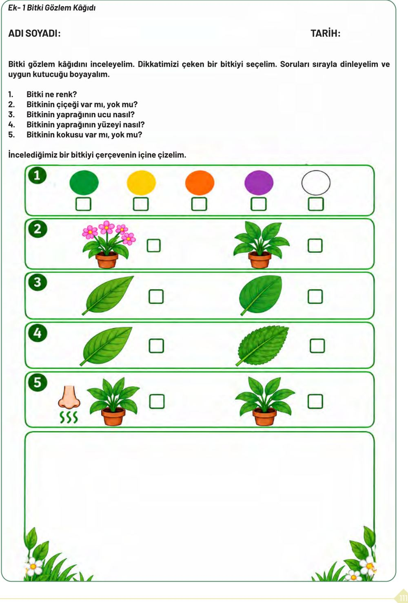

<!-- sayfa 113 -->

**ETKİNLİK ADI:** İstanbul Bilim Merkezi  
**ALAN ADI:** Fen, Sosyal  
**YAŞ GRUBU:** 60-72 ay  

**ALAN BECERİLERİ, ÖĞRENME ÇIKTILARI VE SÜREÇ BİLEŞENLERİ**

**FEN ALANI**  
**FBAB7.** Deney Yapma  
**FAB7.** Merak ettiği konular / olay / durum hakkında deneyler yapabilme  
FAB7.b. Merak ettiği konuda deneme-yanılma yoluyla deney yapar.

**SOSYAL ALAN**  
**SBAB9.** Coğrafi Gözlem ve Saha Çalışması  
**SAB8.** Coğrafi gözlem ve saha çalışmasını gerçekleştirebilmek için gerekli olan hazırlığı yapabilme  
SAB8.a. Okul dışı öğrenme etkinlikleri kapsamında gidilecek mekân ve yapılacak çalışmalara yönelik görselleri inceler.  
SAB8.b. Okul dışı öğrenme etkinliklerinde kendi güvenliğini ve sağlığını korumak için dikkat edilmesi gereken hususları söyler.  
**SAB9.** Coğrafi gözlem ve okul dışı planlanan çalışmaları çevreye duyarlı biçimde uygulayabilme  
SAB9.b. Okul dışı öğrenme çalışma sahasında çevreyi olumsuz etkileyecek davranışlardan kaçınır.  
**SAB10.** Coğrafi gözlem ve çalışma sahasından elde edilen sonuçları sözel / görsel yolla sunabilme  
SAB10.a. Okul dışı öğrenme etkinliğinde elde ettiği materyallerden ürün oluşturur.

**EĞİLİMLER**  
**E3.** Entelektüel Eğilimler  
E3.6. Analitiklik

**PROGRAMLAR ARASI BİLEŞENLER**  
**Sosyal-Duygusal Öğrenme Becerileri**  
SDB1.2. Kendini Düzenleme (Öz Düzenleme)  
**Değerler**  
D16. Sorumluluk  
D16.2. Topluma karşı görevlerini yerine getirmek  
**Okuryazarlık Becerileri**  
OB4. Görsel Okuryazarlık

**Kavramlar:** Duyu: sesli - sessiz  
**Sözcükler:** bilim, deney  
**Materyaller:** Bilim Gözlem Kâğıdı (Ek - 1)  
**Eğitim / Öğrenme Ortamları:** Çocukların gezi süresince kendi güvenlik ve sağlıklarını korumaları, aynı zamanda bilim merkezindeki materyalleri güvenli bir şekilde incelemeleri amacıyla okul dışı etkinliği ile ilgili açıklamalar yapılır. Sınıf ortamında, bilim merkezine ilişkin fotoğraflar çocuklara sunulur. Ayrıca, her çocuk için gezi sırasında üzerinde işaretleme yapacakları birer ”Bilim Gözlem Kâğıdı” kartları hazırlanır. Gezi sırasında araştırma yapacakları belirtilir. Gezi öncesinde çocukların güvenliğini sağlamak amacıyla, üzerinde çocukların ad - soyad bilgileri ile okulun iletişim bilgilerinin yer aldığı yaka kartları hazırlanır ve gezi süresince çocukların yakalarına takılır.

<!-- sayfa 114 -->

# ETKİNLİKLER
**Fen, Sosyal (Bütünleştirilmiş Büyük Grup Etkinliği)**

* Gezi öncesi, Çocuklarla “Bilim nedir?”, “Bilim insanları ne yapar?” gibi sorular üzerine sohbet edilir. Bilim merkezinde karşılaşacakları deney düzenekleri hakkında bilgi verilir. Gezi kuralları çocuklarla birlikte belirlenir ve gezide nasıl davranmaları gerektiği açıklanır (**SAB.8.b**). Bilim merkezi gezisinde dikkat etmeleri gereken temel kurallar (sessiz hareket etmek, eserlere dokunmamak, dikkatlice gözlem yapmak) açıklanır (**SAB.9.b**). Ayrıca, bilim merkezinin fotoğrafları ve kısa videoları gösterilerek çocuklarda merak duygusu uyandırılır (**SAB.8.a**).
* Gezi sırasında bilim merkezinde çocukları bilim merkezinde görevli bir rehber karşılar. Görevli personel eşliğinde farklı bölümler gezilir. Etkileşimli deney düzenekleri incelenir ve çocukların bireysel olarak gözlem yapmaları teşvik edilir. Çocuklar basit bilimsel etkinliklere veya deney atölyelerine katılır. Çocuklara deneyler esnasında güvenlikleri göz önünde bulundurularak sorumluluk almalarına, çocukların denemeler yapmalarına fırsat verilir (**FAB.7.b**). Deney sırasında çocukların soruları cevaplandırılır (**E3.6**). Çocuklar deney sonrası malzemelerin toplanmasına yardımcı olur (**D16.2**).
* Çocuklara hangi bölümü daha çok sevdiği sorulur ve çocuklar küçük gruplara ayrılarak istedikleri bölümde incelemede bulunur. Bilim merkezinin uygun alanlarına geçilir. Çocuklara üzerinde “dönen bir düzenek bul, mıknatıs kullanılan bir düzenek bul, ses çıkaran bir düzenek bul, ışıklı bir düzenek bul” yönergelerinin olduğu ”Bilim Gözlem Kâğıdı” kartı verilir (**OB4**). Çocuklardan bilim merkezinde yer alan bu düzenekleri bularak incelemeleri ve içlerinden en çok ilgilerini çeken düzeneği resmetmeleri istenir (**SDB1.2**).
* Gezi sonrası çocuklara “Bilim merkezinde en çok hangi bölüm ilgini çekti? Hangi bölüme tekrar gitmek isterdin?” soruları sorulur. Çocuklardan en sevdikleri bölümü resmetmeleri istenir (**SAB.10.a**). Sınıfta uygun bir yere resimler asılır. “Bilim Merkezi Hatıra” merkezi oluşturulur ve gezide çekilen fotoğraflar ve çocukların çizimleri burada sergilenir.

# DEĞERLENDİRME

* Bilim merkezinde hangi bölümleri gezdik?
* Bilim merkezinde en çok hangi bölüm ilgini çekti? Neden?
* Dönen bir düzenek bulabildin mi? Nasıl hareket ediyordu?
* Mıknatıs kullanılan düzenekte neler gözlemledin?
* Ses çıkaran düzeneğin sesi nasıldı?
* Işıklı düzenekte ne tür değişiklikler fark ettin?
* İncelediğin düzeneklerden hangisi seni şaşırttı?

# FARKLILAŞTIRMA

**Zenginleştirme:** Çocuklardan bilim merkezinde en ilginç buldukları düzeneği seçmeleri, nasıl çalıştığına ilişkin tahminlerini arkadaşlarıyla paylaşmaları ve benzer özellikte başka düzenekler bulmaları istenebilir. Çocuklardan gezi sırasında en çok ilgilerini çeken deneyi farklı sanat materyalleri kullanarak resmetmeleri veya üç boyutlu olarak tasarlamaları istenebilir.

**Destekleme:** Bilim merkezinde karşılaşılabilecek düzenekler ve deneyler görsellerle gezi öncesinde tanıtılabilir. ”Bilim Gözlem Kâğıdı” etkinliğinde kullanılan görev kartları büyük görseller ve sembollerle hazırlanarak çocukların düzenekleri daha kolay fark etmeleri desteklenebilir. Çocukların düzenekleri incelerken akranlarıyla iş birliği yapmalarına ve gözlemlerini paylaşmalarına fırsat tanınabilir.

# AİLE VE TOPLUM KATILIMI

**Aile Katılımı:** Gezi öncesinde ailelere bilim merkezi gezisinin amacı, gezi programı ve gerçekleştirilecek etkinlikler hakkında bilgilendirme yapılabilir. Ailelerden çocuklarıyla birlikte günlük yaşamda karşılaştıkları basit bilim olayları (mıknatısın kullanımı, ışık, ses, hareket vb. ) hakkında sohbet etmeleri istenebilir.

<!-- sayfa 115 -->

Ek-1 Bilim Gözlem Kâğıdı

ADI SOYADI:                                          TARİH:

Bilim gözlem kâğıdını inceleyelim. Gezi sırasında gördüğümüz araçların altındaki kutucuğu işaretleyelim. Gezi sırasında en çok ilgimizi çeken aracı çerçevenin içine çizelim.

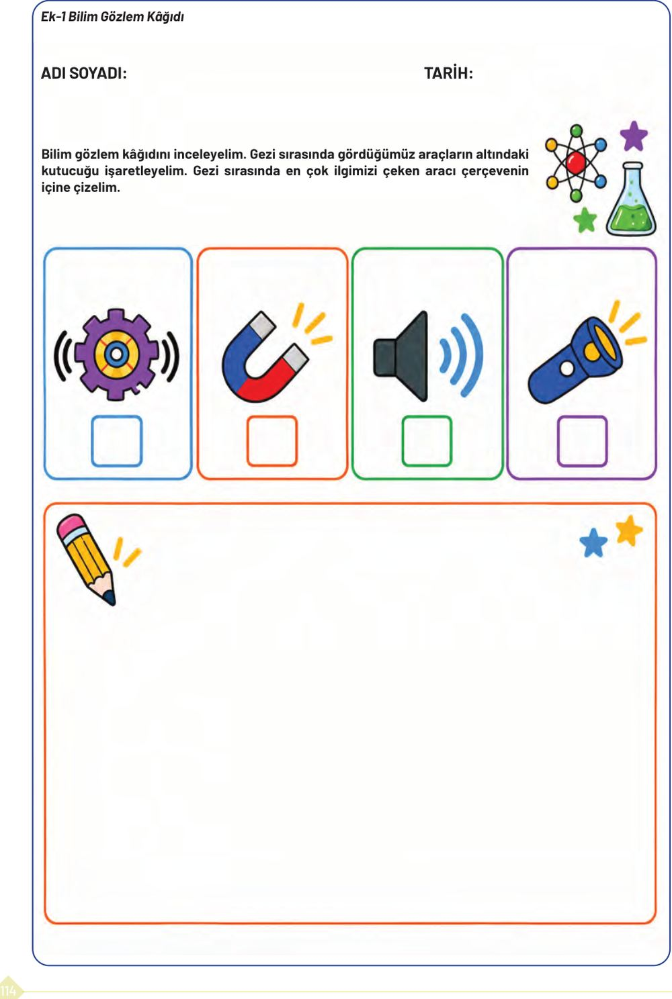

| | | | |
| :---: | :---: | :---: | :---: |
| ![Dişli simgesi] | ![Mıknatıs simgesi] | ![Hoparlör simgesi] | ![El feneri simgesi] |
| [ ] | [ ] | [ ] | [ ] |

<!-- sayfa 116 -->

**ETKİNLİK ADI:** İtfaiye İstasyonu  
**ALAN ADI:** Sosyal, Hareket ve Sağlık  
**YAŞ GRUBU:** 60-72 ay  

**ALAN BECERİLERİ, ÖĞRENME ÇIKTILARI VE SÜREÇ BİLEŞENLERİ**  

**SOSYAL ALAN**  
**SBAB9. Coğrafi Gözlem ve Saha Çalışması**  
**SAB8. Coğrafi gözlem ve saha çalışmasını gerçekleştirebilmek için gerekli olan hazırlığı yapabilme**  
SAB8.a. Okul dışı öğrenme etkinlikleri kapsamında gidilecek mekân ve yapılacak çalışmalara yönelik görselleri inceler.  
SAB8.b. Okul dışı öğrenme etkinliklerinde kendi güvenliğini ve sağlığını korumak için dikkat edilmesi gereken hususları söyler.  

**HAREKET VE SAĞLIK ALANI**  
**HSAB3. Güvenlik Becerileri**  
**HSAB9. Kaza, afet ve tehlikeli durumlarda güvenli davranışları sergileyebilme**  
HSAB9.a. Acil durumlarda aranacak numarayı söyler.  

**EĞİLİMLER**  
**E3. Entelektüel Eğilimler**  
E3.8. Soru Sorma  

**PROGRAMLAR ARASI BİLEŞENLER**  

**Sosyal-Duygusal Öğrenme Becerileri**  
**SDB2.1. İletişim**  

**Değerler**  
**D5. Duyarlılık**  
D5.3. Afet bilincine sahip olmak  

**Okuryazarlık Becerileri**  
**OB4. Görsel Okuryazarlık**  

**Kavramlar:** Duyu: sıcak, soğuk, ılık  
**Sözcükler:** itfaiye, acil durum, acil çağrı merkezi, yangın  
**Materyaller:** itfaiye istasyonuna ait fotoğraflar, resim kâğıdı, boya kalemleri  
**Eğitim / Öğrenme Ortamları:** Çocukların gezi süresince kendi güvenlik ve sağlıklarını korumaları, aynı zamanda itfaiye istasyonundaki araç-gereçleri incelemeleri amacıyla okul dışı etkinliği ile ilgili açıklamalar yapılır. Sınıfta itfaiye istasyonuna ait fotoğraflar hazırlanır. Gezi öncesinde çocukların güvenliğini sağlamak amacıyla, üzerinde çocukların ad - soyad bilgileri ile okulun iletişim bilgilerinin yer aldığı yaka kartları hazırlanır ve gezi süresince çocukların yakalarına takılır. Gezi sonrasında gerçekleştirilecek ”acil durum” canlandırma çalışması için gerekli materyaller hazırlanır.

<!-- sayfa 117 -->

# ETKİNLİKLER

**Sosyal, Hareket ve Sağlık (Bütünleştirilmiş Büyük Grup Etkinliği)**

* Gezi öncesinde çocuklara itfaiye istasyonunu ziyaret edecekleri söylenir. “Sizce itfaiye istasyonunda neler görebiliriz?”, “İtfaiyeciler hangi durumlarda insanlara yardımcı olur?” gibi sorular yöneltilerek çocukların düşüncelerini paylaşmalarına fırsat verilir. Ardından itfaiyecilerin yangın gibi acil durumlarda insanlara yardımcı oldukları; bunu yaparken özel araçlar, kıyafetler ve çeşitli araç-gereçler kullandıkları görseller aracılığıyla yaş düzeyine uygun biçimde açıklanır (SAB.8.a).
* Çocuklara istasyonda büyük araçlar görebilecekleri, bazı araçların ışıklarının yanabileceği ve siren sesleri duyabilecekleri önceden açıklanır. “İtfaiye aracının sireni biraz yüksek ses çıkarabilir. Eğer görevli bize sireni gösterecekse önce haber verecek ve biz de hazır olduğumuzda kısa süre dinleyeceğiz.” denir. Siren sesini dinlemek istemeyen çocukların öğretmeninin yanında kalabileceği, biraz daha uzaktan izleyebileceği veya uygun sakin bir alanda bekleyebileceği belirtilir. Böylece çocukların gezi sırasında karşılaşabilecekleri duyusal uyaranları önceden bilmeleri ve kendilerini rahat hissettikleri biçimde sürece katılmaları desteklenir.
* Gezi sırasında dikkat edilecek davranışlar çocuklarla birlikte konuşulur. Öğretmen ve grupla birlikte hareket etmek, görevlinin açıklamalarını dinlemek ve araçları yalnızca izin verilen alanlardan incelemek gibi olumlu davranışlar üzerinde durulur (SAB.8.b). Çocukların geziye ilişkin merak ettikleri sorular not alınır ve yanıtlarını gezi sırasında birlikte araştırabilecekleri belirtilir.
* Gezi sırasında çocuklar istasyonda görevliler tarafından karşılanır. İtfaiyecilerin yaptıkları işler, istasyonun bölümleri ve kullandıkları araç-gereçler çocukların yaş düzeyine uygun ve sakin bir anlatımla tanıtılır. İtfaiye aracı, hortumlar, koruyucu kıyafetler ve diğer araçlar yakından incelenir. Çocukların görevliye merak ettikleri soruları yöneltmelerine fırsat verilir (E3.8).
* İtfaiye aracının sireni gösterilecekse çocuklara önceden “Şimdi görevlimiz bize sirenin nasıl ses çıkardığını gösterecek. Ses biraz yüksek olabilir ve yalnızca kısa bir süre duyacağız. Dinlemek istemeyenler öğretmenimizin yanında biraz daha uzakta bekleyebilir.” açıklaması yapılır. Siren düşük ses düzeyinde ve kısa süreli olarak dinletilir. Çocukların kulaklarını kapatma, biraz uzaklaşma, öğretmenin yanında kalma veya dinlememe tercihleri desteklenir.
* İtfaiyecilerin çalışırken kendilerini korumak için özel kıyafetler kullandıkları gösterilir. Bu kıyafetlerin sıcak ortamlarda vücutlarını korumalarına yardımcı olduğu açıklanır. Buradan hareketle sıcak, soğuk ve ılık kavramları günlük yaşamdan güvenli örneklerle ele alınır. Güneşli bir havada ısınan bir yüzeyin sıcak, buzdolabından çıkan suyun soğuk, banyoda kullanılan uygun sıcaklıktaki suyun ise ılık olabileceği üzerine konuşulur. Çocukların günlük yaşamlarından sıcak, soğuk ve ılık durumlara örnek vermelerine fırsat verilir.
* Yangın anını canlandırmak amacıyla gerçek duman, ateş, yoğun sıcaklık veya ani yüksek ses kullanılmaz. Bunun yerine çocuklara önceden ne yapılacağı açıklanan kısa ve sakin bir güvenli davranış provası gerçekleştirilir. “Şimdi birlikte bir güvenli hareket oyunu yapacağız. Öğretmenimizi dinleyecek, sırayla hareket edecek ve birlikte belirlediğimiz yere gideceğiz.” açıklaması yapılır. Çocukların bunun gerçek bir acil durum olmadığı ve yalnızca ne yapılacağını öğrenmek amacıyla gerçekleştirilen bir çalışma olduğu açıkça belirtilir. Katılmak istemeyen çocukların öğretmenin yanında kalarak izlemesine veya uygun bir alanda beklemesine fırsat verilir.
* Çocuklara bir yetişkinin yardıma ihtiyaç duyduğu gerçek bir acil durumda 112 Acil Çağrı Merkezinden yardım istenebileceği açıklanır. Bu numaranın oyun amacıyla kullanılmadığı, yalnızca gerçekten yardıma ihtiyaç duyulan durumlarda yetişkinlerle birlikte kullanılmasının önemli olduğu belirtilir (D5.3).
* Gezi sonrasında çocuklarla gezi sırasında gördükleri ve merak ettikleri konular hakkında sohbet edilir. “İtfaiye istasyonunda en çok ne dikkatini çekti?”, “İtfaiyeciler hangi araçları kullanıyordu?”, “Kendimizi rahat ve güvende hissetmek için gezide neler yaptık?” gibi sorularla deneyimlerini kendi ifadeleriyle paylaşmaları desteklenir (HSAB.9.a).
* Çocuklar küçük gruplara ayrılarak çeşitli materyallerle itfaiye istasyonunda gördükleri araçları, görevleri veya istasyon ortamını oyun yoluyla canlandırır (SDB2.1). Ardından çocuklardan gezi sırasında ilgilerini çeken bir araç, kıyafet, istasyon bölümü ya da başka bir ayrıntıyı resmetmeleri istenir. Hazırlanan resimler sınıfın uygun bir bölümünde sergilenir ve isteyen çocukların resimleri hakkında konuşmalarına fırsat verilir (OB4).

# DEĞERLENDİRME

* İtfaiyeciler hangi görevleri yapar?
* İtfaiyeciler yangınlara müdahale ederken neden özel kıyafetler giyer?
* Yangın sırasında nasıl davranmamız gerekir?
* 112 Acil Çağrı Merkezi hangi durumlarda aranmalıdır?
* 112 numarasını ihtiyaç dışında aramak neden doğru değildir?

<!-- sayfa 118 -->

# FARKLILAŞTIRMA

**Zenginleştirme:** Çocukların güvenli davranışlara ilişkin farkındalıklarını desteklemek amacıyla farklı tehlike veya afet türlerinin ayrıntılı biçimde art arda anlatılması yerine, günlük yaşamda güvenliği destekleyen davranışlar oyun, öykü, kukla, görseller ve kısa canlandırmalar aracılığıyla ele alınabilir. “Bir yetişkinden yardım isteme”, “öğretmenle ve grupla birlikte hareket etme”, “yönergeleri dinleme” ve “güvenli alana geçme” gibi davranışlar sakin ve güven verici etkinliklerle pekiştirilebilir.

**Destekleme:** İtfaiye istasyonundaki araç ve gereçleri inceleme sürecinde çocuklara ek açıklamalar, görsel ipuçları ve somut örneklerle rehberlik edilebilir. Canlandırma etkinliği sırasında öğretmen model olabilir; çocukların sürece katılımı akran desteği, rol kartları ve kısa yönergelerle desteklenebilir. Ayrıca 112 Acil Çağrı Merkezinin kullanım amacı, acil durumlarda yapılması gerekenler ve itfaiyecilerin görevleri görseller, örnek olaylar ve soru-cevap çalışmalarıyla yeniden ele alınarak öğrenmeler pekiştirilebilir.

# AİLE VE TOPLUM KATILIMI

**Aile Katılımı:** Ailelerden çocuklarıyla birlikte acil durumlarda yapılması gerekenler hakkında sohbet etmeleri istenebilir. Sohbet sırasında 112 Acil Çağrı Merkezi’nin hangi durumlarda aranması gerektiği ve bu numaranın yalnızca gerçek acil durumlarda kullanılması gerektiği üzerinde durulabilir. Çocukların acil durumlara ilişkin düşünce ve sorularını aileleriyle paylaşmaları teşvik edilir. Ailelerden çocuklarıyla birlikte acil durumlarda kullanılacak telefon numarasını içeren bir güvenlik posteri hazırlamaları istenir. Hazırlanan posterin evde görünür ve erişilebilir bir alana asılması sağlanarak çocukların acil durum numarasını hatırlamaları desteklenebilir.

<!-- sayfa 119 -->

**ETKİNLİK ADI:** İzmir Efes Antik Kenti  
**ALAN ADI:** Türkçe, Sosyal  
**YAŞ GRUBU:** 60-72 ay  

**ALAN BECERİLERİ, ÖĞRENME ÇIKTILARI VE SÜREÇ BİLEŞENLERİ**  
**TÜRKÇE ALANI**  
TAKB. Konuşma  
&nbsp;&nbsp;&nbsp;&nbsp;TAKB.2. Konuşma sürecinin içeriğini oluşturabilme  
&nbsp;&nbsp;&nbsp;&nbsp;&nbsp;&nbsp;&nbsp;&nbsp;TAKB.2.e. Şiir, hikâye, tekerleme gibi özgün sözlü ürün oluşturur.  

**SOSYAL ALAN**  
SBAB9. Coğrafi Gözlem ve Saha Çalışması  
&nbsp;&nbsp;&nbsp;&nbsp;SAB.8. Coğrafi gözlem ve saha çalışmasını gerçekleştirebilmek için gerekli olan hazırlığı yapabilme  
&nbsp;&nbsp;&nbsp;&nbsp;&nbsp;&nbsp;&nbsp;&nbsp;SAB.8.b. Okul dışı öğrenme etkinliklerinde kendi güvenliğini ve sağlığını korumak için dikkat edilmesi gereken hususları söyler.  
&nbsp;&nbsp;&nbsp;&nbsp;SAB.9. Coğrafi gözlem ve okul dışı planlanan çalışmaları çevreye duyarlı biçimde uygulayabilme  
&nbsp;&nbsp;&nbsp;&nbsp;&nbsp;&nbsp;&nbsp;&nbsp;SAB.9.a. Okul dışı öğrenme etkinliğinde takip edilecek sözel/görsel yönergeleri uygular.  

SBAB10. HARİTA  
&nbsp;&nbsp;&nbsp;&nbsp;SAB.12. Yakın çevresinde bulunan kişi / nesne / mekânın konumunu belirlemek üzere takip edeceği krokiyi çözümleyebilme  
&nbsp;&nbsp;&nbsp;&nbsp;&nbsp;&nbsp;&nbsp;&nbsp;SAB.12.b. Belirlenen hedef bölgeyi / nesneyi krokiyi takip ederek bulur.  

**EĞİLİMLER**  
**E1. Benlik Eğilimleri**  
&nbsp;&nbsp;&nbsp;&nbsp;E1.1. Merak  
**E3. Entelektüel Eğilimler**  
&nbsp;&nbsp;&nbsp;&nbsp;E3.3. Yaratıcılık  

**PROGRAMLAR ARASI BİLEŞENLER**  
**Sosyal-Duygusal Öğrenme Becerileri**  
&nbsp;&nbsp;&nbsp;&nbsp;SDB1.2. Kendini Düzenleme (Öz Düzenleme)  

**Değerler**  
&nbsp;&nbsp;&nbsp;&nbsp;D7. Estetik  
&nbsp;&nbsp;&nbsp;&nbsp;&nbsp;&nbsp;&nbsp;&nbsp;D7.2. Sanatsal ve görsel zevkleri hayatın bir parçası hâline getirmek  

**Okuryazarlık Becerileri**  
&nbsp;&nbsp;&nbsp;&nbsp;OB4. Görsel Okuryazarlık  

**Kavramlar:** Yön / mekânda konum: ileri - geri, sağ - sol, önünde - arkasında, arasında, yanında  
**Sözcükler:** kroki, tiyatro  
**Materyaller:** kroki kağıdı (Ek - 1), resimli çocuk kitabı  
**Eğitim / Öğrenme Ortamları:** Çocukların gezi süresince kendi güvenlik ve sağlıklarını korumaları, aynı zamanda antik kentte yer alan tarihî dokuları güvenli bir şekilde incelemeleri amacıyla okul dışı etkinliği ile ilgili açıklamalar yapılır. Sınıfta ziyaret edilecek alanlara ait fotoğraflar hazırlanır (agora, celsus). Gezi öncesinde çocukların güvenliğini sağlamak amacıyla, üzerinde çocukların ad - soyad bilgileri ile okulun iletişim bilgilerinin yer aldığı yaka kartları hazırlanır ve gezi süresince çocukların yakalarına takılır. Gezi alanında okunmak üzere çocuklarla okunmak üzere bir adet resimli çocuk kitabı seçilir.

<!-- sayfa 120 -->

**ETKİNLİKLER**

**Türkçe, Sosyal (Bütünleştirilmiş Büyük Grup Etkinliği)**

* Gezi öncesi, çocuklara İzmir Efes Antik Kent’in krokisi dağıtılır (Ek-1). Önce çocuklar krokileri inceleyerek bunun nereye ait olabileceğini tahmin ederler (**OB4**). Tahminler alındıktan sonra krokinin büyük hâli sınıfa yansıtılır ve Efes Antik Kent’in bölümleri tanıtılır. Buraya bir gezi düzenleneceği açıklanır ve hem gezi sırasında hem de antik kentte uyulması gereken kurallar hakkında çocuklarla konuşulur (**SAB.8.b**). Ardından sınıfta Efes hakkında çocuklarla sohbet edilir ve “Orada neler göreceğimizi merak ediyor musunuz?” diye sorulur (**E1.1**).
* Çocukların krokileri yanlarında götürecekleri söylenir. Bunun için sağ-sol, ileri-geri gibi yönleri dikkatle takip etmeleri gerektiği belirtilir. Ayrıca bir oyun oynayacakları açıklanır. Çocuklara, yol boyunca söylenecek bilmeceleri dikkatle dinlemeleri gerektiği anlatılır.
* Gezi sırasında çocuklar söylenen yön ve mekân kavramlarını dinler ve krokiden yararlanarak alanlara doğru ilerler (**SAB.9.a**). İlk olarak Agora alanına gelinir ve buranın eski bir çarşı olduğu açıklanır. Sınıf üç gruba ayrılır ve her gruba bir meslek verilir (örneğin balıkçı, manav, ayakkabıcı, terzi). Diğer gruptaki çocuklar verilen meslekleri bilmez. Gruplar sırayla kendilerine verilen mesleklerin canlandırmasını yapar diğer çocuklar ise hangi meslek olduğunu tahmin eder (**E3.3**).
* Oyun için bir bilmece sorulur ve bu bilmece sayesinde çocukların hazineye yaklaştıkları anlatılır:

  Bilmece
  “Çok eskiden insanlar,
  Sahneye çıkmışlar,
  Canlandırma yapmışlar,
  Burada oynamışlar...”

* Çocuklar bilmeceden yola çıkarak bir sonraki alanın tiyatro olduğunu tahmin ederler. Krokiyi takip ederek tiyatroya geçilir (**SAB.12.b, SDB1.2**). Burada çocuklar alanı inceler ve eskiden insanların hangi etkinlikleri yaptığını tahmin etmeye çalışır. Tahminler alındıktan sonra buranın sadece tiyatro değil, aynı zamanda müzik ve dans etkinlikleri için de kullanıldığı açıklanır. Çok eski yıllarda mikrofon olmadığı fakat tiyatronun taşlardan yapıldığı için seslerin en arkadaki kişiye bile ulaştığı anlatılır. Ardından çocuklar sırayla alçak ve yüksek sesler çıkararak seslerinin tiyatroda nasıl yankılandığını denerler. Daha sonra çocuklara ikinci bilmece sorulur:

  Bilmece
  “Çok eskiden insanlar,
  Okumuşlar, yazmışlar,
  Bilgileri burada bulmuşlar...”

* Çocuklar bunun kütüphane olduğunu tahmin eder. Krokiyi takip ederek Celsus Kütüphanesi’ne gidilir (**SAB.12.b**). Burada öğretmenin verdiği yönergeleri izleyerek (ileri-geri, sağ-sol, önünde-arkasında) saklanan kitabı bulurlar. Kitap bulununca oyunun tamamlandığı açıklanır. Gezi sonrasında çocuklara “Binlerce yıl önce bu kütüphanede olsaydınız, hangi kitabı okumak isterdiniz?” sorusu sorulur.
* Çocuklardan hayallerindeki kitabı tasarlamaları istenir (**TAKB.2.e**). Tasarladıkları kitaplar sergilenir ve bu sergilenen kısma kütüphane adı verilir. Efes Antik Kent’indeki kütüphanenin adının “Celsus” olduğu açıklanır ve çocuklara “Siz kütüphanenize ne isim vermek isterdiniz?” diye sorulur (**E3.3**).
* Ardından Celsus Kütüphanesi’nde yer alan eserlerin günümüze ulaşamadığı anlatılır ve bu eserleri korumak için neler yapılabileceği üzerine çocuklarla sohbet edilir (**D7.2**).

**ERLENDİRME**

* Antik kentte hangi yapıları gördünüz? En çok ne ilginizi çekti?
* Yönünüzü bulabilmek için krokiyi nasıl kullandınız?
* Kroki olmasaydı gitmek istediğimiz yerleri nasıl bulabilirdik?
* Antik kentte yer alan hangi bölümü hatırlıyorsunuz? Orada neler görmüştük?

<!-- sayfa 121 -->

# FARKLILAŞTIRMA

**Zenginleştirme:** Öğrenme içeriğinin farklılaştırılması amacıyla, gezi öncesinde ve gezi sırasında antik kentte bulunan eserler ve bölümler hakkında daha ayrıntılı bilgi verilebilir. Gezi sonrasında sınıfta bloklar, karton kutular veya geri dönüşüm materyalleri kullanılarak Efes Antik Kenti’nin belirli bir bölümünün üç boyutlu modeli oluşturulabilir.

**Destekleme:** Kroki üzerinde yer alan önemli yapılar renk, sembol veya görsellerle belirgin hâle getirilerek çocukların yönlerini bulmaları desteklenebilir. Çocuklara antik kentteki bölümleri bulmaları sırasında yönlendirici ipuçları verilebilir. Çocukların krokide ilerlerken akranlarıyla iş birliği yapmalarına ve birlikte karar vermelerine fırsat tanınabilir. Gerektiğinde çocukların kroki üzerindeki semboller ile gerçek yapılar arasında ilişki kurmalarını kolaylaştıracak görsel eşleştirme kartları kullanılabilir. Çocukların buldukları yapıları işaretlemeleri için çıkartmalar, renkli kalemler veya semboller kullanmalarına olanak sağlanarak etkinliğe katılımları desteklenebilir.

# AİLE VE TOPLUM KATILIMI

**Aile Katılımı:** Ailelerden çocuklarıyla yaşadıkları çevrede bulunan tarihî bir yapı, kültürel miras ögesi veya ören yerini ziyaret etmeleri ya da fotoğraflarını incelemeleri ve dikkatlerini çeken özelliklerini kendi çizdikleri kroki üzerinden sınıfta paylaşmaları istenebilir.

**Toplum Katılımı:** Toplum katılımı kapsamında çocukların yaşadıkları çevrede bulunan müzeler, tarihî yapılar ve kültürel miras ögeleri hakkında farkındalık kazanmaları desteklenebilir.

<!-- sayfa 122 -->

Ek-1 İzmir Efes Antik Kenti Krokisi

ADI SOYADI:                                                                                                                           TARİH:

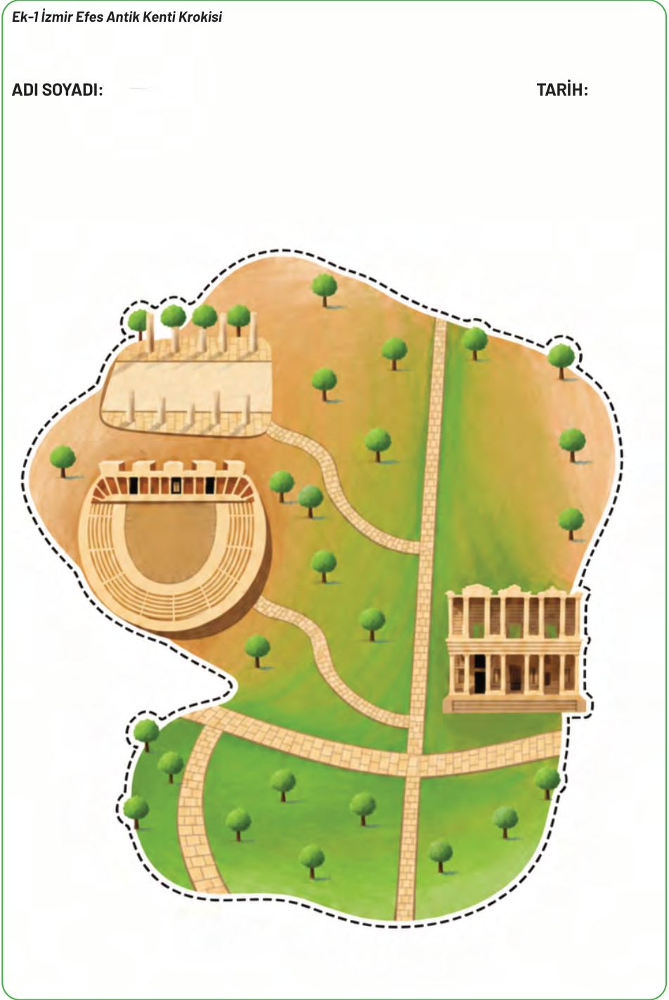

<!-- sayfa 123 -->

**ETKİNLİK ADI:** Somut Olmayan Kültürel Miras Müzesi  
**ALAN ADI:** Sosyal  
**YAŞ GRUBU:** 60-72 ay  

**ALAN BECERİLERİ, ÖĞRENME ÇIKTILARI VE SÜREÇ BİLEŞENLERİ**  
**SOSYAL ALAN**  
**SBAB9. Coğrafi Gözlem ve Saha Çalışması**  
**SAB.8. Coğrafi gözlem ve saha çalışmasını gerçekleştirebilmek için gerekli olan hazırlığı yapabilme**  
SAB.8.b. Okul dışı öğrenme etkinliklerinde kendi güvenliğini ve sağlığını korumak için dikkat edilmesi gereken hususları söyler.  
**SAB.9. Coğrafi gözlem ve okul dışı planlanan çalışmaları çevreye duyarlı biçimde uygulayabilme**  
SAB.9.a. Okul dışı öğrenme etkinliğinde takip edilecek sözel / görsel yönergeleri uygular.  

**EĞİLİMLER**  
**E1. Benlik Eğilimleri**  
E1.1. Merak  
**E3. Entelektüel Eğilimler**  
E3.2. Odaklanma  

**PROGRAMLAR ARASI BİLEŞENLER**  
**Sosyal-Duygusal Öğrenme Becerileri**  
SDB2.2. İş Birliği  
**Değerler**  
D4. Dostluk  
D4.1. Arkadaşlarına destek olmak  
**Okuryazarlık Becerileri**  
OB4. Görsel Okuryazarlık  

**Kavramlar:** Miktar: yarım - tam  
**Sözcükler:** desen, halı, hayat ağacı  
**Materyaller:** “Halıdaki Örüntüyü Tamamla” çalışma kâğıdı (EK-1)  
**Eğitim / Öğrenme Ortamları:** Çocukların gezi süresince kendi güvenlik ve sağlıklarını korumaları, aynı zamanda müzede yer alan tarihi halıları güvenli bir şekilde incelemeleri amacıyla okul dışı etkinliği ile ilgili açıklamalar yapılır. Sınıfta ziyaret edilecek alanlara ait fotoğraflar hazırlanır. Gezi öncesinde çocukların güvenliğini sağlamak amacıyla, üzerinde çocukların ad - soyad bilgileri ile okulun iletişim bilgilerinin yer aldığı yaka kartları hazırlanır ve gezi süresince çocukların yakalarına takılır. Gezide kullanılmak üzere “Halıdaki Örüntüyü Tamamla” çalışma kâğıdı (EK-1) adlı çalışma kağıdı çocuk sayısı kadar çıktı alarak hazırlanır.

<!-- sayfa 124 -->

**ETKİNLİKLER**

**Sosyal (Büyük Grup Etkinliği)**

* Gezi öncesi, çocuklarla halı ve dokuma hakkında kısa bir sohbet edilir ve “Sizce halılardaki desenleri kim yapıyor olabilir?”, “Her desenin bir anlamı var mıdır?”, “Desenler sence neye benziyor?”, “Bazı desenler çiçek gibi bazıları dalgaya benziyor olabilir mi?” soruları sorulur.
* Birkaç motif görseli (üçgen, yıldız, dalga, kalp vb.) gösterilir.
* Geçmişte dokunan halı ve kilimlerin bulunduğu bir müzeye geziye gidecekleri açıklanır.
* Müze gezisi öncesinde, çocuklara müzede hangi kurallara dikkat etmeleri gerektiği (sessiz olmak, dokunmamak, dikkatlice gözlem yapmak, sorular sormak vb.) açıklanır (**SAB.8.b**).
* Gezi sırasında müzenin girişinde çocuklara bir dokuma tezgâhı görseli gösterilir. Bu görselin ne işe yaradığı sorulur (**E1.1**). Ardından müzenin içinde gerçek bir dokuma tezgâhı bulunduğu belirtilir. Renk kartları kullanarak çocuklardan dörder kişilik gruplar oluşturulur. Gruplardan iş birliği yaparak arkadaşlarıyla dokuma tezgâhını bulmaları istenir (**SDB2.2**). Çocuklar, müzeyi dikkatlice gezerek dokuma tezgâhını arar (**SAB.9.a**).
* Dokuma tezgâhı bulunduğunda çocuklar tezgâhın önünde toplanır. Üzerindeki halı detaylı biçimde incelenir. Çocuklara “Hangi renkleri görüyorsunuz?”, “Bu halıda nasıl şekiller var?” gibi sorular yöneltilerek sohbet edilir (**OB4**).
* Gözlem tamamlandıktan sonra çocukların dikkati halıdaki desenin yönüne ve tekrar eden motiflere çekilir. Öğretmen, “Bu desen bir yerden başlamış ve aynı şekiller tekrar ederek ilerlemiş. Sizce bu desen devam etseydi halı nasıl görünürdü?” sorusunu yöneltir (**E3.2**).
* Gezi sonrasında çocuklara “Halıdaki Örüntüyü Tamamla” çalışma kâğıdı (EK-1) adlı etkinlik kâğıtları dağıtılır. Çocuklardan motifi uygun şekilde tamamlamaları istenir. Çocukların motiflerini tamamlarken arkadaşlarından destek isteyebilecekleri ve ihtiyacı olan arkadaşlarına destek olabilecekleri hatırlatılır (**D4.1**).
* Çizimler tamamlandıktan sonra çocuklar kâğıtlarını belirlenen sergi alanına dizer. Son olarak hep birlikte müzedeki halı yeniden incelenir ve çocukların oluşturduğu motiflerle müzedeki desen arasındaki benzerlikler ve farklılıklar üzerine kısa bir sohbet yapılır.
* Çocukların çizimleri bir araya getirilerek pano oluşturulur.

**DEĞERLENDİRME**

* Müzedeki halılarda hangi renkleri fark ettiniz?
* Halılarda tekrar eden hangi şekilleri gördünüz?
* Dokuma tezgâhı ne işe yarıyordu?
* Motifi tamamlarken nelere dikkat ettiniz?
* Bugün öğrendiğiniz yeni bir şeyi bizimle paylaşır mısın?

**FARKLILAŞTIRMA**

**Zenginleştirme:** Farklı kültürlere ait halı ve kilim örnekleri incelenerek motifler arasındaki benzerlik ve farklılıklar hakkında sohbet edebilir. Halılardaki tekrar eden motifler arasında benzerlik ve farklılıkları karşılaştırmaları desteklenebilir.

**Destekleme:** Çocuklara, tekrar eden desenin başlangıç bölümünü işaret edilerek “Sence bundan sonra hangi şekil gelmeli?” gibi yönlendirici sorular sorulabilir. Çocukların motifi oluştururken renk, şekil ve yön ilişkilerini fark etmelerine yardımcı olmak amacıyla sözel ipuçları sunulabilir. Gerektiğinde çocukların çalışmayı bir arkadaşlarıyla birlikte planlamaları ve tamamlamaları desteklenebilir.

**AİLE VE TOPLUM KATILIMI**

**Aile Katılımı:** Ailelerden çocuklarıyla evdeki halı, kilim, örtü veya yastık gibi eşyaların desenlerini incelemeleri istenebilir. Ailesiyle bir motif resmi yaparak okulda hazırlanan sergide bu resimleri sergilemeleri istenebilir.

**Toplum Katılımı:** Dokumacılık yapan bir zanaatkâr veya halk eğitim merkezi eğitmeni sınıfa davet edilerek

<!-- sayfa 125 -->

Ek-1 Halıdaki Örüntüyü Tamamla

ADI SOYADI:                                                                                          TARİH:

Halı görselindeki tekrar eden motifleri inceleyelim. Motifleri örüntü kuralına uygun devam ettirelim.

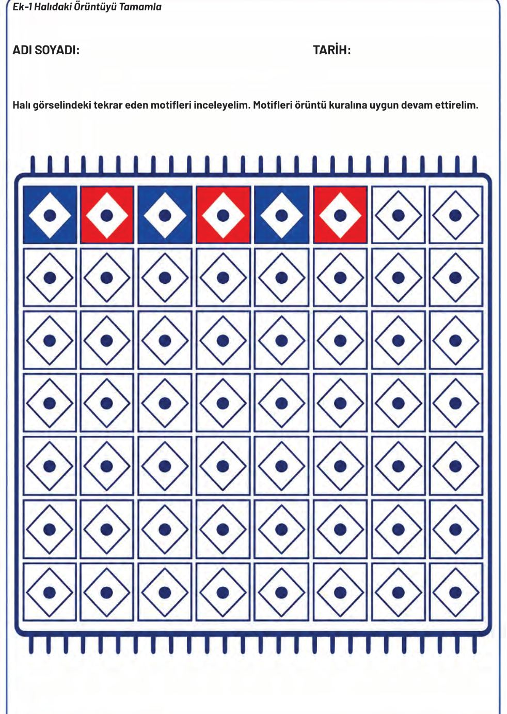

<!-- sayfa 126 -->

**ETKİNLİK ADI:** Karacabey Longoz Ormanları  
**ALAN ADI:** Sosyal  
**YAŞ GRUBU:** 60-72 ay  

**ALAN BECERİLERİ, ÖĞRENME ÇIKTILARI VE SÜREÇ BİLEŞENLERİ**  
**SOSYAL ALAN**  
**SBAB9. Coğrafi Gözlem ve Saha Çalışması**  
**SAB.8. Coğrafi gözlem ve saha çalışmasını gerçekleştirebilmek için gerekli olan hazırlığı yapabilme**  
* SAB.8.a. Okul dışı öğrenme etkinlikleri kapsamında gidilecek mekân ve yapılacak çalışmalara yönelik görselleri inceler.  
* SAB.8.b. Okul dışı öğrenme etkinliklerinde kendi güvenliğini ve sağlığını korumak için dikkat edilmesi gereken hususları söyler.  
**SAB.9. Coğrafi gözlem ve okul dışı planlanan çalışmaları çevreye duyarlı biçimde uygulayabilme**  
* SAB.9.b. Okul dışı öğrenme çalışma sahasında çevreyi olumsuz etkileyecek davranışlardan kaçınır.  

**EĞİLİMLER**  
**E1. Benlik Eğilimleri**  
E1.1. Merak  
**E3. Entelektüel Eğilimler**  
E3.2. Odaklanma  

**PROGRAMLAR ARASI BİLEŞENLER**  
**Sosyal-Duygusal Öğrenme Becerileri**  
SDB2.2. İş Birliği  
**Değerler**  
D9. Merhamet  
D9.3. İnsanı ve doğayı sevmek  
**Okuryazarlık Becerileri**  
OB4. Görsel Okuryazarlık  
OB7. Veri Okuryazarlığı  

**Kavramlar:** Yön / mekânda konum: alçak - yüksek  
**Sözcükler:** bataklık, kumul, subasar, akça cılıbıt, küçük balaban, sakar meke  
**Materyaller:** “Doğa Gözlem Kâğıdı” (Ek - 1), kraft kâğıdı (2 adet), çeşitli boyalar ve kalemler  
**Eğitim / Öğrenme Ortamları:** Çocukların gezi süresince kendi güvenlik ve sağlıklarını korumaları, aynı zamanda bilim merkezindeki materyalleri güvenli bir şekilde incelemeleri amacıyla okul dışı etkinliği ile ilgili açıklamalar yapılır. Sınıf ortamında, Karacabey Longoz Ormanına ilişkin fotoğraflar çocuklara sunulur. Her çocuk için gezi sırasında üzerinde işaretleme yapacakları birer “Doğa Gözlem Kâğıdı” hazırlanır. “Doğa Gözlem Kâğıdı” (Ek - 1) ile gezi sırasında araştırma yapacakları gezi öncesi belirtilir. Gezi öncesinde çocukların güvenliğini sağlamak amacıyla, üzerinde çocukların ad-soyad bilgileri ile okulun iletişim bilgilerinin yer aldığı yaka kartları hazırlanır ve gezi süresince çocukların yakalarına takılır.

<!-- sayfa 127 -->

# Sosyal (Büyük Grup Etkinliği )

* Gezi öncesi, ormanlar hakkında sohbet edilir. “Ormanda hangi canlılar yaşar?”, “Ormanda yürürken nelere dikkat etmeliyiz?”, “Sizce longoz ormanı diğer ormanlardan neden farklı olabilir?” soruları yöneltilerek çocukların ön bilgileri ve tahminleri alınır.
* Karacabey Longoz Ormanı’na ait fotoğraf ve kısa videolar incelenir. Çocuklardan gördükleri doğal unsurları (ağaç, su, kuş, yaprak, mantar vb.) söylemeleri istenir. Longoz ormanlarının yılın belirli dönemlerinde suyla kaplanan özel ekosistemler olduğu yaş düzeyine uygun ifadelerle açıklanır (**(E1.1)**. Longozda bulunan göl, bataklık, kumul ve subasar ekosistemleri görsellerle çocuklara tanıtılır (**SAB.8.a**).
* Çocuklara gezi boyunca kullanılmak üzere her çocuğa bir “Doğa Gözlem Kâğıdı” tanıtılır. Kartta gezi sırasında bu longozda yaşayan kara leylek, pasbaş patka, bataklık kırlangıcı, akça cılıbıt, küçük balaban, sakar meke gibi farklı türleri bulmaya çalışacakları ve buldukları hayvanı “Doğa Gözlem Kâğıdı” işaretleyecekleri söylenir. Çocuklara, doğada uyulması gereken kurallar hatırlatılır. Canlılara zarar vermemek, bitkileri koparmamak, çöpleri doğada bırakmamak, grup hâlinde hareket etmek ve güvenlik sınırlarına uymak gibi kurallar sohbet edilir (**SAB.8.b, SAB.9.b**).
* Gezi sırasında çocuklarla kısa bir sessiz gözlem yapılır. Çocuklardan gözlerini kapatarak çevreden gelen sesleri dinlemeleri istenir. Ardından “Hangi sesleri duydunuz?”, “Sizce bu ses hangi canlıya ait olabilir?” gibi sorular yöneltilerek ilk gözlemlerini paylaşmaları desteklenir. Çocukların birbirlerine gözlemlerini anlatmalarını sağlayacak sorular sormaları için fırsat verilir (**OB7**).
* Çocuklar renk kartlarıyla küçük gruplara ayrılır. Daha sonra çocuklara gezi öncesinde tanıtılan “Doğa Gözlem Kâğıdı” dağıtılır. Kartta yer alan kara leylek, pasbaş patka, bataklık kırlangıcı, akça cılıbıt, küçük balaban ve sakar meke görselleri birlikte incelenir (**OB4**). Çocuklardan gezi boyunca canlıları dikkatlice gözlemlemeleri, gördüklerinde kartlarındaki ilgili görseli işaretlemeleri istenir. Bu canlıları nerede gördüklerini karttaki uygun yere işaretlemeleri istenir. Canlıları gözlemleyebilmek için sessiz olmalarının ve doğaya zarar vermeden hareket etmelerinin önemi hatırlatılır (**SAB.9.b, E3.2**). Çocuklara, kartta yer alan canlıları bulma sürecinde grup arkadaşlarıyla iş birliği içinde çalışmaları, grup içinde belirledikleri görev paylaşımına uymaları ve gözlemlerini sırayla paylaşmaları gerektiği açıklanır (**SDB2.2**).
* Gezi sırasında belirli duraklarda çocuklara “Bu canlı neden burada yaşıyor olabilir?”, “Sence bu kuş neyle besleniyor?”, “Su olmasaydı burada yaşayabilir miydi?” gibi sorular yöneltilerek tahminlerini paylaşmaları istenir. Çocuklardan longozda yaşayan canlıların yanı sıra dikkatlerini çeken doğal unsurları ve farklı hayvanları (farklı yapraklar, ağaç gövdeleri, su birikintileri, mantarlar, kozalaklar vb.) incelemeleri istenir. İnceleme sırasında doğaya zarar vermeden yalnızca gözlem yapmaları teşvik edilir (**D9.3**).
* Gezi sonunda çocuklarla “Doğa Gözlem Kâğıdı” gözden geçirilir. İşaretledikleri canlıları arkadaşlarına göstererek “Ben kara leyleği gördüm.”, “Ben sakarmekeyi gördüm.” gibi ifadelerle gözlemlerini paylaşırlar. Kartında yer almayan ancak gezi sırasında dikkatini çeken farklı bir canlıyı gözlemleyen çocukların da bu gözlemlerini arkadaşlarıyla paylaşmaları desteklenir.

# DEĞERLENDİRME

* Doğada gezerken hangi kurallara uymaya dikkat ettiniz?
* Longoz ormanında en çok dikkatinizi çeken canlı hangisiydi? Neden?
* Bulmakta zorlandığınız bir canlı oldu mu? Neden?
* Longoz ormanında hangi sesleri duydunuz?
* En çok hangi ağacı, bitkiyi veya doğal unsuru incelemeyi sevdiniz?

<!-- sayfa 128 -->

# FARKLILAŞTIRMA

**Zenginleştirme:** “Doğa Gözlem Kâğıdı”ndaki canlıları tamamlayan çocuklardan kartta yer almayan farklı bir canlı veya bitkiyi gözlemlemeleri, bu canlı ya da bitkinin belirgin özelliklerini arkadaşlarına anlatmaları istenebilir. Çocuklardan gözlemledikleri iki canlıyı hareketleri, yaşadıkları ortam veya dış görünüşleri açısından karşılaştırmaları ve benzer ya da farklı yönlerini paylaşmaları istenebilir. Gezi sonunda çocuklardan en çok ilgilerini çeken canlıyı seçmeleri, bu canlının yaşadığı ortamı doğal materyaller kullanarak küçük gruplar hâlinde oluşturmaları desteklenebilir. Çocuklardan longoz ormanında gözlemledikleri doğal unsurlardan (ağaç, su, sazlık, kuş, böcek vb.) esinlenerek bir “Longoz Haritası” hazırlamaları ve gezi sırasında izledikleri keşif rotasını arkadaşlarına anlatmaları istenebilir.

**Destekleme:** “Doğa Gözlem Kâğıdı”’nda yer alan canlıların daha kolay ayırt edilebilmesi amacıyla büyük ve belirgin görseller kullanılabilir. Çocukların gözlem yaparken karttaki görselleri çevredeki canlılarla eşleştirmelerine öğretmen veya rehber tarafından sözel ipuçları verilebilir. Grup hâlinde yapılan gözlem çalışmalarında, gözlem yapmakta veya dikkatini sürdürmekte zorlanan çocukların görev paylaşımına katılımı desteklenebilir. Gerektiğinde çocukların bir arkadaşlarıyla birlikte aynı canlıyı gözlemlemelerine fırsat verilebilir. Çocukların çevredeki canlıları fark etmelerini kolaylaştırmak amacıyla “Suya yakın yerlere birlikte bakalım.”, “Uzun bacaklı bir kuş görüyor musun?” gibi yönlendirici sorular kullanılabilir.

# AİLE VE TOPLUM KATILIMI

**Aile Katılımı:** Ailelerden çocuklarıyla birlikte yaşadıkları çevrede bulunan bir park, koru veya doğal alanda kısa bir doğa yürüyüşü yapmaları istenir. Yürüyüş sırasında çocukların dikkatini çeken bitki, kuş veya diğer canlılar hakkında sohbet etmeleri ve gözlemledikleri canlılardan birini sınıfta arkadaşlarıyla paylaşmaları desteklenebilir.

**Toplum Katılımı:** Doğa Koruma ve Millî Parklar Genel Müdürlüğü veya ilgili kurumdan görevli bir uzman, çocuklarla doğada uyulması gereken kurallar ve doğal yaşamın korunmasına ilişkin kısa bir söyleşi gerçekleştirilebilir.

<!-- sayfa 129 -->

Ek-1 Doğa Gözlem Kâğıdı

ADI SOYADI:                                                                                                       TARİH:

Kuş görsellerini inceleyelim. Gezi sırasında gördüğümüz kuşların nerede olduğunu uygun görseli işaretleyerek gösterelim. Gezi sırasında gördüğümüz diğer canlıları çerçevenin içine çizelim.

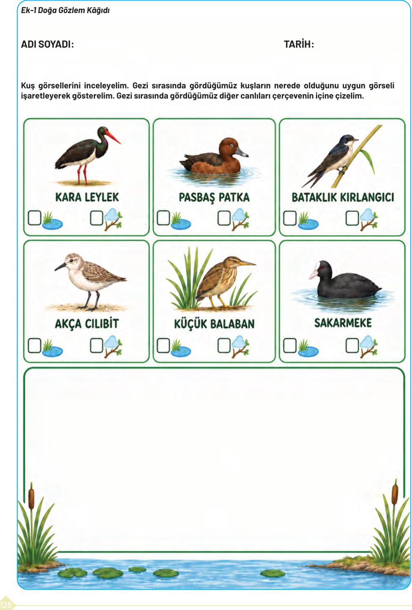

<!-- sayfa 130 -->

**ETKİNLİK ADI:** Akvaryum
**ALAN ADI:** Fen 
**YAŞ GRUBU:** 60-72 ay

**ALAN BECERİLERİ, ÖĞRENME ÇIKTILARI VE SÜREÇ BİLEŞENLERİ**

**FEN ALANI**
**FBAB1. Bilimsel Gözlem**
**FAB1. Günlük yaşamında fenle ilgili olaylara / olgulara ve durumlara yönelik bilimsel gözlem yapabilme**
FAB1.d. Gözlemlediği nesne / olay / olguları uygun kayıt araçları kullanarak çizim, işaretleme, sembol kullanma yoluyla kaydeder.

**EĞİLİMLER**
**E3. Entelektüel Eğilimler**
E3.2. Odaklanma

**PROGRAMLAR ARASI BİLEŞENLER**
**Sosyal-Duygusal Öğrenme Becerileri**
**SDB1.2. Kendini Düzenleme (Öz Düzenleme)**

**Değerler**
**D3. Çalışkanlık**
D3.4. Çalışmalarda aktif rol almak  

**Okuryazarlık Becerileri**
**OB4. Görsel Okuryazarlık**

**Kavramlar:** Boyut: büyük - küçük
Zıt: hızlı, yavaş

**Sözcükler:** okyanus, deniz, akvaryum, deniz canlıları

**Materyaller:** “Deniz Canlılarını Keşfediyorum” Gözlem Kâğıdı (Ek -1 ), boya kalemleri, kurşun kalem ve silgi

**Eğitim / Öğrenme Ortamları:** Çocukların gezi süresince kendi güvenlik ve sağlıklarını korumaları, aynı zamanda akvaryumu güvenli bir şekilde incelemeleri amacıyla okul dışı etkinliği ile ilgili açıklama yapılır. Gezi sırasında kullanılmak üzere Ek - 1: “Deniz Canlılarını Keşfediyorum” adlı form çocuk sayısı kadar çıktı alınarak hazırlanır. Gezi sırasında çocuklar gözlem yaparken, form doldururken ve canlıları incelerken fotoğrafları çekilir. Gezi öncesinde çocukların güvenliğini sağlamak amacıyla, üzerinde çocukların ad - soyad bilgileri ile okulun iletişim bilgilerinin yer aldığı yaka kartları hazırlanır ve gezi süresince çocukların yakalarına takılır.

<!-- sayfa 131 -->

ETKİNLİKLER

**Fen (Bireysel Etkinlik)**

* Gezi öncesinde çocuklara balık, deniz kaplumbağası, köpek balığı, denizatı, ahtapot ve vatoz gibi deniz canlılarına ait görseller gösterilir. Görseller incelenirken “Bu canlıyı daha önce gördün mü?”, “Sence nerede yaşıyor?”, “Nasıl hareket ediyor?” gibi sorular yöneltilir. Çocukların düşüncelerini ve önceki deneyimlerini paylaşmalarına fırsat verilir (**OB4**). Ardından deniz canlılarının suda yaşadığı, farklı özelliklere ve ihtiyaçlara sahip olduğu ve yaşam alanlarının korunmasının önemli olduğu hakkında yaş düzeyine uygun biçimde sohbet edilir. Akvaryumun farklı deniz canlılarını yakından gözlemleyebileceğimiz bir yer olduğu açıklanır.
* Akvaryuma gitmeden önce çocuklara burada karşılaşabilecekleri ortam hakkında kısa bir hazırlık yapılır. “İçeri girdiğimizde bazı bölümler biraz karanlık olabilir. Çünkü balıkların rahatça görülebilmesi ve kendilerini daha rahat hissetmeleri için ışıklar farklı olabilir.” denir. Bazı bölümlerde renkli ışıkların bulunabileceği, tünellerden geçilebileceği ve çevrede başka ziyaretçilerin de olabileceği açıklanır. “Su altı evinde minik ve renkli balıklar olduğu gibi köpek balığı ve vatoz gibi daha büyük balıklar da görebiliriz. Hepsini güvenli bir yerden izleyeceğiz.” denilerek çocukların büyük deniz canlılarıyla karşılaşmaya hazırlanmaları sağlanır.
* Akvaryum camlarının işlevi “Bu kocaman camlar, su altında yaşayan canlılarla bizim aramızdaki güvenli pencerelerimiz. Biz onları bu pencerelerin arkasından gözlerimizle inceleyebiliriz.” şeklinde açıklanır. Gezi sırasında öğretmen ve arkadaşlarıyla birlikte hareket etme, akvaryum camlarına dokunmadan canlıları gözlemleme ve sakin bir sesle konuşma gibi davranışlar üzerinde durulur.
* Gezi sırasında çocukların akvaryumdaki canlıları incelemelerine fırsat verilir. Akvaryumun farklı bölümleri gezilirken çocukların dikkatleri canlıların renklerine, büyüklüklerine ve hareket biçimlerine yönlendirilir. “Bu balık nasıl hareket ediyor?”, “Sence bu canlı ne yiyor olabilir?”, “Hangisi daha hızlı yüzüyor gibi görünüyor?” gibi sorularla gözlemlerini ifade etmeleri desteklenir (**E3.2**).
* Çocuklara “Deniz Canlılarını Keşfediyorum” gözlem formu tanıtılır. Formda yer alan deniz canlılarını akvaryumda gördüklerinde öğretmenin rehberliğinde işaretlemeleri istenir (**FAB.1.d**). Çocukların ilgilerini çeken canlıları incelemelerine, aralarındaki benzerlik ve farklılıkları fark etmelerine fırsat verilir.
* Gezi sonunda çocuklardan en çok dikkatlerini çeken deniz canlısını hatırlamaları ve gözlem formundaki alana resmetmeleri istenir (**SDB1.2, D3.4**). Ardından çocuklarla gezi sırasında gördükleri canlılar hakkında sohbet edilir. “En çok hangi canlı dikkatini çekti?”, “Hangi balığın hareketi sana ilginç geldi?”, “Akvaryumda gördüğün en büyük canlı hangisiydi?” gibi sorularla deneyimlerini ve gözlemlerini arkadaşlarıyla paylaşmaları desteklenir. Çocukların çizimleri sınıf panosunda sergilenebilir..

**DEĞERLENDİRME**

* Akvaryumda hangi deniz canlılarını gördün?
* En çok hangi deniz canlısını beğendin? Neden?
* Köpek balığı ile küçük bir balık arasında ne fark vardır?
* Deniz canlıları ne ile besleniyor olabilir?
* Çizdiğin deniz canlısı neydi?

<!-- sayfa 132 -->

# FARKLILAŞTIRMA

**Zenginleştirme:** Gezi sonrasında çocuklardan küçük gruplar hâlinde karton, mavi fon kâğıdı, oyun hamuru ve geri dönüşüm materyallerini kullanarak gözlemledikleri deniz canlılarını ve yaşam alanlarını üç boyutlu olarak oluşturmaları istenebilir. Çocuklarla denizlerin kirlenmesinin deniz canlıları üzerindeki etkileri hakkında görseller incelenebilir. Gezi sonrasında çocukların gözlemledikleri canlılara ait görsellerinin bulunduğu eşleştirme, sıralama ve hafıza kartlarıyla eğitsel oyunlar oynanabilir.

**Destekleme:** Gezi öncesinde çocuklara deniz canlılarını tanıtmak amacıyla büyük boy görseller, oyuncak modeller ve videolar kullanılarak açıklama yapılabilir. “Deniz Canlılarını Keşfediyorum” formunun nasıl kullanılacağı aşama aşama açıklanabilir.

# AİLE VE TOPLUM KATILIMI

**Aile Katılımı:** Aileler ile akvaryum gezisine yönelik bilgi notu paylaşılabilir. Ailelerden çocuklarıyla deniz canlıları konulu bir kitap okumaları veya bir belgesel izlemeleri istenebilir.

**Toplum Katılımı:** Biyolog ya da su altı yaşam uzmanı gezi öncesinde sınıfa davet edilerek deniz canlılarının özellikleri, beslenme şekilleri ve yaşam alanlarına yönelik bilgileri çocuklarla paylaşması istenebilir.

<!-- sayfa 133 -->

Ek-1 Deniz Canlıları Gözlem Kâğıdı

ADI SOYADI:                                                                                                              TARİH:

Deniz canlıları görsellerini inceleyelim. Gezi sırasında gördüğümüz canlıların altındaki kutucuğu boyayalım. 
Gezi sırasında en çok dikkatimizi çeken deniz canlısını çerçevenin içine çizelim.

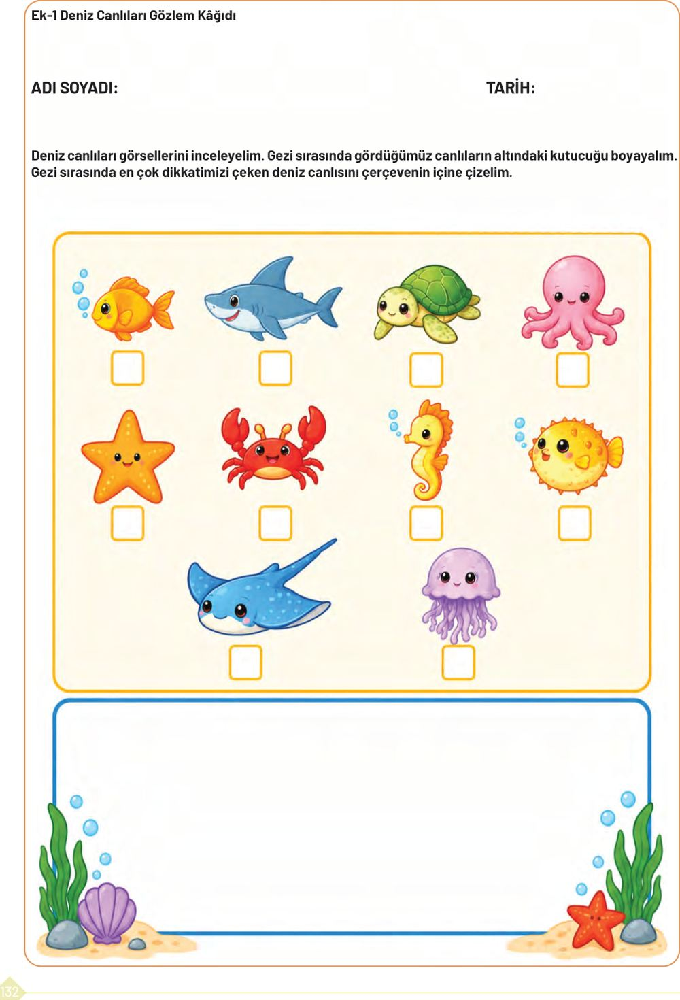

<!-- sayfa 134 -->

**ETKİNLİK ADI:** Ankara Üniversitesi Oyuncak Müzesi
**ALAN ADI:** Sosyal, Sanat
**YAŞ GRUBU:** 60-72 ay

**ALAN BECERİLERİ, ÖĞRENME ÇIKTILARI VE SÜREÇ BİLEŞENLERİ**

**SOSYAL ALAN**
**SBAB1. Zamanı Algılama ve Kronolojik Düşünme**
**SAB.3. Olay / dönem ve kavramların zamanla geçirdikleri değişim / dönüşümleri karşılaştırarak ifade edebilme**
SAB.3.a. Çeşitli nesnelerin geçmişteki hâllerini inceler.
SAB.3.b. Çeşitli nesnelerin geçmişteki ve şimdiki hâllerini karşılaştırarak benzerlik ve farklılıklarını söyler.

**SANAT ALANI**
**SNAB3. Sanata Değer Verme**
**SNAB.3. Sanatın önemini fark edebilme**
SNAB.3.c. Dijital / gerçek sanat ortamlarını ziyaret eder.
SNAB.3.ç. Dijital / gerçek sanat ortamlarında sergilenen eserleri inceler.

**EĞİLİMLER**
**E3. Entelektüel Eğilimler**
E3.2. Odaklanma

**PROGRAMLAR ARASI BİLEŞENLER**
**Sosyal-Duygusal Öğrenme Becerileri**
**SDB1.2. Kendini Düzenleme (Öz Düzenleme)**

**Değerler**
**D3. Çalışkanlık**
D3.4. Çalışmalarda aktif rol almak
**D7. Estetik**
D7.2. Sanatsal ve görsel zevkleri hayatın bir parçası hâline getirmek

**Okuryazarlık Becerileri**
**OB4. Görsel Okuryazarlık**

**Kavramlar:** Zıt: aynı - farklı - benzer, eski - yeni
**Sözcükler:** geçmiş, günümüz
**Materyaller:** boya kalemleri, geçmişte ve günümüzde bulunan oyuncak görsel kartları, farklı atık materyaller
**Eğitim / Öğrenme Ortamları:** Çocukların gezi süresince kendi güvenlik ve sağlıklarını korumaları, aynı zamanda oyuncak müzesini güvenli bir şekilde incelemeleri amacıyla gezi sırasında uyulması gereken kurallar hakkında açıklama yapılır. Gezi öncesinde çocukların güvenliğini sağlamak amacıyla, üzerinde çocukların ad - soyad bilgileri ile okulun iletişim bilgilerinin yer aldığı yaka kartları hazırlanır ve gezi süresince çocukların yakalarına takılır.

<!-- sayfa 135 -->

# ETKİNLİKLER
## Sosyal, Sanat (Bütünleştirilmiş Büyük Grup Etkinliği)

* Gezi öncesinde sınıfa, içinde farklı dönemlere ait oyuncak görsellerinin bulunduğu bir oyuncak kutusu getirilir. Çocuklara “Bu kutunun içinde sizce ne olabilir?”, “Bu oyuncakları kimler kullanmış olabilir?”, “Oyuncaklar zaman içinde değişmiş olabilir mi?” gibi sorular yöneltilerek çocukların tahminlerini dinlenir. Ardından kutudan çıkarılan geçmişteki ve günümüzdeki oyuncaklara ait görsel kartlar çocuklarla birlikte incelenir (**OB4, SAB.3.a**). Çocuklardan oyuncakların yapıldığı malzeme, görünüş, kullanım biçimi ve sahip olduğu özellikler hakkında düşünmeleri istenir. Sınıfın iki farklı alanı “Geçmişteki Oyuncaklar” ve “Günümüzdeki Oyuncaklar” olarak belirlenir. Çocuklar sırayla bir kart seçerek görseldeki oyuncağın geçmişteki mi yoksa günümüzdeki mi olduğunu tahmin eder ve kartı uygun alana yerleştirir. Tüm kartlar yerleştirildikten sonra gruplar birlikte incelenir; çocuklardan oyuncakları hangi özelliklerine göre ayırdıklarını açıklamaları istenir (**SAB.3.b**).
* Oyun tamamlandıktan sonra kartlar yeniden karıştırılarak kutuya yerleştirilir. Her çocuk kutudan ilgisini çeken bir oyuncak kartı seçer. Çocuklara gezi sırasında kartlarındaki oyuncağın aynısını veya benzerini müzede bulmaya çalıştıkları açıklanır. Kartlarını dikkatle incelemeleri oyuncağın rengi, biçimi, yapıldığı malzeme ve kullanım amacı gibi özelliklerine dikkat etmeleri istenir. Ardından çocuklarla oyuncakların yalnızca oyun oynamak için kullanılan nesneler olmadığı, geçmişte çocukların oyunlarını, kültürlerini ve günlük yaşamlarını yansıtan önemli araçlar olduğu hakkında sohbet edilir. Geçmiş zamanda oyuncakların tahta, bez ve metal gibi malzemelerden yapıldığı, günümüzde ise farklı malzemeler ve teknolojik özellikler kullanılarak üretildiği açıklanır. Ankara Üniversitesi Oyuncak Müzesi’nde geçmişten günümüze farklı dönemlere, kültürlere ve oyunlara ait oyuncakların sergilendiği anlatılır. Gezi sırasında uyulması gereken kurallar çocuklarla birlikte hatırlanır.
* Gezi sırasında çocuklardan müzede sergilenen oyuncakları dikkatle incelemeleri istenir (**SNAB.3.c, SNAB.3.ç, D7.2**). Geleneksel oyuncaklar, bebekler, taşıt oyuncakları, el yapımı oyuncaklar ve farklı dönemlere ait oyuncaklar arasındaki benzerlikleri ve farklılıkları fark etmeleri desteklenir (**SAB.3.b**). Çocuklara “Bu oyuncak sence ne zaman yapılmış olabilir?”, “Hangi malzemeden yapılmış olabilir?”, “Sen bu oyuncakla nasıl oynardın?” ve “Bu oyuncak günümüzdeki oyuncaklardan hangi yönleriyle farklı?” gibi sorular yöneltilir.
* Çocuklar, gezi öncesinde seçtikleri karttaki oyuncağın aynısını veya benzerini müzede arar (**SDB1.2**). Oyuncağı bulan çocuk, kartındaki görselle müzedeki oyuncağı karşılaştırır (**SAB.3.b**). Ardından “Kartımdaki oyuncak ile bu oyuncak birbirine benziyor çünkü…” veya “Bu iki oyuncak birbirinden farklı çünkü…” ifadelerinden yararlanarak gözlemlerini arkadaşlarına açıklar. Kartındaki oyuncağın aynısını bulamayan çocukların benzer özelliklere sahip başka bir oyuncak seçerek karşılaştırma yapar.
* Gezi sonrasında çocuklarla gezi sırasında gördükleri oyuncaklar hakkında sohbet edilir. Ardından çocuklardan boya kalemleri veya uygun atık materyaller kullanarak kendi oyuncaklarını tasarlamaları istenir (**E3.2, D3.4**).

## EĞERLENDİRME

* Oyuncak müzesinde hangi oyuncakları gördün?
* Seni en çok şaşırtan oyuncak hangisiydi? Neden?
* Geçmişteki oyuncaklar hangi malzemelerden yapılmış olabilir?
* Geçmişteki oyuncaklarla günümüzdeki oyuncaklar arasında ne gibi farklar var?
* Sen geçmişteki oyuncaklardan hangi oyuncak/oyuncaklarla oynamak isterdin?

<!-- sayfa 136 -->

# FARKLILAŞTIRMA

**Zenginleştirme:** Farklı kültürlere ait çocuk oyunları ile ilgili videolar izlenebilir, oyuncak görselleri incelenebilir. Çocuklardan aile büyüklerinin çocukluk döneminde oynadığı oyuncakları öğrenmeleri ve arkadaşlarıyla paylaşmaları istenebilir.

**Destekleme:** Eski ve yeni oyuncakları ayırt etmeleri için çocuklara büyük ve belirgin görsel kartlar sunulabilir. Kartlardaki oyuncakların malzeme, renk, biçim ve kullanım özellikleri sözel ipuçları ve somut örneklerle açıklanabilir. Sınıflandırma sırasında çocukların iki kart arasından seçim yapmalarına fırsat verilebilir. Gezi sırasında kartındaki oyuncağı bulabilmesi için çocuk, öğretmen veya bir arkadaşıyla birlikte gözlem yapabilir. Karşılaştırma sürecinde “İkisi de hangi malzemeden yapılmış?”, “Renkleri aynı mı?” ve “Şekilleri birbirine benziyor mu?” gibi kısa ve yönlendirici sorular kullanılabilir. Çocukların gözlemlerini ifade edebilmeleri için “Bu oyuncaklar birbirine benziyor çünkü…” ve “Bu oyuncaklar farklı çünkü…” şeklindeki cümle başlangıçlarından yararlanılabilir.

# AİLE VE TOPLUM KATILIMI

**Aile Katılımı:** Ailelere gezi hakkında bilgi verilebilir. Çocuklarıyla varsa evlerinde bulunan eski oyuncakları incelemeleri, aile büyüklerinin çocukluk dönemlerinde oynadıkları oyuncaklar hakkında sohbet etmeleri istenir.

**Toplum Katılımı:** Müze çalışanlarından veya oyuncak kültürü hakkında bilgi sahibi kişilerden çocuklara oyuncakların geçmişi, korunması ve farklı dönemlerdeki kullanım alanları hakkında yaş düzeylerine uygun bilgiler vermeleri istenebilir. Ayrıca çocukların hazırladığı oyuncak tasarımları okulda sergilenerek diğer sınıflarla paylaşılabilir.

<!-- sayfa 137 -->

**ETKİNLİK ADI:** Çocuk Kütüphanesi 3  
**ALAN ADI:** Türkçe, Sanat  
**YAŞ GRUBU:** 60-72 ay  

**ALAN BECERİLERİ, ÖĞRENME ÇIKTILARI VE SÜREÇ BİLEŞENLERİ**  
**TÜRKÇE ALANI**  
TAKB. Konuşma  
**TAKB3. Konuşma sürecinde Türkçeyi doğru kullanabilme**  
TAKB3.3.a. Konuşacağı konuyu planlar.  
TAKB3.3.ç. Söylemek istediklerini açık biçimde ifade eder.  

**SANAT ALANI**  
SNAB4. Sanatsal Uygulama Yapma  
**SNAB4. Sanat etkinliği uygulayabilme**  
SNAB4.d. Sanat etkinliklerinde özgün ürünler oluşturur.  

**EĞİLİMLER**  
**E3. Entelektüel Eğilimler**  
E3.2. Odaklanma  

**PROGRAMLAR ARASI BİLEŞENLER**  
**Sosyal-Duygusal Öğrenme Becerileri**  
SDB1.2. Kendini Düzenleme (Öz Düzenleme)  

**Değerler**  
D14. Saygı  
D14.1. Nezaketli olmak  

**Okuryazarlık Becerileri**  
OB4. Görsel Okuryazarlık  

**Kavramlar:** Duyu: sesli - sessiz  
**Sözcükler:** kütüphane  
**Materyaller:** resimli çocuk kitabı, A4 kâğıdı, boya kalemleri  

**Eğitim / Öğrenme Ortamları:** Çocukların gezi süresince kendi güvenlik ve sağlıklarını korumaları, aynı zamanda kütüphaneyi güvenli bir şekilde incelemeleri amacıyla kütüphanedeki bölümler ve gezi sırasında uyulması gereken kurallar hakkında açıklama yapılır. Gezi öncesinde çocukların güvenliğini sağlamak amacıyla, üzerinde çocukların ad - soyad bilgileri ile okulun iletişim bilgilerinin yer aldığı yaka kartları hazırlanır ve gezi süresince çocukların yakalarına takılır. Ailelerle iş birliği yapılarak çocukların en sevdiği çocuk kitabını sınıfa getirmeleri istenir. Kütüphaneye hediye etmek için kitap merkezinden bir kitap belirlenir.

<!-- sayfa 138 -->

**Türkçe, Sanat (Bireysel Etkinlik)**

* Gezi öncesi, çocuklarla sınıfa getirdikleri kitaplar hakkında sohbet edilir. Çocuklara kitabın konusu ve kapak görseli hakkında konuşmaları için sorular sorulur. Ardından kütüphaneye gezi yapacakları ve kütüphane kuralları açıklanır. Kütüphanede uyulması gereken kurallar anlatılır. Kurallar çocuklarla canlandırılır. Örneğin yüksek sesle konuşma durumu canlandırılır; sınıftaki tüm çocuklar aynı anda yüksek sesle konuşur, ardından birden bire susarlar. Daha alçak sesle, söz hakkı isteyerek konuşmaları sağlanır. Bu iki durum karşılaştırılır ve çocuklara hangisinin daha uygun olduğu, yüksek sesle konuştuklarında veya hep birlikte aynı anda konuştuklarında neler hissettikleri sorulur.
* Gezi sırasında, kütüphanenin bölümleri çocuklara açıklanır. Ardından çocuk kitaplarının bulunduğu bölüme geçilir. Çocuklardan kitapları incelemeleri ve bir tane resimli çocuk kitabı seçmeleri istenir (**SDB1.2**). Çocuklarla seçtikleri kitabın kapak görseli hakkında sohbet edilir ve her çocuğa seçtiği kitabın kapak görselinde ne gördüğünü, kitabın konusunun ne olabileceği ile ilgili tahminini arkadaşlarıyla paylaşması için fırsat verilir (**TAKB.3.a, D14.1, OB4**). Çocukların konuşmalarını belirlenen sürede tamamlamaları için zamanlayıcı kullanılır. Çocuklara zamanlayıcı durduğu anda konuşmalarını bitirmeleri gerektiği söylenir. Ardından kütüphaneye hediye edilecek kitap çocuklara gösterilir. Çocuklara bu kitapla ilgili neler hatırladıkları sorulur (**E3.2**). Kitap hakkında kısa bir sohbet edildikten sonra kitap kütüphaneye hediye edilerek teslim edilir.
* Gezi sonrasında çocuklarla kütüphanede en çok ilgilerini çeken kitaplar hakkında sohbet edilir. Çocuklara “Seçtiğin kitabın kapağını sen tasarlasaydın hangi renkleri, şekilleri ve görselleri kullanırdın?” sorusu yöneltilir. Ardından çocuklara farklı türde kâğıtlar, boya kalemleri ve çeşitli sanat materyalleri sunulur. Çocuklardan seçtikleri kitabın konusundan ve kendilerinde uyandırdığı düşüncelerden yararlanarak mevcut kapağı kopyalamadan özgün bir kitap kapağı tasarlamaları istenir. Çocuklar renk, biçim, çizgi ve görselleri kendi tercihlerine göre bir araya getirerek çalışmalarını tamamlar (**SNAB.4.d**). Etkinliğin sonunda çocuklar tasarladıkları kapağı arkadaşlarına tanıtır; kullandıkları görselleri, renkleri ve bunları tercih etme nedenlerini açıklar (**TAKB.3.ç**). Hazırlanan özgün kitap kapakları sınıfın kitap merkezinde sergilenir.

**DEĞERLENDİRME**

* Kütüphanede hangi bölümü beğendin? Neden?
* Seçtiğin kitabın kapağında neler gördün?
* Seçtiğin kitabın kapağını yeniden tasarlarken en çok hangi bölümü yapmayı sevdin?
* Tasarladığın yeni kapakta hangi renkleri ve resimleri kullandın? Neden onları seçtin?

**FARKLILAŞTIRMA**

**Zenginleştirme:** Gezi sırasında çocuklara; hayvanlarla ilgili 2 kitap bul, en kalın ve en ince kitabı karşılaştır gibi görevler verilebilir. Çocuklardan küçük gruplar hâlinde kendi resimli öykü kitaplarını oluşturmaları ve hazırladıkları kitapları sınıf kitaplığında sergilemeleri istenebilir.

**Destekleme:** Eski ve yeni oyuncakları ayırt etmeleri için çocuklara büyük ve belirgin görsel kartlar sunulabilir. Kitap seçmekte güçlük yaşayan çocuklara sınırlı sayıda resimleri olan bir kitap sunulabilir. Kütüphane kuralları anlatılırken görseller kullanılabilir. Konuşma sırasını beklemekte güçlük yaşayan çocuklar için konuşma sırasını gösteren somut bir nesne (kukla, oyuncak vb.) kullanılabilir.

**AİLE VE TOPLUM KATILIMI**

**Aile Katılımı:** Ailelerden çocuklarıyla en sevdikleri öykü kitabına yeni bir kapak tasarlamaları veya kitaba farklı bir son oluşturmaları istenebilir. Ailelere, çocuklarıyla mahallelerindeki veya ilçelerindeki kütüphaneyi ziyaret etmeleri önerilebilir.

<!-- sayfa 139 -->

**ETKİNLİK ADI:** Divriği Ulu Cami
**ALAN ADI:** Sosyal, Sanat
**YAŞ GRUBU:** 60-72 ay

**ALAN BECERİLERİ, ÖĞRENME ÇIKTILARI VE SÜREÇ BİLEŞENLERİ**

**SOSYAL ALAN**
**SBAB9. Coğrafi Gözlem ve Saha Çalışması**
**SAB10. Coğrafi gözlem ve çalışma sahasından elde edilen sonuçları sözel / görsel yolla sunabilme**
SAB10.b. Okul dışı öğrenme etkinliğinde oluşturduğu ürünleri sözel ya da görsel olarak sunar.

**SANAT ALANI**
**SNAB2. Sanat Eseri İnceleme**
**SNAB.2. Sanat eserini eleştirebilme**
SNAB2.a. Sanat eserine odaklanır.
**SNAB4. Sanatsal Uygulama Yapma**
**SNAB.4. Sanat etkinliği uygulayabilme**
SNAB.4.ç. Sanat etkinliklerine aktif olarak katılır.

**EĞİLİMLER**
**E3. Entelektüel Eğilimler**
E3.2. Odaklanma

**PROGRAMLAR ARASI BİLEŞENLER**
**Sosyal-Duygusal Öğrenme Becerileri**
SDB2.1. İletişim

**Değerler**
D7. Estetik
D7.1. Duyusal derinliği anlamak

**Okuryazarlık Becerileri**
OB4. Görsel Okuryazarlık

**Kavramlar:** Yön / mekânda konum: iç - dış
**Sözcükler:** minber, kubbe, minare, motif
**Materyaller:** Divriği Ulu Cami bölümlerine ait görseller, fotoğraf makinesi veya telefon, kil hamuru, plastik kil şekillendirme aletleri

**Eğitim / Öğrenme Ortamları:** Çocukların gezi süresince kendi güvenlik ve sağlıklarını korumaları, aynı zamanda camideki bölümleri güvenli bir şekilde incelemeleri amacıyla okul dışı etkinliği ile ilgili açıklamalar yapılır. Sınıf ortamında Divriği Ulu Cami’ye ait görseller sunulur. Ayrıca, her çocuk için gezi sırasında görebilecekleri birer (taç kapı, minber, darüşşifa kapısı, süslemeler, motifler vb.) görsel hazırlanır. Çocuklara, seçtikleri görsellerin gezi boyunca yanlarında olacağı ve cami içinde bu görsellerdeki bölümleri bulmaları isteneceği açıklanır. Gezilecek mekânda uyulması gereken kurallar (örneğin sessiz olunması, yapıya zarar verilmemesi gibi) çocuklara hatırlatılır. Gezi öncesinde çocukların güvenliğini sağlamak amacıyla, üzerinde çocukların ad - soyad bilgileri ile okulun iletişim bilgilerinin yer aldığı yaka kartları hazırlanır ve gezi süresince çocukların yakalarına takılır.

<!-- sayfa 140 -->

**ETKİNLİKLER**

**Sosyal, Sanat (Bütünleştirilmiş Büyük Grup Etkinliği)**

* Gezi öncesi, Divriği Ulu Cami’ye ait görseller (taç kapı, minber, darüşşifa kapısı, süslemeler, motifler vb.) çocuklara gösterilir. Her çocuktan bir görsel seçmesi ve seçtiği görseli incelemesi istenir (**SNAB2.a, E3.2, OB4**). Çocuklara “Sence bu yapı yeni mi, yoksa eski zamanlardan mı kalmış olabilir?”, “Bu yapının adı ne olabilir?”, “Sizce burası bir okul mu, cami mi, yoksa hastane mi?”, “Bu motif neye benziyor?” soruları sorulur. Çocukların yanıtları dinlenir. Divriği Ulu Cami’nin kültürel miras olduğu ve UNESCO Dünya Mirası Listesi’nde yer aldığı, çok uzun yıllar önce inşa edildiği, üzerindeki motiflerin her birinin farklı anlamlar taşıdığı çocuklara anlatılır.
* Gezi sırasında, caminin bölümleri gezilirken çocuklara, ellerindeki görsellerle caminin ilgili bölümlerini eşleştirmeleri için rehberlik edilir. Her çocuktan, kendi kartındaki bölümü bulduğunda arkadaşlarıyla paylaşması istenir. Ardından caminin dış kapıları tanıtılır. Kapının üzerindeki motifler gösterilerek, çocuklardan motiflerin ne anlatıyor olabileceğini tahmin etmeleri istenir (**D7.1**). Öğretmen, çocukların ilgisini çeken motiflerin fotoğraflarını çeker.
* Gezi sonrası, gezi sırasında çekilen motif fotoğraflarının çıktıları alınır. Her çocuktan, bir motif seçmesi ve neden o motifi seçtiğini anlatması beklenir (**SDB2.1**). Ardından çocuklara kil hamurları dağıtılır. Her çocuğun, seçtiği motifi kil hamuruyla modellemesi istenir (**SNAB.4.ç**). Modelleme çalışması tamamlandığında, çocuklara “Bu motife bir isim verseydin, ne olurdu? Neden bu ismi seçtin?” soruları sorulur. Çocukların yanıtları dinlenir (**SAB.10.b**). Çocukların hazırladığı motifler sınıf içinde uygun bir alanda sergilenir.

**DEĞERLENDİRME**

* Gezdiğimiz yapının adı neydi?
* Yapıda en çok hangi bölümü beğendin? Neden?
* Kapıların üzerindeki motiflerde neler gördün?
* En çok hangi motif dikkatini çekti? Neden?
* Elindeki görselde bulunan bölümü camide bulabildin mi?
* Kil hamuruyla motifini yaparken ne hissettin?

**FARKLILAŞTIRMA**

**Zenginleştirme:** UNESCO Dünya Mirası Listesi’nde yer alan diğer yapılara ait görseller incelenebilir. Çocuklardan, seçtikleri motif için kısa bir hikâye oluşturmaları ve hikâyelerini arkadaşlarıyla paylaşmaları istenebilir.

**Destekleme:** Gezi sırasında, çocuklara görselleri bölümlerle eşleştirme sürecinde yönergeler verilerek rehberlik edilebilir. Kil çalışmasında daha yumuşak kil veya hazır motif kalıpları kullanılabilir.

**AİLE VE TOPLUM KATILIMI**

**Aile Katılımı:** Gezi öncesinde ailelere Divriği Ulu Cami ve kültürel miras kavramı hakkında kısa bir bilgilendirme notu gönderilebilir. Çocuklarıyla tarihî yapılar, camiler veya kültürel miras alanlarına ait görselleri incelemeleri istenebilir. Ailelerden çocuklarıyla farklı motif örnekleri araştırmaları ve buldukları motiflerin fotoğraf veya çizimlerini sınıfa göndermeleri istenebilir.

**Toplum Katılımı:** Yerel bir sanatçı, seramik ustası veya el sanatları uzmanı sınıfa davet edilerek motiflerin sanat eserlerinde nasıl kullanıldığı hakkında çocuklarla sohbet etmesi istenebilir.

<!-- sayfa 141 -->

**ETKİNLİK ADI:** PTT Pul Müzesi  
**ALAN ADI:** Sosyal, Sanat  
**YAŞ GRUBU:** 60-72 ay  

**ALAN BECERİLERİ, ÖĞRENME ÇIKTILARI VE SÜREÇ BİLEŞENLERİ**  

**SOSYAL ALAN**  
**SBAB9. Coğrafi Gözlem ve Saha Çalışması**  
**SAB.8. Coğrafi gözlem ve saha çalışmasını gerçekleştirebilmek için gerekli olan hazırlığı yapabilme**  
SAB.8.a. Okul dışı öğrenme etkinlikleri kapsamında gidilecek mekân ve yapılacak çalışmalara yönelik görselleri inceler.  

**SANAT ALANI**  
**SNAB4. Sanatsal Uygulama Yapma**  
**SNAB.4. Sanat etkinliği uygulayabilme**  
SNAB.4.ç. Sanat etkinliklerine aktif olarak katılır.  
SNAB.4.d. Sanat etkinliklerinde özgün ürünler oluşturur.  

**EĞİLİMLER**  
**E3. Entelektüel Eğilimler**  
E3.3. Yaratıcılık  

**PROGRAMLAR ARASI BİLEŞENLER**  

**Sosyal-Duygusal Öğrenme Becerileri**  
SDB1.2. Kendini Düzenleme (Öz Düzenleme)  

**Değerler**  
**D7. Estetik**  
D7.2. Sanatsal ve görsel zevkleri hayatın bir parçası hâline getirmek  

**Okuryazarlık Becerileri**  
OB4. Görsel Okuryazarlık  

**Kavramlar:**  

**Sözcükler:** mektup, pul  

**Materyaller:** renkli boya kalemleri  

**Eğitim / Öğrenme Ortamları:** Çocukların gezi süresince kendi güvenlik ve sağlıklarını korumaları, aynı zamanda müzedeki pulları güvenli bir şekilde incelemeleri amacıyla okul dışı etkinliği ile ilgili açıklamalar yapılır. Müze gezisinde yapılacak çalışma için “Pul Tasarım Kağıdım” (Ek - 1) formu hazırlanır. Gezi öncesindeki etkinlik için örnek bir mektup hazırlanır. Gezi öncesinde çocukların güvenliğini sağlamak amacıyla, üzerinde çocukların ad - soyad bilgileri ile okulun iletişim bilgilerinin yer aldığı yaka kartları hazırlanır ve gezi süresince çocukların yakalarına takılır.

<!-- sayfa 142 -->

# ETKİNLİKLER
## Sosyal, Sanat (Bütünleştirilmiş Büyük Grup Etkinliği)

* Gezi öncesi, sınıfa bir zarfla girilir ve çocuklara sınıfa bir mektup ulaştığı söylenir. “Sizce bu mektubun içinde ne olabilir?” sorusu sorulur. Çocukların tahminleri alındıktan sonra “Mektup; birine bir haber vermek, bir soru sormak, bir istekte bulunmak ya da duygularımızı paylaşmak için gönderilen yazılı bir kâğıttır.” şeklinde açıklama yapılır. Etkinlik öncesinde hazırlanan örnek mektup çocuklara okunur. Ardından eskiden insanların telefon ya da internet bulunmadığı dönemlerde iletişim için posta yoluyla mektup gönderdiği, postacıların bu mektupları nasıl taşıdığı anlatılır.
* Çocuklara şehir dışında bir okula mektup yazacakları söylenir. Her çocuktan bir cümle (Örneğin; “Ben oyun oynamayı çok severim.”, “Okulumuzda çiçekler diktik.”). söylemesi istenir. Çocukların cümleleri birleştirilerek ortak sınıf mektubu oluşturulur. Mektup çocuklarla birlikte zarfa yerleştirilir. Zarfın üzerine pul yapıştırılması gerektiği söylenir. Pulların ne olduğu, ne işe yaradığı ve neden gerekli olduğu hakkında çocuklara sorular sorulur. Çocukların tahminleri alındıktan sonra “Pul; mektup veya kartpostallara yapıştırılan, üzerinde çeşitli resimler bulunan küçük kâğıtlardır.” şeklinde açıklama yapılır.
* Çocuklara farklı pul örnekleri (Atatürk, çiçek, spor, hayvan temalı vb.) gösterilir ve dünyanın birçok yerinde birbirinden farklı, renkli pullar bulunduğu açıklanır. Çocuklara, pul örneklerini incelemeleri için fırsat verilir (SAB.8.a, OB4). Ardından çok sayıda pul görebilecekleri “Pul Müzesi’ni ziyaret edecekleri söylenir.
* Gezi sırasında, müzede bulunan pul örnekleri incelenir. Çocukların dikkati müzedeki tematik pullara çekilir. Müzede uygun bir alanda hayvanlar, bitkiler ve müzik temasına ait pul görsellerinin de olduğu Ek-1 formları çocuklara dağıtılır. Çocuklardan üç temadan birini seçerek sınıfta yazmış oldukları mektup için bir pul tasarlamaları istenir (SNAB.4.ç, SNAB.4.d, E3.3). Tasarlanan pullar hep birlikte incelenir.
* Gezi sonrası, sınıfa dönüldüğünde “Bizim Ülkemizin Pulları” isimli bir pano hazırlanır. Çizilen pullar temalarına göre sınıflandırılır. Şehir dışındaki bir okula göndermek için hazırlanan mektup zarfında hangi pulun kullanılacağı konusunda bir birlikte karar verilir (SDB1.2, D7.2).

## DEĞERLENDİRME

* Müzede en çok hangi pulları beğendin? Neden?
* Müzede hangi temalarda pullar gördün?
* Sence müzede en ilginç pul hangisiydi?
* Senin tasarladığın pulun teması neydi? O temayı seçme sebebin neydi?

# FARKLILAŞTIRMA

**Zenginleştirme:** Çocuklardan kendi yaşadıkları şehri veya okullarını tanıtan özgün bir pul tasarlamaları istenebilir. Farklı ülkelerin pulları incelenerek pullar üzerindeki hayvan, bitki, tarihî yapı ve kültürel ögeler hakkında sohbet edilebilir.

**Destekleme:** Ortak mektup oluşturulurken örnek cümle başlangıçları sunulabilir (Örneğin “Ben...”, “Okulumuzda...”, “En sevdiğim...”). Pul tasarımında farklı pul örnekleri gösterilerek çocukların seçim yapmaları desteklenebilir. Pul tasarımı etkinliği için pul şablonları hazırlanabilir.

# AİLE VE TOPLUM KATILIMI

**Aile Katılımı:** Ailelerden çocuklarıyla bir aile büyüğüne, akrabalarına veya arkadaşına kısa bir mektup ya da resimli kart hazırlamaları, hazırladıkları mektubu / kartı bir zarfa yerleştirmeleri ve üzerine pul yapıştırarak postaneden birlikte göndermeleri istenebilir. Ailelerden bu süreçte çocuklarıyla mektubun nasıl gönderildiği, postacının görevi hakkında sohbet etmeleri de istenebilir.

**Toplum Katılımı:** Postane görevlisi sınıfa davet edilerek çocuklara mektupların kabul edilmesi, pulların kullanımı

<!-- sayfa 143 -->

Ek- 1 Pul Tasarım Kâğıdı

ADI SOYADI:                                                                                                              TARİH:

Pul görsellerini inceleyelim. Kendimize bir tema seçelim ve boş çerçevenin içine bu tema ile ilgili bir pul tasarımı yapalım.

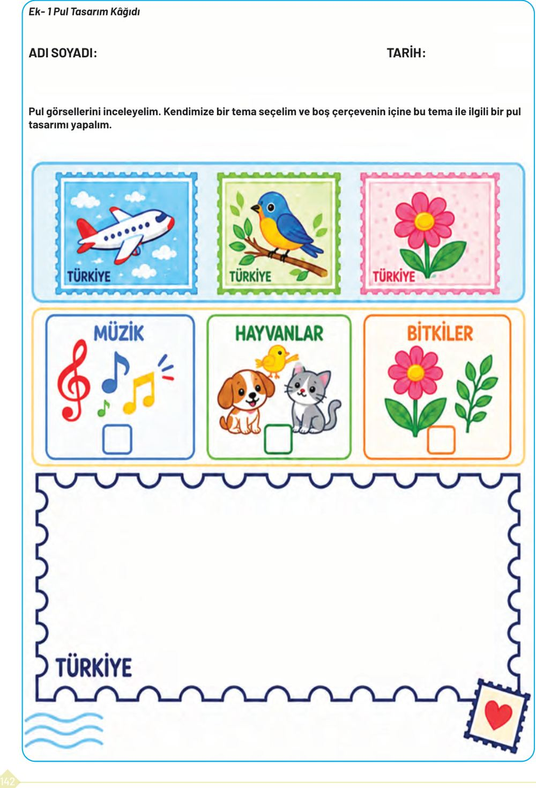

<!-- sayfa 144 -->

**ETKİNLİK ADI:** Sağlık Kuruluşu
**ALAN ADI:** Hareket ve Sağlık
**YAŞ GRUBU:** 60-72 ay

**ALAN BECERİLERİ, ÖĞRENME ÇIKTILARI VE SÜREÇ BİLEŞENLERİ**
HAREKET VE SAĞLIK ALANI
HSAB2. Sağlıklı Yaşam ve Öz Bakım Becerileri
**HSAB.6. Yeterli ve dengeli beslenebilme**
HSAB.6.b. Dengeli bir beslenme tabağı oluşturabilmek için öğün planlamasında görüşlerini söyler.

**EĞİLİMLER**
**E3. Entelektüel Eğilimler**
E3.2. Odaklanma

**PROGRAMLAR ARASI BİLEŞENLER**
**Sosyal-Duygusal Öğrenme Becerileri**
SDB2.2. İş Birliği
**Değerler**
D13. Sağlıklı Yaşam
D13.1. Yeterli, dengeli ve sağlıklı beslenmek
**Okuryazarlık Becerileri**
OB4. Görsel Okuryazarlık

**Kavramlar:** Zıt: kirli - temiz
**Sözcükler:** sağlıklı, sağlıksız, hijyen
**Materyaller:** su içme takip çizelgesi, sağlık konulu afişler, doktor/hemşire/diyetisyen gibi sağlık çalışanlarına ait görsellerin yer aldığı kartlar
**Eğitim / Öğrenme Ortamları:** Çocukların gezi süresince kendi güvenlik ve sağlıklarını korumaları, aynı zamanda sağlık kuruluşunu güvenli bir şekilde incelemeleri amacıyla sağlık kuruluşlarının ne olduğu, neden önemli olduğu ve sağlık kuruluşlarında kimlerin çalıştığı hakkında açıklama yapılır. Sınıfta bir “Sağlık Merkezi” oluşturulur ve bu merkeze doktor, hemşire ve diğer sağlık çalışanlarını temsil eden kartlar yerleştirilir. Gezi öncesinde çocukların güvenliğini sağlamak amacıyla, üzerinde çocukların ad - soyad bilgileri ile okulun iletişim bilgilerinin yer aldığı yaka kartları hazırlanır ve gezi süresince çocukların yakalarına takılır.

<!-- sayfa 145 -->

# ETKİNLİKLER

## Hareket ve Sağlık (Büyük Grup Etkinliği)

* Gezi öncesinde çocuklar sayışmaca ile dört gruba ayrılır. Her gruptan sağlık çalışanlarını temsil eden görsellerin bulunduğu kartlardan birini seçmesi, kartta yer alan kişinin kim olduğunu ve ne iş yaptığını tahmin etmesi istenir. Grupların tahminlerini arkadaşlarıyla paylaşmalarına fırsat verilir (**OB4**). Ardından el temizliği, dengeli beslenme, yeterli su içme, dinlenme ve uyku gibi sağlıklı yaşamı destekleyen alışkanlıklar hakkında kısa, görsel destekli ve etkileşimli bir sunum yapılır (**HSAB.6.b, D13.1**).
* Sağlık kuruluşuna gitmeden önce çocuklara gezinin amacı ve karşılaşabilecekleri ortam hakkında açıklama yapılır. “Bugün aşı olmaya, ilaç almaya ya da muayene olmaya gitmiyoruz. Doktorları, hemşireleri ve diğer sağlık çalışanlarını ziyaret edeceğiz; nerede ve nasıl çalıştıklarını keşfedeceğiz.” denir. Ardından “Orada stetoskop gibi küçük araçları yakından görebiliriz. İsteyenler stetoskopu kulağına takarak duyduğu ‘tık tık’ seslerini dinleyebilir. İstemeyenler ise arkadaşlarını izleyebilir.” açıklaması yapılarak çocukların gezi sırasında gerçekleştirilecek uygulamalara ilişkin önceden bilgi sahibi olmaları sağlanır.
* Gezi sırasında öğretmen ve arkadaşlarıyla birlikte hareket etme, sağlık kuruluşunda sakin bir sesle konuşma ve yalnızca görevlinin gösterdiği araçları inceleme gibi davranışlar hakkında çocuklarla konuşulur (**SDB2.2**).
* Sağlık kuruluşunun uygun bölümleri görevli eşliğinde gezilir ve burada çalışan kişilerin görevleri hakkında kısa açıklamalar yapılır. Sağlık çalışanlarının kullandığı stetoskop, tansiyon aleti, bandaj gibi araç-gereçler gösterilir. Çocukların bu araçları yakından incelemelerine ve ne amaçla kullanıldıklarına ilişkin düşüncelerini paylaşmalarına fırsat verilir (**E3.2**). Temsili muayene uygulaması yapılacaksa bunun gerçek bir muayene olmadığı önceden açıklanır. Çocuklardan isteyenlerin stetoskopu dinleme, bandaj sarma ya da el yıkama uygulamalarına katılmaları; katılmak istemeyenlerin ise süreci izlemeleri desteklenir.
* Sağlık kuruluşunda bulunan çocuklara uygun afiş ve görseller birlikte incelenir. El temizliği, beslenme, su içme, dinlenme ve uyku gibi sağlıklı yaşam alışkanlıklarının günlük yaşamımızdaki yeri hakkında sohbet edilir. Bu davranışların vücudumuzun sağlıklı kalmasına ve günlük etkinliklerimizi sürdürmemize nasıl yardımcı olduğu üzerinde durulur (**HSAB.6.b, D13.1**).
* Gezi sonrasında çocuklar dört gruba ayrılır. Birinci grup beslenme, ikinci grup kişisel temizlik, üçüncü grup su içme, dördüncü grup ise dinlenme ve yeterli uyku konusunda bir afiş hazırlar. Çocukların resim, sembol ve farklı materyaller kullanarak düşüncelerini afişlerine yansıtmalarına ve grup içinde birlikte çalışmalarına fırsat verilir (**SDB2.2**). Afişler tamamlandıktan sonra gruplar hazırladıkları çalışmaları arkadaşlarına sunar ve afişlerinde yer verdikleri sağlıklı yaşam davranışlarını açıklar (**E3.2, HSAB.6.b**). Hazırlanan afişler sınıfta oluşturulan “Geçici Sağlık Merkezi”nde sergilenir.
* Ardından “Su İçme Takip Çizelgesi” çocuklara tanıtılır. Çizelgedeki bölümlerin gün içinde su içtiklerinde işaretlenebileceği açıklanır. Çizelgenin bir hafta boyunca evde de kullanılabilmesi için ailelere bilgi verilir ve çocuklarıyla birlikte takip etmeleri desteklenir (**D13.1**).

## DEĞERLENDİRME

* Sağlıklı olmak için her gün neler yapabiliriz?
* Gün içinde su içtiğini takip etmek için çizelgeyi nasıl kullanabilirsin?
* Grup arkadaşlarınla hazırladığınız afişte hangi konuyu anlattınız?
* Afişinizi hazırlarken hangi resimlere veya bilgilere yer verdiniz?
* Arkadaşlarının hazırladığı afişlerde hangi sağlıklı yaşam alışkanlıkları vardı?

<!-- sayfa 146 -->

# FARKLILAŞTIRMA
**Zenginleştirme:** Sınıfta “Sağlık Merkezi” dramatik oyun köşesi oluşturulabilir. Çocukların doktor, hemşire, hasta ve eczacı rollerini üstlenerek sağlık hizmetlerini canlandırmaları istenebilir. Çocuklardan geri dönüşüm malzemeleri kullanarak stetoskop, ambulans veya ilk yardım çantası gibi sağlık araçlarının modellerini tasarlamaları istenebilir.

**Destekleme:** Sağlık çalışanları, sağlık araçları ve hijyen kurallarını içeren büyük ve renkli görsel kartlar kullanılabilir.

# AİLE VE TOPLUM KATILIMI
**Aile Katılımı:** Ailelerle su içme çizelgesinin doldurulması, hijyen kurallarının uygulanması ve sağlıklı beslenme alışkanlıklarının desteklenmesi konusunda iş birliği yapılabilir.

<!-- sayfa 147 -->

*Ek-1 Su İçme Takip Çizelgesi*

**ADI SOYADI:**                                                                                                              **TARİH:**

Vücudumuzun sağlıklı kalması için her gün su içmemiz çok önemlidir. Bu tablo ile her gün ne kadar su içtiğimizi takip edelim. İçtiğimiz su bardağı kadar bardak görselini boyayalım.

| | 💧 | 💧 | 💧 | 💧 | 💧 | 💧 | 💧 | 💧 |
| :--- | :---: | :---: | :---: | :---: | :---: | :---: | :---: | :---: |
| **PAZARTESİ** | 🥛 | 🥛 | 🥛 | 🥛 | 🥛 | 🥛 | 🥛 | 🥛 |
| **SALI** | 🥛 | 🥛 | 🥛 | 🥛 | 🥛 | 🥛 | 🥛 | 🥛 |
| **ÇARŞAMBA** | 🥛 | 🥛 | 🥛 | 🥛 | 🥛 | 🥛 | 🥛 | 🥛 |
| **PERŞEMBE** | 🥛 | 🥛 | 🥛 | 🥛 | 🥛 | 🥛 | 🥛 | 🥛 |
| **CUMA** | 🥛 | 🥛 | 🥛 | 🥛 | 🥛 | 🥛 | 🥛 | 🥛 |
| **CUMARTESİ** | 🥛 | 🥛 | 🥛 | 🥛 | 🥛 | 🥛 | 🥛 | 🥛 |
| **PAZAR** | 🥛 | 🥛 | 🥛 | 🥛 | 🥛 | 🥛 | 🥛 | 🥛 |

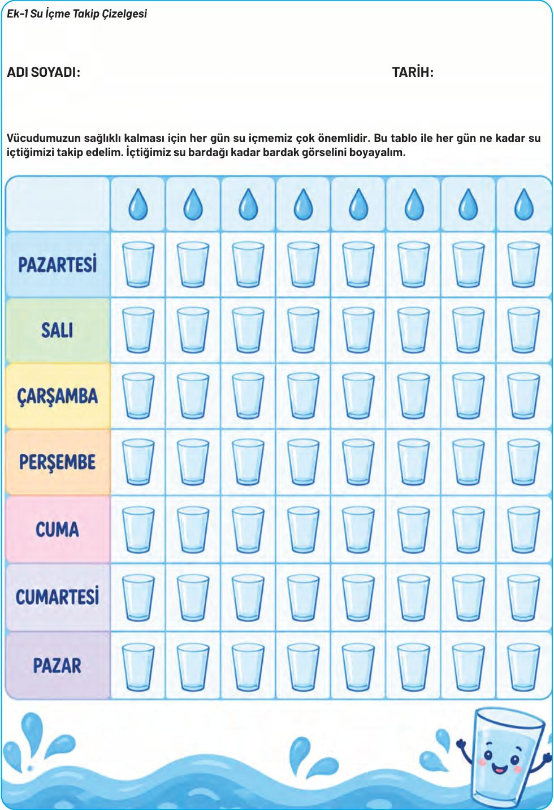

<!-- sayfa 148 -->

**ETKİNLİK ADI:** Ankara Şehit Cuma Dağ Tabiat Tarihi Müzesi  
**ALAN ADI:** Fen  
**YAŞ GRUBU:** 60-72 ay  

**ALAN BECERİLERİ, ÖĞRENME ÇIKTILARI VE SÜREÇ BİLEŞENLERİ**  

**FEN ALANI**  

**FBAB1. Bilimsel Gözlem**  
**FAB.1. Günlük yaşamında fenle ilgili olaylara / olgulara ve durumlara yönelik bilimsel gözlem yapabilme**  
FAB.1.d. Gözlemlediği nesne / olay / olguları uygun kayıt araçları kullanarak çizim, işaretleme, sembol kullanma yoluyla kaydeder.  

**FBAB3. Bilimsel Gözleme Dayalı Tahmin Etme**  
**FAB.3. Günlük yaşamda fen olaylarına yönelik bilimsel gözleme dayalı tahminlerde bulunabilme**  
FAB.3.c. Nesnelerin belirli durumlardaki olası değişimlerine ilişkin tahminlerini uygun ifadelerle açıklar.  

**EĞİLİMLER**  

**E3. Entelektüel Eğilimler**  
E3.2. Odaklanma  

**PROGRAMLAR ARASI BİLEŞENLER**  

**Sosyal-Duygusal Öğrenme Becerileri**  
**SDB1.2. Kendini Düzenleme (Öz Düzenleme)**  

**Değerler**  
**D3. Çalışkanlık**  
D3.4. Çalışmalarda aktif rol almak  

**Okuryazarlık Becerileri**  
**OB4. Görsel Okuryazarlık**  

**Kavramlar:** Zaman: önce - şimdi - sonra  
**Sözcükler:** fosil, geçmiş  
**Materyaller:** boya kalemi, “Bugün Yaşasaydı Nasıl Görünürdü” etkinlik kâğıdı (Ek - 1)  
**Eğitim / Öğrenme Ortamları:** Çocukların gezi süresince kendi güvenlik ve sağlıklarını korumaları, aynı zamanda müzeyi güvenli bir şekilde incelemeleri amacıyla okul dışı etkinliği ile ilgili açıklama yapılır. Gezi sırasında kullanılmak üzere “Bugün Yaşasaydı Nasıl Görünürdü?” adlı gözlem kâğıdı (Ek – 1) çocuk sayısı kadar çıktı alınarak hazırlanır. Gezi sırasında çocukların inceleme yaptığı alanların ve müzenin bazı bölümlerinin fotoğrafları çekilir. Gezi öncesinde çocukların güvenliğini sağlamak amacıyla, üzerinde çocukların ad – soyad bilgileri ile okulun iletişim bilgilerinin yer aldığı yaka kartları hazırlanır ve gezi süresince çocukların yakalarına takılır.

<!-- sayfa 149 -->

**ETKİNLİKLER**

**Fen (Bireysel Etkinlik)**

* Gezi öncesi, çocuklara farklı canlılara (hayvan, bitki) ait fosil görselleri gösterilir. Çocuklardan bu görsellerin hangi hayvana veya bitkiye ait olabileceğini tahmin etmeleri istenir (**E3.2, OB4**). Ardından “Fosil, geçmişte yaşamış olan canlıların, yer kabuğu kayaçları içinde taşlaşmış kalıntıları veya izleridir.” açıklaması yapılır. Çocuklarla, fosillerin nasıl oluştuğu ve neden önemli oldukları hakkında sohbet edilir. Çocuklara müzede hangi kurallara dikkat etmeleri gerektiği (sessiz olmak, dokunmamak, gözlem yaparken dikkatli olmak vb.) açıklanır. Çocuklara “Bugün Yaşasaydı Nasıl Görünürdü?” formunun nasıl kullanılacağı, iskeletleri bulma, işaretleme ve çizim yapma bölümleri hakkında açıklama yapılır.
* Gezi sırasında, çocukların müzeyi gezerken iskelet ve fosil örneklerini incelemeleri ve gözlemlemeleri istenir. Çocuklardan formda yer alan iskelet görsellerini müzede bularak işaretlemeleri istenir (**FAB.1.d**). Çocuklara “Sizce bu hayvanlar geçmişte yaşarken nasıl görünüyordu?” sorusu sorulur ve formda bulunan çizim bölümünü kullanarak resmini çizmeleri istenir (**FAB.3.c, SDB1.2, D3.4**). Çizimler bittikten sonra “Bu hayvan nasıl yürürdü?”, “Nasıl ses çıkarırdı?”, “Uçabilir miydi ya da yüzebilir miydi?” gibi sorular sorulur. Çocukların yanıtları dinlenir. Çocuklardan çizdikleri hayvana bir isim vermeleri istenir. Çocuklara çizdikleri hayvanla ilgili Ne yer?”, “Ne yapmayı sever?”, “Nerede yaşamıştır?”, “Ne yapmak ister?” gibi sorular sorularak sohbet edilir.
* Gezi sonrasında, müze gezisi sırasında çekilen fotoğraflar sınıf panosunda “Zaman Yolcuları: Fosillerin İzinde” başlığıyla sergilenir.

**DEĞERLENDİRME**

* Müzede en çok ilgini çeken fosil veya iskelet hangisiydi? Neden?
* Fosiller bize çok önceden yaşamış canlılar hakkında neler anlatabilir?
* Eğer çok çok önceden yaşamış hayvanları görebilseydin, hangisini görmek isterdin?
* O hayvanı görmeye giderken yanında kimi götürmek isterdin?

**FARKLILAŞTIRMA**

**Zenginleştirme:** Çocuklardan kil, oyun hamuru veya tuz seramiği kullanarak inceledikleri fosillerin üç boyutlu modellerini oluşturmaları istenebilir. Hazırlanan çalışmalar sınıfta sergilenebilir. Çocuklardan etkinlikte çizdikleri hayvan için kısa bir hikâye oluşturmaları istenebilir. Çocuklarla fosillerin oluşum sürecini gösteren görseller sıralanabilir ve “Milyonlarca yıl sonra hangi canlıların fosili oluşabilir?” sorusu sorularak beyin fırtınası yapılabilir. **Destekleme:** Formdaki yönergeler kısa ve anlaşılır cümlelerle aşama aşama açıklanabilir. Gerekli durumlarda form üzerinde örnek uygulama yapılarak çocuklara model olunabilir. Çocukların formu birlikte incelemeleri, iskeletleri birlikte bulmaları ve gözlemlerini paylaşmaları istenebilir.

**AİLE VE TOPLUM KATILIMI**

**Aile Katılımı:** Aileler ile gezi süreci ile ilgili bilgi notu paylaşılabilir. Ailelerden çocuklarıyla fosiller, dinozorlar veya geçmişte yaşamış canlılar hakkında bir kitap incelemeleri ya da kısa bir belgesel izlemeleri istenebilir.
**Toplum Katılımı:** Müzede görev yapan bir uzman (paleontolog, arkeolog, müze eğitimcisi veya rehber) çocuklara fosillerin oluşumu, korunması ve müzelerde sergilenme süreci hakkında bilgilendirme yapılabilir.

<!-- sayfa 150 -->

Ek-1 Bugün Yaşasaydı Nasıl Görünürdü?

ADI SOYADI:                                                                                                              TARİH:

Fosil görsellerini inceleyelim. Bu fosillerin canlı hallerini hayal edelim ve çizelim.

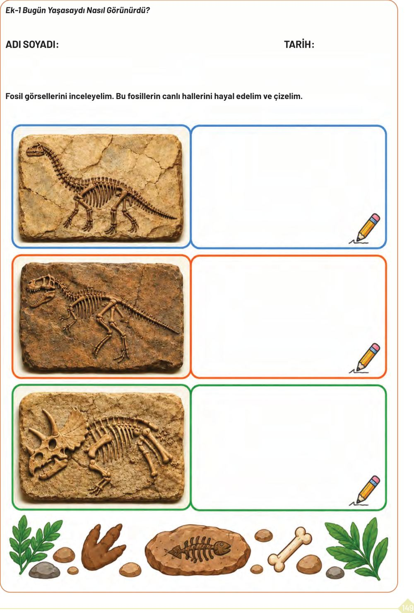

<!-- sayfa 151 -->

# KAYNAKÇA

Millî Eğitim Bakanlığı. Talim ve Terbiye Kurulu (2025). *Türkiye Yüzyılı Maarif Modeli Ortak Metni*.

Millî Eğitim Bakanlığı. Talim ve Terbiye Kurulu (2026). *Türkiye Yüzyılı Maarif Modeli Okul Öncesi Eğitim Programı*.

Bu kaynakça APA Stili 7. Sürümüne göre hazırlanmıştır.

# GÖRSEL VE GENEL AĞ KAYNAKÇASI

<!-- yer tutucu bulunamadı: sayfa sonuna eklendi -->

<!-- yer tutucu bulunamadı: sayfa sonuna eklendi -->

<!-- sayfa 152 -->

50°D
45°D
40°D
35°D
30°D
25°D

40°K
35°K

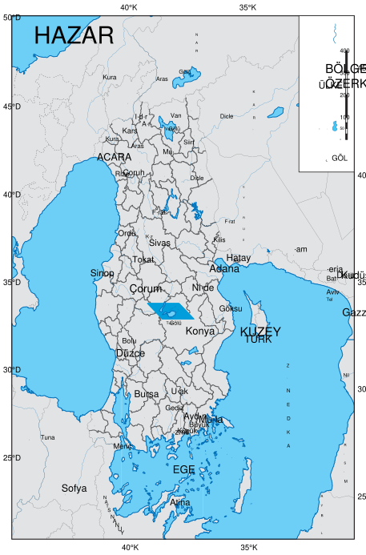: Türkiye'nin mülki idare bölümleri, kara ve deniz komşularını gösteren harita.

# TÜRKİYE'NİN MÜLKİ İDARE BÖLÜMLERİ İLE KARA VE DENİZ KOMŞULARI HARİTASI

**Komşu Ülkeler ve Bölgeler:**
* UKRAYNA
* RUSYA FEDERASYONU
* GÜRCİSTAN
* ERMENİSTAN
* AZERBAYCAN
* NAHÇIVAN Ö.C. (AZERBAYCAN)
* İRAN
* IRAK
* SURİYE
* LÜBNAN
* GÜNEY KIBRIS RUM YÖNETİMİ
* KUZEY KIBRIS TÜRK CUMHURİYETİ
* İSRAİL
* FİLİSTİN (Batı Şeria, Gazze Şeridi)
* MISIR
* LİBYA
* ROMANYA
* BULGARİSTAN
* YUNANİSTAN

**Denizler:**
* KARADENİZ
* EGE DENİZİ
* AKDENİZ
* MARMARA DENİZİ
* HAZAR DENİZİ

**İller (Haritada Belirtilenler):**
Adana, Adıyaman, Afyonkarahisar, Ağrı, Amasya, Ankara, Antalya, Artvin, Aydın, Balıkesir, Bilecik, Bingöl, Bitlis, Bolu, Burdur, Bursa, Çanakkale, Çankırı, Çorum, Denizli, Diyarbakır, Edirne, Elâzığ, Erzincan, Erzurum, Eskişehir, Gaziantep, Giresun, Gümüşhane, Hakkâri, Hatay, Isparta, Mersin, İstanbul, İzmir, Kars, Kastamonu, Kayseri, Kırklareli, Kırşehir, Kocaeli, Konya, Kütahya, Malatya, Manisa, Kahramanmaraş, Mardin, Muğla, Muş, Nevşehir, Niğde, Ordu, Rize, Sakarya, Samsun, Siirt, Sinop, Sivas, Tekirdağ, Tokat, Trabzon, Tunceli, Şanlıurfa, Uşak, Van, Yozgat, Zonguldak, Aksaray, Bayburt, Karaman, Kırıkkale, Batman, Şırnak, Bartın, Ardahan, Iğdır, Yalova, Karabük, Kilis, Osmaniye, Düzce.

**Akarsular ve Göller:**
* Kızılırmak N.
* Sakarya N.
* Yeşilırmak N.
* Çoruh N.
* Fırat N.
* Dicle N.
* Aras N.
* Kura N.
* Meriç N.
* Asi N.
* Ceyhan N.
* Seyhan N.
* Göksu N.
* Büyük Menderes N.
* Küçük Menderes N.
* Bakırçay N.
* Gediz N.
* Nil N.
* Van Gölü
* Tuz Gölü
* Urumiye Gölü

**Diğer Yer İsimleri:**
Sofya, Bükreş, Tiflis, Erivan, Lefkoşa, Beyrut, Şam, Kudüs, Tel Aviv, Atina, Bağdat.

**Harita Lejantı:**
* BAŞKENT: Ankara
* İL MERKEZİ
* GÖL
* AKARSU
* ÜLKE SINIRI
* ÖZERK BÖLGE SINIRI

0 100 200 300 400 km

Harita Genel Müdürlüğü tarafından üretilmiştir.

<!-- sayfa 153 -->

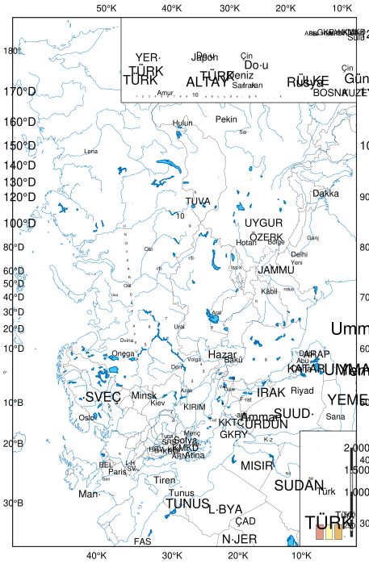
<!-- yer tutucu bulunamadı: sayfa sonuna eklendi -->

<!-- sayfa 154 -->

# Bu kitaba sığmayan daha neler var!

: QR kod ve teknolojik ürünlerin illüstrasyonu

Karekodu okut, bu kitapla ilgili EBA içeriklerine ulaş!

eba
www.eba.gov.tr

## Teknoloji Yolculuğumuz

* İstanbul Havalimanı
* Mikro Uydu Fırlatma Sistemi
* TÜRKSAT
* GÖKMEN
* KAAN
* GÖKBEY
* İnsansız Hava Aracı
* Sondaj ve Sismik Arama Gemisi
* Yerli ve Milli Otomobil
* Yüksek Hızlı Tren
* TCG Anadolu
* Turbofan Motoru

BU DERS KİTABI MİLLÎ EĞİTİM BAKANLIĞINCA ÜCRETSİZ OLARAK VERİLMİŞTİR.
**PARA İLE SATILAMAZ.**

Bandrol Uygulamasına İlişkin Usul ve Esaslar Hakkında Yönetmeliğin Beşinci Maddesinin
