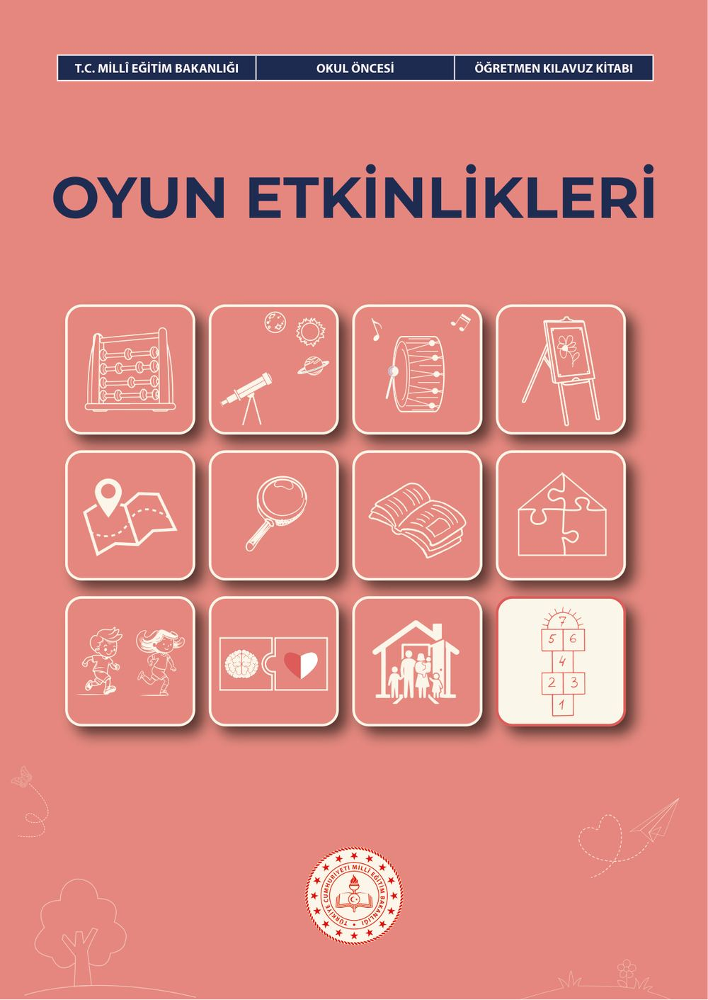
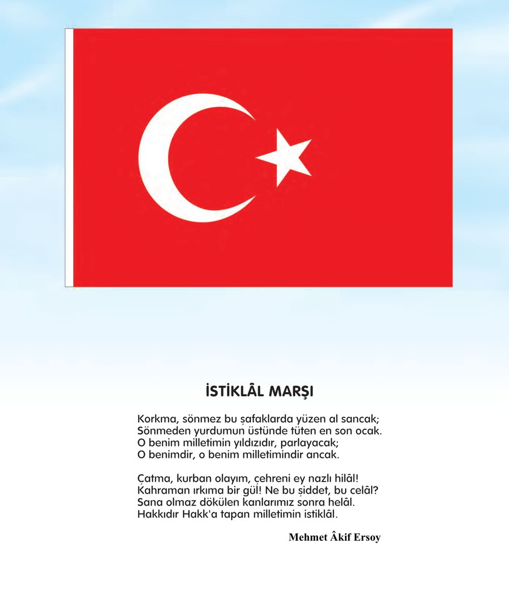
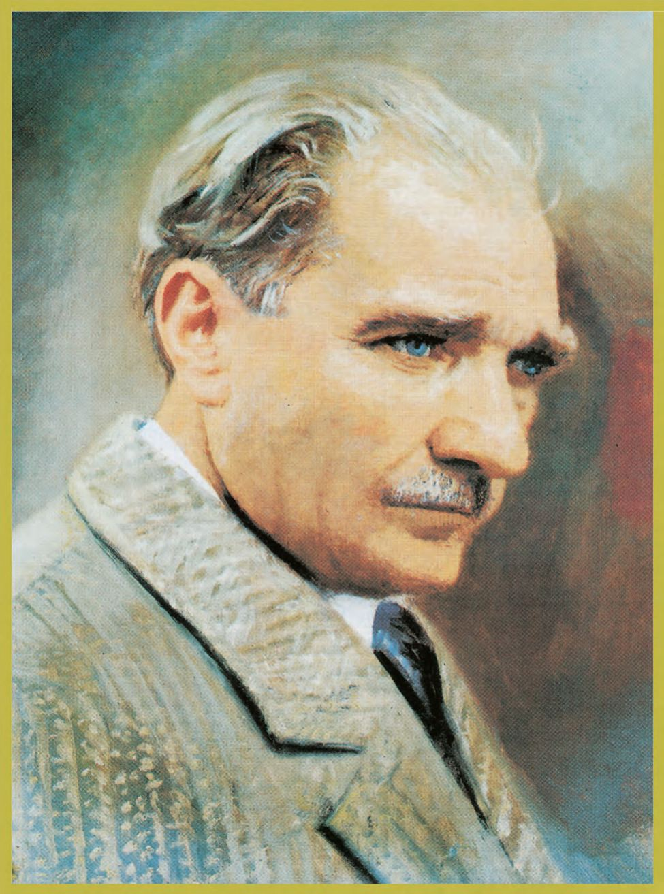
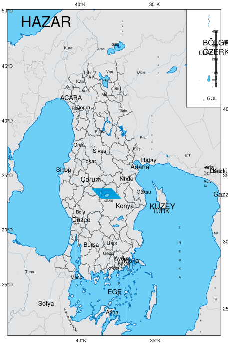
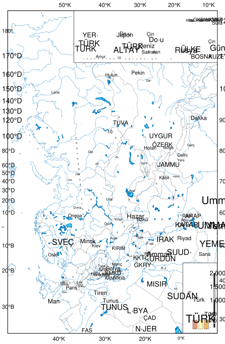

# Okul Öncesi Oyun Etkinlikleri Öğretmen Kılavuz Kitabı

<!-- sayfa 0 -->

T.C. MİLLÎ EĞİTİM BAKANLIĞI | OKUL ÖNCESİ | ÖĞRETMEN KILAVUZ KİTABI

# OYUN ETKİNLİKLERİ

<!-- sayfa 1 -->

Verdiğiniz metin katmanı boş olduğu için (`<<< >>>` arası boş) dönüştürülecek herhangi bir içerik bulunmamaktadır. Lütfen metin katmanını içeren içeriği paylaşın, böylece talimatlarınıza uygun şekilde Markdown formatına çevirebilirim.

<!-- sayfa 2 -->

OKUL ÖNCESİ

# Oyun Etkinlikleri
# Öğretmen Kılavuz Kitabı

## Yazarlar
AYŞEGÜL PARLAK
BAŞAK TÜRK
BETÜL BALLICA
BÜŞRA AKÇAY
GAMZE AKYOL
GAMZE ÇAL
HİDAYET KARAEVLİ
NEŞE AŞKAR
SİTARE HAYRUNNİSA BEKÖZ
TUBA DAĞ
YELİZ GÜNAY

DEVLET KİTAPLARI

<!-- sayfa 3 -->

Millî Eğitim Bakanlığı Yayınları ................................................................................................................ 11237
Ders Kitapları Dizisi No . ......................................................................................................................... 2664

Her hakkı saklıdır ve Millî Eğitim Bakanlığına aittir. Kitabın metin, soru ve şekilleri kısmen de olsa hiçbir surette alınıp yayımlanamaz.

# Editör
Prof. Dr. Bengü TÜRKOĞLU
Doç. Dr. Merve ŞAHİN

## Dil Uzmanı
Şükran TEFEK

## Görsel Tasarımcı
Arzu GÜNAL GÜN
Metin BİLAL

## Çoklu Ortam Tasarımcısı
Betül SÜREK
Ezgi AVCI AŞIR
Kübra KARAKUŞ
Yudum CAN

## Program Geliştirme Uzmanı
Dr. Emine SELMANOĞLU

## Ölçme ve Değerlendirme Uzmanı
Merve ERELİ

## Rehberlik Uzmanı
Aylin Sazlı Sayıcı

### ISBN
978-625-8867-36-7

Millî Eğitim Bakanlığı Talim ve Terbiye Kurulu Başkanlığının 13.10.2026 tarih ve 172455532 sayılı yazısı ile eğitim

<!-- sayfa 4 -->

# İSTİKLÂL MARŞI

Korkma, sönmez bu şafaklarda yüzen al sancak;
Sönmeden yurdumun üstünde tüten en son ocak.
O benim milletimin yıldızıdır, parlayacak;
O benimdir, o benim milletimindir ancak.

Çatma, kurban olayım, çehreni ey nazlı hilâl!
Kahraman ırkıma bir gül! Ne bu şiddet, bu celâl?
Sana olmaz dökülen kanlarımız sonra helâl.
Hakkıdır Hakk'a tapan milletimin istiklâl.

**Mehmet Âkif Ersoy**

<!-- sayfa 5 -->

ANDIMIZ

Türküm, doğruyum, çalışkanım.

İlkem küçüklerimi korumak, büyüklerimi saymak; yurdumu, milletimi özümden çok sevmektir.
Ülküm yükselmek, ileri gitmektir.

Ey Büyük Atatürk!

Açtığın yolda, gösterdiğin hedefe durmadan yürüyeceğime ant içerim.

Varlığım Türk varlığına armağan olsun.

Ne mutlu Türküm diyene!

<!-- sayfa 6 -->

MUSTAFA KEMAL ATATÜRK

<!-- yer tutucu bulunamadı: sayfa sonuna eklendi -->

<!-- sayfa 7 -->

Verdiğiniz metin katmanı boş olduğu için (`<<< >>>` arası boş) dönüştürülecek herhangi bir içerik bulunmamaktadır. Lütfen metin katmanını içeren içeriği paylaşın, böylece talimatlarınıza uygun şekilde Markdown formatına çevirebilirim.

<!-- sayfa 8 -->

# İÇİNDEKİLER

| | |
| :--- | ---: |
| GİRİŞ | 9 |
| OKUL ÖNCESİ EĞİTİMDE OYUN | 9 |
| OYUN ETKİNLİK ÖRNEKLERİ | 14 |
|     Şekli Göster | 14 |
|     İki Yumurta, İki Canlı | 17 |
|     Hangi Balonda İsmim Var? | 20 |
|     Haydi, Sen Tamamla | 23 |
|     Zıddını Bul, Söyle | 26 |
|     Zıddını Bul, Çiz | 29 |
|     Balondaki İsmimi Buluyorum | 32 |
|     Rakamı Sen Tamamla | 35 |
|     Bu Kimin Yumurtası? | 38 |
|     Şekil İstasyonları | 41 |
|     Yiyeceği Tanı, Hedefi Bul | 44 |
|     Arkadaşlık İlkesi | 47 |
|     Dikkat, Mikrop Geliyor! | 50 |
|     Hayvanların Sesleri | 53 |
|     Dostluk Ağı | 57 |
|     Kırmızı Şapka – 9 Kare Oyunu | 60 |
|     Ponpon Yağmuru | 63 |
|     Değişen Kuleler | 66 |
|     Güven Bana | 69 |
|     Renkli Mandal Parkuru | 72 |
|     Şaşırt ve Bul Oyunu | 75 |
|     Birlikte Düzenliyoruz | 78 |
|     Nesne Avcıları | 80 |
|     Bahçe Görev Postası | 82 |
|     Zıtlıklar Her Yerde | 84 |
|     Nerede? Ne Yapmalı? | 87 |
|     Kâşifle Görev Başında | 90 |
|     Ormanda Macera | 93 |
|     Sınıfımızı Topluyoruz | 96 |
|     Engeli Geç, Doğru Hareketi Seç | 99 |
|     Şekil Dedektifleri | 102 |
|     Denge Avcıları | 105 |
|     Gölgemle Saklambaç | 107 |
|     Renk Haritası | 109 |
|     Rüzgârla Dönen Pervaneler | 111 |
|     Ses Dedektifleri | 114 |

<!-- sayfa 9 -->

| | |
| :--- | ---: |
| Rüzgâr Postası | 121 |
| İkili Duraklar Oyunu | 124 |
| KAYNAKÇA | 126 |
| GÖRSEL VE GENEL AĞ KAYNAKÇASI | 126 |
| TÜRKİYE’NİN MÜLKİ İDARE BÖLÜMLERİ İLE KARA VE DENİZ KOMŞULARI HARİTASI | 127 |
| TÜRK DÜNYASI HARİTASI | 128 |

<!-- sayfa 10 -->

# OKUL ÖNCESİ EĞİTİMDE OYUN
## GİRİŞ

Bu kılavuz, Türkiye Yüzyılı Maarif Modeli Okul Öncesi Eğitim Programı doğrultusunda öğretmenlere oyun temelli öğrenme anlayışının uygulanmasına yönelik yol gösterici bir çerçeve sunmak amacıyla hazırlanmıştır. Okul öncesi eğitimde oyun ayrı bir öğrenme alanı olarak değil çocukların alan becerilerini, sosyal-duygusal öğrenme becerilerini, değerleri, eğilimleri, kavramsal becerileri ve okuryazarlık becerilerini yaşantı içinde kullanmalarını destekleyen temel öğrenme yöntemi olarak ele alınmaktadır.

Bu bölümde öncelikle okul öncesi eğitimde oyun temelli öğrenme anlayışının nasıl değerlendirilmesi gerektiğine ilişkin açıklamalara yer verilmektedir. Ardından kılavuz kitaplarda yer alan etkinliklerin oyun yoluyla çocukla nasıl buluşturulabileceği, öğretmenin oyun sürecindeki rehberlik rolü ve oyun yoluyla beceriler ile program bileşenlerinin nasıl bütünleştirilebileceği açıklanmaktadır. Bölümün sonunda ise öğretmenlerin sınıf içi, sınıf dışı, açık hava ve okul dışı öğrenme ortamlarında oyun temelli etkinlikleri planlarken dikkate alabilecekleri uygulama notları sunulmaktadır.

Kılavuz kitaplarda yer alan etkinlikler; öğretmenlerin sınıflarında çocukların ilgi, ihtiyaç, gelişim özellikleri ve bireysel farklılıklarını dikkate alarak uyarlayabilecekleri, esnek ve yol gösterici örnek öğrenme yaşantıları olarak değerlendirilmelidir. Bu çerçevede öğretmenlerin etkinlikleri uygularken çocukların seçim yapmasına, rol üstlenmesine, materyalleri farklı biçimlerde kullanmasına, akranlarıyla etkileşim kurmasına, problem durumlarıyla karşılaştıklarında sürece kendi katkılarını sunmasına olanak tanımaları önemlidir.

Oyun temelli öğrenme anlayışında etkinlikler, çocukların aktif katılım gösterebileceği, deneyimlerini sürece yansıtabileceği ve öğrenmeyi oyun yoluyla anlamlandırabileceği biçimde planlanmalıdır. Bu nedenle öğretmen, kılavuz kitaplarda yer alan etkinlikleri planlarken ve uygularken “çocuk bu süreçte nasıl oynayacak, neyi deneyecek, hangi kararı verecek, hangi materyali dönüştürecek, kimlerle etkileşim kuracak ve hangi becerileri yaşantı içinde kullanacak?” sorularını dikkate almalıdır.

Bu bölümde yer alan açıklamalar ve uygulama notları, öğretmenlere oyun temelli öğrenme süreçlerini planlama, uygulama, gözlemleme, değerlendirme ve farklılaştırma açısından destek olmayı amaçlamaktadır. Kılavuz boyunca öğretmenlere yönelik ifadeler öneri niteliğinde sunulmuş olup etkinlikler sınıfın koşullarına, çocukların gelişim düzeylerine, bireysel gereksinimlerine, ilgi alanlarına ve okulun olanaklarına göre uyarlanabilir.

Oyun temelli öğrenme sürecinin aile ile paylaşılması, bu anlayışın ev ortamına taşınması açısından da önem taşımaktadır. Öğretmenler, velilere oyunun çocuk gelişimindeki rolünü açıklayarak evde destekleyici ortamlar oluşturmaları konusunda rehberlik edebilir. Aile katılımı; veli toplantıları, paylaşım panoları veya günlük iletişim yollarıyla desteklenebilir.

### Oyun Temelli Öğrenme Anlayışı

Oyun temelli öğrenme anlayışında çocuk, öğrenme sürecinin yalnızca izleyen ya da yönergeyi yerine getiren katılımcısı değildir. Çocuk; anlam kuran, deneyen, dönüştüren ve sürece katkı sunan bir özne olarak konumlanmalıdır. Bu nedenle oyun temelli bir etkinlikte çocuğun seçim yapmasına, karar vermesine, rol üstlenmesine, materyallerle farklı yollar denemesine ve akranlarıyla etkileşim kurmasına fırsat verilmelidir. Etkinliğin çocuk açısından oynanabilir, keşfedilebilir ve geliştirilebilir bir yapıda olması önemlidir.

Bu anlayışta öğretmen, etkinliği planlarken hem desteklenecek beceriyi hem de çocuğun bu beceriyi oyun içerisinde nasıl kullanacağını göz önünde bulundurmalıdır. Öğretmenin oyun sürecinde sorabileceği açık uçlu sorular çocukların düşünme süreçlerini derinleştirmek açısından etkili bir araçtır. Bu sorular; “Sence ne olur?”, “Başka nasıl yapabilirsin?”, “Neden böyle düşündün?”, “Arkadaşın farklı ne denedi?” gibi çocuğun kendi çözümünü üretmesine alan açan ifadeler olmalıdır. Doğru-yanlış yanıt bekleyen sorular yerine çocuğun süreci keşfetmesini destekleyen sorulara yer verilmesi önemlidir. Çocukların soru sormaları, tahminde bulunmaları, denemeler yapmaları, farklı çözüm yolları üretmeleri ve süreci kendi deneyimleriyle ilişkilendirmeleri desteklenmelidir. Böylece öğrenme, çocuğa dışarıdan aktarılan bir içerik olmaktan ziyade yaşantı içinde anlam kazanan bir sürece dönüşür.

<!-- sayfa 11 -->

Oyun temelli öğrenme, öğretmenin rehberliğini dışlamaz; öğretmenin planlama, gözlemleme ve süreci zenginleştirme rolünü daha belirgin hâle getirir. Öğretmen çocukların ilgi, ihtiyaç ve gelişim özelliklerini dikkate alarak uygun ortamlar oluşturmalı; gerektiğinde açık uçlu sorular, yeni materyaller, rol önerileri veya problem durumlarıyla çocukların düşünme süreçlerini desteklemelidir. Bu destek oyunun doğal akışını ve çocuğun özerkliğini koruyacak biçimde sunulmalıdır.

## Etkinliklerin Oyun Temelli Düzenlenmesi

Kılavuz kitaplarda yer alan etkinlikler, öğretmenin sınıfındaki çocukların özelliklerine göre düzenleyebileceği örnek öğrenme yaşantılarıdır. Bu etkinliklerin oyun yoluyla çocukla buluşması; çocukların aktif rol üstlenmelerine, materyallerle etkileşim kurmalarına, akranlarıyla iletişim geliştirmelerine ve kendi deneyimlerinden hareketle anlam oluşturmalarına olanak sağlar. Bu nedenle öğretmen, etkinliği uygulamadan önce çocukların süreçte ne yapacağını, hangi araçları kullanacağını, kimlerle etkileşime gireceğini ve etkinliğe nasıl katkı sunacağını göz önünde bulundurmalıdır.

Etkinliklerin oyun yoluyla düzenlenmesinde çocukların merakını harekete geçirecek başlangıçlar önemlidir. Bir nesne, görsel, kukla, ses, hareket, kısa bir olay, problem durumu ya da yarım bırakılmış bir hikâye çocukların ilgisini sürece yöneltebilir. Örneğin bir hikâye etkinliği, yalnızca metnin okunmasıyla sınırlı kalmayıp çocukların karakterleri canlandırdığı, hikâyeye yeni bir son önerdiği ya da olayları farklı bir bakış açısıyla yeniden kurduğu bir yaşantıya dönüşebilir. Benzer biçimde bir fen etkinliği, öğretmenin açıklama yaptığı bir süreç olmaktan çıkarılarak çocukların tahmin ettiği, denediği, gözlemlediği ve sonuçları arkadaşlarıyla paylaştığı bir keşif oyununa dönüştürülebilir. Matematik etkinliklerinde çocuklar yalnızca saymakla kalmayıp nesne grupları oluşturabilir, grupları karşılaştırabilir ve sonuçlarını arkadaşlarına anlatabilir. Müzik etkinliklerinde ise belirli bir ritmi tekrar etmek yerine çocuklar kendi ritim örüntülerini oluşturabilir, beden perküsyonu ya da günlük nesneleri kullanarak müzik yaratma deneyimi yaşayabilir. Bu tür düzenlemeler etkinliği çocuk için anlamlı ve sahiplenilmiş bir öğrenme yaşantısına dönüştürür.

Oyun yoluyla çocukla buluşan etkinliklerde materyaller çocukların keşfedebileceği, farklı amaçlarla kullanabileceği, dönüştürebileceği ve oyun içinde anlamlandırabileceği öğrenme araçları olarak değerlendirilmelidir. Bloklar, kartlar, kuklalar, doğal materyaller, görseller, ritim araçları, kostümler, günlük yaşam nesneleri ve açık uçlu materyaller çocukların etkinliğe daha aktif katılmasını sağlayabilir. Materyallerin tek bir kullanım biçimiyle sınırlandırılmaması çocukların yaratıcılığını ve problem çözme becerilerini destekler.

Etkinliklerin oyun yoluyla düzenlenmesinde çocuklara rol alma ve karar verme fırsatları sunulmalıdır. Çocuklar bazen bir hikâyenin karakteri, bazen bir araştırmacı, bazen bir tasarımcı, bazen bir gözlemci, bazen de grup içinde sorumluluk alan bir katılımcı olabilir. Bu roller çocukların etkinliğe daha istekli katılmasına ve becerilerini doğal biçimde kullanmasına katkı sağlar. Öğretmen, etkinlikte çocuklara seçim alanları sunarak sürecin çocuklar tarafından sahiplenilmesini destekleyebilir. Kullanılacak materyalin seçimi, oyundaki rol dağılımı, problemin çözüm yolu ya da ürünün nasıl paylaşılacağı gibi kararlar çocuklarla belirlenebilir.

Etkinlikler oyun yoluyla düzenlenirken sürecin esnekliği korunmalıdır. Çocukların etkinlik sırasında ortaya koyduğu sorular, öneriler, tahminler ve farklı yaklaşımlar öğretmen tarafından dikkate alınmalıdır. Planlanan akış çocukların ilgisine göre küçük değişikliklerle zenginleştirilebilir. Böylece etkinlik, yalnızca önceden belirlenmiş adımların takip edildiği bir uygulama olmaktan çıkar; çocukların katkılarıyla gelişen ve öğrenme fırsatları sunan canlı bir sürece dönüşür.

## Oyun Sürecinde Öğretmenin Rehberliği

Oyun temelli öğrenme sürecinde öğretmen; çocukların oyunlarını dikkatle gözlemleyen, oyun akışını ve ilerleyen keşif sürecini desteklemek amacıyla ortamı hazırlayan, çocukların oyun içindeki deneyimlerini izleyen ve öğrenme sürecine rehberlik eden kişidir. Öğretmenin bu süreçteki temel sorumluluğu, çocukların bireysel, sosyal ve gelişimsel özelliklerine uygun bir ortamda oyun yoluyla öğrenmelerini desteklemektir.

Öğretmen, oyun süreci öncesinde çocukların güvenli biçimde hareket edebileceği, materyallere erişebileceği, seçim yapabileceği ve materyalleri farklı amaçlarla kullanabileceği esnek öğrenme ortamları hazırlamalıdır

<!-- sayfa 12 -->

çocukların materyalleri görmelerine, incelemelerine, seçmelerine ve oyun içinde dönüştürerek kullanmalarına olanak tanımalıdır. Bu süreçte materyal çeşitliliği kadar çocukların materyallerle kendi oyun fikirlerini geliştirebilmeleri de önemlidir. Öğretmen; sınıf içi, sınıf dışı, açık hava ve okul dışı öğrenme ortamlarını çocukların oyun kurmalarını, hareket etmelerini, araştırmalarını ve akranlarıyla etkileşimde bulunmalarını destekleyecek biçimde değerlendirebilir.

Oyun sırasında öğretmen çocukların davranışlarını dikkatle gözlemlemelidir. Çocukların hangi oyunlara yöneldiği, hangi rolleri tercih ettiği, arkadaşlarıyla nasıl ilişki kurduğu, sorunlarla nasıl baş ettiği, dil becerilerini nasıl kullandığı, materyallerle nasıl etkileşim kurduğu ve oyunu nasıl sürdürdüğü öğretmene önemli bilgiler sunar. Bu gözlemler çocukların ilgi alanlarını, güçlü yönlerini ve desteklenmesi gereken gelişim alanlarını anlamak için kullanılabilir.

Öğretmen, oyun sürecine gerektiğinde katılarak ya da dışarıdan destek sunarak çocukların düşünme ve etkileşim süreçlerini derinleştirebilir. Açık uçlu sorular sormak, yeni bir materyal önermek, çocukların fark etmediği bir duruma dikkat çekmek, oyuna yeni bir problem durumu eklemek veya çocukların birbirlerinin fikirlerini duymalarına yardımcı olmak bu destek biçimleri arasında yer alabilir. Ancak bu müdahaleler oyunun akışını kesintiye uğratmadan ve çocukların oyundaki özerkliklerini sınırlandırmadan gerçekleştirilmelidir.

Oyun sırasında çocuklar arasında görüş ayrılıkları, paylaşım sorunları ya da rol dağılımına ilişkin anlaşmazlıklar ortaya çıkabilir. Bu durumlarda öğretmen, hemen çözüm sunmak yerine çocukların duygularını ifade etmelerine, birbirlerini dinlemelerine ve birlikte çözüm üretmelerine rehberlik etmelidir. Böylece oyun süreci çocukların iletişim kurma, empati geliştirme, sabır gösterme, adil davranma, uzlaşma ve sorumluluk alma becerilerini destekleyen doğal bir öğrenme alanına dönüşür.

Sınıfta özel gereksinimli ya da kaynaştırma kapsamındaki çocukların bulunması durumunda oyun ortamları ve etkinlikler tüm çocukların katılımını destekleyecek biçimde uyarlanmalıdır. Materyallerin erişilebilirliği, rol dağılımında esneklik ve akran desteğinin teşvik edilmesi bu uyarlamanın temel unsurları arasında yer alabilir. Öğretmen, bireysel gereksinimleri göz önünde bulundurarak her çocuğun oyun sürecine anlamlı biçimde katılması sağlanmalıdır.

Öğretmen, oyun sürecinde yaptığı gözlemleri hem anlık rehberlik sağlamak hem de sonraki öğrenme yaşantılarını planlamak amacıyla kullanmalıdır. Çocukların oyun sırasında gösterdikleri ilgi, başlattıkları sorular, tercih ettikleri roller ve kullandıkları çözüm yolları; etkinliklerin farklılaştırılmasına ve öğrenme ortamlarının zenginleştirilmesine katkı sağlayabilir. Böylece oyun, öğretmen için çocuğun gelişimini doğal bağlamında izleme ve eğitim sürecini bu gözlemler doğrultusunda düzenleme fırsatı sunar.

## Oyun Yoluyla Becerilerin ve Program Bileşenlerinin Bütünleştirilmesi

Okul öncesi eğitimde çocuklar becerileri birbirinden bağımsız ve ayrı öğrenme alanları olarak değil günlük yaşam deneyimleri içinde birbiriyle ilişkili biçimde kullanırlar. Oyun bu bütünlüğün eğitim ortamına taşınmasına imkân sağlayan önemli bir bağlamdır. Çocuk oyun sırasında dil becerilerini kullanır, bedeniyle hareket eder, duygularını ifade eder, akranlarıyla iletişim kurar, kuralları deneyimler, problem durumlarıyla karşılaşır ve çevresine ilişkin anlamlar oluşturur. Bu nedenle oyun, alan becerileri ile program bileşenlerinin aynı öğrenme yaşantısı içinde birlikte desteklenmesine olanak tanır.

Oyun sürecinde birden fazla beceri doğal biçimde görünür hâle gelebilir. Örneğin çocukların bir hikâyeyi canlandırmaları; dinleme, konuşma, rol alma, duygu ifade etme, empati kurma ve yaratıcı düşünme süreçlerini birlikte destekleyebilir. Bloklarla bir yapı oluşturmaları; tahmin etme, karşılaştırma, denge kurma, problem çözme, iş birliği yapma ve sorumluluk alma becerilerini aynı süreçte harekete geçirebilir. Açık havada yürütülen bir keşif oyunu ise gözlem yapma, sınıflandırma, soru sorma, doğaya duyarlılık geliştirme ve akranlarla etkileşim kurma açısından zengin öğrenme fırsatları sunabilir.

Bu bütünleştirme sürecinde öğretmen, etkinliğin desteklediği alan becerilerinin yanı sıra çocukların oyun içinde kullandıkları farklı beceri ve bileşenleri de dikkate almalıdır. Sosyal-duygusal öğrenme becerileri, değerler, eğilimler, kavramsal beceriler ve okuryazarlık becerileri oyun içinde doğal olarak desteklenebilir. Çocukların sıra beklemesi arkadaşının fikrini dinlemesi ortak karar alması bir sembolü anlamlandırması bir problemi çözmek

<!-- sayfa 13 -->

Oyun yoluyla bütünleştirme etkinlikleri fazla sayıda hedefle ağırlaştırmak anlamına gelmez. Öğretmen, oyun sürecinde öne çıkan beceri ve bileşenleri çocukların gelişim özelliklerine, etkinliğin yapısına ve sınıfın ihtiyaçlarına göre seçerek ele almalıdır. Önemli olan çocukların oyun sırasında becerileri yaşantı içinde kullanmaları ve bu beceriler arasında anlamlı bağlantılar kurabilmeleridir. Bu yaklaşım öğrenme sürecinin bütüncül biçimde ilerlemesine katkı sağlar.

Oyun sürecinde ortaya çıkan öğrenme deneyimlerinin belgelenmesi, öğretmenin çocukların gelişimini doğal bağlamı içinde izlemesine ve sonraki öğrenme yaşantılarını planlamasına katkı sağlar. Bu süreçte çocukların kullandıkları dil ve iletişim biçimleri, kurdukları ilişkiler, üstlendikleri roller, geliştirdikleri çözüm yolları ve ürettikleri ürünler anekdot notları, gözlem kayıtları, çocukların ortaya koyduğu ürünleri, portfolyo çalışmaları ve gerekli izinler doğrultusunda fotoğraf veya video kayıtlarıyla belgelenebilir. Belgeleme sürecinde elde edilen veriler etkinliklerin uyarlanması ve öğrenme ortamlarının zenginleştirilmesi amacıyla kullanılmalı; bu belgelerde çocukların mahremiyetinin korunmasına, gerekli veli izinlerinin alınmasına ve kayıtların yalnızca eğitim amacıyla kullanılmasına özen gösterilmelidir.

# Öğretmenler İçin Uygulama Notları

## Oyun Ortamı ve Sürecin Düzenlenmesi

* Oyun temelli uygulamalar planlanırken çocukların yaş grubu, gelişim özellikleri, ilgi alanları, bireysel gereksinimleri ve sınıfın koşulları dikkate alınmalıdır.
* Günlük rutinde serbest oyun zamanına yer verilmeli; bu süre çocukların kendi seçimleriyle, kendi kurallarıyla oynadığı, öğretmen yönlendirmesinin en aza indirildiği bir zaman dilimi olarak planlanmalıdır.
* Küçük grup, büyük grup ve bireysel oyun fırsatları günlük rutinde dengeli biçimde yer almalı; hangi etkinliğin hangi grup yapısında yürütüleceği çocukların gelişim özellikleri ve etkinliğin niteliğine göre belirlenmelidir.
* Sınıf içi, sınıf dışı, açık hava ve okul dışı öğrenme ortamları oyun temelli uygulamalar için değerlendirilmeli; çocukların farklı ortamlarda keşfetmelerine, hareket etmelerine ve etkileşim kurmalarına imkân tanınmalıdır.
* Oyun ortamlarında çocukların materyalleri incelemelerine, seçmelerine, farklı amaçlarla kullanmalarına ve kendi oyun fikirlerini geliştirmelerine fırsat verilmelidir.
* Sınıfta dramatik oyun, blok gibi oyun merkezleri oluşturulmalı; bu merkezler çocukların ilgi ve ihtiyaçlarına göre düzenli olarak yenilenmelidir.
* Açık hava ve okul dışı ortamlarda kullanılacak materyaller ve oyun alanları etkinlik öncesinde güvenlik açısından değerlendirilmelidir.

## Öğretmenin Rehberlik Rolü

* Etkinliklerde çocukların yalnızca izleyen ya da yönergeyi yerine getiren konumda kalmamasına; sürece fikirleri, seçimleri, soruları ve denemeleriyle katılmalarına özen gösterilmelidir.
* Serbest oyun zamanında öğretmen müdahale etmek yerine gözlemci ve kolaylaştırıcı rolünü üstlenmeli yalnızca güvenlik sorunu ya da çocuğun destek talebi durumunda sürece dâhil olmalıdır.
* Öğretmen, oyun sürecinde çocukların girişimlerini dikkatle izlemeli; gerektiğinde öğrencileri açık uçlu sorular, yeni materyaller, rol önerileri veya problem durumlarıyla süreci desteklemelidir.
* Çocuklar arasında yaşanan anlaşmazlıklarda öğretmen, doğrudan çözüm sunmak yerine çocukların duygularını ifade etmelerine, birbirlerini dinlemelerine ve birlikte çözüm üretmelerine rehberlik etmelidir.
* Oyun süreçlerinde rekabeti öne çıkaran uygulamalar yerine paylaşma, yardımlaşma, ortak karar alma ve birlikte üretme deneyimlerini destekleyen etkinliklere yer verilmelidir.
* Hatalar ve beklenmedik sonuçlar; çocukların düşünme süreçlerini görünür kılma, problem çözme ve iş birliği becerilerini destekleme ve yeni stratejiler geliştirmelerini sağlamak için öğrenme fırsatına dönüştürülmelidir.
* Yapılandırılmış etkinlikten serbest oyun zamanına ya da tersine yapılan geçişler çocukların bu değişime

<!-- sayfa 14 -->

# Gözlem, Belgeleme ve Planlama

* Oyun sırasında yapılan gözlemler; çocuğu tanıma, gelişimini izleme, etkinlikleri farklılaştırma ve sonraki öğrenme yaşantılarını planlama süreçlerinde kullanılmalıdır.
* Gözlem kayıtları oyun biterken ya da hemen ardından kısa notlar tutulmalı, fotoğraf veya video gibi pratik yollarla kayıt altına alınmalı; bu kayıtlar çocuğun gelişim dosyasına düzenli olarak eklenmelidir.
* Fotoğraf, anekdot notu ve portfolyo çalışmaları gibi belgeleme araçları, oyun sürecindeki öğrenmeyi görünür kılmak ve ailelerle paylaşmak için değerlendirilebilir.
* Oyun temelli öğrenme süreçlerinde amaç çocukların tek bir doğru sonuca ulaşmasından ziyade deneme, düşünme, paylaşma, üretme ve anlam oluşturma süreçlerine katılmalarıdır.

<!-- sayfa 15 -->

# OYUN ETKİNLİK ÖRNEKLERİ

**ETKİNLİK ADI:** Şekli Göster  
**ALAN ADI:** Matematik Alanı  
**YAŞ GRUBU:** 36-48 ay  

**ALAN BECERİLERİ, ÖĞRENME ÇIKTILARI VE SÜREÇ BİLEŞENLERİ**  
**MATEMATİK ALANI**  
MAB3. Matematiksel Temsil  
&nbsp;&nbsp;&nbsp;&nbsp;MAB9. Matematikle ilgili temsillerden yararlanabilme  
&nbsp;&nbsp;&nbsp;&nbsp;&nbsp;&nbsp;&nbsp;&nbsp;MAB9. a. Söylenen geometrik şekli gösterir.

**EĞİLİMLER**  
**E2. Sosyal Eğilimler**  
&nbsp;&nbsp;&nbsp;&nbsp;E2.5. Oyunseverlik

**PROGRAMLAR ARASI BİLEŞENLER**  
**Sosyal-Duygusal Öğrenme Becerileri**  
**SDB2.2. İş Birliği**  

**Değerler**  
**D12. Sabır**  
&nbsp;&nbsp;&nbsp;&nbsp;D12.1. Düşünce, duygu ve davranışlarında kontrollü olmak

**Okuryazarlık Becerileri**  
**OB4. Görsel Okuryazarlık**

**Kavramlar:** Geometrik şekil: daire, üçgen  
**Sözcükler:** şekil, parkur  
**Materyaller:** daire ve üçgen görsellerinin bulunduğu kartlar, büyük boy daire ve üçgen görselleri, iki adet şekil istasyonu, başlangıç sepeti, minderler, oyun tüneli, müzik çalmak için ses sistemi ve daire ile üçgene benzeyen sınıf nesneleri

**Eğitim / Öğrenme Ortamları:** Sınıfın bir bölümü çocukların güvenli biçimde hareket edebilecekleri şekilde düzenlenir. Parkur için minderler ve oyun tüneli aralarında yeterli boşluk bırakılarak yerleştirilir. Parkurun sonunda büyük daire ve üçgen görsellerinin bulunduğu iki ayrı şekil istasyonu hazırlanır. Başlangıç noktasına daire ve üçgen kartlarının bulunduğu sepet yerleştirilir. Etkinliğin sonunda kullanılmak üzere büyük boy daire ve üçgen görselleri sınıfın farklı noktalarına yerleştirilir.

<!-- sayfa 16 -->

# ETKİNLİKLER

## Matematik (Büyük Grup etkinliği)

* Çocukların karşısına büyük boy daire ve üçgen kartları yerleştirilir. Çocuklardan kartları dikkatle incelemeleri istenir. “Daireyi gösterebilir misin?” ve “Üçgeni gösterebilir misin?” yönergeleri verilerek çocukların söylenen geometrik şekli göstermeleri sağlanır (MAB.9.a, OB4).
* Daire ve üçgen görselleri birlikte incelenir. Çocukların şekillerin sınırlarını parmaklarıyla takip etmelerine fırsat verilir. Dairenin köşesiz, üçgenin ise köşeli olduğu fark ettirilir. Ardından “Köşesiz olan şekli göster.”, “Köşeli olan şekli göster.” gibi yönergeler verilerek çocukların doğru şekle yönelmeleri sağlanır.
* Çocuklar “Şekil Avcıları” olmaya davet edilir. Sınıfta daireye ve üçgene benzeyen nesneler birlikte aranır. “Daireye benzeyen bir nesne göster?” ve “Üçgene benzeyen bir nesne göster?” yönergeleri verilir. Çocukların uygun nesnelere yönelmeleri ve göstermeleri sağlanır.
* Oyun alanında iki farklı Şekil istasyonu çocuklarla birlikte hazırlanır (SDB2.2.). Bir istasyona büyük bir daire, diğerine büyük bir üçgen görseli yerleştirilir. “Daire istasyonunu göster.” ve “Üçgen istasyonunu göster.” yönergeleri verilerek çocukların istasyonları tanımaları sağlanır.
* Başlangıç noktasındaki sepete daire ve üçgen kartları yerleştirilir. Çocuklardan sırayla bir kart almaları istenir. Çocuğa “Daireyi aldıysan göster.” veya “Üçgeni aldıysan göster.” gibi kısa yönergeler verilir. Gerektiğinde iki kart yan yana tutularak “Daire hangisi?” ya da “Üçgen hangisi?” soruları yöneltilir (MAB.9.a).
* Müzik başlatılır. Çocuk elindeki kartla parkurda ilerler, minderlerin üzerinden yürür ve oyun tünelinden geçerek şekil istasyonlarına ulaşır. Parkurun sonunda “Daire istasyonunu göster.” veya “Üçgen istasyonunu göster.” yönergesi verilir. Çocuk söylenen şeklin bulunduğu istasyonu gösterdikten sonra kartını uygun istasyona bırakır (E2.5).
* Oyun ilerledikçe yönergeler çeşitlendirilir. “Köşesiz şekli göster.”, “Köşeli şekli göster.”, “Daire olan kartı göster.”, “Üçgen olan kartı göster.” gibi kısa yönergeler kullanılır. Çocukların yönergeyi dinleyerek uygun şekli göstermeleri desteklenir.
* Çocuk kartını uygun istasyona bıraktıktan sonra başlangıç alanına döner ve sıradaki çocuk oyuna katılır. Bekleyen çocuklar arkadaşlarının elindeki kartın hangi şekle ait olduğunu tahmin eder (D12.1).
* Oyun birkaç tur devam ettirilir. İkinci turda daire kartı alan çocuklardan parmak ucunda, üçgen kartı alan çocuklardan ise iki kez zıplayarak parkurda ilerlemeleri istenebilir. Parkurun sonunda yine söylenen geometrik şekli göstermeleri sağlanır.
* Tüm kartlar istasyonlara yerleştirildikten sonra daire ve üçgen kartları karışık olarak yere konur. “Daireyi göster.”, “Üçgeni göster.”, “Köşeli olanı göster.” ve “Köşesiz olanı göster.” yönergeleri sırayla verilerek çocukların uygun kartı göstermeleri istenir.
* Oyunun sonunda büyük boy daire ve üçgen görselleri sınıfın farklı noktalarına yerleştirilir. “Daireye git ve göster.” denildiğinde çocukların daire görselinin yanına gitmeleri ve göstermeleri; “Üçgene git ve göster.” denildiğinde ise üçgen görseline yönelmeleri sağlanır. “Köşeli olanı göster.” ve “Köşesiz olanı göster.” yönergeleri de eklenerek oyun birkaç kez tekrarlanır (E2.5).

## DEĞERLENDİRME

* Köşeli olan hangi nesneler var?
* Köşesiz olan hangi nesneler var?
* Sınıfta daireye benzeyen hangi nesneler var?
* Sınıfta üçgene benzeyen hangi nesneler var?
* Parkurda hangi hareketleri yaptın?
* Hangi şekli bulmak senin için daha kolaydı?

<!-- sayfa 17 -->

# FARKLILAŞTIRMA

**Zenginleştirme:** Çocuklara daire ve üçgen kartlarının yanı sıra bu şekillere benzeyen farklı nesne görselleri sunulabilir. “Daireye benzeyenleri göster.”, “Üçgene benzeyenleri göster.”, “Köşeli olanları göster.” gibi yönergeler verilerek birden fazla görsel arasından doğru olanları seçmeleri sağlanabilir. Sınıfın farklı alanlarına birden fazla daire ve üçgen görseli yerleştirilerek söylenen şeklin tüm örneklerini bulup göstermeleri istenebilir.

**Destekleme:** Daire ve üçgen görselleri büyük, sade ve birbirinden belirgin biçimde sunulabilir. Başlangıçta aynı anda yalnızca iki kart kullanılarak “Daireyi göster.” ve “Üçgeni göster.” gibi kısa ve tek aşamalı yönergeler verilebilir. Çocukların şekillerin sınırlarını parmaklarıyla takip etmelerine fırsat sağlanabilir. Gerektiğinde yetişkin önce doğru şekli göstererek model olabilir ve ardından çocuğun aynı şekli göstermesi istenebilir.

# AİLE VE TOPLUM KATILIMI

**Aile Katılımı:** Ailelerden çocuklarıyla birlikte evde daireye ve üçgene benzeyen nesneleri aramaları istenebilir. “Daireye benzeyen bir nesneyi göster.”, “Üçgene benzeyen bir nesneyi göster.”, “Köşeli olanı göster.” ve “Köşesiz olanı göster.” gibi kısa yönergelerle oyun oynanabilir. Evde bulunan nesneler arasından söylenen şekle benzeyen nesnelerin çocuk tarafından gösterilmesi sağlanabilir.

<!-- sayfa 18 -->

**ETKİNLİK ADI:** İki Yumurta, İki Canlı
**ALAN ADI:** Fen Alanı
**YAŞ GRUBU:** 36-48 ay

**ALAN BECERİLERİ, ÖĞRENME ÇIKTILARI VE SÜREÇ BİLEŞENLERİ**

**FEN ALANI**

**FBAB1. Bilimsel Gözlem Yapma**

**FAB1. Günlük yaşamında fenle ilgili olaylara / olgulara ve durumlara yönelik bilimsel gözlem yapabilme**

FAB1.b. Gözlemlediği nesne / olay / olguların betimsel / fiziksel özelliklerini söyler.

FAB1.ç. Çevresindeki dikkatini çeken canlılara ait ses ve hareketleri taklit eder.

**EĞİLİMLER**

**E2. Sosyal Eğilimler**

E2.5. Oyunseverlik

**PROGRAMLAR ARASI BİLEŞENLER**

**Sosyal-Duygusal Öğrenme Becerileri**

**SDB2.2. İş Birliği**

**Değerler**

**D3. Çalışkanlık**

D3.4. Çalışmalarda aktif rol almak

**Kavramlar:** Renk: mavi

Boyut: büyük - küçük

**Sözcükler:** yumurta, ardıç kuşu, dinozor

**Materyaller:** dinozor ve ardıç kuşuna ait yumurta görsellerinin bulunduğu kartlar, dinozor ve ardıç kuşuna ait a4 boyutunda görseller, kartların konulacağı kutu, görselleri asmak için bant veya yapıştırıcı, sandalyeler ve müzik çalmak için ses sistemi

**Eğitim / Öğrenme Ortamları:** Sınıfın bir bölümü çocukların yumurta kartlarını rahatlıkla inceleyebilecekleri şekilde düzenlenir. Dinozor ve ardıç kuşuna ait A4 boyutundaki görseller sınıfın farklı noktalarına, çocukların kolaylıkla görebileceği ve güvenli biçimde ulaşabileceği yerlere yerleştirilir. Arama oyunu için sınıfın orta bölümünde hareket alanı oluşturulur. Sandalyeler oyun için geniş bir çember oluşturacak şekilde yerleştirilir. Dinozor ve ardıç kuşu yumurta kartları önceden hazırlanarak bir kutuya konur.

<!-- sayfa 19 -->

# ETKİNLİKLER

## Fen (Küçük Grup Etkinliği)

* Çocuklara içinde dinozor ve ardıç kuşuna ait yumurta görsellerinin bulunduğu bir kutu gösterilir. Çocuklardan sırayla kutudan bir yumurta kartı seçmeleri istenir. Çocukların seçtikleri yumurtayı dikkatle incelemeleri sağlanır. “Yumurtan nasıl görünüyor?”, “Hangi renk?”, “Sence bu yumurta kimin olabilir?” gibi kısa sorular yöneltilerek tahminlerini paylaşmalarına fırsat verilir.
* Dinozor yumurtası ve ardıç kuşu yumurtası görselleri birlikte incelenir. Ardıç kuşunun yumurtasının mavi renkte olduğu belirtilir. Çocukların yumurtaların renk ve büyüklük özelliklerini fark etmeleri sağlanır. “Hangisi mavi?”, “Hangisi daha büyük?”, “Hangisi daha küçük?” soruları yöneltilir.
* Çocuklar seçtikleri yumurta görseline göre iki gruba ayrılır. Dinozor yumurtası seçen çocuklar bir grup, ardıç kuşu yumurtası seçen çocuklar başka bir grup olur. Çocuklara ellerindeki yumurtanın sahibini bulmalarına yardımcı olacak kısa ipuçları verilir. Dinozor için “Büyük bir hayvandır.”, “Çok uzun zaman önce yaşamıştır.”; ardıç kuşu için “Kanatları vardır.”, “Uçar.”, “Yuvası vardır.”, “Yumurtası mavidir.” gibi kısa açıklamalar yapılır. Çocukların yumurtalarının kime ait olduğunu tahmin etmeleri sağlanır (**SDB2.2, D3.4**).
* Dinozor ve ardıç kuşuna ait A4 görseller sınıfın farklı bölümlerine önceden yerleştirilir. Müzik başlatılır. Çocuklardan ellerindeki yumurtanın sahibini gösteren görseli sınıfta aramaları istenir. Çocuklar müzik eşliğinde güvenli biçimde hareket ederek görselleri arar (**E2.5**).
* Görsel bulunduğunda çocukların ellerindeki yumurta kartını hayvan görselinin yanına getirmeleri sağlanır. “Bu yumurta kiminmiş?”, “Ardıç kuşunun yumurtası hangi renkti?” soruları yöneltilir. Ardıç kuşunun yumurtasının mavi olduğu tekrar edilir.
* Dinozor ve ardıç kuşunun görselleri birlikte incelenir. Çocuklara “Ardıç kuşunun vücudunda neler var?”, “Nasıl hareket eder?”, “Dinozor nasıl hareket eder?”, “Ardıç kuşu canlı mı?” gibi kısa sorular yöneltilir. Ardından sınıftaki masa, sandalye veya kutu gösterilerek “Bu canlı mı?”, “Kendi kendine hareket eder mi?” soruları sorulur. Çocukların canlı ve cansız varlıkların belirgin özelliklerini ifade etmeleri desteklenir (**FBAB.1.b**). Ardından çevrelerinde gördükleri bir kuşun sesini ve hareketlerini sırayla canlandırarak bu canlıyı nerede gördüğünü açıklar (**FBAB.1.ç.**).
* Dinozor ve ardıç kuşu görselleri çocuklarla birlikte sınıfta uygun bir yere asılır. Çocukların görseller ile ellerindeki yumurta kartlarını yeniden eşleştirmeleri sağlanır.
* Ardından çocuklar yumurta kartlarını ellerine alarak sandalyelere çember şeklinde oturur. Bir çocuk ebe seçilir. Ebeye “Dinozor” veya “Ardıç kuşu” sözcüklerinden birini söyleyeceği açıklanır.
* Ebe “Ardıç kuşu!” dediğinde mavi ardıç kuşu yumurtası kartını taşıyan çocuklar ayağa kalkarak kendi aralarında yer değiştirmeye çalışır. Ebe de boşalan sandalyelerden birine oturmaya çalışır. Ayakta kalan çocuk yeni ebe olur (**E2.5.**).
* Ebe “Dinozor!” dediğinde dinozor yumurtası kartını taşıyan çocuklar yer değiştirir. Çocukların söylenen hayvan adını dikkatle dinlemeleri ve ellerindeki yumurtanın o hayvana ait olup olmadığını fark etmeleri desteklenir.
* Oyun birkaç tur devam ettirilir. Gerektiğinde “Mavi yumurtası olanlar kimler?”, “Dinozor yumurtası olanlar hazır mı?” gibi kısa hatırlatmalar yapılır.
* Oyunun sonunda yumurta kartları ve hayvan görselleri yeniden incelenir. Dinozor yumurtası ile ardıç kuşu yumurtası yan yana yerleştirilerek büyük-küçük yönünden karşılaştırılır. “Ardıç kuşunun yumurtası hangi renkti?”, “Bu yumurta kimin?”, “Hangisi büyük?”, “Hangisi küçük?” soruları yöneltilerek etkinlik tamamlanır.

## DEĞERLENDİRME

* Sendeki yumurta görseli kime aitti?
* Ardıç kuşunun yumurtası hangi renkti?
* Hangi yumurta daha büyüktü?
* Hangi yumurta daha küçüktü?
* Ardıç kuşu nasıl hareket eder?
* Ardıç kuşunun vücudunda neler var?
* Dinozor nasıl hareket eder?
* Kuş canlı mıdır?
* Sandalye canlı mıdır?

<!-- sayfa 20 -->

**FARKLILAŞTIRMA**

**Zenginleştirme:** Çocuklara farklı kuşlara ait yumurta görselleri gösterilerek renk ve büyüklükleri karşılaştırılabilir. Ardıç kuşunun mavi yumurtası diğer yumurta görselleri arasından bulunabilir. Çocuklardan dinozor ve ardıç kuşunun hareketlerini bedenleriyle canlandırmaları istenebilir. Ayrıca sınıfta bulunan canlı ve cansız varlıkları göstererek adlandırmaları sağlanabilir.

**Destekleme:** Dinozor ve ardıç kuşu görselleri büyük ve belirgin biçimde sunulabilir. Çocuklara yumurtanın sahibini bulurken yalnızca iki seçenek gösterilebilir. “Mavi yumurta hangisi?”, “Bu dinozor mu, kuş mu?” gibi kısa ve tek aşamalı sorular kullanılabilir. Ardıç kuşunun mavi yumurtası birkaç kez gösterilerek renk ve canlı arasındaki ilişki tekrar edilebilir. Canlı ve cansız kavramları gerçek sınıf nesneleri ve hayvan görselleri üzerinden karşılaştırılabilir.

**AİLE VE TOPLUM KATILIMI**

**Aile Katılımı:** Ailelerden çocuklarıyla birlikte kuşlara ve yumurtalarına ait görseller incelemeleri istenebilir. Ardıç kuşunun yumurtasının mavi olduğu hatırlatılarak evde “Mavi olan nesneleri bulalım.” oyunu oynanabilir. Çocukla birlikte “Kuş nasıl hareket eder?”, “Vücudunda neler vardır?” gibi kısa sorular üzerinden sohbet edilebilir. Evdeki canlı ve cansız varlıklardan örnekler gösterilerek çocuğun bunları adlandırması desteklenebilir.

<!-- sayfa 21 -->

**ETKİNLİK ADI:** Hangi Balonda İsmim Var?
**ALAN ADI:** Türkçe, Hareket ve Sağlık
**YAŞ GRUBU:** 36-48 ay

**ALAN BECERİLERİ, ÖĞRENME ÇIKTILARI VE SÜREÇ BİLEŞENLERİ**

**TÜRKÇE ALANI**
**TAEOB. Erken Okuryazarlık**
**TAEOB.1. Yazı farkındalığına ilişkin becerileri gösterebilme**
TAEOB.1.a. Yetişkin rehberliğinde, görsel semboller arasından yazıyı gösterir.

**HAREKET VE SAĞLIK ALANI**
**HSAB1. Aktif Yaşam İçin Motor Beceriler**
**HSAB.1. Farklı çevre ve fiziksel etkinliklerde temel hareket becerilerini sergileyebilme**
HSAB.1.a. Basit yönergeler doğrultusunda yer değiştirme hareketleri yapar.

**EĞİLİMLER**
**E2. Sosyal Eğilimler**
E2.5. Oyunseverlik
**E3. Entelektüel Eğilimler**
E3.2. Odaklanma

**PROGRAMLAR ARASI BİLEŞENLER**
**Sosyal-Duygusal Öğrenme Becerileri**
SDB2.1. İletişim

**Değerler**
**D4. Dostluk**
D4.1. Arkadaşlarına destek olmak

**Kavramlar:** Renkler
**Sözcükler:** isim

**Materyaller:** çocuk sayısı kadar balon, çocukların fotoğrafları, çocukların isimlerinin yazılı olduğu kartlar, çiçek-böcek-yıldız gibi görsel kartlar, kartların konulacağı kutu ve sözsüz müzik

**Eğitim / Öğrenme Ortamları:** Sınıf içinde çocukların güvenli biçimde hareket edebilecekleri geniş bir oyun alanı oluşturulur. Hareket sırasında çarpma ve takılmaya neden olabilecek materyaller kaldırılır. Çocukların fotoğraflarının yapıştırıldığı ve isimlerinin yazılı olduğu balonlar sınıfın farklı noktalarına, çocukların kolaylıkla görebileceği ve ulaşabileceği şekilde yerleştirilir. Hareket etkinliği için sınıfın orta bölümü boş bırakılır. Etkinliğin son bölümünde kullanılacak kutu ve görsel kartlar çember alanında hazır bulundurulur. Müzik çalışması için gerekli ses sistemi önceden kontrol edilerek kullanıma hazır hâle getirilir.

<!-- sayfa 22 -->

# ETKİNLİKLER
**Türkçe, Hareket ve Sağlık (Bütünleştirilmiş Büyük Grup Etkinliği)**

* Sınıfın farklı alanlarına, çocukların fotoğraflarının yapıştırıldığı ve isimlerinin yazılı olduğu balonlar yerleştirilir. Çocukların sınıf içinde dolaşarak kendi fotoğraflarının bulunduğu balonu bulmaları istenir. Balonunu bulan çocuk balonunu alır ve balonun hangi renk olduğunu söyler.
* Ardından sözsüz bir müzik açılır. Çocuklara, müzik çaldığı sürece balonlarını sürekli yukarı doğru atarak yere düşürmemeye çalışacakları açıklanır. Çocuklar müzik eşliğinde balonlarını yukarı atar ve tekrar tutmaya çalışır **(E2.5)**. Müzik durduğunda balonlarını ellerinde tutmaları istenir. Balonların üzerindeki fotoğraf ve isimler birlikte incelenir. “Bu balon kimin?”, “Balonun üzerinde kimi görüyorsun?” ve “Burada senin ismin yazıyor.” gibi kısa ifadelerle çocukların dikkatleri kendi fotoğraflarına ve isimlerine çekilir **(E3.2, SDB2.1)**.
* Müzik yeniden başladığında çocuklara yaş düzeylerine uygun kısa hareket yönergeleri verilir. “Balonunu yukarı atarak yürü.”, “Balonunu yukarı at.”, “Balonunu düşürmeden yavaşça ilerle.” gibi yönergeler kullanılır **(HSAB.1.a)**. Hareketler gerektiğinde gösterilerek çocukların taklit etmeleri sağlanır. Çocukların balonlarını sürekli yukarı atarak yere düşürmemeye çalışmaları desteklenir.
* Oyunun ardından çocuklara kendi isimlerinin yazılı olduğu kartlar dağıtılır. Çocuklar kendilerine ait isim kartlarını inceler. Ardından isim kartları; çiçek, böcek, yıldız gibi farklı görsel kartların bulunduğu kartlarla birlikte bir kutuya konur ve karıştırılır.
* Çocuklar çember şeklinde oturur. Kutudan sırayla isim yazan bir kart seçilir **(TAEOB.1.a)**. Seçilen kart bir isim kartı ise tüm çocuklarla birlikte kartın kime ait olabileceği tahmin edilmeye çalışılır. “Bu isim kimin olabilir?”, “Bu kart hangi arkadaşımıza ait?” gibi sorular yöneltilerek isim kartı ilgili çocuğa verilir **(D.4.1)**. Tüm isim kartlarının sahipleri bulunana kadar oyun devam eder.

# DEĞERLENDİRME

* Balonunu nasıl buldun?
* Balonun hangi renkti?
* Balonunun üzerinde kimin fotoğrafı vardı?
* Balonunu yere düşürmemek için ne yaptın?
* Müzik durduğunda ne yaptın?
* Balonunla hangi hareketleri yaptın?
* Zıplarken balonunu nasıl tuttun?
* Kendi isim kartını bulabildin mi?
* Arkadaşının isim kartını nasıl tahmin ettin?
* Kutudan çıkan görsel kartta ne vardı?
* Oyunda en çok hangi bölüm hoşuna gitti?

<!-- sayfa 23 -->

# FARKLILAŞTIRMA

**Zenginleştirme:** Çocuklardan isim kartlarındaki harfleri incelemeleri ve kendi isimlerinde gördükleri harfleri arkadaşlarının isimlerindeki harflerle karşılaştırmaları istenebilir. Aynı harfle başlayan isimler birlikte gruplandırılabilir. Balon oyununda çocuklardan balonlarını farklı yönlere hareket ettirmeleri, farklı hızlarda ilerlemeleri ve verilen hareket yönergelerine uygun yeni hareketler oluşturmaları istenebilir.

**Destekleme:** Çocukların kendi balonlarını ve isim kartlarını bulmalarını kolaylaştırmak amacıyla fotoğrafları daha belirgin şekilde kullanılabilir. İsim kartları çocuklara tek tek gösterilerek kendi isimleriyle eşleştirmeleri sağlanabilir. Hareket yönergeleri kısa ve tek aşamalı olarak verilebilir.

# AİLE VE TOPLUM KATILIMI

**Aile Katılımı:** Ailelerden çocuklarıyla birlikte evde isim farkındalığını destekleyici çalışmalar yapmaları istenebilir. Çocuğun ismi büyük harflerle bir kâğıda yazılarak birlikte incelenebilir. Evde balonla oynanabilecek basit hareket oyunlarıyla çocukların balonu yukarı atma, tutma, yürüme ve zıplama gibi hareketleri tekrar etmeleri sağlanabilir.

<!-- sayfa 24 -->

**ETKİNLİK ADI:** Haydi, Sen Tamamla  
**ALAN ADI:** Hareket ve Sağlık, Sanat, Müzik  
**YAŞ GRUBU:** 36-48 ay  

**ALAN BECERİLERİ, ÖĞRENME ÇIKTILARI VE SÜREÇ BİLEŞENLERİ**

**HAREKET VE SAĞLIK ALANI**  
**HSAB1. Aktif Yaşam İçin Motor Beceriler**  
**HSAB1. Farklı çevre ve fiziksel etkinliklerde temel hareket becerilerini sergileyebilme**  
HSAB1.a. Basit yönergeler doğrultusunda yer değiştirme hareketleri yapar.

**SANAT ALANI**  
**SNAB4. Sanatsal Uygulama Yapma**  
**SNAB.4. Sanat etkinliği uygulayabilme**  
SNAB.4.ç. Sanat etkinliklerinde özgün ürünler oluşturur.

**MÜZİK ALANI**  
**MHB4. Müziksel Hareket**  
**MHB.1. Harekete / dansa eşlik eden müzik eserlerinin temel özelliklerini fark edebilme**  
MHB.1.a. Harekete / dansa eşlik eden müzik eserlerindeki tempo farklılıklarını bedeniyle ifade eder.

**EĞİLİMLER**  
**E2. Sosyal Eğilimler**  
E2.5. Oyunseverlik

**PROGRAMLAR ARASI BİLEŞENLER**

**Sosyal-Duygusal Öğrenme Becerileri**  
**SDB1.2. Kendini Düzenleme (Öz Düzenleme)**

**Değerler**  
**D3. Çalışkanlık**  
D3.4. Çalışmalarda aktif rol almak

**Okuryazarlık Becerileri**  
**OB4.Görsel Okuryazarlık**

**Kavramlar:** Zıt: hızlı - yavaş, renkler  
**Sözcükler:** ayrıntı, ritim  
**Materyaller:** büyük boy resim kâğıtları, farklı özellikte boya kalemleri, hızlı-yavaş ritim değişiklikleri içeren müzikler, müzik çalar veya ses sistemi  
**Eğitim / Öğrenme Ortamları:** Masalar, çocukların küçük gruplar hâlinde çalışabilecekleri biçimde hazırlanır. Her masaya bir büyük boy kâğıt ve boya kalemleri yerleştirilir. Çocukların müzik eşliğinde güvenli biçimde hareket edebilecekleri açık bir alan bırakılır.

<!-- sayfa 25 -->

# ETKİNLİKLER

## Hareket ve Sağlık, Sanat, Müzik (Bütünleştirilmiş Büyük Grup Etkinliği)

* Çocuklar ikili gruplara ayrılır. Her grubun masasına büyük boy bir resim kâğıdı ve kalın boya kalemleri yerleştirilir. Masalardaki kâğıtların “sürpriz resimler” olduğu açıklanır. Müzik durduğunda resimlere yeni bir çizim ekleneceği belirtilir. Çocuklara müzik çalarken hareket edecekleri, müzik durduğunda ise en yakın masaya geçerek resme bir şey çizecekleri açıklanır. Daha önce yapılan çizimlerin silinmeyeceği ve arkadaşlarının çizimlerinin üzerine çizilmeyeceği hatırlatılır.
* Müzik başlatılır. Çocukların müzik eşliğinde oyun alanında güvenli biçimde hareket etmeleri sağlanır. Hızlı müzikte daha hızlı adımlarla, yavaş müzikte ise daha yavaş adımlarla yürümeleri istenir. Çocukların koşmadan ve birbirlerine çarpmadan hareket etmelerine dikkat edilir (HSAB.1.a., MHB.1.a., E2.5.). Ardından müzik durdurulur ve çocuklara müziğe göre hızlı ve yavaş hareket etmelerinin onlara ne hissettirdiği sorulur.
* Müzik durduğunda çocukların hareketlerini durdurmaları ve en yakın masaya geçmeleri sağlanır. Çocuklara masadaki resimleri incelemeleri için kısa bir süre verilir. “Resimde ne görüyorsun?”, “Buraya ne ekleyebilirsin?” gibi kısa sorular yöneltilir (OB4).
* Çocuklardan sırayla resme bir çizgi, şekil, nesne ya da istedikleri başka bir ayrıntı eklemeleri istenir. Çocukların kendi seçtikleri renkleri kullanmalarına ve resme özgün katkıda bulunmalarına fırsat verilir (SNAB.4.ç).
* Müzik yeniden başladığında boya kalemleri masaya bırakılır ve çocuklar tekrar hareket alanına geçer. Müzik durduğunda çocuklar farklı bir masaya geçerek arkadaşlarının yaptığı resmi inceler ve resme yeni bir ayrıntı ekler.
* Müziğin başlaması ve durmasıyla çocukların hareketlerini düzenlemeleri desteklenir. Müzik başladığında hareket etmeleri, durduğunda masaya geçmeleri ve çizimlerini tamamladıktan sonra kalemleri masaya bırakmaları sağlanır (SDB1.2).
* İlerleyen turlarda çocuklara kısa ve anlaşılır seçenekler sunulabilir. “Bir şekil ekleyebilirsin.”, “Bir insan ya da hayvan çizebilirsin.”, “Bir nesne ekleyebilirsin.” gibi ifadelerle çocukların resimlerini geliştirmeleri desteklenir. Çocukların arkadaşlarının çizimlerini incelemeleri ve çizimlere zarar vermeden yeni ayrıntılar eklemeleri sağlanır (D3.4.).
* Son turda çocukların başlangıçta çalıştıkları resimlerin yanına dönmeleri sağlanır. Çocuklardan resimlerini incelemeleri istenir. “İlk çizdiğin neydi?”, “Arkadaşların resme neler eklemiş?” ve “Sen şimdi ne eklemek istersin?” soruları yöneltilir. Çocukların resme son bir ayrıntı eklemelerine fırsat verilir.
* Etkinliğin sonunda resimler birlikte incelenir. Her grubun yaptığı resme kısa bir ad vermesi istenir. Çocuklardan kendi çizdikleri bölümü göstermeleri ve “Ben ne çizdim?” sorusuna cevap vermeleri sağlanır. Resimlerin çocukların birlikte yaptığı ortak çalışmalar olduğu vurgulanarak etkinlik tamamlanır.

# DEĞERLENDİRME

* Müzik çalarken ne yaptın?
* Müzik durduğunda nereye gittin?
* Resme ne ekledin?
* Hangi rengi kullandın?
* Arkadaşın resme ne çizdi?
* Resimde hangi şekilleri görüyorsun?
* Resimde hangi nesneler var?
* Hızlı müzikte nasıl hareket ettin?
* Yavaş müzikte nasıl hareket ettin?
* Resim yaparken sıranı bekledin mi?
* Arkadaşının çizimine zarar vermeden nasıl devam ettin?

<!-- sayfa 26 -->

# FARKLILAŞTIRMA

**Zenginleştirme:** Çocuklardan tamamlanan sürpriz resimlerde gördükleri nesne, hayvan, insan ya da şekilleri göstermeleri ve adlandırmaları istenebilir. Resimlere yeni bir ayrıntı eklemeleri sağlanabilir. Hızlı ve yavaş müzik yeniden dinletilerek çocuklardan müziğin hızına uygun farklı hareketler oluşturmaları istenebilir. Ayrıca tamamlanan resimlerden biri seçilerek çocukların resimde gördükleri hakkında kısa cümleler kurmaları ve resme birlikte bir ad vermeleri sağlanabilir.

**Destekleme:** Çocuklara çizim sırasında daha az sayıda renk ve daha belirgin çizim seçenekleri sunulabilir. Resme ne ekleyebileceklerini belirlemekte güçlük yaşadıklarında “Bir çizgi çizebilirsin.”, “Bir şekil ekleyebilirsin.” veya “Bir hayvan çizebilirsin.” gibi kısa ve somut seçenekler verilebilir. Müzik eşliğinde hareketler önceden gösterilerek çocukların taklit etmelerine fırsat tanınabilir. Hızlı ve yavaş hareket arasındaki fark, yetişkin tarafından örneklenerek somutlaştırılabilir. Grup çalışmasında çocukların sıralarını takip edebilmeleri için görsel ya da sözel hatırlatmalar yapılabilir.

# AİLE VE TOPLUM KATILIMI

**Aile Katılımı:** Ailelerden çocuklarıyla birlikte evde ortak bir resim çalışması yapmaları istenebilir. Bir kâğıda aile bireylerinden biri çizime başlar, ardından diğer aile bireyi resmi devam ettirir. Her bireyin resme bir ayrıntı eklemesi sağlanır. Çalışma sırasında çocuğun kullanılan renkleri, çizilen nesneleri ve eklenen ayrıntıları adlandırması desteklenebilir. Ayrıca hızlı ve yavaş müzikler dinlenerek çocuğun müziğin hızına uygun biçimde hareket etmesi ve müzik durduğunda hareketsiz kalmasıyla kısa bir hareket oyunu oynanabilir.

<!-- sayfa 27 -->

**ETKİNLİK ADI:** Zıddını Bul, Söyle
**ALAN ADI:** Müzik
**YAŞ GRUBU:** 36-48 ay

**ALAN BECERİLERİ, ÖĞRENME ÇIKTILARI VE SÜREÇ BİLEŞENLERİ**

**MÜZİK ALANI**

**MDB1. Müziksel Dinleme**

**MDB.3. Müzik eserlerindeki temel özellikleri ifade edebilme**
MDB.3.a. Müzik eserlerindeki hızlı ve yavaş tempo farklılıklarını ifade eder.

**MSB2. Müziksel Söyleme**

**MSB.2. Söyleme becerilerini sınıf içinde sergileyebilme**
MSB.2.a. Şarkıyı grupla / tek başına söyler.

**EĞİLİMLER**

**E1. Benlik Eğilimleri**
E1.1. Merak

**PROGRAMLAR ARASI BİLEŞENLER**

**Sosyal-Duygusal Öğrenme Becerileri**
SDB2.1. İletişim

**Değerler**
**D4. Dostluk**
D4.1. Arkadaşlarına destek olmak

**Okuryazarlık Becerileri**
OB4.Görsel Okuryazarlık

**Kavramlar:** Zıt: açık - kapalı, sıcak - soğuk, yakın - uzak, gece - gündüz, ileri - geri

**Sözcükler:** zıt, eş, tempo, kısık ses, güçlü ses

**Materyaller:** zıt kavram görsel kartları, kutu, EBA “Zıddını Söyle” şarkısı, müzik çalar / akıllı tahta veya ses sistemi

**Eğitim / Öğrenme Ortamları:** Zıt kavram görsel kartlarının bir bölümü kutuya yerleştirilir, bu kartların eşleri çocukların güvenli biçimde ulaşabilecekleri yerlere saklanır. Kart arama, müzik eşliğinde hareket etme ve canlandırma için sınıfta açık bir oyun alanı oluşturulur.

<!-- sayfa 28 -->

# ETKİNLİKLER

## Müzik (Küçük Grup Etkinliği)

* Çocuklara kapalı bir kutu gösterilir. Kutu yavaşça sallanır ve içinden gelen ses çocuklarla birlikte dinlenir. “Bu kutudan farklı sesler geliyor. Sizce içinde ne olabilir?” sorusu yöneltilir. Çocukların tahminlerini paylaşmalarına fırsat verilir (E1.1). Kutu açılarak içindeki zıt kavram kartları gösterilir. Kartlardaki görseller hakkında sohbet edilir ve çocuklar karttaki görsellerin zıddını tahmin eder. Ardından bu kartların sınıfta saklanan zıt eşlerini aradıkları açıklanır. “Sizce bu kart hangi kartla eşleşebilir?” ve “Bu görselin zıddı nerede olabilir?” soruları yöneltilerek çocukların tahminleri alınır (OB4). EBA’da yer alan “Zıddını Söyle” şarkısı başlatılır. Şarkı eşliğinde kartların aranacağı, şarkı durduğunda çocukların oldukları yerde kıpırdamadan durmaları gerektiği açıklanır. Çocukların müziğin temposuna uygun biçimde ve güvenli bir hızla hareket ederek sınıfta saklanan kartları aramaları sağlanır ve kartlar bulunarak zıt eşlerinin yanına bırakılır (E2.5). Bulunan kartlar ve diğerleri tekrar incelenerek zıt sözcükler tekrar edilir.
* Kartların hepsi incelendikten sonra şarkı tekrar açılarak sözleri tekrar edilir. Şarkıda geçen zıt kavramlar üzerine sohbet edilir ve şarkı sözlerine dikkat edilerek tekrar söylenir. Ardından önce yavaş, sonra hızlı tempoda söylenir (MDB.3.a). Çocukların şarkıdaki sözcükleri ritme ve değişen tempoya uygun biçimde söylemeleri desteklenir (MSB.2.a). Şarkının seçilen bölümleri önce kısık sesle, ardından bağırmadan ve sınıf ortamına uygun daha güçlü bir sesle söylenir. Çocukların seslerini grubun ses düzeyine ve sınıf ortamına göre ayarlamaları sağlanır.
* Ardından kartlar görselleri görünmeyecek biçimde kutuya yerleştirilir. Dörderli grup olunur. Her gruptan bir çocuğun kutudan kart seçmesi ve kartı arkadaşlarına göstermeden incelemesi sağlanır. Çocuktan kartta bulunan kavramın zıddını beden hareketi, mimik veya ses özelliğiyle canlandırması istenir. Örneğin hızlı kartını seçen çocuk yavaş hareket edebilir; açık kartını seçen çocuk kapanma hareketi yapabilir; büyük kartını seçen çocuk bedenini küçülterek canlandırabilir. Oyun başlamadan önce öğretmen kart seçerek çocuklara beden hareketlerini kullanarak örnekler verir. Duygu kartlarında seçilen görselin farklı duygu ifadesi canlandırılabilir. Diğer çocuklardan canlandırılan kavramı tahmin etmeleri istenir (OB4, E2.5). Tahmin sırasında çocuklar cevabı bulmak için birbirine destek olur (SDB2.1., D.4.1). Her çocuğun canlandırma yapmasına dikkat edilir. Canlandırma yapmakta zorlanan çocuğun oyuna nasıl devam edeceğine karar vermesine fırsat verilir. Yeniden deneme, farklı bir hareket kullanma, görsel ipucu alma veya bir arkadaşından destek isteme seçenekleri sunulur.

# DEĞERLENDİRME

* Saklanan kartın zıddı bulurken nelere dikkat ettin?
* Şarkıyı hızlı ve yavaş tempoda söylerken söyleyişini nasıl değiştirdin?
* Zıt kavramı canlandırırken kendini ne hissettin?
* Arkadaşın sana ipucu verdiğinde ya da sen arkadaşına destek olduğunda neler hissettin?
* Evde veya okulda gördüğün hangi zıt durumlara örnek verebilirsin?
* Sesimizi kısık ya da daha güçlü kullanmamız gereken durumlar neler olabilir
* Oyunu yeniden oynasan hangi zıt kavramı seçer ve onu nasıl canlandırırdın?

<!-- sayfa 29 -->

# FARKLILAŞTIRMA

**Zenginleştirme:** Çocukların günlük yaşamdan yeni zıt kavram çiftleri bulmaları ve bu kavramlar için görsel kart hazırlamaları sağlanabilir. Bir çocuğun müzik yöneticisi rolünü üstlenerek gruba hızlı-yavaş tempo ve kısık-güçlü ses işaretleri vermesi sağlanabilir.

**Destekleme:** Zıt kavramları pekiştirmek için görsel kartlar ikili eşler hâlinde sunularak çocukların görselleri karşılaştırmaları sağlanabilir. Oyunda kullanılacak zıt kavram çiftlerinin sayısı azaltılabilir ve günlük yaşamda daha kolay gözlenebilen kavramlar seçilebilir. Şarkıya eşlik ederken çocukların yalnızca tekrar eden sözcüklere, ritme el çırparak veya beden hareketiyle katılmalarına olanak tanınabilir. Çocuklara bir akranıyla canlandırma yapma seçeneği sunulabilir. Tempo değişimleri daha belirgin hâle getirilebilir ve her değişim öncesinde hızlı-yavaş görsel kartları gösterilebilir. Çocukların sorulara yanıt vermesi ve canlandırma hazırlaması için ek süre verilebilir.

# AİLE VE TOPLUM KATILIMI

**Aile Katılımı:** Ailelere sınıfta oynanan oyun hakkında bilgi verilir. Evde çocukla açık-kapalı, dolu-boş, büyük-küçük gibi günlük yaşamda karşılaşılan zıt durumlar gözlemlenebilir. Çocuğun çizimleri veya çocuk dergi görselleri kullanılarak zıt kavram kartları hazırlanabilir. Kartlar bir kutuya yerleştirilerek aile bireylerinin sırayla kart seçtiği, kavramın zıddını söylediği veya canlandırdığı “Zıtlar Kutusu” oyunu oynanabilir.

<!-- sayfa 30 -->

**ETKİNLİK ADI:** Zıddını Bul, Çiz
**ALAN ADI:** Türkçe, Sanat, Müzik 
**YAŞ GRUBU:** 48-60 ay

**ALAN BECERİLERİ, ÖĞRENME ÇIKTILARI VE SÜREÇ BİLEŞENLERİ**

**TÜRKÇE ALANI** 
**TADB. Dinleme / İzleme** 
**TADB.2. Dinledikleri / izledikleri şiir, hikâye, tekerleme, video, tiyatro, animasyon gibi materyaller ile ilgili yeni anlamlar oluşturabilme**
TADB.2.b. Görsellerden yararlanarak dinleyecekleri/ izleyecekleri hakkındaki tahminlerini söyler.

**SANAT ALANI** 
**SNAB4. Sanatsal Uygulama Yapma** 
**SNAB.4. Sanat etkinliği uygulayabilme**
SNAB.4.ç. Sanat etkinliklerinde özgün ürünler oluşturur.

**MÜZİK ALANI** 
**MDB1. Müziksel Dinleme** 
**MDB.1. Çeşitli müzik eserlerini dinleyebilme**
MDB.1. b. Müzik eserlerini dinler.

**EĞİLİMLER** 
**E1. Benlik Eğilimleri**
E1.1. Merak
**E2. Sosyal Eğilimler** 
E2.5. Oyunseverlik 

**PROGRAMLAR ARASI BİLEŞENLER** 

**Sosyal-Duygusal Öğrenme Becerileri**
SDB2.1. İletişim

**Değerler**
D4. Dostluk  
D4.1. Arkadaşlarına destek olmak

**Okuryazarlık Becerileri**
OB4.Görsel Okuryazarlık

**Kavramlar:** Zıt: açık - kapalı, sıcak - soğuk, yakın - uzak, gece - gündüz, ileri - geri 
**Sözcükler:** zıt, eş, tempo, kısık ses, güçlü ses
**Materyaller:** inci ve lili kitabı, kitapta geçen zıt kavramlara ait kart görselleri(çocuk sayısının yarısı kadar), kutu, eba “zıddını söyle” şarkısı, müzik çalar / akıllı tahta veya ses sistemi, boya kalemleri, büyük boy resim kâğıdı
**Eğitim / Öğrenme Ortamları:** Zıt kavram görsel kartlarının bir bölümü kutuya yerleştirilir, bu kartların eşleri çocukların güvenli biçimde ulaşabilecekleri yerlere saklanır. Kart arama, müzik eşliğinde hareket etme için sınıfta açık bir oyun alanı oluşturulur. “İnci ve Lili” kitabının etkileşimli okumasının gerçekleştirilebilmesi için uygun bir okuma alanı hazırlanır. Etkinlik öncesinde, kitapta geçen zıt sözcükleri temsil eden görsel kartlar çocuk sayısının yarısı kadar hazırlanır

<!-- sayfa 31 -->

ETKİNLİKLER

Türkçe, Sanat, Müzik (Bütünleştirilmiş Büyük Grup Etkinliği)

• Çocuklara kapalı bir kutu gösterilir. Kutu yavaşça sallanır ve içinden gelen ses çocuklarla birlikte dinlenir. “Bu kutudan farklı sesler geliyor. Sizce içinde ne olabilir?” sorusu yöneltilir. Çocukların tahminlerini paylaşmalarına fırsat verilir (E1.1). Kutu açılarak içindeki zıt kavram kartları gösterilir. Kartlardaki görseller hakkında sohbet edilir ve çocuklar karttaki görsellerin zıddını tahmin eder. Ardından bu kartların sınıfta saklanan zıt eşlerini aradıkları açıklanır. “Sizce bu kart hangi kartla eşleşebilir?” ve “Bu görselin zıddı nerede olabilir?” soruları yöneltilerek çocukların tahminleri alınır (OB4). EBA’da yer alan “Zıddını Söyle” şarkısı başlatılır. Şarkı eşliğinde kartların aranacağı, şarkı durduğunda çocukların oldukları yerde kıpırdamadan durmaları gerektiği açıklanır. Çocukların müziğin temposuna uygun biçimde ve güvenli bir hızla hareket ederek sınıfta saklanan kartları aramaları sağlanır ve kartlar bulunarak zıt eşlerinin yanına bırakılır (E2.5). Bulunan kartlar ve diğerleri tekrar incelenerek zıt sözcükler tekrar edilir. Ardından şarkı tekrar açılarak dinlenir (MDB.1.b).

• 365 Gün Öykü serisinde bulunan “İnci ve Lili” isimli kitabın etkileşimli okuması yapılır. Etkinlik öncesinde öyküde geçen zıt sözcüklere ait görsel kartlar çocuk sayısının yarısı kadar hazırlanır. Çocuklar ikişerli eşleşir ve her iki çocuğun ortasına karışık hâlde zıt kavram kartları yerleştirilir. Çocuklara öykü okunurken bazı bölümlerde zıt kavramları tahmin edecekleri ve doğru olduğunu düşündükleri kartı önlerindeki kartlar arasından bulup kaldıracakları açıklanır.

• “İnci ve Lili” adlı öykü kitabının kapağı çocukların görebileceği şekilde gösterilir. Çocuklardan kapağı incelemeleri istenir. “Kapakta neler görüyorsunuz?”, “Bu iki karakter sizce kim olabilir?”, “Birbirlerine benziyorlar mı?”, “Farklı olan özellikleri neler?” ve “Sizce bu öyküde neler olabilir?” soruları yöneltilerek çocukların görsellerden hareketle tahminlerde bulunmaları sağlanır (OB.4).

• Öykü okunmaya başlanır. Okuma sırasında zıtlık içeren görsellerin bulunduğu sayfalarda durularak çocukların görselleri incelemelerine fırsat verilir. “İnci’ye bakalım, Lili’ye de bakalım. Neleri farklı?”, “Bu tarafta nasıl görünüyor, diğer tarafta nasıl?” gibi sorular yöneltilir. Çocukların fark ettikleri özellikleri açıklamaları sağlanır.

• Öykünün bazı bölümlerinde cümleler yarım bırakılarak çocuklardan zıt kavramı tahmin etmeleri istenir (TADB.2.b). Çocuklar tahmin sırasında önlerinde bulunan kartlar arasından doğru olduğunu düşündükleri görsel kartı bulmaya çalışır. Doğru kartı ilk kaldıran çocuk kartı yanına alır (E2.5). Ardından zıt kavram tekrar edilerek öykü okunmaya devam edilir. Her yeni zıt kavramda aynı uygulama sürdürülerek çocukların öyküyü dikkatle dinlemeleri, görselleri incelemeleri ve zıt kavramları fark etmeleri sağlanır.

• Yeni bir sayfaya geçilmeden önce “Sizce bir sonraki sayfada bunun zıttı nasıl olabilir?” sorusu yöneltilerek çocukların tahminde bulunmaları desteklenir. Çocuklardan tahminlerine uygun kartı seçmeleri istenir (TADB.2.b). Sayfa çevrildikten sonra çocukların seçtikleri kartlar öyküdeki görsellerle karşılaştırılır.

• Öyküde geçen uygun zıt kavramlar hareketlerle de desteklenir. “Yukarı” denildiğinde çocukların ellerini yukarı kaldırmaları, “aşağı” denildiğinde aşağı indirmeleri; “yakın” ve “uzak” gibi kavramları bedenleriyle göstermeleri istenir. Okuma sırasında belirli aralıklarla “Şimdiye kadar İnci ve Lili arasında hangi farklılıkları fark ettik?” sorusu yöneltilerek çocukların karşılaştıkları zıt kavramları hatırlamaları sağlanır.

• Öykü tamamlandıktan sonra sayfalar yeniden gözden geçirilir. Çocuklardan öyküde karşılaştıkları zıt kavramları söylemeleri istenir. Çocuklar önlerinde bulunan kartları sayarak süreci tamamlar. Çocukların topladıkları kartlar birlikte incelenir ve hangi zıt kavramlara ait oldukları konuşulur.

• Etkinliğin sonunda “İnci ve Lili’ye yeni bir sayfa ekleseydik hangi iki zıt şeyi kullanabilirdik?” sorusu yöneltilir. Çocuklar ikişerli eşleştiği arkadaşı ile birlikte bu soruya cevap arar (SDB.2.1). Ardından büyük bir resim kâğıdına iki çocuk eklenmesini istediği zıt sözcüğü resmetmeye başlar (SNAB.4.ç., D.4.1). EBA’da yer alan “Zıddını Söyle” şarkısının açılacağı belirtilir. Çocuklara çizimleri sırayla tamamlayacakları açıklanır. Şarkı çalarken bir çocuk çizim yapar, şarkı durduğunda çizimi yapan çocuk değişir ve sıradaki çocuk çalışmaya devam eder. Bu şekilde çocuklar sırayla resimleri tamamlar (E2.5).

<!-- sayfa 32 -->

# DEĞERLENDİRME

* Kutunun içinde ne olabileceğini düşünmüştün? Tahminin doğru çıktı mı?
* Bugün hangi zıt sözcükleri öğrendik ya da hatırladık?
* “Yukarı” sözcüğünün zıddı nedir?
* “Yakın” sözcüğünün zıddı nedir?
* İnci ve Lili arasında hangi farklılıkları fark ettin?
* Öyküde en çok hangi zıt kavram dikkatini çekti? Neden?
* Kartlar arasından doğru zıt kavramı bulurken nelere dikkat ettin?
* Arkadaşınla birlikte çalışırken nasıl karar verdiniz?
* Resminize hangi zıt sözcükleri eklediniz?
* Çizim yaparken sıranın değiştiğini nasıl anladın?
* Şarkı durduğunda ne yaptın?
* “Zıddını Söyle” şarkısında hatırladığın bir zıt sözcük çifti var mı?

# FARKLILAŞTIRMA

**Zenginleştirme:** Çocuklardan öyküde yer almayan yeni zıt kavram çiftleri bulmaları istenebilir. Buldukları zıt kavramları kullanarak “İnci ve Lili” öyküsüne yeni bir sayfa tasarlamaları sağlanabilir. Çocuklar oluşturdukları zıt kavram çiftlerini çizim, hareket veya canlandırma yoluyla arkadaşlarına sunabilir. Ayrıca sınıf içinde bulunan nesneler incelenerek büyük-küçük, uzun-kısa, ağır-hafif, açık-kapalı gibi zıt özelliklere sahip nesneleri bulmaları ve eşleştirmeleri istenebilir. Çocukların buldukları örneklerden yararlanılarak sınıfa ait bir “Zıt Kavramlar Kitabı” oluşturulabilir.

**Destekleme:** Zıt kavramlar daha belirgin görseller ve somut nesnelerle sunulabilir. Çocukların iki seçenek arasından uygun olanı seçmeleri sağlanabilir. Kavramlar beden hareketleriyle desteklenerek “yukarı-aşağı”, “yakın-uzak”, “büyük-küçük” gibi zıtlıklar canlandırılabilir. Kart eşleştirme sırasında çocuklara daha az sayıda kart sunularak doğru eşe odaklanmaları kolaylaştırılabilir. Gerektiğinde kavramlardan birini söyleyerek ya da örnek vererek çocuğun zıt kavramı hatırlamasını destekleyebilir.

# AİLE VE TOPLUM KATILIMI

**Aile Katılımı:** Ailelerden çocuklarıyla birlikte evde bulunan zıt özellikteki nesneleri belirlemeleri istenebilir. Örneğin büyük-küçük, uzun-kısa, ağır-hafif, açık-kapalı gibi zıt özelliklere sahip nesneler birlikte incelenebilir. Ayrıca ailelerin günlük yaşam içinde karşılaştıkları zıt kavramları çocuklarına fark ettirmeleri ve bu kavramları kısa sohbetlerle pekiştirmeleri önerilebilir.

<!-- sayfa 33 -->

**ETKİNLİK ADI:** Balondaki İsmimi Buluyorum
**ALAN ADI:** Türkçe, Hareket ve Sağlık
**YAŞ GRUBU:** 48-60 ay

**ALAN BECERİLERİ, ÖĞRENME ÇIKTILARI VE SÜREÇ BİLEŞENLERİ**

**TÜRKÇE ALANI**
**TAEOB. Erken Okuryazarlık**
**TAEOB.1. Yazı farkındalığına ilişkin becerileri gösterebilme**
TAEOB.1.a. Görsel semboller arasından yazıyı gösterir.

**HAREKET VE SAĞLIK ALANI**
**HSAB1. Aktif Yaşam İçin Motor Beceriler**
**HSAB.1. Farklı çevre ve fiziksel etkinliklerde temel hareket becerilerini sergileyebilme**
HSAB.1.a. Basit yönergeler doğrultusunda yer değiştirme hareketleri yapar.

**EĞİLİMLER**
**E2. Sosyal Eğilimler**
E2.5. Oyunseverlik
**E3. Entelektüel Eğilimler**
E3.2. Odaklanma

**PROGRAMLAR ARASI BİLEŞENLER**

**Sosyal-Duygusal Öğrenme Becerileri**
SDB2.1. İletişim

**Değerler**
D18.Temizlik
D18.2. Yaşadığı ortamın temizliğine dikkat etmek

**Okuryazarlık Becerileri**
OB4.Görsel Okuryazarlık

**Kavramlar:** Zıt: düzenli - dağınık
**Sözcükler:** isim
**Materyaller:** çocuk sayısından iki fazla balon, müzik, isim kartları, geometrik şekil kartlarının bulunduğu kutu
**Eğitim / Öğrenme Ortamları:** Sınıftaki bazı oyuncak ve materyaller, çocukların geçiş yollarını kapatmayacak ve düşme riski oluşturmayacak biçimde belirlenen oyun alanına yerleştirilir. Materyal kutuları çocukların kolayca ulaşabilecekleri alanlarda hazır bulundurulur. Çocuk sayısından iki tane fazla balon şişirilerek hazırlanır ve üzerine çocukların sayısı kadar balona çocukların isimleri yazılır. Diğer balonların üzerine geometrik şekiller çizilir. Çocukların isimleri yazan kartlar farklı merkezlere bırakılır.

<!-- sayfa 34 -->

**ETKİNLİKLER**

**Türkçe, Hareket ve Sağlık (Bütünleştirilmiş Büyük Grup Etkinliği)**

* Çocukların dikkati oyun alanındaki dağınık materyallere çekilir. “Burada neler fark ettiniz?”, “Dağınık ve düzenli bir alan arasında nasıl bir fark vardır?”, “Bu alanda güvenli biçimde hareket edebilmek için neler yapabiliriz?” ve “Materyalleri birlikte nasıl düzenleyebiliriz?” soruları yöneltilir. Çocukların gözlemlerini, düşüncelerini ve çözüm önerilerini paylaşmaları sağlanır (**SDB2.1, D18.2**). Ardından her merkezde çocukların isimlerine ait kartlar olduğu söylenir. Çocuklar isim kartlarının bulunduğu merkezi bulmaya çalışır (**E3.2, OB4**). İsim kartını bulan çocuk o merkezi düzenlemeye başlar. Ardından isim kartını geometrik şekillerin bulunduğu bir kutuya koyarak yerine geçer.
* Sınıfın düzenlenmesinin ardından çocuklarla kısa bir sohbet edilir. Çocuklara isim kartlarını bulurken zorlanıp zorlanmadıkları sorulur ve deneyimlerini paylaşmalarına fırsat verilir.
* Ardından sözsüz bir müzik açılır. Çocuklardan sınıfta karışık hâlde bulunan balonlar arasından kendi isimlerinin yazılı olduğu balonu bulmaları istenir. Müzik çalarken çocukların oyun alanında yürüme, yan adım alma, parmak ucunda ilerleme, çömelerek hareket etme ve belirlenen alanların etrafından yön değiştirerek ilerleme gibi farklı yer değiştirme hareketleri yapmaları sağlanır. Müzik durduğunda çocuklar bulundukları yerde hareketsiz kalır, müzik yeniden başladığında farklı bir hareket biçimiyle oyuna devam eder (**HSAB.1.a**).
* Daha sonra balonlar yeniden karıştırılır. Çocuklara, müzik çaldığı sürece balonların yere düşmemesi için balonları sürekli havada tutmaları gerektiği açıklanır. Balonların bir kısmında çocukların isimleri, bir kısmında ise geometrik şekiller bulunur. Müzik durduğunda her çocuk elinde bulunan balonu yukarı kaldırır. Geometrik şekil bulunan balonu tutan çocuk oyundan çıkar (**TAEOB.1.a, E2.5**). Geometrik şekil bulunan balonlardan biri yere düşerse oyun baştan başlatılır. Oyun bu şekilde sürdürülür. Her müzik durduğunda çocuklardan kendi isimlerinin yazılı olduğu balonu bulmaya çalışmaları istenir.
* Oyunun ardından çocuklar çember şeklinde oturur. İçinde çocukların isim kartları ile geometrik şekil kartlarının bulunduğu kutu ortaya konur. Çocuklardan kutunun içinden kendi isim kartlarını bulmaları istenir. İsim kartını bulan çocuk, balon oyunu sırasında ne hissettiğini arkadaşlarıyla paylaşır. Tüm çocukların duygu ve düşüncelerini ifade etmelerinin ardından etkinlik tamamlanır.

**DEĞERLENDİRME**

* Sınıfı düzenlerken hangi materyalleri hangi öğrenme merkezine yerleştirdin?
* Kendi isim kartını nasıl buldun?
* İsim kartını bulurken nelere dikkat ettin?
* Balonlar arasından kendi isminin yazılı olduğu balonu nasıl fark ettin?
* Müzik çalarken hangi hareketleri yaptın?
* Hangi hareketi yapmak senin için daha kolaydı?
* Yön değiştirerek hareket ederken nelere dikkat ettin?
* Müzik durduğunda ne yaptın?
* Balonların yere düşmemesi için neler yaptınız?
* Geometrik şekil bulunan balonlarla isim yazılı balonlar arasındaki fark neydi?
* Oyunda en çok hangi bölüm hoşuna gitti?
* Oyun sırasında ne hissettin?
* Sınıfın düzenli olması oyun oynarken bize nasıl yardımcı olur?

<!-- sayfa 35 -->

# FARKLILAŞTIRMA

**Zenginleştirme:** Çocuklardan isimlerinin yazılı olduğu balonları kullanarak yeni hareket yolları oluşturmaları istenebilir. Balonlarını taşırken ileri, geri, yan adım, parmak ucunda ilerleme ve yön değiştirme gibi farklı hareket biçimlerini kendilerinin seçmeleri sağlanabilir. Geometrik şekil bulunan balonlarla farklı kurallar oluşturularak çocuklardan şekle göre hareket etmeleri istenebilir. Ayrıca çocuklardan oyunun sonunda kendi hareket kuralını oluşturarak arkadaşlarına açıklaması ve grubun bu kurala göre hareket etmesini sağlaması istenebilir.

**Destekleme:** İsim kartını ve isim yazılı balonu bulmayı kolaylaştırmak amacıyla çocuklara kendi isimlerindeki ilk harf gösterilebilir ve aynı harfle başlayan kartlar birlikte incelenebilir. Hareketler önceden örneklenerek çocukların taklit etmelerine fırsat verilebilir. Oyun alanındaki hareket seçenekleri azaltılarak yürüme, yan adım alma ve parmak ucunda ilerleme gibi daha belirgin hareketlerle başlanabilir.

# AİLE VE TOPLUM KATILIMI

**Aile Katılımı:** Çocuğun ismi bir kâğıda yazılarak evin farklı bölümlerine yerleştirilebilir ve çocuktan kendi ismini bulması istenebilir. Ardından aile bireylerinin isimleriyle karşılaştırma yapılarak isimlerdeki benzer ve farklı harfler hakkında sohbet edilebilir.

<!-- sayfa 36 -->

**ETKİNLİK ADI:** Rakamı Sen Tamamla  
**ALAN ADI:** Matematik, Hareket ve Sağlık, Sanat  
**YAŞ GRUBU:** 48-60 ay  

**ALAN BECERİLERİ, ÖĞRENME ÇIKTILARI VE SÜREÇ BİLEŞENLERİ**  

**MATEMATİK ALANI**  
**MAB6. Sayma**  
**MAB.1. Sayıları farklı durumlarda doğru kullanabilme**  
MAB.1.a. 1 ile 10 arasında ileriye doğru birer ritmik sayar.  

**HAREKET VE SAĞLIK ALANI**  
**HSAB1. Aktif Yaşam İçin Motor Beceriler**  
**HSAB.1. Farklı çevre ve fiziksel etkinliklerde temel hareket becerilerini sergileyebilme**  
**HSAB.1.a. Basit yönergeler doğrultusunda yer değiştirme hareketleri yapar.**  

**SANAT ALANI**  
**SNAB4. Sanatsal Uygulama Yapma**  
**SNAB.4. Sanat etkinliği uygulayabilme**  
SNAB.4.ç. Sanat etkinliklerinde özgün ürünler oluşturur.  

**EĞİLİMLER**  
**E2. Sosyal Eğilimler**  
E2.5. Oyunseverlik  

**PROGRAMLAR ARASI BİLEŞENLER**  

**Sosyal-Duygusal Öğrenme Becerileri**  
**SDB2.1. İletişim**  

**Değerler**  
**D3. Çalışkanlık**  
D3.4. Çalışmalarda aktif rol almak  

**Okuryazarlık Becerileri**  
**OB4.Görsel Okuryazarlık**  

**Kavramlar:** Zıt: hızlı - yavaş, renkler, sayılar  
**Sözcükler:** ayrıntı, ritim  
**Materyaller:** büyük boy resim kâğıtları(farklı rakamların yazılı olduğu), farklı özellikte boya kalemleri, hızlı-yavaş ritim değişiklikleri içeren müzikler, müzik çalar veya ses sistemi  
**Eğitim / Öğrenme Ortamları:** Masalar, çocukların küçük gruplar hâlinde çalışabilecekleri biçimde hazırlanır. Her masaya üzerinde rakamlardan birinin yazılı olduğu büyük boy kâğıt ve boya kalemleri yerleştirilir. Çocukların müzik eşliğinde güvenli biçimde hareket edebilecekleri açık bir alan bırakılır.

<!-- sayfa 37 -->

# ETKİNLİKLER

**Matematik, Türkçe, Hareket ve Sağlık (Bütünleştirilmiş Büyük Grup Etkinliği)**

* Çocuklar ikili veya üçlü gruplara ayrılır. Her grubun masasına büyük boy resim kâğıdı ve boya kalemleri yerleştirilir. Kâğıtların üzerinde çocukların tanıdığı rakamlardan biri bulunur. Çocuklara bu rakamların henüz tamamlanmamış “sürpriz resimler” olduğu ve rakamları kullanarak onları farklı resimlere dönüştürecekleri açıklanır. Önce kâğıtta yazan rakamın hangi rakam olduğunu tahmin ederler. Her çocuk tahmin ettiği rakamı söyler. Ardından sınıfta o rakam kadar bulunan nesneyi gösterir ve sayar (**MAB.1.a**). Örneğin kâğıtta 2 rakamı olduğunu tahmin eden çocuk sınıfımızda 2 tane saksı var sınıf beraber o nesneyi sayar.
* Ardından müzik başlatılır. Çocukların müziğin hızlı veya yavaş akışına uygun biçimde oyun alanında hareket etmeleri sağlanır. Hızlı müzikte daha hızlı, yavaş müzikte daha yavaş adımlarla ilerlemeleri istenir (**HSAB.1.a, E2.5**). Müzik durduğunda çocuklar hareketlerini durdurur ve en yakın masaya geçer.
* Çocuklardan masadaki rakamı incelemeleri istenir. “Bu hangi rakam?”, “Bu rakam sence neye benzeyebilir?”, “Bu rakama neler eklersek bir resme dönüşebilir?” soruları yöneltilir (**OB4**). Çocukların rakamın biçiminden hareketle farklı fikirler üretmelerine fırsat verilir.
* Grup üyeleri sırayla rakamın çizgilerini değiştirmeden rakama yeni çizgiler ve ayrıntılar ekler (**SNAB4.ç**). Rakam bir hayvana, insana, nesneye, bitkiye ya da çocuğun hayal ettiği başka bir varlığa dönüştürülebilir. Örneğin 2 rakamı bir kuşa, 3 rakamı bir kelebeğe, 4 rakamı bir yelkenliye dönüştürülebilir. Verilen örneklerin yalnızca fikir vermek amacıyla olduğu belirtilerek çocukların kendi özgün resimlerini oluşturmaları desteklenir.
* Müzik yeniden başladığında boya kalemleri masaya bırakılır ve çocuklar tekrar hareket alanına geçer. Müzik durduğunda farklı bir masaya geçilir. Çocuklar arkadaşlarının rakamdan oluşturduğu resmi inceler ve resmi tamamlayacak yeni bir ayrıntı ekler. Daha önce yapılan çizimlerin üzerinin kapatılmamasına ve arkadaşlarının çizimlerinin korunmasına dikkat edilir (**D3.4**).
* Etkinlik boyunca çocukların müziğin başlaması ve durmasına göre hareketlerini düzenlemeleri, çizim için sıralarını beklemeleri ve boya kalemlerini sırayla kullanmaları desteklenir.
* Son turda çocuklar başlangıçta çalıştıkları masaya döner. Oluşan resim incelenerek “Bu rakam başlangıçta nasıldı?”, “Şimdi neye dönüştü?”, “Arkadaşların resme neler ekledi?” soruları yöneltilir. Çocukların gerekli gördükleri son ayrıntıları ekleyerek resmi tamamlamaları sağlanır (**SDB2.2**).
* Etkinliğin sonunda oluşturulan resimler birlikte incelenir. Çocuklardan resimde saklı olan rakamı göstermeleri ve rakamın neye dönüştüğünü anlatmaları istenir. Her grubun oluşturduğu resme birlikte bir ad vermesine fırsat verilir.

# DEĞERLENDİRME

* Kâğıdında hangi rakam vardı?
* Rakamı neye dönüştürdünüz?
* Rakamı resme dönüştürürken hangi renkleri kullandın?
* Arkadaşların resme neler ekledi?
* Resimde rakamı hâlâ görebiliyor musun? Nerede?
* Müzik çalarken nasıl hareket ettin?
* Hızlı müzikte nasıl, yavaş müzikte nasıl hareket ettin?
* Müzik durduğunda ne yaptın?
* Resim yaparken sıranı nasıl bekledin?
* En çok hangi rakamdan oluşturulan resmi beğendin?
* Başka bir rakamı resme dönüştürmek istesen hangi rakamı seçerdin?

<!-- sayfa 38 -->

# FARKLILAŞTIRMA

**Zenginleştirme:** Çocuklardan farklı rakamları inceleyerek hangi nesne, hayvan ya da varlığa benzediğini düşünmeleri istenebilir. Seçtikleri rakamı kullanarak yeni bir resim oluşturmaları ve oluşturdukları resmi arkadaşlarına anlatmaları sağlanabilir. Birden fazla rakam aynı kâğıt üzerinde kullanılarak çocukların rakamları bir araya getirip yeni bir kompozisyon oluşturmaları desteklenebilir. Ayrıca çocuklardan tamamlanan resimlerde saklı olan rakamları bulmaları ve bu rakamları adlandırmaları istenebilir.

**Destekleme:** Çocuklara üzerinde daha belirgin ve büyük boyutlu rakamların bulunduğu kâğıtlar sunulabilir. Rakamı resme dönüştürme sürecinde “Bu rakama bir göz ekleyebilirsin.”, “Yanına bir çizgi çizebilirsin.” gibi kısa ve somut yönlendirmeler yapılabilir. Çocukların farklı fikirler üretmelerini kolaylaştırmak amacıyla az sayıda görsel örnek gösterilebilir. Müzik eşliğinde hareketlerde hızlı ve yavaş hareketler önce örneklenerek çocukların taklit etmelerine fırsat verilebilir. Grup çalışmasında sırayı takip etmeyi kolaylaştırmak için her çocuğa kısa ve belirgin çizim sıraları verilebilir.

# AİLE VE TOPLUM KATILIMI

**Aile Katılımı:** Ailelerden çocuklarıyla birlikte evde seçtikleri bir rakamı bir kâğıda yazmaları ve bu rakamı bir resme dönüştürmeleri istenebilir. Çocuğun rakama göz, kol, kanat, yaprak, tekerlek gibi ayrıntılar ekleyerek özgün bir resim oluşturmasına fırsat verilebilir. Çalışma sırasında “Bu hangi rakam?”, “Sence neye benzedi?” ve “Başka ne ekleyebiliriz?” gibi sorularla çocuğun düşüncelerini ifade etmesi desteklenebilir. Tamamlanan çalışmalar sınıfa getirilerek arkadaşlarıyla paylaşılabilir.

<!-- sayfa 39 -->

**ETKİNLİK ADI:** Bu Kimin Yumurtası?
**ALAN ADI:** Fen Alanı
**YAŞ GRUBU:** 48-60 ay

**ALAN BECERİLERİ, ÖĞRENME ÇIKTILARI VE SÜREÇ BİLEŞENLERİ**

**FEN ALANI**
**FBAB1. Bilimsel Gözlem Yapma**

**FAB.1. Günlük yaşamında fenle ilgili olaylara / olgulara ve durumlara yönelik bilimsel gözlem yapabilme**

FAB.1.b. Gözlemlediği nesne / olay / olguların betimsel / fiziksel özelliklerini ifade eder.

FAB.1.f. Çevresindeki canlılara ait ses ve hareketlere ilişkin gözlemlerini ifade eder.

**EĞİLİMLER**

**E2. Sosyal Eğilimler**

E2.5. Oyunseverlik

**PROGRAMLAR ARASI BİLEŞENLER**

**Sosyal-Duygusal Öğrenme Becerileri**
**SDB2.2. İş Birliği**

**Değerler**
**D3. Çalışkanlık**

D3.4. Çalışmalarda aktif rol almak

**Okuryazarlık Becerileri**
**OB4.Görsel Okuryazarlık**

**Kavramlar:** Boyut: büyük - orta - küçük

**Sözcükler:** yumurta, penguen, ardıç kuşu, dinozor

**Materyaller:** tavuk, dinozor, penguen ve ardıç kuşuna ait yumurta görsellerinin bulunduğu kartlar, tavuk-dinozor-penguen-ardıç kuşu A4 görselleri, kartların konulacağı kutu, görselleri sınıfa asmak için bant veya yapıştırıcı, sandalyeler ve müzik çalmak için ses sistemi

**Eğitim / Öğrenme Ortamları:** Sınıfın bir bölümü çocukların yumurta kartlarını inceleyebilecekleri ve gruplara ayrılabilecekleri şekilde düzenlenir. Tavuk, dinozor, penguen ve ardıç kuşuna ait A4 görseller sınıfın farklı farklı noktalarına, çocukların güvenli biçimde ulaşabilecekleri yerlere yerleştirilir. Arama oyunu için sınıfın orta bölümü mümkün olduğunca boş bırakılır ve hareketi engelleyebilecek materyaller kaldırılır. Oyun sonunda yapılacak sandalye değiştirme etkinliği için sandalyeler çocukların rahatça hareket edebileceği genişlikte çember biçiminde yerleştirilir. Müzik için kullanılacak ses sistemi önceden hazırlanır ve tüm materyaller çocukların kolayca görebileceği ve erişebileceği şekilde düzenlenir.

<!-- sayfa 40 -->

# ETKİNLİKLER

## Fen (Küçük Grup Etkinliği)

• Etkinlik öncesinde tavuk, dinozor, penguen ve ardıç kuşuna ait yumurta görsellerinin bulunduğu kartlar hazırlanır. Her çocuğun seçebilmesi için kartlar karışık hâlde bir kutuya yerleştirilir. Çocuklardan sırayla kutudan bir yumurta kartı seçmeleri istenir. Seçtikleri yumurtayı incelemeleri ve “Bu yumurta kime ait olabilir?”, “Sence hangi canlı bu yumurtadan çıkabilir?” sorularına cevap vererek tahminlerini paylaşmaları sağlanır (OB4).

• Çocuklar seçtikleri yumurta görsellerine göre tavuk, dinozor, penguen ve ardıç kuşu gruplarına ayrılır. Her gruba ellerindeki yumurtanın sahibini bulmalarına yardımcı olacak kısa ve anlaşılır ipuçları verilir ve tahminleri alınır (SDB2.2). Hayvanın yaşadığı yer, görünüşü, hareket biçimi ya da belirgin özellikleri hakkında bilgiler paylaşılır. Çocukların verilen ipuçlarını dinleyerek yumurtalarının hangi canlıya ait olabileceğini tahmin etmeleri sağlanır (D3.4).

• Tavuk, dinozor, penguen ve ardıç kuşuna ait A4 boyutunda hazırlanmış görseller sınıfın farklı bölümlerine saklanır. Müzik başlatılır ve çocuklardan kendi gruplarına ait yumurtanın sahibini gösteren görseli sınıf içinde aramaları istenir (E2.5). Çocuklar müzik eşliğinde sınıfta güvenli biçimde hareket ederek görselleri arar. Görselini bulan grup, yumurtanın sahibiyle yumurta kartını karşılaştırır ve tahminlerinin doğru olup olmadığını kontrol eder.

• Hayvan görselleri bulunduktan sonra tavuk, dinozor, penguen ve ardıç kuşunun özellikleri birlikte incelenir. “Bu canlı nasıl hareket eder?”, “Vücudunda neler var?”, “Nerede yaşar?”, “Yumurtadan çıkar mı?” gibi sorular yöneltilir. Çocukların canlıların görünüş, hareket ve yaşam özelliklerini açıklamaları sağlanır. Ardından sınıfta bulunan masa, sandalye, kutu gibi cansız varlıklarla karşılaştırma yapılarak “Bu hayvan hareket edebilir mi?”, “Bu sandalye kendi kendine hareket edebilir mi?”, “Hangisi canlı, hangisi cansız?” soruları yöneltilir. Çocukların canlı ve cansız varlıkların özelliklerini kendi ifadeleriyle açıklamaları desteklenir (FAB.1.b, FAB.1.f).

• Her grup bulduğu hayvan görselini sınıfta istediği uygun bir yere asar. Ardından gruplar buldukları canlıyı arkadaşlarına tanıtır. “Bizim yumurtamız ... aitmiş.” şeklinde yumurta ile hayvan arasındaki ilişki ifade edilir.

• Ardından çocuklar yumurta kartlarını yanlarına alarak sandalyeler üzerinde çember şeklinde oturur. Çemberin ortasında bir çocuk ebe olarak belirlenir. Ebeye tavuk, dinozor, penguen veya ardıç kuşu isimlerinden birini söyleyeceği açıklanır.

• Ebe örneğin “Ardıç kuşu!” dediğinde ardıç kuşuna ait yumurta kartını taşıyan çocuklar yerlerinden kalkarak kendi aralarında yer değiştirmeye çalışır. Ebe de boşalan sandalyelerden birine oturmaya çalışır. Ebe bir sandalyeye oturmayı başarırsa ayakta kalan çocuk yeni ebe olur. Önceki ebe, elindeki yumurta kartını ayakta kalan çocuğa verir.

• Ebe boş bir sandalyeye oturamazsa çemberin ortasında kalır ve tavuk, dinozor, penguen ya da ardıç kuşu isimlerinden başka birini söyleyerek oyunu devam ettirir. Söylenen canlının yumurta kartına sahip çocuklar her seferinde yer değiştirir.

• Oyun birkaç tur devam ettirilir. Oyun sırasında çocukların yumurta görselleri ile bunların ait olduğu canlılar arasında ilişki kurmaları, söylenen hayvan adını dikkatle dinlemeleri ve kendi kartlarının ilgili olup olmadığını fark etmeleri desteklenir.

• Oyunun sonunda yumurta kartları ve sınıfa asılan hayvan görselleri yeniden incelenir. “Tavuk yumurtası hangisiydi?”, “Penguenin yumurtasını kim bulmuştu?”, “Ardıç kuşuna ait yumurta hangi gruptaydı?”, “Hangi yumurtanın sahibini bulmak senin için daha kolaydı?” gibi sorular yöneltilir. Yumurtalar büyükten küçüğe doğru sıralanarak etkinlik tamamlanır.

<!-- sayfa 41 -->

DEĞERLENDİRME

* Seçtiğin yumurta hangi canlıya aitti?
* Yumurtanın sahibini nasıl buldun?
* Tavuk nasıl hareket eder?
* Penguen nasıl hareket eder?
* Ardıç kuşunun vücudunda neler vardır?
* Dinozorun hangi özelliklerini hatırlıyorsun?
* Bu canlılardan hangileri yumurtadan çıkar?
* Sandalye ile kuş arasındaki farklar nedir?
* Masa kendi kendine hareket edebilir mi? Neden?
* Sınıfta hangi canlıları görüyorsun?
* Sınıfta hangi cansız varlıkları görüyorsun?
* Canlı ve cansız varlıkları nasıl ayırt edebiliriz?
* Oyunda en çok hangi bölümü beğendin?

**FARKLILAŞTIRMA**

**Zenginleştirme:** Çocuklardan tavuk, penguen ve ardıç kuşunun dışında yumurtadan çıkan başka canlılara örnek vermeleri istenebilir. Farklı hayvanlara ait yumurta görselleri incelenerek yumurtaların büyüklük, renk ve desen bakımından benzer ve farklı özellikleri karşılaştırılabilir. Çocuklardan seçtikleri bir canlının nerede yaşadığını, nasıl hareket ettiğini ve vücudunda hangi özelliklerin bulunduğunu arkadaşlarına anlatmaları istenebilir. Ayrıca sınıfta bulunan canlı ve cansız varlıklar birlikte incelenerek çocukların bunları özelliklerine göre gruplandırmaları ve gruplandırma nedenlerini açıklamaları sağlanabilir.

**Destekleme:** Yumurtaların hangi canlıya ait olduğunu belirlemeyi kolaylaştırmak amacıyla çocuklara iki seçenek sunulabilir ve hayvan görselleri birlikte incelenebilir. Canlıların özellikleri kısa ve somut ifadelerle tekrar edilebilir. “Uçar mı?”, “Yürür mü?”, “Tüyü var mı?” gibi tek aşamalı sorularla çocukların dikkatleri belirgin özelliklere yönlendirilebilir. Canlı ve cansız varlıkları ayırt etme sırasında gerçek nesneler ve büyük görseller kullanılabilir.

**AİLE VE TOPLUM KATILIMI**

**Aile Katılımı:** Ailelerden çocuklarıyla birlikte yumurtadan çıkan canlılara ilişkin görseller incelemeleri istenebilir. Evde tavuk, kuş, ördek, kaplumbağa gibi yumurtadan çıkan canlılara ait görseller bulunarak çocukla birlikte adlandırılabilir ve “Bu canlı nerede yaşar?”, “Nasıl hareket eder?”, “Vücudunda neler var?” gibi sorular üzerinden sohbet edilebilir. Ayrıca evde bulunan canlı ve cansız varlıklara örnekler belirlenerek çocuklardan bunları ayırt etmeleri ve neden canlı ya da cansız olduğunu açıklamaları istenebilir. Çocukların seçtikleri bir canlıyı resmederek ertesi gün sınıfta arkadaşlarıyla paylaşmaları sağlanabilir.

<!-- sayfa 42 -->

**ETKİNLİK ADI:** Şekil İstasyonları  
**ALAN ADI:** : Matematik Alanı  
**YAŞ GRUBU:** 48-60 ay  

**ALAN BECERİLERİ, ÖĞRENME ÇIKTILARI VE SÜREÇ BİLEŞENLERİ**  
**MATEMATİK ALANI**  
**MAB3. Matematiksel Temsil**  
**MAB.9. Matematikle ilgili temsillerden yararlanabilme**  
MAB.9. a. Temel geometrik şekilleri isimlendirir.  

**EĞİLİMLER**  
**E2. Sosyal Eğilimler**  
E2.5. Oyunseverlik  

**PROGRAMLAR ARASI BİLEŞENLER**  
**Sosyal-Duygusal Öğrenme Becerileri**  
SDB2.2. İş Birliği  

**Değerler**  
D16.Sorumluluk  
D16.3. Görev bilincine sahip olmak  

**Okuryazarlık Becerileri**  
OB4.Görsel Okuryazarlık  

**Kavramlar:** Geometrik şekil: daire, üçgen, kare  
**Sözcükler:** şekil, parkur  
**Materyaller:** daire, kare ve üçgen görsellerinin bulunduğu kartlar, büyük boy daire-kare-üçgen görselleri, üç adet şekil istasyonu kutusu veya sepeti, başlangıç sepeti, minderler, oyun tüneli, müzik çalmak için ses sistemi ve sınıfta şekil avında kullanılabilecek günlük nesneler  

**Eğitim / Öğrenme Ortamları:** Sınıfın bir bölümü çocukların güvenli biçimde hareket edebilecekleri şekilde düzenlenir. Parkur için minderler ve oyun tüneli aralarında yeterli boşluk bırakılarak yerleştirilir. Parkurun sonunda daire, kare ve üçgen görsellerinin bulunduğu üç ayrı şekil istasyonu hazırlanır. Başlangıç noktasına geometrik şekil kartlarının bulunduğu sepet yerleştirilir. Şekil avı sırasında incelenecek sınıf nesneleri çocukların kolaylıkla görebileceği ve ulaşabileceği alanlarda bırakılır. Büyük boy daire, kare ve üçgen görselleri oyun sonunda kullanılmak üzere sınıfın farklı noktalarına yerleştirilir. Müzik için kullanılacak ses sistemi önceden hazırlanır ve hareketi engelleyebilecek gereksiz materyaller oyun alanından kaldırılır.

<!-- sayfa 43 -->

# ETKİNLİKLER

## Matematik (Büyük Grup Etkinliği)

* Çocuklara daire, kare ve üçgen görsellerinin bulunduğu kartlar gösterilir. Kartlar tek tek incelenir ve çocuklardan şekillerin isimlerini söylemeleri istenir. “Bu şeklin adı ne?”, “Hangisi daire?”, “Hangisi kare?”, “Hangisi üçgen?” soruları yöneltilerek temel geometrik şekilleri adlandırmaları desteklenir (OB4).
* Ardından çocuklar “Şekil Avcıları” olmaya davet edilir. Sınıfta daireye, kareye ve üçgene benzeyen nesneler aranır. Çocuklar buldukları nesneyi göstererek benzediği geometrik şeklin adını söyler. “Bu nesne hangi şekle benziyor?” sorusu yöneltilerek daire, kare ve üçgen isimleri tekrar edilir.
* Oyun alanında çocuklarla birlikte üç farklı “Şekil İstasyonu” hazırlanır (SDB2.2). İstasyonların üzerine büyük bir daire, kare ve üçgen görseli yerleştirilir. Çocuklarla istasyonlar birlikte incelenir. Her istasyonun adı çocuklarla tekrar edilerek “Daire istasyonu nerede?”, “Kare istasyonu hangisi?”, “Üçgen istasyonunu gösterebilir misin?” soruları yöneltilir.
* Başlangıç noktasına daire, kare ve üçgen kartlarının bulunduğu bir sepet yerleştirilir. Çocuklar sırayla bir kart seçer. Seçtiği kartı arkadaşlarına göstererek “Benim şeklim …” ifadesini tamamlaması istenir. Çocuğun karttaki temel geometrik şekli isimlendirmesi sağlanır (MAB.9. a).
* Ardından müzik başlatılır. Çocuk seçtiği şekil kartıyla parkurda ilerler. Minderlerin üzerinden yürür, oyun tünelinden geçer ve parkurun sonunda bulunan şekil istasyonlarına ulaşır. Çocuk kartını yerleştirmeden önce elindeki şeklin adını söyler ve aynı şeklin bulunduğu istasyonu bulmaya çalışır (MAB.9. a).
* Örneğin elinde üçgen kartı bulunan çocuğa “Elindeki şeklin adı ne?”, “Üçgen istasyonunu bulabilir misin?” soruları yöneltilir. Çocuk doğru istasyonu bulduğunda kartını içine bırakır. Gerektiğinde “Daire mi, kare mi, üçgen mi?” şeklinde seçenek sunularak şeklin adını söylemesi desteklenir.
* Çocuk kartını istasyona bıraktıktan sonra başlangıç alanına döner ve sıradaki çocuk oyuna katılır. Çocukların arkadaşlarının ellerindeki şekilleri de adlandırmaları sağlanabilir. “Arkadaşının elinde hangi şekil var?” sorusu yöneltilerek geometrik şekil isimleri oyun boyunca tekrar edilir (E2.5, D16.3).
* Oyun birkaç tur devam ettirilir. İkinci turda oyun hareketlendirilerek “Daire kartı alanlar parmak ucunda yürüsün.”, “Kare kartı alanlar iki kez zıplasın.”, “Üçgen kartı alanlar yan adımlarla ilerlesin.” gibi kısa hareket yönergeleri verilebilir. Çocukların hareket ederken ellerindeki şeklin adını hatırlamaları sağlanır.
* Bütün kartlar şekil istasyonlarına yerleştirildikten sonra istasyonlar birlikte açılır. Daire istasyonundaki kartlar çıkarılırken çocuklardan hep birlikte “Daire”, kare istasyonundaki kartlar çıkarılırken “Kare”, üçgen istasyonundaki kartlar çıkarılırken “Üçgen” demeleri istenir. Farklı bir istasyona yerleştirilen kart varsa çocuklardan şeklin adını yeniden söylemeleri ve uygun istasyonu bulmaları istenir.
* Oyunun sonunda üç büyük şekil kartı sınıfın farklı noktalarına yerleştirilir. “Daire!” denildiğinde çocukların daire görselinin yanına, “Kare!” denildiğinde kare görselinin yanına, “Üçgen!” denildiğinde ise üçgen görselinin yanına gitmeleri istenir. Şekiller farklı sırayla söylenerek oyun birkaç kez tekrarlanır. Böylece çocukların daire, kare ve üçgeni görsel olarak ayırt etmeleri ve temel geometrik şekilleri isimlendirmeleri desteklenerek etkinlik tamamlanır.

## DEĞERLENDİRME

* Elindeki kartta hangi şekil vardı?
* Daire şekline benzeyen hangi nesneler var?
* Kare şekline benzeyen hangi nesneler var?
* Üçgen şekline benzeyen hangi nesneler var?
* Dairenin bulunduğu istasyonu nasıl buldun?
* Sınıfta daireye benzeyen hangi nesneyi buldun?
* Sınıfta kareye benzeyen hangi nesneyi buldun?
* Sınıfta üçgene benzeyen hangi nesneyi buldun?
* Parkurda hangi hareketleri yaptın?

<!-- sayfa 44 -->

# FARKLILAŞTIRMA

**Zenginleştirme:** Çocuklardan sınıfta daire, kare ve üçgene benzeyen farklı nesneler bulmaları ve bu nesneleri ilgili şekil istasyonunda gruplandırmaları istenebilir. Buldukları nesnelerin hangi geometrik şekle benzediğini açıklamaları sağlanabilir. Ayrıca çocuklardan geometrik şekilleri kullanarak ev, robot, araç veya farklı bir görsel oluşturmaları istenebilir. Oyun sırasında şekillerin isimleri söylenmeden yalnızca özellikleri verilerek çocukların doğru şekli bulmaları sağlanabilir. Çocukların daire, kare ve üçgen dışında bildikleri başka şekilleri söylemeleri ve sınıfta bu şekillere benzeyen nesneleri araştırmaları da desteklenebilir.

**Destekleme:** Çocuklara daire, kare ve üçgen görselleri daha büyük ve belirgin biçimde sunulabilir. Şekiller tek tek gösterilerek adları birlikte tekrar edilebilir. Şekli ayırt etmeyi kolaylaştırmak amacıyla aynı anda daha az sayıda kart kullanılabilir ve çocuklara iki seçenek arasından seçim yapma fırsatı verilebilir. “Hangisi daire?”, “Hangisi kare?” gibi kısa ve tek aşamalı sorular yöneltilebilir. Parkur sırasında çocuğun elindeki şekil kartı ile istasyondaki sembol yan yana gösterilerek karşılaştırma yapması desteklenebilir. Gerektiğinde şekillerin özellikleri dokunarak ve parmakla izlenerek fark ettirilebilir.

# AİLE VE TOPLUM KATILIMI

**Aile Katılımı:** Ailelerden çocuklarıyla birlikte evde daire, kare ve üçgene benzeyen nesneleri bulmaları istenebilir. Bulunan nesneler birlikte incelenerek “Bu nesne hangi şekle benziyor?” sorusu üzerinden şekillerin adları tekrar edilebilir. Ayrıca aile bireyleriyle birlikte daire, kare ve üçgen kullanılarak basit bir ev, araç ya da farklı bir görsel oluşturulabilir. Hazırlanan çalışmaların ertesi gün sınıfta arkadaşlarıyla paylaşılması sağlanabilir.

<!-- sayfa 45 -->

**ETKİNLİK ADI:** Yiyeceği Tanı, Hedefi Bul
**ALAN ADI:** Hareket ve Sağlık
**YAŞ GRUBU:** 48-60 ay

**ALAN BECERİLERİ, ÖĞRENME ÇIKTILARI VE SÜREÇ BİLEŞENLERİ**

**HAREKET VE SAĞLIK ALANI**

**HSAB1. Aktif Yaşam İçin Motor Beceriler**
**HSAB.1. Farklı çevre ve fiziksel etkinliklerde temel hareket becerilerini sergileyebilme**
* HSAB.1.a. Basit yönergeler doğrultusunda yer değiştirme hareketleri yapar.
* HSAB.1.e. Nesneleri belirli bir hedefe doğru atar.

**HSAB2. Sağlıklı Yaşam ve Öz Bakım Becerileri**
**HSAB.6. Yeterli ve dengeli beslenebilme**
* HSAB.6.a. Fiziksel ve zihinsel gelişimi destekleyen besinleri ayırt eder.

**HSAB.7. İç ve dış mekânda fiziksel aktivitelere katılabilme**
* HSAB.7.a. İç ve dış mekânda hareketli etkinliklere katılır.

**EĞİLİMLER**

**E2. Sosyal Eğilimler**
* E2.5. Oyunseverlik

**E3. Entelektüel Eğilimler**
* E3.2. Odaklanma

**PROGRAMLAR ARASI BİLEŞENLER**

**Sosyal-Duygusal Öğrenme Becerileri**
SDB2.1. İletişim

**Değerler**
D13. Sağlıklı Yaşam
* D13.1. Yeterli, dengeli ve sağlıklı beslenmek

**Okuryazarlık Becerileri**
OB4.Görsel Okuryazarlık

**Kavramlar:**

**Sözcükler:** hedef, parkur, dengeli beslenme, sağlıklı - sağlıksız

**Materyaller:** bloklar, minder, kutu, iki sepet, havuz topları, sağlıklı - sağlıksız yiyecek görselleri, sepetlerin üzerine yerleştirilmek üzere “sağlıklı yiyecekler” ve “sağlıksız yiyecekler” görselleri

**Eğitim / Öğrenme Ortamları:** Sınıfta çocukların güvenli biçimde hareket edebilecekleri bir parkur oluşturulur. Parkurun başlangıç noktası, ilerleme yolu, minder, top seçme alanı ve hedef sepetleri belirgin hâle getirilir. Sepetler çocukların gelişim özelliklerine uygun bir uzaklığa yerleştirilir ve çocuklara parkurun çevresinde güvenli hareket alanı bırakılır.

<!-- sayfa 46 -->

**ETKİNLİKLER**

**Hareket ve Sağlık (Büyük Grup Etkinliği)**

* Etkinlik öncesinde bloklarla bir yürüme yolu oluşturulur ve yolun sonuna üzerinden atlanabilecek alçak bir minder yerleştirilir. Minderin ilerisine, üzerinde farklı yiyecek görselleri bulunan topların yer aldığı bir kutu konur. Atış alanına ise “Sağlığı destekleyen yiyecekler” ve “Sınırlı tüketilmesi gereken yiyecekler” için görsel sembollerle belirtilmiş iki hedef sepet yerleştirilir.
* Sağlığı destekleyen ve sınırlı tüketilmesi gereken yiyeceklere ait görseller, bütün çocukların görebileceği şekilde gösterilir. Çocuklara görselleri dikkatle incelemeleri için süre verilir (**OB4**). “Bu yiyeceğin adı nedir?”, “Bu yiyeceği daha önce yedin mi?” ve “Sence bu yiyecek hangi sepette yer almalı?” soruları yöneltilir. Çocukların görsellerdeki yiyecekleri tanımaları ve sorulara cevap vermeleri desteklenir (**SDB2.1, OB4**). Meyve, sebze, süt ve süt ürünleri gibi çeşitli besinlerin vücudun büyümesini, gelişmesini ve günlük etkinlikler için gerekli enerjiyi sağlamayı desteklediği; şeker, tuz veya yağ içeriği yüksek yiyeceklerin ise daha sınırlı tüketilmesi gerektiği yaş grubuna uygun ifadelerle açıklanır (**D13.1**).
* Ardından çocuklar “Yiyeceği Tanı, Hedefi Bul” oyununa davet edilir. Parkurun başlangıç ve bitiş noktaları gösterilir. Çocuklara parkurda sırayla ilerlemeleri, birbirleriyle aralarında uygun mesafe bırakmaları ve atış çizgisini geçmeden topları atmaları gerektiği açıklanır. Öğretmen parkurun nasıl tamamlanacağını bir kez uygulayarak gösterir.
* Çocuklar sırayla parkurun başlangıç noktasına gelir. Bloklarla oluşturulan yolu takip eder ve alçak minderin üzerinden atlayarak top kutusuna ulaşır (**HSAB.1.a**). Hareketli oyuna katılmaları desteklenir (**HSAB.7.a, E2.5**). Kutudan bir top seçerek topun üzerindeki yiyecek görselini inceler ve görseldeki yiyeceğin adını söyler (**OB4**). Yiyeceğin sağlığı destekleyen bir yiyecek mi yoksa sınırlı tüketilmesi gereken bir yiyecek mi olduğuna karar verir (**HSAB.6.a**). Daha sonra atış çizgisinin arkasına geçerek topu kararına uygun hedef sepete atar (**HSAB.1.e**).
* Top hedef sepete girmezse çocuk oyundan çıkarılmaz. Aynı noktadan yeniden denemesine veya kendisi için daha uygun bir uzaklığa geçmesine fırsat verilir. Topun yiyecek grubuna uygun olmayan sepete atılması durumunda doğru cevap doğrudan söylenmez. Çocuğa “Topundaki yiyeceği yeniden incelemek ister misin?”, “Bu yiyecek vücudumuzu nasıl etkiler?” ve “Sence diğer sepette olması daha uygun olabilir mi? Neden?” soruları yöneltilerek kararını yeniden değerlendirmesi desteklenir.
* İkinci turda çocuklara parkurun bölümleriyle ilgili iki veya üç aşamalı yönergeler verilir. Örneğin “Önce blokların arasından yürü, sonra minderin üzerinden atla ve top kutusundan bir top seç.” ya da “Blokların yanından ilerle, minderin etrafından dolaş ve atış çizgisine gel.” denir. Çocukların yönergeleri dikkatle dinleyerek belirtilen sıraya uygun biçimde hareket etmeleri desteklenir (**HSAB.1.a, E3.2**). Çocuk seçtiği topun üzerindeki yiyeceği inceleyerek uygun hedef sepeti belirler (**OB4, HSAB.6.a**) ve topu belirlediği sepete atar (**HSAB.1.e**).
* Oyunun sonunda hedef sepetlerde biriken toplar çocuklarla birlikte incelenir. Toplardaki yiyeceklerin neden ilgili sepete yerleştirildiği hakkında konuşulur. Çocuklardan seçimlerinin nedenini açıklamaları istenir (**SDB2.1**). Gerekli durumlarda çocukların görüşleri üzerinden sınıflandırmalar yeniden değerlendirilir. Sağlıklı büyüme ve gelişme için çeşitli besinlerin yeterli ve dengeli biçimde tüketilmesinin önemi hatırlatılarak etkinlik tamamlanır (**HSAB.6.a, D13.1**).

**DEĞERLENDİRME**

* Topu sepete atarken nelere dikkat ettin?
* Topundaki yiyeceğin hangi sepete ait olduğuna nasıl karar verdin?
* Parkurun hangi bölümünde daha çok eğlendin?
* Topu hedefe atarken ve top atmayı yeniden denerken kendini nasıl hissettin?
* Evde sık tükettiğiniz sağlıklı yiyeceklerden hangilerini oyuna ekleyebilirdik?
* Günlük yaşamda sağlıklı yiyecekleri seçerken nelere dikkat edebiliriz?
* Parkurda en kolay yaptığın hareket hangisiydi?
* Parkurda en zorlandığın hareket hangisiydi?
* Oyunu yeniden oynasan hedefe ulaşmak için neyi farklı yapardın?

<!-- sayfa 47 -->

# FARKLILAŞTIRMA

**Zenginleştirme:** Oyuna farklı yiyecek görselleri eklenerek çocukların seçimlerini gerekçelendirmeleri istenebilir. Parkura iki veya üç basit sözlü yönergeden oluşan yeni bir hareket sırası eklenebilir. Hedef sepetlerinin uzaklıkları değiştirilerek çocukların kendilerine uygun atış noktasını seçmeleri sağlanabilir.

**Destekleme:** Parkur basitleştirilebilir, minderin üzerinden atlamak yerine minderin yanından geçme veya üzerine basarak ilerleme seçeneği sunulabilir. Sağlıklı-sağlıksız yiyecek ayrımını desteklemek için görsel ve sözel ipuçları verilebilir. Çocukların görseller hakkındaki düşüncelerini söylemelerine, işaret etmelerine veya uygun sepeti göstermelerine fırsat verilebilir. Hedefe atışı kolaylaştırmak için sepetler yaklaştırılabilir veya daha geniş hedefler kullanılabilir. Topun iki elle alttan, tek elle ya da yuvarlanarak hedefe ulaştırılması gibi farklı gönderme yolları sunulabilir. Parkurun bölümleri renkli işaretler veya yön oklarıyla belirginleştirilebilir. Yoğun hareketli parkura alternatif olarak top seçme, görseli inceleme, uygun sepeti gösterme veya topları gruplandırma gibi katılım yolları sunulabilir.

# AİLE VE TOPLUM KATILIMI

**Aile Katılımı:** Ailelerden çocuklarıyla bir öğünde tüketilen yiyecekleri incelemeleri istenir. Çocukların yiyecekleri çizerek veya görsellerini kullanarak “sağlıklı” ve “sağlıksız” başlıkları altında gruplandırmalarına fırsat verilir. Sınıflandırma sırasında “Bu yiyeceği ne sıklıkla tüketebiliriz?” ve “Bu yiyecek vücudumuza nasıl katkı sağlar?” gibi sorularla çocuğun düşünmesinin desteklenmesi önerilir.

**Toplum Katılımı:** Okulun yemekhanesinde veya mutfağında görev yapan bir personelle kısa bir buluşma gerçekleştirilebilir. Çocukların bir öğünün hazırlanmasında kullanılan yiyecekleri incelemelerine, sağlıklı bir öğünde bulunabilecek besinler hakkında sorular sormalarına ve öğrendikleri yiyecekleri hazırlanan görsel sepetlerinde gruplandırmalarına fırsat verilebilir.

<!-- sayfa 48 -->

**ETKİNLİK ADI:** Arkadaşlık Ülkesi  
**ALAN ADI:** Hareket ve Sağlık  
**YAŞ GRUBU:** 60-72 ay  

**ALAN BECERİLERİ, ÖĞRENME ÇIKTILARI VE SÜREÇ BİLEŞENLERİ**  
HAREKET VE SAĞLIK ALANI  
HSAB1. Aktif Yaşam İçin Motor Beceriler  
**HSAB.1. Farklı çevre ve fiziksel etkinliklerde temel hareket becerilerini sergileyebilme**  
&nbsp;&nbsp;&nbsp;&nbsp;HSAB.1.a. Yer değiştirme becerilerini koordineli biçimde yapar.  
&nbsp;&nbsp;&nbsp;&nbsp;HSAB.1.b. Denge gerektiren hareketlerde beden kontrolünü sağlar.  

**EĞİLİMLER**  
**E2. Sosyal Eğilimler**  
&nbsp;&nbsp;&nbsp;&nbsp;E2.5. Oyunseverlik  

**PROGRAMLAR ARASI BİLEŞENLER**  
**Sosyal-Duygusal Öğrenme Becerileri**  
**SDB2.2. İş Birliği**  

**Değerler**  
**D4. Dostluk**  
&nbsp;&nbsp;&nbsp;&nbsp;D4.1. Arkadaşlarına destek olmak  

**Kavramlar:**  

**Sözcükler:** güven halkası, karşı kıyı, rota, iş birliği  

**Materyaller:** her grup için gruptaki çocuk sayısından bir fazla hulahop veya kaymayan karton çember; yumuşak bloklar, minderler, koniler, renk kartları ve dostluk simgesi olarak kullanılacak yaprak görselleri ya da yumuşak materyaller  

**Eğitim / Öğrenme Ortamları:** Bahçede veya geniş bir sınıf alanında çocukların güvenli biçimde hareket edebilecekleri bir oyun yolu hazırlanır. Başlangıç ve bitiş noktaları belirginleştirilir. Hulahopların kaymadığı kontrol edilir; çarpma, takılma ve kayma riski oluşturabilecek nesneler alandan uzaklaştırılır. Grupların birbirleriyle çarpışmasını önlemek amacıyla oyun yolları arasında yeterli mesafe bırakılır.

<!-- sayfa 49 -->

# ETKİNLİKLER

## Hareket ve Sağlık (Küçük Grup Etkinliği)

* Çocuklarla bahçeye çıkılır ve şu oyun hikâyesi anlatılır: “Bugün Arkadaşlık Ülkesi’nin yolları sular altında kaldı. Yalnızca güven halkaları suyun üzerinde. Bu halkalar arkadaşlarını bekleyen, arkadaşlarıyla karar veren ve birbirine destek olan ekipleri karşı kıyıya taşıyabiliyor. Bakalım ekipler güven halkalarını kullanarak karşı kıyıya ulaşabilecek mi?”
* Çocuklar renk kartları aracılığıyla dörder kişilik gruplara ayrılır. Her gruba beş güven halkası verilir. Çocukların halkaları kullanarak karşı kıyıya nasıl ulaşabileceklerine ilişkin fikirleri alınır. Ardından oyunun ilerleme biçimi kısaca gösterilir.
* Halkalar art arda yere yerleştirilir ve çocuklar ilk dört halkanın içine birer kişi olacak biçimde yerleşir. Öndeki boş halka grubun ilerleyeceği yeni güven alanını oluşturur. Çocuklar sırayla öndeki boş halkaya geçer. Tüm grup bir halka ilerlediğinde, arkada boş kalan halka çocuklar tarafından birlikte alınarak elden ele öne taşınır. Boş halka öne yerleştirildikten sonra grup yeniden ilerler. Çocukların aynı anda hareket etmek yerine arkadaşlarını beklemelerine, halkaların içine kontrollü biçimde adım atmalarına ve boş halkanın nereye yerleştirileceğine birlikte karar vermelerine fırsat verilir (HSAB.1.a, SDB2.2).
* Bir çocuk dengesini kaybettiğinde grup ilerlemeyi durdurur. Çocukların “Seni bekliyoruz.”, “Hazır olduğunda ilerleyebiliriz.” gibi sözlerle arkadaşlarına destek olmaları teşvik edilir. Gerektiğinde denge desteği yetişkin tarafından sağlanır; çocukların birbirini çekmesine, kaldırmasına veya bedeninden tutarak dengelemeye çalışmasına izin verilmez (HSAB.1.b, D4.1).
* Oyun sırasında “Fırtına” yönergesi verildiğinde çocuklar kendi halkalarının içinde dizlerini hafifçe bükerek dengelerini korur. “Güneş” yönergesi verildiğinde kollarını yukarı kaldırarak güneş biçimi oluşturur. “Dalgalar sakinleşti.” yönergesinde ise yeniden ilerlemeye başlarlar. Hareketlerin her çocuğun kendi halkası içinde ve arkadaşına temas etmeden yapılmasına dikkat edilir (HSAB.1.b).
* İlerleyen turlarda oyun yoluna yumuşak blok, minder veya koniler yerleştirilir. Gruplar güven halkalarının yerini birlikte planlayarak engellere çarpmadan geçebilecekleri bir rota oluşturur. “Halkayı nereye yerleştirebiliriz?”, “Hangi yolu seçersek herkes güvenli biçimde geçebilir?” gibi sorularla çocukların ortak karar almaları desteklenir (HSAB.1.a, SDB2.2).
* Karşı kıyıya ulaşan her grup “Arkadaşlık Ülkesi” nin ortak dostluk alanına bir yaprak görseli veya bir dostluk simgesi bırakır. Hız ve yarış vurgusu yapılmaz, bütün ekiplerin karşı kıyıya ulaşması desteklenir. Çocukların önerileri doğrultusunda gruplar yeni bir rota belirleyerek oyunu yeniden oynayabilir. (E2.5, D4.1).

## DEĞERLENDİRME

* Karşı kıyıya ulaşırken güven halkalarını nasıl kullandınız?
* Boş halkayı arkadan öne taşırken grubunuz nasıl hareket etti?
* Arkadaşların seni beklediğinde veya sana destek olduğunda kendini nasıl hissettin?
* Grubunuz karşı kıyıya ulaştığında neler hissettin?
* Günlük yaşamda arkadaşının yardıma ihtiyaç duyduğunu hangi durumlarda fark edebilirsin?
* Evde veya okulda bir işi birlikte yaparken arkadaşlık oyunundaki hangi davranışları kullanabilirsin?
* Oyunda dengeni korumak için bedenini nasıl kullandın?
* Oyunu yeniden oynasan grubuna daha iyi destek olmak için neyi farklı yapardın?

<!-- sayfa 50 -->

# FARKLILAŞTIRMA

**Zenginleştirme:** Gruplardan karşı kıyıya ulaşmak için birden fazla rota planlamaları ve seçtikleri rotanın neden güvenli olduğunu açıklamaları istenebilir. Gruptaki bir çocuğun “yol rehberi” rolünü üstlenerek halkanın yerleştirilebileceği alanları sözlü veya işaretle göstermesi sağlanabilir. Grupların bir “dostluk nesnesini” elden ele aktararak düşürmeden karşı kıyıya ulaştırmaları istenebilir. “Arkadaşlık Ülkesi”ne bir ad verilmesi ve grupça kısa bir dostluk sözü ya da hareketi oluşturulması sağlanabilir.

**Destekleme:** Güven halkaları birbirine daha yakın yerleştirilebilir ve kısa oyun yolları ile alternatifler sunulabilir. Engeller kaldırılarak oyun yalnızca düz bir yol üzerinde uygulanabilir. “Dur, bekle, halkayı taşı, ilerle” gibi kısa ve tek aşamalı yönergeler kullanılabilir. Halkaların ilerleme sırası renkli oklar veya ayak izi görselleriyle belirginleştirilebilir. Çocuğun bir akranıyla hareket etmesi veya halka yerleştirme, yön gösterme, dostluk simgesini taşıma gibi farklı bir rol üstlenmesi sağlanabilir. Boş halkanın arkadan öne taşınması önce yetişkin tarafından modellenebilir ve uygulama küçük grup hâlinde denenebilir.

# AİLE VE TOPLUM KATILIMI

**Aile Katılımı:** Ailelere sınıfta oynanan “Arkadaşlık Ülkesi” oyunu hakkında bilgi verilir. Evde kaymayacak biçimde yerleştirilen minderler veya büyük karton parçaları kullanılarak “adadan adaya geçme” oyunu oynanabilir. Aile bireylerinin birlikte rota belirlemelerine, birbirlerini beklemelerine ve güvenli hareket etmelerine fırsat verilir. Oyun sonrasında “Birlikte hareket ederken birbirimize nasıl yardımcı olduk?” sorusu üzerinde konuşulabilir.

<!-- sayfa 51 -->

**ETKİNLİK ADI:** Dikkat, Mikrop Geliyor!  
**ALAN ADI:** Hareket ve Sağlık  
**YAŞ GRUBU:** 60-72 ay  

**ALAN BECERİLERİ, ÖĞRENME ÇIKTILARI VE SÜREÇ BİLEŞENLERİ**  
**HAREKET VE SAĞLIK ALANI**  
**HSAB1. Aktif Yaşam İçin Motor Beceriler**  
**HSAB.1. Farklı çevre ve fiziksel etkinliklerde temel hareket becerilerini sergileyebilme**  
HSAB.1.a. Yer değiştirme becerilerini koordineli biçimde yapar.  
**HSAB.4. Beden farkındalığına dayalı doğru duruş sergileyebilme**  
HSAB.4.b. Beden bölümlerini amaca uygun koordineli biçimde hareket ettirir.  
**HSAB2. Sağlıklı Yaşam ve Öz Bakım Becerileri**  
**HSAB.6. Yeterli ve dengeli beslenebilme**  
HSAB.6.b. Dengeli bir beslenme tabağı oluşturabilmek için öğün planlamasında görüşlerini söyler.  

**EĞİLİMLER**  
**E2. Sosyal Eğilimler**  
E2.5. Oyunseverlik  

**PROGRAMLAR ARASI BİLEŞENLER**  
**Sosyal-Duygusal Öğrenme Becerileri**  
SDB2.1. İletişim  
**Değerler**  
D13. Sağlıklı Yaşam  
D13.1. Yeterli, dengeli ve sağlıklı beslenmek  
**Okuryazarlık Becerileri**  
OB4.Görsel Okuryazarlık  

**Kavramlar:** Yön / mekânda konum: içeri - dışarı  
**Sözcükler:** bağışıklık sistemi, dengeli beslenme, sağlıklı besin  
**Materyaller:** üzerinde sağlıklı ve sağlıksız yiyecek / içecek görselleri bulunan kartlar, büyük karton tabak / tabak görseli, çemberler ya da ip / şerit, küçük yumuşak toplar veya buruşturulmuş kâğıt toplar, sepetler  
**Eğitim / Öğrenme Ortamları:** Çocukların güvenli biçimde hareket edebileceği geniş bir oyun alanı hazırlanır. Çember ya da ip / şerit kullanılarak vücut alanı, besin kartları için besin istasyonu ve toplar için mikrop alanı oluşturulur. Oyun alanında çocukların çarpışmasını önleyecek yeterli boşluk bırakılır.

<!-- sayfa 52 -->

# ETKİNLİKLER

## Hareket ve Sağlık (Küçük Grup Etkinliği)

* Çocukların beslenmeyle ilgili deneyimlerini paylaşmaları sağlanır (**SDB2.1**). Farklı besinlerin yeterli ve dengeli biçimde tüketilmesi büyümeyi, gelişmeyi ve vücudun düzenli çalışmasını desteklediği açıklanır (**D13.1**).
* Vücut sağlığını destekleyen ve sınırlı tüketilmesi gereken yiyecek ve içeceklere ait kartlar gösterilir. Çocuklar kartlardaki görselleri inceler ve yiyeceklerin adlarını söyler (**OB4**). Vücut sağlığını destekleyen bir besin gösterildiğinde alkışlanır; sınırlı tüketilmesi gereken bir yiyecek veya içecek gösterildiğinde ise kollar göğüs hizasında çaprazlanır.
* Çemberin ortasına büyük bir tabak görseli yerleştirilir. Çocuklar sırayla bir besin kartı seçerek tabağa yerleştirir ve seçme nedenlerini açıklar. Oluşturulan tabağın farklı besin gruplarından yiyecekler içermesine dikkat çekilir (**HSAB.6.b**).
* Ardından yere büyük bir çember yerleştirilerek iç bölümünün “vücut alanı” olduğu açıklanır. Çocuklar “besin taşıyıcıları” ve “vücudu koruyanlar” olmak üzere iki gruba ayrılır. Besin taşıyıcıları, vücut sağlığını destekleyen besin kartlarını seçerek çemberin içine taşır. Vücudu koruyanlar ise öğretmenin yerden ve yavaşça yuvarladığı yumuşak topları çemberin içine girmeden durdurur. Çocukların hareketlerini koordineli biçimde gerçekleştirmeleri ve bedenlerini amaca uygun kullanmaları desteklenir (**HSAB.1.a, HSAB.4.b**).
* Oyun sırasında çocukların birbirlerini itmeden ve birbirlerinin kişisel alanına girmeden hareket etmeleri sağlanır. Bir top çemberin içine girdiğinde oyun durdurulmaz ve hiçbir çocuk elenmez. Kısa bir turun ardından grupların görevleri değiştirilerek oyuna devam edilir (**E2.5**).
* Oyun sonunda çemberin içine taşınan besin kartları incelenir. Çocuklara “Dengeli bir tabakta neden farklı besinler bulunmalıdır?” sorusu yöneltilerek görüşleri alınır ve etkinlik tamamlanır (**HSAB.6.b**).

## DEĞERLENDİRME

* Besin kartlarını seçerken nelere dikkat ettin?
* Dengeli bir tabakta neden farklı besinlere yer verilmelidir?
* Mikrop topları vücut alanına girdiğinde hangi çözüm yollarını düşündünüz?
* Dengeli beslenme vücudumuzu nasıl destekler?
* Beslenmenin dışında vücudumuzun sağlıklı kalmasını destekleyen davranışlar nelerdir?
* Arkadaşlarınla hareket ederken nelere dikkat ettin?
* Evde hazırlanan bir öğün tabağına hangi farklı besinleri ekleyebilirsin?

# FARKLILAŞTIRMA

**Zenginleştirme:** Sağlıklı besin kartları kullanılarak kahvaltı, öğle veya akşam öğünlerinden biri için farklı dengeli tabaklar oluşturulabilir. Oyunun ilerleyen turlarında vücut alanına ulaşmak için farklı hareket yolları belirlenebilir; sekerek, yan adımlarla ya da belirlenen çizgiyi izleyerek ilerleme seçenekleri sunulabilir. Çocukların hazırladıkları dengeli tabakları karşılaştırmaları istenebilir ve tabaklar arasındaki benzerliklerle farklılıkları açıklamaları sağlanabilir. Çocukların çizimleriyle küçük gruplar oluşturularak “Vücuduma İyi Bakıyorum” başlıklı ortak bir sınıf afişi, resmi ya da şarkısı hazırlanabilir.

**Destekleme:** Yiyecek kartlarına silikon ya da ipler yardımıyla dokunsal özellikler eklenebilir. Oyun alanı belirgin renkli şeritlerle sınırlandırılabilir ve hareket mesafesi azaltılabilir. “İçeri!”, “Dışarı!”, “Başla!” ve “Dur!” yönergelerini...

<!-- sayfa 53 -->

eşleşerek oyuna katılmaları sağlanabilir. Hareketli role alternatif olarak besin kartını seçme, tabağı düzenleme, müziği başlatma, durdurma işareti verme ya da kartları gösterme gibi roller sunulabilir. Gerektiğinde hareketin nasıl yapılacağına ilişkin sözel, görsel veya fiziksel ipuçları verilebilir.

### AİLE VE TOPLUM KATILIMI

**Aile Katılımı:** Ailelere oynanan oyun ve dengeli tabak çalışması hakkında bilgi verilebilir. Evde hazırlanan bir öğünde çocuğun tabağa eklenecek besinler hakkında görüşünü belirtmesine ve farklı besin gruplarından seçim yapmasına fırsat verilebilir. Alışveriş sırasında marka yönlendirmesi yapılmadan yiyecek ve içeceklerin özellikleri hakkında sohbet edilebilir.

**Toplum Katılımı:** Bir sağlık çalışanı veya beslenme uzmanı sınıfa davet edilebilir. Konuktan dengeli beslenme, bağışıklık sistemi ve sağlıklı yaşam davranışları hakkında çocukların yaş düzeyine uygun kısa bilgiler paylaşması istenebilir. Çocukların besin kartlarını gruplandırmaları, merak ettikleri soruları konuğa yöneltmeleri ve sağlıklı yaşam davranışlarını hareketlerle canlandırmaları sağlanabilir. Konuğun desteğiyle farklı besinlerden oluşan örnek bir dengeli beslenme tabağı hazırlanabilir.

<!-- sayfa 54 -->

**ETKİNLİK ADI:** Hayvanların Sesleri  
**ALAN ADI:** Müzik, Hareket ve Sağlık  
**YAŞ GRUBU:** 60-72 ay  

**ALAN BECERİLERİ, ÖĞRENME ÇIKTILARI VE SÜREÇ BİLEŞENLERİ**  
**HAREKET VE SAĞLIK ALANI**  
**HSAB1. Aktif Yaşam İçin Motor Beceriler**  
**HSAB.4. Beden farkındalığına dayalı doğru duruş sergileyebilme**  
HSAB.4.b. Beden bölümlerini amaca uygun koordineli biçimde hareket ettirir.  

**MÜZİK ALANI**  
**MSB2. Müziksel Söyleme**  
**MSB.1. Şarkılara kendi sesiyle eşlik edebilme**  
MSB.1.c. Yaşına ve gelişim düzeyine uygun şarkıyı temposuna uyum sağlayarak söyler.  
MSB.1.ç. Yaşına ve gelişim düzeyine uygun şarkıdaki sözcükleri müziğin ritmine uygun şekilde söyler.  
MSB.1.d. Şarkı söylerken müziğin başlangıç ve bitiş zamanına uyum sağlar.  
**MSB.2. Söyleme becerilerini sınıf içinde sergileyebilme**  
MSB.2.a. Şarkıyı grupla ya da tek başına söyler.  

**EĞİLİMLER**  
**E2. Sosyal Eğilimler**  
E2.5. Oyunseverlik  
**E3. Entelektüel Eğilimler**  
E3.2. Odaklanma  

**PROGRAMLAR ARASI BİLEŞENLER**  
**Sosyal-Duygusal Öğrenme Becerileri**  
SDB1.2. Kendini Düzenleme (Öz Düzenleme)  
**Değerler**  
D4. Dostluk  
D4.4. Arkadaşlarını ve onlarla vakit geçirmeyi önemsemek  
**Okuryazarlık Becerileri**  
OB4.Görsel Okuryazarlık  

**Kavramlar:** Zıt: hızlı - yavaş  
**Sözcükler:** tempo, orkestra  
**Materyaller:** hayvan kuklaları, EBA (Eğitim Bilişim Ağı) “Hayvanların Sesleri” şarkısı, müzik çalar / akıllı tahta veya ses sistemi  
**Eğitim / Öğrenme Ortamları:** Kuklalar ve oyunda kullanılacak müzik önceden hazırlanır. Hayvan kuklaları çocukların kolayca görebilecekleri ve seçebilecekleri biçimde yerleştirilir. Çocukların müzik eşliğinde güvenli biçimde hareket edebilecekleri açık bir oyun alanı oluşturulur.

<!-- sayfa 55 -->

ETKİNLİKLER

**Müzik, Hareket ve Sağlık (Bütünleştirilmiş Büyük Grup Etkinliği)**

* Sınıfa bir fil parmak kuklası ile girilir. Kukla, çocuklarla göz teması kuracak şekilde hareket ettirilir ve neşeli bir ses tonuyla konuşturulur: “Merhaba Çocuklar! Ben Fil Kübi. Uzaklardaki yemyeşil bir ormandan geldim. Orada büyük ağaçlar ve rengârenk kuşlar var. Ormandaki hayvanlar şarkı söylüyor ve oyun oynuyor. Ben de yeni arkadaşlar edinmek, birlikte şarkı söylemek ve oyun oynamak istiyorum. Benimle oyun oynamak ister misiniz?”
* Çocukların Fil Kübi’yi incelemelerine ve kuklayla tanışmalarına fırsat verilir (**OB4**). Fil Kübi’yle nasıl arkadaşlık kurabileceklerine ilişkin düşüncelerini paylaşmaları desteklenir. Birlikte oyun oynama, selamlaşma, dinleme ve gruba katılmaya davet etme gibi arkadaşlık davranışları üzerinde durulur (**D4.4**).
* “Haydi, gelin dans edelim, eğlenelim!” denilerek EBA’da yer alan “Hayvanların Sesleri” adlı şarkı açılır. Çocukların önceden hazırlanan hayvan kuklalarından istediklerini seçmelerine fırsat verilir. Şarkı çocuklarla dinlenir ve çocuklara eşlik edilerek söylenir (**MSB.1.c, MSB.1.d, MSB.2.a**). Şarkı sırasında hayvan sesleri vurgulanır (**MSB.1.ç**).

İnekler “Mööö!” der.
Köpekler “Hav, hav!” der.
Kediler “Miyav!” der.
Kuşlar da “Cik, cik!” der.
Hayvanların sesleri
Farklıdır her biri.
Bu şarkıda konuşur
Hepsi kendi dilini.
Eşekler “Aii!” der,
Tavuklar “Gıt, gıt!” der.
Kuzular “Meee!” der,
Arılar “Vız, vız!” der.
Hayvanların sesleri
Farklıdır her biri.
Bu şarkıda konuşur
Hepsi kendi dilini.

* Şarkı tamamlandıktan sonra çember oluşturulur. Şarkıda adı geçen hayvanların adları ve sesleri hatırlanır. Çocuklardan hayvan görsellerini incelemeleri, seçtikleri hayvanın adını söylemeleri ve sesini taklit etmeleri istenir (**E3.2**).
* Fil Kübi tarafından “Sesini Bul, Hareketini Yap” oyunu tanıtılır. Her hayvan için bir ses ve beden hareketi belirlenir. Bazı hareketler örnek olarak gösterilir, diğer hareketler için çocukların önerileri alınır. Öneriler arasından güvenli ve kolay uygulanabilecek hareketler birlikte seçilir.

**Örneğin:**
Eşek denildiğinde el çırpılır.
İnek denildiğinde kollar yukarı kaldırılır.
Tavuk denildiğinde kollar kanat gibi hareket ettirilir.
Kuzu denildiğinde eller dizlere vurulur.

<!-- sayfa 56 -->

# ETKİNLİKLER

* Belirlenen sesler ve hareketler önce yavaş, ardından hızlı tempoda birlikte denenir. Çocukların seslerini ve beden hareketlerini verilen tempoya göre düzenlemeleri desteklenir (HSAB.4.b, SDB1.2).
* Oyun başladığında çocukların seçtikleri kuklalarla müzik eşliğinde alanda güvenli biçimde hareket etmeleri sağlanır. Koşmadan, birbirine çarpmadan ve kuklaları savurmadan hareket edilmesi gerektiği hatırlatılır.
* Müzik durduğunda Fil Kübi tarafından bir hayvanın adı söylenir veya hayvanın sesi çıkarılır. İlgili hayvan kuklasını taşıyan çocukların güvenli biçimde bir araya gelmeleri, hayvanın sesini çıkarmaları ve belirlenen hareketi birlikte yapmaları sağlanır. Diğer çocuklar ritme uygun biçimde el çırparak arkadaşlarına eşlik eder.
* Sonraki turlarda Fil Kübi hızlı hareket ettirildiğinde seslerin ve hareketlerin hızlı; yavaş hareket ettirildiğinde ise yavaş yapılması istenir. Fil Kübi durduğunda bütün çocukların seslerini ve hareketlerini durdurmaları sağlanır. Hayvan adları ve sesleri karışık sırayla verilerek çocukların dikkatlerini sürdürmeleri ve verilen işarete göre seslerini ve hareketlerini düzenlemeleri desteklenir (E3.2, SDB1.2).
* Her turda farklı hayvan gruplarına yer verilir. İlerleyen turlarda hayvanın adı söylenmeden yalnızca sesi çıkarılabilir veya hareketi gösterilebilir. Çocuklardan hayvanı tahmin ederek uygun ses ve hareketle oyuna katılmaları istenir (E2.5).
* Oyunun sonunda bütün hayvan grupları Fil Kübi’nin çevresinde bir araya gelir. “Orkestra, birlikte müzik yapan kişilerden oluşan topluluktur.” açıklaması yapılır. Her grubun seçtiği hayvanın sesini ve hareketini belirlenen sırayla yapması sağlanarak kısa bir “Hayvanlar Orkestrası” oluşturulur. Seslerin aynı anda çok yüksek çıkarılmamasına ve Fil Kübi’nin başlama-durma işaretlerinin takip edilmesine dikkat edilir. Fil Kübi, yeni arkadaşlarla şarkı söylemekten ve oyun oynamaktan mutlu olduğunu söyler. Çocukların birbirlerine eşlik etmelerinin, birlikte hareket etmelerinin ve arkadaşlarını oyuna katmalarının dostluk açısından önemi üzerinde durulur (D4.4).

# DEĞERLENDİRME

* Oyunda hangi hayvan kuklasını seçtin?
* Seçtiğin hayvanın sesini ve hareketini nasıl yaptın?
* Müzik hızlandığında sesini ve hareketini nasıl değiştirdin?
* Müzik yavaşladığında ne yaptın?
* Fil Kübi durduğunda sesini ve bedenini nasıl kontrol ettin?
* Hayvan grubundaki arkadaşlarınla hareket ederken nelere dikkat ettin?
* Hayvanlar orkestrasında hangi işaretleri takip ettin?
* Çevrende sesini duyduğun başka hangi hayvanlar vardır?
* Oyunu yeniden oynasan hangi hayvanı seçerdin? Neden?

# FARKLILAŞTIRMA

**Zenginleştirme:** Müzik durduğunda çocukların karakter, nesne, mekân veya olay kartlarından birini seçerek resme bu doğrultuda ayrıntı eklemeleri sağlanabilir. Hızlı ve yavaş ritimlere ek olarak güçlü-hafif ritimler kullanılabilir, çocuklardan ritmin özelliğini farklı çizgi ve şekillerle ifade etmeleri istenebilir. Çocukların küçük gruplar oluşturarak resimde yer alan ayrıntılardan hareketle ortak bir hikâye, afiş ya da şarkı oluşturmaları sağlanabilir. Bir çocuk “müzik yöneticisi” rolünü üstlenerek müziğin hızlı ya da yavaş çalacağı turu belirleyebilir, diğer çocuklar hareketlerini ve çizimlerini bu ritme göre düzenleyebilir.

<!-- sayfa 57 -->

**Destekleme:** Müzik-hareket-çizim döngüsü daha az turla ve daha kısa sürelerle uygulanabilir. Çocukların geçeceği masalar renk, sembol veya yön oklarıyla belirginleştirilebilir. Çizime başlarken çocuklara “bir çizgi, bir şekil, bir karakter veya bir nesne ekleyebilirsin” gibi seçenekler sunulabilir. Çocuğun resimdeki mevcut ayrıntıları fark etmesini desteklemek amacıyla “Resimde ne görüyorsun?”, “Bunun yanına ne eklenebilir?” gibi kısa sorular yöneltilebilir. Hareket alanındaki etkinliğe alternatif olarak çocukların müziğin hızlı ve yavaş ritmini oturarak el, kol veya gövde hareketleriyle ifade etmelerine fırsat verilebilir. Çocuğun bir akranıyla resme ayrıntı eklemesi veya çizeceği ayrıntıyı seçip akranına göstermesi desteklenebilir. Grup içinde karar vermeyi kolaylaştırmak için iki seçenek sunularak çocukların tercih yapmaları desteklenebilir.

# AİLE VE TOPLUM KATILIMI

**Aile Katılımı:** Ailelere sınıfta oynanan “Sen Tamamla” oyunu hakkında bilgi verilir. Evde ortak bir kâğıt hazırlanarak müzik eşliğinde hareket edilir, müzik durduğunda aile bireyleri sırayla resme yeni bir ayrıntı ekler. Önceden çizilen ayrıntıların korunmasına, her aile bireyinin resme özgün bir katkı sunmasına ve ortaya çıkan resme birlikte ad verilmesine fırsat verilir. Oyun sonunda “Resim ilk başladığında nasıldı, katkılarımızla nasıl değişti?” sorusu üzerinde konuşulabilir. Ortaya çıkan resimler sınıfa gönderilebilir ve çocuklar aileleriyle yaşadıkları deneyimi arkadaşlarıyla paylaşabilir.

**Toplum Katılımı:** Okulda görev yapan görsel sanatlar veya müzik öğretmeni ya da bu alanlarda çalışan bir kişi sınıfa davet edilebilir. Çocuklarla müziğin hızlı ve yavaş ritimlerinin beden hareketleri ve çizgilerle ifade edildiği kısa bir ortak sanat oyunu gerçekleştirilebilir. Konuğun da çocuklarla aynı resimlere sırayla ayrıntı eklemesi sağlanabilir. Ortaya çıkan ortak çalışmalar, çocukların belirledikleri adlarla okulun uygun bir alanında sergilenebilir.

<!-- sayfa 58 -->

**ETKİNLİK ADI:** Dostluk Ağı
**ALAN ADI:** Hareket ve Sağlık
**YAŞ GRUBU:** 60-72 ay

**ALAN BECERİLERİ, ÖĞRENME ÇIKTILARI VE SÜREÇ BİLEŞENLERİ**
**HAREKET VE SAĞLIK ALANI**
**HSAB1. Aktif Yaşam İçin Motor Beceriler**
**HSAB.1. Farklı çevre ve fiziksel etkinliklerde temel hareket becerilerini sergileyebilme**
* HSAB.1.a. Yer değiştirme becerilerini koordineli biçimde yapar.
* HSAB.1.b. Denge gerektiren hareketlerde beden kontrolünü sağlar.
* HSAB.1.c. Nesne kontrolü becerilerini koordineli biçimde gerçekleştirir.
**HSAB.4. Beden farkındalığına dayalı doğru duruş sergileyebilme**
* HSAB.4.b. Beden bölümlerini amaca uygun koordineli biçimde hareket ettirir.

**EĞİLİMLER**
**E2. Sosyal Eğilimler**
E2.5. Oyunseverlik

**PROGRAMLAR ARASI BİLEŞENLER**
**Sosyal-Duygusal Öğrenme Becerileri**
**SDB2.2. İş Birliği**

**Değerler**
**D3. Çalışkanlık**
D3.1. Azimli olmak
**D4. Dostluk**
D4.1. Arkadaşlarına destek olmak

**Kavramlar:** Yön / mekânda konum: altında - ortasında - üstünde
**Sözcükler:** ağ, rota, iş birliği
**Materyaller:** her grup için büyük ve sağlam bir bez / çarşaf, büyük ve hafif top, geniş sepet, yumuşak bloklar, minderler, koniler ve sayı kartları

**Eğitim / Öğrenme Ortamları:** Bahçede veya geniş bir alanda grupların birbirine çarpmadan ilerleyebileceği parkurlar oluşturulur. Parkurda yumuşak ve sabit materyaller kullanılır. Sepetler çocukların gelişim özelliklerine uygun uzaklıkta ve devrilmeyecek biçimde yerleştirilir. Çarşafların yırtık olup olmadığı ve çocukların rahatça kavrayabileceği boyutta olup olmadığı kontrol edilir.

<!-- sayfa 59 -->

# ETKİNLİKLER

## Hareket ve Sağlık (Küçük Grup Etkinliği)

* Çocuklarla bahçeye çıkılır ve şu oyun hikâyesi paylaşılır: “Çocuklar, bugün ormandaki hayvanlara yardım edeceğiz. Ağaçlardan düşen büyük meyveler çok ağır olduğu için hayvanlar onları taşıyamıyor. Neyse ki elimizde bir ‘Dostluk Ağı’ var. Bu ağı birlikte ve dikkatli kullanırsak meyveleri hayvanlara ulaştırabiliriz.”
* Çocuklar sayı kartları çekerek küçük gruplar oluşturur. Her gruba bir bez ve büyük, hafif bir top verilir. Çocuklar bezin çevresine dengeli biçimde yerleşir ve bezi kenarlarından iki elleriyle tutar. Bez bir ağ olarak hayal edilir. Topun ağın ortasında duran bir meyve olduğu söylenir. “Meyve şimdi ağın neresinde?” sorusuyla “ortasında” kavramına dikkat çekilir.
* Gruplardan topu bezin üzerinde tutarak belirlenen yol boyunca birlikte ilerlemeleri istenir. Çocukların aynı yöne yönelmeleri, hızlarını birbirlerine göre ayarlamaları ve topun bezin üzerinden düşmemesi için bezi dengeli tutmaları desteklenir (HSAB.1.a, HSAB.1.b, HSAB.4.b, SDB2.2).
* Oyun sırasında “Hafif bir rüzgâr çıktı.” yönergesi verildiğinde çocuklar bezi yavaşça hareket ettirir. “Rüzgâr güçlendi.” denildiğinde hareketlerini biraz hızlandırır. “Rüzgâr durdu.” yönergesinde ise bedenlerini ve bezi kontrollü biçimde durdururlar. Top düştüğünde hiçbir grup elenmez, çocuklar topu yeniden ağın ortasına yerleştirerek yollarına devam eder. Çocukların yeniden denemeleri ve birbirlerini cesaretlendirmeleri desteklenir (D3.1, D4.1).
* Parkurun ilerleyen bölümünde yumuşak blok ve konilerle güvenli bir rota oluşturulur. Grupların engellere çarpmadan hangi yönden ilerleyeceklerine birlikte karar vermelerine fırsat verilir. “Sağdan mı, soldan mı geçelim?”, “Meyvenin ağın ortasında kalması için nasıl hareket edelim?” gibi sorularla ortak planlama desteklenir. Parkurun bir bölümüne çocukların altından güvenli biçimde geçebileceği hafif ve yumuşak bir şerit yerleştirilir. Çocuklara bunun bir ağaç dalı olduğu söylenir. Gruplar bezin ve topun şeridin altında kalmasına dikkat ederek kontrollü biçimde geçer. Ardından topun bezin üstünde, bezin ise çocukların ellerinin arasında bulunduğu fark ettirilir. Böylece altında, ortasında ve üstünde kavramları oyun içinde deneyimlenir.
* Parkurun sonunda grup geniş ve alçak sepetin önünde durur. Çocuklar topu doğrudan elleriyle tutmadan, bezi birlikte hafifçe eğerek veya kontrollü biçimde hareket ettirerek sepete ulaştırmaya çalışır (HSAB.1.c). Top sepete ulaşmadığında çocukların hareketlerini gözden geçirmelerine, yeni bir yöntem önermelerine ve yeniden denemelerine fırsat verilir (SDB2.2, D3.1).
* Meyve, sepete ulaştığında çocuklara “Bu hangi meyve olabilir?” ve “Hangi hayvana götürmüş olabiliriz?” soruları yöneltilir. Her grup kendi meyvesine ve yardım ettiği hayvana karar verir. Oyun, grupların farklı rotalar veya farklı hareket hızları deneyebileceği birkaç turla sürdürülebilir (E2.5).

## DEĞERLENDİRME

* Meyveyi ağın üzerinde taşırken birlikte hareket etmek için neler yaptınız?
* Topun bezin ortasında kalması için neler yaptınız?
* Parkurda hangi rotayı seçtiniz? Neden?
* Topu sepete ulaştırmak için hangi yöntemi kullandınız?
* Top düştüğünde nasıl bir çözüm buldunuz?
* Yeniden denemek sana nasıl hissettirdi?
* Grup arkadaşlarınla aynı bezi taşırken nelere dikkat ettin?
* Birlikte hareket etmek görevi nasıl kolaylaştırdı?
* Günlük yaşamda hangi durumlarda başkalarıyla iş birliği yapabiliriz?

<!-- sayfa 60 -->

# FARKLILAŞTIRMA

**Zenginleştirme:** Gruplardan topu sepete ulaştırmak için iki farklı rota planlaması ve daha güvenli buldukları rotayı seçmeleri istenebilir. Parkura hızlı-yavaş, dur-başla gibi değişen hareket yönergeleri eklenebilir. Farklı büyüklükte ve ağırlığı güvenli düzeyde olan hafif toplar kullanılarak çocukların taşıma yöntemlerini karşılaştırmaları sağlanabilir. Düşün, eşleş, paylaş stratejisini kullanarak çocuklardan topun bezin ortasında kalması için nasıl hareket etmeleri gerektiğine ilişkin bir grup stratejisi oluşturmaları istenebilir. Top sepete ulaştırıldıktan sonra yardım edilen hayvan ve meyve hakkında kısa bir oyun hikâyesi oluşturulabilir.

**Destekleme:** Çarşafı tutma noktaları renkli işaretlerle belirginleştirilebilir. Daha büyük, hafif ve yavaş hareket eden bir top kullanılabilir. Parkur kısaltılabilir, parkurdaki engel sayısı azaltılabilir ve sepet gruba yaklaştırılabilir. Çocuklara yalnızca düz bir yol üzerinde ilerlemeleri için alternatif sunulabilir. “Tut, yürü, dur, eğ” gibi kısa ve tek aşamalı görsel yönergeler kullanılabilir. Hareketli role alternatif olarak yön gösterme, rüzgâr yönergesini verme ya da sepetteki meyveleri düzenleme gibi roller sunulabilir. Gerektiğinde çocukların daha küçük bir grupla ve yetişkin rehberliğinde oyunu denemeleri sağlanabilir. Gerektiğinde çocukların parkura katılımını destekleyecek özel araç ve materyal desteği sağlanabilir. 

# AİLE VE TOPLUM KATILIMI

**Aile Katılımı:** Ailelere sınıfta oynanan “Dostluk Ağı” oyunu hakkında bilgi verilir. Evde iki aile bireyi, bir havlu veya küçük örtü üzerinde hafif bir topu birlikte taşıyarak sepete ulaştırmayı deneyebilir. Oyunun kaymayan bir zeminde ve engellerden uzak bir alanda oynanmasına dikkat edilir. Oyun sonunda birlikte hareket ederken birbirlerine nasıl yardımcı oldukları hakkında konuşulabilir.

**Toplum Katılımı:** Bir beden eğitimi öğretmeni veya çocuklarla hareket çalışmaları yürüten bir uzman okula davet edilebilir. Çocuklarla küçük gruplar hâlinde bez, top ve benzeri güvenli materyaller kullanılarak yarışmasız iş birliği oyunları gerçekleştirilebilir.

<!-- sayfa 61 -->

**ETKİNLİK ADI:** Kırmızı Şapka-9 Kare Oyunu
**ALAN ADI:** Sosyal, Hareket ve Sağlık
**YAŞ GRUBU:** 60-72 ay

**ALAN BECERİLERİ, ÖĞRENME ÇIKTILARI VE SÜREÇ BİLEŞENLERİ**

**SOSYAL ALAN**
**SBAB10. Harita**
* **SAB.11. Yakın çevresi ile ilgili olan basit krokiyi / haritayı okuyabilme**
    * SAB.11.c. Kendisi ve nesnelerin yerini yön / konum sözcükleri ile söyler.
* **SAB.12. Yakın çevresinde bulunan kişi / nesne / mekânın konumunu belirlemek üzere takip edeceği krokiyi çözümleyebilme**
    * SAB.12.b. Belirlenen hedef bölgeyi / nesneyi krokiyi takip ederek bulur.

**HAREKET VE SAĞLIK ALANI**
**HSAB1. Aktif Yaşam İçin Motor Beceriler**
* **HSAB.1. Farklı çevre ve fiziksel etkinliklerde temel hareket becerilerini sergileyebilme**
    * HSAB.1.a. Yer değiştirme becerilerini koordineli biçimde yapar.

**HSAB2. Sağlıklı Yaşam ve Öz Bakım Becerileri**
* **HSAB.7. İç ve dış mekânda fiziksel aktivitelere katılabilme**
    * HSAB.7.b. İç ve dış mekânlarda fiziksel aktivitelere düzenli katılır.

**EĞİLİMLER**
**E2. Sosyal Eğilimler**
* E2.5. Oyunseverlik

**PROGRAMLAR ARASI BİLEŞENLER**
**Sosyal-Duygusal Öğrenme Becerileri**
* SDB2.2. İş Birliği

**Değerler**
* D12. Sabır
    * D12.1. Düşünce, duygu ve davranışlarında kontrollü olmak

**Okuryazarlık Becerileri**
* OB4.Görsel Okuryazarlık

**Kavramlar:** Yön / mekânda konum: sağ - sol, önünde - arkasında
**Sözcükler:** kroki, hedef, hamle
**Materyaller:** dokuz kare oluşturmak için bant veya tebeşir, kırmızı şapka, kroki kartları, başlangıç yönünü göstermek için ok görseli
**Eğitim / Öğrenme Ortamları:** Sınıfta veya bahçede çocukların rahatça hareket edebileceği büyüklükte üçe üç dokuz kareden oluşan bir oyun alanı hazırlanır. Oyun alanının bir kenarına ve kroki kartlarının aynı yönüne başlangıç oku yerleştirilir. Karelerin kaymaya veya takılmaya neden olmayacak biçimde oluşturulmasına dikkat edilir.

<!-- sayfa 62 -->

# ETKİNLİKLER

## Sosyal, Hareket ve Sağlık (Küçük Grup Etkinliği)

* Dokuz karelik oyun alanı çocuklarla incelenir. Yerdeki karelerle küçük kroki kartındaki karelerin aynı alanı gösterdiği açıklanır. Oyun alanındaki ve karttaki başlangıç okları karşılaştırılarak krokinin hangi yönde tutulacağı fark ettirilir (**OB4**).
* Sekiz çocuk karelere yerleşir ve ortadaki kare boş bırakılır. Çocuklara yalnızca boş karenin sağında, solunda, önünde veya arkasında bulunan kişinin bir hamle yaparak boş kareye geçebileceği; çapraz hareket edilemeyeceği açıklanır. Birkaç örnek hamle çocuklarla denenir.
* Çocuklardan biri kırmızı şapkayı takar. Kırmızı şapkalı çocuğa kendi başlangıç yerinin ve ulaşacağı hedef karenin işaretlendiği dokuz karelik kroki kartı verilir. Hedef kare, oyun alanında renkli bir işaretle belirginleştirilir. Çocuğun krokiye bakarak “Hedefim önümde, arkamda, sağımda ya da solumda.” gibi yön ve konum ifadeleri kullanmasına fırsat verilir (**SAB.11.c**).
* Grubun amacı geçerli hamleler yaparak kırmızı şapkalı arkadaşının hedef kareye ulaşabileceği bir yol oluşturmaktır. Çocuklar hamle yapmadan önce kimin boş kareye geçebileceğini birlikte inceler. “Boş karenin yanında kim var?”, “Önce kim hareket ederse kırmızı şapkaya yol açılır?” gibi sorularla düşünmeleri desteklenir. Çocukların birbirlerinin fikirlerini dinlemeleri, sıralarını beklemeleri ve grupça karar vermeleri sağlanır (**SDB2.2, D12.1**).
* Karar verildiğinde yalnızca bir çocuk boş kareye geçer. Her hamleden sonra boş karenin yeni konumu çocuklar tarafından “Boş kare şimdi ortada.”, “Kırmızı şapkanın sağında.” veya “Arka köşede.” gibi ifadelerle açıklanır (**SAB.11.c, HSAB.1.a**).
* Kırmızı şapkalı çocuk oluşturulan yolu kullanarak hedef kareye ulaşmaya çalışır. Hedefe hemen ulaşılamadığında oyun sona ermez; çocukların yaptıkları hamleleri gözden geçirmelerine, farklı bir sıra önermelerine ve yeniden denemelerine fırsat verilir. Amaç en kısa yolu bulmak değil krokiyi izleyerek ve birlikte düşünerek hedefe ulaşmaktır (**SAB.12.b, E2.5**).
* Hedefe ulaşıldığında kırmızı şapka başka bir çocuğa verilir ve yeni bir kroki kartı seçilir. Oyunun uzamaması için her küçük grupta birkaç tur oynanır. Oyuna doğrudan katılmayan çocuklar kroki gözlemcisi, yön sözcüğü söyleyen rehber veya yapılan hamleleri sayan takipçi rolünü üstlenebilir. Daha sonraki uygulamalarda roller değiştirilerek çocukların farklı görevleri deneyimlemeleri sağlanır (**HSAB.7.b**).

# DEĞERLENDİRME

* Çapraz karede bulunan çocuk neden hamle yapamadı?
* Kırmızı şapkalı arkadaşına yol açmak için hangi hamleleri yaptınız?
* Boş karenin yerini hangi yön ve konum sözcükleriyle anlattın?
* Hedefe hemen ulaşamadığınızda ne yaptınız?
* Hamle yapmak için sıranı beklerken ne yaptın?
* Grup farklı bir öneriyi seçtiğinde nasıl davrandın?
* Arkadaşlarının fikirlerini dinlemek görevi nasıl etkiledi?
* Günlük yaşamda kroki veya haritayı hangi amaçlarla kullanabiliriz?
* Bir nesnenin yerini anlatırken hangi yön sözcüklerini kullanabiliriz?

<!-- sayfa 63 -->

# FARKLILAŞTIRMA

**Zenginleştirme:** Oyun konuşmadan uygulanabilir. Çocukların göz teması, el işaretleri ve yön kartları kullanarak hamle sırası üzerinde anlaşmaları sağlanabilir. Bir çocuğun kroki tasarımcısı rolünü üstlenerek başlangıç ve hedef karelerini belirlemesine fırsat verilebilir. Hazırlanan krokinin başka bir grup tarafından uygulanması sağlanabilir. Hamleler çocuklarla kaydedilebilir ve farklı çözüm yollarındaki hamle sayıları karşılaştırılabilir. Dokuz karelik oyun alanı bahçede daha büyük ölçekte hazırlanabilir. Çocukların kareler arasında yan adımla ilerleme veya belirlenen çizgiyi takip etme gibi güvenli yer değiştirme hareketlerini kullanmaları sağlanabilir.

**Destekleme:** Oyun başlangıcında boş kareye geçiş birkaç kez modellenebilir. Katılım sırası düzenlenerek çocukların akranlarını gözlemlemeleri fırsatı sunulabilir. Sağ, sol, ön ve arka yönlerini gösteren görsel kartlar kullanılabilir. Kroki üzerinde yalnızca başlangıç noktası, boş kare ve hedef kare belirgin renklerle gösterilebilir. Oyun, önce üç çocuğun ve bir boş alanın bulunduğu ikiye iki karelik daha basit bir alan üzerinde denenebilir. Çocuğa “Boş kare senin yanında mı?”, “Boş kareye tek adımda geçebilir misin?” gibi kısa ve tek aşamalı sorular yöneltilebilir. Hareketli role alternatif olarak kroki rehberi, yön kartı göstericisi veya hamle takipçisi gibi roller sunulabilir. Gerekli durumlarda yetişkin, çocuğun yanında durarak sözel ya da görsel ipucu verebilir, fiziksel yardım yalnızca çocuğun bireysel gereksinimi doğrultusunda ve güvenli biçimde sunulabilir.

# AİLE VE TOPLUM KATILIMI

**Aile Katılımı:** Ailelere sınıfta oynanan oyun hakkında bilgi verilir. Evde bir odanın basit krokisi çocukla hazırlanabilir. Kroki üzerinde bir başlangıç noktası ve hedef nesne belirlenerek çocuk “iki adım ileri, bir adım sağa” gibi kısa yönlendirmelerle hedefi bulabilir. Daha sonra çocuğun aile bireylerine yön vermesine fırsat verilebilir.

**Toplum Katılımı:** Okulun uygun bir ortak alanında veya bahçesinde büyük bir dokuz kare alanı hazırlanabilir. Bir beden eğitimi öğretmeni, sınıf öğretmeni veya okulda görev yapan başka bir eğitimci oyuna katılarak çocuklarla yön bulma ve grupça çözüm üretme çalışması gerçekleştirebilir. Çocukların krokiyi takip etmelerine, yön-konum ifadelerini kullanmalarına ve sırayla farklı roller üstlenmelerine fırsat verilebilir.

<!-- sayfa 64 -->

**ETKİNLİK ADI:** Ponpon Yağmuru  
**ALAN ADI:** Matematik, Hareket ve Sağlık  
**YAŞ GRUBU:** 60-72 ay  

**ALAN BECERİLERİ, ÖĞRENME ÇIKTILARI VE SÜREÇ BİLEŞENLERİ**

**MATEMATİK ALANI**  
**MAB6. Sayma**  
**MAB1. Sayıları farklı durumlarda doğru kullanabilme**  
* MAB.1.a. 1 ile 20 arasında ileriye doğru birer ritmik sayar.  
* MAB.1.ç. 1 ile 20 arasındaki nesne / varlık miktarını sayarak belirler.  

**HAREKET VE SAĞLIK ALANI**  
**HSAB1. Aktif Yaşam İçin Motor Beceriler**  
**HSAB.1. Farklı çevre ve fiziksel etkinliklerde temel hareket becerilerini sergileyebilme**  
* HSAB.1.a. Yer değiştirme becerilerini koordineli biçimde yapar.  
* HSAB.1.c. Nesne kontrolü becerilerini koordineli biçimde gerçekleştirir.  

**EĞİLİMLER**  
**E2. Sosyal Eğilimler**  
E2.5. Oyunseverlik  
**E3. Entelektüel Eğilimler**  
E3.2. Odaklanma  

**PROGRAMLAR ARASI BİLEŞENLER**  

**Sosyal-Duygusal Öğrenme Becerileri**  
**SDB2.2. İş Birliği**  

**Değerler**  
**D3. Çalışkanlık**  
D3.4. Çalışmalarda aktif rol almak  

**Okuryazarlık Becerileri**  
**OB4. Görsel Okuryazarlık**  

**Kavramlar:** Renk: kırmızı, mavi, sarı, yeşil  
Yön / mekânda konum: içinde - dışında  

**Sözcükler:** ponpon  

**Materyaller:** kırmızı, mavi, sarı ve yeşil renkte büyük boy ponponlar, aynı renklerde sepetler; müzik çalar veya ses sistemi  

**Eğitim / Öğrenme Ortamları:** Sınıfın ortasında geniş bir oyun alanı belirlenir. Dört renk sepet oyun alanının farklı köşelerine yerleştirilir. Büyük boy ponponlar, çocukların geçiş yollarını kapatmayacak biçimde oyun alanının içine karışık olarak dağıtılır. Çocukların çarpışmadan hareket edebilmeleri için sepetler arasında yeterli boşluk bırakılır.

<!-- sayfa 65 -->

# ETKİNLİKLER
## Matematik, Hareket ve Sağlık (Büyük Grup Etkinliği)

* Çocuklar oyun alanına davet edilir. Alandaki ponponların renkleri ve sepetlerin üzerindeki renk işaretleri birlikte incelenir. Çocuklardan bir ponpon seçerek hangi sepete ait olduğunu söylemeleri veya göstermeleri istenir (OB4).
* Çocuklar dört takıma ayrılır ve her takım bir renk seçer. Takımlar kendi renklerindeki ponponları ilgili sepete ulaştırmakla görevlendirilir. Her çocuğun bir seferde yalnızca bir ponpon taşıyacağı, koşmadan hareket edeceği ve arkadaşlarıyla güvenli mesafeyi koruyacağı açıklanır. “Ponpon yağmuru başladı!” denilerek müzik açılır. Çocuklar oyun alanında hareket ederek takımlarının rengindeki ponponlardan birini alır ve aynı renkteki sepete bırakır. Ponpon sepete bırakıldıktan sonra yeniden oyun alanına dönülerek başka bir ponpon aranır (HSAB.1.a, HSAB.1.c, E2.5).
* Müzik durduğunda çocuklar oldukları yerde durur. Her takım sepetindeki ponponları birlikte birer birer sayar ve ulaştığı sayıyı söyler (MAB.1.a, MAB.1.ç). Çocukların sayılan ponponlara sırayla dokunmaları veya ponponları sayarken bir alandan diğerine aktarmaları sağlanarak her ponponun yalnızca bir kez sayılmasına dikkat edilir.
* Takımlar, oyun alanında kendi renklerinden kaç ponpon kaldığını gözlemler ve kalan ponponları toplamak için nasıl yardımlaşabilecekleri hakkında kısa bir plan yapar. Müzik yeniden başladığında oyun sürdürülür. Çocukların birbirlerine ponponların yerini göstermeleri, sepet çevresinde yığılmadan görev paylaşmaları ve takım çalışmalarını sürdürmeleri desteklenir (SDB2.2, D3.4).
* İlerleyen turlarda “Sepete giderken yan adımlarla ilerle.”, “Ponponu iki elinle taşı.” veya “Ponponu avucunun üzerinde dengede tut.” gibi güvenli hareket yönergeleri eklenebilir. Çocukların yönergeye odaklanarak nesneyi kontrollü biçimde taşımaları sağlanır (HSAB.1.a, HSAB.1.c, E3.2).
* Tüm ponponlar uygun sepetlere yerleştirildiğinde her renk grubundaki ponponlar yeniden sayılır. Çocukların sayma sonuçlarını söylemelerine ve bütün ponponların oyun alanının dışından sepetlerin içine taşındığını fark etmelerine fırsat verilir. Oyun takımların birbirlerini alkışlamasıyla tamamlanır.

# DEĞERLENDİRME

* Ponponları sayarken her ponponu yalnızca bir kez saymak için ne yaptınız?
* Bir nesne grubunun kaç tane olduğunu nasıl belirleyebiliriz?
* Ponponu taşırken bedenini nasıl kullandın?
* Müzik durduğunda hareketini nasıl kontrol ettin?
* Grup arkadaşlarınla nasıl görev paylaşımı yaptın?
* Bir arkadaşına oyun sırasında nasıl yardımcı oldun?
* Evde veya okulda renklerine göre ayırabileceğimiz başka hangi nesneler vardır?
* Günlük yaşamda hangi nesnelerin miktarını sayarız?

<!-- sayfa 66 -->

# FARKLILAŞTIRMA

**Zenginleştirme:** Müzik durduğunda çocuklardan sepetlerindeki ponpon miktarını saymadan önce tahmin etmeleri, ardından sayarak tahminlerini kontrol etmeleri istenebilir. Takımların ponponlarını beşerli veya onarlı küçük gruplar hâlinde düzenlemeleri ve toplam miktarı söylemeleri sağlanabilir. Çocuklara “Sepetinizde sekiz ponpon var. İki ponpon daha eklenirse kaç ponpon olur?” gibi somut ponponlar kullanılarak çözülebilecek sorular yöneltilebilir. Ponponların kaşık, küçük kap veya maşa gibi güvenli araçlarla taşınması sağlanarak farklı nesne kontrolü yolları denenebilir. Takımların oyun başlamadan önce ponponları toplamak için görev paylaşımı yapmaları ve oyun sonunda planlarının işe yarayıp yaramadığını değerlendirmeleri istenebilir.

**Destekleme:** Oyunda kullanılan renk sayısı ikiye düşürülebilir ve ponpon miktarı azaltılabilir. Her seferinde bir ponpon alma kuralı yetişkin tarafından kısa bir örnekle gösterilebilir. Ponponlar çocukların daha kolay fark edebilecekleri geniş ve belirgin alanlara yerleştirilebilir. Sayma sırasında ponponlar sayma matındaki bölümlere birer birer yerleştirilebilir. Küçük nesneleri kavramayı kolaylaştırmak için büyük ponponlar, hafif kumaş toplar veya renkli yumuşak toplar kullanılabilir. Ailelerle iletişime geçilerek çocukların süreci evde tekrar etmelerine fırsat sunulabilir.

# AİLE VE TOPLUM KATILIMI

**Aile Katılımı:** Ailelere sınıfta oynanan “Ponpon Yağmuru” oyunu hakkında bilgi verilir. Evde çoraplar renklerine veya desenlerine göre eşleştirilebilir, oluşturulan çiftler çocukla birer birer sayılabilir. Çocuğun “Kaç çift oldu?”, “Hangi desenden kaç tane var?” gibi sorulara nesneleri göstererek veya söyleyerek yanıt vermesine fırsat verilir.

**Toplum Katılımı:** Spor merkezinde görev yapan bir hareket eğitmeni sınıfa davet edilebilir. Çocuklarla birlikte renkli yumuşak toplar veya büyük boy ponponlar uygun sepetlere taşınabilir ve nesneler sayılabilir. Davet edilen kişinin çocuklara renkleri bulma, sayma ve ekip olarak hareket etme sürecinde eşlik etmesine fırsat verilebilir.

<!-- sayfa 67 -->

**ETKİNLİK ADI:** Değişen Kuleler  
**ALAN ADI:** Matematik  
**YAŞ GRUBU:** 60-72 ay  

**ALAN BECERİLERİ, ÖĞRENME ÇIKTILARI VE SÜREÇ BİLEŞENLERİ**  
**MATEMATİK ALANI**  
**MAB2.Matematiksel Problem Çözme**  
**MAB.5. Matematikle ilgili problemleri çözümleyebilme**  
MAB.5.b.1-10 arası nesne / varlıkların artması / azalmasıyla oluşan yeni sonucu söyler.  
**MAB4.Veri ile Çalışma ve Veriye Dayalı Karar Verme**  
**MAB.12. Bulguya ulaşabilme**  
MAB.12.b. Ulaştığı sonuçları çeşitli yollarla ifade eder.  

**EĞİLİMLER**  
**E1. Benlik Eğilimleri**  
E.1.1 Merak  

**PROGRAMLAR ARASI BİLEŞENLER**  
**Sosyal-Duygusal Öğrenme Becerileri**  
**SDB2.2. İş Birliği**  
**Değerler**  
**D14.Saygı**  
D14.1.Nezaketli olmak  
**D16.Sorumluluk**  
D16.1. Kendine karşı görevlerini yerine getirmek  
**Okuryazarlık Becerileri**  
**OB4.Görsel Okuryazarlık**  

**Kavramlar:** Miktar: az - çok  
Yön / mekânda konum: altında - üstünde  

**Sözcükler:** kule, rakam, tane, eklemek, çıkarmak, artmak, azalmak, denge, takım  

**Materyaller:** 1-5 arası rakam kartları, “ekle” ve “çıkar” görsel kartları, küpler, iki takım çalışma alanı, sonuç kartları  

**Eğitim / Öğrenme Ortamları:** İki çalışma alanına yeterli sayıda küp yerleştirilir. Bir torbaya 1-5 arası rakam kartları, başka bir torbaya ise “ekle” ve “çıkar” görselleri konur. Çıkarma görevlerinde sonucun sıfırın altına düşmemesi için kartlar çocukların oluşturduğu kuleye uygun olarak seçilir.

<!-- sayfa 68 -->

ETKİNLİKLER

# Matematik (Büyük Grup Etkinliği)

* Çocuklara birkaç küpten oluşan bir kule gösterilir. Kuleye küp eklendiğinde ve kuleden küp çıkarıldığında kulenin nasıl değişeceği sorularak çocukların merakları uyandırılır (**E1.1**). Çocuklara kulelerin oyun boyunca bazen büyüyeceği bazen küçüleceği açıklanır.
* Çocuklar iki gruba ayrılır ve her grup kendisine bir takım adı belirler. Grup üyeleri küpleri seçme, kuleyi oluşturma, değişiklikleri uygulama ve sonucu açıklama görevlerini paylaşır. Her turda görevlerin değiştirilerek tüm çocukların farklı sorumluluklar üstlenmesi sağlanır (**SDB2.2, D16.1**).
* İlk turda her grup torbadan bir rakam kartı seçer. Çocuklar karttaki rakamı inceler ve bu sayı kadar küpü üst üste yerleştirerek başlangıç kulelerini oluşturur (**OB4**). Küpler birlikte sayılarak kuledeki başlangıç miktarı söylenir.
* Gruplar bir “ekle” veya “çıkar” kartı ile ikinci bir rakam kartı seçer. “Ekle” kartı çıktığında belirtilen sayı kadar küp kuleye eklenir, “çıkar” kartı çıktığında belirtilen sayı kadar küp kuleden alınır. Çocuklar kulede kalan küpleri sayarak yeni sonucu söyler (**MAB.5.b**).
* Grup üyeleri “Kulemizde dört küp vardı, iki küp ekledik, şimdi altı küp oldu.” veya “Kulemizde beş küp vardı, iki küp çıkardık, şimdi üç küp kaldı.” gibi ifadelerle ulaştıkları sonucu açıklar. Sonuç uygun rakam kartını seçme, küpleri gösterme veya sözel olarak anlatma yollarından biriyle ifade edilir (**MAB.12.b**).
* Kule yıkıldığında çocukların birlikte yeniden kurmaları, küpleri daha dengeli yerleştirmek için öneriler geliştirmeleri ve birbirlerine nazik biçimde destek olmaları sağlanır (**SDB2.2, D14.1**). Her turun ardından iki kulenin küp sayısı incelenir. Çocuklar hangi kulede daha az veya daha çok küp bulunduğunu söyler, kulelerin altında ve üstünde bulunan küpleri gösterir. Gruplar arasında hız veya puan karşılaştırması yapılmaz. Oyunun amacı kuledeki değişikliği doğru uygulamak ve yeni miktarı birlikte bulmaktır.
* Yeni turlarda çocuklar farklı rakam ve değişim kartları seçerek kulelerini yeniden oluşturur. Oyun sonunda gruplar en çok değişen kulelerinden birini seçer ve kulenin başlangıçtaki miktarını, yapılan değişikliği ve ulaşılan sonucu arkadaşlarına anlatır.

DEĞERLENDİRME

* Kulenizde başlangıçta kaç küp vardı?
* Kuleye küp eklediniz mi, kuleden küp çıkardınız mı?
* Küp eklendiğinde kulenin miktarı nasıl değişti?
* Küp çıkarıldığında kulenin miktarı nasıl değişti?
* Hangi kulede daha çok, hangi kulede daha az küp vardı?
* Kulenin altında ve üstünde bulunan küpleri nasıl gösterdin?
* Grup arkadaşlarınla görevleri nasıl paylaştınız?
* Üstlendiğin görevi yerine getirirken nelere dikkat ettin?
* Kule yıkıldığında nasıl bir çözüm buldunuz?

<!-- sayfa 69 -->

# FARKLILAŞTIRMA

**Zenginleştirme:** Rakam kartları $1$-$10$ arasından seçilebilir. Çocuklardan aynı başlangıç miktarına iki farklı değişiklik uygulayarak oluşan sonuçları karşılaştırmaları istenebilir. Başlangıç miktarı ve değişiklik sözlü olarak verilerek çocukların uygun rakam ve işlem görselini kendilerinin seçmeleri sağlanabilir. Çocuklardan ulaştıkları sonucu rakam kartı, küp dizisi ve çizim olmak üzere birden fazla yolla göstermeleri istenebilir. Çocukların arkadaşları için “Kulede altı küp vardı, ikisini çıkarırsak kaç küp kalır?” biçiminde yeni bir oyun görevi oluşturmalarına ve sınıf içinde bu oyunları oynayabilecekleri, materyal tasarlayabilecekleri geçici bir merkez oluşturmalarına fırsat verilebilir.

**Destekleme:** Rakam kartlarında rakamın yanında o miktarı gösteren nokta görselleri kullanılabilir. Başlangıçta $1$-$5$ arası miktarlar ve yalnızca bir küp ekleme ya da çıkarma görevleri kullanılabilir. Küpler üst üste yerleştirilmek yerine yan yana dizilerek miktarın daha kolay görülmesi sağlanabilir. “Önce kuleyi say, kartı incele, küp ekle veya çıkar, yeniden say.” biçiminde kısa ve aşamalı yönergeler verilebilir. Çocukların küplere tek tek dokunarak saymalarına ve küpleri bir alandan diğerine aktararak yeni miktarı belirlemelerine fırsat verilebilir. Çocuğa iki sonuç kartı sunularak doğru olanı seçmesi desteklenebilir. Grup içinde küp seçme, sayma, değişikliği uygulama veya sonucu gösterme gibi farklı görevler sunulabilir.

# AİLE VE TOPLUM KATILIMI

**Aile Katılımı:** Ailelere sınıfta oynanan “Değişen Kuleler” oyunu hakkında bilgi verilir. Evde plastik bardak, kutu, blok veya yastıklarla bir kule oluşturulabilir. Aile bireyi kuleden belirli sayıda nesne ekleyebilir veya çıkarabilir, çocuk yeni miktarı sayarak söyleyebilir. Daha sonra rolleri değiştirilerek çocuğun aile bireyine ekleme ya da çıkarma görevi vermesine fırsat verilebilir. Oyun sırasında “Başlangıçta kaç tane vardı?”, “Kaç tane ekledik veya çıkardık?”, “Şimdi kaç tane oldu?” gibi sorular yöneltilebilir.

**Toplum Katılımı:** Yakın çevrede çalışan bir mimar, inşaat teknikeri veya yapı tasarımı alanında çalışan bir uzman sınıfa davet edilebilir. Konuktan yapıların dengeli durması için parçaların yerleşimi ve tabanın önemi hakkında çocukların yaş düzeyine uygun kısa bilgiler paylaşması istenebilir. Ardından çocuklarla bloklardan kuleler oluşturulabilir. Kulelere belirli sayıda parça eklenebilir veya kulelerden parça çıkarılabilir. Her değişiklikten sonra yeni parça miktarı birlikte sayılabilir ve ulaşılan sonuç farklı yollarla ifade edilebilir.

<!-- sayfa 70 -->

**ETKİNLİK ADI:** Güven Bana
**ALAN ADI:** Hareket ve Sağlık
**YAŞ GRUBU:** 60-72 ay

**ALAN BECERİLERİ, ÖĞRENME ÇIKTILARI VE SÜREÇ BİLEŞENLERİ**
**HAREKET VE SAĞLIK ALANI**
**HSAB1. Aktif Yaşam İçin Motor Beceriler**
**HSAB.1. Farklı çevre ve fiziksel etkinliklerde temel hareket becerilerini sergileyebilme**
HSAB.1.a. Yer değiştirme becerilerini koordineli biçimde yapar.
HSAB.1.b. Denge gerektiren hareketlerde beden kontrolü sağlar.

**EĞİLİMLER**
**E2. Sosyal Eğilimler**
E2.2. Sorumluluk

**PROGRAMLAR ARASI BİLEŞENLER**
**Sosyal-Duygusal Öğrenme Becerileri**
**SDB1.2. Kendini Düzenleme (Öz Düzenleme)**
**SDB2.1. İletişim**
**SDB3.3. Sorumlu Karar Verme**

**Değerler**
**D12. Sabır**
D12.2. İstikrarlı olmak
**D16.Sorumluluk**
D16.3. Görev bilincine sahip olmak

**Kavramlar:** Geometrik şekil: çember
Yön / mekânda konum: içinde - dışında, yanında

**Sözcükler:** ada, ada yolu, uyum, güven, ortak kural

**Materyaller:** yeterli sayıda hulahop, her ikili için kısa ve yumuşak bir kurdele veya küçük çember, güvenlik kurallarını gösteren görsel kartlar

**Eğitim / Öğrenme Ortamları:** Hulahoplar yere sabitlenerek aralarında çocukların kontrollü biçimde adım atabileceği iki ayrı “ada yolu” hazırlanır. Parkurların çevresinde kaymaya, takılmaya veya çarpışmaya neden olabilecek materyaller bulundurulmaz.

<!-- sayfa 71 -->

# ETKİNLİKLER
## Hareket ve Sağlık (Büyük Grup Etkinliği)
* Çocuklar yerdeki hulahopları inceleyerek bunların göldeki adacıklar olduğunu hayal eder. Hulahopların hangi şekle benzediği, çemberlerin içinde mi dışında mı ilerleyecekleri ve eşlerinin yanlarında nerede duracağı hakkında birlikte konuşurlar.
* Çocuklara “Güven Bana” oyununda ikili olarak ada yolundan geçecekleri açıklanır. Oyuna başlamadan önce “Eşimi çekmem.”, “Çok hızlı hareket etmem.”, “Eşim durduğunda ben de dururum.” ve “Yalnızca boş olan adaya geçerim.” gibi ortak güvenlik kuralları çocuklarla, düşüncelerini ifade etmelerine fırsat tanınarak belirlenir **(SDB2.1)**.
* Çocuklar iki gruba ayrılır ve ikili eşler oluşturulur. Her eş kısa bir kurdelenin birer ucundan tutar ya da küçük bir çemberi birlikte taşır, bu nesneyi ortaklaşa kontrol ederek taşımaları desteklenir **(HSAB.1.a)**.
* Oyun başladığında ikililer yan yana durarak ilk adaya geçer. Bir sonraki adaya geçmeden önce “Hazır mısın?”, “Şimdi adım atalım.” veya “Biraz yavaşlayalım.” gibi ifadelerle birbirleriyle iletişim kurar **(SDB2.1)**. Ardından birbirlerinin hareketlerine dikkat ederek aynı anda ya da birbirlerini bekleyerek hulahopların içine adım atar ve ada yolunda ilerler **(HSAB.1.a, HSAB.1.b)**.
* Çocukların hızlarını eşlerine göre ayarlamaları, birbirlerini çekmeden yan yana ilerlemeleri desteklenir **(E2.2, SDB1.2)**. Çemberlerin dışına çıktıklarında dururlar ve görev bilinciyle yeniden denerler **(D16.3)**. Eşlerden biri dengesini kaybettiğinde diğeri durur, arkadaşının yeniden dengede durmasını sabırla bekler ve hazır olduklarında birlikte ilerlemeye devam eder. Çocukların “Daha yavaş gidelim.”, “Önce sen adım at.” veya “Aynı anda geçelim.” gibi çözüm önerileri geliştirmelerine fırsat verilir **(SDB3.3)**.
* Bir ikili parkuru tamamladığında sıradaki ikili oyuna başlar. Bekleyen çocukların oynayan arkadaşlarını izlemeleri, onları güvenli ve nazik ifadelerle desteklemeleri sağlanır. Zorlanan ikililerin acele etmeden yeniden denemeleri ve parkuru tamamlamak için çabalarını sürdürmeleri desteklenir **(D12.2)**. Bütün çocuklar parkuru tamamladıktan sonra eşler değiştirilerek ya da ada yolundaki hulahopların dizilişi yenilenerek oyun yeniden oynanabilir. Oyun sonunda çocuklar güvenli ilerlemelerine, birbirlerini beklemelerine ve ortak kurallara uymalarına yönelik alkışlanır **(HSAB.1.a, D12.2, D16.3)**.

# DEĞERLENDİRME
* Ada yolunda eşinle uyumlu ilerlemek için neler yaptınız?
* Birlikte adım atmakta zorlandığınızda hangi çözümü denediniz?
* Arkadaşının seni beklediğini ve desteklediğini gördüğünde kendini nasıl hissettin?
* Bir arkadaşın hareket etmekte veya bir işi yapmakta zorlandığında ona nasıl destek olabilirsin?
* Birlikte oynanan oyunlarda herkesin güvenliği için hangi kurallara uymamız gerekir?
* Eşini beklemek ve hızını ona göre ayarlamak için ne yaptın?
* Oyunu yeniden oynasan eşinle daha uyumlu ilerlemek için neyi farklı yapardın?

# FARKLILAŞTIRMA
**Zenginleştirme:** Ada aralıklarının artırılması ya da gözleri kapalı olan eşin yalnızca sözel yönergeyle yönlendirilmesi gibi ek zorluklar sunulabilir. Çocuklardan kendi güvenlik kurallarına yenilerini eklemeleri ya da ada yolunun dizilişini kendi belirledikleri bir düzende yeniden kurgulamaları istenerek karar alma süreçlerine daha fazla dâhil olmaları sağlanabilir.

**Destekleme:** Parkur kısaltılabilir ve hulahoplar birbirine daha yakın yerleştirilebilir. Eşlerden biri bir adaya geçtikten sonra diğerinin onu takip ettiği daha yavaş bir ilerleme biçimi kullanılabilir. Çocuklara güvenlik kurallarını gösteren görsel kartlar sunulabilir. Dengeyi desteklemek için çocukların yetişkinin yakınında veya kısa ve düz bir parkurda ilerlemeleri sağlanabilir. Çocuğun güvende duyduğu bir arkadaşla eşleşmesine ve gerektiğinde...

<!-- sayfa 72 -->

# AİLE VE TOPLUM KATILIMI

**Aile Katılımı:** Ailelere sınıfta oynanan “Güven Bana” oyunu hakkında bilgi verilir. Evde yere minderler veya kaymayan işaretler konularak kısa bir ada yolu hazırlanabilir. Çocuk ve aile bireyi yan yana ilerleyerek birbirlerini beklemeyi, aynı anda adım atmayı ve “dur”, “hazırım”, “yavaşlayalım” gibi güvenli iletişim ifadelerini kullanmayı deneyebilir. Oyun sonunda birlikte hareket etmenin tek başına hareket etmekten hangi yönleriyle farklı olduğu konuşulabilir. Ayrıca oynadıklarına dair ailecek bir fotoğraf çekip öğretmenle paylaşılabilir.

**Toplum Katılımı:** Bir beden eğitimi öğretmeni, çocuk gelişimi uzmanı veya okulda hareket etkinlikleri yürüten bir eğitimci oyuna davet edilebilir. Davet edilen kişi çocuklarla güvenli eşli hareket kurallarını belirleyebilir ve yan yana ilerleme, birbirini bekleme ve ortak hız oluşturma üzerine yarışmasız oyunlar oynayabilir. Farklı sınıflardan çocuklar da küçük gruplar hâlinde oyuna katılarak birbirlerini güvenli ve nazik biçimde destekleyebilir. Bu deneyim aracılığıyla yeni insanlarla iş birliği yapma, sorumluluk alma ve toplumsal güven kavramları gerçek bir bağlamda yaşanabilir.

<!-- sayfa 73 -->

**ETKİNLİK ADI:** Renkli Mandal Parkuru  
**ALAN ADI:** Hareket ve Sağlık  
**YAŞ GRUBU:** 60-72 ay  

**ALAN BECERİLERİ, ÖĞRENME ÇIKTILARI VE SÜREÇ BİLEŞENLERİ**  
**HAREKET VE SAĞLIK ALANI**  
**HSAB1. Aktif Yaşam İçin Motor Beceriler**  
**HSAB.1. Farklı çevre ve fiziksel etkinliklerde temel hareket becerilerini sergileyebilme**  
* HSAB.1.a. Yer değiştirme becerilerini koordineli biçimde yapar.  
* HSAB.1.c. Nesne kontrolü becerilerini koordineli biçimde gerçekleştirir.  

**EĞİLİMLER**  
**E2. Sosyal Eğilimler**  
* E2.5. Oyunseverlik  

**PROGRAMLAR ARASI BİLEŞENLER**  
**Sosyal-Duygusal Öğrenme Becerileri**  
**SDB2.2. İş Birliği**  
**Değerler**  
**D12.Sabır**  
* D12.2. İstikrarlı olmak  

**Okuryazarlık Becerileri**  
**OB4.Görsel Okuryazarlık**  

**Kavramlar:** Renkler  
**Sözcükler:** hulahop, mandal, parkur  
**Materyaller:** çeşitli renklerde büyük ve kolay kavranabilir mandallar, hulahoplar, mandallarla aynı renklerde hazırlanmış kartonlar, sepetler, hareket kartları  

**Eğitim / Öğrenme Ortamları:** Sınıfta veya okul bahçesinde yan yana iki parkur hazırlanır. Hulahoplar çocukların birbirine çarpmadan ilerleyebileceği aralıklarla yere yerleştirilir. Her hulahobun içine farklı renklerde birkaç mandal konur. Parkurların sonuna renkli kartonlar ve boş birer sepet yerleştirilir.

<!-- sayfa 74 -->

# ETKİNLİKLER

## Hareket ve Sağlık (Büyük Grup Etkinliği)

* Çocuklar parkur alanına davet edilir. Hulahoplar, mandallar ve parkurun sonunda bulunan renkli kartonlar birlikte incelenir. Çocukların mandalların renklerini kartonların renkleriyle eşleştirmelerine fırsat verilir (**OB4**). “Parkur” ve “hulahop” sözcükleri çocukların gözlem ve tahminleri üzerinden açıklanır.
* Çocuklar sayışarak iki gruba ayrılır ve gruplar kendi parkurlarının başlangıcına geçer. Oyunun amacının, mandalları parkurun sonundaki aynı renk kartonlara ulaştırmak olduğu açıklanır. Her çocuk bir turda yalnızca bir mandal alır.
* Oyun başladığında her gruptan bir çocuk parkura girer. İlk hulahobun içine çift ayakla sıçrar, ikinci hulahobun çevresinden yürür, yerdeki çizgi üzerinde ilerler ve üçüncü hulahoptan bir mandal alarak parkurun sonuna taşır. Mandalı aynı renkteki kartona taktıktan sonra grubunun sonuna geçer ve sıradaki çocuk oyuna başlar (**HSAB.1.a, HSAB.1.c**).
* Çocuklar sırada beklerken arkadaşlarının taşıdığı mandalın rengini inceleyerek uygun kartonu göstermelerine ve birbirlerini desteklemelerine fırsat verilir. Grup üyeleri mandalların toplanması ve renklerine göre eşleştirilmesi için birlikte çalışır (**OB4**).
* Çocukların oyun sırasında güçlükle karşılaştıklarında vazgeçmeden yeniden denemeleri ve gerektiğinde grup arkadaşlarından ipucu alarak oyunu sürdürmeleri desteklenir (**SDB2.2, D12.2**).
* İlerleyen turlarda çocuklardan parkura başlamadan önce bir hareket kartı seçmeleri istenebilir. Seçilen karta göre mandalı iki elle taşıma, avuç üzerinde dengede tutma ya da vücudunun farklı bir yanında taşıma gibi görevler eklenebilir. Çocuklar seçtikleri görsel karta uygun biçimde hareket eder (**HSAB.1.c, E2.5, OB4**).
* Bütün mandallar taşındığında gruplar renkli kartonları birlikte inceler. Yanlış renkteki kartona takılmış mandallar varsa çocuklar doğru renkleri belirleyerek düzeltir. Oyun, iki grubun hazırladığı renk kartonlarının renk alanında yan yana sergilenmesiyle tamamlanır.

## DEĞERLENDİRME

* Parkurda mandalı taşırken hangi hareketleri yaptın?
* Mandalı hangi kartona takacağına nasıl karar verdin?
* Mandalı doğru renkteki kartona taktığında kendini nasıl hissettin?
* Arkadaşını parkurda desteklemek sana nasıl hissettirdi?
* Evde veya okulda renklerine göre eşleştirebileceğimiz hangi nesneler vardır?
* Günlük yaşamda mandalları hangi amaçlarla kullanıyoruz?
* Parkurda ilerlerken ve mandalı taşırken bedenini nasıl kontrol ettin?
* Mandalı takarken zorlandığında ne yaptın?

# FARKLILAŞTIRMA

**Zenginleştirme:** Parkura denge, yön değiştirme veya farklı biçimlerde ilerleme görevleri eklenebilir. Çocuklardan mandalları yalnızca renklerine göre değil verilen renk sırasına göre kartonlara takmaları istenebilir. Kırmızı, mavi, kırmızı, mavi gibi basit bir örüntü başlatılarak çocukların örüntüyü sürdürmeleri sağlanabilir. Çocukların oyun başlamadan önce grup içinde görev paylaşımı yapmaları ve arkadaşlarına nasıl destek olacaklarını belirlemeleri istenebilir. Gerektiğinde öğretmen çocuklara rehberlik edebilir.

**Destekleme:** Hulahoplardaki mandal sayısı ve renk çeşidi azaltılabilir. Parkura daha basit alternatifler sunulabilir. Renk eşleştirmeyi kolaylaştırmak için kartonların üzerine aynı renkte bir örnek mandal takılabilir. Parkurda hareket etmeye alternatif olarak çocuğa renk kartonlarını gösterme, mandalları eşleştirme veya yanlış eşleştirmeleri kontrol etme görevi verilebilir.

<!-- sayfa 75 -->

# AİLE VE TOPLUM KATILIMI

**Aile Katılımı:** Ailelerden evde farklı renkte kaşık, düğme ya da çorap gibi nesneleri toplayıp renklerine göre kutulara veya tabaklara ayırma oyunu oynamaları istenir, çocuk hangi nesnenin hangi rengin yanına gideceğine kendisi karar verir. Bu sırada bir aile üyesi engelli bir “mini parkur” oluşturabilir (sandalyelerin arasından geçme, minderin üzerinden atlama vb.) ve çocuk nesneleri taşırken bu parkurdan geçer. Ailelere, çocuklarının en çok hangi rengi ya da nesneyi taşımaktan keyif aldığını gözlemleyip ertesi gün öğretmenle kısaca paylaşmaları önerilir.

**Toplum Katılımı:** Gezi öncesinde her çocuk bir renk seçer ve seçtiği rengi temsil eden büyük boy bir kart hazırlar. Pazar yerine gidildiğinde çocuklar ellerindeki renk kartlarını referans alarak tezgâhlarda bu renkle eşleşen meyve, sebze veya çiçekleri arar ve bulduklarını kartlarında işaretler. Geziye katılan gönüllü ailelerin çocuklara rehberlik etmeleri sağlanabilir. Okula dönüldüğünde çocuklar buldukları ürünlerin resimlerini kendi renk kartlarına çizer. Tamamlanan kartlar sınıfta yan yana sergilenerek bir renk panosu oluşturulur. Panodaki ürünler incelenerek hangi rengin daha fazla, hangi rengin daha az bulunduğu hakkında konuşulabilir.

<!-- sayfa 76 -->

**ETKİNLİK ADI:** Şaşırt ve Bul Oyunu
**ALAN ADI:** Sosyal 
**YAŞ GRUBU:** 60-72 ay

**ALAN BECERİLERİ, ÖĞRENME ÇIKTILARI VE SÜREÇ BİLEŞENLERİ**

**SOSYAL ALAN**
**SBAB10. Harita**
**SAB.12. Yakın çevresinde bulunan kişi / nesne / mekânın konumunu belirlemek üzere takip edeceği krokiyi çözümleyebilme**
SAB.12.a. Belirlenen nesnelerin konumunu sınıfına / okuluna ait kroki üzerinde doğru şekilde gösterir.
SAB.12.c. Yönergeye uygun biçimde boş kroki üzerine sınıftaki / okuldaki nesnelerin görsellerini yerleştirir.

**EĞİLİMLER**
**E2. Sosyal Eğilimler**
E2.5. Oyunseverlik 

**PROGRAMLAR ARASI BİLEŞENLER**
**Sosyal-Duygusal Öğrenme Becerileri**
SDB2.2. İş birliği  

**Değerler**
**D12. Sabır**
D12.2. İstikrarlı olmak

**Okuryazarlık Becerileri**
**OB4.Görsel Okuryazarlık**

**Kavramlar:** Yön / mekânda konum: sağ - sol, önünde - arkasında, uzak - yakın, içinde - dışında
**Sözcükler:** şaşırtmak, kroki, konum, ipucu
**Materyaller:** saklanacak iki büyük ve güvenli nesne, her oyun alanına ait ikişer kroki, saklanacak nesnelerin görselleri, şaşırtıcı ipucu kartları

**Eğitim / Öğrenme Ortamları:** Okul bahçesinde sınırları açıkça belirlenmiş iki güvenli oyun alanı oluşturulur. Her oyun alanındaki ağaç, bank, duvar, çardak veya oyun aracı gibi belirgin unsurları gösteren ikişer kroki hazırlanır. Saklanacak nesnelerin çocukların ulaşabileceği, açık ve güvenli yerlere bırakılmasına; bitkilerin arasına, yüksek noktalara, kapalı alanlara veya tehlike oluşturabilecek bölümlere saklanmamasına dikkat edilir.

<!-- sayfa 77 -->

# ETKİNLİKLER
## Sosyal (Büyük Grup Etkinliği)
* Çocuklar okul bahçesine ait bir kroki ve saklanacak nesnenin görselinin bulunduğu zarfı inceler. Krokideki ağaç, bank, duvar ve oyun aracı görselleri bahçedeki karşılıklarıyla eşleştirilir (**OB4**). Çocuklara bir grubun nesneyi saklayacağı, diğer grubun ise krokiyi kullanarak nesneyi bulacağı “Şaşırt ve Bul” oyununun oynanacağı açıklanır.
* Çocuklar iki gruba ayrılır. Gruplardan biri saklayan, diğeri arayan grup olarak görev yapar. Saklayan grup, verilen nesneyi belirlenen güvenli alanda birlikte seçtikleri bir yere saklar ve nesnenin görselini krokide sakladıkları yeri gösterecek biçimde yerleştirir (**SAB.12.a, SDB2.2**). Çocukların nesnenin yerini “bankın arkasında”, “ağacın yanında” veya “duvarın yakınında” gibi konum ifadeleriyle açıklamalarına fırsat verilir. Saklayan grup, nesnenin bulunmadığı iki güvenli noktaya ipucu kartları bırakır. Arayan gruba, oyun alanındaki sabit ögelerin gösterildiği ancak saklanan nesnenin yerinin işaretlenmediği kroki verilir. Çocuklar, krokideki görsellerden yararlanarak aramaya hangi bölümden başlayacaklarına birlikte karar verir.
* Arayan grup alanı gözlemler ve seçtiği bölümleri sırayla araştırır. Şaşırtıcı ipucu kartıyla karşılaştığında başka bir bölge seçerek aramayı sürdürür. Grubun nesneyi hemen bulamadığında farklı bir arama yolu denemesi desteklenir (**E2.5, D12.2**). Nesne bulunduğunda görseli boş kroki üzerinde uygun yere yerleştirilir ve bulunduğu konum “bankın yanında”, “ağacın arkasında” gibi ifadelerle açıklanır (**SAB.12.c, OB4**).
* Oyun sonunda saklayan ve arayan grupların krokileri karşılaştırılır. Nesnenin iki krokide de aynı konumda gösterilip gösterilmediği incelenir. Oyunda hız değil nesnenin yerini dikkatli biçimde bulmak ve krokide doğru göstermek önemlidir. Ardından gruplar rollerini değiştirerek oyunu yeniden oynar.

## DEĞERLENDİRME
* Nesneyi sakladığınız yeri kroki üzerinde nasıl gösterdiniz?
* Nesneyi ararken krokideki hangi görsellerden yararlandınız?
* Şaşırtıcı ipucu kartını bulduğunda kendini nasıl hissettin?
* Grubunla saklama veya arama yeri belirlerken kendini nasıl hissettin?
* Kaybolan bir nesnenin yerini birine anlatırken hangi konum sözcüklerini kullanabilirsin?
* Bir okulun, parkın veya bahçenin krokisi hangi durumlarda işimize yarayabilir?
* Nesneyi bulamadığında aramaya devam etmek için ne yaptın?
* Oyunu yeniden oynasan nesneyi saklarken veya ararken neyi farklı yapardın?

# FARKLILAŞTIRMA
**Zenginleştirme:** Çocuklardan nesneyi saklamadan önce grupça bir plan oluşturmaları ve seçtikleri yerin neden uygun olduğunu açıklamaları istenebilir. Birden fazla nesne saklanarak çocuklardan her nesnenin görselini kroki üzerinde uygun yere yerleştirmeleri istenebilir. Arayan grubun oyun alanını soldan sağa, dıştan içe veya köşelerden merkeze doğru belirli bir sırayla incelemesi sağlanabilir. İlgi ve tercihlerine göre çocuklar çizdikleri krokileri artırılmış gerçeklik uygulamalarıyla üç boyutlu hâle getirilebilir. Çocukların şaşırtıcı ipucu kartları için yeni görseller veya oyun işaretleri oluşturmalarına fırsat verilebilir.

**Destekleme:** Saklanacak nesne büyük, renkli ve kolay fark edilebilir olarak seçilebilir. Doğal öğretim stratejilerinden yararlanarak şaşırtıcı beklenmedik durumlar oluşturulabilir ya da nesneler ulaşılamaz hâle getirilerek çocukların iletişim başlatmalarına fırsat sunulabilir. Oyun alanı küçültülebilir ve krokide yer alan belirgin nesne sayısı azaltılabilir. Nesnenin bulunduğu bölgeye ilişkin “Ağaca yakın.” veya “Bankın arkasında değil.” gibi sözel ipuçları verilebilir. Krokideki ağaç, bank ve oyun aracı görselleri gerçek alandaki nesnelerle

<!-- sayfa 78 -->

# AİLE VE TOPLUM KATILIMI

**Aile Katılımı:** Ailelere sınıfta oynanan “Şaşırt ve Bul” oyunu hakkında bilgi verilir. Evde güvenli bir nesne saklanarak odanın basit krokisi çocukla hazırlanabilir. Çocuk nesneyi bulduğunda nesnenin görseli kroki üzerinde uygun yere yerleştirebilir ve konumunu yön / mekânda konum sözcükleriyle açıklayabilir. Daha sonra saklayan ve arayan rolleri değiştirilerek çocuğun kendi krokisini oluşturmasına fırsat verilebilir.

**Toplum Katılımı:** Okulun güvenlik görevlisi, bahçe sorumlusu veya okulda görev yapan başka bir personel oyuna davet edilebilir. Davet edilen kişi, çocuklarla okul bahçesindeki belirgin yerleri inceleyebilir ve güvenli saklama alanlarının belirlenmesine rehberlik edebilir. Ardından oyunda saklayan veya arayan grubun bir üyesi olarak çocuklarla nesnenin yerini kroki üzerinde gösterme ve bulma sürecine katılabilir.

<!-- sayfa 79 -->

**ETKİNLİK ADI:** Birlikte Düzenliyoruz
**ALAN ADI:** Hareket ve Sağlık
**YAŞ GRUBU:** 60-72 ay

**ALAN BECERİLERİ, ÖĞRENME ÇIKTILARI VE SÜREÇ BİLEŞENLERİ**
**HAREKET VE SAĞLIK ALANI**
**HSAB1. Aktif Yaşam İçin Motor Beceriler**
**HSAB1. Farklı çevre ve fiziksel etkinliklerde temel hareket becerilerini sergileyebilme**
* HSAB1.a. Yer değiştirme becerilerini koordineli biçimde yapar.
* HSAB1.c. Nesne kontrolü becerilerini koordineli biçimde gerçekleştirir.

**HSAB2. Sağlıklı Yaşam Ve Öz Bakım Becerileri**
**HSAB8. Temel kişisel hijyen ve bulunduğu ortamın düzeninin farkında olabilme**
* HSAB8.b. Ortak kullanım alanlarında çevresini düzenli tutma sorumluluğunu üstlenir.

**EĞİLİMLER**
**E1. Benlik Eğilimleri**
* E1.3. Azim ve Kararlılık

**PROGRAMLAR ARASI BİLEŞENLER**
**Sosyal-Duygusal Öğrenme Becerileri**
**SDB2.2. İş Birliği**

**Değerler**
**D18. Temizlik**
* D18.2. Yaşadığı ortamın temizliğine dikkat etmek

**Okuryazarlık Becerileri**
**OB4. Görsel Okuryazarlık**

**Kavramlar:** Zıt: düzenli - dağınık
**Sözcükler:** düzen, portatif askı, istasyon, parkur
**Materyaller:** kitaplar, oyuncaklar, portatif askı, çanta ve kıyafetler, kırmızı - mavi - sarı mandallar, sepetler, nesne ve hareket görselleri, yer şeritleri, koniler
**Eğitim / Öğrenme Ortamları:** Sınıfın belirlenen bir bölümüne sınırlı sayıda kitap, oyuncak, çanta ve kıyafet karışık biçimde yerleştirilir. Kitaplık, oyuncak sepeti ve portatif askı farklı renk ve nesne görselleriyle belirginleştirilir. Materyallerin bulunduğu alan ile düzenleme istasyonları arasına çocukların güvenli biçimde ilerleyebilecekleri kısa bir parkur hazırlanır.

<!-- sayfa 80 -->

# ETKİNLİKLER

## Hareket ve Sağlık (Küçük Grup Etkinliği)

* Çocuklar sınıfa girer ve oyun alanındaki karışık materyalleri inceler. Materyallerin ait oldukları yerler ve ortak kullanılan sınıfın düzenli tutulması hakkında konuşulur. Çocuklara materyalleri ait oldukları yerlere ulaştıracakları bir oyuna geçilir. Her çocuk sepetten kırmızı, mavi veya sarı bir mandal seçer. Aynı renk mandalı seçen çocuklar bir grup oluşturur. Sarı grup oyuncakları oyuncak sepetine, mavi grup çanta ve kıyafetleri portatif askıya, kırmızı grup ise kitapları kitaplığa ulaştırır. Çocuklar mandallarının rengiyle aynı renkteki istasyonu ve istasyonda bulunan nesne görselini inceler (**OB4**).
* Oyun başladığında çocuklar gruplarına ait materyallerden birini seçer. Parkurdaki hareket kartlarını inceleyerek çizgi üzerinde ilerler, küçük engelin çevresinden geçer ve materyali uygun istasyona yerleştirir (**HSAB.1.a, HSAB.1.c, OB4**). Ardından grubundaki başka bir çocuk oyuna devam eder.
* Çocuklar grup içinde görev paylaşarak materyalleri seçer, taşır ve ait oldukları yerlere yerleştirir. Düzenleme sırasında yerde kalan veya yanlış yere bırakılan materyalleri fark ederek birlikte düzeltir, sınıfın ortak kullanım alanını düzenli bırakma sorumluluğunu üstlenirler (**HSAB.8.b, SDB2.2, D18.2**). Çocukların oyun sırasında güçlükle karşılaştıklarında oyundan vazgeçmeden yeniden denemeleri, farklı bir taşıma yolu seçmeleri ya da arkadaşlarından destek isteyerek görevlerini sürdürmeleri desteklenir (**E1.3**). Bütün materyaller yerleştirildiğinde gruplar istasyonları birlikte kontrol eder. Yanlış yerde bulunan materyaller ait oldukları yerlere taşınır. Oyun sınıfın düzenli ve dağınık hâli karşılaştırılarak tamamlanır.

## DEĞERLENDİRME

* Taşıdığın materyalin hangi istasyona ait olduğunu nasıl belirledin?
* Materyali düşürmeden taşımak için nelere dikkat ettin?
* Sınıfın birlikte düzenlendiğini gördüğünde kendini nasıl hissettin?
* Grup arkadaşlarınla çalışırken en çok hangi bölümden keyif aldın?
* Evde kullandığın oyuncakları, kitapları ve kıyafetleri nerelere yerleştiriyorsun?
* Ortak kullandığımız sınıfı düzenli tutmak için başka neler yapabiliriz?
* Oyunda grubuna nasıl katkıda bulundun?
* Bir materyali taşırken veya yerleştirirken zorlandığında ne yaptın?

## FARKLILAŞTIRMA

**Zenginleştirme:** Çocuklardan oyuna başlamadan önce grup içinde görev paylaşımı yapmaları ve materyalleri hangi sırayla taşıyacaklarını planlamaları istenebilir. Materyalleri uygun istasyona yerleştirdikten sonra renk, büyüklük veya kullanım amaçlarına göre kendi içlerinde düzenlemeleri sağlanabilir. Hareket yoluna materyali iki elle, tek elle veya bir tepsi üzerinde taşıma gibi farklı nesne kontrolü görevleri eklenebilir. Çocuklardan sınıftaki eşyaların yerlerini gösteren basit bir şema hazırlamaları istenebilir. Gruplara yanlış istasyona yerleştirilmiş bir materyali bulma ve doğru yerini gerekçesiyle açıklama görevi verilebilir.

**Destekleme:** Materyallerle ilgili oldukları istasyonlarda aynı renk ve nesne görselleri kullanılabilir. Çocuğun taşıyacağı materyal sayısı azaltılabilir ve daha yakın bir istasyonda görev alması sağlanabilir. Daha kısa hareket yolları ve daha az hareket içeren parkur alternatifleri sunulabilir. Çocuğun bir akranıyla çalışmasına veya istasyon başında materyallerin doğru yere yerleştirilip yerleştirilmediğini kontrol etmesine fırsat verilebilir. Gerektiğinde öğretmen fiziksel ya da sözel ipuçları sunarak çocukları destekleyebilir.

# AİLE VE TOPLUM KATILIMI

**Aile Katılımı:** Ailelerden çocuklarıyla evde oyuncak, kitap veya kıyafetlerden oluşan bir alanı düzenlemeleri istenebilir. Çocuğun hangi eşyayı nereye yerleştireceğine karar vermesine, aile bireyleriyle görev paylaşmasına ve düzenleme sonunda ortamın önceki ve sonraki hâli hakkında konuşmasına fırsat verilebilir.

**Toplum Katılımı:** Okulda ortak kullanım alanlarının düzeninden sorumlu bir personel etkinliğe davet edilebilir. Davet edilen kişi çocuklarla okulda kullandıkları alanların nasıl düzenli tutulduğu hakkında konuşabilir. Ardından l

<!-- sayfa 81 -->

**ETKİNLİK ADI:** Nesne Avcıları
**ALAN ADI:** Hareket ve Sağlık 
**YAŞ GRUBU:** 60-72 ay

**ALAN BECERİLERİ, ÖĞRENME ÇIKTILARI VE SÜREÇ BİLEŞENLERİ**
**HAREKET VE SAĞLIK ALANI**
**HSAB1. Aktif Yaşam İçin Motor Beceriler**
**HSAB.1. Farklı çevre ve fiziksel etkinliklerde temel hareket becerilerini sergileyebilme**
HSAB.1.a. Yer değiştirme becerilerini koordineli biçimde yapar.
HSAB.1.c. Nesne kontrolü becerilerini koordineli biçimde gerçekleştirir.

**EĞİLİMLER**
**E2. Sosyal Eğilimler**
E2.5. Oyunseverlik

**PROGRAMLAR ARASI BİLEŞENLER**
**Sosyal-Duygusal Öğrenme Becerileri**
**SDB1.2. Kendini Düzenleme (Öz Düzenleme Becerisi)**
**SDB2.2. İş Birliği**

**Değerler**
**D4.Dostluk**
D4.1. Arkadaşlarına destek olmak

**Okuryazarlık Becerileri**
**OB4.Görsel Okuryazarlık**

**Kavramlar:** Zıt: aynı - farklı
**Sözcükler:** hulahop, parkur, model, nesne avcısı
**Materyaller:** bloklar, eksik bırakılmış blok modeli görselleri, hulahoplar, modele uygun bloklar ve farklı özellikte çeldirici bloklar, sepetler, renkli grup kartları

**Eğitim / Öğrenme Ortamları:** Sınıfta veya okul bahçesinde yan yana iki güvenli parkur hazırlanır. Parkurlara çocukların birbirleriyle çarpışmadan ilerleyebileceği aralıklarla hulahoplar yerleştirilir. Blok modeli görsellerindeki eksik parçalar ve bu parçaların yerine kullanılabilecek renk, biçim veya büyüklük bakımından farklı bloklar, iki grubun da kullanabileceği ortak blok alanına karışık biçimde yerleştirilir. Her parkurun sonuna grubun çalışma masası konur.

<!-- sayfa 82 -->

# ETKİNLİKLER

## Hareket ve Sağlık(Küçük Grup Etkinliği)

* Çocuklar, içinde renkli grup kartları, hulahop görseli, bloklar ve bazı parçaları eksik bırakılmış bir blok model görseli bulunan kapalı kutuyu inceler. Bloklarla model görseli karşılaştırılarak aynı ve farklı özellikteki parçalar belirlenir (E2.5, OB4). Ardından iki farklı renkte hazırlanan kartlar çocuklara rastgele dağıtılır ve aynı renk kartı seçen çocuklar bir grup oluşturur. Her gruba bazı parçaları eksik bırakılmış bir blok modeli görseli verilir. Çocuklar modeli inceleyerek ihtiyaç duyulan blokların renk, biçim ve büyüklük özelliklerini birlikte belirler (SDB2.2, OB4).
* Çocukların sırayla parkura gireceği, modelde eksik olan parçalardan yalnızca birini seçerek grup masasına getireceği ve getirilen parçanın modele uygunluğuna grupça karar verileceği açıklanır. Oyun başladığında her gruptan bir çocuk parkura girer. Hulahopların içine çift ayakla sıçrayarak ilerler, modelde eksik olduğunu düşündüğü bloğu seçer ve kontrollü biçimde grup masasına taşır (HSAB.1.a, HSAB.1.c).
* Grup üyeleri bloğu model görseliyle karşılaştırır. Uygun parçayı yapıdaki yerine yerleştirir, kendi modellerine uygun olmayan parçanın hangi özelliğiyle farklı olduğunu açıklar ve diğer grubun kullanabilmesi için ortak blok alanına bırakır. Daha sonra sıra grubun diğer üyesine geçer (SDB2.2, OB4). Çocukların sıralarını beklemeleri, arkadaşları parkuru tamamlamadan başlamamaları ve oyun kurallarına uygun hareket etmeleri desteklenir (SDB1.2). Bir çocuk aranan parçayı bulmakta güçlük çektiğinde grup arkadaşları parçanın rengini, biçimini veya büyüklüğünü söyleyerek ipucu verir (D4.1).
* Gruplar modellerini tamamladıklarında oluşturdukları yapıları görsellerle karşılaştırır. Eksik veya farklı bir parça varsa oyun sürdürülür, modeller doğru biçimde tamamlandığında oyun sona erer.

## DEĞERLENDİRME

* Modelde eksik olan parçayı belirlerken hangi özelliklere dikkat ettin?
* Parkurdan getirdiğin bloğun modele uygun olup olmadığını nasıl anladın?
* Grubunun modelini birlikte tamamladığınızda kendini nasıl hissettin?
* Arkadaşın sana ipucu verdiğinde veya sen ona yardım ettiğinde neler hissettin?
* Evde veya okulda modeline bakarak yaptığın başka neler vardır?
* Bir nesnenin aradığın nesneyle aynı mı farklı mı olduğunu anlamak için hangi özelliklerine bakabilirsin?
* Parkurda ilerlerken ve bloğu taşırken bedenini nasıl kontrol ettin?
* Uygun parçayı ilk denemede bulamadığında ne yaptın?

# FARKLILAŞTIRMA

**Zenginleştirme:** Modelde eksik bırakılan parça sayısı artırılabilir. Birbirine renk, biçim veya büyüklük bakımından benzeyen bloklar kullanılarak çocuklardan daha ayrıntılı karşılaştırma yapmaları istenebilir. Çocuklardan model tamamlandıktan sonra blokların yerlerini değiştirerek arkadaşları için yeni bir model hazırlamaları istenebilir. Parkura, bloğu avuç üzerinde taşıma veya bir kap içinde dengede tutma gibi farklı nesne kontrolü görevleri eklenebilir. Çocukların oyuna başlamadan önce modeldeki eksikleri belirleyerek grupça bir arama planı oluşturmaları sağlanabilir.

**Destekleme:** Modelde eksik bırakılan parça sayısı ve parkurdaki çeldirici bloklar azaltılabilir. Model görselindeki bloklarla aynı renk ve büyüklükte belirgin bloklar kullanılabilir. Çocuğa aradığı blokla birlikte iki seçenek gösterilerek uygun olanı seçmesi desteklenebilir. Parkurda hareket etmeye alternatif olarak çocuğa modeldeki eksik parçayı gösterme, getirilen blokları karşılaştırma veya yapıya yerleştirme görevi verilebilir. Çocuğun bir akranıyla parçayı incelemesine ve karar vermesine fırsat verilebilir.

# AİLE VE TOPLUM KATILIMI

**Aile Katılımı:** Ailelere sınıfta oynanan “Nesne Avcıları” oyunu hakkında bilgi verilir. Evde birkaç nesneyle basit bir model hazırlanabilir ve modeldeki nesnelerden biri saklanabilir. Çocuktan modele bakarak eksik nesneyi belirlemesi ve evde güvenli bir alanda arayıp bulması istenebilir. Daha sonra çocuk bir model hazırlayarak aile bireylerinden eksik nesneyi bulmalarını isteyebilir.

**Toplum Katılımı:** Okulda görev yapan bir personel veya gönüllü bir aile üyesi oyuna davet edilebilir. Davet edilen kişi çocuklarla okulun ortak kullanım alanındaki nesneleri inceleyerek nesnelerin aynı ve farklı özelliklerine ilişkin bilgiler edinebilir.

<!-- sayfa 83 -->

**ETKİNLİK ADI:** Bahçe Görev Postası  
**ALAN ADI:** Hareket ve Sağlık  
**YAŞ GRUBU:** 60-72 ay  

**ALAN BECERİLERİ, ÖĞRENME ÇIKTILARI VE SÜREÇ BİLEŞENLERİ**  
**HAREKET VE SAĞLIK ALANI**  
**HSAB1. Aktif Yaşam İçin Motor Beceriler**  
**HSAB.1. Farklı çevre ve fiziksel etkinliklerde temel hareket becerilerini sergileyebilme**  
HSAB.1.a. Yer değiştirme becerilerini koordineli biçimde yapar.  
HSAB.1.b. Denge gerektiren hareketlerde beden kontrolünü sağlar.  

**EĞİLİMLER**  
**E2. Sosyal Eğilimler**  
E2.5. Oyunseverlik  

**PROGRAMLAR ARASI BİLEŞENLER**  
**Sosyal-Duygusal Öğrenme Becerileri**  
**SDB2.2. İş Birliği**  
**Değerler**  
**D12.Sabır**  
D12.2. İstikrarlı olmak  

**Okuryazarlık Becerileri**  
**OB4.Görsel Okuryazarlık**  

**Kavramlar:** Zıt: aynı - farklı  
**Sözcükler:** düz, kıvrımlı, zikzak, görev, posta, postacı  
**Materyaller:** renkli bileklikler, sepetler, hareket görsellerinin bulunduğu görev kartları, takım posta kutuları, yolları oluşturmak için tebeşir veya yer şeritleri  

**Eğitim / Öğrenme Ortamları:** Okul bahçesinde iki takım için başlangıç noktaları belirlenir. Başlangıç noktalarından görev sepetlerine ulaşan düz, kıvrımlı ve zikzak yollar hazırlanır. Yolların birbirinden yeterli uzaklıkta ve kaymaya neden olmayacak biçimde oluşturulmasına dikkat edilir. Sepetlere zıplama, tek ayak üzerinde kısa süre durma, kolları iki yana açarak yürüme, çömelip kalkma ve kendi çevresinde kontrollü dönme gibi hareketleri gösteren kartlar yerleştirilir. Her takımın başlangıç alanına bir posta kutusu konur.

<!-- sayfa 84 -->

# ETKİNLİKLER

## Hareket ve Sağlık (Büyük Grup Etkinliği)

* Çocuklar bahçedeki kapalı görev postası kutusunu ve içinden çıkan görsel görev kartlarını inceler. Kartlarda yer alan zıplama, kolları iki yana açma, çömelme ve kontrollü dönme gibi hareketler ile bahçede hazırlanan düz, kıvrımlı ve zikzak yollar hakkında konuşulur.
* Çocuklar iki farklı renkteki bilekliklerden birini seçer. Aynı renk bilekliği seçen çocuklar bir grup oluşturur ve kendi başlangıç noktasına geçer. Çocukların sırayla seçtikleri yoldan görev sepetine ulaşacakları, çocuklara bir görev kartı alarak aynı yolu takip edip takımlarına dönecekleri açıklanır. Görev sepetlerinin içinde zıplama, kolları iki yana açma, çömelme ve kontrollü dönme gibi hareketleri gösteren görsel kartlar bulunur (E2.5, OB4).
* Oyun başladığında her gruptan bir çocuk düz, kıvrımlı veya zikzak yollardan birini seçer. Çizgiyi takip ederek görev sepetine ulaşır, sepetten bir görsel görev kartı alır ve aynı yolu izleyerek takımına döner (HSAB.1.a). Çocuk seçtiği kartı takım arkadaşlarına gösterir, grup karttaki hareketi birlikte yorumlayarak uygular (HSAB.1.a, HSAB.1.b, SDB2.2, OB4). Tamamlanan görev kartı grubun posta kutusuna bırakılır ve sıra başka bir çocuğa geçer.
* Çocukların oyun sırasında güçlükle karşılaştıklarında hızlarını azaltarak yeniden denemeleri, farklı bir yol seçmeleri ya da arkadaşlarından ipucu alarak görevlerini sürdürmeleri desteklenir (D12.2). Grup arkadaşlarının birbirlerini cesaretlendirmelerine ve gerektiğinde hareketi birlikte göstermelerine fırsat verilir.
* Her çocuk postacı rolünü üstlendikten sonra gruplar posta kutularındaki görev kartlarını inceler. Çocuklar en çok beğendikleri kartlardan birini seçerek karttaki hareketi bütün grupla yeniden yapar. Oyun tamamlandığında çocuklar yarım daire biçiminde bir araya gelir. Oyun sırasında izledikleri yollar, yaptıkları görevler ve en çok keyif aldıkları hareketler hakkında kısa bir sohbet gerçekleştirilir. Çocukların oyuna katılımları, çabalarını sürdürmeleri ve grup arkadaşlarına verdikleri destek vurgulanarak süreç birlikte alkışlanır.

# DEĞERLENDİRME

* Görev sepetine ulaşmak için hangi yolu seçtin ve bu yolu nasıl takip ettin?
* Görev kartındaki hareketleri arkadaşlarınla yaparken nelere dikkat ettiniz?
* Görev kartını takımına ulaştırdığında kendini nasıl hissettin?
* Takım arkadaşlarınla aynı hareketi yapmak sana nasıl hissettirdi?
* Günlük yaşamda düz, kıvrımlı veya zikzak yolları nerelerde görebiliriz?
* Bir arkadaşın hareketi yapmakta zorlandığında ona nasıl destek olabilirsin?
* Düz, kıvrımlı veya zikzak yolu çizgiden çıkmadan takip etmek için neler yaptın?
* Bir görevde zorlandığında oyuna devam etmek için ne yaptın?

# FARKLILAŞTIRMA

**Zenginleştirme:** Çocuklardan gidişte ve dönüşte farklı yolları kullanmaları istenebilir. Görev kartlarına iki hareketten oluşan kısa diziler eklenebilir. Örneğin “İki kez çömel, ardından tek ayak üzerinde dur.” Çocukların yeni bir hareket görevi çizerek görev postasına eklemelerine fırsat verilebilir. Takımlardan seçtikleri üç görev kartını belirledikleri sırayla uygulamaları istenebilir. Fiziksel çevre, üç boyutlu doğal engellerle desteklenebilir. Yolların üzerine veya etrafına farklı yükseklikteki ağaç kütükleri, dallar, topraktan tümsekler ve güvenli taşlar eklenerek çocukların zıplama ve çömelme hareketlerini bu doğal materyaller etrafında / üzerinde gerçekleştirmeleri sağlanabilir.

**Destekleme:** Yollar kısaltılabilir ve çizgiler daha geniş hazırlanabilir. Çocuğa başlangıçta yalnızca düz yol sunulabilir, hazır olduğunda kıvrımlı veya zikzak yol eklenebilir. Görev kartlarında tek ve kolay fark edilebilir bir hareket kullanılabilir. Çocuk karttaki hareketi önce bir yetişkin veya akran modelinden izleyebilir. Rotaların tebeşirle çizilmesine alternatif olarak ağaçların arasına gerilen kalın halatlarla veya zemin üzerine yapıştırılan dikkat çekici renkli / kabartmalı bantlarla fiziksel sınırlar belirginleştirilebilir. Hareket etmeye alternatif olarak çocuklara görev kartını seçme, takım arkadaşlarına gösterme veya tamamlanan kartları posta kutusuna yerleştirme gibi roller sunulabilir. Çocuğun bir akranıyla yolu takip etmesine veya görevi eşli yapmasına fırsat verilebilir.

# AİLE VE TOPLUM KATILIMI

**Aile Katılımı:** Ailelere sınıfta oynanan “Bahçe Görev Postası” oyunu hakkında bilgi verilir. Evde ip veya yer işaretleriyle kısa bir düz, kıvrımlı ya da zikzak yol hazırlanabilir. Aile bireyleri çizdikleri hareket görevlerini bir kutuya koyabilir, çocuk seçtiği yolu takip ederek bir kart alıp ailesine ulaştırabilir. Karttaki hareket aile...

<!-- sayfa 85 -->

**ETKİNLİK ADI:** Zıtlıklar Her Yerde
**ALAN ADI:** Türkçe, Fen
**YAŞ GRUBU:** 60-72 ay

**ALAN BECERİLERİ, ÖĞRENME ÇIKTILARI VE SÜREÇ BİLEŞENLERİ**

**TÜRKÇE ALANI**
TAKB. Konuşma
**TAKB2. Konuşma sürecinin içeriğini oluşturabilme**
TAKB2.2.c. Konuşma sürecinde karşılaştırmalar yapar.

**FEN ALANI**
FBAB8. Bilimsel Çıkarım Yapma
**FAB8. Günlük hayatındaki fene yönelik olaylar hakkında gözlemlerine dayalı basit düzeyde bilimsel çıkarımlar yapabilme**
FAB8.a. Canlı / cansız varlıkların niteliklerine ilişkin gözlemlerinden sonuçlar çıkarır.

**EĞİLİMLER**
**E2. Sosyal Eğilimler**
E2.5. Oyunseverlik

**PROGRAMLAR ARASI BİLEŞENLER**
**Sosyal-Duygusal Öğrenme Becerileri**
SDB2.2. İş Birliği

**Değerler**
**D4. Dostluk**
D4.4. Arkadaşlarını ve onlarla vakit geçirmeyi önemsemek

**Okuryazarlık Becerileri**
OB4.Görsel Okuryazarlık

**Kavramlar:** Zıt: açık - kapalı, canlı - cansız, düz - eğri
&nbsp;&nbsp;&nbsp;&nbsp;&nbsp;&nbsp;&nbsp;&nbsp;&nbsp;&nbsp;&nbsp;&nbsp;&nbsp;&nbsp;&nbsp;&nbsp;&nbsp;&nbsp;&nbsp;&nbsp;&nbsp;&nbsp;&nbsp;&nbsp;&nbsp;&nbsp;&nbsp;&nbsp;&nbsp;&nbsp;&nbsp;&nbsp;&nbsp;&nbsp;&nbsp;&nbsp;&nbsp;&nbsp;&nbsp;&nbsp;&nbsp;&nbsp;&nbsp;&nbsp;&nbsp;&nbsp;&nbsp;&nbsp;&nbsp;&nbsp;&nbsp;&nbsp;&nbsp;&nbsp;&nbsp;&nbsp;&nbsp;&nbsp;&nbsp;&nbsp;&nbsp;&nbsp;boyut: uzun - kısa, ince - kalın
&nbsp;&nbsp;&nbsp;&nbsp;&nbsp;&nbsp;&nbsp;&nbsp;&nbsp;&nbsp;&nbsp;&nbsp;&nbsp;&nbsp;&nbsp;&nbsp;&nbsp;&nbsp;&nbsp;&nbsp;&nbsp;&nbsp;&nbsp;&nbsp;&nbsp;&nbsp;&nbsp;&nbsp;&nbsp;&nbsp;&nbsp;&nbsp;&nbsp;&nbsp;&nbsp;&nbsp;&nbsp;&nbsp;&nbsp;&nbsp;&nbsp;&nbsp;&nbsp;&nbsp;&nbsp;&nbsp;&nbsp;&nbsp;&nbsp;&nbsp;&nbsp;&nbsp;&nbsp;&nbsp;&nbsp;&nbsp;&nbsp;&nbsp;&nbsp;&nbsp;&nbsp;&nbsp;duyu: sert - yumuşak, ıslak - kuru, kaygan - pütürlü

**Sözcükler:** zıt, karşılaştırmak, özellik, canlı, cansız

**Materyaller:** inci ve lili hikâye kitabı, zıt özellikleri temsil eden somut nesneler ve görseller, canlı bir bitki, taş veya oyuncak, eşleştirme alanları

**Eğitim / Öğrenme Ortamları:** Zıt özellikleri temsil eden materyaller sınıfın bir bölümüne karışık biçimde yerleştirilir. Çocukların güvenli biçimde hareket edebileceği iki eşleştirme alanı hazırlanır.

<!-- sayfa 86 -->

# ETKİNLİKLER
## Türkçe, Fen (Bütünleştirilmiş Büyük Grup Etkinliği)

* Çocukların çember düzeninde oturmaları sağlanır. Farklı özelliklere sahip iki nesne gösterilir. “Nesneler birbirinden hangi özellikleriyle farklı?”, “Hangisi daha uzun, hangisi daha kısa?”, “Hangisinin yüzeyi daha sert?” gibi sorular yöneltilerek karşılaştırma yapmaları desteklenir.
* MEB 365 Gün Öykü Kitapları serisinden “İnci ve Lili” adlı hikâye okunur. Öğrencilerin okuma sırasında hikâyedeki varlıkların, durumların ve olayların benzer ve farklı özelliklerini karşılaştırmalarına fırsat verilir (TAKB.2.c).
* Hikâyenin ardından sınıftaki bazı eşlerin birbirini kaybettiği ve “Zıddıni Bul” oyununun oynanacağı açıklanır. Zıt veya karşılaştırılabilir özellikleri temsil eden nesne ve görseller belirlenen alanlara yerleştirilir. Çocuklar iki gruba ayrılır. Grupların birbirleriyle yarışmayacağı, amaçlarının bütün eşleri birlikte tamamlamak olduğu belirtilir.
* Her turda bir çocuk kapalı torbadan bir nesne veya görsel seçer. Seçtiği nesneyi arkadaşlarına göstermeden bir özelliğini açıklar: “Benim nesnem uzun.”, “Benim nesnem sert.”, “Benim görselimde kutu açık.”, “Benim nesnem kuru.” Grup arkadaşlarından verilen özellikleri dinlemeleri ve bu özelliklere sahip başka bir nesne veya görselin nasıl olması gerektiğini tahmin etmeleri istenir (TAKB.2.c, SDB2.2). Tahminin ardından iki çocuğun oyun alanına geçmesi sağlanır. Çocuklardan biri seçilen nesneyi, diğeri ise söylenen özelliğe sahip başka bir nesne bulur.
* Nesneler eşleştirme alanına getirilerek özellikleri karşılaştırılır:, “Bu nesne uzun, diğeri kısa.”, “Bu sert, diğeri yumuşak.”, “Bu kutu açık, diğeri kapalı.” Çocukların yalnızca kavramın adını söylemeleri değil iki nesne arasındaki farklılığı açıklamaları desteklenir (TAKB.2.c, E2.5, OB4).
* Eşleştirme uygun olmadığında “Başka hangi özelliğe bakabiliriz?” sorusu yöneltilir. Çocukların nesneleri yeniden incelemelerine, arkadaşlarından ipucu almalarına ve farklı bir eş denemelerine fırsat verilir. Her turda ipucu veren, nesneyi arayan ve karşılaştırmayı açıklayan çocukların değiştirilmesi sağlanır.
* Oyunun bir bölümünde canlı bir bitki ile taş veya oyuncak gibi cansız bir nesne birlikte incelenir. “Bitkide neler görüyorsunuz?”, “Taşta hangi özellikleri gözlemliyorsunuz?”, “Bitkinin yaşaması için nelere gereksinimi olabilir?”, “Bitki zaman içinde değişir mi?” soruları yöneltilir. Çocukların önceki gözlem ve deneyimlerinden de yararlanarak bitkilerin büyüyebildiği, suya ve uygun yaşam koşullarına gereksinim duyduğu; taş veya oyuncak gibi cansız nesnelerin ise bu özellikleri göstermediği sonucuna ulaşmaları desteklenir. “Bu varlığın canlı olduğuna nasıl karar verdin?” ve “Hangi gözlemin sana yardımcı oldu?” sorularıyla düşüncelerini gerekçelendirmeleri sağlanır (FAB.8.a). Canlı–cansız kavramlarının diğer zıtlık çiftlerinden farklı olarak varlıkları özelliklerine göre ayırt etmek amacıyla kullanıldığı belirtilebilir.
* Çocukların oyun sırasında eşini arayan arkadaşlarına yön göstermeleri, fikirlerini dinlemeleri ve görevleri birlikte tamamlamaları desteklenir (SDB2.2). Arkadaşlarla oyun oynamanın, birbirlerinin fikirlerine yer vermenin ve birlikte geçirilen zamanı keyifli hâle getirmenin dostluk açısından önemi üzerinde durulur (D4.4).
* Oyun sonunda bulunan çift nesneler birlikte incelenir. Çocuklardan seçtikleri nesnelerin özelliklerini bedenleriyle canlandırmaları istenir. Örneğin uzun–kısa, düz–eğri veya açık–kapalı beden hareketleriyle gösterilebilir. Diğer çocukların canlandırılan kavramı tahmin etmeleri sağlanır. Etkinlik, sınıfta veya bahçede çocukların fark ettikleri yeni bir karşılaştırma örneğini paylaşmalarıyla tamamlanır.

# DEĞERLENDİRME

* Torbadaki nesnenin özelliğini arkadaşlarına anlatırken hangi ipuçlarını kullandın?
* Seçilen nesnenin zıddı bulurken hangi özelliğine dikkat ettin?
* Arkadaşların verdiğin ipucunu doğru tahmin ettiğinde kendini nasıl hissettin?
* Eşleştirmeyi ilk denemede yapamadığında ve yeniden denediğinde neler hissettin?
* Evde veya okulda birbirine zıt özellikte hangi nesneleri bulabilirsin?
* Çevrende gördüğün bir varlığın canlı mı cansız mı olduğunu anlamak için hangi özelliklerine bakabilirsin?
* Oyunda ipucu verme, zıddını bulma veya eşleştirmeyi açıklama görevlerinden hangisini daha iyi yap-

<!-- sayfa 87 -->

# FARKLILAŞTIRMA

**Zenginleştirme:** Çocuklardan seçtikleri nesneyi göstermeden birden fazla özelliğine ilişkin ipucu vermeleri istenebilir. Bir nesnenin birden fazla zıt özelliği üzerinde düşünmeleri sağlanabilir. Örneğin bir nesnenin hem uzun-kısa hem de ince-kalın bakımından karşılaştırılması istenebilir. Çocuklardan bulunan zıtlıklardan biriyle kısa bir bilmece, canlandırma veya olay oluşturmaları istenebilir. Oyuna çocukların sınıftan veya bahçeden seçtikleri yeni zıtlıklar eklenebilir. Canlı ve cansız varlıklara ait görseller oyuna eklenerek çocuklardan seçimlerinin nedenini gözlemlerine dayalı biçimde açıklamaları istenebilir. Çocukların oyun için yeni bir ipucu verme veya eş arama kuralı önermelerine fırsat verilebilir.

**Destekleme:** Oyunda kullanılan zıt kavram ve nesne sayısı azaltılabilir. Uzun-kısa, açık-kapalı ve sert-yumuşak gibi belirgin farklılıklar gösteren somut nesneler tercih edilebilir. İpucu vermeyi kolaylaştırmak için çocuğa “Nesnen nasıl?”, “Sert mi, yumuşak mı?” gibi kısa sorular yöneltilebilir. Çocuğun bir akranıyla ipucu vermesine veya zıt eşi aramasına fırsat verilebilir. Sözel açıklamaya alternatif olarak çocuğun nesnenin özelliğini gösterme, işaret etme veya beden hareketiyle canlandırma yoluyla ifade etmesi desteklenebilir. Çocukların oyun sürecinde ihtiyaç duyduklarında rahatlayabilmeleri için sakin bir konuma minderlerin ve duygu panolarının bulunduğu bir sessiz merkez kurulabilir.

# AİLE VE TOPLUM KATILIMI

**Aile Katılımı:** Ailelere sınıfta oynanan “Zıt Eşini Bul” oyunu hakkında bilgi verilir. Aile bireylerinden biri evde bir nesne seçerek nesneyi göstermeden özelliğine ilişkin ipucu verebilir; çocuk ise nesneyi ve onun zıt özellikteki eşini bulmaya çalışabilir. Daha sonra roller değiştirilerek çocuğun ipucu vermesine fırsat verilebilir. Oyun sonunda bulunan nesnelerin hangi özellikleri bakımından zıt olduğu hakkında konuşulabilir.

**Toplum Katılımı:** Okulda görev yapan çalışanlardan biri sınıfa davet edilebilir. Davet edilen kişi günlük yaşamda kullandığı iki zıt özellikteki nesneyi çocuklara göstermeden özellikleriyle anlatabilir. Çocuklar verilen ipuçlarından yararlanarak nesneleri tahmin eder ve bunların hangi yönlerden zıt olduğunu açıklar. Ardından çocukların çevrelerinden bulduğu zıtlıklar “Çevremizdeki Zıtlıklar” başlığıyla okulun ortak alanında sergilenebilir.

<!-- sayfa 88 -->

**ETKİNLİK ADI:** Nerede? Ne Yapmalı?
**ALAN ADI:** Türkçe, Hareket ve Sağlık
**YAŞ GRUBU:** 60-72 ay

**ALAN BECERİLERİ, ÖĞRENME ÇIKTILARI VE SÜREÇ BİLEŞENLERİ**

**TÜRKÇE ALANI**
TAKB. Konuşma
**TAKB2. Konuşma sürecinin içeriğini oluşturabilme**
TAKB2.d. Bir konuyu kendi cümleleriyle yeniden ifade eder.

**HAREKET VE SAĞLIK ALANI**
HSAB1. Aktif Yaşam İçin Motor Beceriler
**HSAB1. Farklı çevre ve fiziksel etkinliklerde temel hareket becerilerini sergileyebilme**
HSAB1.a. Yer değiştirme becerilerini koordineli biçimde yapar.

**EĞİLİMLER**
**E2. Sosyal Eğilimler**
E2.5. Oyunseverlik
**E3. Entelektüel Eğilimler**
E3.2. Odaklanma

**PROGRAMLAR ARASI BİLEŞENLER**

**Sosyal-Duygusal Öğrenme Becerileri**
SDB1.2. Kendini Düzenleme (Öz Düzenleme Becerisi)

**Değerler**
**D3. Çalışkanlık**
D3.1. Azimli olmak

**Okuryazarlık Becerileri**
OB4.Görsel Okuryazarlık

**Kavramlar:** Zıt: doğru - yanlış
**Sözcükler:** uygun, uygun değil, davranış, kural, karar, durum, mekân
**Materyaller:** uygun ve uygun olmayan davranışları gösteren görseller, yeşil,sarı,kırmızı “Davranış Lambası” kartları, sınıf, kütüphane, yemekhane, hastane, park ve koridor görselleri, ritim çubuğu veya tef, üç karar alanını belirlemek için yer işaretleri

**Eğitim / Öğrenme Ortamları:** Çocukların güvenli biçimde hareket edebileceği bir oyun alanı hazırlanır. Alanın üç farklı bölümüne yeşil, sarı ve kırmızı kartlar yerleştirilir. Yeşil kart “Bu durumda uygun.”, kırmızı kart “Bu duruma uygun değil.”, sarı kart ise “Duruma göre değişebilir, biraz düşünelim.” anlamında kullanılır. Karar alanları arasında çocukların birbirine çarpmadan ilerleyebileceği yeterli boşluk bırakılır.

<!-- sayfa 89 -->

# ETKİNLİKLER

**Türkçe, Hareket ve Sağlık (Bütünleştirilmiş Büyük Grup Etkinliği)**

* Çocukların görebileceği bir alana yeşil, sarı ve mavi davranış lambası kartları ile sınıf, kütüphane, yemekhane, hastane, park ve koridor görselleri yerleştirilir. Çocuklar kartları inceleyerek renklerin oyunda ne anlama gelebileceğine dair tahminlerini paylaşır (OB4). Yeşil kartın “Bu durumda uygun”, kırmızının “Bu durumda uygun değil”, sarının ise “Duruma göre değişebilir, biraz düşünelim.” anlamına geldiği açıklanır. Çocuklara duydukları davranış cümleleri ve o cümlelerin yaşandığı mekâna göre karar verecekleri buna göre de uygun karar alanına hareket edecekleri söylenir.
* Çocuklar başlangıç alanında durur. Tef veya ritim çubuğu çalarken oyun oynanında serbestçe yürür. Ritim durduğunda bir mekân görseli gösterilir ve bu mekânda gerçekleşen bir davranış söylenir; çocuklar yönergeyi dikkatle dinleyerek yeşil, sarı veya kırmızı karar kartlarının bulunduğu alanlardan birine kontrollü biçimde ilerler (HSAB.1.a, E3.2, E2.5). Örneğin “Kütüphanede kitap okumak”, “Koridorda top oynamak” veya “Kalabalık bir parkta çok hızlı koşmak” gibi ifadeler kullanılır. Çocukların yalnızca davranışı değil davranışın gerçekleştiği mekânı ve durumu birlikte düşünmeleri desteklenir.
* Bütün çocuklar karar alanlarına ulaştıktan sonra farklı alanlardaki çocuklara “Bu alanı neden seçtin?” sorusu yöneltilir, çocuklar dinledikleri durumu kendi cümleleriyle yeniden ifade ederek kararlarının nedenini açıklar (TAKB.2.d). Sarı kartın bulunduğu alana geçen çocuklardan “Neye göre değişebilir?” sorusuna yanıt vermeleri beklenir; örneğin “Sınıfta konuşmak sohbet zamanında uygun olabilir ama hikâye dinlerken uygun olmayabilir.” gibi açıklamalar yapmalarına fırsat verilir. Çocukların bir davranışın uygunluğunun zaman, mekân ve koşullara göre değişebileceğini fark etmeleri desteklenir (SDB1.2). Arkadaşlarının açıklamalarını dinledikten sonra kararını değiştiren çocuktan yeni düşüncesini “Önce … düşünmüştüm, şimdi … düşünüyorum; çünkü …” biçiminde açıklaması istenir. Karar vermekte zorlanan çocukların yönergeyi yeniden dinlemelerine, mekân görselini tekrar incelemelerine ve düşünmeyi sürdürmelerine fırsat verilir; denemekten vazgeçmeden bir karar oluşturup açıklamaya çalışmaları desteklenir (D3.1). Sonraki turlarda bir çocuk alan kartını, başka bir çocuk davranış görselini seçebilir; seçilen görseller birlikte incelenir ve diğer çocuklar uygun karar alanına hareket eder.
* Oyun boyunca kesin biçimde uygun veya uygun olmayan durumların yanı sıra farklı koşullarda değişebilecek örneklere de yer verilir. Çocukların birbirlerinin kararlarıyla alay etmemeleri, farklı düşünceleri dinlemeleri ve gerekçeler üzerinden konuşmaları sağlanır. Oyun sonunda çocuklardan günlük yaşamda bir davranışa karar verirken nerede olduklarını, ne zaman yaptıklarını ve çevrelerindeki kişileri dikkate almanın neden önemli olduğunu açıklamaları istenir.

**OYUNDA KULLANILABİLECEK YÖNERGE ÖRNEKLERİ**

***Yeşil kartın bulunduğu alana yöneltebilecek durumlar***
* Kütüphanede kitap okumak
* Bahçenin güvenli bölümünde koşmak
* Tuvaletten sonra elleri yıkamak
* Koridorda yavaş yürümek
* Hikâye dinlerken sessizce oturmak
* Oyun başlamadan önce sırasını beklemek

***Mavi kartın bulunduğu alana yöneltebilecek durumlar***
* Kütüphanede yüksek sesle bağırmak
* Koridorda top oynamak
* Hastanede yüksek sesle konuşmak
* Sırada bekleyen arkadaşını itmek
* Masanın üzerinde zıplamak
* Uyku saatinde yüksek sesle şarkı söylemek

***Sarı kartın bulunduğu alana yöneltebilecek durumlar***
* Sınıfta konuşmak
* Doğum günü kutlamasında şarkı söylemek
* Kalabalık bir parkta koşmak
* Sınıfta fısıldamak
* Evde zıplamak

<!-- sayfa 90 -->

# DEĞERLENDİRME

* Hangi alana gideceğini belirlerken davranışın hangi özelliklerine dikkat ettin?
* Bir davranışın uygunluğuna karar verirken mekân görselini ve durumu nasıl değerlendirdin?
* Arkadaşın senden farklı bir karar verdiğinde ne hissettin?
* Kararını arkadaşlarına açıklarken kendini nasıl hissettin?
* Kütüphanede, hastanede veya parkta davranışlarımız neden farklı olabilir?
* Günlük yaşamda bir davranışı yapmadan önce hangi durumları düşünmeliyiz?
* Oyunda verdiğin kararlardan hangisinin gerekçesini daha iyi açıkladığını düşünüyorsun?
* Oyunu yeniden oynasan hangi durum üzerinde daha uzun düşünmek isterdin? Neden?

# FARKLILAŞTIRMA

**Zenginleştirme:** Aynı davranış farklı mekân ve durumlarda eşleştirilerek art arda sunulabilir. Örneğin “Bahçede koşmak”, “Koridorda koşmak” ve “Kalabalık bir parkta koşmak” durumları karşılaştırılabilir. Çocuklardan sarı karar alanına uygun birden fazla biçimde değerlendirilebilecek yeni durumlar oluşturmaları istenebilir. Çocuklar küçük gruplara ayrılarak aynı davranışı farklı mekânlarda canlandırabilir, diğer çocuklar uygun karar alanına geçerek gerekçelerini açıklayabilir. Çocuklardan okulun ortak alanları için görsel “Uygun Davranış Simgeleri” tasarlamaları istenebilir. İki farklı koşul içeren daha ayrıntılı yönergeler verilebilir.

**Destekleme:** Başlangıçta yalnızca açık ve günlük yaşamda sık karşılaşılan uygun veya uygun değil durumları kullanılabilir. İlk turlarda yalnızca yeşil ve kırmızı karar alanlarına yer verilebilir, çocuklar oyunu kavradıktan sonra sarı alan eklenebilir. Davranış ve mekân sözel olarak sunulurken ilgili görseller birlikte gösterilebilir. Yönerge kısa biçimde tekrar edilebilir ve çocuğa düşünmesi için ek süre verilebilir. Çocuk karar alanına bir akranıyla ilerleyebilir. Sözel açıklamalara alternatif olarak çocukların görseli göstermelerine, hareketle canlandırmalarına veya “uygun veya uygun değil” sözcüklerinden birini kullanmalarına fırsat verilebilir. Fiziksel katılımı desteklemek için çocuklar kartlardan birini kaldırarak ya da karar alanını işaret ederek oyuna katılabilir.

# AİLE VE TOPLUM KATILIMI

**Aile Katılımı:** Ailelere sınıfta oynanan “Nerede? Ne Yapmalı?” oyunu hakkında bilgi verilir. Evde yeşil, sarı ve kırmızı renkli üç kart hazırlanabilir. Aile bireyleri günlük yaşamdan bir durum ve mekân söyler; çocuk uygun kartı seçerek kararının nedenini açıklar. Daha sonra çocuk aile bireyleri için yeni durumlar oluşturabilir. “Televizyon izlemek ne zaman uygun olur?”, “Evde hangi alanda hareketli oyun oynanabilir?” ve “Misafir geldiğinde yüksek sesle konuşmak her zaman uygun mudur?” gibi sorular üzerinde konuşulabilir. Ailelerin çocuklarının verdikleri cevapları dinleyerek farklı durumlarda davranışların değişebileceğini fark etmelerine rehberlik etmeleri istenebilir.

**Toplum Katılımı:** Okulun yemekhane görevlisi, kütüphane veya kitaplık sorumlusu, okul hemşiresi ya da nöbetçi öğretmen oyuna davet edilebilir. Davet edilen kişi görev yaptığı alanda karşılaştığı günlük bir durumu çocuklara anlatır. Çocuklar durumu dinleyerek yeşil, sarı veya kırmızı karar alanına ilerler ve kararlarını gerekçeleriyle açıklar. Davet edilen kişi farklı koşullarda davranışın neden değişebileceğine ilişkin çocuklarla kısa bir sohbet gerçekleştirir. Uygun koşullar sağlandığında okulun kütüphane, yemekhane ve koridor gibi ortak alanlarına kısa gözlem yürüyüşleri yapılabilir. Çocuklar alanı kullanan kişileri rahatsız etmeden çevreyi inceler ve her alan için güvenli, saygılı ve uygun davranışlara ilişkin görsel bir simge hazırlayabilir.

<!-- sayfa 91 -->

**ETKİNLİK ADI:** Kâşifler Görev Başında  
**ALAN ADI:** Hareket ve Sağlık  
**YAŞ GRUBU:** 60-72 ay  

**ALAN BECERİLERİ, ÖĞRENME ÇIKTILARI VE SÜREÇ BİLEŞENLERİ**  
HAREKET VE SAĞLIK ALANI  
HSAB1. Aktif Yaşam İçin Motor Beceriler  
**HSAB.2. Farklı büyüklük ve özellikteki nesneleri kullanabilme**  
HSAB.2.b. Parmak uçlarıyla nesne kontrolü sağlar.  

**EĞİLİMLER**  
**E1.Benlik Eğilimleri**  
E1.1. Merak  

**PROGRAMLAR ARASI BİLEŞENLER**  
**Sosyal-Duygusal Öğrenme Becerileri**  
**SDB2.2. İş Birliği**  
**Değerler**  
**D12.Sabır**  
D12.2.İstikrarlı olmak      

**Okuryazarlık Becerileri**  
**OB1. Bilgi Okuryazarlığı**  

**Kavramlar:** Yön / mekânda konum: içinde - dışında  
Miktar: parça - bütün  

**Sözcükler:** hazine, kâşif, keşif, sembol, ipucu, parça, bütün  

**Materyaller:** çocuk sayısına uygun büyüklükte yapboz parçaları, çocuklara verilecek sembol kartları, büyük yapboz birleştirme zemini, kapalı görev zarfı, basit sınıf veya bahçe krokisi, yön okları, hazine kutusu, kâşif rozeti veya çıkartması, ortak keşif mesajı  

**Eğitim / Öğrenme Ortamları:** Yapboz parçaları sınıfın veya bahçenin güvenli ve çocukların erişebileceği farklı noktalarına yerleştirilir. Her parçanın üzerinde çocuklara dağıtılacak sembol kartlarından biri bulunur. Oyun alanına büyük yapboz birleştirme zemini hazırlanır. Hazine kutusu, krokide gösterilebilecek güvenli bir konuma yerleştirilir.

<!-- sayfa 92 -->

# ETKİNLİKLER
## Hareket ve Sağlık (Büyük Grup Etkinliği)
* Çocuklara üzerinde farklı semboller bulunan kapalı bir görev zarfı gösterilir. Zarfın üzerindeki daire, kare, üçgen şekiller ve renkli işaretler incelenir; çocukların bu sembollerin ne anlama gelebileceğine ve zarfın içinde nasıl bir görev bulunabileceğine ilişkin tahminleri alınır (**E1.1**). Zarf açıldığında içinden bir kâşif mesajı, çocuklara ait sembol kartları ve boş yapboz birleştirme alanının küçük bir görseli çıkar. Çocuklara mesajda, sınıfa veya bahçeye saklanan yapboz parçalarının bir araya getirilmesiyle hazineye götüren ipucunun ortaya çıkacağı açıklanır.
* Her çocuk bir sembol kartı seçer, oyun alanını dikkatle inceleyerek yalnızca kendi kartındaki sembolü taşıyan yapboz parçasını bulur ve bu parçaları birleştirme alanına getirir. Kendi parçasını bulan çocuk diğerlerini aramak yerine birleştirme alanına geçer; getirilen parçaları tutar, çevirir ve farklı konumlarda deneyerek yapbozdaki uygun yere yerleştirmeye çalışır (**HSAB.2.b**). Parçası hemen yerine uymayan çocukların parçayı farklı yönlere çevirerek yeniden denemesi, başka bir parçayla karşılaştırması veya arkadaşlarından öneri alması desteklenir. Grup üyeleri “Bu iki parçanın çizgileri devam ediyor.”, “Bu köşedeki parça olabilir.” gibi düşüncelerini paylaşarak yapbozu tamamlamayı sürdürür (**D12.2**).
* Yapboz tamamlandığında ortaya basit bir kroki ve hazine kutusunu temsil eden bir sembol çıkar. Çocuklar krokideki kapı, dolap, masa, ağaç veya bank gibi belirgin noktaların gerçek ortamdaki karşılıklarını bulur, hazine sembolünün krokide hangi noktanın yanında olduğunu birlikte belirler ve elde ettikleri bilgiyi kullanarak hazineye ulaşacakları yolu planlayıp ilerler (**OB1, SDB2.2**).
* Hazine kutusu bulunduğunda çocuklar kutunun hangi nesnenin yanında, içinde ya da dışında olduğunu açıklar ve kutunun içinde ne olabileceğine dair tahminlerini paylaşır. Kutunun içinden bütün çocuklara ait kâşif rozetleri ve ortak bir keşif mesajı çıkar; mesajda hazinenin yalnızca kutudaki materyaller olmadığı parçaları bulup birleştirmenin, bilgiyi yorumlamanın ve birlikte sonuca ulaşmanın da keşfin bir parçası olduğu belirtilir.
* Oyun sonunda çocuklar yapboz parçalarının nasıl bir bütüne dönüştüğünü, krokideki hangi bilginin hazineyi bulmalarına yardımcı olduğunu ve zorlandıklarında hangi yolları denediklerini paylaşır.

## DEĞERLENDİRME
* Kendi sembolüne ait yapboz parçasını nasıl buldun?
* Parçanı yapbozda uygun yere yerleştirmek için hangi yolları denedin?
* Yapboz tamamlanıp hazine ipucu ortaya çıktığında kendini nasıl hissettin?
* Evde kaybolan bir eşyanı bulmak için hangi bilgilerden veya işaretlerden yararlanabilirsin?
* Okulda aradığın bir yere ulaşmak için hangi görseller ve işaretler sana yardımcı olabilir?
* Kâşif olarak oyunun hangi bölümünde kendini daha başarılı buldun?
* Oyunu yeniden oynasan parçanı bulmak veya yapbozu tamamlamak için neyi farklı yapardın?

# FARKLILAŞTIRMA
**Zenginleştirme:** Yapboz parçaları yalnızca renk veya sembole göre değil sembol, kenar biçimi ve görsel bütünlük gibi birden fazla unsur kullanılarak eşleştirilebilir. Ortaya çıkan krokide birden fazla olası yol gösterilerek çocuklardan en uygun yolu seçip seçimlerini açıklamaları istenebilir. Çocuklar karton ve resimlerden kendi yapbozlarını ve keşif mesajlarını tasarlayarak arkadaşları için yeni bir kâşif görevi hazırlayabilir. Bazı parçaların arkasına ek bilgi kartları yerleştirilerek çocuklardan bu bilgileri bir araya getirip hazine konumuna ulaşmaları istenebilir.

**Destekleme:** Sembol kartları ve yapboz parçalarındaki eş semboller büyük, sade ve birbirinden belirgin renklerde hazırlanabilir; parçaların arkasına aynı yere ait parçaları gösteren renkli veya dokunsal işaretler

<!-- sayfa 93 -->

sayısı azaltılabilir ya da tamamlanmış yapbozun küçük bir modeli sunulabilir. Çocuğun parçayı bir akranıyla aramasına ve uygun konumu birlikte denemesine fırsat verilebilir; fiziksel erişimi kolaylaştırmak için daha büyük, kalın ve tutması kolay parçalar kullanılabilir.

### AİLE VE TOPLUM KATILIMI

**Aile Katılımı:** Ailelerden evde bir oyuncağın yerini gösteren iki-üç sembollü bir ipucu hazırlamaları istenebilir; çocuk ipuçlarını inceleyerek oyuncağı bulur ve hangi ipucunun yardımcı olduğunu açıklar. Roller değiştirilerek çocuğun aile bireyleri için bir keşif görevi hazırlamasına fırsat verilebilir. Aileler eski dergi görselleri veya kartonla basit bir yapboz hazırlayıp parçaların nasıl bir bütüne dönüştüğünü çocuklarıyla inceleyebilir.

**Toplum Katılımı:** Okulda görev yapan bir personel sınıfa davet edilerek kapı levhaları, yön işaretleri ve güvenlik sembolleri hakkında çocuklarla kısa bir sohbet gerçekleştirebilir ve okulun güvenli bir ortak alanına ilişkin görsel bir ipucu hazırlayabilir; çocuklar bu ipucunu kullanarak belirlenen noktaya ulaşır. Uygun koşullarda, kütüphane, bahçe veya idare bölümü gibi ortak alanları kapsayan kısa bir “Kâşifler Rotası” oluşturularak çocuklar görevli bir yetişkin eşliğinde rota üzerindeki sembol ve yön işaretlerini inceleyip bunların hangi bilgiyi verdiğini açıklayabilir.

<!-- sayfa 94 -->

**ETKİNLİK ADI:** Ormanda Macera  
**ALAN ADI:** Hareket ve Sağlık  
**YAŞ GRUBU:** 60-72 ay  

**ALAN BECERİLERİ, ÖĞRENME ÇIKTILARI VE SÜREÇ BİLEŞENLERİ**  
HAREKET VE SAĞLIK ALANI  
HSAB1. Aktif Yaşam İçin Motor Beceriler  
**HSAB.1. Farklı çevre ve fiziksel etkinliklerde temel hareket becerilerini sergileyebilme**  
HSAB.1.a. Yer değiştirme becerilerini koordineli biçimde yapar.  
HSAB3. Güvenlik Becerileri  
**HSAB.9. Kaza, afet ve tehlikeli durumlarda güvenli davranışları sergileyebilme**  
HSAB.9.b. Okul ve ev ortamındaki güvenlik kurallarını söyler.

**EĞİLİMLER**  
E2.Sosyal Eğilimleri  
E2.5. Oyunseverlik

**PROGRAMLAR ARASI BİLEŞENLER**  
**Sosyal-Duygusal Öğrenme Becerileri**  
SDB2.1. İletişim  
SDB2.2. İş Birliği  

**Değerler**  
D4.Dostluk  
D4.4. Arkadaşlarını ve onlarla vakit geçirmeyi önemsemek      

**Okuryazarlık Becerileri**  
OB4. Görsel Okuryazarlık

**Kavramlar:** Yön / mekânda konum: ön - arka, içinde - dışında  
Zıt: hızlı - yavaş  
Duyu: sesli - sessiz  

**Sözcükler:** orman, macera, görev, iz, rota, eğilmek, sürünmek  

**Materyaller:** orman görev kartları, hayvan ayak izi görselleri, yaprak ve kozalak görselleri, yere sabitlenecek ipler, minderler, hulahoplar, başlangıç ve bitiş işaretleri, orman sesi kaydı

**Eğitim / Öğrenme Ortamları:** Sınıfta veya okul bahçesinde çocukların güvenli biçimde hareket edebileceği bir rota hazırlanır. Rota üzerinde görev kartlarının yerleştirileceği altı istasyon oluşturulur. İpler, minderler ve hulahoplar kaymayacak biçimde sabitlenir; istasyonlar arasında çocukların birbirine çarpmadan ilerleyebileceği yeterli boşluk bırakılır.

<!-- sayfa 95 -->

# ETKİNLİKLER

## Hareket ve Sağlık (Küçük Grup Etkinliği)

* Çocuklara kısa bir orman sesi dinletilir. Oyun alanına yerleştirilen yaprak, kozalak ve hayvan ayak izi görselleri incelenir; çocuklar izlerin hangi canlılara ait olabileceğine dair tahminlerini paylaşır. Kapalı görev zarfından çıkan orman rotası ve görev kartları birlikte incelenir (**OB4**). Çocuklara rota üzerindeki görevleri tamamlayarak ormanın sonundaki güvenli kamp alanına ulaşacakları oyun açıklanır.
* Oyuna başlamadan önce çocuklardan rota üzerinde güvenli hareket edebilmek için uyulması gereken kuralları söylemeleri istenir. Çocuklar sırayla “Arkadaşımı itmemeliyim.”, “Önümdeki arkadaşım uzaklaşmadan hareket etmemeliyim.”, “Materyalleri yerinden oynatmamalıyım.” veya “Zorlandığımda yardım istemeliyim.” gibi kurallar ifade edilir; belirlenen kurallar görsellerle eşleştirilir (**HSAB.9.b, SDB2.1**). Çocuklar küçük gruplar oluşturur. Her grubun ilk çocuğu “orman rehberi” olur ve ilk istasyondaki görev kartını seçerek arkadaşlarına gösterir.
* Orman rotası altı istasyondan oluşur: çocuklar sırasıyla ayak izlerini takip ederek sessizce yürür, yağmur sesine göre hızlanıp durur, güvenli yükseklikteki ipin altından eğilerek ya da minder üzerinde sürünerek geçer, hulahop çemberlerine sırayla adım atar ve yerdeki bir ipin üzerinden adım atar ya da hafifçe sıçrar; her görevden sonra sıradaki arkadaşını bekler. Son istasyonda kayıp bir yavruya ulaşmak için hangi hareketi kullanacaklarına grupça karar verirler (**SDB2.2**). Çocuklar rota boyunca farklı yer değiştirme ve denge hareketlerini koordineli biçimde gerçekleştirir (**HSAB.1.a**).
* Her istasyonun ardından orman rehberi değişir, yeni rehber görevi istekle üstlenir (**E2.5**). Bir çocuk hareketi yapmakta zorlandığında grup durur, çocuğun hareketi yavaşça ya da bir arkadaşının desteğiyle tamamlamasına fırsat verilir; grup arkadaşları “Seni bekliyoruz.”, “Birlikte deneyebiliriz.” gibi destekleyici ifadeler kullanır.
* Bütün görevler tamamlandığında çocuklar kamp alanına ulaşır ve rota boyunca uyguladıkları güvenlik kurallarını hatırlayarak kuralları neden önemli olduklarını açıklar. Oyun görev kartlarının sırası değiştirilerek ya da çocukların önerdiği yeni bir orman görevi eklenerek yeniden oynanabilir. Oyun sonunda çocukların birlikte hareket etmeleri, birbirlerini beklemeleri ve arkadaşlarıyla oyun oynamalarının önemi vurgulanır (**D4.4**).

## DEĞERLENDİRME

* Görev kartındaki görsele bakarak hangi hareketi yapacağını nasıl anladın?
* Orman rotasında önünde ve arkanda bulunan arkadaşlarına dikkat etmek için ne yaptın?
* Bir arkadaşının seni beklemesi veya sana destek olması sana nasıl hissettirdi?
* Orman görevlerinden hangisini yaparken en çok eğlendin? Neden?
* Parkta veya bahçede hareketli oyun oynarken hangi güvenlik kurallarına uymalısın?
* Evde hareket ederken çevrendeki eşyalara ve kişilere dikkat etmek için ne yapabilirsin?
* Bugün en iyi yaptığını düşündüğün hareket hangisiydi?
* Oyunu yeniden oynasan hangi görevde daha yavaş veya daha dikkatli hareket ederdin?

# FARKLILAŞTIRMA

**Zenginleştirme:** Görev kartları çocuklara gösterilmeden yalnızca semboller kullanılarak hareketin ne olabileceğini tahmin etmeleri sağlanabilir. Çocuklardan aynı görevi önce yavaş, sonra hızlı; önce sessiz, sonra sesli biçimde uygulamaları ve iki uygulama arasındaki farkı açıklamaları istenebilir. Orman rehberlerinden görev öncesinde iki güvenlik kuralı söylemeleri ve grup üyelerinin bu kurallara uyup uymadığını gözlemlemeleri istenebilir.

**Destekleme:** Hareketler daha yavaş tempoda uygulanabilir ve çocukla model olunabilir. Görev kartlarında hareketi açık biçimde gösteren büyük ve sade görseller kullanılabilir. İpler daha alçak veya yüksek değil çocuğun

<!-- sayfa 96 -->

seçeneği sunulabilir. Çocuklar hareketi tam olarak yapmak yerine görevin daha kolay bir biçimini seçebilir. “Yavaş ilerle.”, “Arkadaşını bekle.” veya “Çemberin içine adım at.” gibi kısa ve aşamalı yönergeler verilebilir.

# AİLE VE TOPLUM KATILIMI

## Aile Katılımı:
Ailelere sınıfta oynanan oyun hakkında bilgi verilir. Evde veya güvenli bir açık alanda üç ya da dört görevden oluşan kısa bir oyun macerası hazırlanabilir. Çocuk aile bireylerine yavaş yürüme, bir işaretin etrafından dolaşma, çizginin üzerinden adım atma veya sessiz ilerleme gibi güvenli görevler verebilir. Oyuna başlamadan önce ailece güvenlik kuralları belirlenebilir ve oyun sonunda hangi kuralların kullanıldığı konuşulabilir.

## Toplum Katılımı:
Bir park görevlisi, beden eğitimi öğretmeni veya okulda iş sağlığı ve güvenliği çalışmalarına katılan bir personel sınıfa davet edilebilir. Davet edilen kişi çocuklara parkta, bahçede ve açık alanlarda güvenli hareket etmek için dikkat edilmesi gereken noktaları görsellerle anlatabilir. Ardından çocuklarla yarışma içermeyen kısa bir güvenli hareket oyunu oynayabilir. Gerekli izinler ve güvenlik önlemleri sağlandığında mahalledeki bir parka gezi düzenlenebilir. Çocuklar park görevlisi veya sorumlu bir yetişkin eşliğinde güvenli oyun alanlarını, yürüyüş yollarını ve uyarı işaretlerini inceleyebilir. Ardından doğal unsurlara zarar vermeden yavaş yürüme, engelin etrafından dolaşma ve arkadaşını bekleme görevlerinden oluşan kısa bir orman rotasını tamamlayabilir.

<!-- sayfa 97 -->

**ETKİNLİK ADI:** Sınıfımızı Topluyoruz
**ALAN ADI:** Hareket ve Sağlık
**YAŞ GRUBU:** 60-72 ay

**ALAN BECERİLERİ, ÖĞRENME ÇIKTILARI VE SÜREÇ BİLEŞENLERİ**
HAREKET VE SAĞLIK ALANI
HSAB1. Aktif Yaşam İçin Motor Beceriler
**HSAB1. Farklı çevre ve fiziksel etkinliklerde temel hareket becerilerini sergileyebilme**
HSAB.1.c. Nesne kontrolü becerilerini koordineli biçimde gerçekleştirir.
**HSAB.2. Farklı büyüklük ve özellikteki nesneleri kullanabilme**
HSAB.2.b. Parmak uçlarıyla nesne kontrolü sağlar.

**EĞİLİMLER**
**E2. Sosyal Eğilimleri**
E2.5. Oyunseverlik

**PROGRAMLAR ARASI BİLEŞENLER**
**Sosyal-Duygusal Öğrenme Becerileri**
SDB1.2. İletişim
SDB2.2. İş Birliği Becerisi

**Değerler**
D4.Dostluk
D4.4. Arkadaşlarını ve onlarla vakit geçirmeyi önemsemek

**Okuryazarlık Becerileri**
OB7. Veri Okuryazarlığı

**Kavramlar:** Zıt: düzenli - dağınık
**Sözcükler:** düzen, dağınık, sorumluluk, görev, kontrol
**Materyaller:** balonlar, müzik, güvenli ve hafif sınıf oyuncakları, materyal kutuları, görsel kutu etiketleri, görsel görev kartları, mandallar, “Düzen Noktası” kontrol panosu, yıldız görselleri, balon pompası

**Eğitim / Öğrenme Ortamları:** Sınıfın belirli bölümlerine az sayıda, güvenli ve hafif materyal yerleştirilir. Çocukların yürüyecekleri yollar boş bırakılır. Balonların kullanılacağı ayrı ve geniş bir “Balon Noktası” hazırlanır. Oyuncak ve materyal kutuları ait oldukları öğrenme merkezlerine yerleştirilir ve üzerlerine belirgin görsel etiketler yapıştırılır.

<!-- sayfa 98 -->

# ETKİNLİKLER

## Hareket ve Sağlık (Küçük Grup Etkinliği)

* Çocuklar sınıfa girdiklerinde yerinde olmayan bazı oyuncakları, görsel görev kartlarının bulunduğu panoyu ve başlangıç alanındaki renkli balonları inceler. Sınıfın hangi bölümlerinin dağınık olduğu, hangi materyallerin ait oldukları yerlerin dışında bulunduğu ve düzenli bir sınıfın nasıl görüneceği hakkında konuşulur (SDB2.1).
* Çocuklara balonla görev kartlarını gruplarına ulaştırarak sınıftaki materyalleri ait oldukları yerlere yerleştirecekleri oyun açıklanır. Oyun alanında balonların ve görev kartlarının bulunduğu bir başlangıç noktası, her grubun bekleyeceği bir grup alanı ve grup alanının yanında balonların bırakılacağı bir sepet bulunur. Başlangıç noktası ile grup alanları arasında güvenli, boş yollar oluşturulur. Çocuklar üçer kişilik gruplara ayrılır. Her grupta bir çocuk balon oyuncusu, bir çocuk materyal bulucusu, diğer çocuk grup yardımcısı olur; her tur sonunda görevler değiştirilir.
* Balon oyuncusu başlangıç noktasına geçer, balona hafifçe vurarak havada tutmaya çalışır ve balonu kontrol etmeyi sürdürürken panoya mandalla tutturulmuş görev kartlarından birini çıkarır (HSAB.1.c, HSAB.2.b). Kartı bir eliyle, balonu diğer eliyle kontrol ederek güvenli yol üzerinden grubunun yanına ilerler. Balon yere düşerse çocuk başlangıç noktasına dönüp aynı kartla yeniden dener, acele etmeden ve gerektiğinde yavaşlayarak ilerlemesi desteklenir.
* Çocuk grup alanına ulaştığında görev kartını arkadaşlarına gösterir, balonu sepete bırakır. Grup üyeleri karttaki görseli birlikte inceleyerek hangi materyalin bulunması gerektiğini ve hangi kutuya ait olabileceğini konuşur (OB7). Materyal bulucu, görev kartında gösterilen kitap, blok, oyuncak araç, kukla veya sanat materyali gibi eşyalardan birini sınıfta arar, kontrollü biçimde alır ve ait olduğunu düşündüğü kutuya yerleştirir (HSAB.1.c, D18.2). Bir materyal hemen bulunamazsa kartı yeniden incelemesi ve grup arkadaşlarından yardım istemesi desteklenir.
* Grup yardımcısı, görev kartındaki görsel ile kutunun üzerindeki etiketi karşılaştırır. Görseller eşleşiyorsa yerleştirmenin doğru olduğunu söyler, eşleşmiyorsa grup üyeleri etiketleri yeniden inceleyerek doğru yeri birlikte belirler. Görev tamamlandığında kart mandalla tamamlanan görevler panosuna tutturulur (SDB2.2). Roller değişir ve yeni balon oyuncusu sepetteki balonu alıp başlangıç noktasından yeni bir görev kartı seçerek oyunu sürdürür, her çocuğun üç görevi de üstlenmesine fırsat verilir (E2.5).
* Bütün görev kartları tamamlandığında çocuklar sınıfı birlikte inceler; yerde, masalarda veya yanlış kutularda materyal kalıp kalmadığını kontrol edip varsa birlikte düzeltir. Sınıfın oyundan önceki dağınık hâli ile oyun sonundaki düzenli hâli karşılaştırılır; materyalleri yerine bırakmanın güvenli hareket etmeyi, aradıklarını kolay bulmayı ve ortak alanı rahat kullanmayı nasıl etkilediği konuşulur (D18.2). Oyun sonunda çocukların hangi görevleri üstlendiklerini, balonu kontrol ederken nelere dikkat ettiklerini ve grup arkadaşlarıyla nasıl iş birliği yaptıklarını paylaşmalarına fırsat verilir.

## DEĞERLENDİRME

* Balonu havada tutarak görev kartını grubuna götürmek için nelere dikkat ettin?
* Görev kartındaki materyalin hangi kutuya ait olduğunu nasıl belirledin?
* Balon yere düştüğünde yeniden başlangıç noktasına dönmek sana nasıl hissettirdi?
* Grup arkadaşlarınla birlikte bir görevi tamamladığında neler hissettin?
* Evde kullandığın oyuncakları ve eşyaları hangi yerlere bırakabilirsin?
* Ortak kullandığımız sınıfı düzenli tutmak neden önemlidir?
* Balon oyuncusu, materyal bulucu ve grup yardımcısı görevlerinden hangisini daha iyi yaptığını düşünüyorsun? Neden?

<!-- sayfa 99 -->

# FARKLILAŞTIRMA

**Zenginleştirme:** Görev kartında materyalin doğrudan görseli yerine “tekerlekli olan”, “yumuşak olan” veya “sanat merkezinde kullanılan” gibi özellik bildiren ipuçlarına yer verilebilir. Çocuklardan iki özelliği bir arada taşıyan bir materyali bulmaları istenebilir. Örneğin “Kırmızı ve tekerlekli olan materyali bul.” biçiminde görevler verilebilir. Balon oyuncusundan balonu sırayla sağ ve sol eliyle havada tutarak görev kartını grubuna ulaştırması istenebilir. Başlangıç noktası ile grup alanı arasındaki güvenli yola düz, kıvrımlı veya zikzak çizgiler eklenerek çocuğun seçtiği yolu takip etmesi sağlanabilir. Çocuklardan sınıftaki bir öğrenme merkezi için yeni bir görev kartı veya kutu etiketi tasarlamaları istenebilir. Grup yardımcısından materyalin neden seçilen kutuya ait olduğunu arkadaşlarına açıklaması istenebilir. Çocuklardan sınıfın düzenli kalmasına yardımcı olacak yeni bir oyun kuralı geliştirmeleri istenebilir.

**Destekleme:** Başlangıç noktası ile grup alanı arasındaki mesafe kısaltılabilir. Çocukların balonu iki eliyle tutarak grup alanına götürebilecekleri söylenebilir. Balon yerine hafif bir top, kurdeleli çubuk veya renkli kart kullanılabilir. Çocukların görev kartını almadan önce balonu bir sepetin içine bırakmalarına ve yalnızca kartı grubuna götürmelerine fırsat verilebilir. Görev kartları ile materyal kutularında aynı, büyük ve belirgin görseller kullanılabilir. Toplanacak materyaller daha görünür noktalara yerleştirilebilir ve görev kartı sayısı azaltılabilir. Mandalların açılıp kapanmasını desteklemek için büyük mandallar, cırt cırtlı kartlar veya kart cepleri kullanılabilir. Gerektiğinde çocuklara fiziksel destek sağlanabilir. 

# AİLE VE TOPLUM KATILIMI

**Aile Katılımı:** Ailelere sınıfta oynanan “Balonlarla Topluyoruz” oyunu hakkında bilgi verilir. Evde çocuğun odasında veya ortak kullanım alanında yerinde olmayan üç eşya belirlenebilir. Çocuk, aile bireyiyle hazırlanan görsel görev kartlarından birini seçerek kartta gösterilen eşyayı bulur ve ait olduğu yere yerleştirir. Balon kullanılacaksa eşyaların bulunmadığı boş ve güvenli bir alanda çocuk balonu havada tutarak görev kartını aile bireyine ulaştırabilir. Balon yere düştüğünde başlangıç noktasına dönerek aynı görevi yeniden deneyebilir. Oyun sonunda çocuk hangi eşyaları yerine yerleştirdiğini ve bu eşyaların neden o yerlere ait olduğunu anlatabilir.

**Toplum Katılımı:** Okulun kitaplık, oyuncak dolabı veya ortak materyal alanından sorumlu bir personel sınıfa davet edilebilir. Davet edilen kişi çocuklara ortak kullanılan materyallerin nasıl düzenlendiğini, kutuların üzerindeki görsel etiketlerin ne işe yaradığını ve materyallerin kullanıldıktan sonra neden yerlerine bırakılması gerektiğini anlatabilir. Ardından çocuklar davet edilen kişiyle okulun ortak kullanım alanlarından biri için görsel bir düzen etiketi hazırlayabilir ve etiketi ilgili alana yerleştirebilir. Uygun bir zamanda çocuklar okul kitaplığı, oyun materyali dolabı veya atık ayrıştırma alanını görevli personelle inceleyebilir. Materyallerin hangi özelliklerine göre yerleştirildiğini gözlemleyebilir ve ortak alanların düzenli kullanılmasına nasıl katkı sağlayabileceklerini paylaşabilir.

<!-- sayfa 100 -->

**ETKİNLİK ADI:** Engeli Geç, Doğru Hareketi Seç  
**ALAN ADI:** Hareket ve Sağlık  
**YAŞ GRUBU:** 60-72 ay  

**ALAN BECERİLERİ, ÖĞRENME ÇIKTILARI VE SÜREÇ BİLEŞENLERİ**  
**HAREKET VE SAĞLIK ALANI**  
**HSAB1. Aktif Yaşam İçin Motor Beceriler**  
**HSAB.1. Farklı çevre ve fiziksel etkinliklerde temel hareket becerilerini sergileyebilme**  
HSAB.1.a. Yer değiştirme becerilerini koordineli biçimde yapar.  
HSAB.1.b. Denge gerektiren hareketlerde beden kontrolünü sağlar.  

**EĞİLİMLER**  
**E2. Sosyal Eğilimleri**  
E2.5. Oyunseverlik  

**PROGRAMLAR ARASI BİLEŞENLER**  
**Sosyal-Duygusal Öğrenme Becerileri**  
SDB2.1. İş Birliği  

**Değerler**  
**D3. Çalışkanlık**  
D3.1. Azimli olmak  
**D18. Temizlik**  
D18.2. Yaşadığı ortamın temizliğine dikkat etmek  

**Kavramlar:** Zıt: başlangıç - bitiş, hızlı - yavaş  
**Sözcükler:** engel, parkur, denge, seçenek, başlangıç, bitiş  
**Materyaller:** koniler, minderler, yere sabitlenen ipler, hulahoplar, başlangıç ve bitiş işaretleri, görsel hareket kartları, güvenli-güvenli olmayan hareket seçeneklerini gösteren soru kartları, grup işaretleri  

**Eğitim / Öğrenme Ortamları:** Çocukların yaş ve gelişim özelliklerine uygun iki kısa parkur hazırlanır. Her parkurda en fazla beş engel bulunur. Parkurların başlangıç, bitiş ve bekleme alanları görsellerle belirlenir. Engeller arasında çocukların birbirine çarpmadan hareket edebileceği yeterli boşluk bırakılır.

<!-- sayfa 101 -->

ETKİNLİKLER

# Hareket ve Sağlık (Büyük Grup Etkinliği)

* Hazırlanan parkurlar çocuklarla incelenir. Başlangıç ve bitiş noktaları gösterilir. Koniler, minderler, ipler ve hulahoplardan oluşan engeller hakkında “Bu engeli geçerken nasıl hareket edebiliriz?”, “Hangi hareket bedenimizi daha kolay kontrol etmemizi sağlar?” soruları yöneltilir. Görsel hareket kartları incelenir. Kartlarda yürüme, küçük adımlarla ilerleme, ipin üzerinden kontrollü adım atma, minder üzerinde denge sağlama ve hulahopların içine adım atma gibi hareketlere yer verilir. Çocukların kartlardaki hareketlerin nasıl uygulanabileceğine ilişkin düşüncelerini paylaşmaları sağlanır.
* Parkurun sonunda iki hareket seçeneğinin bulunduğu bir soru kartıyla karşılaşılacağı belirtilir. Çocuklardan güvenli olduğunu düşündükleri hareketi belirlemeleri istenir. Oyunun amacının parkuru hızlı tamamlamak değil beden kontrolünü sağlayarak engelleri geçmek ve güvenli hareket seçeneğini belirlemek olduğu açıklanır. Çocuklar iki gruba ayrılır. Her gruptan bir çocuğun başlangıç noktasına geçmesi sağlanır. Diğer çocuklardan bekleme alanında sıralarını beklemeleri, arkadaşlarını izlemeleri ve gerektiğinde sözel ipuçlarıyla destek olmaları istenir (SDB2.2).
* Oyun başladığında çocuk kontrollü biçimde parkurda ilerler. Konilerin arasından yürür, yere sabitlenen ipin üzerinden adım atar, minder üzerinde kısa süre denge sağlar ve hulahopların içine kontrollü biçimde basarak bitiş noktasındaki soru alanına ulaşır (HSAB.1.a, HSAB.1.b).
* Soru alanında iki görsel seçenek sunulur. Örneğin ipin üzerinden geçmek için “kontrollü adım atma” ve “koşarak geçme” görselleri gösterilebilir. Çocuktan daha güvenli olduğunu düşündüğü hareketi seçmesi ve nedenini açıklaması istenir. Uygun olmayan hareket yalnızca görsel üzerinden değerlendirilir, çocuktan bu hareketi uygulaması istenmez.
* Çocuk seçimini yaptıktan sonra güvenli hareketi kısa biçimde canlandırabilir ve parkurun yanındaki dönüş yolunu kullanarak grubuna dönebilir. Karar vermekte zorlanıldığında grup arkadaşlarından ipucu alınabilir. “Hangi harekette bedenini daha kolay kontrol edebilirsin?”, “Koşarken engeli fark etmek kolay mı?”, “Dengeni korumak için ne yapabilirsin?” gibi ipuçlarının verilmesi sağlanır (SDB2.2).
* İlk seçim uygun olmadığında çocuk oyundan çıkarılmaz veya sıranın sonuna gönderilmez. Görselleri yeniden incelemesine, verilen ipuçlarını değerlendirmesine ve farklı bir seçim yapmasına fırsat verilir. Çocuğun hemen vazgeçmeden düşünmesi ve yeniden denemesi desteklenir (D3.1).
* Görev tamamlandığında sıradaki çocuk parkura geçer. Her çocuğun parkuru deneyimlemesine ve en az bir soru kartı üzerinde düşünmesine fırsat verilir. Sonraki turlarda parkurun bazı bölümlerine hızlı ve yavaş hareket işaretleri eklenebilir. Açık ve engelsiz bir alanda kontrollü biçimde daha hızlı, denge veya engel gerektiren bölümlerde ise yavaş hareket edilmesi sağlanır. Çocukların hareket hızlarını parkurun özelliğine göre ayarlamaları desteklenir (HSAB.1.a, HSAB.1.b).
* Bütün çocuklar görevlerini tamamladıktan sonra iki grup parkuru birlikte inceler. “Parkurun hangi bölümünde yavaşlamak gerekti?”, “Nerede dengemizi daha çok kullandık?”, “Hangi bölümde arkadaşımızın parkuru tamamlamasını bekledik?” soruları yöneltilir.
* Oyun, parkurun veya hareket kartlarının sırası değiştirilerek yeniden oynanabilir. Çocukların güvenli hareket seçimleri, yeniden denemeleri ve birbirlerine destek olmaları üzerinde durulur (E2.5, SDB2.2).

## Soru Kartı Örnekleri

İpin üzerinden koşarak geçmek mi, adım atarak kontrollü geçmek mi daha güvenlidir?
Minderin üzerinde dengede dururken hızlı mı, yavaş mı hareket etmelisin?
Önündeki arkadaşın engeli geçmeden ilerlemeli misin, beklemeli misin?
Çemberlerin içine adım atarken yere mi, başka bir yöne mi bakmalısın?
Dengeni kaybettiğinde hızlanmalı mısın, durup yeniden denemeli misin?
Bir arkadaşın zorlandığında onu acele ettirmeli misin, desteklemeli misin?
Yerdeki engelin üzerinden kontrolsüzce mi atlamalısın, önce mesafeyi mi incelemelisin?
Parkurda arkadaşına çok yakın mı, güvenli bir mesafede mi ilerlemelisin?

<!-- sayfa 102 -->

**DEĞERLENDİRME**

* Parkurdaki engelleri geçerken hangi hareketleri kullandın?
* Güvenli hareket seçeneğini belirlerken nelere dikkat ettin?
* Bir engeli geçerken veya soruyu cevaplarken kendini nasıl hissettin?
* Arkadaşların sana ipucu verdiğinde ya da seni beklediğinde neler hissettin?
* Parkta veya bahçede bir engelle karşılaştığında güvenli geçmek için ne yapabilirsin?
* Evde hareketli bir oyun oynarken çevrendeki eşyalara ve kişilere nasıl dikkat edebilirsin?
* Parkurda en iyi yaptığını düşündüğün hareket hangisiydi?
* Oyunu yeniden oynasan hangi engelde daha yavaş veya daha dikkatli hareket ederdin?

**FARKLILAŞTIRMA**

**Zenginleştirme:** Çocuklardan parkurdaki bir engel için iki farklı geçiş yolu önermeleri ve hangisinin daha güvenli olduğunu açıklamaları istenebilir. Soru kartlarında ikiden fazla hareket seçeneğine yer verilebilir. Çocuklar küçük gruplar hâlinde yeni bir güvenli hareket sorusu ve bu soruya ait görsel seçenekler hazırlayabilir. Parkurun bazı bölümlerine hızlı ve yavaş hareket simgeleri yerleştirilerek çocukların hızlarını görsele göre ayarlamaları istenebilir. Çocuklardan bir arkadaşlarının parkur hareketlerini gözlemleyerek kullandığı güvenli davranışlardan birini söylemeleri istenebilir. Parkurun engel sırası çocuklarla değiştirilerek yeni rotanın neden güvenli olduğu tartışılabilir.

**Destekleme:** Engeller arasındaki mesafe artırılabilir ve daha kolay geçilebilen materyaller kullanılabilir. Hareketler çocukla yapılarak çocuğa model olunabilir. Çocukların hareketleri yapma sırası düzenlenerek birbirlerini gözlemlemelerine afırsat verilebilir. Hareketler önceden ailelerle paylaşılıp çocukların evde denemelerine imkân sağlanabilir. Çocuğa iki seçenek sunulmadan önce görseller tek tek incelenebilir. Materyallerin seçiminde çocukların ilgi ve tercihleri dikkate alınabilir. Çocuklar minder üzerinde beklemelerine alternatif olarak geniş bir çizgi üzerinde yürüyebilirler.

**AİLE VE TOPLUM KATILIMI**

**Aile Katılımı:** Ailelere sınıfta oynanan “Engeli Geç, Doğru Hareketi Seç” oyunu hakkında bilgi verilir. Evde veya güvenli bir açık alanda minder, bant çizgisi ve boş kutu gibi materyallerle kısa bir parkur hazırlanabilir. Çocuk ve aile bireyi sırayla parkurdan geçebilir. Her engelden sonra “Buradan hızlı mı, yavaş mı geçmeliyiz?”, “Dengemizi korumak için ne yapabiliriz?” gibi sorular üzerinde konuşulabilir. Çocuğun güvenli hareket seçeneğini açıklamasına ve gerektiğinde parkuru daha güvenli hâle getirmek için öneri sunmasına fırsat verilebilir.

**Toplum Katılımı:** Okulda görev yapan beden eğitimi öğretmeni, iş sağlığı ve güvenliği sorumlusu veya hareket etkinlikleri konusunda deneyimli bir eğitimci sınıfa davet edilebilir. Davet edilen kişi çocuklara engellerin çevresinde güvenli hareket etme, uygun mesafeyi koruma ve dengelerini kaybettiklerinde durma gibi davranışları gösterebilir. Ardından çocuklarla kısa ve yarışmasız bir güvenli parkur oyunu oynayabilir. Uygun koşullarda okul bahçesindeki hareket alanı görevli bir yetişkinle incelenebilir. Çocuklar nerelerde hızlı, nerelerde yavaş hareket edilmesi gerektiğini belirleyerek güvenli oyun alanlarına ilişkin görsel işaretler hazırlayabilir.

<!-- sayfa 103 -->

**ETKİNLİK ADI:** Şekil Dedektifleri  
**ALAN ADI:** Matematik, Hareket ve Sağlık  
**YAŞ GRUBU:** 60-72 ay  

**ALAN BECERİLERİ, ÖĞRENME ÇIKTILARI VE SÜREÇ BİLEŞENLERİ**  

**MATEMATİK ALANI**  
**MAB6. Sayma**  
**MAB1. Sayıları farklı durumlarda doğru kullanabilme**  
MAB.1.ç. 1 ile 20 arasındaki nesne / varlık miktarını sayarak belirler.  

**MAB3. Matematiksel Temsil**  
**MAB9. Matematikle ilgili temsillerden yararlanabilme**  
MAB.9.c. Çeşitli semboller arasından matematikle ilgili temsili/sembolü gösterir.  

**HAREKET VE SAĞLIK ALANI**  
**HSAB1. Aktif Yaşam İçin Motor Beceriler**  
**HSAB.1. Farklı çevre ve fiziksel etkinliklerde temel hareket becerilerini sergileyebilme**  
HSAB.1.a. Yer değiştirme becerilerini koordineli biçimde yapar.  

**EĞİLİMLER**  
**E2. Sosyal Eğilimleri**  
E2.5. Oyunseverlik  

**PROGRAMLAR ARASI BİLEŞENLER**  

**Sosyal-Duygusal Öğrenme Becerileri**  
SDB2.2. İş Birliği  

**Değerler**  
**D3. Çalışkanlık**  
D3.4. Çalışmalarda aktif rol almak  

**Okuryazarlık Becerileri**  
**OB7. Veri Okuryazarlığı**  

**Kavramlar:** Geometrik şekil: daire, üçgen, kare  
**Sözcükler:** kare, daire, üçgen, kenar, köşe, çizgi, sonuç, karşılaştırma  
**Materyaller:** daire, üçgen ve kare kartları, kartondan hazırlanmış büyüteçler, müzik, $5 \times 5$ nokta ızgarasından oluşan oyun sayfaları, farklı renklerde kalemler, daire ve üçgen simge kartları, sonuç çizelgesi  

**Eğitim / Öğrenme Ortamları:** Bahçenin güvenli ve çocukların kolayca ulaşabilecekleri noktalarına daire, üçgen ve kare kartları yerleştirilir. Kartların ulaşılmak için tırmanmayı veya tehlikeli alanlara girmeyi gerektirmemesine dikkat edilir. Sınıfta ikili çalışmalar için masalar hazırlanır. Her masaya $5 \times 5$ nokta ızgarasından oluşan bir oyun sayfası, iki farklı renkte kalem, daire ve üçgen simge kartları ile sonuç çizelgesi yerleştirilir.

<!-- sayfa 104 -->

# ETKİNLİKLER

**Matematik, Hareket ve Sağlık (Bütünleştirilmiş Büyük Grup Etkinliği)**

* Kartondan hazırlanmış büyük bir büyüteç çocuklara gösterilir. Bahçede saklanan geometrik şekilleri bulmak üzere oyun oynanacağı söylenir. Çocukların bahçede belirlenen güvenli alanda müzik eşliğinde yürüyerek şekil kartlarını aramaları sağlanır. Müzik durduğunda bulunan kartlarla hareketin durdurulması istenir. Kartı olmayan çocukların aramaya sonraki turda devam etmelerine fırsat verilir (HSAB.1.a, E2.5). Bulunan kartlar sınıfa getirilir ve birlikte incelenir. Çocuklardan daire, kare ve üçgen şekillerinin kartlarını göstermeleri istenir (MAB.9.c).
* “Kareyi nasıl tanıdınız?”, “Üçgenin kaç köşesi var?”, “Dairenin köşesi var mı?” soruları yöneltilerek şekillerin özellikleri üzerinde durulur. Ardından çocuklar ikili gruplar oluşturur. Her ikiliye bir oyun sayfası verilir. Noktaların yan yana ve alt alta bulunduğu, iki nokta arasına çizgi çizilerek karelerin oluşturulacağı açıklanır. Çocuklardan biri daire, diğeri üçgen simgesini seçer. Seçilen simgelerin oyunda kareleri kimin tamamladığını göstermek amacıyla kullanılacağı belirtilir.

**Oyunun kuralları açıklanır**

* Her turda yalnızca bir çizgi çizilir.
* Çizgi yalnızca yan yana veya alt alta bulunan iki noktayı birleştirir.
* Çapraz çizgi çizilmez.
* Çizgi çizildikten sonra sıra arkadaşına geçer.
* Bir karenin dördüncü kenarını tamamlayan çocuk, karenin içine seçtiği simgeyi çizer.
* Amaç birbirini geçmek değil, oyun alanındaki kareleri birlikte tamamlamaktır.

* İlk çocuğun iki komşu nokta arasına bir çizgi çizmesi sağlanır. Ardından kalem arkadaşına verilir. Çocuklar sırayla yeni çizgiler ekler. Bir karenin dört kenarı tamamlandığında “Hangi şekil oluştu?”, “Bu şeklin kaç kenarı ve kaç köşesi var?” soruları yöneltilir. Karenin dört kenarlı ve dört köşeli olduğu fark ettirilir. Kareyi tamamlayan çocuğun seçtiği daire veya üçgen simgesini karenin içine çizmesi sağlanır (MAB.9.c).
* Bir çizginin aynı anda iki karenin de son kenarlarını tamamlaması durumunda iki karenin de tamamlandığı kabul edilir ve her iki kareye aynı simge yerleştirilebilir. Çocukların çizgi çizmeden önce oyun alanını incelemeleri, arkadaşlarının yaptığı hamleyi takip etmeleri, sıralarını beklemeleri ve kalemi dikkatli biçimde birbirlerine vermeleri desteklenir (SDB2.2, D3.4). Çizginin yeniden incelenmesine ve uygun iki nokta arasındaki çizginin farklı bir renkle yeniden gösterilmesine fırsat verilir. Çalışmaya devam edilmesi desteklenir (D3.4).
* Oyun alanındaki çizilebilecek kenarlar tamamlandığında daire ve üçgen simgeleri birlikte sayılır. Her simgenin kaç tane olduğu belirlenir (MAB.1.ç). Örneğin “Sekiz daire, sekiz üçgen var.” veya “Dokuz daire, yedi üçgen var.” gibi sonuçların söylenmesi sağlanır. Elde edilen sonuçlar çizelgede ilgili simgenin karşısına birer işaret konularak kaydedilir (OB7). “Dairelerden mi daha çok var, üçgenlerden mi?”, “Sayıları eşit mi?” soruları yöneltilerek sonuçlar karşılaştırılır. Sayıların yalnızca oyunun sonunda oluşan durumu gösterdiği kazanan veya kaybeden belirlemek amacıyla kullanılmadığı açıklanır.
* Grupların oyun sayfalarını birbirleriyle incelemelerine fırsat verilir. Bütün sayfalarda oluşturulan temel şeklin kare olduğu ancak karelerin içindeki daire ve üçgen simgelerinin sayılarının değişebileceği fark ettirilir. Etkinliğin sonunda bahçede bulunan daire, üçgen ve kare kartları yeniden incelenir. “Bir kare oluşturmak için kaç kenarı tamamladık?”, “Hangi şekillerin köşeleri vardı?” ve “Arkadaşımızla sırayla çalışırken nelere dikkat ettik?” soruları üzerine konuşulur.

# DEĞERLENDİRME

* Bahçede hangi şekillerle karşılaştın?
* Daire, kare ve üçgenin birbirinden farklı özellikleri nelerdir?
* Bir kare oluşturmak için kaç kenarın tamamlanması gerekir?
* Çizgi çizerken hangi iki noktayı birleştireceğine nasıl karar verdin?
* Arkadaşınla aynı oyun alanını tamamlamak için nasıl çalıştınız?
* Bahçede veya çevrende daireye ve üçgene benzeyen neler görebilirsin?

<!-- sayfa 105 -->

# FARKLILAŞTIRMA

**Zenginleştirme:** Çocuklara daha fazla noktadan oluşan oyun sayfaları sunulabilir. Daire ve üçgenin yanına farklı bir simge eklenerek oyun üç kişilik küçük gruplarla uygulanabilir. Oyun sonunda oluşan simge miktarları resimli sütun grafiği üzerinde gösterilebilir. Çocuklardan grafiği inceleyerek hangi simgenin daha çok, daha az veya eşit sayıda olduğunu açıklamaları istenebilir. Çocukların kendi nokta ızgaralarını ve oyun simgelerini tasarlamalarına fırsat verilebilir.

**Destekleme:** Başlangıçta daha az noktadan ve daha büyük aralıklardan oluşan oyun sayfası kullanılabilir. Noktalar büyük ve belirgin hazırlanabilir. Çocuğun çizmeden önce iki nokta arasındaki yolu parmağıyla takip etmesine fırsat verilebilir. Çizilebilecek iki çizgi seçeneği gösterilerek bunlardan birini seçmesi sağlanabilir. Daire ve üçgen simgelerini çizmek yerine büyük hazır çıkartmalar kullanılabilir. Çocukların bir akranıyla oyun alanını incelemelerine fırsat verilebilir. Sayma sırasında simgeler tek tek gösterilebilir veya üzerlerine sayma pulları yerleştirilebilir. Sonuçların kaydedilmesinde çizelgeye işaret koymak yerine hazır daire ve üçgen kartları kullanılabilir.

# AİLE VE TOPLUM KATILIMI

**Aile Katılımı:** Ailelerden çocuklarıyla evde daire, üçgen ve kareye benzeyen nesneleri aramaları istenebilir. Aile bireyleri çocuklarıyla daha az noktadan oluşan basit bir kare tamamlama oyunu oynayabilir. Oyun sonunda kullanılan simgeler birlikte sayılabilir ve miktarları karşılaştırılabilir.

**Toplum Katılımı:** Okulda görev yapan beden eğitimi öğretmeni, iş sağlığı ve güvenliği sorumlusu veya hareket etkinlikleri konusunda deneyimli bir eğitimci sınıfa davet edilebilir. Davet edilen kişi çocuklara engellerin çevresinde güvenli hareket etme, uygun mesafeyi koruma ve dengelerini kaybettiklerinde durma gibi davranışları gösterebilir. Ardından çocuklarla kısa ve yarışmasız bir güvenli parkur oyunu oynayabilir. Uygun koşullarda okul bahçesindeki hareket alanı görevli bir yetişkinle incelenebilir. Çocuklar nerelerde hızlı, nerelerde yavaş hareket edilmesi gerektiğini belirleyerek güvenli oyun alanlarına ilişkin görsel işaretler hazırlayabilir.

<!-- sayfa 106 -->

**ETKİNLİK ADI:** Denge Avcıları  
**ALAN ADI:** Matematik, Hareket ve Sağlık  
**YAŞ GRUBU:** 60-72 ay  

**ALAN BECERİLERİ, ÖĞRENME ÇIKTILARI VE SÜREÇ BİLEŞENLERİ**  

**MATEMATİK ALANI**  
**MAB1. Matematiksel Muhakeme**  
**MAB.4. Karşılaştırmaya ve tahmine dayalı çıkarım yapabilme**  
MAB.4.a. Uzunluk / büyüklük / ağırlık / miktar gibi birden fazla özelliğe ilişkin tahmini ile sonucu karşılaştırır.  
**MAB2. Matematiksel Problem Çözme**  
**MAB.7. Matematikle ilgili problemlere çözüm yolları geliştirebilme**  
MAB.7.a. Bir problemin çözümüne ilişkin yollar önerir.  
MAB.7.ç. Denediği yolla ulaştığı sonucu gerekçeleriyle açıklar.  

**HAREKET VE SAĞLIK ALANI**  
**HSAB1. Aktif Yaşam İçin Motor Beceriler**  
**HSAB.1. Farklı çevre ve fiziksel etkinliklerde temel hareket becerilerini sergileyebilme**  
HSAB.1.b. Denge gerektiren hareketlerde beden kontrolünü sağlar.  
**HSAB.2. Farklı büyüklük ve özellikteki nesneleri kullanabilme**  
HSAB.2.b. Parmak uçlarıyla nesne kontrolü sağlar.  

**EĞİLİMLER**  
**E1. Benlik Eğilimleri**  
E1.3. Azim ve Kararlılık  
**E2. Sosyal Eğilimleri**  
E2.5. Oyunseverlik  
**E3. Entelektüel Eğilimler**  
E3.2. Odaklanma  
E3.6. Analitiklik  

**PROGRAMLAR ARASI BİLEŞENLER**  
**Sosyal-Duygusal Öğrenme Becerileri**  
SDB2.2. İş Birliği  
**Değerler**  
D3. Çalışkanlık  
D3.1. Azimli olmak  

**Kavramlar:** Miktar: ağır - hafif, az - çok, boş - dolu, eşit  
**Sözcükler:** denge, terazi, tahmin, karşılaştırma  
**Materyaller:** farklı ağırlıkta doğal nesneler (taş, kozalak, meşe palamudu vb.), küçük kaplar / sepetler, askılı basit terazi ya da iki özdeş poşet, denge tahtası ya da yere serili düz ip, etiket kartları, büyük kayıt kâğıdı  
**Eğitim / Öğrenme Ortamları:** Etkinlik öncesinde terazi ve terazide kullanılan malzemeler hazırlanır. Okul bahçesine denge parkuru için nesneler kutulara önceden yerleştirilir.

<!-- sayfa 107 -->

**Matematik, Hareket ve Sağlık (Bütünleştirilmiş Büyük ve Küçük Grup Etkinliği)**

* Çocuklar çember şeklinde oturur. Çemberin ortasına terazi yerleştirilerek “Sizce sepetlerin içinde ne olabilir?” diye sorulur. Çocukların tahminleri dinlenir. Örtü açılarak taş, kozalak ve meşe palamudu gibi doğal nesneler gösterilerek hep birlikte incelenir.
* Çocuklar nesneleri inceler ve hangisinin ağır, hangisinin hafif olduğunu tahmin eder. Daha sonra ikişerli nesneleri ellerinde tartarak karşılaştırırlar. Nesneler teraziye yerleştirilir ve terazinin gösterdiği sonuç gözlemler. Çocuklar tahminleri ile tahminlerinin sonucu karşılaştırır. Nesneleri terazinin kefesine yerleştirirken parmak uçlarını kullanarak dikkatli nesne kontrolü sağlarlar (**MAB.4.a, HSAB.2.b, E3.2, E3.6**)
* Terazinin bir tarafının aşağıda kaldığı ve teraziyi nasıl dengeleyebilecekleri ile ilgili bir problem sunulur. Çocuklar küçük gruplara ayrılır. Her grup terazinin kefelerine nesne ekleyerek veya çıkararak dengeyi sağlamaya çalışır. Çocuklar farklı çözüm yollarını dener. Denge sağlandığında hangi nesneyi eklediklerini ya da çıkardıklarını nedeniyle açıklarlar. Grup üyeleri birlikte çalışır, denemekten vazgeçmeden çözüm arar (**MAB.7.a, MAB.7.ç, SDB2.2, E1.3, D3.1**).
* Yere serili düz ip ya da denge tahtası hazırlanır. Çocuklar ellerinde küçük bir sepetle parkurun başına geçer. Amaç sepeti düşürmeden parkurun sonuna kadar yürümektir. “Yavaş yürü.”, “Sepetini dengede tut.”, “Denge ustası gibi ilerle.” yönergeleri verilir. Çocuklar bedenlerini kontrol ederek dengelerini korumaya çalışır (**E2.5, HSAB.1.b, E1.3**). Parkurun sonunda çocuklar taşıdıkları nesneyi ağır, hafif, az ya da çok etiketi bulunan uygun sepete bırakır. Böylece çocuklar hem hareket eder hem de sınıflama ve karşılaştırma yapar.

**DEĞERLENDİRME**

* Terazinin iki tarafını dengede tutmak için ne yaptın?
* Hangi nesnenin ağır, hangi nesnenin hafif olduğunu nasıl anladın?
* Denge tahtasında yürürken sepetini düşürmemeye çalışırken zorlandın mı? Neden?
* Evde ya da markette ağır ve hafif olan nelere örnek verebilirsin?
* Manavda, markette ya da mutfakta terazi ne için kullanılır?
* Bu etkinliği tekrar yapsan neyi farklı denerdin? Neden?

**FARKLILAŞTIRMA**

**Zenginleştirme:** Denge için kullanılan nesne sayısı artırılarak ikişerli ya da üçerli ekleme, çıkarma denenebilir. Terazi yerine standart olmayan ölçü birimleri (Kaç kozalak ağırlığında?) kullanılarak basit ölçme çalışmaları yapılabilir.

**Destekleme:** Karşılaştırma, belirgin biçimde ağır ve hafif iki nesne ile sınırlandırılabilir; model olunarak nasıl tartılacağı gösterilebilir. Denge parkurunda yürürken yetişkin desteği sağlanabilir. Sorular basitleştirilebilir; çocukların yanıtlarını konuşarak, göstererek ya da işaret ederek vermesi sağlanabilir. Denge tahtası yerine yere çizilen düz bir çizgi alternatif olarak kullanılabilir.

**AİLE VE TOPLUM KATILIMI**

**Aile Katılımı:** Ailelere etkinlik hakkında kısa bilgi verilip evde mutfaktaki nesnelerden (kaşık, meyve, kuru gıda vb.) hangilerinin daha ağır olduğunu çocuklarıyla tahmin edip ağırlıkları ellerinde tartarak denemeleri istenebilir.

**Toplum Katılımı:** Çevredeki manav ya da bakkala gezi düzenlenerek terazinin ne işe yaradığı üzerine konuşulabilir. Ölçme ve tartma işinin günlük yaşamdaki yeri esnafın mesleğiyle ilişkilendirilerek ele alınabilir.

<!-- sayfa 108 -->

**ETKİNLİK ADI:** Gölgemle Saklambaç  
**ALAN ADI:** Matematik, Fen, Hareket ve Sağlık  
**YAŞ GRUBU:** 60-72 ay  

**ALAN BECERİLERİ, ÖĞRENME ÇIKTILARI VE SÜREÇ BİLEŞENLERİ**  

**MATEMATİK ALANI**  
**MAB1. Matematiksel Muhakeme**  
**MAB.4. Karşılaştırmaya ve tahmine dayalı çıkarım yapabilme**  
MAB.4.a. Uzunluk / büyüklük / ağırlık / miktar gibi birden fazla özelliğe ilişkin tahmini ile sonucu karşılaştırır.  
MAB.4.d. Nesne / olgu / olayları birden fazla özelliğe göre karşılaştırır.  

**FEN ALANI**  
**FBAB1. Bilimsel Gözlem**  
**FAB.1. Günlük yaşamında fenle ilgili olaylara/olgulara ve durumlara yönelik bilimsel gözlem yapabilme**  
FAB.1.c. Duyuları aracılığıyla nesne / olay / olguların gözlemlenebilir özelliklerini açıklar.  
FAB.1.e. Gözlemlediği nesne / olay / olguların özelliklerini karşılaştırarak açıklar.  

**FBAB3. Bilimsel Gözleme Dayalı Tahmin**  
**FAB.3. Günlük yaşamda fen olaylarına yönelik bilimsel gözleme dayalı tahminlerde bulunabilme**  
FAB.3.b. Yakın çevresinde meydana gelen değişimlere ilişkin gözlem ve deneyimlerinden hareketle tahminlerde bulunur.  
FAB.3.c. Nesnelerin belirli durumlardaki olası değişimlerine ilişkin tahminlerini uygun ifadelerle açıklar.  

**HAREKET VE SAĞLIK ALANI**  
**HSAB1. Aktif Yaşam İçin Motor Beceriler**  
**HSAB.1. Farklı çevre ve fiziksel etkinliklerde temel hareket becerilerini sergileyebilme**  
HSAB.1.b. Denge gerektiren hareketlerde beden kontrolünü sağlar.  

**EĞİLİMLER**  
**E1. Benlik Eğilimleri**  
E1.1. Merak  
**E2. Sosyal Eğilimleri**  
E2.5. Oyunseverlik  
**E3. Entelektüel Eğilimler**  
E3.6. Analitiklik  

**PROGRAMLAR ARASI BİLEŞENLER**  
**Sosyal-Duygusal Öğrenme Becerileri**  
SDB2.2. İş Birliği  

**Okuryazarlık Becerileri**  
OB7. Veri Okuryazarlığı  

**Kavramlar:** Zıt: karanlık - aydınlık  
Boyut: büyük - orta - küçük, uzun - kısa  
Yön / mekanda konum: ön - arka  
Zaman: sabah - öğle - akşam  

**Sözcükler:** gölge, güneş, ışık, iz  

**Materyaller:** tebeşir, farklı boyutlarda nesneler (kova, top, huni, oyuncak hayvan figürleri vb.), büyük kayıt kâğıdı, kalın ip ya da renkli bant  

**Eğitim / Öğrenme Ortamları:** Etkinlik öncesi güneş alan açık bir okul bahçesi alanı seçilir, zemine tebeşirle çizim yapılabilecek düz bir bölüm ve nesnelerin yerleştirileceği bir keşif köşesi hazırlanır. Bulutlu havada kapalı alanda fener ve beyaz örtüyle alternatif düzenleme yapılır.

<!-- sayfa 109 -->

**Matematik, Fen, Hareket ve Sağlık (Bütünleştirilmiş Büyük ve Küçük Grup Etkinliği)**

* Çocuklar büyük bir çember oluşturur. Çemberin ortasına güneş alan bir noktaya üzeri örtülü bir kutu yerleştirilir. Kutunun içinden kova, top, huni ve oyuncak hayvan figürleri çıkarılır. Eğitimci çocuklara “Bugün bahçemizde bizi takip eden gizli bir arkadaş var. Bazen önümüzde, bazen arkamızda duruyor. Sizce bu ne olabilir?” diye sorar. Çocukların tahminleri dinlenir. Ardından çocuklardan yere bakmaları istenir ve nesnelerin yanında oluşan gölgelere dikkat çekilir. Çocuklar gölge dedektifi rolüne girerek gölgelerin nerede oluştuğunu bulmaya çalışırlar (FAB.1.c, FAB.3.b, E1.1). Ardından gölge avcıları oyunu başlatılır.
* Çocuklar belirlenen güvenli alanda dolaşır ve bahçede gördükleri gölgeleri bulmaya çalışır. “Uzun gölge bul.”, “Kısa gölge bul.”, “Büyük gölge bul.”, “Küçük gölge bul” gibi yönergeleri verilir. Çocuklar buldukları gölgeleri gösterir ve gölgelerin uzun,kısa, büyük ve küçük özelliklerini söyler (MAB.4.d, FAB.1.e). Daha sonra bir nesne seçilir ve çocuklara “Sizce bu nesnenin gölgesi uzun mu olur, kısa mı olur?” diye sorulur. Çocuklar tahminlerini söyler. Ardından nesne güneş alan yere yerleştirilir ve gölgesi birlikte incelenir. Çocuklar tahminleri ile gördükleri sonucu karşılaştırır (MAB.4.a, FAB.3.c, E3.6).
* Sonra çocuklara “Gölge ülkesinde bazı gölgeler kaybolmuş, bazıları çok küçülmüş. Gölge dedektifleri olarak gölgeleri büyütüp küçültebilir miyiz?” diye sorulur. Çocuklar nesneleri güneşe göre farklı yerlere koyarak gölgenin nasıl değiştiğini dener. Nesne ileri, geri ya da yan tarafa alındığında gölgenin uzun, kısa, büyük ya da küçük olma durumları gözlemlenir. Bulutlu havada aynı oyun oynansa gölgelerin nasıl olabileceğiyle ve sabah, öğle ve akşam saatlerinde oluşan gölgeler ile ilgili tahminde bulunmaları istenir (FAB.3.c).
* Çocuklar ikili gruplara ayrılır ve biri nesneyi tutar, diğeri nesnenin gölgesini tebeşirle yere çizer. Sonra roller değiştirilir. Gruplar çizdikleri gölgeleri karşılaştırır; hangi gölgenin daha uzun, hangisinin daha kısa olduğunu söyler. Ulaşılan sonuçlar büyük kayıt kâğıdına basit çizim ve sembollerle işaretlenir (MAB.4.d, SDB2.2, OB7). Ardından çocuklardan biri hareket eder, eşi onun gölgesini takip eder. “Gölge önde mi, arkada mı?”, “Gölge uzadı mı, kısaldı mı?” gibi sorular sorulur. Daha sonra çocuklar yere serili ip ya da renkli bant üzerinde kendi gölgelerini takip ederek ileri ve geri yürür. Bu sırada bedenlerini dengede tutmaya çalışırlar (HSAB.1.b, E2.5). Oyunun sonunda çizilen gölgeler birlikte incelenir. Hangi gölgelerin uzun, kısa, büyük ya da küçük olduğu hakkında konuşulur.

**DEĞERLENDİRME**

* Gölgenin oluşması için neye ihtiyaç var?
* Bir nesnenin gölgesi ne zaman uzun ya da kısa oluyor?
* Bu etkinlikte en çok ne ilgini çekti?
* Başka nerelerde gölge görüyorsun?
* Gölgeyi çizerken ya da takip ederken zorlandığın oldu mu? Neden?
* Bu oyunu tekrar oynasan neyi farklı denerdin? Neden?

**FARKLILAŞTIRMA**

**Zenginleştirme:** Aynı nesnenin gölgesi sabah, öğle ve akşam ayrı zamanlarda çizilerek gün içindeki değişim karşılaştırılabilir. Çocuklar kendi gölgeleriyle hayvan ya da figür biçimleri oluşturmayı deneyebilir, oluşturulan kayıt kâğıdı sınıf panosunda sergiye dönüştürülebilir. Bulutlu havada fener ve beyaz örtü kullanılarak gölge tiyatrosu kurulabilir ve çocuklar kendi gölge oyunlarını sahneleyebilir.

**Destekleme:** Karşılaştırma belirgin biçimde uzun ve kısa iki gölge ile sınırlandırılabilir, model olunarak gölgenin nasıl çizileceği gösterilebilir. Eşli çalışma yerine yetişkin desteğiyle birebir çalışma yapılabilir, gölge çizimi için daha kalın tebeşir sunulabilir. Gerektiğinde çocuklara ek süre verilebilir.

**AİLE VE TOPLUM KATILIMI**

**Aile Katılımı:** Ailelere etkinlik hakkında kısa bilgi verilerek akşamüstü evin önünde ya da parkta çocuklarıyla gölgelerinin boyunu gözlemlemeleri ve farklı saatlerde gölgenin nasıl değiştiğini birlikte konuşmaları önerilebilir.

**Toplum Katılımı:** Çevrede bir park ya da pazarda meyve ve sebzelerin renkleri üzerine konuşulup renklerin

<!-- sayfa 110 -->

**ETKİNLİK ADI:** Renk Haritası  
**ALAN ADI:** Fen, Sanat  
**YAŞ GRUBU:** 60-72 ay  

**ALAN BECERİLERİ, ÖĞRENME ÇIKTILARI VE SÜREÇ BİLEŞENLERİ**

**FEN ALANI**  
**FBAB1. Bilimsel Gözlem**  
**FAB.1. Günlük yaşamında fenle ilgili olaylara / olgulara ve durumlara yönelik bilimsel gözlem yapabilme**  
FAB.1.c. Duyuları aracılığıyla nesne / olay /olguların gözlemlenebilir özelliklerini açıklar.  
FAB.1.e. Gözlemlediği nesne / olay / olguların özelliklerini karşılaştırarak açıklar.  

**FBAB2. Sınıflandırma**  
**FAB.2. Fene yönelik nesne / olay / olguları benzerlik ve farklılıklarına göre sınıflandırabilme**  
FAB.2. c. Nesne / olay / olguları benzer özelliklerine göre sınıflandırır.  

**SANAT ALANI**  
**SNAB4. Sanatsal Uygulama Yapma**  
**SNAB.4. Sanat etkinliği uygulayabilme**  
SNAB.4.c. Sanat materyallerini amacına uygun biçimde kullanır.  
SNAB.4.d. Sanat etkinliklerinde özgün ürünler oluşturur.  

**EĞİLİMLER**  
**E1. Benlik Eğilimleri**  
E1.1. Merak  

**PROGRAMLAR ARASI BİLEŞENLER**  
**Sosyal-Duygusal Öğrenme Becerileri**  
SDB2.2. İş Birliği  

**Kavramlar:** Renk, zıt: açık - koyu, aynı - farklı - benzer  
Miktar: az - çok  

**Sözcükler:** renk tonu, sınıflandırma, renk haritası  

**Materyaller:** doğadan toplanmış renkli nesneler (yaprak, çiçek yaprağı, taş, kabuk vb.), karton renk kartları ya da renkli bantlar, küçük şeffaf kutular / sepetler, büyük kâğıt (renk haritası için), yapıştırıcı, file ya da küçük toplama torbaları  

**Eğitim / Öğrenme Ortamları:** Etkinlik öncesi okul bahçesinde ya da yakın bir yeşil alanda çocukların güvenle dolaşabileceği bir keşif alanı belirlenir. Toplanan nesnelerin yerleştirileceği renk kutuları ve büyük bir kâğıt renk haritası için açık alana hazırlanır.

<!-- sayfa 111 -->

# ETKİNLİKLER
## Fen, Sanat (Bütünleştirilmiş Büyük ve Küçük Grup Etkinliği)

* Çocuklar büyük bir çember oluşturur. Çemberin ortasına üzeri örtülü bir sepet yerleştirilerek çocuklara “Bugün bahçemize Renk Ülkesi’nden bir sepet gelmiş. İçindeki renkler bahçede arkadaşlarını arıyor olabilir. Sizce bu sepetin içinde hangi renkler var?” diye sorulur. Çocukların tahminleri dinlenir. Örtü açıldığında sepetteki farklı renklerde doğal nesneler görünür hâle gelir. Çocuklar gördükleri renkleri söyler ve bu renklerin doğada nerelerde bulunabileceğine ilişkin fikirlerini paylaşır (FAB.1.c, E1.1).
* “Renk Avcıları” oyunu başlatılır. Çocuklara küçük toplama torbaları verilir. “Renk avcıları bahçede yere düşmüş renkleri bulmaya çıkıyor.” yönergesi verilerek çocuklar belirlenen güvenli alan içinde yere düşmüş yaprak, çiçek yaprağı, taş ve kabuk gibi doğal nesneleri toplar. Toplama sırasında çocuklardan buldukları nesnenin rengini söylemeleri, aynı renkte başka nesne aramaları ve nesnelerin açık mı koyu mu olduğunu fark etmeleri istenir (FAB.1.c, FAB.2.c).
* Çocuklar “Rengini Bul, Evine Koy” oyununa geçer. Etkinlik alanına kırmızı, sarı, yeşil, kahverengi gibi renk kapları yerleştirilir. Çocuklar topladıkları nesneleri renklerine göre uygun kaplara koyar. Eğitimci “Bu yaprak hangi renk evine gitmeli?”, “Bu taş diğerleriyle aynı mı, benzer mi, farklı mı?” gibi sorularla çocukların sınıflama ve karşılaştırma yapmasını destekler. Çocuklar nesneleri renklerine göre gruplar ve aynı renk grubundaki açık, koyu tonları birlikte inceler (FAB.1.e).
* Çocuklar küçük gruplara ayrılır ve “Renk Haritası Takımı” olur. Her grup seçtiği renk grubundaki nesneleri büyük renk haritası üzerine yapıştırır. “Her grup haritanın bir parçasını tamamlıyor. Parçalar birleşince büyük Renk Ülkesi haritamız oluşacak.” denilerek çocukların iş birliği içinde çalışması sağlanır. Çocuklar sanat materyallerini amacına uygun kullanır ve topladıkları doğal nesnelerle ortak, özgün bir renk haritası oluşturur (SNAB.4.c, SNAB.4.d, SDB2.2).
* Etkinliğin sonunda çocuklar oluşturdukları renk haritasını birlikte inceler. Her grup kendi bölümünde hangi renkleri kullandığını, hangi renklerin açık ya da koyu olduğunu ve haritada en çok hangi rengin bulunduğunu söyler.

## DEĞERLENDİRME

* Doğada en çok hangi renkleri buldun? En az hangi renk vardı?
* Nesneleri renklerine göre nasıl grupladın?
* Grup arkadaşlarınla renk haritasını oluştururken işleri nasıl paylaştınız?
* Pazarda ya da markette renklerine göre ayırabileceğimiz neler var?
* Renk haritasını yeniden yapsan hangi renkleri eklemek isterdin? Neden?

# FARKLILAŞTIRMA

**Zenginleştirme:** Toplanan nesnelerle açıktan koyuya doğru daha uzun renk tonu sıralamaları oluşturulabilir. Çocuklar kendi renk örüntülerini tasarlar ve arkadaşlarından bu örüntüleri devam ettirmelerini ister. Farklı mevsimlerde aynı alan yeniden gezilerek doğadaki renklerin nasıl değiştiği karşılaştırılabilir. İlgi ve tercihlerine göre çocuklar topladıkları nesneleri kullanarak üç boyutlu bir model tasarım yapabilir.

**Destekleme:** Sınıflama belirgin biçimde farklı iki renk ile sınırlandırılabilir, model olunarak nesnelerin nasıl gruplanacağı gösterilebilir. Toplama için küçük bir alan seçilebilir ve önceden yerleştirilmiş belirgin renkli nesnelerle çalışılabilir. Renk kaplarının üzerine o renkteki gerçek bir nesne yapıştırılarak materyal dokunsal hâle getirilebilir.

# AİLE VE TOPLUM KATILIMI

**Aile Katılımı:** Ailelere etkinlik hakkında kısa bilgi verilerek evde ya da yürüyüş sırasında çocuklarıyla doğa gözlemi yaparak ilgilerini çeken materyallerin renkleri, renk tonları ve boyutları hakkında konuşmaları istenebilir.

**Toplum Katılımı:** Çevredeki bir park ya da pazarda meyve ve sebzelerin renkleri üzerine konuşulup renklerin doğadaki çeşitliliği ve mevsimlerle ilişkisi ele alınabilir.

<!-- sayfa 112 -->

**ETKİNLİK ADI:** Rüzgârla Dönen Pervaneler
**ALAN ADI:** Matematik, Fen, Hareket ve Sağlık
**YAŞ GRUBU:** 60-72 ay

**ALAN BECERİLERİ, ÖĞRENME ÇIKTILARI VE SÜREÇ BİLEŞENLERİ**

**MATEMATİK ALANI**
**MAB1. Matematiksel Muhakeme**
**MAB.4. Karşılaştırmaya ve tahmine dayalı çıkarım yapabilme**
MAB.4.a. Uzunluk / büyüklük / ağırlık / miktar gibi birden fazla özelliğe ilişkin tahmini ile sonucu karşılaştırır.
MAB.4.d. Nesne / olgu / olayları birden fazla özelliğe göre karşılaştırır.

**FEN ALANI**
**FBAB1. Bilimsel Gözlem**
**FAB.1. Günlük yaşamında fenle ilgili olaylara / olgulara ve durumlara yönelik bilimsel gözlem yapabilme**
FAB.1.a. Çevresinde merak ettiği nesne / olay / olguları odaklanarak gözlemler.
**FBAB3. Bilimsel Gözleme Dayalı Tahmin**
**FAB.3. Günlük yaşamda fen olaylarına yönelik bilimsel gözleme dayalı tahminlerde bulunabilme**
FAB.3.b. Yakın çevresinde meydana gelen değişimlere ilişkin gözlem ve deneyimlerinden hareketle tahminlerde bulunur.
**FBAB7. Deney Yapma**
**FAB.7. Merak ettiği konular / olay / durum hakkında deneyler yapabilme**
FAB.7.b. Merak ettiği konuda deneme - yanılma yoluyla deney yapar.

**HAREKET VE SAĞLIK ALANI**
**HSAB1. Aktif Yaşam İçin Motor Beceriler**
**HSAB.1. Farklı çevre ve fiziksel etkinliklerde temel hareket becerilerini sergileyebilme**
HSAB.1.a. Yer değiştirme becerilerini koordineli biçimde yapar.

**EĞİLİMLER**
**E1. Benlik Eğilimleri**
E1.3. Azim ve Kararlılık
**E2. Sosyal Eğilimleri**
E2.5. Oyunseverlik

**PROGRAMLAR ARASI BİLEŞENLER**
**Sosyal-Duygusal Öğrenme Becerileri**
SDB2.2. İş Birliği
**Değerler**
D3. Çalışkanlık
D3.1. Azimli olmak

**Kavramlar:** Zıt: hızlı – yavaş
Miktar: az – çok
**Sözcükler:** pervane, rüzgâr, tahmin, denemek
**Materyaller:** aynı büyüklükte ancak farklı özellikte kâğıtlardan hazırlanmış pervaneler, kurdeleler, el yelpazesi veya vantilatör, hızlı ve yavaş görsel kartları
**Eğitim / Öğrenme Ortamları:** Bahçede veya geniş bir alanda çocukların güvenli biçimde hareket edebilecekleri bir oyun alanı hazırlanır. Pervanelerin deneneceği “Rüzgâr İstasyonu” belirlenir. Vantilatör kullanılacaksa çocukların ulaşamayacağı güvenli bir mesafeye yerleştirilir. Pervaneler yetişkin tarafından önceden güvenli biçimde hazırlanır.

<!-- sayfa 113 -->

**Matematik, Fen, Hareket ve Sağlık (Bütünleştirilmiş Büyük ve Küçük Grup Etkinliği)**

**ETKİNLİKLER**

* Çocuklara kurdeleler ve iki farklı pervane gösterilir. Yelpaze hareket ettirilerek oluşan hava akımının kurdeleleri ve pervaneleri nasıl hareket ettirdiği gözlemlenir. “Rüzgârı görebiliyor muyuz?”, “Rüzgârın olduğunu nasıl anladık?” ve “Sizce hangi pervane daha kolay döner?” soruları yöneltilir. Çocukların gözlemlerini ve tahminlerini paylaşmaları sağlanır (**FAB.1.a, FAB.3.b**). İki pervane yan yana incelenir. Pervanelerin kâğıtlarının kalınlığı, ağırlığı ve yapısı karşılaştırılır. Çocuklardan hangi pervanenin daha kolay veya daha hızlı döneceğine ilişkin tahminde bulunmaları istenir (**MAB.4.a, MAB.4.d**).
* Çocuklar küçük gruplara ayrılır. Her gruba iki farklı pervane verilir. Grupların sırayla “Rüzgâr istasyonu”na gitmeleri sağlanır. Pervaneler aynı noktada ve aynı hava akımı karşısında sırayla denenir. Çocukların pervaneleri dikkatle gözlemlemeleri istenir. “Hangisi daha hızlı döndü?”, “Hangisi daha yavaş döndü?” ve “Tahminimizle sonucumuz aynı mı?” soruları yöneltilir. Çocukların tahminleri ile gözlem sonuçlarını karşılaştırmaları sağlanır (**MAB.4.a, FAB.3.b**).
* Pervane dönmediğinde hemen bırakılmaz. Çocuklardan “Ne değiştirebiliriz?” sorusu üzerinde düşünmeleri istenir. Pervanenin hava akımına olan uzaklığı veya tutulma yönü değiştirilerek yeniden denenmesine fırsat verilir (**FAB.7.b, E1.3, D3.1**). Grupların pervaneyi tutma, gözlem yapma ve sonucu söyleme görevlerini paylaşmaları sağlanır. Her turda görevler değiştirilerek çocukların birlikte çalışmaları desteklenir (**SDB2.2**).
* Çocuklar oyun alanında aralıklı biçimde yerleşir. “Hafif rüzgâr!” denildiğinde yavaş hareket etmeleri, “Güçlü rüzgâr!” denildiğinde güvenli sınırlar içinde hareketlerini hızlandırmaları, “Rüzgâr durdu!” denildiğinde ise hareketsiz kalmaları istenir. Daha sonra çocukların bir kısmı “rüzgâr”, bir kısmı “pervane” rolünü üstlenir. Rüzgâr grubunun hareket hızına göre pervane grubunun yavaş veya hızlı dönme hareketi yapması sağlanır. Roller değiştirilerek oyun sürdürülür (**HSAB.1.a, E2.5**). Oyunun sonunda pervaneler yeniden incelenir. “İki pervaneyi aynı rüzgârda denediğimizde neler fark ettik?”, “Tahminimiz doğru çıktı mı?”, “Pervane dönmediğinde ne yaptık?” soruları yöneltilir.
* Hareket eden havanın bazı nesneleri hareket ettirebildiği açıklanır. Pervanelerin dönmesinde yalnızca kâğıdın ağırlığının değil biçiminin, kanatlarının duruşunun ve hava akımının da etkili olabileceği belirtilir.

**DEĞERLENDİRME**

* Rüzgârın olduğunu nasıl fark ettin?
* Pervaneleri döndürmeden önce hangisinin daha kolay döneceğini tahmin ettin?
* Tahmininle gözlem sonucunun aynı olduğunu düşündün mü?
* Hangi pervane daha hızlı, hangisi daha yavaş döndü?
* İki pervanenin hangi özellikleri birbirinden farklıydı?
* Pervane dönmediğinde neyi değiştirdiniz?
* Yeniden denediğinizde sonuç değişti mi?
* Grup arkadaşlarınla görevleri nasıl paylaştın?
* “Rüzgâr durdu.” denildiğinde bedenini nasıl kontrol ettin?
* Oyunu yeniden oynasan hangi şeyi farklı denemek isterdin?

**FARKLILAŞTIRMA**

**Zenginleştirme:** Çocuklardan üç farklı pervaneyi inceleyerek hangisinin daha kolay döneceğini tahmin etmeleri istenebilir. Pervaneler aynı hava akımında denenerek sonuçlar karşılaştırılabilir. Pervanenin rüzgâra olan uzaklığı değiştirilerek “Yakındayken mi, uzaktayken mi daha hızlı döndü?” sorusu üzerinde gözlem yapılabilir. Çocuklardan pervanenin daha iyi dönmesi için yapılabilecek bir değişiklik önermeleri ve önerilerini deneyerek sonucu gözlemlemeleri istenebilir.

**Destekleme:** Başlangıçta belirgin biçimde farklı iki pervane kullanılabilir. “Hızlı” ve “yavaş” görsel kartları kullanılarak çocukların gözlemlerini işaret ederek ifade etmelerine fırsat verilebilir. Pervaneler çocukların

<!-- sayfa 114 -->

yapma, hızlı ve yavaş kartını gösterme veya sonucu işaret etme rolünü üstlenmesine fırsat verilebilir. Hareketli oyuna katılmakta zorlanan çocukların hızlı ve yavaş rüzgârı oturarak el, kol veya kurdele hareketleriyle göstermeleri sağlanabilir.

**AİLE VE TOPLUM KATILIMI**

**Aile Katılımı:** Ailelere sınıfta gerçekleştirilen “Rüzgârla Dönen Pervaneler” oyunu hakkında bilgi verilebilir. Evde veya açık alanda kurdele, ince kâğıt veya hazır bir pervane kullanılarak rüzgârın nesneler üzerindeki etkisi gözlemlenebilir. Çocuğa “Sence hangisi daha kolay hareket eder?” sorusu yöneltilerek tahminde bulunmasına fırsat verilebilir. Ardından nesneler aynı koşullarda denenebilir ve tahmin ile gözlem sonucu karşılaştırılabilir.

**Toplum Katılımı:** Yakın çevrede bulunan bir bilim merkezi veya çocuk bilim atölyesinde çalışan bir uzman sınıfa davet edilebilir. Konuktan hareket eden havanın nesneler üzerindeki etkisini çocukların yaş düzeyine uygun basit deneylerle göstermesi istenebilir. Çocukların farklı pervaneleri gözlemlemelerine, hangisinin daha hızlı veya yavaş döneceğine ilişkin tahminde bulunmalarına ve sonuçlarını karşılaştırmalarına fırsat verilebilir.

<!-- sayfa 115 -->

**ETKİNLİK ADI:** Ses Dedektifleri
**ALAN ADI:** Türkçe, Müzik, Hareket ve Sağlık
**YAŞ GRUBU:** 60-72 ay

**ALAN BECERİLERİ, ÖĞRENME ÇIKTILARI VE SÜREÇ BİLEŞENLERİ**

**TÜRKÇE ALANI**
**TADB. Dinleme / İzleme**
**TADB.2. Dinledikleri/izledikleri şiir, hikâye, tekerleme, video, tiyatro, animasyon gibi materyaller ile ilgili yeni anlamlar oluşturabilme**
TADB.2.b. Dinledikleri / izledikleri materyaller hakkındaki tahminini söyler.

**TAKB. Konuşma**
**TAKB.2. Konuşma sürecinin içeriğini oluşturabilme**
TAKB.2.ç. Konuşma sürecinde sınıflandırmalar yapar.

**HAREKET VE SAĞLIK ALANI**
**HSAB1. Aktif Yaşam İçin Motor Beceriler**
**HSAB.3. Müzik ve ritim eşliğinde hareket örüntüleri sergileyebilme**
HSAB.3.a. Müziğin temposuna ve ritmine uygun bireysel / eşli / grupla dans eder.

**MÜZİK ALANI**
**MDB1. Müziksel Dinleme**
**MDB.2. Seslerin kaynağını anlayabilme**
MDB.2.b. Sesin kaynağını söyler.

**MÇB3. Müziksel Çalma**
**MÇB.1. Duyduğu sesleri / müzik eserlerini çalabilme**
MÇB.1.c. Bedenini / nesneleri / vurmalı çalgıları kullanarak ritim çalışmaları yapar.

**EĞİLİMLER**
**E1. Benlik Eğilimleri**
E1.1. Merak
**E2. Sosyal Eğilimleri**
E2.5. Oyunseverlik
**E3. Entelektüel Eğilimler**
E3.2. Odaklanma

**PROGRAMLAR ARASI BİLEŞENLER**
**Sosyal-Duygusal Öğrenme Becerileri**
SDB2.1. İletişim
SDB2.2. İş Birliği Becerisi

**Değerler**
**D14. Saygı**
D14.1. Nezaketli olmak

**Kavramlar:** Duyu: sesli - sessiz
**Zıt:** hızlı - yavaş
**Sözcükler:** ses, ritim, ses kaynağı
**Materyaller:** doğal / günlük ses kaynakları (anahtarlık, kâğıt, su şişesi, tahta kaşık, kuru baklagil dolu kapaklı kaplar vb.), vurmalı çalgı yerine kullanılabilecek kovalar ve kaşıklar, göz bandı, müzik aletleri, örtü
**Eğitim / Öğrenme Ortamları:** Etkinlik öncesinde etkinlikte kullanılacak nesnelerin üzeri örtülerek sınıf hazır hale getirilir

<!-- sayfa 116 -->

**Türkçe, Müzik, Hareket ve Sağlık (Bütünleştirilmiş Büyük Grup Etkinliği)**

**ETKİNLİKLER**
* Çocuklar büyük bir çember oluşturarak ortadaki üzeri örtülü nesnelerin neler olabileceği ve nasıl sesler çıkaracağı hakkında tahminlerde bulunurlar (**(TADB.2.b, E1.1)**. Bir çocuğun gözü nazikçe bağlanır ya da arkasını dönmesi istenir. Diğer çocuklardan biri bir nesneyle ses çıkarır ve gözü kapalı çocuk sesin kaynağının ne olduğunu, nereden geldiğini söyler **(MDB.2.b, E3.2)**. Çocuklar sırayla oyuna katılır, sırasını bekler ve nazik ifadeler kullanarak oyuna katılırlar **(SDB2.1, D14.1)**. Çocuklar duydukları sesleri “hızlı ve yavaş” ve “sesli ve sessiz” olma gibi konuşarak sesleri sınıflandırır **(TAKB.2.ç)**.
* Sonraki aşamada çocuklar el çırpma, dizlere vurma, ayakla yere basma, kaşıkla kovaya vurma gibi beden ve nesne seslerini kullanarak öğretmenin oluşturduğu kısa ritimleri önce dinler, sonra hep birlikte taklit eder; ritim yavaşladığında yavaş, hızlandığında hızlı çalarlar **(MÇB.1.c, E2.5, SDB2.2)**. Etkinliğin sonunda çocuklar duydukları ritmin temposuna uygun biçimde alanda yavaş veya hızlı dans eder, ritim durduğunda hareketlerini durdurarak oyunu tamamlarlar **(HSAB.3.a)**.

**DEĞERLENDİRME**
* Örtünün altında hangi nesnelerin olabileceğini düşünmüştün? Neden?
* Duyduğun sesin kaynağı neydi? Ses nereden geliyordu?
* Hangi sesler hızlıydı, hangileri yavaştı? Sesleri nasıl grupladın?
* Ses dedektifi oyununda en çok hangi ses ilgini çekti?
* Sesleri dinlerken ve ritim tutarken kendini nasıl hissettin?
* Bu oyunu yeniden oynasan hangi yeni sesi eklemek isterdin? Neden?

**FARKLILAŞTIRMA**
**Zenginleştirme:** Aynı anda iki farklı ses çıkarılarak çocukların iki sesi birden ayırt etmesi istenebilir. Yavaş tempoda yavaş, hızlı tempoda hızlı biçimde alanda dans ederken çocuklar ilgi ve tercihlerine göre materyaller kullanmaya teşvik edilebilir.
**Destekleme:** Belirgin biçimde farklı (çok sesli / sessiz) seslerle çalışılabilir. Ritim çalışması yalnızca el çırpma gibi tek bir hareketle de yapılabilir. Tempo yavaş tutulabilir ve kademeli olarak hızlı tempoya geçilebilir. Göz bandı yerine elle gözlerini kapatma ya da gözlerini kapatmadan etkinliğe devam etme alternatif olarak kullanılabilir.

**AİLE VE TOPLUM KATILIMI**
**Aile Katılımı:** Ailelere etkinlik hakkında kısa bilgi verilip evde mutfak ve günlük yaşamdaki seslerle (su sesi, kapı, kaşık vb.) çocuklarıyla kısa bir “ses dedektifi” oyunu oynamaları ve duydukları sesleri hızlı ve yavaş olarak ayırmaları istenebilir.

<!-- sayfa 117 -->

**ETKİNLİK ADI:** Tersine Dünya’nın Kapısı  
**ALAN ADI:** Türkçe, Hareket ve Sağlık, Müzik  
**YAŞ GRUBU:** 60-72 ay  

**ALAN BECERİLERİ, ÖĞRENME ÇIKTILARI VE SÜREÇ BİLEŞENLERİ**  

**TÜRKÇE ALANI**  
**TADB. Dinleme / İzleme**  
**TADB.2. Dinledikleri / izledikleri şiir, hikâye, tekerleme, video, tiyatro, animasyon gibi materyaller ile ilgili yeni anlamlar oluşturabilme**  
**TADB.2.b.** Dinledikleri / izledikleri materyaller hakkındaki tahminini söyler.  
**TAKB. Konuşma**  
**TAKB.3. Konuşma sürecinde Türkçeyi doğru kullanabilme**  
**TAKB.3.e.** Konuşmasında beden dilini kullanır.  

**HAREKET VE SAĞLIK ALANI**  
**HSAB1. Aktif Yaşam İçin Motor Beceriler**  
**HSAB.1. Farklı çevre ve fiziksel etkinliklerde temel hareket becerilerini sergileyebilme**  
**HSAB.1.a.** Yer değiştirme becerilerini koordineli biçimde yapar.  
**HSAB.5. Kişisel ve genel alanın farkında olarak hareket edebilme**  
**HSAB.5.a.** Başkalarının kişisel alanına girmeden hareket eder.  

**MÜZİK ALANI**  
**MDB1. Müziksel Dinleme**  
**MDB.3. Müzik eserlerindeki temel özellikleri ifade edebilme**  
**MDB.3.a.** Müzik eserlerindeki hızlı ve yavaş tempo farklılıklarını ifade eder.  
**MHB4. Müziksel Hareket**  
**MHB.1. Harekete / dansa eşlik eden müzik eserlerinin temel özelliklerini ifade edebilme**  
**MHB.1.a.** Harekete/dansa eşlik eden müzik eserlerindeki tempo farklılıklarını bedeniyle ifade eder.  
**MHB.2. Müzik eserleriyle hareket / dans edebilme**  
**MHB.2.a.** Müzik eşliğinde grupla birlikte hareket / dans eder.  

**EĞİLİMLER**  
**E2. Sosyal Eğilimleri**  
**E2.5.** Oyunseverlik  
**E3. Entelektüel Eğilimler**  
**E3.2.** Odaklanma  

**PROGRAMLAR ARASI BİLEŞENLER**  
**Sosyal-Duygusal Öğrenme Becerileri**  
**SDB2.1. İletişim**  
**Değerler**  
**D4. Dostluk**  
**D4.2.** Arkadaşları ile etkili iletişim kurmak  

**Okuryazarlık Becerileri**  
**OB4. Görsel Okuryazarlık**  

**Kavramlar:** Boyut: büyük - küçük  
Yön / mekânda konum: yukarı - aşağı, ileri - geri  
Duyu: sesli - sessiz  
Zıt: hızlı - yavaş, hareketli - hareketsiz, ters - düz  

**Sözcükler:** ters, tempo, karşıt  

**Materyaller:** iki çocuk sandalyesi, renkli bant, renkli kâğıtlar, kısa kurdeleler, el kuklası, kavram kartları, hızlı ve yavaş tempolu müzikler, müzik çalar, tef veya ritim çubuğu  

**Eğitim/Öğrenme Ortamları:** Etkinlik öncesinde sınıfta çocukların rahatça hareket edebileceği geniş ve güvenli bir alan hazırlanır. İki çocuk sandalyesi aralarında çocukların rahatça geçebileceği genişlik bırakılarak karşılıklı yerleştirilir. Sandalyelerin ayaklarının geçiş alanının dışında kalmasına dikkat edilir. Sandalyelerin arasındaki

<!-- sayfa 118 -->

**ETKİNLİKLER**

**Türkçe, Müzik, Hareket ve Sağlık (Bütünleştirilmiş Büyük Grup Etkinliği)**

* Çocukların dikkati iki çocuk sandalyesi arasındaki zemine renkli bantla belirginleştirilen “Tersine Dünyanın kapısına dikkat çekilerek sandalyelerden birinin arkasından el kuklası gösterilir. Kuklanın Tersine Dünyadan geldiği ve kendi dünyasında kapıdan geçen kişilerin hareketlerinin karşıt harekete dönüştüğü anlatılır. Daha sonra çocuklara kapının nasıl çalışabileceğiyle ilgili tahminlerini paylaşmaları için fırsat verilir (**TADB.2.b**).
* Çocuklara hızlı ve yavaş tempolu iki kısa müzik dinletilir. Müziklerin hangi özellikleri bakımından farklı olduğu sorulur. Çocukların hızlı tempolu müzikte hızlı, yavaş tempolu müzikte yavaş hareket ederek tempo farklılığını bedenleriyle göstermeleri istenir (**MDB.3.a, MHB.1.a**).
* Oyunun temel kuralı açıklanır. Kapının bir tarafında yapılan hareket, kapıdan geçildikten sonra karşıt biçimde sürdürülür. İlk turda hızlı ve yavaş kavramı kullanılır. Bir çocuk hızlı tempolu müzik eşliğinde seçtiği bir hareketi yaparak kapıya yaklaşır. Kapıdan geçtiği anda yavaş tempolu müzik başlatılır ve çocuk aynı hareketi bu kez yavaş biçimde sürdürerek arkadaşlarına model olur. Daha sonra diğer çocukların da müzik eşliğinde grupla, dengeli ve koordineli biçimde hareket ederek sırayla kapıdan geçmelerine fırsat verilir (**HSAB.1.a, MHB.2.a, E2.5**).
* Sonraki turlarda çocuklardan biri bir kavram kartı seçer. Seçilen karta göre kapının iki tarafında yapılacak zıt hareketlere çocuklarla karar verilir. Örneğin büyük ve küçük kartında çocuklar bir tarafta bedenlerini büyüterek, diğer tarafta küçülerek hareket ederler. Yukarı ve aşağı kartında bir tarafta yukarı uzanıp diğer tarafta aşağı eğilerek; ileri ve geri kartında ise bir tarafta ileri, diğer tarafta geri adım atarak kapıdan geçerler.
* Sesli ve sessiz kartında kapıya ses çıkararak yaklaşılır ve kapının diğer tarafında yalnızca beden hareketleri kullanılır. Hareketli ve hareketsiz kartında hareket edilerek kapıya gelinir ve kapıdan geçildiğinde heykel gibi hareketsiz kalınır. Ters ve düz kartında eller düz biçimde öne uzatılır ve kapıdan geçildiğinde avuçlar ters çevrilerek hareket sürdürülür. Çocukların kavramları beden diliyle özgün biçimlerde göstermelerine ve yaptıkları hareketin hangi zıt kavramı temsil ettiğini arkadaşlarına açıklamalarına fırsat verilir (**TAKB.3.e**).
* Her canlandırmanın ardından izleyen çocukların kapının iki tarafında gösterilen kavram çiftini tahmin etmeleri sağlanır. Tahminlerini hangi hareket, ses veya beden duruşuna dikkat ederek yaptıklarını açıklamalarına fırsat verilir. Çocukların arkadaşlarını dikkatle dinlemeleri, duygu ve düşüncelerini paylaşmaları desteklenir (**SDB2.1, D4.2, OB4**).
* Oyunun devamında çocukların hızlı veya yavaş tempolu müzik eşliğinde oyun alanında serbestçe hareket etmeleri sağlanır. Tef ya da ritim çubuğundan bir kez ses çıkarıldığında çocukların hayalî olarak “Tersine Dünyanın Kapısı”ndan geçtiklerini düşünmeleri ve yaptıkları hareketin karşıtına geçmeleri istenir. Hızlı hareket eden çocuklar yavaşlar, yukarı uzananlar aşağı eğilir, ileri gidenler geri yönde ilerler, hareket edenler ise hareketsiz kalır. Çocukların müziğe odaklanarak ve birbirlerinin kişisel alanına girmeden hareket etmeleri sağlanır (**HSAB.5.a, E3.2**).

**DEĞERLENDİRME**

* Kapıdan geçince hareketlerimize ne oluyordu?
* Dinlediğimiz iki müzik arasındaki fark neydi?
* “Tersine Dünyanın kapısı”ndan geçerken kendini nasıl hissettin? Neden?
* Oyunun hangi bölümü seni en çok şaşırttı veya güldürdü?
* Oyun sırasında en iyi yaptığın hareket hangisiydi? Neden?
* Oyun sırasında arkadaşlarının kişisel alanını korumak için ne yaptın?

<!-- sayfa 119 -->

# FARKLILAŞTIRMA

**Zenginleştirme:** Çocukların kendi kavram kartlarını hazırlamaları ve kartlarına uygun özgün hareketler oluşturmaları sağlanabilir. Hızlı ve yavaş kavramlarının yanında müzikteki kuvvetli ve hafif veya kalın ve ince ses farklılıkları oyuna eklenebilir. Birden fazla kavram çiftinin kullanıldığı Tersine Dünya hikâyeleri, afişleri, şiirleri oluşturabilirler.

**Destekleme:** Oyunda kullanılan kavramların sayısı azaltılabilir ve hızlı ve yavaş, büyük ve küçük gibi kolay ayırt edilebilen kavram çiftleriyle başlanabilir. Kavram kartları büyük, belirgin ve renkli görsellerle hazırlanabilir. Hareketlerin nasıl yapılabileceğine ilişkin model olunabilir veya sözel ipuçları sunulabilir. Çocukların hareketleri ayakta durmak yerine oturarak, elleriyle, yüz ifadeleriyle veya kendileri için uygun başka bir yolla göstermelerine fırsat verilebilir. Hızlı ve yavaş arasındaki tempo farkında çok belirgin müzikler kullanılabilir. Kapıya ulaşma mesafesi kısaltılabilir ve hareket alanı renkli bantla sınırlandırılabilir. Akran veya yetişkin desteği sağlanabilir.

# AİLE VE TOPLUM KATILIMI

**Aile Katılımı:** Ailelere sınıfta oynanan “Tersine Dünyanın kapısı” oyunu hakkında bilgi verilir. Evde bulunan bir kapı eşiğinin Tersine Dünya’nın kapısı olarak kullanılması istenebilir. Aile üyelerinin hızlı, yavaş; büyük, küçük; sesli, sessiz veya hareketli, hareketsiz gibi kavram çiftlerinden birini seçerek canlandırmaları sağlanabilir.

<!-- sayfa 120 -->

**ETKİNLİK ADI:** Benekleri Kaçan Şekil Canavarı  
**ALAN ADI:** Matematik, Sanat  
**YAŞ GRUBU:** $60$ <!-- KONTROL: Marker'da karşılığı yok, uydurma olabilir -->-$72$ <!-- KONTROL: Marker'da karşılığı yok, uydurma olabilir --> ay  

**ALAN BECERİLERİ, ÖĞRENME ÇIKTILARI VE SÜREÇ BİLEŞENLERİ**  

**MATEMATİK ALANI**  
**MAB6. Sayma**  
**MAB1. Sayıları farklı durumlarda doğru kullanabilme**  
**MAB.1.ç.** $1$ ile $20$ arasındaki nesne / varlık miktarını sayarak belirler.  

**MAB1. Matematiksel Muhakeme**  
**MAB.3. Matematikle ilgili durumları yorumlayabilme**  
**MAB.3.c.** Farklı büyüklükte / yönlerde sunulan geometrik şekilleri doğru isimlendirir.  
**MAB.4. Karşılaştırmaya ve tahmine dayalı çıkarım yapabilme**  
**MAB.4.b.** Örüntüyü kuralına uygun olarak devam ettirir.  
**MAB.4.ç.** Özgün örüntü oluşturur.  

**SANAT ALANI**  
**SNAB4. Sanatsal Uygulama Yapma**  
**SNAB.4. Sanat etkinliği uygulayabilme**  
**SNAB.4.b.** Sanat etkinliği için gerekli materyalleri seçer.  
**SNAB.4.c.** Sanat materyallerini amacına uygun biçimde kullanır.  
**SNAB.4.d.** Sanat etkinliklerinde özgün ürünler oluşturur.  

**EĞİLİMLER**  
**E2. Sosyal Eğilimleri**  
**E2.5.** Oyunseverlik  
**E3. Entelektüel Eğilimler**  
**E3.2.** Odaklanma  
**E3.3.** Yaratıcılık  

**PROGRAMLAR ARASI BİLEŞENLER**  
**Sosyal-Duygusal Öğrenme Becerileri**  
**SDB2.2.** İş Birliği  

**Değerler**  
**D4. Dostluk**  
**D4.1.** Arkadaşlarına destek olmak  

**Okuryazarlık Becerileri**  
**OB4. Görsel Okuryazarlık**  

**Kavramlar:** Geometrik şekil: daire, üçgen, kare, dikdörtgen  
**Sayı / sayma:** $1 - 10$ arası sayılar  
**Sözcükler:** benek, örüntü  

**Materyaller:** büyük ambalaj kâğıdı veya birbirine bantlanmış birkaç büyük kâğıt, renkli artık kâğıtlar, önceden hazırlanmış daire - üçgen - kare - dikdörtgen parçaları, iki kâğıt torba veya kutu, şekil kartları, $1 - 9$ arası sayı kartları, yapıştırıcı, boya kalemleri, yün ipleri, ponponlar, şişe kapakları, renkli bant  

**Eğitim / Öğrenme Ortamları:** Etkinlik öncesinde sınıfın ortasında çocukların rahatça hareket edebileceği bir alan hazırlanır. Büyük ambalaj kâğıdına güler yüzlü, geniş gövdeli ve henüz süslenmemiş bir canavar çizilir. Canavarın gövdesine şekillerin yerleştirileceği geniş bir şerit çizilerek “örüntü kemeri” oluşturulur. Sınıfın farklı köşelerine daire, üçgen, kare ve dikdörtgenlerin bulunduğu dört kutu yerleştirilir. Kutuların önüne içlerindeki geometrik şekli gösteren görseller yapıştırılır.

<!-- sayfa 121 -->

# ETKİNLİKLER
## Matematik ve Sanat (Bütünleştirilmiş Büyük Grup Etkinliği)
* Çocukların dikkati sınıfın ortasında bulunan büyük ve süslenmemiş Şekil Canavarı’na çekilir. Canavarın gövdesindeki beneklerin kaybolduğu ve sınıfın farklı köşelerindeki şekil yuvalarına kaçtığı anlatılır. Çocukların canavarın beneklerinin hangi şekillerden olabileceğine ilişkin tahminlerini paylaşmalarına fırsat verilir. Daire, üçgen, kare ve dikdörtgen kartları incelenir. Çocukların şekilleri isimlendirmeleri istenir (MAB.3.c, OB4). Oyunun tek kuralı açıklanır: Torbalardan çıkan sayı kadar şekil, Şekil Canavarı’na geri götürülür. Gönüllü bir çocuk şekil torbasından, başka bir çocuk sayı torbasından bir kart seçer. Örnek olarak üçgen ve dört rakamı kartları çıktığında seçilen karttaki miktar kadar şekli sınıfın farklı köşelerinden toplayıp canavara getirirler (E3.2, MAB.1.ç.). Çocuklardan şekil-sayı eşleştirmesinde zorlanan arkadaşına ipucu vermeleri istenir (D4.1). Getirilen şekiller canavarın gövdesine konulur. Oyun farklı şekil ve sayı kartlarıyla sürdürülür (E2.5). Şekilleri taşıyan çocuklar her turda değiştirilir.
* Canavarın gövdesinde şekiller birikmeye başladığında çocukların dikkati örüntü kemerine çekilir. Kemerde başlatılan daire,üçgen,daire,üçgen veya kare,kare,dikdörtgen örüntüsünün hangi şekille devam edeceğine ilişkin tahminleri alınır. Çocuklar uygun şekli seçerek örüntüyü devam ettirir (MAB.4.b). Sonraki turda çocukların kendi örüntülerini oluşturmalarına fırsat verilir. Kullanılacak şekillerin çeşidi, rengi ve sırası hakkında çocuklar birlikte karar verir. Oluşturdukları örüntünün kuralını arkadaşlarına açıklarlar (MAB.4.ç, SDB2.2).
* Şekil Canavarı’nın benekleri tamamlandığında çocuklar renkli kâğıt, yün, ponpon, boya kalemi ve şişe kapağı gibi sınıfta bulunan materyaller arasından seçim yapar. Seçtikleri materyallerle canavarın gözlerini, saçlarını, ağzını, kollarını ve giysilerini özgün biçimde tamamlarlar (SNAB.4.b, SNAB.4.c, SNAB.4.d, E3.3).
* Tamamlanan ürün birlikte incelenir. Şekil Canavarı’nın yeniden beneklerine kavuşması kutlanarak oyun tamamlanır.

## DEĞERLENDİRME
* Canavarın benekleri hangi geometrik şekillerden oluşuyor?
* Oluşturduğun örüntünün kuralı neydi?
* Şekil Canavarı’nın beneklerini bulurken zorlandın mı? Neden?
* Şekil Canavarı’nı tasarlamak için hangi malzemeleri seçtin?
* Oyunun hangi bölümü seni en çok heyecanlandırdı?
* Bir arkadaşın şekil bulmakta zorlandığında ona nasıl destek oldun?

## FARKLILAŞTIRMA
**Zenginleştirme:** Aynı anda şekil, sayı, renk özelliklerinin yer aldığı görev kartları hazırlanabilir. Çocukların iki veya üç farklı özelliğe göre yeni şekil grupları oluşturmaları sağlanabilir. Daha karmaşık örüntüler oluşturulabilir ve örüntüde bilerek bırakılan eksik şeklin bulunması istenebilir. Çocukların dijital araçlar kullanarak ya da istedikleri materyalleri kullanarak yeni bir geometrik şekil canavarı tasarlamaları ve bu canavara özgü hareket dizisi oluşturmaları sağlanabilir.

**Destekleme:** Oyunda kullanılan geometrik şekillerin sayısı azaltılabilir ve daire ve kare gibi kolay ayırt edilen şekillerle başlanabilir. Sayı kartları 1-3 arasındaki sayılarla sınırlandırılabilir. Şekiller büyük, kalın ve belirgin renklerde hazırlanabilir. Görsel kartların yanına aynı biçimde dokunsal şekiller eklenebilir. Şekilleri yapıştırmakta zorlanan çocuklar için yapışkanlı hamur, çift taraflı bant veya önceden yapıştırıcı sürülmüş alanlar kullanılabilir. Sayma ve örüntü oluşturma sırasında akran veya yetişkin desteği sağlanabilir. Gerektiğinde ek süre verilebilir.

## AİLE VE TOPLUM KATILIMI
**Aile Katılımı:** Ailelerden çocuklarıyla evde veya dışarıda gördükleri şekilleri fotoğraflamaları istenir. Fotoğraflarla çıktı alınarak veya dijital olarak albüm oluşturulabilir. Hazırladıkları albümü okulda arkadaşlarına anlatabilirler.

**Toplum Katılımı:** Çocukların aileleriyle hazırladığı şekil albümleri okulda sergilenebilir. Sergiye okulun diğer sınıfları davet edilerek albümlerde yer alan fotoğrafları ve çevrelerinde gördükleri geometrik şekilleri

<!-- sayfa 122 -->

**ETKİNLİK ADI:** Rüzgâr Postası  
**ALAN ADI:** Fen, Sosyal, Hareket ve Sağlık  
**YAŞ GRUBU:** 60-72 ay  

**ALAN BECERİLERİ, ÖĞRENME ÇIKTILARI VE SÜREÇ BİLEŞENLERİ**

**FEN ALANI**  
**FBAB7. Deney Yapma**  
**FAB7. Merak ettiği konular / olay / durum hakkında deneyler yapabilme**  
FAB7.a. Merak ettiği konuya ilişkin deney yapmak için uygun malzemeleri seçer.  
FAB7.b. Merak ettiği konuda deneme-yanılma yoluyla deney yapar.  
FAB7.c. Deney sonucunda gözlemlediği durumu ifade eder.  

**FBAB8. Bilimsel Çıkarım Yapma**  
**FAB8. Günlük hayatındaki fene yönelik olaylar hakkında gözlemlerine dayalı basit düzeyde bilimsel çıkarımlar yapabilme**  
FAB8.b. Nesnelerde ve olaylarda gözlemlediği değişimlere ilişkin neden-sonuç ilişkileri kurar.  

**SOSYAL ALANI**  
**SBAB8. Coğrafi Sorgulama**  
**SAB7. Merak ettiği coğrafi olay / olgu ve mekân / durumlara yönelik sorular sorabilme**  
SAB7.a. Görseli/sembolü gösterilen hava olaylarının isimlerini söyler.  

**SBAB10. HARİTA**  
**SAB12. Yakın çevresinde bulunan kişi / nesne / mekânın konumunu belirlemek üzere takip edeceği krokiyi çözümleyebilme**  
SAB12.b. Belirlenen hedef bölgeyi / nesneyi krokiyi takip ederek bulur.  

**HAREKET VE SAĞLIK ALANI**  
**HSAB1. Aktif Yaşam İçin Motor Beceriler**  
**HSAB1. Farklı çevre ve fiziksel etkinliklerde temel hareket becerilerini sergileyebilme**  
HSAB1.a. Yer değiştirme becerilerini koordineli biçimde yapar.  
HSAB1.c. Nesne kontrolü becerilerini koordineli biçimde gerçekleştirir.  

**EĞİLİMLER**  
**E1. Benlik Eğilimleri**  
E1.1. Merak  
**E3. Entelektüel Eğilimler**  
E3.2. Odaklanma  

**PROGRAMLAR ARASI BİLEŞENLER**  
**Sosyal-Duygusal Öğrenme Becerileri**  
SDB2.2. İş Birliği  

**Değerler**  
**D4. Dostluk**  
D4.1. Arkadaşlarına destek olmak  

**Okuryazarlık Becerileri**  
**OB4. Görsel Okuryazarlık**  

**Kavramlar:** Miktar: ağır -hafif  
Yön / mekânda konum: ileri - geri, sağ - sol, yakın - uzak  
Zıt: hızlı - yavaş  

**Sözcükler:** rüzgâr, hava, kroki, rota, posta  

**Materyaller:** A3 veya ambalaj kâğıdı, boya kalemleri, renkli bantlar, güneş,yağmur,rüzgâr,kar görselleri, peçete, gazete kâğıdı, fotokopi kâğıdı, ince karton, kâğıttan hazırlanmış yelpazeler, dört sepet veya kutu, küçük hava durumu kartları  

**Eğitim / Öğrenme Ortamları:** Etkinlik öncesinde sınıfta çocukların rahatça hareket edebileceği bir alan hazırlanır. Sınıfın dört farklı bölümüne güneş, yağmur, rüzgâr ve kar görsellerinin bulunduğu hava istasyonları yerleştirilir. İstasyonların önüne birer sepet konulur. Sınıfın basit krokisi A3 kâğıdına çizilir, başlangıç noktası ve dört istasyon kroki üzerinde uygun sembollerle gösterilir. Başlangıç noktasından istasyonlara uzanan yollar zeminde farklı renklerde bantlarla belirginleştirilir.

<!-- sayfa 123 -->

# ETKİNLİKLER
## Fen, Sosyal, Hareket ve Sağlık (Bütünleştirilmiş Büyük Grup ve Küçük Grup Etkinliği)

* Çocukların dikkati sınıfın ortasında bulunan boş posta sepetine ve sepetin yanındaki sınıf krokisine çekilir. Güneş, yağmur, rüzgâr ve kar istasyonlarına gönderilmesi gereken postaların rüzgâr nedeniyle dağıldığı söylenir. Çocukların krokiyi, hava durumu görsellerini ve sınıftaki istasyonları incelemelerine fırsat verilir. Kroki üzerindeki sembollerin hangi hava istasyonlarını gösterdiği konuşulur (**SAB.7.a, OB4**).
* Peçete, gazete kâğıdı, fotokopi kâğıdı ve ince kartondan eşit büyüklükte küçük toplar hazırlanır. Çocukların bu toplardan hangisinin kâğıt yelpazeyle oluşturulan rüzgâr sayesinde daha kolay hareket edeceğine ilişkin tahminlerini paylaşmaları sağlanır (**E1.1, FAB.7.a**).
* Çocuklar küçük gruplara ayrılır. Her gruba bir kâğıt yelpaze ve farklı malzemelerden hazırlanmış toplar verilir. Topların kısa bir bant çizgisinin başlangıcına yerleştirilmesi ve yelpazeyle oluşturularak hareket ettirilmesi sağlanır. Çocukların farklı uzaklıklardan, hızlı veya yavaş yelpaze hareketleriyle denemeler yapmalarına fırsat verilir (**FAB.7.b**).
* Denemelerin ardından hangi topun daha kolay, hangi topun daha zor hareket ettiği üzerinde konuşulur. Topların ağırlığı, yelpazenin uzaklığı ve yelpazeleme hızının hareket üzerindeki etkisine ilişkin gözlemler paylaşılır. Çocukların gözlemlerinden hareketle postayı taşımak için en uygun malzemeyi seçmeleri sağlanır (**FAB.7.c, FAB.8.b**).
* Her gruba seçilen hafif malzemeden hazırlanmış bir rüzgâr postası verilir. Postanın üzerine güneş, yağmur, rüzgâr veya kar sembollerinden biri yapıştırılır. Çocukların postadaki sembolü isimlendirmeleri ve kroki üzerinde postanın ulaştırılacağı istasyonu bulmaları sağlanır (**SAB.12.b, E3.2**).
* Oyunun tek kuralı açıklanır: Rüzgâr postasına elle dokunulmaz, posta yalnızca kâğıt yelpazeyle oluşturulan hava kullanılarak, kroki ve renkli rota takip edilerek doğru istasyona ulaştırılır.
* Grubun ilk çocuğu yelpazeyle postayı renkli rota üzerinde ilerletir. Birkaç yelpaze hareketinden sonra yelpaze sıradaki çocuğa verilir. Çocukların postanın yönünü ve yelpazeyle posta arasındaki uzaklığı ayarlayarak ortak hedefe ulaşmalarını sağlar. Posta rotanın dışına çıktığında el kullanılmadan yelpazenin yönü değiştirilerek yeniden rotaya getirilir (**HSAB.1.a, HSAB.1.c, SDB2.2**). Zorlanan bir arkadaşın yönlendirilmesine ve desteklenmesine fırsat verilir (**D4.1**).
* Posta doğru istasyona ulaştığında istasyonun hava hareketi bütün grup tarafından yapılır. Güneş istasyonunda kollar yukarı uzatılarak büyük bir güneş olunur; yağmur istasyonunda parmaklarla yağmur damlaları gösterilerek parmak ucunda ilerlenir; rüzgâr istasyonunda beden iki yana sallanır; kar istasyonunda yavaş ve geniş adımlarla hareket edilir.
* Posta yanlış istasyona ulaştığında çocukların sembolü ve krokiyi yeniden incelemeleri, postanın hangi rotayı takip etmesi gerektiğini belirlemeleri ve farklı bir çözüm denemeleri sağlanır. Toplar doğru istasyona ulaşıncaya kadar oyun sürdürülür.
* Oyun güneş, yağmur, rüzgâr ve kar postalarının tamamı doğru istasyonlara ulaştırılıncaya kadar devam eder.

# DEĞERLENDİRME

* Hangi malzemeden yapılan topu seçtin? Neden bu malzemeyi seçtin?
* Postayı doğru istasyona ulaştırmak için kroki üzerindeki hangi işaretlerden yararlandın?
* Posta rotanın dışına çıktığında neler yaptın?
* Bir arkadaşın postayı rotada ilerletmekte zorlandığında ona nasıl destek oldun?
* Etkinlikte en çok hangi bölüm hoşuna gitti? Rüzgâr deneyi mi, posta oyununu oynamak mı, hava hareketlerini yapmak mı? Neden?

<!-- sayfa 124 -->

# FARKLILAŞTIRMA

**Zenginleştirme:** Krokiye yeni hava istasyonları ve daha uzun rotalar eklenebilir. Çocukların kendi sınıf krokilerini çizerek istasyonların yerlerini sembollerle göstermeleri sağlanabilir. Farklı büyüklük ve ağırlıktaki postaların aldıkları yollar karşılaştırılabilir. Rotalara sandalyenin çevresinden geçme, masanın yanından ilerleme veya iki çizgi arasından geçme gibi yeni konum görevleri eklenebilir. Çocukların yelpazenin uzaklığı ve hareket hızına göre postanın ne kadar ilerlediğini standart olmayan yollarla karşılaştırmaları sağlanabilir.

**Destekleme:** Hava istasyonlarının sayısı ikiye düşürülebilir ve kolay ayırt edilen güneş ve yağmur sembolleriyle başlanabilir. Kroki üzerindeki yollar kalın, belirgin ve istasyonlarla aynı renkte hazırlanabilir. Daha hafif ve büyük bir posta topu kullanılabilir. Postanın izleyeceği rota kısaltılabilir. Yelpazenin nasıl kullanılacağına ilişkin model olunabilir ve sözel ya da görsel ipuçları sunulabilir. Çocukların eşli veya akran desteğiyle oynamalarına fırsat verilebilir.

# AİLE VE TOPLUM KATILIMI

**Aile Katılımı:** Ailelere sınıfta oynanan “Rüzgâr Postası” oyunu hakkında bilgi verilebilir. Evde bulunan farklı özellikteki malzemelerden küçük toplar hazırlanması, çocukla kâğıt yelpaze veya karton parçası kullanılarak hangi topun daha kolay hareket ettiğinin denenmesi ve sonuçlarının resim ve video ile kaydedilmesi istenebilir.

<!-- sayfa 125 -->

**ETKİNLİK ADI:** İkili Duraklar Oyunu  
**ALAN ADI:** Hareket ve Sağlık  
**YAŞ GRUBU:** 60-72 ay  

**ALAN BECERİLERİ, ÖĞRENME ÇIKTILARI VE SÜREÇ BİLEŞENLERİ**  
**HAREKET VE SAĞLIK ALANI**  
**HSAB1. Aktif Yaşam İçin Motor Beceriler**  
**HSAB.1. Farklı çevre ve fiziksel etkinliklerde temel hareket becerilerini sergileyebilme**  
HSAB.1.a. Yer değiştirme becerilerini koordineli biçimde yapar.  
**HSAB.5. Kişisel ve genel alanın farkında olarak hareket edebilme**  
HSAB.5.a. Başkalarının kişisel alanına girmeden hareket eder.  
**HSAB2. Sağlıklı Yaşam Ve Öz Bakım Becerileri**  
**HSAB.7. İç ve dış mekânda fiziksel aktivitelere katılabilme**  
HSAB.7.a. Hareketli oyunlar sonrasında vücudundaki temel değişimlerin neden-sonuç ilişkisini açıklar.  

**EĞİLİMLER**  
**E2. Sosyal Eğilimleri**  
E2.5. Oyunseverlik  
**E3. Entelektüel Eğilimler**  
E3.2. Odaklanma  

**PROGRAMLAR ARASI BİLEŞENLER**  
**Sosyal-Duygusal Öğrenme Becerileri**  
SDB1.2. Kendini Düzenleme (Öz Düzenleme)  
SDB2.1. İletişim  

**Değerler**  
**D4. Dostluk**  
D4.4. Arkadaşlarını ve onlarla vakit geçirmeyi önemsemek  
**D12. Sabır**  
D12.1. Düşünce, duygu ve davranışlarında kontrollü olmak  

**Kavramlar:** Miktar: tek-çift,  
Yön / mekânda konum: yanında, arasında, sağında - solunda  
Zıt: hareketli - hareketsiz  

**Sözcükler:** eş, ikili, üçlü, ebe, kaçan, kişisel alan, durak  

**Materyaller:** renkli bant veya durak görseli, tebeşir (bahçe için)  

**Eğitim / Öğrenme Ortamları:** Oyun okul bahçesinde, çok amaçlı salonda veya sınıfın boşaltılmış geniş bir bölümünde oynanır. Zeminde kaymaya neden olabilecek materyaller kaldırılır. İkili grupların duracağı yerler, yan yana yapıştırılan iki renkli bant parçası veya iki daireden oluşan görsellerle / işaretlerle belirginleştirilir. İkili durakların arasında çocukların güvenli biçimde hareket edebileceği genişlikte boşluk bırakılır.

<!-- sayfa 126 -->

# ETKİNLİKLER
## Hareket ve Sağlık (Büyük Grup Etkinliği)
* Oyun alanına çocuk sayısı kadar yan yana iki daireden / işaretten oluşan duraklar hazırlanır. Çocukların dikkatleri duraklara çekilerek her durakta iki çocuğun bulunacağı söylenir. Çocukların kendi tercihleri doğrultusunda eş olmalarına fırsat verilir (D4.4). Eşler ikili duraklara yan yana olacak şekilde yerleşir ve hareketsiz olarak yerlerinde dururlar. Tüm çocuklar duraklara ikili olarak yerleştikten sonra açıkta kalan iki çocuktan biri ebe, diğeri kaçan çocuk olarak belirlenir. Duraklarda bekleyen çocukların hareketsiz, ebe ve kaçan çocuğun ise hareketli olacağını açıklanır.
* Ebe kaçan çocuğu takip ederek yakalamaya çalışır. Kaçan çocuk, ebenin takibinden kurtulmak için ikili duraklardan birinin sağ veya sol yanına geçerek ebeden kurtulur (HSAB.1.a). Böylece ikili grup kısa süreliğine üç kişi olur (E3.2). Tam bu sırada iki kişilik grubun yanına bir arkadaş eklenerek üç kişi oldukları için “Üç olduk, uçtaki kaç!” diye durağın diğer ucunda bulunan çocuk gruptan ayrılır ve yeni kaçan çocuk olur. Böylece durakta yeniden iki çocuk kalır. Ebe kaçan çocuğu güvenli şekilde takip eder. Yakalama çocuğun omzuna dokunarak gerçekleştirilir (D12.1). Ebe kaçan çocuğa dokunduğunda roller değiştirilir. Dokunulan çocuk ebe olur, önceki ebe ise yeni kaçan çocuk olarak bir ikili durağın yanına ulaşmaya çalışır (E2.5).
* Oyun sırasında çocukların koşmadan hızlı yürümeleri, çevrelerini kontrol etmeleri, ikili duraklardaki arkadaşlarına çarpmamaları için hatırlatmalar yapılır (HSAB.5.a).
* Her çocuğun ebe ve kaçan rollerini deneyimlemesine fırsat verilir. Oyunda çocukların arkadaşlarıyla iş birliği yapmaları ve kimsenin dışarıda kalmamasına dikkat etmeleri desteklenir (SDB2.1).
* Oyun sonunda çocuklar geniş bir çember oluşturur. Yavaş yürüyüş, derin nefes alma ve gevşeme hareketleri yapılır (SDB1.2). Çocukların kalp atışlarını, nefes alışverişlerini ve vücutlarındaki sıcaklığı fark etmeleri sağlanır. Hızlı hareket etmenin bedenlerinde oluşturduğu değişiklikler üzerine sohbet edilir (HSAB.7.a).

## DEĞERLENDİRME
* Ebe olduğunuzda kaçan arkadaşınıza dokunurken neden dikkatli ve nazik olmalıyız?
* Oyunun hangi bölümü seni en çok heyecanlandırdı?
* Kalabalık bir ortamda hareket ederken başkalarının kişisel alanını korumak için nelere dikkat edersin?
* Hızlı hareket ettiğinde kalbinin atışında ve nefes alışverişinde ne gibi değişiklikler oldu?
* Ebe veya kaçan rollerinden hangisinde zorlandın? Bu güçlüğü nasıl çözdün?
* Sıranın sana ne zaman geleceğini anlamak için neye odaklandın?

# FARKLILAŞTIRMA
**Zenginleştirme:** Çocukların oyunda kullanılabilecek yeni ve güvenli hareket biçimleri üretmeleri sağlanabilir. Çocuklara oyunun akışı için yardımcı liderlik görevi verilebilir.

**Destekleme:** İkili durakların sağ ve sol taraflarına farklı renklerde yön işaretleri eklenebilir. Kaçan çocuğun belirtilen tarafa geçmesi istenebilir. İkili ve üçlü grupların oluşumu oyuncak figürler veya kapaklarla modellenebilir. Çocukların rol değişimini bu materyallerle açıklamaları istenebilir. Oyunun bazı turlarında eğitimci tarafından kısa süreli olarak “sağ uç”, “sol uç” yönergeleri verilebilir. İkili duraklar birbirine daha yakın yerleştirilerek kaçan çocuğun ulaşacağı mesafe kısaltılabilir. Sağ ve sol uçların ayırt edilmesi için durakların uçlarına farklı renkli işaretler yerleştirilebilir. Oyun kuralı çocuklarla birkaç kez yavaş biçimde canlandırılabilir. Yeni gelen çocuğun karşı ucundaki çocuğun kaçacağını göstermek amacıyla sözel ve görsel ipuçları sunulabilir. Hareket desteği sağlamak için çocukların ikili durakta yer almalarına, başlangıç işaretini vermelerine veya ikili-üçlü grupları belirlemelerine fırsat verilebilir. Akran ve yetişkin desteği sağlanabilir.

# AİLE VE TOPLUM KATILIMI
**Aile Katılımı:** Ailelere sınıfta oynanan oyun hakkında bilgi verilebilir. Evde de oyuncak figürler, bloklar veya şişe kapakları kullanılarak ikili gruplar oluşturulması, üçüncü bir nesne gruba eklendiğinde hangi uçtaki nesnenin ayrılacağının çocuk tarafından açıklanması, güvenli ve geniş bir açık alanda aile üyeleriyle oyunun oynanması istenebilir.

**Toplum Katılımı:** Okuldaki başka bir sınıf oyuna davet edilebilir. Oyunun temel kuralının çocuklar tarafından bil...

<!-- sayfa 127 -->

# KAYNAKÇA

Millî Eğitim Bakanlığı. Talim ve Terbiye Kurulu (2025). *Türkiye Yüzyılı Maarif Modeli Ortak Metni*.

Millî Eğitim Bakanlığı. Talim ve Terbiye Kurulu (2026). *Türkiye Yüzyılı Maarif Modeli Okul Öncesi Eğitim Programı*.

Bu kaynakça APA Stili 7. Sürümüne göre hazırlanmıştır.

# GÖRSEL VE GENEL AĞ KAYNAKÇASI

<!-- yer tutucu bulunamadı: sayfa sonuna eklendi -->

<!-- yer tutucu bulunamadı: sayfa sonuna eklendi -->

<!-- sayfa 128 -->

50°D
45°D
40°D
35°D
30°D
25°D
40°K
35°K

ROMANYA
UKRAYNA
RUSYA FEDERASYONU
HAZAR DENİZİ
AZERBAYCAN
ERMENİSTAN
NAHÇIVAN Ö.C. (AZERBAYCAN)
İRAN
IRAK
SURİYE
LÜBNAN
GÜNEY KIBRIS RUM YÖNETİMİ
KUZEY KIBRIS TÜRK CUMHURİYETİ
FİLİSTİN
İSRAİL
MISIR
BULGARİSTAN
YUNANİSTAN
GÜRCİSTAN
KARADENİZ
EGE DENİZİ
AKDENİZ
MARMARA DENİZİ

Adana
Adıyaman
Afyonkarahisar
Ağrı
Amasya
Ankara
Antalya
Artvin
Aydın
Balıkesir
Bilecik
Bingöl
Bitlis
Bolu
Burdur
Bursa
Çanakkale
Çankırı
Çorum
Denizli
Diyarbakır
Edirne
Elâzığ
Erzincan
Erzurum
Eskişehir
Gaziantep
Giresun
Gümüşhane
Hakkâri
Hatay
Isparta
Mersin
İstanbul
İzmir
Kars
Kastamonu
Kayseri
Kırklareli
Kırşehir
Kocaeli
Konya
Kütahya
Malatya
Manisa
Kahramanmaraş
Mardin
Muğla
Muş
Nevşehir
Niğde
Ordu
Rize
Sakarya
Samsun
Siirt
Sinop
Sivas
Tekirdağ
Tokat
Trabzon
Tunceli
Şanlıurfa
Uşak
Van
Yozgat
Zonguldak
Aksaray
Bayburt
Karaman
Kırıkkale
Batman
Şırnak
Bartın
Ardahan
Iğdır
Yalova
Karabük
Kilis
Osmaniye
Düzce

Sofya
Bükreş
Tiflis
Erivan
Lefkoşa
Beyrut
Şam
Bağdat
Atina
Tel Aviv
Kudüs
Gazze Şeridi
Batı Şeria
Doğu Kudüs

Meriç N.
Kızılırmak N.
Sakarya N.
Gediz N.
Büyük Menderes N.
Bakırçay N.
Küçük Menderes N.
Çoruh N.
Aras N.
Kura N.
Fırat N.
Dicle N.
Asi N.
Seyhan N.
Ceyhan N.
Göksu N.
Tuna N.
Nil N.
Süveyş K.

Van Gölü
Tuz Gölü
Urumiye Gölü

TÜRKİYE'NİN MÜLKİ İDARE BÖLÜMLERİ İLE KARA VE DENİZ KOMŞULARI HARİTASI

BAŞKENT
• Ankara
İL MERKEZİ
• Elâzığ
GÖL
ÜLKE SINIRI
ÖZERK BÖLGE SINIRI
AKARSU

Harita Genel Müdürlüğü tarafından üretilmiştir.

0 100 200 300 400 km

<!-- sayfa 129 -->

# TÜRK DÜNYASI HARİTASI

**Bağımsız Türk Devletleri**
**Türk Cumhuriyetleri, Türk Bölgeleri**
**Türk Toplulukları**

**Lejant:**
1 GAGAVUZ YERİ
2 KARAÇAY-ÇERKESYA
3 KABARDİN-BALKARYA C.
4 DAĞISTAN C.
5 ÇUVAŞİSTAN C.
6 TATARİSTAN C.
7 BAŞKURT C.
8 KARAKALPAKİSTAN C.
9 ALTAY C.
10 HAKASYA C.

a Kosova Türkleri
b Yunanistan Türkleri
c Bulgaristan Türkleri
ç Romanya Türkleri
d Suriye Türkmenleri
e Irak Türkmenleri
f İran Türkleri
g Afganistan Türkmenleri
h Pakistan Türkmenleri
ı Hindistan Türkmenleri
i Çin H. C. Türkleri
j Moğolistan Türkleri
k Rusya Federasyonu Türkleri

**ÖLÇEK**
$250\text{ km}$ <!-- KONTROL: Marker'da karşılığı yok, uydurma olabilir -->
$500$ <!-- KONTROL: Marker'da karşılığı yok, uydurma olabilir -->
$1.000$ <!-- KONTROL: Marker'da karşılığı yok, uydurma olabilir -->
$1.500$ <!-- KONTROL: Marker'da karşılığı yok, uydurma olabilir -->
$2.000\text{ km}$ <!-- KONTROL: Marker'da karşılığı yok, uydurma olabilir -->

**ÜLKE KISALTMALARI**
ARN ARNAVUTLUK
BEL BELÇİKA
BH BOSNA - HERSEK
GRY GÜNEY KIBRIS RUM YÖNETİMİ
HRV HIRVATİSTAN
İSV İSVİÇRE
KMKD KUZEY MAKEDONYA
KKTC KUZEY KIBRIS TÜRK CUMHURİYETİ
KRD KARADAĞ
KSV KOSOVA
KMKD KUZEY MAKEDONYA
SRB SIRBİSTAN

**Koordinatlar ve Coğrafi İsimler (Harita Üzerinden Seçilmiş Örnekler):**
$30^\circ\text{B} \dots 180^\circ$ <!-- KONTROL: Marker'da karşılığı yok, uydurma olabilir -->
$50^\circ\text{K} \dots 10^\circ\text{K}$ <!-- KONTROL: Marker'da karşılığı yok, uydurma olabilir -->

**Şehirler ve Yerler:**
Londra, Paris, Berlin, Moskova, Ankara, Bakü, Taşkent, Bişkek, Astana, Ulanbator, Pekin, Yeni Delhi, İslamabad, Kâbil, Tahran, Bağdat, Şam, Kahire, Riyad, Muskat, Doha, Kuveyt, Amman, Atina, Sofya, Bükreş, Kiev, Varşova, Brüksel, Amsterdam, Stockholm, Helsinki, Kopenhag, Oslo, Madrid, Lizbon, Trablus, Tunus, Cezayir, Kahire, Hartum.

**Denizler ve Okyanuslar:**
Barents Denizi, Norveç Denizi, Akdeniz, Karadeniz, Hazar Denizi, Umman Denizi, Kızıldeniz, Basra Körfezi, Güney Çin Denizi, Japon Denizi, Ohotsk Denizi, Bering Denizi, Baltık Denizi, Adriyatik Denizi, Ege Denizi, Tiren Denizi.

**Nehirler ve Göller:**
Volga N., Ural N., Don N., Obi N., Yenisey N., Lena N., Amur N., Nil N., Fırat N., Dicle N., Tuna N., Volga N., Aral G., Baykal G., Balkaş G., Ladoga G., Onega G., Van G., Urumiye G., Tuz G.

**Ülkeler:**
TÜRKİYE, AZERBAYCAN, KAZAKİSTAN, ÖZBEKİSTAN, TÜRKMENİSTAN, KIRGIZİSTAN, MOĞOLİSTAN, ÇİN HALK CUMHURİYETİ, RUSYA FEDERASYONU, İRAN, IRAK, SURİYE, AFGANİSTAN, PAKİSTAN, HİNDİSTAN, SAHA (YAKUT) C., PAKİSTAN, SUUDİ ARABİSTAN, YEMEN, OMAN (UMMAN), KATAR, BİRLEŞİK ARAP EMİRLİKLERİ, KUVEYT, ÜRDÜN, İSRAİL, FİLİSTİN, MISIR, LİBYA, CEZAYİR, TUNUS, FRANSA, ALMANYA, İTALYA, İSPANYA, YUNANİSTAN, BULGARİSTAN, ROMANYA, MACARİSTAN, AVUSTURYA, POLONYA, UKRAYNA, BELARUS, FİNLANDİYA, İSVEÇ, NORVEÇ, BİRLEŞİK KRALLIK.

<!-- sayfa 130 -->

# Bu kitaba sığmayan daha neler var!

: Karekod ve teknolojik ürünlerin illüstrasyonu

Karekodu okut, bu kitapla ilgili EBA içeriklerine ulaş!

**eba**
www.eba.gov.tr

## Teknoloji Yolculuğumuz

: İstanbul Havalimanı, Mikro Uydu Fırlatma Sistemi, TÜRKSAT, KAAN, İnsansız Hava Aracı, Yerli ve Milli Otomobil, TCG Anadolu, GÖKMEN, GÖKBEY, Sondaj ve Sismik Arama Gemisi, Yüksek Hızlı Tren, Turbofan Motoru içeren görsel.

* İstanbul Havalimanı
* Mikro Uydu Fırlatma Sistemi
* TÜRKSAT
* KAAN
* İnsansız Hava Aracı
* Yerli ve Milli Otomobil
* TCG Anadolu
* GÖKMEN
* GÖKBEY
* Sondaj ve Sismik Arama Gemisi
* Yüksek Hızlı Tren
* Turbofan Motoru

**BU DERS KİTABI MİLLÎ EĞİTİM BAKANLIĞINCA ÜCRETSİZ OLARAK VERİLMİŞTİR. PARA İLE SATILAMAZ.**

Bandrol Uygulamasına İlişkin Usul ve Esaslar Hakkında Yönetmeliğin Beşinci Maddesinin
