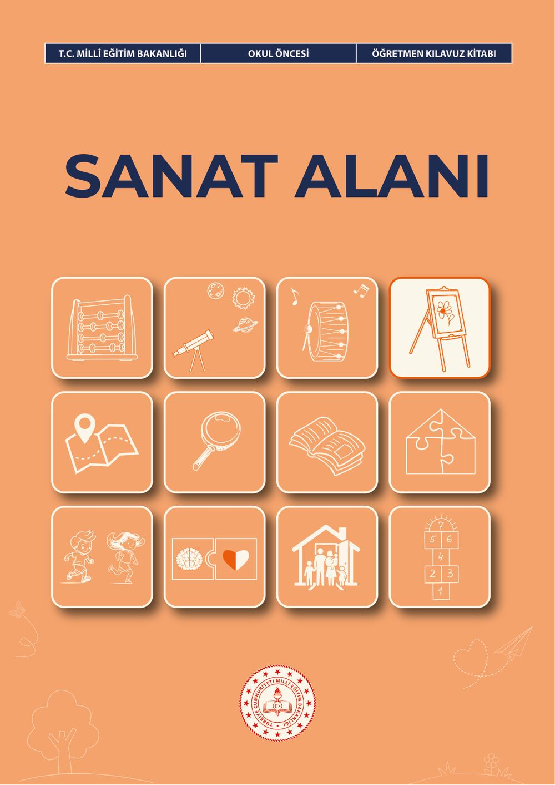
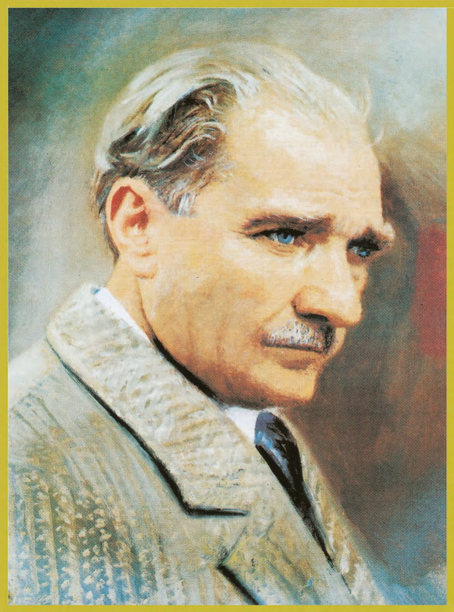
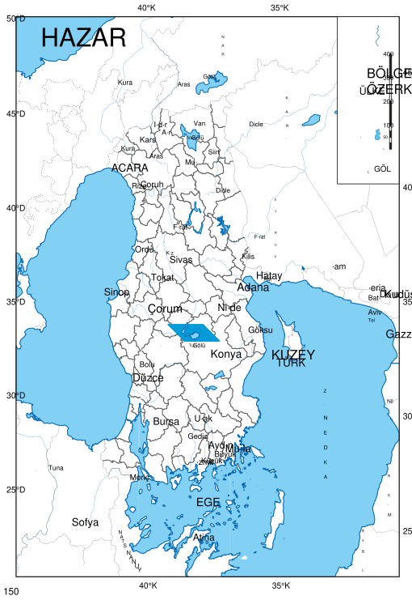
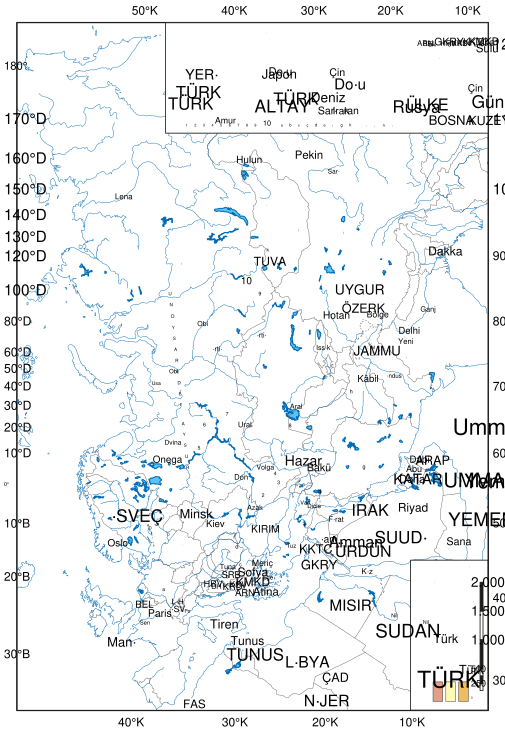
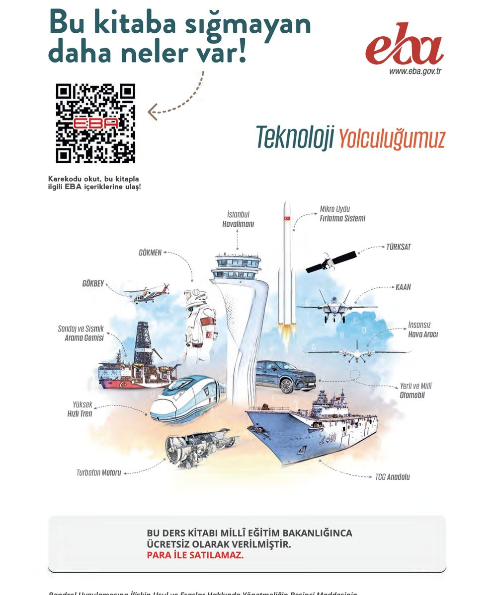

# Okul Öncesi Sanat Alanı Öğretmen Kılavuz Kitabı

<!-- sayfa 0 -->

T.C. MİLLÎ EĞİTİM BAKANLIĞI | OKUL ÖNCESİ | ÖĞRETMEN KILAVUZ KİTABI

# SANAT ALANI

<!-- sayfa 1 -->

Verdiğiniz metin katmanı boş olduğu için (`<<< >>>` arası boş) dönüştürülecek bir içerik bulunmamaktadır. Lütfen metin katmanını içeren içeriği paylaşın, böylece talimatlarınıza uygun şekilde Markdown formatına çevirebilirim.

<!-- sayfa 2 -->

# OKUL ÖNCESİ

# Sanat Alanı Öğretmen Kılavuz Kitabı

## Yazarlar
DUYGU ARGA
ERAY BOZASLAN
EZGİ AVCI AŞIR
GAMZE AKYOL
İLKAY CAN
KÜBRA KARAKUŞ
NİHAL AKIN TAKCI
YELİZ GÜNAY

DEVLET KİTAPLARI

<!-- sayfa 3 -->

Millî Eğitim Bakanlığı Yayınları ................................................................................................................ : 11236
Ders Kitapları Dizisi No ........................................................................................................................... : 2663

Her hakkı saklıdır ve Millî Eğitim Bakanlığına aittir. Kitabın metin, soru ve şekilleri kısmen de olsa hiçbir surette alınıp yayımlanamaz.

# Editör
Prof. Dr. Dilek ACER ÇAKAR
Doç. Dr. Cansu TUTKUN

# Dil Uzmanı
Nilüfer TURHAN

# Görsel Tasarımcı
Metin BİLAL
Yağmur YILDIRIM

# Çoklu Ortam Tasarımcısı
Betül SÜREK
Büşra Nur DURAN YILMAZ
Gamze SEÇGİN
Nilgül ÖNAL

# Program Geliştirme Uzmanı
Hilal ALTINTAŞ

# Ölçme ve Değerlendirme Uzmanı
Merve ERELİ

# Rehberlik Uzmanı
Aylin SAZLI SAYICI

ISBN
978-625-8867-31-2

Millî Eğitim Bakanlığı Talim ve Terbiye Kurulu Başkanlığının 13 10 2026 tarih ve 172455532 sayılı yazısı ile eğitim

<!-- sayfa 4 -->

# İSTİKLÂL MARŞI

Korkma, sönmez bu şafaklarda yüzen al sancak;
Sönmeden yurdumun üstünde tüten en son ocak.
O benim milletimin yıldızıdır, parlayacak;
O benimdir, o benim milletimindir ancak.

Çatma, kurban olayım, çehreni ey nazlı hilâl!
Kahraman ırkıma bir gül! Ne bu şiddet, bu celâl?
Sana olmaz dökülen kanlarımız sonra helâl.
Hakkıdır Hakk'a tapan milletimin istiklâl.

Mehmet Âkif Ersoy

<!-- sayfa 5 -->

ANDIMIZ

Türküm, doğruyum, çalışkanım.

İlkem küçüklerimi korumak, büyüklerimi saymak; yurdumu, milletimi özümden çok sevmektir.
Ülküm yükselmek, ileri gitmektir.

Ey Büyük Atatürk!

Açtığın yolda, gösterdiğin hedefe durmadan yürüyeceğime ant içerim.

Varlığım Türk varlığına armağan olsun.

Ne mutlu Türküm diyene!

<!-- sayfa 6 -->

MUSTAFA KEMAL ATATÜRK

<!-- yer tutucu bulunamadı: sayfa sonuna eklendi -->

<!-- sayfa 7 -->

Verdiğiniz metin katmanı boş olduğu için (`<<< >>>` arası boş) çevrilecek bir içerik bulunmamaktadır. Lütfen metin katmanını içeren içeriği paylaşın, böylece talimatlarınıza uygun şekilde Markdown formatına dönüştürebilirim.

<!-- sayfa 8 -->

# İÇİNDEKİLER

| | |
| :--- | :---: |
| GİRİŞ | 9 |
| SANAT ALAN BECERİLERİ | 9 |
| SANAT ALANI ETKİNLİKLERİNİN PROGRAMDA YER ALAN DİĞER ALANLARLA İLİŞKİLENDİRİLMESİ | 20 |
| SANAT ALANI ETKİNLİKLERİNİN PROGRAMLAR ARASI BİLEŞENLERLE İLİŞKİLENDİRİLMESİ | 23 |
| SANAT ALANI ETKİNLİK ÖRNEKLERİ | 26 |
| &nbsp;&nbsp;&nbsp;&nbsp;İz Yapalım | 26 |
| &nbsp;&nbsp;&nbsp;&nbsp;Masa Masa Etkinlik | 28 |
| &nbsp;&nbsp;&nbsp;&nbsp;Ebru Sanatını Keşfediyoruz | 30 |
| &nbsp;&nbsp;&nbsp;&nbsp;Sanat Türlerini Tanıyorum | 32 |
| &nbsp;&nbsp;&nbsp;&nbsp;Hepimiz Ressamız | 34 |
| &nbsp;&nbsp;&nbsp;&nbsp;Tezhip Sanatı | 36 |
| &nbsp;&nbsp;&nbsp;&nbsp;Duygu Kolajı | 38 |
| &nbsp;&nbsp;&nbsp;&nbsp;Kilden Heykeller | 41 |
| &nbsp;&nbsp;&nbsp;&nbsp;Yaprağım ve Ağacı | 43 |
| &nbsp;&nbsp;&nbsp;&nbsp;Doğada Neler Oluyor? | 45 |
| &nbsp;&nbsp;&nbsp;&nbsp;Rölyef Yapıyoruz | 48 |
| &nbsp;&nbsp;&nbsp;&nbsp;Bayrağımı Tanıyorum | 50 |
| &nbsp;&nbsp;&nbsp;&nbsp;Renkli Benekler | 52 |
| &nbsp;&nbsp;&nbsp;&nbsp;Sanatsal Kareler | 54 |
| &nbsp;&nbsp;&nbsp;&nbsp;Kilim Dokuyoruz | 56 |
| &nbsp;&nbsp;&nbsp;&nbsp;Pandomim | 58 |
| &nbsp;&nbsp;&nbsp;&nbsp;Mimar Sinan | 60 |
| &nbsp;&nbsp;&nbsp;&nbsp;Sedef Kakma Sanatı | 62 |
| &nbsp;&nbsp;&nbsp;&nbsp;Turgut Zaim’den Esinleniyoruz | 65 |
| &nbsp;&nbsp;&nbsp;&nbsp;Mozaik Sanatı | 68 |
| &nbsp;&nbsp;&nbsp;&nbsp;Otoportremi Çiziyorum | 71 |
| &nbsp;&nbsp;&nbsp;&nbsp;Çizgilerin Dünyası | 73 |
| &nbsp;&nbsp;&nbsp;&nbsp;Fotoğraf Çekiyorum | 75 |
| &nbsp;&nbsp;&nbsp;&nbsp;Mağara Sanatı | 77 |
| &nbsp;&nbsp;&nbsp;&nbsp;Yıldızlı Gece | 79 |
| &nbsp;&nbsp;&nbsp;&nbsp;Yansımalar | 81 |
| &nbsp;&nbsp;&nbsp;&nbsp;Taşların Dünyası | 83 |

<!-- sayfa 9 -->

| | |
| :--- | :--- |
| Fırçasız Resim | 85 |
| Duyguların Resmi | 88 |
| Dokuma Sanatım | 90 |
| Atık Sanatı | 93 |
| Arazi Sanatı | 95 |
| Ağabeyimin Bavulu | 97 |
| Kayadaki Resim | 99 |
| Ağaçtan Sanata | 101 |
| Kuş Sarayları | 103 |
| Doğadaki Kolajım | 105 |
| Vitray Sanatı | 107 |
| Müzik Ustası | 109 |
| Müziğin Resmi | 111 |
| Kompozisyon | 113 |
| Otoportre | 115 |
| Fotoğraflar da Banyo Yapar | 117 |
| Koku | 120 |
| Çiçeklerin Rengi | 122 |
| Gaudí’nin Masal Evleri | 124 |
| Hat ve Tezhip Sanatı | 126 |
| Pul Tasarımcısı | 128 |
| İlkbaharda Uyanan Böcekler | 130 |
| Kilden Büstler | 132 |
| Henri Matisse’in Salyangozu | 134 |
| Patlayan Renkler | 136 |
| Sanata Dönüşen Çizgiler | 138 |
| Dalların Sanatı | 140 |
| Atıktan Sanata | 142 |
| Sevgiyle Renklenen Bir Hatıra | 144 |
| Su Tutmayan Yapraklar | 146 |
| KAYNAKÇA | 149 |
| GÖRSEL VE GENEL AĞ KAYNAKÇASI | 149 |
| TÜRKİYE’NİN MÜLKİ İDARE BÖLÜMLERİ İLE KARA VE DENİZ KOMŞULARI HARİTASI | 150 |
| TÜRK DÜNYASI HARİTASI | 151 |

<!-- sayfa 10 -->

# GİRİŞ
Türkiye Yüzyılı Maarif Modeli’nde sanat alan becerileri oluşturulurken, okul öncesi dönemde sanat eğitiminin çocukların yalnızca kesme, yapıştırma, boyama gibi tekniklerle ürün ortaya koydukları bir etkinlik alanı olarak görülmemesi esas alınmıştır. Bunun yerine çocukların geleneksel ve evrensel sanat türlerini tanımaları, sanat eserlerini yaş ve gelişim düzeylerine uygun biçimde incelemeleri, sanata ve sanatçıya değer vermeleri, sanat etkinliklerini planlayarak farklı sanat materyalleriyle özgün uygulamalar yapmaları hedeflenmiştir. Bu kapsamda sanat alanı; resim, heykel, seramik, fotoğraf, mimari, ebru, çini, kukla, drama, müzik, dans ve benzeri farklı sanat türlerini, disiplinleri ve ifade biçimlerini içeren geniş bir öğrenme alanı olarak ele alınmıştır. Programda yer alan Sanat Türlerini Anlama, Sanat Eseri İnceleme, Sanata Değer Verme ve Sanatsal Uygulama Yapma alan becerileri aracılığıyla çocukların sanatla çok yönlü biçimde karşılaşmaları amaçlanmaktadır. Bu beceriler, çocukların sanata ilişkin farkındalık geliştirmelerinin yanı sıra gözlem yapma, ayırt etme, soru sorma, tahmin yürütme, seçim yapma, planlama, malzeme kullanma, özgün ürün oluşturma, duygu ve düşüncelerini ifade etme gibi üst düzey düşünme ve ifade becerilerini de destekleyecek biçimde yapılandırılmıştır.

# SANAT ALAN BECERİLERİ

## SNAB1. SANAT TÜRLERİNİ ANLAMA
Sanat türlerini anlama becerisi, çocuğun resim, heykel, seramik, fotoğraf, mimari, ebru, çini, kukla tiyatrosu, drama, müzik, dans ve benzeri farklı sanat türlerini fark etmesini, bu sanat türlerini adlandırmasını ve sanat eserlerinde kullanılan temel materyalleri tanımasını kapsar. Okul öncesi düzeyde sanat türlerini anlama alan becerisi; çocuğun farklı sanat türleriyle karşılaşarak bunları ayırt etmesine, sanat eserlerinin hangi malzemelerle oluşturulduğunu ifade etmesine ve sanat türlerine ilişkin temel bir farkındalık geliştirmesine yöneliktir. Bu alan becerisi, “Sanat Türlerini Tanıyabilme” öğrenme çıktısı ile ele alınır. Bu alan becerisi kapsamında çocuklardan sanat türlerini adlandırmaları ve gelişim düzeylerine uygun olarak sanat eserinde kullanılan materyalleri ifade etmeleri beklenir.

**Dikkat Edilmesi Gereken Önemli Noktalar**

Sanat türlerini anlama becerisi, çocukların farklı sanat türlerini adlandırmaları ve yaş düzeylerine uygun olarak bu sanat türlerini birbirinden ayırt etmeleri üzerine yapılandırılmalıdır. Bu süreçte resim, heykel, seramik, fotoğraf, mimari, ebru, çini, kukla tiyatrosu, drama, müzik ve dans gibi farklı sanat türlerine yer verilebilir.

* Sanat türleri çocuklara yalnızca sözel açıklamalarla tanıtılmamalı; görseller, gerçek sanat eserleri, sanatçı çalışmaları, müze materyalleri, dijital sergiler, kısa videolar, sanat nesneleri ve sınıf içi uygulama örnekleriyle desteklenmelidir.
* 36-48 aylık çocuklarda sanat türlerini tanıma süreci daha çok görme, dokunma, inceleme, gösterme ve basit adlandırma üzerinden yürütülebilir. Bu yaş grubunda çocuğun “resim”, “heykel”, “müzik”, “dans” gibi temel sanat türlerini fark etmesi ve söylemesi yeterli görülebilir.
* 48-60 aylık çocuklarda çocukların sanat türlerini adlandırmalarının yanı sıra farklı sanat türlerine ait temel özellikleri fark etmeleri desteklenebilir. Örneğin, “Bu bir resim mi, heykel mi?”, “Bu çalışmada boya mı kullanılmış, kil mi?” gibi somut ve yönlendirici olmayan sorular kullanılabilir.
* 60-72 aylık çocuklarda sanat türlerini tanıma süreci daha ayrıntılı ele alınabilir. Bu yaş grubunda çocuklardan sanat türlerini adlandırmaları ve sanat eserinde kullanılan materyalleri ifade etmeleri beklenebilir. Çocuk, bir eserin kil ve boya gibi malzemelerle veya dijital araçlarla yapıldığını söyleyebilir.
* Sanat türleri tanıtılırken çocukların yalnızca ürüne değil, sanat türünün oluşturulma biçimine de dikkat etmeleri desteklenmelidir. Resmin boya, pastel, sulu boya veya kolajla; heykelin kil, taş, ahşap ya da atık materyalle; müziğin ses, ritim ve çalgılarla; dansın beden hareketleriyle; dramanın rol, hareket ve canlandırma ile oluşturulduğu çocukların anlayabileceği biçimde gösterilebilir.

<!-- sayfa 11 -->

materyalleri görmeleri, dokunmaları, incelemeleri ve öğretmen desteğiyle fark etmeleri yeterli kabul edilmelidir.

• Sanat türlerini tanıma etkinliklerinde çocuklara gerçek materyaller sunulması önemlidir. Boya, fırça, kil, kumaş, karton, ip, doğal malzeme, fotoğraf, çalgı, kukla ve maske gibi materyaller çocukların sanat türleri ile kullanılan araç-gereçler arasında somut ilişki kurmasını destekler.

• Çocuklara aynı temanın farklı sanat türleriyle nasıl ifade edilebileceği gösterilebilir. Örneğin “ağaç” teması bir resimde çizilerek, kil ile üç boyutlu biçimlendirilerek, bedenle canlandırıllarak, müzikle seslendirilerek veya fotoğraf yoluyla gösterilerek ele alınabilir. Böylece çocuklar sanat türlerinin farklı anlatım yolları sunduğunu fark eder.

• Sanat türlerini karşılaştırma sürecinde çocuklardan akademik düzeyde açıklamalar beklenmemelidir. Öğretmen, “Bu çalışma düz mü, kabarık mı?”, “Buna bakıyor muyuz, dokunabiliyor muyuz?”, “Bunu dinliyor muyuz, izliyor muyuz?”, “Bunu bedenimizle mi yapıyoruz?” gibi somut sorularla çocukların farkındalığını destekleyebilir.

• Etkinliklerde sanat türlerine ilişkin kavramlar sade, doğru ve tutarlı biçimde kullanılmalıdır. Öğretmen “resim”, “heykel”, “seramik”, “fotoğraf”, “mimari”, “müzik”, “dans”, “drama”, “kukla” gibi kavramları çocukların günlük yaşantılarıyla ilişkilendirerek açıklamalıdır.

• Çocukların sanat türlerini adlandırırken hatalı ya da eksik ifadeler kullanmaları doğal karşılanmalıdır. Öğretmen çocuğun ifadesini düzeltici ve yargılayıcı bir dille kesmek yerine doğru kavramı modelleyebilir. Örneğin çocuk “çamurdan resim” dediğinde öğretmen “Evet, kile benzeyen bir malzemeyle yapılmış; buna seramik ya da kil çalışması diyebiliriz.” biçiminde açıklama yapabilir.

• Sanat türlerini anlama becerisi yalnızca masa başı sanat etkinlikleriyle sınırlandırılmamalıdır. Sınıf içinde sanat merkezi, müzik merkezi, dramatik oyun merkezi, blok merkezi, dijital görsel inceleme alanı ve açık hava öğrenme ortamları bu beceriyi desteklemek için birlikte kullanılabilir.

• Çocukların farklı sanat türleriyle karşılaşmaları için gerçek veya dijital müze gezileri, sanatçı atölyesi ziyaretleri, okul içi sergiler, sanatçı tanıtımları, kısa performans izleme etkinlikleri ve sınıf içi mini sergiler düzenlenebilir.

• Sanat türlerini tanıma sürecinde çocuklara kendi deneyimlerinden hareketle konuşma fırsatı verilmelidir. “Daha önce resim yaptın mı?”, “Hiç heykel gördün mü?”, “Evde müzik dinler misin?”, “Dans etmeyi sever misin?” gibi sorular çocukların sanat türleriyle kişisel yaşantıları arasında bağlantı kurmalarını destekler.

• Öğretmen, sanat türlerini tanıtırken çocukları tek bir doğru yanıta yönlendirmemeli; ancak temel kavramların doğru kullanımına da özen göstermelidir. Amaç çocukların sanat türlerini ezberlemeleri değil, farklı sanat türleriyle karşılaşarak onları fark etmeleri, adlandırmaları ve ayırt etmeye başlamalarıdır.

• Sanat türlerine ilişkin etkinliklerde çocukların gelişimsel farklılıkları dikkate alınmalıdır. Bazı çocuklar sanat türünü sözel olarak adlandırabilirken, bazıları göstererek, eşleştirerek, seçerek, hareketle ya da kısa ifadelerle yanıt verebilir. Bu farklı yanıt biçimleri geçerli kabul edilmelidir.

## Sınıf İçi Uygulama Önerileri

### SNAB.1. Sanat türlerini tanıyabilme

Sınıfta geçici ya da sürekli bir “Sanat Türleri Tanıma Alanı” oluşturulabilir. Bu alanda resim, heykel, seramik, fotoğraf, mimari, ebru, çini, kukla, drama, müzik ve dans gibi farklı sanat türlerine ait görseller, sanat eserlerinden orijinal örnekler, sanatçı fotoğrafları, materyal kartları ve çocukların inceleyebileceği nesneler bulundurulabilir. Çocukların bu alanı inceleyerek sanat türlerini fark etmelerine ve adlandırmalarına fırsat verilebilir.

“Bu Hangi Sanat Türü?” adlı bir eşleştirme oyunu hazırlanabilir. Çocuklara farklı sanat türlerini gösteren görsel kartlar sunulabilir. Örneğin bir tablo, bir seramik kap, bir heykel, bir fotoğraf, bir bina, bir kukla, dans eden bir

<!-- sayfa 12 -->

sayısı artırılabilir.
Sanat türlerini adlandırma çalışmaları günlük sınıf rutinlerine yerleştirilebilir. Örneğin sanat merkezinde resim yapan bir çocuğun çalışması için “Bu bir resim çalışması.”, kil ile çalışan bir çocuğun ürünü için “Bu bir seramik / kil çalışması.”, müzik merkezinde ritim tutan çocuklar için “Bu bir müzik etkinliği.” ifadeleri kullanılabilir. Böylece çocuklar sanat türlerine ilişkin kavramları doğal bağlam içinde duyar ve kullanmaya başlar.
Sınıfta “Sanat Türleri Panosu” hazırlanabilir. Panoda her sanat türü için bir görsel ve kısa bir ad bulunabilir: “Resim”, “Heykel”, “Seramik”, “Fotoğraf”, “Mimari”, “Ebru”, “Çini”, “Kukla”, “Drama”, “Müzik”, “Dans” gibi. Çocukların yaptığı çalışmalar da ilgili sanat türünün altına yerleştirilebilir. Bu pano çocukların sanat türlerini görsel olarak ayırt etmelerine destek olur.
Çocuklarla “Sanat Türü Sepetleri” oluşturulabilir. Her sepete bir sanat türü adı ve görseli yerleştirilebilir. Örneğin “Resim Sepeti”nde boya, fırça, pastel boya ve kâğıt; “Seramik / Kil Sepeti”nde kil, modelaj çubuğu ve seramik görselleri; “Müzik Sepeti”nde ritim çubukları, zil, marakas; “Drama / Kukla Sepeti”nde kukla, maske ve kostüm parçaları bulunabilir. Çocuklardan materyalleri incelemeleri ve hangi sanat türüyle ilişkili olduğunu söylemeleri istenebilir.
36-48 aylık çocuklarla sanat türlerini tanıma çalışmaları daha somut ve kısa süreli tutulabilir. Bu yaş grubunda “Bu resim.”, “Bu heykel.”, “Bu müzik.”, “Bu dans.” gibi temel adlandırmalar yeterli olabilir. Çocukların sanat türünü göstermesi, işaret etmesi, aynı olanı seçmesi ya da öğretmenin söylediği sanat türünü tekrar etmesi de geçerli kabul edilebilir.
48-60 aylık çocuklarla sanat türleri arasında basit ayırt etme çalışmaları yapılabilir. Örneğin “Bu çalışma düz bir yüzeyde mi, yoksa üç boyutlu mu?”, “Bunu izliyor muyuz, dinliyor muyuz?”, “Bunu bedenimizle mi yapıyoruz?”, “Bunda boya mı var, kil mi var?” gibi sorularla çocukların sanat türlerini temel özellikleri üzerinden fark etmeleri desteklenebilir.
60-72 aylık çocuklarla sanat türlerini adlandırmanın yanında, sanat eserinde kullanılan materyalleri ifade etmeye yönelik çalışmalar yapılabilir. Örneğin çocuklardan bir sanat eserine bakarak “Bunda boya kullanılmış.”, “Bu kil ile yapılmış.”, “Bu fotoğraf makinesiyle çekilmiş.”, “Bu taş / ahşap / metal gibi bir malzemeden yapılmış.” şeklinde gözleme dayalı ifadeler kullanmaları beklenebilir.

## SNAB2. SANAT ESERİ İNCELEME

Sanat eseri inceleme becerisi, çocuğun bir sanat eserine dikkatini yöneltmesini, eserde doğrudan gördüklerini ifade etmesini, eserin görsel özelliklerini fark etmesini, bu özellikler üzerine sorular sormasını, eserin konusu hakkında yaş düzeyine uygun tahminlerde bulunmasını ve esere ilişkin duygu ve düşüncelerini açıklamasını kapsar. Okul öncesi düzeyde sanat eseri inceleme alan becerisi; “Sanat Eserini Eleştirebilme” öğrenme çıktısı ile ele alınır. Bu alan becerisi kapsamında çocuklardan sanat eserine odaklanmaları, eserde gördüklerini söylemeleri, dikkatlerini çeken özellikleri ifade etmeleri, sanat eserine ilişkin sorular sormaları, eserin konusu hakkında tahmin yürütmeleri ve gelişim düzeylerine uygun olarak sanat eserine yönelik duygu ve düşüncelerini ifade etmeleri beklenir. 36-48 ay grubunda sanat eserine odaklanma, gördüklerini söyleme ve dikkatini çeken özellikleri belirtme ön plandadır. 48-60 ay grubunda bu becerilere ek olarak çocuğun eserin konusu hakkında basit tahminlerde bulunması ve esere ilişkin duygu / düşüncelerini ifade etmesi desteklenir. 60-72 ay grubunda ise çocukların sanat eserine ilişkin sorular sormaları, eserin konusu hakkında daha belirgin tahminler yürütmeleri ve duygu / düşüncelerinin nedenlerini açıklamaları beklenir.

**Dikkat Edilmesi Gereken Önemli Noktalar**

Sanat eseri inceleme etkinliklerinde çocukların sanat eserine dikkatlerini yöneltmeleri için uygun bir ortam hazırlanması önemlidir. Eser, çocukların rahatça görebileceği biçimde sergilenmeli; çocuklara eseri sessizce incelemeleri için bir süre tanınmalıdır. 36-48 aylık çocuklarda bu süre daha kısa tutulabilir, 48-60 ve 60-72 aylık çocuklarda inceleme süresi kademeli olarak artırılabilir.

<!-- sayfa 13 -->

ilgisini çekebilecek, görsel olarak anlaşılır, renk, çizgi, şekil, figür, nesne ve ayrıntı bakımından zengin eserler tercih edilebilir. Eserlerin çocukların günlük yaşam deneyimleriyle ilişki kurabilecekleri özellikler taşıması inceleme sürecini kolaylaştırabilir.

• Sanat eseri inceleme sürecinde sorular yaş gruplarına göre kademelendirilmelidir. 36-48 aylık çocuklara “Ne görüyorsun?”, “Hangi renkleri görüyorsun?”, “Nerede duruyor?” gibi doğrudan gözleme dayalı sorular yöneltilebilir. 48-60 aylık çocuklara eserdeki renk, şekil, çizgi ve nesnelerin düzenini fark etmeye yönelik sorular eklenebilir. 60-72 aylık çocuklarla ise esere ilişkin soru sorma, tahminde bulunma ve duygu / düşüncelerini gerekçelendirme çalışmaları yapılabilir.

• Sanat eseri inceleme sürecinde çocuklardan hemen yorum yapmaları beklenmemelidir. Öncelikle eserde gördüklerini söylemeleri, renkleri, şekilleri, çizgileri, figürleri, nesneleri ve ayrıntıları fark etmeleri desteklenmelidir. Betimleme aşaması tamamlanmadan “Sence ne anlatıyor?”, “Sana ne hissettirdi?” gibi yorumlama sorularına geçilmemesi önerilir.

• Çocukların sanat eserine odaklanma becerileri yaşa göre farklılık gösterebilir. 36-48 aylık çocuklarla yapılan incelemeler kısa, somut ve hareketli tutulabilir. 48-60 aylık çocuklarda eserin belirli bölümlerine dikkat çekilebilir. 60-72 aylık çocuklarda ise çocukların eseri daha ayrıntılı incelemeleri, soru sormaları ve gözlemlerini açıklamaları desteklenebilir.

• Sanat eseri inceleme etkinliklerinde çocukların esere ilişkin kendi sorularını sormalarına fırsat verilmelidir. Özellikle 60-72 aylık çocuklarda “Bu eserle ilgili ne merak ediyorsun?”, “Sanatçıya ne sormak isterdin?” gibi sorular çocukların merak, dikkat ve sorgulama becerilerini destekleyebilir. Daha küçük yaş gruplarında ise çocukların işaret ederek, kısa ifadelerle ya da öğretmen desteğiyle soru oluşturmaları yeterli kabul edilebilir.

• Eserin konusu hakkında tahmin yürütme becerisi yaşla birlikte gelişir. 36-48 aylık çocuklardan doğrudan çıkarım veya ayrıntılı tahmin beklenmemelidir. 48-60 aylık çocuklar eserde gördüklerinden hareketle basit tahminlerde bulunabilir. 60-72 aylık çocuklardan ise tahminlerini eserde gördükleri renk, figür, nesne veya durumlarla ilişkilendirerek açıklamaları beklenebilir.

• Sanat eserine ilişkin duygu ve düşünceleri ifade etme süreci çocukların hazır bulunuşluklarına göre desteklenmelidir. 36-48 aylık çocukların jest, mimik, gösterme, tek sözcük ya da kısa ifadelerle tepki vermeleri yeterli kabul edilebilir. 48-60 aylık çocukların “Sevdim / sevmedim”, “Güzel buldum”, “Korktum”, “Merak ettim” gibi kısa ifadeler kullanmaları desteklenebilir. 60-72 aylık çocuklardan ise duygu ve düşüncelerinin nedenlerini açıklamaları beklenebilir.

• Sanat eseri inceleme sürecinde çocukların yanıtları doğru-yanlış biçiminde değerlendirilmemelidir. Çocukların gözlem, soru, tahmin ve duyguları yargılanmadan kabul edilmeli; öğretmen gerektiğinde çocuğun ifadesini genişleterek doğru kavramları modellemelidir. Örneğin çocuk “Burası çok karışık.” dediğinde öğretmen “Evet, burada birçok renk ve şekil bir arada kullanılmış.” diyebilir.

• Sanat eseri inceleme etkinliklerinde çocukların yalnızca sözel anlatımları değil, farklı ifade biçimleri de desteklenmelidir. Çocuklar esere ilişkin gözlemlerini göstererek, işaret ederek, hareketle, çizimle, dramatik canlandırmayla ya da kısa sözel ifadelerle ortaya koyabilirler. Bu çeşitlilik özellikle küçük yaş gruplarında katılımı artırır.

• Sanat eserleri incelenirken çocukların dikkatleri görsel sanat öğelerine yönlendirilebilir. Renk, çizgi, şekil, biçim, doku, boşluk, büyüklük, konum, tekrar ve zıtlık gibi özellikler çocukların yaş düzeyine uygun sorularla ele alınabilir. Ancak bu kavramlar soyut açıklamalarla değil eserde görülen somut örnekler üzerinden sunulmalıdır.

• İnceleme sürecinde öğretmen, Feldman’ın (Feldmın) sanat eleştirisi basamaklarına uygun bir sıra izleyebilir. Önce çocukların eserde gördüklerini betimlemeleri sağlanmalı, ardından görsel öğelerin nasıl düzenlendiği üzerinde durulmalı, daha sonra eserin konusu veya anlatmak istedikleri hakkında tahminlere geçilmeli ve son aşamada çocukların esere ilişkin duygu ve düşüncelerini ifade etmelerine fırsat verilmelidir.

<!-- sayfa 14 -->

açıklamak yerine çocukların bakmasını, fark etmesini, sormasını ve konuşmasını sağlayacak açık uçlu ama yaşa uygun sorular yöneltmelidir. Sanat eseri inceleme, öğretmenin bilgi aktardığı bir süreçten çok, çocuğun görsel farkındalık geliştirdiği bir etkileşim süreci olarak ele alınmalıdır.

• Sanat eseri inceleme etkinlikleri farklı sanat türleriyle çeşitlendirilebilir. Resim, heykel, seramik, fotoğraf, mimari yapı, ebru, çini, kukla tiyatrosu, sahne performansı veya dijital sanat örnekleri çocuklarla birlikte incelenebilir. Böylece çocuklar hem farklı sanat türleriyle karşılaşır hem de eser inceleme becerilerini farklı bağlamlarda kullanır.

• Eser inceleme etkinlikleri çocukların kendi sanat çalışmalarıyla ilişkilendirilebilir. Bir sanat eseri incelendikten sonra çocuklara benzer renkleri, çizgileri, şekilleri ya da malzemeleri kullanarak kendi çalışmalarını yapma fırsatı verilebilir. Ancak bu süreçte çocuklardan eseri kopyalamaları beklenmemeli eserden esinlenerek özgün ürün oluşturmaları desteklenmelidir.

• Sanat eserleri seçilirken kültürel çeşitliliğe ve çocukların yakın çevresinden örneklere yer verilebilir. Yerel sanatçılar, müze koleksiyonları, geleneksel sanatlar, çağdaş sanat örnekleri ve çocukların yaşadığı çevrede bulunan mimari yapılar inceleme materyali olarak kullanılabilir. Bu çeşitlilik çocukların sanatı yalnızca sınıf içi etkinliklerle değil yaşamın farklı alanlarıyla ilişkilendirmesini sağlar.

• Sanat eseri inceleme etkinliklerinde çocukların dikkatini sürdürmek için büyüteç, görsel kart, ayrıntı bulma oyunu, “eserde saklı olanı bul” çalışması, eşleştirme kartları ve mini sergi gezileri gibi yöntemlerden yararlanılabilir.

• Öğretmen, çocukların sanat eserine ilişkin kişisel tepkilerini önemsemeli ancak çocukları belirli bir duygu veya düşünceye yönlendirmemelidir. “Bu eser güzel, değil mi?” gibi yönlendirici ifadeler yerine “Bu eser hakkında ne düşünüyorsun?”, “Bu bölüme bakınca ne söylemek istersin?” gibi çocuğun kendi ifadesine alan açan sorular tercih edilmelidir.

## Sınıf İçi Uygulama Önerileri

### SNAB.2. Sanat eserini eleştirebilme

Sınıfta geçici ya da sürekli bir “Sanat Eseri İnceleme Köşesi” oluşturulabilir. Bu köşede çocukların yaş düzeyine uygun resim, heykel, seramik, fotoğraf, mimari yapı, ebru, çini veya kukla örneklerine ait görseller bulundurulabilir. Çocukların eserlere bakmaları, gördüklerini söylemeleri ve dikkatlerini çeken özellikleri ifade etmeleri için kısa inceleme zamanları planlanabilir.

“Bugün Hangi Sanat Eserini İnceleyelim?” panosu hazırlanabilir. Panoya iki ya da üç sanat eseri görseli yerleştirerek çocukların o gün incelemek istedikleri eseri seçmelerine fırsat verilebilir. 36-48 aylık çocuklara sınırlı sayıda seçenek sunulabilir; 60-72 aylık çocukların ise seçimlerini gerekçelendirmeleri desteklenebilir.

Sanat eseri inceleme sürecini kademeli sorularla yürütülebilir. Önce “Ne görüyorsun?”, “Hangi renkleri görüyorsun?”, “Nerede duruyor?” gibi betimleme soruları sorulabilir. Ardından “Hangi renkler yan yana?”, “Hangi şekiller tekrar ediyor?”, “Resmin neresi daha dolu?” gibi çözümleme sorularına geçilebilir. Daha büyük yaş grubunda “Bu eserde ne oluyor olabilir?” ve “Bu eser hakkında ne düşünüyorsun?” gibi yorumlama ve yargıda bulunma soruları eklenebilir.

36-48 aylık çocuklarla sanat eseri eleştirme çalışmaları kısa, somut ve gözleme dayalı tutulabilir. Bu yaş grubunda çocukların sanat eserine odaklanmaları, eserde gördüklerini söylemeleri ve dikkatlerini çeken özellikleri belirtmeleri yeterli kabul edilebilir. “Ne görüyorsun?”, “Hangi renk var?”, “Büyük olan nerede?”, “Gösterir misin?” gibi kısa yönergeler kullanılabilir.

48-60 aylık çocuklarla sanat eserinde görülenleri söylemenin yanı sıra eserde dikkat çeken özellikleri fark etmeye, eserin konusu hakkında basit tahmin yürütmeye ve esere yönelik duygu / düşüncelerini ifade etmeye yönelik çalışmalar yapılabilir. Örneğin “Bu eserde en çok hangi bölümü fark ettin?”, “Bu resimde ne oluyor olabilir?”, “Bu eser hakkında ne söylemek istersin?” gibi sorular kullanılabilir.

60-72 aylık çocuklarla sanat eserine ilişkin soru sorma, konu hakkında tahmin yürütme ve duygu/düşüncelerini

<!-- sayfa 15 -->

nedenleriyle açıklama çalışmaları yapılabilir. Çocuklardan “Bu eserle ilgili ne merak ediyorsun?”, “Sence bu eserin konusu ne olabilir?”, “Bu eser hakkında böyle düşünmene neden olan şey ne?” gibi sorulara yanıt vermeleri beklenebilir.

### SNAB3. SANATA DEĞER VERME

Sanata değer verme becerisi, çocuğun sanata ve sanatçılara ilgi duymasını, sanatçılar hakkında merak ettiği soruları sormasını, sanat eserlerinin nasıl oluşturulduğuna ilişkin yaş düzeyine uygun tahminlerde bulunmasını, dijital ya da gerçek sanat ortamlarını ziyaret ederek bu ortamlarda sergilenen eserleri incelemesini kapsar. Okul öncesi düzeyde sanata değer verme alan becerisi; “Sanatın Önemini Fark Edebilme” öğrenme çıktısı ile ele alınır. Bu alan becerisi kapsamında çocuklardan sanata ilgi göstermeleri, sanatçılar hakkında sorular sormaları, sanat eserlerinin oluşum sürecine ilişkin merak geliştirmeleri, dijital ya da gerçek sanat ortamlarını ziyaret etmeleri ve bu ortamlarda sergilenen eserleri incelemeleri beklenir. 36-48 ay grubunda çocuğun sanatçılar hakkında soru sorması, gerçek ya da dijital sanat ortamlarını ziyaret etmesi ve bu ortamlardaki eserleri incelemesi ön plandadır. 48-60 ay ve 60-72 ay gruplarında ise bu becerilere ek olarak çocuğun sanat eserlerinin nasıl yapıldığına ilişkin tahmin yürütmesi desteklenir.

**Dikkat Edilmesi Gereken Önemli Noktalar**

Sanata değer verme becerisi, çocukların sanata, sanatçılara, sanat eserlerine ve sanat ortamlarına karşı ilgi, merak ve farkındalık geliştirmeleri üzerine yapılandırılmalıdır. Bu süreçte amaç, çocuklara sanat hakkında bilgi ezberletmek değil onların sanatla karşılaşmalarını, sanatçıları merak etmelerini, eserleri incelemelerini ve sanat ortamlarında olumlu deneyimler yaşamalarını desteklemektir.

* Sanata değer verme sürecinde çocuklara farklı sanat türleri, sanatçılar ve sanat ortamlarıyla karşılaşma fırsatı verilmelidir. Resim, heykel, seramik, fotoğraf, mimari, ebru, çini, kukla, tiyatro, drama, müzik ve dans gibi farklı sanat alanlarından örnekler çocukların yaş düzeylerine uygun biçimde sınıfa taşınabilir.
* Sanatçılar çocuklara soyut ve uzak kişiler olarak değil, sanat üreten, düşünen, deneyen, araştıran ve emek veren kişiler olarak tanıtılmalıdır. Öğretmen “Sanatçı bu eseri yaparken farklı renkler kullanmış.”, “Bu sanatçı kil ile çalışmış.”, “Bu sanatçı çevresindeki yapılardan etkilenmiş olabilir.” gibi somut açıklamalarla sanatçı emeğine dikkat çekebilir.
* Çocukların sanatçılar hakkında soru sormaları desteklenmelidir. Özellikle 36-48 aylık çocuklarda “Sanatçı kim?”, “Bunu kim yaptı?”, “Nerede yapmış?” gibi basit sorular yeterli kabul edilebilir. 48-60 ve 60-72 aylık çocuklarda “Sanatçı bunu nasıl yapmış olabilir?”, “Bu malzemeyi neden seçmiş olabilir?”, “Sanatçıya ne sormak isterdin?” gibi merak ve düşünmeyi destekleyen sorular kullanılabilir.
* Sanat eserlerinin nasıl yapıldığına ilişkin tahmin yürütme becerisi yaşa göre kademelendirilmelidir. 36-48 aylık çocuklardan sanat eserinin üretim sürecine ilişkin ayrıntılı tahminler beklenmemelidir. Bu yaş grubunda çocukların sanat eserini incelemesi, sanatçı ve eser hakkında soru sorması yeterli olabilir. 48-60 ve 60-72 aylık çocuklarda ise çocukların eserde gördükleri materyal, iz, renk, biçim veya dokulardan hareketle basit tahminlerde bulunmaları desteklenebilir.
* Sanata değer verme etkinliklerinde çocukların gerçek ya da dijital sanat ortamlarıyla karşılaşmaları önemlidir. Müze, galeri, sanatçı atölyesi, okul sergisi, kültür merkezi, açık hava heykel alanı, mimari yapı gezisi veya dijital müze / sergi ziyaretleri çocukların sanatın yaşam içindeki yerini fark etmelerine katkı sağlar.
* Sanat ortamı ziyaretleri çocukların yaş ve dikkat sürelerine uygun planlanmalıdır. 36-48 aylık çocuklarla kısa süreli, az sayıda eserle sınırlı ve somut gözleme dayalı ziyaretler yapılabilir. 48-60 aylık çocuklarda eser sayısı ve inceleme süresi kademeli olarak artırılabilir. 60-72 aylık çocuklarda çocukların eserler hakkında soru sormaları, karşılaştırmalar yapmaları ve ziyaret deneyimlerini paylaşmaları desteklenebilir.
* Dijital sanat ortamları kullanılırken içerik çocukların gelişim düzeyine uygun seçilmelidir. Kısa sanal müze gezileri sanatçı atölyesi videoları çocuklara uygun sergi görüntüleri ve sanat eseri görselleri tercih

<!-- sayfa 16 -->

konuşma katılımıyla desteklenmelidir.
• Sanata değer verme becerisi yalnızca müze veya sergi ziyaretleriyle sınırlı görülmemelidir. Sınıf içindeki sanat merkezi, çocuk ürünleri sergisi, sanatçı tanıtım panosu, sanat kitabı köşesi, müzik ve drama etkinlikleri de çocukların sanata değer verme becerisini destekleyen öğrenme fırsatlarıdır.
• Çocukların kendi sanat ürünlerine değer verilmesi, sanata değer verme becerisinin temel bir parçasıdır. Çocuk ürünleri yalnızca sonuç ürün olarak değil; eskizleri, deneme çizimleri, çocuk ifadeleri, kullanılan materyaller ve süreç fotoğraflarıyla birlikte sergilenebilir. Böylece çocuklar sanatın yalnızca bitmiş üründen değil, emek ve süreçten oluştuğunu fark eder.
• Sınıfta çocukların sanat ürünleri sergilenirken karşılaştırıcı, yarıştırıcı veya güzellik odaklı değerlendirmelerden kaçınılmalıdır. “En güzel resim”, “En başarılı çalışma” gibi ifadeler yerine “Bu çalışmada farklı çizgiler kullanılmış.”, “Bu çocuk kil ile yüksek bir yapı oluşturmuş.”, “Burada çok sayıda renk denenmiş.” gibi gözleme ve sürece dayalı ifadeler tercih edilmelidir.
• Çocukların sanat eserlerini ve arkadaşlarının ürünlerini incelerken saygılı bir tutum geliştirmeleri desteklenmelidir. Eserlere dokunma, taşıma, izleme ve yorum yapma kuralları çocuklarla birlikte belirlenebilir. “Eserlere nazikçe bakarız.”, “Arkadaşımızın çalışmasına zarar vermeyiz.”, “Herkesin çalışması farklı olabilir.” gibi kısa ve anlaşılır sınıf kuralları oluşturulabilir.
• Sanata değer verme sürecinde çocukların duygu ve düşüncelerini ifade etmeleri için güvenli bir ortam sağlanmalıdır. Çocuklar bir sanat eserini beğenip beğenmediklerini, merak ettikleri noktaları veya dikkatlerini çeken özellikleri farklı yollarla ifade edebilirler. 36-48 aylık çocukların jest, mimik, gösterme veya kısa ifadelerle tepki vermeleri yeterli kabul edilebilir; yaş ilerledikçe sözel açıklama beklentisi artırılabilir.
• Çocukların sanata yönelik görüşleri yargılanmadan kabul edilmelidir. Bir çocuğun “Bunu sevmedim.”, “Bu bana garip geldi.” ya da “Bunu merak ettim.” gibi ifadeleri öğretmen tarafından bastırılmamalıdır. Öğretmen, çocuğun ifadesini genişleterek “Hangi bölüm sana garip geldi?”, “Neyi merak ettin?” gibi sorularla düşünmesini destekleyebilir.
• Sanata değer verme etkinliklerinde aile ve yakın çevre katılımından yararlanılabilir. Ailelerden evde bulunan sanat kitapları, el işi örnekleri, fotoğraflar, kültürel nesneler veya sanatla ilgili deneyimlerini paylaşmaları istenebilir. Yerel sanatçılar, zanaatkârlar, müzisyenler veya sanat eğitmenleri sınıfa davet edilebilir.
• Çocukların yaşadıkları çevredeki sanat örneklerini fark etmeleri desteklenmelidir. Okul bahçesindeki heykel, mahalledeki mimari yapılar, duvar resimleri, geleneksel el sanatları, yerel müzeler veya kültürel etkinlikler çocukların sanatı günlük yaşamla ilişkilendirmelerine yardımcı olur.
• Sanat eserlerinin oluşum süreci çocuklara somut biçimde gösterilebilir. Bir resmin boya ve fırçayla, bir seramik çalışmasının kilin yoğrulması ve biçimlendirilmesiyle, bir müzik eserinin ses ve ritimle, bir dans çalışmasının beden hareketleriyle, bir kukla oyununun kukla ve sahne düzeniyle oluşturulduğu yaşa uygun etkinliklerle deneyimletilebilir.
• Öğretmen, sanatçı emeğine ve üretim sürecine dikkat çekmelidir. “Bu eseri yapmak zaman almış olabilir.”, “Sanatçı bu rengi denemiş.”, “Bu çalışmada birçok küçük parça bir araya getirilmiş.” gibi ifadeler çocukların sanatın emek, dikkat, deneme ve yaratıcılık içerdiğini fark etmelerine katkı sağlar.
• Sanata değer verme sürecinde çocukların sanat eserlerine ve sanat ortamlarına ilişkin merakları canlı tutulmalıdır. Öğretmen hazır bilgi aktarmak yerine çocukların sorularını önemseyebilir, birlikte araştırma yapabilir, sanatçı veya eser hakkında kısa ve anlaşılır bilgiler paylaşabilir.
• 36-48 aylık çocuklarla sanatın önemini fark etme çalışmaları daha çok görme, gösterme, inceleme, kısa soru sorma ve sanat ortamını deneyimleme üzerine kurulabilir. Bu yaş grubunda çocukların sanatçıya, esere veya müzeye ilişkin basit merak ifadeleri göstermeleri yeterli kabul edilebilir.
• 48-60 aylık çocuklarla sanat eserlerinin nasıl yapılmış olabileceğine ilişkin basit tahminler desteklenebilir. Örneğin “Bu boya ile yapılmış olabilir.”, “Bunda kil var.”, “Bunu fırçayla yapmış olabilir.” gibi ifadeler

<!-- sayfa 17 -->

sohbetler yapılabilir. “İnsanlar neden resim yapar?”, “Müzeler neden vardır?”, “Sanat eserlerini neden koruruz?”, “Sanat olmasaydı çevremiz nasıl görünürdü?” gibi sorular çocukların sanata ilişkin değer farkındalığını geliştirebilir.

• Sanata değer verme etkinliklerinde çocukların görüşleri doğru-yanlış biçiminde değerlendirilmemelidir. Çocuğun “Bu eseri sevdim.”, “Bunu merak ettim.”, “Bana ilginç geldi.”, “Bunu yapmak isterim.” gibi ifadeleri kabul edilmeli, öğretmen çocuğun düşüncesini “Hangi bölümünü merak ettin?”, “Bunu yapmak için hangi malzemeyi kullanmak isterdin?” gibi sorularla genişletebilir.

• Öğretmen, etkinlikler boyunca sanat, sanatçı, sanat eseri, müze, galeri, sergi, atölye, izleyici, malzeme, emek, süreç, koruma, saygı ve özgünlük gibi kavramları çocukların yaş düzeyine uygun biçimde kullanmalıdır. Bu kavramlar soyut açıklamalarla değil; gerçek eserler, çocuk ürünleri, materyaller, ziyaretler ve sınıf içi deneyimler üzerinden somutlaştırılmalıdır.

## Sınıf İçi Uygulama Önerileri

### SNAB.3. Sanatın önemini fark edebilme

Sınıfta geçici ya da sürekli bir “Sanat ve Sanatçı Köşesi” oluşturulabilir. Bu köşede çocukların yaş düzeyine uygun sanatçı fotoğrafları, sanat eseri görselleri, sanatçıların kullandığı materyaller, kısa açıklama kartları, müze ve atölye görselleri bulundurulabilir. Çocukların bu köşeyi incelemelerine, sanatçılar ve sanat eserleri hakkında soru sormalarına fırsat verilebilir.

“Bugün Hangi Sanatçıyı Tanıyalım?” panosu hazırlanabilir. Panoya iki ya da üç sanatçıya ait görsel veya eser örneği yerleştirilebilir. Çocukların o gün tanımak istedikleri sanatçıyı seçmeleri sağlanabilir. 36-48 aylık çocuklara sınırlı sayıda seçenek sunulabilir; 60-72 aylık çocukların seçimlerini “Bu resmi merak ettim.”, “Bu heykeli görmek istiyorum.” gibi kısa ifadelerle açıklamaları desteklenebilir.

“Sanatçıya Ne Sormak İstersin?” etkinliği düzenlenebilir. Çocuklara bir sanatçı ve sanat eseri görseli göstererek sanatçıya sormak istedikleri soruları söylemeleri istenebilir. 36-48 aylık çocukların “Kim yaptı?”, “Bu ne?”, “Nerede?” gibi kısa sorular sormaları yeterli kabul edilebilir. 48-60 ve 60-72 aylık çocuklarda “Bunu nasıl yaptın?”, “Hangi malzemeyi kullandın?”, “Bunu yaparken ne düşündün?” gibi sorular desteklenebilir.

“Bir Eser Nasıl Yapılmış Olabilir?” başlıklı bir inceleme çalışması yapılabilir. Çocuklara bir resim, seramik, heykel, fotoğraf, ebru, çini ya da kukla örneği göstererek eserin nasıl oluşturulmuş olabileceği üzerine konuşulabilir. 36-48 aylık çocuklardan ayrıntılı tahmin beklenmeden eseri incelemeleri ve gördüklerini söylemeleri desteklenebilir. 48-60 ve 60-72 aylık çocuklardan ise boya, kil, kâğıt, taş, ahşap, kumaş, ip, fotoğraf makinesi gibi materyaller üzerinden basit tahminler yapmaları istenebilir.

Sınıfta “Sanat Malzemeleri Keşif Masası” hazırlanabilir. Bu masada boya, fırça, kil, kâğıt, karton, kumaş, ip, doğal materyaller, ritim araçları, kukla, maske ve fotoğraf örnekleri bulunabilir. Çocukların bu materyalleri incelemelerine ve “Bu malzeme ile nasıl bir sanat çalışması yapılabilir?” sorusu etrafında düşünmelerine fırsat verilebilir.

“Müze Sınıfa Geliyor” etkinliği düzenlenebilir. Sınıfın bir bölümü küçük bir sergi alanı gibi düzenlenerek sanat eseri görselleri, çocuk ürünleri, sanat materyalleri ve açıklama kartları yerleştirilebilir. Çocuklar küçük gruplar hâlinde bu alanı gezebilir, eserleri inceleyebilir ve öğretmen rehberliğinde “Bu eser neyle yapılmış?”, “Bu eserde neler görüyorsun?”, “Bu eserle ilgili ne merak ediyorsun?” sorularına yanıt verebilir.

Çocukların kendi ürünlerinden oluşan “Süreç Sergisi” hazırlanabilir. Sergide yalnızca bitmiş ürünlere değil çocukların eskizlerine, deneme çizimlerine, kullandıkları materyallere, süreç fotoğraflarına ve çocuk ifadelerine de yer verilebilir. Böylece çocuklar sanatın yalnızca sonuç üründen değil, deneme, emek, düşünme ve süreçten oluştuğunu fark eder.

### SNAB4. SANATSAL UYGULAMA YAPMA

Sanatsal uygulama yapma becerisi, çocuğun yapmak istediği sanat etkinliğinin türüne karar vermesini, etkinlik

<!-- sayfa 18 -->

becerisi; “Sanat Etkinliği Uygulayabilme” öğrenme çıktısı ile ele alınır. Bu alan becerisi kapsamında çocuklardan gelişim düzeylerine uygun olarak sanat etkinliğini planlamaları ve planladıkları sanat etkinliğini uygulamaları beklenir. Planlama sürecinde çocuk yapmak istediği sanat etkinliğinin türüne karar verir ve etkinlikte kullanacağı materyalleri seçer. Uygulama sürecinde ise sanat etkinliklerine aktif olarak katılır ve özgün ürünler oluşturur. 60-72 ay grubunda bu sürece ek olarak çocuğun sanat materyallerini amacına uygun biçimde kullanması da beklenir.

36-48 ve 48-60 ay gruplarında sanatsal uygulama yapma becerisi daha çok çocuğun sanat etkinliğine katılması, materyal seçmesi, denemeler yapması ve özgün ürünler oluşturması üzerinden desteklenmelidir. 60-72 ay grubunda ise çocukların etkinlik türüne karar verme, materyal seçme, materyalleri amacına uygun kullanma ve ürünü tamamlama süreçlerinde daha bağımsız hareket etmeleri teşvik edilebilir.

**Dikkat Edilmesi Gereken Önemli Noktalar**

Sanatsal uygulama yapma becerisi, çocukların yalnızca hazır yönergeleri izleyerek ürün oluşturmalarını değil yapmak istedikleri sanat etkinliğine karar vermelerini, uygun materyalleri seçmelerini, materyalleri deneyerek kullanmalarını ve özgün ürünler oluşturmalarını destekleyecek biçimde ele alınmalıdır.

* Sanat etkinliklerinde çocuklara materyal seçme fırsatı verilmesi önemlidir. 36-48 aylık çocuklara iki ya da üç materyal seçeneği sunulabilir; 48-60 aylık çocukların materyalleri öğretmen rehberliğinde karşılaştırarak seçmeleri desteklenebilir; 60-72 aylık çocukların ise yapmak istedikleri çalışmaya uygun materyalleri daha bağımsız biçimde seçmelerine olanak tanınabilir.
* Çocukların sanat etkinliğinin türüne karar vermeleri yaşa uygun biçimde aşamalı olarak desteklenmelidir. Küçük yaş grubunda “Bugün boya mı kullanalım, kil mi?” gibi sınırlı seçenekler sunulabilir. Büyük yaş grubunda “Ne yapmak istiyorsun?”, “Bunu resimle mi, kil ile mi, kolajla mı anlatmak istersin?” gibi sorularla çocuğun planlama sürecine katılımı artırılabilir.
* Sanatsal uygulamalarda süreç, ürün kadar önemli görülmelidir. Çocuğun deneme yapması, materyali keşfetmesi, farklı yollar denemesi, çalışmasını değiştirip yeniden düzenlemesi ve kendi çözümünü üretmesi desteklenmelidir. Etkinlik yalnızca bitmiş ürün üzerinden değerlendirilmemelidir.
* Sanat etkinliklerinde çocuklardan birbirine benzeyen ürünler oluşturmaları beklenmemelidir. Aynı materyallerle yapılan çalışmalarda bile her çocuğun farklı seçimler yapmasına, farklı renkler, çizgiler, biçimler, dokular ve düzenlemeler kullanmasına fırsat verilmelidir. Özgün ürün oluşturma, çocuğun kendi kararlarını sürece yansıtmasıyla desteklenir.
* 36-48 aylık çocuklarla sanatsal uygulamalar kısa süreli, duyusal keşfe dayalı ve somut materyallerle yürütülebilir. Bu yaş grubunda çocukların boyayı sürmesi, kili yoğurması, kâğıdı yırtması, yapıştırması, iz bırakması veya farklı dokuları denemesi yeterli kabul edilebilir. Ürünün belirli bir nesneye benzemesi beklenmemelidir.
* 48-60 aylık çocuklarla materyal seçme, basit plan yapma ve farklı teknikleri deneme çalışmaları desteklenebilir. Çocuklardan “Hangi malzemeyi kullanacaksın?”, “Önce ne yapmak istersin?”, “Başka ne eklemek istersin?” gibi sorularla çalışmalarını aşamalı biçimde düşünmeleri istenebilir.
* 60-72 aylık çocuklarla çocukların sanat etkinliğini daha bilinçli biçimde planlamaları, gerekli materyalleri seçmeleri, materyalleri amacına uygun kullanmaları ve özgün ürün oluşturmaları desteklenmelidir. Bu yaş grubunda çocuklar çalışmaya başlamadan önce ne yapmak istediklerini, hangi materyalleri kullanacaklarını ve nasıl ilerleyeceklerini kısa ifadelerle açıklayabilirler.
* Sanat materyallerinin amacına uygun kullanımı özellikle büyük yaş grubunda desteklenmelidir. Fırçanın boyayı sürmek için, makasın kesmek için, yapıştırıcının parçaları birleştirmek için, modelaj çubuğunun kile şekil vermek için, ritim aracının ses üretmek için kullanıldığı somut uygulamalarla gösterilebilir. Ancak bu süreç çocuğun keşfetme ve deneme özgürlüğünü sınırlayacak katı kurallara dönüştürülmemelidir.
* Sanatsal uygulama sürecinde çocukların güvenliği gözetilmelidir. Makas, yapıştırıcı, küçük parçalar, tel,

<!-- sayfa 19 -->

•	Sanat merkezi, çocukların materyallere erişebileceği ve seçim yapabileceği biçimde düzenlenmelidir. Materyaller açık raflarda, etiketli kutularda, görsellerle desteklenmiş düzenlemeler içinde sunulabilir. Bu düzenleme çocukların bağımsız seçim yapmalarını, kullandıkları materyali tanımalarını ve etkinlik sonrası düzenleme sorumluluğu almalarını destekler.
•	Sanatsal uygulamalar yalnızca resim ve boyama etkinlikleriyle sınırlandırılmamalıdır. Kil, seramik, kolaj, baskı, üç boyutlu çalışmalar, doğal materyallerle düzenlemeler, kukla yapımı, maske hazırlama, ritim oluşturma, bedenle ifade, dans, drama ve dijital sanat çalışmaları gibi farklı uygulamalara yer verilebilir.
•	Öğretmen, sanatsal uygulamalarda hazır kalıp, şablon ve tek tip ürün beklentisinden kaçınmalıdır. Hazır kesilmiş parçaları yapıştırma, öğretmenin çizdiği şekli boyama veya tüm çocuklardan aynı ürünü yapmalarını isteme gibi uygulamalar çocuğun planlama, seçim yapma ve özgün ürün oluşturma becerisini sınırlandırabilir.
•	Çocukların çalışmaları sırasında öğretmen gereğinden fazla müdahale etmemelidir. Çocuğun “Bunu nasıl yapabilirim?” sorusuna doğrudan çözüm vermek yerine “Hangi malzemeyi deneyebilirsin?”, “Başka nasıl yapabilirsin?”, “Bunu birleştirmek için ne kullanmak istersin?” gibi sorularla çocuğun kendi çözümünü bulması desteklenebilir.
•	Sanatsal uygulamalarda çocukların dikkat süreleri ve ilgileri yaş gruplarına göre farklılık gösterebilir. 36-48 aylık çocuklarla kısa ve esnek uygulamalar planlanabilir; 48-60 aylık çocuklarda süre kademeli olarak artırılabilir; 60-72 aylık çocuklarda daha uzun süreli ve birkaç aşamadan oluşan çalışmalar yapılabilir. Etkinlik süresi çocukların ilgi ve katılım düzeyine göre esnek tutulmalıdır.
•	Çocukların sanat etkinliklerine aktif katılımı farklı biçimlerde gerçekleşebilir. Bazı çocuklar materyali yoğun biçimde kullanarak, bazıları izleyerek ve sonra katılarak, bazıları küçük dokunuşlarla, bazıları ise uzun süre deneyerek sürece dâhil olabilir. Öğretmen bu farklı katılım biçimlerini dikkate almalı ve çocuğu hazır olmadığı bir uygulamaya zorlamamalıdır.
•	Sanatsal uygulama sürecinde çocukların kararları görünür kılınmalıdır. “Bu rengi sen seçtin.”, “Kil ile çalışmaya karar verdin.”, “Önce çizdin, sonra boyadın.” gibi ifadeler çocukların kendi planlarını ve seçimlerini fark etmelerine yardımcı olur.
•	Çocukların özgün ürün oluşturmaları desteklenirken öğretmen değerlendirme diline dikkat etmelidir. “Çok güzel olmuş.” ifadesi yerine “Burada farklı renkleri bir arada kullanmışsın.”, “Kili yuvarlayarak küçük parçalar yapmışsın.”, “Çalışmana yeni bir parça eklemişsin.” gibi gözleme ve sürece dayalı ifadeler kullanılabilir.
•	Sanatsal uygulama etkinliklerinde çocukların ürünleri kadar süreç fotoğrafları, denemeleri, eskizleri, kullandıkları materyaller ve çalışmaya ilişkin sözlü ifadeleri de belgelenebilir. Bu belgeler çocukların planlama, materyal seçme, uygulama ve özgün ürün oluşturma süreçlerini görünür hâle getirir.
•	Öğretmen, çocukların çalışmalarına ilişkin geri bildirim verirken ürünü yargılayan ifadeler yerine süreci görünür kılan ifadeler kullanmalıdır. “Çok güzel olmuş.” yerine “Bu çalışmada mavi ve sarı rengi birlikte kullanmışsın.”, “Kili yuvarlayarak küçük parçalar yapmışsın.”, “Kâğıtları kesip üst üste yerleştirmişsin.” gibi açıklamalar tercih edilebilir.
•	Sanat etkinliği planlayıp uygulama çalışmaları yalnızca sanat merkezinde değil, sınıfın farklı öğrenme merkezlerinde de desteklenebilir. Blok merkezinde yapı tasarlama, dramatik oyun merkezinde maske veya kostüm hazırlama, müzik merkezinde ritim aracı yapma, açık alanda doğal materyallerle düzenleme oluşturma gibi uygulamalar sanat planlama ve uygulama sürecine dâhil edilebilir.

**Sınıf İçi Uygulama Önerileri**

**SNAB.4. Sanat etkinliği uygulayabilme**

Sınıfta çocukların farklı sanat etkinliklerini planlayıp uygulayabilecekleri bir “Sanat Planlama ve Uygulama Merkezi” oluşturulabilir. Bu merkezde boya, fırça, pastel boya, sulu boya, kil, kâğıt, karton, kumaş, ip, doğal materyaller atık materyaller yapıştırıcı makas modelaj çubukları ve baskı araçları gibi çeşitli materyaller

<!-- sayfa 20 -->

“Bugün Hangi Sanat Etkinliğini Yapalım?” panosu hazırlanabilir. Panoya resim, kolaj, kil çalışması, baskı, üç boyutlu çalışma, kukla yapımı, maske hazırlama, ritim aracı tasarlama gibi sanat etkinliği seçeneklerini gösteren görseller yerleştirilebilir. Çocukların sabah çemberinde yapmak istedikleri etkinliği seçmeleri sağlanabilir. 36-48 aylık çocuklara iki seçenek sunulabilir; 60-72 aylık çocukların ise seçimlerini daha bağımsız yapmaları desteklenebilir.

Çocukların sanat etkinliğini planlamalarına yardımcı olmak için “Ne yapmak istiyorum? Hangi malzemeleri kullanacağım?” sorularını içeren basit bir planlama rutini oluşturulabilir. Küçük yaş grubunda çocukların seçtikleri materyali göstermeleri yeterli olabilir. Büyük yaş grubunda çocuklardan “Kil ile hayvan yapmak istiyorum.”, “Kâğıt ve boya kullanacağım.” gibi kısa açıklamalar yapmaları beklenebilir.

“Sanat Malzemesi Seçim Masası” düzenlenebilir. Masaya farklı materyaller yerleştirerek çocukların yapmak istedikleri çalışmaya uygun materyalleri seçmeleri istenebilir. Örneğin çocuk resim yapmak istiyorsa boya ve kâğıt; üç boyutlu çalışma yapmak istiyorsa kil, karton kutu veya doğal materyaller seçebilir. Bu uygulama çocukların materyal seçme ve planlama becerilerini destekler.

“Planla-Seç-Uygula-Paylaş” rutini oluşturulabilir. Çocuk önce ne yapacağına karar verir, sonra materyallerini seçer, ardından çalışmasını uygular ve etkinlik sonunda ürününü ya da sürecini arkadaşlarıyla paylaşır. Bu rutin çocukların sanat etkinliğini bir süreç olarak fark etmelerine katkı sağlar.

Sanat merkezinde materyaller çocukların görebileceği ve ulaşabileceği biçimde düzenlenmelidir. Materyal kutularının üzerine görseller ve adlar yerleştirilebilir. Örneğin “boyalar”, “kâğıtlar”, “kil”, “doğal malzemeler”, “yapıştırıcılar”, “baskı araçları” gibi etiketler kullanılabilir. Bu düzenleme çocukların bağımsız materyal seçmelerini kolaylaştırır.

Çocuklarla birlikte “Sanat Etkinliği Kuralları” belirlenebilir. “Malzemeleri dikkatli kullanırız.”, “Makasla güvenli çalışırız.”, “İşimiz bitince malzemeleri yerine koyarız.”, “Arkadaşımızın çalışmasına zarar vermeyiz.” gibi kısa ve görselleştirilmiş kurallar hazırlanabilir. Bu kurallar özellikle materyalleri amacına uygun kullanma ve sorumluluk geliştirme açısından önemlidir.

“Benim Sanat Planım” adlı basit bir görsel planlama kartı hazırlanabilir. Kartta “Ne yapacağım?”, “Hangi malzemeleri kullanacağım?”, “Önce ne yapacağım?”, “Sonra ne ekleyeceğim?” gibi görsellerle desteklenmiş bölümler bulunabilir. 36-48 aylık çocuklar seçimlerini işaretleyebilir; 60-72 aylık çocuklar öğretmen desteğiyle kısa açıklamalar yapabilir.

Çocuklara aynı konu için farklı sanat etkinliği seçenekleri sunulabilir. Örneğin “bahar” teması için bazı çocuklar resim yapabilir, bazıları kolaj oluşturabilir, bazıları kil ile çiçek biçimlendirebilir, bazıları doğal materyallerle düzenleme yapabilir. Böylece çocuklar aynı temayı farklı sanat uygulamalarıyla ifade edebileceklerini fark eder.

“Malzemeyi Tanı ve Dene” çalışmaları planlanabilir. Çocuklara etkinliğe başlamadan önce seçilen materyali keşfetmeleri için kısa süre verilebilir. Örneğin kilin yoğrulması, boyanın fırçayla ve süngerle denenmesi, farklı kâğıtların yırtılması veya yapıştırılması sağlanabilir. Bu keşif süreci, çocukların uygulama sırasında materyali daha bilinçli kullanmalarına yardımcı olur.

“Özgün Ürün Atölyesi” düzenlenebilir. Çocuklara aynı materyaller verilebilir ancak ne yapacaklarına kendilerinin karar vermeleri istenebilir. Etkinlik sonunda ürünler karşılaştırılmadan sergilenebilir. Öğretmen “Herkes aynı malzemelerle farklı çalışmalar yaptı.” diyerek özgünlüğe dikkat çekebilir.

“Yarım Kalmış Çalışmaya Devam Etme” uygulaması yapılabilir. Çocukların bazı sanat çalışmalarını birden fazla oturumda tamamlamalarına fırsat verilebilir. Örneğin ilk gün kil ile biçimlendirme, ikinci gün kuruyan ürünü boyama; ilk gün kolaj parçalarını seçme, ikinci gün düzenleme ve yapıştırma yapılabilir. Bu uygulama özellikle 60-72 aylık çocukların planlama, sürdürme ve tamamlama becerilerini destekler.

“Sanat Günlüğü” ya da “Süreç Dosyası” oluşturulabilir. Çocukların çizimleri, denemeleri, kullandıkları materyallere ilişkin fotoğraflar ve ürünlerine dair kısa ifadeleri dosyalanabilir. Öğretmen çocuğun “Bugün ne yaptın?”, “Hangi malzemeyi seçtin?”, “Çalışmana ne ekledin?” gibi sorulara verdiği yanıtları not edebilir.

i i
i
i
i i
ö
i

<!-- sayfa 21 -->

tek sözcükle ifade etmesi yeterli olabilir; 60-72 aylık çocuklardan “Önce bunu yaptım, sonra bunu ekledim.” gibi süreç anlatımları beklenebilir.

# SANAT ALANI ETKİNLİKLERİNİN PROGRAMDA YER ALAN DİĞER ALANLARLA İLİŞKİLENDİRİLMESİ

Sanat alan becerilerinin kazandırılması planlanırken öncelikli olarak çocukların gelişim düzeyleri, ilgi alanları, duyusal deneyimleri, ifade biçimleri ve ihtiyaçları göz önünde bulundurulabilir. Sanat alanı öğrenme çıktılarının edinimi süreç gerektirdiği için bu çıktılar farklı sanat türleri, materyaller, yöntem ve tekniklerle tekrar tekrar ele alınabilir. Böylece çocukların sanat türlerini tanımaları, sanat eserlerini incelemeleri, sanata ve sanatçıya değer vermeleri ve özgün sanatsal uygulamalar yapmaları kolaylaşabilir. Bir beceri daha kapsamlı başka bir becerinin ön koşulu olabilir veya o becerinin içinde alt beceri olarak yer alabilir. Beceriler ele alınırken bilinenden bilinmeyene, somuttan soyuta, yakından uzağa ve deneyimden kavrama ilkelerine dikkat edilebilir. Etkinlikler oyun temelli, duyusal keşfe açık, çocuğun seçimine ve özgün ifadesine alan tanıyan biçimde planlanabilir. Çocuğun bütüncül gelişimi önemlidir. Etkinlikler planlanırken diğer alan becerileri ile sanat alan becerilerinin birlikte ele alınması çocukların estetik farkındalıklarının, yaratıcı düşünme becerilerinin, duygu ve düşüncelerini farklı yollarla ifade etme kapasitelerinin ve çok yönlü öğrenme deneyimlerinin desteklenmesine katkı sağlayabilir.

## Türkçe Alanı ile İlişkilendirme

Sanat alanı etkinlikleri Türkçe alanı becerileriyle doğal bir bütünlük içinde ele alınabilir. Sanat türlerini anlama etkinliklerinde çocukların resim, heykel, seramik, fotoğraf, mimari, ebru, çini, kukla, drama, müzik ve dans gibi sanat türlerini adlandırmaları; sanat materyallerini, sanatçıları ve sanat ortamlarını sözcüklerle ifade etmeleri söz varlığının gelişimini destekleyebilir. Çocukların “Bu bir heykel.”, “Bu çalışmada kil kullanılmış.”, “Bu eserde kırmızı renk dikkatimi çekti.” gibi ifadeler kullanmaları hem sanat kavramlarını hem de anlatım becerilerini geliştirebilir.

Sanat eseri inceleme etkinlikleri dinleme / izleme, konuşma ve görsel okuma becerileriyle doğrudan ilişkilendirilebilir. Çocukların bir sanat eserine bakarak gördüklerini söylemeleri, dikkatlerini çeken özellikleri açıklamaları, esere ilişkin soru sormaları, eserin konusu hakkında tahminde bulunmaları ve duygu / düşüncelerini ifade etmeleri Türkçe alanındaki anlam oluşturma, çözümleme ve kendini ifade etme süreçlerini destekleyebilir. “Ne görüyorsun?”, “Bu eserde ne oluyor olabilir?”, “Bu eser sana ne hissettirdi?”, “Sanatçıya ne sormak isterdin?” gibi sorular hem sanat eseri inceleme hem de sözlü dil becerilerini bütünleştirebilir.

Sanata değer verme etkinliklerinde müze, galeri, sanatçı atölyesi, dijital sergi veya sınıf içi sergi deneyimleri çocukların dinleme, izleme, soru sorma ve deneyimlerini anlatma becerileriyle ilişkilendirilebilir. Çocukların sanatçı hakkında duydukları bilgileri kendi sözcükleriyle ifade etmeleri, sergi gezisi sonrasında gördüklerini anlatmaları ve arkadaşlarının çalışmalarına yönelik gözleme dayalı yorumlar yapmaları Türkçe alan becerilerini sanat bağlamında destekleyebilir.

Sanatsal uygulama yapma etkinliklerinde çocukların ne yapmak istediklerini, hangi materyalleri seçtiklerini ve çalışmalarını nasıl sürdürdüklerini anlatmaları konuşma becerisini destekleyebilir. Etkinlik sonunda “Ne yaptım?”, “Hangi malzemeyi kullandım?”, “Önce ne yaptım, sonra ne ekledim?” gibi sorularla çocukların süreç anlatımı yapmaları sıralama, neden-sonuç kurma ve kendini ifade etme becerilerini geliştirebilir. Çocuk ürünlerine kısa açıklama kartları hazırlanması, materyal etiketleri, sergi davetiyeleri ve sınıf içi sanat panoları ise erken okuryazarlık ve yazı farkındalığı çalışmalarıyla ilişkilendirilebilir.

## Matematik Alanı ile İlişkilendirme

Sanat alanı etkinlikleri matematik alanı becerileriyle doğal bir ilişki içinde ele alınabilir. Sanat türlerini anlama etkinliklerinde çocukların farklı sanat türlerini sınıflandırmaları, benzer ve farklı özelliklerini karşılaştırmaları, iki ve üç boyutlu ürünleri ayırt etmeleri matematiksel düşünme süreçlerini destekleyebilir. Örneğin resim ve heykelin düzlem / üç boyut ilişkisi üzerinden karşılaştırılması seramik ve heykel çalışmalarında biçim hacim ve

<!-- sayfa 22 -->

Sanat eseri inceleme etkinliklerinde çocukların eserdeki şekilleri, çizgileri, örüntüleri, tekrarları, simetri / asimetri özelliklerini, büyük-küçük, uzun-kısa, ön-arka, üst-alt, iç-dış gibi uzamsal ilişkileri fark etmeleri matematik alanı becerilerini destekleyebilir. “Hangi şekiller tekrar ediyor?”, “Bu eserde kaç tane daire görüyorsun?”, “Büyük olan parça nerede duruyor?”, “Renkler nasıl sıralanmış?” gibi sorular hem sanat eseri çözümleme hem de matematiksel temsil ve akıl yürütme süreçlerini bütünleştirebilir.

Sanata değer verme etkinliklerinde mimari yapılar, seramik formlar, çini desenleri, ebru örnekleri, kilim motifleri ve heykeller matematiksel kavramlarla ilişkilendirilebilir. Çocukların geleneksel sanatlarda tekrar eden motifleri, geometrik düzenlemeleri ve desenleri fark etmeleri örüntü, simetri, sıralama ve parça-bütün ilişkilerini anlamalarına katkı sağlayabilir. Müze veya sergi gezilerinde eserleri büyüklüklerine, kullanılan materyallere, renklerine ya da biçimlerine göre gruplandırma çalışmaları da matematiksel sınıflandırma becerilerini destekleyebilir.

Sanatsal uygulama yapma etkinliklerinde çocukların malzeme seçmeleri, parça sayısını belirlemeleri, renkleri sıralamaları, desen oluşturmaları, farklı şekilleri bir araya getirerek kompozisyon tasarlamaları matematiksel düşünmeyle ilişkilendirilebilir. Kolaj çalışmalarında parçaların sayılması, baskı çalışmalarında tekrar eden örüntüler oluşturulması, kil çalışmalarında uzun-kısa veya büyük-küçük formlar yapılması, mimari tasarım etkinliklerinde blokların dengeli biçimde yerleştirilmesi sanat ve matematik alanlarının bütünleştirilmesine örnek oluşturabilir.

## Fen Alanı ile İlişkilendirme

Sanat alanı etkinlikleri fen alanı becerileriyle bütünleştirilerek çocukların hem estetik farkındalıkları hem de gözlem, araştırma, deneme ve çıkarımda bulunma becerileri desteklenebilir. Sanat türlerini anlama etkinliklerinde boya, kil, kâğıt, kumaş, taş, ahşap, metal, doğal materyaller ve geri dönüştürülebilir malzemelerin özelliklerinin incelenmesi fen alanındaki madde, malzeme, doku, renk, sertlik-yumuşaklık, ıslak-kuru, ağır-hafif gibi kavramlarla ilişkilendirilebilir. Çocukların “Kil ıslakken nasıl, kuruyunca nasıl oluyor?”, “Bu boya suyla karışınca ne değişti?” gibi sorularla materyal özelliklerini keşfetmeleri bilimsel gözlem becerilerini destekleyebilir.

Sanat eseri inceleme etkinliklerinde doğa, mevsimler, hayvanlar, bitkiler, gökyüzü, su, toprak, çevre ve ekolojik yaşam temalı sanat eserleri kullanılabilir. Çocukların bu eserlerdeki doğal unsurları fark etmeleri, gözlemledikleri renk, biçim ve dokuları doğadaki karşılıklarıyla ilişkilendirmeleri fen alanı ile sanat alanı arasında anlamlı bağlantılar kurmalarına olanak tanıyabilir. Örneğin bir ağaç resmini incelerken yaprakların rengi, mevsimsel değişim, gövde dokusu ve çevredeki canlılar üzerine konuşulabilir.

Sanata değer verme etkinliklerinde doğadan esinlenen sanatçılar, çevre sanatları, arazi sanatı, geri dönüşüm sanatları ve doğal materyallerle üretilmiş sanat örnekleri çocukların fen alanındaki araştırma-sorgulama süreçleriyle ilişkilendirilebilir. Çocukların sanatçıların doğadan nasıl yararlandığını, hangi doğal materyalleri kullandığını ve çevreye zarar vermeden nasıl üretim yapılabileceğini sorgulamaları sürdürülebilirlik ve çevre duyarlılığı açısından da önemlidir.

Sanatsal uygulama yapma etkinliklerinde çocukların renk karışımlarını denemeleri, farklı materyallerin iz bırakma biçimlerini gözlemlemeleri, kilin kuruma sürecini izlemeleri, doğal materyallerle düzenlemeler yapmaları ve ışık-gölge oyunlarından yararlanmaları fen alanı becerilerini destekleyebilir. “İki rengi karıştırınca ne oldu?”, “Bu yaprak neden farklı iz bıraktı?”, “Kilin kuruması için neye ihtiyacı var?”, “Işık buradan gelince gölge nereye düştü?” gibi sorular sanat sürecini bilimsel düşünme ve deneyimleme süreciyle bütünleştirebilir.

## Sosyal Alan ile İlişkilendirme

Sanat alanı etkinlikleri sosyal alan becerileriyle bütünleştirilerek çocukların kültürel farkındalık, toplumsal yaşam, empati, iş birliği ve iletişim becerileri desteklenebilir. Sanat türlerini anlama etkinliklerinde farklı kültürlere, topluluklara, mesleklere ve yaşam biçimlerine ait sanat örnekleri çocuklarla paylaşılabilir. Geleneksel sanatlar yerel mimari yapılar halk dansları kukla gösterileri müzikli dramatik anlatımlar ve farklı

<!-- sayfa 23 -->

katkı sağlayabilir.
Sanat eseri inceleme etkinliklerinde toplumsal yaşamı, aile ilişkilerini, bayramları, meslekleri, oyunları, dayanışmayı, yardımlaşmayı ve günlük yaşam sahnelerini konu alan eserler kullanılabilir. Çocukların bu eserlerdeki kişiler, ilişkiler, duygular ve davranışlar üzerine konuşmaları sosyal farkındalık ve empati becerilerini destekleyebilir. “Bu insanlar birlikte ne yapıyor olabilir?”, “Burada kim kime yardım ediyor?”, “Bu görsel bize hangi yaşam biçimini anlatıyor olabilir?” gibi sorular sanat eseri incelemeyi sosyal alanla ilişkilendirebilir.
Sanata değer verme etkinlikleri müze, galeri, kültür merkezi, sanatçı atölyesi, okul sergisi ve kamusal sanat alanları gibi sosyal mekânların tanınmasına olanak sağlayabilir. Çocukların bu ortamlarda nasıl davranılacağını öğrenmeleri, eserleri koruma ve başkalarının izleme hakkına saygı duyma davranışları geliştirmeleri sosyal alan becerileriyle ilişkilidir. Sanatçı, zanaatkâr, müzisyen, dansçı, mimar, fotoğrafçı ve kukla sanatçısı gibi mesleklerin tanıtılması çocukların toplumsal roller ve meslekler hakkında farkındalık geliştirmelerini destekleyebilir.
Sanatsal uygulama yapma etkinliklerinde çocukların birlikte üretmeleri, ortak bir pano, sınıf sergisi, kukla oyunu, drama canlandırması, ritim çalışması veya grup kolajı hazırlamaları iş birliği ve sosyal katılım becerilerini geliştirebilir. Grup çalışmalarında görev paylaşma, materyalleri ortak kullanma, arkadaşının fikrini dinleme, ortak karar alma ve ürününü grup içinde sunma süreçleri sosyal alanın temel becerileriyle bütünleşebilir. Çocukların kendi kültürel deneyimlerinden, ailelerinden ve yakın çevrelerinden getirdikleri sanat örneklerini paylaşmaları kültürel aidiyet ve farklılıklara saygı gelişimini destekleyebilir.

## Hareket ve Sağlık Alanı ile İlişkilendirme

Sanat alanı etkinlikleri hareket ve sağlık alanı becerileriyle bütünleştirilerek çocukların beden farkındalıkları, kaba ve ince motor becerileri, koordinasyonları ve sağlıklı yaşam alışkanlıkları desteklenebilir. Sanat türlerini anlama etkinliklerinde dans, drama, kukla, müzikli hareket ve performans sanatları çocukların bedenlerini bir ifade aracı olarak fark etmelerine olanak tanıyabilir. Çocukların bedenleriyle çizgi, şekil, ritim, duygu ve karakterleri canlandırmaları hareket alanı ile sanat alanının doğal kesişimlerinden biridir.
Sanat eseri inceleme etkinliklerinde çocukların sanat eserlerindeki beden duruşlarını, hareket izlerini, jest ve mimikleri, figürlerin konumlarını ve hareket yönlerini fark etmeleri beden farkındalığı ve hareket kavramlarıyla ilişkilendirilebilir. “Bu figür nasıl duruyor?”, “Sence hareket ediyor mu?”, “Bu duruşu bedenimizle deneyelim mi?”, “Bu çizgiler hızlı mı yavaş mı görünüyor?” gibi sorular çocukların görsel incelemeyi bedensel deneyimle bütünleştirmelerine katkı sağlayabilir.
Sanata değer verme etkinliklerinde dans gösterileri, drama canlandırmaları, kukla tiyatrosu, ritim performansları ve hareket temelli sanat etkinlikleri çocukların sanatın bedenle ilişkisini fark etmelerini sağlayabilir. Bu süreçte çocukların sanat ortamlarında güvenli hareket etmeleri, sahne / izleyici kurallarını tanımaları, bedenlerini kontrollü kullanmaları ve başkalarının kişisel alanına saygı göstermeleri hareket ve sağlık alanı becerileriyle ilişkilendirilebilir.
Sanatsal uygulama yapma etkinliklerinde kesme, yapıştırma, yoğurma, yuvarlama, çizme, boyama, baskı yapma, ip geçirme, katlama, koparma ve birleştirme gibi çalışmalar ince motor becerileri destekleyebilir. Büyük kâğıt yüzeylerinde ayakta resim yapma, yerde büyük kompozisyonlar oluşturma, doğal materyallerle açık alanda düzenleme yapma, bedenle heykel oluşturma, dans ederek duygu ifade etme ve drama yoluyla sanat eserini canlandırma çalışmaları kaba motor becerileri ve koordinasyonu geliştirebilir. Sanat etkinliklerinde malzemeleri güvenli kullanma, çalışma alanını temiz bırakma, boya ve yapıştırıcı gibi materyalleri kontrollü kullanma ve etkinlik sonrası temizlik yapma süreçleri sağlıklı yaşam alışkanlıklarıyla ilişkilendirilebilir.

## Müzik Alanı ile İlişkilendirme

Sanat alanı etkinlikleri müzik alanı becerileriyle bütünleştirilerek çocukların ritim, ses, melodi, hareket, duygu ve estetik ifade becerileri desteklenebilir. Sanat türlerini anlama etkinliklerinde müzik, dans, drama ve görsel sanatlar arasındaki ilişkilere dikkat çekilebilir. Çocuklar aynı temanın resimle, kil ile, beden hareketiyle, ritimle veya şarkıyla farklı biçimlerde ifade edilebileceğini deneyimleyebilir. Böylece sanat türlerinin birbirinden kopuk

<!-- sayfa 24 -->

Sanat eseri inceleme etkinliklerinde çocukların bir sanat eserine bakarken eserin çağrıştırdığı sesleri, ritimleri ve müzikleri düşünmeleri müzik alanıyla ilişki kurulmasına olanak tanıyabilir. “Bu resmin bir sesi olsaydı nasıl olurdu?”, “Bu renkler hızlı mı yavaş mı bir müziği düşündürüyor?”, “Bu esere hangi ritim eşlik edebilir?” gibi sorular görsel algı ile işitsel ve müzikal ifade arasında bağlantı kurabilir. Çocuklar bir resmi ritimle, bir heykeli beden hareketiyle veya bir renk düzenini seslerle yorumlayabilir.

Sanata değer verme etkinliklerinde müzisyenler, besteciler, dansçılar, ritim sanatçıları, sahne sanatçıları ve geleneksel müzik örnekleri sanatçı emeği ve kültürel miras bağlamında ele alınabilir. Konser, müzikli drama, ritim performansı, halk dansı veya dijital müzik dinletisi gibi deneyimler çocukların sanat ortamlarını ve müzikal ifade biçimlerini tanımalarını destekleyebilir. Çocukların farklı müzik türlerine ve kültürel müzik örneklerine saygılı biçimde yaklaşmaları sanat ve müzik alanlarının değer boyutunu bütünleştirebilir.

Sanatsal uygulama yapma etkinliklerinde çocukların dinledikleri müziğe göre çizgi, renk, biçim veya hareket üretmeleri; ritim kalıplarını görsel izlerle temsil etmeleri; şarkı, ritim ve dans eşliğinde resim yapmaları; ritim araçları tasarlamaları veya kendi kukla / drama çalışmalarına ses ve müzik eklemeleri müzik alanı ile sanat alanını bütünleştirebilir. Uzun-kısa sesleri farklı çizgilerle, hızlı-yavaş ritimleri farklı hareketlerle, güçlü-hafif sesleri farklı renk ya da dokularla ifade etme çalışmaları hem müzikal algıyı hem de sanatsal ifade becerilerini destekleyebilir.

# SANAT ALANI ETKİNLİKLERİNİN PROGRAMLAR ARASI BİLEŞENLERLE İLİŞKİLENDİRİLMESİ

Günümüzde eğitim kurumlarından çocukların akademik becerileri ve temel bilişsel yeterliklerini desteklemesinin yanı sıra insanın kişisel, sosyal, entelektüel, estetik ve ahlaki açıdan bütüncül gelişimini de desteklemesi beklenmektedir. Bu bütüncül yapı; sosyal-duygusal öğrenme becerileri, erdem-değer-eylem çerçevesi ve okuryazarlık becerileri gibi programlar arası bileşenlerle tamamlanabilir. Bu doğrultuda sanat alanı etkinlikleri planlanırken bu bileşenlerin sanat alan becerileriyle birlikte ele alınması çocuğun estetik farkındalığını, yaratıcı ifade becerilerini, duygu ve düşüncelerini farklı yollarla ortaya koyma kapasitesini ve kişisel, toplumsal ve entelektüel gelişimini bütüncül biçimde destekleyebilir.

## Sosyal-Duygusal Öğrenme Becerileri

Sanat alanı etkinlikleri, çocukların sosyal-duygusal öğrenme becerilerinin geliştirilmesinde güçlü ve doğal fırsatlar sunabilir. Programda yer alan benlik becerileri, sosyal yaşam becerileri ve ortak / birleşik beceriler sanat alan becerileriyle karşılıklı olarak birbirini besleyen bir ilişki içindedir; çocuklar duygu, düşünce ve deneyimlerini sanat yoluyla ifade ettikçe kendilerini tanıma ve düzenleme becerileri gelişebilir, sanat eserlerini ve arkadaşlarının çalışmalarını inceledikçe başkalarının duygu, düşünce ve bakış açılarını anlamaya yönelik sosyal farkındalıkları güçlenebilir.

Sanat türlerini anlama etkinliklerinde çocukların resim, heykel, seramik, fotoğraf, mimari, ebru, çini, kukla, drama, müzik ve dans gibi farklı sanat türleriyle karşılaşmaları benlik becerileri kapsamında ilgi, tercih ve meraklarını fark etmelerine katkı sağlayabilir. Çocuğun “Ben müzikle anlatmayı seviyorum.”, “Kille çalışmak hoşuma gidiyor.” ya da “Dans ederken kendimi mutlu hissediyorum.” gibi ifadeler kullanması öz farkındalık ve duygu tanıma becerilerini destekleyebilir. Farklı sanat türlerinin grup içinde denenmesi, çocukların birbirlerinin seçimlerine saygı duymalarını, farklı ilgi ve ifade biçimlerini kabul etmelerini ve ortak deneyim içinde sosyal yaşam becerilerini geliştirmelerini sağlayabilir.

Sanat eseri inceleme etkinliklerinde çocukların sanat eserlerindeki figürlerin duygu durumlarını, beden ifadelerini, renklerin ve biçimlerin yarattığı etkileri fark etmeleri duygu tanıma ve empati kurma becerilerini destekleyebilir. “Bu eserdeki kişi ne hissediyor olabilir?”, “Bu renkler sana nasıl bir duygu düşündürdü?”, “Sen bu eserin içinde olsaydın ne hissederdin?” gibi açık uçlu sorular çocukların kendi duygusal deneyimleriyle sanat eseri arasında bağlantı kurmalarına olanak tanıyabilir. Eser hakkında farklı görüşlerin paylaşılması, çocukların başkalarının yorumlarını dinlemelerini, farklı bakış açılarını kabul etmelerini ve sosyal farkındalık geliştirmelerini

<!-- sayfa 25 -->

saygılı tutumları fark etmeleri açısından sosyal-duygusal öğrenmeyle yakından ilişkilidir. Müze, galeri, sanatçı atölyesi, sınıf içi sergi veya dijital sergi ziyaretlerinde çocukların eserleri dikkatle izlemeleri, sanatçıya ve arkadaşlarının ürünlerine zarar vermeden yaklaşmaları, merak ettikleri soruları uygun biçimde sormaları sosyal yaşam becerilerini destekleyebilir. Çocukların kendi ürünlerinin süreçleriyle birlikte sergilenmesi, benlik becerileri kapsamında öz güven ve kendini değerli hissetme duygusunu güçlendirebilir.

Sanatsal uygulama yapma etkinlikleri, sosyal-duygusal öğrenme becerilerinin en yoğun biçimde desteklenebildiği alanlardan biridir. Çocukların yapmak istedikleri sanat etkinliğine karar vermeleri, materyal seçmeleri, denemeler yapmaları ve özgün ürün oluşturmaları öz yönetim, karar verme ve öz güven becerileriyle ilişkilendirilebilir. Grup çalışmaları sırasında materyalleri paylaşma, sıra bekleme, ortak ürün üzerinde karar verme, arkadaşının fikrine saygı gösterme ve çalışmayı birlikte tamamlama süreçleri sosyal yaşam ve ortak / birleşik becerilerin gelişimine katkı sağlayabilir. Süreç sonunda çocukların “Ne yaptım?”, “Hangi malzemeyi seçtim?”, “Çalışmamda neyi değiştirdim?”, “Arkadaşımın çalışmasında neyi fark ettim?” gibi sorularla kendi deneyimlerini ve başkalarının çalışmalarını değerlendirmeleri öz değerlendirme, sosyal farkındalık ve sorumlu karar verme becerilerini destekleyebilir.

**Erdem: Değer-Eylem Çerçevesi**

Sanat alanı etkinlikleri, çocukların erdem: değer-erdem çerçevesini yaşantısal biçimde içselleştirmelerinde etkili bir öğrenme alanı olarak kullanılabilir. Programda yer alan değerlerin kazandırılmasında sanat alanı becerileri doğal ve somut bir bağlam oluşturabilir. Değerler doğrudan öğretim yerine sanat türleriyle karşılaşma, sanat eserlerini inceleme, sanatçı emeğini fark etme, sanat ortamlarında uygun davranma ve özgün sanatsal üretim süreçlerinde deneyimlendiğinde daha kalıcı biçimde içselleştirilebilir.

Sanat türlerini anlama etkinliklerinde çocukların geleneksel ve evrensel sanat türleriyle karşılaşmaları kültürel mirasa saygı, duyarlılık, sevgi ve estetik farkındalık değerlerini destekleyebilir. Ebru, çini, seramik, kukla, halk dansları, mimari yapılar ve yerel sanat örnekleri çocukların yaşadıkları kültüre ve farklı kültürlere ait sanat biçimlerini tanımalarına olanak sağlar. Farklı sanat türlerine ait materyallerin özenle kullanılması, sanat nesnelerinin korunması ve sınıf içi sanat alanlarının düzenli tutulması sorumluluk, temizlik, tasarruf ve saygı değerlerinin eylem boyutunu görünür kılabilir.

Sanat eseri inceleme etkinliklerinde değer içerikli sanat eserleri, afişler, resimli kitap görselleri, fotoğraflar, mimari örnekler ve kültürel nesneler materyal olarak kullanılabilir. Yardımseverlik, merhamet, dostluk, adalet, sabır, çalışkanlık, duyarlılık, vatanseverlik ve çevre bilinci gibi değerler sanat eserleri üzerinden somutlaştırılabilir. Çocukların eserdeki kişiler, olaylar, renkler, semboller ve davranışlar üzerine “Burada nasıl bir davranış görüyorsun?”, “Bu davranış kime iyi gelmiş olabilir?”, “Başka nasıl davranılabilirdi?” gibi sorularla düşünmeleri ahlaki muhakeme ve değer temelli değerlendirme becerilerini destekleyebilir.

Sanata değer verme etkinliklerinde çocukların sanatçının emeğini, sabrını, deneme sürecini ve özgün üretimini fark etmeleri çalışkanlık, sabır, mütevazılık ve saygı değerleriyle ilişkilendirilebilir. Sanatçıların eser üretirken zaman harcadıklarının, farklı malzemeler denediklerinin ve emek verdiklerinin konuşulması çocukların emeğe saygı geliştirmesine katkı sağlayabilir. Müze ve sergi ziyaretlerinde eserleri koruma, sessiz ve dikkatli izleme, başkalarının izleme hakkına saygı duyma ve sanat ortamının kurallarına uyma davranışları değerlerin eyleme dönüşmesine olanak tanıyabilir.

Sanatsal uygulama yapma etkinliklerinde çocukların malzemeleri israf etmeden kullanmaları tasarruf ve sorumluluk değerlerini; ortak malzemeleri paylaşmaları dostluk, saygı ve adalet değerlerini; çalışmasını tamamlamak için çaba göstermeleri sabır ve çalışkanlık değerlerini destekleyebilir. Doğal ve geri dönüştürülebilir materyallerle yapılan sanat çalışmaları çevre duyarlılığı ve sürdürülebilirlik değerleriyle ilişkilendirilebilir. Çocukların arkadaşlarının ürünlerini yargılamadan incelemeleri, her çalışmanın farklı ve özgün olabileceğini kabul etmeleri saygı, hoşgörü ve mütevazılık değerlerinin sanat etkinliği içinde yaşantısal olarak deneyimlenmesini sağlayabilir.

<!-- sayfa 26 -->

çalışma” ya da “En başarılı ürün” gibi karşılaştırıcı ifadeler yerine “Bu çalışmada emek vermişsin.”, “Malzemeleri dikkatli kullanmışsın.”, “Arkadaşının fikrini dinledin.”, “Çalışmana sabırla devam ettin.” gibi süreci ve değeri görünür kılan ifadeler tercih edilebilir. Böylece çocukların değerleri yalnızca sözcük düzeyinde değil, davranış ve eylem düzeyinde deneyimlemeleri desteklenebilir.

## Okuryazarlık Becerileri

Sanat alanı etkinlikleri, programlar arası bileşenler arasında yer alan okuryazarlık becerilerinin geliştirilmesinde temel ve çok yönlü bir işlev üstlenebilir. Okuryazarlık becerileri yalnızca yazılı sembolleri tanıma ile sınırlı olmayıp görsel okuryazarlık, sanat okuryazarlığı, kültür okuryazarlığı, dijital okuryazarlık, bilgi okuryazarlığı, vatandaşlık okuryazarlığı, veri okuryazarlığı, finansal okuryazarlık ve sürdürülebilirlik okuryazarlığı gibi geniş bir yelpazeyi kapsayabilir. Okul öncesi dönemde bu okuryazarlıkların temelleri sanat alanı etkinlikleri aracılığıyla somut, duyusal ve deneyimsel biçimde atılabilir.

Sanat türlerini anlama etkinliklerinde çocukların farklı sanat türlerini, sanat malzemelerini, sanatçıları ve sanat ortamlarını tanımaları sanat okuryazarlığının temelini oluşturabilir. Resim, heykel, seramik, fotoğraf, mimari, ebru, çini, kukla, drama, müzik ve dans gibi sanat türlerinin adlandırılması, bu türlerde kullanılan materyallerin fark edilmesi ve aynı temanın farklı sanat yollarıyla ifade edilebileceğinin görülmesi çocukların sanat dilini anlamalarına katkı sağlayabilir. Geleneksel sanatlara ve farklı kültürlere ait sanat örneklerinin incelenmesi kültür okuryazarlığını destekleyebilir.

Sanat eseri inceleme etkinlikleri görsel okuryazarlığın en doğrudan desteklenebildiği alanlardan biridir. Çocukların sanat eserlerindeki renk, çizgi, şekil, biçim, doku, boşluk, büyüklük, konum, tekrar ve zıtlık gibi görsel öğeleri fark etmeleri görsel mesajları anlama becerilerini geliştirebilir. Eserlerdeki kişi, nesne, mekân, olay ve sembolleri yorumlamaları, görseller arası ilişki kurmaları ve “Bunu nereden anlıyoruz?”, “Bu görsel bize ne söylüyor olabilir?” gibi sorularla düşünmeleri eleştirel görsel okuma becerilerini destekleyebilir. Basit grafik, pano, şema, süreç fotoğrafı ve sınıf içi sergi düzenlemelerinin incelenmesi veri okuryazarlığına zemin hazırlayabilir.

Sanata değer verme etkinliklerinde gerçek ya da dijital müze, galeri, sergi ve sanatçı atölyesi deneyimleri dijital okuryazarlık, bilgi okuryazarlığı ve kültür okuryazarlığıyla ilişkilendirilebilir. Çocukların dijital sergi görsellerini izlerken gördükleri bilgiyi ayırt etmeleri, sanatçı veya eser hakkında merak ettikleri soruları ifade etmeleri, farklı kaynaklardan gelen sanat görsellerini karşılaştırmaları bilgi okuryazarlığının erken temellerini destekleyebilir. Müze ve sergi kurallarının konuşulması, kamusal alanlarda sanat eserlerine saygılı davranma ve ortak kültürel mirası koruma farkındalığı vatandaşlık okuryazarlığıyla ilişkilendirilebilir.

Sanatsal uygulama yapma etkinliklerinde çocukların materyal seçmeleri, malzeme miktarını ayarlamaları, artık materyalleri yeniden kullanmaları ve çalışmalarını planlamaları farklı okuryazarlık türleriyle ilişkilendirilebilir. Geri dönüştürülebilir malzemelerle sanat çalışmaları yapmak sürdürülebilirlik okuryazarlığını; sınırlı materyalle ürün tasarlamak tasarruf ve finansal okuryazarlığın erken temellerini; sanat sürecini fotoğraf, çizim, sembol, etiket veya kısa çocuk ifadeleriyle belgelemek görsel ve bilgi okuryazarlığını destekleyebilir. Çocukların “Önce ne yaptım?”, “Sonra ne ekledim?”, “Hangi malzemeyi kullandım?” gibi sorularla sanat sürecini açıklamaları sıralama, ilişki kurma ve anlamlandırma becerilerini geliştirebilir.

Sanat alanı etkinliklerinde okuryazarlık becerilerinin desteklenmesi için sınıf ortamında sanat kitapları, sanatçı kartları, materyal etiketleri, sergi afişleri, süreç panoları, dijital görsel arşivler, çocuk ürünlerine ait açıklama kartları ve basit semboller kullanılabilir. Çocukların bu yazılı, görsel ve dijital uyaranlarla karşılaşmaları; sanatla ilgili kavramları duymaları, görmeleri, kullanmaları ve kendi sanat deneyimleriyle ilişkilendirmeleri çoklu okuryazarlık becerilerinin gelişimine katkı sağlayabilir.

<!-- sayfa 27 -->

# SANAT ALANI ETKİNLİK ÖRNEKLERİ

**ETKİNLİK ADI:** İz Yapalım  
**ALAN ADI:** Sanat  
**YAŞ GRUBU:** 36-48 ay  

**ALAN BECERİLERİ, ÖĞRENME ÇIKTILARI VE SÜREÇ BİLEŞENLERİ**  
**SANAT ALANI**  
**SNAB2. Sanat Eseri İnceleme**  
**SNAB.2. Sanat eserini eleştirebilme**  
* SNAB.2.b. Sanat eserinde gördüklerini söyler.  
* SNAB.2.c. Sanat eserinde dikkatini çeken özellikleri söyler.  

**SNAB4. Sanatsal Uygulama Yapma**  
**SNAB.4. Sanat etkinliği uygulayabilme**  
* SNAB.4.b. Sanat etkinliği için gerekli materyalleri seçer.  
* SNAB.4.c. Sanat etkinliklerine aktif olarak katılır.  

**EĞİLİMLER**  
**E1. Benlik Eğilimleri**  
E1.1. Merak  

**PROGRAMLAR ARASI BİLEŞENLER**  
**Sosyal-Duygusal Öğrenme Becerileri**  
SDB2.2. İş Birliği  

**Değerler**  
D18. Temizlik  
D18.2. Yaşadığı ortamın temizliğine dikkat etmek  

**Okuryazarlık Becerileri**  
OB1. Bilgi Okuryazarlığı  

**Kavramlar:** Yön / Mekânda Konum: ön, arka  
**Duyu:** kaygan-pütürlü, sert-yumuşak  
**Sözcükler:** desen, iz  
**Materyaller:** yüzeyinde farklı izler bulunan seramikler, seramik hamuru, kozalaklar, yapraklar, deniz kabukları, dallar  
**Eğitim / Öğrenme Ortamları:** İçinde seramikler olan kapalı kutu sınıfa getirilir.

<!-- sayfa 28 -->

# ETKİNLİKLER

## Sanat (Bireysel Etkinlik)
* Çocuklarla çember şeklinde oturulur. Çocukların görebilecekleri şekilde ortalarına bir kutu koyulur. “Bu kutunun içinde sizce ne olabilir?” sorusu sorulur (**E1.1**). Çocukların tahminleri dinlenir. İsteyen çocuklar kutuyu ellerine alıp ağırlığını hissetmeye ve kapağını açmadan içinde ne olduğunu tahmin etmeye çalışırlar. Kutunun kapağı açılır ve içinden çıkan seramikler gösterilir. Daire şeklindeki seramiklerin yüzeyinde farklı izler bulunmaktadır (çeşitli türde yapraklar, kozalaklar, deniz kabukları gibi). Çocuklar seramikleri inceler ve seramiklerin üzerinde neler gördüklerini ifade ederler (**SNAB.2.b**). “Hangi izi beğendin? Neden?” soruları sorulur, yanıtları dinlenir. Çocuklardan seramiklerin ön ve arka kısımlarına dokunması istenir. “Bu izlerin ne izi olduğunu düşünüyorsunuz? Bu izler nasıl oluşturulmuş olabilir?” soruları sorulur, çocukların cevapları dinlenir (**SNAB.2.c**). Bu izlerin yumuşak bir hamura doğada bulunan yaprak, kozalak, dal, deniz kabuğu gibi malzemelerin bastırılarak oluşturulduğu söylenir. Çocuklar seramikler ile ilgili duygu ve düşüncelerini söylerler. “Sizce başka nasıl izler oluşturabiliriz?” sorusu sorularak çocukların fikirleri dinlenir. Çocuklar küçük gruplar hâlinde bir araya gelerek fikirlerini paylaşır, kullanabilecekleri malzemeleri birlikte değerlendirir ve oluşturacakları izlere ilişkin ortak karar verirler (**SDB2.2, OB1**). Ardından masalara geçilir. Çocuklara seramik hamurundan bir parça verilerek yoğurmaları istenir. Fen merkezinde bulunan doğal malzemeler masalara bırakılır. Çıkarmak istedikleri izleri bu malzemelerden seçerek seramik hamurlarına çıkarırlar (**SNAB.4.b, SNAB.4.c**). Çalışmalarını tamamladıktan sonra seramik hamurunun kuruması için sınıfta bir yere yerleştirirler. Kalan malzemeler yerine kaldırılır. Eller yıkanır ve masalar temizlenir (**D18.2**). Seramik hamurları kuruduktan sonra sınıfta belirlenen bir merkezde sergilenir.

## DEĞERLENDİRME
* En çok hangi materyalin izini beğendin? Neden?
* Doğada başka hangi izlerle karşılaşırız?
* Seramik hamurunun yumuşak hâli ve sert hâline dokunmak ne hissettirdi?
* Sınıfımızı temizlemeseydik ne olabilirdi?

# FARKLILAŞTIRMA

**Zenginleştirme:** Çocuklara farklı şekillerde kalıplar verilerek çocuklardan kil hamuru ile günlük yaşamda kullanılan ürünleri yapmaları istenebilir. Kil hamuru kullanarak ortaya çıkardıkları ürünleri sınıfta veya uygun bir ortamda sergilemeleri sağlanabilir. Çocuklar yapılan ürünün kullanım amacından bahsederek yetişkinlerle veya birbirleriyle röportaj yapabilirler. Evde bulunan seramik ürünler okula getirilerek çocuklar tarafından bu ürünlerin tanıtımı yapılabilir.

**Destekleme:** Seramik yüzeylerde yer alan izler çocukların dokunarak algılamalarını kolaylaştırmak için belirgin hâle getirilebilir. Dokunma konusunda hassasiyeti desteklemek için farklı araçlar kullanarak da seramik hamuru şekillendirilmesine fırsat sunulabilir. İz çıkarmak için kullanılacak malzemeler (deniz kabuğu, yaprak, kozalak, dal gibi) önceden çocuklara tanıtılabilir. Sınıf temizliğinde çocuklara görevler verilerek temizlik malzemelerini doğru kullanmaları konusunda rehberlik edilebilir. Çocukların seramik hakkında etkinlik öncesinde ailelerle konuşmaları için aileler bilgilendirilir.

# AİLE VE TOPLUM KATILIMI

**Aile Katılımı:** Ailelere çocuklarıyla doğada yürüyüş etkinliği planlayarak nesneler toplayıp, toplanan nesnelerle baskı çalışması yapabilecekleri söylenebilir.

**Toplum Katılımı:** Çocukların seramik hamurundan yapmış olduğu çalışmalar, bir seramik sanatçısının rehberliğinde bisküvi ve sır pişirimleri yapılarak bir sanat merkezinde / galerisinde sergilenebilir. Bir seramik ustası yüz yüze veya çevrimiçi olacak şekilde sınıfa davet edilebilir.

<!-- sayfa 29 -->

**ETKİNLİK ADI:** Masa Masa Etkinlik
**ALAN ADI:** Sanat
**YAŞ GRUBU:** 36-48 ay

**ALAN BECERİLERİ, ÖĞRENME ÇIKTILARI VE SÜREÇ BİLEŞENLERİ**

**SANAT ALANI**

**SNAB4. Sanatsal Uygulama Yapma**

**SNAB.4. Sanat etkinliği uygulayabilme**
* SNAB.4.a. Yapmak istediği sanat etkinliğinin türüne karar verir.
* SNAB.4.b. Sanat etkinliği için gerekli materyalleri seçer.
* SNAB.4.c. Sanat etkinliklerine aktif olarak katılır.
* SNAB.4.ç. Sanat etkinliklerinde özgün ürünler oluşturur.

**EĞİLİMLER**

**E3. Entelektüel Eğilimler**
* E3.3. Yaratıcılık

**PROGRAMLAR ARASI BİLEŞENLER**

**Sosyal-Duygusal Öğrenme Becerileri**
**SDB1.2.Kendini Düzenleme (Öz Düzenleme)**

**Değerler**
**D3. Çalışkanlık**
* D3.4. Çalışmalarda aktif rol almak

**Okuryazarlık Becerileri**
**OB4. Görsel Okuryazarlık**

**Kavramlar:** Renk: kırmızı, sarı, mavi
**Sözcükler:** -
**Materyaller:** ana renklerde artık kâğıtlar, kırmızı, mavi, sarı, siyah ve beyaz renkli akrilik boyalar, düz yüzeyli taşlar, resim kâğıtları, siyah fon kartonu, makas, yapıştırıcı

**Eğitim / Öğrenme Ortamları:** Ressam Piet Mondrian (Piyet Mondoriyın)’ın tabloları üzerine yazılan resimli öykü kitabı görselleri hazırlanır. Ayrıca, dört masa farklı etkinlikler olacak şekilde hazırlanır. Birinci masaya toplanan taşlar ve boyalar, ikinci masaya resim kâğıtları, siyah keçeli kalemler ve boyalar, üçüncü masaya resim kâğıtları, siyah elektrik bandı ve boyalar ve dördüncü masaya siyah fon kartonu, ana renklerdeki kâğıtlar, makaslar ve yapıştırıcılar konulur.

<!-- sayfa 30 -->

**ETKİNLİKLER**

**Sanat (Büyük ve Küçük Grup Etkinliği)**

* Ressam Piet Mondrian (Piyet Mondoriyın)’ın tabloları üzerine yazılan resimli öykü kitabı görselleri çocuklara gösterilerek okunur (**OB4**). Öykü kitabı bulunamazsa sanatçının eserlerinden yola çıkarak kısa bir öykü anlatılabilir. Piet Mondrian çocuklara tanıtılır. Sanatçı resimlerinde çizgiler kullanarak kutular yapmış ve bu kutuları sadece mavi, sarı, kırmızı, siyah ve beyaza boyamıştır. Çocuklarla ressamın eserleri hakkında konuşulur. Çocukların soruları varsa cevaplanır (**SDB1.2**).
* Daha sonra farklı materyallerin yer aldığı masalara geçilir. Birinci masaya toplanan taşlar ve boyalar, ikinci masaya resim kâğıtları, siyah keçeli kalemler ve boyalar, üçüncü masaya resim kâğıtları, siyah elektrik bandı ve boyalar ve dördüncü masaya siyah fon kartonu, ana renklerdeki kâğıtlar, makaslar ve yapıştırıcılar konulur. Çocuklar önceden hazırlanmış dört masadan hangisinde çalışmak istiyorlarsa o masayı seçerler (**SNAB.4.a, SNAB.4.b**). Her masada neler yapılacağı çocuklara açıklanır. Birinci masadaki çocuklar, bir taş alarak üzerine Mondrian’ın resimlerindeki gibi desenler denyip bu desenleri boyarlar. İkinci masadaki çocuklar, resim kâğıtlarına Mondrian’ın desenlerini çizerek boyarlar. Üçüncü masadaki çocuklar siyah elektrik bantlarını kesip kâğıt üzerine yapıştırarak Mondrian’ın desenlerini oluştururlar ve desenlerin içlerini boyarlar. Dördüncü masadaki çocuklardan, renkli artık kâğıtları Mondrian’ın kullandığı biçimlerden yararlanarak farklı şekillerde nasıl düzenleyebileceklerini düşünmeleri ve kendi özgün tasarımlarını oluşturmaları istenir (**E3.3**). Çocuklar farklı düzenlemeleri deneyerek tercih ettikleri tasarıma karar verir; kâğıtları kesip siyah fon kartonunun üzerine yapıştırarak resimlerini oluştururlar (**SNAB.4.c, SNAB.4.ç**). Etkinlikler tamamlandıktan sonra çocuklar çalışmalarını okulun hangi bölümünde sergilemek istediklerine birlikte karar verir; çalışmalarını belirlenen alanda sergileyerek arkadaşlarıyla paylaşırlar (**D3.4**).

**DEĞERLENDİRME**

* Hangi masada etkinlik yaptın?
* Neden o masayı seçtin??
* Sen bir ressam olsaydın duygu ve düşüncelerini daha farklı olarak nasıl ifade ederdin?

**FARKLILAŞTIRMA**

**Zenginleştirme:** İstasyon tekniği kullanılabilir. Çocuklar belirli sürelerle dört masayı da sırayla dolaşarak farklı teknikleri aynı eser üzerinde birleştirdikleri bir sanat çalışması hazırlayabilir.

**Destekleme:** Öykü kitabı okunurken tüm çocukların kitaptaki görselleri rahatça görebilecekleri bir oturma düzeni oluşturulabilir. Eserlerle ilgili öykü anlatılırken eş zamanlı olarak eserlerin görselleri gösterilebilir. Öykü kitabı üzerine kitaptaki temel eylemleri belirten görseller yapıştırılabilir. Çocuklara masalardaki materyalleri incelemeleri için ek süre verilir. Taş üzerine desenler çizilirken çocukların asetat kalemleri kullanmaları sağlanabilir.

**AİLE VE TOPLUM KATILIMI**

**Aile Katılımı:** Ailelerden Piet Mondrian’ın eserlerinin sergilendiği sanal müzeleri araştırıp çocukla sanal gezi yapmaları istenebilir. Çocukların Mondrian’ın eserlerine yönelik duygu ve düşünceleri not alınarak öğretmen ile paylaşılabilir.

<!-- sayfa 31 -->

**ETKİNLİK ADI:** Ebru Sanatını Keşfediyoruz  
**ALAN ADI:** Sanat  
**YAŞ GRUBU:** 36-48 ay  

**ALAN BECERİLERİ, ÖĞRENME ÇIKTILARI VE SÜREÇ BİLEŞENLERİ**  
**SANAT ALANI**  
**SNAB1. Sanat Türlerini Anlama**  
**SNAB.1. Sanat türlerini tanıyabilme**  
SNAB.1.a. Sanat türlerini ifade eder.  

**SNAB2. Sanat Eseri İnceleme**  
**SNAB.2. Sanat eserini eleştirebilme**  
SNAB.2.a. Sanat eserine odaklanır.  
SNAB.2.c. Sanat eserinde dikkatini çeken özellikleri söyler.  

**SNAB3. Sanata Değer Verme**  
**SNAB.3. Sanatın önemini fark edebilme**  
SNAB.3.a. Sanatçılar hakkında sorular sorar.  

**SNAB4. Sanatsal Uygulama Yapma**  
**SNAB.4. Sanat etkinliği uygulayabilme**  
SNAB.4.b. Sanat etkinliği için gerekli materyalleri seçer.  
SNAB.4.c. Sanat etkinliklerine aktif olarak katılır.  
SNAB.4.ç. Sanat etkinliklerinde özgün ürünler oluşturur.  

**EĞİLİMLER**  
**E1. Benlik Eğilimleri**  
E1.1. Merak  

**PROGRAMLAR ARASI BİLEŞENLER**  
**Sosyal-Duygusal Öğrenme Becerileri**  
**SDB1.1. Kendini Tanıma (Öz Farkındalık)**  

**Değerler**  
**D7. Estetik**  
D7.2. Sanatsal ve görsel zevkleri hayatın bir parçası hâline getirmek  

**Okuryazarlık Becerileri**  
**OB4. Görsel Okuryazarlık**  

**Kavramlar:** Boyut: ince, kalın  
**Sözcükler:** ebru  
**Materyaller:** ebru eserleri, tıraş köpüğü, renkli sular, çubuk, resim kâğıdı, damlalık  
**Eğitim / Öğrenme Ortamları:** Sınıf panosuna ebru eserleri veya eserlerin görselleri asılır.

<!-- sayfa 32 -->

**ETKİNLİKLER**

**Sanat (Bireysel Etkinlik)**

* Sınıf panosunda asılı olan ebru eserlerini incelemeleri için çocuklara fırsat verilir (SNAB.2.a, OB4). Ebru tekniği ile yapılan resimler ve sulu boya tekniği ile yapılan resimler bir araya getirilerek çocukların ebru tekniğinde yapılan resimleri göstermeleri istenir (SNAB.1.a). İnceledikleri kâğıtların ne oldukları, nasıl yapılmış olabilecekleri, kimin yapmış olabileceği hakkında sorular sorulur ve çocukların da merak ettiği şeyleri sorması için fırsat verilir (SNAB.2.c, SNAB.3.a, E1.1). Görsellerin ebru sanatına ait olduğu belirtilir. Ebru sanatı ile ilgili eğitici bir video açılır. Çocuklara videoyu izledikten sonra soru sormaları için fırsat verilir.
* “Ebru sanatını denemek ister misiniz?” diye sorulur. Büyük bir kaba tıraş köpüğü sıkılır. Gıda boyaları ile renklendirilen sular getirilir ve her suya birer adet damlalık konulur. İnce ve kalın kâğıtlar çocuklara incelemesi için verilir. İki kâğıt arasındaki fark çocuklara sorularak, birisinin kalın diğerinin daha ince olduğu cevabına ulaştıktan sonra çocuklar sırayla tıraş köpüğüne istediği renkli suyu damlatarak şekil verir (SNAB.4.c, SNAB.4.ç). Daha sonra resim kâğıdı üstüne kapatılıp çekilir. Kâğıttaki fazlalık bir çubuk aracılığı ile sıyrılır. İki kâğıtla da çalışmayı tamamladıktan sonra çocuklara “İki çalışma arasında fark var mı? Sizce hangi kâğıtla olan daha güzel duruyor? Hangisi kıvrılmadı? Neden?” gibi sorular sorulur. Çocuklara ince ve kalın kâğıtlar sunularak ebru çalışmasında kullanmak istedikleri kâğıdı seçmeleri istenir. Her çocuk ebru çalışmasını deneyimledikten sonra yapılan resimler hakkında konuşulur ve resimler sergilenir (SNAB.4.b, D7.2, SDB1.1).

**DEĞERLENDİRME**

* İncelediğin ebru eserlerinde dikkatini ne çekti?
* Yaptığın ebru eserini nerede sergilemek istersin?
* Sence bu eserler ile neler yapılabilir?
* Ebru sanatçısı görseydin ona ne sormak isterdin?
* Suyla başka nasıl resimler yapılabilir?
* Ebru yapmak için kâğıt dışında başka neler kullanabiliriz?

**FARKLILAŞTIRMA**

**Zenginleştirme:** Bilinen en eski ebru çeşidi olan battal ebrunun yapımında boya ve fırça dışında başka malzeme kullanılmadığı için en kolay ebru çeşidi olduğu söylenebilir. Battal ebru örnekleri ve bunları sergileyen sanatçılar detaylı olarak incelenebilir. Kâğıt yerine tek renk kumaş kullanılarak ebru malzemeleriyle uygulamalar yapılabilir. Ailelerden destek alınarak bu kumaşlar yastık, çanta, fular gibi ürünlere dönüştürülebilir. Kumaş ya da farklı yüzeyler üzerine ebru uygulanan ürünler, sınıfta sergilenebilir ve oluşturdukları ürünleri çocuklar ziyaretçilere anlatabilirler. Öğretmenin adım adım yönerge vermesi ve her şeyi göstermesi yerine; çocuklara kendi hızlarında ilerleme, sunulan kaynaklar (damlalık, fırça, farklı boyalar) arasından bağımsız seçim yapma ve kendi ebru tekniklerini öğrenme fırsatı sunulabilir.

**Destekleme:** Çocuklardan malzemeleri görebilecekleri şekilde oturmaları istenebilir. Malzemeler tanıtılabilir ve çocukların dokunmaları için fırsat verilebilir. Bütün aşamalar tek tek yapılarak model olunabilir. Ebru yapım aşamaları çocuklarla birlikte tekrar edilebilir. Boyayı damlatma işini bir çocuk yaparken başka bir çocuk kâğıdı kapatma, başka biri de kâğıdın üzerindeki köpüğü temizleme işini yapabilir böylece etkinliğin süresi ayarlanabilir. Bekleme sürecini kolaylaştırmak için etkinlik sıralaması çocukların bireysel özelliklerine göre düzenlenebilir. Sırası tamamlanan çocuklar sonrasında arkadaşlarına malzeme vermek için görevlendirilebilir. Etkinliğin yapım aşamasında çocuklara ne yapmaları gerektiği hatırlatılarak hem sözel olarak hem de kâğıdı çekme aşamasında fiziksel olarak destek sağlanabilir.

**AİLE VE TOPLUM KATILIMI**

**Aile Katılımı:** Ailelere çocukları ile ebru yapmayı denemeleri tavsiye edilebilir.
**Toplum Katılımı:** Ebru sanatçısı sınıfa davet edilebilir ya da sanatçının atölyesine gidilebilir.

<!-- sayfa 33 -->

**ETKİNLİK ADI:** Sanat Türlerini Tanıyorum
**ALAN ADI:** Sanat
**YAŞ GRUBU:** 36-48 ay

**ALAN BECERİLERİ, ÖĞRENME ÇIKTILARI VE SÜREÇ BİLEŞENLERİ**

**SANAT ALANI**

**SNAB1. Sanat Türlerini Anlama**
**SNAB.1. Sanat türlerini tanıyabilme**
SNAB.1.a. Sanat türlerini ifade eder.

**SNAB2. Sanat Eseri İnceleme**
**SNAB.2. Sanat eserini eleştirebilme**
SNAB.2.a.Sanat eserine odaklanır.
SNAB.2.b. Sanat eserinde gördüklerini söyler.

**EĞİLİMLER**

**E3. Entelektüel Eğilimler**
E3.2. Odaklanma

**PROGRAMLAR ARASI BİLEŞENLER**

**Sosyal-Duygusal Öğrenme Becerileri**
SDB2.1. İletişim Becerisi

**Değerler**
**D6. Dürüstlük**
D6.2. Doğru ve güvenilir olmak

**Okuryazarlık Becerileri**
**OB4. Görsel Okuryazarlık**

**Kavramlar:** -
**Sözcükler:** resim, çini, seramik, heykel
**Materyaller:** seramik, heykel, çini, resim, müzik gibi farklı sanat türlerine ait eserler ve bu sanatlar uygulanırken kullanılan bazı araç gereçlerin fotoğrafları

**Eğitim / Öğrenme Ortamları:** Resim, çini, seramik, heykel, müzik gibi farklı sanat türlerinin ve bu sanat dallarında kullanılan materyallerin fotoğrafları çıktı olarak alınıp kartlar hazırlanarak sınıfa getirilir.

<!-- sayfa 34 -->

# ETKİNLİKLER

## Sanat (Büyük Grup Etkinliği)
* Hazırlanan resim, çini, seramik, heykel, müzik gibi farklı sanat türlerinin fotoğrafları gösterilir. Çocukların fotoğrafları dikkatle incelemeleri için süre verilir (**SNAB.2.a**). Çocuklardan fotoğraflarda gördüklerini söylemeleri ve bildikleri sanat türlerini göstermeleri istenir (**SNAB.2.b, E3.2, OB4**). Çocukların tahminleri alınır. Hangi görselin hangi sanat dalına ait olduğu ile ilgili bilgi verilir. Panoya ya da tahtaya kartlar yan yana asılır. Daha sonra çocuklara bu sanat türleri uygulanırken kullanılan bazı materyaller gösterilir. Hangi materyalin hangi sanat dalına ait olduğunu çocukların tahmin etmeleri istenir. Tahmin edilemeyenler söylenir. Her bir sanat dalına ait en az bir materyal olmasına özen gösterilir. Materyallerin isimleri ve nasıl kullanıldığı çocuklarla paylaşılır. Materyallerin bulunduğu kartlar çocuklara karışık olarak dağıtılır. Çocuklardan kartların hangi sanat dalına ait olduğunu hatırlayıp doğru yere yapıştırmaları istenir.
* Nasıl kullanıldığını hatırlıyorlarsa arkadaşlarıyla paylaşmaları istenir (**SNAB.1.a, D6.2**). Konuşan çocuğun eline sınıftan bir oyuncak verilir. Diğer çocukların konuşmak için sıralarını beklemelerine rehberlik edilir ve sırası gelen çocuğa oyuncak verilir (**SDB2.1**). Tüm çocuklar kartlarını yapıştırdıktan sonra teşekkür edilerek pano tüm çocukların inceleyebileceği bir alana konulur.

## DEĞERLENDİRME
* Bugün konuştuğumuz sanat dallarından hangisi ile ilgilenmek isterdin?
* Hangi sanat türünü tahmin etmekte zorlandın?
* Konuşmak için sıranı beklerken neler hissettin?

# FARKLILAŞTIRMA

**Zenginleştirme:** Sınıf içerisine dört farklı sanat türüyle ilgili geçici öğrenme merkezleri kurulabilir. Her bir merkeze ilgili sanat türünün ünlü sanatçıları, sanat türüne ilişkin materyaller, görseller, posterler, vb. yerleştirilebilir. Sanat türlerinin isimleri ve görselleri olan grafik hazırlanarak sanatçıların sanat türüyle eşleştirmesi yapılabilir.

**Destekleme:** Sanat türlerini tanıtmak için çocuklara hitap eden görsel ve işitsel öğelerden faydalanılabilir. Örneğin heykeltıraşın eserini oluştururken videosu izlenebilir. Müzik aletlerinin sesleri dinletilebilir ya da sanat eserlerine ait somut nesneler kullanılabilir. Müzik için oyuncak müzik aletleri, somut örnekleri olmayan sanat eserleri için fotoğraflar kullanılabilir.

# AİLE VE TOPLUM KATILIMI

**Aile Katılımı:** Ailelerin çocukları ile farklı sanat dallarını tanımaları için araştırmalar yapmaları ve sanat dallarından birini seçerek afiş hazırlamaları ve sınıfa göndermeleri önerilir.

<!-- sayfa 35 -->

**ETKİNLİK ADI:** Hepimiz Ressamız
**ALAN ADI:** Sanat
**YAŞ GRUBU:** 48-60 ay

**ALAN BECERİLERİ, ÖĞRENME ÇIKTILARI VE SÜREÇ BİLEŞENLERİ**

**SANAT ALANI**

**SNAB3. Sanata Değer Verme**
**SNAB.3. Sanatın önemini fark edebilme**
SNAB.3.b. Sanat eserlerinin nasıl yapıldığına ilişkin tahmin yürütür.

**SNAB4. Sanatsal Uygulama Yapma**
**SNAB.4. Sanat etkinliği uygulayabilme**
SNAB.4.b. Sanat etkinliği için gerekli materyalleri seçer.
SNAB.4.ç. Sanat etkinliklerinde özgün ürünler oluşturur.

**EĞİLİMLER**

**E1. Benlik Eğilimleri**
E1.1. Merak

**E3. Entelektüel Eğilimler**
E3.2. Odaklanma
E3.3. Yaratıcılık

**PROGRAMLAR ARASI BİLEŞENLER**

**Sosyal-Duygusal Öğrenme Becerileri**
SDB1.2. Kendini Düzenleme (Öz Düzenleme)

**Değerler**
D11. Özgürlük
D11.1. Kararlı Olmak

**Okuryazarlık Becerileri**
OB4. Görsel Okuryazarlık

**Kavramlar:** Zıt kavramlar: hızlı, yavaş
**Sözcükler:** heykeltıraş, şair, ressam
**Materyaller:** Hans Jean Arp’ın (Hans Jan Arp) eserlerinin çıktısı, renkli ve beyaz kâğıtlar, yapıştırıcı, keçeli kalem
**Eğitim / Öğrenme Ortamları:** Sınıfın kapısına Hans Jean Arp (Hanz Jin Arp)’ın Değişim Resimleri temalı eserlerinden örnekler asılır. Sanat merkezine Hans Jean Arp’ın fotoğrafı, resim ve heykellerinin görselleri yerleştirilir.

<!-- sayfa 36 -->

**Sanat (Büyük Grup ve Bireysel Etkinlik)**

* Çocuklar görselleri inceleyerek merak ettikleri soruları sorar. Çocuklardan kapı ve sanat merkezindeki materyalleri inceledikten sonra sanat merkezinde oturmaları istenir (**E1.1, OB4**). Eserlerin kime ait olabileceği ile ilgili sohbet edilir ve Hans Jean Arp tanıtılır. Onun ünlü bir Fransız ressam, heykeltıraş ve şair olduğu, birçok şiir, heykel ve resminin olduğu söylenir. Çocuklara bu resimler tekrar gösterilerek “Sizce Hans Jean Arp bu resimleri nasıl yapmış olabilir?” (**SNAB.3.b, E3.2**) sorusu yöneltilir ve çocukların yanıtları dinlenir. Tüm çocuklar söz aldıktan sonra Arp’ın, kâğıtları leke gibi kıvrımlı bir şekilde yırtarak kâğıdın üzerine bıraktığından, kâğıtları düştüğü yere yapıştırdığından ve eserlerini bu şekilde oluşturduğundan bahsedilir. Çocuklara birer tane kâğıt verilir. “Bu kâğıtlardan kendinize ne yapmak istersiniz?” sorusu sorularak çocukların yanıtları dinlenir ve istediklerini yapmaları için çocuklara fırsat verilir (**D11.1**). Çocuklar yaptıkları ürünleri birbirleriyle paylaşırlar.
* Ardından kâğıtlar uçurtma gibi kullanılır ve hep birlikte uçurulur. Daha sonra çocuklardan kâğıtlarını bir gemi olarak hayal etmesi ve yere koyması istenir. “Hadi bakalım, şimdi herkes bir kaptan olsun ve gemisine binsin!” denilerek kâğıdın üstüne basılır. “Bakın çocuklar, gemimizle ne güzel seyahat ediyoruz.” denilerek hafifçe sallanılır. “Galiba rüzgâr esmeye başladı, gemimiz sallanıyor.” denilerek kâğıdın üstünde daha hızlı sallanılır. “Rüzgâr dinmeye başladı” denerek daha yavaş sallanmaları için yönlendirme yapılır. “Çocuklar, kâğıdımız şimdi de bir balık olsun ve bu güzel denizde yüzsün.” denir ve çocukların kâğıtlarını balık yaparak halıda yüzdürmeleri istenir. “Çocuklar, şimdi sizler de birer balıkçısınız. Herkes oltasını suya atsın ve balığını yakalasın. Yakaladığı balıkları burada bulunan kovanın içine getirsin.” denilir ve hep birlikte balık tutuluyormuş gibi yapılır (**E3.3, SDB1.2**).
* Çocuklardan masalara geçmeleri ve kendilerini bir ressam olarak hayal etmeleri istenir. “Şimdi sizlerden masadan istediğiniz malzemeyi seçip kâğıtları Hans Jean Arp gibi leke ya da kıvrımlı şekilde yırtmanızı, önünüzdeki kâğıdın üstüne bırakıp kâğıtları düştüğü yere yapıştırmanızı istiyorum. Sonrasında dilerseniz keçeli kalemlerle çizgiler çizerek tamamlama çalışması yapmanızı, resmi boyamanızı ya da resmin bazı yerlerini çizip bazı yerlerini yapıştırmanızı ve kendi sanat eserlerinizi oluşturmanızı istiyorum” denir ve çocukların uygulamaları yapması sağlanır (**SNAB.4.b, SNAB.4.ç**).

**DEĞERLENDİRME**

* Kaptan olduğunda kendini nasıl hissettin?
* Rüzgâr çıktığında gemin çok sallandı mı? Neden?
* Rüzgâr çıktığında kendini nasıl hissettin?
* İncelediğin eserlerde dikkatini çeken şey ne oldu?

**FARKLILAŞTIRMA**

**Zenginleştirme:** Hans Arp heykelleri bilgisayar veya projeksiyon ile gösterilebilir. Heykellerin neye benzediğiyle ilgili sohbet edilebilir. Hans Arp’ın heykelleri gibi yaratıcı heykellerden esinlenerek kil hamuru veya oyun hamuru ile farklı veya benzer heykeller yapılabilir.

**Destekleme:** Etkinlik alanı çocukların birbirlerini ve öğretmenlerini rahatça görebilecekleri şekilde düzenlenebilir. Yönergeler verilirken resimli kartlardan ve somut materyallerden yararlanılabilir. Örneğin “Galiba rüzgâr esmeye başladı, gemimiz sallanıyor.” yönergesi verilirken büyük bir karton ya da kumaş parçası sallanarak rüzgâr yapılabilir. Yırtma ve buruşturma çalışmalarını kolaylaştırmak için çocuklara peçete, havlu kâğıt veya krepon kâğıdı verilebilir. Gerektiğinde farklı türlerde ipuçları ve yardımlar sunularak çocukların etkinliğe katılımları artırılabilir.

**AİLE VE TOPLUM KATILIMI**

**Aile Katılımı:** Ailelere etkinlikte yer alan ressam hakkında bilgilendirici bir broşür gönderilir. Okulda açılacak bir resim sergisinde sergilenmek üzere birlikte bir resim yapmaları istenebilir.

<!-- sayfa 37 -->

**ETKİNLİK ADI:** Tezhip Sanatı
**ALAN ADI:** Sanat
**YAŞ GRUBU:** 48-60 ay

**ALAN BECERİLERİ, ÖĞRENME ÇIKTILARI VE SÜREÇ BİLEŞENLERİ**

**SANAT ALANI**

**SNAB2. Sanat Eseri İnceleme**
* **SNAB.2. Sanat eserini eleştirebilme**
    * SNAB.2.a. Sanat eserine odaklanır.
    * SNAB.2.b. Sanat eserinde gördüklerini söyler.
    * SNAB.2.d. Sanat eserine yönelik duygu / düşüncelerini ifade eder.

**SNAB4. Sanatsal Uygulama Yapma**
* **SNAB.4. Sanat etkinliği uygulayabilme**
    * SNAB.4.b. Sanat etkinliği için gerekli materyalleri seçer.
    * SNAB.4.ç. Sanat etkinliklerinde özgün ürünler oluşturur.

**EĞİLİMLER**

**E3. Entelektüel Eğilimler**
* E3.3. Yaratıcılık

**PROGRAMLAR ARASI BİLEŞENLER**

**Sosyal-Duygusal Öğrenme Becerileri**
* SDB1.2. Kendini Düzenleme (Öz Düzenleme)

**Değerler**
* **D7. Estetik**
    * D7.2. Sanatsal ve görsel zevkleri hayatın bir parçası hâline getirmek

**Okuryazarlık Becerileri**
* OB4. Görsel Okuryazarlık
* OB5. Kültür Okuryazarlığı

**Kavramlar:** Boyut: ince, kalın
**Sözcükler:** motif, desen, tezhip
**Materyaller:** çeşitli kalınlıklarda fırçalar, çeşitli renk ve özelliklerde kalemler, kâğıt ve mukavvalar, su bazlı sıvı boyalar, tezhip sanatı için örnek eserler, tanıtıcı video ve fotoğraflar
**Eğitim / Öğrenme Ortamları:** Sınıfa tezhip sanatı kullanılarak süslenmiş (levhalar, kitaplar, minyatürler, çerçeveler vb.) sanatsal ürünler getirilir.

<!-- sayfa 38 -->

**Sanat (Bireysel Etkinlik)**
* Çocukların dikkati tezhip sanatı ile yapılmış ürünlere çekilir ve bunları incelemelerine fırsat verilir. Eserlerde neler gördükleri sorulur. Çocukların cevapları dinlenir (**SNAB.2.a, SNAB.2.b, SDB1.2**). Ardından matbaa öncesi dönemde kitapların elle yazıldığı; eserlerin ve minyatürlerin kenar ya da kapaklarının süslendiği anlatılır. Çocuklar tezhip sanatı ile süslenmiş eserleri inceler. “Bu süslemeleri yaparken hangi malzemeleri kullanmış olabilirler? Eserlerdeki desen ve motifleri nelere benzettin? Sence sanatçılar bu eserleri yaparken nelerden esinlenmiş olabilir?” soruları sorulur. Çocukların cevapları dinlenir (**SNAB.2.d**). Çocuklara tezhip sanatında kullanılan malzemelerden örnekler gösterilir (**OB4**). Bu eserlerin değerli olduğu, değerli bir maden olan altının suyunun bu süslemelerde kullanıldığı bilgisi verilir (Tezhip sanatıyla ilgili kısa bir video izlenebilir). Eserlerin üzerinde yer alan desenlere, motiflere çocukların ilgisi çekilir. Tezhip sanatçılarının doğadaki çiçeklerden, ağaçlardan, kuşlardan kelebeklerden ve birçok şeyden esinlenerek bu süslemeleri ürettikleri söylenir (**OB5**). Çocuklara benzer desenler görüp görmedikleri sorulur. Günümüzde bu sanattan esinlenilerek tekstil ve züccaciye ürünlerinde, mimaride, dekorasyonda benzer desenlerin kullanıldığı anlatılır. Bunlarla ilgili resimler gösterilir. Sanat merkezinde tezhip sanatında kullanılan fırça, kalem, kâğıt, boya örneklerinden oluşan bir bölüm hazırlanır (İmkân yoksa bu malzemelerin resimleri konulabilir, ya da tezhip sanatı icra edilen bir atölye ziyaret edilebilir). Çocuklara kalın resim kâğıtları veya A4 boyutunda mukavvalar dağıtılır. Çocuklardan kendileri için çok değerli bir kitaba kapak hazırladıklarını hayal etmeleri istenir. “Kapağınızı nasıl süslerdiniz? Kitabın kapağında nasıl şekiller kullanırdınız? Şekilleri kitabın kapağında nerelere yerleştirmek istersiniz?” gibi sorular sorulur. Masalara çeşitli renklerde su bazlı sıvı boyalar, kalemler, ince kalın fırçalar gibi materyallerden konulur. Çocuklar masaların üzerinde bulunan materyallerden istediklerini seçer (**SNAB.4.b**). Kitap kapaklarını nasıl tasarlayacaklarını hayal etmelerine ve süslemelerine fırsat verilir (**SNAB.4.ç, E3.3, D7.2**). Çocuklar hazırladıkları kitap kapaklarını arkadaşlarına tanıtır. Hazırladıkları kapağın nasıl bir kitabın kapağı olabileceği üzerine konuşurlar. İstekleri doğrultusunda kitaplara isim verirler (**E3.3**). Tasarlanan kitap kapakları sergilenir.

**DEĞERLENDİRME**
* İncelediğin sanat eserlerinde en çok ilgini çeken neydi? Neden?
* Bir kitabı veya bir resmin yapıldığı sayfaları, tabloları süslemek nasıl bir duygu?
* Evde yemek masasını süslemek için neler yapabilirsin?
* Süslü bir kitap kapağı görsen nasıl hissedersin?

**FARKLILAŞTIRMA**
**Zenginleştirme:** Kumaş ya da kalın karton gibi malzemelerle tezhip motiflerine uygun kalıplar oluşturulabilir veya imkân varsa tezhip sanatına uygun hazır şablon kalıpları temin edilebilir. Çocukların ilgi duyduğu alanlarda çalışmaları için ek süre verilir.
**Destekleme:** Tezhip sanatına ait görseller incelenirken sınıf tüm çocukların rahatça görebileceği şekilde düzenlenebilir. Kitap kapağı tasarlama sürecinde çocuklar küçük gruplara ayrılabilir ve etkinlik sırasında çocuklara rehberlik edilebilir. Çeşitli türlerde geri bildirim verilerek çocukların etkinliğe katılımları desteklenebilir. Kitap kapağı tasarlarken, çocuklara ek süre verilebilir. Tezhip sanatı ile ilgili örneklerin görselleri büyük boyutlarda kâğıtlara çıktı alınabilir.

**AİLE VE TOPLUM KATILIMI**
**Aile Katılımı:** Ailelerden çocuklarıyla geleneksel sanatlarla ilgili bir müze veya mimari eseri gezmeleri ve burada yer alan süslemeleri incelemeleri istenir. Süslemelerin renkleri, desenleri, motifleri ve bunların nasıl yapılmış olabileceği ile ilgili sohbet etmeleri istenir. Ayrıca eseri yapan sanatçının imzasını bulmaya çalışmaları önerilir.
**Toplum Katılımı:** Tezhip sanatını icra eden bir uzman sınıfa yüz yüze ya da çevrim içi olarak davet edilebilir. Tezhip sanatı uygulaması yapan halı dokuma alanları, alçı veya ahşap üzerine uygulamalar yapan ustaların iş

<!-- sayfa 39 -->

**ETKİNLİK ADI:** Duygu Kolajı  
**ALAN ADI:** Sanat  
**YAŞ GRUBU:** 48-60 ay  

**ALAN BECERİLERİ, ÖĞRENME ÇIKTILARI VE SÜREÇ BİLEŞENLERİ**  
**SANAT ALANI**  
**SNAB2. Sanat Eseri İnceleme**  
**SNAB.2. Sanat eserini eleştirebilme**  
* SNAB.2.a. Sanat eserine odaklanır.  
* SNAB.2.b. Sanat eserinde gördüklerini söyler.  

**SNAB4. Sanatsal Uygulama Yapma**  
**SNAB4. Sanat etkinliği uygulayabilme**  
* SNAB.4.b. Sanat etkinliği için gerekli materyalleri seçer.  
* SNAB.4.c. Sanat etkinliklerine aktif olarak katılır.  
* SNAB.4.ç. Sanat etkinliklerinde özgün ürünler oluşturur.  

**EĞİLİMLER**  
**E2. Sosyal Eğilimler**  
* E2.5. Oyunseverlik  

**E3. Entelektüel Eğilimler**  
* E3.3. Yaratıcılık  

**PROGRAMLAR ARASI BİLEŞENLER**  
**Sosyal-Duygusal Öğrenme Becerileri**  
**SDB1.1. Kendini Tanıma (Öz Farkındalık)**  

**Değerler**  
**D3. Çalışkanlık**  
* D3.3. Araştırmacı ve sorgulayıcı olmak  

**Okuryazarlık Becerileri**  
**OB4. Görsel Okuryazarlık**  

**Kavramlar:** Duygu: mutluluk, üzüntü, korku, öfke, şaşkınlık  
Miktar: az, çok  

**Sözcükler:** kolaj  

**Materyaller:** oyun için her çocuğa 2-3 tane verilecek şekilde farklı duygu ifadelerinin olduğu insan yüzleri, kolaj çalışması için farklı yüz ifadeleri olan resimlerin bulunduğu dergi, gazete ve eski kitaplar, boyalar, makas ve yapıştırıcı, boncuk, tüy  

**Eğitim / Öğrenme Ortamları:** Sınıfa çocuklar gelmeden önce mutluluk, üzüntü, korku, öfke ve şaşkınlık ifadelerinin olduğu resimler saklanır. Yapılacak kolaj için gerekli gazete, eski dergi ve kitaplar sınıfa getirilir.

<!-- sayfa 40 -->

# ETKİNLİKLER

## Sanat (Bireysel Etkinlik)

* Çocuklara “Sabah kalktığımda çok mutluydum. Bugün sizin için bir resim yapmıştım, fakat okula gelirken yolda resim elimden düştü, rüzgâr olduğu için uçtu, yakalayamadım, hayal kırıklığı yaşadım ve üzüldüm. Okula geldiğimde sınıfta sizi göremedim, çok endişelendim, saatime baktım. Erken gelmişim, şaşırdım! Siz gelince çok mutlu oldum. Duygularım çok hızlı değişti; Mutlu olmak kendimi iyi hissettirdi ama hayal kırıklığı, üzüntü ve endişe de kötü hissetmeme sebep oldu. Gün boyunca yaşadığım olaylar bende farklı hislere ve duygulara sebep oluyor. Hepsi benim duygularım ve bu duyguları hissetmem çok normal. Siz gün içinde hangi duyguları hissediyorsunuz?” sorusu sorulur ve çocuklardan gelen yanıtlar dinlenir. “Çocuklar sınıfta farklı yerlere yüz resimleri bıraktım, bu yüzlerin bazıları mutlu bazıları üzgün, bazıları şaşırmış, bazıları kızgındır. Müziği açtığımda herkesin saklanan yüz ifadelerinden üç tanesini bulması gerekiyor.” denilir (D3.3). Hareketli bir müzik açılır. Çocuklara ipuçları verilerek rehberlik edilir (E2.5). Yüz ifadelerinin hepsi bulununca mutlu yüzler, üzgün yüzler, korkmuş yüzler, öfkeli yüzler ve şaşkın yüzler çocuklarla gruplandırılır. Hangi duyguya ait yüz ifadesinden kaç tane olduğu sayılarak belirlenir. Hangisi daha çok, hangisi daha az karşılaştırma yapılır. Yüz ifadeleri incelenir. Hangi durumlarda kendimizi iyi hissettiğimiz, hangi durumlarda kendimizi kötü hissettiğimiz, farklı duygu durumlarında yüz ifademizin değişimi ile ilgili çocuklarla sohbet edilir (SDB1.1).
* Ardından duygu kolajı etkinliği için masalar geçilir. “Kolaj nedir biliyor musunuz? Daha önce duydunuz mu?” soruları sorulur ve çocukların cevapları dinlenir.
* Kolaj, bir yüzey üzerine (kâğıt, karton, kumaş, cam, tahta gibi) fotoğraf, gazete kâğıdı ve çeşitli nesnelerin yapıştırılmasıyla ve bazen boya ile de karıştırılarak uygulanan bir resimleme tekniğidir. Bugün biz de yüz ifadelerini kullanarak bir kolaj çalışması yapacağız. Gazete, eski dergi ve kitaplardan bulduğumuz yüz resimlerini yırtarak ya da makas ile keserek istediğimiz şekilde düzenleyip kâğıdımıza yapıştıracağız. Yaptığınız kolaj çalışmasını tüy, boncuk ve boya ile süsleyebilirsiniz. İstediğiniz yüz ifadesini kullanabilirsiniz.” açıklaması yapılır. Çocuklara kolaj çalışması örnekleri gösterilir ve örnekleri incelemeleri için süre verilir (SNAB.2.a). Çocuklardan kolaj örneklerinde gördüklerini söylemeleri istenir (SNAB.2.b). Çocuklar hazırlanan materyaller arasından kullanmak istediklerini seçer (SNAB.4.b). Seçtikleri materyalleri farklı biçimlerde nasıl bir araya getirebileceklerini düşünerek kendi düzenlemelerini oluştururlar (E3.3). Çocuklar kolaj çalışmasına katılarak seçtikleri materyalleri keser, yırtar, düzenler ve yapıştırır; kendi özgün ürünlerini oluştururlar (SNAB.4.c, SNAB.4.ç). Çocuklara ihtiyaç hâlinde rehberlik edilir. Tamamlanan çalışmalar sınıfta sergilenir. Sırayla resimler incelenir (OB4).

## DEĞERLENDİRME

* Hangi olaylar karşısında mutlu olursun?
* Hangi olaylar seni üzer?
* Kolaj çalışmasında hangi yüz ifadelerini kullandın?
* Kolaj çalışmasında hangi malzemeleri kullandın?
* İncelediğin kolajlarda dikkatini en çok ne çekti?

## FARKLILAŞTIRMA

**Zenginleştirme:** Sınıfa getirilen eski gazete ya da dergilerden çeşitli görseller kesilebilir. Çocuklardan kesilen görseller arasından iki tanesini seçmeleri ve bu görselleri bir araya getirerek özgün bir kolaj oluşturmaları istenebilir. Çocuklara oluşturdukları çalışmayı ve görseller arasında kurdukları ilişkiyi anlatmaları için fırsat verilebilir. Kâğıtlar avuç içinde sıkıştırılarak; atık materyaller üst üste yerleştirilip bantlanarak ya da birleştirilerek farklı yüz ifadelerinin yer aldığı üç boyutlu çalışmalar oluşturulabilir. Hazırlanan çalışmalar sanat merkezinde sergilenebilir. Yüz ifadelerini bulma ve gruplama sürecinde öğretmenin doğrudan yönlendirmesi yerine, çocukların kendi seçimlerini yapmalarına, süreci bağımsız biçimde yürütmelerine ve akranlarıyla iş birliği içinde çalışmalarına fırsat verilebilir.

**Destekleme:** Öğretmen etkinliğin başlangıcında anlatılan olayı bedenini, jest ve mimiklerini kullanarak duygu

<!-- sayfa 41 -->

ayrılabilir. Çocuklara etkinliği tamamlamaları için ek süre verilebilir. Gerektiğinde farklı türlerde ipuçları ve yardımlar sunularak çocukların etkinliğe katılımı artırılabilir. Çocukların kolaj sürecini bağımsız tamamlamalarını desteklemek için “1. Yüz Bul, 2. Kes / Yırt, 3. Yapıştır” şeklinde görsel işlem çizelgeleri asılabilir. Çocuklar beceri kazandıkça bu destekler kademeli olarak geri çekilerek bağımsızlaşmaları sağlanabilir. 

**AİLE VE TOPLUM KATILIMI**

**Aile Katılımı:** Ailelere evde “kayıp duygular” oyununu oynamaları önerilir. Oyun için farklı duygulara sahip insan fotoğrafları kullanılıp evin içinde değişik yerlere saklanabilir. Müzik açılarak süre verilir ve çocukların saklanan fotoğrafları bulmaları istenir. Sonra çocuklar saklayıp aileler arayabilirler. Buldukları duygu ifadeleri ile ilgili konuşabilirler.

<!-- sayfa 42 -->

**ETKİNLİK ADI:** Kilden Heykeller  
**ALAN ADI:** Sanat  
**YAŞ GRUBU:** 48-60 ay  

**ALAN BECERİLERİ, ÖĞRENME ÇIKTILARI VE SÜREÇ BİLEŞENLERİ**  
**SANAT ALANI**  
**SNAB2. Sanat Eseri İnceleme**  
**SNAB.2. Sanat eserini eleştirebilme**  
SNAB.2.a. Sanat eserine odaklanır.  
SNAB.2.b. Sanat eserinde gördüklerini söyler.  

**SNAB4. Sanatsal Uygulama Yapma**  
**SNAB.4. Sanat etkinliği uygulayabilme**  
SNAB.4.c. Sanat etkinliklerine aktif olarak katılır.  
SNAB.4.ç. Sanat etkinliklerinde özgün ürünler oluşturur.  

**EĞİLİMLER**  
**E3. Entelektüel Eğilimler**  
E3.3. Yaratıcılık  

**PROGRAMLAR ARASI BİLEŞENLER**  
**Sosyal-Duygusal Öğrenme Becerileri**  
**SDB2.1. İletişim Becerisi**  
**Değerler**  
**D4. Dostluk**  
D4.2. Arkadaşları ile etkili iletişim kurmak  

**Okuryazarlık Becerileri**  
**OB4. Görsel Okuryazarlık**  

**Kavramlar:** Duyu: yumuşak, sert  
**Sözcükler:** heykel, heykeltıraş  
**Materyaller:** kil hamuru, su  
**Eğitim / Öğrenme Ortamları:** Çeşitli heykellere ait görseller sınıfta sergilenir.

<!-- sayfa 43 -->

**ETKİNLİKLER**

**Sanat (Bireysel Etkinlik)**
* Çocuklardan heykel görsellerini incelemeleri istenir. Resimlerde neler gördükleri, resimdekilerin ne olduğunu bilip bilmedikleri sorulur (**SNAB.2.a, SNAB.2.b, OB4**). “Heykel kelimesini duymuş muydunuz? Daha önce heykel gördünüz mü? Nerede gördünüz?” soruları sorulur. Çocukların yanıtları alındıktan sonra resimdekilerin heykel olduğu, heykellerin farklı malzemelerden yapılabildiği söylenir. “Bu heykelleri kim yapmış olabilir? Heykelleri yaparken hangi materyalleri kullanmış olabilir?” soruları sorulur ve çocukların cevapları dinlendikten sonra bedenlerini kullanarak heykel olmaları istenir. Heykel yapan kişilere heykeltıraş dendiği belirtilir. Masalara geçilir. Kil hamuru çocuklara dağıtılır ve kile dokunmaları istenir. “Hamur yumuşak mı? Sert mi? Heykel yapabilmek için hangisi daha iyi olur?” soruları sorulur. Çocuklar kil hamuru ile heykellerini yapar (**SNAB.4.c, SNAB.4.ç, E3.3**).
* Herkes heykelini yaptıktan sonra heykeller sergilenir. Her çocuk kendi heykelini tanıtır, heykeli hakkındaki duygu ve düşüncelerini arkadaşlarıyla paylaşır (**SDB2.1, D4.2**).
* “Yapılan heykellerden birine bir özellik eklemek istesen ne eklerdin?” sorusu sorulur ve çocukların cevapları dinlenir.

**DEĞERLENDİRME**
* Heykel görsellerinde dikkatini neler çekti?
* Sence heykeller nerelerde olur?
* Heykeltıraşlar eserlerini nerelerde sergileyebilir?
* Neyin heykelini yapmak isterdin?
* Heykeline bir isim vermek isteseydin ismi ne olurdu?

**FARKLILAŞTIRMA**

**Zenginleştirme:** Çocuklardan yaptıkları heykelleri yeniden incelemeleri ve heykellerine yeni bir özellik eklemeleri istenebilir. “Heykelini daha farklı hâle getirmek istesen ne eklerdin?”, “Heykelinin başka bir bölümü olsaydı nasıl olurdu?” gibi sorularla çocukların çalışmalarını geliştirmeleri desteklenebilir. Çocuklara kilin yanı sıra farklı doğal ya da artık materyaller sunularak bu materyallerden uygun gördüklerini heykellerine eklemeleri ve çalışmalarını yeniden düzenlemeleri sağlanabilir.

**Destekleme:** Heykel sanatı ile ilgili çocuklara hitap eden görsel ve işitsel öğelerden faydalanılabilir. Örneğin heykeltıraşın eserini oluşturma videosu izlenebilir. Çocuklar istedikleri zaman videoları tekrar izleyebilir. Heykel yapma etkinliğinde kullanılan kil hamuru yerine daha yumuşak formda bir yoğurma maddesi kullanılabilir. Örneğin oyun hamuru, kâğıt hamuru, krepon kâğıdından yapılan kâğıt hamuru gibi. Gerektiğinde sözel, görsel ipuçları ve destekler sunularak çocukların etkinliğe katılımı artırılabilir.

**AİLE VE TOPLUM KATILIMI**

**Aile Katılımı:** Ailelerden yakın çevrelerinde bir müze varsa oraya gitmeleri ve birlikte heykelleri incelemeleri istenir. Heykeller üzerine sohbet edilir.

**Toplum Katılımı:** Güzel Sanatlar Lisesi / Fakültesine gezi düzenlenip alandaki uzmanlar aracılığı ile bir heykel atölyesi düzenlenebilir.

<!-- sayfa 44 -->

**ETKİNLİK ADI:** Yaprağım ve Ağacı
**ALAN ADI:** Sanat
**YAŞ GRUBU:** 48-60 ay

**ALAN BECERİLERİ, ÖĞRENME ÇIKTILARI VE SÜREÇ BİLEŞENLERİ**
**SANAT ALANI**
**SNAB4. Sanatsal Uygulama Yapma**
**SNAB4. Sanat etkinliği uygulayabilme**
* SNAB.4.b. Sanat etkinliği için gerekli materyalleri seçer.
* SNAB.4.c. Sanat etkinliklerine aktif olarak katılır.
* SNAB.4.ç. Sanat etkinliklerinde özgün ürünler oluşturur.

**EĞİLİMLER**
**E1. Benlik Eğilimleri**
E1.1. Merak
**E3. Entelektüel Eğilimler**
E3.3. Yaratıcılık

**PROGRAMLAR ARASI BİLEŞENLER**
**Sosyal-Duygusal Öğrenme Becerileri**
**SDB1.2. Kendini Düzenleme (Öz Düzenleme)**

**Değerler**
**D3. Çalışkanlık**
D3.3. Araştırmacı ve sorgulayıcı olmak

**Okuryazarlık Becerileri**
**OB4. Görsel Okuryazarlık**

**Kavramlar:** Duyu: kaygan, pütürlü
**Sözcükler:** doku, damar
**Materyaller:** yaprak, boya kalemleri, kâğıt, sepet veya kutu, tutkal / yapıştırıcı
**Eğitim / Öğrenme Ortamları:** Bahçeye çıkılarak yaprak toplanır.

<!-- sayfa 45 -->

**ETKİNLİKLER**

**Sanat (Büyük Grup ve Bireysel Etkinlik)**

* Çocuklarla birlikte okul bahçesine çıkılır. Çocuklara yere düşmüş bir yaprak gösterilir. “Bu nedir? Etrafında başka yapraklar var mı?” şeklinde sorular sorulur. Çocukların yanıtları dinlenir (**E1.1**). Bahçedeki yapraklar gösterilerek hep birlikte toplamak için harekete geçilir. Okul bahçesine çocukların görebileceği bir yere sepet veya kutu konulur. Çocuklar topladıkları yaprakları sepet veya kutuda biriktirir (**SDB1.2**). Yeteri kadar yaprak toplandığında sınıfa dönülür. Toplanan yapraklar masaya dökülür, renk tonlarına, büyüklüklerine ve dokularına göre gruplandırılır. Dokunarak yüzeyleri hissedilir. Parmaklar yaprağın damarlarında gezdirilir. Çocukların bir yaprak seçmeleri istenir. Çalışma sırasında çocuklara; “Seçtiğin yaprak nasıl bir yaprak?” sorusu yöneltilir. Çocuklardan seçtikleri yaprakların özelliklerini tarif etmeleri istenir. “Sence bu yaprak nasıl bir ağacın parçası olabilir? Sen bu yaprağa nasıl bir ağaç çizmek istersin?” soruları yöneltilerek çocukların cevapları dinlenir (**E3.3**). Çocuklar seçtikleri yapraklar için hayal ettikleri ağacı çizerler ve bahçeden topladıkları yaprakları çizdikleri ağaca yapıştırırlar (**SNAB.4.b, SNAB.4.ç, D3.3**). Çalışmalar tamamlanınca çocuklar ağaçlarını anlatır. Bu ağaçların nerede olabileceğine dair sohbet edilir (**SNAB.4.c, OB4**). Çalışma sonunda kalan yapraklar sanat merkezine konularak daha sonra kullanılmak üzere kaldırılır, sınıf düzenlenir.

**DEĞERLENDİRME**

* Topladığın yaprakların nasıl özellikleri vardı?
* Yapraklarda birbirine benzeyen ya da birbirinden farklı hangi özellikler vardı?
* Yaprakları toplarken ve incelerken dikkatini neler çekti?
* Yaprakları toplarken ne hissettin?

**FARKLILAŞTIRMA**

**Zenginleştirme:** Çocuklar, bir A4 kâğıdına seçtiği yaprağı yapıştırdıktan sonra sadece boya kalemlerini kullanarak bu yaprakları farklı nesnelere çevirebilir ve yaprağı neye dönüştürdüğünü anlatabilir. Okul bahçesindeki yaprak türleri göz önünde bulundurularak yaprak türlerinin olduğu bir grafik tablo hazırlanabilir ve ağaçlarda gördükleri yaprak türlerini tabloda işaretlemeleri istenebilir. Grafiğe bakarak bahçede en çok hangi tür yaprağı olan ağaçla karşılaşıldığının çıkarımları yapılabilir. Çocukların büyüteç kullanarak farklı ağaçlara ait yaprakları biçim, damar yapısı, kenar özellikleri ve renk geçişleri açısından daha ayrıntılı incelemeleri sağlanabilir.

**Destekleme:** Çocukların yaprakları incelerken gözlerini kapatıp yaprağın damarlarını hissetmeleri istenebilir. Bahçede yaprak toplamaya çıkıldığında çocuklara 3 yaprak, 5 yaprak toplayın şeklinde yönerge verilebilir. Topladıkları yaprakları koyacakları kutu ya da sepeti hepsinin görebileceği bir yer belirlenebilir.

**AİLE VE TOPLUM KATILIMI**

**Aile Katılımı:** Ailelerden çocuklarıyla bir park ya da ormanda gezintiye çıkarak bitki gövdelerinde, yapraklarda, çimenlerde, yosunlarda, taşlarda farklı renk tonlarını bulmaları istenebilir.

**Toplum Katılımı:** Bitki bilimi, botanik, ekoloji vb. alanlarda çalışan bir uzman yapraklar üzerine çevrimiçi ya da yüz yüze sohbet etmek için davet edilebilir.

<!-- sayfa 46 -->

**ETKİNLİK ADI:** Doğada Neler Oluyor?
**ALAN ADI:** Sanat
**YAŞ GRUBU:** 48-60 ay

**ALAN BECERİLERİ, ÖĞRENME ÇIKTILARI VE SÜREÇ BİLEŞENLERİ**
**SANAT ALANI**
**SNAB4. Sanatsal Uygulama Yapma**
**SNAB.4. Sanat etkinliği uygulayabilme**
* SNAB.4.b. Sanat etkinliği için gerekli materyalleri seçer.
* SNAB.4.c. Sanat etkinliklerine aktif olarak katılır.
* SNAB.4.ç. Sanat etkinliklerinde özgün ürünler oluşturur.

**EĞİLİMLER**
**E3. Entelektüel Eğilimler**
* E3.2. Odaklanma
* E3.3. Yaratıcılık

**PROGRAMLAR ARASI BİLEŞENLER**
**Sosyal-Duygusal Öğrenme Becerileri**
**SDB2.1. İletişim**

**Değerler**
**D11. Özgürlük**
* D11.1. Kararlı Olmak

**Okuryazarlık Becerileri**
**OB4. Görsel Okuryazarlık**

**Sözcükler:** bahar, ağaç, çiçek, gövde
**Materyaller:** büyük boy resim kâğıtları veya kartonlar, artık materyaller, sıvı su bazlı boyalar (parmak boyası, akrilik vb.), baskı malzemeleri (toplar, sünger, patates, ponpon, kulak çubuğu, rulo kartonlar, kapaklar vb.), doğadan toplanan çeşitli materyaller

**Eğitim / Öğrenme Ortamları:** Masaya, sünger, patates, ponpon, kulak çubuğu, rulo kartonlar, kapaklar gibi farklı malzemeler konur.

<!-- sayfa 47 -->

**ETKİNLİKLER**

**Sanat (Bireysel Etkinlik)**

* İlkbaharın gelmesiyle değişen doğayı ve hava durumunu fark etmeye yönelik çocuklara sorular sorulur. Çocukların havanın ısınmaya başladığı, etrafın yeşillendiği, ağaçların çiçek açtığı, kelebek ve kuşların etrafta dolaştığı gibi durumları ifade etmelerine fırsat verilir. Çocuklara “Peki, kışın yapraksız kalan ağaçlar şimdi nasıl?” diye sorulur. Hep birlikte bahçeye çıkılır. Ağaçlar incelenir ve sınıfa geçilir (Bahçesi olmayan okullar yakın çevredeki bir parka gezintiye çıkabilir, ayrıca çocuklardan bir gün öncesinde bulundukları yerdeki ağaçları aileleriyle birlikte incelemeleri istenebilir). Çocukların baharda ağaçların tekrar yeşerdiğine, bazı ağaçların rengârenk çiçekler açtığına ilişkin gözlemlerini ifade etmelerine fırsat verilir.
* Çocuklara “Ormanda Tostos adında bir ayıcık varmış...” denilerek bir hikâye anlatmaya başlanır ve hikâyeye devam edilir. “Tostos bir sabah kış uykusundan uyanmış, gerinmiş gerinmiş, gözlerini ovuşturmuş, uzun süre uyuduğu için uyuşan ayaklarını sağa sola sallamış, kollarını açmış kapamış, başını yuvarlamış, belini kıvırmış, eğilip kalkmış (Bir yandan hareketler yapılırken bir yandan da çocukların hareketlere eşlik etmeleri istenir). “Sonunda uykusu açılmış. ‘Amma da uyumuşum, bakalım dışarıda neler olmuş.’ diyerek pencereden bakmış, kapısının tam önündeki ağacın çok güzel çiçeklerle dolduğunu görmüş. ‘Ay, ne güzel bahar gelmiş!’ demiş. Sonra Ayıcık evini temizlemiş, özlediği arkadaşlarını bulmak için gezmiş, yiyecek bulmuş ve en sonunda şimdi dinlenmeliyim demiş. Akşam olunca kapısının önünde duran ve ona baharın geldiğini gösteren güzel ağacın resmini çizmeye karar vermiş. Ağacın gövdesini çizmiş, masasındaki eşyalara bakmış, ağacın çiçeklerini yapmak için hangisini kullansam acaba diye düşünmüş, masadan bir malzeme seçerek ağacının çiçeklerini yapmış. Sonunda bir ağaç resmi olmuş. Ayıcık, ‘Hoş geldin bahar!’ diyerek resmi duvarına asmış.”
* Hikâyenin ardından çocukların dikkati masadaki malzemelere çekilir. Baskı malzemelerinden oluşan masanın üzerinde sünger, patates, ponpon, kulak çubuğu, rulo kartonlar, kapaklar gibi farklı malzemeler vardır. Çocuklar bu malzemeleri inceler (E3.2). “Bu malzemeleri kullanarak hangi farklı şekilleri çıkarabilirsin? Bu malzemeleri kullanarak nasıl çiçeklere sahip bir ağaç oluşturabilirsin?” soruları sorulur. Çocukların cevapları dinlenir (E3.3). Çocuklardan baskı için kullanacakları malzemeleri ve istedikleri renkteki boyaları seçmeleri istenir (SNAB.4.b, D11.1). Çocuklar bir süre yapacakları çiçekleri nasıl bir ağacın üzerine yapacaklarını düşünerek ağaçlarını ve çiçeklerini özgün bir şekilde tasarlarlar (SNAB. 4.c, SNAB.4.ç, OB4).
* Her çocuk hazırladığı bahar ağacını bitirince, resimler çocukların da tercihleri sorularak birlikte belirlenen bir ortamda (sınıf içi, koridor, bahçe vb.) sergilenir. Çocuklar sırayla ağaçlarını, kullandıkları malzemeleri tanıtır. Hayal ettikleri ağacın ne ağacı olduğunu söylerler. Çocuklar kendi ağaçlarını tanıttıktan sonra yapılan çalışmalara ilişkin duygu ve düşüncelerini paylaşırlar (SDB2.1).

**DEĞERLENDİRME**

* Bahar gelince doğada ne gibi değişiklikler oluyor?
* Bugün okula gelirken etrafta gözlemlediğin ağaçlar nasıl görünüyordu?
* Ağacın gövdesi ve yapraklarını yaparken hangi malzemeleri kullandın?
* Ağaç gövdesinin dokusu nasıldır?
* Ağaç gövdesi gibi sert ve pürüzlü başka bir şey söyleyebilir misin?
* Kendi ağacını yapmak sana ne hissettirdi?

**FARKLILAŞTIRMA**

**Zenginleştirme:** Doğaya baharın gelmesiyle olan değişikliklerle ilgili gözlemler yapmak üzere bahar çiçeklerinin çeşidinin bol olduğu vadi, tarla, bağ, bahçe gibi ortamlara geziler düzenlenebilir. Gezi sırasında görülen çiçeklerin isimleri ve türleri, kokusu, şekli, dokusu vb. hakkında sohbet edilebilir.

**Destekleme:** Hikâye anlatılırken çocuklara hareketlere eşlik etmeden önce izlemeleri için bir süre fırsat verilebilir. “Ayı şimdi ne yapmış?” gibi sorularla etkinliğe katılmaları için çocuklar teşvik edilebilir. Çocuklara etkinlik adımları önceden söylenebilir ya da varsa etkinlik kartları (sanat etkinliği kartı, bahçe kartı, gözlem etkinliği kartı gibi) sıralanarak süreç anlatılabilir. Etkinlikte malzemelerden hangilerinin kullanılacağı etkinlik öncesinde kararlaştırılabilir Hangi malzemeyi kimin kullanacağı belirlenerek süreç netleştirilebilir Çocuklara

<!-- sayfa 48 -->

# AİLE VE TOPLUM KATILIMI

**Aile Katılımı:** Ailelerden çocukları ile ağaçlık bir alana giderek ağaçları gözlemlemeleri, yaprakları ve çiçekleri incelemeleri, çocuklarıyla bunların resimlerini çizmeleri istenebilir.

<!-- sayfa 49 -->

**ETKİNLİK ADI:** Rölyef Yapıyoruz
**ALAN ADI:** Sanat
**YAŞ GRUBU:** 48-60 ay

**ALAN BECERİLERİ, ÖĞRENME ÇIKTILARI VE SÜREÇ BİLEŞENLERİ**

**SANAT ALANI**

**SNAB3. Sanata Değer Verme**
**SNAB.3. Sanatın önemini fark edebilme**
* SNAB.3.c. Dijital / gerçek sanat ortamlarını ziyaret eder.
* SNAB.3.ç. Dijital / gerçek sanat ortamlarında sergilenen eserleri inceler.

**SNAB4. Sanatsal Uygulama Yapma**
**SNAB.4. Sanat etkinliği uygulayabilme**
* SNAB.4.ç. Sanat etkinliklerinde özgün ürünler oluşturur.

**EĞİLİMLER**

**E1. Benlik Eğilimleri**
* E1.1. Merak

**E3. Entelektüel Eğilimler**
* E3.2. Odaklanma

**PROGRAMLAR ARASI BİLEŞENLER**

**Sosyal-Duygusal Öğrenme Becerileri**
**SDB1.2. Kendini Düzenleme (Öz Düzenleme)**

**Değerler**
**D3. Çalışkanlık**
* D3.3. Araştırmacı ve sorgulayıcı olmak

**Okuryazarlık Becerileri**
**OB4. Görsel Okuryazarlık**

**Kavramlar:** -
**Sözcükler:** rölyef
**Materyaller:** iki ayakkabı kutusu, halat, mukavva, yün ip, tutkal, keçeli kalem ve alüminyum folyo
**Eğitim / Öğrenme Ortamları:** Sanat merkezine rölyef örnekleri yerleştirilir.

<!-- sayfa 50 -->

# ETKİNLİKLER

## Sanat (Bireysel Etkinlik)

• Çocuklardan geçici sanat merkezindeki rölyef örneklerini incelemeleri istenir (OB4). “Sizce bu eser nasıl yapılmış olabilir? Bu eseri yaparken hangi malzemeler kullanılmış olabilir? Bu eserin ismi ne olabilir?” soruları sorulur ve cevaplar dinlenir (E1.1). Ardından bu eserlerin “Rölyef” adı verilen bir teknikle yapıldığı, rölyefin yüzeyde çökertme ya da yükseltme şeklinde yapılan sanatsal çalışmalara verilen genel bir isim olduğu söylenir. EBA platformunda yer alan rölyef yapım videosu izletilir ve dijital rölyef atölyesi ziyaret edilir, eserler incelenir (SNAB.3.c, SNAB.3.ç). Çocuklara A4 kâğıdının yarısı kadar mukavva ya da kalın karton, yün ip ve tutkal verilir. Çocuklar, mukavvaya tutkal sürer ve yün iplik kullanarak mukavvanın üstüne şekiller yapar. İstedikleri şekli iplikle yaptıktan sonra çocuklara “Sizce alüminyum folyoyu iplerin üzerine bastırdığımızda ne olur? İple yaptığınız şekiller folyonun üzerinden görünür mü? Neden?” soruları yöneltilir. Çocukların tahminleri dinlenir. Ardından alüminyum folyoyu mukavvanın üzerine yerleştirerek dikkatlice bastırmaları ve oluşan değişimi incelemeleri istenir. Çocuklar tahminleri ile ortaya çıkan sonucu karşılaştırarak düşüncelerini paylaşırlar (E3.2, SDB1.2, D3.3). Böylelikle iplik kullanılarak yapılan şekil alüminyum folyonun altından kabartma olarak ortaya çıkar. Daha sonra çocuklar keçeli kalemlerini kullanarak ortaya çıkan kabartmaları diledikleri gibi boyar (SNAB.4.ç).

## DEĞERLENDİRME

• İncelediğin rölyef eserlerinde dikkatini ne çekti?
• Rölyef tekniğinde dikkatini ne çekti? Neden?
• Rölyef tekniğiyle başka neler yapılabilir?

# FARKLILAŞTIRMA

**Zenginleştirme:** Çocuklardan tamamladıkları rölyef çalışmalarını incelemeleri ve çalışmalarını nasıl geliştirebileceklerini düşünmeleri istenebilir. Farklı kalınlık ve dokudaki ipler, kumaş parçaları, doğal materyaller veya farklı yüzeyler sunularak rölyeflerine yeni biçimler ve dokular eklemeleri sağlanabilir. “Çalışmanda bir bölümü daha yüksek ya da daha belirgin hâle getirmek istesen hangi bölümü seçerdin?”, “Farklı bir malzeme kullansaydın rölyefin nasıl değişirdi?” gibi sorularla çocukların ürünlerini yeniden düzenlemeleri ve özgünleştirmeleri desteklenebilir.

**Destekleme:** Çocukların yüzeylerdeki yükseltme ve çökertme durumunu somut bir şekilde deneyimlemeleri için oyun hamurları ve kalıpları kullanılabilir. Hamur uzun ince şeritler hâline getirilerek kâğıdın üzerine desenler verilebilir. Çocuklar oyun hamuru kalıpları ile oyun hamurlarına baskı yapabilirler. Hamurun yüzeyinde oluşan yükseltme ve çökertmeleri fark etmeleri sağlanabilir. Çalışma sırasında çocukların kabartmaları renklendirmeleri, oluşan dokuyu daha iyi hissetmeleri ve gözlemlemeleri için keçeli kalem yerine parmak boyası kullanılabilir.

# AİLE VE TOPLUM KATILIMI

**Aile Katılımı:** Ailelerden çocuklarıyla yaşadıkları bölgede bulunan rölyef tekniği ile yapılmış eserleri araştırıp incelemeleri istenir.

<!-- sayfa 51 -->

**ETKİNLİK ADI:** Bayrağımı Tanıyorum
**ALAN ADI:** Sanat
**YAŞ GRUBU:** 48-60 ay

**ALAN BECERİLERİ, ÖĞRENME ÇIKTILARI VE SÜREÇ BİLEŞENLERİ**

**SANAT ALANI**
**SNAB4. Sanatsal Uygulama Yapma**
**SNAB.4. Sanat etkinliği uygulayabilme**
* SNAB.4.b. Sanat etkinliği için gerekli materyalleri seçer.
* SNAB.4.c. Sanat etkinliklerine aktif olarak katılır.

**EĞİLİMLER**
**E2. Sosyal Eğilimler**
* E2.2. Sorumluluk

**PROGRAMLAR ARASI BİLEŞENLER**

**Sosyal-Duygusal Öğrenme Becerileri**
**SDB2.2. İş Birliği**

**Değerler**
**D19. Vatanseverlik**
* D19.1. Millî bilinç sahibi olmak

**Okuryazarlık Becerileri**
**OB5. Kültür Okuryazarlığı**

**Kavramlar:** Renkler: kırmızı, beyaz
**Sözcükler:** ülke, bayrak, özgürlük
**Materyaller:** ülke bayrakları, Türk bayrağı, kırmızı su bazlı boya, baskı materyalleri (sünger, pamuk, rulo vb. baskı malzemeleri), karton

**Eğitim / Öğrenme Ortamları:** Sınıf panosuna çeşitli ülke bayrakları ve ülkemizin bayrağı asılır.

<!-- sayfa 52 -->

**ETKİNLİKLER**

**Sanat (Büyük Grup ve Bireysel Etkinlik)**

* Çocukların dikkati panoya çekilir. Panoda neler gördükleri sorulur. Bayraklardan hangisinin Türk bayrağı olduğunu bulmaları istenir. Her ülkenin farklı bir bayrağa sahip olmasının nedeninin ne olabileceği sorulur. Çocukların düşünceleri dinlenir. Ülkeler arası çeşitli oyun ve etkinliklerde ülkemizin temsilinde bayrağımızın ve İstiklal Marşımızın kullanıldığı üzerine konuşulur (OB5, D19.1).
* Bayrağın kırmızı ve beyaz renkleri, ay-yıldız sembolü ve şekil özellikleri çocuklarla birlikte incelenir. Çocuklara bayrağın hangi renklerden oluştuğu, ay ve yıldızın nerede yer aldığı ve bayrağın hangi ortamlarda görüldüğü sorularak sanat uygulamasına geçiş yapılır. “Ülkemizin bayrağı, mutlu ve özgür yaşayan insanlar olarak birlikteliğimizi ifade eder. Haydi, birlikte bir Türk bayrağı yapalım!” denilir. Çocuklara çeşitli baskı malzemeleri gösterilir. Çocuk sayısına göre iki veya üç grup oluşturulur. Grup üyeleri kullanacakları baskı malzemelerini birlikte seçer (SNAB.4.b) ve büyük kartonun farklı bölümlerini kırmızı baskılarla kaplamak üzere görev paylaşımı yaparlar. Çocuklar birbirlerinin çalışmalarını dikkate alarak ortak bayraklarını oluştururlar (SNAB.4.c, SDB2.2, E2.2). Kâğıtların tamamı kırmızı baskılarla kaplanınca kurumaya bırakılır. Bayrağın üzerine çizilecek ay ve yıldızın ne renk olması gerektiği sorulur; çocukların yanıtları alınarak ay-yıldızın bayraktaki anlamı üzerine konuşulur (D19.1). Çocuklar beyaz pastel ya da akrilik boya kullanarak ay ve yıldızları bayrağın üzerine çizerler. Çalışmalar tamamlandıktan sonra çocuklar yaptıkları bayrakları okulun hangi bölümünde ve nasıl sergileyeceklerine birlikte karar verir ve belirledikleri alanda sergilerler.

**DEĞERLENDİRME**

* Çevrende nerelerde bayrak görüyorsun?
* Ülkemiz nasıl bir bayrağa sahip?
* Bizim bayrağımıza benzeyen başka bayraklar gördün mü?
* İstiklal Marşımızı söylerken neler hissettin?
* Grup çalışması yaparken dikkatinizi çeken bir olay oldu mu?

**FARKLILAŞTIRMA**

**Zenginleştirme:** Çocuklara karton ve renkli boyalar verildikten sonra üzerinde Türk bayrağı görseli olan sunumlar oluşturulabilir. Oluşturulan sunumların üzerine beyin fırtınası yöntemiyle çocukların bayrağa övgü olarak söylediği sözler yazılabilir. Kartondan yapılan sunumlar çubuklara monte edilip, millî bayramlarda yürüyüş, temel koreografi veya gösterilerde elde tutularak kullanılabilir.

**Destekleme:** Çocuklar, baskı malzemeleri dışında parmak boyası kullanarak elleri ve parmakları ile de baskı yapabilir. Çocukların bireysel özelliklerine ve gereksinimlerine göre konuşarak, göstererek veya işaret ederek sorulara cevap vermeleri sağlanabilir.

**AİLE VE TOPLUM KATILIMI**

**Aile Katılımı:** Ailelerden çocuklarıyla beraber onların evdeki sorumluluklarının yazıldığı ve çocukların bu sorumlulukları resmettiği bir liste yapmaları istenir. Liste tamamlanınca birlikte okuyup değerlendirmeleri ve okula göndermeleri istenir.

**Toplum Katılımı:** Sınıfta yapılan Türk bayrakları ile okul çevresinde yürüyüş yapılır.

<!-- sayfa 53 -->

**ETKİNLİK ADI:** Renkli Benekler
**ALAN ADI:** Sanat, Hareket ve Sağlık Alanı
**YAŞ GRUBU:** 48-60 ay

**ALAN BECERİLERİ, ÖĞRENME ÇIKTILARI VE SÜREÇ BİLEŞENLERİ**

**SANAT ALANI**
**SNAB2. Sanat Eseri İnceleme**
**SNAB.2. Sanat eserini eleştirebilme**
* SNAB.2.a. Sanat eserine odaklanır.
* SNAB.2.b. Sanat eserinde gördüklerini söyler.

**HAREKET VE SAĞLIK ALANI**
**HSAB1. Aktif Yaşam İçin Motor Beceriler**
**HSAB.1. Farklı çevre ve fiziksel etkinliklerde temel hareket becerilerini sergileyebilme.**
* HSAB.1.b. Farklı yönde / hızda yer değiştirme hareketleri yapar.

**EĞİLİMLER**
**E1. Benlik Eğilimleri**
* E1.1. Merak

**PROGRAMLAR ARASI BİLEŞENLER**
**Sosyal-Duygusal Öğrenme Becerileri**
**SDB1.1.Kendini Tanıma (Öz Farkındalık)**

**Değerler**
**D3. Çalışkanlık**
* D3.3. Araştırmacı ve sorgulayıcı olmak

**Okuryazarlık Becerileri**
**OB4. Görsel Okuryazarlık**

**Kavramlar:** Boyut: büyük, küçük
**Sözcükler:** puantiye
**Materyaller:** Yayoi Kusama (Yayoyi Kısama) isimli sanatçının fotoğrafı, sanatçının Silinmişlik Odası ve diğer bazı eserlerinin resimleri, beyaz kâğıtlar, koli bandı, boya, beyaz plastik masa ve sandalye, plastik bardaklar ve renkli küçük plastik toplar

**Eğitim / Öğrenme Ortamları:** Beyaz plastik masa, sandalyeler ve kâğıtlar kullanılarak sınıfın bir bölümü hazırlanır.

<!-- sayfa 54 -->

# ETKİNLİKLER

## Sanat, Hareket ve Sağlık (Bütünleştirilmiş Grup Etkinliği)

* “Bugün sınıfımızda bir değişiklik var. Sizce ne olabilir?” diye sorularak çocukların dikkati sınıfın beyaz kısmına çekilir. “Bu kısımda ne yapacağız, fikriniz var mı? Neden sınıfımızın bu kısmı beyaz?” soruları sorulur (E1.1). Çocuklarla sınıftaki bu beyaz bölüm hakkında konuşulur ve çocukların düşünceleri alınır. “Beyaz alanda kendini nasıl hissettin?” sorusu sorulur ve çocukların cevapları dinlenir (SDB1.1).
* Daha sonra çocuklara Yayoi Kusama’nın fotoğrafı gösterilir. Kusama çocuklara tanıtılır. Japon sanatçının küçükken gördüğü beneklerden çok etkilendiği, benek ve kabak resmi yapmayı çok sevdiği söylenir. Bilgisayar ya da projeksiyon yardımıyla Kusama’nın eserleri incelenir (SNAB.2.a, OB4). Çocuklardan eserlerde gördükleri renkleri, desenleri ve dikkatlerini çeken özellikleri söylemeleri istenir (SNAB.2.b). Çocukların inceledikleri eserlerle ilgili duygu ve düşüncelerini ifade etmelerine fırsat verilir. Kusama’nın sanat galerisine gelen ziyaretçilerini dâhil ettiği “Silinmişlik Odası” adlı bir çalışması olduğundan bahsedilir. Kusama’nın ziyaretçilerine farklı boyut ve renklerde yapışkanlı benekler vererek, onları her şeyin beyaz olduğu odaya aldığı ve istedikleri yere, istedikleri kadar benek yapıştırabileceklerini söylediği anlatılır. Silinmişlik Odası ile ilgili resimler gösterilir. “Evet çocuklar, şimdi sıra sizde! Kusama’nın ziyaretçilerine yaptığı gibi sınıfımızın beyaz kısmına renkli benekler yapalım mı? Ne dersiniz?” denilerek çocukların ellerine renkli keçeli kalemler verilir. Beyaz olan yerlere istedikleri boy ve renkte benekler yapabilecekleri söylenir (D3.3). Etkinlik bitiminde çocuklar yaptıkları eseri inceler. Sınıfımızın beyaz olan kısmının ilk hâline hiç benzemediği, daha farklı olduğu söylenir. Hangisini daha çok beğendikleri hakkında çocuklarla konuşulur.
* Ardından çocuklara, “Şimdi biz de renkli beneklere benzeyen toplarımızla bir oyun oynayalım.” denir. Çocukların ellerine plastik bardak verilir ve bardağın üstüne renkli plastik toplar konur. Oyunun amacı her çocuğun kendi bardağındaki topa sahip çıkmasıdır. Çocuklar bir yandan kendi bardağındaki topa sahip çıkarken bir yandan da arkadaşlarının bardaklarındaki topları düşürmeye çalışır (HSAB.1.b). Oyun, topu düşmeyen bir çocuk kalana kadar devam eder. Oyun çocukların ilgileri doğrultusunda devam eder ya da sonlandırılır.

## DEĞERLENDİRME

* Kusama çalışmasına “Silinmişlik Odası” ismini vermiş, sen olsan renksiz bir odaya ne isim verirdin?
* Beyaz alan renklendiğinde bir isim vermen gerekse hangi ismi verirdin?
* Yayoi Kusama’nın incelediğin eserlerinde dikkatini neler çekti?
* Yayoi Kusama’nın en çok hangi eserini beğendin? Neden?
* Bardağındaki topun düşmemesi için ne yaptın?
* Oyunda topunu korumak için hangi hareketleri yaptın?

## FARKLILAŞTIRMA

**Zenginleştirme:** Yayoi Kusama tarzında kostümler yapmak için farklı renk ve dokulardaki kumaş veya karton gibi malzemelerden çocukların kafa ve kollarının kolayca girebileceği kostümler çocuklarla birlikte güvenlik önlemlerine dikkat edilerek hazırlanabilir. Hazırlanan kostümlere büyüklü küçüklü rengârenk benekler yapıştırılabilir ve ortaya çıkan kostümleri sergilemek üzere defile yapılabilir.

**Destekleme:** Renkli benekler için yapışkanlı EVA kâğıdı kullanılabilir. Yapışkanlı EVA kâğıdı yoksa renkli kâğıt ya da fon kartonlarından yararlanılabilir. Çocuklar benekleri yapıştırıcıyla yapıştırabilir. Etkinlik sırasında çocuklar benekleri üçerli gruplar hâlinde yapıştırabilirler. Yapıştırılacak alanın büyüklüğüne göre çocuk sayısı değişebilir. EVA kâğıdı yapıştırmak ve keçeli boya kullanmak çocuklara seçenek olarak sunulabilir. Benekleri çizerken kaç benek çizeceklerine birlikte karar verilebilir ve çizim sayısı sınırlandırılabilir. Çocuklara nasıl daire çizecekleri model olunarak gösterilebilir. Etkinliği tamamlamalarına destek olmak için çocuklara ek süre verilebilir.

## AİLE VE TOPLUM KATILIMI

**Aile Katılımı:** Ailelere çocuklarıyla terzi ya da kumaşçılara giderek Yayoi Kusama adlı sanatçının eserlerindeki gibi benekli / puantiyeli kumaşları inceleyebilecekleri, bu kumaşlardan arta kalan parçaları alarak çocukların düşünceleri doğrultusunda sanat çalışmaları yapabilecekleri söylenebilir.

<!-- sayfa 55 -->

**ETKİNLİK ADI:** Sanatsal Kareler  
**ALAN ADI:** Sanat  
**YAŞ GRUBU:** 48-60 ay  

**ALAN BECERİLERİ, ÖĞRENME ÇIKTILARI VE SÜREÇ BİLEŞENLERİ**  
**SANAT ALANI**  
**SNAB2. Sanat Eseri İnceleme**  
**SNAB.2. Sanat eserini eleştirebilme**  
* SNAB.2.a. Sanat eserine odaklanır.  
* SNAB.2.b. Sanat eserinde gördüklerini söyler.  
* SNAB.2.c. Sanat eserinde dikkatini çeken özellikleri söyler.  

**SNAB4. Sanatsal Uygulama Yapma**  
**SNAB.4. Sanat etkinliği uygulayabilme**  
* SNAB.4.c. Sanat etkinliklerine aktif olarak katılır.  
* SNAB.4.ç. Sanat etkinliklerinde özgün ürünler oluşturur.  

**EĞİLİMLER**  
**E3. Entelektüel Eğilimler**  
E3.2. Odaklanma  

**PROGRAMLAR ARASI BİLEŞENLER**  
**Sosyal-Duygusal Öğrenme Becerileri**  
**SDB1.1. Kendini Tanıma (Öz Farkındalık)**  
**SDB2.1. İletişim**  

**Değerler**  
**D4 Dostluk**  
D4.2. Arkadaşları ile etkili iletişim kurmak  

**Okuryazarlık Becerileri**  
**OB4. Görsel Okuryazarlık**  

**Kavramlar:** Zıt: benzer, farklı  
**Sözcükler:** eser, ressam  
**Materyaller:** kare şeklinde kesilmiş orta boy renkli artık kartonlar, renkli artık kâğıtlar, makas, yapıştırıcı  
**Eğitim / Öğrenme Ortamları:** Çocuklar sınıfa girmeden önce duvarlara ressam Wassily Kandinsky (Vasili Kandinski)’nin eserlerinden bazıları asılır ya da projeksiyon cihazından yansıtılır.

<!-- sayfa 56 -->

**ETKİNLİKLER**

**Sanat (Bireysel ve Büyük Grup Etkinliği)**

• Çocukların dikkatleri şekillere ve sanat merkezinde bulunan değişikliklere çekilir. Etkinlik için “U” biçiminde oturulur. Çocuklara sanat merkezinde bulunan materyalleri ve sınıf duvarındaki görselleri inceleyerek bu görsellerin neden asılmış olabileceği sorulur. Çocukların cevapları dinlenir. Daha sonra Kandinsky’nin fotoğrafı gösterilerek sanat merkezindeki eserleri yapan kişinin fotoğraftaki ressam olduğu söylenir. Wassily Kandinsky çocuklara tanıtılır. Çocuklardan sanatçı ve eserleriyle ilgili merak ettiklerini sormaları, duygu ve düşüncelerini paylaşmaları istenir (SDB1.1). Ardından Kandinsky’nin eserleri gösterilir ve çocukların eserleri dikkatle incelemeleri için süre verilir (SNAB.2.a). Çocuklardan eserlerde gördükleri renkleri, şekilleri ve diğer özellikleri söylemeleri istenir (SNAB.2.b). Eserlerin ortak özelliklerinin neler olabileceği sorulur; çocukların eserler arasındaki benzerlikleri belirlemeleri sağlanır (SNAB.2.c). Çocukların cevapları dinlenir ve sanatçının şekillerle çalışmış olduğuna dikkat çekilir. Çocuklara sanatçının “Farbstudie Quadrate (Farbşutudiye Kuadrate)” adlı eseri gösterilir. Resmi neye benzettikleri sorulur ve çocukların fikirleri alınır. Çocuklar arkadaşları konuşurken onları dinler, söz almak için sıralarını bekler ve sırası geldiğinde düşüncelerini paylaşırlar (SDB2.1, D4.2, OB4). Ardından çocuklardan makaslarını alarak masalarına geçmeleri istenir. Tüm çocuklar masalara oturduğunda farklı renklerde artık kâğıtlar verilir. Çocuklardan bu kâğıtları farklı boyutlarda daire şeklinde kesmeleri istenir. Çocuklara kare kartonlar dağıtılır. Karelerin içine kesmiş oldukları daireleri yapıştırmaları istenir. Tüm çocuklar kendi karesini yaptıktan sonra büyükçe bir resim kâğıdına ya da duvara tüm kareler çok büyük bir kare ya da dikdörtgen oluşturacak şekilde yerleştirilir (SNAB.4.c, SNAB.4.ç, E3.2). Kandinsky’nin eseriyle çocukların yaptığı resmin benzerlik ve farklılıkları hakkında sohbet edilir.

**DEĞERLENDİRME**

• Eserde neler dikkatini çekti?
• Bizim yaptığımız eser ile Kandinsky’nin eseri arasında farklılık ve benzerlikler nelerdi?
• Etkinliğimizde başka hangi şekilleri kullanabiliriz?
• Arkadaşını dinledikten sonra söz almak için ne yaptın?

**FARKLILAŞTIRMA**

**Zenginleştirme:** Wassily Kandinsky’nin “Kompozisyon 8, Mavi Süvari, Sarı-Kırmızı-Mavi, Çember İçinde Daireler, Beyaz Üzerine” adlı eserleri fotoğraf veya dijital olarak sunum ile tanıtılabilir. Eserleri inceleyip arkadaşlarına sunmak için isteyen çocuklara fırsat verilir. Sanatçının eserlerinde genellikle geometrik şekilleri kullandığı üzerine sohbet edilebilir, çocukların soru sormaları teşvik edilir. Wassily Kandinsky’nin “Kompozisyon 8” adlı tablosu gösterilerek geometrik motiflerin yer aldığı tabloda, birçok farklı rengin kullanıldığı ve tabloda yer alan tüm figürlerin merkezde ahenkli bir biçimde toplanmış olduğu söylenebilir. Kandinsky’nin “Kompozisyon 8” eserinin animasyonu gösterilebilir. Geometrik şekiller renkli kâğıtlardan büyüklü küçüklü olacak şekilde verilip çocuklardan “Kompozisyon 8” eserindeki gibi özgün kompozisyon oluşturmaları istenebilir.

**Destekleme:** Daire çizmek için sınıfta buldukları daire şeklinde oyuncakları kullanabilecekleri söylenebilir. Akran desteğinden faydalanmak amacıyla etkinlik ikişerli gruplar hâlinde yapılarak her grubun ortak üretim yapması sağlanabilir.

**AİLE VE TOPLUM KATILIMI**

**Aile Katılımı:** Ailelerden çocukları ile Wassily Kandinsky’yi araştırarak eserleri ile ilgili bir afiş hazırlamaları ve bu afişleri okula göndermeleri istenebilir.

**Toplum Katılımı:** Okulun yakın çevresinde bulunan bir resim sergisi ziyaret edilebilir.

<!-- sayfa 57 -->

**ETKİNLİK ADI:** Kilim Dokuyoruz
**ALAN ADI:** Sanat 
**YAŞ GRUBU:** 60-72 ay

**ALAN BECERİLERİ, ÖĞRENME ÇIKTILARI VE SÜREÇ BİLEŞENLERİ**

**SANAT ALANI**

**SNAB1. Sanat Türlerini Anlama**
**SNAB.1. Sanat türlerini tanıyabilme**
SNAB.1.b. Sanat eserinde kullanılan materyalleri ifade eder.

**SNAB2. Sanat Eseri İnceleme**
**SNAB.2. Sanat eserini eleştirebilme**
SNAB.2.d. Sanat eserinin konusu hakkında tahmin yürütür.
SNAB.2.e. Sanat eserine yönelik duygu / düşüncelerini ifade eder.
SNAB.2.f. Sanat eseri hakkındaki duygu / düşüncelerinin nedenlerini açıklar.

**SNAB4. Sanatsal Uygulama Yapma**
**SNAB.4. Sanat etkinliği uygulayabilme**
SNAB.4.ç. Sanat etkinliklerine aktif olarak katılır.    

**EĞİLİMLER** 

**E3. Entelektüel Eğilimler**
E3.2. Odaklanma

**PROGRAMLAR ARASI BİLEŞENLER** 

**Sosyal-Duygusal Öğrenme Becerileri**
**SDB2.1. İletişim**

**Değerler**
**D7. Estetik**
D7.2. Sanatsal ve görsel zevkleri hayatın bir parçası hâline getirmek 

**Okuryazarlık Becerileri**
**OB5. Kültür Okuryazarlığı**

**Kavramlar:** Yön / Mekânda Konum: altında, üstünde
**Sözcükler:** motif, dokuma tezgâhı, kilim, halı, el sanatı 
**Materyaller:** dokuma tezgâhı, kalın ip veya kurdele, kilim örnekleri 
**Eğitim / Öğrenme Ortamları:** Sınıfa bir kilim getirilir. Kalın mukavva ya da kartona ipler geçirilerek dokuma tezgâhı hazırlanır.

<!-- sayfa 58 -->

**Sanat (Büyük Grup Etkinliği)**

* Sınıfa bir kilim getirilir. Çocuklar kilime dokunurlar, üzerinde otururlar. Çocuklara “Bu nedir çocuklar? Daha önce gördünüz mü? Nerede gördünüz?” soruları sorulur. Çocukların yanıtları dinlenir (**SNAB.2.d**). Çocukların kilime dokunarak hissetmeleri, kilim üzerindeki motifleri fark etmeleri beklenir. Kilimin üzerindekilerin motif olduğu söylenir. Çocuklardan kilimin üzerindeki motiflere dokunmaları, parmakları ile desenleri takip etmeleri istenir.
* “Çocuklar motifleri incelediğinizde dikkatinizi ne çekti? Motiflerin birbiriyle aynı ve farklı yönleri var mı?” soruları yöneltilerek çocuklarla tekrarlayan motifler bulunur, motiflerin renkleri söylenir. Aynı türden motifler varsa sayılır (**E3.2**).
* “Hangi motifi daha çok beğendin? Neden?” sorusu sorulur ve çocukların beğendikleri motifi söyleyerek neden o motifi beğendiklerini açıklaması istenir. Bu sırada çocuklara konuşmak için sıralarını beklemeleri konusunda rehberlik edilir (**SNAB.2.e, SNAB.2.f, SDB2.1**). Kilimin el sanatlarından biri olduğu söylenir (**OB5**).
* “Bu kilim hangi malzemelerle nasıl yapılmıştır? (**SNAB.1.b**)
İp dışında neler kullanılabilir? 
Motif oluşturmak için ne yapılabilir?
İplerle başka neler yapılabilir?” soruları sorularak çocukların tahminleri dinlenir.
* Kalın mukavva ya da kartona ipler geçirilerek hazırlanan dokuma tezgâhı masaya bırakılır. Biz de kendi kilimimizi yapacağız, denilerek sırayla ipleri geçirmeleri için çocuklara rehberlik edilir (**D7.2**). Çocuklar, seçtikleri renkli kurdeleleri düzeneğin iplerinin altından üstünden geçirerek sırayı tamamlar. Sırayı tamamlayan çocuklar arkadaşlarının bıraktığı yerden dokumaya devam eder (**SNAB.4.ç**). Bireysel olarak çalışmak isteyen çocuklar için kartondan dokuma tezgâhı yapılabilir. Çalışma sonunda tamamlanan kilim, öğretmen rehberliğinde tezgâhtan çıkarılır ve kilimin uçları bağlanır.

**DEĞERLENDİRME**

* İncelediğin kilimde dikkatini neler çekti?
* Etkinliğimizde neler yaptık?
* Kilim dokurken neler hissettin?
* Sen bir kilim tasarlasan nasıl motifler kullanırdın?
* Kullandığın motiflerden hangisini daha çok beğendin? Neden?
* Başka hangi el sanatlarını biliyorsun?

**FARKLILAŞTIRMA**

**Zenginleştirme:** Öğrenme içeriğinin farklılaştırılmasında, merak düzeyi ve estetik algısı yüksek çocuklar için kilim motiflerinin sadece şekil ve renkleri değil motiflerin taşıdığı kültürel anlamlar (örneğin bereket, su yolu, kuş motifi) ve anlattığı hikâyeler içeriğe dâhil edilebilir. Dokuma aşamasında sadece düz dokuma yerine, çocuklardan renklerle bir örüntü kuralı (örneğin AABB, ABC gibi) oluşturmaları istenerek etkinlik karmaşıklaştırılabilir. Sınıftaki sanat merkezine büyüteçler yerleştirilerek çocukların kilimin üzerindeki ipliklerin ve dokuma düğümlerinin yapısını daha detaylı ve bağımsız şekilde incelemelerine fırsat verilebilir.

**Destekleme:** Basit motif görsellerinin çıktısı alınarak ve kabartma özellikler eklenip görünürlüğü işlevsel hâle getirilerek çocukların motifleri detaylı incelemeleri sağlanabilir. Oluşturulan dokuma tezgâhına çocukların ipleri rahatça geçirmeleri için ipler; kalem, dil çubuğu, mandal gibi materyallere bağlanabilir. Kalın ipler tercih edilebilir. Geri bildirimler verilerek çocukların etkinliğe katılımları desteklenebilir.

**AİLE VE TOPLUM KATILIMI**

**Aile Katılımı:** Ailelerden varsa el dokuma kilim veya küçük halı örnekleri istenebilir. Dokuma tezgâhı örneği paylaşılarak evde çocuklarıyla yapmaları önerilebilir. Evde bulunan halı, kilim motifleri resmedilebilir veya fotoğraflanabilir.

<!-- sayfa 59 -->

**ETKİNLİK ADI:** Pandomim
**ALAN ADI:** Sanat
**YAŞ GRUBU:** 60-72 ay

**ALAN BECERİLERİ, ÖĞRENME ÇIKTILARI VE SÜREÇ BİLEŞENLERİ**

**SANAT ALANI**

**SNAB1. Sanat Türlerini Anlama**
**SNAB.1. Sanat türlerini tanıyabilme**
SNAB.1.a. Sanat türlerini ifade eder.

**SNAB4. Sanatsal Uygulama Yapma**
**SNAB.4. Sanat etkinliği uygulayabilme**
SNAB.4.b. Sanat etkinliği için gerekli materyalleri seçer.
SNAB.4.ç. Sanat etkinliklerine aktif olarak katılır.
SNAB.4.d. Sanat etkinliklerinde özgün ürünler oluşturur.

**EĞİLİMLER**

**E3. Entelektüel Eğilimler**
E3.3. Yaratıcılık

**PROGRAMLAR ARASI BİLEŞENLER**

**Sosyal-Duygusal Öğrenme Becerileri**
SDB1.2. Kendini Düzenleme (Öz Düzenleme)

**Değerler**
D3. Çalışkanlık
D3.3. Araştırmacı ve sorgulayıcı olmak

**Okuryazarlık Becerileri**
OB4. Görsel Okuryazarlık

**Kavramlar:** Duygu: mutluluk, üzüntü, öfke, korku, şaşkınlık
**Sözcükler:** pandomim
**Materyaller:** duygu kartları, atık kâğıtlar, oyun hamurları, boyalar
**Eğitim / Öğrenme Ortamları:** Duygu ifadelerinin olduğu kartlar hazırlanır.

<!-- sayfa 60 -->

**ETKİNLİKLER**

**Sanat (Küçük Grup ve Bireysel Etkinlik)**

* Çocukların karşısına geçilir ve bir olay, durum beden dili kullanılarak canlandırılır. Çocukların canlandırılan olay veya durumu tahmin etmeleri beklenir. “Ben şu an ne yaptım?” sorusu sorulur. Çocukların tanımlamalarına fırsat verilir. “Pandomim” kelimesi söylenerek çocukların el çırparak, heceleyerek veya ritim tutarak pandomim kelimesini söylemeleri sağlanır. “Pandomim ne demek olabilir?” sorusu yöneltilir, çocukların tahminleri dinlenir. Pandomimin beden dilini kullanarak duygu ve düşüncelerini anlatma sanatı olduğu söylenir. Pandomim örneklerini gösteren videolar izlenir, çocukların yorumları dinlenir (**SNAB.1.a**).
* Çocuklarla minderlere oturulur. Duygu ifadelerinin olduğu kartlar çocuklara gösterilir. Duygular hakkında konuşulur, duygular tanımlanır. Sınıf iki gruba ayrılır. “Dramada pandomim yapanlar ve canlandırılan olay veya durumu tahmin edenler olacak” denir. Pandomim yapacak olanlar duygu kartlarının etrafında ayakta dururlar (**SDB1.2**). Seçilen bir müzik eşliğinde kartların etrafında dönmeye başlarlar. Müzik durduğunda çocuklar durur ve önündeki kartı alırlar. Aldıkları kartı arkadaşlarına göstermezler; bedenleriyle, mimikleriyle karttaki duyguyu yansıtırlar (**SNAB.4.ç, E3.3, OB4**). Tahmin edecek grup, arkadaşlarının canlandırdığı duyguyu söyler. Gruplar yer değiştirerek oyuna devam edilir. Daha sonra çocuklar duygu kartlarını kendileri seçerler, istedikleri duyguyu yansıtırlar. İsteyen çocuklar drama merkezinde bulunan aksesuarlardan kullanabilirler (**SNAB.4.b, SDB1.2**).
* Çalışma sonunda minderlerde oturularak duygular ile ilgili konuşulur. İsteyen çocuklarla masalarda yoğurma malzemeleri veya boyalar kullanılarak artık kâğıtlar ile duygu ifadeleri çalışması yapılır. Çocuklar istedikleri malzemelerle seçtikleri duygu ifadesini yapmaya başlar (**D3.3**). Çocuklar seçtikleri malzemelerle yansıtmak istedikleri duyguları yaparlar (**SNAB.4.d**). Yapılan duygu ifadeleri sınıfın görünen bir yerinde sergilenir. Çocuklarla birlikte sınıf düzenlenir.

**DEĞERLENDİRME**

* Pandomim yaparak başka hangi duygu ya da durumları canlandırabiliriz?
* Hangi duyguyu canlandırmak kolaydı? Neden?
* Hangi duyguyu tahmin etmek zordu? Neden?

**FARKLILAŞTIRMA**

**Zenginleştirme:** Çocuklardan yalnızca tek bir duyguyu değil, bir duygu ile bir eylemi birlikte canlandırmaları istenebilir. Örneğin “şaşkın bir şekilde hediye açmak”, “üzgün bir şekilde yürümek”, “heyecanla birini beklemek” gibi durumları beden, jest ve mimiklerini kullanarak pandomim yoluyla ifade etmeleri sağlanabilir. Çocuklar kendi canlandıracakları durumları oluşturabilir, birden fazla hareketi ardışık biçimde kullanarak kısa bir pandomim kurgusu hazırlayabilir ve arkadaşlarına sunabilirler. İzleyen çocuklardan canlandırılan duygu ve olayı tahmin etmeleri ve tahminlerine hangi hareket ya da mimiklerin yardımcı olduğunu açıklamaları istenebilir.

**Destekleme:** Duyguları canlandırmaya başlamadan önce çocuklarla basit taklit çalışmaları yapılabilir. Duygu kartlarından seçilen duygunun canlandırılması esnasında çocuklar ikili gruplara ayrılabilir. Canlandırma yapılırken iş birliği içinde olunması teşvik edilebilir. Canlandırmayı tahmin edecek grubun diğer grubu rahatça görebileceği bir oturma düzeni sağlanabilir. Drama merkezinde bulunan aksesuarlar çocukların kolaylıkla ulaşmaları için canlandırma yaptıkları alana taşınabilir.

**AİLE VE TOPLUM KATILIMI**

**Aile Katılımı:** Ailelere duygular ve onları tanımlamanın öneminden bahsedilerek “Duygularım ve Ben” isimli çalışmayı yapmaları önerilebilir. Yetişkin ve çocuk karşılıklı oturur. “... olduğunda mutlu olurum, ... beni üzer, ... olunca şaşırırım.” vb. gibi cümleleri tamamlayarak duygu paylaşımı yapabilirler.

<!-- sayfa 61 -->

**ETKİNLİK ADI:** Mimar Sinan
**ALAN ADI:** Sanat, Hareket ve Sağlık
**YAŞ GRUBU:** 60-72 ay

**ALAN BECERİLERİ, ÖĞRENME ÇIKTILARI VE SÜREÇ BİLEŞENLERİ**

**HAREKET VE SAĞLIK ALANI**
**HSAB1. Aktif Yaşam İçin Motor Beceriler**
**HSAB.2. Farklı büyüklük ve özellikteki nesneleri kullanabilme**
HSAB.2.b. Parmak uçlarıyla nesne kontrolü sağlar.

**SANAT ALANI**
**SNAB3. Sanata Değer Verme**
**SNAB.3. Sanatın önemini fark edebilme**
SNAB.3.c. Dijital / gerçek sanat ortamlarını ziyaret eder.
SNAB.3.ç. Dijital / gerçek sanat ortamlarında sergilenen eserleri inceler.
**SNAB4. Sanatsal Uygulama Yapma**
**SNAB.4. Sanat etkinliği uygulayabilme**
SNAB.4.b. Sanat etkinliği için gerekli materyalleri seçer.
SNAB.4.d. Sanat etkinliklerinde özgün ürünler oluşturur.

**EĞİLİMLER**
**E3. Entelektüel Eğilimler**
E3.2. Odaklanma

**PROGRAMLAR ARASI BİLEŞENLER**
**Sosyal-Duygusal Öğrenme Becerileri**
SDB2.3. Sosyal Farkındalık

**Değerler**
D19. Vatanseverlik
D19.3. Ülke varlıklarına sahip çıkmak

**Okuryazarlık Becerileri**
OB2. Dijital Okuryazarlık
OB4. Görsel Okuryazarlık

**Kavramlar:** Geometrik Şekil: daire, kare, üçgen
**Sözcükler:** eser, yapı, mimar, mimari, ünlü, cami, köprü, saray, kule, kale
**Materyaller:** tahta bloklar, tıraş köpüğü, Mimar Sinan’ın eserleri ile ilgili fotoğraflar
**Eğitim / Öğrenme Ortamları:** Mimar Sinan’ın fotoğrafı kullanılarak çomak kukla hazırlanır. Selimiye Camisi’nin sanal müzesi çocuklarla beraber ziyaret edilir.

<!-- sayfa 62 -->

# ETKİNLİKLER

**Sanat, Hareket ve Sağlık (Bütünleştirilmiş Büyük Grup ve Bireysel Etkinlik)**

* Mimar Sinan’ın fotoğrafı kullanılarak hazırlanan çomak kukla ile sınıfa girilir. “Merhaba çocuklar. Beni tanıyor musunuz? Benim adım Mimar Sinan. Sizden çok uzun yıllar önce yaşadım. Sizin gibi küçücük bir çocukken çok çalışır, çok okurdum. Resim ve çizim yapmayı, geometrik şekilleri çok sever; mimar olmak isterdim. Çok çalıştım; sabırla, kararlılıkla pes etmeden günlerce çizimler yaptım. Camiler, köprüler, saraylara ait yapılar planladım. Herkes beni yaptığım mimari eserler ile tanır ve sever oldu. İşte bu resimlerde gördüğünüz eserler de benim yaptıklarımdan bazıları.” denir. Çocuklara Mimar Sinan’a ait eserlerin görselleri gösterilir. Bu görselleri incelemeleri için onlara zaman verilir. Selimiye Camisi’nin fotoğrafı çocukların görebileceği bir alana asılır. Kukla konuşturulur: “Edirne ilimizde bulunan bu caminin adı Selimiye Camisi’dir. İşte bu cami benim yaptığım dünyaca ünlü eserlerimden biridir. Başarılı bir mimar olmayı çalışkanlığıma ve kararlılığıma borçluyum.” denir.
* Ardından Selimiye Camisi’nin sanal müzesi çocuklarla beraber ziyaret edilir (OB2, D19.3). Sanal tur sırasında camide kullanılan motifler, desenler, renkler ve şekiller ile ilgili “Hangi geometrik şekilleri görüyorsunuz? Hangi renkler kullanılmış?” gibi sorular sorularak çocuklarla sohbet edilir (SNAB.3.c, SNAB.3.ç, E3.2).
* Ardından Mimar Sinan’ın eserlerinin fotoğrafları çocukların rahatlıkla görebileceği bir yere asılır. Fotoğraflardaki eserlerin ne olduğu, bu eserlerin hangi amaçla yapıldığı, eserler yapılırken hangi malzemelerin kullanıldığı, eserlerde hangi şekil ve renklerin yer aldığı sorularak çocukların tahminleri alınır (OB4). Mimar Sinan’ın çok çalışkan ve başarılı olduğu vurgulanır. Sanat eserlerinin ne kadar değerli olduğu ve korunması için neler yapılabileceği ile ilgili sohbet edilir (SDB2.3). Çocuklara tahta/plastik bloklar, oyun hamuru ve tıraş köpüğü sunulur. Çocuklar yapmak istedikleri yapıya uygun olarak bu materyaller arasından kullanmak istediklerini seçer ve seçtikleri materyalleri kullanarak istedikleri bir yapıyı inşa ederler (SNAB.4.b, SNAB.4.d, HSAB.2.b). Çalışmalar tamamlandıktan sonra çocuklar tasarladıkları yapılar hakkında bilgi verirler.

# DEĞERLENDİRME

* Mimar ne demektir? Ne iş yapar?
* Mimar Sinan kimdir, hangi eserleri vardır?
* Malzemeleri kullanarak oluşturduğun yapı nedir? Bu yapı içerisinde kimler olabilir?
* Yapıyı oluştururken nelere dikkat ettin?
* Bir yapı inşa ederken başka neler kullanabilirsin?
* Uzakta olan bir müzeyi nasıl ziyaret ettik?
* Sanal müze ziyareti sana ne hissettirdi?

# FARKLILAŞTIRMA

**Zenginleştirme:** Çocuklardan oluşturdukları yapıları yeniden incelemeleri ve yapılarına yeni bir bölüm eklemeleri istenebilir. “Yapının daha sağlam olması için ne ekleyebilirsin?”, “Yapına bir köprü, kubbe, kule ya da farklı bir bölüm eklemek istesen bunu nasıl yapardın?”, “Başka bir malzeme kullansaydın yapın nasıl değişirdi?” gibi sorularla çocukların tasarımlarını geliştirmeleri desteklenebilir. Çocuklara farklı yapı ve doğal materyaller sunularak kullanmak istediklerini seçmeleri, mevcut yapılarını bu materyallerle yeniden düzenlemeleri veya genişletmeleri sağlanabilir. Ardından çocuklardan yaptıkları değişiklikleri ve bu değişiklikleri neden yaptıklarını açıklamaları istenebilir.

**Destekleme:** Çocuklardan bireysel özelliklerine ve gereksinimlerine göre konuşarak, göstererek veya işaret ederek sorulara cevap vermeleri istenebilir. Yapı inşası sürecini kolaylaştırmak için çocuklara şablonlar ve çizimler sunulabilir. Sanal müze turu sırasında kısa videolar veya interaktif ögeler kullanarak çocukların dikkati canlı tutulabilir. Fotoğraflar incelenirken fotoğraflardaki eserlere yönelik canlandırmalar yapılabilir.

# AİLE VE TOPLUM KATILIMI

**Aile Katılımı:** Ailelerden yaşadıkları yerdeki tarihî bir yapıyı (cami, saray, köprü vb.) çocuklarıyla gezmeleri ve bu

<!-- sayfa 63 -->

**ETKİNLİK ADI:** Sedef Kakma Sanatı  
**ALAN ADI:** Sanat, Türkçe  
**YAŞ GRUBU:** 60-72 ay  

**ALAN BECERİLERİ, ÖĞRENME ÇIKTILARI VE SÜREÇ BİLEŞENLERİ**

**TÜRKÇE ALANI**  
**TADB. Dinleme / İzleme**  
**TADB.2. Dinledikleri / izledikleri şiir, hikâye, tekerleme, video, tiyatro, animasyon gibi materyaller ile ilgili yeni anlamlar oluşturabilme**  
* TADB.2.a.Dinledikleri / izledikleri materyaller ile ön bilgileri arasında bağlantı kurar.  
* TADB.2.b. Dinledikleri / izledikleri materyaller hakkındaki tahminini söyler.

**SANAT ALANI**  
**SNAB1. Sanat Türlerini Anlama**  
**SNAB.1. Sanat türlerini tanıyabilme**  
* SNAB.1.a Sanat türlerini ifade eder.  

**SNAB2. Sanat Eseri İnceleme**  
**SNAB.2. Sanat eserini eleştirebilme**  
* SNAB.2.a. Sanat eserine odaklanır.  
* SNAB.2.b. Sanat eserinde gördüklerini söyler.  
* SNAB.2.c. Sanat eserinde dikkatini çeken özellikleri söyler.  

**SNAB4. Sanatsal Uygulama Yapma**  
**SNAB.4. Sanat etkinliği uygulayabilme**  
* SNAB.4.d. Sanat etkinliklerinde özgün ürünler oluşturur.

**EĞİLİMLER**  
**E3. Entelektüel Eğilimler**  
* E3.2. Odaklanma

**PROGRAMLAR ARASI BİLEŞENLER**  
**Sosyal-Duygusal Öğrenme Becerileri**  
* SDB2.3. Sosyal Farkındalık  

**Değerler**  
**D7. Estetik**  
* D7.2. Sanatsal ve görsel zevkleri hayatın bir parçası hâline getirmek  

**Okuryazarlık Becerileri**  
**OB4. Görsel Okuryazarlık**  
**OB5. Kültür Okuryazarlığı**

**Kavramlar:** Geometrik Şekiller  
**Sözcükler:** sanat, sanatkâr, sedef kakma sanatı, kültürel miras, eser, motif, desen, atölye  
**Materyaller:** sedef kakma sanatını anlatan dijital içerik ve görseller, Selçuklu yıldız deseninin görseli, orta boy kartonlar, aynalı gümüş rengi ve diğer renkte kartonlar / EVA kâğıdı, keçeli kalem, yapıştırıcı, makas

<!-- sayfa 64 -->

# ETKİNLİKLER

## Sanat, Türkçe (Bütünleştirilmiş Bireysel Etkinlik)

* Çocuklara “Siz hiç hazine gördünüz mü? Sizce hazine nedir?” diye sorulur. Çocukların yanıtları dinlenir. “Hazineler kadar kıymetli bir meslekle tanışmak ister misiniz? Hadi o zaman anlatacağım hikâyeyi dinleyelim.” denir ve hikâye anlatılır (E3.2).
* “Ayşe, hafta sonunda anne ve babasıyla deniz kenarına gitmişti. Babası Hilmi Bey, çok iyi bir yüzücüydü. Ayşe bir yandan kumdan kaleler yapıyor, bir yandan da annesiyle sohbet ediyordu. Babası ise suyun dibine kadar dalıyor ve istiridye kabukları çıkarıyordu. Birçok istiridye kabuğu toplamıştı. Topladığı istiridye kabuklarını Ayşe’ye gösterdi. Ayşe gözlerine inanamadı. Parıl parıl parlıyorlardı, gözleri kamaşmıştı. Ayşe, “Babacığım, hazine mi buldun?” diye sordu şaşkınlıkla. Babası gülümsedi. “Evet kızım, bu istiridye kabukları hazine kadar değerli” diye cevapladı. “Hadi gel, bunlarla neler yapacağımı anlatayım” dedi. Hilmi Bey, bir sanatla ilgileniyordu, bu sanat aynı zamanda mesleğiydi.” denir ve “Sanat nedir çocuklar? Tahmini olan var mı?” diye sorulur. Gelen cevaplar dinlenir. “Sanat, bir duygunun, hayalin, tasarımın, güzelliğin anlatımında kullanılan yöntemdir. Resim, müzik, heykel, tiyatro gibi.”
* Ardından projeksiyon kullanılarak veya sınıfa getirilen görseller vasıtasıyla resim, müzik, heykel, tiyatro gibi sanat dallarından birkaç örnek gösterilir, görsellerin hangi sanat türüyle ilgili olduğu sorulur, cevaplar dinlenir (SNAB.1.a). En son sedef kakma sanatı ile ilgili görseller ekrana yansıtılır. Görseller incelendikten sonra “Ayşe’nin babası denizin dibinden ne çıkarmıştı? İşte o istiridye kabuklarındaki pırıltılı, sert, beyaz maddeye sedef deniyor, parıl parıl parlıyor. Hilmi Bey, sedef kakma sanatı ile ilgileniyordu. O bir sanatkârdı. Sedef kakma sanatında ahşap yüzey oyulur ve işte bu parlak sedefler oyulan yüzeye yapıştırılır. Hilmi Bey, el emeği ile eserler ortaya çıkarıyordu. Kimi zaman sedef ile aynanın çerçevesini süslüyor, kimi zaman hediye kutusu ya da bir müzik aletini süslüyordu. Sizin ailenizde ya da tanıdıklarınız arasında sanatla ilgilenen biri var mı?” diye sorulur. Çocukların cevapları dinlenir. Ardından sedef kakma sanatına ait eserler gösterilerek “Sizce bu sert istiridye kabukları bu eserlerde nasıl kullanılmış olabilir?” sorusu yöneltilir ve çocukların tahminleri alınır. Daha sonra sanatçıların sedefi özel araçlarla düzleştirdikleri, çizimlere göre ince testerelerle keserek şekillendirdikleri ve hazırladıkları parçaları eserlerin üzerine yerleştirdikleri açıklanır (OB5, SDB2.3). Sedef kakma sanatının yapım süreci çocuklarla, görseller ve örnek materyaller üzerinden; kesme, yerleştirme, desen oluşturma ve yüzeyi süsleme gibi temel aşamalarla somutlaştırılır. “Peki, görsellere baktığınızda geometrik şekillerden hangilerini fark ettiniz?” sorusu sorulur (TADB.2.a, TADB.2.b, OB4). Geometrik şekillerin aynı zamanda motif olduğu, motiflerin birleşerek deseni oluşturduğu söylenir. Önce görseldeki eserin desenini incelemeleri, ardından daha küçük parçaları olan motiflere odaklanmaları ve gördükleri motiflerin şekillerini söylemeleri istenir. Daha sonra çocuklara “Bu motiflerden hangisi dikkatinizi en çok çekti? Neden?” sorusu yöneltilerek cevapları dinlenir (SNAB.2.a, SNAB.2.b, SNAB.2.c). Selçuklu motifinin görseli açılır ve çoğunlukla yıldız, sekizgen, kare, üçgen gibi şekillerden oluştuğu söylenir ve görsel incelenir. Aynı zamanda bitkisel motifler kullanıldığı vurgulanır (çiçek, yaprak vb.). Ardından etkinliğe görseller üzerinden devam edilir. “Bu sanatla saraylar, mobilyalar, cami kapıları süslenmiş. Bu eserlerin yapım aşaması oldukça sabır istiyor, bazı eserlerin yapımı yıllarca sürebiliyor. Bizler bu sanatı tanıdıkça ve ustalar yetiştikçe kültürel mirasımızı korumuş olacağız” denilerek çocuklarla bir atölye ortamı kurulacağı söylenir. Çocuklardan sedef kakma sanatına ait görsellerden beğendikleri bir deseni seçip beyaz karton kâğıtlara özgün bir biçimde yorumlayarak çizmeleri istenir (D7.2). Çizmiş oldukları şekillerin üzerine, simli EVA kâğıdı ya da aynalı gümüş rengi kartonlar kesilip yapıştırılarak desenler tamamlanır (SNAB.4.d). Daha sonra tüm çalışmalar sınıf ya da okulun uygun bir yerinde sergilenir.

## DEĞERLENDİRME

* Eserlerde en çok hangi motifler dikkatini çekti?
* Sedef kakma sanatının en çok hangi yönünü beğendin?
* El emeği ne demek? Başka neler el emeği ile yapılıyor olabilir?
* Emeğe saygı duymak nasıl olur, bunu nasıl yapabiliriz?
* Kendi eserlerinizi oluştururken hangi desen ve motifleri kullandınız? Neden?

<!-- sayfa 65 -->

# FARKLILAŞTIRMA
**Zenginleştirme:** Sedef kakma sanatının beyaz, arusek, çöp, taş, sedef gibi pek çok çeşidi olduğundan bahsedilebilir. Bu çeşitlerle ilgili örnekler fotoğraf veya sunum olarak gösterilebilir. Beyaz sedef çeşidinin çift kabuklu, daha düz olduğu ve hâkim renk beyaz olsa da ışığa göre açık mavi, pembe, yeşil, sarı tonları olduğu söylenebilir. Beyaz sedef örneği sınıfa getirilerek yakından incelenebilir. Sedef taşının takılarda kullanımına dikkat çekilerek sedef taşıyla yapılmış takılar gösterilebilir. “Sedef taşı yerine ne kullanarak takı tasarımı yaparsın?” sorusu sorulabilir. Atık malzemeler verilerek takı tasarımı yapılması istenebilir. Tasarlanan takılar ile bir sınıf sergisi yapılarak çocuklardan tasarım süreçlerini anlatmaları istenebilir.

**Destekleme:** Çocuklara, daha az sayıda ve belirgin motif içeren görseller sunulabilir. Görsellerdeki geometrik şekiller öğretmen tarafından işaret edilerek “Burada hangi şekli görüyorsun?”, “Bu şeklin aynısından başka nerede var?” gibi yönlendirici sorularla çocukların motifleri fark etmeleri desteklenebilir. Desen oluşturma aşamasında ise çocuklara önceden çizilmiş basit geometrik şekillerden oluşan motif örnekleri veya şekil şablonları sunulabilir. Kesme ve yapıştırma çalışmalarında ihtiyaç duyan çocuklar için önceden kesilmiş simli EVA kâğıdı ve aynalı karton parçaları hazırlanarak çocuğun parçaları seçmesi, uygun yerlere yerleştirmesi ve kendi desenini oluşturması sağlanabilir.

# AİLE VE TOPLUM KATILIMI
**Aile Katılımı:** Ailelerin çocukların eserlerinin sergilendiği yere gelerek eserleri görmeleri sağlanabilir. Çocuklar ailelerine, sedef kakma sanatını ve eserlerinde kullandıkları motifleri anlatabilirler.

**Toplum Katılımı:** Sedef kakma sanatını icra eden sanatçıların atölyesine gezi düzenlenebilir. Sanatçıya eserler ile ilgili merak ettikleri soruları sormaları için fırsat verilebilir.

<!-- sayfa 66 -->

**ETKİNLİK ADI:** Turgut Zaim'den Esinleniyoruz
**ALAN ADI:** Sanat
**YAŞ GRUBU:** 60-72 ay

**ALAN BECERİLERİ, ÖĞRENME ÇIKTILARI VE SÜREÇ BİLEŞENLERİ**

**SANAT ALANI**

**SNAB2. Sanat Eseri İnceleme**
**SNAB.2. Sanat eserini eleştirebilme**
* SNAB.2.a. Sanat eserine odaklanır.
* SNAB.2.b. Sanat eserinde gördüklerini söyler.
* SNAB.2.ç. Sanat eserine ilişkin sorular sorar.
* SNAB.2.d. Sanat eserinin konusu hakkında tahmin yürütür.
* SNAB.2.e. Sanat eserine yönelik duygu / düşüncelerini ifade eder.

**SNAB4. Sanatsal Uygulama Yapma**
**SNAB.4. Sanat etkinliği uygulayabilme**
* SNAB.4.c. Sanat materyallerini amacına uygun biçimde kullanır.
* SNAB.4.ç. Sanat etkinliklerine aktif olarak katılır.
* SNAB.4.d. Sanat etkinliklerinde özgün ürünler oluşturur.

**EĞİLİMLER**

**E1. Benlik Eğilimleri**
E1.1. Merak

**E3. Entelektüel Eğilimler**
E3.2. Odaklanma

**PROGRAMLAR ARASI BİLEŞENLER**

**Sosyal-Duygusal Öğrenme Becerileri**
SDB1.2. Kendini Düzenleme (Öz Düzenleme)

**Değerler**
**D3. Çalışkanlık**
D3.4. Çalışmalarda aktif rol almak

**Okuryazarlık Becerileri**
OB4. Görsel Okuryazarlık

**Kavramlar:** Duyu: parlak, mat
**Yön / Mekânda Konum:** ileri-geri, sağ-sol, içinde-dışında, uzak-yakın
**Sözcükler:** yörük, göçebe, konum, canlandırma
**Materyaller:** masa, oyun hamuru, merdane, başörtüsü, oyuncak bebek, torba, kaşık, kova, yemek kapları, sepet, kolye
**Eğitim / Öğrenme Ortamları:** Ressam Turgut Zaim'in "Yaylada Yörükler, Hamur Açan Kadın, Yörük Köyü" eserlerinin görselleri hazırlanır.

<!-- sayfa 67 -->

**ETKİNLİKLER**

**Sanat (Büyük ve Küçük Grup Etkinliği)**

* Çocuklarla birlikte Ressam Turgut Zaim’in “Yaylada Yörükler, Hamur Açan Kadın, Yörük Köyü” eserlerinin görselleri incelenir. Çocuklardan resimlerdeki kişiler, giysiler, kullanılan eşyalar ve yaşam alanları gibi ayrıntılara dikkatle bakmaları ve dikkatlerini çeken özellikleri söylemeleri istenir (**E3.2**). Ardından çocuklara “Bu resimlerdeki insanların yaşamları hakkında neleri merak ediyorsunuz?” sorusu yöneltilir; merak ettikleri konulara ilişkin sorular oluşturmaları ve paylaşmaları sağlanır (**E1.1**). Çocuklardan resimlerin isimlerinin ne olabileceğine ilişkin tahmin yürütmeleri istenir. Tahminleri dinlendikten sonra eserlerin isimleri açıklanır. Çocuklara “yörük” kelimesinin anlamı sorulur. Yanıtları dinlendikten sonra “Yörükler, farklı yerlere göç ederek yaşayan, hayvanlarıyla birlikte doğayla iç içe bir yaşam sürdüren ve kendilerine özgü kıyafetleri, eşyaları ve yaşam biçimleri olan insanlardır.” denir. Çocukların merak ettikleri sorular üzerinden sohbet sürdürülür (**OB4**).
* Ardından sanatçının eserleri renk, duygular, doğa unsurları ve estetik açıdan değerlendirilir. Renk ile ilgili değerlendirmelerde; eserlerin canlı, parlak, mat olduğunu, duygularla ilgili değerlendirmelerde; neşe, hüzün, sakinlik, öfke, mutluluk gibi duyguları, doğa unsurları ile ilgili değerlendirmelerde; ağaçların, çiçeklerin, dağların ve hayvanların varlığını, estetik anlamda değerlendirmelerde; güzellik, uyum, özgünlük boyutunu değerlendirmeleri istenir (**SNAB.2.a, SNAB.2.b**). Çocuklardan eserlerin konusunun ne olabileceğini tahmin etmeleri ve konu hakkında merak ettikleri soruları sormaları beklenir (**SNAB.2.ç, SNAB.2.d, E3.2**).
* Daha sonra çocuklar üç gruba ayrılarak her bir gruba Ressam Turgut Zaim’in “Yaylada Yörükler, Hamur Açan Kadın, Yörük Köyü” eserlerinden birinin görselini verir. Çocuklar, eserlerdeki olayları özgün bir şekilde canlandırır (**SDB1.2, D3.4**). Resimde gördükleri ana geldiklerinde durmaları ve bir fotoğraf karesi oluşturmaları istenir. Diğer gruplar fotoğraf karesinden yola çıkarak o grubun Turgut Zaim’in hangi eseri olduğuna ilişkin tahminlerini söyler. Süreç sonunda değerlendirme çalışması yapılarak çocukların süreçte yaşadıklarına ilişkin duygularını paylaşmaları, diğer grupların canlandırmalarına ilişkin merak ettiklerini sormaları sağlanır (**SNAB.2.e**). Ardından çocuklara A4 kâğıdı dağıtılır ve istedikleri boyaları kullanarak canlandırdıkları eseri çizmeleri istenir (**SNAB.4.c, SNAB.4.ç, SNAB.4.d**).

**DEĞERLENDİRME**

* Grubunuzla birlikte canlandırma yaparken neler hissettiniz?
* Ressamın hangi eserini daha çok beğendin? Neden?
* Ressamın eserlerinde dikkatini en çok ne çekti?
* Ressamın eserlerine bir şey eklemek istesen hangi eserine ne eklemek isterdin?

**FARKLILAŞTIRMA**

**Zenginleştirme:** Çocuklardan canlandırdıkları ve resmini yaptıkları eseri yeniden incelemeleri istenebilir. “Bu resimdeki olay biraz sonra nasıl devam etmiş olabilir?”, “Resme yeni bir kişi, hayvan ya da doğa unsuru eklemek istesen ne eklerdin?”, “Bu sahneyi başka bir yerde gerçekleşiyor olsaydı nasıl çizerdin?” gibi sorularla çocukların eserden yola çıkarak yeni bir kurgu oluşturmaları sağlanabilir. Çocuklar farklı resim malzemeleri arasından kullanmak istediklerini seçerek ilk çalışmalarını geliştirebilir veya eserdeki olayın öncesini ya da sonrasını gösteren yeni bir resim oluşturabilirler. Oluşturdukları yeni çalışmayı arkadaşlarıyla paylaşarak eserde yaptıkları değişiklikleri ve bu değişikliklerin nedenlerini açıklayabilirler.

**Destekleme:** Yörükler ile ilgili bilgi verilirken görsel ve işitsel öğelerden yararlanılabilir. Örneğin yörük fotoğrafları incelenebilir, videoları izletilebilir. Sanatçının eserleri renkli çıktı alınarak sınıfta uygun bir yerde sergilenebilir. Örneğin sınıfın uygun bir yerine ip gerilerek eser görselleri mandallarla ipe tutturulabilir. Çocukların eserleri bireysel olarak incelemeleri sağlanabilir. Çocuklarla sanat eseri hakkında konuşulurken sorulan sorularda basitleştirme yapılabilir. Örneğin “Eserde hangi renkleri görüyorsun? Kaç kişi var? Kıyafetleri nasıl?” şeklinde sorularla çocukların eserleri betimlemeleri kolaylaştırılabilir. Çeşitli türlerde geri bildirimler verilerek çocukların

<!-- sayfa 68 -->

# AİLE VE TOPLUM KATILIMI

**Aile Katılımı:** Ailelere o günkü konu ile ilgili bilgi verilir ve Turgut Zaim’in diğer eserlerini evde birlikte incelemeleri ve üzerine sohbet etmeleri istenebilir.

**Toplum Katılımı:** Çocukların ressam Turgut Zaim’in eserlerinden yola çıkarak çizmiş oldukları resimler okulun bahçesinde sergilenebilir. Sergiye tüm aileler ve mahalle sakinleri davet edilebilir.

<!-- sayfa 69 -->

**ETKİNLİK ADI:** Mozaik Sanatı  
**ALAN ADI:** Sanat  
**YAŞ GRUBU:** 60-72 ay  

**ALAN BECERİLERİ, ÖĞRENME ÇIKTILARI VE SÜREÇ BİLEŞENLERİ**  
**SANAT ALANI**  
**SNAB3. Sanata Değer Verme**  
**SNAB.3. Sanatın önemini fark edebilme**  
* SNAB.3.c. Dijital / gerçek sanat ortamlarını ziyaret eder.  
* SNAB.3.ç. Dijital / gerçek sanat ortamlarında sergilenen eserleri inceler.  

**SNAB4. Sanatsal Uygulama Yapma**  
**SNAB.4. Sanat etkinliği uygulayabilme**  
* SNAB.4.b. Sanat etkinliği için gerekli materyalleri seçer.  
* SNAB.4.ç. Sanat etkinliklerine aktif olarak katılır.  
* SNAB.4.d. Sanat etkinliklerinde özgün ürünler oluşturur.  

**EĞİLİMLER**  
**E3. Entelektüel Eğilimler**  
* E3.2. Odaklanma  

**PROGRAMLAR ARASI BİLEŞENLER**  
**Sosyal-Duygusal Öğrenme Becerileri**  
**SDB1.2. Kendini Düzenleme (Öz Düzenleme)**  

**Değerler**  
**D7. Estetik**  
* D7.2. Sanatsal ve görsel zevkleri hayatın bir parçası hâline getirmek.  

**Okuryazarlık Becerileri**  
**OB4. Görsel Okuryazarlık**  

**Kavramlar:** -  
**Sözcükler:** mozaik  
**Materyaller:** kil hamuru, makas, oklava, boya, beyaz tutkal, vernik, mozaikten yapılmış çeşitli obje ve mozaik sanatı örneğinin görselleri  
**Eğitim / Öğrenme Ortamları:** Sanat merkezine mozaik objeler yerleştirilir. Zeugma Mozaik Müzesi sanal olarak gezilir.

<!-- sayfa 70 -->

# ETKİNLİKLER

## Sanat (Bireysel Etkinlik)

* Sanat merkezinde bulunan mozaik objeler (vazo, mumluk, tabak, fayans gibi) çocuklara gösterilir. Çocukların bu objeleri incelemelerine fırsat verilir. Tüm çocuklar inceledikten sonra “Sizce bu objeler nasıl yapılmış olabilir? Hepsinin ortak bir özelliği var mı? Evinizde bu şekilde yapılmış hangi eşyalar var? Daha önce hiç böyle bir malzeme dikkatinizi çekti mi? Nerelerde gördünüz? Bu küçük parçalar nasıl sıralanmış? Bu objeyi evinizin hangi odasına koymak isterdiniz, neden?” gibi sorular sorularak çocukların yanıtları dinlenir (**OB4**). Yanıtların ardından çocuklara “Geleneksel ve evrensel sanatlarımızdan bir tanesi mozaik sanatıdır. Bir yüzey üzerinde küçük, birbirinden farklı, üç boyutlu parçaları yan yana getirerek resim oluşturma tekniğine ve ortaya çıkan esere “mozaik” denir. Mozaikten kutu, çerçeve, ayna, duvar panosu, sehpa, masa vb. ürünler yapılmaktadır. Bunun yanı sıra mutfak, banyo, duvar ve zeminlerinde de kullanılmaktadır. “Çocuklar; Çingene Kızı Mozaiği, İskelet Mozaiği ve Amisos Mozaiği’nin ülkemizde bulunan dünyaca ünlü mozaikler olduğunu biliyor musunuz? Ayrıca bazı binaların duvarlarına da mozaik sanatı kullanılarak resimler yapılmış. Görmek ister misiniz?” denilerek bazı mozaik örnekleri (Park Güell vb.) gösterilir. Zeugma Mozaik Müzesi sanal olarak gezilir ve müzede görülen eserler hakkında çocuklarla sohbet edilir (**SNAB.3.c, SNAB.3.ç**). Bir mozaik örneği açılarak minik parçaların düzenli bir şekilde yan yana gelerek bir bütün oluşturduğundan, renk kullanımının nasıl olduğundan ve bu çalışmanın ancak sabırla yapılabileceğinden bahsedilir.
* Ardından hep birlikte masalara geçilir. Çocuklara kil hamuru, oklava ve makas verilir. Çocuklardan oklavayla kil hamurlarını ince bir şekilde açmaları istenir. Çocuklar açtıkları kil hamurunu makasla küçük parçalara keserler ve bu parçalar kurumaya bırakılır. Kuruyan kil parçaları istenilen renklerde boyanır ve tekrar kurumaya bırakılır. Çocuklar zemin olarak kullanmak üzere karton, mukavva, sınıftan bir nesne, koli kartonu gibi materyaller arasından istediklerini seçer (**SNAB.4.b**). Çocuklardan mozaiklerinde oluşturmak istedikleri biçime odaklanmaları, kil parçalarını yerleştirirken renklerin ve parçaların konumlarına dikkat etmeleri istenir. Çocuklar dikkatlerini oluşturdukları düzene yönelterek parçaları belirledikleri zemin üzerine yerleştirir ve yapıştırarak kendi mozaiklerini oluştururlar (**D7.2, E3.2**). Kuruduktan sonra çalışmalar verniklenir (**SNAB.4.ç, SNAB.4.d**). Çocuklar yapmış oldukları çalışmaları arkadaşlarına tanıtırlar. Mozaik oluşturma sürecinde yaşadıklarını arkadaşlarıyla paylaşırlar. Yapılan çalışmalar sergilenir (**SDB1.2**).

## DEĞERLENDİRME

* Mozaiğini oluştururken neler yaptın?
* Mozaik yapımının hangi aşamasını daha çok sevdin?
* Arkadaşlarının eserlerini incelerken dikkatini neler çekti?
* Sence bu sanatı kullanarak daha farklı neler yapabiliriz?
* Mozaik eserlerden seni en çok hangisi etkiledi? Neden?

# FARKLILAŞTIRMA

**Zenginleştirme:** Mozaik türlerinin bazılarının seramik, cam, taş, metal, porselen, mikro olduğundan bahsedilerek hepsinin farklı bir estetiği ve kullanım alanı olduğu söylenebilir. Bu mozaik türlerine ait örnekler sınıfa getirilebilir ya da bunların fotoğrafları gösterilebilir. Cam mozaiklerin parlak ve renkli görünümleriyle dikkat çektiği için genellikle dekoratif amaçlar ile camlarda ve iç mekân duvarlarında tercih edildiğinden bahsedilebilir. Mozaik maskeler oluşturmak için renkli kâğıtlardan minik kareler kesilerek çocuklar tarafından çizilen maskelerin üzerine bu kareler yapıştırılabilir. Sınıftaki sanat merkezine büyüteçler yerleştirilerek çocukların gerçek mozaik objelerin (vazo, mumluk vb.) arasındaki derz boşluklarını ve parçaların birleşim yerlerini detaylı ve bağımsız şekilde incelemelerine fırsat verilebilir.

**Destekleme:** Sınıfa mozaik sanatı ile yapılmış ürünler getirilebilir. Çocukların dokunarak ürünleri incelemelerine fırsat verilebilir. Hamuru açma ve kesme aşamalarında gerektiğinde bireysel olarak çeşitli yardım türleri sunulabilir. Kesme işlemini kolaylaştırmak için plastik bıçak ya da benzeri bir kesme aracı tercih edilebilir. Kullanılan kil çok sert ise suyla yumuşatılabilir. Çocuklara kile nasıl şekil verecekleri, kili nasıl kesecekleri

<!-- sayfa 71 -->

silikon ile çerçevelenmiş basit şablonlar sunulabilir.

**AİLE VE TOPLUM KATILIMI**

**Aile Katılımı:** Çocukların oluşturduğu mozaik eserlerden bir sergi düzenlenerek aileler sergiye davet edilebilir. 
**Toplum Katılımı:** Halk Eğitim Merkezi ile iş birliği yapılarak aileler ve çocuklara yönelik mozaik atölyesi düzenlenebilir.

<!-- sayfa 72 -->

**ETKİNLİK ADI:** Otoportremi Çiziyorum
**ALAN ADI:** Sanat
**YAŞ GRUBU:** 60-72 ay

**ALAN BECERİLERİ, ÖĞRENME ÇIKTILARI VE SÜREÇ BİLEŞENLERİ**

**SANAT ALANI**
**SNAB2. Sanat Eseri İnceleme**
**SNAB2. Sanat eserini eleştirebilme**
* SNAB2.b. Sanat eserinde gördüklerini söyler.
* SNAB2.e. Sanat eserine yönelik duygu / düşüncelerini ifade eder.

**EĞİLİMLER**
**E3. Entelektüel Eğilimler**
* E3.8. Soru Sorma

**PROGRAMLAR ARASI BİLEŞENLER**

**Sosyal-Duygusal Öğrenme Becerileri**
**SDB2.1. İletişim Becerisi**

**Değerler**
**D3. Çalışkanlık**
* D3.4. Çalışmalarda aktif rol almak

**Okuryazarlık Becerileri**
**OB4. Görsel Okuryazarlık**

**Kavramlar:** -
**Sözcükler:** portre
**Materyaller:** Giuseppe Arcimboldo (Cuseppe Erçinboldo)’nun fotoğrafı ve yaptığı eserlerin görselleri, renkli keçeli kalemler, resim kâğıtları, ayna, çeşitli meyve ve sebzeler (gerçek veya oyuncak)

**Eğitim / Öğrenme Ortamları:** Masalara sebze ve meyveler konur.

<!-- sayfa 73 -->

**ETKİNLİKLER**

**Sanat (Bireysel Etkinlik)**

* Masalardaki meyve ve sebzeler gösterilerek çocuklara “Bu sebze ve meyvelerden neler yapabiliriz?” sorusu sorulur. Çocukların cevapları dinlendikten sonra “Biliyor musunuz çocuklar? İtalyan bir ressam meyve ve sebzeleri kullanarak insan portreleri yapmış. Bu ressamın adı Giuseppe Arcimboldo’dur. Resimlerinde meyve, sebze, hayvan, kitap gibi birçok nesneyi kullanarak insan portreleri oluşturmuştur. Peki siz, meyve ve sebzelerden yapılmış bir resim gördünüz mü? Gördüyseniz nerede gördünüz?” denilerek Giuseppe Arcimboldo’nun fotoğrafı ve yaptığı eserler gösterilir. Çocuklardan resimleri incelemeleri, resimlerde gördüklerini söylemeleri ve eserlerin kendilerinde uyandırdığı duygu ve düşünceleri paylaşmaları istenir (**SNAB.2.b, SNAB.2.e, OB4**). Çocukların eserler ya da sanatçıyla ilgili merak ettiklerini sormaları beklenir (**E3.8**).
* Ardından çocuklara “Arcimboldo, bu eserinde kaç tane elma kullanmış? Şapka olarak neyi seçmiş? Çenesi için hangi meyveyi kullanmış? Bu eserinde hangi çiçekleri kullanmış? Saçını yapmak için ne kullanmış? Hangi renkleri kullanmış? Yanaklarında kaç tane soğan var?” gibi sorular sorulur. Sanat eserini incelemeleri ve eserde gördüklerini ifade etmeleri için fırsat tanınır.
* Ardından çocuklar aynaya bakarak kendi yüzlerinin resimlerini çizer. Yüzlerindeki saç, göz, burun, kulak, yanak gibi detayları diledikleri sebze, meyve ve çiçeklerden oluşturabilecekleri belirtilir. Çocuklar yaptıkları çalışmaları arkadaşlarına tanıtır (**SDB2.1, D3.4**).

**DEĞERLENDİRME**

* Giuseppe Arcimboldo eserlerinde neler kullanmış?
* Sence neden böyle resimler yapmış olabilir?
* Resimlerde daha farklı neler kullanılabilir?
* Sen olsan hangi nesneleri kullanarak portreler oluştururdun?
* Kendi resmini yaparken ne hissettin?

**FARKLILAŞTIRMA**

**Zenginleştirme:** Çocuklar ikişerli olarak gruplanarak gruptaki bir çocuğa asetat veya şeffaf dosya, diğerine kalem verilebilir. Çocuk karşısındaki arkadaşının yüzünü asetat veya şeffaf dosya üzerinden çizince roller değiştirilir, diğer çocuk da başka bir asetata arkadaşının yüzünü çizer. Çocuklar kendi yüzleri üzerine meyve ve sebzelerden Arcimboldo tarzında portre yapabilir. Yalnızca meyve ve sebzelerden oluşan tek bir yüz yerine, Arcimboldo’nun “Mevsimler” serisindeki gibi yaz meyveleriyle yapılan portreler ile kış sebzeleriyle yapılan portreler arasındaki farklar incelenebilir.

**Destekleme:** Çocukların Giuseppe Arcimboldo’nun eserlerini daha ayrıntılı inceleyebilmeleri için her çocuğa sanat eserinin basılı bir görseli verilebilir. Çocuklardan görselde yer alan meyve, sebze ve diğer nesneleri tek tek göstermeleri ve adlandırmaları istenebilir. Çeşitli türlerde geri bildirimler verilerek çocukların etkinliğe katılımları desteklenebilir.

**AİLE VE TOPLUM KATILIMI**

**Aile Katılımı:** Ailelerden evlerinde bulunan meyve ve sebzeleri kullanarak çocuklarıyla Arcimboldo’nun eserlerinden esinlenen yaratıcı bir yüz ya da portre oluşturmaları istenebilir.

**Toplum Katılımı:** Çocukların yapmış olduğu resimler bir parkta ya da sanat galerisinde sergilenebilir.

<!-- sayfa 74 -->

**ETKİNLİK ADI:** Çizgilerin Dünyası  
**ALAN ADI:** Sanat  
**YAŞ GRUBU:** 60-72 ay  

**ALAN BECERİLERİ, ÖĞRENME ÇIKTILARI VE SÜREÇ BİLEŞENLERİ**  
**SANAT ALANI**  
**SNAB4. Sanatsal Uygulama Yapma**  
**SNAB.4. Sanat etkinliği uygulayabilme**  
* SNAB.4.ç. Sanat etkinliklerine aktif olarak katılır.  
* SNAB.4.d. Sanat etkinliklerinde özgün ürünler oluşturur.  

**EĞİLİMLER**  
**E3. Entelektüel Eğilimler**  
E3.2. Odaklanma  

**PROGRAMLAR ARASI BİLEŞENLER**  
**Sosyal-Duygusal Öğrenme Becerileri**  
SDB1.2. Kendini Düzenleme (Öz Düzenleme)  

**Değerler**  
**D4. Dostluk**  
D4.2. Arkadaşları ile etkili iletişim kurmak  

**Okuryazarlık Becerileri**  
OB4. Görsel Okuryazarlık  

**Kavramlar:** -  
**Sözcükler:** ince-kalın-düz-kıvrımlı çizgiler  
**Materyaller:** A4 kâğıdı, boya kalemi, yazı tahtası, tahta kalemi, şönil  
**Eğitim / Öğrenme Ortamları:** Sandalyeler çember şeklinde dizilerek, oturma kısımlarına A4 kâğıtları yerleştirir.

<!-- sayfa 75 -->

**ETKİNLİKLER**

**Sanat (Büyük Grup Etkinliği)**

* Çocuklara “Çizgi ne demek?” diye sorulur. Çocukların cevapları dinlendikten sonra “Çizgi, kalem ve benzeri bir araçla oluşturulmuş izlerdir.” açıklaması yapılır. “Peki çocuklar, sizce çizgilerin çeşitleri var mıdır?” diye sorulur ve çocuklardan gelen yanıtlar dinlendikten sonra “Çizgiler farklılaşabilir” denir. Çocuklara tahta kalemi verilir. Yazı tahtasına istedikleri şekillerde çizgiler çizmelerine fırsat verilir. Çocuklar; çizdikleri şekillerin ne olduğunu, neye benzediğini, çizgileri çizerken neler hissettiğini arkadaşlarına açıklar (D4.2).
* Sandalyeler çember şeklinde dizilerek, oturma kısımlarına A4 kâğıtları yerleştirilir (SDB1.2.). Ardından çocuklara “Şimdi sizinle çok güzel bir oyun oynayacağız. Herkes istediği bir renkte boya kalemini eline alsın. Bir müzik açacağım, müzik çalmaya başladığı anda sandalyelerin etrafında, elinizde boya kalemlerini tutarak dans etmeye başlayacaksınız. Müzik durduğunda herkes önünde duran kâğıda istediği şekilde çizgiler çizecek. Oyunumuz bu şekilde bir süre devam edecek. Müzik durduğunda önümüzde farklı kâğıtlar olabileceğinden yapılan çalışmalar hepinize ait olacak.” denilerek müzik açılır ve çocuklar sandalyelerin etrafında dans etmeye başlar. Müzik durduğunda önlerindeki kâğıda istedikleri şekilde çizgiler çizerler (OB4). Oyun çocukların ilgileri doğrultusunda devam eder.
* Oyun sonunda çocuklara şöniller gösterilir ve “Çocuklar, şimdi de çizgilerimizi bu malzemelerle yapmaya çalışalım mı? Ne dersiniz? Ama burada şuna dikkat etmenizi istiyorum. Müziği açınca istediğiniz gibi dans edeceksiniz, müzik durduğunda önünüzdeki kâğıda çizilen bir çizgiyi elinizdeki şönil ile yapacaksınız” şeklinde açıklama yapılır. Çocuklara istedikleri renkte bir şönil verilir. Müzik açılır, çocuklar müzik eşliğinde dans eder. Her çocuk, müzik durduğunda önündeki kâğıda çizilen çizgilerden istediğini seçer ve elinde tuttuğu şönil ile aynı çizgiyi yapmaya çalışır (E3.2.). Şönil ile çizgiler tamamlandıktan sonra kâğıtları birbirlerine göstermelerine fırsat verilir. Oyun çocukların ilgileri doğrultusunda devam ettirilir (SNAB.4.ç, SNAB.4.d).

**DEĞERLENDİRME**

* Çizgileri oluştururken hangi renkleri kullandın?
* Düz, eğri, dalgalı veya zikzak çizgilerden hangisini yapmak daha kolaydı?
* Çizgileri kullanarak neler oluşturabileceğini düşünüyorsun?
* Bu etkinlikte en çok hangi bölümü yapmaktan hoşlandın? Neden?

**FARKLILAŞTIRMA**

**Zenginleştirme:** Çocuklardan oyun sırasında oluşturulan çizgi çalışmalarını incelemeleri ve seçtikleri bir çizgiyi farklı yön, boyut ve biçimlerde tekrarlayarak yeni bir desen oluşturmaları istenebilir. “Bu çizgiyi başka nasıl değiştirebilirsin?”, “Aynı çizgiyi art arda kullandığında nasıl bir görüntü oluşur?”, “İki farklı çizgiyi bir araya getirsen nasıl bir desen oluşturabilirsin?” gibi sorularla çocukların çalışmalarını geliştirmeleri desteklenebilir. Çocuklar istedikleri boya ve şönilleri kullanarak seçtikleri çizgilerden özgün bir desen oluşturabilir ve oluşturdukları deseni arkadaşlarına tanıtabilirler.

**Destekleme:** Gerektiğinde farklı türlerde ipuçları ve yardımlar sunularak çocukların etkinliğe katılımı artırılabilir. Çocuklarla okul bahçesine çıkılarak zeminin durumuna göre tebeşir ya da dal parçaları ile çizgiler çizmeleri sağlanabilir. Şönillere şekil verme çalışmasında alternatif olarak farklı kalınlıkta iplikler, kurdeleler kullanılabilir.

**AİLE VE TOPLUM KATILIMI**

**Aile Katılımı:** Çocukların sınıfta yaptıkları çizimler ve şönillerden oluşturdukları şekiller ailelerin görebilecekleri bir panoya asılır ya da tavandan ipler yardımıyla sarkıtılarak sergilenebilir.

<!-- sayfa 76 -->

**ETKİNLİK ADI:** Fotoğraf Çekiyorum
**ALAN ADI:** Sanat
**YAŞ GRUBU:** 60-72 ay

**ALAN BECERİLERİ, ÖĞRENME ÇIKTILARI VE SÜREÇ BİLEŞENLERİ**

**SANAT ALANI**
**SNAB4. Sanatsal Uygulama Yapma**
**SNAB.4. Sanat etkinliği uygulayabilme**
* SNAB.4.ç. Sanat etkinliklerine aktif olarak katılır.
* SNAB.4.d. Sanat etkinliklerinde özgün ürünler oluşturur.

**EĞİLİMLER**
**E3. Entelektüel Eğilimler**
* E3.2. Odaklanma

**PROGRAMLAR ARASI BİLEŞENLER**

**Sosyal-Duygusal Öğrenme Becerileri**
**SDB1.2. Kendini Düzenleme (Öz Düzenleme)**

**Değerler**
**D3. Çalışkanlık**
* D3.3. Araştırmacı ve sorgulayıcı olmak

**Okuryazarlık Becerileri**
**OB4. Görsel Okuryazarlık**

**Kavramlar:** Zıt: eski, yeni
**Sözcükler:** fotoğraf, fotoğraf makinesi
**Materyaller:** fotoğraf makinesi, çocuk sayısı kadar boş fotoğraf çerçevesi görseli, boyalar
**Eğitim / Öğrenme Ortamları:** Ailelerden çeşitli fotoğraf makineleri istenir. Fotoğraf makineleri ve eski ya da yeni çekilmiş fotoğraflar kullanılarak sınıfta çocuklarla birlikte bir merkez oluşturulur.

<!-- sayfa 77 -->

# ETKİNLİKLER

## Sanat (Büyük ve Küçük Grup Etkinliği)

* Çocukların dikkati oluşturulan merkeze çekilerek görsel ve materyalleri incelemelerine fırsat verilir. Çocuklara “Fotoğraf makinelerinden hangisi daha çok dikkatinizi çekti? Hangisi en eski fotoğraf makinesi olabilir? Hangisi en yeni fotoğraf makinesi olabilir?” soruları sorularak cevaplar dinlenir.
* Çocuklara “Fotoğraf makinesi icat edildiğinde fotoğrafların nasıl göründüğünü görmek ister misiniz?” denilir ve genel ağdan çekilen ilk fotoğraflar gösterilir. Ardından daha sonraki yıllarda çekilen renkli fotoğraflar gösterilerek iki fotoğraf arasındaki farklar hakkında sohbet edilir. Fotoğraf çekmenin zamanla sanat olarak kabul edildiği söylenir. Hem fotoğraf makineleri hem de çekim tekniklerinin geliştiği belirtilir. Şimdi telefonlarla bile fotoğraf çekilebildiği söylenir.
* Fotoğrafçılık oyunu için hareketli bir müzik açılarak dans edilir. Müzik durduğunda çocuklardan poz vermeleri ve poz verirken bir fotoğraf karesinde olduklarını düşünerek hiç kımıldamadan durmaları istenir. Oyun birkaç kez tekrar edilir.
* Ardından çocuklarla bahçeye çıkılır. Fotoğraf makinesi ile çocukların fotoğraf çekmelerine rehberlik edilir (**E3.2**). Sınıfa dönüldüğünde çocukların çektikleri fotoğraflar bilgisayar ya da projeksiyon cihazı kullanılarak izlenir. Her çocuğa, çektiği fotoğrafı nasıl çektiğini, çekerken nelere dikkat ettiğini anlatmasına fırsat verilir (**SDB1.2, OB4**).
* Boş fotoğraf çerçevesi çocuklara dağıtılır. “Bahçede çektiğin fotoğraf dışında en çok neyin fotoğrafını çekmek isterdin?” diye sorulur. Boyalarını kullanarak boş fotoğraf çerçevesinin içine hayal ettiklerini resimlemeleri istenir (**SNAB.4.ç, SNAB.4.d, D3.3**). Okulun uygun bir duvarında “Fotoğraf Çekiyorum” adlı fotoğraf galerisi oluşturulur. Resimlemeler bittikten sonra çocukların çektiği fotoğraflardan birkaçının çıktısı alınarak bu galeride sergilenir.

## DEĞERLENDİRME

* Eski ve yeni fotoğraflar arasındaki benzerlikler veya farklar nelerdir?
* Bir fotoğraf makinesi tasarlasan nasıl bir makine tasarlardın?
* Fotoğraf makinesi görsellerinden hangisi daha çok dikkatini çekti? Neden?
* Fotoğrafçılık oyununda verdiğin pozlardan en çok hangi pozu sevdin? Neden?

# FARKLILAŞTIRMA

**Zenginleştirme:** Çekim için çocuklarla birlikte sınıfta bir stüdyo ortamı oluşturulmaya çalışılabilir. Çocuklardan seçmiş oldukları bir sınıf materyalinin fotoğrafını çekmeleri istenebilir. Çocukların çektiği fotoğraflar bilgisayara aktarılarak incelenebilir. İnceleme sırasında “Bu fotoğrafı çekerken neyi göstermek istedin? Aynı nesneyi farklı bir açıdan çekseydin fotoğraf nasıl değişirdi?” gibi açık uçlu sorular sorulabilir.

**Destekleme:** Oluşturulan fotoğraf merkezindeki fotoğraflar incelenirken ayrıntılı sözel betimlemeler yapılabilir. Tüm çocukların fotoğrafları rahatlıkla görebilmeleri ve anlatılanları duyabilmeleri için uygun fiziksel düzenlemeler yapılabilir. Eski ve yeni fotoğraflar arasındaki farklılıkları bulma konusunda çocuklara rehberlik edilebilir. Hayal ettikleri resmi çizmeleri için çocuklara örnek görseller gösterilerek destek olunabilir. Hem dans hem de fotoğraf çekimi aşamalarında akran eşleştirmesi yapılarak çocukların birbirlerini desteklemeleri sağlanabilir. Bant ya da başka kaydırmaz materyaller kullanılarak çerçeve masaya sabitlenebilir ve boya kalemlerine kavramayı artıracak özellikler eklenebilir.

# AİLE VE TOPLUM KATILIMI

**Aile Katılımı:** Ailelere haber mektubu gönderilerek yapılan çalışma hakkında bilgi verilir. Birlikte bir fotoğraf stüdyosunu ziyaret etmeleri istenebilir.

**Toplum Katılımı:** Fotoğraf çekerken nelere dikkat etmeleri gerektiği konusunda temel teknik bilgiler vermesi için sınıfa bir fotoğrafçı davet edilebilir. Fotoğraf makinesi ile gelen uzman, profesyonel makinesinin ayrıntılarını gösterebilir. Makinenin nasıl tutulacağı, otomatik ayarda fotoğraf çekimin nasıl yapılacağı fotoğrafçı tarafından...

<!-- sayfa 78 -->

**ETKİNLİK ADI:** Mağara Sanatı  
**ALAN ADI:** Sanat, Matematik  
**YAŞ GRUBU:** 60-72 ay  

**ALAN BECERİLERİ, ÖĞRENME ÇIKTILARI VE SÜREÇ BİLEŞENLERİ**

**MATEMATİK ALANI**  
**MAB6. Sayma**  
**MAB.1. Sayıları farklı durumlarda doğru kullanabilme**  
MAB.1.ç. 1 ile 20 arasındaki nesne / varlık miktarını sayarak belirler.

**SANAT ALANI**  
**SNAB2. Sanat Eseri İnceleme**  
**SNAB.2. Sanat eserini eleştirebilme**  
SNAB.2.a. Sanat eserine odaklanır.  
SNAB.2.b. Sanat eserinde gördüklerini söyler.

**SNAB4. Sanatsal Uygulama Yapma**  
**SNAB.4. Sanat etkinliği uygulayabilme**  
SNAB.4.d. Sanat etkinliklerinde özgün ürünler oluşturur.

**EĞİLİMLER**  
**E1. Benlik Eğilimleri**  
E1.1. Merak  
**E3. Entelektüel Eğilimler**  
E3.2. Odaklanma

**PROGRAMLAR ARASI BİLEŞENLER**  

**Değerler**  
**D12. Sabır**  
D12.2. İstikrarlı olmak

**Okuryazarlık Becerileri**  
**OB4. Görsel Okuryazarlık**

**Kavramlar:** Zıt: eski, yeni  
**Sözcükler:** havan, mağara  
**Materyaller:** bir gün önce çocukların ailelerinden haber mektubu ile mevsim meyvelerinin kabuklarını, kullanım ömrü dolan sebze-meyveleri ve bir adet havanı okula göndermeleri istenir. Tarih öncesi döneme ait mağara resimleri, pastel boya, kâğıt, kraft kâğıdı  
**Eğitim / Öğrenme Ortamları:** Tarih öncesi döneme ait mağara resimleri hazırlanır ve çocuklara gösterilir.

<!-- sayfa 79 -->

# Sanat ve Matematik (Bütünleştirilmiş Grup Etkinliği)

* Tarih öncesi döneme ait mağara resimleri gösterilerek “Bu mağara resminde kaç tane insan görüyorsunuz? Resimde kaç tane hayvan var? Sizce çizilen hayvanlar ne olabilir? İnsanların ellerinde neler var? Ellerindeki nesnelerle neler yapıyor olabilirler? Resimde hiç çocuk var mı? Mağara duvarına resimleri çizdikten sonra ne ile renklendirmiş olabilirler?” soruları sorulur (MAB.1.ç, OB4). Çocukların cevapları dinlenir (SNAB.2.a, SNAB.2.b, E3.2). Çocuklara “Peki çocuklar; eski zamanlarda boya yokmuş fakat resimlerde farklı renklerin kullanıldığını görüyorsunuz, bu renkleri nasıl yapmış olabilirler?” diye sorulur (E1.1). Çocukların fikirleri alındıktan sonra havan gösterilerek havanın ne işe yaradığı anlatılır. Daha sonra çocuklara doğada bulunan farklı doğal malzemelerle renkler oluşturulduğu anlatılır. Ardından bir gün önce evden getirilmesi istenen doğal materyaller ve havanlar alınarak bahçeye çıkılır. Çocuklardan dökülen yaprakları, çiçekleri doğaya zarar vermeden toplayıp gelmeleri istenir. Tüm çocuklar topladıkları ve evden getirdikleri malzemeleri tek tek ya da karıştırarak havanlarına koyar ve ezlerler. Hangi malzemelerden renklerin çıktığı, birleşimlerinden hangi renklerin oluştuğu hakkında konuşulur. Okulun uygun bir duvarı kraft kâğıdı ile kaplanır. Ardından kraft kâğıdı ile kaplanan duvarın yanına gidilir. Kâğıdın üzerine, inceledikleri mağara resimlerine benzer insan ve hayvan resimleri çizerler. Çizdikleri resimleri oluşturdukları doğal boyalar ile renklendirirler (SNAB.4.d, D12.2). Daha sonra ortaya çıkan eserler çocuklarla birlikte incelenir.

## DEĞERLENDİRME

* Çok eski zamanlarda yaşayan insanlar mağaraların duvarlarına neden resim yapmış olabilirler?
* Bu resimleri ne kullanarak yapmış olabilirler?
* Mağaradaki resimler bizlere ne anlatmaya çalışıyor olabilir?

## FARKLILAŞTIRMA

**Zenginleştirme:** Çocuklara mağara resimlerinde sıkça görülen hayvan figürlerinin (geyik, at, keçi vb.) görselleri gösterilir. Bu hayvanların günümüzde nerelerde yaşadıkları, nasıl beslendikleri ve insanların neden bu hayvanları resmetmiş olabilecekleri üzerine sohbet edilir.

**Destekleme:** Mağara resimleri büyük boyda hazırlanabilir ve bu görsellerin önemli hatları bant ya da başka materyallerle kabartılarak resimlerin dokunsal açıdan daha işlevsel hâle gelmesi sağlanabilir. Havan kullanılırken sakız yapıştırıcı gibi bir materyalle sabitlenebilir ya da çocuklara fiziksel destek sunulabilir. Çocukların evden getirdikleri doğal materyaller birlikte incelenebilir. Akran eşleştirmesi yapılarak çocukların birbirlerini desteklemeleri sağlanabilir. Etkinliği tamamlamaları için çocuklara ek süre verilebilir. Süre kontrolü sağlamak için dijital araçlardan yararlanılabilir.

## AİLE VE TOPLUM KATILIMI

**Aile Katılımı:** Anadolu Medeniyetleri Müzesi’ne gidilerek mağara resimlerinin olduğu bölüm incelenebilir ya da müze sanal olarak gezilebilir. Müzedeki mağara resimlerine bakılarak çizimler yapılabilir.

**Toplum Katılımı:** Mağara resimleri üzerine sohbet etmek için bir paleolitik çağ sanat uzmanı, arkeolog veya sanat tarihi uzmanı sınıfa çevrim içi ya da yüz yüze olacak şekilde davet edilebilir.

<!-- sayfa 80 -->

**ETKİNLİK ADI:** Yıldızlı Gece  
**ALAN ADI:** Sanat  
**YAŞ GRUBU:** 60-72 ay  

**ALAN BECERİLERİ, ÖĞRENME ÇIKTILARI VE SÜREÇ BİLEŞENLERİ**  
**SANAT ALANI**  
**SNAB2. Sanat Eseri İnceleme**  
**SNAB2. Sanat eserini eleştirebilme**  
* SNAB2.a. Sanat eserine odaklanır.  
* SNAB2.b. Sanat eserinde gördüklerini söyler.  
* SNAB2.c. Sanat eserinde dikkatini çeken özellikleri söyler.  
* SNAB2.d. Sanat eserinin konusu hakkında tahmin yürütür.  
* SNAB2.e. Sanat eserine yönelik duygu / düşüncelerini ifade eder.  

**SNAB4. Sanatsal Uygulama Yapma**  
**SNAB4. Sanat etkinliği uygulayabilme**  
* SNAB4.b. Sanat etkinliği için gerekli materyalleri seçer.  
* SNAB4.c. Sanat materyallerini amacına uygun biçimde kullanır.  
* SNAB4.ç. Sanat etkinliklerine aktif olarak katılır.  
* SNAB4.d. Sanat etkinliklerinde özgün ürünler oluşturur.  

**EĞİLİMLER**  
**E1. Benlik Eğilimleri**  
E1.1. Merak  

**PROGRAMLAR ARASI BİLEŞENLER**  
**Sosyal-Duygusal Öğrenme Becerileri**  
**SDB1.2. Kendini Düzenleme (Öz Düzenleme)**  

**Değerler**  
**D3. Çalışkanlık**  
D3.3. Araştırmacı ve sorgulayıcı olmak  

**Okuryazarlık Becerileri**  
**OB4. Görsel Okuryazarlık**  

**Kavramlar:** Zaman: gündüz, gece  
**Sözcükler:** yağlı boya  
**Materyaller:** Vincent Van Gogh (Vinsint Ven Goh)’a ait Yıldızlı Gece Tablosu, kartondan kesilmiş yıldız şekilleri, A4 kâğıtları, hamurlar, düğmeler, kapaklar, ponponlar, renkli pipetler, şerit şeklinde kesilmiş renkli kâğıtlar, kalem, makas ve yapıştırıcı  

**Eğitim / Öğrenme Ortamları:** Van Gogh’a ait Yıldızlı Gece tablosu A3 boyutunda renkli olarak çıkartılır. Görsel sınıfa getirilir ve çocuklarla birlikte incelenir. Sınıfta dört ayrı masa hazırlanır. Birinci masanın üzerinde renkli düğmeler, kapaklar, ponponlar, yapıştırıcı; ikinci masanın üzerinde renkli pipetler, makas ve yapıştırıcı, üçüncü masanın üzerinde şeritler hâlinde kesilmiş renkli kâğıtlar, kalem ve yapıştırıcı; dördüncü masanın üzerinde renkli oyun hamurları bulunur.

<!-- sayfa 81 -->

# ETKİNLİKLER

## Sanat (Büyük ve Küçük Grup Etkinliği)

* Van Gogh’a ait Yıldızlı Gece tablosu A3 boyutunda renkli olarak hazırlanır. Görsel sınıfa getirilir ve çocukların tabloyu dikkatle incelemeleri için süre verilir (SNAB.2.a, OB4). Çocuklardan tabloda gördüklerini söylemeleri istenir (SNAB.2.b). “Tabloda en çok dikkatinizi çeken renk, şekil ya da bölüm hangisi?” sorusu sorularak çocukların dikkatlerini çeken özellikleri ifade etmeleri sağlanır (SNAB.2.c). “Sizce bu resimde ne anlatılıyor? Van Gogh burada ne görmüş ve neyin resmini yapmış olabilir?” soruları yöneltilerek çocukların eserin konusu hakkında tahmin yürütmeleri istenir (SNAB.2.d). Çocuklara tablonun kendilerinde nasıl bir duygu uyandırdığı ve tabloyla ilgili neleri merak ettikleri sorulur; duygu, düşünce ve merak ettiklerini paylaşmaları sağlanır (SNAB.2.e, E1.1). Çocukların yanıtları dinlendikten sonra tablonun Van Gogh isimli sanatçı tarafından yapıldığı açıklanır.
* Kartondan kesilerek hazırlanan yıldızlar çocuklara dağıtılır ve hep beraber canlandırma çalışması yapılır. “Çocuklar şimdi hepimiz Van Gogh’un tablosundaki yıldızlarız. Şu anda gece ve bizler gökyüzünde parıl parıl parlıyoruz. Hadi bakalım şimdi daha çok parlayalım. Birazdan güneş doğmaya başlayacak ve bizler yavaş yavaş ışıltımızı kaybedeceğiz. Aaa bakın güneş doğuyor, güneş ışınları bizden daha güçlü, yavaş yavaş ışıltımız kayboluyor, kayboluyor ve kayboldu.” denilerek drama sonlandırılır.
* “Şimdi sizlerle Van Gogh’un Yıldızlı Gece tablosundan esinlenerek kendi çalışmalarımızı yapacağız. Van Gogh bu tabloyu yağlı boya kullanarak yapmış. Bizler ise farklı materyaller kullanacağız.” denilir. Sınıfta dört ayrı masa hazırlanır. Birinci masada renkli düğmeler, kapaklar, ponponlar ve yapıştırıcı; ikinci masada renkli pipetler, makas ve yapıştırıcı; üçüncü masada şeritler hâlinde kesilmiş renkli kâğıtlar, kalem ve yapıştırıcı; dördüncü masada renkli oyun hamurları bulundurulur. Çocuklardan masalardaki materyalleri incelemeleri ve çalışmalarında kullanmak istedikleri materyalleri seçerek ilgili masaya geçmeleri istenir (SNAB.4.b).
* Çocuklara “Seçtiğiniz materyallerle tablodaki yıldızları, gökyüzünü ve hareketli çizgileri nasıl oluşturabilirsiniz? Hangi materyal hangi bölümü oluşturmak için daha uygun olabilir?” soruları yöneltilir. Çocukların farklı yolları düşünmeleri, seçtikleri materyalleri denemeleri ve gerektiğinde farklı bir yol kullanmaları sağlanır (D3.3). Çocuklar seçtikleri materyalleri özelliklerine ve kullanım amaçlarına uygun biçimde kullanarak çalışmalarını sürdürürler (SNAB.4.c). Çalışma süresince dikkatlerini yaptıkları işe yöneltmeleri, karşılaştıkları güçlüklerde çalışmalarını sürdürmeleri ve kendi çalışma süreçlerini düzenlemeleri desteklenir (SDB1.2). Çocuklar etkinliğe aktif olarak katılarak Yıldızlı Gece tablosundan esinlenen kendi çalışmalarını oluştururlar (SNAB.4.ç, SNAB.4.d).
* Çalışmalar tamamlandıktan sonra sınıf birlikte düzenlenir ve tüm çalışmalar panoya asılır. Çocuklar panodaki çalışmaları inceler; grupların hangi materyalleri nasıl kullandıklarını, çalışmalar arasındaki benzerlik ve farklılıkları ve dikkatlerini çeken özellikleri ifade ederler (OB4).

## DEĞERLENDİRME

* Yıldızlı Gece tablosunda dikkatini neler çekti?
* Gece olduğunu nereden anladın?
* Gece gökyüzüne baktığında neler görüyorsun?
* Yıldızları canlandırırken neler hissettiniz?
* Çalışmanda hangi materyalleri kullandın?

## FARKLILAŞTIRMA

**Zenginleştirme:** Yalnızca Yıldızlı Gece tablosu değil, Van Gogh’un “Ayçiçekleri” gibi farklı dokudaki bir eseri daha sunularak iki tablodaki renk ve fırça darbesi farklılıklarının karşılaştırılması istenebilir.

**Destekleme:** Etkinlik alanı çocukların eseri rahatça görebilecekleri şekilde düzenlenebilir. Çocuklara masalarda yer alan materyalleri incelemeleri ve hangi materyallerin olduğu masada çalışacaklarına karar vermeleri için ek süre verilebilir. Çocukların bireysel özellikleri dikkate alınarak masa seçmelerine rehberlik edilebilir. Boya, makas gibi materyallere kavramayı artıracak parçalar eklenebilir ve bant ya da başka kaydırmaz materyaller kullanılarak kâğıt masaya sabitlenebilir.

## AİLE VE TOPLUM KATILIMI

<!-- sayfa 82 -->

**ETKİNLİK ADI:** Yansımalar
**ALAN ADI:** Sanat, Matematik
**YAŞ GRUBU:** 60-72 ay

**ALAN BECERİLERİ, ÖĞRENME ÇIKTILARI VE SÜREÇ BİLEŞENLERİ**

**MATEMATİK ALANI**
**MAB6. Sayma**
**MAB1. sayıları farklı durumlarda doğru kullanabilme**
MAB.1.ç. 1 ile 20 arasındaki nesne / varlık miktarını sayarak belirler.

**SANAT ALANI**
**SNAB4. Sanatsal Uygulama Yapma**
**SNAB.4. Sanat etkinliği uygulayabilme**
SNAB.4.c. Sanat materyallerini amacına uygun biçimde kullanır.
SNAB.4.d. Sanat etkinliklerinde özgün ürünler oluşturur.

**EĞİLİMLER**
**E3. Entelektüel Eğilimler**
E3.2. Odaklanma
E3.3. Yaratıcılık

**PROGRAMLAR ARASI BİLEŞENLER**
**Sosyal-Duygusal Öğrenme Becerileri**
SDB1.2. Kendini Düzenleme (Öz Düzenleme)

**Değerler**
D12. Sabır
D12.2. İstikrarlı olmak

**Okuryazarlık Becerileri**
OB1. Bilgi Okuryazarlığı

**Kavramlar:** Renk: mavi, sarı
Geometrik Şekil: üçgen, kare

**Sözcükler:** vitray

**Materyaller:** renkli asetat kâğıtları, makas, çift taraflı bant, tangram, kutu

**Eğitim / Öğrenme Ortamları:** Öğretmen sınıfa içinde tangram parçaları olan kutu ile gelir.

<!-- sayfa 83 -->

**ETKİNLİKLER**

**Sanat ve Matematik (Bütünleştirilmiş Bireysel Etkinlik)**

* İçinde tangram parçaları bulunan olan kutu sallanarak çocukların dikkati çekilir ve “Sizce bu kutunun içinde ne olabilir?” diye sorulur. Çocukların tahminleri dinlenir. Kutu sallanarak çıkan ses dinletilir ve çocukların cevapları alınır, ipuçları ile çocuklar yönlendirilerek kutunun içindekini bulmaları sağlanır. Her çocuk kutudan bir adet tangram parçası seçer ve yerine oturur. “Kimde üçgen var? Peki toplam kaç kişide üçgen var? Mavi üçgen kimlerde var? Mavi üçgen kaç tane? Kaç kişide sarı kare var?” gibi sorular sorularak çocukların yanıtları dinlenir (**MAB.1.c**). Sayma çalışmaları tamamlandıktan sonra vitray sanatı ile ilgili bir video izlenir. Tasarlanan desenin ortaya çıkarılabilmesi için renkli camların bir araya getirilmesi sanatına vitray ya da cam süsleme sanatı denildiğinden, ışığın vitrayın içinden süzülmesi ile vitrayın güzelliğinin ortaya çıktığından bundan dolayı da mekânların cam süslemelerinde kullanıldığından bahsedilir. “Bizler de sınıfımız için bir vitray çalışması yapalım mı?” denilir. Çocuklardan ellerindeki tangram parçalarını sınıfın penceresine çift taraflı bant kullanarak yapıştırmaları istenir (**D12.2**). Tangram yapıştırılan camdan ışığın içeri gelmediği fark ettirilir (**E3.2**). Bu durumun neden kaynaklanmış olabileceği çocuklara sorulur (**OB1**). Vitray çalışması için ışığın vitrayın içinden süzülmesinin ve vitrayın güzelliğinin ortaya çıkmasının gerekli olduğu hatırlatılır. “Peki çocuklar, biz nasıl vitray çalışması yapacağız?” denilerek çocukların fikirleri alınır. Daha sonra çocuklara renkli asetat kâğıtları ve asetat kalemleri dağıtılarak çocukların diledikleri bir resmi çizmeleri ve çizdikleri resimlerdeki figürleri kesip çıkarmaları sağlanır (**E3.3**). Ardından kesilen bu figürler sınıfın penceresine çift taraflı bant ile yapıştırılır. Bu çalışmayla ışığın vitrayın içinden süzüldüğü ve yere renkli ışıkların yansıdığı fark ettirilir (**SNAB.4.c, SNAB.4.d, SDB1.2**).

**DEĞERLENDİRME**

* Daha önce vitray yapılmış bir cam ya da obje gördünüz mü? Nerede gördünüz?
* Tangramlar pencereye yapıştırıldığında camdan ışık içeri yansıdı mı? Neden?
* Vitray sanatında nelere dikkat etmemiz gerekiyor?

**FARKLILAŞTIRMA**

**Zenginleştirme:** Vitrayın dekorasyonda kullanımına dikkat çekilerek kapılarda kullanımından bahsedilebilir. Kapı vitray örnekleri fotoğraf çıktıları veya bilgisayar / projeksiyon ile gösterilebilir. Gösterilen örneklerde renkler ve şekiller üzerine sohbet edilebilir. Kutu sallandığında “Sizce bu kutunun içinde ne olabilir?” veya “Tangram yapıştırılan camdan ışık neden geçmedi?” soruları sorulduğunda çocukların hemen cevap vermesi yerine, önce bireysel düşünmeleri, sonra yanındaki arkadaşıyla eşleşip tartışmaları ve ortak hipotezlerini sınıfa sunmaları sağlanabilir.

**Destekleme:** Özellikleri söylenen tangramları gösterme etkinliği sırasında akran eşleştirmesi yapılarak çocuklar desteklenebilir. Vitray ile ilgili izletilen videonun tüm çocuklar tarafından rahatlıkla görülebilmesi ve duyulabilmesi için oturma düzenine dikkat edilebilir. Kalem ve makaslara kavramayı artırıcı özellikler eklenebilir ve asetat kâğıtları bant ya da kaydırmayı önleyici başka materyaller kullanılarak masaya sabitlenebilir. Çocukları asetat kâğıdına çizdikleri figürü kesmelerine rehberlik edilebilir. Sorulan sorulara çocukların bireysel özellik ve gereksinimlerine göre konuşarak, göstererek veya işaret ederek cevap vermeleri sağlanabilir.

**AİLE VE TOPLUM KATILIMI**

**Aile Katılımı:** Ailelerden çocuklarıyla şeffaf malzemeleri (renkli jelatin, asetat, şeffaf dosya, renkli ambalajlar vb.) kullanarak bir vitray çalışması hazırlamaları istenebilir. Hazırladıkları çalışmayı güneş alan bir pencereye asarak ışığın renkler üzerindeki etkisini birlikte gözlemlemeleri önerilebilir.

<!-- sayfa 84 -->

**ETKİNLİK ADI:** Taşların Dünyası  
**ALAN ADI:** Sanat  
**YAŞ GRUBU:** 60-72 ay  

**ALAN BECERİLERİ, ÖĞRENME ÇIKTILARI VE SÜREÇ BİLEŞENLERİ**  
**SANAT ALANI**  
**SNAB4. Sanatsal Uygulama Yapma**  
**SNAB.4. Sanat etkinliği uygulayabilme**  
SNAB.4.c. Sanat materyallerini amacına uygun biçimde kullanır.  
SNAB.4.ç. Sanat etkinliklerine aktif olarak katılır.  

**EĞİLİMLER**  
**E3. Entelektüel Eğilimler**  
E3.3. Yaratıcılık  

**PROGRAMLAR ARASI BİLEŞENLER**  
**Sosyal-Duygusal Öğrenme Becerileri**  
**SDB1.2. Kendini Düzenleme (Öz Düzenleme)**  
**Değerler**  
**D3. Çalışkanlık**  
D3.3. Araştırmacı ve sorgulayıcı olmak  
**Okuryazarlık Becerileri**  
**OB4. Görsel Okuryazarlık**  

**Kavramlar:** Duyu: pütürlü, kaygan  
Boyut: büyük, küçük  

**Sözcükler:** taş boyama sanatı, vernik, alçı  

**Materyaller:** yüzeyi düzgün taşlar, farklı renklerde akrilik boya, ince uçlu fırça, sprey vernik, alçı, su, uygun büyüklükte plastik kapı  

**Eğitim / Öğrenme Ortamları:** Sınıfa bez torba içinde taşlar getirilir.

<!-- sayfa 85 -->

**Sanat (Büyük ve Küçük Grup Etkinliği)**

* Bir ele taş alınır ve iki el yumruk yapılarak “Çocuklar, elimde bir şey var. Acaba hangi elimde?” diye sorulur. Tahminler dinlendikten sonra eller açılır ve “İşte burada!” denilerek eldeki taş gösterilir. “Çocuklar sizce elimdeki taş buraya nereden gelmiş olabilir?” diye sorulur. Çocuklarla taşın geldiği yer hakkında sohbet edilir. Sohbetin ardından bez torba içine koyulan başka taşlar getirilir ve çocuklara gösterilerek “Çocuklar bakın ne buldum. Okulumuza başka taşlar da gelmiş” denir. Tüm taşlar masaya bırakılır. Çocukların taşları incelemelerine fırsat verilir. Çocuklar taşların boyutlarını ve yüzeylerini (pütürlü, kaygan , düz, büyük, küçük) incelerler. “Çocuklar taş boyama sanatını daha önce duydunuz mu?” diye sorulur. Cevapları dinlendikten sonra taş boyama sanatı görselleri gösterilir ve çocukların incelemeleri sağlanır. Ardından boyalar ve ince uçlu fırçalar getirilerek masaların üzerine bırakılır. Çocuklar taşların üzerine istedikleri renkleri kullanarak resimler çizer (SNAB.4.c, E3.3, OB4).
* Daha sonra taşlar sınıfın uygun bir köşesine kurumaya bırakılır. Taşlar kuruduktan sonra öğretmen sprey vernik sıkarak taşların üzerindeki resimlerin korunmasını sağlar. Taşlar kuruduktan sonra kuruyan taşlar da alınarak bahçeye çıkılır. “Çocuklar, kendi yaptığınız taşları alarak yere oturun.” denilir. Tüm çocuklar kendi yaptıkları taşları alarak otururlar, boyadıkları taşları önlerine koyarlar. Birbirlerine neler yaptıklarını anlatırlar. Duygu ve düşünce paylaşımından sonra “Çocuklar yaptığınız taşlar çok güzel. Bu taşlarla okulumuzun duvarını süslemek istiyorum. Sizce bu taşları okul duvarına nasıl yapıştırabiliriz?” diye sorulur. Çocukların düşünceleri alındıktan sonra alçı getirilir ve çocuklara bunun ne olduğu sorulur. Alçının bir tür yapıştırıcı olduğu açıklaması yapıldıktan sonra bir kabın içerisinde alçı ve su karıştırılarak harç oluşturulur. Daha sonra okul ya da bahçe duvarının uygun bir kısmına yeterince alçı sürülür. Çocuklar boyadıkları taşları alçı üzerine yapıştırır. Tüm çocuklar hazırladıkları taşları alçı üzerine yapıştırdıktan sonra etkinlik sonlandırılır (SNAB.4.ç, SDB1.2, D3.3,).

**DEĞERLENDİRME**

* İncelediğin taşlarda dikkatini çeken neler var?
* Çizdiğin görselle ilgili neler anlatmak istersin?
* Taşları boyarken neler hissettin?
* Arkadaşlarının boyadığı taşlarda dikkatini çeken neler var?
* Taş dışında hangi nesnelerin üzerine çizim yapmak istersin?

**FARKLILAŞTIRMA**

**Zenginleştirme:** Farklı taş boyama sanatı eserleri bilgisayar / projeksiyon ile incelenebilir. Çocuklar, yüzeyi düz bir taş üzerine istediği resmi çizebilir. Ardından taş kalın bir karton üzerine yapıştırılarak ve karton kenarlarına süslemeler yapılarak bir tablo oluşturabilir. Tamamlanan tablolar ile okul bahçesinde bir taş sanatı sergisi oluşturulabilir ve çocuklar sergiyi ziyaret edenlere taş sanatı deneyimlerine ilişkin bir sunum yapabilir. Bahçeden çeşitli boyutlarda taşlar toplayarak üzerlerini sprey boyayla her taş tek renk olacak şekilde boyamaları istenebilir. Boyanan farklı renklerdeki taşlar kurutularak bir alanda toplanabilir. Boyanan taşlarla zeminde istenilen şekilde grup hâlinde bir mandala çalışması yapılabilir.

**Destekleme:** Taş boyama görselleri büyük boylarda hazırlanarak görsel ve hatları bant ya da başka materyallerle kabartılarak dokunsal açıdan daha işlevsel hâle getirilebilir. Çocukların çizimlerini kolaylıkla yapabilmeleri için taşların yüzeylerinin düzgün olmasına dikkat edilebilir. İsteyen çocuklara taşların üzerine resmetmesi için şablon verilebilir. Taş boyama aşamaları görsel olarak sınıfa asılabilir. Akran eşleştirmesi yapılarak etkinlik boyunca çocuklar desteklenebilir. Fırçalara ve taşlara kavramayı kolaylaştıracak parçalar eklenebilir.

**AİLE VE TOPLUM KATILIMI**

**Aile Katılımı:** Aileler yapılan etkinlik ile ilgili bilgilendirilir. Taş boyama etkinliğini evde de yapmaları önerilebilir.

**Toplum Katılımı:** Taş boyama yapan, atölye sahibi kişiler sınıfa davet edilerek bilgi vermesi istenebilir.

<!-- sayfa 86 -->

**ETKİNLİK ADI:** Fırçasız Resim
**ALAN ADI:** Sanat
**YAŞ GRUBU:** 60-72 ay

**ALAN BECERİLERİ, ÖĞRENME ÇIKTILARI VE SÜREÇ BİLEŞENLERİ**

**SANAT ALANI**

**SNAB2. Sanat Eseri İnceleme**
* **SNAB.2. Sanat eserini eleştirebilme**
    * SNAB.2.ç. Sanat eserine ilişkin sorular sorar.
    * SNAB.2.d. Sanat eserinin konusu hakkında tahmin yürütür.

**SNAB4. Sanatsal Uygulama Yapma**
* **SNAB.4. Sanat etkinliği uygulayabilme**
    * SNAB.4.d.Sanat etkinliklerinde özgün ürünler oluşturur.

**EĞİLİMLER**

**E1. Benlik Eğilimleri**
* E1.2. Bağımsızlık

**PROGRAMLAR ARASI BİLEŞENLER**

**Sosyal-Duygusal Öğrenme Becerileri**
**SDB1.2. Kendini Düzenleme (Öz Düzenleme)**

**Değerler**
**D18. Temizlik**
* D18.2. Yaşadığı ortamın temizliğine dikkat etmek

**Okuryazarlık Becerileri**
**OB4. Görsel Okuryazarlık**

**Kavramlar:** Yön / Mekânda Konum: ileri, geri
**Sözcükler:** lakap, şövale, tuval
**Materyaller:** Jackson Pollock (Ceksın Polok)’un fotoğrafı ve eserlerinin resimleri, parmak ya da sulu boya, kâğıt, fırça, ip
**Eğitim / Öğrenme Ortamları:** Ressam Jackson Pollock’ın fotoğrafı ve eserleri hazırlanır. Bahçede uygun bir ağacın dalına altında bir delik olan bir boya kabı asılır.

<!-- sayfa 87 -->

**ETKİNLİKLER**

**Sanat (Büyük ve Küçük Grup Etkinliği)**

* Çocuklara “Nasıl resim yapılır? Resim yaparken hangi malzemeleri kullanırız? Fırça ne işe yarar? Boya ne işe yarar? Tuval nedir? Şövale nedir? Neden şövale kullanırız?” gibi sorular yöneltilir. Çocukların cevapları dinlendikten sonra fırçanın, bir araya getirilerek bir sapa tutturulmuş kıllardan ya da kıla benzer başka tellerden oluşturulmuş, bir şeyin tozunu, kirini gidermek ya da bir şeyi boyamakta, bir şeye cila sürmekte kullanılan araç olduğu söylenir. Şövalenin ressam sehpası olduğu, tuvalin ise yağlıboya / akrilik resim yapmakta kullanılan, özel olarak hazırlanmış bez olduğu anlatılır. Ardından “Resim yapmanın başka yolları da var mıdır? Bu yollar nelerdir? Fırçaya boyayı aldıktan sonra tuvale sürtmeden nasıl resim yapabiliriz?” sorularıyla çocukların düşüncelerini ifade etmelerine olanak tanınır. “Biliyor musunuz çocuklar? Fırçalarla tuvale boya damlatarak da resim yapılabilir. Ressam Jackson Pollock resimlerini bu şekilde yapmıştır.” denilir. Sohbet esnasında sanatçının fotoğrafı ve eserleri bilgisayar, projeksiyon veya basılı görseller aracılığıyla çocuklara gösterilir. Eserler incelenir (**OB4**). “Jackson Pollock, tuvalini yere sabitleyip üzerine fırçalarla boya damlatarak, boyayı dökerek ya da fırlatarak eserlerini oluşturuyor.” denilir. Pollock’un bir eseri gösterilerek “Bu eserdeki şekiller ve renkler sizce neye benziyor? Bu resimde ne anlatılmış olabilir? Neden fırçayı tuvale sürterek resim yapmamış da bu teknikleri kullanmış olabilir? Bu kadar büyük duvar resimlerini nasıl yapmış olabilir?” soruları sorulur ve çocukların yanıtları dinlenir. Ardından çocuklardan eserle ilgili merak ettikleri konuları düşünmeleri ve sanatçıya ya da esere ilişkin kendi sorularını oluşturarak arkadaşlarıyla paylaşmaları istenir (**SNAB.2.ç, SNAB.2.d**). “Bazı insanlar fırça ile boya damlatarak resim yapmanın dans etmeye benzediğini söylemişlerdir. Acaba ben şimdi bir ressam olsam, elimde görünmez bir fırçam olsa, şu yanımda duran kocaman kovaya fırçamı batırsam, görünmez fırçamla sınıfımıza boyalar damlatsam, sizler de fırçamdan damlayan minik boya damlacıklarım olsanız ve ben boya damlatırken sizler de boya damlacıkları olarak dans etseniz nasıl olur? Hadi bakalım! Güzel bir müzik açalım ve elime görünmez fırçamı alayım, minik damlacıklarım dans ederek sanat eserimi nasıl oluşturacak görelim.” denilerek müzik eşliğinde bir canlandırma yapılır (**SNAB.4.d**).
* Ardından bahçeye çıkılır. Çocukların boya önlüklerini giymelerine yardım edilir. Çocuklara, “Biz de damlatma, fırlatma ve dökme tekniklerini kullanarak bahçede resimler yapacağız, hangi tekniği kullanmak istediğinize karar verip o kısma geçebilirsiniz” denilerek çocukların istedikleri yere geçmeleri sağlanır (**E1.2**). Çocuklar bahçedeki masada büyük bir kâğıdın üzerine istediği renkte boyayı ve istediği kalınlıkta fırçayı alarak damlatma yöntemiyle (fırça boyaya batırılır, kâğıdın üzerine gelinerek parmakla fırça sıkılır ve damlayan boyalarla damlatma tekniği uygulanır) eserlerini oluştururlar.
* Bahçede uygun bir ağacın dalına altında minik bir delik olan bir boya kabı asılır. Boya kabının altına konulan kâğıda resim yapmak için bu tekniği seçen çocuklardan sallanan boya kabını ileri geri itmesi istenir. Delikten sızan boyanın kâğıdın üzerinde desenler oluşturması izlenir. Başka bir masada boya ve fırçasını seçen çocuklar, dikkatli bir şekilde fırlatma yöntemiyle (fırçaya alınan boya kâğıdın üzerine hızlıca ileriye doğru silkelenerek uygulanır) etkinliklerini tamamlarlar (**SDB1.2**). Çocukların resimleri uygun alanlara asılarak sergilenir. Etkinlikler tamamlandıktan sonra çocuklara teşekkür edilir, dökülen boya ve bahçenin temizliği birlikte yapılır (**D18.2**).

**DEĞERLENDİRME**

* Kullandığın tekniklerden en çok hangisini sevdin? Neden?
* Zorlandığın bir teknik oldu mu? Hangisinde ve neden zorlandın?
* Jackson Pollock’un tekniğine bir isim verecek olsaydınız ne olurdu?
* Resimlerinde en çok hangi rengi kullanmayı seviyorsun? Neden?
* Çalışmalarımızdan sonra çalışma alanımızı nasıl bırakmalıyız? Neden?

**FARKLILAŞTIRMA**

**Zenginleştirme:** Okul bahçesine Pollock ve eserlerinden esinlenilerek oluşturulan sanat merkezi kurulabilir. Bu merkezde iki sandalye arasına asılan bir ipe farklı renklerde krepon kâğıtları bağlanabilir ve altına beyaz kâğıtlar konulabilir. Çocuklara su dolu sprey kutuları verilerek krepon kâğıtlarının ıslatılması istenebilir ve ıslatılan krepon kâğıdındaki renkler alttaki beyaz kâğıda akıp damlayınca desenler oluşturabilirler.

<!-- sayfa 88 -->

görevler verilerek temizlik malzemelerini kullanım konusunda görsel destek sağlanabilir. Değerlendirme sorularının sayısı azaltılarak etkinlik basitleştirilebilir ya da farklı zamanlarda değerlendirme yapılarak etkinlik daha küçük parçalara ayrılabilir.

**AİLE VE TOPLUM KATILIMI**

**Toplum Katılımı:** Sınıfa bir ressam davet edilerek farklı resim tekniklerini çocuklarla birlikte uygulamaları önerilebilir. Ressamın çocuklarla birlikte yaptığı resimler bir sanat galerisinde sergilenebilir.

<!-- sayfa 89 -->

**ETKİNLİK ADI:** Duyguların Resmi  
**ALAN ADI:** Sanat  
**YAŞ GRUBU:** 60-72 ay  

**ALAN BECERİLERİ, ÖĞRENME ÇIKTILARI VE SÜREÇ BİLEŞENLERİ**  
**SANAT ALANI**  
**SNAB3. Sanata Değer Verme**  
**SNAB.3. Sanatın önemini fark edebilme**  
SNAB.3.b.Sanat eserlerinin nasıl yapıldığına ilişkin tahmin yürütür.  
SNAB.3.ç. Dijital / gerçek sanat ortamlarında sergilenen eserleri inceler.  
**SNAB4. Sanatsal Uygulama Yapma**  
**SNAB.4. Sanat etkinliği uygulayabilme**  
SNAB.4.d. Sanat etkinliklerinde özgün ürünler oluşturur.  

**EĞİLİMLER**  
**E3. Entelektüel Eğilimler**  
E3.2. Odaklanma  

**PROGRAMLAR ARASI BİLEŞENLER**  
**Sosyal-Duygusal Öğrenme Becerileri**  
**SDB1.2. Kendini Düzenleme (Öz Düzenleme)**  

**Değerler**  
**D3. Çalışkanlık**  
D3.3. Araştırmacı ve sorgulayıcı olmak  

**Okuryazarlık Becerileri**  
**OB4.Görsel Okuryazarlık**  

**Kavramlar:** Zıt: hızlı, yavaş  
Boyut: kalın, ince  

**Sözcükler:** tiz ses  

**Materyaller:** Wassily Kandinsky (Vasili Kandinski) ’nin fotoğrafı ve eserlerinin resimleri, kâğıt ve boya kalemleri  

**Eğitim / Öğrenme Ortamları:** Çocuklara dinletilecek hareketli müzik, sözsüz müzik, klasik müzik, caz ve opera müzikleri ayarlaması öğretmen tarafından yapılır.

<!-- sayfa 90 -->

# Sanat (Bireysel Etkinlik)

* Çocuklara “Her şeyin resmini yapabilir miyiz? Peki, resmi yapılamayan şeyler de var mıdır? Şimdi size birkaç müzik dinleteceğim, bu dinleyeceğiniz müziklerin resimleri yapılır mı?” denilerek çocuklara hareketli müzik, sözsüz müzik, klasik müzik, caz ve opera müzikleri birer dakika dinletilir. “Dinlediğiniz bu müziklerin resimlerini yapabilir misiniz?” diye sorulur ve verilen cevaplar dinlenir. Wassily Kandisky’nin fotoğrafı gösterilerek “Çocuklar bakın bu ressamın adı Wassily Kandinsky, Kandinsky müziği çok seviyor ve çizgilerin duyguları olduğunu düşünüyor. Müziğin resimlerini yapıyor. Bu resimleri geometrik şekillerden oluşuyor. Daireler, kareler, üçgenler, dikdörtgenler, çeşitli çizgiler Kandinsky’e göre müziği ifade eder. Şimdi eserlerine bakalım, müziği nasıl resmetmiş?” denilerek eserlerinin görselleri dijital ortamda incelenir ve eserler hakkında sohbet edilir (SNAB.3.b, SNAB.3.ç, OB4). Ardından çocuklardan bir kâğıt ve boya kalemlerini almaları istenir. Çocuklara “Söyleyeceğim duyguları bir çizgi ile kâğıda çizmenizi istiyorum?” denir. “Mutlu bir çizgi çizin. Daha sonra korkmuş bir çizgi çizin. Heyecanlı bir çizgi de ekleyin bakalım. Şimdi de üzgün bir çizgi çizmenizi istiyorum. Şaşkın bir çizgi de yapabilir misiniz? Evet başardınız, tebrikler, şimdi de açacağım müzikleri dinlemenizi ve müziklerin resimlerini yapmanızı isteyeceğim. Müziğin hızlandığı yerde çizgileriniz hızlansın, yavaşladığı yerde çizgileriniz de yavaşlasın. Başlayalım mı? Dikkat ve sabırla sonuna kadar dinleyin, isterseniz gözlerinizi kapatıp dinleyin sonra da çizebilirsiniz.” denilerek farklı müzik çeşitleri 2-3 dakika dinletilerek çocukların müzikleri resmetmelerine olanak tanınır (E3.2, D3.3, SDB1.2). Tamamlanan resimler sergilenir (SNAB.4.d).

## DEĞERLENDİRME

* Dinlediğin hangi müzik dikkatini daha çok çekti?
* Kandinsky’nin eserlerini incelerken neler hissettin? Dikkatini neler çekti?
* Dinlediğiniz müziklerin nasıl özellikleri vardı?
* Müziğin resmini yaparken ne hissettin?

## FARKLILAŞTIRMA

**Zenginleştirme:** Wassily Kandinsky’in çizmiş olduğu “Mavi Süvari” tablosu bilgisayar / projeksiyon ile incelenebilir ve kullanılan renkler, çizgiler ve estetik değer konularında sohbet edilebilir. Tablo dijital araçlar kullanılarak hareketli hâle getirilebilir. “Sizce tablodaki süvari nasıl hissediyor?” sorusu sorularak süvarinin duygularının çizilmesi istenebilir. Ortaya çıkan resimler karşılaştırılarak resimlerin ifade ettiği duygular hakkında konuşulabilir.

**Destekleme:** Çocukların duyguları tanımaları ve tanımlamalarını sağlamak için duygu ifadelerinin yer aldığı görseller kullanılabilir. Kalem kullanımı öncesinde müziğin ritmine uygun çizgi çizme çalışmaları kurdele ve ipler ile yapılabilir. Çizimler sırasında akran eşleştirmesi yapılarak çocukların birbirlerini desteklemeleri sağlanabilir. Kalemlere kavramayı kolaylaştıracak parçalar eklenebilir ve bant ya da farklı kaydırmaz materyaller kullanılarak kâğıtlar masaya sabitlenebilir. Sınıftaki çocukların bireysel özellikleri dikkate alınarak müziğin sesi ayarlanabilir.

## AİLE VE TOPLUM KATILIMI

**Aile Katılımı:** Ailelere etkinlikte yer alan ressam hakkında bilgilendirici bir broşür gönderilir. Evde istedikleri müziği açarak çocuklarıyla birlikte müziği resmetmeleri istenebilir.

<!-- sayfa 91 -->

**ETKİNLİK ADI:** Dokuma Sanatım
**ALAN ADI:** Sanat, Türkçe
**YAŞ GRUBU:** 60-72 ay

**ALAN BECERİLERİ, ÖĞRENME ÇIKTILARI VE SÜREÇ BİLEŞENLERİ**

**TÜRKÇE ALANI**
**TADB. Dinleme / İzleme**
**TADB.2. Dinledikleri / izledikleri şiir, hikâye, tekerleme, video, tiyatro, animasyon gibi materyaller ile ilgili yeni anlamlar oluşturabilme**
TADB.2.c. Dinledikleri / izledikleri materyallere ilişkin çıkarım yapar.

**SANAT ALANI**
**SNAB3. Sanata Değer Verme**
**SNAB.3. Sanatın önemini fark edebilme**
SNAB.3.c. Dijital / gerçek sanat ortamlarını ziyaret eder.
**SNAB4. Sanatsal Uygulama Yapma**
**SNAB.4. Sanat etkinliği uygulayabilme**
SNAB.4.c. Sanat materyallerini amacına uygun biçimde kullanır.
SNAB.4.d. Sanat etkinliklerinde özgün ürünler oluşturur.

**EĞİLİMLER**
**E1. Benlik Eğilimleri**
E1.5. Kendine Güvenme (Öz Güven)
**E3. Entelektüel Eğilimler**
E3.2. Odaklanma

**PROGRAMLAR ARASI BİLEŞENLER**

**Sosyal-Duygusal Öğrenme Becerileri**
**SDB1.2. Kendini Düzenleme (Öz Düzenleme)**

**Değerler**
**D7. Estetik**
D7.2. Sanatsal ve görsel zevkleri hayatın bir parçası hâline getirmek

**Okuryazarlık Becerileri**
**OB5. Kültür Okuryazarlığı**

**Kavramlar:** Yön / Mekânda Konum: altında, üstünde
**Sözcükler:** kilim, motif
**Materyaller:** dokuma kilim, dil çubuğu, renkli ipler, plastik etkinlik iğnesi, zil
**Eğitim / Öğrenme Ortamları:** Öğretmen, çocuk sayısı kadar dil çubuğunu dört köşesinden yapıştırarak kare şekline getirir ve üstüne ip dolayarak tezgâh hazırlar. Bir dokuma halısını (motifli bir kilim) uygun bir yere serer.

<!-- sayfa 92 -->

# ETKİNLİKLER

## Sanat ve Türkçe (Bütünleştirilmiş Bireysel Etkinlik)

* Bir dokuma halısı (motifli bir kilim) uygun bir yere serilir. Kilimin yanında durulur ve zil çalınır. “Haydi gelin çocuklar, kültürümüzü öğrenmeye, bakın neler anlatacağım bu kilimin üstünde.” denilerek çocukların dikkati kilime çekilir. “Kilimin etrafına oturalım, size Can ve Mila’nın hikâyesini anlatayım.” denilerek hikâye anlatılır:
* “Küçük Mila çok heyecanlıydı çünkü bugün arkadaşı Can’ın evine gidecekti. Mila, Can’ın evine doğru ilerledi. Zili çaldığında kapıyı Can açtı. İki arkadaş çok mutlu görünüyorlardı. Can ‘Hadi Mila, sana evimizi gezdireyim!’ dedi ve evi gezmeye Can’ın odasından başladılar, daha sonra da Can’ın annesinin çalışma odasına gittiler. Çalışma odasının kapısı açıldığında Mila çok şaşırdı çünkü ortada kocaman ahşap bir tezgâh ve üstünde de rengârenk iplikler vardı. Mila, Can’a dönerek ‘Annenin çalışma odası burası mı?’ diye sordu. ‘Evet, annemin çalışma odası burası. Annem bu odada çalışmayı çok seviyor.’ diye yanıt verdi Can. Mila, ‘Peki, annen bu kocaman tezgâh ve bu ipliklerle ne yapıyor?’ diye sormuştu ki o sırada Can’ın annesi yanlarına gelerek ‘Halı dokuyorum Milacığım.’ dedi. Mila’nın yüzündeki şaşkınlığı görünce ‘Hadi, sana nasıl yapıldığını göstereyim!’ diyerek sandalyeye oturdu. ‘Bak Mila! Buradan elimize istediğimiz renkte iplik alıyoruz ve tezgâhtaki iplerin arasından geçirerek düğüm atıyoruz. Bu atılan düğümler üst üste birikerek kilimi meydana getiriyor. Ressamlar nasıl kâğıda ya da tuvale resim çizerek duygu ve düşüncelerini anlatıyorsa biz halı dokuyan insanlar da duygu ve düşüncemizi kilimlere işlediğimiz motiflerle anlatıyoruz. Mesela bolluk ve bereketi anlatmak için pıtrak motifi, iyi şansı anlatmak için bülbül motifi, üretkenliği anlatmak için de yıldız motifi yapıyoruz ve bu motifleri tekrarlayarak halının desenini oluşturuyoruz.’ dedi. Mila büyülenmiş gibi bakıyordu. Can’ın annesi ‘Sen de denemek ister misin?’ diye sorduğunda Mila, büyük bir heyecanla…”
* Hikâye burada yarım bırakılarak çocuklardan Mila’nın bundan sonra ne yapmış olabileceğini tahmin etmeleri ve hikâyeyi kendi düşünceleri doğrultusunda tamamlamaları istenir (TADB.2.c). Çocukların anlatımları dinlenir. Daha sonra “Siz daha önce dokuma tezgâhı ve kilim gördünüz mü?”, “Kilimin üzerindeki motiflerle daha önce karşılaştınız mı?” soruları yöneltilir.
* Çocukların kilim dokuma sürecini görmeleri amacıyla dijital ortamda kilim dokuma süreci incelenir (SNAB.3.c). Hikâyede geçen motiflerin görselleri gösterilir. Kilim dokumacılığının kültürümüzde önemli bir yere sahip olduğu ve dokuyan kişilerin duygu ve düşüncelerini motiflerle ifade edebildikleri açıklanır (OB5). Çocuklardan üzerine oturdukları kilimdeki motifleri incelemeleri ve “Sizce bu kilimi dokuyan kişi bu motiflerle ne anlatmak istemiş olabilir?” sorusu üzerinden görüşlerini paylaşmaları istenir. Çocuklar arkadaşları konuşurken onları dinler ve kendi sıraları geldiğinde düşüncelerini paylaşırlar.
* Dil çubukları kullanılarak önceden hazırlanan küçük dokuma tezgâhları çocuklara verilir. Çocuklardan masada bulunan farklı renklerdeki iplikleri incelemeleri ve çalışmalarında kullanmak istediklerini seçmeleri istenir. Seçtikleri ipliği plastik iğnenin deliğinden geçirirken dikkatlerini yaptıkları işe yöneltmeleri ve işlemi tamamlayana kadar sürdürmeleri desteklenir (E3.2). Çocuklar dokuma sırasında ihtiyaç duyduklarında yeniden deneyerek, hızlarını ve hareketlerini düzenleyerek çalışmayı sürdürürler (SDB1.2).
* Çocuklardan ipliği dokuma tezgâhındaki iplerin sırayla birinin altından, diğerinin üstünden geçirerek dokumayı denemeleri istenir. Çocukların yapabildikleri aşamaları bağımsız olarak gerçekleştirmeleri, güçlük yaşadıklarında yeniden denemeleri ve kendi çalışmalarını sürdürmeleri desteklenir (E1.5). Çocuklar seçtikleri iplikleri ve plastik iğneyi kullanım amaçlarına uygun biçimde kullanarak dokuma çalışmalarını gerçekleştirirler (SNAB.4.c).
* Çocukların farklı renkleri bir araya getirerek kendi renk düzenlerini ve dokuma görünümlerini oluşturmalarına fırsat verilir (D7.2). Seçtikleri renk ve düzenlemelerle kendilerine özgü dokuma çalışmaları oluştururlar (SNAB.4.d). Yardıma ihtiyaç duyan çocuklara gerektiğinde rehberlik edilir. Tamamlanan çalışmalar çocukların görebileceği bir alanda sergilenir.

## DEĞERLENDİRME

* Mila’nın yerinde olsaydın, Can’ın annesinin çalışma odasını gördüğünde kendini nasıl hissederdin?
* Kilim dokumak nasıl bir duyguydu?
* Hangi renk ipleri kullandın?
* Nasıl bir motif tasarlardın? Motifine ne isim verirdin?

<!-- sayfa 93 -->

# FARKLILAŞTIRMA
**Zenginleştirme:** Turgut Zaim’in “Halı Dokuyan Kadınlar” tablosu gösterilerek eserde kullanılan renkler, çizgiler ve estetik değer açısından incelenebilir. Farklı dokuma tezgâhlarının fotoğrafları gösterilerek bunlar hakkında bilgi verilebilir. Eğer imkân varsa kaydırmaz altlık temin edilebilir. Halıdan kareler kesilerek çocuklara verilebilir. Karenin ortasına kilim motifleri kalemle çizilebilir ve çocuklar bu motiflere göre iplik ile plastik iğne kullanarak dokuma yapabilir. Kullanılan iğneler çocukların fiziksel özelliklerine göre daha ince daha kalın olacak şekilde farklılaştırılır. Yapılan motifler birleştirip bir kilim oluşturulabilir.

**Destekleme:** Anlatılan hikâyeye uygun resimli kartlar, kuklalar hazırlanarak görsel olarak desteklenebilir. Oluşturulan dokuma tezgâhına çocukların ipleri rahatça geçirebilmeleri için ipler kalem, dil çubuğu, mandal gibi materyallere bağlanabilir. Kalın ipler tercih edilebilir. Kilim dokuma sırasında akran eşleştirmesi yapılarak çocukların birbirlerini desteklemeleri sağlanabilir. Çocukların konuşan arkadaşlarını dikkatle dinlemeleri, konuşma sırasını takip etmeleri için konuşan çocuğun eline bir nesne verilebilir.

# AİLE VE TOPLUM KATILIMI
**Aile Katılımı:** Ailelerin çocuklarıyla birlikte çevrelerinde bulunan kilim dokuma atölyelerini ya da kilim satan yerleri ziyaret etmeleri istenebilir.

**Toplum Katılımı:** Kilim dokuma atölyelerine gezi düzenlenebilir. Kilim ya da halı dokuyan biri yüz yüze ya da çevrim içi olarak dokuduğu kilim ya da halıların üzerindeki motifler hakkında konuşmak ve deneyimlerini paylaşmak üzere sınıfa davet edilebilir.

<!-- sayfa 94 -->

**ETKİNLİK ADI:** Atık Sanatı  
**ALAN ADI:** Sanat  
**YAŞ GRUBU:** 60-72 ay  

**ALAN BECERİLERİ, ÖĞRENME ÇIKTILARI VE SÜREÇ BİLEŞENLERİ**  
**SANAT ALANI**  
**SNAB4. Sanatsal Uygulama Yapma**  
**SNAB.4. Sanat Etkinliği Uygulayabilme.**  
* SNAB.4.a. Yapmak istediği sanat etkinliğinin türüne karar verir.  
* SNAB.4.b. Sanat etkinliği için gerekli materyalleri seçer.  
* SNAB.4.d. Sanat etkinliklerinde özgün ürünler oluşturur.  

**EĞİLİMLER**  
**E3. Entelektüel Eğilimler**  
E3.3. Yaratıcılık  

**PROGRAMLAR ARASI BİLEŞENLER**  
**Sosyal-Duygusal Öğrenme Becerileri**  
**SDB1.2. Kendini Düzenleme (Öz Düzenleme)**  

**Değerler**  
**D3. Çalışkanlık**  
D3.4. Çalışmalarda aktif rol almak  

**Okuryazarlık Becerileri**  
**OB4. Görsel Okuryazarlık**  

**Kavramlar:** -  
**Sözcükler:** portre, atık  
**Materyaller:** atık malzemelerden yapılmış resim, portre ve heykel gibi eserlerinin renkli çıktıları, yapıştırıcı, boyalar, atık malzemeler (konserve kutuları, ipler, çeşitli kapaklar, halat vb.)  

**Eğitim / Öğrenme Ortamları:** Sınıfta geçici atık merkezi oluşturulur. Kapaklar, düğmeler, kutular, kâğıtlar, ipler, kumaşlar, oyun hamuru kutuları, pet şişeler, yumurta kolileri, süngerler vb. atık merkezine getirilir. Çocukların bu merkeze dikkatini çekmek için atık malzemelerden yapılmış resim, portre ve heykel gibi eserlerinin renkli çıktıları asılır.

<!-- sayfa 95 -->

**ETKİNLİKLER**

**Sanat (Bireysel Etkinlik)**
* Çocuklarla atık merkezinde bulunan renkli çıktılar hakkında sohbet edilir. Konuyla ilgili görseller çocuklara gösterilerek “Bu görselde ne görüyorsunuz? Hangi renkleri görüyorsunuz? Sizce bu resimdeki kişi kim? Ne düşünüyor? Siz bu resmin içinde olsaydınız ona ne söylemek isterdiniz? Sizce bu resimde ses var mı? Nasıl bir ses? Peki bu resim sizce ne ile yapılmış olabilir? Atık nedir? Neden atık malzeme kullanmış? Neden boya kullanılmamış? Bu çalışmayı sevdin mi? Neden? Sen de böyle bir çalışma yapmak ister misin?” şeklinde sorular sorulur **(OB4)**. Birçok sanatçının atık malzemeleri kullanarak portreler, heykeller, resimler yaptığı ve bu sanata atık sanatı dendiği söylenir. Genel ağdan atık sanatçılar ve eserleri çocuklara gösterilebilir.
* “Biz de bu merkezde bulunan atıklardan bir sanat eseri yapabilir miyiz? Ne dersiniz? Şimdi atık merkezimize bakmanızı ve neler yapabileceğinizi düşünmenizi istiyorum.” denilerek çocuklar düşünmeye yönlendirilir **(SNAB.4.a, SDB1.2)**. “Herkes ne yapacağını düşünüp karar verdiyse bir ürün, resim ya da heykel oluşturmak için atık merkezine geçebilir ve kullanacağınız malzemeleri alarak özgün ürünler oluşturabilirsiniz” **(SNAB.4.b, SNAB.4.d, E3.3)** denilerek çocuklar etkinliğe yönlendirilir. Çalışmalar tamamlanınca uygun bir alanda atık sergisi yapılır **(D3.4)**.

**DEĞERLENDİRME**
* Evde de bu sanatı yapmak ister misin? Neden?
* Gördüğün eserlerden en çok hangisini beğendin? Neden?
* Başka hangi malzemeleri kullanmak isterdin?
* Sergide hangi görevleri aldın?

**FARKLILAŞTIRMA**

**Zenginleştirme:** Okulda biriktirilen veya evden getirilen atık malzemelerin dekorasyon amacıyla kullanılabildiği söylenerek bu malzemelerden neler yapılabileceğinin düşünülmesi sağlanabilir. Çocuklar yapmak istedikleri dekorasyon objesini ilk olarak kâğıt üzerinde çizebilir. Daha sonra gerekli malzemeleri alıp çizdikleri tasarıma benzeterek dekorasyon objelerini yapabilirler.

**Destekleme:** Çocuklara çalışmak istedikleri atık malzemeyi alıp çemberde oturmaları söylenebilir. Öncelikle her çocuktan elindeki atıkla ne tasarladığını, birleştirmek için neler kullanabileceğini anlatması istenebilir. Böylece çıkabilecek sorunlar önceden belirlenebilir ve çocuklar farklı çözümlere yönlendirilebilir. Bazı çocuklar için daha basit öneriler sunulabilir, tek malzemeyle çalışılması önerilebilir. Gerekiyorsa farklı türlerde ipuçları ve yardımlar sunularak çocuklara destek olunabilir.

**AİLE VE TOPLUM KATILIMI**

**Aile Katılımı:** Ailelerden çocuklarıyla geri dönüşüm kutularını incelemeleri, evdeki atıkları kâğıt, plastik ve metal olarak ayırmaları istenebilir.

**Toplum Katılımı:** Çocukların hazırladığı atık sanat eserleri okulun ortak alanında sergilenebilir.

<!-- sayfa 96 -->

**ETKİNLİK ADI:** Arazi Sanatı
**ALAN ADI:** Sanat
**YAŞ GRUBU:** 60-72 ay

**ALAN BECERİLERİ, ÖĞRENME ÇIKTILARI VE SÜREÇ BİLEŞENLERİ**

**SANAT ALANI**
**SNAB4. Sanatsal Uygulama Yapma**
**SNAB.4. Sanat etkinliği uygulayabilme**
* SNAB.4.b. Sanat etkinliği için gerekli materyalleri seçer.
* SNAB.4.c. Sanat materyallerini amacına uygun biçimde kullanır.
* SNAB.4.ç. Sanat etkinliklerine aktif olarak katılır.
* SNAB.4.d. Sanat etkinliklerinde özgün ürünler oluşturur.

**EĞİLİMLER**
**E3. Entelektüel Eğilimler**
E3.2. Odaklanma

**PROGRAMLAR ARASI BİLEŞENLER**

**Sosyal-Duygusal Öğrenme Becerileri**
**SDB1.2.Kendini Düzenleme (Öz Düzenleme)**

**Değerler**
**D3. Çalışkanlık**
D3.3. Araştırmacı ve sorgulayıcı olmak

**Okuryazarlık Becerileri**
**OB4. Görsel Okuryazarlık**

**Kavramlar:** -
**Sözcükler:** arazi sanatı
**Materyaller:** doğada bulunan malzemeler, karton kutu, fotoğraf makinesi
**Eğitim / Öğrenme Ortamları:** Bahçede yapılacak etkinlik için yere düşen yaprak, kozalak vb. toplanır.

<!-- sayfa 97 -->

**Sanat (Büyük Grup ve Bireysel Etkinlik)**

* Çocuklara “Her sanat eseri kalıcı mıdır?” sorusu sorulur. Çocukların düşünceleri alındıktan sonra, farklı sanatçıların arazi sanatına yönelik eserlerinden örnekler gösterilir. Çocukların doğada yapılan bu çalışmaların fotoğraflarını incelemelerine fırsat verilir. “Çocuklar doğada yapılan bu çalışmalar gördüğünüz gibi yine doğadan toplanan malzemelerle yapılmış. Buna arazi sanatı denir. Şimdi hepimiz okulumuzun bahçesine gideceğiz. Doğadan istediğiniz malzemeyi seçebilirsiniz (**SNAB.4.b**). Ancak seçeceğimiz malzemeleri doğaya zarar vermeden yani sadece yere düşenlerden toplamalıyız. Herkes seçtiği malzeme ile istediği bir çalışmayı yapabilir. Hadi, şimdi çıkalım!” denilerek bahçeye çıkılır. Her çocuğun istediği malzemeyi toplamasına ve istediği çalışmayı yapmasına rehberlik edilir (**SNAB.4.c, E3.2, D3.3**).
* Yapılan çalışmalar tamamlandıktan sonra her çocuk kendi çalışmasının yanında istediği bir pozu verir ve fotoğraf çekilir. Yapılan bu çalışmaların rüzgâr, yağmur, kar gibi etkenlerle dağılabileceği ve tekrar doğaya döneceği bu nedenle kalıcı olmadığı vurgulanır. Tüm çocuklar birbirlerinin çalışmalarını inceler.
* “Çocuklar, yaptığımız çalışmalarla bir arazi sanatı sergisi oluşturduk. Bu sergimize bir isim bulalım.” denilerek yapılan doğa sergisi için çocukların düşünceleri alınır. Sergi için iki tane isme hep birlikte karar verilir. Daha önceden hazırlanan seçim kutusu getirilir. Bir isim için taşlar, diğer isim için kozalaklar kullanılır. Çocuklar sergi için hangi ismi istiyorlarsa o malzemeyi seçerek seçim kutusuna atarlar. Seçim bittikten sonra taşlar ve kozalaklar sayılır ve hangisi daha fazla çıktıysa o isim seçilir ve doğa sergisinin ismi şekilde belirlenmiş olur (**OB4**).
* Çocuklar tarafından seçilen isim, tüm çalışmaların en ön kısmına büyük bir şekilde çocukların doğadan topladığı malzemelerle yazılır ve etkinlik tamamlanır (**SNAB.4.ç, SNAB.4.d, SDB1.2**).

**DEĞERLENDİRME**

* Arazi sanatı çalışmasında hangi malzemeleri kullandın? Neden?
* Sence bu sanatı kullanarak farklı neler yapabiliriz?
* Serginin adını belirlemek için yapmış olduğumuz oylama sırasında ne hissettin?
* Seçim yapmak için başka hangi malzemeleri kullanabilirdik?

**FARKLILAŞTIRMA**

**Zenginleştirme:** Çocuklardan oluşturdukları arazi sanatı çalışmalarını yeniden incelemeleri ve çalışmalarını farklı bir biçimde geliştirmeleri istenebilir. “Çalışmana yeni bir doğal malzeme eklemek istesen hangisini seçerdin?”, “Aynı malzemeleri farklı bir şekilde yerleştirsen çalışman nasıl değişirdi?”, “Çalışmanı daha büyük ya da daha ayrıntılı hâle getirmek için neler yapabilirsin?” gibi sorularla çocukların ürünlerini yeniden düşünmeleri desteklenebilir. Çocuklar doğaya zarar vermeden topladıkları farklı doğal materyalleri kullanarak çalışmalarına yeni bölümler ekleyebilir, mevcut düzenlemelerini değiştirebilir veya grup arkadaşlarıyla bir araya gelerek bireysel çalışmalarını ortak ve daha büyük bir arazi sanatı çalışmasına dönüştürebilirler.

**Destekleme:** Çocuklara kullanmak istedikleri malzemeleri toplamaları için süre verilebilir. Topladıklarını koymaları için evden küçük kovalar ya da kutular getirmeleri istenebilir. Çocukların çalışmalarının bir süre bozulmadan kalabileceği bir alan belirlenebilir. Fikir üretme sürecinde örüntü yapmak gibi önerilerle çocuklar desteklenebilir. Sergi alanının düzenini sağlayabilmek için çocuklara çemberler verilebilir, çemberlerin içinde çalışmaları istenebilir. Bitirdiklerinde çemberler kaldırılabilir. Etkinliği tamamlamak için çocuklara ek süre verilebilir. Çeşitli türlerde geri bildirimler verilerek çocukların etkinliğe katılımları desteklenebilir.

**AİLE VE TOPLUM KATILIMI**

**Aile Katılımı:** Ailelerden çocuklarıyla bir parkta veya bahçede doğaya zarar vermeden topladıkları doğal materyallerle arazi sanatı çalışması oluşturmaları ve çalışmalarının fotoğrafını okula göndermeleri istenebilir.

<!-- sayfa 98 -->

**ETKİNLİK ADI:** Ağabeyimin Bavulu
**ALAN ADI:** Sanat, Hareket ve Sağlık
**YAŞ GRUBU:** 60-72 ay

**ALAN BECERİLERİ, ÖĞRENME ÇIKTILARI VE SÜREÇ BİLEŞENLERİ**

**HAREKET VE SAĞLIK ALANI**
**HSAB1. Aktif Yaşam İçin Motor Beceriler**
**HSAB1. Farklı çevre ve fiziksel etkinliklerde temel hareket becerilerini sergileyebilme**
HSAB1.a. Yer değiştirme becerilerini koordineli biçimde yapar.

**SANAT ALANI**
**SNAB1. Sanat Türlerini Anlama**
**SNAB1. Sanat türlerini tanıyabilme**
SNAB1.a. Sanat türlerini ifade eder.

**SNAB4. Sanatsal Uygulama Yapma**
**SNAB4. Sanat etkinliği uygulayabilme**
SNAB4.ç. Sanat etkinliklerine aktif olarak katılır.
SNAB4.d. Sanat etkinliklerinde özgün ürünler oluşturur.

**EĞİLİMLER**
**E1. Benlik Eğilimleri**
E1.5. Kendine Güvenme (Öz Güven)
**E2. Sosyal Eğilimler**
E2.5. Oyunseverlik

**PROGRAMLAR ARASI BİLEŞENLER**
**Sosyal-Duygusal Öğrenme Becerileri**
SDB2.1. İletişim Becerisi

**Değerler**
**D11. Özgürlük**
D11.1. Kararlı Olmak

**Okuryazarlık Becerileri**
**OB1. Bilgi Okuryazarlığı**

**Kavramlar:** -
**Sözcükler:** aktör, aktris, kostüm, sahne
**Materyaller:** çeşitli kostümler, şapka, pelerin, gülen ve ağlayan insan maskları, çarşaf, masa örtüsü ya da perde, bavul

**Eğitim / Öğrenme Ortamları:** Sınıfa kocaman bir şapka, pelerin, ağlayan ve gülen maskelerle giriş yapılır. Sınıfta anlatılacak hikâyeye uygun olarak bavul getirilir.

<!-- sayfa 99 -->

# Sanat, Hareket ve Sağlık (Bütünleştirilmiş Büyük Grup Etkinliği)

* Sınıfa büyük bir şapka, pelerin, gülen ve ağlayan maskelerle girilir. Ardından “Nereden geldim buraya? Sahnem nerede acaba? Birçok izleyicim vardı, Yine kaldım tek başıma.” monoloğu söylenir ve eğilerek selam verilir. Çocuklara “Sizce bu kişi kim olabilir? Bu kişi nerede olabilir? Hangi sanat türü ile ilgileniyor olabilir?” sorusu yöneltilir ve cevaplar dinlenir (SNAB.1.a, SDB2.1, OB1). Bu kişinin bir tiyatro sanatçısı olduğu söylenir. Tiyatro sanatı tanıtılır. “Tiyatro çeşitli olay ve durumların oyuncular tarafından canlandırıldığı bir sanat türüdür. İzleyenlerin farklı duygular hissetmelerini ve anlatılanlar üzerine düşünmelerini sağlar.” açıklaması yapılır. Oyuncuların canlandırma yaptıkları alana sahne, oyunun geçtiği yeri anlatmak amacıyla sahnede kullanılan eşyalara ve düzenlemelere dekor, oyuncuların canlandırdıkları role uygun olarak giydikleri kıyafetlere ise kostüm adı verildiği belirtilir.
* 27 Mart’ın Dünya Tiyatro Günü olduğu ve gülen-ağlayan maskelerin tiyatro ile ilişkilendirilen simgelerden biri olduğu açıklanır. Maskeler birlikte incelenir. “Bu maskeler hangi duyguları gösteriyor olabilir?” sorusu yöneltilir. Cevaplar dinlenir. Ardından önceden hazırlanan bavul çocuklara gösterilir. “Bu bavul ağabeyimin bavulu. Bakalım ağabeyimin bavulunda ne varmış?” denilir ve MEB 365 Gün Öykü kitaplarından “Ağabeyimin Bavulu” adlı öykü okunur. Öykünün ardından “Bu öyküyü birlikte canlandırmaya ne dersiniz?” denilerek dramatizasyon çalışmasına geçilir (E1.5). Çocukların kendi aralarında rol dağılımı yapmaları desteklenir. Gerektiğinde sözel yönlendirmelerde bulunulur (D11.1).
* Canlandırma başlamadan önce masa örtüleri veya artık materyaller kullanılarak perde hazırlanır. Sınıfta bulunan uygun materyallerden yararlanılarak canlandırılacak rollere yönelik kostümler tasarlanır. Çocukların kostümleri canlandırmada kullanır (SNAB.4.ç, SNAB.4.d, SDB2.1).
* Dramatizasyonun ardından “Sahne-Aktör” oyunu oynanır. Çocukların ikişerli olarak kol kola girmeleri sağlanır. Eşlerden biri “sahne”, diğeri “aktör” olur. Çemberin ortasında kalan iki çocuktan biri “perde”, diğeri ise “aktör” rolünü üstlenir.
* “Perde” rolündeki çocuk, ortadaki “aktör”ü yakalamaya çalışır. “Aktör”, kol kola duran arkadaşlarının arasında ilerler ve seçtiği bir çocuğun koluna girer. Üç kişilik grup oluştuğunda, diğer tarafta kalan çocuk gruptan ayrılarak yeni “aktör” olur. “Perde” bu kez yeni aktörü yakalamaya çalışır.
* “Perde”, aktörü yakaladığında roller değiştirilir. Yakalanan çocuk “perde” olur; diğer çocuk ise kendisine yeni bir “sahne” bulmak için kol kola duran arkadaşlarından birinin yanına gider. Oyun bu şekilde sürdürülür (HSAB.1.a, E2.5).

## DEĞERLENDİRME

* Bir tiyatro sanatçısı olsaydın hangi rolü oynamak isterdin? Neden?
* Sahnede alkışlanmak ne hissettirdi?
* Daha önce tiyatroya gitmiş miydin? Hangi oyuna gitmiştin? Tiyatroda en çok dikkatini çeken şey ne olmuştu? Neden?

## FARKLILAŞTIRMA

**Zenginleştirme:** Çocuklara doğaçlama tekniğinden bahsedilebilir. Doğaçlamanın oyuncunun konuya bağlı fakat metne bağlı kalmadan, içinden geldiği gibi konuşması ve davranması olduğu açıklanabilir. “Ağabeyimin Bavulu” öyküsü okunurken veya dramatik kurgu oluşturulurken çocukların hemen rol paylaşımına geçmesi yerine, “Eğer bu bavul konuşabilseydi, gittiği yerler hakkında bize ne anlatırdı?” gibi sorular sorularak önce bireysel düşünmeleri, sonra birlikte tartışmaları ve ortak fikirlerini sınıfa sunmaları sağlanabilir.

**Destekleme:** Maskeleri denemek isteyen çocuklar deneyebilir. Hikâye bavulun içinde sınıfa getirilebilir. Oyunun nasıl oynanacağı öğretmen ve üç çocukla deneme yapılarak diğer çocuklara gösterilebilir. Böylece çocukların oyunu daha iyi anlamaları sağlanabilir. Oyun başlarken yönergeler tekrar edilebilir. Gerektiğinde farklı türlerde ipuçları ve yardımlar sunularak çocukların etkinliğe katılımı artırılabilir. Kimin sahne, kimin aktör olduğu oyun sırasında görseller kullanılarak hatırlatılabilir. Oyun alanı çocukların fiziksel hareketlerine imkân sağlayacak şekilde düzenlenebilir.

## AİLE VE TOPLUM KATILIMI

<!-- sayfa 100 -->

**ETKİNLİK ADI:** Kayadaki Resim  
**ALAN ADI:** Sanat  
**YAŞ GRUBU:** 60-72 ay  

**ALAN BECERİLERİ, ÖĞRENME ÇIKTILARI VE SÜREÇ BİLEŞENLERİ**  
**SANAT ALANI**  
**SNAB2. Sanat Eseri İnceleme**  
**SNAB.2. Sanat eserini eleştirebilme**  
* SNAB.2.a. Sanat eserine odaklanır.  
* SNAB.2.b. Sanat eserinde gördüklerini söyler.  
* SNAB.2.ç. Sanat eserine ilişkin sorular sorar.  

**SNAB4. Sanatsal Uygulama Yapma**  
**SNAB.4. Sanat etkinliği uygulayabilme**  
* SNAB.4.d. Sanat etkinliklerinde özgün ürünler oluşturur.  

**EĞİLİMLER**  
**E1. Benlik Eğilimleri**  
* E1.1. Merak  

**E3. Entelektüel Eğilimler**  
* E3.2. Odaklanma  
* E3.3. Yaratıcılık  
* E3.8. Soru Sorma  

**PROGRAMLAR ARASI BİLEŞENLER**  
**Sosyal-Duygusal Öğrenme Becerileri**  
**SDB1.1. Kendini Tanıma (Öz Farkındalık)**  

**Değerler**  
**D3. Çalışkanlık**  
* D3.3. Araştırmacı ve sorgulayıcı olmak  

**Okuryazarlık Becerileri**  
**OB1. Bilgi Okuryazarlığı**  
**OB4. Görsel Okuryazarlık**  

**Kavramlar:** Boyut: geniş-dar  
**Sözcükler:** kaya, motif, figür  
**Materyaller:** akrilik / parmak boya, kayalara çizmiş olduğu balık motifleri  
**Eğitim / Öğrenme Ortamları:** Bahçede sanat duvarı etkinliği yapılacak alan önceden hazırlanır. İçinde üzerinde çeşitli çizgiler ve desenler olan bir taşın bulunduğu kutu hazırlanır.

<!-- sayfa 101 -->

# Sanat (Bireysel Etkinlik)

* Kutunun içindeki taş çıkarılarak aşağıdaki hikâye anlatılır:
* “Bir gün doğada yürüyüşe çıktım. Ağaçların arasından yürürken bu taşı buldum. Biraz daha ilerlediğimde büyük kayaların bulunduğu bir yere geldim. Kayaların üzerinde gördüğüm şeye çok şaşırdım. “Acaba kayaların üzerinde ne görmüş olabilirim?” sorusu sorulur ve hikâyenin bu kısmında çocukların cevapları dinlenir (E1.1, E3.2). “Kayaların üzerine yapılmış resimler gördüm. Ben de bulduğum bu taşın üzerine bir resim yaptım” denir. Çocuklar taşı elden ele gezdirerek inceler. Ardından çocuklara, farklı dönemlerde kayaların üzerine yapılmış resimlerden örnekler gösterilir. Daha önce kayaların üzerinde yapılmış bir resim görüp görmedikleri sorulur. Çocukların resimleri incelemelerine fırsat verilir. Kaya resimlerinde neler gördükleri sorulur (SNAB.2.a, SNAB.2.b, OB4). “Resimler neyin üzerine yapılmış? Hangi renkler kullanılmış? Resimleri yapan kişiler kayaların üzerine resim yaparken zorlanmış olabilir mi?” soruları sorularak görseller hakkında sohbet edilir. Çocukların kaya resimleriyle ilgili merak ettikleri sorular cevaplanır (SNAB.2.ç, E3.8, SDB1.1). İnsanların çok eski zamanlardan beri duygu, düşünce ve yaşantılarını farklı yüzeylere resimler yaparak anlattıklarından bahsedilir.
* Çocuklara bahçede bir sanat duvarı oluşturulacağı söylenir ve bahçeye çıkılır. Çocuklar belirlenen bir duvara boyalarla diledikleri çizgi, şekil, sembol ve figürleri çizerler (E3.3, D3.3). İncelenen kaya resimlerinin görselleri çocukların çalışmalarının yanına asılarak bir sanat duvarı oluşturulur. Çocuklar çalışma sonunda geniş ve pürüzlü bir yüzeye resim yapmayla ilgili deneyimlerini paylaşırlar. “Bu çalışmayı farklı materyallerle, farklı zeminlere (yer, toprak, kumaş, tuval, cam vb.) yapsaydık nasıl olurdu? Daha önce kâğıt dışında farklı bir yere resim yaptınız mı?” soruları sorulur. Çocukların cevapları dinlenir (SNAB.4.d, OB1).

## DEĞERLENDİRME

* İncelenen resimlerde dikkatini en çok ne çekti?
* Neden kayalara resim yapılmış olabilir?
* Okul duvarına başka ne resimleri yapmak isterdin?
* Kâğıt dışında başka nelere resim yapıldığını gördün?

## FARKLILAŞTIRMA

**Zenginleştirme:** Çocukların farklı bölgelerde ve farklı dönemlerde yapılmış kaya resimlerini dijital ortamda incelemeleri sağlanabilir. Resimlerde kullanılan figür, renk ve semboller arasındaki benzerlik ve farklılıklar hakkında konuşulabilir. Çocukların kendi sembollerini tasarlamaları ve bu sembollerle anlatmak istedikleri bir olay, duygu yada düşünceyi resmetmeleri desteklenebilir. Geçmişte kayalar üzerine yapılan resimlerle günümüzde duvar, tuval, dijital ekran gibi farklı yüzeylere yapılan sanat çalışmaları karşılaştırılabilir.

**Destekleme:** Motif örnekleri çizim sırasında bakmak için kullanılabilir. Öğretmen çocukların içini boyayabileceği şablonları duvara yapıştırabilir ve kenarlarına dokunsal özellikler ekleyerek bunları görsel bakımından işlevsel hâle getirebilir. Boyama kolaylığı sağlamak ve rahat tutabilmek için sulu boya fırçasından daha kalın fırçalar kullanılabilir. Duvar tamamen kraft kağıdıyla ya da beyaz fon kartonuyla kaplanabilir, bunun üzerine çalışılabilir. Çocukların rahat çalışabilmesi için geniş bir çalışma alanı seçilebilir. Çeşitli türlerde geri bildirimler verilerek çocukların etkinliğe katılımları desteklenebilir.

## AİLE VE TOPLUM KATILIMI

**Aile Katılımı:** Farklı motif örneklerinden her çocuğa verilerek evde aileleri ile tamamlamaları ve ertesi gün sanat duvarı isimli bahçe duvarının oluşturulmasına katkıda bulunmaları istenebilir.

<!-- sayfa 102 -->

**ETKİNLİK ADI:** Ağaçtan Sanata
**ALAN ADI:** Sanat
**YAŞ GRUBU:** 60-72 ay

**ALAN BECERİLERİ, ÖĞRENME ÇIKTILARI VE SÜREÇ BİLEŞENLERİ**

**SANAT ALANI**

**SNAB4. Sanatsal Uygulama Yapma**

**SNAB.4. Sanat etkinliği uygulayabilme**

* SNAB.4.ç. Sanat etkinliklerine aktif olarak katılır.
* SNAB.4.d. Sanat etkinliklerinde özgün ürünler oluşturur.

**EĞİLİMLER**

**E3. Entelektüel Eğilimler**

* E3.3. Yaratıcılık

**PROGRAMLAR ARASI BİLEŞENLER**

**Sosyal-Duygusal Öğrenme Becerileri**

**SDB1.2. Kendini Düzenleme (Öz Düzenleme)**

**Değerler**

**D3. Çalışkanlık**

* D3.4. Çalışmalarda aktif rol almak

**Okuryazarlık Becerileri**

**OB4. Görsel Okuryazarlık**

**Kavramlar:** -

**Sözcükler:** ağaç oymacılığı, yontmak, hakkak

**Materyaller:** kalıp sabun, karton, pul, yapıştırıcı, boya kalemleri, makas, plastik bıçak, çay kaşığı, dil çubuğu, kürdan, yapıştırıcı

**Eğitim / Öğrenme Ortamları:** Ağaç oymacılığının nasıl yapıldığını anlatan bir video belirlenir.

<!-- sayfa 103 -->

**ETKİNLİKLER**

**Sanat (Büyük Grup ve Bireysel Etkinlik)**
* Ağaç oyma tekniğinin nasıl yapıldığına ait bir video izlenir. “Çocuklar, sizce bu videoda ne yapılıyor?” diye sorulur. Çocukların cevapları dinlenir (**OB4**). Ağaç oyma tekniği ilgili kısa bilgiler verilir. “Ağaç oyma, ağaçlar üzerine yapılan bir çizimin özel kesici aletler kullanarak istenmeyen yerlerinin yontulması ile elde edilmesi sanatıdır. Ahşap eşyalardan mobilyalara kadar uzanan ağaç oymacılığında ceviz, elma, armut, sedir, abanoz, gül ağaçlarından yararlanılmaktadır.” açıklaması yapılır. “Sizce bir malzemeyi oyarak şekil vermek ve ondan bir eser ortaya çıkmasını sağlamak nasıl bir duygudur?” diyerek çocukların dikkati bu konuya çekilir ve masalara geçilir. Çocuklara kalıp sabun (sabunlara şekil verilebilmesi için sabunların çok kuru olmaması gereklidir), plastik bıçak, dil çubuğu, çay kaşığı, kürdan gibi malzemeler verilir. Çocuklar kalıp sabunun üzerine kürdanları kullanarak istedikleri şekilleri çizerler (**SNAB.4.ç, SNAB.4.d, E3.3**). Çocuklara “Oyarak şekillendirdiğiniz sabunları sanat galerimizde sergileyeceğiz. Bunun için okulumuzun girişinde bir sanat galerisi oluşturacağız, bu sanat galerimizi okuldaki arkadaşlarınız ve aileleri de görmeye gelecekler, onların bu sergiye girebilmeleri için nelere ihtiyaçları olabilir?” diye sorulur. Çocukların cevapları dinlenir. Çocuklara “Sanat galerimizi gezmek isteyenler için davetiye tasarlayalım” denilir. Karton, pul, boya kalemleri, makas, yapıştırıcı vb. malzemeler vererek davetiye tasarımı yapmaları için çocuklara rehberlik edilir. Okulun girişine bir masa konularak ağaç oymacılığı ile ilgili çeşitli resimler asılır. Masanın üzerine çocukların oyarak şekillendirdiği sabunlar yerleştirilir. Ardından çocukların tasarladığı davetiyeler okulda bulunan diğer sınıflara ve gelen ailelere dağıtılarak sanat galerisinin gezilmesi sağlanır. Çocukların yaptıkları ürünleri tanıtmaları ve ağaç oymacılığı hakkında öğrendiklerini paylaşmaları için fırsat verilir (**SDB1.2, D3.4**).

**DEĞERLENDİRME**
* Bugün hangi tekniği öğrendik? Bu teknikte hangi tür ağaçlar kullanılır?
* Sabunu şekillendirmek nasıl hissettirdi?
* Başka nelere şekil verebiliriz?
* Yaptığınız ürünü sanat galerisinde sergilendiğinizde ne hissettiniz?

**FARKLILAŞTIRMA**

**Zenginleştirme:** Ahşap oymacılığı sanatıyla yapılmış ürünler sınıfa getirilebilir. Çocukların ahşap oymacılığı yapılmış eserlere dokunarak desenleri hissetmeleri istenilebilir. Kil, oyun hamuru ya da tuz seramiği verilerek ahşap oyma yapılmış alanların üzerine baskı yapılabilir. Verilen kil, oyun hamuru ya da tuz seramiği ile ahşap üzerindeki desenler çıkarılabilir. Desenlerin farklı yüzeylerdeki görünümleriyle ilgili konuşulabilir.

**Destekleme:** Sınıfa birkaç ağaç kütüğü getirilerek bu kütüğe nasıl şekil verebilecekleri hakkında sohbet edilebilir. Sabun oyma sırasında kürdanları nasıl güvenli kullanabilecekleri konusunda konuşulabilir. Öğretmen bu sırada fiziksel destek sağlayabilir. Davetiye hazırlanırken pullar için kokusuz sıvı yapıştırıcılar tercih edilebilir. Yapıştırıcının nasıl kullanılacağını öğretmen etkinlik öncesi tüm çocuklara model olarak gösterebilir. Çocukların oturma düzeni destek ihtiyaçlarına göre belirlenebilir. Gerektiğinde farklı türlerde ipuçları ve yardımlar sunularak çocukların etkinliğe katılımları artırılabilir. Etkinliği tamamlamalarına destek olmak için çocuklara ek süre verilebilir.

**AİLE VE TOPLUM KATILIMI**

**Aile Katılımı:** Ailelere yapılan çalışma ile ilgili haber mektubu gönderilebilir. Ailelere çocuklarıyla ağaç oymacılığı hakkında araştırmalar yaparak bu sanatın örneklerinin bulunduğu ortamları (gerçek / sanal) gezmeleri yada incelemeleri önerilebilir.

**Toplum Katılımı:** Ahşap oymacılığı yapılan bir atölyeye gezi düzenlenebilir. Ahşap oymacılığı yapan bir hakkak sınıfa yüz yüze veya çevrim içi olarak davet edilebilir. Hakkak malzemelerini tanıtarak ahşap oymacılığı sanatı hakkında konuşulabilir.

<!-- sayfa 104 -->

**ETKİNLİK ADI:** Kuş Sarayları  
**ALAN ADI:** Sanat  
**YAŞ GRUBU:** 60-72 ay  

**ALAN BECERİLERİ, ÖĞRENME ÇIKTILARI VE SÜREÇ BİLEŞENLERİ**  
**SANAT ALANI**  
**SNAB4. Sanatsal Uygulama Yapma**  
**SNAB.4. Sanat etkinliği uygulayabilme**  
* SNAB.4.b. Sanat etkinliği için gerekli materyalleri seçer.  
* SNAB.4.d. Sanat etkinliklerinde özgün ürünler oluşturur.  

**EĞİLİMLER**  
**E3. Entelektüel Eğilimler**  
* E3.3. Yaratıcılık  

**PROGRAMLAR ARASI BİLEŞENLER**  
**Sosyal-Duygusal Öğrenme Becerileri**  
* SDB1.2. Kendini Düzenleme (Öz Düzenleme)  
* SDB2.2. İş Birliği  

**Değerler**  
**D5. Duyarlılık**  
* D5.2. Çevreye ve canlılara değer vermek  

**Okuryazarlık Becerileri**  
**OB4. Görsel Okuryazarlık**  

**Kavramlar:** -  
**Sözcükler:** mescit, han, çeşme, tuğla, kuş sarayı  
**Materyaller:** kuşlar ve yuvaları ile ilgili görseller, kuş sarayları resimleri, kuş kafesi, çeşitli boy ve türde kutular (plastik, karton, ahşap) vb. artık malzemeler, dil çubukları, yapıştırıcılar, boyalar, kuş yemi  
**Eğitim / Öğrenme Ortamları:** Sınıfa boş bir kuş kafesi getirilir. Kuşlar ve yuvaları ile ilgili görseller hazırlanır.

<!-- sayfa 105 -->

**ETKİNLİKLER**

**Sanat (Küçük Grup Etkinliği)**
* Çocuklarla kafes hakkında konuşulur. “Bu nedir çocuklar bilen var mı? Ne işe yarar? Doğada yaşayan kuşların yuvaları nasıldır? Daha önce kuş yuvası gördünüz mü?” soruları sorulur ve çocukların yanıtları dinlenir. Çocuklara kuşlar ve yuvaları ile ilgili görseller gösterilir. Görseller incelenir. Osmanlı zamanında yapılan kuş saraylarının görselleri çocuklara gösterilir. “Sizce bunlar ne olabilir? Burada kimler yaşıyor olabilir? Bunları kim yapmış olabilir?” soruları sorularak çocukların yanıtları dinlenir (**OB4**). “Bu yapıların ismi kuş sarayı. Kuş sarayları kuşların doğal yollarla yaptığı yuvalarına alternatif olarak insan eliyle meydana getirilen yaşam alanlarıdır. Kuş evleri, kuş sarayı, kuş köşkü, serçe sarayı vb. isimlerle de anılmaktadır. Osmanlı döneminde köşk, cami, mescit, han, çeşme gibi yapıların duvarlarına inşa edilen kuş evleri, canlılara gösterilen merhamet ve sevginin göstergesidir. Ahşap, taş ve tuğladan inşa edilen kuş evlerinin rüzgâr almamasına, güneşten ve yağmurdan korunmasına dikkat edilmiştir.” açıklaması yapıldıktan sonra daha önceden hazırlanan artık materyallerin olduğu masaya gidilir ve çocuklardan kuşlar için kuş sarayları, kuş evleri tasarlamaları istenir. Çocuklar dört gruba ayrılır. Gruplar tasarımları için gerekli malzemeleri seçer (**SNAB.4.b, SDB1.2**). Ardından masalarda kuş sarayları, kuş evleri yaparlar (**SNAB.4.d, E3.3, SDB2.2**). Gruplar etkinliklerini tamamladıklarında tasarımlarını sergilemek için okulun bahçesine çıkılır. Yapılan kuş evleri, güneşten ve yağmurdan etkilenmemesi için korunaklı, uygun bir yere asılır. Kuş evlerinin içine yem ve su konularak görevlendirilen çocuklar ile takibi yapılır (**D5.2**). Her grup tasarımını diğer gruplara sunar.

**DEĞERLENDİRME**
* Kuş saraylarını incelediğinde dikkatini neler çekti?
* Kuşlar nasıl hareket eder?
* Kuşlar nerelere yuva yapar?
* Bildiğin kuş türleri nelerdir?
* Şimdiye kadar kaç farklı renkte kuş gördün?
* Evinin yakınlarında hiç kuş yuvası var mı?
* Grup olarak çalışmak sana ne hissettirdi?

**FARKLILAŞTIRMA**

**Zenginleştirme:** Görseller incelenirken “Sence bu çatının geniş yapılmasının nedeni ne olabilir? Kuşun içeri girdiği bölüm neden küçük olabilir? Bu kuş sarayını yağmurdan korumak için hangi bölümü değiştirirdin?” gibi sorular yöneltilebilir. Tasarım aşamasında bazı gruplara ya da çocuklara görev kartları verilebilir. Örneğin; “Kuş sarayın çok rüzgârlı bir yerde olacak. Sarayında birden fazla kuş yaşayacak.” gibi koşullar sunularak tasarımlarını bu probleme çözüm oluşturacak şekilde geliştirmeleri istenebilir. Bahçeye yerleştirilen kuş evleri belirli aralıklarla gözlemlenebilir. Kuşların kuş evlerine gelip gelmediği, gelen kuşların renkleri ve davranışları resimlerle kaydedilerek bir “Kuş Gözlem Günlüğü” oluşturulabilir.

**Destekleme:** Çocukların görselleri rahatça inceleyebilecekleri bir oturma düzeni sağlanabilir. Çocuklara tasarımlarını tamamlamaları için ek süre verilebilir. Grup sayısı ya da gruplardaki kişi sayısı artırılabilir. Alternatif olarak pencereleri ve kapısı önceden açılmış hazır atık kutu şablonları sunularak çocukların sadece dışını boyamaları veya üzerine yaprak, dal gibi materyalleri yapıştırmaları istenebilir.

**AİLE VE TOPLUM KATILIMI**

**Aile Katılımı:** Ailelere yapılan etkinlik ile ilgili bilgilendirme yapılabilir. Birlikte bir doğa gezisi planlanarak kuşlar ve yaşadıkları yerleri gözlemlemeleri istenebilir.

<!-- sayfa 106 -->

**ETKİNLİK ADI:** Doğadaki Kolajım  
**ALAN ADI:** Sanat  
**YAŞ GRUBU:** 60-72 ay  

**ALAN BECERİLERİ, ÖĞRENME ÇIKTILARI VE SÜREÇ BİLEŞENLERİ**  
**SANAT ALANI**  
**SNAB4. Sanatsal Uygulama Yapma**  
**SNAB.4. Sanat etkinliği uygulayabilme**  
SNAB.4.b. Sanat etkinliği için gerekli materyalleri seçer.  
SNAB.4.ç. Sanat etkinliklerine aktif olarak katılır.  

**EĞİLİMLER**  
**E3. Entelektüel Eğilimler**  
E3.3. Yaratıcılık  

**PROGRAMLAR ARASI BİLEŞENLER**  
**Sosyal-Duygusal Öğrenme Becerileri**  
**SDB2.2. İş Birliği**  
**Değerler**  
**D3. Çalışkanlık**  
D3.4. Çalışmalarda aktif rol almak  

**Kavramlar:** Boyut: kalın, ince  
Duyu: kaygan-pütürlü, sivri-küt, ıslak-kuru  

**Sözcükler:** kolaj  

**Materyaller:** 4 adet orta boy kutu, yapıştırıcı, kâğıt, boya kalemleri, karton, büyük bir kumaş örtü  

**Eğitim / Öğrenme Ortamları:** Okul bahçesine çıkılır ya da yakınlardaki bir parka gidilir.

<!-- sayfa 107 -->

**ETKİNLİKLER**

**Sanat (Küçük Grup ve Bireysel Etkinlik)**
* Okul bahçesinde çocuklar sayışmaca yöntemiyle 4 gruba ayrılırlar. Birinci grup ince dalları, ikinci grup ağaç yapraklarını, üçüncü grup yere düşen çiçekleri ya da çiçek yapraklarını, dördüncü grup kalın dalları gruplandırarak kutulara toplar (**SDB2.2**). Çember oluşturulur ve ortaya büyükçe bir örtü serilir. Her grup kutusundaki materyallerini örtünün üstüne yerleştirir (**D3.4**). Toplanan materyaller birlikte incelenir. Materyallerin kalın-ince, pürüzlü-pürüzsüz, sivri-küt, kokulu-kokusuz, ıslak-kuru gibi özellikleri hakkında konuşulur. Toplanan materyaller renk, boyut ve dokularına göre kendi içlerinde gruplandırılır, düzenlenir. Çocuklar, incelemeleri bittikten sonra materyalleri tekrar gruplayarak kutularına koyarlar. Eller yıkanarak sınıfa gidilir. Toplanan materyaller masalara kutularıyla konur. Her çocuk hangi malzemeleri kullanmak istiyorsa seçer. Çocuklar seçtikleri malzemeleri A4 boyutunda bir fon kartonuna diledikleri şekilde yapıştırarak kolaj çalışması yapar (**SNAB.4.b, SNAB.4.ç, E3.3**). Tamamlanan kolaj çalışmaları okulun bahçesinde sergilenir.

**DEĞERLENDİRME**
* Doğadan topladığın materyalleri incelerken dikkatini çeken şeyler neler oldu? Neden?
* Doğadan topladığın materyallere dokunduğunda ne hissettin?
* Sınıfa dönmeden önce ellerimizi yıkamasaydık ne olurdu?
* Kolaj yapmak için başka neleri kullanabilirdin?
* Materyalleri toplarken grup arkadaşlarınızla nasıl bir iş birliği yaptınız?

**FARKLILAŞTIRMA**

**Zenginleştirme:** Açık alanda materyal toplanmadan önce çocuklara hangi doğal materyalden kaç tane topladıklarını kaydedebilecekleri görsel resim ve şekillerden oluşan bir liste verilebilir. Kolaj sanatının farklı uygulama biçimlerinden örnekler gösterilebilir. Çocuklara rölyef ve asamblaj çalışmalarına ait görseller gösterilebilir. Çocukların dalları, yaprakları, çiçekleri ve diğer doğal materyalleri üst üste getirme, yan yana düzenleme, birbirine geçirme veya yüzeyden yükseltme gibi farklı yollarla kullanarak çalışmalarını iki boyutlu kolajdan üç boyutlu bir sanat çalışmasına dönüştürmeleri desteklenebilir.

**Destekleme:** Kolaj çalışması sırasında çocuklar küçük gruplara ayrılabilir. Çocuklara malzemeleri toplarken ve kolaj çalışması yaparken ek süre verilebilir. Çocuklara yapıştırma işlemi için kokusuz sıvı yapıştırıcılar verilebilir ve bunların nasıl kullanılacağı model olunarak ya da gerekirse fiziksel yardımla gösterilebilir. Silikonla yapıştırma işlemleri öğretmen rehberliğinde çocuklarla birlikte yapılabilir. Bahçede materyal toplama işi öncesi çocuk hangi materyali toplayacaksa onun resmi yüz boyasıyla çocuğun elinin üzerine çizilebilir. Kalın ve ince dal parçası toplayacak çocuklara örnek bir dal parçası gösterilerek “bundan daha ince” ya da “bundan daha kalın” yönergesi verilebilir. Çeşitli türlerde geri bildirimler verilerek çocukların etkinliğe katılımları desteklenebilir.

**AİLE VE TOPLUM KATILIMI**

**Aile Katılımı:** Ailelere çocuklarıyla yolda gördükleri nesnelerin kalın-ince, pürüzlü-pürüzsüz, sivri-küt, kokulu-kokusuz, ıslak-kuru gibi özellikleri hakkında konuşmaları önerilebilir.

**Toplum Katılımı:** Çocukların kolaj çalışmaları okul bahçesinde sergilenebilir.

<!-- sayfa 108 -->

**ETKİNLİK ADI:** Vitray Sanatı
**ALAN ADI:** Sanat, Sosyal
**YAŞ GRUBU:** 60-72 ay

**ALAN BECERİLERİ, ÖĞRENME ÇIKTILARI VE SÜREÇ BİLEŞENLERİ**

**SOSYAL ALAN**
**SBAB2. Kanıta Dayalı Sorgulama ve Araştırma**
**SAB.5. Yakın çevresiyle / ülkemizle ilgili merak ettiği konuya yönelik kaynakları inceleyebilme**
SAB.5.a. Yakın çevresinde merak ettiği konularla ilgili görsel / işitsel materyalleri inceler.

**SANAT ALANI**
**SNAB4. Sanatsal Uygulama Yapma**
**SNAB.4. Sanat etkinliği uygulayabilme**
SNAB.4.c. Sanat materyallerini amacına uygun biçimde kullanır.
SNAB.4.d. Sanat etkinliklerinde özgün ürünler oluşturur.

**EĞİLİMLER**
**E3. Entelektüel Eğilimler**
E3.3. Yaratıcılık
E3.8. Soru Sorma

**PROGRAMLAR ARASI BİLEŞENLER**
**Sosyal-Duygusal Öğrenme Becerileri**
SDB2.1. İletişim Becerisi

**Değerler**
**D3. Çalışkanlık**
D3.3. Araştırmacı ve sorgulayıcı olmak

**Okuryazarlık Becerileri**
OB4. Görsel Okuryazarlık

**Kavramlar:** Yön / Mekânda Konum: altında, üstünde
**Sözcükler:** vitray, camgeran, vitray ustası
**Materyaller:** akrilik bazlı cam boyası, asetat kâğıdı, siyah asetat kalemi, fırça, vitray sanatı örnekleri
**Eğitim / Öğrenme Ortamları:** Vitray sanatı kullanılarak yapılan çeşitli cam örnekleri sınıfa getirilir ya da sanal ortamda vitray görselleri çocuklara gösterilir.

<!-- sayfa 109 -->

**ETKİNLİKLER**

**Sanat, Sosyal (Bütünleştirilmiş Bireysel Etkinlik)**
* Çocukların vitray örneklerini incelemesi istenir (**OB4**). Vitrayın, hem renkli camların birleştirilmesiyle oluşturulan yapıyı hem de bu sanatı ifade etmek için kullanıldığından bahsedilir. Bu sanat dalıyla ilgilenen kişilere “camgeran” ya da “vitray ustası” denildiğinden bahsedilir. Vitray örneklerinin üstündeki resim ve renkler hakkında konuşulur. Çocukların merak ettikleri soruları cevaplanır (**SAB.5.a, E3.8, SDB2.1**). Vitray sanatının nasıl yapıldığı ile ilgili EBA platformundaki video izlenir. Bu sanatın nasıl yapıldığına dair video izlendikten sonra etkinlik masalarına geçilir. Her çocuk malzeme masasından bir adet şeffaf asetat kâğıdı ve siyah asetat kalemi alarak masasına geçer. Çocuklar asetat kâğıdının üzerine vitray sanatçılarının eserlerinden esinlenerek kendi özgün çizimlerini yapar (**E3.3, D3.3**). Çizimi bitiren çocuklar istedikleri renkleri kullanarak çizimlerini asetat kalemleri ile renklendirir (**SNAB.4.c, SNAB.4.d**). Tamamlanan çizimler doğal ışık alan bir pencereye asılarak sergilenir.

**DEĞERLENDİRME**
* İncelediğin görsellerde dikkatini neler çekti?
* Vitray sanatı hoşuna gitti mi? Neden?
* En çok hangi renkleri kullandın? Neden?
* Vitray sanatı yapan kişiye ne deniyordu, hatırlıyor musun?
* Vitray ustası olmak ister miydin? Neden?

**FARKLILAŞTIRMA**

**Zenginleştirme:** Çocuklardan eski cam kavanozlar, şişeler veya şeffaf plastik kutular üzerine asetat kalemleriyle üç boyutlu vitray tasarımları yapmaları istenerek görev kademelendirilebilir ve ışık geçirgenliği (saydam, yarı saydam) gibi fen kavramları sürece dahil edilebilir.

**Destekleme:** Asetat kâğıdına resim çizerken çocuklara yetişkin desteği verilebilir. Asetat üzerine asetatı boyamaya uygun başka bir boya türü de seçilebilir. Gerektiğinde farklı türlerde ipuçları ve yardımlar sunularak çocukların etkinliğe katılımları artırılabilir. Bitiren çocukların diğerlerine destek olması sağlanabilir. Video izlenirken ve görseller incelenirken tüm çocukların rahatça görebileceği bir oturma düzeni oluşturulabilir. Çocukların videoyu istediklerinde tekrar izleyebileceği öğrenme ortamları çocuklara sunulur. Şeffaf asetatın üzerine sıcak silikon tabancası ile çizgiler çekilerek veya kalın siyah ipler yapıştırılarak önceden hazırlanmış dokunsal sınırlar sunulabilir.

**AİLE VE TOPLUM KATILIMI**

**Aile Katılımı:** Ailelere çocuklarıyla vitray sanatı ile ilgili video izleyebilecekleri ve cam bir tabak yada bardak üzerine vitray çalışması yapabilecekleri söylenebilir.

**Toplum Katılımı:** Cam ya da vitray sanatı ile ilgilenen bir kişi sınıfa davet edilebilir ya da bir vitray sanatçısının atölyesi ziyaret edilerek uygulamaları izlenebilir.

<!-- sayfa 110 -->

**ETKİNLİK ADI:** Müzik Ustası
**ALAN ADI:** Sanat
**YAŞ GRUBU:** 60-72 ay

**ALAN BECERİLERİ, ÖĞRENME ÇIKTILARI VE SÜREÇ BİLEŞENLERİ**

**SANAT ALANI**

**SNAB3. Sanata Değer Verme**
* **SNAB3. Sanatın önemini fark edebilme**
    * SNAB3.a. Sanatçılar hakkında sorular sorar.
    * SNAB3.b. Sanat eserlerinin nasıl yapıldığına ilişkin tahmin yürütür.

**SNAB4. Sanatsal Uygulama Yapma**
* **SNAB4. Sanat etkinliği uygulayabilme**
    * SNAB4.ç. Sanat etkinliklerine aktif olarak katılır.
    * SNAB4.d. Sanat etkinliklerinde özgün ürünler oluşturur.

**EĞİLİMLER**

**E3. Entelektüel Eğilimler**
* E3.2. Odaklanma
* E3.8. Soru Sorma

**PROGRAMLAR ARASI BİLEŞENLER**

**Sosyal-Duygusal Öğrenme Becerileri**
* SDB1.2. Kendini Düzenleme (Öz Düzenleme)

**Değerler**
* **D3. Çalışkanlık**
    * D3.3. Araştırmacı ve sorgulayıcı olmak

**Okuryazarlık Becerileri**
* OB4. Görsel Okuryazarlık

**Kavramlar:** -
**Sözcükler:** senfoni
**Materyaller:** Beethoven (Bethofın) fotoğrafları, sanatçının Dokuzuncu Senfonisi ve Piano Concerto No.3: III. Rodo eseri, rulo resim kâğıdı, boyalar (kalem boya, keçeli kalem, pastel boya, mum boya)

**Eğitim / Öğrenme Ortamları:** Etkinlik için sınıf hazırlanır.

<!-- sayfa 111 -->

**ETKİNLİKLER**

**Sanat(Bireysel Etkinlik)**

* Çocuklara Beethoven’ın Dokuzuncu Senfonisi açılır. “Çocuklar, müziği duyuyor musunuz?” sorusu sorulur (**E3.2**). Müzik bir süre dinlendikten sonra “Bu müzikte ilginizi çeken ne oldu, sizce ne anlatıyor olabilir?” soruları sorularak çocukların yanıtları dinlenir. “Eserin ismi ne olabilir, sen bu esere ne isim verirdin?” soruları sorulur ve yanıtları dinlenir. “Beethoven adını duymuş muydunuz?” sorusu yöneltilir. Çocukların cevapları doğrultusunda Beethoven’ın piyanist ve besteci olduğu söylenir. Piyanist ve besteci Beethoven’in yedi yaşında ilk konserini verdiğinden, kırk yaşında duyma yetisini kaybettiğinden, duyma yetisini yitirdikten sonra Dokuzuncu Senfoni’yi bestelediğinden ve dünyanın en ünlü bestecilerinden biri olduğundan bahsedilir. Çocukların Beethoven eserleri ve hayatı ile ilgili merak ettikleri varsa sorular sormasına fırsat verilir (**SNAB.3.a, SNAB.3.b, E3.8**). “Beethoven eserlerini duymadan nasıl bestelemiş olabilir?” sorusu sorulur ve çocukların tahminleri alınır. “Acaba Beethoven’ın duymadan bestelediği müziği siz de görmeden çizebilir misiniz?” denilerek isteyen çocukların gözlerini kapamaları ve müziğe dikkat etmeleri istenir. Beethoven’ın Piano Concerto No.III. Rodo eseri açılır. Çocuklarla yere rulo resim kâğıdı serilir, kullanmak istedikleri boya kalemlerini almaları istenir (**SDB1.2**). Hep birlikte müziğin çağrıştırdıklarını gözleri kapalı bir şekilde çizmeleri istenir (**SNAB.4.ç, SNAB.4.d, D3.3, OB4**). Bir süre sonra müzik kapatılır ve çocukların gözü açılarak neler çizdikleri hakkında konuşulur.

**DEĞERLENDİRME**

* Beethoven hakkında neler söyleyebilirsin?
* Beethoven’ın eserlerini dinlerken neler düşündün? Kendini nasıl hissettin?
* Bir eser besteleseydin adının ne olmasını isterdin?
* Gözlerin kapalı bir şekilde resim çizerken ne hissettin?
* Resmi gözlerin açık şekilde çizseydin neleri farklı yapardın?

**FARKLILAŞTIRMA**

**Zenginleştirme:** Beethoven’in besteleri dinlenildikten sonra çocuklarla Beethoven hakkında sohbet edilir. Beethoven ile ilgili görseller farklı yazı karakterleri kullanılarak çıktı alınıp çocuklar tarafından bir afiş tasarımı yapılabilir. Suluboya portreye afişte de yer verilebilir. Yapılan afiş müzik merkezine asılabilir ya da geçici bir öğrenme merkezi düzenlenebilir.

**Destekleme:** Etkinlik alanı çocukların dinleyecekleri müziği ve birbirlerinin konuşmalarını rahatça duyabileceği şekilde düzenlenebilir. Müziği dinlerken dinleme becerilerini desteklemek için sessizlik oyunu başlatılabilir. Çeşitli türlerde geri bildirimler verilerek çocukların etkinliğe katılımları desteklenebilir. Beethoven’ın hayatı ile ilgili bilgi verilirken görsellerden yararlanılabilir. Sınıf alanı yetersiz gelirse etkinlik okul bahçesinde veya okulun başka bir bölümünde yapılabilir.

**AİLE VE TOPLUM KATILIMI**

**Aile Katılımı:** Ailelerden çocuklarıyla Beethoven’ın bir eserini dinlemeleri ve müziğin hissettirdikleri ve düşündürdüklerini birlikte çizmeleri istenebilir.

<!-- sayfa 112 -->

**ETKİNLİK ADI:** Müziğin Resmi
**ALAN ADI:** Sanat
**YAŞ GRUBU:** 60-72 ay

**ALAN BECERİLERİ, ÖĞRENME ÇIKTILARI VE SÜREÇ BİLEŞENLERİ**

**SANAT ALANI**

**SNAB2. Sanat Eseri İnceleme**
* **SNAB.2. Sanat eserini eleştirebilme**
    * SNAB.2.a. Sanat eserine odaklanır.

**SNAB3. Sanata Değer Verme**
* **SNAB.3. Sanatın önemini fark edebilme**
    * SNAB.3.a. Sanatçılar hakkında sorular sorar.

**SNAB4. Sanatsal Uygulama Yapma**
* **SNAB.4. Sanat etkinliği uygulayabilme**
    * SNAB.4.b. Sanat etkinliği için gerekli materyalleri seçer.
    * SNAB.4.d. Sanat etkinliklerinde özgün ürünler oluşturur.

**EĞİLİMLER**

**E3. Entelektüel Eğilimler**
* E3.2. Odaklanma
* E3.3. Yaratıcılık

**PROGRAMLAR ARASI BİLEŞENLER**

**Sosyal-Duygusal Öğrenme Becerileri**
**SDB2.1. İletişim**

**Değerler**
**D3. Çalışkanlık**
* D3.4. Çalışmalarda aktif rol almak

**Okuryazarlık Becerileri**
**OB4. Görsel Okuryazarlık**

**Kavramlar:** Renk, duyular
**Sözcükler:** -
**Materyaller:** Turangalila-Symphonie (Tuğangelila Simfoni) adlı eser, hoparlör, kâğıt (çocuk sayısı kadar), boya
**Eğitim / Öğrenme Ortamları:** Etkinlik için sınıf hazırlanır.

<!-- sayfa 113 -->

**Sanat (Bireysel Etkinlik)**

* Çocuklara daha önce öğrendikleri duyu organları sorulur. Konu hakkında yapılan etkinlikler hatırlatılarak çocuklardan beş duyu organını saymaları beklenir. Hatırlayamadıklarını hatırlatacak ipuçları verilir. Duyu organlarının görevleri üzerine konuşulur. Duyu organları çocuklara hatırlatıldıktan sonra “Bazı insanlar müziği dinlerken renkler, çizgiler veya şekiller hayal edebilir” gibi bir açıklama yapılarak çocuklardan da dinledikleri müziğin onlara hangi renkleri, çizgileri ya da hareketleri düşündürdüğünü ifade etmeleri istenir. İsteyen çocuklar otururken gözlerini kapatırlar. Daha rahat hissetmek için yere uzanabilecekleri söylenir. “Çocuklar şimdi size bir müzik açacağım. Müzikle birlikte hayal kurmanızı istiyorum. Müziğin akışına göre çizgiler, şekiller oluşturabilir ve bunları istediğiniz renklerde düşünebilirsiniz. Hayalinizde bu müziğin resmini çizmenizi istiyorum.” denilir ve Fransız besteci Oliver Messiaen (Oliviye Mesayen)’in “Turangalila-Symphonie” adlı eseri açılır (SNAB.2.a, E3.2). Dokuz dakikalık eser çocukların ilgilerine göre birkaç dakika dinletilir. Müzik durdurulur ve çocuklardan gözlerini açmaları istenir. Çocuklara neler hissettikleri ve düşündükleri sorulur. Daha sonra eseri besteleyen Oliver Messiaen’in fotoğrafı çocuklara gösterilir. “Bu müziğin bestecisi Oliver Messiaen şöyle bir açıklama yapmış çocuklar: ‘Ne zaman bir müzik dinlesem bu müziğin renklerini görürüm.’ “Aynı onun gibi biz de bu eserinin renk ve şekillerini oluşturalım.” şeklinde bir açıklama yapılır. Çocuklar masalara alınır. Bu sırada sormak istedikleri soruları sormaları istenir (SNAB.3.a). Sorular cevaplanır. Daha sonra çocuklara kâğıtlar dağıtılır. Çocuklardan pastel boya, kuru boya ya da keçeli kalemden birini seçmeleri istenir (SNAB.4.b). Boyalarını aldıktan sonra çocuklara, “Şimdi az önce dinlediğimiz müziği tekrar açacağım ve sizden az önce hayal ettiğiniz çizgileri, şekilleri, renkleri kâğıda çizmenizi isteyeceğim.” denilir ve müzik tekrar açılır. Süreçte hayal ettikleri renkleri müzik eşliğinde kâğıda çizmeleri konusunda çocuklar teşvik edilir (SNAB.4.d, E3.3, D3.4). Çocuklara resimlerini tamamlayabilmeleri için zaman tanınır. Resimler tamamlandıktan sonra Oliver Messiaen’in fotoğrafının altına asılır ve yapılan resimler çocuklarla birlikte incelenir. Resmini anlatmak isteyen çocuklara resimlerini anlatmaları için fırsat verilir (OB4). Resmini anlatan çocuklardan sonra diğer çocuklardan anlatılan resimle ilgili duygu ve düşüncelerini paylaşmaları istenir (SDB2.1).

**DEĞERLENDİRME**

* Duyu organlarımız nelerdi?
* Hangi duyu organımız ne işe yarar?
* Dinlediğin müzik sana ne hissettirdi?
* Resmini yaparken zorlandığın yerler oldu mu? Bunlar nelerdir?
* Müziği resme çevirmek sana ne hissettirdi?

**FARKLILAŞTIRMA**

**Zenginleştirme:** Sınıfa kokusu belirgin nane, limon, fesleğen gibi gıdalar getirilebilir. Çocuklara isterlerse gözleri kapalıyken bu kokulu gıdalar koklatılabilir ve çocuklardan koklatılan ürün ile ilgili hayallerinde canlanan bir deseni çizmesi istenebilir.

**Destekleme:** Etkinlik alanı çocukların dinleyecekleri müziği ve birbirlerinin konuşmalarını rahatça duyabileceği şekilde düzenlenebilir. Duyu organları ve görevleri ile ilgili sohbet edilirken görsellerden, dijital ortamda bulunan içeriklerden faydalanılabilir. Sordukları sorulara çocukların bireysel özellik ve gereksinimleri göz önüne alınarak cevap verilebilir ya da çocukların bireysel özelliklerine ve gereksinimlerine göre konuşarak, göstererek veya işaret ederek sorulara cevap vermeleri sağlanabilir. Resim yaparken etkinliklerini tamamlayabilmeleri için çocuklara ek süre verilebilir. Çocuklar resimlerini çizerken küçük gruplara ayrılabilir.

**AİLE VE TOPLUM KATILIMI**

**Aile Katılımı:** Ailelere çocuklarıyla duyu organları hakkında sohbet etmeleri önerilir. Sinestezi kavramının ve sinestezik olan diğer sanatçı ve eserlerinin araştırılması önerilebilir.

<!-- sayfa 114 -->

**ETKİNLİK ADI:** Kompozisyon
**ALAN ADI:** Sanat
**YAŞ GRUBU:** 60-72 ay

**ALAN BECERİLERİ, ÖĞRENME ÇIKTILARI VE SÜREÇ BİLEŞENLERİ**

**SANAT ALANI**

**SNAB2. Sanat Eseri İnceleme**
* **SNAB.2. Sanat eserini eleştirebilme**
    * SNAB.2.a. Sanat eserine odaklanır.
    * SNAB.2.b. Sanat eserinde gördüklerini söyler.
    * SNAB.2.e. Sanat eserine yönelik duygu / düşüncelerini ifade eder.

**SNAB4. Sanatsal Uygulama Yapma**
* **SNAB.4. Sanat etkinliği uygulayabilme**
    * SNAB.4.d. Sanat etkinliklerinde özgün ürünler oluşturur.

**EĞİLİMLER**

**E3. Entelektüel Eğilimler**
* E3.2. Odaklanma

**PROGRAMLAR ARASI BİLEŞENLER**

**Sosyal-Duygusal Öğrenme Becerileri**
* SDB1.2. Kendini Düzenleme (Öz Düzenleme)

**Değerler**
* D3. Çalışkanlık
    * D3.4. Çalışmalarda aktif rol almak

**Okuryazarlık Becerileri**
* OB4. Görsel Okuryazarlık

**Kavramlar:** Geometrik Şekil: kare, dikdörtgen, renkler
**Sözcükler:** -
**Materyaller:** Piet Mondrian (Piit Mondriyın)’ın fotoğrafı ve eserlerinin resimleri, kareli kâğıt (çocuk sayısı kadar), boya kalemleri
**Eğitim / Öğrenme Ortamları:** -

<!-- sayfa 115 -->

# ETKİNLİKLER
## Sanat (Büyük Grup ve Bireysel Etkinlik)
• Piet Mondrian’ın fotoğrafı ve “Kırmızı, Sarı ve Mavili Kompozisyon” adlı eseri çocuklara gösterilir. Çocuklara eseri incelemeleri için zaman tanınır (E3.2, OB4). Ressamın ana renkler olan kırmızı, mavi ve sarıyı sıklıkla kullandığına, bir de siyah ve beyaz ile kompozisyonlar oluşturduğuna dikkat çekilir. “Bu eser sizde ne hissettirdi? Sanatçı bu eserde sizce ne anlatmaya çalışmıştır? Neden sadece bu renkleri kullanmış olabilir?” soruları sorulur, çocukların yanıtları dinlenir (SNAB.2.a, SNAB.2.b, SNAB.2.e). Çocuklara “Bu eserleri halı üzerinde bedenimizle nasıl oluşturabiliriz?” diye sorulur. Çocukların fikirleri dinlenir. Çocuklara bu resimdeki siyah çizgilerin kendileri olabileceği söylenir ve yere uzanarak bu çizgileri oluşturabilecekleri söylenir. Etkinliğe katılan çocuklara yere uzanmaları için zaman verilir (SDB1.2, D3.4). Çocukların hepsi yerleşince resimdeki renkleri temsilen boşluklara aynı renklerde hırkalar, montlar ya da kumaşlar konulur ve çocukların oluşturduğu kompozisyon yukarıdan fotoğraflanır. Daha sonra çocuklardan masalara geçmeleri istenir. Her çocuğa bir tane kareli kâğıt verilir. Kurşun kalemleri kullanarak Mondrian’ın yaptığı gibi bir şekil ağı oluşturup istedikleri renkte boya ile resmi renklendirmeleri istenir (SNAB.4.d). Çocuklar çalışmalarını yaparken hafif bir müzik açılır. Tüm çocuklar çalışmalarını bitirdiğinde resimler toplanır ve uygun bir yerde sergilenir. Çocukların bedenleri ile oluşturdukları kompozisyonun fotoğrafı renkli çıktı alınır ve uygun bir yere asılır.

## DEĞERLENDİRME
• Bugün tanıdığımız sanatçı kimdi? Hangi sanat ile uğraşıyordu?
• Mondrian’ın eserlerinde ilk neler dikkatini çekmişti? Neden?
• Ressam ağırlıklı olarak hangi renkleri kullanıyordu?
• Kareli kâğıtta resim yaparken neler fark ettin?
• Eserleri bedeninle oluşturma sürecinde hoşuna giden şey neydi?

# FARKLILAŞTIRMA
**Zenginleştirme:** “Sanatçı bu eserde sizce ne anlatmaya çalışmıştır?” sorusu sorulduğunda çocukların hemen cevap vermesi yerine, önce bireysel düşünmeleri, sonra yanındaki arkadaşıyla eşleşip fikirlerini tartışmaları ve ulaştıkları ortak yorumu sınıfa sunmaları istenebilir. “Eğer Mondrian bu resmi çok üzgün olduğu bir gün yapsaydı, sence hangi renkleri ve çizgileri kullanırdı?” gibi açık uçlu, alternatif senaryo ürettiren sorular sorulabilir.

**Destekleme:** Çocuklar bedenleri ile eseri oluştururken eserdeki renkleri temsilen boşluklara koymak için sınıf içerisinden çocuklarla beraber renkli materyaller seçilebilir. Örneğin farklı renklerdeki plastik torbalar kullanılabilir. Bedenleri ile eseri oluştururken yönergeler basitleştirilerek yetişkin desteği sağlanabilir. Yine bedenleri ile eseri oluştururken çocukların bireysel özellik ve gereksinimlerine göre akran eşleştirmesi yapılabilir. Etkinlikte kurşun kalem yerine çocuklara tahta kalemi, keçeli kalem, pastel boya gibi farklı kalem ve boya türleri sunulabilir. Çeşitli türlerde geri bildirimler verilerek çocukların etkinliğe katılımları desteklenebilir. Çocukların katılım sırası düzenlenerek etkinlik sırasında akranların birbirlerini gözlemlemesine fırsat sunulabilir.

# AİLE VE TOPLUM KATILIMI
**Aile Katılımı:** Ailelere çocukları ile birlikte Piet Mondrian hakkında bilgiler edinmeleri ve sanatçının eserlerini incelemeleri önerilebilir.

<!-- sayfa 116 -->

**ETKİNLİK ADI:** Otoportre
**ALAN ADI:** Sanat
**YAŞ GRUBU:** 60-72 ay

**ALAN BECERİLERİ, ÖĞRENME ÇIKTILARI VE SÜREÇ BİLEŞENLERİ**

**SANAT ALANI**

**SNAB2. Sanat Eseri İnceleme**
**SNAB.2. Sanat eserini eleştirebilme**
* SNAB.2.a. Sanat eserine odaklanır.
* SNAB.2.b. Sanat eserinde gördüklerini söyler.
* SNAB.2.ç. Sanat eserine ilişkin sorular sorar.

**SNAB4. Sanatsal Uygulama Yapma**
**SNAB.4. Sanat etkinliği uygulayabilme**
* SNAB.4.b. Sanat etkinliği için gerekli materyalleri seçer.
* SNAB.4.ç. Sanat etkinliklerine aktif olarak katılır.
* SNAB.4.d. Sanat etkinliklerinde özgün ürünler oluşturur.

**EĞİLİMLER**

**E3. Entelektüel Eğilimler**
* E3.2. Odaklanma
* E3.3. Yaratıcılık

**PROGRAMLAR ARASI BİLEŞENLER**

**Sosyal-Duygusal Öğrenme Becerileri**
**SDB2.1. İletişim**

**Değerler**
**D3. Çalışkanlık**
* D3.4. Çalışmalarda aktif rol almak

**Okuryazarlık Becerileri**
**OB4. Görsel Okuryazarlık**

**Kavramlar:** Geometrik Şekil: elips, çember
**Sözcükler:** otoportre
**Materyaller:** resim kâğıtları, farklı tür boyalar
**Eğitim / Öğrenme Ortamları:** Pablo Picasso (Pablo Pikaso)’ya ait sanat eserleri ve Pablo Picasso’ya ait fotoğraflar sanat merkezine asılır.

<!-- sayfa 117 -->

# ETKİNLİKLER

## Sanat (Küçük Grup Etkinliği)

• Çocuklara bugün yeni bir ressamla tanışacakları söylenir ve sanat merkezine yerleştirilen eserlere ve ressamın fotoğrafına dikkat çekilir. Çocuklara bu sanat eserlerinden biri ya da birkaçını daha önce görüp görmedikleri ve sanatçıyı tanıyıp tanımadıkları sorulur. Çocukların cevapları dinlenir (OB4). Ardından sanatçı tanıtılır. Eserler incelenir (SNAB.2.a). “Bu eserde neler görüyorsunuz? Sanatçı hangi renkleri kullanmış? Sanatçı eserlerinde ne anlatıyor olabilir?” soruları sorularak cevaplar dinlenir (SNAB.2.b, E3.2). Sanat eserleri hakkında çocukların soruları cevaplanır (SNAB.2.ç). Picasso’nun bazı eserlerinde kullandığı akımın adının “kübizm” olduğu söylenir ve bu akımın özelliklerinden bahsedilir.
• Çocuklardan kendi kübist portrelerini yapmaları için masalara geçmeleri istenir. Çocuklar ikili eş olurlar (SNAB.4.ç). Eşler yan yana oturur. Her çocuğa bir resim kâğıdı verilir. Bu resim kâğıtlarına otoportrelerini yapacakları söylenir ve otoportrenin ne olduğunu bilip bilmedikleri sorulur. Çocukların cevapları dinlenir ve otoportrenin tanımı yapılır. “Otoportre, sanatçının eserinde kendini yorumlamasıdır. Heykel, resim, edebiyat gibi alanlarda sanatçı kendini yorumladığında otoportresini yapmış olur.” Çocuklardan birinin başını yan şekilde kâğıdın ortasına koyması istenir. Eşinden ise kalemi, kâğıda yüzünü koyan arkadaşının alnına, burnuna, dudağına ve çenesine değdirerek arkadaşının yüzünün şeklini kâğıda çizmesi istenir (E3.3, D3.4). Aynı işlem diğer eş için de tekrarlanır. Sonra herkes kendi kâğıdı ile tek çalışır. Daha sonra çizdikleri yüz hattının çevresine bir çember ya da elips çizmeleri istenir. Çocukların bu yüze göz, dudak, saç, kulak gibi detayları istedikleri gibi yerleştirebilecekleri söylenir. Bu sırada çocukların görebileceği yerlere Picasso’nun bu şekilde yaptığı benzer eserler yerleştirilir. Çocuklara bu eserlerden esinlenebilecekleri, istediği boya malzemesini kullanabilecekleri söylenir (SNAB.4.b). Çocuklar kendi seçtikleri boyalarla eserlerini istedikleri gibi renklendirirler (SNAB.4.d). Çalışmalar tamamlandıktan sonra çocuklardan kullandıkları renkleri, çalışmalarında dikkat ettikleri özellikleri ve Picasso’nun eserlerinden nasıl esinlendiklerini arkadaşlarıyla paylaşmaları istenir. Çocuklar konuşan arkadaşlarını dinler ve sıraları geldiğinde kendi düşüncelerini ifade ederler (SDB2.1). Çocukların cevapları dinlenir. Ardından tüm eserler çocukların görebileceği bir yerde sergilenir.

## DEĞERLENDİRME

• İncelediğin eserlerde en çok neler dikkatini çekti? Neden?
• Arkadaşının portresini çizerken nelere dikkat ettin?
• Otoportre çizerken hangi malzemeleri kullandın?
• Çizdiğin otoportreye ne isim verirdin? Neden?
• Eserini nerede sergilemek isterdin? Neden?

# FARKLILAŞTIRMA

**Zenginleştirme:** Picasso’nun çizdiği otoportre resimler kendi fotoğrafıyla beraber bilgisayar / projeksiyon ile incelenebilir ve kullanılan renkler, çizgiler ve kendi fotoğrafına benzerliğiyle ilgili sohbet edilebilir. Sınıftaki sergi alanı bilet gişesi olan ve çocukların “Müze Rehberi” rolüne girerek kübist otoportrelerini ziyaretçilere tanıttıkları bir “Picasso Sanat Galerisi”ne dönüştürülebilir. Otoportrelerini çizen diğer ressamlar tanıtılabilir. Eğer imkân varsa otoportre tarzı sanat ürünleri içeren sergiler fiziksel veya sanal olarak gezilebilir.

**Destekleme:** Pablo Picasso’nun eserleri renkli çıktı alınarak sınıfta uygun bir yerde sergilenebilir. Örneğin sınıfın uygun bir yerine ip gerilerek eser görselleri mandallarla ipe tutturulabilir. Çocukların eserleri bireysel olarak detaylı ve rahat incelemeleri sağlanabilir. Eserleri anlatmaları için çocuklar birbirlerini destekleyebilir. Çocukların eşlerinin yüz hatlarını kâğıda çizerken kullanacakları kalemlerin tehlike oluşturabileceği durumlarda arkadaşları yerine yan profilden çekilmiş insan silüetlerinin çıktıları veya sınıftan çocuklar tarafından seçilen oyuncaklar kullanılabilir.

# AİLE VE TOPLUM KATILIMI

**Aile Katılımı:** Ailelere çocuklarıyla Picasso ve onun gibi kübizm akımıyla eserlerini oluşturan ressamları incelemeleri ve farklı sanatçıların eserlerindeki benzerlikleri bulmaya çalışmaları önerilebilir.

<!-- sayfa 118 -->

**ETKİNLİK ADI:** Fotoğraflar da Banyo Yapar  
**ALAN ADI:** Sanat  
**YAŞ GRUBU:** 60-72 ay  

**ALAN BECERİLERİ, ÖĞRENME ÇIKTILARI VE SÜREÇ BİLEŞENLERİ**  
**SANAT ALANI**  
**SNAB1. Sanat Türlerini Anlama**  
**SNAB.1. Sanat türlerini tanıyabilme**  
SNAB.1.b. Sanat eserinde kullanılan materyalleri ifade eder.  
**SNAB3. Sanata Değer Verme**  
**SNAB.3. Sanatın önemini fark edebilme**  
SNAB.3.b. Sanat eserlerinin nasıl yapıldığına ilişkin tahmin yürütür.  
**SNAB4. Sanatsal Uygulama Yapma**  
**SNAB.4. Sanat etkinliği uygulayabilme**  
SNAB.4.c. Sanat materyallerini amacına uygun biçimde kullanır.  

**EĞİLİMLER**  
**E1. Benlik Eğilimleri**  
E1.1. Merak  
**E3. Entelektüel Eğilimler**  
E3.2. Odaklanma  

**PROGRAMLAR ARASI BİLEŞENLER**  
**Sosyal-Duygusal Öğrenme Becerileri**  
**SDB1.2. Kendini Düzenleme (Öz Düzenleme)**  

**Değerler**  
**D3. Çalışkanlık**  
D3.2. Planlı olmak  
**D4. Dostluk**  
D4.2. Arkadaşları ile etkili iletişim kurmak  

**Okuryazarlık Becerileri**  
**OB4. Görsel Okuryazarlık**  

**Kavramlar:** Zıt: eski-yeni , aynı-farklı  
**Sözcükler:** fotoğrafçılık, fotoğraf, kamera, film, dijital fotoğraf makinesi  
**Materyaller:** eski ve yeni fotoğraf makinelerine ilişkin görsel ya da nesneler  
**Eğitim / Öğrenme Ortamları:** Sınıfta fotoğrafçılık sanatına ilişkin geçici bir öğrenme merkezi oluşturulur (Eski ve yeni fotoğraf makineleri, filmler, albümler, çeşitli fotoğraf sanatçılarının resimleri ve eserleri gibi).

<!-- sayfa 119 -->

**ETKİNLİKLER**

**Sanat (Bireysel Etkinlik)**

* Çocuklar geçici öğrenme merkezini görecek şekilde oturur. Çocuklara geçici merkezde neler gördükleri, bu nesnelerle neler yapabilecekleri ve fotoğraf çekmek için neye ihtiyaçları olduğu sorulur. Çocukların cevapları dinlenir (SNAB.1.b, SDB1.2).
* “Daha önce merkezde bulunan makine ya da makine görsellerini gören, kullanan var mı?” sorusu sorulur. Çocukların cevapları alındıktan sonra çocuklara ilk fotoğraf makinesinin görseli ve günümüzde kullanılan bir telefon görseli gösterilir. Görselleri incelemeleri istenir (E3.2, OB4). Ardından ikisi arasındaki farklar ve aynı özellikler sorulur. Daha sonra film kullanılarak çekim yapılan fotoğraf makineleri gösterilir. Filmin nasıl bir şey olabileceği sorulur. Cevaplar alındıktan sonra film gösterilir. Ardından bu filmlerin önceden fotoğraf sanatçıları tarafından karanlık bir odada banyo yaptırıldığı söylenir. “Karanlık bir odada filme nasıl banyo yaptırılıyor olabilir?” sorusu sorulur (SNAB.3.b, E1.1). Cevaplar alındıktan sonra bu konuyla ilgili çocuklara eğitici bir video izletilir. Ardından günümüzde kullanılan dijital fotoğraf makineleri gösterilir. “Hangi fotoğraf makinesini daha çok sevdiniz? Hangisini kullanmak istersiniz? Neden?” soruları sorulur ve cevaplar dinlenir. Günümüzde kullanılan bir telefon gösterilir. Önceden insanların fotoğraf çekilmek için fotoğrafçılara gittiği, günümüzde ise telefonlarını kullanarak fotoğraf çekebildikleri söylenir. Fotoğraf çekmenin bir sanat olduğu, üniversitelerde bu alanla ilgili bölümler olduğu söylenir. “Bahçede neyin fotoğrafını çekmek istersiniz?” diye sorulur. Cevapları alındıktan sonra bahçeye çıkıp dijital fotoğraf makinesi, yoksa telefon ile fotoğraf çekecekleri söylenir. Her çocuktan bahçede fotoğrafını çekmek istediği şeyi belirlemesi istenir (D3.2). Çocuklarla bahçeye çıkılarak fotoğraf çekmeleri için fırsat verilir (SNAB.4.c). Her çocuk fotoğraf çektikten sonra sınıfa girilir ve fotoğrafların çıktısı alınır (alternatif olarak çekilen fotoğraflar bilgisayara aktarılarak projeksiyon cihazından duvara yansıtılabilir). Çekilen fotoğraflar sınıfta sergilenir. Hangi fotoğrafı kim çekti, başka nelerin fotoğrafını çekmek isterdin gibi sorularla sohbet edilir ve süreç tamamlanır (D4.2).

**DEĞERLENDİRME**

* Öğrenme merkezinde dikkatini çeken neler vardı?
* Öğrenme merkezinde gördüğün nesneler ile neler yapılabilir?
* Neleri kullanarak fotoğraf çekebiliriz? Sen hangisini tercih ederdin?
* Karanlık odada filmlere nasıl banyo yaptırılır?
* Fotoğraf sanatçısı olsan nelerin fotoğrafını çekerdin?
* Çektiğin fotoğrafları nereye asmak istersin?
* Etkinlikte neler hoşuna gitti?

**FARKLILAŞTIRMA**

**Zenginleştirme:** Geçmişten günümüze ünlü fotoğraf sanatçıları eserleriyle birlikte tanıtılabilir. Geçmiş zamanlarda yaşayan bir fotoğraf sanatçısının nasıl fotoğraf çektiği ve fotoğraf filmlerinden nasıl fotoğraflar elde ettiğine dair yaratıcı drama çalışması yapılabilir. Geçmişte analog, şimdi ise dijital makineler ile çekilen fotoğraflar incelenip karşılaştırılark hangi fotoğrafların daha çok beğenildiği üzerine sohbet edilebilir. Farklı tarzlarda çekilmiş fotoğraflardan her biri çocuğa verilebilir. Fotoğrafın hikâyesinin ne olabileceği konusunda beyin fırtınası yapılabilir. Çocuklar fotoğrafın hikâyesini anlatırken sesli yazma yöntemiyle fotoğrafların hikâyeleri yazdırılabilir veya ses kaydı yapılabilir.

**Destekleme:** İncelenen fotoğraflarda çocukların dikkatini çekmek için fotoğraftakiler betimlenebilir. Fotoğraf bir süre gösterilip sonra kapatılarak fotoğrafta ne olduğu hatırlanmasıyla çalışılabilir, böylece fotoğraflar incelerken oyunla dikkatleri de desteklenebilir. Bahçeye çıkıldığında çember olunur, her çocuk fotoğrafını çekmek istediği nesnenin yerini söyleyebilir, o nesneyi betimleyebilir. Evde fotoğraf makinesi olanlar varsa ailelerinden bu makinelerin sınıfa gönderilmesi istenebilir. Fotoğraf makinesi sayısına göre çocuklar gruplara ayrılabilir.

<!-- sayfa 120 -->

# AİLE VE TOPLUM KATILIMI

**Aile Katılımı:** Çocuklardan aile albümlerini incelemeleri istenebilir. Birlikte bir doğa gezisi yapılıp gördüklerinin fotoğrafını çekmeleri tavsiye edilebilir.

**Toplum Katılımı:** Okula fotoğraf sanatçısı davet edilebilir. Okulun çevresinde fotoğraf stüdyosu varsa buraya gezi düzenlenebilir. Fotoğraf sergisi varsa çocuklarla birlikte gezilebilir. Çocukların çekmiş olduğu fotoğraflardan oluşan bir sergi okulun bahçesinde ya da sanat galerisinde sergilenebilir.

<!-- sayfa 121 -->

**ETKİNLİK ADI:** Koku
**ALAN ADI:** Sanat
**YAŞ GRUBU:** 60-72 ay

**ALAN BECERİLERİ, ÖĞRENME ÇIKTILARI VE SÜREÇ BİLEŞENLERİ**

**SANAT ALANI**
**SNAB4. Sanatsal Uygulama Yapma**
**SNAB.4. Sanat etkinliği uygulayabilme**
* SNAB.4.b. Sanat etkinliği için gerekli materyalleri seçer.
* SNAB.4.ç. Sanat etkinliklerine aktif olarak katılır.
* SNAB.4.d. Sanat etkinliklerinde özgün ürünler oluşturur.

**EĞİLİMLER**
**E1. Benlik Eğilimleri**
E1.1. Merak
**E3. Entelektüel Eğilimler**
E3.2. Odaklanma
E3.3. Yaratıcılık

**PROGRAMLAR ARASI BİLEŞENLER**
**Sosyal-Duygusal Öğrenme Becerileri**
SDB1.2. Kendini Düzenleme (Öz Düzenleme)

**Değerler**
D3. Çalışkanlık
D3.3. Araştırmacı ve sorgulayıcı olmak

**Okuryazarlık Becerileri**
OB4. Görsel Okuryazarlık

**Kavramlar:** Renkler
**Sözcükler:** koku, hissetmek, koklamak
**Materyaller:** kapaklı şişe, kokan nesnelerin görsellerinin bulunduğu resimli kartlar, boya kalemleri, baharatlar, meyveler, aromatik yağlar vs.

**Eğitim / Öğrenme Ortamları:** İçinde lavanta, nane, zencefil, tarçın olan koku şişeleri masaya yerleştirilir.

<!-- sayfa 122 -->

# ETKİNLİKLER

## Sanat (Bireysel Etkinlik)

* Masada hazır bulunan şişeler çocuklara gösterilerek “Sence bu şişelerin içinde ne var?” sorusu sorulur. Çocukların tahminleri dinlenir (SNAB.4.ç, SDB1.2, E1.1). “Haydi, şimdi sırayla şişeleri koklayalım! Bakalım şişelerin içinde hangi kokular varmış.” denir. Çocuk, kokladığı kokuyu tahmin etmeye çalışır (E3.2). Kokular ile önceden hazırlanan görseller eşleştirilmeye çalışılır. “Hangi koku ilgini çekti? Neden bu koku ilgini çekmiş olabilir? Sizce bu koku bir renk olsaydı hangi renk olurdu? Bu koku bir resim olsaydı nasıl bir resim olurdu, resimde neler olurdu?” soruları sorularak çocukların yanıtları dinlenir (E3.3). Çocuk çalışma yapmak istediği malzemeleri alarak masaya döner, seçtiği kokuyu koklayarak resmini yapmaya başlar (D3.3, OB4, SNAB.4.b). Çocuklara “Bu koku sana neyi hatırlatıyor, gözünün önünde ne canlanıyor?” sorularıyla rehberlik edilir. Çalışma sonunda her çocuk yaptığı çalışmayı ve o kokuya ait görseli ve kokuyu sanat merkezinde sergiler (SNAB.4.d). Kullanılan materyaller toplanır (SDB1.2).

**Dikkat:** Koku içeren materyallerin kullanıldığı etkinliklerde çocukların alerji, astım ve benzeri hassasiyetleri göz önünde bulundurulmalıdır.

## DEĞERLENDİRME

* Kokuları hangi duyu organımız ile algılarız?
* En sevdiğin koku hangisidir?
* Sence kokuların rengi var mıdır?
* Yaptığın resmi nasıl anlatabilirsin?
* Kokuların resmini yapmak sana ne hissettirdi? Neden?

# FARKLILAŞTIRMA

**Zenginleştirme:** Farklı aromalarda (damla sakızlı, çikolatalı vb.) Türk kahveleri sınıfa getirilerek kokularına bakılabilir. Türk kahvesi sulandırılarak sulu boya gibi hazırlanabilir, seçilen bir konuda serbest çizim yaptırılarak çocuklardan bu çizimi Türk kahvesi telvesiyle boyamaları istenilebilir.

**Destekleme:** Çocukların çalışmaya iki-üç kişilik küçük gruplar hâlinde katılmaları desteklenebilir. Çocukların kokuları algılamalarını kolaylaştırmak için kokuların farklı olmasına dikkat edilebilir. Kokulara yönelik bireysel duyarlılıklar göz önünde bulundurularak etkinlik açık alanda yapılabilir. Gerektiğinde farklı türlerde ipuçları ve yardımlar sunularak çocukların etkinliğe katılımı artırılabilir. Sorular basitleştirilerek, çocukların bireysel özelliklerine ve gereksinimlerine göre konuşarak, göstererek veya işaret ederek sorulara cevap vermeleri sağlanabilir.

# AİLE VE TOPLUM KATILIMI

**Aile Katılımı:** Aileler, çocuklarıyla günlük yaşamda karşılaştıkları farklı kokuları keşfetmeye yönelik etkinlikler yapabilirler. Yemeklerin, fırından yeni çıkmış ekmeğin, taze meyvelerin veya farklı doğal materyallerin kokularını birlikte hissedip bu kokular hakkında sohbet edebilir. Ailelerle okulda kokulu sabun atölyesi yapılabilir.

**Toplum Katılımı:** Mahallede bulunan bir aktar, baharatçı veya fırın ziyaret edilerek çocukların farklı doğal kokuları (baharatlar, bitki çayları, ekmek vb.) tanımalarına fırsat sağlanabilir. İşletme çalışanı, kokuların nerelerde kullanıldığı ve nasıl elde edildiği hakkında çocuklara bilgiler verebilir.

<!-- sayfa 123 -->

**ETKİNLİK ADI:** Çiçeklerin Rengi  
**ALAN ADI:** Sanat  
**YAŞ GRUBU:** 60-72 ay  

**ALAN BECERİLERİ, ÖĞRENME ÇIKTILARI VE SÜREÇ BİLEŞENLERİ**  
**SANAT ALANI**  
**SNAB2. Sanat Eseri İnceleme**  
**SNAB.2. Sanat eserini eleştirebilme**  
* SNAB.2.a. Sanat eserine odaklanır.  
* SNAB.2.b. Sanat eserinde gördüklerini söyler.  

**SNAB3. Sanata Değer Verme**  
**SNAB.3. Sanatın önemini fark edebilme**  
* SNAB.3.b. Sanat eserlerinin nasıl yapıldığına ilişkin tahmin yürütür.  

**SNAB4. Sanatsal Uygulama Yapma**  
**SNAB.4. Sanat etkinliği uygulayabilme**  
* SNAB.4.b. Sanat etkinliği için gerekli materyalleri seçer.  
* SNAB.4.ç. Sanat etkinliklerine aktif olarak katılır.  
* SNAB.4.d. Sanat etkinliklerinde özgün ürünler oluşturur.  

**EĞİLİMLER**  
**E3. Entelektüel Eğilimler**  
E3.3. Yaratıcılık  

**PROGRAMLAR ARASI BİLEŞENLER**  
**Sosyal-Duygusal Öğrenme Becerileri**  
SDB2.1. İletişim  

**Değerler**  
D16. Sorumluluk  
D16.3. Görev bilincine sahip olmak  

**Okuryazarlık Becerileri**  
OB4. Görsel Okuryazarlık  

**Kavramlar:** Duyu: parlak, mat  
Zıt: benzer, farklı  

**Sözcükler:** sanat, kontrast, pastel  

**Materyaller:** iki adet çiçek tablosu (Görsellerden biri yumuşak, pastel tonlarda pastel boya ile çizilmiş, diğeri canlı ve kontrast renklerde suluboya ile hazırlanır.), kalın resim kâğıdı, sulu boya ve pastel boya, fırça, kalem, sünger, pamuk, fırça, kolaj için renkli kâğıtlar  

**Eğitim / Öğrenme Ortamları:** Sanat merkezine iki farklı çiçek tablosu yerleştirilir. Görsellerden biri yumuşak ve pastel tonlarda pastel boya diğeri ise canlı ve kontrast renklerde suluboya kullanılarak hazırlanmıştır.

<!-- sayfa 124 -->

**ETKİNLİKLER**

**Sanat (Bireysel Etkinlik)**
* Çocuklara sanat merkezinde bulunan iki çiçek görseli gösterilir (**SNAB.2.a**). Çocuklara, “Bu iki resimde neler görüyorsunuz? Renkler size ne hissettiriyor? Sizce bu çiçekler aynı mı, farklı mı? Bu resimler yapılırken hangi boyalar kullanılmış olabilir? Bu iki çalışmanın hangi sanat türüne ait olduğunu düşünüyorsun? İki resim arasında ne gibi farklar (renkler, parlaklık-matlık ve çizgiler) var?” soruları sorularak çocukların yanıtları dinlenir (**SNAB.2.b, SNAB.3.b, OB4**).
* Çocuklar masalara yönlendirilir. “Şimdi bu iki tabloya tekrar bakın. Bu resimlerden ilham alarak kendi çiçek resminizi oluşturabilirsiniz.” denilir (**SNAB.4.b, SDB2.1**). Çocuklar pastel, sulu boya, sünger, pamuk ya da kolajdan hangisini kullanmak istediklerine karar verir ve malzemelerini seçer. Tamamlanan çalışmalar, sanat merkezinde daha önce incelenen çiçek tablolarının yanına asılır (**E3.3, D16.3, SNAB.4.ç, SNAB.4.d**).

**DEĞERLENDİRME**
* Çiçeğinde hangi boya ya da malzemeyi seçtin?
* İncelediğimiz iki çiçek tablosuyla kendi çalışman arasında hangi benzerlik ve farklılıklar var?
* Renklerin parlak, mat, canlı ya da yumuşak görünmesi sana ne hissettirdi?
* Aynı çiçeği başka bir malzemeyle yeniden yapsaydın neyi değiştirirdin?

**FARKLILAŞTIRMA**

**Zenginleştirme:** Çocuklardan çiçek resimlerine bir isim vermeleri ve eserlerini arkadaşlarına tanıtmaları istenebilir. Çeşitli çiçek temalı eserlerden örnekler gösterilerek farklı sanat teknikleri hakkında sohbet edilebilir. Ayrıca isteyen çocuklar aynı çiçeği ikinci bir teknikle (örneğin pastel yerine sulu boya) yeniden oluşturarak iki çalışmasını parlaklık, renk ve doku yönünden karşılaştırabilir.

**Destekleme:** Çocuklarla çiçeğin temel bölümlerini (sap, yaprak, taç yaprak) çizme çalışmaları yapılabilir. Çocuklara kalın uçlu boya kalemleri veya daha kolay kavranabilen boyama materyalleri sunulabilir. Çizim gerektiren ürünler yerine, çocuklara şablon kullanma gibi alternatif yollar sunulabilir. Karar verme sürecini desteklemek için çocuklardan, çalışmaları sırasında renk ve malzeme seçimlerinde sınırlı seçenekler arasından karar vermeleri istenebilir.

**AİLE VE TOPLUM KATILIMI**

**Aile Katılımı:** Ailelerden çocuklarıyla farklı teknikler kullanılarak yapılmış tabloları incelemeleri istenebilir.

<!-- sayfa 125 -->

**ETKİNLİK ADI:** Gaudí’nin (Gavdi’nin) Masal Evleri  
**ALAN ADI:** Sanat  
**YAŞ GRUBU:** 60-72 ay  

**ALAN BECERİLERİ, ÖĞRENME ÇIKTILARI VE SÜREÇ BİLEŞENLERİ**  
**SANAT ALANI**  
**SNAB2. Sanat Eseri İnceleme**  
**SNAB.2. Sanat eserini eleştirebilme**  
SNAB.2.a. Sanat eserine odaklanır.  
SNAB.2.b. Sanat eserinde gördüklerini söyler.  

**SNAB4. Sanatsal Uygulama Yapma**  
**SNAB.4. Sanat etkinliği uygulayabilme**  
SNAB.4.b. Sanat etkinliği için gerekli materyalleri seçer.  
SNAB.4.d. Sanat etkinliklerinde özgün ürünler oluşturur.  

**EĞİLİMLER**  
**E1. Benlik Eğilimleri**  
E1.1. Merak  

**PROGRAMLAR ARASI BİLEŞENLER**  
**Sosyal-Duygusal Öğrenme Becerileri**  
SDB1.2. Kendini Düzenleme (Öz Düzenleme)  

**Değerler**  
**D7. Estetik**  
D7.2. Sanatsal ve görsel zevkleri hayatın bir parçası hâline getirmek  

**Okuryazarlık Becerileri**  
OB4. Görsel Okuryazarlık  

**Kavramlar:** Zıt: düz, eğri  
**Sözcükler:** mimari, bina, doğa  
**Materyaller:** kil, doğadan dal, yaprak, taş, suluboya veya parmak boya, çiçek  
**Eğitim / Öğrenme Ortamları:** Antoni Gaudí (Antoni Gavdi)’ye ait sanat eserleri ve sanatçının fotoğrafı sanat merkezine asılır.

<!-- sayfa 126 -->

**Sanat (Bireysel Etkinlik)**
* Antoni Gaudí (Antoni Gavdi)’ye ait sanat eserleri ve sanatçının fotoğrafı çocuklara gösterilir. Çocukların eserleri dikkatle incelemeleri için süre verilir (**SNAB.2.a**). Çocuklardan eserlerde gördükleri renk, biçim ve dikkatlerini çeken özellikleri söylemeleri istenir (**SNAB.2.b, E1.1**). Çocuklara bu sanat eserlerinden biri ya da birkaçını daha önce görüp görmedikleri ve sanatçıyı tanıyıp tanımadıkları sorulur. Cevaplar dinlendikten sonra Gaudi’nin eserleri ve mimari sanatıyla ilgili kısa bir açıklama yapılır. Ardından Gaudi’nin eserlerini yaparken genellikle doğadan esinlendiği açıklanır. Evlerin görselleri gösterilerek, “Bakın bu evlerin duvarları dalga gibi kıvrılmış, pencereleri ise ağaç dalları gibi uzayıp kıvrılıyor. Sanki dallar evin içine girmek istiyormuş gibi. Çatısı bir balık kuyruğu gibi duruyor olabilir.” denir. “Sizce bu evler düz mü yoksa eğri mi? Bizim yaşadığımız evlere benziyor mu? Aralarında nasıl farklılıklar var? Hangi renkleri görüyorsunuz?” soruları sorulur (**OB4**). Çocuklardan inceledikleri eserlerden hangisini daha çok beğendiklerini seçmeleri ve eserde hoşlarına giden renk, biçim veya ayrıntıları açıklamaları istenir (**D7.2**).
* “Şimdi biz de doğaya bakacağız ve Gaudi gibi doğadan esinlenerek hayal ettiğimiz evi yapacağız.” denilerek çocuklar masalara yönlendirilir. Çocuklardan masada bulunan killeri kullanarak evleri yapmaları ve ardından yaptıkları ürünleri seçtikleri boyaları kullanarak renklendirmeleri istenir (**SNAB.4.b, SDB1.2**). Çocuklar masalarda evlerini tasarlar. Yapılan evler kurumaya bırakılır. Evler kuruduktan sonra çocuklar evleri suluboya ile istedikleri renklere boyar. Boyanan ürünler sınıfın sanat merkezinde sergilenir (**SNAB.4.d**).

**DEĞERLENDİRME**
* Evini yaparken en çok hangi şekilleri ve renkleri kullandın? Neden?
* Evini tasarlarken doğadan nasıl esinlendin?
* Tasarladığın evinde birisinin yaşamasını isteseydin kim olurdu? Neden?
* Doğadan aldığın yaprak, dal veya diğer malzemeleri tasarladığın evde nasıl kullandın?

**FARKLILAŞTIRMA**
**Zenginleştirme:** Çocuklarla Gaudí’den ilham alan bir mozaik çalışması yapılabilir, önce birlikte Park Güell (Park Güey) mozaiklerinin fotoğrafları incelenebilir ve renklerin canlılığı ile şekillerin farklılığı hakkında sohbet edilebilir. Çocuklardan evlerine uygun bahçe, ağaç, çiçek, taş, kelebek, kuş veya farklı doğal unsurları kilden oluşturmaları istenebilir.
**Destekleme:** Çocukların önce geometrik şekillerden yararlanarak evlerinin ana bölümünü oluşturmalarına, daha sonra dalga, yaprak, ağaç dalı gibi doğadan esinlenen ayrıntılar eklemelerine rehberlik edilir. Kilin şekillendirilmesi sırasında model olunabilir ve sözel ipuçları verilebilir.

**AİLE VE TOPLUM KATILIMI**
**Aile Katılımı:** Sınıfta yapılan çalışmalarla ilgili ailelere bilgi notu gönderilerek farklı mimarların eserlerini çocuklarıyla birlikte incelemeleri ve üzerine sohbet etmeleri istenebilir.

<!-- sayfa 127 -->

**ETKİNLİK ADI:** Hat ve Tezhip Sanatı  
**ALAN ADI:** Sanat  
**YAŞ GRUBU:** 60-72 ay  

**ALAN BECERİLERİ, ÖĞRENME ÇIKTILARI VE SÜREÇ BİLEŞENLERİ**  
**SANAT ALANI**  
**SNAB2. Sanat Eseri İnceleme**  
**SNAB.2. Sanat eserini eleştirebilme**  
* SNAB.2.a. Sanat eserine odaklanır.  
* SNAB.2.b. Sanat eserinde gördüklerini söyler.  

**SNAB4. Sanatsal Uygulama Yapma**  
**SNAB.4. Sanat etkinliği uygulayabilme**  
* SNAB.4.ç. Sanat etkinliklerine aktif olarak katılır.  

**EĞİLİMLER**  
**E1. Benlik Eğilimleri**  
* E1.1. Merak  

**PROGRAMLAR ARASI BİLEŞENLER**  
**Sosyal-Duygusal Öğrenme Becerileri**  
**SDB1.2. Kendini Düzenleme (Öz Düzenleme)**  

**Değerler**  
**D7. Estetik**  
* D7.2. Sanatsal ve görsel zevkleri hayatın bir parçası hâline getirmek  

**Okuryazarlık Becerileri**  
**OB4. Görsel Okuryazarlık**  

**Kavramlar:** Zıt: kolay, zor  
**Yön / Mekânda Konum:** altında, üstünde  
**Sözcükler:** hat sanatı, tezhip, motif, tablo  
**Materyaller:** hat ve tezhip sanatı görselleri, boya kalemleri  
**Eğitim / Öğrenme Ortamları:** Sınıfın farklı köşelerine hat ve tezhip sanatı görselleri asılır.

<!-- sayfa 128 -->

# ETKİNLİKLER

## Sanat (Büyük Grup Etkinliği)

* Sınıfın farklı köşelerine asılan görsellere dikkat çekilerek çocukların eserleri incelemelerine fırsat verilir. “Bu tabloda en çok ne dikkatinizi çekti? Yazılar mı daha ön planda, yoksa süslemeler mi? Renkler ve çizgiler size neler hissettirdi?” gibi sorular sorulur. Çocukların gözlem yapmaları ve düşüncelerini ifade etmeleri beklenir (SNAB.2.a, SNAB.2.b, E1.1). “Bu eserde hangi malzemeler kullanılmış olabilir? Süsleme yazının neresinde yer alıyor? Motifler tekrar ediyor mu; nerelerde benzerlik görüyorsun?” soruları sorularak çocukların yanıtları dinlenir (OB4). Hat sanatında yazının ön planda olduğu, tezhip sanatında ise yazıyı süsleyen desenlerin ve motiflerin kullanıldığı; iki sanat dalının bir araya geldiğinde tek ve bütün bir sanat eseri oluşturduğu açıklanır. Çocuklarla, hat sanatı ile tezhip sanatı hakkında görseller gösterilerek sohbet edilir.
* Ardından çocuklar iki gruba ayrılır. Birinci grup, hat sanatı çalışması yapar. Bu gruba büyük boy, üzerinde basit hat yazısı bulunan çıktılar dağıtılır. Çocuklardan yazının içini boyamaları ya da kalemle üzerinden geçmeleri istenir (SDB1.2). İkinci grup ise tezhip sanatı çalışması yapar. Bu gruba, üzerinde geleneksel tezhip motiflerinin yer aldığı kâğıtlar dağıtılır. Çocukların seçtikleri motifleri boyamaları, kendi motifini, çizgisini ya da süsleme düzenini ekleyerek özgün bir tasarım oluşturmaları, desenleri süslemeleri ve tekrar eden şekillere dikkat etmeleri istenir (D7.2, SNAB.4.ç). Etkinliğin sonunda ortaya çıkan eserler sınıfta sergilenir. Çocukların hangi çalışmayı yapmak istediklerine karar vermelerine fırsat verilir; isteyen çocuklar hat çizgisi ve tezhip süslemesini aynı kâğıtta birleştirerek parça-bütün ilişkisi kurar.

## DEĞERLENDİRME

* Hat ve tezhip sanatının benzer ve farklı yönleri nelerdir?
* İncelediğin eserde yazı ile süsleme birbirini nasıl tamamlıyor?
* Kendi çalışmanda hangi bölümü daha çok öne çıkardın? Neden?
* Sanat çalışmalarından (hat, tezhip) hangisini yaptın?
* Çalışmayı yaparken ne hissettin?
* Daha önce hat veya tezhip sanatıyla yapılmış bir eser gördün mü? Nerede gördün?

# FARKLILAŞTIRMA

**Zenginleştirme:** Tezhip motiflerinin kartları hazırlanarak benzetme oyunu oynanabilir. Tanıtılan tabloların hat ve tezhip kısımları çıkartılarak hazırlanan kartlarla eşleştirme oyunu oynanabilir. Ayrıca isteyen çocuklar kendi adlarının baş harfini hat çizgisi gibi yazıp çevresini kendi tasarladıkları tezhip motifleriyle süsleyerek özgün bir kompozisyon oluşturabilir.

**Destekleme:** Büyük boy kalemler ve fırçalar kullanılarak çocukların rahat bir şekilde boyama yapmaları sağlanabilir. Renkler sınırlı ve belirgin tutulabilir. Eserleri incelemek için sınıfın köşelerinde dolaşılırken, kişisel alan sınırlarını korumak için çocukların nerede duracağını gösteren inceleme alanının zeminine renkli bantlarla belirgin durma / inceleme noktaları çizilebilir.

# AİLE VE TOPLUM KATILIMI

**Aile Katılımı:** Ailelere, çocuklarıyla hat ve tezhip motiflerinin yer aldığı sanal veya gerçek müzeyi ziyaret etmeleri önerilebilir.

<!-- sayfa 129 -->

**ETKİNLİK ADI:** Pul Tasarımcısı
**ALAN ADI:** Sanat
**YAŞ GRUBU:** 60-72 ay

**ALAN BECERİLERİ, ÖĞRENME ÇIKTILARI VE SÜREÇ BİLEŞENLERİ**
**SANAT ALANI**
**SNAB4. Sanatsal Uygulama Yapma**
**SNAB.4. Sanat etkinliği uygulayabilme**
* SNAB.4.b. Sanat etkinliği için gerekli materyalleri seçer.
* SNAB.4.d. Sanat etkinliklerinde özgün ürünler oluşturur.

**EĞİLİMLER**
**E1. Benlik Eğilimleri**
* E1.3. Azim ve Kararlılık

**PROGRAMLAR ARASI BİLEŞENLER**
**Sosyal-Duygusal Öğrenme Becerileri**
**SDB1.2. Kendini Düzenleme (Öz Düzenleme)**

**Okuryazarlık Becerileri**
**OB4. Görsel Okuryazarlık**

**Kavramlar:** -
**Sözcükler:** filateli, posta pulu, zarf, mektup, koleksiyon
**Materyaller:** pul, çeşitli boyalar (pastel boya, kuru boya, sulu boya vb.)
**Eğitim / Öğrenme Ortamları:** Sınıfa gerçeğe uygun boyutta ya da varsa gerçek posta pulları getirilir. Çocukların pulları daha rahat inceleyebilmeleri için pulların A4 boyutunda çıktıları alınarak geçici öğrenme merkezine asılır. Öğrenme merkezine zarflar, mektup kâğıtları ve kartpostallar eklenir.

<!-- sayfa 130 -->

**ETKİNLİKLER**

**Sanat (Bireysel Etkinlik)**

* Çocuklara öğrenme merkezinde posta pullarını serbestçe inceleme fırsatı verilir. İnceleme sırasında pulların renklerine, şekillerine ve üzerindeki görsellere dikkat çekilir (**OB4, SDB1.2**). Çocuklara “Pullara hangi görseller çizilmişti? Pulların şekilleri nedir? Pullar sizce ne işe yarar? Pullar birbirine benziyor mu? Birbirlerinden farklı özellikleri var mı?” soruları sorulur. Çocukların cevapları dinlenir.
* Ardından posta pullarını konu alan uğraşa “filateli” denildiğinin açıklandığı belirtilir. Bazı insanların posta pullarını biriktirerek koleksiyon yaptığını, pulların her yıl üzerindeki görseller değiştirilerek yeniden basıldığı ifade edilir. Mektup gönderilirken zarfların üzerine pul yapıştırıldığı söylenir.
* Çocuk sayısı kadar sınıfın uygun yerlerine yapıştırılır ve aynı sayıda pulun sınıfta farklı yerlere saklandığı söylenir. “Arkadaşlarıma mektup yollamak istiyorum ancak pulları sınıfta kaybettim.” denilerek çocuklardan yardım istenir. Ardından “Mektubun yola çıkması için pulları bulmamız gerekiyor.” denilerek oyun başlatılır. Çocuklar müzikle birlikte sınıfta saklanmış pulları ararlar. Pulu bulan çocuk zarfa yapıştırır ve öğretmenin yanına gelir. Etkinliğin ardından çocuklar masalara geçer. Çocuklara gerçek pul boyutunda kağıtlar dağıtılır ve her çocuktan kendine özgü bir pul tasarlaması istenir. Küçük ve sınırlı alanda çalışırken uygun boya seçimi ve görsel çizimi konusunda çocuklara rehberlik edilir (**SNAB.4.b. SNAB.4.d, E1.3**). Çocuklar hazırladıkları pul tasarımlarının özelliklerini arkadaşlarına anlatır. Tasarlanan pullar lamine edilerek öğrenme merkezinde sergilenir.

**DEĞERLENDİRME**

* Pulların üzerinde hangi görselleri gördün?
* Pullar arasında ne gibi benzerlik ve farklılıklar vardı?
* Tasarladığın pulda hangi görsel ve renkleri kullandın? Neden?
* Kendi pulunu başka bir arkadaşının puluyla karşılaştırdığında hangi benzerlik ve farklılıkları görüyorsun?

**FARKLILAŞTIRMA**

**Zenginleştirme:** Çocuklarla koleksiyon yapılabilecek farklı nesneler üzerine konuşulabilir ve başka koleksiyon türleri incelenebilir. Geçmişten günümüze iletişim araçları ve günümüzde mektup yerine kullanılan iletişim araçlarından bahsedilebilir.

**Destekleme:** Pul tasarımı için daha büyük ölçüde pul görseli seçilebilir. Oyun etkinliğinde pul görselleri daha büyük ve kolay ulaşılabilir olabilir.

**AİLE VE TOPLUM KATILIMI**

**Aile Katılımı:** Bir aile büyüğüne mektup yazılıp postaneden yollanabilir. Evde koleksiyon yapılacak nesneler araştırılarak bir tanesi seçilebilir ve koleksiyonu yapılabilir.

**Toplum Katılımı:** Postane yetkilileri ile görüşülerek postaneye gezi düzenlenebilir ya da bir postacı okulumuza davet edilebilir.

<!-- sayfa 131 -->

**ETKİNLİK ADI:** İlkbaharda Uyanan Böcekler
**ALAN ADI:** Sanat
**YAŞ GRUBU:** 60-72 ay

**ALAN BECERİLERİ, ÖĞRENME ÇIKTILARI VE SÜREÇ BİLEŞENLERİ**

**SANAT ALANI**

**SNAB2. Sanat Eseri İnceleme**
**SNAB.2. Sanat eserini eleştirebilme**
SNAB.2.b. Sanat eserinde gördüklerini söyler.

**SNAB4. Sanatsal Uygulama Yapma**
**SNAB.4. Sanat etkinliği uygulayabilme**
SNAB.4.b. Sanat etkinliği için gerekli materyalleri seçer.
SNAB.4.ç. Sanat etkinliklerine aktif olarak katılır.
SNAB.4.d. Sanat etkinliklerinde özgün ürünler oluşturur.

**EĞİLİMLER**

**E3. Entelektüel Eğilimler**
E3.3. Yaratıcılık

**PROGRAMLAR ARASI BİLEŞENLER**

**Değerler**
**D5. Duyarlılık**
D5.2. Çevreye ve canlılara değer vermek

**Okuryazarlık Becerileri**
**OB4. Görsel Okuryazarlık**

**Kavramlar:** -
**Sözcükler:** biberiye
**Materyaller:** Jan Van Kessel’e ait “Böcekler ve Bir Biberiye Dalı” , “Kelebek ve Böcekler” adlı tablolarının görselleri, A3 boyutunda renkli karton, silikon yapıştırıcı

**Eğitim / Öğrenme Ortamları:** Sınıfa Jan van KESSEL (Yan van Kesıl)’ a ait olan “Böcekler ve Bir Biberiye Dalı”, “Kelebek ve Böcekler” adlı tablo görselleri asılır.

<!-- sayfa 132 -->

# ETKİNLİKLER

## Sanat (Bireysel Etkinlik)

* Sınıfa asılan görseller gösterilerek çocuklara görsellerin hangi mevsime ait olabileceği, tablolarda neler gördükleri, görsellerde hangi hayvanların olduğu sorulur. Çocuklardan tablolardaki ortak özellikleri fark etmeleri beklenir ve karşılaştırma yapmaları istenir. Çocukların cevapları dinlenir (**OB4, SNAB.2.b**). “Çocuklar tabloda gördüğünüz böcek türleri hikâyemizin anahtar kelimeleri olacak, hikâyeyi çok dikkatle dinleyip anahtar kelimeleri duyduğunuzda zıplayıp tablodaki böcekleri yakalamaya çalışacaksınız” denir. “İlkbahar ve Böcek” adlı hikâye anlatılır: “Uzun geçen kış mevsiminin ardından güneş, sabah erkenden gülümsedi. Toprak “oh” diye iç çekti. Ağaçların dalları gerindi, çiçekler gözlerini araladı. İlkbahar gelmişti. Toprağın altındaki karınca uyanarak küçük yuvasından dışarı çıktı. Çimenler yemyeşildi. Arkadaşlarına seslendi: “Uyanın! Bahar geldi!” Bir çiçeğin yaprağındaki uğur böceği kırmızı elbisesini ve beneklerini düzeltti. “Ben hazırım!” dedi sevinçle. O sırada rengârenk kanatları olan bir kelebek “Çiçeklerle buluşma zamanım geldi!” diye güldü. Toprağın biraz ilerisinde bir arı çiçekten çiçeğe dolaşıyordu. Böcekler birlikte doğayı gezerek ilkbaharın gelişini kutladılar.”
* Hikâyenin ardından bahçeye çıkılır. Çocuklar ilkbahar mevsiminin gelişiyle bahçedeki değişikleri ve bahçede yaşayan böcek türlerini gözlemler (**D5.2**).

    El ele tutuşuyoruz,  
    Çemberde yerimizi alıyoruz.  
    Hop oturuyoruz.

* Tekerlemesiyle çocuklar oturur. Öğretmen her çocuğa zemin olarak kullanacağı A4 boyutunda renkli karton verir. Çocuklar “Böcekler ve Bir Biberiye Dalı”, “Kelebek ve Böcekler” adlı eserden birini seçer. Çocuklara “Tabloda gördüğümüz görselleri doğadan malzemeler toplayarak kendi eserimizi oluşturacağız” denir. Çocuklar bahçede doğal malzemeler toplamak için yönlendirilir. Çocuklar seçtikleri görsellere bakarak malzeme toplar (**SNAB.4.b**). Getirdikleri malzemelerle görsele benzer yeni bir ürün oluştururlar. Etkinlik sonunda malzemeler çocukların tasarımlarına uygun olarak sabitlenir. Çocukların eserleri okul bahçesinde “İlkbahar ve Sanat” ismiyle sergilenir (**SNAB.4.ç, SNAB.4.d, E3.3**).

## DEĞERLENDİRME

* Hikâyede başka hangi hayvanların olmasını isterdin?
* En sevdiğin mevsim hangisi? Neden?
* Tabloları yeniden yapmak için başka hangi malzemeleri kullanmak isterdin?
* İsmini bildiğin başka böcek türleri hangileri?

# FARKLILAŞTIRMA

**Zenginleştirme:** Ressamın başka eserleri ayrıntılı incelenebilir. Başka ressamların böcek temalı eserleri araştırılabilir. Web 2.0 veya yapay zekâ araçları ile tablolar canlandırılabilir.

**Destekleme:** Görseller çocukların farklı duyularına hitap edecek şekilde düzenlenebilir. Bahçe etkinliklerinde çocukların ihtiyaçlarına göre tam / yarı destek sağlanabilir. Ressamın daha az ayrıntılı tablolarının görselleri çocuklara verilebilir.

# AİLE VE TOPLUM KATILIMI

**Aile Katılımı:** Çocukların seçtiği tabloya ait görseller eve gönderilerek ailelerden çocuklarıyla bu tablo hakkında konuşmaları ve inceleme yapmaları istenebilir.

<!-- sayfa 133 -->

**ETKİNLİK ADI:** Kilden Büstler
**ALAN ADI:** Sanat
**YAŞ GRUBU:** 60-72 ay

**ALAN BECERİLERİ, ÖĞRENME ÇIKTILARI VE SÜREÇ BİLEŞENLERİ**

**SANAT ALANI**

**SNAB2. Sanat Eseri İnceleme**
* **SNAB.2. Sanat eserini eleştirebilme**
    * SNAB.2.b. Sanat eserinde gördüklerini söyler.
    * SNAB.2.e. Sanat eserine yönelik duygu / düşüncelerini ifade eder.

**SNAB4. Sanatsal Uygulama Yapma**
* **SNAB.4. Sanat etkinliği uygulayabilme**
    * SNAB.4.ç. Sanat etkinliklerine aktif olarak katılır.
    * SNAB.4.d. Sanat etkinliklerinde özgün ürünler oluşturur.

**EĞİLİMLER**

**E3. Entelektüel Eğilimler**
* E3.3. Yaratıcılık

**PROGRAMLAR ARASI BİLEŞENLER**

**Sosyal-Duygusal Öğrenme Becerileri**
* SDB2.3. Sosyal Farkındalık

**Değerler**
* **D14. Saygı**
    * D14.3. Çevresine, millî ve manevi değerlerine saygı duymak

**Okuryazarlık Becerileri**
* OB4. Görsel Okuryazarlık

**Kavramlar:** Duygular: mutluluk, üzüntü, öfke, korku, şaşkınlık, utanma
**Sözcükler:** büst
**Materyaller:** kil hamuru, mukavva, Türk büyükleri büstlerinin olduğu görseller, hoparlör
**Eğitim / Öğrenme Ortamları:** Sınıfta Türk büyüklerine ait büst görselleri asılarak bir öğrenme merkezi oluşturulur.

<!-- sayfa 134 -->

**ETKİNLİKLER**

**Sanat (Büyük Grup ve Bireysel Etkinlik)**

* Çocuklar Türk büyüklerine ait büst görselleri gösterilir. “Bu eserlerde neler görüyorsunuz? Bu kişinin yüz ifadesi nasıl? Size ne hissettirdi?” gibi sorular sorulur. Çocukların cevapları dinlenir (**OB4, SDB2.3**). Ardından bu eserlerin büst olarak adlandırıldığı açıklanır. Büstlerin, kişilerin omuzlarından yukarısının yer aldığı bir heykel türü olduğu söylenir. Her büstün bir kişiyi temsil ettiği vurgulanır. Bu kişilerin ülkemiz için önemli çalışmalar yapmış Türk büyükleri olduğu, onlara duyulan saygı nedeniyle büstlerinin yapıldığı ifade edilir (**D14.3**).
* Çocuklara “Yakın çevrenizde büst gördünüz mü? Nerede gördünüz?” soruları yöneltilir. Ardından çocuklarla birlikte bahçeye çıkılarak okul bahçesinde bulunan Atatürk büstü incelenir. İnceleme sırasında “Büstte kimi görüyorsunuz? Büstte dikkatinizi çeken özellikler nelerdir?” soruları sorularak çocukların gördüklerini ifade etmeleri sağlanır (**SNAB.2.b, OB4**). Ardından “Bu büst size neler hissettiriyor? Büst hakkında ne düşünüyorsunuz?” soruları yöneltilerek çocukların sanat eserine ilişkin duygu ve düşüncelerini paylaşmaları istenir (**SNAB.2.e**). Ardından çocuklar tekerleme eşliğinde el ele tutuşarak halka olur. “Büstler Dans Ediyor” adlı oyunu oynayacakları söylenir. Çocuklar önce birer büst gibi hareketsiz durur. Müzik başladığında büstler dans etmeye başlar. Müzik durduğunda her çocuk seçtiği bir duyguyu beden duruşu ve yüz ifadesiyle göstererek tekrar büst pozisyonuna geçer. Oyun sonrasında çocuklar sınıfa geçerek masalara oturur. Çocuklara kil hamuru dağıtılır. Her çocuk kil hamurunu kullanarak istediği bir duyguyu ifade eden kendi büstünü oluşturur. Çocuklar büstleri kuruduktan sonra boyar. Çocuklar yaptıkları büstlerle ilgili duygu ve düşüncelerini arkadaşlarıyla paylaşır (**SNAB.4.ç, SNAB.4.d, E3.3**). Hazırlanan çalışmalar sergilenerek etkinlik süreci tamamlanır.

**DEĞERLENDİRME**

* Etkinliğin en çok hangi aşamasında eğlendin?
* Başka hangi malzemeyi kullanarak büst oluşturabilirdin?
* Sen hangi duyguyu seçtin? Neden?

**FARKLILAŞTIRMA**

**Zenginleştirme:** Web 2.0 veya yapay zekâ araçlarıyla heykellerin konuşturulması sağlanabilir. Sanal müze gezisi ile büst örnekleri incelenebilir.

**Destekleme:** Çocukların farklı duyusal özelliklere göre büstleri incelenmesine fırsat verilir. Kil yerine daha yumuşak yapıda olan malzemeler kullanabilir.

**AİLE VE TOPLUM KATILIMI**

**Aile Katılımı:** Ailelerden çocuklarıyla çevrelerinde gördükleri büstler hakkında sohbet etmeleri istenir. Çevre gezisi düzenlenerek çevremizde kimlerin, nerelerde büstlerinin olduğu gözlemlenebilir. Oyun hamuru ya da tuz seramiği kullanılarak büst yapılabilir.

<!-- sayfa 135 -->

**ETKİNLİK ADI:** Henri Matisse’nin (Henri Matis) Salyangozu  
**ALAN ADI:** Sanat  
**YAŞ GRUBU:** 60-72 ay  

**ALAN BECERİLERİ, ÖĞRENME ÇIKTILARI VE SÜREÇ BİLEŞENLERİ**  
**SANAT ALANI**  
**SNAB1. Sanat Türlerini Anlama**  
**SNAB.1. Sanat türlerini tanıyabilme**  
SNAB.1.a. Sanat türlerini ifade eder.  
**SNAB2. Sanat Eseri İnceleme**  
**SNAB.2. Sanat eserini eleştirebilme**  
SNAB.2.a. Sanat eserine odaklanır.  
SNAB.2.b. Sanat eserinde gördüklerini söyler.  
**SNAB4. Sanatsal Uygulama Yapma**  
**SNAB.4. Sanat etkinliği uygulayabilme**  
SNAB.4.b. Sanat etkinliği için gerekli materyalleri seçer.  
SNAB.4.d. Sanat etkinliklerinde özgün ürünler oluşturur.  

**EĞİLİMLER**  
**E1. Benlik Eğilimleri**  
E1.3. Azim ve Kararlılık  
**E3. Entelektüel Eğilimler**  
E3.3. Yaratıcılık  

**PROGRAMLAR ARASI BİLEŞENLER**  
**Sosyal-Duygusal Öğrenme Becerileri**  
**SDB1.1. Kendini Tanıma (Öz Farkındalık)**  

**Değerler**  
**D7. Estetik**  
D7.1. Duyusal derinliği anlamak  

**Okuryazarlık Becerileri**  
**OB4. Görsel Okuryazarlık**  

**Kavramlar:** Geometrik Şekil: kare, dikdörtgen, daire, üçgen  
Renkler: ana, ara renkler  

**Sözcükler:** kolaj  

**Materyaller:** renkli kartonlar, kumaş parçaları, EVA kâğıdı, makas, yapıştırıcı, A4 kâğıdı  

**Eğitim / Öğrenme Ortamları:** Sanat merkezine ressam Henri Matisse’nin (Henri Matis) fotoğraf ve eserlerine ait görseller asılır.

<!-- sayfa 136 -->

# Sanat (Bireysel Etkinlik)

* Tüm çocukların eserleri incelemelerine fırsat tanınır. Çocuklara Henri Matisse'nin sağlık sorunları dolayısıyla resim yapamadığı ancak resim yapmayı çok sevdiği için farklı bir çözüm üreterek boya ve fırça kullanmadan bir eser üzerinde çalıştığı söylenir (E1.3). Çocuklarla sanat merkezinde bulunan sanatçıya ait görsellerden hangisinin boya ve fırça kullanılmadan yapılmış olabileceği hakkında sohbet edilir. Çocukların tahminleri dinlenir (OB4).
* “Salyangoz” adlı eser çocuklara gösterilir ve eseri dikkatle incelemeleri için süre verilir (SNAB.2.a). Ardından “Bu resimde neler görüyorsunuz? Hangi renkleri ve şekilleri fark ettiniz?” soruları yöneltilerek çocukların eserde gördüklerini ifade etmeleri sağlanır (SNAB.2.b). Resimdeki hayvanın özelliklerine ilişkin “Ressam; sürünerek hareket eden, antenli, evini sırtında taşıyan, yumuşak dokulu ve sürünürken parlak iz bırakan bir hayvan çizmiştir.” denilir. Çocuklardan verilen ipuçlarından yola çıkarak hayvanın hareketlerini canlandırmaları ve hangi hayvan olduğunu tahmin etmeleri istenir. Henri Matisse'nin eserindeki hayvanın salyangoz olduğu açıklanır.
* Henri Matisse'nin salyangoz figürünü renkli kâğıtları keserek ve farklı biçimlerde bir araya getirerek oluşturduğu belirtilir. Çocuklara bu şekilde farklı parçaların bir yüzey üzerinde bir araya getirilmesiyle oluşturulan sanat tekniğinin adı sorulur; ardından bu tekniğin kolaj olduğu açıklanır ve çocukların sanat türünün adını ifade etmeleri sağlanır (SNAB.1.a).
* Çocuklara boya ve fırça kullanmadan kolaj tekniğiyle kendi hayvan figürlerini oluşturacakları söylenir. “Hangi hayvanı yapmak istersiniz? Bu hayvanı hangi şekilleri ve materyalleri bir araya getirerek oluşturabilirsiniz? Aynı hayvanı alışılmışın dışında başka nasıl gösterebilirsiniz?” soruları yöneltilerek farklı fikirler üretmeleri sağlanır (E3.3). Çocuklar kullanmak istedikleri kâğıtları ve diğer kolaj materyallerini kendileri seçer (SNAB.4.b). Seçtikleri materyalleri keserek, farklı biçimlerde düzenleyerek ve bir araya getirerek kendi hayvan figürlerini oluştururlar (SNAB.4.d). Çalışmaları sırasında kesme, yerleştirme veya yapıştırmada güçlük yaşadıklarında farklı yollar denemeleri ve çalışmalarını tamamlamak için çaba göstermeleri desteklenir (E1.3).
* Çalışmalar tamamlandıktan sonra geçici bir sergi alanı oluşturulur. Her çocuk eserini arkadaşlarına tanıtır; hangi hayvanı seçtiğini, neden bu hayvanı yapmak istediğini, hangi materyalleri tercih ettiğini ve çalışmasını yaparken neler hissettiğini paylaşır (SDB1.1). Çocuklardan çalışmalarındaki renk, şekil ve dokulardan hangilerinin kendilerinde daha fazla etki uyandırdığını ve eserlerinde en çok beğendikleri bölümü açıklamaları istenir (D7.1). Ardından eserler sergilenir.

# DEĞERLENDİRME

* Eserinde hangi hayvanı yapmayı tercih ettin? Neden?
* Etkinlikte başka hangi malzemeleri kullanmak isterdin?
* Henri Matisse'nin eserlerinde en sevdiğin hangisi oldu? Neden?
* Henri Matisse'nin Salyangoz adlı eserini sen hangi şekilleri kullanarak yapardın? Neden?

# FARKLILAŞTIRMA

**Zenginleştirme:** Henri Matisse'nin diğer eserleri çizgi, renk, resimde kullanılan figürler, eserlerin hissettirdiği duygular vb. özelliklerine göre incelenip benzerlik ve farklılıkları hakkında konuşulabilir. Çocuklardan Henri Matisse'nin Salyangoz eserini başka teknikler kullanarak yeniden oluşturmaları istenebilir.

**Destekleme:** Kolaj etkinliği malzemeleri çocukların özelliklerine uygun olarak çeşitlendirilebilir. Makas yerine yırtma-yapıştırma tekniği de kullanılabilir. Görsel materyallerin büyüklükleri, dokunsal özellikleri, renk tonları çocukların gelişim özelliklerine göre ayarlanabilir.

# AİLE VE TOPLUM KATILIMI

**Aile Katılımı:** Ailelere kolaj tekniği ile ilgili bir bilgi notu gönderilerek çocuklarıyla evdeki malzemeleri kullanarak çeşitli kolaj çalışmaları yapmaları istenebilir.

<!-- sayfa 137 -->

**ETKİNLİK ADI:** Patlayan Renkler  
**ALAN ADI:** Sanat  
**YAŞ GRUBU:** 60-72 ay  

**ALAN BECERİLERİ, ÖĞRENME ÇIKTILARI VE SÜREÇ BİLEŞENLERİ**  
**SANAT ALANI**  
**SNAB3. Sanata Değer Verme**  
**SNAB.3. Sanatın önemini fark edebilme**  
SNAB.3.b. Sanat eserlerinin nasıl yapıldığına ilişkin tahmin yürütür.  
**SNAB4. Sanatsal Uygulama Yapma**  
**SNAB.4. Sanat etkinliği uygulayabilme**  
SNAB.4.d. Sanat etkinliklerinde özgün ürünler oluşturur.  

**EĞİLİMLER**  
**E3. Entelektüel Eğilimler**  
E3.3. Yaratıcılık  

**PROGRAMLAR ARASI BİLEŞENLER**  
**Değerler**  
**D7. Estetik**  
D7.1. Duyusal derinliği anlamak  

**Okuryazarlık Becerileri**  
**OB4. Görsel Okuryazarlık**  

**Kavramlar:** -  
**Sözcükler:** soyut sanat, sanat eseri  
**Materyaller:** kraft kâğıdı, perde, fırça çeşitleri, boyalar  
**Eğitim / Öğrenme Ortamları:** Etkinlik öncesinde sınıfa farklı dönemlere ait bilindik ünlü tablolar yerleştirilir.

<!-- sayfa 138 -->

**ETKİNLİKLER**

**Sanat (Bireysel Etkinlik)**

* Çocuklar sınıfa geldiklerinde, sınıf ortamındaki farklılıkları fark etmeleri sağlanır ve “Sınıfta bugün neler değişmiş? Neler görüyorsunuz?” gibi sorularla dikkatleri çekilir (**OB4**). Çocukların gözlemledikleri detayları ifade etmelerine fırsat verilir. Resimlerin ünlü sanat eserleri olduğu belirtilir ve çocuklara “Hangisini daha çok beğendiniz? Neden? Bu resimler hangi malzemelerle yapılmış olabilir? Biz resim yaparken neleri kullanıyoruz? Sanatçılar eserlerini sadece kâğıt üzerine mi yapar? Siz olsaydınız farklı hangi malzemelerle resim yapmak isterdiniz?” gibi sorular yöneltilerek cevapları dinlenir. Ardından renk patlamaları ve sıçramalarla oluşturulmuş sanat eserleri çocuklara gösterilir. Yeni gösterilen eserlerle önceki tablolar arasındaki farklar üzerine konuşulur (**SNAB.3.b**). Cai Guo-Qiang (Çay Goo Çang) ve Jackson Pollock (Ceksın Polak) gibi sanatçıların bu teknikle eserler ürettiği belirtilir. Sanatçıların çalışmaları dijital ortamda ya da bilgi kartları aracılığıyla çocuklara tanıtılır.
* Ardından çocuklara, bu yöntemi kullanarak sanat eserleri yapacakları söylenir. Açık havaya çıkılır. Bahçede büyük boy kraft kâğıdı, beyaz perde ya da birleştirilmiş A4 kâğıtları duvara asılır. Müzik eşliğinde çocuklar, sepetin içinden renkli boyalarla doldurulmuş su balonlarından ikişer tane seçer. Müzikle birlikte çocuklar seçtikleri su balonlarını hedeflenen yüzeye fırlatır ve balonların patlamasıyla oluşan renkleri gözlemler. Her çocuk bu süreci deneyimledikten sonra ortaya çıkan renkler birlikte incelenir. “Neye benziyor? Nasıl görünüyor? Size ne hissettirdi? En çok hangisini beğendin?” gibi sorularla duygu ve düşüncelerini ifade etmeleri sağlanır (**D7.1**).
* Sonrasında çocuklar kalın ya da ince fırçalar arasından seçim yapar. Fırçalarını boyaya batırarak eserin istedikleri yerlerine boya damlatır ve sıçratırlar (**E3.3, SNAB4.d**). Etkinliğin sonunda, tüm çocuklar eserin bir köşesine parmak izlerini bırakarak çalışmayı tamamlar.

**DEĞERLENDİRME**

* Karşılaştırdığın tablolar arasındaki farklar nelerdi?
* Daha önce böyle farklı sanat eserleri görmüş müydün?
* Renkleri patlatmak nasıl hissettirdi anlatır mısın?
* Kendi eserini oluştururken zorlandığın bir yer var mıydı? Varsa nerede zorlandın?
* Arkadaşlarınla eserinizi incelerken dikkatinizi neler çekti?

**FARKLILAŞTIRMA**

**Zenginleştirme:** Çocuklardan boya sıçratma çalışmasını tamamladıktan sonra oluşan renk ve lekeleri inceleyerek gördükleri şekilleri çizgi ve basit eklemelerle belirginleştirmeleri istenebilir. Çalışmalarına bir ad vermeleri ve neye benzediğini arkadaşlarıyla paylaşmaları istenebilir.

**Destekleme:** Boya sıçratma veya fırça kullanmakta zorlanan çocuklara daha büyük fırçalar ve kolay tutulabilen materyaller sunulabilir. Gerektiğinde boya damlatma ve sıçratma hareketleri model olarak gösterilebilir. Çocukların kendi denemelerini yapmaları için rehberlik edilebilir. Çeşitli türlerde geri bildirimler verilerek çocukların etkinliğe katılımları desteklenebilir.

**AİLE VE TOPLUM KATILIMI**

**Aile Katılımı:** Etkinlik sonrasında ailelerden, çocuklarıyla birlikte evde geri dönüşüm malzemeleri (karton, kapak, kumaş parçası, sünger vb.) kullanarak küçük bir soyut sanat çalışması yapmaları istenir. Yapılan çalışmaların fotoğrafları sınıfla paylaşılabilir.

**Toplum Katılımı:** Sınıfa yakın bir kültür merkezinde / sergi alanında bir resim sergisi ya da sanat köşesi ziyaret edilebilir.

<!-- sayfa 139 -->

**ETKİNLİK ADI:** Sanata Dönüşen Çizgiler  
**ALAN ADI:** Sanat  
**YAŞ GRUBU:** 60-72 ay  

**ALAN BECERİLERİ, ÖĞRENME ÇIKTILARI VE SÜREÇ BİLEŞENLERİ**  
**SANAT ALANI**  
**SNAB2. Sanat Eseri İnceleme**  
**SNAB.2. Sanat eserini eleştirebilme**  
SNAB.2.b. Sanat eserinde gördüklerini söyler.  
**SNAB4. Sanatsal Uygulama Yapma**  
**SNAB.4. Sanat etkinliği uygulayabilme**  
SNAB4.b. Sanat etkinliği için gerekli materyalleri seçer.  
SNAB4.d. Sanat etkinliklerinde özgün ürünler oluşturur.  

**EĞİLİMLER**  
**E3. Entelektüel Eğilimler**  
E3.3. Yaratıcılık  

**PROGRAMLAR ARASI BİLEŞENLER**  
**Sosyal-Duygusal Öğrenme Becerileri**  
SDB1.2. Kendini Düzenleme (Öz Düzenleme)  

**Değerler**  
D7. Estetik  
D7.1. Duyusal derinliği anlamak  

**Okuryazarlık Becerileri**  
OB4. Görsel Okuryazarlık  

**Kavramlar:** Zıt: düz, eğri  
**Sözcükler:** ülke, estetik, sanat  
**Materyaller:** renkli kumaşlar, EVA kâğıdı, pastel boya, kuru boya, keçeli boya, elişi kâğıdı, A4 kâğıt, makas  
**Eğitim / Öğrenme Ortamları:** Çocukların kullanacağı çeşitli malzemeler sınıfın ortasında bir masa üzerine karışık şekilde yerleştirilir ve çocukların göremeyeceği biçimde bir örtüyle kapatılır.

<!-- sayfa 140 -->

**ETKİNLİKLER**

**Sanat (Bireysel Etkinlik)**

* Çocuklar masanın etrafında toplanır. Örtünün altında ne olabileceğine dair tahminleri alınır. Örtü açıldıktan sonra çocuklardan malzemelerden aynı olanları bir araya getirerek sınıflandırmaları istenir. Masanın üzerindeki malzemeler incelenir. “Bu malzemeler neler? Bunlarla neler yapılabilir? Hangi malzemeler dikkatinizi çekti? Bunlar tek başına bir şey midir? Farklı parçalar bir araya gelince güzel bir şeye dönüşebilir mi?” soruları sorulur (**D7.1**). Çocuklara, o gün Joan Miró (Joan Miro) adlı bir sanatçıyı tanıyacakları söylenir. Çocuklara, sanatçı hakkında kısa bilgiler (nereli olduğu, eserlerinde neler yaptığı, hangi malzemeleri kullandığı vb.) verilir ve Joan Miró’nun (Joan Miro’nun) eserlerine ait görseller sunulur. Çocuklara “İncelediğiniz resimlerde en çok hangi renkleri görüyorsunuz? Resimler size neyi hatırlatıyor? Hangi şekiller dikkatinizi çekti? Gördüğünüz figürleri bir şeye benzettiniz mi?” soruları sorulur (**SNAB.2.b**). Sanatçının, eserlerini oluştururken çocukların serbest çizimlerinden ilham aldığı vurgulanır. Eserlerdeki düz, eğri ve zikzaklı çizgiler incelenir. Çizgilerin kesiştiği alanlarda sık kullanılan renkler fark ettirilir. Çocuklara: “İşte çocuklar: İşte çocuklar: İşte çocuklar: İşte çocuklar: İşte çocuklar: İşte çocuklar: İşte çocuklar: İşte çocuklar: İşte çocuklar: İşte çocuklar: İşte çocuklar: İşte çocuklar: İşte çocuklar: İşte çocuklar: İşte çocuklar: İşte çocuklar: İşte çocuklar: İşte çocuklar: İşte çocuklar: İşte çocuklar: İşte çocuklar: İşte çocuklar: İşte çocuklar: İşte çocuklar: İşte çocuklar: İşte çocuklar: İşte çocuklar: İşte çocuklar: İşte çocuklar: İşte çocuklar: İşte çocuklar: İşte çocuklar: İşte çocuklar: İşte çocuklar: İşte çocuklar: İşte çocuklar: İşte çocuklar: İşte çocuklar: İşte çocuklar: İşte çocuklar: İşte çocuklar: İşte çocuklar: İşte çocuklar: İşte çocuklar

<!-- sayfa 141 -->

**ETKİNLİK ADI:** Dalların Sanatı  
**ALAN ADI:** Sanat  
**YAŞ GRUBU:** 60-72 ay  

**ALAN BECERİLERİ, ÖĞRENME ÇIKTILARI VE SÜREÇ BİLEŞENLERİ**  

**SANAT ALANI**  
**SNAB2. Sanat Eseri İnceleme**  
**SNAB.2. Sanat eserini eleştirebilme**  
SNAB.2.b. Sanat eserinde gördüklerini söyler.  

**SNAB3. Sanata Değer Verme**  
**SNAB.3. Sanatın önemini fark edebilme**  
SNAB.3.b. Sanat eserlerinin nasıl yapıldığına ilişkin tahmin yürütür.  

**SNAB4. Sanatsal Uygulama Yapma**  
**SNAB.4. Sanat etkinliği uygulayabilme**  
SNAB.4.d. Sanat etkinliklerinde özgün ürünler oluşturur.  

**EĞİLİMLER**  
**E1. Benlik Eğilimleri**  
E1.1. Merak  
**E3. Entelektüel Eğilimler**  
E3.3. Yaratıcılık  

**PROGRAMLAR ARASI BİLEŞENLER**  

**Sosyal-Duygusal Öğrenme Becerileri**  
SDB2.2. İş Birliği  

**Değerler**  
D7. Estetik  
D7.1. Duyusal derinliği anlamak  

**Okuryazarlık Becerileri**  
OB4. Görsel Okuryazarlık  

**Kavramlar:** Zıt: kalın-ince, açık-koyu  
**Sözcükler:** tuval, akrilik boya, iz, vuruş, resim sanatı, teknik, soyut  
**Materyaller:** sulandırılmış çocuk sağlığına uygun, yıkanabilir guaj / akrilik boyalar, plastik boya kovaları, uçları sivri olmayan, temizlenmiş, elde rahat kavranabilir ve farklı izler bırakabilecek dal parçaları, sulu boyalar, fırçalar, su kapları, şövaleler, A4 boyutunda kesilmiş kartonlara yapıştırılmış A4 kâğıtlarından hazırlanan el yapımı tuvaller, ünlü ressamlara ait ağaç / doğa temalı soyut resim görselleri  

**Eğitim / Öğrenme Ortamları:** Etkinlik öncesinde okul bahçesinden doğal yollarla düşmüş, temiz ve güvenli dal parçaları hazırlanır; sivri uçları düzeltilir. Her çocuk için karton üzerine yapıştırılmış A4 kâğıdından bir tuval hazırlanır. Boya, su ve temizlik malzemeleri çocukların güvenli ve bağımsız hareket edebilecekleri biçimde yerleştirilir.

<!-- sayfa 142 -->

**ETKİNLİKLER**

**Sanat (Bireysel Etkinlik)**

* Çocuklara bahçeye çıkılmadan önce doğa, ağaç, dal izi ve soyut leke çalışmaları içeren yaş düzeyine uygun sanat eseri görselleri gösterilir. Çocuklardan eserleri incelemeleri, eserde gördükleri renk, çizgi, iz ve malzemeleri ifade etmeleri istenir (**SNAB.2.b, OB4**). Çocukların eserlerin fırça dışında hangi araçlarla yapılmış olabileceğine ilişkin tahminleri alınır (**SNAB.3.b**).
* Okul bahçesine çıkılır. Renkli boya kapları, dal parçaları ve tuvaller incelenir. “Bu dallar fırça yerine kullanıldığında nasıl izler bırakabilir?” sorusu yöneltilerek çocukların tahminlerini paylaşmalarına fırsat verilir (**E1.1**). Çocukların farklı kalınlıktaki dalları incelemeleri ve kullanmak istedikleri dalı seçmelerine rehberlik edilir. Dallar boyaya batırılarak tuval üzerine bastırılır, sürülür, döndürülür veya hafifçe vurulur (**D7.1, SNAB.4.d**). Farklı hareketlerin oluşturduğu izler gözlemlenir. Oluşan izler renk, yön, yoğunluk, kalınlık ve boşluk açısından incelenir. Çocuklar sulu boya ve fırçalarını kullanarak, dal izlerinin etrafına çizgiler ve figürler çizer (**E3.3**).
* Çalışmalar tamamlandıktan sonra çocuklarla birlikte geçici bir sergi alanı oluşturulur. Çocuklar eserlerin sergi alanında nasıl yerleştirileceğine birlikte karar verir; eserleri yerleştirme, sergi alanını düzenleme ve çalışmaları gruplandırma gibi görevleri paylaşarak sergiyi birlikte hazırlarlar (**SDB2.2**). Her çocuk eserini arkadaşlarına tanıtır; hangi hayvanı seçtiğini, neden bu hayvanı yapmak istediğini, hangi materyalleri tercih ettiğini ve çalışmasını yaparken neler hissettiğini paylaşır. Çocuklardan çalışmalarındaki renk, şekil ve dokulardan hangilerinin kendilerinde daha fazla etki uyandırdığını ve eserlerinde en çok beğendikleri bölümü açıklamaları istenir (**D7.1**). Ardından eserler sergilenir.

**DEĞERLENDİRME**

* Dal ile resim yapmak sana ne hissettirdi?
* Dal kullanırken en çok hangi izi oluşturmayı sevdin? Neden?
* Dal ile fırça arasında nasıl bir fark gördün?
* Doğadan bulduğumuz başka hangi malzemelerle resim yapabiliriz?

**FARKLILAŞTIRMA**

**Zenginleştirme:** Çocuklardan dalın yanı sıra kozalak, yaprak, çiçek, taş veya ağaç kabuğu gibi farklı doğal materyalleri kullanarak aynı tuval üzerinde yeni izler oluşturmaları istenebilir. Oluşan izler karşılaştırılarak hangi doğal materyalin nasıl iz bıraktığı üzerine sohbet edilebilir.

**Destekleme:** Dalı kavramayı veya boya uygulamayı kolaylaştırmak için daha kalın gövdeli dallar, sünger uçlu tutacaklar, geniş saplı fırçalar ya da parmak boyası gibi kolay uygulanabilir alternatifler sunulabilir.

**AİLE VE TOPLUM KATILIMI**

**Aile Katılımı:** Ailelerden çocuklarıyla evde ya da yakın çevrede doğadan düşmüş güvenli bir nesne seçmeleri bu nesnenin hangi izleri bırakabileceğini tahmin edip iz çıkarma denemeleri yapmaları istenebilir.

**Toplum Katılımı:** Okul bahçesinde “Dalların Sanatı Sergisi” düzenlenebilir. Diğer sınıfların sergiye katılması için davetiye hazırlanabilir.

<!-- sayfa 143 -->

**ETKİNLİK ADI:** Atıktan Sanata  
**ALAN ADI:** Sanat  
**YAŞ GRUBU:** 60-72 ay  

**ALAN BECERİLERİ, ÖĞRENME ÇIKTILARI VE SÜREÇ BİLEŞENLERİ**  
**SANAT ALANI**  
**SNAB2. Sanat Eseri İnceleme**  
**SNAB.2. Sanat eserini eleştirebilme**  
* SNAB.2.a. Sanat eserine odaklanır.  
* SNAB.2.b. Sanat eserinde gördüklerini söyler.  

**SNAB4. Sanatsal Uygulama Yapma**  
**SNAB.4. Sanat etkinliği uygulayabilme**  
* SNAB.4.b. Sanat etkinliği için gerekli materyalleri seçer.  
* SNAB.4.c. Sanat materyallerini amacına uygun biçimde kullanır.  
* SNAB.4.d. Sanat etkinliklerinde özgün ürünler oluşturur.  

**EĞİLİMLER**  
**E3. Entelektüel Eğilimler**  
* E3.3. Yaratıcılık  

**PROGRAMLAR ARASI BİLEŞENLER**  
**Sosyal-Duygusal Öğrenme Becerileri**  
**SDB1.2. Kendini Düzenleme (Öz Düzenleme)**  
**SDB2.1. İletişim**  

**Değerler**  
**D14. Saygı**  
* D14.1. Nezaketli olmak  

**Okuryazarlık Becerileri**  
**OB4. Görsel Okuryazarlık**  
**OB8. Sürdürülebilirlik Okuryazarlığı**  

**Kavramlar:** Yön / Mekânda Konum: altında  
Zaman: önce, sonra  
Boyut: büyük, küçük  

**Sözcükler:** atık materyal, kolektif eser, parmak izi, kolaj, yeniden kullanım, kişisel alan, yardımlaşma, sabır  

**Materyaller:** çocukların evden getirdiği havlu kâğıt rulosu, yumurta kabı, karton, kumaş parçaları vb. atık malzemeler; sulu boyalar, parmak boyaları, fırçalar, su kapları, tüm malzemelerin sığacağı büyüklükte fon kartonu, yapıştırıcı, renkli etiketler  

**Eğitim / Öğrenme Ortamları:** Fon karton sınıfın zeminine ya da geniş bir masaya yerleştirilir.

<!-- sayfa 144 -->

# ETKİNLİKLER

## Sanat (Büyük Grup Etkinliği)

* Çocukların evden getirdikleri havlu kâğıt ruloları, yumurta kapları, kartonlar, kumaş parçaları gibi temiz atık materyaller masalara yerleştirilir. “Burada hangi malzemeler var?”, “Bunları daha önce nerelerde gördünüz?”, “Sizce bunlarla neler yapılabilir?” soruları sorulur. Çocukların materyallerin adları, renkleri, dokuları ve biçimleri hakkında konuşmaları sağlanır. Atık materyallerin farklı amaçlarla yeniden kullanılabileceğinden bahsedilir (**OB8**). Çocuklardan masalarda çalışırken ortak kullanılan boya ve diğer malzemeleri sırayla ve özenli biçimde kullanmaları istenir (**D14.1**).
* Çocukların kullanmak istedikleri atık materyalleri, boya ve fırçaları seçmelerine fırsat verilir (**SNAB.4.b**). Seçilen materyaller sulu boya, parmak boyası ve farklı fırçalar kullanılarak istenilen biçimde renklendirilir. Materyallerin farklı yüzeylerine boya uygulanarak oluşan renk ve doku değişimleri gözlemlenir (**SNAB.4.c, SNAB.4.d, E3.3**).
* Çalışmalar tamamlandığında fon kartonu sınıfın zeminine ya da geniş bir masaya yerleştirilir. Çocukların hazırladıkları parçalar bu kartonun üzerinde bir araya getirilir. Parçaların nereye yerleştirileceği hakkında çocukların görüşleri alınır. Böylece tüm çocukların çalışmalarının yer aldığı ortak bir sanat eseri oluşturulur (**SDB1.2, SDB2.1**).
* Her çocuğa kendi hazırladığı parçanın yanına parmak boyasıyla parmak izi bırakma seçeneği sunulur. Parmak izi bırakmak istemeyen çocukların kendilerine ait bir renkli etiket ya da sembol kullanmalarına fırsat verilir.
* “Eserde neler görüyorsunuz? Hangi renkleri ve malzemeleri fark ettiniz? En çok dikkatinizi çeken bölüm hangisi?” soruları sorulur. Çocukların cevapları dinlenir (**SNAB.2.a, SNAB.2.b, OB4**). Tamamlanan eser sınıfta sergilenir.

## DEĞERLENDİRME

* Bugün hangi atık malzemeleri kullandık?
* Sen çalışmanda hangi malzemeyi seçtin?
* Ortak eserimizde neler görüyorsun?
* Eserde en çok hangi bölüm dikkatini çekti?

# FARKLILAŞTIRMA

**Zenginleştirme:** Çocuklara kalan atık materyallerden farklı renk, biçim ve dokuda olanları seçerek küçük bir kolaj ya da üç boyutlu çalışma oluşturmaları önerilebilir. Aynı materyalin farklı biçimlerde nasıl kullanılabileceğini denemelerine fırsat verilebilir.

**Destekleme:** Çocuklara seçim yapmalarını kolaylaştırmak amacıyla daha az sayıda ve belirgin özelliklere sahip materyal sunulabilir. Boyama ve yapıştırma sürecinde büyük boyutlu materyaller, kalın saplı fırçalar ve hazır yapıştırma alanları kullanılabilir. Parmak boyasına dokunmak istemeyen çocukların fırça, sünger ya da kendilerine ait bir sembol / etiket kullanmalarına fırsat verilebilir.

# AİLE VE TOPLUM KATILIMI

**Aile Katılımı:** Ailelerden çocuklarıyla evde yeniden kullanılabilecek temiz bir atık materyal seçmeleri ve bu materyali farklı bir ürüne ya da bir sanat çalışmasına dönüştürmeleri istenebilir.

**Toplum Katılımı:** Oluşturulan eser okulun ortak kullanım alanında sergilenebilir.

<!-- sayfa 145 -->

**ETKİNLİK ADI:** Sevgiyle Renklenen Bir Hatıra  
**ALAN ADI:** Sanat  
**YAŞ GRUBU:** 60-72 ay  

**ALAN BECERİLERİ, ÖĞRENME ÇIKTILARI VE SÜREÇ BİLEŞENLERİ**  
**SANAT ALANI**  
**SNAB4. Sanatsal Uygulama Yapma**  
**SNAB.4. Sanat etkinliği uygulayabilme**  
* SNAB.4.ç. Sanat etkinliklerine aktif olarak katılır.  
* SNAB.4.d. Sanat etkinliklerinde özgün ürünler oluşturur.  

**EĞİLİMLER**  
**E3. Entelektüel Eğilimler**  
E3.3. Yaratıcılık  

**PROGRAMLAR ARASI BİLEŞENLER**  
**Sosyal-Duygusal Öğrenme Becerileri**  
SDB1.2. Kendini Düzenleme (Öz Düzenleme)  

**Değerler**  
D7. Estetik  
D7.1. Duyusal derinliği anlamak  

**Okuryazarlık Becerileri**  
OB2. Dijital Okuryazarlık  
OB4. Görsel Okuryazarlık  

**Kavramlar:** Duygu: mutluluk  
Zıt: aynı-farklı  

**Sözcükler:** fotoğraf, dijital dönüşüm, hatıra, sembol, desen, renk paleti  

**Materyaller:** dijital aile bireyleri-çocuk fotoğrafları, kâğıt, boya kalemleri, pastel boya, keçeli kalem, sulu boya, artık materyal, renkli kâğıt, yapıştırıcı, delgeç, renkli kurdele  

**Eğitim / Öğrenme Ortamları:** Etkinlik öncesinde ailelerden, çocukların aile bireyleriyle birlikte çekilmiş birer adet dijital fotoğraf göndermeleri istenir.

<!-- sayfa 146 -->

**ETKİNLİKLER**

**Sanat (Bireysel Etkinlik)**

* Çocuklardan aile üyeleriyle birlikte çekilmiş bir fotoğrafı arkadaşlarıyla paylaşmaları istenir. Fotoğrafın çekildiği anıya ilişkin duygu ve düşüncelerini ifade etmelerine, fotoğrafta dikkatlerini çeken ayrıntıları söylemelerine fırsat verilir (**OB4**).
* Fotoğrafların yapay zekâ destekli bir araç kullanarak siyah-beyaz boyama sayfalarına dönüştürüleceği açıklanır (**OB2**). Dönüştürme işleminden önce “Fotoğraf, çizgi resme dönüşünce neler değişebilir?” ve “Bu resmi yeniden boyarken neler eklemek istersin?” soruları sorulur. Cevaplar dinlenir. Oluşturulan boyama sayfaları birlikte incelenir ve çocukların gözlemlerini paylaşmaları sağlanır (**SDB1.2, D7.1**).
* Boyama sayfaları çocuklara dağıtılır. Çocuklar istedikleri boya ve materyalleri seçerek çalışmalarını renklendirebilir; desen, sembol veya kolaj ekleyebilir (**SNAB.4.ç, SNAB.4.d, E3.3**). Tamamlanan çalışmalar laminasyon işleminden geçirilebilir, kurdele takılarak sınıfta sergilenebilir. Çocuklar çalışmalarını annelerine, bakım verenlerine veya istedikleri bir aile üyesine hediye edebilir.

**DEĞERLENDİRME**

* Fotoğrafın çizgi resme dönüştürülmüş hâlini gördüğünde ne hissettin? Neden?
* Etkinliğin hangi bölümünü beğendin? Neden?
* Etkinliğinde hangi renkleri ve malzemeleri kullandın?
* Fotoğrafın ilk hâli ile senin tamamladığın hâli arasında ne gibi farklılıklar var?
* Bu çalışmayı sevdiğin kişiye verdiğinde sence ne hissedecek?

**FARKLILAŞTIRMA**

**Zenginleştirme:** Fotoğrafın boyama sayfasına dönüştürülmesi sırasında çocuklara aynı fotoğrafın farklı çizgi yoğunluğu, ayrıntı düzeyi veya görsel etkiye sahip iki farklı dönüşümü sunulabilir. Çocukların bu görselleri karşılaştırmaları, kendilerinde uyandırdığı duyguya göre birini seçmeleri ve seçimlerinin nedenini açıklamaları sağlanabilir. Sanatsal uygulama sırasında farklı boya ve kolaj malzemelerini bir arada kullanmaları, fotoğraftaki gerçek renklerden bağımsız kendi renk paletlerini oluşturmaları ve hatıradaki duyguyu renk, desen veya sembollerle özgün biçimde yansıtmaları istenebilir.

**Destekleme:** Çocukların gereksinimlerine göre fotoğrafın daha belirgin ve az ayrıntılı çizgilerden oluşan dönüşümü kullanılabilir. Çalışma süreci “Bir renk seç. Bir bölümü boya. İstersen bir desen veya sembol ekle.” gibi kısa ve somut yönergelerle aşamalı olarak sunulabilir. Materyal seçiminde seçenekler azaltılarak kalın boya kalemleri, kolay kavranabilen pastel boyalar, hazır kesilmiş renkli kâğıtlar ve desen şablonları kullanılabilir.

**AİLE VE TOPLUM KATILIMI**

**Aile Katılımı:** Çocuklardan hazırladıkları çalışmayı seçtikleri bir aile üyesine hediye etmeleri ve çalışmayı hazırlarken neler yaptıklarını anlatmaları istenebilir.

<!-- sayfa 147 -->

**ETKİNLİK ADI:** Su Tutmayan Yapraklar  
**ALAN ADI:** Sanat, Fen  
**YAŞ GRUBU:** 60-72 ay  

**ALAN BECERİLERİ, ÖĞRENME ÇIKTILARI VE SÜREÇ BİLEŞENLERİ**

**FEN ALANI**  
**FBAB1. Bilimsel Gözlem Yapma**  
**FAB1. Günlük yaşamında fenle ilgili olaylara / olgulara ve durumlara yönelik bilimsel gözlem yapabilme**  
FAB1.a. Çevresinde merak ettiği nesne / olay / olguları odaklanarak gözlemler.

**SANAT ALANI**  
**SNAB2. Sanat Eseri İnceleme**  
**SNAB2. Sanat eserini eleştirebilme**  
SNAB2.e. Sanat eserine yönelik duygu / düşüncelerini ifade eder.

**SNAB4. Sanatsal Uygulama Yapma**  
**SNAB4. Sanat etkinliği uygulayabilme**  
SNAB4.c. Sanat materyallerini amacına uygun biçimde kullanır.  
SNAB4.ç. Sanat etkinliklerine aktif olarak katılır.  
SNAB4.d. Sanat etkinliklerinde özgün ürünler oluşturur.

**EĞİLİMLER**  
**E1. Benlik Eğilimleri**  
E1.1. Merak  
**E2. Sosyal Eğilimler**  
E2.5. Oyunseverlik

**PROGRAMLAR ARASI BİLEŞENLER**  

**Sosyal-Duygusal Öğrenme Becerileri**  
**SDB1.2. Kendini düzenleme (Öz Düzenleme)**  
**SDB2.1. İletişim**

**Değerler**  
**D7. Estetik**  
D7.1. Duyusal derinliği anlamak

**Okuryazarlık Becerileri**  
**OB4. Görsel Okuryazarlık**

**Kavramlar:** Duyu: kaygan, pütürlü  
**Sözcükler:** çamur, biyomimikri, lotus yaprağı, su tutmayan yüzey, ilham, tasarım, iz, gözlem  
**Materyaller:** kâğıt, beyaz mum, suluboya, kalın beyaz pastel / mum, farklı dokulu yüzey kartları, görsel biyomimikri kartları, masa örtüsü / önlük, su kabı ve peçete  
**Eğitim / Öğrenme Ortamları:** Etkinlik öncesinde yeşil lotus yaprağı benzeri materyaller kaymaz biçimde zemine yerleştirilir, sınıf içinde boş kâğıtlar, kalın beyaz mum / pasteller, sulu boyalar ve doku / görsel kartları masalara dağıtılır. Hareketli oyun alanı güvenli biçimde sınırlandırılır, kaygan materyaller kullanılmaz.

<!-- sayfa 148 -->

# ETKİNLİKLER

## Sanat, Fen (Bütünleştirilmiş Bireysel Etkinlik)

* Sınıf zeminine yeşil renkte lotus yaprağına benzer fon kartonları yerleştirilir. Çocuklara, “Çocuklar, bunlar bir göldeki lotus çiçeği yaprakları ve sizler de bu göldeki sevimli kurbağalarsınız. Müziği açtığımda kurbağa gibi gölde yüzecek ya da zıplayacaksınız; müziği durdurduğumda ise kontrollü biçimde hareket ederek bir yaprağın üzerine çıkmaya çalışacaksınız.” yönergesi verilir (E2.5).
* Oyunun ardından çocuklar dinlenme pozisyonuna alınır ve lotus çiçeklerinin suyu ve çamuru üzerinde tutmama özelliğini anlatan video izletilir. Video öncesinde çocuklardan suyun yaprak üzerinde nasıl hareket ettiğine dikkat etmeleri istenir. Video sonrasında çocuklara “Videoda suyun yaprağın üzerinde nasıl hareket ettiğini fark ettin? Bunu hangi ipucundan anladın?” Yaprağın temiz kalmasına yardım eden özellik ne olabilir? Lotus yaprağı ile normal bir kâğıt arasında suyu tutma açısından nasıl bir fark olabileceğini düşünüyorsun? Bunu nasıl deneyebiliriz?” gibi sorular sorulur (FAB.1.a, E1.1, D7.1). Çocukların cevapları dinlenir. Ardından lotus yaprağının yüzeyinde bulunan, gözle kolay seçilemeyen minik çıkıntılar ve mumsu / kaygan tabaka sayesinde suyun yaprağa yayılıp yapışmak yerine damla gibi durduğu ve üzerinden kaydığı açıklanır.
* “İnsanlar da doğanın bu eşsiz özelliklerinden ilham alarak hayatımızı kolaylaştıran icatlar yapmışlar. Bazı insanlar doğadaki canlılara dikkatle bakar ve onların özelliklerinden fikir alır. Buna biyomimikri denir; yani doğa bize tasarım yaparken ipucu verir.” denilerek biyomimikri kavramı tanıtılır. Lotus yaprağından ilham alınarak geliştirilen su tutmayan boyalar ve ıslanmayan kıyafetler ile pıtrak bitkisinden ilham alınarak geliştirilen cırt cırt bantlar görseller eşliğinde incelenir (OB4). Ardından çocuklara, “Islanmasını istemediğin bir şeyi korumak için doğadaki hangi canlıdan ilham alabilirsin? Lotus yaprağının suyu tutmama özelliğini günlük yaşamda nerede kullanmak isterdin? Neden? Bir hayvanın, bitkinin ya da doğal yüzeyin hangi özelliği bir sorunu çözmeye yardım edebilir?” soruları sorularak çocukların cevapları alınır.
* Çocuklara “Şimdi lotus yaprağından ilham alarak boya tutmayan alanları olan bir sanat tasarımı yapacağız. Önce neyi korumak istediğine karar ver; sonra bunu mumla çiz; ardından sulu boyanın hangi alanlarda tutunup hangi alanlarda tutunmadığını gözlemle.” denir. Her çocuğa beyaz bir kâğıt ve beyaz ya da şeffaf mum dağıtılır. Çocuklardan “gizli resim”, “korunan nesne”, “su geçirmez tasarım” ya da “doğadan ilham alan icat” seçeneklerinden hangisini yapmak istediklerine karar vermeleri ve kullanacakları mum / pastel boya ile renkleri seçmeleri istenir. Çocuklardan, “Yağmur yağdığında asla ıslanmasını istemediğiniz, korumak istediğiniz bir şeyi hayal edin ve bu mumla kâğıdınıza çizin.” yönergesi verilir, kâğıda çizmeleri istenir (SNAB.4.ç, SNAB.4.d). Çizimlerini tamamlayan çocuklar, kâğıtlarının üzerini istedikleri renklerde sulu boya ile boyarlar (SNAB.4.c). Boyama sırasında mumla çizilmiş bölgelerin boya tutmadığı ve suyun bu alanlardan akıp gittiği fark edilir. Çocukların bu durumu gözlemlemelerine rehberlik edilir ve “Bu durum lotus yaprağındaki suyun davranışıyla hangi yönlerden benziyor, hangi yönlerden farklı?” soruları sorularak çocukların cevapları dinlenir. Etkinlik sonunda çocuklar yaptıkları su geçirmez çizimleri birbirlerine gösterir (SDB1.2). Çocuklar ikili gruplar hâlinde birbirlerinin ürünlerini inceler. Gördükleri şekilleri, dikkatlerini çeken renk / boşluk ilişkilerini ve ürünün hangi problemi çözmeye çalıştığını söyler. “Arkadaşının tasarımında seni düşündüren ayrıntı nedir?” ve “Bu tasarım hangi özelliğiyle lotus yaprağına benziyor?” soruları sorulur. Çocukların cevaplarını arkadaşlarıyla paylaşması beklenir (SNAB.2.e, SDB2.1).

## DEĞERLENDİRME

* Mum sürdüğümüz ve sürmediğimiz alanlar arasında hangi farkları gözlemledin? Bu farkın neden oluşmuş olabileceğini nasıl açıklarsın?
* Doğadan ilham alarak bir problemi çözmek isteseydin, hangi canlıdan ya da doğal özellikten fikir alırdın? Bu fikri nerede kullanırdın?
* Bir yüzeyin temiz ya da kuru kalmasına yardım eden özellikleri düşündüğünde, kendi tasarımına hangi özelliği eklemek isterdin? Neden?
* Mumla yaptığımız çalışma lotus yaprağına hangi yönleriyle benziyor, hangi yönleriyle ondan farklı?

## FARKLILAŞTIRMA

**Zenginleştirme:** Çocuklarla okul bahçesinde veya çevrede bulunan bitkiler incelenerek hangi özelliklerinin

<!-- sayfa 149 -->

çocukların keşif süreçleri desteklenebilir. Çocuklar “Hangi canlı / yüzeyden ilham aldım? Hangi özelliğini kullandım? Hangi soruna çözüm buldum? Tasarımımın adı ne?” sorularından oluşan “Doğadan İlham Alan Tasarım Kartı” hazırlayabilir.

**Destekleme:** Etkinlik sürecinde çocuklara bireysel rehberlik sağlanabilir, yönergeler kısa ve anlaşılır ifadelerle tekrar edilebilir. İnce motor becerilerini desteklemek için, daha kalın mumlar veya tutması kolay materyaller kullanılabilir. Dil gelişimini desteklemek amacıyla görsellerden yararlanılabilir ve çocukların düşüncelerini ifade etmeleri için ek süre tanınabilir. Çocuğa iki ya da üç nesne / görsel seçeneği sunulabilir; “neyi korumak istiyorsun?” sorusu görsel kartlarla desteklenebilir. Mumla çizimi yapmayı kolaylaştırmak için deneme kâğıdı, şablonlar ve adım kartları kullanılabilir.

# AİLE VE TOPLUM KATILIMI

**Aile Katılımı:** Ailelere etkinlik hakkında kısa bir bilgilendirme gönderilir ve çocuklarıyla evde doğadan ilham alınarak yapılmış ürünleri araştırmaları istenebilir. Günlük yaşamda kullandıkları bir nesnenin hangi doğal yapıdan esinlenmiş olabileceğini düşünerek birlikte resmini çizmeleri istenebilir.

**Toplum Katılımı:** Okula bir mimar davet edilerek çocukların biyomimikri konusunda farklı örneklerle tanışmaları sağlanabilir. Mimar, doğadan ilham alınarak tasarlanmış yapı ve ürünlere ilişkin görseller paylaşarak çocuklarla incelemeler yapılabilir.

<!-- sayfa 150 -->

# KAYNAKÇA

Millî Eğitim Bakanlığı. Talim ve Terbiye Kurulu (2025). Türkiye Yüzyılı Maarif Modeli Ortak Metni.

Millî Eğitim Bakanlığı. Talim ve Terbiye Kurulu (2026). Türkiye Yüzyılı Maarif Modeli Okul Öncesi Eğitim Programı.

Bu kaynakça APA Stili 7. Sürümüne göre hazırlanmıştır.

# GÖRSEL VE GENEL AĞ KAYNAKÇASI

<!-- yer tutucu bulunamadı: sayfa sonuna eklendi -->

<!-- yer tutucu bulunamadı: sayfa sonuna eklendi -->

<!-- sayfa 151 -->

50°
45°D
40°D
35°D
30°D
25°D

UKRAYNA
RUSYA FEDERASYONU
HAZAR DENİZİ
AZERBAYCAN
ERMENİSTAN
GÜRCİSTAN
İRAN
IRAK
SURİYE
LÜBNAN
GÜNEY KIBRIS RUM YÖNETİMİ
KUZEY KIBRIS TÜRK CUMHURİYETİ
FİLİSTİN
İSRAİL
MISIR
BEYRUT
Şam
Bağdat
Tel Aviv
Kudüs
Gazze Şeridi
Batı Şeria
Doğu
Atina
Sofya
Bükreş
ROMANYA
BULGARİSTAN
YUNANİSTAN
EGE DENİZİ
AKDENİZ
KARADENİZ
MARMARA DENİZİ

Adana
Adıyaman
Afyonkarahisar
Ağrı
Amasya
Ankara
Antalya
Artvin
Aydın
Balıkesir
Bilecik
Bingöl
Bitlis
Bolu
Burdur
Bursa
Çanakkale
Çankırı
Çorum
Denizli
Diyarbakır
Edirne
Elâzığ
Erzincan
Erzurum
Eskişehir
Gaziantep
Giresun
Gümüşhane
Hakkâri
Hatay
Isparta
Mersin
İstanbul
İzmir
Kars
Kastamonu
Kayseri
Kırklareli
Kırşehir
Kocaeli
Konya
Kütahya
Malatya
Manisa
Kahramanmaraş
Mardin
Muğla
Muş
Nevşehir
Niğde
Ordu
Rize
Sakarya
Samsun
Siirt
Sinop
Sivas
Tekirdağ
Tokat
Trabzon
Tunceli
Şanlıurfa
Uşak
Van
Yozgat
Zonguldak
Aksaray
Bayburt
Karaman
Kırıkkale
Batman
Şırnak
Bartın
Ardahan
Iğdır
Yalova
Karabük
Kilis
Osmaniye
Düzce

Kura N.
Aras N.
Fırat N.
Meriç N.
Sakarya N.
Kızılırmak N.
Dicle N.
Asi N.
Ceyhan N.
Seyhan N.
Göksu N.
Yeşilırmak N.
Çoruh N.
Gediz N.
Büyük Menderes N.
Bakırçay N.
Küçük Menderes N.

Van Gölü
Tuz Gölü
Urumiye Gölü

Gökçeada
Bozcaada

TÜRKİYE'NİN MÜLKİ İDARE BÖLÜMLERİ İLE KARA VE DENİZ KOMŞULARI HARİTASI

BAŞKENT
İL MERKEZİ
GÖL
AKARSU
ÜLKE SINIRI
ÖZERK BÖLGE SINIRI

0 100 200 300 400 km

Harita Genel Müdürlüğü tarafından üretilmiştir.

<!-- sayfa 152 -->

: ÜRK DÜNYASI HARİTASI

180° 170°D 160°D 150°D 140°D 130°D 120°D 120°D 110°D 100°D 100°D 90°D 80°D 80°D 70°D 60°D 60°D 50°D 50°D 40°D 40°D 30°B 30°B 20°B 10°B 0° 10°B 20°B 30°B

**Bağımsız Türk Devletleri**
**Türk Cumhuriyetleri, Türk Bölgeleri**
**Türk Toplulukları**

km
500
1.000
1.500
2.000
250

**ÜLKE KISALTMALARI**
| | |
| :--- | :--- |
| ARNAVUTLUK ARN | BELÇİKA BEL |
| BOSNA - HERSEK BH | GÜNEY KIBRIS RUM YÖNETİMİ GKRY |
| HIRVATİSTAN HRV | KOSOVA KSV |
| İSVİÇRE İSV | KARADAĞ KRD |
| LİHTENŞTAYN LİH | KUZEY KIBRIS TÜRK CUMHURİYETİ KKTC |
| KUZEY MAKEDONYA KMKD | SIRBİSTAN SRB |

**TÜRK CUMHURİYETLERİ, TÜRK BÖLGELERİ**
1 GAGAVUZ YERİ
2 KARAÇAY-ÇERKESYA
3 KABARDİN-BALKARYA C.
4 DAĞISTAN C.
5 ÇUVAŞİSTAN C.
6 TATARİSTAN C.
7 BAŞKURT C.
8 KARAKALPAKİSTAN C.
9 ALTAY C.
10 HAKASYA C.

**TÜRK TOPLULUKLARI**
**Avrupa'daki Türkler**
a Kosova Türkleri
b Yunanistan Türkleri
c Bulgaristan Türkleri
ç Romanya Türkleri
d Suriye Türkmenleri
e Irak Türkmenleri
f İran Türkleri
g Afganistan Türkmenleri
ğ Pakistan Türkmenleri
h Hindistan Türkmenleri
ı Çin H. C. Türkleri
i Moğolistan Türkleri
j Rusya Federasyonu Türkleri

---

**Harita Üzerindeki Bazı Yer İsimleri ve Coğrafi Unsurlar:**

**Denizler ve Okyanuslar:**
Bering Denizi, Çukçi Denizi, Ohotsk Denizi, Japon Denizi, Doğu Denizi, Sarı Deniz, Güney Çin Denizi, Umman Denizi, Yemen Denizi, Hint Okyanusu, Kızıldeniz, Akdeniz, Ege Denizi, Adriyatik Denizi, Tiren Denizi, İyon Denizi, Malta Denizi, Manş Denizi, Kuzey Denizi, Norveç Denizi, Barents Denizi, Baltık Denizi, Karadeniz, Azak Denizi, Hazar Denizi.

**Nehirler ve Göller:**
Nil N., Ganj N., İndus N., Fırat N., Dicle N., Volga N., Ural N., Obi N., Yenisey N., Lena N., Amur N., Baykal G., Aral G., Ladoga G., Balkaş G., Onega G., Van G., Urumiye G., Hulun G., Tuz G.

**Ülkeler ve Bölgeler:**
RUSYA FEDERASYONU, KAZAKİSTAN, ÖZBEKİSTAN, TÜRKMENİSTAN, KIRGIZİSTAN, TACİKİSTAN, AFGANİSTAN, PAKİSTAN, HİNDİSTAN, ÇİN HALK CUMHURİYETİ, SİNCAN UYGUR ÖZERK BÖLGESİ, MOĞOLİSTAN, İRAN, IRAK, SURİYE, TÜRKİYE, AZERBAYCAN, GÜRCİSTAN, ARMENYA, NAHÇIVAN Ö.C., KİRPIM Ö.C., UKRAYNA, BELARUS, POLONYA, ALMANYA, FRANSA, İSPANYA, İTALYA, YUNANİSTAN, MISIR, SUDAN, LİBYA, TUNUS, CEZAYİR, SUUDİ ARABİSTAN, YEMEN, OMAN, BİRLEŞİK ARAP EMİRLİKLERİ, KATAR, KUVEYT.

**Şehirler:**
Moskova, Astana, Taşkent, Aşkabat, Bişkek, Duşanbe, Ankara, Bakü, Tiflis, Tahran, Bağdat, Şam, Kahire, İslamabad, Yeni Delhi, Pekin, Ulanbator, Londra, Paris, Berlin, Roma, Atina, Kiev, Varşova, Brüksel, Amsterdam, Stockholm, Helsinki, Oslo, Kopenhag, Madrid, Tunus, Trablus, Hartum, Dakka.

<!-- sayfa 153 -->

# Bu kitaba sığmayan daha neler var!

: Karekod görseli ve teknolojik ürünlerin illüstrasyonu

**eba**
www.eba.gov.tr

Karekodu okut, bu kitapla ilgili EBA içeriklerine ulaş!

## Teknoloji Yolculuğumuz

: İstanbul Havalimanı, Mikro Uydu Fırlatma Sistemi, TÜRKSAT, KAAN, İnsansız Hava Aracı, Yerli ve Milli Otomobil, TCG Anadolu, GÖKMEN, GÖKBEY, Sondaj ve Sismik Arama Gemisi, Yüksek Hızlı Tren, Turbofan Motoru içeren teknoloji kolajı.

* İstanbul Havalimanı
* Mikro Uydu Fırlatma Sistemi
* TÜRKSAT
* KAAN
* İnsansız Hava Aracı
* Yerli ve Milli Otomobil
* TCG Anadolu
* GÖKMEN
* GÖKBEY
* Sondaj ve Sismik Arama Gemisi
* Yüksek Hızlı Tren
* Turbofan Motoru

BU DERS KİTABI MİLLÎ EĞİTİM BAKANLIĞINCA ÜCRETSİZ OLARAK VERİLMİŞTİR.
**PARA İLE SATILAMAZ.**

Bandrol Uygulamasına İlişkin Usul ve Esaslar Hakkında Yönetmeliğin Beşinci Maddesinin
