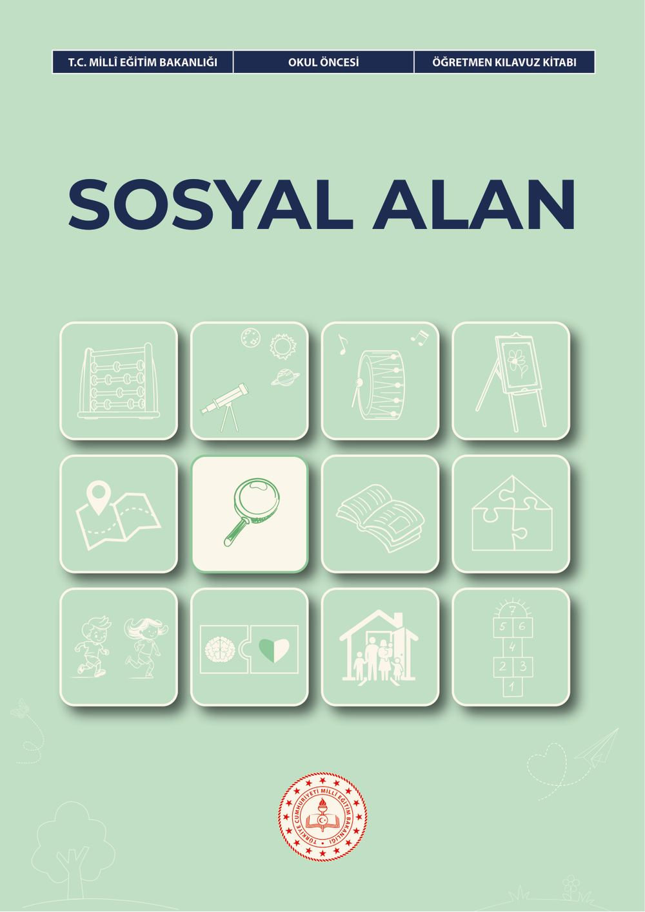
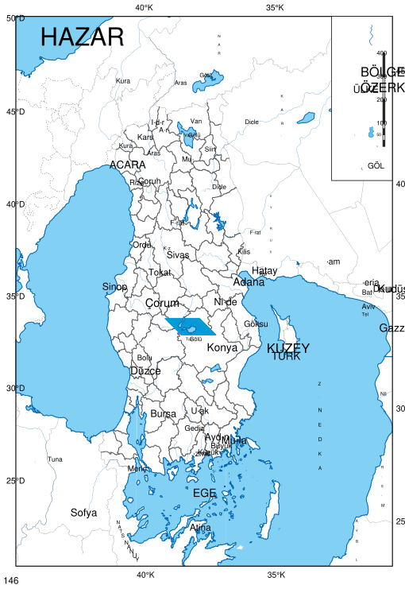
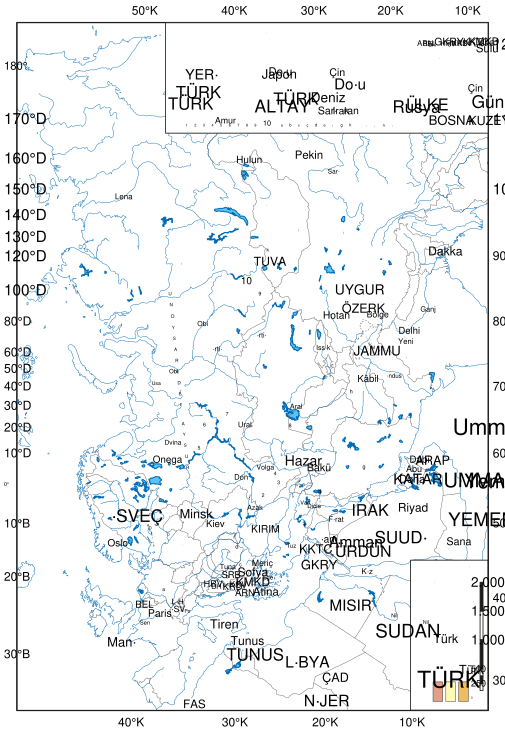

# Okul Öncesi Sosyal Alan Öğretmen Kılavuz Kitabı

<!-- sayfa 0 -->

T.C. MİLLÎ EĞİTİM BAKANLIĞI | OKUL ÖNCESİ | ÖĞRETMEN KILAVUZ KİTABI

# SOSYAL ALAN

<!-- sayfa 1 -->

Verdiğiniz metin katmanı boş olduğu için (`<<< >>>` arası boş) dönüştürülecek bir içerik bulunmamaktadır. Lütfen metin katmanını içeren içeriği paylaşın, böylece talimatlarınıza uygun şekilde Markdown formatına çevirebilirim.

<!-- sayfa 2 -->

OKUL ÖNCESİ

# Sosyal Alan Öğretmen Kılavuz Kitabı

## Yazarlar
AYŞE ÇULCU
BÜŞRA NUR DURAN YILMAZ
DİLAY YURTTAŞ
DİREN KILAV
NİHAL AKIN TAKCI
PINAR ÇAKIR
TUBA DAĞ
YELİZ GÜNAY

DEVLET KİTAPLARI

<!-- sayfa 3 -->

Milli Eğitim Bakanlığı Yayınları : 11233
Ders Kitapları Dizisi No : 2660

Her hakkı saklıdır ve Millî Eğitim Bakanlığına aittir. Kitabın metin, soru ve şekilleri kısmen de olsa hiçbir surette alınıp yayımlanamaz.

### Editör
Prof. Dr. Serdal SEVEN
Prof. Dr. Yunus GÜNİNDİ
Dr. Öğr. Üyesi Feyza AYDIN BÖLÜKBAŞ

### Dil Uzmanı
Fulya TOP GÖK

### Görsel Tasarımcı
Metin BİLAL
Yağmur YILDIRIM

### Çoklu Ortam Tasarımcısı
Gamze SEÇGİN
Gaye ERÇEN
Merve ÖZTEMİR
Nilgül ÖNAL

### Program Geliştirme Uzmanı
Hilal ALTINTAŞ

### Ölçme ve Değerlendirme Uzmanı
Merve ERELİ

### Rehberlik Uzmanı
Sevgi CEVİZ

ISBN
978-625-8867-29-9

<!-- sayfa 4 -->

# İSTİKLÂL MARŞI

Korkma, sönmez bu şafaklarda yüzen al sancak;
Sönmeden yurdumun üstünde tüten en son ocak.
O benim milletimin yıldızıdır, parlayacak;
O benimdir, o benim milletimindir ancak.

Çatma, kurban olayım, çehreni ey nazlı hilâl!
Kahraman ırkıma bir gül! Ne bu şiddet, bu celâl?
Sana olmaz dökülen kanlarımız sonra helâl.
Hakkıdır Hakk'a tapan milletimin istiklâl.

Mehmet Âkif Ersoy

<!-- sayfa 5 -->

ANDIMIZ

Türküm, doğruyum, çalışkanım.

İlkem küçüklerimi korumak, büyüklerimi saymak; yurdumu, milletimi özümden çok sevmektir.
Ülküm yükselmek, ileri gitmektir.

Ey Büyük Atatürk!

Açtığın yolda, gösterdiğin hedefe durmadan yürüyeceğime ant içerim.

Varlığım Türk varlığına armağan olsun.

Ne mutlu Türküm diyene!

<!-- sayfa 6 -->

MUSTAFA KEMAL ATATÜRK

<!-- yer tutucu bulunamadı: sayfa sonuna eklendi -->

<!-- sayfa 7 -->

Verdiğiniz metin katmanı boş olduğu için (`<<< >>>` arası boş) dönüştürülecek bir içerik bulunmamaktadır. Lütfen metin katmanını içeren içeriği paylaşın, böylece talimatlarınıza uygun şekilde Markdown formatına çevirebilirim.

<!-- sayfa 8 -->

# İÇİNDEKİLER

| | |
| :--- | ---: |
| GİRİŞ | 9 |
| SOSYAL ALAN BECERİLERİ | 9 |
| SOSYAL ALAN ETKİNLİKLERİNİN PROGRAMDA YER ALAN DİĞER ALANLARLA İLİŞKİLENDİRİLMESİ | 16 |
| SOSYAL ALAN ETKİNLİKLERİNİN PROGRAMLAR ARASI BİLEŞENLERLE İLİŞKİLENDİRİLMESİ | 19 |
| SOSYAL ALAN ETKİNLİK ÖRNEKLERİ | 23 |
| &nbsp;&nbsp;&nbsp;&nbsp;Gece-Gündüz | 23 |
| &nbsp;&nbsp;&nbsp;&nbsp;Bayramlaşıyoruz | 26 |
| &nbsp;&nbsp;&nbsp;&nbsp;Zaman Treni | 28 |
| &nbsp;&nbsp;&nbsp;&nbsp;Geçmişten Günümüze Bayram Coşkusu | 30 |
| &nbsp;&nbsp;&nbsp;&nbsp;Zamanın Aynası | 33 |
| &nbsp;&nbsp;&nbsp;&nbsp;Yaşasın Cumhuriyet | 35 |
| &nbsp;&nbsp;&nbsp;&nbsp;Gökyüzünün Sesi: Rüzgâr | 37 |
| &nbsp;&nbsp;&nbsp;&nbsp;Bugün Hava Nasıl? | 39 |
| &nbsp;&nbsp;&nbsp;&nbsp;Yardım Küpü | 42 |
| &nbsp;&nbsp;&nbsp;&nbsp;Halı Dokuma | 45 |
| &nbsp;&nbsp;&nbsp;&nbsp;Geleneksel Çocuk Oyunları | 48 |
| &nbsp;&nbsp;&nbsp;&nbsp;Zamanın İçinde Atatürk | 50 |
| &nbsp;&nbsp;&nbsp;&nbsp;Gezgin Çocukların Keşif Soruları | 53 |
| &nbsp;&nbsp;&nbsp;&nbsp;Kayıp Oyuncak Peşinde | 56 |
| &nbsp;&nbsp;&nbsp;&nbsp;Atatürk'ün Çocukluğu | 59 |
| &nbsp;&nbsp;&nbsp;&nbsp;10 Kasım'da Atatürk'ü Anıyoruz | 61 |
| &nbsp;&nbsp;&nbsp;&nbsp;Ay Yıldızlı Bayrağım, İstiklal Marşım | 63 |
| &nbsp;&nbsp;&nbsp;&nbsp;23 Nisan Görevim | 65 |
| &nbsp;&nbsp;&nbsp;&nbsp;Benim Bir Günüm | 67 |
| &nbsp;&nbsp;&nbsp;&nbsp;Gezgin Çantam | 69 |
| &nbsp;&nbsp;&nbsp;&nbsp;Farklı Kültürler | 71 |
| &nbsp;&nbsp;&nbsp;&nbsp;Kültür Yolculuğu | 73 |
| &nbsp;&nbsp;&nbsp;&nbsp;Mahallemdeki İzler | 75 |
| &nbsp;&nbsp;&nbsp;&nbsp;Minik Kâşifler Doğayı Soruyor | 77 |
| &nbsp;&nbsp;&nbsp;&nbsp;Dön Topacım Dön | 80 |
| &nbsp;&nbsp;&nbsp;&nbsp;Okulumuzdaki Bayraklar | 82 |
| &nbsp;&nbsp;&nbsp;&nbsp;Çevremde Neler Var? | 84 |

<!-- sayfa 9 -->

| | |
| :--- | :--- |
| İletişim Araçları | 86 |
| Parkta Gözlem Zamanı | 88 |
| Saklambaç | 90 |
| Üç Boyutlu Yakın Çevremiz | 92 |
| Taş Kumbaram | 94 |
| Çömleği Öğreniyoruz | 96 |
| Geçmişten Geleceğe Köprülerimiz | 98 |
| Yağmur Ölçer Yağmuru Ölçer mi? | 100 |
| Merak Ettiğim Ülke | 102 |
| Paramı Tanıyor, Tasarruf Ediyorum | 104 |
| Aydınlığın Tarihi | 107 |
| Doğada Gruplama | 110 |
| Çocuk Hakları | 113 |
| Tutum, Yatırım ve Türk Malları Haftası | 116 |
| Farklı Ülkeler, Farklı Bayraklar | 118 |
| Geçmişten Günümüze Evler | 121 |
| Yağmur Ormanları | 124 |
| Saatlerin İzinde | 126 |
| Ailem | 128 |
| Yardımlaşma Perdesi | 131 |
| İlkbahar Koleksiyonu | 134 |
| Alışveriş Yapıyoruz | 136 |
| Geçmişten Günümüze | 138 |
| Dans Edelim | 140 |
| Piri Reis | 142 |
| KAYNAKÇA | 145 |
| GÖRSEL VE GENEL AĞ KAYNAKÇASI | 145 |
| TÜRKİYE’NİN MÜLKİ İDARE BÖLÜMLERİ İLE KARA VE DENİZ KOMŞULARI HARİTASI | 146 |
| TÜRK DÜNYASI HARİTASI | 147 |

<!-- sayfa 10 -->

# GİRİŞ

Bu kılavuz, Türkiye Yüzyılı Maarif Modeli Okul Öncesi Öğretim Programı Sosyal Alan kapsamında öğretmenlere yol gösterici bir kaynak olarak hazırlanmıştır. Kılavuzda öncelikle sosyal alan becerileri olan zamanı algılama ve kronolojik düşünme, kanıta dayalı sorgulama ve araştırma, mekânsal düşünme, coğrafi sorgulama, coğrafi gözlem ve saha çalışması, harita ile eleştirel ve sosyolojik düşünme alanlarının her biri için dikkat edilmesi gereken önemli noktalar ve sınıf içi uygulama önerileri yaş gruplarının (36-48 ay, 48-60 ay, 60-72 ay) özellikleri dikkate alınarak sunulmaktadır.

Sosyal alan; çocukların günlük yaşam olaylarını zaman ilişkileri içinde fark etmelerini, yakın çevresindeki kişi, yer, nesne, olay ve kültürel özellikleri tanımalarını, millî ve dinî bayramlar ile özel günlere ilişkin yaşantılarını ifade etmelerini, mekânı ve coğrafi özellikleri gözlemlemelerini, basit kroki ve haritaları kullanmalarını, çevreye duyarlı davranmalarını ve toplumsal yaşama yönelik soru sormalarını desteklemektedir. Bu beceriler; çocukların kendilerini, ailelerini, yakın çevrelerini, yaşadıkları toplumu ve doğayı anlamlandırmalarına katkı sağlamaktadır.

Kılavuzda sosyal alan becerileri yaş gruplarına göre kademeli biçimde ele alınmaktadır. 36-48 ay grubunda çocukların günlük rutinleri, yakın çevresindeki olayları, bayramları ve kültürel özellikleri fark etmeleri; 48-60 ay grubunda karşılaştırma, sıralama, hava olaylarını gözlemleme ve yön-konum terimlerini kullanma becerilerinin desteklenmesi; 60-72 ay grubunda ise kaynak inceleme, soru sorma, okul dışı gözlem yapma, çevreye duyarlı davranma, kroki çözümleme ve kendi krokisini oluşturma gibi daha üst düzey becerilerin geliştirilmesi hedeflenmektedir.

Kılavuzun son bölümünde ise sosyal alan etkinliklerinin programda yer alan diğer alanlarla (Türkçe, matematik, fen, hareket ve sağlık, sanat, müzik) ve programlar arası bileşenlerle (sosyal-duygusal öğrenme becerileri, Erdem: değer-eylem çerçevesi, okuryazarlık becerileri ve eğilimler) nasıl ilişkilendirilebileceğine dair öneriler sunulmaktadır. Kılavuz boyunca öğretmenlere yönelik ifadeler öneri niteliğinde tutulmuş olup uygulamalar sınıfın koşullarına, yakın çevre olanaklarına, çocukların bireysel farklılıklarına ve gelişim düzeylerine göre uyarlanabilir.

# SOSYAL ALAN BECERİLERİ

## SBAB1. ZAMANI ALGILAMA VE KRONOLOJİK DÜŞÜNME

Zamanı algılama ve kronolojik düşünme becerisi, çocukların günlük yaşamda karşılaştıkları olayları zaman ilişkileri içinde fark etmelerini, gün içindeki eylemleri oluş sırasına göre sıralamalarını ve geçmiş ile bugün arasında değişen ya da benzer olan özellikleri ayırt etmelerini kapsar. Okul öncesi dönemde bu beceri; çocukların somut yaşantıları, günlük rutinleri, aile deneyimleri, özel günler ve görsel materyaller aracılığıyla desteklenmelidir.

**Dikkat Edilmesi Gereken Önemli Noktalar**

* 36-48 aylık çocuklarda zaman algısı daha çok günlük rutinler üzerinden gelişir. Bu yaş grubunda çocuklardan sabah, akşam, gece ve gündüz yapılan temel eylemleri söylemeleri, göstermeleri veya görsellerle eşleştirmeleri beklenebilir. “Sabah kahvaltı yaparız.”, “Gece uyuruz.”, “Gündüz okula geliriz.” gibi kısa ve somut ifadeler yeterli kabul edilebilir.
* 48-60 aylık çocuklarda sabah-akşam, gece-gündüz gibi zaman dilimlerinde yapılanların karşılaştırılması desteklenebilir. Bu yaş grubunda “Sabah yaptıklarımızla akşam yaptıklarımız aynı mı?”, “Gündüz okulda neler yapıyoruz, gece evde neler yapıyoruz?” gibi sorularla çocukların benzerlik ve farklılıkları ifade etmelerine fırsat verilebilir.
* 60-72 aylık çocuklarda zaman algısı daha ayrıntılı biçimde ele alınabilir. Gece-gündüz, sabah-akşam, dün-bugün-yarın gibi zaman ifadelerinin günlük yaşam içinde doğru kullanılmasına rehberlik edilebilir. Çocukların

<!-- sayfa 11 -->

yaşantılarıyla ilişkilendirilerek ele alınmalıdır. Çocuklardan bu günlerin tarihsel veya soyut anlamlarını ayrıntılı biçimde açıklamaları beklenmemeli; sınıfta, evde veya yakın çevrede bu günlerde neler yapıldığını söylemeleri, örnek vermeleri ve görsellerle açıklamaları desteklenmelidir.
• Kronolojik sıralama etkinliklerinde önce çocukların günlük rutinlerinden başlanmalıdır. “Önce okula geldik, sonra kahvaltı yaptık, sonra oyun oynadık.” gibi somut akışlar çocukların olayları oluş sırasına göre düzenlemelerine yardımcı olur. Yaş ilerledikçe aile geçmişi, okul yaşantısı, bayram hazırlıkları ve kısa hikâye dizileri de sıralama etkinliklerine dâhil edilebilir.

## Sınıf İçi Uygulama Önerileri

**SAB.1. Günlük hayatta karşılaştığı kavram / nesne / yer / toplum / olay / kişilere ilişkin zaman içerisinde değişen ve benzerlik gösteren özellikleri karşılaştırabilme**

Sınıfta “Günün Zamanları Panosu” oluşturabilirsiniz. Panoyu sabah, öğle, akşam ve gece bölümlerine ayırarak her bölüme çocukların o zaman diliminde yaptıkları etkinlikleri gösteren görseller yerleştirebilirsiniz. 36-48 aylık çocuklardan görselleri uygun zaman dilimiyle eşleştirmeleri istenebilir. 48-60 aylık çocuklarla sabah ve akşam yapılanlar karşılaştırılabilir. 60-72 aylık çocuklardan ise “Dün yaptığın bir şey ile bugün yaptığın bir şey aynı mıydı, farklı mıydı?” gibi sorularla değişim ve süreklilik üzerine konuşmaları beklenebilir.

“Benim Zaman Şeridim” etkinliği düzenleyebilirsiniz. Çocuklardan bebeklik fotoğrafı, aile fotoğrafı, okulun ilk günü, doğum günü, bayram ziyareti gibi görseller getirmeleri istenebilir. Çocuklar zorunlu tutulmaz, veli ve öğrencinin izni doğrultusunda alınır, temsili fotoğraf / görsel getirebilirler. Bu görseller çocuklarla birlikte geçmişten bugüne doğru sıralanabilir. 36-48 aylık çocuklar yalnızca fotoğraflarda kendilerini ve aile bireylerini gösterebilir; 48-60 aylık çocuklar “bebekken-şimdi” karşılaştırması yapabilir; 60-72 aylık çocuklar ise “Eskiden ne yapamıyordum, şimdi ne yapabiliyorum?” gibi ifadelerle değişimi açıklayabilir.

“Eskiden ve Şimdi” etkinliği düzenleyebilirsiniz. Sınıfa eski ve yeni nesne görselleri veya gerçek materyaller getirilebilir. Eski telefon-yeni telefon, eski oyuncak-yeni oyuncak, eski televizyon-yeni televizyon, eski okul çantası-yeni okul çantası gibi örnekler üzerinden çocukların benzerlik ve farklılıkları söylemeleri desteklenebilir. 60-72 aylık çocuklardan bu nesnelerin kullanım amaçlarını karşılaştırmaları ve “Hangisi daha kolay kullanılır?”, “Hangisi daha önce kullanılmış olabilir?” gibi sorulara gerekçeli yanıt vermeleri beklenebilir.

Bayramlar ve özel günler için “Özel Günler Albümü” hazırlanabilir. Çocukların millî bayramlarda, dinî özel günlerde, 10 Kasım veya Atatürk Haftası kapsamında gözlemledikleri hazırlıkları resimlemeleri ya da ailelerinden getirdikleri görselleri albüme eklemeleri sağlanabilir. Çocuklar bu albüm üzerinden “Bayramda kimlerle bir araya geliriz?”, “Okulda nasıl hazırlık yaparız?”, “Evde neler yapılır?” gibi sorularla konuşmaya teşvik edilebilir.

**SAB.2. Yakın çevresindeki olay / dönem / kavramları kronolojik olarak sıralayabilme**

“Gün Akışı Kartları” hazırlayabilirsiniz. Kartlarda okula geliş, kahvaltı, oyun, etkinlik, bahçe zamanı, yemek ve eve dönüş gibi günlük rutinler yer alabilir. Çocuklardan bu kartları gün içindeki oluş sırasına göre dizmeleri istenebilir. 36-48 aylık çocuklarla iki veya üç kartla başlanabilir; yaş ilerledikçe kart sayısı artırılabilir.

“Önce-Sonra” oyunu oynayabilirsiniz. Öğretmen “Önce ellerimizi yıkarız, sonra yemek yeriz.”, “Önce ayakkabımızı giyeriz, sonra bahçeye çıkarız.” gibi günlük yaşamdan örnekler verir. Ardından çocuklardan kendi örneklerini söylemeleri istenir. 48-60 aylık çocuklarla kısa hikâye görselleri sıralanabilir. 60-72 aylık çocuklardan ise görselleri başlangıç-gelişme-sonuç biçiminde sıraladıktan sonra hikâyeyi kendi cümleleriyle anlatmaları beklenebilir.

“Ailemde Bir Gün” etkinliği yapılabilir. Çocuklardan evde bir gün içinde yaptıkları temel eylemleri resimlemeleri istenebilir. Uyanma, kahvaltı, oyun, aileyle vakit geçirme, uyku gibi görseller oluş sırasına göre düzenlenebilir. Bu etkinlik çocukların hem aile yaşantılarıyla bağlantı kurmalarını hem de zaman sıralaması yapmalarını destekler.

**SAB.3. Olay / dönem ve kavramların zamanla geçirdikleri değişim / dönüşümleri karşılaştırarak ifade edebilme**

<!-- sayfa 12 -->

araçları, ev eşyaları, oyuncaklar, iletişim araçları veya okul materyalleri yer alabilir. Çocuklardan bu nesnelerin geçmişteki ve günümüzdeki hâllerini incelemeleri, benzerlik ve farklılıklarını söylemeleri istenebilir.

“Aynı Mekân, Farklı Zaman” etkinliği düzenlenebilir. Okul bahçesinin, sınıfın veya yakın çevredeki bir parkın farklı zamanlarda çekilmiş fotoğrafları incelenebilir. Çocuklardan “Neler değişmiş?”, “Neler aynı kalmış?”, “Bu mekânı daha önce görmüş müydün?” gibi sorulara yanıt vermeleri istenebilir. Bu etkinlik değişim ve süreklilik kavramlarının somutlaştırılmasına katkı sağlar.

## SBAB2. KANITA DAYALI SORGULAMA VE ARAŞTIRMA

Kanıta dayalı sorgulama ve araştırma becerisi, çocukların yakın çevreleri ve ülkeleriyle ilgili merak ettikleri konular hakkında soru sormalarını, görsel ve işitsel kaynakları incelemelerini, bu kaynaklardan elde ettikleri bilgileri karşılaştırmalarını ve anlamlandırmalarını kapsar. Okul öncesi dönemde bu beceri; çocuklara bilgiyi hazır biçimde vermek yerine fotoğraf, harita, animasyon, tablo, grafik, afiş, broşür, resimli kitap, dijital içerik ve gerçek nesneler gibi kanıtlar üzerinden düşünme fırsatı sunularak desteklenmelidir.

### Dikkat Edilmesi Gereken Önemli Noktalar

Bu beceri özellikle 60-72 ay grubunda daha belirgin biçimde ele alınmaktadır. Çocukların merak ettiği kişi, yer, olay ve semboller hakkında soru sormalarına fırsat verilmelidir. Öğretmen, doğrudan bilgi aktaran kişi olmaktan çok, çocuğun sorusunu derinleştiren ve onu uygun kaynaklara yönlendiren rehber rolünde olmalıdır.

Kaynak inceleme sürecinde çocukların yalnızca bakmaları değil; gördüklerini söylemeleri, karşılaştırmaları, soru sormaları ve “Bu bilgi bize ne anlatıyor?” sorusu üzerinde düşünmeleri sağlanmalıdır. Çocuklara “Bunu nereden öğrenebiliriz?”, “Kitaptan mı, fotoğraftan mı, haritadan mı, aile büyüklerimize sorarak mı öğrenebiliriz?” gibi sorular yöneltilerek bilgi kaynaklarının çeşitliliği fark ettirilebilir.

Mustafa Kemal Atatürk’ün yaşamı ele alınırken, Türk bayrağı ve İstiklâl Marşı gibi millî semboller açıklanırken çocukların gelişim düzeyine uygun, somut ve temel bilgiler kullanılmalıdır. Okul öncesi dönemde çocukların Mustafa Kemal Atatürk’ün fotoğrafını tanıması, adını söylemesi, çocuklara verdiği önemi kavraması ve Cumhuriyet ile bayramlar arasında ilişki kurabilmesi gelişim düzeylerine uygundur. Çocukların Mehmet Akif Ersoy’u tanımaları, bayrağın renklerini öğrenmeleri, okul ile sınıf ortamındaki yerini fark etmeleri ve törenlerde nasıl davranılması gerektiğini öğrenmeleri desteklenebilir.

### Sınıf İçi Uygulama Önerileri

**SAB.4. Yakın çevresindeki yaşantılardan yola çıkarak ülkemizle ilgili merak ettiği konulara yönelik sorular sorabilme**

“Merak Ediyorum Panosu” oluşturabilirsiniz. Çocuklardan yakın çevreleri, yaşadıkları şehir, okul, bayramlar, Atatürk, Türk bayrağı veya İstiklâl Marşı hakkında merak ettikleri soruları söylemeleri istenebilir. Öğretmen, çocukların sorularını yazabilir ve panoya asabilir. “Atatürk çocukken neler yapardı?”, “Bayrağımızdaki ay ve yıldız bize neyi anlatır?”, “İstiklâl Marşı ne zaman söylenir?” gibi sorular çocukların sorgulama becerisini destekler.

“Kanıtı İncele, Sorunu Sor” etkinliği yapılabilir. Öğretmen sınıfa eski bir fotoğraf, basit bir harita, bayram afişi, eski bir oyuncak, müze görseli veya kısa bir animasyon getirir. Çocuklardan önce gördüklerini söylemeleri, ardından bu materyal hakkında merak ettikleri soruları sormaları istenir. Örneğin, eski bir oyuncak görseli üzerinden “Eskiden çocuklar bununla nasıl oynardı?” sorusu geliştirilebilir.

“Benim Şehrim Hakkında Sorularım” etkinliği yapılabilir. Çocuklara yaşadıkları çevreye ait park, okul, pazar yeri, müze, meydan, tarihî yapı, doğal alan gibi görseller gösterilir. “Burada kimler çalışır?”, “Buraya neden gideriz?”, “Bu yer eskiden de var mıydı?”, “Bu mekânı korumak için ne yapmalıyız?” gibi sorular sormaları desteklenebilir.

**SAB.5. Yakın çevresiyle / ülkemizle ilgili merak ettiği konuya yönelik kaynakları inceleyebilme**

“Kaynak İnceleme Masası” oluşturabilirsiniz. Masaya fotoğraflar, resimli kitaplar, kısa videolar, çocuklara uygun afişler, broşürler, haritalar ve gerçek nesneler yerleştirilebilir. Çocuklar bu kaynakları inceleyerek merak

<!-- sayfa 13 -->

“Atatürk Köşesini İnceliyorum” etkinliği düzenleyebilirsiniz. Atatürk’ün çocuklarla birlikte olduğu fotoğraflar, Anıtkabir görselleri, Cumhuriyet Bayramı kutlamalarına ait görseller çocuklarla birlikte incelenebilir. Çocuklardan görsellerde ne gördüklerini söylemeleri, merak ettikleri soruları sormaları ve öğrendiklerini resimle ifade etmeleri istenebilir.

“Müzede Ne Var?” etkinliği yapılabilir. Oyuncak müzesi, etnografya müzesi, açık hava müzesi veya yerel kültürle ilişkili bir mekâna ait görseller sınıfa getirilebilir. Çocuklardan görsellerdeki nesneleri incelemeleri, geçmişte nasıl kullanılmış olabileceğine ilişkin tahminlerde bulunmaları ve merak ettikleri soruları ifade etmeleri beklenebilir.

## SBAB7. MEKÂNSAL DÜŞÜNME

Mekânsal düşünme becerisi, çocukların yakın çevrelerindeki mekânları fark etmelerini, mekânların coğrafi özelliklerini tanımlamalarını, yön ve konum terimlerini kullanarak çevrelerindeki kişi, nesne ve mekânların yerini ifade etmelerini kapsar. Bu beceri; çocukların yanında, altında, üstünde, yakınında, uzağında, arasında gibi konum ifadelerini kullanarak sınıfı, okulu ve yakın çevreyi mekânsal ilişkiler içinde anlamlandırmaları yoluyla desteklenmelidir.

**Dikkat Edilmesi Gereken Önemli Noktalar**

Mekânsal düşünme becerisi çocukların bedensel deneyimleriyle doğrudan ilişkilidir. Bu nedenle sınıf, okul bahçesi, okul çevresi, park, sokak, müze, doğal alan ve yakın çevredeki belirgin yapılar öğrenme ortamı olarak kullanılabilir.

Çocuklardan coğrafi koşulları teknik kavramlarla açıklamaları beklenmemelidir. Bunun yerine “Burası düz mü, yokuş mu?”, “Okulumuzun yakınında park var mı?”, “Bahçede ağaç nerede?”, “Kitap merkezi kapının yanında mı?” gibi somut gözlem ve konum soruları kullanılabilir.

60-72 aylık çocuklarla coğrafi koşullar ele alınırken hava olayları, dağ, göl, akarsu, deniz gibi doğal unsurlar; köprü, bina, park, yol gibi insan yapımı yapılar; görseller, hikâyeler, dijital içerikler ve gezi-gözlem çalışmalarıyla desteklenebilir.

### Sınıf İçi Uygulama Önerileri

**SAB.6. Yakın çevresinde yer alan mekânın coğrafi koşullarını tanımlayabilme**

“Okulumu Keşfediyorum” yürüyüşü düzenleyebilirsiniz. Çocuklarla okul bahçesi ve yakın çevre gezilerek çevredeki ağaçlar, yollar, binalar, bahçe alanı, oyun parkı, yokuş veya düz zemin gibi özellikler gözlemlenebilir. Gezi sonrasında çocuklardan “Okulumuzun çevresinde neler var?”, “Bahçede hangi doğal unsurları gördük?”, “Yol okulun neresinde?” gibi sorulara yanıt vermeleri istenebilir.

“Konum Avı” oyunu oynanabilir. Sınıfta belirli nesneler seçilir ve çocuklardan bu nesnelerin yerlerini konum terimleriyle ifade etmeleri istenir. Örneğin “Top sandalyenin altında.”, “Kitap masanın üstünde.”, “Oyuncak kutusu kapının yanında.” gibi ifadeler kullanılabilir. 48-60 aylık çocuklarla yakın-uzak, yanında, üstünde, altında gibi temel terimler kullanılabilir; 60-72 aylık çocuklarla arasında, karşısında, solunda, sağında gibi ifadeler de eklenebilir.

“Çevremizin Haritasız Resmi” etkinliği yapılabilir. Çocuklar okul çevresinde gördükleri mekânları resmedebilir. Bu resimler üzerinden “Okulun yanında ne var?”, “Bahçede neler gördün?”, “Yol nerede?”, “Park okula yakın mı, uzak mı?” gibi sorularla mekânsal farkındalık desteklenebilir.

## SBAB8. COĞRAFİ SORGULAMA

Coğrafi sorgulama becerisi, çocukların hava olayları, yeryüzü şekilleri ve mekânlarla ilgili gözlem yapmalarını; merak ettikleri durumlara ilişkin sorular sormalarını ve çevrelerindeki doğal olayları fark etmelerini kapsar. Bu beceri, çocukların merak duygusunu harekete geçirerek yakın çevrelerinde gözlemledikleri coğrafi olaylar hakkında düşünmelerini destekler.

<!-- sayfa 14 -->

48-60 aylık çocuklarda hava olaylarına ilişkin gözlemleri söyleme ve merak edilen hava olayları hakkında soru sorma becerileri desteklenebilir. 60-72 aylık çocuklardan ise hava olaylarına ve yeryüzü şekillerine ait görselleri tanımaları, bunların isimlerini söylemeleri ve bunlara ilişkin daha ayrıntılı sorular sormaları beklenebilir.

Hava olayları konusu işlenirken çocukların günlük deneyimleri temel alınmalıdır. “Bugün hava nasıl?”, “Yağmur yağınca ne yapıyoruz?”, “Rüzgârı nasıl fark ederiz?”, “Kar yağınca çevremizde ne değişir?” gibi sorular çocukların gözlem ve sorgulama becerilerini destekler.

Coğrafi sorgulama yalnızca sınıf içi görsellerle sınırlı tutulmamalıdır. Yağmurlu bir günde bahçedeki su birikintilerini gözlemleme, güneşli bir günde gölge değişimini izleme, rüzgârda yaprakların hareketini fark etme gibi doğrudan deneyimlere yer verilmelidir.

### Sınıf İçi Uygulama Önerileri

**SAB.7. Merak ettiği coğrafi olay / olgu ve mekân / durumlara yönelik sorular sorabilme**

“Hava Durumu Gözlem Panosu” oluşturabilirsiniz. Her gün çocuklarla havanın güneşli, yağmurlu, bulutlu, rüzgârlı, karlı veya sisli olup olmadığı gözlemlenir. Çocuklardan hava durumuna uygun sembolü panoya yerleştirmeleri istenir. Haftanın sonunda “Bu hafta en çok hangi hava olayını gördük?”, “Bugün hava dünden farklı mı?” gibi sorularla çocukların gözlem sonuçları üzerine konuşmaları sağlanabilir.

“Hava Grafiği” etkinliği yapılabilir. Çocuklar bir hafta boyunca gözlemledikleri hava durumlarını sembollerle grafiğe işler. 48–60 aylık çocuklar uygun sembolü seçip yerleştirebilir; 60-72 aylık çocuklar ise “Kaç gün güneşliydi?”, “Kaç gün yağmurluydu?”, “En çok hangi hava olayını gözlemledik?” gibi sorulara yanıt verebilir.

“Yeryüzü Şekilleri Kartları” hazırlanabilir. Dağ, tepe, ova, göl, deniz, akarsu gibi görseller çocuklara gösterilir. 60-72 aylık çocuklardan görseli gösterilen yeryüzü şeklinin adını söylemeleri ve merak ettikleri soruları ifade etmeleri istenebilir. Çocukların “Dağlar neden yüksektir?”, “Akarsu nereye gider?”, “Deniz ile göl aynı mı?” gibi sorular sormaları desteklenebilir.

“Kumda Yeryüzü Şekilleri” etkinliği yapılabilir. Çocuklara kum, kil, oyun hamuru veya doğal materyaller verilerek dağ, göl, akarsu veya deniz modeli oluşturmaları istenebilir. Çocuklar oluşturdukları modeli göstererek “Burası dağ.”, “Buradan su akıyor.” gibi açıklamalar yapabilir.

# SBAB9. COĞRAFİ GÖZLEM VE SAHA ÇALIŞMASI

Coğrafi gözlem ve saha çalışması becerisi çocukların okul dışı öğrenme ortamlarına hazırlık yapmalarını, gözlem sırasında yönergelere uymalarını, çevreye duyarlı davranmalarını ve elde ettikleri deneyimleri sözel veya görsel olarak sunmalarını kapsar. Bu beceri; doğrudan gözlem, duyusal deneyim, gezi-gözlem, materyal inceleme ve ürün oluşturma süreçleriyle desteklenmelidir.

#### Dikkat Edilmesi Gereken Önemli Noktalar

Bu beceri 60-72 ay grubunda ele alınmalıdır. Okul dışı öğrenme çalışmaları çocukların yaş ve güvenlik özelliklerine uygun biçimde planlanmalıdır. Çocuklar gezi öncesinde; gidilecek yer, yapılacak çalışmalar, dikkat edilecek güvenlik kuralları ve çevreye duyarlı davranışlar hakkında bilgilendirilmelidir.

Saha çalışması yalnızca uzak bir gezi olarak düşünülmemelidir. Okul bahçesi, sınıf dışı koridorlar, yakın park, okul çevresi, bahçedeki ağaçlar, yağmur sonrası su birikintileri, yapraklar, taşlar, kozalaklar ve doğal materyaller de gözlem alanı olarak kullanılabilir.

Gezi-gözlem öncesinde çocukların gidilecek mekânın görsellerini incelemeleri, tahminlerde bulunmaları ve sorular sormaları desteklenmelidir. Gezi sırasında ise çocukların sözel ve görsel yönergelere uymaları, çevreyi olumsuz etkileyecek davranışlardan kaçınmaları ve gözlem sonuçlarını paylaşmaları beklenmelidir.

**SAB.8. Coğrafi gözlem ve saha çalışmasını gerçekleştirebilmek için gerekli olan hazırlığı yapabilme**

<!-- sayfa 15 -->

“Güvenliğimiz için nelere dikkat etmeliyiz?” gibi sorular sorulur. Çocukların güvenlik ve sağlık açısından dikkat edilmesi gereken hususları söylemeleri desteklenir.

“Gezi Kuralları Listesi” oluşturabilirsiniz. Çocuklarla birlikte “Grubumuzdan ayrılmayız.”, “Bitkileri koparmayız.”, “Çöpleri yere atmayız.”, “Öğretmenin yönergelerini dinleriz.” gibi kurallar belirlenir. Her çocuk bir kuralı resmedebilir ve arkadaşlarına açıklayabilir. Bu etkinlik çocukların geziye hazırlık sürecine etkin katılmalarını sağlar.

**SAB.9. Coğrafi gözlem ve okul dışı planlanan çalışmaları çevreye duyarlı biçimde uygulayabilme**

“Doğa Dedektifleri” etkinliği yapılabilir. Çocuklar okul bahçesinde veya yakın çevrede yaprak, taş, çiçek, toprak, böcek, kuş, bulut, yol, köprü ya da ağaç gibi doğal ve beşerî unsurları gözlemler. Gözlem sırasında canlıları koruma, çöpleri çöp kutusuna atma ve öğretmenin yönergelerine uyma davranışları vurgulanır.

“Basit Oryantiring” oyunu düzenlenebilir. Gezi alanının veya okul bahçesinin basit bir krokisi hazırlanır. Kroki üzerinde belirlenen noktalar işaretlenir. Çocuklardan krokiyi takip ederek bu noktalara ulaşmaları ve her noktada basit bir gözlem görevi yapmaları istenir. “Ağacın yanına git ve yapraklarını gözlemle.”, “Taşların olduğu alanı bul ve renklerini söyle.” gibi yönergeler verilebilir.

“Çevreye Zarar Veren ve Çevreyi Korumayı Sağlayan Davranışlar” etkinliği yapılabilir. Yere çöp atma, bitki koparma, çöp kutusuna çöp atma, canlıyı incitmeden gözlemleme gibi davranış görselleri sunulur. Çocuklardan bu davranışları çevreye zarar veren ve çevreyi koruyan davranışlar olarak ayırmaları istenir.

**SAB.10. Coğrafi gözlem ve çalışma sahasından elde edilen sonuçları sözel / görsel yolla sunabilme**

“Geziden Ne Öğrendim?” sunumu yapılabilir. Çocuklar gezi veya gözlem sırasında edindikleri izlenimleri resim, kolaj, yaprak baskısı, fotoğraf panosu veya sözlü anlatım yoluyla paylaşabilir. Her çocuğa “Ne gördün?”, “En çok ne dikkatini çekti?”, “Bu çalışmada ne öğrendin?” gibi sorular yöneltilerek sunum yapmaları desteklenebilir.

“Doğa Materyallerinden Ürün Oluşturuyorum” etkinliği yapılabilir. Çocuklar gezi sırasında doğaya zarar vermeden toplanabilecek taş, kozalak, kuru yaprak, dal gibi materyallerden sınıfta ürün oluşturabilir. Taş boyama, yaprak baskısı, kozalaklardan hayvan figürü, dallardan minyatür orman veya doğa parkı modeli yapılabilir. Ürünler tamamlandıktan sonra çocuklardan ürünlerini tanıtmaları ve hangi materyalleri kullandıklarını söylemeleri istenebilir.

“Gözlem Sergisi” düzenlenebilir. Çocukların gezi-gözlem sonrasında oluşturdukları resimler, kolajlar, fotoğraflar ve ürünler sınıfta sergilenebilir. Çocuklar ürünlerini arkadaşlarına, okul çalışanlarına veya ailelerine tanıtarak gözlem sonuçlarını sözel ve görsel olarak paylaşabilir.

### SBAB10. HARİTA

Harita becerisi, çocukların yakın çevrelerine ilişkin basit kroki ve haritaları okuyabilmelerini, yön ve konum terimlerini kullanabilmelerini, kroki üzerinde kişi, nesne veya mekânların yerini belirleyebilmelerini ve kendi krokilerini oluşturabilmelerini kapsar. Okul öncesi dönemde bu beceri gerçek nesneler, üç boyutlu modeller, basitleştirilmiş çizimler, kroki ve çocukların oluşturduğu temsiller aracılığıyla desteklenmelidir.

**Dikkat Edilmesi Gereken Önemli Noktalar**

48-60 ay grubunda çocukların yön ve konum terimlerini kullanarak kendisinin, nesnelerin ve mekânların konumunu ifade etmeleri desteklenebilir. 60-72 ay grubunda ise çocukların kroki ve haritalarda kullanılan basit renk, şekil, sembolleri tanımaları; bir krokiden yararlanarak hedef nesneyi bulmaları ve kendi krokilerini oluşturmaları beklenebilir.

Harita ve kroki çalışmaları soyut anlatımlarla değil, sınıfın ve okulun somut mekânsal düzeni üzerinden yapılmalıdır. Çocuklar önce gerçek mekânda konumları deneyimlemeli, ardından bu mekânın basitleştirilmiş kroki temsiliyle karşılaşmalıdır.

Kroki çalışmalarında renk şekil ve semboller çocuklar için anlamlı hâle getirilmelidir. Örneğin krokilerde

<!-- sayfa 16 -->

# Sınıf İçi Uygulama Önerileri

**SAB.11. Yakın çevresi ile ilgili olan basit krokiyi / haritayı okuyabilme**

“Sınıf Krokisini İnceliyoruz” etkinliği yapılabilir. Öğretmen sınıfın basit bir krokisini hazırlar. Kroki üzerinde masa, kitap merkezi, blok merkezi, kapı, pencere ve halı alanı gibi bölümler basit sembollerle gösterilir. Çocuklardan bu sembolleri tanımaları ve “Kitap merkezi nerede?”, “Kapı hangi tarafta?”, “Halı alanı hangi sembolle gösterilmiş?” gibi sorulara yanıt vermeleri istenir.

“Sembol Eşleştirme Oyunu” oynanabilir. Bir kâğıdın bir tarafına park, okul, ev, nehir, oyun alanı gibi görseller; diğer tarafına ise yeşil daire, küçük kare, mavi çizgi, yıldız gibi basit kroki sembolleri yerleştirilir. Çocuklardan görselleri uygun sembollerle eşleştirmeleri istenir.

“Kroki, Harita, Küre ve Pusula Tanıma Masası” oluşturabilirsiniz. Çocuklara kroki, harita, küre ve pusula gösterilir. Bu araçların neye benzediği ve nerelerde kullanılabileceği hakkında sohbet edilir. 60-72 aylık çocuklardan bu araçları isimlendirmeleri ve kullanım amaçlarına ilişkin basit ifadeler söylemeleri beklenebilir.

**SAB.12. Yakın çevresinde bulunan kişi / nesne / mekânın konumunu belirlemek üzere takip edeceği krokiyi çözümleyebilme**

“Hazineyi Krokiyle Bul” oyunu oynanabilir. Sınıfta bir nesne saklanır ve çocuklara basit bir kroki verilir. Çocuklar krokideki yönergeleri takip ederek hedef nesneyi bulmaya çalışır. Bu etkinlikte “sağında, solunda, önünde, arkasında, yanında, altında, üstünde” gibi konum terimleri kullanılabilir.

“Rota Takip Ediyorum” etkinliği düzenlenebilir. Sınıf veya okul krokisi üzerinde başlangıç ve varış noktası belirlenir. Çocuklardan krokide gösterilen yolu takip ederek hedef noktaya ulaşmaları istenir. “Kapıdan başla, kitap merkezinin yanından geç, halının önünde dur.” gibi basit yönergeler kullanılabilir.

“Boş Krokiyi Tamamlıyorum” etkinliği düzenlenebilir. Çocuklara sınıfa ait boş bir kroki verilir. Öğretmenin yönergesine göre “Masayı ortaya yerleştir.”, “Kitap merkezini pencerenin yanına koy.”, “Oyuncak kutusunu kapının yakınına yerleştir.” gibi görevlerle çocukların nesne görsellerini uygun yerlere yerleştirmeleri sağlanabilir.

**SAB.13. Yakın çevresinde bulunan belirli bir kişi / nesne / mekânın konumunu gösteren kendi krokisini oluşturabilme**

“Kendi Sınıf Krokimi Çiziyorum” etkinliği yapılabilir. Çocuklardan sınıfın basit bir krokisini oluşturmaları istenir. Masa, halı, oyuncak köşesi, kapı ve pencere gibi temel alanları kendi seçtikleri sembollerle göstermeleri desteklenir. Ardından çocuklardan hazırladıkları krokide bir nesnenin yerini tarif etmeleri istenir. “Oyuncak kutusu kapının yanında.”, “Kitaplık pencerenin karşısında.” gibi ifadeler kullanmaları sağlanabilir.

“Okul Bahçesi Krokisi” etkinliği yapılabilir. Çocuklarla önce okul bahçesi gezilir. Bahçedeki ağaç, oyun alanı, kapı, oturma alanı gibi belirgin noktalar gözlemlenir. Daha sonra çocuklardan bu alanları basit sembollerle kroki üzerinde göstermeleri istenir. Çocuklar, kendi krokilerinde bir noktayı seçerek arkadaşlarına “Buraya nasıl gidilir?” sorusuyla yol tarif edebilir.

## SBAB16. ELEŞTİREL SOSYOLOJİK DÜŞÜNME

Eleştirel sosyolojik düşünme becerisi; çocukların toplumsal yaşama ilişkin nesne, olgu ve olayları fark etmelerini, Türk kültürüne ait özellikleri tanımalarını, Mustafa Kemal Atatürk’ün Türk toplumu için önemini yaşlarına uygun biçimde ifade etmelerini ve farklı toplumların kültürel özellikleri hakkında soru sormalarını kapsar.

**Dikkat Edilmesi Gereken Önemli Noktalar**

36-48 aylık çocuklarda yakın çevre kültürüne ait özel gün, yemek, giysi, müzik gibi özellikleri söylemeleri yeterli kabul edilebilir. “Bayramda ailemizle bir araya geliriz.”, “Düğünde müzik çalınır.”, “Bazı özel günlerde geleneksel kıyafetler giyilebilir.” gibi somut örnekler kullanılabilir.

48-60 ve 60-72 aylık çocuklarda Türk kültürüne ait özellikleri belirleme becerisi daha sistematik biçimde

<!-- sayfa 17 -->

Mustafa Kemal Atatürk’ün Türk toplumu için önemi okul öncesi düzeyde somutlaştırılmalıdır. Atatürk’ün Türkiye Cumhuriyeti’nin kurucusu olduğu, çocuklara önem verdiği ve 23 Nisan’ı çocuklara armağan ettiği gibi temel bilgiler çocukların yaş düzeylerine uygun olarak verilebilir.

Farklı toplumların kültürel özellikleri ele alınırken karşılaştırma yargılayıcı biçimde yapılmamalıdır. Çocukların farklılıkları saygı, merak ve kabul çerçevesinde fark etmeleri desteklenmelidir.

## Sınıf İçi Uygulama Önerileri

**SAB.14. Toplumsal yaşama yönelik nesne, olgu ve olayları çözümleyebilme**

“Kültür Sandığı” etkinliği düzenleyebilirsiniz. Sandığın içine geleneksel kıyafet görselleri, yöresel yemek fotoğrafları, halk oyunları görselleri, bayram şekeri, kilim deseni, müzik aleti görselleri, geleneksel oyun materyalleri, geleneksel sporlar (cirit, okçuluk) gibi Türk kültürüne ait görseller veya nesneler yerleştirilebilir. Çocuklardan bu nesneleri incelemeleri, neye ait olduklarını söylemeleri ve kendi yaşantılarıyla ilişkilendirmeleri istenebilir.

“Bayramda Neler Yaparız?” sorusundan hareketle çocuklarla sohbet edilebilir. Çocuklardan millî ve dinî bayramlarda ve özel günlerde evde, okulda veya çevrede gördükleri hazırlıkları anlatmaları istenir. 36-48 aylık çocuklar kısa ifadelerle katılabilir; 48-60 ve 60-72 aylık çocuklardan bayramlarda yapılan hazırlıkları karşılaştırmaları beklenebilir.

“Atatürk’ü Tanıyorum” etkinliği planlanabilir. Atatürk’ün fotoğrafı gösterilerek çocuklardan fotoğrafı tanımaları, adını söylemeleri ve onunla ilgili bildikleri temel özellikleri ifade etmeleri istenebilir. 48-60 ay için “Atatürk çocuklara önem vermiştir.”, “23 Nisan çocuklar için özel bir gündür.” gibi somut ifadeler kullanılabilir. 60-72 ay grubunda “Atatürk Türk toplumu için neden önemlidir?” sorusu çocukların düzeyine uygun biçimde “Ülkemizin kurulmasına öncülük etmiştir.”, “Çocuklara bayram armağan etmiştir.” gibi açıklamalarla desteklenebilir.

“Yerel Kültür Günü” düzenlenebilir. Ailelerden yöresel yemek, geleneksel oyun, müzik, kıyafet, masal veya ninni örnekleri hakkında bilgi paylaşmaları istenebilir. Çocuklar sınıfta bu kültürel unsurları görseller, ses kayıtları veya nesneler üzerinden inceleyebilir. Bu etkinlik kültürel özellikleri tanıma ve toplumsal yaşama ilişkin unsurları çözümleme becerisini destekler.

**SAB.15. Toplumsal yaşama yönelik merak ettiği konuyu sorgulayabilme**

“Dünyadan Kültürler” görsel inceleme etkinliği yapılabilir. Farklı toplumlara ait özel gün, yemek, giysi, müzik ve oyun görselleri sınıfa getirilir. Çocuklardan görselleri incelemeleri ve merak ettikleri soruları sormaları istenir. “Bu kıyafeti ne zaman giyiyorlar?”, “Bu yemek nasıl yapılıyor?”, “Bu müzik hangi ülkede çalınıyor?” gibi sorular sorulabilir.

“Benzer ve Farklı” etkinliği düzenlenebilir. Türk kültürüne ait bir yemek, giysi, müzik veya oyun örneği ile farklı bir toplumdan örnek yan yana sunulur. Çocuklardan benzerlik ve farklılıkları söylemeleri istenir. Bu süreçte öğretmen, farklı kültürlere saygılı bir dil kullanmalı ve hiçbir kültürel özelliği üstün ya da eksik göstermemelidir.

“Kültür Hakkında Sorularım” panosu oluşturulabilir. Çocuklar kendi kültürlerine veya farklı toplumların kültürel özelliklerine ilişkin merak ettikleri soruları öğretmene söyler. Öğretmen bu soruları panoya yazar. Daha sonra görseller, kitaplar, kısa videolar veya aile katılımı yoluyla bu sorulara yanıt aranabilir. Bu etkinlik çocukların sorgulama, kültürel farkındalık ve açık fikirlilik becerilerini destekler.

# SOSYAL ALAN ETKİNLİKLERİNİN PROGRAMDA YER ALAN DİĞER ALANLARLA İLİŞKİLENDİRİLMESİ

Sosyal alan becerilerinin kazandırılması planlanırken öncelikli olarak çocukların gelişim düzeyleri, bireysel farklılıkları, yakın çevre deneyimleri ve sosyokültürel özellikleri göz önünde bulundurulabilir. Sosyal alan öğrenme çıktılarının edinimi süreç gerektirdiği için bu çıktıların farklı yöntem ve tekniklerle tekrar tekrar ele alınması önemlidir. Böylece çocukların zamanı algılama, yakın çevresini tanıma, toplumsal olayları fark etme, kültürel özellikleri ayırt etme, mekânı ve coğrafi özellikleri gözlemleme, basit kroki ve haritaları kullanma, soru

<!-- sayfa 18 -->

dikkat edilebilir. Etkinlikler çocukların günlük yaşam deneyimlerinden, aile yaşantılarından, okul ortamından, yakın çevresinden ve yerel kültürel unsurlardan hareketle oyun temelli olarak planlanabilir. Çocuğun bütüncül gelişimi dikkate alındığında sosyal alan becerilerinin diğer alan becerileriyle birlikte ele alınması çocukların hem toplumsal farkındalıklarını hem de Türkçe, matematik, fen, hareket ve sağlık, sanat ve müzik becerilerini destekleyebilir.

**Türkçe Alanı ile İlişkilendirme**

Sosyal alan etkinlikleri, Türkçe alanı becerileriyle doğal bir bütünlük içinde ele alınabilir. Çocukların yakın çevreleri, aileleri, bayramlar, özel günler, Atatürk, Türk bayrağı, İstiklâl Marşı, hava olayları, coğrafi mekânlar ve kültürel özellikler hakkında konuşmaları Türkçe alanının konuşma ve dinleme / izleme becerileriyle doğrudan ilişkilidir.

Zamanı algılama ve kronolojik düşünme etkinliklerinde çocukların gün akışını anlatmaları, “önce-sonra”, “dün-bugün”, “sabah-akşam” gibi zaman ifadelerini kullanmaları konuşma becerisini destekleyebilir. Çocuklardan “Sabah okula gelince önce ne yapıyoruz?”, “Bayramda önce kimleri ziyaret ettik, sonra ne yaptık?” gibi sorulara yanıt vermeleri istenebilir. Bu tür çalışmalar hem kronolojik sıralama becerisini hem de olayları sözel olarak ifade etme becerisini geliştirebilir.

Kanıta dayalı sorgulama ve araştırma etkinliklerinde fotoğraf, afiş, harita, broşür, animasyon, kısa video, resimli kitap veya müze nesneleri incelenebilir. Çocukların bu materyaller hakkında “Bu görselde ne görüyorsun?”, “Sence bu fotoğraf ne zaman çekilmiş olabilir?”, “Bu harita bize ne anlatıyor?” gibi sorulara yanıt vermeleri hem anlam oluşturma hem de konuşma becerilerini destekleyebilir.

Kültürel özelliklerin ele alındığı etkinliklerde ninni, bilmece, masal, tekerleme ve yöresel anlatılardan yararlanılabilir. Çocukların aile büyüklerinden duydukları bir bayram anısını, yöresel bir yemeği, geleneksel bir oyunu veya özel gün hazırlığını anlatmaları sosyal alan becerileriyle Türkçe alanı becerilerini bütünleştirebilir. Ayrıca çocukların gezi-gözlem sonrasında gördüklerini resimleyip sözlü olarak sunmaları, hem sosyal alanın raporlama / sunma boyutunu hem de Türkçe alanının ifade becerilerini destekleyebilir.

**Matematik Alanı ile İlişkilendirme**

Sosyal alan etkinlikleri matematik alanı becerileriyle bütünleştirilerek çocukların karşılaştırma, sıralama, eşleştirme, sınıflandırma, sayma, konum belirleme ve basit veri yorumlama becerileri desteklenebilir. Sosyal alanın zamanı algılama, kroki kullanma, hava gözlemi yapma ve geçmiş-günümüz karşılaştırmaları matematiksel düşünme süreçleriyle doğrudan ilişkilendirilebilir.

Zamanı algılama ve kronolojik düşünme etkinliklerinde çocukların günlük rutinleri oluş sırasına göre dizmeleri sıralama becerisini destekler. “Gün Akışı Kartları” ile okula geliş, kahvaltı, oyun, etkinlik, yemek ve eve dönüş gibi olayların sıraya konulması hem kronolojik düşünmeyi hem de matematikteki sıralama becerisini geliştirebilir. 60-72 ay grubunda çocuklarla basit zaman şeritleri hazırlanarak bebeklik, okulun ilk günü, bayram ziyareti gibi olayların geçmişten bugüne doğru sıralanması sağlanabilir.

Harita ve kroki etkinlikleri matematik alanındaki uzamsal düşünme, yön, konum ve geometrik şekillerle ilişkilendirilebilir. Çocukların “sağında, solunda, önünde, arkasında, altında, üstünde, yanında, karşısında” gibi konum terimlerini kullanmaları hem sosyal alanın harita / kroki becerilerini hem de matematik alanındaki mekânsal ilişkileri destekleyebilir. Sınıf krokisinde kapı, masa, kitap merkezi ve oyuncak köşesinin yerini bulma; boş krokiye nesne görsellerini yerleştirme veya basit rota takip etme etkinlikleri bu bütünleşmeye örnek oluşturabilir.

Coğrafi sorgulama etkinliklerinde hava durumu gözlem panosu veya hava grafiği hazırlanabilir. Çocuklar bir hafta boyunca güneşli, yağmurlu, bulutlu, rüzgârlı veya karlı günleri sembollerle işaretleyebilir. Haftanın sonunda “Kaç gün güneşliydi?”, “En çok hangi hava olayını gözlemledik?”, “Bugün hava dünden farklı mı?” gibi sorularla sayma, karşılaştırma ve basit veri yorumlama becerileri desteklenebilir.

Kültürel özelliklerin ele alındığı etkinliklerde çocuklar yöresel yemekleri geleneksel oyunları özel gün

<!-- sayfa 19 -->

# Fen Alanı ile İlişkilendirme

Sosyal alan etkinlikleri fen alanı becerileriyle bütünleştirilerek çocukların doğayı gözlemleme, hava olaylarını fark etme, çevresel değişimleri inceleme, neden-sonuç ilişkisi kurma ve çevreye duyarlı davranma becerileri desteklenebilir. Özellikle coğrafi sorgulama, coğrafi gözlem ve saha çalışması, sürdürülebilirlik ve çevre duyarlılığı sosyal alan ile fen alanının kesiştiği temel noktalardır.

Coğrafi sorgulama etkinliklerinde çocukların yağmur, kar, rüzgâr, sis, gökkuşağı, güneşli ve bulutlu hava gibi hava olaylarını gözlemlemeleri sağlanabilir. Yağmurlu bir günde su birikintilerini inceleme, rüzgârlı bir günde yaprakların hareketini gözlemleme, güneşli bir günde gölge değişimini fark etme gibi etkinlikler hem sosyal alanın coğrafi sorgulama becerisini hem de fen alanının gözlem yapma becerisini destekleyebilir.

Yeryüzü şekilleriyle ilgili etkinliklerde dağ, tepe, ova, göl, deniz ve akarsu gibi kavramlar; görseller, maketler, doğa yürüyüşleri ve dijital içeriklerle ele alınabilir. Çocukların kum, kil, oyun hamuru veya doğal materyallerle dağ, göl veya akarsu modeli oluşturmaları, coğrafi özellikleri somutlaştırmalarına ve fen alanındaki modelleme becerilerine katkı sağlayabilir.

Coğrafi gözlem ve saha çalışmaları fen alanı ile doğrudan bütünleştirilebilir. Okul bahçesi, park, ağaçlık alan, göl kenarı veya yakın çevrede yapılan gözlemlerde çocuklar yaprak, taş, toprak, kozalak, böcek, kuş, bulut ve bitki gibi doğal unsurları inceleyebilir. Bu süreçte büyüteç kullanma, gözlem sonuçlarını söyleme, benzer ve farklı özellikleri ayırt etme, canlılara zarar vermeden inceleme ve çevreyi koruma davranışları desteklenebilir.

Çevreye duyarlı davranma etkinlikleri fen alanındaki çevre bilinciyle ilişkilendirilebilir. Çocukların çevreye zarar veren ve çevreyi korumayı sağlayan davranışları ayırt etmeleri, atıkları uygun kutulara atmaları, bitkilere zarar vermemeleri, su ve enerji tasarrufuna dikkat etmeleri fen alanının sürdürülebilir yaşam ve çevre farkındalığı boyutunu destekleyebilir.

## Hareket ve Sağlık Alanı ile İlişkilendirme

Sosyal alan etkinlikleri hareket ve sağlık alanı becerileriyle bütünleştirilerek çocukların güvenli hareket etme, yönerge takip etme, bedenini mekân içinde kullanma, grup içinde hareket etme ve sağlığını koruma becerileri desteklenebilir. Özellikle gezi-gözlem, saha çalışması, krokiyle yön bulma ve oyun temelli sosyal alan etkinlikleri hareket ve sağlık alanıyla ilişkilendirilebilir.

Mekânsal düşünme ve harita etkinliklerinde çocukların bedenlerini kullanarak konum terimlerini deneyimlemeleri sağlanabilir. “Sandalyenin arkasına geç.”, “Topun yanına git.”, “Halkanın içine gir.”, “Masanın karşısında dur.” gibi yönergeler hem konum ifadelerini hem de hareket becerilerini destekler. Bu tür etkinlikler çocukların beden farkındalığını, yön bulma becerisini ve mekân içinde güvenli hareket etme davranışlarını geliştirebilir.

Basit oryantiring ve krokiyle hazine bulma oyunları hareket ve sağlık alanıyla güçlü biçimde ilişkilendirilebilir. Çocuklar sınıf, okul bahçesi veya koridor krokisini takip ederek belirlenen noktalara ulaşabilir. Bu süreçte yürüme, yön değiştirme, durma, bekleme, arkadaşlarıyla çarpışmadan hareket etme ve güvenli davranma becerileri desteklenebilir.

Coğrafi gözlem ve saha çalışması öncesinde çocuklarla güvenlik ve sağlık kuralları ele alınabilir. “Gezi sırasında grubumuzla birlikte hareket ederiz.”, “Yolun kenarında dikkatli yürürüz.”, “Bitkilere ve canlılara dikkat ederiz.”, “Ellerimizi kirli yüzeylere sürdükten sonra temizleriz.” gibi kurallar hareket ve sağlık alanındaki güvenli yaşam alışkanlıklarıyla ilişkilidir.

Günlük rutinleri sıralama etkinlikleri de sağlık alanıyla bütünleştirilebilir. Çocuklar “Önce ellerimizi yıkarız, sonra yemek yeriz.”, “Dışarıdan gelince ellerimizi temizleriz.”, “Uyumadan önce dişlerimizi fırçalarız.” gibi olay dizilerini sıralayarak hem zaman sıralaması hem de sağlıklı yaşam alışkanlıkları üzerinde çalışabilir.

## Sanat Alanı ile İlişkilendirme

<!-- sayfa 20 -->

dinî ve milli bayramlar, coğrafi gözlem, harita ve kroki çalışmaları sanat alanıyla doğal biçimde ilişkilendirilebilir.

Kültürel özelliklerin ele alındığı etkinliklerde çocuklar geleneksel desenleri, kilim motiflerini, yöresel kıyafetleri, el sanatlarını, müzik aletlerini, bayram süslemelerini ve özel günlere ait görselleri inceleyebilir. Bu görsellerden yola çıkarak kolaj, baskı, boyama, desen tamamlama veya sınıf panosu hazırlama çalışmaları yapılabilir. Böylece çocukların hem kültür unsurlarını fark etmeleri hem de sanatsal ifade becerileri desteklenebilir.

Millî ve dinî bayramlar, 10 Kasım Atatürk’ü Anma Günü ve Atatürk Haftası gibi özel günlerde sınıf panosu, bayram afişi, davetiye, bayrak süslemeleri veya anma köşesi hazırlanabilir. Çocuklar bu süreçte görsel materyalleri inceleyebilir, renk ve sembolleri fark edebilir ve ortak ürün oluşturabilir.

Coğrafi gözlem ve saha çalışması sonrasında çocukların gözlemledikleri doğal unsurları sanat yoluyla ifade etmeleri sağlanabilir. Yaprak baskısı, taş boyama, kozalaklardan figür oluşturma, dallardan minyatür orman yapma veya doğa temalı kolaj hazırlama etkinlikleri sosyal alanın gözlem sonuçlarını sunma becerisiyle sanat alanının yaratıcı üretim becerilerini bütünleştirebilir.

Harita ve kroki etkinlikleri sanat alanıyla da ilişkilendirilebilir. Çocuklar sınıf, okul bahçesi veya yakın çevre krokisini çizerken renk, şekil, sembol ve çizgilerden yararlanabilir. Kendi kroki sembollerini tasarlamaları, çocukların hem mekânsal düşünme hem de görsel tasarım becerilerini destekleyebilir.

### Müzik Alanı ile İlişkilendirme

Sosyal alan etkinlikleri müzik alanı becerileriyle bütünleştirilerek çocukların kültürel farkındalık, ritim, işitsel dikkat, topluluk içinde katılım ve duygusal ifade becerileri desteklenebilir. Müzik; bayramlar, özel günler, kültürel özellikler, geleneksel oyunlar ve toplumsal yaşama ilişkin etkinliklerde sosyal alanı güçlendiren önemli bir araç olarak kullanılabilir.

Millî bayramlar, dinî bayramlar, 10 Kasım Atatürk’ü Anma Günü ve Atatürk Haftası gibi özel günlerde çocukların yaşlarına uygun şarkılar, marşlar, ritim çalışmaları ve müzikli drama etkinlikleri kullanılabilir. Çocukların bu özel günlerde söylenen şarkıları dinlemeleri, ritme eşlik etmeleri ve sınıf etkinliklerine katılmaları hem sosyal alanın millî ve toplumsal farkındalık boyutunu hem de müzik alanı becerilerini destekleyebilir.

Kültürel özelliklerin ele alındığı etkinliklerde yöresel müzikler, ninniler, sayışmalar, türküler, tekerlemeler ve geleneksel çocuk oyunlarına yer verilebilir. Çocukların farklı yörelere veya toplumlara ait müzikleri dinlemeleri, benzerlik ve farklılıkları fark etmeleri, müzik eşliğinde oyun oynamaları kültür okuryazarlığı ve sosyal farkındalık becerilerinin de gelişimine katkı sağlayabilir.

Zamanı algılama ve kronolojik düşünme etkinliklerinde ritim ve müzikten yararlanılabilir. Gün akışına ilişkin şarkılar, “önce-sonra” kavramlarını içeren tekerlemeler veya rutinleri hatırlatan müzikli geçişler çocukların olayları sıralamasına yardımcı olabilir. ”Önce toplanalım, sonra bahçeye çıkalım.” gibi müzikli yönergeler hem zaman sıralamasını hem de işitsel dikkat becerisini destekleyebilir.

Coğrafi sorgulama ve doğa gözlemleri müzik alanıyla bütünleştirilebilir. Çocuklar yağmur, rüzgâr, gök gürültüsü, kuş sesi gibi doğa seslerini dinleyebilir; bu sesleri ritim araçlarıyla taklit edebilir. “Yağmur sesi nasıl çıkar?”, “Rüzgârı hangi sesle gösterebiliriz?” gibi çalışmalar hem coğrafi olayları fark etmeye hem de müzikal ifade becerilerine katkı sağlayabilir.

# SOSYAL ALAN ETKİNLİKLERİNİN PROGRAMLAR ARASI BİLEŞENLERLE İLİŞKİLENDİRİLMESİ

Günümüzde okul öncesi eğitimden beklenen temel amaç, çocukların yalnızca zihinsel gelişimlerini desteklemek değil; aynı zamanda sosyal, duygusal, kültürel, ahlaki ve fiziksel gelişimlerini bütüncül biçimde güçlendirmektir. Bu bütüncül yapı, sosyal alan becerilerinin programlar arası bileşenlerle birlikte ele alınmasıyla daha etkili hâle gelebilir. Sosyal alan etkinlikleri; çocukların zamanı algılama, günlük olayları sıralama, yakın çevresini tanıma, kültürel özellikleri fark etme, millî ve manevi değerlere ilişkin temel farkındalık geliştirme, hava olaylarını gözlemleme, basit kroki ve haritaları kullanma, çevreye duyarlı davranma ve toplumsal yaşama yönelik sorular

<!-- sayfa 21 -->

çerçevesi, okuryazarlık becerileri ve eğilimler birlikte düşünülmelidir. Böylece çocuklar yalnızca sosyal yaşama ilişkin bilgi edinmekle kalmaz; aynı zamanda merak etme, soru sorma, sorumluluk alma, farklılıklara saygı duyma, çevresini koruma, kültürel değerleri fark etme ve toplumsal yaşam içinde uygun davranışlar sergileme becerileri de geliştirebilir.

## Sosyal-Duygusal Öğrenme Becerileri

Sosyal alan etkinlikleri, çocukların sosyal-duygusal öğrenme becerilerinin gelişimi için doğal ve yaşantısal bir bağlam sunar. Zamanı algılama, günlük olayları sıralama, grup içinde hareket etme, okul dışı gözlem çalışmalarına katılma, krokiyle yön bulma ve kültürel özellikleri paylaşma gibi etkinlikler çocukların hem kendilerini hem de çevrelerindeki insanları fark etmelerine yardımcı olur.

Zamanı algılama ve kronolojik düşünme etkinliklerinde çocuklar gün akışını, önce-sonra ilişkisini ve günlük rutinleri fark eder. “Sabah okula geldiğimizde önce ne yapıyoruz?”, “Yemekten önce hangi hazırlıkları yapıyoruz?”, “Bugün yaptığımız etkinlikleri sıraya koyabilir misin?” gibi sorular çocukların kendini düzenleme ve günlük yaşamını planlama becerilerini destekleyebilir. Bu süreçte çocuklar yalnızca olayları sıralamaz; aynı zamanda bekleme, kurallara uyma, etkinlik akışını takip etme ve sorumluluk alma davranışlarını da deneyimler.

Toplumsal yaşama yönelik etkinliklerde çocukların aile, okul, yakın çevre, bayramlar, özel günler, kültürel yemekler, giysiler, müzikler ve geleneksel oyunlar hakkında konuşmaları sosyal farkındalık becerilerini destekleyebilir. Çocuklar kendi yaşantılarını paylaşırken arkadaşlarının farklı deneyimlerini de dinler. Bu durum iletişim ve sosyal farkındalık becerilerinin gelişimine katkı sağlayabilir. Öğretmen bu süreçte çocukların birbirlerinin sözünü kesmeden dinlemelerine, farklı aile ve kültür deneyimlerini yargılamadan kabul etmelerine, benzerlikleri ve farklılıkları uygun bir dille ifade etmelerine rehberlik etmelidir.

Mustafa Kemal Atatürk, Türk bayrağı, İstiklâl Marşı, millî bayramlar ve 10 Kasım Atatürk’ü Anma Günü gibi millî değerlere yer veren içerikler; çocukların aidiyet, saygı ve toplumsal birlik duygularını destekleyebilir. Bu konular okul öncesi dönemde soyut tarihsel bilgilerden çok, çocukların günlük yaşamda gözlemleyebilecekleri somut durumlar üzerinden ele alınmalıdır. Örneğin; çocukların bayrak töreninde nasıl davranıldığını söylemeleri, 23 Nisan’ın çocuklarla ilişkisini fark etmeleri ve sınıfta yapılan bayram hazırlıklarına katılmaları sosyal-duygusal gelişim açısından anlamlı deneyimler sunabilir.

Coğrafi sorgulama, saha çalışması ve harita etkinlikleri de sosyal-duygusal öğrenme becerileriyle güçlü biçimde ilişkilendirilebilir. Çocuklar okul bahçesinde veya yakın çevrede gözlem yaparken grup içinde hareket etmeyi, yönergelere uymayı, arkadaşlarıyla iş birliği yapmayı ve çevreye zarar vermemeyi öğrenir. “Gezide arkadaşlarımızla nasıl yürümeliyiz?”, “Doğadaki canlılara zarar vermemek için ne yapmalıyız?”, “Bir arkadaşımız yönünü bulmakta zorlanırsa ona nasıl yardımcı olabiliriz?” gibi sorular sosyal yaşam becerilerini destekler.

Kroki ve harita çalışmaları ise çocukların ortak problem çözme, sıra bekleme, görev paylaşımı ve yardımlaşma becerilerini geliştirebilir. Çocuklar bir nesnenin yerini bulmak, sınıf krokisini tamamlamak veya belirlenen hedefe ulaşmak için arkadaşlarıyla iletişim kurar. Böylece mekânsal düşünme becerileri sosyal etkileşimle bütünleşir.

## Erdem: Değer-Eylem Çerçevesi

Sosyal alan etkinlikleri, Erdem: değer-eylem çerçevesinin çocuklara yaşantısal olarak kazandırılabileceği en uygun alanlardan biridir. Çünkü sosyal alan; aile, okul, toplum, kültür, çevre, millî semboller, bayramlar, ortak yaşam kuralları ve yakın çevre deneyimlerini doğrudan içerir. Bu nedenle değerler çocuklara yalnızca sözel açıklamalarla değil; oyun, drama, gezi-gözlem, örnek olay, soru-cevap, iş birlikli öğrenme ve yaparak yaşayarak öğrenme yoluyla kazandırılmalıdır.

Adalet değeri; sosyal alan etkinliklerinde çocukların haklarını fark etmeleri, grup içinde görev ve sorumlulukları paylaşmaları ve arkadaşlarının farklı fikirlerini dinlemeleri yoluyla desteklenebilir. Sınıf krokisi hazırlama, gezi planı yapma veya kültür panosu oluşturma gibi grup etkinliklerinde her çocuğa görev verilmesi, çocukların adil paylaşım ve hakkaniyetli davranma becerilerini geliştirebilir. Bir arkadaşının fikrini dinleme, oyun veya etkinlik

<!-- sayfa 22 -->

kullanma, okul dışı öğrenme çalışmalarında güvenlik kurallarına uyma ve ortak yaşam alanlarını temiz tutma etkinlikleriyle desteklenebilir. Sosyal alan kapsamında çocuklar yalnızca kendi görevlerini değil, topluma ve çevreye karşı sorumluluklarını da fark edebilir. Örneğin okul bahçesinde gözlem yaparken çöp atmamak, bitkilere zarar vermemek ve öğretmenin yönergelerine uymak sorumluluk değerinin eyleme dönüşmesini sağlar.

Saygı değeri; millî ve manevi değerlere, farklı kültürlere, arkadaşların düşüncelerine ve ortak yaşam kurallarına yönelik etkinliklerde doğal biçimde ele alınabilir. Çocukların Türk bayrağına ve İstiklâl Marşı’na göstermeleri, millî ve dinî bayram hazırlıklarına katılmaları, farklı toplumların kültürel özelliklerini merak etmeleri ve arkadaşlarının anlatımlarını dikkatle dinlemeleri saygı değerini destekleyebilir. Bu süreçte öğretmen, farklı kültürleri tanıtırken kapsayıcı ve yargılayıcı olmayan bir dil kullanmalıdır.

Vatanseverlik değeri; sosyal alan etkinliklerinde özellikle Atatürk, Türk bayrağı, İstiklâl Marşı, millî bayramlar, ülkemize özgü yemekler, müzikler, geleneksel oyunlar ve doğal güzellikler üzerinden desteklenebilir. Okul öncesi dönemde vatanseverlik, soyut ve ağır tarihsel anlatımlarla değil; çocuğun görebileceği, katılabileceği ve anlamlandırabileceği yaşantılarla ele alınmalıdır. Bayram süsleri hazırlama, sınıf panosu oluşturma, Atatürk fotoğraflarını inceleme, ülkemizin doğal güzelliklerine ait görselleri tanıma ve yerli ürün sembollerini fark etme bu değerle ilişkilendirilebilir.

Duyarlılık değeri; çevreye, canlılara, kültürel zenginliklere ve toplumsal yaşama yönelik etkinliklerde desteklenebilir. Coğrafi gözlem ve saha çalışmaları sırasında çocukların çevreye zarar veren davranışlardan kaçınmaları, atık yönetimine dikkat etmeleri, canlılara zarar vermeden gözlem yapmaları ve okul çevresini temiz tutmaları duyarlılık değerini güçlendirebilir. Ayrıca farklı kültürel özelliklerin tanıtıldığı etkinliklerde çocukların kültürel zenginliklere değer vermeleri de bu kapsamda ele alınabilir.

Temizlik ve tasarruf değerleri; sosyal alanın çevre, sürdürülebilirlik ve günlük yaşamla ilişkili etkinliklerinde ele alınabilir. Çocukların ellerini yıkadıktan sonra musluğu kapatmaları, gereksiz yanan ışıkları söndürmeleri, sınıf ve okul bahçesi gibi ortak alanları temiz tutmaları, atıkları uygun kutulara atmaları ve materyalleri yeniden kullanmaları bu değerlerin davranışa dönüşmesini sağlayabilir. “Azalt, yeniden kullan, geri dönüştür.” yaklaşımı, okul öncesi düzeye uygun somut etkinliklerle desteklenebilir.

Dostluk, yardımseverlik, merhamet ve sevgi değerleri; grup çalışmaları, gezi hazırlıkları, krokiyle yön bulma oyunları, kültür paylaşım etkinlikleri ve sınıf içi yardımlaşma durumlarında desteklenebilir. Çocukların zorlanan bir arkadaşına yardım etmesi, bir görevi birlikte tamamlaması, arkadaşının duygusunu dinlemesi, canlılara zarar vermeden sevgi göstermesi ve doğayı korumaya yönelik etkinliklere gönüllü katılması bu değerlerin eylem boyutunu güçlendirir.

## Okuryazarlık Becerileri

Sosyal alan etkinlikleri, okuryazarlık becerilerinin okul öncesi dönemde temellendirilmesi için zengin fırsatlar sunar. Bu kapsamda sosyal alan özellikle bilgi okuryazarlığı, dijital okuryazarlık, görsel okuryazarlık, kültür okuryazarlığı, vatandaşlık okuryazarlığı, veri okuryazarlığı ve sürdürülebilirlik okuryazarlığı ile ilişkilendirilebilir.

Bilgi okuryazarlığı, çocukların bilgi ihtiyacını fark etmeleri ve farklı bilgi türlerini ayırt etmeleriyle ilişkilidir. Sosyal alan etkinliklerinde çocuklar Atatürk, Türk bayrağı, İstiklâl Marşı, yaşadıkları şehir, hava olayları, yeryüzü şekilleri veya kültürel özellikler hakkında merak ettikleri soruları ifade edebilir. Öğretmen “Bu konuda neyi merak ediyorsun?”, “Bunu nereden öğrenebiliriz?”, “Bu görsel bize ne anlatıyor?” gibi sorularla çocukların bilgi ihtiyacını fark etmelerine rehberlik edebilir. Görsel, işitsel ve dijital kaynakların birlikte kullanılması çocukların bilginin farklı kaynaklardan elde edilebileceğini fark etmelerine katkı sağlayabilir.

Dijital okuryazarlık, sosyal alan etkinliklerinde dijital bilgiye erişim yollarını ve dijital iletişim araçlarını tanıma düzeyinde desteklenebilir. Çocuklara yaşlarına uygun hava durumu görselleri, dijital harita görüntüleri, kısa belgesel videoları, sanal müze görüntüleri veya Atatürk ve millî bayramlarla ilgili güvenilir dijital içerikler sunulabilir. Ancak dijital materyaller pasif izleme aracı olarak kullanılmamalı; çocukların soru sorma, gözlem yapma gördüğünü anlatma ve karşılaştırma becerileriyle birlikte ele alınmalıdır

<!-- sayfa 23 -->

görsellerini, Atatürk fotoğraflarını, Türk bayrağını, hava durumu sembollerini, yeryüzü şekilleri kartlarını, kroki ve harita sembollerini, kültürel nesne ve kıyafet görsellerini inceleyerek görseli algılama ve tanıma becerilerini geliştirir. Öğretmen “Bu görselde ne görüyorsun?”, “Bu sembol neyi gösteriyor?”, “Bu resim bize hangi olayı anlatıyor?” gibi sorularla çocukların görsel anlamlandırma becerilerini destekleyebilir.

Kültür okuryazarlığı; çocukların kültürel kavramları tanıması, kültür unsurlarını fark etmesi, kendi kültürünü tanıması, kültürel benzerlikleri ve farklılıkları ayırt etmesiyle ilişkilidir. Sosyal alan etkinliklerinde Türk kültürüne ait özel günler, yemekler, giysiler, müzikler, geleneksel oyunlar, ninniler, bilmeceler ve masallar ele alınabilir. Ayrıca farklı toplumlara ait özel gün, yemek, giysi ve görsellerinin incelenmesi sağlanarak çocukların kültürel çeşitliliği fark etmeleri desteklenebilir. Bu etkinliklerde amaç kültürleri karşılaştırarak üstünlük kurmak değil; çocukların benzerlik ve farklılıkları saygılı biçimde fark etmelerini sağlamaktır.

Vatandaşlık okuryazarlığı, çocukların toplumsal kuralları fark etmeleri ve farklılıklara saygı duymalarıyla ilişkilidir. Sosyal alan etkinliklerinde sınıf kuralları, okul yaşamı, bayrak töreni, millî bayramlar, ortak yaşam alanlarının kullanımı, sıra bekleme, görev paylaşımı ve arkadaşlarının haklarına saygı duyma gibi durumlar vatandaşlık okuryazarlığının temellerini oluşturabilir. Çocuklara “Sınıfta birlikte yaşamak için hangi kurallara ihtiyacımız var?”, “Bayrak töreninde nasıl davranırız?”, “Arkadaşımız bizden farklı düşündüğünde ne yapmalıyız?” gibi sorular yöneltilebilir.

Veri okuryazarlığı, sosyal alan etkinliklerinde çocukların verilen bağlamda sorular hazırlamaları ve yeni sorular üretmeleriyle desteklenebilir. Sınıfta “Bugün hava nasıl?”, “Bu hafta kaç gün güneşliydi?”, “En çok hangi hava durumunu gözlemledik?” gibi sorularla basit veri toplama çalışmaları yapılabilir. Çocuklar hava durumu sembollerini panoya yerleştirerek görsel veri oluşturabilir ve bu veriler üzerine konuşabilir. Benzer biçimde “Sınıfımızda en çok hangi geleneksel oyun biliniyor?” veya “Hangi bayramda, hangi hazırlıkları yapıyoruz?” gibi sorularla çocukların veri temelli düşünme süreçleri desteklenebilir.

Sürdürülebilirlik okuryazarlığı, çocukların sürdürülebilir ve sürdürülebilir olmayan süreçleri fark etmeleriyle ilişkilidir. Sosyal alan etkinliklerinde çevre temizliği, atık yönetimi, geri dönüşüm, su ve enerji tasarrufu, doğaya ve canlılara zarar vermeme, okul bahçesini temiz tutma ve doğal kaynakları koruma gibi konular ele alınabilir. Çocuklara “Musluğu açık bırakırsak ne olur?”, “Çöpleri yere atarsak çevremiz nasıl etkilenir?”, “Eski materyalleri başka nasıl kullanabiliriz?” gibi sorular sorularak sürdürülebilirlik farkındalığı geliştirilebilir.

## Eğilimler ile İlişkilendirme

Sosyal alan etkinlikleri; çocukların benlik, sosyal ve entelektüel eğilimlerini destekleyebilecek çok yönlü öğrenme ortamları sunar. Bu kapsamda özellikle merak, bağımsızlık, azim ve kararlılık, kendine inanma, kendine güvenme, empati, sorumluluk, girişkenlik, güven, oyunseverlik, odaklanma, yaratıcılık, açık fikirlilik, analitiklik ve soru sorma eğilimleri sosyal alan etkinlikleri içinde desteklenebilir.

Coğrafi sorgulama, kaynak inceleme ve kültürel özellikleri araştırma etkinlikleri çocukların merak ve soru sorma eğilimlerini geliştirir. Çocukların “Yağmur nasıl oluşur?”, “Atatürk çocukları neden severdi?”, “Bayrağımızdaki ay ve yıldız ne anlama gelir?”, “Dağlar nasıl oluşur?” gibi sorular sormaları teşvik edilmelidir.

Kroki oluşturma, rota takip etme ve sınıf içi yön bulma oyunları çocukların bağımsızlık, kendine güvenme ve analitiklik eğilimlerini destekleyebilir. Çocuk bir krokiyi takip ederek hedef nesneyi bulduğunda hem problem çözme hem de kendi yeterliğini fark etme deneyimi yaşar.

Grup çalışmaları, kültür panosu hazırlama, gezi öncesi planlama ve sınıf kuralları oluşturma etkinlikleri sorumluluk, empati, girişkenlik ve güven eğilimlerini destekler. Çocuklar arkadaşlarıyla birlikte karar alır, görev paylaşır, başkasının fikrini dinler ve ortak ürün oluşturur.

Farklı kültürleri tanıma, bayramları karşılaştırma, geçmiş ve günümüz nesnelerini inceleme gibi etkinlikler açık fikirlilik ve yaratıcılık eğilimlerini geliştirebilir. Çocuklar kendi kültürünü tanırken başka kültürlerin de farklı ve değerli özelliklere sahip olduğunu fark eder.

<!-- sayfa 24 -->

# SOSYAL ALAN ETKİNLİK ÖRNEKLERİ

**ETKİNLİK ADI:** Gece-Gündüz  
**ALAN ADI:** Sosyal, Sanat  
**YAŞ GRUBU:** 36-48 ay

**ALAN BECERİLERİ, ÖĞRENME ÇIKTILARI VE SÜREÇ BİLEŞENLERİ**

**SOSYAL ALAN**

**SBAB1. Zamanı Algılama ve Kronolojik Düşünme**  
**SAB.1. Günlük hayatta karşılaştığı nesne / olay / yer ve kişilerde zaman içerisinde değişen ve benzerlik gösteren özellikleri karşılaştırabilme**  
SAB.1.a. Sabah, akşam, gece ve gündüz neler yapıldığını söyler.

**SANAT ALANI**

**SNAB4. Sanatsal Uygulama Yapma**  
**SNAB4. Sanatsal etkinliği uygulayabilme**  
SNAB.4.c. Sanat etkinliklerine aktif olarak katılır.  
SNAB.4.ç. Sanat etkinliklerinde özgün ürün oluşturur.

**EĞİLİMLER**

**E1. Benlik Eğilimleri**  
E1.1. Merak  
**E3. Entelektüel Eğilimler**  
E3.2. Odaklanma

**PROGRAMLAR ARASI BİLEŞENLER**

**Sosyal-Duygusal Öğrenme Becerileri**  
SDB1.1. Kendini Tanıma (Öz Farkındalık)

**Değerler**  
**D3. Çalışkanlık**  
D3.4. Çalışmalarda aktif rol almak

**Okuryazarlık Becerileri**  
OB4. Görsel Okuryazarlık

**Kavramlar:** Zaman: sabah-öğle-akşam, gece-gündüz  
**Sözcükler:** gün, günlük rutin  
**Materyaller:** Güneş ve Ay görsellerinin bulunduğu fon kartonu, sabah, gündüz, akşam ve geceyi gösteren gün şeridi, günlük yaşam etkinliklerini gösteren büyük boy görseller (uyanma, kahvaltı yapma, diş fırçalama, okula gitme, oyun oynama, akşam yemeği yeme, kitap okuma, uyuma vb.), resim kâğıdı, kuru boya kalemleri, pastel boya.

**Eğitim / Öğrenme Ortamları:** Etkinlik öncesinde sınıfın farklı köşelerine uyanma, kahvaltı yapma, diş fırçalama, okula gitme, oyun oynama, akşam yemeği yeme, kitap okuma ve uyuma gibi günlük yaşamı gösteren büyük boy görseller yerleştirilir. Üzerinde sabah, gündüz, akşam ve gece bölümlerinin bulunduğu gün şeridi hazırlanarak çocukların görebileceği uygun bir alana yerleştirilir. Güneş ve ay görsellerinin yer aldığı büyük boy fon kartonu hazırlanır. Etkinlik sonunda kullanılmak üzere resim kâğıtları ve boyama malzemeleri yerleştirilir.

<!-- sayfa 25 -->

**ETKİNLİKLER**

**Sosyal, Sanat (Bütünleştirilmiş Grup Etkinliği)**

* Çocuklar çember düzeninde oturur. Üzerinde güneş ve ay bulunan büyük bir fon kartonu çocuklara gösterilir. Fon kartonunun bir tarafında güneş, diğer tarafında ay yer almaktadır. “Bugün günün içinde küçük bir yolculuğa çıkacağız. Sizce nasıl bir yolculuk olabilir?” diye sorulur ve çocukların tahminleri dinlenir (E1.1).
* Çocukların dikkati daha öncesinde sınıfın farklı köşelerine yerleştirilen uyanma, kahvaltı yapma, diş fırçalama, okula gitme, oyun oynama, akşam yemeği yeme, kitap okuma ve uyuma gibi günlük yaşamı gösteren büyük görsellere çekilir (E3.2). “Bu resimlerde çocuklar neler yapıyor?” sorusu sorulur. Çocukların cevapları alındıktan sonra görseller tek tek incelenir (OB4). “Şimdi birlikte bir günümüzü nasıl yaşadığımızı göstereceğiz. Sabah uyandığımız andan gece uyuyuncaya kadar neler yaptığımızı birlikte bulalım.” denilerek etkinliğe geçiş yapılır.
* Güneş görseli gösterilerek “Güneş doğdu, sabah oldu. Hepimiz yeni uyandık. Bakalım sabah olunca ilk neler yapıyoruz?” denir. Çocuklardan sınıfta dolaşarak sabah yapılan işleri gösteren görselin yanına gitmeleri istenir. Çocuklar seçimlerini yaptıktan sonra “Sabah uyanınca önce ne yapıyoruz? Kahvaltıyı ne zaman yapıyoruz? Dişlerimizi ne zaman fırçalıyoruz?” soruları sorulur. Çocukların cevapları alınır (SAB.1.a). Ardından güneş görseli yavaşça aşağı indirilerek “Güneş batmaya başladı. Akşam oldu. Akşam evde neler yapıyoruz? Ailemizle birlikte yemek yiyor muyuz? Kitap okuyor muyuz?” denir. Çocukların akşam yapılan etkinlikleri gösteren görselleri seçmeleri sağlanır (D3.4). Son olarak ay görseli gösterilerek “Gökyüzünde ay ve yıldızlar çıktı. Gece oldu. Gece olunca neler yapıyoruz? Uyku zamanı geldi mi?” denilerek çocukların geceyi gösteren görsellerin yanına gitmeleri istenir. Her zaman diliminde çocukların yaptıkları seçimler birlikte incelenir; sabah, gündüz, akşam ve gece yapılan günlük etkinlikler hakkında kısa bir sohbet edilir (SAB.1.a, D3.4).
* Çocuklara karışık hâlde günlük yaşam görselleri dağıtılır. Çocuklar sırayla gelir ve ellerindeki görseli gün şeridinde uygun olduğunu düşündükleri bölüme yerleştirir. Yerleştirme tamamlandıktan sonra çocuklarla birlikte gün şeridi incelenerek “Sabah neler yapıyoruz?” “Gündüz neler yapıyoruz?” “Akşam olunca neler değişiyor?” “Gece olunca neler yapıyoruz?” soruları sorulur (SAB.1.a).
* Ardından çocuklarla “Sabah oldu...” diyerek küçük canlandırma yapılır. Çocuklar sırayla uyanma, esneme, yüz yıkama, kahvaltı yapma, okula gitme, oyun oynama, akşam yemeği yeme ve uyuma hareketlerini canlandırırlar. Etkinlik sonunda çocuklardan gün içinde en çok yapmayı sevdikleri etkinliği resmetmeleri istenir (SDB1.1). İsteyen çocuklar resimlerini arkadaşlarına tanıtır (SNAB.4.c, SNAB.4.ç).

**DEĞERLENDİRME**

* Sabah uyandığında ilk ne yapıyorsun?
* Öğle saatlerinde genellikle neler yapıyorsun?
* Akşam evde neler yapıyorsun?
* Gece olunca neden uyuyoruz?
* Günün hangi zamanını daha çok seviyorsun? Neden?

**FARKLILAŞTIRMA**

**Zenginleştirme:** Sınıfta “Günün Yolculuğu” köşesi oluşturulabilir. Bu köşeye sabah, gündüz, akşam ve geceyi temsil eden büyük görseller ile bu zaman dilimlerinde yapılan günlük etkinlikleri gösteren fotoğraflar yerleştirilebilir. Çocuklardan görselleri inceleyerek bunları doğru zaman dilimiyle eşleştirmeleri istenebilir. Ayrıca sınıf ortamında sabah, gündüz, akşam ve geceyi yansıtan ışık, ses veya müziklerden yararlanılarak çocukların günün farklı zamanlarını deneyimlemeleri sağlanabilir. İsteyen çocuklar günün belirli bir zamanını canlandırarak arkadaşlarına hangi zamanı temsil ettiğini tahmin ettirebilir.

**Destekleme:** Günün farklı zamanlarını gösteren görseller büyük boy ve sade hazırlanabilir. Gün şeridindeki sabah, gündüz, akşam ve gece bölümleri farklı renklerle belirgin hâle getirilebilir. Gerektiğinde çocuklara sözel ipuçları verilerek doğru zaman dilimini bulmaları desteklenebilir. Günlük yaşam görselleri arasından

<!-- sayfa 26 -->

katılım sağlamaları yeterli kabul edilebilir.

# AİLE VE TOPLUM KATILIMI

**Aile Katılımı:** Ailelerden çocuklarıyla birlikte gün içinde yaptıkları etkinlikleri sabah, gündüz, akşam ve gece olmak üzere konuşmaları istenebilir. Çocukların aileleriyle birlikte günün farklı zamanlarında yaptıkları etkinlikleri gösteren fotoğrafları incelemeleri veya resim çizmeleri istenebilir. Çocuklar, hazırladıkları çalışmaları sınıfa getirerek arkadaşlarıyla paylaşabilir.

<!-- sayfa 27 -->

**ETKİNLİK ADI:** Bayramlaşıyoruz
**ALAN ADI:** Sosyal 
**YAŞ GRUBU:** 36-48 ay

**ALAN BECERİLERİ, ÖĞRENME ÇIKTILARI VE SÜREÇ BİLEŞENLERİ**

**SOSYAL ALAN**

**SBAB1. Zamanı Algılama ve Kronolojik Düşünme**

**SAB1. Günlük hayatta karşılaştığı nesne / olay / yer ve kişilerde zaman içerisinde değişen ve benzerlik gösteren özellikleri karşılaştırabilme**

SAB1.c. Dinî bayramlarda neler yapıldığını ifade eder.

**EĞİLİMLER**

**E1. Benlik Eğilimleri**
E1.1. Merak

**E2. Sosyal Eğilimler**
E2.5. Oyunseverlik

**E3. Entelektüel Eğilimler**
E3.2. Odaklanma

**PROGRAMLAR ARASI BİLEŞENLER**

**Sosyal-Duygusal Öğrenme Becerileri**
SDB1.2. Kendini Düzenleme (Öz Düzenleme)

**Değerler**
D19. Vatanseverlik
D19.2. Millî kimliğini tanımak

**Okuryazarlık Becerileri**
OB5. Kültür Okuryazarlığı

**Kavramlar:** -

**Sözcükler:** dinî bayram, mendil, ziyaret, misafir, ev sahibi, ikram

**Materyaller:** kolonya, lokum, şeker, mendil, bayram kültürünü yansıtan ve farklı amaçlarla kullanılan nesnelere ait görseller, hediye kutusu

**Eğitim / Öğrenme Ortamları:** Büyük bir hediye paketi içerisine bayramla ilişkili ve ilişkisiz nesneler yerleştirilir. Bayramlaşma görseli hazırlanır. Sınıfta bayram ziyaretini canlandırmaya uygun bir ev köşesi oluşturulur; sehpa, kolonya, lokum / şeker gibi bayram nesneleri hazır bulundurulur.

<!-- sayfa 28 -->

# ETKİNLİKLER

## Sosyal (Büyük Grup Etkinliği)

* Çocuklar büyük bir çember oluşturur. Büyük bir hediye paketi önceden hazırlanır. İçinde dinî bayramlara özgü nesneler ve bayramla ilgili olmayan nesneler olan bir kutu ile çocukların yanına gelinir. “Bugün sizlerle özel bir güne hazırlanacağız. Acaba, özel bir günde kullanılmak üzere hazırlanan bu kutunun içinde neler olabilir?” diyerek çocukların dikkati çekilir (E1.1). Çocuklar kutunun içinde neler olabileceğine ilişkin tahminlerini paylaşırlar. Tahminlerin ardından çocuklara bir bayramlaşma / bayram ziyareti anını yansıtan görsel gösterilir. Çocukların görseli incelemeleri sağlanır ve görseldeki kişilerin neler yaptığı, ortamda hangi eşyaların bulunduğu üzerine sohbet edilir. Ardından çocukların birbirleriyle bayramlaşmaları için uygun bir ortam oluşturulur. Çocukların bayramlaşma sürecine istekle katılmaları desteklenir (D19.2). Çocukların görseli incelemeleri sağlanır (E3.2). Görseldeki kişilerin neler yaptığı, ortamda hangi eşyaların bulunduğu üzerine sohbet edilir. Ardından her çocuk kutudan bir tane nesne seçer. Kutudan çıkan nesnenin ne olduğu, bayramla ilgili olup olmadığı ve ne için kullanıldığı sorulur (SAB.1.c).
* Bayramla ilgili olanlar bir kenara ayrılır. Bayramla ilgili olmayanlar kutuya geri konulur. Ardından sınıfta önceden hazırlanan ev köşesine geçilir. Bayramla ilgili olan nesneler ev köşesine sehpanın üzerine yerleştirilir. “Şimdi bir bayram ziyaretine gidiyoruz. Sizce bayram ziyaretlerinde neler yapılır?” diyerek çocuklarla canlandırma yapılır (E2.5). Çocuklar kendi isteklerine göre ev sahibi ve misafir rollerini paylaşırlar (SDB1.2, OB5). Misafirler kapıyı çalar, selam vererek içeri girer ve bayramlaşırlar. Ev sahipleri, misafirlerine kolonya ve lokum / şeker ikram eder. Çocuklar bayram ziyaretinde gerçekleşen davranışları canlandırırlar (E2.5).

## DEĞERLENDİRME

* Kutudaki hangi eşyalar bayramı hatırlatıyor?
* Kolonya ve lokumu neden diğer oyuncakların yanına değil de bayram sehpasına ayırdık?
* Bayram günlerinde anne ve babanızla birlikte kimlerin evine misafirliğe gidiyorsunuz?
* Evinize misafir geldiğinde neler yapıyorsunuz?
* Arkadaşlarınızla bayram ziyareti oyunu oynamak, ev sahibi / misafir olmak hoşunuza gitti mi? En çok hangi bölümde eğlendiniz?

# FARKLILAŞTIRMA

**Zenginleştirme:** Bayramla ilgili nesneler bir torbanın içerisine konulabilir, çocuklar dokunarak bu nesnelerin ne olduğunu tahmin etmeye çalışırlar. İsteyen çocuklar canlandırma sırasında ev sahibi ya da misafir olarak bayramlaşmada söylenebilecek sözleri (bayram tebriği, hâl hatır sorma) kendileri ekleyebilir ve ikram sırasını yönetebilir. Öğrenme sürecine dijital araçlar dâhil edilebilir. Çocukların ilgi ve tercihlerine göre bayramlaşma kültürüne ait öğrendiklerini ifade etme biçimleri teknolojiyle zenginleştirilebilir. İsteyen çocuklar kutudan çıkan bir bayram şekerinin veya kolonyanın fotoğrafını tabletle çekip dijital araçlar üzerinden bu nesneye sanal bir ağız görseli ekleyebilir ve “Bir Bayram Şekerinin Misafirperverlik Serüveni”ni kendi sesleriyle bu dijital karaktere anlattırabilirler.

**Destekleme:** Bayramla ilgili olan ve olmayan nesne görselleri hazırlanabilir. Çocuklardan yalnızca bayramla ilgili olan görselleri kutunun içine atmaları istenebilir. Misafirlik canlandırmasında gerektiğinde çocuklara rehberlik edilebilir. Çocukların kurallı bir cümle kurmasına alternatif olarak kolonya şişesini eline alıp kendi ellerine döküyormuş gibi yaparak bedeniyle canlandırması, ayrıştırılan masalardan “bayram sehpasını” sadece parmağıyla işaret etmesi veya sorulara baş sallayarak onay vermesi geçerli bir öğrenme ürünü olarak kabul edilebilir.

# AİLE VE TOPLUM KATILIMI

**Aile Katılımı:** Geçmiş bayramlarda çekilmiş aile fotoğraflarını çocukları ile incelemeleri, fotoğrafta neler yapıldığını, kimlerin bulunduğunu ve anılarından bahsetmeleri istenir.

**Toplum Katılımı:** Çocuklarla birlikte okul müdürü, müdür yardımcısı ve diğer okul çalışanları bayramlaşmak için

<!-- sayfa 29 -->

**ETKİNLİK ADI:** Zaman Treni  
**ALAN ADI:** Sosyal  
**YAŞ GRUBU:** 36-48 ay  

**ALAN BECERİLERİ, ÖĞRENME ÇIKTILARI VE SÜREÇ BİLEŞENLERİ**  
**SOSYAL ALAN**  
**SBAB1. Zamanı Algılama ve Kronolojik Düşünme**  
**SAB. 2. Yakın çevresindeki olay / dönem / kavramları kronolojik olarak sıralayabilme**  
SAB.2.a. Gün akışındaki eylemlerini oluş sırasına uygun olarak sıralar.  

**EĞİLİMLER**  
**E2. Sosyal Eğilimler**  
E2.5. Oyunseverlik  

**PROGRAMLAR ARASI BİLEŞENLER**  
**Sosyal-Duygusal Öğrenme Becerileri**  
SDB2.2. İş Birliği  

**Değerler**  
**D4. Dostluk**  
D4.4. Arkadaşlarını ve onlarla vakit geçirmeyi önemsemek  

**Kavramlar:** Zaman: sabah, öğle, akşam  
**Sözcükler:** -  
**Materyaller:** hulahop, tabak, kaşık, top, yastık, örtü  
**Eğitim / Öğrenme Ortamları:** Hava şartları uygunsa açık havada veya okul bahçesinde birbirinden uzak üç farklı noktaya “Zaman İstasyonları” önceden hazırlanır.

<!-- sayfa 30 -->

**ETKİNLİKLER**

**Sosyal (Büyük Grup Etkinliği)**

* Okul bahçesinde birbirinden uzak üç farklı noktaya “Zaman istasyonları” kurulur. Çocuklar bir çember oluşturur. Bahçede dikkatlerini çeken şeyler olup olmadığı sorulur. İstasyonları belirlemek için planlanan yerlere hulahop konulur. Birinci istasyona tabak ve kaşık, ikinci istasyona top, üçüncü istasyona ise örtü / yastık yerleştirilir. Çocuklara Zaman Treni’nin hareket edeceği söylenerek çocukların arka arkaya vagon gibi dizilmeleri sağlanır. Tren hareket ettirilir ve ilk durağın “Sabah İstasyonu” olduğu söylenerek tabak-kaşık olan bölüme gidilmesi sağlanır. Burada hep birlikte kahvaltı yapma canlandırması yapılır. Ardından tren tekrar hareket ettirilir ve Öğle İstasyonu’na gidilmesi sağlanır. Topun etrafında kısa bir oyun canlandırması gerçekleştirilir. Son olarak Akşam İstasyonu’na varılır ve örtünün / yastığın yanında uyuma / dinlenme canlandırması yapılması sağlanır (**E2.5**). İstasyon turu tamamlandıktan sonra malzemeler bahçenin ortasına karışık olarak bırakılır. Çocuklardan, Zaman Treni’nin doğru ilerleyebilmesi için bu eşyaları trenin gidiş sırasına (sabah, öğle, akşam) uygun olarak yan yana dizmeleri istenir (**SAB. 2.a, SDB2.2**). Sıralama tamamlandıktan sonra çocuklara kendi istedikleri bir istasyonda ve istedikleri arkadaşlarıyla serbestçe oynamaları için fırsat verilir (**D4.4**).

**DEĞERLENDİRME**

* Bahçede bulduğumuz eşyalar nelerdi?
* Zaman trenimizle yolculuk yaparken sırasıyla hangi istasyonlara gittik?
* Arkadaşlarınızla serbest oynarken hangi istasyonu seçtiniz ve orada neler yaptınız?
* Karışık duran eşyaları sıralarken ilk önce hangisini, en son hangisini yerleştirdik?
* Tren yolculuğu yaparken kendini nasıl hissettin? Heyecanlı mıydın, mutlu muydun?

**FARKLILAŞTIRMA**

**Zenginleştirme:** İstasyon sayısı artırılabilir, malzemeler bu doğrultuda çeşitlendirilebilir. Gün içindeki rutinleri gösteren resim kartlarını zaman sırasına göre yan yana dizmeleri istenebilir. Trenin gidiş yönünü tersine çevirmeleri hayal edilerek, akşamdan sabaha doğru geriye dönük bir eşya sıralaması yapmayı denemeleri istenebilir. İstasyon turu tamamlandıktan sonra çocuklardan eşyaları yan yana dizmelerine alternatif olarak edindikleri zaman algısını etkileşimli görsel günlükler aracılığıyla yansıtmaları istenebilir.

**Destekleme:** Zaman (sabah-öğle-akşam) kavramına dair öğrenme süreci ters yüz öğrenme stratejisi kullanılarak sadece sınıfla sınırlı kalmaz, evde başlatılabilir. Etkinlikten bir gün önce ailelere kısa bir animasyon veya şarkı gönderilerek çocukların “zamanın akışı” hakkında ön bilgiyle okula gelmeleri sağlanabilir. Akran desteğinden yararlanılarak çocukların etkinliğe katılımları artırılabilir. Zamanları temsil eden görsellerle etkinliğe katılım desteklenebilir. İstasyon sayısı azaltılabilir. Çocuklar eşyaları dizerken hangi eşyanın daha önce geleceğini bulmaları için eğitimci tarafından fiziksel veya sözel ipuçları sunulabilir.

**AİLE VE TOPLUM KATILIMI**

**Aile Katılımı:** Çocukların sabah kalktıklarında kıyafetlerini katlama veya akşam uyumadan önce oyuncaklarını toplama gibi aile içi sorumluluklarını zamanında yapmaları için evde küçük günlük planlamalar yapmaları önerilir.

**Toplum Katılımı:** Okulun temizlik personeli sınıfa davet edilerek sabah çocuklar okula gelmeden önce yaptığı hazırlıkları, öğle ve akşam rutinlerini sırasıyla anlatması istenir.

<!-- sayfa 31 -->

**ETKİNLİK ADI:** Geçmişten Günümüze Bayram Coşkusu  
**ALAN ADI:** Sosyal, Hareket ve Sağlık  
**YAŞ GRUBU:** 36-48 ay  

**ALAN BECERİLERİ, ÖĞRENME ÇIKTILARI VE SÜREÇ BİLEŞENLERİ**  

**SOSYAL ALAN**  
**SBAB1. Zamanı Algılama ve Kronolojik Düşünme**  
**SAB1. Günlük hayatta karşılaştığı nesne / olay / yer / kişilerde zaman içerisinde değişen ve benzerlik gösteren özellikleri karşılaştırabilme**  
SAB.1.b. Ülkemizde ve yakın çevresinde kutlanan millî bayramlarda neler yapıldığını ifade eder.  

**HAREKET VE SAĞLIK ALANI**  
**HSAB1. Aktif Yaşam İçin Motor Beceriler**  
**HSAB.3. Müzik ve ritim eşliğinde hareket örüntüleri sergileyebilme**  
HSAB.3.a. Basit dans hareketleri yapar.  

**EĞİLİMLER**  
**E1. Benlik Eğilimleri**  
E1.1. Merak  

**PROGRAMLAR ARASI BİLEŞENLER**  

**Sosyal-Duygusal Öğrenme Becerileri**  
SDB1.2. Kendini Düzenleme (Öz Düzenleme)  
SDB2.1. İletişim  
SDB2.3. Sosyal Farkındalık  

**Değerler**  
D19. Vatanseverlik  
D19.2. Millî kimliğini tanımak  

**Okuryazarlık Becerileri**  
OB4. Görsel Okuryazarlık  
OB5. Kültür Okuryazarlığı  

**Kavramlar:** Zaman: önce, şimdi, sonra  
Zıt: aynı-farklı, eski-yeni  

**Sözcükler:** bayram, tören, millî  

**Materyaller:** 23 Nisan Ulusal Egemenlik ve Çocuk Bayramı’na ait eski tarihli (siyah-beyaz) ve günümüze ait (renkli) fotoğraflar / kartlar, çocukların getirdiği aile büyüklerine ait bayram fotoğrafları, bir kutu, bayram temalı müzik (marş veya çocuk şarkısı), A3 kâğıdı veya pano, yapıştırıcı  

**Eğitim / Öğrenme Ortamları:** Etkinlik öncesinde sınıfta “Küçük Bir Müze” köşesi hazırlanır. Bu köşeye eski ve yeni bayram fotoğrafları, varsa küçük bir Türk bayrağı ve çocukların getirdiği fotoğraflar yerleştirilir. Çocukların rahatça görebileceği bir alan oluşturulur.

<!-- sayfa 32 -->

# ETKİNLİKLER
## Sosyal, Hareket ve Sağlık (Bütünleştirilmiş Büyük Grup Etkinliği)
* Ailelerden çocuklarıyla birlikte evdeki eski bayram fotoğraflarını (anneanne, dede, babaanne vb.) incelemeleri istenir. Daha önceden hazırlanmış “Küçük Bir Müze” köşesi çocuklarla birlikte incelenir. “Bu köşenin adı ‘Geçmişten Günümüze Bayram Müzesi’. Bakalım burada neler var?” diyerek merak uyandırılır (E1.1). Fotoğraflar hakkında “Bu fotoğraflarda ne görüyorsunuz? İnsanlar ne yapıyor?” gibi sorularla sohbet gerçekleştirilir (SDB2.1, OB4). Çocuklara 23 Nisan’a ait iki farklı fotoğraf (biri eski, siyah-beyaz diğeri günümüzden, renkli) gösterilir. Bu iki fotoğraf da 23 Nisan Ulusal Egemenlik ve Çocuk Bayramı’nı gösteriyor. Sizce hangisi daha eski? Nereden anlıyorsunuz?” diye sorulur. Çocukların kıyafetler, ortam, renk gibi ipuçlarından yararlanarak tahmin yürütmeleri sağlanır (SAB.1.b). “Eski bayramlarda neler yapılırmış? Şimdi neler yapıyoruz?” sorusu ile çocukların bildiklerini paylaşmaları teşvik edilir (Örnek: eskiden şiirler okunur, şimdi de okunur; eskiden farklı kıyafetler giyilir, şimdi tören kıyafetleri giyilir; her ikisinde de törenler ve oyunlar vardır.). Öğretmen, çocukların ifade ettiği düşünceleri not alır (SDB2.3, OB5).
* Her çocuk getirdiği aile fotoğrafını arkadaşlarına kısaca tanıtır. “Bu fotoğrafta kim var? Ne yapıyorlar? Sizce bu bayram mı?” şeklinde sorular sormaları sağlanır (SDB2.1). Fotoğraflardaki benzerlik ve farklılıklar (Örneğin, hepsinde bayrak var ama kıyafetler farklı) vurgulanarak çocukların fotoğrafları dikkatlice incelemeleri sağlanır (D19.2).
* “Şimdi de bir bayram oyunu oynayalım” denilerek bayram temalı bir müzik açılır. Çocuklar dans eder (HSAB.3. a). Müzik durduğunda öğretmen bir fotoğraf kutusundan rastgele bir fotoğraf seçerek, “Bu fotoğraftaki bayram coşkusunu nasıl hissederdin? Hadi yüz ifademizle gösterelim” denilir. Çocukların fotoğraflarda gözlemledikleri duyguları (mutlu, heyecanlı, gururlu… vb.) canlandırmaları sağlanır (SDB1.2).
* Çocuklarla birlikte büyük bir pano veya A3 kâğıdı iki bölüme ayrılır. Bir tarafa “Geçmişteki Bayramlar”, diğer tarafa “Günümüzdeki Bayramlar” yazılır. Çocuklar, eski ve yeni bayram fotoğraflarını uygun taraflara yapıştırır. Bayramların önemi hakkında sohbet edilir. Panonun etrafına çocukların bayramla ilgili çizdiği resimler veya söylediği kelimeler eklenir (SDB1.2, D19.2). Oluşturulan pano sınıfta sergilenir.

# DEĞERLENDİRME
* Hangi fotoğrafın daha eski olduğunu nasıl anladın?
* Eski bayramlarla şimdiki bayramlar arasında ne gibi benzerlikler ve farklılıklar var?
* Sen bir bayram töreninde olsaydın, en çok ne yapmak isterdin?
* Büyüklerinin bayram fotoğraflarını incelerken neler hissettin?
* Sence bayramları kutlamak neden önemli?
* Panoya hangi fotoğrafları yapıştırdık? Geçmişteki ve günümüzdeki bayramlar birbirine benziyor muydu?

# FARKLILAŞTIRMA
**Zenginleştirme:** Çocuklara “Sence 50 yıl sonra 23 Nisan nasıl kutlanacak?” sorusu sorularak geleceğe yönelik bir resim çizmeleri istenebilir. Sınıfa bir aile büyüğü (örneğin bir nine veya dede) davet edilerek çocukluğunda bayramları nasıl kutladığını anlatması sağlanabilir. Çocukların bu anlatıyı dinlemesi ve soru sorması teşvik edilir. Eski fotoğraflar incelenirken “Eğer sen o eski fotoğrafta olsaydın ve o bayramı yaşasaydın ne hissederdin, ne yapardın?” gibi açık uçlu sorular yöneltilerek sorgulama süreci derinleştirilebilir.

**Destekleme:** Fotoğraflar büyük boyutlu ve net olarak seçilir. Eski fotoğrafların neden renksiz olduğu basit bir dille açıklanır. Duyguları ifade etmekte zorlanan çocuklar için duygu kartları (mutlu, heyecanlı, gururlu vb.) kullanılabilir. Çocuklar fotoğrafları anlatırken öğretmen ipuçları verir (“Bu fotoğrafta bir sürü çocuk var. Ne yapıyor olabilirler?” gibi). Etkinlik, daha kısa süreli ve küçük gruplar hâlinde de uygulanabilir. Pano oluşturma aşamasında her çocuğa görev verilerek katılım desteklenir. Öğrenme içeriğinin desteklenmesinde, çocuklara sunulan zaman algısı daha tanıdık ve somut hâle getirilir. Öncelikle çocuğun kendi bebekliğindeki bir bayram fotoğrafı ile şimdiki hâli karşılaştırılarak soyut “geçmiş-şimdi” kavramları yakınlaştırılır ve basitleştirilir.

<!-- sayfa 33 -->

# AİLE VE TOPLUM KATILIMI

**Aile Katılımı:** Ailelere etkinlik öncesinde bir bilgi notu gönderilir. Evde çocuklarıyla birlikte aile albümlerini incelemeleri ve eski bir bayram fotoğrafı seçerek sınıfa göndermeleri istenebilir. Ailelerden, çocuklarına kendi çocukluklarında bayramları nasıl kutladıklarını anlatmaları ve bu anıyı birkaç cümleyle yazarak fotoğrafla birlikte sınıfa göndermeleri rica edilir.

**Toplum Katılımı:** Yakın çevredeki bir huzurevi veya yaşlı derneği ile iletişime geçilerek “Bayram Hatıraları” etkinliği düzenlenebilir. Çocuklar, büyüklerinin eski bayram fotoğraflarını inceleyebilir ve onların anılarını dinleyebilir. Okulda düzenlenecek bir 23 Nisan törenine, çocukların panosu da dâhil edilerek velilerin ve okul çevresinin ziyaretine açılabilir.

<!-- sayfa 34 -->

**ETKİNLİK ADI:** Zamanın Aynası  
**ALAN ADI:** Sosyal  
**YAŞ GRUBU:** 48-60 ay  

**ALAN BECERİLERİ, ÖĞRENME ÇIKTILARI VE SÜREÇ BİLEŞENLERİ**  
**SOSYAL ALAN**  
**SBAB1. Zamanı Algılama ve Kronolojik Düşünme**  
**SAB1. Günlük hayatta karşılaştığı nesne / olay / yer ve kişilerde zaman içerisinde değişen ve benzerlik gösteren özellikleri karşılaştırabilme**  
SAB.1.a. Sabah, akşam, gece ve gündüz yapılan işleri karşılaştırır.

**EĞİLİMLER**  
**E1. Benlik Eğilimleri**  
E1.1. Merak  
**E3. Entelektüel Eğilimler**  
E3.6. Analitiklik

**PROGRAMLAR ARASI BİLEŞENLER**  
**Sosyal-Duygusal Öğrenme Becerileri**  
SDB2.1. İletişim  
**Okuryazarlık Becerileri**  
OB4. Görsel Okuryazarlık

**Kavramlar:** Zaman: sabah-öğle-akşam, gece-gündüz  
**Sözcükler:** ayna, zaman  
**Materyaller:** 4 adet büyük afiş (sabah, öğle, akşam ve gece görselleriyle hazırlanmış), resim kartları (günlük yapılan işlere ait)  
**Eğitim / Öğrenme Ortamları:** Etkinlik öncesinde 4 büyük afiş (sabah, öğle, akşam, gece) hazırlanarak sınıfın farklı duvarlarına ya da taşınabilir ya da panolara yerleştirilir. Her panoya ilgili zaman dilimini temsil eden gökyüzü görseli, renk ve simgeler eklenir. Resim kartları bir torbaya konulur.

<!-- sayfa 35 -->

**Sosyal (Bütünleştirilmiş Büyük Grup Etkinliği)**

* Etkinlik öncesinde sınıfın uygun alanına sabah, öğle, akşam ve gece zaman dilimlerini temsil eden dört büyük afiş hazırlanıp asılır. Her afişte ilgili zaman dilimini yansıtan gökyüzü rengine ile güneş, ay, yıldız ve bulut gibi görsellere yer verilir. Afişlerin alt kısmı çocukların etkinlik sırasında kullanacakları görselleri yerleştirebilmeleri için boş bırakılır. Çocuklar çember düzeninde minderlere otururlar. Öğretmen eline büyük bir fotoğraf çerçevesi alarak “Çocuklar, elimde sihirli bir zaman çerçevesi var. Bu çerçeve sayesinde günün farklı zamanlarına birlikte yolculuk yapacağız.” der. Çerçeveyi yüzünün önüne getirerek çocukların dikkatini çeker ve “Hazırsanız yolculuğumuz başlıyor.” diyerek etkinliğe geçiş yapar (E1.1).
* Öğretmen, içerisinde sabah, öğle, akşam ve gece yapılan günlük etkinlikleri gösteren resim kartlarının bulunduğu bez torbayı çocuklara gösterir. “Bu torbanın içinde günün farklı zamanlarında yaptığımız işleri gösteren resimler var. Bakalım hangi resimler çıkacak?” diyerek çocukların dikkatini torbaya çeker. Torbadan birkaç kart çıkarılır ve çocuklarla birlikte incelenir. “Bu resimdeki çocuk ne yapıyor?”, “Sizce bu etkinlik günün hangi zamanında yapılır?” soruları sorulur. Çocukların cevapları alındıktan sonra resim kartları ortaya yerleştirilir ve tüm çocukların kartları incelemeleri sağlanır (OB4). Ardından çocuklar sırayla torbanın içinden birer resim kartı çeker. “Elindeki resimde ne görüyorsun? Bu iş ne zaman yapılır?” diye sorulur. Çocuğun cevabı bulmaya çalışmasına fırsat verilir, gerekirse ipucu verilir (SAB.1.a, SDB2.1). Çocuk elindeki kartın ait olduğu afişi bularak kart afişin üzerindeki uygun alana yapıştırır. Tüm çocuklar sırayla bu işlemi yapar. Böylece afişin alt kısmı tamamlanır ve dört afişin her biri o zaman dilimine ait etkinliklerle şekillenir (SAB.1.a).
* Tüm kartlar yerleştirildikten sonra afişin önüne geçilir. Öğretmen, iki farklı afişe işaret ederek karşılaştırma sorularına başlar: “Sabah afişimizde neler var? Gece afişimizde neler var? Sabah yaptığımız işler gece de yapılır mı? Gündüz güneş varken neler yapabiliriz, gece ise neler yaparız?” Çocukların gözlemlerini aktarmaları sağlanır (SAB.1.a, E3.6).

**DEĞERLENDİRME**

* Bugün günün hangi zamanlarını öğrendik?
* Sabah olunca ilk neler yapıyorsun?
* Öğle vakti genellikle neler yapıyorsun?
* Akşam olunca evde neler yapıyorsun?
* Gece olunca neler yapıyoruz?
* Günün farklı zamanlarında yaptığımız işler neden değişiyor?

**FARKLILAŞTIRMA**

**Zenginleştirme:** İsteyen çocuklarla “Benim Bir Günüm” panosu hazırlanabilir. Çocuklardan sabah, öğle, akşam ve gece yaptıkları etkinlikleri resmetmeleri istenebilir. Ayrıca dramatik oyun merkezine güneş, ay, yıldız, bulut görselleri ile günlük yaşamı yansıtan kıyafet ve materyaller eklenerek çocukların günün farklı zamanlarını canlandırabilecekleri oyun ortamı hazırlanabilir.

**Destekleme:** Resim kartları azaltılarak yalnızca sabah-gece karşılaştırmasıyla başlanabilir. Süreç ilerledikçe öğle ve akşam eklenebilir. Çocukların bireysel özelliklerine ve gereksinimlerine göre konuşarak, göstererek veya işaret ederek sorulara cevap vermeleri desteklenebilir. Grup çalışmalarında akran eşleştirmesi yapılarak sürece katılım desteklenebilir. Çeşitli türlerde geri bildirim verilerek çocukların etkinliğe katılımları artırılabilir.

**AİLE VE TOPLUM KATILIMI**

**Aile Katılımı:** Ailelerden çocuklarıyla birlikte bir gün boyunca yaptıkları etkinlikler hakkında sohbet etmeleri istenebilir. Çocukların sabah, öğle, akşam ve gece hangi etkinlikleri yaptıklarını birlikte hatırlamaları ve bu zaman dilimlerinden birini resmetmeleri istenebilir.

<!-- sayfa 36 -->

**ETKİNLİK ADI:** Yaşasın Cumhuriyet
**ALAN ADI:** Sosyal, Sanat
**YAŞ GRUBU:** 48-60 ay

**ALAN BECERİLERİ, ÖĞRENME ÇIKTILARI VE SÜREÇ BİLEŞENLERİ**

**SOSYAL ALAN**
**SBAB16. Eleştirel Sosyolojik Düşünme**
**SAB.14. Toplumsal yaşama yönelik nesne, olgu ve olayları çözümleyebilme**
SAB.14.b. Mustafa Kemal Atatürk’ün Türk toplumu için önemini söyler.

**SANAT ALANI**
**SNAB4. Sanatsal Uygulama Yapma**
**SNAB.4. Sanat etkinliği uygulayabilme**
SNAB.4.ç. Sanat etkinliklerinde özgün ürünler oluşturur.

**EĞİLİMLER**
**E1. Benlik Eğilimleri**
E1.1. Merak

**PROGRAMLAR ARASI BİLEŞENLER**

**Sosyal-Duygusal Öğrenme Becerileri**
SDB2.1. İletişim

**Değerler**
D19. Vatanseverlik
D19.2. Millî kimliğini tanımak

**Okuryazarlık Becerileri**
OB5. Kültür Okuryazarlığı

**Kavramlar:** Renk: kırmızı, beyaz
**Sözcükler:** Cumhuriyet, bayram, kutlama
**Materyaller:** farklı renk ve boyutlarda bulaşık / temizlik süngerleri, pul, yapıştırıcı, makas, ponponlar, parmak boya, kırmızı ve beyaz renkte şişirilmiş balonlar, Türk bayrakları, kürdan, küçük boyutlarda hazırlanan Türk bayrağı görselleri
**Eğitim / Öğrenme Ortamları:** Türk bayrakları, kırmızı ve beyaz renkte şişirilmiş balonlar ve duvarlara asılmış Atatürk görselleri hazırlanır.

<!-- sayfa 37 -->

**ETKİNLİKLER**

**Sosyal, Sanat (Bütünleştirilmiş Büyük Grup Etkinliği)**

* Çocuklar sınıfa masalara bırakılmış Türk bayrakları, kırmızı-beyaz balonlar ve duvardaki Atatürk görselleriyle karşılanır. “Sınıfımızda neler görüyorsunuz? Sizce bunlar neden burada? Balonlar hangi renkte?” sorularıyla malzemeleri incelemelerine fırsat verilir (**E1.1**). Cumhuriyet ne demek? 29 Ekim’i duydunuz mu?” diye sorulur, cevaplar dinlenir. Öğretmen, “Çocuklar, bizim ülkemizin yönetim şeklinin adı Cumhuriyettir. Cumhuriyet sayesinde ülkemizi yönetecek kişileri o ülkede yaşayan insanlar seçer. Cumhuriyet, Atatürk ve arkadaşları tarafından 29 Ekim’de ilan edilmiştir. Bu yüzden her yıl 29 Ekim’de Cumhuriyet Bayramı’nı büyük bir sevinçle kutlarız. O gün okullarımızı ve evlerimizi bayraklarla süsler, törenler yapar ve bayram coşkusunu hep birlikte yaşarız (**D19.2, OB5**).” der. Atatürk’ün fotoğrafı gösterilerek çocukların onun hakkında merak ettiklerini sormaları sağlanır. Ardından “Sizce Atatürk ülkemiz ve Türk toplumu için neden önemlidir?” sorusu yöneltilir ve çocukların düşüncelerini kendi ifadeleriyle paylaşmaları sağlanır (**SAB.14.b**).
* Bayram için sınıfın birlikte süsleneceği belirtilir. Bir bayram şarkısı eşliğinde her çocuğa bir görev verilerek sınıf süslenir. Ardından çocuklar masalara geçer ve çocuklara Türkiye Cumhuriyeti’nin yaşını kutlamak için bir pasta tasarlayacakları söylenir. Önlerine süngerler, ponponlar, parmak boyaları, pullar, yapıştırıcı ve küçük Türk bayrağı figürleri bırakılır. Çocuklar bayram şarkısı eşliğinde pastalarını süsleyip üzerine bayraklarını takar (**SNAB.4.ç**). Sonunda her çocuk pastasını arkadaşlarına göstererek Atatürk ve Cumhuriyet hakkında söylemek istediklerini paylaşır (**SDB2.1**). Pastalar “Cumhuriyet’in Doğum Günü” panosunda sergilenir. 365 gün öykü serisinden “Doğum Günüm Ne Zaman?” isimli kitap okunarak etkinlik tamamlanır.

**DEĞERLENDİRME**

* Yaptığımız çalışmalardan hangisinde rüzgârın etkisini daha kolay fark ettin? Neden?
* Rüzgârın etkisini anlamak için başka nasıl bir deneme yapabilirdik?
* Deney sırasında seni şaşırtan veya beklemediğin bir durum oldu mu?
* Rüzgârı fark etmek için yalnızca görme duyumuzu mu kullanabiliriz?
* Başka hangi duyularımızdan yararlanabiliriz?

**FARKLILAŞTIRMA**

**Zenginleştirme:** Mustafa Kemal Atatürk’ün liderlik özelliğine dikkat çekerek “Lider ne demek?” sorusu çocuklara sorulup bununla ilgili beyin fırtınası yapılabilir. Her bir çocuğun kendi hayal gücüne ve eldeki farklı materyallere göre Mustafa Kemal Atatürk’e bize Cumhuriyeti armağan ettiği için vermek istedikleri bir hediye tasarlayarak önce resim olarak çizmeleri sonrasında bu hediye çizimini farklı atık materyallerle gerçeğe dönüştürmeleri istenebilir. Oluşturulan bu hediyelerle ve Atatürk’ün çocuklarla çekilmiş resimleriyle birlikte bir geçici öğrenme merkezi oluşturulabilir.

**Destekleme:** Cumhuriyet Bayramı ile ilgili dijital içerikler çocuklarla paylaşılabilir. Çocuklar ihtiyaç duyduklarında bu dijital içeriklere tekrar ulaşıp bunları dinleyebilir. Sorularla sohbet sürecinde sorular basitleştirilerek ve yanıtlar için ipuçları sunularak çocukların katılımları desteklenebilir. Çocuklara daha önce bayram kutlamasına katılıp katılmadıkları sorulabilir. Bu doğrultuda akran desteği sağlanarak deneyim paylaşımı yapılabilir. Çocukların doğum günü ve bir yaş daha büyümekle ilgili düşüncelerini ifade etmeleri ve bunun onlara ne hissettirdiğine dair yorumları alınabilir.

**AİLE VE TOPLUM KATILIMI**

**Aile Katılımı:** Aileler yapılan etkinlik ile ilgili bilgilendirilir. Aileler çocukları ile birlikte bayram haftasında yapılan etkinliklere katılım gösterebilir. Birlikte resimler yaparak, bu resimleri bayraklarla süsleyip evlerinin pencerelerine asmaları önerilebilir.

**Toplum Katılımı:** Okul dışında yapılan bayram hazırlık ve kutlamalarına yönelik ziyaretlerle çocukların toplumdaki bayram hazırlık ve kutlamalarını görmeleri sağlanabilir.

<!-- sayfa 38 -->

**ETKİNLİK ADI:** Gökyüzünün Sesi: Rüzgâr
**ALAN ADI:** Sosyal
**YAŞ GRUBU:** 48-60 ay

**ALAN BECERİLERİ, ÖĞRENME ÇIKTILARI VE SÜREÇ BİLEŞENLERİ**

**SOSYAL ALAN**
**SBAB8. Coğrafi Sorgulama**
**SAB.7. Merak ettiği coğrafi olay / olgu ve mekân / durumlara yönelik sorular sorabilme**
SAB.7.b. Merak ettiği hava olayları / yeryüzü şekilleri ile ilgili sorular sorar.

**EĞİLİMLER**
**E1. Benlik Eğilimleri**
E1.1. Merak
**E3. Entelektüel Eğilimler**
E3.8. Soru Sorma

**PROGRAMLAR ARASI BİLEŞENLER**
**Sosyal-Duygusal Öğrenme Becerileri**
SDB1.1. Kendini Tanıma (Öz Farkındalık)
**Okuryazarlık Becerileri**
OB1. Bilgi Okuryazarlığı
OB4. Görsel Okuryazarlık

**Kavramlar:** Duyu: sert-yumuşak, sıcak-soğuk-ılık
Yön / Mekânda Konum: sağ-sol, ön-arka
**Sözcükler:** rüzgâr, esinti, fırtına, hava olayı
**Materyaller:** rüzgârgülü, ince uzun renkli kurdeleler (çocuk sayısı kadar), hafif nesneler (tüy, balon, gazlı bez, poşet, yaprak), rüzgâr sesi efekti içeren bir müzik / video, rüzgârın etkilerini gösteren görseller (dalgalanan bayrak, savrulan yapraklar, uçurtma uçuran çocuk, dalgalanan deniz vb.)
**Eğitim / Öğrenme Ortamları:** Etkinlik öncesinde sınıfın bir köşesine “Rüzgâr Gözlem Merkezi” hazırlanır. Bu merkezde rüzgârgülü, kurdeleler ve hafif nesneler bulunur. Duvara rüzgârın etkilerini gösteren görseller asılır.

<!-- sayfa 39 -->

**ETKİNLİKLER**

**Sosyal (Büyük Grup Etkinliği)**

* Çocuklar çember düzeninde minderlere otururlar. Öğretmen gözlerini kapatmalarını ve sessizce dinlemelerini ister. Ardından rüzgâr sesi efekti açılır. “Bu sesi daha önce duydunuz mu? Bu ses size neyi hatırlatıyor? Rüzgârla ilgili merak ettikleriniz neler? Rüzgâr hakkında hangi soruları sormak istersiniz?” soruları yöneltilerek çocukların rüzgârla ilgili kendi sorularını oluşturmalarına ve bu sorular üzerinde düşünmelerine fırsat verilir (**SAB.7.b, E3.8**).
* Çocuklara “Rüzgâr nedir? Rüzgârı görebiliyor muyuz? Rüzgâr olmasaydı neler değişirdi?” soruları yöneltilerek çocukların ön bilgileri ortaya çıkarılır. Sınıfa getirilen rüzgâr gülü çocuklara gösterilir. “Sizce bu ne olabilir? Nasıl çalışır?” soruları sorulur (**E1.1**). Rüzgâr gülü üfleyerek döndürülür ve çocukların da denemesine fırsat verilir. Ardından her çocuğa bir kurdele verilir. Çocuklar ayağa kalkar ve kurdeleleri havada sallar. “Kurdeleleriniz hareket ediyor mu? Neden hareket ediyor? Hareket etmesi için ne yapmalıyız? Koşarsanız ne olur? Ağzınızla üflerseniz ne olur?” sorularıyla çocukların rüzgârın hareket ettirici gücünü keşfetmeleri sağlanır.
* Çocuklar tekrar çembere oturarak rüzgârın etkilerini gösteren görselleri (dalgalanan bayrak, savrulan yapraklar, uçurtma uçuran çocuk, dalgalanan deniz, asılı çamaşırlar) tek tek incelerler. Her görsel için “Burada ne oluyor? Rüzgâr bu nesneye ne yapmış? Rüzgâr olmasaydı ne farklı olurdu?” soruları sorulur. Çocukların gözlemlerini paylaşmaları sağlanır (**OB4**).
* “Bu soruların cevabını birlikte deney yaparak bulalım.” denir. Çocuklar sınıfın bir köşesine veya bahçeye yönlendirilir. Bir yelpaze ya da kağıt çocukların yüzlerine doğru nazikçe sallanır. “Şimdi ne hissettiniz? Rüzgâr teninize değdi mi? Soğuk muydu, sıcak mıydı? Sert miydi, yumuşak mıydı?” soruları sorulur. Ardından hafif nesneler (tüy, poşet, yaprak, balon) çocuklara dağıtılır. Çocuklardan bu nesneleri havaya atmaları ve nesnelerin rüzgâr olmadan nasıl hareket ettiklerini gözlemlemeleri istenir. Ardından nesnelere üflenir. “Üflediğinizde ne oldu? Rüzgâr nesnelere ne yaptı?” sorularıyla gözlemlerini ifade etmeleri beklenir (**SDB1, OB1**).

**DEĞERLENDİRME**

* Rüzgârın varlığını nasıl anlıyoruz?
* Bugün rüzgârla ilgili en çok neyi merak ettin? Hangi soruyu sordun?
* Rüzgâr olmasaydı neler olurdu?
* Rüzgârlı bir günde dışarı çıktığında neler hissediyorsun?
* Rüzgârın yaptığı en ilginç şey sence nedir?

**FARKLILAŞTIRMA**

**Zenginleştirme:** Okulun bahçesinde bir “Rüzgâr İstasyonu” kurulabilir. Farklı yüksekliklere yerleştirilen rüzgârgülleri ve kurdeleler ile gün içinde rüzgârın yönü ve şiddeti gözlemlenebilir. Okulun çevresinde bulunan ve rüzgârdan etkilenen alanlar (bayrak direği, ağaçlar, çamaşır vb.) incelenebilir. Rüzgâr gözlemleri bir hafta boyunca sınıf panosunda “Haftanın Rüzgârı” grafiği ile takip edilebilir.

**Destekleme:** Görseller, dokunsal özellikler eklenerek veya zıt renkli zemine yapıştırılarak görme bakımından işlevsel hâle getirilebilir. Akran eşleştirmesi yapılarak çocukların birbirlerine yardım etmeleri sağlanabilir. Çeşitli türlerde geri bildirim verilerek çocukların etkinliğe katılımları artırılabilir.

**AİLE VE TOPLUM KATILIMI**

**Aile Katılımı:** Evde basit bir rüzgârgülü yapılarak okula getirilmesi ve sınıftaki “Rüzgâr Gözlem Merkezi”nde sergilenmesi sağlanabilir. Ailelerden çocuklarıyla rüzgârlı havalarda nelere dikkat edilmesi gerektiği (mont giyme, ağaç altında durmama vb.) hakkında sohbet etmeleri önerilir.

<!-- sayfa 40 -->

**ETKİNLİK ADI:** Bugün Hava Nasıl?
**ALAN ADI:** Sosyal, Sanat
**YAŞ GRUBU:** 48-60 ay

**ALAN BECERİLERİ, ÖĞRENME ÇIKTILARI VE SÜREÇ BİLEŞENLERİ**

**SOSYAL ALAN**
**SBAB8. Coğrafi Sorgulama**
**SAB7. Merak ettiği coğrafi olay / olgu ve mekân / durumlara yönelik sorular sorabilme**
SAB7.a. Hava olaylarına ilişkin gözlemlerini söyler.

**SANAT ALANI**
**SNAB4. Sanatsal Uygulama Yapma**
**SNAB4. Sanat etkinliği uygulayabilme**
SNAB4.c. Sanat etkinliklerine aktif olarak katılır.

**EĞİLİMLER**
**E1. Benlik Eğilimleri**
E1.1. Merak
**E3. Entelektüel Eğilimler**
E3.3. Yaratıcılık

**PROGRAMLAR ARASI BİLEŞENLER**
**Sosyal-Duygusal Öğrenme Becerileri**
SDB2.1. İletişim

**Değerler**
**D3. Çalışkanlık**
D3.3. Araştırmacı ve sorgulayıcı olmak

**Okuryazarlık Becerileri**
OB4. Görsel Okuryazarlık

**Kavramlar:** Duyu: sıcak, soğuk, ılık
**Sözcükler:** güneşli, yağmurlu, bulutlu, parçalı bulutlu, karlı, rüzgârlı, meteoroloji
**Materyaller:** hava durumu kartları (güneşli, yağmurlu, parçalı bulutlu, bulutlu, rüzgârlı, karlı), bilgisayar / projeksiyon cihazı / etkileşimli tahta

**Eğitim / Öğrenme Ortamları:** Hava durumunu gösteren kartlar hazırlanır.

<!-- sayfa 41 -->

**ETKİNLİKLER**

**Sosyal, Sanat (Bütünleştirilmiş Sanat Etkinliği)**

* Sınıfın perdeleri açılır. Minderlerini alan çocuklar pencerenin yakınına çember şeklinde oturur. Hazırlanan kartlar soru işaretli tarafı çocuklara dönük olacak şekilde tutulur ve kartların ön yüzünde neler olabileceği hakkında çocukların tahminleri alınır (**E1.1**). Çocuklara “Çocuklar, bugün hava nasıl? Okula gelirken hava sana nasıl hissettirdi?” soruları yöneltilir. Çocuklara pencereden dışarıyı gözlemlemeleri ve gözlem sonuçlarını söylemeleri için fırsat verilir (**SAB.7.a, D3.3**). Çocukların yanıtlarının ardından o günün hava durumunu gösteren kart çocuklara gösterilir. “Tahminlerimizi kontrol edelim. Bugünün hava durumu kartımızda gördüğümüz gibi ……….” der.” Ardından kartlar çocuklara sırasıyla gösterilir ve her kartın ardından çocuklara kartla ilgili hava olayını söylemeleri için zaman tanınır. Soru-cevap şeklinde çocukların duygu ve düşünceleri alınarak etkinlik aşağıdaki sıralamada sürdürülür. Güneşli, bulutlu, parçalı bulutlu, yağmurlu, karlı, rüzgârlı hava durumlarına ait görsellerin bulunduğu kartlar çocuklara gösterilerek sohbet edilir. Tüm kartlar incelendikten ve çocuklarla soru-cevap şeklinde ilerlendikten sonra tüm bu kartlarda yer alan hava olaylarının çeşitli zamanlarda gerçekleştiği söylenir. Ardından çocuklara daha önce “Meteoroloji” kelimesini duyup duymadıkları sorulur.
* Meteorolojinin hava olaylarını inceleyen bir bilim dalı olduğu açıklanır. Yağmur, kar, rüzgâr, sıcaklık ve gökyüzündeki değişimler gibi hava olaylarının nasıl oluştuğunun ve zaman içinde nasıl değiştiğinin araştırıldığı söylenir. Hava durumu görselleri çocuklarla birlikte incelenir (**OB4**). Çocuklar yerlerinden kalkarlar ve müzik açılır. Bir ormanda yaşadıklarını ve her birinin bir hayvan olduğunu hayal etmeleri istenir.
* Çocuklara hangi hayvanı seçtikleri sorulur ve çocuklardan gelen cevaplar dinlenir. Müzik devam ederken hava olayı kartlarının karışık bir şekilde havaya kaldırılacağı söylenir. Çocukların gördüğü hava olayına göre müzik eşliğinde hareket etmeleri ve her hava olayının ardından seçmiş oldukları hayvanların neler hissetmiş olabileceklerini hayal etmeleri istenir (**SNAB.4.c, E3.3, SDB2.1**). Yaklaşık beş dakika sonra müzik kapatılır ve çocuklara etkinlik süresince neler hissettikleri sorulur, gelen yanıtlar dinlenir (**SDB2.1**).

**DEĞERLENDİRME**

* Bugün hangi hava olaylarını inceledik?
* Pencereden baktığımızda havanın nasıl olduğunu nasıl anladık?
* Hava olayları hayvanların yaşamlarını nasıl etkileyebilir?
* Seçtiğin hayvan yağmurlu / rüzgârlı / güneşli bir havada neler hissetmiş olabilir?
* Etkinlik sırasında hangi hava olayını canlandırmak hoşuna gitti? Neden?
* Kartlardaki hava olaylarından hangisini daha önce yaşadın?

**FARKLILAŞTIRMA**

**Zenginleştirme:** Termometre ile ilgili bilgi verilerek kısa bir eğitsel video izletilebilir ve incelenmek üzere sınıfa termometre getirilebilir. Farklı hava koşullarına (yağmur, fırtına, rüzgâr, vb.) ait sesler dinlettikten sonra doğal materyaller ile bireysel ya da küçük grupla çalışılarak bu hava koşullarına ait müzik üretmeleri istenebilir. Sınıf içerisinde yer alacak şekilde bir sorumluluk panosu hazırlanabilir ve panoya hava durumu takibi ile ilgili bir çizelge eklenerek sınıf rutinlerine dâhil edilebilir. Sınıf içerisine ve okul bahçesine termometre yerleştirilerek bir hafta süresince sıcaklık değişimi ile ilişkili ölçüm grafiği oluşturulabilir. Çocuklar istediklerinde ölçüm sürecine liderlik edebilirler.

**Destekleme:** Etkinliğe katılmaya teşvik etmek için çocuklara etkinliğin farklı aşamalarında yardımcı olabilecekleri alternatif görevler verilebilir. Hava durumu kartları her çocuk için ayrı ayrı hazırlanabileceği gibi tek bir büyük kart olarak da hazırlanabilir. Dokunsal özellikler eklenerek görme bakımından işlevsel hâle getirilebilir. Sorular basitleştirilerek ve yanıtlar için ipuçları sunularak çocukların katılımları desteklenebilir. Meteoroloji ile ilgili bilgi verilirken daha basit ifadeler kullanılabilir. Gündelik yaşamlarında karşılaşabilecekleri terimleri öğrenmelerine yardımcı olunabilir.

<!-- sayfa 42 -->

# AİLE VE TOPLUM KATILIMI

**Aile Katılımı:** Gün içerisinde yapılan etkinlikler hakkında aileler bilgilendirilir. Bir haftalık hava durumu gözlemlerini resmetmeleri için eve “Hava Durum Gözlem Tablosu” gönderilebilir. Çocuklardan her gün havayı gözlemlemeleri ve uygun bölüme gözlemlerini resimlemeleri istenir. Tamamlanan “Hava Durum Gözlem Tabloları” okula getirilerek sergilenebilir.

**Toplum Katılımı:** Yaşanılan ilde Meteoroloji Genel Müdürlüğü var ise gezi düzenlenebilir ya da kurumdan bir yetkili okula davet edilerek çocukları bilgilendirmesi istenebilir.

<!-- sayfa 43 -->

**ETKİNLİK ADI:** Yardım Küpü  
**ALAN ADI:** Sosyal  
**YAŞ GRUBU:** 48-60 ay  

**ALAN BECERİLERİ, ÖĞRENME ÇIKTILARI VE SÜREÇ BİLEŞENLERİ**  
**SOSYAL ALAN**  
**SBAB16.Eleştirel Sosyolojik Düşünme**  
**SAB.14.Toplumsal yaşama yönelik nesne, olgu ve olayları çözümleyebilme**  
SAB.14.a. Türk kültürüne ait özelliklere örnek verir.  

**EĞİLİMLER**  
**E2. Sosyal Eğilimler**  
E2.1. Empati  

**PROGRAMLAR ARASI BİLEŞENLER**  
**Sosyal-Duygusal Öğrenme Becerileri**  
**SDB2.2. İş birliği**  

**Değerler**  
**D20. Yardımseverlik**  
D20.1. Cömert olmak  
D20.3. İyiliksever olmak  

**Okuryazarlık Becerileri**  
**OB4. Görsel Okuryazarlık**  

**Kavramlar:** Yön / Mekânda Konum: içeri, dışarı  
**Sözcükler:** yardımseverlik  
**Materyaller:** yardımlaşma görsellerinin yer aldığı resimli küp, temiz ve kullanılmayan kaplar, kuş yemi, su  
**Eğitim / Öğrenme Ortamları:** Etkinlik öncesinde yardımlaşmayı konu alan farklı günlük yaşam durumlarının yer aldığı resimli küp hazırlanır. Çocukların kuş yemliği yapımında kullanacakları temiz ve kullanılmayan kaplar, kuş yemi, su kapları sınıfa getirilir. Hazırlanan kuş yemliklerinin okul bahçesine yerleştirilebilmesi için uygun alan belirlenir.

<!-- sayfa 44 -->

# ETKİNLİKLER

## Sosyal (Büyük Grup Etkinliği)

* Çocuklarla çember düzeninde oturulur. Üzerinde yardımlaşmayı gerektiren farklı günlük yaşam durumlarının yer aldığı resimli küp çocuklara gösterilir. Çocuklardan küpü sırayla incelemeleri ve sonra arkadaşlarına vermeleri istenir **(OB4)**. İnceleme tamamlandıktan sonra “Küpte neler gördünüz?” sorusu sorulur. Çocukların cevapları alınır. Ardından çocuklar sırayla küpü atarlar. Küpün üst yüzüne gelen görsel birlikte incelenir. “Resimde neler görüyorsunuz?”, “Sizce burada kimin yardıma ihtiyacı var?”, “Bu durumda nasıl yardım edebiliriz?” gibi sorular sorulur. Çocukların anlattıkları üzerinden sohbet sürdürülür **(E2.1)**.
* Paylaşımların ardından, “Ülkemizde insanlar eskiden beri yardımlaşmaya önem verirler. Komşular birbirlerine destek olur, ihtiyaç sahibi insanlarla sahip olduklarını paylaşır, zor durumda olanlara yardım ederler. Yardımlaşmak ve paylaşmak kültürümüzün önemli özelliklerinden biridir.” açıklaması yapılır. “Sizin de yardımlaşma ile ilgili yaşadığınız bir olay var mı?” diye sorulur. Çocukların cevapları dinlenir **(SAB.14.a)**. “Peki, sadece insanların mı yardıma ihtiyacı olur?” sorusu yöneltilir. Çocukların cevapları dinlenir. Hayvanların da zaman zaman insanların yardımına ihtiyaç duyabileceği üzerinde konuşulur. Özellikle sıcak havalarda kuşların su ve yem bulmakta zorlanabilecekleri örneği verilir.
* Çocuklara Osmanlı / Türk mimarisinden 2-3 farklı tarihî kuş evi görseli gösterilir. Görseller çocuklarla birlikte incelenir. “Çocuklar, bu fotoğraflarda gördükleriniz bizim ülkemizde çok eski zamanlarda yapılmış binaların duvarları. Sizce duvarların üzerine yapılmış bu minik yapılar ne olabilir?” diye sorulur. Çocukların tahminleri dinlenir. “Peki eski zamanlarda yaşayan insanlar binalara neden böyle minik evler eklemiş olabilirler?” sorusu yöneltilir. Çocukların cevapları alındıktan sonra bu yapıların kuşların barınması ve korunması amacıyla yapılan kuş evleri olduğu açıklanır. Ardından “İnsanların kuşlar için böyle evler yapmış olması, geçmişte kültürümüzde hayvanlara nasıl davranıldığını bize gösteriyor olabilir?” diye sorulur. Çocukların kuşları koruma, onlara yardım etme, canlılara değer verme gibi özellikleri kendi ifadeleriyle belirtmeleri sağlanır **(SAB.14.a)**.
* “Biz de yardımlaşma ve paylaşma davranışımızı kuşlar için gösterebiliriz.” denilerek çocuklara kuş yemliği hazırlayacakları söylenir. Çocukların evlerinden getirdikleri temiz ve kullanılmayan kaplar masalara yerleştirilir. Çocuklar yemliklerini hazırlarken kapların içerisine kuş yemi ve su koyarlar. Çalışma sürecinde malzemeleri paylaşmaları, ihtiyaç duyduklarında arkadaşlarına yardım etmeleri ve birlikte çalışmaları sağlanır **(SDB2.2, D20.1)**.
* Hazırlanan kuş yemlikleri çocuklarla birlikte okul bahçesindeki uygun alanlara yerleştirilir. “Bugün hazırladığımız yemliklerle kuşlara nasıl yardım etmiş olduk?” sorusu yöneltilir. Çocukların cevapları dinlendikten sonra yardımlaşma ve paylaşmanın hem insanlar hem de diğer canlılar için önemli olduğu vurgulanarak etkinlik tamamlanır **(D20.3)**.

## DEĞERLENDİRME

* Bugün incelediğimiz görsellerde kimlerin yardıma ihtiyacı vardı?
* Yardım etmek neden önemlidir?
* Hazırladığımız kuş yemlikleri kuşlara nasıl yardımcı olacak?
* Bir arkadaşının ya da bir canlının yardıma ihtiyacı olduğunda neler yapabilirsin?

# FARKLILAŞTIRMA

**Zenginleştirme:** Düşün-eşleş-paylaş tekniği ile ikili gruplar oluşturulduktan sonra “Sen olsan ne yapardın?” diye her gruba yardımlaşma gerektiren bir problem durumunun görseli verilebilir ve bu problem durumunu yardımlaşarak nasıl çözebileceklerini sınıf önünde ifade etmeleri ve canlandırmaları istenebilir. Çocuklardan günlük hayatlarında yaptıkları yardımlar ile ilgili resim çizmeleri, bu resimleri tüm sınıf ile paylaştıktan sonra sınıfın yardımlaşma kumbarasına atmaları istenebilir. Çember saatinde “Bugün kime yardım ettin?” sorusu yöneltilerek çocukların yardımlaşma amaçlı yaptıkları davranışları anlatmaları teşvik edilebilir.

**Destekleme:** Etkinlikte neler yapılacağı ve çocuklardan ne beklendiği çocuklara model olunarak anlatılabilir. Etkinlik aşamaları görselleştirilerek masalara sabitlenebilir ve çocukların bağımsız çalışmaları desteklenebilir. Sorular basitleştirilerek ve yanıtlar için ipuçları sunularak çocukların katılımları desteklenebilir. Mama ve su

<!-- sayfa 45 -->

birbirlerine yardım etmelerine rehberlik edilir. Çeşitli türlerde geri bildirim verilerek çocukların etkinliğe katılımları desteklenebilir.

**AİLE VE TOPLUM KATILIMI**

**Aile Katılımı:** Ailelere yapılan etkinlik ile ilgili bilgi verilir. Ailelere, çocuklarıyla birlikte kuş yemi alarak parklara kuşlar için yem bırakmaları önerilebilir.

<!-- sayfa 46 -->

**ETKİNLİK ADI:** Halı Dokuma  
**ALAN ADI:** Sosyal  
**YAŞ GRUBU:** 48-60 ay  

**ALAN BECERİLERİ, ÖĞRENME ÇIKTILARI VE SÜREÇ BİLEŞENLERİ**  
**SOSYAL ALAN**  
**SBAB16. Eleştirel Sosyolojik Düşünme**  
**SAB.14. Toplumsal yaşama yönelik nesne, olgu ve olayları çözümleyebilme**  
SAB.14.a. Türk kültürüne ait özelliklere örnek verir.  

**EĞİLİMLER**  
**E3. Entelektüel Eğilimler**  
E3.2. Odaklanma  

**PROGRAMLAR ARASI BİLEŞENLER**  
**Sosyal-Duygusal Öğrenme Becerileri**  
SDB1.2. Kendini Düzenleme (Öz Düzenleme)  

**Değerler**  
**D7. Estetik**  
D7.2. Sanatsal ve görsel zevkleri hayatın bir parçası hâline getirmek  

**Okuryazarlık Becerileri**  
**OB5. Kültür Okuryazarlığı**  

**Kavramlar:** -  
**Sözcükler:** halı  
**Materyaller:** el dokuması Türk halısı görselleri, halı dokuma sürecini gösteren video, mukavvadan hazırlanmış karton dokuma kartları, farklı renklerde yün ipler  

**Eğitim / Öğrenme Ortamları:** Etkinlik öncesinde çocukların rahatça inceleyebileceği büyüklükte farklı yörelere ait el dokuması Türk halılarının görselleri hazırlanır. Halı dokuma sürecini gösteren kısa video izlenmeye hazır hâle getirilir. Her çocuk için mukavvadan hazırlanmış, üst ve alt kısmına eşit aralıklarla kesikler açılmış karton dokuma kartları hazırlanır. Farklı renklerde yün ipler masalara yerleştirilir. Çocukların hazırladıkları dokuma çalışmalarının sergilenebileceği uygun bir alan düzenlenir.

<!-- sayfa 47 -->

**Sosyal (Büyük Grup Etkinliği)**

* Çocuklarla çember düzeninde oturulur. Farklı yörelere ait el dokuması Türk halılarının çocuklarla birlikte incelenir. “Resimlerde neler görüyorsunuz?”, “Bu halılarda hangi renkleri ve desenleri fark ettiniz?”, “Sizce bu halılar hangi ülkenin kültürüne ait olabilir?”, “Bu halıları diğer halılardan farklı yapan neler olabilir?”, “Ailenizde ya da büyüklerinizin evinde buna benzer bir halı var mı?” soruları sorulur. Çocukların cevapları dinlenir (**SAB.14.a**).
* “Gördüğünüz bu halılar el dokuması Türk halılarıdır. Bu halılar, Türk kültürünün önemli unsurlarından biridir. Geçmişten günümüze birçok aile bu halıları kendi emekleriyle dokumuş, bu halılar evlerde kullanılmış ve kuşaktan kuşağa aktarılmıştır. Halıların üzerindeki desenler bazen doğayı, bazen hayvanları, bazen de insanların duygu ve düşüncelerini anlatır. Bu nedenle el dokuması halılar kültürümüzün önemli bir parçasıdır.” açıklamaları yapılır ve bu konu hakkında sohbet edilir (**OB5**).
* Ardından çocuklara el dokuması halıların nasıl hazırlandığını gösteren kısa bir video izletilir. Video tamamlandıktan sonra “Halı dokuyan kişiler ipleri nasıl kullandı?”, “Dokuma sırasında neler dikkatinizi çekti?” soruları sorulur. Çocukların gözlemlerini paylaşmaları istenir.
* Daha sonra öğretmen, mukavvadan hazırladığı ve üst ile alt kısmına eşit aralıklarla kesikler açtığı karton dokuma kartlarını çocuklara dağıtır. Çocuklar istedikleri renklerde yün iplerini seçer. Öğretmen, iplerin kartondaki kesiklerden geçirilerek nasıl dokuma yapılacağının uygulamalı olarak gösterir (**E3.2**). Çocuklar kendi dokuma çalışmalarını oluştururlar. Çalışmalar tamamlandıktan sonra ürünler birlikte incelenir. İsteyen çocuklar dokumalarında kullandıkları renkleri ve oluşturdukları desenleri arkadaşlarına tanıtır (**SDB1.2, D7.2**). Hazırlanan dokuma çalışmaları sınıfta oluşturulan sergi alanında sergilenir.

**DEĞERLENDİRME**

* İncelediğimiz el dokuması halılar Türk kültürüne ait hangi özellikleri gösteriyordu?
* Halılarda en çok hangi renkleri ve desenleri fark ettin?
* Dokuma çalışmanda hangi renkleri ve desenleri kullanmayı tercih ettin? Neden?
* Halı dokurken en çok hangi aşama dikkatini çekti?
* El dokuması halılar neden korunması gereken kültürel değerlerimizden biri olabilir?

**FARKLILAŞTIRMA**

**Zenginleştirme:** Çocukların ilgi ve tercihlerine göre Türk halılarının üzerindeki desenlerin anlamlarına ilişkin detaylı bilgi verilebilir. Çocuklar halı desenleriyle ilgili kendi hikâyelerini, resimlerini ya da afişlerini oluşturabilir. Her çocuk bir desen seçip bu desenin kendisi için ne ifade ettiğini ve hangi hikâyeyi anlattığını açıklayabilir. Sınıfa bir halı dokuma ustası davet edilebilir. Bu usta, halı dokuma sürecini canlı olarak gösterebilir ve çocuklara bu sanatın inceliklerini anlatabilir. Çocuklar, ustaya merak ettikleri soruları sorabilirler. Eğer imkân varsa halı müzesi ziyaret edilebilir veya sanal tur ile bu müze gezilebilir.

**Destekleme:** Dokuma sürecinde kullanılan materyaller çocukların özelliklerine göre farklılaştırılabilir. Örneğin farklı kalınlıktaki ipler kullanılabilir. Öğretmen dokuma sürecinde yetişkin desteği sağlayabilir. Halı dokuma tezgâhında iplerin ucuna sivri olmayan sert bir iğne yerleştirilerek iplerin geçirilmesi kolaylaştırılabilir. Tezgâh dik konuma getirilerek çocuğun iki elinden de destek alarak ipi geçirmesi kolaylaştırılabilir. Gerekiyorsa çocuklara farklı türlerde ipuçları ve yardım sunularak destek olunabilir.

**AİLE VE TOPLUM KATILIMI**

**Aile Katılımı:** Aileler, çocuklarla birlikte evdeki halıları inceleyebilir ve bu halılardaki desenleri resimlerde gördükleri desenlerle karşılaştırabilirler. Çocukların halıların desenlerini, renklerini ve dokusunu nasıl bulduklarını söylemeleri konusunda teşvik edilir. Aileler, çocuklarla birlikte Türk halılarının tarihini ve önemini araştırabilirler. Çocuklarla halı dokumacılığı ile ilgili hikâyeler okuyabilir veya internet üzerinden videolar izleyebilirler. Aileler, çocuklarla birlikte evdeki malzemelerle basit bir halı dokuma deneyimi yaşayabilirler. Karton veya kumaş parçaları renkli ipler ve biraz yapıştırıcı kullanarak küçük halılar yapabilirler. Çocuklar kendi halılarını dokurken

<!-- sayfa 48 -->

**Toplum Katılımı:** El dokuması halıların, kilimlerin satıldığı dükkânlara gidilerek çocukların halı ve kilimleri incelemeleri sağlanır. Halı ve kilimlerde kullanılan ipler, desenler hakkında dükkân çalışanlarıyla sohbet ederler. Beğendikleri bir halının ya da kilimin resmini çizerek dükkân sahibine hediye edebilirler.

<!-- sayfa 49 -->

**ETKİNLİK ADI:** Geleneksel Çocuk Oyunları  
**ALAN ADI:** Sosyal  
**YAŞ GRUBU:** 48-60 ay  

**ALAN BECERİLERİ, ÖĞRENME ÇIKTILARI VE SÜREÇ BİLEŞENLERİ**  
**SOSYAL ALAN**  
**SBAB16. Eleştirel Sosyolojik Düşünme**  
**SAB.14. Toplumsal yaşama yönelik nesne, olgu ve olayları çözümleyebilme**  
SAB.14.a. Türk kültürüne ait özelliklere örnek verir.  

**EĞİLİMLER**  
**E2. Sosyal Eğilimler**  
E2.5. Oyunseverlik  

**PROGRAMLAR ARASI BİLEŞENLER**  
**Sosyal-Duygusal Öğrenme Becerileri**  
**SDB2.1. İletişim**  

**Değerler**  
**D4. Dostluk**  
D4.4. Arkadaşlarını ve onlarla vakit geçirmeyi önemsemek  

**Okuryazarlık Becerileri**  
**OB5. Kültür Okuryazarlığı**  

**Kavramlar:** -  
**Sözcükler:** seksek, mendil kapmaca, beştaş  
**Materyaller:** içinde üç farklı renkte kâğıt parçaları olan bir kese, sek sek çizgisi, sek sek taşı, beştaş oyunu için taşlar, mendil  

**Eğitim / Öğrenme Ortamları:** Etkinlik öncesinde öğretmen okul bahçesinde seksek, beştaş ve mendil kapmaca oyunları için alanları hazırlar. Seksek oyununun zemine tebeşirle çizimini yapar. Mendil kapmaca oyunu için iki takımın duracağı başlangıç çizgilerini ve orta noktaya mendilin konulacağı alanı belirler. Beştaş oyunu için ise çocukların rahatça oynayabilecekleri taşlar seçerek alana yerleştirir.

<!-- sayfa 50 -->

**ETKİNLİKLER**

**Sosyal (Büyük Grup Etkinliği)**

* Bahçeye seksek, beştaş ve mendil kapmaca oyunları için alanlar oluşturulur. Çocuklarla birlikte bahçeye çıkılır. Hazırlanan seksek, beştaş ve mendil kapmaca oyun alanları çocuklara gösterilir. Çocuklara “Sizce hangi oyunları oynayacağız?”, “Bu malzemeleri nasıl kullanabiliriz?” soruları sorulur. Çocukların tahminleri dinlendikten sonra oyun alanları tanıtılır (**SDB2.1**).
* Oynayacakları oyunların uzun yıllardır çocuklar tarafından oynanmaya devam eden geleneksel Türk çocuk oyunları olduğu söylenir. Ardından çocuklara, “Daha önce bu oyunlardan hangisini oynadınız?” diye sorulur. Çocukların verdikleri örnekler dinlenir ve seksek, mendil kapmaca ile beştaş oyunlarının Türk kültürüne ait geleneksel çocuk oyunları olduğu birlikte ifade edilir (**SAB.14.a**). “Eskiden anneannelerimiz, dedelerimiz de bu oyunları arkadaşlarıyla birlikte oynarmış. Bugün biz de bu oyunları oynayarak kültürümüzü yaşatacağız.” denilerek çocuklar oyun alanlarına yönlendirilir (**OB5**).
* Çocuklar keseden bir renk çeker. Aynı rengi çeken çocuklar grup oluşturur ve her grup bir oyun alanına geçer. Gruplara oyunu nasıl oynayacakları ile ilgili rehberlik edilir. Gruplar bir süre oynadıktan sonra öğretmenin yönlendirmesiyle oyunlar değiştirilir (**E2.5**). Her grubun üç oyunu da deneyimlemesi sağlanır (**SDB2.1, D4.4**). Çocuklara “En çok hangi oyunu oynamaktan keyif aldınız?”, “Oyunların birbirine benzeyen yanları var mıydı?“ gibi sorular sorulur ve çocukların cevapları dinlenir (**SDB2.1**).

**DEĞERLENDİRME**

* Bugün hangi geleneksel çocuk oyunlarını tanıdık?
* Oynadığımız oyunlardan en çok hangisini sevdin? Neden?
* Geleneksel çocuk oyunları ile bugün oynadığın oyunlar benziyor mu?
* Bu oyunlardan hangisini ailene ya da arkadaşlarına öğretmek isterdin?

**FARKLILAŞTIRMA**

**Zenginleştirme:** Çocuklara çelik çomak, davul zurna 1-2-3, bezirgânbaşı gibi Türk kültürüne ait farklı çocuk oyunları da anlatılabilir ve bu oyunlar çocuklarla oynanabilir. Geleneksel oyunlarda kullanılan basit tekerlemeler ve sayışmalardan bahsedilerek okul bahçesinde bu oyunlar deneyimlenebilir. Türk kültürüne ait oyunlar, yöresel kıyafetler, yemekler vb. örnekler bilgisayar / projeksiyon ile gösterilirken kültürün ne olduğuna dair sohbet edilebilir. İmkân varsa geleneksel çocuk oyunları üzerine çalışan bir halk bilimci sınıfa davet edilerek kültür ve oyun üzerine sohbet edilebilir. Çocuklardan ailelerine eskiden hangi çocuk oyunlarını oynadıklarını ve bu oyunların nasıl oynandığını sormaları, aileleri ile bir röportaj videosu oluşturmaları istenebilir.

**Destekleme:** Oyun alanlarının sınırları kabartmalı olacak şekilde görsel bakımdan işlevsel hâle getirilebilir. Oyunlar aşamalara bölünebilir, çocuklar istedikleri aşamalarda sürece dâhil olabilir. Çocukları etkinliğe katılmaya teşvik etmek amacıyla oyunların farklı aşamalarında yardımcı olabilecekleri alternatif görevler belirlenebilir. Sorular basitleştirilerek ve yanıtlar için ipuçları sunularak çocukların katılımları desteklenebilir. Çocukların bireysel özelliklerine ve gereksinimlerine göre konuşarak, göstererek veya işaret ederek sorulara cevap vermeleri sağlanabilir.

**AİLE VE TOPLUM KATILIMI**

**Aile Katılımı:** Ailelere yapılan etkinlikle ilgili bilgi verilir. Başka ülkelerin kültürlerine ait oyunları çocuklarıyla araştırmaları ve oynamaları önerilir. Çocuklar aileleri ile araştırdıkları oyunu okulda arkadaşlarıyla paylaşabilir ve oynayabilir.

**Toplum Katılımı:** Çocuklar parkta ya da evlerinin bahçesinde komşuları ile geleneksel çocuk oyunları oynayabilirler. Okulda öğrendikleri geleneksel çocuk oyunlarını komşularına öğretebilirler.

<!-- sayfa 51 -->

**ETKİNLİK ADI:** Zamanın İçinde Atatürk
**ALAN ADI:** Sosyal 
**YAŞ GRUBU:** 48-60 ay

**ALAN BECERİLERİ, ÖĞRENME ÇIKTILARI VE SÜREÇ BİLEŞENLERİ**

**SOSYAL ALAN**

**SBAB1. Zamanı Algılama ve Kronolojik Düşünme**

**SAB1. Günlük hayatta karşılaştığı nesne / olay / yer ve kişilerde zaman içerisinde değişen ve benzerlik gösteren özellikleri karşılaştırabilme**

SAB.1.b. Yakın çevresindeki kişi, nesne ve mekânlardaki değişimleri söyler.

SAB.1.d. 10 Kasım Atatürk’ü Anma Günü ile Atatürk Haftası gibi günlerde neler yapıldığını ifade eder. 

**SBAB16. Eleştirel Sosyolojik Düşünme**

**SAB14. Toplumsal yaşama yönelik nesne, olgu ve olayları çözümleyebilme**

SAB.14.b. Mustafa Kemal Atatürk’ün Türk toplumu için önemini söyler.

**EĞİLİMLER**

**E1. Benlik Eğilimleri**

E1.1. Merak

**E3. Entelektüel Eğilimler**

E3.2. Odaklanma

**PROGRAMLAR ARASI BİLEŞENLER**

**Sosyal-Duygusal Öğrenme Becerileri**

SDB2.2. İş Birliği

**Değerler**

D19. Vatanseverlik

D19.2. Millî kimliğini tanımak

**Okuryazarlık Becerileri**

OB4. Görsel Okuryazarlık

**Kavramlar:** Zaman: önce, şimdi, sonra

Zıt: eski, yeni

**Sözcükler:** Atatürk, anma, saygı, fotoğraf

**Materyaller:** Atatürk’ün farklı dönemlerine ait fotoğraflar (çocukluk, gençlik, askerlik), büyük bir pano veya afiş kağıdı yapıştırıcı, renkli kalemler, çocuk sayısı kadar küçük Atatürk rozeti veya çıkartması, kronolojik sıralama kartları (Atatürk’ün hayatından kesitler), “10 Kasım” ve “Atatürk Haftası” ile ilgili görseller (okul töreni, çelenk, saygı duruşu, Anıtkabir)

**Eğitim / Öğrenme Ortamları:** Etkinlik öncesinde Atatürk’ün farklı dönemlerine ait fotoğraflar sınıfın bir panosuna karmaşık sırada asılır. Kronolojik sıralama kartları ve görseller hazır bulundurulur. Sınıfta bir “Atatürk Köşesi” oluşturulur.

<!-- sayfa 52 -->

# ETKİNLİKLER

## Sosyal (Küçük Grup Etkinliği)

* Etkinlik öncesinde Atatürk’ün farklı dönemlerine ait fotoğraflar (çocukluk, gençlik, askerlik vb.) sınıf panosuna karışık sırada asılır. Çocuklarla birlikte pano başına gidilir ve fotoğraflar incelenir. “Bu kişi ne yapıyor olabilir? Bu fotoğraf ne zaman çekilmiş olabilir?” soruları sorularak çocukların tahminlerde bulunması sağlanır (E1.1, OB4). Fotoğraflardaki kişinin Mustafa Kemal Atatürk olduğu söylenir. Atatürk’ün Türkiye Cumhuriyeti’nin kurucusu olduğu, Türk milleti için çok önemli bir lider olduğu açıklanır.
* Panoda asılı olan fotoğrafların Atatürk’ün hayatının farklı zamanlarına ait olduğu belirtilir. “Atatürk bu fotoğraflarda hep aynı mı görünüyor? Neler değişmiş? Hangi fotoğrafta daha küçük, hangisinde daha büyük?” soruları yöneltilir (SAB.1.b). Çocukların gözlemlerini paylaşmalarına fırsat verilir. Ardından Atatürk’ün hayatını anlatan kronolojik sıralama kartları (çocukluk, okul yılları, asker üniformasıyla vb.) çocuklara gösterilir. Çocuklardan bu kartları Atatürk’ün hayatındaki oluş sırasına göre (geçmişten günümüze doğru) dizmeleri istenir (E3.2). Birlikte kartlar sıralanır ve Atatürk’ün zaman içinde nasıl büyüdüğü, değiştiği ama aynı zamanda milletine hizmet etme duygusunun hiç değişmediği üzerine sohbet edilir (SAB.14.b).
* Öğretmen “Şimdi sizce Atatürk’ü anmak, onu hatırlamak için neler yapıyoruz?” sorusunu yöneltir. Çocukların cevapları alındıktan sonra 10 Kasım’ın Atatürk’ü Anma Günü olduğu, her yıl 10 Kasım’da saat 09.05’te saygı duruşunda bulunulduğu ve İstiklâl Marşı okunduğu açıklanır. Atatürk Haftası boyunca okullarda törenler yapıldığı, şiirler okunduğu, Atatürk’ün sevdiği şarkıların söylendiği, Anıtkabir’e çelenkler konulduğu anlatılır. “10 Kasım” ve “Atatürk Haftası” ile ilgili görseller (okul töreni, çelenk, saygı duruşu, Anıtkabir) çocuklara gösterilir ve incelemeleri sağlanır (SAB.1.d). “Atatürk’ü anma gününde neler yapıyoruz? Siz hiç saygı duruşunda bulundunuz mu? Nasıl hissettiniz?” soruları ile çocukların duygu ve düşüncelerini ifade etmeleri sağlanır (D19.2).
* Etkinliğin uygulama bölümünde çocuklar küçük gruplara ayrılır. Her gruba Atatürk ile ilgili bir fotoğraf veya görsel verilir (çocukluk fotoğrafı, askerlik fotoğrafı, cumhurbaşkanlığı dönemi, Anıtkabir, 10 Kasım töreni vb.). Gruplardan kendi görsellerini incelemeleri ve görselde yer alan Atatürk’ün yaşam dönemini ya da olayın hangi döneme ait olduğunu arkadaşlarına anlatmaları istenir. Gruplar sırayla sunum yapar ve görseller büyük panoda “Atatürk’ün Hayatı ve Anma Günlerimiz” başlığı altında kronolojik sırayla yapıştırılır (SDB2.2).
* Etkinlik sonunda her çocuğa küçük bir Atatürk rozeti veya çıkartması verilir. “Bu rozeti taktığınızda Atatürk’ü ve onun bizim için yaptıklarını hatırlayın. Onu saygı ve sevgiyle anmayı unutmayın.” denilerek etkinlik tamamlanır.

## DEĞERLENDİRME

* Atatürk’ün fotoğraflarını incelerken hangi değişiklikleri fark ettin?
* Atatürk küçükken ve büyüdüğünde hangi özellikleri aynı kalmış olabilir?
* 10 Kasım’da saat 09.05’te ne yapıyoruz? Neden?
* Atatürk Haftasında okulumuzda neler yapıyoruz?
* Atatürk’ü anmak, onu hatırlamak neden önemlidir?
* Sen Atatürk’ü anmak için neler yapmak istersin?

# FARKLILAŞTIRMA

**Zenginleştirme:** Çocuklara Atatürk’ün hayatını anlatan yaşa uygun bir hikâye kitabı okunabilir. Atatürk’ün sevdiği şarkılar dinletilebilir ve birlikte söylenebilir. “Eğer Atatürk’le bir gün geçirebilseydiniz, ona hangi soruları sorardınız?” sorusuyla hayal güçlerini kullanmaları sağlanabilir. Çocuklar geçici merkeze yerleştirilerek Anıtkabir’in fotoğraflarını ya da tablet aracılığıyla sunulan Anıtkabir’in kısa bir tanıtım videosu izletilerek Anıtkabir’in önemi hakkında konuşulabilir. İsteyen çocuklar okulda 10 Kasım törenine hazırlık olarak basit bir şiir ya da kısa bir anma metni oluşturmak için desteklenir.

**Destekleme:** Atatürk’ün fotoğrafları daha az sayıda ve belirgin farklılıklarla (küçük-büyük, sivil-asker kıyafetli) seçilerek karşılaştırma kolaylaştırılabilir. Kronolojik sıralama kartları sayıca azaltılabilir ve daha somut görseller...

<!-- sayfa 53 -->

desteklenebilir. Çocukların bireysel özelliklerine ve gereksinimlerine göre konuşarak, göstererek veya işaret ederek sorulara cevap vermeleri istenebilir. Çeşitli türlerde geri bildirim verilerek çocukların etkinliğe katılımları desteklenebilir.

# AİLE VE TOPLUM KATILIMI

**Aile Katılımı:** Ailelere yapılan etkinlik ile ilgili bilgi verilir. Ailelerden çocuklarıyla birlikte evde Atatürk ile ilgili bir fotoğraf, pul, hatıra eşyası veya kitap varsa incelemeleri ve çocukların bunları sınıfta arkadaşlarıyla paylaşması istenebilir.

**Toplum Katılımı:** Okul yönetimi ile iş birliği yapılarak 10 Kasım haftasında okul panosunda Atatürk köşesi oluşturulabilir ve çocukların yaptığı çalışmalar sergilenebilir. Varsa okulun yakınındaki bir Atatürk büstü veya anıta çocuklarla birlikte kısa bir ziyaret düzenlenerek çiçek bırakılabilir.

<!-- sayfa 54 -->

**ETKİNLİK ADI:** Gezgin Çocukların Keşif Soruları  
**ALAN ADI:** Sosyal  
**YAŞ GRUBU:** 60-72 ay  

**ALAN BECERİLERİ, ÖĞRENME ÇIKTILARI VE SÜREÇ BİLEŞENLERİ**  
**SOSYAL ALAN**  
**SBAB8. Coğrafi Sorgulama**  
**SAB.7. Merak ettiği coğrafi olay / olgu ve mekân / durumlara yönelik sorular sorabilme**  
SAB.7.ç. Sanal / fiziki gezilerdeki coğrafi mekânlara yönelik sorular sorar.  

**EĞİLİMLER**  
**E1. Benlik Eğilimleri**  
E1.1. Merak  
**E3. Entelektüel Eğilimler**  
E3.6. Analitiklik  

**PROGRAMLAR ARASI BİLEŞENLER**  
**Sosyal-Duygusal Öğrenme Becerileri**  
SDB1.1. Kendini Tanıma (Öz Farkındalık)  
SDB2.1. İletişim  

**Değerler**  
D5. Duyarlılık  
D5.2. Çevreye ve canlılara değer vermek  
D9. Merhamet  
D9.3. İnsanı ve doğayı sevmek  

**Okuryazarlık Becerileri**  
OB4. Görsel Okuryazarlık  
OB5. Kültür Okuryazarlığı  

**Kavramlar:** Zıt: aynı, farklı  
**Sözcükler:** gezi, dağ, göl, ova, merak, soru, keşif  
**Materyaller:** Türkiye’nin farklı coğrafi bölgelerine ait sanal tur görselleri veya kısa videolar, büyüteç, “Merak Çantam” (kumaştan hazırlanmış bir çanta), soru kartları (soru işareti şeklinde hazırlanmış renkli kartonlar), doğal materyallerden oluşan küçük bir koleksiyon (kum, taş, kuru yaprak, toprak örneği)  

**Eğitim / Öğrenme Ortamları:** Etkinlik öncesinde sınıfın bir köşesi “Keşif Alanı” olarak düzenlenir. Bu alana farklı coğrafi mekânların (orman, göl kenarı, dağ, deniz) görselleri asılır. Yere bir dünya haritası veya Türkiye haritası serilir. Sanal gezi için projeksiyon veya tabletler hazır duruma getirilir.

<!-- sayfa 55 -->

# Sosyal (Büyük Grup Etkinliği)

* Etkinlik öncesinde sınıfın bir köşesi “Keşif Alanı” olarak düzenlenir. Çocuklar çember şeklinde minderlere otururlar. Büyüteçle çemberin ortasına geçilir ve heyecanlı bir ses tonuyla “Çocuklar, bugün hep birlikte çok özel bir yolculuğa çıkacağız. Hepiniz birer kâşif olacaksınız! Peki, kâşifler ne yapar?” diye sorulur. Çocukların cevapları dinlenir (E1.1). Ardından “Merak Çantası” çocuklara gösterilir. “İşte bu çanta bizim merak çantamız. Bu çantanın içine bugün merak ettiklerimizi, aklımıza takılan soruları koyacağız.” açıklaması yapılır (OB4). “Şimdi gözlerimizi kapatalım ve kendimizi bir gezi otobüsünde hayal edelim. “Gidiyoruuuuuz!” denilerek üçe kadar sayılır ve çocuklardan gözlerini açmaları istenir. İlk durak olarak projeksiyondan veya tabletten bir göl manzarası görseli ya da kısa videosu açılır. “İşte ilk durağımız! Bakın burası bir göl. Bu göle daha önce hiç gitmiş miydiniz? Burayla ilgili merak ettikleriniz, aklınıza takılanlar var mı?” diye sorulur (SAB.7.c, SDB2.1). Çocukların sorularını söylemeleri için zaman tanınır ve her soru için “Bunu merak çantama koyuyorum.” denilerek soru işaretli bir kart çantaya atılır. Çocukların sorularına yanıt verirken onların düşünmeleri desteklenir.
* İkinci durak olarak bir dağ görseli gösterilir. “Bu kadar yüksek bir dağ görmüş müydünüz? Dağın tepesinde acaba neler var? Oraya nasıl çıkılır? Dağlarda hangi hayvanlar yaşar?” gibi yönlendirici sorularla çocukların merak ettiği noktaları ifade etmelerine rehberlik edilir (E3.6). Çocukların her bir sorusu “Merak Çantası”na konmaya devam edilir. 
* Üçüncü durak olarak bir ova görseli gösterilir. “Şimdi de çok geniş, dümdüz bir alana geldik. Buna ova denir. Buranın dağlardan farkı nedir? Burada neler yapılabilir? Ovalarda tarım yapıldığını biliyor muydunuz?” sorularıyla çocukların gözlem ve karşılaştırma yapması sağlanır (E3.6, OB5).
* Dördüncü ve son durak olarak bir orman görseli gösterilir. “Son durağımız orman! Burada hangi ağaçları görüyorsunuz? Ormanın içinde yürürken neler duyabiliriz? Ormanları neden korumalıyız?” soruları yöneltilir (D5.2, D9.3). Çocukların cevapları dinlenir ve “Merak Çantası” doldurulmaya devam edilir.
* Sanal gezi tamamlandıktan sonra öğretmen çocuklara “Merak Çantası”nın içindeki soru kartlarını tek tek çıkarır. Her soru kartını okur ve çocuklarla birlikte cevaplarını konuşur. “Bu sorunun sahibi kim olabilir? Bu sorunun cevabını birlikte düşünelim.” denilerek her çocuğa, sorduğu soruyla ilgilenildiği hissettirilir (SDB1.1).

# DEĞERLENDİRME

* Sanal gezimizde hangi coğrafi mekânları gördük? Bunlardan en çok hangisini merak ettin? Neden?
* Gezi sırasında aklına takılan ve sorduğun bir soruyu hatırlıyor musun? Bu sorunun cevabını bulabildin mi?
* Eğer gerçek bir geziye çıkma şansın olsaydı, bu mekânlardan hangisine gitmek isterdin? Orada ne yapmak isterdin?
* Göllerin, dağların, ovaların ve ormanların birbirinden farkı nedir?
* Doğadaki bu güzel mekânları neden korumalıyız?

# FARKLILAŞTIRMA

**Zenginleştirme:** Farklı ülkelerdeki coğrafi mekânlara (Amazon Ormanları, Himalayalar, Nil Nehri vb.) ait sanal turlar izlenerek karşılaştırmalar yapılabilir. Çocukların sorduğu sorular not alınarak “Merak Duvarı”na asılabilir ve sonraki günlerde bu soruların cevapları birlikte araştırılabilir. Okul bahçesinde küçük bir “coğrafi mekân” oluşturulabilir (örneğin bir alana kum dökülerek “çöl köşesi”, başka bir alana mavi örtü serilerek “göl köşesi” oluşturulabilir.).

**Destekleme:** Coğrafi mekânların sayısı ikiye (örneğin, sadece göl ve dağ) düşürülerek etkinlik basitleştirilebilir. Görseller büyük boyutlarda ve kontrast renklerde hazırlanarak görme bakımından işlevsel hâle getirilebilir. Çocukların bireysel özelliklerine ve gereksinimlerine göre konuşarak, göstererek veya işaret ederek sorulara cevap vermeleri istenebilir. Çeşitli türlerde geri bildirim verilerek çocukların etkinliğe katılımları artırılabilir. Akran eşleştirmesi yapılarak birbirlerine destek olmaları sağlanabilir.

# AİLE VE TOPLUM KATILIMI

**Aile Katılımı:** Ailelere yapılan etkinlikle ilgili bilgi verilir. Ailelerden çocuklarıyla birlikte yakın çevrelerinde

<!-- sayfa 56 -->

fotoğraflar sınıfa gönderilir, “Ailemle Keşif” panosunda sergilenir. Ailelerden evde çocuklarıyla birlikte bir “Merak Haritası” hazırlamaları istenebilir.

**Toplum Katılımı:** Yakın çevrede bulunan bir doğal alana (orman, göl kenarı, tabiat parkı vb.) alan gezisi düzenlenir. Gezi öncesinde çocuklarla birlikte “Merak Listesi” hazırlanır. Gezi sırasında çocukların gözlem yapmaları ve merak ettikleri soruları sormaları teşvik edilir. Gezi sonrasında çocukların soruları ve gözlemleri sınıfta paylaşılır. Belediye veya ilgili sivil toplum kuruluşları ile iş birliği yapılarak çocuklara doğal çevrenin korunmasıyla ilgili bilgilendirme yapılması sağlanabilir.

<!-- sayfa 57 -->

**ETKİNLİK ADI:** Kayıp Oyuncak Peşinde  
**ALAN ADI:** Sosyal  
**YAŞ GRUBU:** 60-72 ay  

**ALAN BECERİLERİ, ÖĞRENME ÇIKTILARI VE SÜREÇ BİLEŞENLERİ**  
**SOSYAL ALAN**  
SBAB10. Harita  
**SAB.11. Yakın çevresi ile ilgili olan basit krokiyi / haritayı okuyabilme**  
SAB.11.c. Kendisi ve nesnelerin yerini yön / konum sözcükleri ile söyler.  

**EĞİLİMLER**  
**E2. Sosyal Eğilimler**  
E2.2. Sorumluluk  
**E3. Entelektüel Eğilimler**  
E3.2. Odaklanma  

**PROGRAMLAR ARASI BİLEŞENLER**  
**Sosyal-Duygusal Öğrenme Becerileri**  
SDB2.1. İletişim  
SDB2.2. İş Birliği  

**Değerler**  
**D16. Sorumluluk**  
D16.3. Görev bilincine sahip olmak  

**Okuryazarlık Becerileri**  
**OB4. Görsel Okuryazarlık**  

**Kavramlar:** Yön / Mekânda Konum: yanında, önünde-arkasında, altında-ortasında-üstünde, içinde-dışında  
**Sözcükler:** kroki, konum, yön, hedef, başlangıç noktası  
**Materyaller:** sınıfın basit krokisi (A4 boyutunda ve çocuk sayısı kadar çoğaltılmış), sevimli bir oyuncak, konum bildiren sembol kartları (ok, kare, daire, üçgen), renkli çıkartmalar, çocukların tanıdığı 3-4 nesne (örneğin kırmızı top, mavi blok, sarı kova, yeşil kitap)  

**Eğitim / Öğrenme Ortamları:** Etkinlik öncesinde sınıfın basit bir krokisi hazırlanır. Krokide sınıfta bulunan öğrenme merkezleri (kitap merkezi, blok merkezi, sanat merkezi, evcilik merkezi) ve sabit nesneler (öğretmen masası, halı, pencere, kapı) basit şekil ve sembollerle gösterilir. Kroki, çocukların anlayabileceği sadelikte hazırlanır (örneğin kitap merkezi için kitap şekli, blok merkezi için kare şekli).

<!-- sayfa 58 -->

**Sosyal (Küçük Grup Etkinliği)**

* Çocuklar çember şeklinde otururken bir oyuncakla çocukların karşısına geçilir. “Çocuklar, bakın bugün sınıfımıza küçük bir misafir geldi. Ama Pofuduk çok üzgün çünkü en sevdiği oyuncağını sınıfın içinde bir yere saklamış ve şimdi onu bulamıyormuş. Pofuduk’a yardım etmek ister misiniz?” denilerek çocukların dikkati çekilir **(E2.2, D16.3)**. Çocuklara Pofuduk’un yanında bir kâğıt (kroki) olduğu gösterilir. “Pofuduk’un bize iletmek istediği bir mesaj var. Bakalım bu ne acaba? Sizce, bu çizim neyi gösteriyor olabilir?” diye sorularak çocukların tahminlerini alınır. Çocukların “harita”, “sınıfımız” gibi yanıtlar vermeleri desteklenir. “Bu kâğıt, sınıfımızın kuşbakışı çizimi yani krokisi. Kroki, bir yerin yukarıdan bakıldığında nasıl göründüğünün resmidir. İşte burada kitap merkezimiz, burada blok merkezimiz, burada da öğretmen masamız var.” denilerek krokideki semboller çocuklara açıklanır **(OB4)**.
* Hazırlanan sınıf krokilerinden her çocuğa birer tane verilir. “Hepinizin elinde birer kroki var. Şimdi krokide neler gördüğümüzü birlikte inceleyelim. Bakalım şu şekil neyi temsil ediyor? Peki ya bu?” sorularıyla çocukların krokideki sembolleri tanımaları sağlanır.
* Daha sonra öğretmen, çocuklara konum sözcüklerini pekiştirmek için bir oyun oynayacaklarını söyler. “Şimdi hepimiz ayağa kalkalım ve etrafımıza bakalım. Kitap merkezi nerede? Hadi parmaklarımızla gösterelim. Kitap merkezi pencerenin yanında mı? Blok merkezi, kitap merkezinin önünde mi yoksa arkasında mı? Sanat merkezi nerede? Evcilik merkezi hangi merkezin altında veya üstünde (kat olarak düşünülerek anlatılır)?” gibi sorularla çocukların konum sözcüklerini kullanarak nesnelerin yerlerini ifade etmeleri sağlanır **(SAB.11.c, SDB2.1)**. “Şimdi biraz daha eğlenceli bir oyun oynayacağız. Hepiniz gözlerinizi kapatın.” denir ve çocukların gözlerini kapatmaları sağlanır. Bu sırada daha önce belirlenen bir nesne (örneğin kırmızı top) sınıfın belirli bir yerine saklanır. “Şimdi gözlerinizi açın. Bakalım top nerede? Krokide topu bulabilir miyiz? Bana topun yerini krokideki işaretler üzerinden anlatır mısınız? Top, blok merkezinin içinde mi? Öğretmen masasının altında mı?” sorularıyla çocukların konum sözcüklerini kullanmaları teşvik edilir **(SAB.11.c, E3.2)**.
* Çocuklar küçük gruplara (3-4 kişilik) ayrılır. Her gruba bir kroki ve üzerinde konum bildiren sembollerin (ok, kare, daire, üçgen) olduğu küçük çıkartmalar verilir. “Şimdi her grup, sınıfımızda bir nesne saklayacak ve bunu krokide işaretleyecek. Diğer gruplar da krokideki işareti takip ederek nesneyi bulacak.” denir. Önce örnek olarak bir nesne saklanır ve krokide nereye işaret konulduğu gösterilir. Ardından gruplar sırayla nesnelerini saklar, krokide konumlarını işaretler (çıkartma yapıştırır) ve diğer gruplara “Nesnemiz şu sembolün olduğu yerde. Bakalım bulabilecek misiniz?” diyerek onları yönlendirir **(SDB2.2)**. Bulma sürecinde çocukların “Nesne, kitap merkezinin yanında”, “Sanat merkezinin önünde”, “Masamızın altında” gibi konum sözcüklerini kullanmaları desteklenir **(SAB.11.c)**.
* Etkinliğin sonunda tüm grupların sakladıkları nesnelerin başarıyla bulunması sağlanır. “Pofuduk şimdi çok mutlu çünkü sizler sayesinde oyuncağını nasıl bulabileceğini öğrendi. Pofuduk’a nasıl yardım ettik? Kroki ne işe yarar? Bir yerdeki nesneyi bulmak için hangi kelimeleri kullandık?” sorularıyla etkinliğin çocuklar tarafından değerlendirilmesi sağlanır. Çocukların “yanında”, “altında”, “üstünde”, “içinde”, “önünde”, “arkasında” gibi konum sözcüklerini hatırlamaları sağlanır **(E3.2, SDB2.1)**.

**DEĞERLENDİRME**

* Krokide gördüğün semboller neleri gösteriyordu?
* Saklanan oyuncağı bulmak için hangi yön ve konum kelimelerini kullandın?
* Sence krokiyi başka nerelerde kullanabiliriz?
* Grubunla birlikte nesneyi saklarken nasıl bir iş bölümü yaptınız?
* Nesneyi krokide işaretlerken zorlandın mı? Neden?
* En sevdiğin oyuncağın sınıftaki yerini bir arkadaşına nasıl tarif edersin?

**FARKLILAŞTIRMA**

**Zenginleştirme:** Sınıf krokisi daha ayrıntılı hâle getirilerek krokide birden fazla başlangıç ve hedef noktası belirlenebilir. Çocuklardan, belirlenen bir noktadan başka bir noktaya ulaşmak için izlenmesi gereken yolu kroki üzerinde göstermeleri ve “Kitap merkezinin yanından geç, masanın önünden ilerle, sanat merkezinin arkasında dur.” gibi konum ve yön bildiren ifadeler kullanarak arkadaşlarına tarif etmeleri istenebilir. Daha sonra çocuklar

<!-- sayfa 59 -->

**Destekleme:** Daha az sembol ve daha belirgin görseller içeren sadeleştirilmiş bir sınıf krokisi kullanılabilir. Konum bildiren “önünde, arkasında, yanında, içinde, altında, üstünde” ifadeleri görsel kartlarla desteklenebilir ve bu kavramlar önce sınıf içinde gerçek nesneler üzerinden birlikte uygulanabilir. Çocuğun kroki ile gerçek sınıf ortamı arasında ilişki kurabilmesi için öğretmen sözel ve görsel ipuçları verebilir; gerektiğinde çocuk bir akranıyla eşleştirilerek nesnenin yerini birlikte bulması ve ifade etmesi desteklenebilir.

**AİLE VE TOPLUM KATILIMI**

**Aile Katılımı:** Ailelere yapılan etkinlik hakkında bilgi verilir. Ailelerden çocukları ile birlikte evlerinin basit bir krokisini çizmeleri istenir. Kroki çizilirken “Yatak odası, salonun yanında mı? Mutfak, banyonun önünde mi?” gibi konum sözcüklerini kullanarak sohbet etmeleri önerilir. Ayrıca evde bir nesneyi saklayıp krokide işaretleyerek aile bireylerinin bu krokiden yararlanarak nesneyi bulmasını sağlayacakları bir oyun oynamaları tavsiye edilir. Çocukların hazırladıkları ev krokilerini okula getirerek arkadaşlarına sunmaları istenebilir.

**Toplum Katılımı:** Okulun bulunduğu mahalledeki bir parkın, sağlık ocağının, muhtarlığın veya marketin krokisinin çizilmesi için okul çevresinde bir gezi düzenlenebilir. Çocuklar gezi sırasında gözlem yaparak çevrelerindeki önemli noktaları (okul, cami, park, fırın, market gibi) belirler ve dönüşte öğretmen rehberliğinde bu mekânların basit bir krokisini oluştururlar. Oluşturulan kroki okul panosunda sergilenir. Harita veya kroki alanında çalışan bir uzman (harita mühendisi, şehir plancısı, mimar vb.) sınıfa davet edilerek uzmanın mesleği ve kullandığı materyaller hakkında çocuklara bilgi verebilir.

<!-- sayfa 60 -->

**ETKİNLİK ADI:** Atatürk'ün Çocukluğu
**ALAN ADI:** Sosyal
**YAŞ GRUBU:** 60-72 ay

**ALAN BECERİLERİ, ÖĞRENME ÇIKTILARI VE SÜREÇ BİLEŞENLERİ**
**SOSYAL ALAN**
**SBAB2. Kanıta Dayalı Sorgulama ve Araştırma**
**SAB.5. Yakın çevresiyle / ülkemizle ilgili merak ettiği konuya yönelik kaynakları inceleyebilme**
SAB.5.b. Mustafa Kemal Atatürk'ün hayatıyla ilgili bilgileri inceler.

**EĞİLİMLER**
**E1. Benlik Eğilimleri**
E1.1. Merak
**E3. Entelektüel Eğilimler**
E3.2. Odaklanma

**PROGRAMLAR ARASI BİLEŞENLER**
**Sosyal-Duygusal Öğrenme Becerileri**
**SDB1.1. Kendini Tanıma (Öz Farkındalık)**

**Değerler**
**D19. Vatanseverlik**
D19.2. Millî kimliğini tanımak

**Okuryazarlık Becerileri**
**OB4. Görsel Okuryazarlık**

**Kavramlar:** Zaman: önce, şimdi, sonra
Duyu: sert, yumuşak

**Sözcükler:** Atatürk, çiftlik, okul, sıra, öğretmen

**Materyaller:** Atatürk'ün çocukluk fotoğrafları, Atatürk'ün kullandığı eşyaların görselleri (sıra, kitap, harita, saat vb.), Atatürk'ün çocukluk hikâyesi, çocuk sayısı kadar A4 kâğıdı, boya kalemleri, yapıştırıcı, makas

**Eğitim / Öğrenme Ortamları:** Sınıfta Atatürk köşesi hazırlanır. Bu köşeye Atatürk'ün fotoğrafları, Türk bayrağı ve Atatürk'ün çocukluğuna ait görseller asılır. A4 kâğıdı, boya kalemleri, yapıştırıcı ve makaslar masaların üzerine yerleştirilir.

<!-- sayfa 61 -->

**ETKİNLİKLER**

**Sosyal (Büyük Grup Etkinliği)**

* Etkinlik öncesinde sınıfta hazırlanan Atatürk Köşesi çocuklarla birlikte incelenir. Çocuklara “Bu köşede kimin fotoğraflarını görüyorsunuz? Mustafa Kemal Atatürk kimdir? Onun adını nerede duymuştunuz?” soruları yöneltilir. Çocukların cevapları dinlenir ve Atatürk’ün Türkiye Cumhuriyeti’nin kurucusu olduğu, ülkemiz için çok önemli bir lider olduğu açıklanır (D19.2). Çocuklara Atatürk’ün de bir zamanlar çocuk olduğu söylenir. “Mustafa Kemal Atatürk çocukken neler yapıyor olabilir? Hangi oyunları oynamış olabilir?” soruları ile çocukların merak etmeleri sağlanır (E1.1). Atatürk’ün çocukluğunu anlatan bir hikâye çocuklara okunur veya hikâyenin videosu izletilir. Hikâye sırasında görseller üzerinde durularak çocukların dikkati çekilir (E3.2). Hikâyenin ardından Atatürk’ün çocukluk fotoğrafları gösterilir. Fotoğraflarda Atatürk’ün ne yaptığı, nasıl giyindiği, yüz ifadesinin nasıl olduğu hakkında sohbet edilir (OB4).
* Atatürk’ün çocukluk döneminde kullandığı eşyaların (okul sırası, kitap, harita, hokka, divit vb.) görselleri çocuklara gösterilir ve incelemeleri sağlanır. “Bu eşyalardan hangilerini şimdi de kullanıyoruz? Hangileri farklı? Atatürk’ün okul sırası ile bizim okul sıramız arasında ne gibi farklar var?” soruları ile geçmiş ve günümüz karşılaştırılır (SAB.5.b). Çocuklara “Atatürk çocukken neler yapıyordu?” sorusu yöneltilir. Çocukların cevapları alındıktan sonra her çocuktan Atatürk’ün çocuklukta yaptığı bir etkinliği resmetmeleri istenir (okula gitmek, kitap okumak, hayvanlarla ilgilenmek, oyun oynamak vb.). Resimler tamamlandıktan sonra çocuklar yaptıkları resmi arkadaşlarına anlatır. Resimler sınıftaki Atatürk Köşesi’nde sergilenir.

**DEĞERLENDİRME**

* Mustafa Kemal Atatürk kimdir?
* Atatürk çocukken neler yapardı?
* Atatürk’ün kullandığı eşyalardan hangileri şimdi de var?
* Atatürk’le ilgili en çok neyi merak ediyorsun?
* Atatürk’ü tanımak sana nasıl hissettirdi?

**FARKLILAŞTIRMA**

**Zenginleştirme:** Çocuklara Atatürk’ün gezdiği illere ait fotoğraflar gösterilebilir, Türkiye haritası üzerinde bu iller işaretlenebilir. Atatürk’ün sevdiği müzikler dinletilebilir. Atatürk’ün çocukluğuna ait kısa bir canlandırma (drama) çalışması yapılabilir. Çocuklar Atatürk’ün okuduğu okulların görsellerini inceleyebilir.

**Destekleme:** Görseller büyük boyutlu ve kontrast renklerde hazırlanabilir. Hikâye anlatımı sırasında görseller üzerinde işaretlemeler yapılarak dikkat çekilebilir. Çocukların bireysel farklılıklarına göre sorular basitleştirilebilir ve ipuçları sunulabilir.

**AİLE VE TOPLUM KATILIMI**

**Aile Katılımı:** Aileler yapılan etkinlik hakkında bilgilendirilir. Ailelerden çocukları ile birlikte Atatürk’ün hayatına ait resimli kitapları incelemeleri istenebilir.

**Toplum Katılımı:** Yaşanılan ilde yer alıyorsa Atatürk Evi veya Müzesi’ne gezi planlanabilir.

<!-- sayfa 62 -->

**ETKİNLİK ADI:** 10 Kasım’da Atatürk’ü Anıyoruz
**ALAN ADI:** Sosyal 
**YAŞ GRUBU:** 60-72 ay

**ALAN BECERİLERİ, ÖĞRENME ÇIKTILARI VE SÜREÇ BİLEŞENLERİ**

**SOSYAL ALAN**

**SBAB1. Zamanı Algılama ve Kronolojik Düşünme**

**SAB1. Günlük hayatta karşılaştığı kavram / nesne / yer / toplum / olay / kişilere ilişkin zaman içerisinde değişen ve benzerlik gösteren özellikleri karşılaştırabilme**

SAB.1.d. 10 Kasım Atatürk’ü Anma Günü ile Atatürk Haftası gibi günlerin anlamını ve önemini açıklar.

**EĞİLİMLER**

**E3. Entelektüel Eğilimler**

E3.3. Yaratıcılık

**PROGRAMLAR ARASI BİLEŞENLER**

**Sosyal-Duygusal Öğrenme Becerileri**

SDB2.1. İletişim

**Değerler**

D19. Vatanseverlik

D19.2. Millî kimliğini tanımak

**Okuryazarlık Becerileri**

OB4. Görsel Okuryazarlık

**Kavramlar:** Zaman: önce, şimdi, sonra

**Sözcükler:** anma, saygı, özlem, Atatürk, lider, 10 Kasım, Atatürk Haftası

**Materyaller:** Atatürk’ün farklı dönemlerine ait fotoğrafları (çocukluk, gençlik, askerlik), Türk bayrağı, 10 Kasım’da yapılan etkinlikleri gösteren görseller (okul töreni, bayraklar, anıtkabir ziyareti, saygı duruşu), kronolojik sıralama kartları

**Eğitim / Öğrenme Ortamları:** Etkinlik öncesinde sınıfın bir panosuna Atatürk’ün hayatını kronolojik olarak yansıtan fotoğraflar asılır. Türk bayrağı görünür bir yere yerleştirilir.

<!-- sayfa 63 -->

**ETKİNLİKLER**

**Sosyal (Büyük Grup Etkinliği)**
* Çocuklar çember düzeninde otururlar. Etkinliğe “Sizce birini anmak ne demektir?” sorusuyla başlanarak çocukların yanıtları alınır. “Anmak, sevdiğimiz, saydığımız birini düşünmek, onun için iyi şeyler söylemek ve onu hatırlamaktır” açıklaması yapılır. Ardından “Ülkemizi kuran, bize Cumhuriyeti armağan eden büyük lider Mustafa Kemal Atatürk’ü her yıl 10 Kasım’da anarız. Bu haftanın adı da Atatürk Haftası’dır.” denir. Atatürk portresi gösterilerek “Bu kişi kimdir?” sorusu yöneltilir **(D19.2, OB4)**. Panoda yer alan Atatürk’ün çocukluk, gençlik, askerlik vb. dönemlerine ait fotoğrafları birlikte incelenir **(OB4)**. Hangi fotoğrafın daha eski (geçmiş), hangisinin daha yeni olduğu sorulur. Kronolojik sıralama kartları (resimler) yardımıyla çocuklar, Atatürk’ün yaşamındaki olayları oluş sırasına göre sıralar. “Atatürk önce çocuktu, sonra asker oldu, sonra cumhurbaşkanı oldu” gibi ifadelerle zaman kavramı pekiştirilir. “10 Kasım geldiğinde neler yapıyoruz?” sorusu sorulur. 10 Kasım’da yapılan etkinlikleri gösteren görseller incelenir ve sohbet edilir (saat 09.05’te saygı duruşunda bulunulması ve İstiklâl Marşı’nın okunması, okullarda törenler, bayrakların yarıya indirilmesi, Anıtkabir ziyareti vb.) **(SAB.1.d, SDB2.1)**. Çocuklar daha önce 10 Kasım’da neler yaptıklarını, izlediklerini veya duyduklarını anlatır. “10 Kasım’da hepimiz Atatürk’ü saygı ve özlemle anarız. Onun fikirleri yaşamaya devam ediyor.” denir. Çocuklara “Atatürk denince aklına ne geliyor?” sorusu yöneltilir, çocukların yanıtları alınır. 10 Kasım töreninde neler yapıldığını canlandırmak için çocuklar tarafından aşağıdaki durumlardan biri seçilerek sırasıyla canlandırılır **(E3.3, SDB2.1)**.
    * Okul bahçesinde tören alanında sıraya geçmek
    * Saygı duruşunda bulunmak
    * İstiklâl Marşı’nın birkaç dizesini söylemek
    * Bayrağın yarıya indirilişini izlemek
    * Okulda Atatürk ile ilgili şiir okumak

**DEĞERLENDİRME**
* 10 Kasım Atatürk’ü Anma Günü’nde neler yapıyoruz?
* Atatürk Haftası’nda neler yapabiliriz?
* Atatürk’ün fotoğraflarını sıralarken nelere dikkat ettin?
* Saygı duruşunda bulunurken nasıl hissettin?
* Atatürk denince aklına ilk ne geliyor?

**FARKLILAŞTIRMA**

**Zenginleştirme:** Atatürk’ün söylediği “Yurtta barış, dünyada barış” gibi özdeyişler basit dille açıklanarak çocukların yorum yapması istenebilir. Atatürk’ün hayatını anlatan kısa bir animasyon veya eğitsel video izletilebilir.

**Destekleme:** Atatürk’ün fotoğrafları büyük boyutta ve net olarak seçilebilir. Kronolojik sıralama yaparken 2-3 görselle sınırlı kalınabilir.

**AİLE VE TOPLUM KATILIMI**

**Aile Katılımı:** Aileler yapılan etkinlik hakkında bilgilendirilebilir. Ailelerden 10 Kasım günü çocukları ile birlikte saat 09.05’te saygı duruşunda bulunmaları, evde Atatürk ile ilgili bir anı veya fotoğraf paylaşmaları istenebilir. Ailelere çocukları ile birlikte Atatürk’ün hayatına ilişkin bir kitap okumaları ve çocuğun okulda yaptığı pano çalışmasını evde anlatmasına fırsat vermeleri önerilebilir.

<!-- sayfa 64 -->

**ETKİNLİK ADI:** Ay Yıldızlı Bayrağım, İstiklal Marşım  
**ALAN ADI:** Sosyal  
**YAŞ GRUBU:** 60-72 ay  

**ALAN BECERİLERİ, ÖĞRENME ÇIKTILARI VE SÜREÇ BİLEŞENLERİ**  
**SOSYAL ALAN**  
**SBAB2. Kanıta Dayalı Sorgulama ve Araştırma**  
**SAB.5. Yakın çevresiyle / ülkemizle ilgili merak ettiği konuya yönelik kaynakları inceleyebilme**  
SAB.5.c. Türk bayrağı ve İstiklâl Marşı’yla ilgili kaynakları inceler.

**EĞİLİMLER**  
**E1. Benlik Eğilimleri**  
E1.1. Merak  
**E3. Entelektüel Eğilimler**  
E3.2. Odaklanma

**PROGRAMLAR ARASI BİLEŞENLER**  
**Sosyal-Duygusal Öğrenme Becerileri**  
SDB2.1. İletişim  

**Değerler**  
D19. Vatanseverlik  
D19.1. Millî bilinç sahibi olmak  

**Okuryazarlık Becerileri**  
OB4. Görsel Okuryazarlık  

**Kavramlar:** Zıt: aynı, farklı  
Renk: kırmızı, beyaz  

**Sözcükler:** bayrak, İstiklâl Marşı, ay yıldız, vatan, millet, bağımsızlık  

**Materyaller:** Türk bayrağı, İstiklâl Marşı’nın yazılı olduğu afiş / levha, İstiklâl Marşı şiirinin yazılı olduğu büyük boy kâğıt, Türk bayrağı görselleri, Mehmet Akif Ersoy ve Osman Zeki Üngör’ün fotoğrafları / karikatürleri, İstiklâl Marşı’nın okunduğu videolar (okul töreni, stadyum, TBMM vb. ortamlardan kısa kesitler)

**Eğitim / Öğrenme Ortamları:** Etkinlik öncesinde sınıfın uygun bir köşesine “Bayrağım ve Marşım” temalı bir köşe hazırlanır. Köşede Türk bayrağı, İstiklâl Marşı afişi, Mehmet Âkif Ersoy ve Osman Zeki Üngör’ün fotoğrafları, farklı ortamlarda çekilmiş bayrak ve İstiklâl Marşı tören fotoğrafları yer alır. Çocukların bu köşeyi serbest zamanlarında incelemeleri sağlanır. Etkinlik için çember oturma düzeni hazırlanır.

<!-- sayfa 65 -->

# ETKİNLİKLER
## Sosyal (Büyük Grup Etkinliği)
* Çocuklarla çember oturma düzeninde oturulur. Dikkat çekmek amacıyla sınıfta daha önceden asılmış olan Türk bayrağı gösterilerek “Çocuklar, burada asılı olan nesneyi daha önce gördünüz mü? Nerelerde gördünüz?” soruları yöneltilir. Çocukların cevapları alındıktan sonra bunun “bayrak” olduğu söylenir. “Peki, bu bayrak hangi ülkenin bayrağıdır?” sorusu sorulur. Ülkemizin bayrağı olduğu açıklanır. “Bayrağımızın üzerinde neler var?” sorusu ile bayrağın şekli, rengi ve üzerindeki ay ile yıldız hakkında çocukların gözlemlerini paylaşmaları sağlanır (OB4, SDB2.1). Ardından çocuklara bayrağımızın önemi hakkında bir açıklama yapılır. “Türk bayrağı ve İstiklâl Marşı ülkemizin bağımsızlık ve özgürlük sembolüdür. Bayrağımız kırmızı zemin üzerindeki beyaz ay ve yıldızdan oluşmaktadır” şeklinde bilgi verilir (D19.1). “Bayrağımız kadar önemli bir de marşımız var. Marş ne demek?” sorusu ile çocukların fikirleri alınır (E1.1). “Marş, bir ülkenin bağımsızlığını ve milletin duygularını anlatan özel bir müzik türüdür. Bizim marşımızın adı ‘İstiklâl Marşı’dır.” açıklaması yapılır.
* Çocuklara İstiklâl Marşı’nın yazıldığı dönem hakkında bilgi verilir. “İstiklâl Marşı’mızı çok değerli bir şair olan Mehmet Âkif Ersoy yazmıştır. Onun bu şiiri yazarken vatanımız için nasıl endişelendiğini ve umutlandığını hayal edebiliriz. Marşımızın müziğini ise Osman Zeki Üngör bestelemiştir.” denilerek şair ve bestecinin fotoğrafları çocuklara gösterilir. İstiklâl Marşı’nın farklı ortamlarda okunduğu kısa videolar izletilir (SAB.5.c, OB4). İzleme sırasında çocukların dikkatini bayrağa, insanların saygı duruşuna ve coşkulu söyleyişine çekmek için video duraklatılarak sohbet edilir. “Videodaki insanlar İstiklâl Marşı okunurken neden ayakta duruyor ve saygı duruşunda bulunuyor?” sorusu sorulur. İstiklâl Marşı okunurken saygı duruşunda bulunulması, marşın ayakta ve sessizce dinlenmesi gerektiği anlatılır (D19.1). Daha sonra hep birlikte ayağa kalkılır. Öğretmen İstiklâl Marşı’nın ilk iki kıtasını okur ve çocukları kendisine eşlik etmesi için teşvik eder. Marş bitiminde çocuklardan düşüncelerini paylaşmaları istenir (D19.1, E3.2).

## DEĞERLENDİRME
* Türk bayrağı’nın üzerinde hangi şekiller var? Bayrağımızın rengi nedir?
* İstiklâl Marşı okunurken nasıl durmalıyız? Neden?
* İstiklâl Marşımızı okurken neler hissettin?

## FARKLILAŞTIRMA
**Zenginleştirme:** Çocuklarla birlikte İstiklâl Marşı’nın söylenme nedenleri ve millî bayramlarımız (23 Nisan, 19 Mayıs, 30 Ağustos, 29 Ekim) hakkında sohbet edilebilir. Bu bayramlarda bayrağımızın ve İstiklâl Marşı’nın nasıl yer aldığı konuşulabilir.

**Destekleme:** Soyut kavramlar (vatan, millet, bağımsızlık) somut örneklerle (okul, aile, özgürce oynayabilmek vb.) desteklenerek anlatılabilir.

## AİLE VE TOPLUM KATILIMI
**Aile Katılımı:** Ailelerden çocuklarına İstiklâl Marşı’nın kendileri için ne ifade ettiğini anlatmaları ve aile büyüklerinin İstiklâl Marşı ile ilgili anılarını paylaşmaları önerilir. Aileler, çocuklarıyla birlikte kütüphaneden Mehmet Âkif Ersoy veya Türk bayrağı ile ilgili bir kitap alıp okuyabilir.

<!-- sayfa 66 -->

**ETKİNLİK ADI:** 23 Nisan Görevim
**ALAN ADI:** Sosyal 
**YAŞ GRUBU:** 60-72 ay

**ALAN BECERİLERİ, ÖĞRENME ÇIKTILARI VE SÜREÇ BİLEŞENLERİ**

**SOSYAL ALAN**
**SBAB1. Zamanı Algılama ve Kronolojik Düşünme**
**SAB.1. Günlük hayatta karşılaştığı kavram / nesne / yer / toplum / olay / kişilere ilişkin zaman içerisinde değişen ve benzerlik gösteren özellikleri karşılaştırabilme**
**SAB.1.c. Ülkemizde ve yakın çevresinde kutlanan millî bayramlarda sorumluluk alır.**

**EĞİLİMLER**
**E2. Sosyal Eğilimler**
**E2.2. Sorumluluk**

**PROGRAMLAR ARASI BİLEŞENLER**
**Sosyal-Duygusal Öğrenme Becerileri**
**SDB2.1. İletişim**

**Değerler**
**D19. Vatanseverlik**
**D19.2. Millî kimliğini tanımak**

**Okuryazarlık Becerileri**
**OB4. Görsel Okuryazarlık**

**Kavramlar:** Zıt: eski, yeni
**Sözcükler:** millî bayram, 23 Nisan, tören,
**Materyaller:** 23 Nisan Ulusal Egemenlik ve Çocuk Bayramı’na ait görseller (geçmiş yıllardan ve günümüzden), Türk bayrağı, çocukların getirdiği şiir ve şarkı örnekleri, boya kalemleri, kâğıt, yapıştırıcı, makas, okul bahçesinde tören alanı oluşturmak için ip veya tebeşir

**Eğitim / Öğrenme Ortamları:** Etkinlik öncesinde sınıf panosuna 23 Nisan’a ait görseller asılır. Okul bahçesinde tören yapılabilecek uygun bir alan belirlenir.

<!-- sayfa 67 -->

**Sosyal (Büyük Grup Etkinliği)**
* Etkinlik öncesinde çocuklardan aileleriyle birlikte 23 Nisan ile ilgili şiir, şarkı, resim veya anılarını sınıfa getirmeleri istenir. Çocuklarla çember şeklinde oturulur. “Sizce bugün neden özel bir gün?” sorusu sorularak etkinliğe başlanır. Çocukların cevapları alındıktan sonra 23 Nisan Ulusal Egemenlik ve Çocuk Bayramı’nın anlamı kısaca açıklanır. Panoda asılı olan geçmiş yıllara ve günümüze ait 23 Nisan görselleri çocuklarla birlikte incelenir (**OB4**). “Eskiden 23 Nisan’da neler yapılıyormuş? Şimdi neler yapıyoruz? Hangi giysiler giyilmiş? Hangi oyunlar oynanmış?” gibi sorularla görseller arasında karşılaştırma yaptırılır. Çocukların getirdiği şiirler, şarkılar ve resimler incelenir. İsteyen çocuklar şiirlerini okur veya şarkılarını söyler. “23 Nisan töreninde nasıl görevler alabiliriz?” sorusu sorularak beyin fırtınası yapmaları sağlanır. Çocukların önerileri alınır (şiir okumak, şarkı söylemek, bayrak taşımak, yaka kartı takmak, konuşma yapmak, halk oyunu sergilemek vb.). Her çocuk yapmak istediği görevi söyler (**SDB2.1, E2.2, D19.2**). Okul bahçesine çıkılır. Belirlenen alanda basit bir tören alanı oluşturulur (İp veya tebeşirle çizikli.). Çocuklar sırayla tören alanına çıkarak üstlendikleri görevleri yerine getirir. Örneğin; bayrak taşıyan çocuk bayrakla yürür, şiir okuyan çocuk kısa bir şiir okur, şarkı söyleyen çocuk marş söyler. Canlandırmalar sırasında diğer çocuklar izleyici olarak alkışlar ve saygı duruşunda bulunur. Tören canlandırması tamamlandıktan sonra sınıfa dönülür. Çocukların yapmak istedikleri görevlere ait resimler çizmeleri istenir (**SAB.1.c**). Çizilen resimler “23 Nisan Görev Panosu” oluşturularak sergilenir.

**DEĞERLENDİRME**
* 23 Nisan hangi millî bayramımızdır?
* Görsellerde geçmişteki 23 Nisan kutlamaları ile günümüzdeki kutlamalar arasında ne gibi farklar gördün?
* Törende hangi görevi yapmak istedin? Bu görevi yaparken neler hissettin?
* Sorumluluk aldığında kendini nasıl hissediyorsun?
* Başka hangi millî bayramlarımızda görev alabiliriz?

**FARKLILAŞTIRMA**
**Zenginleştirme:** Çocuklara geçmiş yıllardaki 23 Nisan kutlamalarına ait kısa bir video izletilebilir. Atatürk’ün bu bayramı tüm dünya çocuklarına armağan ettiği vurgulanarak farklı ülkelerin geleneksel kıyafetlerini giymiş çocuk maketleri veya görselleri sınıfa getirilerek incelenebilir.

**Destekleme:** Görev dağılımı yapılırken çocukların bireysel özellikleri ve ilgi alanları dikkate alınabilir. Çocuklara tören canlandırması öncesinde model olunarak nasıl davranmaları gerektiği gösterilebilir. Sorular basitleştirilerek ve ipuçları sunularak çocukların katılımları desteklenebilir. Çeşitli türlerde geri bildirim verilerek etkinliğe katılımları artırılabilir.

**AİLE VE TOPLUM KATILIMI**
**Aile Katılımı:** Yapılan etkinlikle ilgili ailelere bilgi verilir. Ailelerden çocuklarıyla birlikte 23 Nisan sabahı evlerine Türk bayrağı asmaları ve tören izlemeleri istenir. Ailelerin çocuklarıyla birlikte 23 Nisan’a yönelik şiir, şarkı veya resim çalışması yaparak bu çalışmayı okula göndermeleri sağlanabilir.

**Toplum Katılımı:** Okulda düzenlenecek 23 Nisan töreninde çocukların aktif görev alması sağlanır. Çocukların hazırladığı resimler ve görev panosu okulun uygun bir alanda sergilenir. İlçe Milli Eğitim Müdürlüğü veya belediye ile iş birliği yapılarak çocukların 23 Nisan etkinliklerine katılımı desteklenebilir.

<!-- sayfa 68 -->

**ETKİNLİK ADI:** Benim Bir Günüm
**ALAN ADI:** Sosyal 
**YAŞ GRUBU:** 60-72 ay

**ALAN BECERİLERİ, ÖĞRENME ÇIKTILARI VE SÜREÇ BİLEŞENLERİ**

**SOSYAL ALAN**

**SBAB1. Zamanı Algılama ve Kronolojik Düşünme**

**SAB1. Günlük hayatta karşılaştığı kavram / nesne / yer / toplum / olay / kişilere ilişkin zaman içerisinde değişen ve benzerlik gösteren özellikleri karşılaştırabilme**

SAB.1.a. Gece-gündüz, sabah-akşam, dün-bugün gerçekleştirilen günlük yaşam etkinliklerini karşılaştırır.

**EĞİLİMLER**

**E1. Benlik Eğilimleri**
E1.1. Merak

**E3. Entelektüel Eğilimler**
E3.2. Odaklanma

**PROGRAMLAR ARASI BİLEŞENLER**

**Sosyal-Duygusal Öğrenme Becerileri**
SDB2.1. İletişim

**Değerler**
**D3. Çalışkanlık**
D3.3. Araştırmacı ve sorgulayıcı olmak

**Okuryazarlık Becerileri**
OB4. Görsel Okuryazarlık

**Kavramlar:** Zaman: gece-gündüz, sabah-öğle-akşam, dün-bugün-yarın
**Zıt Kavramlar:** karanlık, aydınlık

**Sözcükler:** döngü, Güneş, Ay

**Materyaller:** gece ve gündüz ,sabah ve akşam görselleri, dün ve bugün yapılan işleri gösteren kartlar, dünya ve güneş maketi veya küre ile el feneri, çocukların getirdiği gece ve gündüz fotoğrafları

**Eğitim / Öğrenme Ortamları:** Sınıfta “gece” (koyu örtü, yıldızlar) ve “gündüz” (güneş, parlak renkler) temalı iki farklı alan oluşturulur.

<!-- sayfa 69 -->

# ETKİNLİKLER

## Sosyal (Büyük Grup Etkinliği)

* Etkinlik öncesinde paylaşmak isteyen ailelerden çocuklarıyla birlikte gece ve gündüz yaptıkları işleri gösteren birer fotoğraf göndermeleri istenir. Çocuklar çember şeklinde oturma düzenine geçer. Çocuklara “Sizce şu an dışarısı nasıl? Aydınlık mı? Yoksa hava karanlık mı?” diye sorularak sürece dikkatleri çekilir (E1.1). Çocukların cevapları alındıktan sonra üzerinde “gece” ve “gündüz” yazan iki kart gösterilir. “Bu iki kelimeyi daha önce duydunuz mu? Ne anlama geliyor olabilir?” diye sorularak çocukların tahminleri dinlenir. Ardından Dünya ve Güneş maketi gösterilerek, çocukların incelemeleri sağlanır. El feneri Güneş’i temsil edecek şekilde kullanılır. Dünyanın güneşe bakan tarafının gündüz, arka tarafının gece olduğunu açıklanır. “Çocuklar, Güneş kocaman bir lambaya benzer. Gökyüzünde durup bize ışık verir. Dünyamız ise kendi etrafında yavaşça döner. Dünyamız kendi etrafında dönerken Güneş’e bakan tarafı aydınlanır, gündüz olur. Diğer tarafı ise karanlıkta kalır, gece olur.” denir. Ardından çocuklara “Sizce Dünya döndükçe bulunduğumuz yer aydınlık mı yoksa karanlık mı olur? Bunu nasıl anlayabiliriz?” soruları yöneltilir. Dünya ve Güneş’i temsil eden materyaller kullanılarak çocukların ışık alan ve almayan bölümleri gözlemlemeleri, tahminlerini paylaşmaları ve merak ettikleri konulara ilişkin sorular sormaları sağlanır (D3.3).
* Çocuklara gece ve gündüze ait görseller gösterilir ve bu görsellerde neler olduğu hakkında konuşulur (OB4, SDB2.1). “Peki, sabah ve akşam ne demek? Sabah uyandığımızda hava nasıl olur? Akşam olunca neler yaparız?” soruları sorulur ve çocuklardan gelen cevaplar dinlenir. “Dün okula geldiğimizde hangi etkinlikleri yapmıştık? Bugün ise neler yapacağız?” diye sorularak dün-bugün karşılaştırmasına geçilir (E3.2). Çocukların getirdiği fotoğraflar incelenir. Her çocuk kendi fotoğrafını arkadaşlarına anlatır ve fotoğraftaki etkinliğin gece mi gündüz mü, sabah mı akşam mı, dün mü bugün mü yapıldığını söyler. Ardından öğretmen tarafından hazırlanan etkinlik kartları çocuklara dağıtılır. Kartlarda gece-gündüz, sabah-akşam, dün-bugün yapılan işleri gösteren görseller vardır. Çocuklardan bu kartları uygun başlıkların altına yerleştirmeleri istenir (OB4). Örneğin; “kahvaltı yapmak” kartını “sabah” başlığının altına, “uyumak” kartını “gece” başlığının altına, “oyun oynamak” kartını “bugün” başlığının altına yapıştırırlar. Bu sırada çocuklara “Kahvaltıyı ne zaman yaparız? Ne zaman uyuruz? Dün neler yaptın?” gibi sorular yöneltilir ve cevaplar alınır (SAB.1.a). Çocukların yaptıkları eşleştirmeler birlikte kontrol edilir ve hatalar varsa düzeltilir. Etkinliğin sonunda sınıfta oluşturulan “gece” ve “gündüz” köşelerinde çocukların serbest oyun oynamalarına fırsat verilir. Gece köşesinde yıldızlara bakma, uyuma; gündüz köşesinde güneşlenme, oyun oynama gibi dramalar yapmaları teşvik edilir.

## DEĞERLENDİRME

* Şimdi gece mi gündüz mü olduğunu nereden anlayabiliriz?
* Sabah uyanınca neler yaparsın? Akşam olunca neler yaparsın?
* Dün hangi etkinlikleri yaptın? Bugün de aynı etkinliği yapmak ister miydin? Neden?
* Güneş olmasaydı gündüz olur muydu? Neden?
* Kartları eşleştirirken nelere dikkat ettin?
* Gece köşesinde oynarken mi yoksa gündüz köşesinde oynarken mi daha çok eğlendin? Neden?

## FARKLILAŞTIRMA

**Zenginleştirme:** Çocuklarla birlikte bir “Günlük Rutin Takvimi” oluşturulabilir. Takvimde sabah, öğle, akşam ve gece bölümleri yer alabilir. Çocuklar bu bölümlere yaptıkları işlerin resimlerini çizebilir veya yapıştırabilir. Gece ve gündüzün oluşumunu anlatan basit bir deney yapılabilir. Karanlık bir odada el feneri ile dünya maketi aydınlatılarak dünyanın kendi etrafında dönüşü gösterilebilir. Dünya’nın farklı bölgelerinde aynı anda gece ve gündüz yaşanabildiğini gösteren bir dünya haritası üzerinden sohbet edilebilir. “Türkiye’de gündüz yaşanırken başka hangi ülkede gece yaşanıyor olabilir?” sorusu sorularak araştırma yapmaları teşvik edilebilir. 

**Destekleme:** Akran eşleştirmesi yapılarak birbirlerine yardım etmeleri sağlanabilir. Görseller dokunsal özellikler eklenerek (gece görseli kadife kumaş, gündüz görseli pürüzsüz kumaş) görme bakımından işlevsel hâle getirilebilir.

## AİLE VE TOPLUM KATILIMI

**Aile Katılımı:** Ailelere yapılan etkinlik ile ilgili bilgi verilir. Ailelerden çocuklarıyla birlikte evde bir gün

<!-- sayfa 70 -->

**ETKİNLİK ADI:** Gezgin Çantam  
**ALAN ADI:** Sosyal  
**YAŞ GRUBU:** 60-72 ay  

**ALAN BECERİLERİ, ÖĞRENME ÇIKTILARI VE SÜREÇ BİLEŞENLERİ**  
**SOSYAL ALAN**  
**SBAB10. Harita**  
**SAB.11. Yakın çevresi ile ilgili olan basit krokiyi / haritayı okuyabilme**  
**SAB.11.b. Kroki, harita, küre ve pusulayı tanır.**  
**SAB.12. Yakın çevresinde bulunan kişi / nesne / mekânın konumunu belirlemek üzere takip edeceği krokiyi çözümleyebilme**  
**SAB.12.b. Belirlenen hedef bölgeyi / nesneyi krokiyi takip ederek bulur.**  

**EĞİLİMLER**  
**E3. Entelektüel Eğilimler**  
**E3.2. Odaklanma**  

**PROGRAMLAR ARASI BİLEŞENLER**  
**Sosyal-Duygusal Öğrenme Becerileri**  
**SDB2.2. İş birliği**  

**Değerler**  
**D3. Çalışkanlık**  
**D3.4. Çalışmalarda aktif rol almak**  

**Okuryazarlık Becerileri**  
**OB1. Bilgi Okuryazarlığı**  
**OB4. Görsel Okuryazarlık**  

**Kavramlar:** Yön / Mekânda Konum: içinde-dışında, altında-ortasında-üstünde  
**Sözcükler:** yerküre, harita, pusula, kroki  
**Materyaller:** sırt çantası, yerküre, harita, pusula, grup sayısı kadar sınıf krokisi, farklı renklerde yıldız görselleri  
**Eğitim / Öğrenme Ortamları:** Etkinlik öncesinde sınıfın krokisi hazırlanarak yıldızların saklandığı yerler kroki üzerinde işaretlenir. Sınıfın farklı bölümlerine farklı renklerde yıldız görselleri çocukların bulabileceği ancak ilk bakışta fark edilmeyecek şekilde yerleştirilir. Yerküre, harita, pusula ve kroki çocukların inceleyebileceği şekilde hazırlanır. Grup çalışmasında kullanılmak üzere her grup için bir sınıf krokisi çoğaltılır. Çocukların sınıf içinde güvenli şekilde hareket edebilmeleri için yeterli alan düzenlenir.

<!-- sayfa 71 -->

**ETKİNLİKLER**

**Sosyal (Küçük Grup Etkinliği)**

* Öğretmen sırt çantasıyla sınıfa gelir ve çantayı çocukların görebileceği bir yere bırakır. “Bugün bir keşif çantası getirdim. Acaba içinde neler olabilir?” diyerek çocukların tahmin etmelerini ister. Ardından çantanın içinden sırasıyla yerküre, harita, pusula ve kroki çıkarılır. Çocuklar ile birlikte materyaller incelenir. Öğretmen yerkürenin Dünya’nın küçük bir modeli, haritanın Dünya’nın ya da belirli bir yerin kâğıt üzerine çizilmiş gösterimi, pusulanın yön bulmaya yardımcı olan bir araç, krokinin ise gidilmek istenen yere nasıl gideceğimizi gösteren resimler olduğunu açıklar (**SAB.11.b, OB1**).
* Daha önce hazırlanmış sınıf krokisi açılır. “Sınıfa yukarıdan baktığımızı düşünelim. Tıpkı bir kuşun gökyüzünden yere baktığında gördüğü gibi, sınıftaki eşyaların ve alanların yerlerini daha kolay fark edebiliriz.” denir. Çocuklara “Sınıfımızın içine renkli yıldızlar sakladım. Bakın, krokide yıldızların yeri işaretlenmiş. Krokideki işaretli yerlere bakıp sınıfımızdaki yıldızları bulmak ister misiniz?” denir (**SAB.12.b**).
* Çocuklar seçtiği renklere göre 2-3 kişilik gruplara ayrılır. Her grup seçtiği renkteki yıldızları toplayacaktır. Gruplara ortak kullanmaları için tek bir kroki verilir. Krokiyi inceleyerek nereye gideceklerine birlikte karar verirler (**SDB2.2**). Müzik açılır, gruplar ellerindeki krokiye bakarak sınıfta saklanan yıldızları bulmaya çalışırlar (**SAB.12.b, E3.2, D3.4, OB4**). Yıldızlar bulunana kadar oyun devam eder.

**DEĞERLENDİRME**

* Keşif çantasından hangi materyaller çıktı?
* Pusula ne işe yarar?
* Kroki bize nasıl yardımcı oldu?
* Yıldızları bulurken krokiden nasıl yararlandınız?
* Grup arkadaşlarınla yıldızları ararken neler yaptınız?
* Sınıfımızın krokisini başka nerelerde kullanabiliriz?

**FARKLILAŞTIRMA**

**Zenginleştirme:** Masanın üzerine veya farklı konumlara yerleştirilen oyuncakların yerlerini krokide bulmaları ve çıkartma yapıştırmaları istenebilir. Okul çevresinde dijital harita kullanılarak belirlenen bir hedefe ulaşma çalışmaları yapılabilir.

**Destekleme:** Kroki çiziminde gerçek resimler kullanılabilir. Etkinlik sırasında akran desteği sağlanabilir. Kroki daha basitleştirilerek bulunması istenen nesne sayısı azaltılabilir. Yön bulma, yönelme ve gösterilen materyale dikkat etme gibi ısındırma çalışmalarıyla etkinliğe başlanabilir. Öğretmen, silikon tabancası, ipler veya zımpara kâğıdı kullanarak krokideki masa, kapı, pencere gibi sınırları kabartarak materyali dokunsal hâle getirebilir.

**AİLE VE TOPLUM KATILIMI**

**Aile Katılımı:** Ailelerden araba yolculuğunda veya yürüyüş yaparken çocuklarıyla birlikte dijital harita uygulamasını kullanmaları ve haritadaki güzergâhı takip etmeleri istenebilir.

<!-- sayfa 72 -->

**ETKİNLİK ADI:** Farklı Kültürler  
**ALAN ADI:** Sosyal  
**YAŞ GRUBU:** 60-72 ay  

**ALAN BECERİLERİ, ÖĞRENME ÇIKTILARI VE SÜREÇ BİLEŞENLERİ**  
**SOSYAL ALAN**  
**SBAB16. Eleştirel Sosyolojik Düşünme**  
**SAB.15. Toplumsal yaşama yönelik merak ettiği konuyu sorgulayabilme**  
SAB.15.b. Türk kültürüyle farklı toplumların kültürlerinin benzerlik ve farklılıklarını karşılaştırır.

**EĞİLİMLER**  
**E2. Sosyal Eğilimler**  
E2.5. Oyunseverlik  
**E3. Entelektüel Eğilimler**  
E3.2. Odaklanma

**PROGRAMLAR ARASI BİLEŞENLER**  
**Sosyal-Duygusal Öğrenme Becerileri**  
SDB1.2. Kendini Düzenleme (Öz Düzenleme)  

**Değerler**  
D12. Sabır  
D12.2. İstikrarlı olmak  

**Okuryazarlık Becerileri**  
OB5. Kültür Okuryazarlığı  

**Kavramlar:** Zıt: aynı, farklı, benzer  
**Sözcükler:** kimono  
**Materyaller:** Türk bayrağı, Japon Bayrağı, Türk kültürünü yansıtan aksesuar ve eşyalar, Japon kültürünü yansıtan aksesuar ve eşyalar, büyük tencere, beyaz ponponlar / beyaz pamuk / beyaz kâğıtlar, çocuk sayısı kadar kaşık, çocuk sayısına uygun ikişer adet tahta çubuk  

**Eğitim / Öğrenme Ortamları:** Etkinlik öncesinde Türk ve Japon kültürüne ait nesneler sınıfa getirilerek iki farklı kültürel alan oluşturulur.

<!-- sayfa 73 -->

**Sosyal (Küçük Grup Etkinliği)**

* Etkinlik öncesinde sınıfta iki farklı kültürel alan oluşturulur. Sınıfın bir köşesine Türk bayrağı asılır. Yanına yelek, yazma, kaşık, çay bardağı gibi Türk kültürüne ait nesneler ile kıyafetler yerleştirilir. Diğer köşeye ise Japon bayrağı asılır ve yanına geniş şallar (kimonoyu temsilen), yelpazeler, saç tokaları ve yemek çubukları gibi Japon kültürüne ait materyaller konulur. Çocukların seçtikleri kıyafetleri giymeleri, nesnelere dokunmaları, şapkaları takıp aynada kendilerine bakmaları sağlanır (**OBS**). Öğretmen bu sırada çocukların aralarında dolaşarak “Bu giydiğin kumaş sana ne hissettiriyor? Bu yelpaze ne işe yarıyor olabilir?” gibi sorularla sohbeti başlatır. Aynı-farklı-benzer materyaller hakkında konuşulur (**SAB.15.b**).
* Çocuklar kıyafetleri ve nesneleri deneyimledikten sonra sınıfın orta alanına davet edilir ve ısınma oyununa geçilir. Hareketli bir Türk halk müziği açılır. Çocuklardan serbestçe dans etmeleri, arkadaşları ile karşılaştıkları anda tokalaşmaları istenir. Müzik değiştirilip sakin bir Japon müziği açıldığında ise çocukların oldukları yerde durmaları, birbirlerine dönmeleri, ellerini yanlarına koymaları ve belden hafifçe eğilerek nazikçe Japon kültürüne özgü biçimde selam vermeleri istenir. Ardından Türk ve Japon kültürüne ait müzikler karışık bir şekilde açılarak çocuklardan müziğe uygun hareketleri yapmaları istenir (**E3.2, SDB1.2**).
* Ardından çocuklara “Pon Pon Oyunu”na geçileceği söylenir. Sınıfın tam ortasına büyük, boş bir kap (ortak kazan) konur. Bir tarafa çocuk sayısı kadar kaşık, beyaz ponponlar veya buruşturulmuş kâğıt; diğer tarafa ise her çocuk için ikişer tahta çubuk ve yine beyaz ponponlar yerleştirilir. Çocuklar iki gruba ayrılır. Türk kültürünü temsil eden grup kaşıkla, Japon kültürünü temsil eden grup ise ellerindeki iki çubuğu kullanarak istasyonlarındaki ponponları düşürmeden ortak kazana taşır. Ponponlar bittiğinde gruplar yer değiştirir (**E2.5, D12.2**). Ponponlar bitene kadar oyun devam eder. Oyun sonunda çocuklarla kaşıkla mı yoksa çubukla mı taşımanın daha kolay olduğu hakkında sohbet edilir.

**DEĞERLENDİRME**

* Bugünkü etkinlikte en çok dikkatini çeken neydi?
* Sınıfımızın köşelerini incelediğinde, kıyafetler ve eşyalar arasında ne gibi farklılıklar ve benzerlikler vardı?
* Sınıfımızdaki Türk köşesinde evlerimizde de kullandığımız başka hangi eşyalar vardı?
* Giydiklerin arasından hangisini daha çok beğendin?
* İki ülkenin müzikleri farklı mıydı? Benzerlikler var mıydı?
* Ponponları kaşıkla mı yoksa çubukla mı daha kolay taşıdın?

**FARKLILAŞTIRMA**

**Zenginleştirme:** Türk köşesine kuru nane, kekik, Türk kahvesi; Japon köşesine ise yeşil çay konularak çocukların koklayarak ayırt etmeleri sağlanabilir. Japon köşesinde basit bir origami (kâğıt katlama) çalışması yapılabilir. Türk köşesinde basit bir dokuma (karton üzerine iplerle) tezgâhı oluşturulabilir. Akıllı tahta veya tablet kullanılarak sanal müze uygulamaları aracılığıyla çocuklar Japonya’daki ve Türkiye’deki geleneksel evlerin, atölyelerin içinde 360 derece dijital bir tura çıkabilirler.

**Destekleme:** Oyun sırasında çocuklara kavramalarını kolaylaştırabilecek farklı boyutlarda çubuklar ve kaşıklar sunulabilir. Çubukların parmak arasına nasıl yerleştirileceğini adım adım anlatan bir görsel işlem çizelgesi hazırlanarak etkinlik masasına yerleştirilebilir. Çocukların yemek çubuklarını ellerinden kaydırmadan rahatça kavrayabilmeleri için materyal uyarlaması yapılabilir. Çubukların gövdesine paket lastiği, oyun hamuru veya sünger sarılarak tutuş kolaylaştırılabilir ya da bu çocuklara standart çubuklar yerine maşa veya uçları birleştirilmiş eğitici çubuklar verilebilir.

**AİLE VE TOPLUM KATILIMI**

**Aile Katılımı:** Ailelere bir not gönderilerek evlerinde varsa farklı kültürleri anımsatan (başka ülkeden alınmış bir magnet, bir takı, bir kartpostal veya farklı bir mutfak gereci) materyalleri çocuklarıyla okula göndermeleri istenir. Çocukların getirdiği materyallerle sınıfta geçici bir merkez oluşturulur.

**Toplum Katılımı:** Japon kültürünü yakından tanıyan veya geleneksel Türk el sanatlarında (çini dokuma vb )

<!-- sayfa 74 -->

**ETKİNLİK ADI:** Kültür Yolculuğu
**ALAN ADI:** Sosyal
**YAŞ GRUBU:** 60-72 ay

**ALAN BECERİLERİ, ÖĞRENME ÇIKTILARI VE SÜREÇ BİLEŞENLERİ**

**SOSYAL ALAN**
**SBAB16. Eleştirel Sosyolojik Düşünme**
**SAB.15. Toplumsal yaşama yönelik merak ettiği konuyu sorgulayabilme**
SAB.15.a. Farklı toplumların özel gün, yemek, giysi, müzik gibi kültürel özellikleri hakkında sorular sorar.

**EĞİLİMLER**
**E1. Benlik Eğilimleri**
E1.1. Merak
**E3. Entelektüel Eğilimler**
E3.8. Soru Sorma

**PROGRAMLAR ARASI BİLEŞENLER**

**Sosyal-Duygusal Öğrenme Becerileri**
SDB2.1. İletişim

**Değerler**
**D14. Saygı**
D14.3. Çevresine, millî ve manevi değerlerine saygı duymak

**Okuryazarlık Becerileri**
OB5. Kültür Okuryazarlığı

**Kavramlar:** Zıt: aynı, farklı
**Sözcükler:** kültür, gelenek, festival, yöresel
**Materyaller:** farklı ülkelere ait geleneksel kıyafet görselleri, yemek fotoğrafları, müzik örnekleri (Japonya, Meksika, Hindistan, İtalya, Türkiye), yerküre veya dünya haritası, soru küpü
**Eğitim / Öğrenme Ortamları:** Sınıfın farklı köşelerine ülkeleri temsil eden görseller (bayrak, kıyafet, yemek, müzik aleti vb.) asılır.

<!-- sayfa 75 -->

**ETKİNLİKLER**

**Sosyal (Büyük Grup Etkinliği)**

* Çember şeklinde oturan çocuklara dünya haritası veya yerküre gösterilerek “Dünyada sadece biz mi yaşıyoruz? Başka ülkelerde yaşayan insanlar var mı?” sorusu sorulur. Çocukların cevapları dinlenir **(E1.1)**. Farklı ülkelerden (Japonya, Meksika, Hindistan, İskoçya, İtalya) getirilen kültürel ögelerin yer aldığı (kıyafet, yemek, müzik) görseller tanıtılır. Önce görseller gösterilerek “Bu kıyafeti daha önce gören var mı? Sizce hangi ülkeye ait olabilir?” gibi sorular sorulur **(SDB2.1)**. Konuşmak isteyen çocukların söz hakkı almaları ve arkadaşları konuşurken sıralarını beklemeleri gerektiği söylenir.
* Sınıfın farklı köşelerinde oluşturulan “Kültür İstasyonları” gezilir. Her istasyonda bir ülkeye ait kültürel ögelerin görselleri bulunur **(OB5)**. Çocuklar istasyonları inceler, merak ettikleri soruları sormaya teşvik edilir. “Bu ülkelerde yemekler nasıl yeniyor? Hangi oyunları oynuyorlar? Nasıl selamlaşıyorlar? Bayramlarını nasıl kutluyorlar?” gibi sorular yöneltilerek çocukların kendi sorularını üretmeleri sağlanır **(SAB.15.a, E3.8)**.
* Çocuklara “Sence neden farklı kültürler var? Farklılıklar bize neler öğretebilir? Farklı ülkelerden bir arkadaşın olsaydı ona neler sormak isterdin?” soruları sorulur **(D14.3)**. Her ülkeye ait kısa bir müzik örneği açılır. Çocuklar müzikleri dinler, hareket eder, dans eder. Müzik değiştikçe çocukların hareketlerinin de değişebileceğini fark etmeleri sağlanır.
* “Soru Küpü” etkinliğine geçiş yapılır. Küpün her yüzünde farklı bir kültürel ögenin görseli yer alır (yemek, giysi, müzik, oyun, selamlaşma). Küp atılır, üst yüze gelen görselle ilgili konu hakkında çocukların sorular sorması sağlanır. Örneğin üst yüze ‘yemek’ görseli gelirse ‘Meksika’da hangi yemekler yenir? Acaba çok baharatlı mıdır?’ gibi sorular sorulabilir. Etkinlik sonunda çocukların merak ettikleri sorular bir panoya “Merak Ettiklerimiz” başlığıyla asılır. Bu soruların yanıtları sonraki günlerde araştırılmak üzere not edilir **(SAB.15.a)**.

**DEĞERLENDİRME**

* Bugün hangi ülkelerin kültürlerini öğrendik?
* En çok hangi ülkenin yemeğini, giysisini veya müziğini merak ettin? Neden?
* Farklı bir ülkeden gelen arkadaşına hangi soruları sormak isterdin?
* Japonya’da insanlar ne yer? Meksika’da nasıl giyinirler?
* Farklı kültürleri öğrenmek neden önemlidir?
* Senin en sevdiğin yemek veya müzik nedir? Acaba başka ülkelerde de var mıdır?

**FARKLILAŞTIRMA**

**Zenginleştirme:** Çocuklara farklı ülkelerden getirilmiş veya resmedilmiş geleneksel oyuncaklar gösterilerek “Bu oyuncakla nasıl oynanıyor olabilir?” sorusu sorulabilir. İlgili çocukların oyuncakları incelemesi desteklenir. Farklı ülkelerdeki çocukların oynadığı oyunlar araştırılıp sınıfta oynanabilir (Japon “Daruma-san”, Meksika “Pinyata” vb.). Sınıfa farklı ülkelerden gelen misafirler davet edilerek çocukların sorular sorması sağlanabilir.

**Destekleme:** Kültürel ögelerin görselleri büyük boyutlu, renkli ve mümkünse dokunsal özellikte hazırlanabilir (kumaş parçaları, gerçek nesneler). Her ülke için ayrı bir renk kodlaması kullanılabilir. Sorular basitleştirilerek ve ipuçları sunularak çocukların katılımı desteklenir. Çocukların bireysel özelliklerine göre konuşarak, göstererek veya işaret ederek sorulara cevap vermeleri sağlanır. Çeşitli türlerde geri bildirim verilerek etkinliğe katılımlar artırılabilir. “Merak Ettiklerimiz” panosunda görsel destekli soru kartları kullanılabilir.

**AİLE VE TOPLUM KATILIMI**

**Aile Katılımı:** Ailelere yapılan etkinlik ile ilgili bilgi verilir. Ailelerden çocuklarıyla birlikte evde farklı bir ülkenin kültürü hakkında kütüphane, internet veya tanıdıklarından yararlanarak araştırma yapmaları ve öğrendiklerini sınıfta arkadaşlarıyla paylaşmak üzere bir afiş veya sunum hazırlamaları istenir. Ayrıca ailelerin evde farklı bir ülkenin yemeğini birlikte yapmaları önerilebilir.

**Toplum Katılımı:** İlde bulunan kültür merkezleri, yabancı kültür dernekleri veya üniversitelerin uluslararası öğrenci kulüpleri ile iletişime geçilerek sınıfa misafir davet edilebilir. Farklı kültürlerin tanıtıldığı bir “Kültür Günü” etkinliği düzenlenebilir ve diğer sınıflar da davet edilebilir. Uluslararası festivaller veya fuarlar takip...

<!-- sayfa 76 -->

**ETKİNLİK ADI:** Mahallemdeki İzler  
**ALAN ADI:** Sosyal  
**YAŞ GRUBU:** 60-72 ay  

**ALAN BECERİLERİ, ÖĞRENME ÇIKTILARI VE SÜREÇ BİLEŞENLERİ**  
**SOSYAL ALAN**  
**SBAB1. Zamanı Algılama ve Kronolojik Düşünme**  
**SAB.3. Olay / dönem ve kavramların zamanla geçirdikleri değişim / dönüşümleri karşılaştırarak ifade edebilme**  
SAB.3.b. Çeşitli nesnelerin geçmişteki ve şimdiki hâllerini karşılaştırarak benzerlik ve farklılıklarını söyler.  

**SBAB2. Kanıta Dayalı Sorgulama ve Araştırma**  
**SAB.4. Yakın çevresindeki yaşantılardan yola çıkarak ülkemizle ilgili merak ettiği konulara yönelik sorular sorabilme**  
SAB.4.a. Yakın çevresindeki / Ülkemizdeki nesne, kişi, yer ve olaylar hakkında merak ettiği konuya yönelik sorular sorar.  

**EĞİLİMLER**  
**E3. Entelektüel Eğilimler**  
E3.2. Odaklanma  

**PROGRAMLAR ARASI BİLEŞENLER**  
**Sosyal-Duygusal Öğrenme Becerileri**  
SDB2.1. İletişim  

**Değerler**  
D5. Duyarlılık  
D5.2. Çevreye ve canlılara değer vermek  

**Okuryazarlık Becerileri**  
OB4. Görsel Okuryazarlık  

**Kavramlar:** Zıt: eski, yeni  
Zaman: önce-şimdi-sonra, dün-bugün-yarın  

**Sözcükler:** mahalle, çeşme, tarihî, iz, değişim  

**Materyaller:** çocukların aileleriyle birlikte mahallelerinde çekilmiş eski ve yeni fotoğraflar, mahalleye ait eski eşya veya nesne örnekleri, büyüteç, A3 kâğıtları, boya kalemleri, yapıştırıcı, makas  

**Eğitim / Öğrenme Ortamları:** Etkinlik öncesinde çocuklardan aileleriyle birlikte mahallelerine ait eski bir fotoğrafı ve günümüze ait bir fotoğrafı getirmeleri istenir. Fotoğraflar sınıfta “Zaman Yolculuğu Köşesi” oluşturularak sergilenir.

<!-- sayfa 77 -->

**ETKİNLİKLER**

**Sosyal (Küçük Grup Etkinliği)**
* Çember şeklinde oturan çocuklara “Mahallemizde daha önce hiç fark etmediğiniz, sonradan dikkatinizi çeken bir şey oldu mu?” sorusu sorularak sohbete başlanır. Çocukların gözlemlerini paylaşmalarına fırsat verilir (**E3.2**). Ardından önceden hazırlanan “Zaman Yolculuğu Köşesi”ndeki fotoğraflar çocuklarla birlikte incelenir. “Bu fotoğraflarda neler görüyorsunuz? Fotoğraflar arasında farklılıklar var mı?” soruları yöneltilir (**OB4**). Çocukların fotoğraflarla ilgili merak ettikleri soruları sormaları teşvik edilir (**SAB.4.a**).
* “Acaba bu çeşme şimdi de var mı? Bu yol neden topraktı? Şimdi nasıl?” gibi sorularla çocukların sorgulamaları sağlanır (**SAB.3.b**). Çocuklar küçük gruplara ayrılır. Her gruba mahalleye ait eski ve yeni fotoğraflar dağıtılır. Çocuklardan fotoğrafları inceleyerek “Değişenler” ve “Aynı Kalanlar” başlıkları altında gruplandırmaları istenir. Grup çalışması sırasında çocukların birbirleriyle fikir alışverişinde bulunmalarına rehberlik edilir (**SDB2.1**).
* Gruplar çalışmalarını tamamladıktan sonra sırayla arkadaşlarına çalışmalarını sunar. Her grup hangi ögelerin değiştiğini, hangilerinin aynı kaldığını açıklar. Öğretmen çocukların paylaşımlarını not alır ve “Değişmeyen şeyler nelerdir? Bunlar neden değişmemiş, aynı kalmış olabilir?” gibi sorularla derinlemesine düşünmeleri sağlar. Daha sonra çocuklarla, mahallenin yaşadıkları en yakın çevre olduğu; bu çevreyi korumanın, ona değer vermenin ve sahip çıkmanın önemi hakkında sohbet edilir (**D5.2**). Ardından çocuklara “Mahallemizin gelecekte nasıl görünmesini istersiniz?” sorusu yöneltilir ve hayallerindeki mahalleyi resmetmeleri istenir. Çocuklar çizimlerini tamamladıktan sonra eski mahalle fotoğrafları, günümüz mahalle fotoğrafları ve çocukların gelecekle ilgili mahalle çizimleri yan yana getirilerek “Mahallemizin Değişimi” panosu oluşturulur.

**DEĞERLENDİRME**
* Mahallemizde en çok neyin değiştiğini fark ettin?
* Fotoğrafları incelerken aklına hangi sorular geldi?
* Sence mahallemizde değişmemesi gereken şeyler nelerdir? Neden?
* Gelecekte mahallemizde ne gibi değişiklikler olmasını istersin?
* Eski mahalle fotoğraflarıyla bugünkü mahallemiz arasında en ilginç bulduğun fark neydi?

**FARKLILAŞTIRMA**

**Zenginleştirme:** Mahallede bulunan tarihî bir çeşme, cami veya han gibi yapılar hakkında kısa bilgiler verilebilir. Bu yapıların geçmişte nasıl kullanıldığı ve günümüzdeki durumu hakkında sohbet edilebilir. Okulun bulunduğu mahallede bir “iz sürme” gezisi düzenlenerek çocukların gözlem yapması, eski ve yeni yapıları fark etmesi sağlanabilir. İlgilenen çocuklar aileleriyle kendi mahallelerinde iz sürme gezisi yapması için yönlendirilebilir. Gezi öncesinde ve sonrasında çocukların gözlemlerini çizimlerle kaydetmeleri için “Gözlem Defteri” oluşturulabilir.

**Destekleme:** Fotoğraflar büyük boyutlu ve kontrast renklerde hazırlanarak görme bakımından işlevsel hâle getirilebilir. Fotoğraflar üzerinde inceleme yaparken büyüteç kullanılması desteklenebilir. Grup çalışmalarında akran eşleştirmesi yapılarak çocukların birbirlerine destek olmaları sağlanabilir. Sorular basitleştirilerek ve yanıtlar için ipuçları sunularak çocukların katılımları desteklenebilir. “Değişenler / Değişmeyenler” tablosu görsel sembollerle desteklenebilir. Çeşitli türlerde geri bildirim verilerek çocukların etkinliğe katılımları artırılabilir.

**AİLE VE TOPLUM KATILIMI**

**Aile Katılımı:** Ailelere yapılan etkinlik hakkında bilgi verilir. Ailelerden çocuklarıyla birlikte mahallelerinde bir “zaman yolculuğu” yapmaları, çocuklara mahallenin eski hâliyle ilgili anılarını anlatmaları ve varsa eski fotoğrafları birlikte incelemeleri istenir. Ailelerin çocuklarıyla birlikte mahallelerinde gördükleri değişimleri fotoğraflayarak okula göndermeleri önerilir.

**Toplum Katılımı:** Mahalle muhtarlığı ile iletişime geçilerek mahallenin eski ve yeni fotoğraflarının bulunmasına yardımcı olunması istenebilir. Çocuklarla birlikte mahalle gezisi düzenlenerek fark edilen değişimler

<!-- sayfa 78 -->

**ETKİNLİK ADI:** Minik Kaşifler Doğayı Soruyor
**ALAN ADI:** Sosyal
**YAŞ GRUBU:** 60-72 ay

**ALAN BECERİLERİ, ÖĞRENME ÇIKTILARI VE SÜREÇ BİLEŞENLERİ**

**SOSYAL ALAN**
**SBAB8. Coğrafi Sorgulama**
**SAB7. Merak ettiği coğrafi olay / olgu ve mekân / durumlara yönelik sorular sorabilme**
* SAB7.c. Merak ettiği hava olayları / yeryüzü şekilleri ile ilgili sorular sorar.
* SAB7.ç. Sanal / fiziki gezilerdeki coğrafi mekânlara yönelik sorular sorar.

**EĞİLİMLER**
**E1. Benlik Eğilimleri**
* E1.1. Merak
**E3. Entelektüel Eğilimler**
* E3.8. Soru Sorma

**PROGRAMLAR ARASI BİLEŞENLER**

**Sosyal-Duygusal Öğrenme Becerileri**
**SDB1.1. Kendini Tanıma (Öz Farkındalık)**

**Değerler**
**D3. Çalışkanlık**
* D3.3. Araştırmacı ve sorgulayıcı olmak

**Okuryazarlık Becerileri**
**OB1. Bilgi Okuryazarlığı**
**OB4. Görsel Okuryazarlık**

**Kavramlar:** Duyu: sıcak, soğuk, ılık
Yön / Mekânda Konum: alçak, yüksek

**Sözcükler:** dağ, deniz, yağmur, rüzgâr, merak, soru, gezi

**Materyaller:** yeryüzü şekillerine ait büyük boy görseller (dağ, tepe, ova, deniz, göl, akarsu), “Meraklı Mimi” kuklası, bilgisayar / akıllı tahta, sanal gezi için seçilmiş bir coğrafi mekâna ait 360 derece video (örneğin Pamukkale travertenleri veya Ürgüp Peribacaları), büyüteç, çocuk başına bir adet “Merak Defteri”, renkli kalemler, yapıştırıcı, makas

**Eğitim / Öğrenme Ortamları:** Sınıfın bir köşesi “Merak Köşesi” olarak düzenlenir. Bu köşede yeryüzü şekilleri ve hava olaylarına ait görseller, büyüteçler ve “Meraklı Mimi” kuklası bulunur. Etkinlik öncesinde çocukların oturacağı alan çember şeklinde hazırlanır. Akıllı tahta veya projeksiyon cihazı sanal gezi için hazır hâle getirilir.

<!-- sayfa 79 -->

**ETKİNLİKLER**

**Sosyal (Büyük Grup Etkinliği)**

* Öğretmen çember şeklinde oturan çocuklarla “Meraklı Mimi” kuklasını kullanarak sohbete başlar. Meraklı Mimi kuklası “Merhaba çocuklar! Ben öğrenmeyi çok seven Mimi. Çok meraklıyım ve her şey hakkında soru sormayı çok seviyorum. Mesela aklıma şu anda bir soru geldi. Nehirler neden sürekli akar? Sizin de böyle merak ettiğiniz şeyler var mı?” der. Böylece çocukların merak ettikleri konular hakkında konuşmalarına fırsat verilir (E1.1). Öğretmen, yeryüzü şekillerine ait büyük boy görselleri (dağ, tepe, ova, deniz, göl, akarsu) teker teker çocuklara gösterir. Her görselin ardından kukla Mimi devreye girerek “Bu görselde ne görüyorsunuz? Bu konuda merak ettikleriniz neler? Hangi soruları sormak istersiniz?” diye sorar (SAB.7.c, E3.8). Her soru için kukla Mimi heyecanla “Ne güzel bir soru!” diyerek çocuğu cesaretlendirir.
* Daha sonra çocuklara sanal bir gezi yapacakları söylenir. Seçilen bir coğrafi mekâna (örneğin Pamukkale travertenleri veya Ürgüp Peribacaları) ait 360 derece video veya görsel tur çocuklara gösterilir. Gezi sırasında öğretmen “Burası size nasıl görünüyor? Sizce bu taşların şekilleri nasıl oluşmuş olabilir? Bu gezi alanında başka neler görüyorsunuz? Bu mekânla ilgili aklınıza gelen sorular neler?” diyerek çocukların gözlem yapmalarını ve sorular sormasını sağlar (SAB.7.ç, OB4). Çocukların soruları “Merak Defteri”ne kaydedilir.
* Çocuklara okul bahçesinde kısa bir gözlem gezisi yapılacağı söylenir. Her çocuk yanına büyütecini alır. Bahçeye çıkıldığında çocuklardan çevrelerini dikkatlice gözlemlemeleri ve merak ettikleri şeylerle ilgili sorular sormaları istenir (SDB1.1). Öğretmen “Şu ağacın yapraklarına bakın, neden bazıları sararmış? Toprağın üzerinde gördüğünüz karıncaya ne oluyor? Gökyüzünde gördüğünüz bulutlar hangi şekillere benziyor?” gibi yönlendirici sorularla çocukların sorgulama becerilerini destekler (D3.3, OB1). Bahçe gözleminin ardından sınıfa dönülür. Her çocuğa “Merak Defteri” dağıtılır. Çocuklardan bugün merak ettikleri ve sordukları sorulardan bir tanesini seçip defterlerine resmetmeleri istenir. Resmin altına öğretmen, çocuğun söylediği soruyu yazar. Çocuklar resimlerini tamamladıktan sonra isteyen çocuklar defterlerini arkadaşlarına gösterir ve hangi soruyu resmettiklerini anlatır.

**DEĞERLENDİRME**

* Bugün Kukla Mimi ile birlikte hangi soruları sorduk?
* Yeryüzü şekilleri ile ilgili en çok hangi soruyu merak ettin?
* Sanal gezide gördüğümüz yerle ilgili aklına takılan ne oldu?
* Bahçede gözlem yaparken en çok hangi şey dikkatini çekti? Onunla ilgili ne sormuştun?
* Merak defterine hangi sorunun resmini çizdin? Neden o soruyu seçtin?
* Bir dahaki sefere hangi coğrafi mekânı sanal olarak gezmek istersin? Neden?

**FARKLILAŞTIRMA**

**Zenginleştirme:** Çocuklarla birlikte sınıfta bir “Soru Ağacı” oluşturulabilir. Dallarına çocukların merak ettikleri soruların yazılı olduğu yapraklar asılır. Her hafta farklı bir soru seçilerek araştırma yapılabilir. EBA platformunda yer alan yeryüzü şekilleri ve hava olaylarıyla ilgili etkileşimli oyunlar oynanabilir. Çocukların sorduğu sorulardan yola çıkarak ilgili çocukların basit deneyler yapmasına olanak tanınabilir (örneğin “Yağmur nasıl oluşur?” sorusu için bir kapta buharlaşma deneyi). Bir gezi düzenlenerek çocukların gerçek bir coğrafi mekânı (örneğin yakın çevredeki bir tepe, göl veya dere yatağı) ziyaret etmeleri ve gözlem yapmaları sağlanabilir.

**Destekleme:** Görseller dokunsal özellikler eklenerek (kumaş, zımpara, pamuk vb.) çoklu duyusal hâle getirilebilir. Sorular basitleştirilerek ve yanıtlar için ipuçları sunularak çocukların katılımları desteklenebilir. Örneğin “Dağ mı daha yüksek, tepe mi?” gibi iki seçenekli sorular yöneltilebilir. Çocuklardan alınan kısa cevaplar ve onay işaretleri öğrenme ürünü olarak kabul edilebilir. Çocukların oturma düzeni önceden hazırlanarak her çocuğun oturacağı yere fotoğrafı ya da kendisini ifade etmek üzere seçtiği bir sembol konulabilir. Çeşitli türlerde geri bildirim verilerek (sözel, jest ve mimiklerle, pekiştireçlerle) çocukların etkinliğe katılımları desteklenebilir. Merak Defteri çalışması sırasında hazır görseller kullanılarak çocukların kesip yapıştırma yapmaları sağlanabilir.

**AİLE VE TOPLUM KATILIMI**

<!-- sayfa 80 -->

yapmaları istenir.
Çocuklarıyla birlikte bir hafta boyunca her gün gökyüzünü ve havayı gözlemlemeleri, çocuğun “Bugün hava nasıl? Bu hava olayıyla ilgili ne merak ediyorum?” sorularını sorması teşvik edilir. Aileler çocuklarıyla birlikte yaşadıkları çevrede bulunan bir coğrafi mekâna (tepe, göl, akarsu, deniz kenarı vb.) giderek gözlem yapmaları ve çocuğun sorularını not etmeleri önerilir. Ailelerin çocuklarıyla birlikte kısa bir doğa yürüyüşü yaparak topladıkları doğal materyallerle (taş, yaprak, dal vb.) sınıftaki “Merak Köşesi”ne katkıda bulunmaları sağlanır.
Çocukların sorduğu sorular “Merak Defteri”ne eklenmek üzere okula gönderilir.

**Toplum Katılımı:** Yakın çevrede bulunan bir doğa parkı, orman veya göl gibi coğrafi mekânlara fiziki gezi düzenlenir. Gezi öncesinde çocukların merak ettikleri sorular belirlenir ve gezi sırasında bu sorulara yanıt aranır. İl / ilçe Meteoroloji Müdürlüğü veya AFAD yetkilileri sınıfa davet edilerek çocukların hava olayları ve yeryüzü şekilleriyle ilgili sorularını yanıtlamaları sağlanabilir.
Yerel bir üniversitenin Coğrafya veya Jeoloji bölümünden bir uzman sınıfa davet edilerek çocuklarla “Merak Sohbetleri” yapılabilir. Okul bahçesine çocukların her gün gözlem yapabileceği basit bir “Hava Durumu Gözlem İstasyonu” kurulabilir.

<!-- sayfa 81 -->

**ETKİNLİK ADI:** Dön Topacım Dön  
**ALAN ADI:** Sosyal  
**YAŞ GRUBU:** 60-72 ay  

**ALAN BECERİLERİ, ÖĞRENME ÇIKTILARI VE SÜREÇ BİLEŞENLERİ**  
**SOSYAL ALAN**  
**SBAB1. Zamanı Algılama ve Kronolojik Düşünme**  
**SAB.3. Olay / dönem ve kavramların zamanla geçirdikleri değişim / dönüşümleri karşılaştırarak ifade edebilme**  
* SAB.3.a. Çeşitli nesnelerin geçmişteki hâllerini inceler.  
* SAB.3.b. Çeşitli nesnelerin geçmişteki ve şimdiki hâllerini karşılaştırarak benzerlik ve farklılıklarını söyler.  

**EĞİLİMLER**  
**E1. Benlik Eğilimleri**  
E1.3. Azim ve Kararlılık  
**E2. Sosyal Eğilimler**  
E2.5. Oyunseverlik  

**PROGRAMLAR ARASI BİLEŞENLER**  
**Sosyal-Duygusal Öğrenme Becerileri**  
SDB1.2. Kendini Düzenleme (Öz Düzenleme)  

**Değerler**  
D19. Vatanseverlik  
D19.3. Ülke varlıklarına sahip çıkmak  

**Okuryazarlık Becerileri**  
OB5. Kültür Okuryazarlığı  

**Kavramlar:** Zıt: eski-yeni, hızlı-yavaş  
**Sözcükler:** topaç, ahşap  
**Materyaller:** geleneksel topaç (çocuk sayısı kadar), plastik topaç, tebeşir, düdük  
**Eğitim / Öğrenme Ortamları:** Topaçlar çocuk sayısı kadar önceden temin edilir. Bahçeye veya uygun bir alana tebeşirle küçükten büyüğe doğru iç içe üç adet çember çizilir.

<!-- sayfa 82 -->

**ETKİNLİKLER**

**Sosyal (Büyük Grup Etkinliği)**

* Çocukların çember şeklinde oturmaları sağlanır. Sınıfa küçük, eski bir sandık ile girilir. Sandığın içine hem geleneksel topaç hem de günümüzde kullanılan plastik topaç konulur. Sandığın içinde ne olduğunu tahmin etmeleri istenir. “İpin ucunda dönerim, hızlandıkça coşarım, yavaşlayınca susarım (Topaç)” bilmecesi sorulur. Gelen cevaplar dinlenir. Topaçlardan birinin büyüklerimizin oynadığı geleneksel, ahşap ve ipli bir topaç; diğerinin ise günümüzde çocukların bildiği plastik, ışıklı veya yaylı bir topaç olduğu açıklanır (**OB5**).
* Topaçlar sırayla elden ele dolaştırılarak her bir çocuğun dokunması, ağırlıklarını hissetmesi sağlanır. Ardından eski topaçlara ait görseller incelenir (**SAB.3. a, D19.3**). Topacın çok eski bir oyuncak olduğu, taştan, tahtadan, çam kozalağından, metalden yapılabildiği hem çocukların hem de büyüklerin oynadığı, yarışlar yapıldığı, topaçların zaman içinde nasıl değiştiği hakkında konuşulur (**SAB.3.b**).
* Çocuk sayısı kadar topaç temin edilir ve çocukların deneyimlemesi için uygun bir alana çıkılır. Zemine, çocukların rahatlıkla oynayabileceği büyüklükte, iç içe geçmiş üç çember çizilir. Çemberlere içten dışa doğru 1, 2 ve 3 puan yazılır. Tüm çocuklar en dıştaki çemberin etrafına aralıklı olarak dizilir. Düdük sesi ile herkes aynı anda hedef çemberlere topacını çevirir. Topaç durduğunda çocukların kaç puan aldıklarına bakılır (**E2.5**). Çocuklara ilk denemelerde belki dönmeyen topaçlar olabileceği, azimle denemelere devam etmeleri hatırlatılır (**SDB1.2, E1.3**).

**DEĞERLENDİRME**

* Eski topaçlar hangi malzemelerden yapılmıştı? Günümüzde hangi malzemelerden yapılıyor?
* Büyüklerimiz eskiden neden ışıklı veya yaylı topaçlarla oynamamış olabilir?
* Ahşap topacı nasıl döndürdün?
* Sen kendine tamamen yeni bir topaç tasarlamak isteseydin, onu hangi malzemeden yapardın?
* Topacın ilk denemelerinde dönmediğinde, pes etmeyip tekrar denediğinde ve topacının döndüğünü gördüğünde ne hissettin?

**FARKLILAŞTIRMA**

**Zenginleştirme:** Kum saati veya bir kronometre ile topacın dönüş süresi tutulabilir. Topacın farklı yüzeylerde (sınıf halısı, fayans, ahşap masa, toprak / beton zemin) dönüşü gözlemlenebilir. Ağırlık merkezini keşfetmeleri için oyun hamuru ile topacın bir tarafını ağırlaştırdıklarında ne olduğunu gözlemlenebilir. Gerektiğinde çocuklara ek süre verilebilir.

**Destekleme:** İnce motor becerilerini desteklemek için basmalı, mekanik topaçlar kullanılabilir. Etkinlik içerisinde topaç gibi dönme kısmında çocukların eğitimci ile el ele tutuşarak yavaşça dönmeleri veya oturdukları yerden kollarını topaç gibi döndürmeleri sağlanabilir. Bant kullanılarak çemberler belirginleştirilebilir. Rakamların tanınmasını kolaylaştırmak için çemberlere rakam yerine nokta çizilebilir veya çemberler renklerle ifade edilebilir. Öğrenme sürecini işitsel açıdan desteklemek için 3-2-1 komutu verilebilir, el çırpma ile oyuna başlanabilir. Akran desteğinden yararlanılarak çocukların etkinliğe katılımları artırılabilir.

**AİLE VE TOPLUM KATILIMI**

**Aile Katılımı:** Çocuklardan aile büyüklerine “Çocukken hangi oyuncaklarla oynardınız? Hiç topaç çevirdiniz mi?” gibi sorular sormaları ve aldıkları cevapları ertesi gün sınıfta arkadaşlarıyla paylaşmaları istenir.

**Toplum Katılımı:** Velilerin, büyükanne ve büyükbabaların da katılımıyla okul bahçesinde geleneksel oyunlar günü düzenlenir. Topaç, misket, seksek gibi oyunlar birlikte oynanır.

<!-- sayfa 83 -->

**ETKİNLİK ADI:** Okulumuzdaki Bayraklar
**ALAN ADI:** Sosyal
**YAŞ GRUBU:** 60-72 ay

**ALAN BECERİLERİ, ÖĞRENME ÇIKTILARI VE SÜREÇ BİLEŞENLERİ**
**SOSYAL ALAN**
**SBAB2. Kanıta Dayalı Sorgulama ve Araştırma**
**SAB.4. Yakın çevresindeki yaşantılardan yola çıkarak ülkemizle ilgili merak ettiği konulara yönelik sorular sorabilme**
* SAB.4.a. Yakın çevresindeki / Ülkemizdeki nesne, kişi, yer ve olaylar hakkında merak ettiği konuya yönelik sorular sorar.
* SAB.4.c. Türk bayrağı ve İstiklâl Marşı ile ilgili sorular sorar.

**EĞİLİMLER**
**E3. Entelektüel Eğilimler**
E3.8. Soru sorma

**PROGRAMLAR ARASI BİLEŞENLER**
**Sosyal-Duygusal Öğrenme Becerileri**
**SDB2.3. Sosyal Farkındalık**
**Değerler**
**D19. Vatanseverlik**
D19.1. Millî bilinç sahibi olmak
**Okuryazarlık Becerileri**
**OB5. Kültür Okuryazarlığı**

**Kavramlar:** -
**Sözcükler:** Türk bayrağı, bayrak direği, tören
**Materyaller:** Türk bayrağı fotoğrafları, bayrak direği fotoğrafları, okuldaki törenlerden fotoğraflar, İstiklâl Marşı okunurken çekilmiş görseller, süslü bir kutu

**Eğitim / Öğrenme Ortamları:** Etkinlik için gereken görseller önceden hazırlanarak kutuya koyulur.

<!-- sayfa 84 -->

**ETKİNLİKLER**
**Sosyal (Büyük Grup Etkinliği)**
* Çocuklarla sınıf, okul koridorları ve okul bahçesine bir gezi düzenlenir. Okul içerisinde gezilen alanlarda fark ettikleri Türk bayraklarını göstermeleri istenir (**OB5**). Ardından okul bahçesindeki Türk bayrağı ve bayrak direği incelenir, merak ettikleri soruları sormaları için çocuklar cesaretlendirilir (**SAB.4.a**). Çocukların ikişerli sıraya girmeleri ve tören düzenine uygun bir şekilde İstiklâl Marşı’nı okumaları sağlanır (**SDB2.3, D19.1**).
* Sınıfa girildiğinde özel ve süslü bir kutu içerisine Türk bayrağı fotoğrafları, bayrak direği fotoğrafları, okuldaki törenlerden fotoğraflar, İstiklâl Marşı okunurken çekilmiş görseller konularak çocukların dikkati çekilir. Çocukların bir görseli seçmeleri ve o görseli incelemeleri sağlanır. Görselle ilgili merak ettikleri nesne, kişi, yer veya olayı sormaları için rehberlik edilir. “Bununla ilgili neyi merak ediyorsun?”, “Bu konuda kime soru sormak isterdin?” gibi sorularla çocukların soru üretmeleri desteklenir (**SAB.4.c, E3.8**).

**DEĞERLENDİRME**
* Türk bayrağını nerelerde gördük?
* Bayrak törenleri hakkında bir büyüğüne soru sormak istesen ne sorardın?
* İstiklâl Marşı’nı arkadaşlarınla okumak sana ne hissettirdi?
* Bugünkü etkinlikte seni en çok şaşırtan şey ne oldu?

**FARKLILAŞTIRMA**
**Zenginleştirme:** İlginç sorular panosuna, çocuklardan gelen ilginç sorular yazılabilir. Gördükleri tüm bayrakları sayabilirler. Sürece RAFT (Rol, İzleyici, Format, Tema) stratejisi dâhil edilebilir. Çocuklardan gökyüzünde dalgalanan bir Türk bayrağı (Rol) olduklarını hayal etmeleri, bahçedeki çocuklara (İzleyici), İstiklal Marşı okunurken hissettikleri gurur (Tema) hakkında kısa bir şiir okumaları, şarkı söylemeleri ya da resim çizmeleri (Format) söylenebilir. Bu süreçte öğretmen çocuklara rehberlik edebilir.

**Destekleme:** Tören düzeninde sırada durmayı kolaylaştırmak için yere çember çizilebilir. Görseller üzerinden soru sormaları ve düşüncelerini ifade etmeleri için ek süre tanınabilir. Çocukların sözel ifade yerine işaret ederek veya görsel seçerek cevap vermelerine fırsat verilebilir. Etkinlik öncesinde gezi ve tören sürecini gösteren görsel bir akış hazırlanabilir. Soruları sözel olarak ifade etmeyi kolaylaştırmak için görseller arasından seçim yaparak katılım göstermeleri desteklenebilir. Akran desteği sağlanabilir. Görsellerle ilgili sorular oluştururken ek ipuçları verilebilir. Çocukların kişisel alanlarını somutlaştırmak için, bahçe zeminine renkli bantlarla veya tebeşirle belirgin durma kutucukları veya ayak izleri gibi fiziksel sınırlar çizilebilir.

**AİLE VE TOPLUM KATILIMI**
**Aile Katılımı:** Çocuklardan aileleriyle birlikte gördükleri Türk bayraklarının fotoğraflarını çekerek sınıfa getirmeleri ve anlatmaları istenebilir.
**Toplum Katılımı:** Okulda görev yapan bir personel çocuklara Türk bayrağının göndere çekilmesi ve korunması hakkında bilgi verebilir. Bazı durumlarda yarıya indirilir, bu özel durumlar hakkında bilgi verilebilir.

<!-- sayfa 85 -->

**ETKİNLİK ADI:** Çevremde Neler Var?
**ALAN ADI:** Sosyal
**YAŞ GRUBU:** 60-72 ay

**ALAN BECERİLERİ, ÖĞRENME ÇIKTILARI VE SÜREÇ BİLEŞENLERİ**

**SOSYAL ALAN**

**SBAB7. Mekânsal Düşünme**

**SAB.6. Yakın çevresinde yer alan mekânın coğrafi koşullarını tanımlayabilme**
SAB.6.a. Yakın çevresinin çeşitli coğrafi özelliklerini ifade eder.

**SBAB9. Coğrafi Gözlem ve Saha Çalışması**

**SAB.9. Coğrafi gözlem ve okul dışı planlanan çalışmaları çevreye duyarlı biçimde uygulayabilme**
SAB.9.b. Okul dışı öğrenme çalışma sahasında çevreyi olumsuz etkileyecek davranışlardan kaçınır.

**EĞİLİMLER**

**E3. Entelektüel Eğilimler**
E3.2. Odaklanma

**PROGRAMLAR ARASI BİLEŞENLER**

**Sosyal-Duygusal Öğrenme Becerileri**
**SDB2.2. İş birliği**

**Değerler**
**D4. Dostluk**
D4.1. Arkadaşlarına destek olmak
**D5. Duyarlılık**
D5.2. Çevreye ve canlılara değer vermek

**Kavramlar:** Duyu: sert-yumuşak, kaygan-pütürlü
Boyut: büyük, küçük

**Sözcükler:** doğa, çimen, yaprak, toprak, taş, ağaç gövdesi, keşif yapmak

**Materyaller:** farklı renklerde grup kartları, kese, görev kartları (çim alanı bul, toprak zemini incele, taş bulunan yeri bul, ağaçların bulunduğu bölümü bul, su birikintisi varsa gözlemle), sepet, büyüteç

**Eğitim / Öğrenme Ortamları:** Etkinlik öncesinde okul bahçesinde güvenli bir keşif alanı belirlenir. Doğal ögeleri temsil eden görsellerden oluşan görev kartları hazırlanarak her grup için bir sepete yerleştirilir. Sepetlerin içine çocuk sayısına uygun büyüteçler konulur. Çocukların rahatça hareket edebilecekleri ve doğal ögeleri güvenli şekilde inceleyebilecekleri bir bahçe ortamı düzenlenir.

<!-- sayfa 86 -->

**ETKİNLİKLER**

**Sosyal (Büyük Grup Etkinliği)**

* Çocuklarla birlikte okul bahçesine çıkılır. Öğretmen, bahçede küçük bir doğa keşfi yapacaklarını söyler. Çocuklardan, içinde grupları temsil eden farklı renklerde kartların bulunduğu keseden birer kart çekmeleri istenir. Aynı renkte kart çeken çocuklar bir grup oluşturur. Her gruba bir sepet verilir. Sepetin içinde grup üyelerinin kullanacağı büyüteçler ve üzerinde “Çim alanı bul.”, “Toprak zemini incele.”, “Taş bulunan yeri bul.”, “Ağaçların bulunduğu bölümü bul.”, “Su birikintisi varsa gözlemle.” gibi yönergelerin ve görsellerin yer aldığı görev kartları bulunur. Etkinliğe başlamadan önce bahçede keşif yapılacak güvenli alan sınırları çocuklarla birlikte belirlenir. Öğretmen, “Doğadaki canlılara zarar vermiyoruz, bitkileri koparmıyoruz, taşları ve diğer doğal materyalleri yerinden almıyoruz. Çevreyi temiz tutuyor ve yalnızca dikkatlice gözlem yapıyoruz.” diyerek etkinlik kurallarını hatırlatır. Çocukların keşif sırasında çevreye zarar vermeden hareket etmeleri ve karşılaştıkları doğal unsurları yerinden değiştirmeden gözlemlemeleri desteklenir (**SAB.8.a, D5.2**).
* Gruplar, görev kartlarında yer alan görselleri inceleyerek bahçede bu coğrafi özellikleri birlikte bulmaya çalışırlar. Buldukları doğal ögelerin yanında toplanarak büyüteçlerle inceleme yaparlar (**SDB2.2, E3.2**). Öğretmen, “Bu nasıl görünüyor?”, “Sert mi yumuşak mı?”, “Üzerinde neler fark ettiniz?” gibi sorular yönelterek çocukların gözlemlerini paylaşmalarını sağlar. Çocuklar buldukları doğal ögelerin özelliklerini grup arkadaşlarına anlatırlar (**SAB.6.a**). Tüm gruplar görev kartlarını tamamladıktan sonra buldukları doğal ögeler birlikte değerlendirilerek etkinlik sonlandırılır (**D4.1**).

**DEĞERLENDİRME**

* En çok hangi doğal varlıkları incelemek hoşunuza gitti? Neden?
* Büyüteçle baktığında daha önce fark etmediğin neler gördün?
* İncelediğin doğal varlığın rengi, şekli ve dokusu nasıldı?
* Grup arkadaşlarınla görevleri tamamlarken neler yaptınız?
* Doğadaki canlıları ve bitkileri incelerken neden dikkatli davranmalıyız?

**FARKLILAŞTIRMA**

**Zenginleştirme:** İnceledikleri nesnelerin / alanların / bitkilerin fotoğraflarını çekmelerine olanak verilebilir. Çevrede keşfettikleri coğrafi özellikleri resim veya semboller kullanarak basit bir çevre krokisi üzerinde göstermesi istenebilir. Bireysel çalışmalar yapılabilir; ikili veya üçlü küçük gruplar oluşturulabilir. Çocuklardan sadece nesneleri bulmaları değil, bu nesnelerin birbirleriyle olan ilişkilerini (suyun çimene nasıl fayda sağladığı veya taşların altındaki böceklerin yaşam alanı) inceleyerek küçük bir ekosistem haritası çıkarmaları ve gruba liderlik etmeleri istenebilir.

**Destekleme:** Akran desteğinden yararlanılarak çocukların gözlemlerini grup arkadaşlarıyla birlikte paylaşmaları teşvik edilebilir. Çocukların verdiği kısa cevaplar genişletilerek model olunabilir. Keseden aynı rakamı çekerek grup oluşturma eyleminde, rakam tanımayı desteklemek için rakamların yanına o kadar sayıda görseller içeren ipuçları yapıştırılarak kullanılarak basitleştirilebilir.

**AİLE VE TOPLUM KATILIMI**

**Aile Katılımı:** Çocuklardan aileleriyle birlikte evlerinin yakın çevresinde kısa bir yürüyüş yapmaları ve gördükleri ağaç, çimen, taş veya su alanlarını incelemeleri; bunlar hakkında sohbet etmeleri ve fotoğraflarını çekip okula göndermeleri istenir.

**Toplum Katılımı:** Çocukların fotoğraflarıyla hazırlanan “Yakın Çevremizi Tanıyoruz” panosu okul koridorunda veya okul girişinde sergilenerek diğer sınıfların da incelemesine sunulur.

<!-- sayfa 87 -->

**ETKİNLİK ADI:** İletişim Araçları  
**ALAN ADI:** Sosyal  
**YAŞ GRUBU:** 60-72 ay  

**ALAN BECERİLERİ, ÖĞRENME ÇIKTILARI VE SÜREÇ BİLEŞENLERİ**  
**SOSYAL ALAN**  
**SBAB1.** Zamanı Algılama ve Kronolojik Düşünme  
**SAB.3.** Olay / dönem ve kavramların zamanla geçirdikleri değişim / dönüşümleri karşılaştırarak ifade edebilme  
* SAB.3.a. Çeşitli nesnelerin geçmişteki hâllerini inceler.  
* SAB.3.b. Çeşitli nesnelerin geçmişteki ve şimdiki hâllerini karşılaştırarak benzerlik ve farklılıklarını söyler.  

**EĞİLİMLER**  
**E1. Benlik Eğilimleri**  
E1.1. Merak  

**PROGRAMLAR ARASI BİLEŞENLER**  
**Sosyal-Duygusal Öğrenme Becerileri**  
**SDB2.2.** İş Birliği  

**Değerler**  
**D12.** Sabır  
D12.2. İstikrarlı olmak  

**Okuryazarlık Becerileri**  
**OB4.** Görsel Okuryazarlık  

**Kavramlar:** Zıt: eski-yeni, aynı-farklı  
**Sözcükler:** iletişim, haberleşme, mektup, telgraf, posta güvercini, telefon, radyo, televizyon, bilgisayar, gazete, dergi  

**Materyaller:** iletişim araçlarına ait görseller (mağara duvar resmi, posta güvercini, mektup, telgraf, telefon, radyo, televizyon, gazete, dergi, bilgisayar vb.), görsellerin bulunduğu kutu, kırmızı kutu, mavi kutu, geçici öğrenme merkezi için masa veya pano  

**Eğitim / Öğrenme Ortamları:** Etkinlik öncesinde sınıfta iletişim araçlarının incelenebileceği geçici bir öğrenme merkezi oluşturulur. Merkeze, geçmişten günümüze iletişim araçlarına ait görsellerin bulunduğu bir kutu yerleştirilir. Sınıfın uygun bir bölümüne eski ve yeni iletişim araçlarının sınıflandırılmasında kullanılmak üzere biri kırmızı, biri mavi olmak üzere iki kutu hazırlanır. Çocukların görselleri rahatça inceleyebilecekleri, sıralayabilecekleri ve kutulara yerleştirebilecekleri şekilde ortam düzenlenir.

<!-- sayfa 88 -->

**Sosyal (Büyük Grup Etkinliği)**

* Sınıfta geçici bir merkez oluşturulur ve çocuklar sınıfa gelmeden önce iletişim araçlarına ait görsellerin bulunduğu bir kutu bu merkeze yerleştirilir. Çocuklar, sınıf kapısında postacı rolüne giren öğretmen tarafından aşağıdaki tekerleme söylenerek karşılanır:

    Telefona bastık pıt pıt,
    Postacı gelse tık tık,
    İletişim araçları olmasa,
    Biz ne yapardık?

* Çocukların dikkati geçici merkezde bulunan kutuya çekilir ve “Çocuklar sizce bu kutuda neler var?” sorusu yöneltilir (**E1.1**). Çocukların fikirleri ve cevapları alındıktan sonra kutu açılır. Kutunun içinden çıkarılan geçmişten günümüze kullanılan iletişim araçlarına ait görseller (mağara duvar resimleri, güvercin, mektup, telgraf, telefon, radyo, televizyon, dergi, gazete, bilgisayar vb.) incelenir (**SAB.3.a, OB4**). Görseller çocuklar tarafından dikkatle incelenir ve kendi tahminleri doğrultusunda bu araçları geçmişten günümüze doğru kronolojik sıraya göre dizmeleri desteklenir (**SDB2.2, D12.2**). Ardından oluşturulan kronolojik sıra çocuklarla birlikte incelenerek görsellerin geçici merkeze uygun şekilde yerleştirilmesi sağlanır.

* Sınıfta uygun bir alana kırmızı ve mavi renkte iki kutu koyulur. Çocukların masadaki iletişim araçları görsellerinden özgürce birer tane seçmeleri; eski iletişim araçlarını mavi kutunun içine, yeni iletişim araçlarını ise kırmızı kutunun içine atmaları istenir. Ardından, aynı amaç için kullanılan iletişim araçlarından birer tane (mektup-telefon, telgraf-telefon vb.) seçilerek karşılaştırmaları istenir. “Hangisi eskiden kullanılan iletişim aracı, hangisi günümüzde kullanılıyor? Bu iki araç ne işe yarıyor? İkisinde de mesaj iletilebilir mi? Hangisiyle hem sesli hem yazılı mesaj iletebiliriz? Hangisi daha hızlı iletişim sağlar? Bugün hangisini kullanıyoruz?” soruları üzerinden çocuklarla sohbet edilir (**SAB.3.b**).

**DEĞERLENDİRME**

* Kutudan çıkan iletişim araçlarından hangilerini daha önce görmüştün?
* Eskiden insanlar birbirlerine nasıl haber gönderiyormuş?
* Günümüzde en çok hangi iletişim araçlarını kullanıyoruz?
* Eski ve yeni iletişim araçları arasında hangi benzerlikleri ve farklılıkları fark ettin?
* Sence hangi iletişim aracı daha hızlı haberleşmeyi sağlar? Neden?
* Evinizde hangi iletişim araçları kullanılıyor?

**FARKLILAŞTIRMA**

**Zenginleştirme:** Çocukların “Hangi iletişim aracı daha hızlı?” gibi sorulara verdikleri basit (tek kelimelik) yanıtlar genişletilir. Öğretmen, çocukların verdikleri cevapları derinleştirmeleri ve daha ayrıntılı yanıtlar verebilmeleri için onlara genişletici sorular yöneltebilir. Örneğin, “Bu cevabın bana çok ilginç geldi. Peki, sence geçmişte mektup taşıyan bir güvercin günümüzdeki bir akıllı telefonla karşılaşsaydı ona iletişim kurmanın zorlukları hakkında neler söylerdi?” denilerek çocuklara rehberlik edilebilir. Sınıf içerisine bu konularda uzman mesleklere sahip kişiler davet edilebilir.

**Destekleme:** Sınıfa getirilmesi mümkün olan telefon, oyuncak, televizyon vb. geçmişte kullanılan materyaller temin edilebilir. Etkinliğin tamamlanması için çocuklara ek süre verilebilir. Malzemelerin eski ve yeni hâllerini eşleştirme aşamasında akran eşleştirmesi ya da küçük grup etkinliği yapılarak çocukların birbirlerini desteklemeleri sağlanabilir. Kartların sayısı azaltılabilir. Mavi ve kırmızı kutuların masada / yerde kayıp düşmesini engellemek için kutuların altına kaydırmaz mat veya çift taraflı bant konarak çalışma alanı sabitlenebilir.

**AİLE VE TOPLUM KATILIMI**

**Aile Katılımı:** Çocuklardan ev ödevi olarak anneanne, babaanne veya dedeleriyle iletişime geçerek “Siz küçükken uzaktaki sevdiklerinizle nasıl haberleşiyordunuz?” sorusunu sormaları istenebilir. Aile büyüklerinin evlerinde sakladıkları eski bir iletişim aracı (çevirmeli telefon, eski bir radyo, kaset, pul veya mektup) varsa bunu bir günlüğüne sınıfa getirerek çocukların arkadaşlarına tanıtmaları istenebilir.

**Toplum Katılımı:** Çocuklarla birlikte yakındaki bir postane şubesine gezi düzenlenebilir. Etkinliğin devamı

<!-- sayfa 89 -->

**ETKİNLİK ADI:** Parkta Gözlem Zamanı
**ALAN ADI:** Sosyal, Sanat
**YAŞ GRUBU:** 60-72 ay

**ALAN BECERİLERİ, ÖĞRENME ÇIKTILARI VE SÜREÇ BİLEŞENLERİ**

**SOSYAL ALAN**
**SBAB9.Coğrafi Gözlem ve Saha Çalışması**
**SAB.8. Coğrafi gözlem ve saha çalışmasını gerçekleştirebilmek için gerekli olan hazırlığı yapabilme**
SAB.8.a. Okul dışı öğrenme etkinlikleri kapsamında gidilecek mekân ve yapılacak çalışmalara yönelik görselleri inceler.
**SAB.9. Coğrafi gözlem ve okul dışı planlanan çalışmaları çevreye duyarlı biçimde uygulayabilme**
SAB.9.a. Okul dışı öğrenme etkinliğinde takip edilecek sözel / görsel yönergeleri uygular.

**SANAT ALANI**
**SNAB4. Sanatsal Uygulama Yapma**
**SNAB.4. Sanat etkinliği uygulayabilme**
SNAB.4.d. Sanat etkinliklerinde özgün ürünler oluşturur.

**EĞİLİMLER**
**E2. Sosyal Eğilimler**
E2.2. Sorumluluk

**PROGRAMLAR ARASI BİLEŞENLER**
**Sosyal-Duygusal Öğrenme Becerileri**
SDB1.2. Kendini Düzenleme (Öz Düzenleme)

**Değerler**
D5. Duyarlılık
D5.2. Çevreye ve canlılara değer vermek

**Okuryazarlık Becerileri**
OB4. Görsel Okuryazarlık

**Kavramlar:** Zıt: canlı, cansız
**Sözcükler:** gözlem, doğa
**Materyaller:** gözlem çantası, gözlem listesi, büyüteç, kalem
**Eğitim / Öğrenme Ortamları:** Bahçede bir ağacın altına, içinde kitap olan bir kutu saklanır.

<!-- sayfa 90 -->

# ETKİNLİKLER
## Sosyal, Sanat (Büyük Grup Etkinliği)
* Çocuklara yakın çevrede bulunan bir parka gezi yapılacağı söylenir. Öğretmen, “Parka gittiğimizde neleri gözlemleyebiliriz? Çevremizi incelerken nelere dikkat etmeliyiz? Doğayı korumak için neler yapabiliriz?” sorularını yönelterek çocukların düşüncelerini paylaşmalarını sağlar (D5.2).
* Ardından çocuklara parkta yapılacak gözlem çalışması hakkında bilgi verilir. Çocukların parkta bulunan bitkileri, hayvanları, oyun alanlarını dikkatlice inceleyecekleri, canlılara zarar vermeden ve çevreyi koruyarak gözlem yapacakları açıklanır. “Bitkileri korumalıyız, çöplerimizi çöp kutusuna atmalıyız, gözlem yaparken öğretmenimizin yönergelerini takip etmeliyiz.” gibi kurallar üzerinde durulur.
* Daha sonra çocuklara gözlem çalışmasında kullanacakları gözlem çantası ve gözlem listesi tanıtılır. Gözlem listesinde yer alan görseller çocuklarla birlikte incelenir (OB4). Çocuklardan parkta bu görsellerde bulunan unsurları aramaları istenir. Gözlem listesinde kaydırak, salıncak, ağaç, yaprak, kuş, taş, çiçek, karınca gibi parkta karşılaşabilecekleri varlık ve nesnelere ait görsellere yer verilir (SAB.8.a). Gezi öncesinde çocuklara gözlem listelerini takip etme, gözlem çantalarını koruma ve topladıkları materyalleri uygun biçimde çantalarına yerleştirme sorumluluğu verilir. Gezi boyunca kendilerine verilen bu görevleri yerine getirmeleri desteklenir (E2.2).
* Daha sonra çocuklarla birlikte parka gidilir. Gezi sırasında öğretmen “Arkadaşımızla birlikte yürüyelim.”, “Çevremize dikkatlice bakalım.”, “Canlıları incelerken onları rahatsız etmeyelim.”, “Yere düşmüş taş, dal ve yaprakları incelemek için toplayabiliriz.” gibi yönergeler vererek çocukların güvenli ve çevreye duyarlı hareket etmelerini destekler (SAB.9.a, SDB1.2, D5.2).
* Çocuklar gözlem listelerini kullanarak parkta bulunan unsurları arar ve gördüklerini işaretler. Gözlem sırasında çocukların dikkatini çeken yere düşmüş taş, dal ve yaprak gibi doğal materyaller toplanarak gözlem çantalarına yerleştirilir. Toplanan materyaller incelenerek özellikleri hakkında sohbet edilir.
* Sınıfa dönüldüğünde çocuklarla birlikte gözlem listeleri kontrol edilir, gezi sürecinde neler gördükleri hakkında sohbet edilir. Daha sonra toplanan materyallerin şekil, renk ve dokuları hakkında konuşulur. Çocuklara bu materyalleri kullanarak özgün çalışmalar oluşturabilecekleri söylenir. Çocukların hazırladıkları çalışmaları arkadaşları ile paylaşmasına fırsat verilir (SNAB.4.d.).

## DEĞERLENDİRME
* Park gezisine gitmeden önce hangi hazırlıkları yaptık?
* Gözlem çantamızda neler vardı?
* Gözlem listemizde hangi varlıkları ve nesneleri aradık?
* Doğayı korumak için hangi davranışlara dikkat ettik?
* Park gezisinde seni en çok şaşırtan veya ilgini çeken şey neydi?

# FARKLILAŞTIRMA
**Zenginleştirme:** Toplanan doğal materyallerle sınıfta “Doğa Keşif Köşesi” oluşturulabilir. Çocuklar bu köşede materyalleri büyüteçle yeniden inceleyebilir, benzerlik ve farklılıklarına göre sınıflandırabilirler. İsteyen çocuklar, gözlemledikleri parkın resmini çizerek gördükleri canlı ve cansız varlıkları çalışmalarına ekleyebilirler.

**Destekleme:** Gözlem yapma sürecinde zorlanan çocuklara öğretmen rehberlik edebilir. Gözlem listesindeki görseller tek tek incelenerek çocukların dikkatlerini belirli nesne ve canlılara yönlendirmeleri sağlanabilir. Çocuklar doğal materyalleri incelerken dokunma, karşılaştırma ve betimleme yapmaları konusunda desteklenebilir. Sözel olarak kendini ifade etmekte zorlanan çocuklar düşüncelerini resim, işaretleme veya farklı ifade yollarıyla paylaşabilirler.

# AİLE VE TOPLUM KATILIMI
**Aile Katılımı:** Aileler çocuklarıyla birlikte yakın çevrelerinde kısa bir doğa gözlemi yapabilirler. Çocuklar çevrelerinde dikkatlerini çeken bir ağaç, çiçek, kuş veya farklı bir canlıyı gözlemleyebilir ve fotoğrafını çekebilirler. Çektikleri fotoğraflar üzerinden aileleriyle birlikte bu canlı ya da bitkinin adını, özelliklerini ve yaşam alanını araştırabilirler. Çocuklar edindikleri bilgileri sınıfta arkadaşlarıyla paylaşabilirler.

<!-- sayfa 91 -->

**ETKİNLİK ADI:** Saklambaç
**ALAN ADI:** Sosyal
**YAŞ GRUBU:** 60-72 ay

**ALAN BECERİLERİ, ÖĞRENME ÇIKTILARI VE SÜREÇ BİLEŞENLERİ**

**SOSYAL ALAN**

**SBAB10. Harita**

**SAB.11. Yakın çevresi ile ilgili olan basit krokiyi / haritayı okuyabilme**

SAB.11.c. Kendisi ve nesnelerin yerini yön / konum sözcükleri ile söyler.

**EĞİLİMLER**

**E1. Benlik Eğilimleri**

E1.3. Azim ve Kararlılık

**PROGRAMLAR ARASI BİLEŞENLER**

**Sosyal-Duygusal Öğrenme Becerileri**

**SDB1.2. Kendini Düzenleme (Öz Düzenleme)**

**Değerler**

**D4. Dostluk**

D4.1. Arkadaşlarına destek olmak

**Okuryazarlık Becerileri**

**OB7. Veri Okuryazarlığı**

**Kavramlar:** Yön / Mekânda Konum: uzak-yakın, içinde-dışında, altında-ortasında-üstünde

**Sözcükler:** -

**Materyaller:** oyuncak, büyüteç

**Eğitim / Öğrenme Ortamları:** Bir büyüteç ve bir oyuncak etkinlik için hazırlanır.

<!-- sayfa 92 -->

**Sosyal (Büyük Grup Etkinliği)**

* Sınıfa küçük bir büyüteç getirilerek çocukların dikkati çekilir. Çocuklara sevimli bir oyuncağın sınıfın farklı yerlerine saklanmayı sevdiği ve birlikte “oyuncak dedektifliği” yapılarak bu oyuncağın bulunacağı söylenir. Oyun sürecinde çocukların uzak-yakın, çok uzak-çok yakın gibi ipuçları kullanarak birbirlerine yardımcı olacakları belirtilir. Çocukların onayı alındıktan sonra oyunun kuralları hep birlikte gözden geçirilir (SDB1.2).
* Gönüllü bir çocuğun eline büyüteç verilerek sınıfın dışına çıkması sağlanır. Sınıfta kalan çocuklar tarafından oyuncak sandalyenin altı, masanın arkası veya dolabın içi gibi çeşitli yerlere saklanır. Oyuncak saklandıktan sonra dışarıdaki çocuk sınıfa davet edilir ve oyuncağı bulması için cesaretlendirilir. Bu süreçte çocukların, arayan arkadaşlarına “Oyuncak sana uzak, şu an çok uzak, geriye dön!”, “Şu an yakın, çok yakın, biraz ilerle, harika çok yakın, tam yanında!” gibi uzak-yakın kavramlarını içeren yönergelerle ipuçları vermeleri desteklenir (SAB.11.c). Oyuncağı arayan çocuğun, arkadaşlarını dikkatlice dinleyerek ve onların yönlendirmeleriyle iş birliği içinde oyuncağa ulaşması sağlanır (D4.1, OB.7). Çocuğun oyuncağı bulmakta zorlanması durumunda pes etmemesi desteklenerek “Oyuncak dolabın yanında saklanıyor.”, “Masaların altına bak, oyuncak bir sandalyenin arkasında.” gibi mekânsal konum ipuçları sunulur (E1.3).
* Bütün çocukların sırayla oyuncak dedektifi rolünü üstlenmesi ve oyuncağı bulma deneyimini yaşaması sağlandıktan sonra hep birlikte şu tekerleme söylenerek etkinlik sonlandırılır:

Çok uzak, çok yakın,
Her yerin altına üstüne bakın.
Yoksa dolabın içinde mi?
İşte oyuncağım, buradasın!

**DEĞERLENDİRME**

* Oyuncağı saklarken sınıfımızdaki nereleri tercih ettik?
* Dedektif olan arkadaşımıza oyuncağa yaklaşması veya uzaklaşması için hangi ipuçlarını verdik?
* İpuçlarını dinlemeseydik, oyuncağı bulmamız kolay olur muydu? Neden?
* Oyuncağı bulmakta zorlandığında pes etmeden aramaya devam etmek sana ne hissettirdi?

**FARKLILAŞTIRMA**

**Zenginleştirme:** Sözel ipucu vermek yerine, sınıfın basit çizilmiş bir krokisi verilebilir. Oyuncak saklandıktan sonra saklanan yer kroki üzerinde bir çarpı (X) ile işaretlenebilir ve dedektif olan çocuktan bu krokiyi takip ederek oyuncağı bulması istenebilir. “Önce kitaplığın önüne git, sonra sağa dön, kırmızı masanın altına bak.” gibi daha karmaşık mekânsal konum ipuçları kullanılarak zorluk derecesi artırılabilir. Etkinlik sonunda, çizecekleri sınıf krokisi üzerinde oyuncağı sakladıkları yeri bir sembolle işaretlemeleri istenebilir. Öğretmen gerektiğinde rehberlik edebilir.

**Destekleme:** Çocuklara “Masanın yanına geç.”, “Sandalyenin arkasına saklan.” gibi komutlar verilerek kavramları önce kendi bedenleriyle yaşayarak somutlaştırmaları sağlanabilir. Öğretmen, ilk turlarda dedektif rolünü üstlenip yüksek sesle düşünerek yön ve konum sözcüklerinin kullanımını çocuklara modelleyebilir. Daha sonra yetişkin desteği sağlayabilir. Çocuklardan bu desteği kademeli olarak çekerek bağımsız bir şekilde etkinliği sürdürmeleri desteklenebilir.

**AİLE VE TOPLUM KATILIMI**

**Aile Katılımı:** Evde çocuklarla “Saklı Oyuncaklar” oyunu oynanabilir. Aileler bir oyuncağı evin farklı bir yerine saklayarak çocuğu uzak-yakın ipuçlarıyla yönlendirir ve oyun bu şekilde sürdürülür. İmkân dâhilinde etkinliğin açık alanda da (bahçe, park vb.) uygulanabileceği ailelerle paylaşılır.

<!-- sayfa 93 -->

**ETKİNLİK ADI:** Üç Boyutlu Yakın Çevremiz  
**ALAN ADI:** Sosyal, Sanat  
**YAŞ GRUBU:** 60-72 ay  

**ALAN BECERİLERİ, ÖĞRENME ÇIKTILARI VE SÜREÇ BİLEŞENLERİ**  

**SOSYAL ALAN**  
**SBAB7. Mekânsal Düşünme**  
**SAB.6. Yakın çevresinde yer alan mekânın coğrafi koşullarını tanımlayabilme**  
SAB.6.a. Yakın çevresinin çeşitli coğrafi özelliklerini ifade eder.  
SAB.6.b. Yakın çevresinin coğrafi özelliklerine ilişkin görselleri inceler.  

**SANAT ALANI**  
**SNAB4. Sanatsal Uygulama Yapma**  
**SNAB.4. Sanat etkinliği uygulayabilme**  
SNAB.4.ç. Sanat etkinliklerine aktif olarak katılır.  

**EĞİLİMLER**  
**E3. Entelektüel Eğilimler**  
E3.3. Yaratıcılık  

**PROGRAMLAR ARASI BİLEŞENLER**  

**Sosyal-Duygusal Öğrenme Becerileri**  
SDB2.2. İş Birliği  

**Değerler**  
D3. Çalışkanlık  
D3.3. Araştırmacı ve sorgulayıcı olmak  

**Okuryazarlık Becerileri**  
OB2. Dijital Okuryazarlık  

**Kavramlar:** Yön / Mekânda Konum: uzak, yakın  
**Sözcükler:** dağ, göl, akarsu, deniz, uydu görüntüsü, maket  
**Materyaller:** yumurta kolileri, kahverengi kâğıtlar, oyun hamurları, alüminyum folyo, pamuk, mavi poşet, renkli kâğıtlar, yapıştırıcı, renkli kalemler, keçe, zımpara kâğıdı, dondurma çubukları, çeşitli büyüklüklerde kutular, dal parçaları, suluboya vb.  

**Eğitim / Öğrenme Ortamları:** Okulun bulunduğu çevrenin uydu görüntüleri hazırlanır.

<!-- sayfa 94 -->

**Sosyal, Sanat (Bütünleştirilmiş Küçük Grup Etkinliği)**

* Çocuklara sınıfta okulun ve yakın çevresinin uydu görüntüleri izletilir. Görüntüler yakınlaştırılıp uzaklaştırılarak çocukların detayları fark etmeleri ve görüntüler hakkında konuşmaları sağlanır (D3.3). Uydu görüntüleri üzerinden okulun etrafında dağ, göl, akarsu veya deniz gibi yeryüzü şekilleri olup olmadığı çocuklarla birlikte incelenerek konuşulur (OB2, SAB.6.b).
* Ardından “Çocuklar, uydu görüntüleri olmasaydı okulumuzun çatısını veya mahallemizi yukarıdan nasıl görebilirdik? Görebilmek için hangi araçları kullanabilirdik?” soruları yöneltilir.
* Uydu görüntüleri durdurularak ekrandaki dağ, deniz ve göl gibi yeryüzü şekilleri çocukların dikkatine sunulur ve onlardan görseli gösterilen yeryüzü şekillerinin isimlerini söylemeleri istenir (SAB.6.a). Sonrasında, üzerinde göl, dağ ve akarsu görselleri bulunan kartlar çocuklara gösterilir. Çocukların kendi ilgilerine göre bir kart seçmeleri ve aynı yeryüzü şeklini seçenlerin bir araya gelerek gruplar oluşturması desteklenir (SDB2.2).
* Oluşturulan grupların kendi içlerinde görev paylaşımı yapmaları teşvik edilir. Çocuklar, masalara yerleştirilen çeşitli materyalleri kullanarak seçtikleri karttaki yeryüzü şekline uygun üç boyutlu bir modelleme yaparlar (E3.3, SNAB.4.ç).
* Çalışma süresi tamamlandığında, her grubun hazırladığı maketler sınıfın merkezinde toplanarak bir “Yeryüzü Şekilleri Sergisi” oluşturulur. Akıllı tahtadaki uydu görüntüsü yeniden açılarak çocukların, yaptıkları üç boyutlu maketler ile ekrandaki uydu görüntüsü arasındaki benzerlik ve farklılıkları ifade etmeleri sağlanır. Son olarak, tüm çocuklara birbirlerinin ürünlerini özgürce incelemeleri ve değerlendirmeleri için fırsat sunulur.

**DEĞERLENDİRME**

* Uydu görüntülerinde okulumuza ve çevresine kuşlar gibi yukarıdan bakarken en çok ilgini çeken şey ne oldu?
* Uydu görüntülerini incelerken çevremizde hangi yeryüzü şekillerinin olduğunu (veya olmadığını) fark ettik?
* Uydu yerdeyken göremediğimiz neleri gördük?
* Yaptığın maket ile videodaki görüntü birbirine benzedi mi? Hangi kısımları benzettin?
* Modelleme yaparken zorlandığın yerler oldu mu? Nasıl bir çözüm yolu buldun?
* Arkadaşınla birlikte çalışırken görev paylaşımını nasıl yaptınız? Birlikte çalışmak sana ne hissettirdi?

**FARKLILAŞTIRMA**

**Zenginleştirme:** Fotoğraf makinesi ile maketin “Kuş Bakışı” ve “Karınca Bakışı” fotoğraflarını çekip bakış açısının görüntüyü nasıl değiştirdiğini sunmaları istenebilir. Dağ veya tepe yaparken malzemeleri (örneğin kalın kartonları veya eva süngerleri) genişten dara doğru kesip üst üste yapıştırarak katmanlı bir yükselti oluşturmaları istenebilir. Boş bir kâğıt verilerek, yaptıkları maketin iki boyutlu, kuş bakışı bir haritasını çizmeleri istenebilir. İlgi ve tercihlerine göre çocuklara ek süre verilebilir.

**Destekleme:** Çocuklar için etkinliğin farklı aşamalarında yardımcı olabilecekleri alternatif görevler belirlenebilir. Sorular basitleştirilerek ve yanıtlar için ipuçları sunularak çocukların katılımları desteklenebilir. Çeşitli türlerde geri bildirim verilerek çocukların etkinliğe katılımları artırılabilir. Akran desteği sağlanabilir. Dergilerden kesilmiş dağ, nehir, bina resimlerini bir kartonun üzerine yapıştırarak 2 boyutlu bir kolaj çalışması yapılabilir.

**AİLE VE TOPLUM KATILIMI**

**Aile Katılımı:** Ailelere çocuklarıyla birlikte evden okula gelirken gördükleri yerleri (cami, market, park, büyük ağaç) konuşmaları ve evde basit bir “Evden Okula Geliş Krokisi” çizmeleri istenebilir. Ailelerden çocuklarıyla birlikte uydu haritasından kendi evlerini bulmaları ve incelemeleri istenebilir.

**Toplum Katılımı:** Üç boyutlu yazıcı getirilerek, bilgisayarda çizilen bir dağ veya göl modelinin farklı renklerdeki filamentlerle katman katman nasıl gerçeğe dönüştüğünü çocuklara uygulamalı olarak gösterilebilir.

<!-- sayfa 95 -->

**ETKİNLİK ADI:** Taş Kumbaram  
**ALAN ADI:** Sosyal, Fen  
**YAŞ GRUBU:** 60-72 ay  

**ALAN BECERİLERİ, ÖĞRENME ÇIKTILARI VE SÜREÇ BİLEŞENLERİ**

**SOSYAL ALAN**  
**SBAB9. Coğrafi Gözlem ve Saha Çalışması**  
**SAB.8. Coğrafi gözlem ve saha çalışmasını gerçekleştirebilmek için gerekli olan hazırlığı yapabilme**  
SAB.8.b. Okul dışı öğrenme etkinliklerinde kendi güvenliğini ve sağlığını korumak için dikkat edilmesi gereken hususları söyler.  
**SAB.9. Coğrafi gözlem ve okul dışı planlanan çalışmaları çevreye duyarlı biçimde uygulayabilme**  
SAB.9.a. Okul dışı öğrenme etkinliğinde takip edilecek sözel / görsel yönergeleri uygular.  
SAB.9.b. Okul dışı öğrenme çalışma sahasında çevreyi olumsuz etkileyecek davranışlardan kaçınır.  

**FEN ALANI**  
**FBAB8. Bilimsel Çıkarım Yapma**  
**FAB.8. Günlük hayatındaki fene yönelik olaylar hakkında gözlemlerine dayalı basit düzeyde bilimsel çıkarımlar yapabilme**  
FAB.8.a. Canlı / cansız varlıkların niteliklerine ilişkin gözlemlerinden sonuçlar çıkarır.  

**EĞİLİMLER**  
**E1. Benlik Eğilimleri**  
E1.1. Merak  
**E3. Entelektüel Eğilimler**  
E3.2. Odaklanma  

**PROGRAMLAR ARASI BİLEŞENLER**  
**Sosyal-Duygusal Öğrenme Becerileri**  
**SDB1.2. Kendini Düzenleme (Öz Düzenleme)**  

**Değerler**  
**D5. Duyarlılık**  
D5.2. Çevreye ve canlılara değer vermek  
**D16. Sorumluluk**  
D16.3. Görev bilincine sahip olmak  

**Kavramlar:** Duyu: kaygan-pütürlü, sert-yumuşak  
Boyut: büyük, orta, küçük  
Miktar: ağır, hafif  

**Sözcükler:** büyüteç, kumbara  

**Materyaller:** taş, büyüteç, bant, grafik oluşturmak için büyük fon kâğıdı / zemin  

**Eğitim / Öğrenme Ortamları:** İçerisinde farklı büyüklük, şekil ve yüzey özelliklerine (düz, az pütürlü, pütürlü) sahip taşların bulunduğu bir kutu hazırlanır. Çocukların taşları ayrıntılı inceleyebilmeleri için büyüteçler hazır bulundurulur. Taşların oluşum sürecini gösteren görsel veya videolar etkinlikte kullanılmak üzere hazırlanır. Okul bahçesinde taş toplama çalışması yapılacak uygun alan belirlenir. Bahçede taş bulunmaması durumunda

<!-- sayfa 96 -->

**ETKİNLİKLER**

**Sosyal, Fen (Bütünleştirilmiş Büyük Grup Etkinliği)**

* Çocuklarla etkinlik için sınıfın uygun bir alanında toplanılır. Çocukların dikkati içi görünmeyen bir kutu veya kavanozda yer alan taşlara çekilir. Çocuklar tarafından kutunun içinde ne olduğu tahmin edilmesi sağlanarak sorular sorulur. Bu kutuda sizce ne olabilir? Sizce kutudaki nesne canlı mı? Canlı ise neden böyle düşündün? Acaba ne amaçla kullanılır? Sesi var mıdır? Kutuyu salladığımda acaba nasıl ses çıkarır? Hadi sallayalım ve dikkatle dinleyelim. Çocukların fikirleri alınır (E1.1). Gelen ipuçları doğrultusunda kutu açılarak çocukların farklı özellik, büyüklük ve yapıdaki taşları incelemeleri istenir. Farklı özelliklere uygun tanımlamalar (sert, yumuşak, pütürlü, düz, ağır, hafif, büyük, küçük vb.) yapmaları için yönlendirmelerde bulunulur. Daha yakından incelemeleri için çocukların büyüteç kullanmaları sağlanır (E3.2). Taşların oluşumu ile ilgili görsel veya videolar gösterilir. Ardından okul bahçesine çıkılarak taşlar toplanacağı ifade edilir. (Bu etkinlik için okulun imkânları göz önünde bulundurulmalıdır. Okul bahçesinde taş bulunmaması durumunda aile katılımı çalışmaları kapsamında öğrencilerin taş toplamaları istenir veya öğretmen kendi topladığı taşları getirir.) (SDB1.2).
* Taş toplarken dikkatli olunması gerektiği, bazı taşların böcekler için yuva olabileceği, bu sebeple yuvalarına zarar vermemek ve aynı zamanda kendi sağlık ve güvenliklerini korumak adına taşların etrafını kontrol etmeden ellerine almamaları gerektiği üzerine sohbet edilir (SAB.8.b, SAB.9.a, SAB.9.b, D5.2). Okul bahçesinde gerekli gözlemler yapılarak taşların toplanmasına yardımcı olunur. Toplanan taşlarla birlikte sınıfa gelinir (D16.3). Tüm taşlar sınıfta uygun bir masaya veya yere konulur. Bu süreçte çocukların taşları gözlemlenmesine fırsat verilir.
* Çocuklarla birlikte taşlar düz, az pütürlü ve pütürlü olmasına göre sınıflandırılır. Ardından “Bu taş neden bu grupta yer alıyor?”, “Bu taşın yüzeyi sana ne hissettiriyor?”, “Sence bu taş diğerlerinden neden farklı?” gibi sorular yöneltilerek çocukların taşların niteliklerine ilişkin gözlemlerinden sonuç çıkarmaları desteklenir (FAB.8.a). Taşların özellikleri ve çocukların ilgi düzeyleri doğrultusunda etkinliğe devam edilir. Etkinlik bitiminde tüm taşlar toplanarak farklı etkinliklerde kullanılmak üzere sınıfın taş kumbarası oluşturulur.

**DEĞERLENDİRME**

* Daha önce taşlarla ilgili neler biliyordun?
* Sence taşlar nerelerde kullanılır?
* Çevrende taştan oluşan neler var? Taş denilince aklına gelen bir yer söyler misin?
* Bahçede taşları toplarken nelere dikkat ettin?

**FARKLILAŞTIRMA**

**Zenginleştirme:** Çocuklara farklı taş şekillerinin (peri bacaları, deniz kenarında bulunan taşlar vb.) resimleri gösterilerek aşınma ile taşların nasıl şekil aldıklarına dikkat çekilebilir. Taşa farklı şekiller verilerek çok eski zamanlarda bıçak, tabak, makas, av aleti vs. olarak kullanıldığına dikkat çekilebilir ve konuyla ilgili video izlenebilir. Etkinlikte oluşturulan taş kumbarası dolunca sınıftaki boyalar ve atık malzemeler kullanılarak çocuklardan kendi taş ürünlerini tasarlamaları istenebilir.

**Destekleme:** Canlı ve cansız varlıkların yer aldığı görseller gösterilerek tanımsal algı oluşturulabilir. Sınıfta bulunan farklı yapıdaki (pütürlü, düz, renkli, desenli vb.) taşların özelliklerini anlamlandırabilmeleri için çocukların taşlara dokunarak bu taşların yapısının nasıl olduğunu fark etmeleri sağlanabilir. Sorular basitleştirilerek ve yanıtlar için ipuçları sunularak çocukların katılımları desteklenebilir. Çocukların bireysel özelliklerine ve gereksinimlerine göre konuşarak, göstererek veya işaret ederek sorulara cevap vermeleri sağlanabilir. Çeşitli türlerde geri bildirim verilerek çocukların etkinliğe katılımları desteklenebilir.

**AİLE VE TOPLUM KATILIMI**

**Aile Katılımı:** Aile katılım çalışması ile velilerin de süreçte yer almaları sağlanabilir. Gidilen her farklı mekandan bir taş alınarak çocukların kendi taş koleksiyonlarını oluşturmaları önerilebilir. Ardından çocuklar topladıkları taş koleksiyonlarını okulda arkadaşları ile paylaşabilir.

<!-- sayfa 97 -->

**ETKİNLİK ADI:** Çömleği Öğreniyoruz
**ALAN ADI:** Sosyal, Sanat
**YAŞ GRUBU:** 60-72 ay

**ALAN BECERİLERİ, ÖĞRENME ÇIKTILARI VE SÜREÇ BİLEŞENLERİ**

**SOSYAL ALAN**
**SBAB16. Eleştirel Sosyolojik Düşünme**
**SAB.14. Toplumsal yaşama yönelik nesne, olgu ve olayları çözümleyebilme**
SAB.14.a. Türk kültürüne ait özellikleri belirler.

**SANAT ALANI**
**SNAB4. Sanatsal Uygulama Yapma**
**SNAB.4. Sanat etkinliği uygulayabilme**
SNAB.4.d. Sanat etkinliklerinde özgün ürünler oluşturur.

**EĞİLİMLER**
**E3. Entelektüel Eğilimler**
E3.3. Yaratıcılık
E3.5. Açık Fikirlilik
E3.8. Soru Sorma

**PROGRAMLAR ARASI BİLEŞENLER**

**Sosyal-Duygusal Öğrenme Becerileri**
**SDB1.1. Kendini Tanıma (Öz Farkındalık)**

**Değerler**
**D7. Estetik**
D7.2. Sanatsal ve görsel zevkleri hayatın bir parçası hâline getirmek
**D19. Vatanseverlik**
D19.3. Ülke varlıklarına sahip çıkmak

**Okuryazarlık Becerileri**
**OB4. Görsel Okuryazarlık**
**OB5. Kültür Okuryazarlığı**

**Kavramlar:** Duyu: kaygan-pütürlü, ıslak-kuru
**Sözcükler:** çömlek, kil, kültürel miras
**Materyaller:** kil, çömlek ürünleri (güveç, testi, cezve vb.)
**Eğitim / Öğrenme Ortamları:** MEB 365 Gün Öykü kitaplarından “Memleketim Nevşehir” adlı öykü kitabı, inceleme amacıyla gerçek çömlek ürünleri (testi, güveç, cezve vb.) ve çocuk sayısı kadar kil hamuru etkinlik öncesinde hazır bulundurulur. Çocukların çömlek ürünlerini güvenli bir şekilde inceleyebilmeleri için ürünler ulaşabilecekleri bir masaya yerleştirilir. Sanat etkinliği için masalar düzenlenir, kil çalışmalarının kurutulabileceği uygun bir alan önceden belirlenir.

<!-- sayfa 98 -->

**ETKİNLİKLER**

**Sosyal, Sanat (Bütünleştirilmiş Büyük Grup Etkinliği)**

* Çocuklar sınıfın uygun bir alanına geçer. MEB 365 Gün Öykü kitaplarından “Memleketim Nevşehir” adlı hikâye etkileşimli olarak okunur. Hikâyedeki çömlek görseli gösterilerek çocuklara “Bu nedir? Daha önce gördünüz mü? Neyden yapılmış olabilir? Ne işe yarar?” soruları yöneltilir ve merak ettikleri soruları sormaları teşvik edilir (**E3.8, OB4**).
* Çocukların tahminleri ve soruları dinlendikten sonra sınıfa getirilen çömlek ürünleri (testi, güveç, cezve vb.) çocuklara gösterilir. Çocukların her bir ürünü dokunarak incelemeleri, yüzey özelliklerini hissetmeleri ve ürünlerin birbirine benzeyen ya da farklı yönlerini fark etmeleri sağlanır (**SDB1.1, D7.2**). Ardından öğretmen, bu ürünlerin kil adı verilen doğal bir malzemeden yapıldığını, kile şekil verildikten sonra fırında pişirilerek kullanıma hazır hâle getirildiğini açıklar. Bu çömleklerin ülkemizin birçok yöresinde büyüklerimizin zamanlarından bugünlere kadar yapıldığını, geleneksel el sanatlarından biri olduğunu ve Türk kültürünün bir parçası olduğu söylenir.
* Çocuklara geleneksel el yapımı çömlekler ile endüstriyel yöntemlerle üretilmiş ürünlere ait görseller birlikte gösterilir. Görseller çocuklarla birlikte incelenir. Öğretmen, “Sizce bu ürünlerden hangileri bizim kültürümüzü yansıtıyor olabilir?” sorusunu sorar (**SAB.14.a**). Çocukların cevapları dinlendikten sonra öğretmen, el yapımı çömleklerin Türk kültürüne ait geleneksel el sanatlarından biri olduğunu, geçmişten günümüze aktarılarak devam ettirildiğini açıklar. Sonrasında “Kültürümüzü yansıtan bu ürünleri korumak için neler yapabiliriz?” sorusu yöneltilerek çocukların düşünceleri alınır (**D19.3, OB5**).
* Ardından masalara geçilir. Çocuklara farklı biçim, kullanım amacı ve özelliklere sahip çömlek örnekleri yeniden gösterilir. “Siz olsaydınız kilden nasıl bir ürün yapmak isterdiniz? Bu ürün hangi biçimde olabilir? Ne amaçla kullanılabilir? Gördüklerimizden farklı bir ürün tasarlayabilir miyiz?” gibi sorular yöneltilerek çocukların farklı fikirleri değerlendirmeleri, birden fazla seçeneği düşünmeleri ve kendi özgün tasarımlarını oluşturmaları teşvik edilir (**E3.3, E3.5**). Çocuklara kil hamuru dağıtılır. Kil sert olduğundan gereken aşamalarda destek verilir. Çocuklar yapmak istedikleri ürüne karar vererek kendi özgün çömleklerini oluştururlar (**SNAB.4.d**). Ürünler kuruması için ayrılır; sonraki gün boyanması planlanır.

**DEĞERLENDİRME**

* Daha önce çömlek yapımını görmüş müydün?
* Kille oynarken neler hissettin?
* Başka hangi malzemelerle bu tarz ürünler oluşturulabilir?
* Başka hangi geleneksel sanatları biliyorsun?
* Yaptığın ürünü nerede kullanmak istersin?

**FARKLILAŞTIRMA**

**Zenginleştirme:** Eskiden kullanılan çömlekler ve kullanım amaçları video veya resimler yoluyla aktarılabilir. Eski uygarlıkların yaşadığı yerlerden, örneğin Çatalhöyük’ten bahsedilebilir ve çömlekten yapılmış ürünlerin resimleri gösterilebilir. Çocukların kendi desenlerini oluşturmalarına ve sergilemelerine rehberlik edilebilir. Çocuklarla çömlek ve çinicilik üzerine sanal müze turu düzenlenebilir.

**Destekleme:** Hikâye içeriği dijital araçlardan faydalanılarak hazırlanabilir. Çömlek görselleri ya da videosu çocuklarla paylaşılabilir. Kil malzemesine dokunma konusunda sorun yaşayabilecek çocukları göz önünde bulundurarak daha yumuşak ve daha küçük parçalar verilerek etkinliğe katılmaları sağlanabilir. Kil hamurunun oyun hamuruna nazaran daha sert olması sebebiyle ihtiyaç durumlarında destek sağlanabilir. Kil hamuruna alternatif olarak farklı yumuşak hamur türleri de çocuklara sunulabilir.

**AİLE VE TOPLUM KATILIMI**

**Aile Katılımı:** Aile katılımı sürecinde velilerden çömlek türündeki ürünlerin okula gönderilmesi ve sergilenmesi istenebilir. Çocukları ile birlikte evde çömlek kullanımı ile ilgili örnek deneyimler yaşanmasına olanak sağlamaları istenir (çömlekte yemek pişirmek veya çömlek sürahiye su koyarak soğuk tutmak vb.). Yaşanılan çevreye ait geleneksel sanatlar çocukla birlikte araştırılabilir.

**Toplum Katılımı:** Yaşanılan ilde çömlek, seramik yapım atölyelerine gezi düzenlenebilir veya bu konuda yetkin

<!-- sayfa 99 -->

**ETKİNLİK ADI:** Geçmişten Geleceğe Köprülerimiz  
**ALAN ADI:** Sosyal  
**YAŞ GRUBU:** 60-72 ay  

**ALAN BECERİLERİ, ÖĞRENME ÇIKTILARI VE SÜREÇ BİLEŞENLERİ**

**SOSYAL ALAN**  
**SBAB1. Zamanı Algılama ve Kronolojik Düşünme**  
**SAB.3. Olay / dönem ve kavramların zamanla geçirdikleri değişim / dönüşümleri karşılaştırarak ifade edebilme**  
SAB.3. b. Çeşitli nesnelerin geçmişteki ve şimdiki hâllerini karşılaştırarak benzerlik ve farklılıklarını söyler.

**HAREKET VE SAĞLIK ALANI**  
**HSAB1. Aktif Yaşam İçin Motor Beceriler**  
**HSAB.2. Farklı büyüklük ve özellikteki nesneleri kullanabilme**  
HSAB.2.a. Nesnelere farklı şekiller verir.

**EĞİLİMLER**  
**E1. Benlik Eğilimleri**  
E1.1. Merak  
**E3. Entelektüel Eğilimler**  
E3.2. Odaklanma  
E3.3. Yaratıcılık

**PROGRAMLAR ARASI BİLEŞENLER**  

**Sosyal-Duygusal Öğrenme Becerileri**  
SDB3.1. Uyum

**Değerler**  
**D4. Dostluk**  
D4.2. Arkadaşları ile etkili iletişim kurmak

**Okuryazarlık Becerileri**  
**OB4. Görsel Okuryazarlık**  
**OB5. Kültür Okuryazarlığı**

**Kavramlar:** Zıt: aynı, farklı, benzer  
**Sözcükler:** köprü  
**Materyaller:** geçmişten günümüze köprü resimleri (resimlerin arasında okulun bulunduğu şehirde önemli bir köprü varsa mutlaka yer almalıdır. Eğer yoksa ülkemizdeki önemli köprülerden bazılarına mutlaka yer verilmelidir.), çocukların köprü tasarlayabilecekleri açık uçlu malzemeler (blok, çubuk, dal vb.)  
**Eğitim / Öğrenme Ortamları:** Sınıfın uygun bir alanına geçmiş ve günümüzde kullanılan farklı köprüleri gösteren resimler yerleştirilir. Ülkemizde bulunan önemli köprülere ait görseller hazırlanır. Köprü tasarımında kullanılmak üzere bloklar, tahta çubuklar, karton parçaları, doğal dallar ve diğer açık uçlu materyaller çocukların erişebileceği şekilde düzenlenir. Oluşturulan köprü tasarımlarının sergilenebileceği uygun bir alan hazırlanır.

<!-- sayfa 100 -->

# ETKİNLİKLER

## Sosyal (Büyük Grup Etkinliği)

* Etkinlik öncesinde çocukların rahatça görebileceği yerlere köprü resimleri yerleştirilir. Çocuklara “Resimlerde ne görüyorsunuz? Gördüğünüz şeyin adı nedir? Gördüğünüz şeyin işlevi nedir?” gibi sorular sorulur (E1.1, OB4). Çocukların cevapları dinlenir. “Resimlerde gördüğünüz köprüler birbirine benziyor mu? Benzerlikleri ve farklılıkları nelerdir? Sizce neden farklı olabilirler?” gibi sorular sorulur (E3.2). Çocuklar fikirlerini ifade ederler. Resimlerdeki köprülerin bazılarının geçmişte, bazılarının günümüzde yapılmış köprüler olduğu bilgisi çocuklarla paylaşılır. “Sizce hangi köprüler geçmişe, hangileri günümüze ait olabilir? Neden?” soruları sorulur. Çocuklar fikirlerini söyler. Çocukların dikkatini köprülerin yapılarına yönelterek “Bu köprülerin hangisi daha eski görünüyor?”, “Eskiden köprüler hangi malzemelerden yapılmış olabilir?”, “Günümüzde yapılan köprülerde neler farklı?” gibi sorular sorulur. Çocukların cevapları alınır. Resimler geçmiş ve günümüz köprüleri olarak sınıflandırılır, aralarındaki farklar hakkında konuşulur (SAB.3.b).
* Resimlerin arasından, ülkemizde bulunan önemli köprülerin isimleri ve özellikleri çocuklarla paylaşılır, çocukların bu isimleri daha iyi öğrenmeleri için ritim çalışması yapmaları sağlanır (OB5). Ardından çocuklara seçtikleri malzemelerle bir köprü tasarlayabilecekleri söylenir. Açık uçlu malzemeler (blok, çubuk, dal vb.) çocuklarla paylaşılır. Her çocuk kendi köprüsünü tasarlar. Ardından tasarladıkları köprüleri ve köprülerin özelliklerini arkadaşlarıyla paylaşır (HSAB.2.a, D4.2). Gelecekte köprülerin nasıl görüneceği ve işlevlerinin nasıl olacağıyla ilgili çocukların fikirleri alınır. Bu fikirlere göre çocukların tasarımlarını yeniden yapılandırmaları istenir (E3.3). Yapılan değişiklikler değerlendirilir (SDB3.1).

## DEĞERLENDİRME

* Tasarladığın köprülerde hangi özellikleri dikkate aldın?
* Gelecekte köprüler nasıl olabilir?
* Tasarımını gelecekteki ihtiyaçlara uygun hâle getirmek için hangi değişiklikleri yapardın?
* Köprülerin tarih boyunca geçirdikleri değişiklikleri görmek sana nasıl hissettirdi?

# FARKLILAŞTIRMA

**Zenginleştirme:** Çocuklara Türkiye’de yer alan çok eski zamanlarda yapılmış ve hâlâ ayakta olan Diyarbakır’daki Malabadi Köprüsü, Adana’daki Taş Köprü, Edirne’deki Tunca Köprüsü vb. eski ve yeni köprülerin resimleri gösterilebilir. Köprülerin zaman içinde değişen ve benzerlik gösteren özellikleri hakkında konuşulabilir. Sayılan köprülerin veya yaşanılan bölgeye yakın yerlerdeki eski ve yeni köprülerin resimleri parçalara ayrılarak yapboz oluşturulabilir ve çocuklardan tamamlamaları istenebilir. Çocuklara bir nehrin üzerindeki köprünün yıkılmak üzere olduğunu ama karşıya geçmek zorunda oldukları söylenir. Çocuklardan karşıya nasıl geçebilecekleriyle ilgili somut fikir üretmeleri ve bunu çeşitli malzeme ve materyaller kullanarak hayata geçirmeleri istenebilir.

**Destekleme:** Geçmiş ve günümüzde yer alan köprülerin ayrımını yapma noktasında açıklayıcı bilgiler verilebilir (Yavuz Sultan Selim Köprüsü ve Taş Köprü kıyaslaması gibi). Sınıf içerisinde sandalyelerden köprü oluşturularak çocukların bir alandan başka bir alana geçişin nasıl kolaylaştığını deneyimlemelerine fırsat verilir. Sorular basitleştirilerek ve yanıtlar için ipuçları sunularak çocukların katılımları desteklenebilir.

# AİLE VE TOPLUM KATILIMI

**Aile Katılımı:** Ailelere yapılan etkinlik ile ilgili bilgi verilir. Ailelerden, yaşadıkları yerdeki köprülerle ilgili fotoğraflar, hikâyeler veya anılar paylaşmaları istenebilir.

**Toplum Katılımı:** Yakında bir köprü varsa gözlemlemek için alan gezisi düzenlenebilir ya da tarihî bir köprüye gezi düzenlenebilir.

<!-- sayfa 101 -->

**ETKİNLİK ADI:** Yağmur Ölçer Yağmuru Ölçer mi?
**ALAN ADI:** Sosyal, Fen
**YAŞ GRUBU:** 60-72 ay

**ALAN BECERİLERİ, ÖĞRENME ÇIKTILARI VE SÜREÇ BİLEŞENLERİ**

**FEN ALANI**
**FBAB1. Bilimsel Gözlem**
**FAB1. Günlük yaşamında fenle ilgili olaylara / olgulara ve durumlara yönelik bilimsel gözlem yapabilme**
FAB1.c. Duyuları aracılığıyla nesne / olay / olguların gözlemlenebilir özelliklerini açıklar.

**SOSYAL ALAN**
**SBAB8. Coğrafi Sorgulama**
**SAB7. Merak ettiği coğrafi olay / olgu ve mekân / durumlara yönelik sorular sorabilme**
SAB7.a. Görseli / sembolü gösterilen hava olaylarının isimlerini söyler.
SAB7.c. Merak ettiği hava olayları / yeryüzü şekilleri ile ilgili sorular sorar.

**EĞİLİMLER**
**E1. Benlik Eğilimleri**
E1.1. Merak
**E2. Sosyal Eğilimler**
E2.2. Sorumluluk

**PROGRAMLAR ARASI BİLEŞENLER**

**Sosyal-Duygusal Öğrenme Becerileri**
**SDB1.2. Kendini Düzenleme (Öz Düzenleme)**

**Değerler**
**D16.Sorumluluk**
D16.3. Görev bilincine sahip olmak

**Okuryazarlık Becerileri**
**OB1. Bilgi Okuryazarlığı**
**OB7. Veri Okuryazarlığı**

**Kavramlar:** Miktar: az, çok
Duyu: ıslak, kuru

**Sözcükler:** ölçme, yağmur, kar, güneş, rüzgâr, bulut, grafik, kayıt

**Materyaller:** plastik şişe, bant, yapıştırıcı, makas, cetvel, asetat kalemi

**Eğitim / Öğrenme Ortamları:** Hava olaylarını gösteren sembol kartları (güneş, bulut, yağmur, kar, rüzgâr) hazırlanır. Yağmurölçer yapımı için plastik su şişesi, makas, yapıştırıcı veya bant, cetvel ve plastik yüzeye yazılabilen kalem hazırlanır. Çocukların yağış miktarını kaydedebilmeleri için gözlem not defterleri ve kayıt grafiği hazırlanır. Yağmur ölçerin yerleştirilebileceği, sınıftan gözlemlenebilen güvenli bir alan önceden belirlenir. Yağmurlu hava koşullarının oluşmaması durumunda benzetim amacıyla kullanılmak üzere su bulundurulur.

<!-- sayfa 102 -->

# ETKİNLİKLER
## Fen, Sosyal (Bütünleştirilmiş Büyük Grup Etkinliği)
* Etkinlik yağmurlu bir günde planlanır. Yağmurlu güne denk gelmezse su dökme / sulama ile benzetim yapılarak da uygulanabilir. Başlangıçta hava olaylarını gösteren sembol kartları (güneş, bulut, yağmur, kar, rüzgâr) gösterilerek çocukların bunların isimlerini söylemesi sağlanır (**SAB.7.a**). Sohbet zamanı için çocuklar sınıfın uygun bir alanına alınır. “Hava durumu nedir? Evden çıkmadan önce havanın durumuna neden bakmalıyız? Hava durumunu nerelerden öğrenebiliriz?” gibi sorular sorulur. Çocuklara “Yağmurun miktarını ölçmemiz mümkün olabilir mi?” sorusu yöneltilir. Çocuklardan gelen fikirler dinlenerek paylaşım ortamı oluşturulur. Gelen cevaplara uygun fikirler değerlendirilir. “Ne ile ölçeriz? Nasıl ölçeriz? Ölçme için hangi ölçüm araçlarını kullanabiliriz?” gibi gerekli merak uyandırma soruları sorulduktan sonra daha önceden hazırlanmış olan materyaller çocuklara tanıtılır (**E1.1**). Su şişesi, uç kısmına yakın bir yerden makasla kesilir. Yapıştırıcı veya bant yardımıyla kesilen kısım ters çevrilerek şişeye yapıştırılır. Plastik üzerine yazılabilen bir kalem yardımıyla cetvel ile ölçülerek eşit aralıklarla numaralandırma yapılır (**SDB1.2**).
* Çocuklara yağmurölçerin hazır olduğu ifade edilir. Yağmurölçer sınıftan gözlemlenebilecek bir alana hava olaylarından etkilenmeyecek (uçma, devrilme vb.) şekilde okul bahçesine yerleştirilir. Hava gözlemine bir süre devam edileceği için yağmurölçer yerleştirme saatine dikkat edilerek not alınır. Çocuklardan ara ara gözlem yaparak not defterlerine suyun miktarıyla ilgili kayıt tutmaları istenir (**D16.3, E2.2**). Gün bitiminde yağmurölçer sınıfa alınarak ölçüm sonucu gözlemlenerek oluşturulan grafiğe kayıt yapılır (**OB7**). Ertesi gün ya da farklı bir yağmurlu günde yine aynı şekilde yağmurölçer aynı alana yerleştirilerek gözlem çalışması gerçekleştirilir. Uygun koşullara göre bu etkinlik farklı günlerde tekrar edilip gerekli kayıtlar grafiğe not edilir. Çocuklarla oluşturulan grafik incelenerek farklı günlerde ölçülen yağmur miktarları karşılaştırılır (**FAB.1.c**). Ardından çocuklara “Yağmurla ilgili başka neleri merak ediyorsunuz? Bu gözlemlerden sonra aklınıza hangi sorular geldi?” denilerek hava olaylarına ilişkin merak ettikleri soruları kendi ifadeleriyle oluşturmaları sağlanır (**SAB.7.c, E3.8**). Çocukların soruları dinlenir ve mümkün olanların sonraki gözlem çalışmalarında araştırılabileceği belirtilir. Sonuç olarak yağmurun her zaman aynı şiddet ve yoğunlukta yağmadığı, küçük bir alanda da olsa ölçüm yapılabileceği ifade edilerek etkinlik sınıf dinamiğine uygun olarak sonlandırılır (**OB1**).

## DEĞERLENDİRME
* Hava durumu, görevlerimizi yerine getirmek için engel olabilir mi? Neden?
* Her şeyi ölçmemiz mümkün müdür?
* Sıvıları ölçmenin başka yolları var mıdır? Nelerle ölçebiliriz?

## FARKLILAŞTIRMA
**Zenginleştirme:** Suyun döngüsü hakkında resimli veya sesli bir hikâye kitabı okunabilir ve çocukların yağmurun oluşumu ile ilgili merak ettikleri beyin fırtınası yöntemiyle toplanıp listelenebilir, bunlar üzerine sohbet edilebilir. Yağmur yağmadığı zaman neler yaşanabileceği ve bu durumların canlılar üzerinde ne gibi olumsuz etkiler oluşturabileceği üzerine çocuklarla konuşulur. Yağmur suyunun nasıl saklanabileceği hakkında bir tartışma başlatılabilir. Çocuklara yağmur suyunu saklamak için nasıl bir düzenek hazırlayabilecekleri sorulabilir. Çocuklardan ilgi ve tercihlerine göre bu düzenekleri sınıfta hazırlamaları istenebilir.

**Destekleme:** Bulunulan bölgenin haftalık hava tahmin raporu dijital ortam veya görsellerle çocuklarla paylaşılabilir. Yağmur deneyi yapılarak havanın yoğunlaşması sonucu ne miktarda damlaların oluştuğu gözlemlenebilir. Hava olaylarını ifade eden görseller paylaşılabilir. Görseller dokunsal özellikler eklenerek veya zıt renkli zemine yapıştırılarak görme bakımından işlevsel hâle getirilebilir. Çocukların bireysel özelliklerine ve gereksinimlerine göre konuşarak, göstererek veya işaret ederek sorulara cevap vermeleri istenebilir. Çeşitli türlerde geri bildirim verilerek çocukların etkinliğe katılımları desteklenebilir.

## AİLE VE TOPLUM KATILIMI
**Aile Katılımı:** Ailelere gün içinde yapılan etkinlik hakkında bilgi verilir. Ailelerden kendi yağmurölçerlerini yapmaları istenir ve birlikte bir paylaşım ortamı oluşturulabilir.

<!-- sayfa 103 -->

**ETKİNLİK ADI:** Merak Ettiğim Ülke  
**ALAN ADI:** Sosyal  
**YAŞ GRUBU:** 60-72 ay  

**ALAN BECERİLERİ, ÖĞRENME ÇIKTILARI VE SÜREÇ BİLEŞENLERİ**  
**SOSYAL ALAN**  
**SBAB16. Eleştirel Sosyolojik Düşünme**  
**SAB.15. Toplumsal yaşama yönelik merak ettiği konuyu sorgulayabilme**  
SAB.15.a. Farklı toplumların özel gün, yemek, giysi, müzik gibi kültürel özellikleri hakkında sorular sorar.  
SAB.15.b. Türk kültürüyle farklı toplumların kültürlerinin benzerlik ve farklılıklarını karşılaştırır.  

**EĞİLİMLER**  
**E3. Entelektüel Eğilimler**  
E3.8. Soru Sorma  

**PROGRAMLAR ARASI BİLEŞENLER**  
**Sosyal-Duygusal Öğrenme Becerileri**  
**SDB2.1. İletişim**  
**Değerler**  
**D14. Saygı**  
D14.1. Nezaketli olmak  

**Okuryazarlık Becerileri**  
**OB5. Kültür Okuryazarlığı**  

**Kavramlar:** Zıt: aynı, farklı, benzer  
**Sözcükler:** kültür, alfabe  
**Materyaller:** yerküre maketi, farklı ülkelerin kültürlerine ait görseller kartları  
**Eğitim / Öğrenme Ortamları:** Sınıfta çocukların birlikte inceleyebileceği bir yerküre bulundurulur. Farklı ülkelere ait geleneksel kıyafet, yemek, oyun ve müzikleri yansıtan görseller hazırlanır.

<!-- sayfa 104 -->

# ETKİNLİKLER

## Sosyal (Büyük Grup Etkinliği)

* Sınıfta farklı bir dile ait çocuk şarkısı açılır. Şarkı sona erdikten sonra çocuklarla çember şeklinde oturulur. “Dinlediğimiz şarkı sizce ne hakkında olabilir?”, “Bu şarkıyı söyleyen kişiler bizimle aynı dili mi konuşuyor?” gibi sorular sorulur. Çocukların cevapları alınır. “Biz Türkiye’de yaşıyoruz ve Türkçe konuşuyoruz. Dünyada bizim gibi birçok ülke var. O ülkelerde yaşayan insanlar farklı diller konuşabilir, farklı yemekler yiyebilir, farklı kıyafetler giyebilir.” denilerek çocuklara açıklama yapılır.
* Ardından sınıfa getirilen yerküre birlikte incelenir. Yerkürenin Dünya’nın küçük bir modeli olduğu söylenerek çocukların yerküre üzerinde gördüklerini incelemeleri sağlanır. Mavi renklerin denizleri ve okyanusları, farklı renklerde gösterilen alanların ise ülkeleri ve karaları temsil ettiği açıklanır. Daha sonra Türkiye’nin yeri gösterilir ve “İşte, bizim yaşadığımız ülke Türkiye.” denilerek çocukların yerküre üzerinde Türkiye’yi incelemeleri sağlanır. “Merak ettiğiniz bir ülke var mı?” sorusu sorulur. Çocukların cevapları alınır. Öğretmen, çocukların merak ettikleri ülkelerin yerküre üzerindeki yerini gösterir. Ardından seçilen ülkeye ait geleneksel kıyafetleri, varsa geleneksel oyunları, yemek ve müzik görselleri çocuklarla incelenir. Görseller incelenirken çocukların merak ettikleri konular hakkında soru sormaları sağlanır (E3.8). Çocukların sordukları sorular doğrultusunda kısa açıklamalar yapılır (SAB.15.a, OB5).
* İnceleme sırasında “Bu ülkedeki çocuklar neler yiyor olabilir?”, “Giydikleri kıyafetler bizimkilere benziyor mu?”, “Dinlediğimiz müzik sizce bizim dinlediğimiz müziklere benziyor mu?”, “Sizce bu ülkede yaşayan çocuklarla ortak yönlerimiz neler olabilir?” gibi sorular sorulur. Çocukların cevapları alınır. Ardından Türkiye’ye ait benzer kültürel ögeler de gösterilerek benzer ve farklı yönler hakkında konuşulur. Farklı kültürlere saygı duymanın ve her kültürün kendine özgü özellikleri olduğunun önemi vurgulanır (SAB.15.b, D14.1).
* Etkinliğin sonunda çocuklardan öğrendikleri ülkeye ilişkin akıllarında kalan bir özelliği arkadaşlarıyla paylaşmaları istenir. Çocukların paylaşımları dinlenir (SDB2.1).

## DEĞERLENDİRME

* Farklı kültürlerle bizim kültürümüz arasında benzerlikler / farklılıklar var mıydı? Bu benzerlikler ve farklılıklar nelerdir?
* Farklı ülkelere ait incelediğin kıyafetlerden dikkatini en çok hangisi çekti? Neden?
* Farklılıklara saygı duymak neden önemli?
* Başka hangi ülkeleri biliyorsunuz?

## FARKLILAŞTIRMA

**Zenginleştirme:** Çocuklara, başka hangi ülkelerdeki yemekleri, kıyafetleri, oyuncakları vb. merak ettikleri sorularak çocuklarla birlikte veli desteğiyle toplanan bu ülkelere ait eşyalarla bir dünya albümü / dünya ilgi merkezi hazırlanabilir. Sınıfta bulunan öğrenme merkezlerine farklı kültürlere ait materyaller eklenebilir. Örneğin, farklı dillerde kitaplar gibi materyaller çocukların inceleyebilecekleri şekilde merkezlerde bulundurulabilir. Esnek gruplama yapılarak çocukların ilgi duydukları farklı kıtalardan ülkeleri seçmelerine izin verilir. İçeriğe ülkelerin iklimleri, mimari yapıları veya coğrafi özellikleri (dağlar, okyanuslar) gibi daha karmaşık değişkenler eklenerek kültür-coğrafya ilişkisi derinlemesine sorgulatılabilir.

**Destekleme:** Çocukların oturma düzeni önceden hazırlanarak her çocuğun oturacağı yere fotoğrafı ya da onu ifade eden seçtiği bir sembol konulabilir. Yerküre maketinin kabartmalı özellikler ile dokunsal ve görsel açıdan işlevsel hâle getirilmiş olmasına dikkat edilebilir. Etkinliğe katılmaya teşvik etmek için çocuklara etkinliğin farklı aşamalarında yardımcı olabilecekleri alternatif görevler belirlenebilir. Çocuklara daha önce farklı ülkelere gidip gitmedikleri ya da farklı ülkelerde tanıdıkları kişilerin olup olmadığı sorulabilir. Bu doğrultuda paylaşım yapmak isteyen çocuklara fırsat ve destek verilebilir. Farklı ya da Türk kültürüne ait bir oyuncağı olan çocuğa bunu tanıtması yönünde rehberlik edilebilir. Bu konuda gönüllü ailelerle de aile katılımı çalışması yapılabilir.

# AİLE VE TOPLUM KATILIMI

**Aile Katılımı:** Ailelere yapılan etkinlik ile ilgili bilgi verilir. Ailelerden çocuklarının merak ve ilgileri doğrultusunda farklı kaynaklardan bilgi toplamaları ve oluşturdukları kavram haritalarını okula göndermeleri istenebilir.

<!-- sayfa 105 -->

**ETKİNLİK ADI:** Paramı Tanıyor, Tasarruf Ediyorum
**ALAN ADI:** Sosyal 
**YAŞ GRUBU:** 60-72 ay

**ALAN BECERİLERİ, ÖĞRENME ÇIKTILARI VE SÜREÇ BİLEŞENLERİ**

**SOSYAL ALAN**
**SBAB2. Kanıta Dayalı Sorgulama ve Araştırmak**
**SAB.4. Yakın çevresindeki yaşantılardan yola çıkarak ülkemizle ilgili merak ettiği konulara yönelik sorular sorabilme**
* SAB.4.a. Yakın çevresindeki / Ülkemizdeki nesne, kişi, yer ve olaylar hakkında merak ettiği konuya yönelik sorular sorar.

**EĞİLİMLER**
**E1. Benlik Eğilimleri**
E1.1. Merak
**E3. Entelektüel Eğilimler**
E3.8. Soru Sorma

**PROGRAMLAR ARASI BİLEŞENLER**

**Sosyal-Duygusal Öğrenme Becerileri**
**SDB1.2. Kendini Düzenleme (Öz Düzenleme)**

**Değerler**
**D17. Tasarruf**
D17.2. İsraftan kaçınmak

**Okuryazarlık Becerileri**
**OB3. Finansal Okuryazarlık**

**Kavramlar:** Boyut: büyük, orta, küçük
Miktar: ağır-hafif 

**Sözcükler:** tasarruf, madenî para, Türk lirası

**Materyaller:** madenî ve kâğıt para görselleriyle hazırlanmış miktar tablosu, madenî paralar, şeffaf kumbara, temsili paralar, musluk, lamba, boya kalemleri, kâğıt ve oyuncak görselleri

**Eğitim / Öğrenme Ortamları:** Madenî ve kâğıt paralarla oluşturulmuş tablo hazırlanır. Çocukların incelemesi için madenî paralar sınıfa getirilir. İçinde temsili para bulunan şeffaf kumbara hazırlanır. Musluk, lamba, boya kalemleri, kâğıt ve oyuncak görselleri hazırlanır.

<!-- sayfa 106 -->

**Sosyal (Büyük Grup Etkinliği)**

* Çocuklarla birlikte çember düzeninde oturulur ve bilmece ile sohbet başlatılır (**E1.1**).
    Markette, pazarda, çarşıda
    İhtiyaç duyarım sana.
    Biriktirirsem seni
    Alabilirim istediklerimi (PARA).
* Bilmeceye verilen cevapların ardından madenî ve kâğıt paralarla oluşturulan tablo çocuklara gösterilir. Çocuklara paraların hangi düzende sıralanmış olabileceği sorulur. Paralar tablo üzerinde değerlerine göre sıralanmıştır. Çocukların cevapları alındıktan sonra her ürün ya da hizmet için aynı miktarda para ödemediğimiz, bu nedenle paraların değerlerinin birbirinden farklı olduğu açıklanır. Bizim ülkemizde kullanılan para biriminin Türk Lirası olduğu söylenir.
* Daha sonra her çocuğa birer madenî para dağıtılır. Çocukların paraları dokunarak incelemeleri; üzerindeki sayı, resim ve simgeleri fark etmeleri sağlanır. İnceleme sırasında merak ettikleri soruları sormaları sağlanır (**E3.8**). Çocukların sordukları sorular dinlenir ve kısa açıklamalar yapılır (**SAB.4.a**).
* Çocukların dikkati paranın günlük yaşamdaki kullanımına çekilir. Paranın nerelerde kullanıldığı ve ailelerin ihtiyaçlarını karşılayabilmek için çalıştıkları hakkında sohbet edilir (**OB3**). “Anne babamız neden işe gidiyor?”, “Marketten bir şey alırken ne kullanıyoruz?” gibi günlük yaşamdan örnekler üzerinden sohbet edilir. Daha sonra madenî paralar değerlerine göre sıralanır; hangisinin daha büyük, hangisinin daha küçük olduğu birlikte incelenir. Çocuklar paraları ellerinde tartarak hangisinin daha ağır ya da daha hafif olduğunu karşılaştırırlar.
* Paraları inceledikten sonra çocuklara şeffaf bir kumbara gösterilir. Kumbaranın içinde temsili olarak hazırlanmış paralar bulunduğu fark ettirilir. “Sizce bu kumbaranın içinde neden para biriktirilmiş olabilir?” sorusu sorulur. Çocukların cevapları alındıktan sonra “Bazen istediğimiz bir şeyi hemen almak yerine paramızı biriktiririz. Buna tasarruf etmek denir.” açıklaması yapılır. “Siz olsaydınız bu kumbaradaki parayla ne yapmak isterdiniz?”, “Bir şey almak için para biriktirdiğiniz oldu mu?” gibi günlük yaşamla ilişkilendirilen örnekler üzerinden sohbet edilir (**SDB1.2**).
* Daha sonra tasarrufun yalnızca para biriktirmek olmadığı, günlük yaşamda kullandığımız birçok şeyi de dikkatli kullanabileceğimiz açıklanır. Sınıfta musluk görseli, lamba, boya kalemleri, kâğıtlar ve oyuncaklar çocuklarla birlikte incelenir. “Musluğu işimiz bitince ne yapmalıyız?”, “Sınıftan çıkarken lambalar açık kalırsa ne olur?”, “Kâğıdın boş kalan kısmını tekrar kullanabilir miyiz?”, “Oyuncaklarımızı dikkatli kullanırsak ne olur?” gibi örnekler üzerinde durulur (**D17.2**). Çocukların cevapları alınır. Ardından çocuklarla birlikte sınıfta uygulanabilecek bir tasarruf davranışı belirlenir. Örneğin, etkinlik sonunda sınıftan çıkmadan önce lambaların kapalı olup olmadığını birlikte kontrol etme ya da resim yaparken kâğıdın her iki yüzünü kullanma kuralı seçilerek gün boyunca uygulanır (**SDB1.2**).

**DEĞERLENDİRME**

* İncelediğin paraların üzerinde hangi semboller vardı?
* Paradan önce sence insanlar nasıl alışveriş yapıyordu?
* Evinizde tasarruf etmek için neler yapıyorsunuz?
* Sınıfımızda nasıl tasarruf yapabiliriz? Tasarruf yapmazsak nasıl etkileniriz?

**FARKLILAŞTIRMA**

**Zenginleştirme:** Drama çalışması yapmak üzere bir alışveriş merkezi oluşturulabilir. Çocuklar öncelikle satıcı, müşteri vb. rollere girerek sırayla bu rolleri deneyimleyebilirler. Kendilerine verilen fotokopi çekilmiş paralarla sıra ile fiş almak, para üstü vermek, bozuk para, kâğıt para, ucuz, pahalı vb. kelimeleri kullanarak para ile ilgili kavramlara aşinalık kazanabilirler. İmkân varsa okul kantinine ya da en yakın bakkala / mağazaya gidilerek çocuklarla birlikte alışveriş yapılabilir. Gerektiğinde süreci deneyimlemek için çocuklara ek süre verilebilir.

**Destekleme:** Bilmece sürecinde çocuklara ipucu oluşturması için görsellerden yararlanılabilir. Paraların tanıtım aşamasında gerçek paraların kullanılması daha dikkat çekici olabilir. Ağırlık ölçümünün daha anlaşılabilir

<!-- sayfa 107 -->

kıyaslanabilir. Sorular basitleştirilerek ve yanıtlar için ipuçları sunularak çocukların katılımları desteklenebilir. 
Çeşitli türlerde geri bildirim verilerek çocukların etkinliğe katılımları artırılabilir.

### AİLE VE TOPLUM KATILIMI

**Aile Katılımı:** Ailelere yapılan etkinlik ile ilgili bilgi verilir. Aileler için “Finansal Okuryazarlık” hakkında broşür hazırlanır. Market alışverişlerinde yapılan ödemelerde çocukların da rol alması sağlanır.

**Toplum Katılımı:** Tasarruflu olmanın gezegenimiz için gerekliliği ve tasarruf yolları hakkında çocuklar ile pankartlar hazırlanabilir. Belirlenen konu özelinde (örneğin su tasarrufu) okul çevresinde farkındalık yürüyüşü yapılabilir.

<!-- sayfa 108 -->

**ETKİNLİK ADI:** Aydınlığın Tarihi
**ALAN ADI:** Sosyal 
**YAŞ GRUBU:** 60-72 ay

**ALAN BECERİLERİ, ÖĞRENME ÇIKTILARI VE SÜREÇ BİLEŞENLERİ**

**SOSYAL ALAN**
**SBAB1.** Zamanı Algılama ve Kronolojik Düşünme
**SAB.3.** Olay / dönem ve kavramların zamanla geçirdikleri değişim / dönüşümleri karşılaştırarak ifade edebilme
* SAB.3.a. Çeşitli nesnelerin geçmişteki hallerini inceler.
* SAB.3.b. Çeşitli nesnelerin geçmişteki ve şimdiki hâllerini karşılaştırarak benzerlik ve farklılıklarını söyler.

**EĞİLİMLER**
**E1. Benlik Eğilimleri**
E1.1. Merak
**E3. Entelektüel Eğilimler**
E3.3. Yaratıcılık

**PROGRAMLAR ARASI BİLEŞENLER**
**Sosyal-Duygusal Öğrenme Becerileri**
SDB1.1. Kendini Tanıma (Öz Farkındalık)
**Okuryazarlık Becerileri**
OB1. Bilgi Okuryazarlığı
OB4. Görsel Okuryazarlık

**Kavramlar:** Zıt: eski-yeni, karanlık-aydınlık
**Sözcükler:** gaz lambası, aydınlatma, lamba
**Materyaller:** geçmişten günümüze aydınlatma araçlarına ait görseller, karton, karton rulo, plastik kap, alüminyum folyo, renkli asetat, tahta çubuk, yapıştırıcı
**Eğitim / Öğrenme Ortamları:** Öğretmen, etkinlik öncesinde sınıfın perdelerini kapatır ve lambaları kapalı tutarak karanlık / loş bir ortam oluşturur. Aydınlatma araçlarının geçmişten günümüze değişimini gösteren görseller birlikte incelenmek üzere hazırlanır. Çocukların tasarım yapabilmeleri için karton, karton rulo, plastik kap, alüminyum folyo, renkli asetat, tahta çubuk ve yapıştırıcı gibi materyaller hazırlanır.

<!-- sayfa 109 -->

# ETKİNLİKLER

## Sosyal (Büyük Grup Etkinliği)

* Çocuklar sınıfta lambalar ve perdeler kapalı şekilde karşılanır, ortamın loş olduğu fark ettirilir. Çocuklarla birlikte sınıfın uygun bir alanında çember düzeninde oturulur. “Bugün sınıfımız neden karanlık olabilir?”, “Sınıfımızda hiç lamba olmasaydı neler yapardık?” soruları sorulur (E1.1). Çocukların cevapları alınır. Lambalar yeniden açılır. “Biz sınıfımızı lambayı açarak aydınlattık. Peki sizce insanlar eskiden elektrik ve lambalar yokken karanlığı nasıl aydınlatıyordu?” denilerek çocukların düşünmeleri sağlanır. “Şimdi küçük bir hayal kuralım. Akşam oldu ve birden elektrikler kesildi. Üstelik elimizde ne mum var ne de lamba. Sınıfımızı aydınlatmak için ne yapabiliriz?” sorusu sorulur ve cevaplar dinlenir (E3.3). Öğretmen “Karanlığı aydınlatmak için birçok çözüm düşündünüz. Şimdi bu fikirlerden yola çıkarak kendi aydınlatma aracımızı tasarlayalım.” diyerek tasarım sürecine geçilmesini sağlar.
* Daha sonra çocuklar küçük gruplara ayrılır. Gruplara karton, karton rulolar, plastik kaplar, alüminyum folyo, renkli asetat, tahta çubuklar, yapıştırıcı gibi materyaller dağıtılır. Çocuklardan sınıfı aydınlatabilecek hayali bir aydınlatma aracı tasarlamaları istenir (E3.3). Tasarımlar tamamlandıktan sonra her grup ürününü arkadaşlarına tanıtır. Çocuklar tasarladıkları aydınlatma aracının adını, nasıl çalıştığını ve hangi durumlarda kullanılabileceğini paylaşır (SDB1.1).
* “İnsanlar da eskiden karanlığı aydınlatmak için farklı çözümler bulmuşlar.” denilerek çocukların tasarımlarından hareketle geçmişten günümüze kullanılan aydınlatma araçlarının görselleri sunulur. Mum, kandil, gaz lambası ve elektrikli lamba görselleri çocuklarla birlikte incelenir (SAB.3.a, OB4). “Hangisi daha eski olabilir?”, “Hangileri birbirine benziyor?”, “Hangileri farklı görünüyor?” gibi sorular sorulur. Çocukların cevapları dinlenir (SAB.3.b, OB1). Geçmişte elektrik olmadığı için insanların mum, kandil ve gaz lambası kullandıkları teknolojinin gelişmesiyle birlikte elektrikli lambaların kullanılmaya başlandığı söylenir.

## DEĞERLENDİRME

* Bugün hangi aydınlatma araçlarını tanıdık?
* Eskiden kullanılan aydınlatma araçları ile günümüzde kullanılanları karşılaştırdığında neleri fark ettin?
* Tasarladığın aydınlatma aracı karanlığı nasıl aydınlatıyor?
* Sence gelecekte aydınlatma araçları nasıl olabilir? Neden?

## FARKLILAŞTIRMA

**Zenginleştirme:** Çocuklara ışık oyunu oynatmak için sınıfa bir beyaz perde ya da çarşaf getirilip düzenek kurulabilir. Çocuklara eski zamanlardan günümüze kadar olan aydınlatma araçlarının görselleri verilip kesmeleri ve dil çubuklarına yapıştırmaları istenebilir. Perdenin arkasına geçilip perdeye fener tutularak izleyicilere sırası gelen çocuğun elindeki aydınlatma aracını tanıtması sağlanabilir. Adı, hangi malzemeden yapıldığı, ne için kullanıldığı vb. bilgiler paylaşılabilir. Çocuklarla birlikte farklı ışık üreten veya ışık kaynağı olan nesne ve objeler hakkında beyin fırtınası yapılabilir. Öğretmen model olarak çocukların verdiği cevapları genişletebilir.

**Destekleme:** Sınıfta yapılacak değişiklikler için tüm sınıf önceden bilgilendirilebilir. Fotoğraflara dokunsal özellikler eklenerek görme bakımından işlevsel hâle getirilebilir. Sorular basitleştirilerek ve yanıtlara ilişkin ipuçları verilerek çocukların katılımı desteklenebilir. Sınıfa çeşitli ebatlarda mumlar getirilerek farklı kullanım alanları incelenebilir. Sınıfa çadır getirilerek ya da siyah çarşaftan çadır oluşturularak fener ile karanlık bölgenin nasıl aydınlanacağı hakkında çocuklarla denemeler yapılabilir. Fenerin ışığı ile çocuklarla gölge oyunları oynanabilir.

## AİLE VE TOPLUM KATILIMI

**Aile Katılımı:** Ailelere yapılan etkinlik ile ilgili bilgi verilir. Ailelerden okulda gaz lambası ile ilgili verilen görevde çocuklarına yardımcı olarak çocuklarının sorumluluğunu yerine getirmelerine destek olmaları istenir. Araştırma yaparken ya da sunumda nasıl bir yol izleneceği planlanırken çocukların kendi kararlarını vermelerinin önemine dikkat edilmelidir.

<!-- sayfa 110 -->

**Toplum Katılımı:** Okulun çevresindeki bölgede bir duyuru yapılarak ellerinde eski dönemlere ait artık kullanılmayan, çalışmayan durumda teknolojik aletleri olanların bu aletleri okula getirmeleri istenebilir çocukların günlük hayattan bildikleri nesnelerin farklı zaman dilimlerinde nasıl göründüğü ile ilgili bilgi edinmeleri amacıyla sergi açılabilir. İlde bulunan kent müzesine gezi veya sanal müze gezisi düzenlenebilir.

<!-- sayfa 111 -->

**ETKİNLİK ADI:** Doğada Gruplama  
**ALAN ADI:** Sosyal  
**YAŞ GRUBU:** 60-72 ay  

**ALAN BECERİLERİ, ÖĞRENME ÇIKTILARI VE SÜREÇ BİLEŞENLERİ**  
**SOSYAL ALAN**  
**SBAB9.Coğrafi Gözlem ve Saha Çalışması**  
**SAB10. Coğrafi gözlem ve çalışma sahasından elde edilen sonuçları sözel / görsel yolla sunabilme**  
SAB10.b. Okul dışı öğrenme etkinliğinde oluşturduğu ürünleri sözel ya da görsel olarak sunar.

**EĞİLİMLER**  
**E3. Entelektüel Eğilimler**  
E3.3. Yaratıcılık  
E3.5. Açık Fikirlilik

**PROGRAMLAR ARASI BİLEŞENLER**  
**Sosyal-Duygusal Öğrenme Becerileri**  
SDB2.1. İletişim  

**Değerler**  
**D9. Merhamet**  
D9.3. İnsanı ve doğayı sevmek  

**Okuryazarlık Becerileri**  
**OB7.Veri Okuryazarlığı**  

**Kavramlar:** Renk: sarı, kırmızı, turuncu, kahverengi  
**Sözcükler:** mevsim, sonbahar  
**Materyaller:** sarı-kırmızı-turuncu ve kahverengi kâğıt parçaları ile hazırlanmış 4 farklı 25x35 boyutunda karton, yapıştırıcı, çocuk sayısı kadar A4 kâğıdı ve boya kalemleri  
**Eğitim / Öğrenme Ortamları:** Ağaçların bol olduğu açık alana geçilir. Sarı, kahverengi, turuncu ve kırmızı renkte fon kartonları hazırlanır.

<!-- sayfa 112 -->

# Sosyal (Küçük Grup Etkinliği)

* Çocuklar ile önceden belirlenen ve hazırlıkları yapılan alana geçilir. Bu alanın ağaç çeşitliliği yönünden zengin olması önemlidir. Okulun bahçesi veya çevresindeki bir park, etkinliği uygulamak için kullanılabilir. Uygun bir alana geçilir ve çocukların dikkati yere dökülen yapraklara çekilir. Çocuklara, ağaçların yapraklarını neden döktükleri sorulur. Gelen cevapların ardından ağaçların besin, enerji ve su ihtiyaçlarını azaltmak için yapraklarını döktükleri ve bunun genelde soğuk havalarda gerçekleştiği çocuklara açıklanır. Verilen bilgiler doğrultusunda ağaçların hangi mevsimlerde daha çok yaprak döktüğünün tahmin edilmesi istenir. Yapılan sohbet ile sonbahar ve kış mevsimlerine odaklanılır (SDB2.1).
* Şu an içinde bulunulan mevsimin sonbahar olduğu, bu yüzden ağaçların kış mevsimi için hazırlıklarına başlayarak yapraklarını döktüğü açıklanır. Her biri $25 \times 35$ <!-- KONTROL: Marker'da karşılığı yok, uydurma olabilir --> boyutunda olan 4 adet karton alınır. Kartonların üzerinde sarı-kırmızı-turuncu-kahverengi renklerde kâğıt parçaları bulunur. Çocuklar dört gruba ayrılır. Her gruba bir adet renk kartonu verilir. Gruplara ellerindeki renk kartonuna uygun olarak yaprak toplayacaklarını, bunu yaparken yerlere dökülen yaprakları tercih etmeleri gerektiği açıklanır. Gruplar belirlenen gezi alanında serbest bir şekilde doğayı inceleyerek dolaşmaya başlarlar. Bu gezi sırasında buldukları yapraklardan, dal parçalarından, çiçeklerden kendi gruplarına verilen kartona uygun renkte olanları seçerek toplamaya başlarlar (OB7).
* Etkinlik sırasında ağaçlara ve çevreye zarar vermeden materyal toplamaları gerektiği, yalnızca yere düşmüş doğal materyalleri kullanabilecekleri çocuklara hatırlatılır. Çocukların ağaçlardan yaprak ya da dal koparmadan, çevredeki canlılara zarar vermeden yere düşmüş materyalleri toplamaları sağlanır (D9.3). Belirlenen sürenin bitiminde ilk başlama noktasına dönülür. Her grup renk kartonunu önüne alarak topladıkları materyalleri kartonunun üzerine dizer. Materyalleri boyutlarına göre gruplama çalışması yaparlar. Gruplar sırayla birbirlerinin bulduğu materyalleri; renk, doku ve diğer özellikleri açısından inceler ve özelliklerini söylerler (SAB.10.b). Etkinliğin sonunda çocuk kendine 1 tane yaprak seçer ve seçilen yaprak A4 kâğıdının üzerine yapıştırılır. Bu yaprak sence neye benziyor? sorusu yöneltilerek çocukların yapraklarını başka bir şeye dönüştürmesi istenir. Çocuklar yaptıkları yaratıcı çizimleri birbirleriyle paylaşırlar (E3.5). Etkinliğin sonunda her çocuk kendine bir yaprak seçer ve seçilen yaprak A4 kâğıdının üzerine yapıştırılır. Çocuklara “Bu yaprak sence nelere benzeyebilir? Başka ne olabilir? Farklı bir şekilde düşünürsek neye dönüşebilir?” soruları yöneltilerek yaprağa ilişkin farklı olasılıkları düşünmeleri ve fikirlerini paylaşmaları sağlanır (E3.5). Ardından çocuklardan seçtikleri fikir doğrultusunda yapraklarını çizimleriyle başka bir varlığa ya da nesneye dönüştürmeleri istenir (E3.3). Çocuklar yaptıkları yaratıcı çizimleri birbirleriyle paylaşırlar.

# DEĞERLENDİRME

* Doğa gezimiz sırasında sizin grubunuz hangi renk materyalleri topladı?
* Sonbahar mevsiminde doğada ne gibi değişimler olur?
* Grubunuz ile materyal toplarken nasıl hissettiniz?
* Doğayı neden korumalıyız?
* Yaprakları neye benzettiniz?
* Arkadaşlarının yaptığı çizimler sana neler düşündürdü?

# FARKLILAŞTIRMA

**Zenginleştirme:** Her bir çocuğa gözlem defteri verilerek okul bahçesinde mevsime özgü gözlemledikleri değişimlerin resimlerini çizmeleri istenebilir ve bu gözlem resimleri hakkında sohbet edilerek en çok hangi değişimin gözlemlendiğine dair bir sayı grafiği oluşturulabilir. Eğer imkân varsa bir tarım alanı ziyaret edilerek mevsim değişimlerinde yaşanan toprak ve iklim farklılıklarına ilişkin sohbet edilebilir. Bir ormanlık alan ziyaret edilerek farklı renklerden (sarı, kahverengi, kırmızı, turuncu) yaprak toplanabilir. Küçük grup çalışmaları ile çocukların ilgi ve tercihleri doğrultusunda topladıkları yapraklar ile sanat çalışmaları yapmaları desteklenebilir.

**Destekleme:** Toplanan yapraklardan farklı figürler yapılması istenebilir ve sınıfta yaprak sergisi olarak sergilenebilir. Bu süreç çocukların ne kadar emek verdiklerini görmeleri için fotoğraflanabilir. Sergide süreç fotoğrafları da yer alabilir. Çocuklar topladıkları yaprakların dokularını inceleyebilir; damarlı, damarsız, dikenli

<!-- sayfa 113 -->

görsel listesi hazırlanarak verilebilir. Çocuklara model olunabilir ve sorulan sorular basitleştirilerek katılımları desteklenebilir.

# AİLE VE TOPLUM KATILIMI

**Aile Katılımı:** Ailelere yapılan etkinlik ile ilgili bilgi verilir. Ailelere çocukları ile birlikte evlerinin yakınında bir ağaç seçerek bu ağacı birlikte yıl boyunca gözlemlemeleri önerilebilir. Farklı mevsimlerde seçilen ağaçta ne gibi değişimler olduğu birlikte konuşulabilir. Her mevsimde ağacın fotoğrafı çekilerek değişimler kaydedilebilir.

**Toplum Katılımı:** Okulun yakınlarında bulunan bir ormanlık alana veya parklara çevre ve doğa dostu pankartlar hazırlanarak asılabilir.

<!-- sayfa 114 -->

**ETKİNLİK ADI:** Çocuk Hakları  
**ALAN ADI:** Sosyal  
**YAŞ GRUBU:** 60-72 ay  

**ALAN BECERİLERİ, ÖĞRENME ÇIKTILARI VE SÜREÇ BİLEŞENLERİ**  

**SOSYAL ALAN**  
**SBAB2. Kanıta Dayalı Sorgulama ve Araştırma**  
**SAB.5. Yakın çevresiyle / ülkemizle ilgili merak ettiği konuya yönelik kaynakları inceleyebilme**  
SAB.5.a. Yakın çevresinde merak ettiği konularla ilgili görsel / işitsel materyalleri inceler.  

**SANAT ALANI**  
**SNAB4. Sanatsal Uygulama Yapma**  
**SNAB.4. Sanat etkinliği uygulayabilme**  
SNAB.4.b. Sanat etkinliği için gerekli materyalleri seçer.  
SNAB.4.c. Sanat materyallerini amacına uygun biçimde kullanır.  
SNAB.4.ç. Sanat etkinliklerine aktif olarak katılır.  
SNAB.4.d. Sanat etkinliklerinde özgün ürünler oluşturur.  

**EĞİLİMLER**  
**E2. Sosyal Eğilimler**  
E2.5. Oyunseverlik  

**PROGRAMLAR ARASI BİLEŞENLER**  

**Değerler**  
**D1. Adalet**  
D1.1. Hak ve özgürlüklerini bilmek ve korumak  

**Okuryazarlık Becerileri**  
**OB4. Görsel Okuryazarlık**  

**Kavramlar:** -  
**Sözcükler:** çocuk hakları, geleneksel, afiş, hak  
**Materyaller:** çocuk haklarını yansıtan görseller, “Yağ satarım, bal satarım” ve “mendil kapmaca” oyunlarına ait büyük boy görseller, seçim panosu, isim kartı / renkli pul / çıkartma, resim kâğıdı (afiş hazırlamak için), pastel boya, kuru boya, keçeli kalem  

**Eğitim / Öğrenme Ortamları:** Çocuk haklarını yansıtan görseller (oyun oynayan, okula giden, yemek yiyen, sağlık kontrolüne giden ve ailesiyle yaşayan çocuk görselleri) ile “Yağ satarım, bal satarım” ve “mendil kapmaca” oyunlarına ait büyük boy görseller hazırlanır. Çocukların oyun tercihlerinde kullanmaları için üzerinde “Yağ satarım, bal satarım” ve “mendil kapmaca” oyun görsellerinin bulunduğu bir seçim panosu ile her çocuğu temsil edecek isim kartı, renkli pul veya çıkartmaları hazırlanır. Afiş çalışması için resim kâğıtları ve boyama malzemeleri çocukların kolay ulaşabileceği şekilde düzenlenir. Geleneksel oyunun uygulanabilmesi için okul bahçesinde uygun bir oyun alanı belirlenir.

<!-- sayfa 115 -->

# ETKİNLİKLER

## Sosyal (Küçük ve Büyük Grup Etkinliği)

* Çocuklar çember düzeninde bir araya gelir. “Sizce hak ne demektir?”, “Çocukların hakları neler olabilir?” soruları yöneltilerek cevapları dinlenir. Çocukların okulda, evde ve oyun alanlarında sahip oldukları haklarla ilgili neleri merak ettiklerini paylaşmalarına fırsat verilir. Çocukların soruları öğretmen tarafından not edilir.
* Oyun oynayan, okula giden, ailesiyle yaşayan, sağlık kontrolüne giden ve yemek yiyen çocukları gösteren görseller sunulur. Çocuklar, merak ettikleri sorulara yanıt bulmak amacıyla görselleri inceler; görsellerde çocukların neler yaptığını ve hangi ihtiyaçlarının karşılandığını konuşurlar (**SAB.5.a**). Öğretmen, görsellerden hareketle oyun oynama, eğitim alma, beslenme, barınma ve sağlık hizmetlerinden yararlanmanın çocukların hakları arasında olduğunu açıklar. Çocukların kendi yaşamlarından bu haklara örnek vermeleri desteklenir (**D1.1**). Bütün çocukların bu haklara sahip olduğu vurgulanır.
* Sohbet sırasında oyun oynama hakkı üzerinde durulur. “Nerelerde oyun oynuyorsunuz?”, “Oyun oynayacağınız yerin nasıl olmasını istersiniz?” soruları yöneltilir. Çocukların görüşleri dinlenerek her çocuğun güvenli bir ortamda oyun oynayabilmesinin önemi üzerine konuşulur.
* Birlikte oynanabilecek oyunlara örnek olarak Yağ Satarım Bal Satarım ve Mendil Kapmaca oyunlarının büyük boy görselleri sunulur. Çocukların görsellerdeki oyuncuları, kullanılan malzemeleri ve oyuncuların yerleşimini incelemelerine fırsat verilir (**OB4**). Oyunların adları ve nasıl oynandıkları kısaca açıklanır.
* Oyun görsellerinin bulunduğu seçim panosu çocukların görebileceği bir yere yerleştirilir. Her çocuğa kendisini temsil eden küçük bir sembol verilir. Çocuklar oynamak istedikleri oyunun görselinin altına sembollerini yerleştirirler. Her çocuğun tercihini belirtmesine fırsat verilir. En çok tercih edilen oyun belirlenir; diğer oyunun da başka bir zamanda oynanabileceği açıklanır.
* Okul bahçesine çıkılarak seçilen oyun oynanır. Bütün çocukların oyuna katılması için gerekli düzenlemeler yapılır. Çocukların arkadaşlarıyla birlikte oyuna istekli ve keyifli biçimde katılmaları desteklenir (**E2.5**).
* Oyun sonunda sınıfa dönülerek çocuklar küçük gruplara ayrılır. Her grup ele alınan çocuk haklarından birini seçer. Çocuklar seçtikleri hakları afişlerinde nasıl anlatabilecekleri üzerine konuşur ve kullanacakları boya, kâğıt ve diğer materyalleri seçerler (**SNAB.4.b**). Seçtikleri materyalleri amacına uygun biçimde kullanarak resim ve semboller oluştururlar (**SNAB.4.c**). Her çocuğun afiş hazırlama sürecine etkin biçimde katılması desteklenir (**SNAB.4.ç**). Çocuklar kendi fikirlerini yansıtan özgün afişler hazırlarlar (**SNAB.4.d**). Çocukların ifade ettiği kısa cümleler öğretmen tarafından afişlere yazılır.
* Çalışmalar tamamlandıktan sonra gruplar afişlerini arkadaşlarına tanıtır. Etkinliğin başında çocukların merak ettikleri sorulara dönülerek hangi sorulara yanıt buldukları üzerine konuşulur. Hazırlanan afişler sınıfta ya da okulun uygun bir alanında sergilenir.

## DEĞERLENDİRME

* İncelediğimiz görsellerde çocuklar neler yapıyordu? Bunlar hangi haklarla ilgiliydi?
* Çocuk haklarıyla ilgili merak ettiğin hangi soruya yanıt buldun?
* Bütün çocukların oyun oynayabilmesi için oyun alanında nelere ihtiyaç vardır?
* Oynamak istediğin oyunu nasıl seçtin?
* Tercih ettiğin oyunla grubun seçtiği oyun aynı mıydı? Sonucu öğrendiğinde neler hissettin?
* Grubunuz afişinde hangi çocuk hakkını anlattı?
* Bu hakkı anlatmak için hangi resim ve sembolleri kullandınız?

# FARKLILAŞTIRMA

**Zenginleştirme:** Çocuklarla birlikte sınıfta bir “Çocuk Hakları Merkezi” oluşturulabilir. Merkezde yaşama, oyun oynama, eğitim alma, beslenme, sağlık hizmetlerinden yararlanma ve kendini ifade etme gibi çocuk haklarını temsil eden görsel kartlar bulundurulabilir. Çocuklar küçük gruplar hâlinde bu kartları inceleyerek her hakkın...

<!-- sayfa 116 -->

veya kısa açıklamalarla ifade ederek sınıf panosuna ekleyebilir ve arkadaşlarına tanıtabilir. 

**Destekleme:** Çocukların oturma düzeni önceden hazırlanarak her çocuğun oturacağı yere fotoğrafı ya da onu ifade eden seçtiği bir sembolü konulabilir. İstenilen oyunda sembol çizmenin haricinde oyunla ilgili şarkı söylenebilir ya da çocuğun sevdiği bir oyuncak temsilci olarak gösterilebilir. Sorular basitleştirilerek ve yanıtlar için ipuçları sunularak çocukların katılımları desteklenebilir. Çocukları etkinliğe katılmaya teşvik etmek amacıyla etkinliğin farklı aşamalarında yardımcı olabilecekleri alternatif görevler belirlenebilir.

### AİLE VE TOPLUM KATILIMI

**Aile Katılımı:** Ailelere yapılan etkinlik ile ilgili bilgi verilir. Gönüllü ailelerden okula gelerek geçmişte oynadıkları geleneksel oyunları çocuklarla birlikte oynamaları istenebilir.

**Toplum Katılımı:** Hazırlanan “Çocuk Hakları” afişleri okul girişinde sergilenerek okulun yakın çevresinde konuyla ilgili farkındalık oluşturulur.

<!-- sayfa 117 -->

**ETKİNLİK ADI:** Tutum, Yatırım ve Türk Malları Haftası
**ALAN ADI:** Sosyal, Türkçe
**YAŞ GRUBU:** 60-72 ay

**ALAN BECERİLERİ, ÖĞRENME ÇIKTILARI VE SÜREÇ BİLEŞENLERİ**

**TÜRKÇE ALANI**
**TAKB. Konuşma**
**TAKB.1. Konuşma sürecini yönetebilme**
TAKB.1.a. Konuşacağı konuyu seçer.
TAKB.1.c. İletişim sırasında uygun zamanda söz alır.

**SOSYAL ALAN**
**SBAB16. Eleştirel Sosyolojik Düşünme**
**SAB.14. Toplumsal yaşama yönelik nesne, olgu ve olayları çözümleyebilme**
SAB.14.a.Türk kültürüne ait özellikleri belirler.

**EĞİLİMLER**
**E1. Benlik Eğilimleri**
E1.1. Merak
**E3. Entelektüel Eğilimler**
E3.8. Soru Sorma

**PROGRAMLAR ARASI BİLEŞENLER**

**Sosyal-Duygusal Öğrenme Becerileri**
SDB2.1. İletişim

**Değerler**
D4.Dostluk
D4.2. Arkadaşları ile etkili iletişim kurmak

**Okuryazarlık Becerileri**
OB4. Görsel Okuryazarlık 

**Kavramlar:** -
**Sözcükler:** memleket
**Materyaller:** çocukların aileleri ile birlikte memleketleri hakkında o ile ait özel yerler, kültürel miraslar, yemekler, üretilen ürünler ile ilgili hazırladıkları afiş
**Eğitim / Öğrenme Ortamları:** Çocukların, aileleri ile birlikte memleketleri hakkında o ile ait özel yerler, kültürel miraslar, yemekler, üretilen ürünler ile ilgili hazırladıkları afişler sınıfta tanıtım yapıldıktan sonra uygun bir alanda sergilenir.

<!-- sayfa 118 -->

**Sosyal (Büyük Grup Etkinliği)**

* Çocuklardan aileleri ile birlikte memleketlerine ait özel yerler, kültürel miraslar, yemekler ve üretilen ürünlerle ilgili bir afiş hazırlayarak gelmeleri istenir (TAKB.1.a). Çocuklarla yarım ay oturma düzeninde oturulur. Öğretmenin çocuklara kendi afişi ile memleketini tanıtmasıyla güne başlanır. Memleketinde yetişen ürünlerden, yöresel yemeklerinden, doğal güzelliklerinden görsellerden faydalanılarak bahsedilir. “Ben kendi memleketimi tanıttım. Şimdi siz de memleketinizi arkadaşlarınıza tanıtabilirsiniz. Paylaşımları dikkatle dinleyelim ve farklı şehirler hakkında yeni bilgiler öğrenelim.” diyerek süreç başlatılır. Devamında her çocuk sırasıyla arkadaşlarına memleketi hakkında hazırladıkları afişin kısa bir sunumunu yapar, anılarını paylaşır, görsellerden faydalanarak o yöreye ait özel günlerden, yemeklerden, doğal güzelliklerden bahseder (SAB.14.a, SDB2.1, D4.2). ‘’Fotoğraflarda bir sebze görüyorum, onun adı ne acaba? Buradaki kıyafet çok güzel duruyor. Bu kıyafetin bir adı var mı?’’ gibi sorularla çocukları destekleyerek sunumlarını yapmaları konusunda teşvik edilir (TAKB.1.c).
* Tüm çocuklar sunumu tamamlandığında ‘’Hepimiz aynı ülkede yaşıyoruz ama çok farklı tarihî eserler, yemekler, kıyafetler var. Sizce neden olabilir? Arkadaşlarınızın sunumlarında en çok dikkatinizi çeken görsel hangisi oldu?’’ soruları yöneltilir ve cevapları dinlenir (SAB.14.a). Ülkemizin bizim için öneminden bahsedilir. Ülkemizdeki doğal varlıkları, kültürel mirasları korumamız gerektiğinden, yabancı ülkelerde üretilen ürünler yerine yerli ürünler seçmemiz gerektiğinden bahsedilir. “Çocuklara yerli üretim logosu gösterilir.” Çocuklar tarafından yerli üretim logosu incelenerek bu logonun ne anlama gelebileceği hakkında yorum yapılır (OB4).
* Tüm çocukların afişleri uygun olan bir alana (sınıf-bahçe-ortak salon) asılır. Çocuklar afişler arasında gezmeye ve arkadaşlarına merak ettiği görseller ile ilgili sorular sormaya yönlendirilir (E1.1, E3.8). Etkinliğin sonunda MEB 365 Gün Öykü kitaplarından “Memleketim Türkiye” adlı hikâye kitabı okunur. Kitap hakkında sohbet edilerek etkinlik tamamlanır.

**DEĞERLENDİRME**

* Sunumunu yaparken kendini nasıl hissettin?
* Sunumuna hazırlanırken ailenden kimlerle çalıştın? Neler yaptınız?
* Arkadaşlarınla duygu ve düşüncelerini nasıl paylaştın?
* Yaşadığımız şehre özgü olan neler vardır?
* Yerli üretim logosunu daha önce görmüş müydün? Nerelerde gördün?

**FARKLILAŞTIRMA**

**Zenginleştirme:** Coğrafi işaretli ürünün ne demek olduğu anlatılabilir ve ülkemize ait coğrafi işaretli ürünlerin, millî hamlelerin resimleri bilgisayar / projeksiyon ile gösterilebilir. Derinkuyu fasulyesinin nerede yetiştirildiği, Türkiye haritası üzerinden konuşulabilir. Sınıfta fiziksel çevre çocukların ilgi ve tercihleri doğrultusunda düzenlenebilir. Sınıf içerisinde coğrafi işaretli ürünlerin fotoğrafları, yerli malı logosu, Türkiye haritası vb. kullanarak geçici bir öğrenme merkezi oluşturulabilir.

**Destekleme:** Çocukların şehirleri tanıtmaya yönelik sunumlarını kolaylaştırmak amacıyla afişlerde yer alan görsel sayısı azaltılabilir ve çocuklara sunum sırasında üzerinde konuşabilecekleri iki görsel arasından seçim yapma fırsatı verilebilir. Öğretmen tarafından kısa bir örnek sunum yapılarak süreç modellenebilir. “Bu şehirde… bulunur.”, “Bu görselde… görüyorum.”, “Bu şehrin en dikkatimi çeken özelliği…” gibi cümle başlangıçları kullanılabilir. Sözel ifadede desteğe ihtiyaç duyan çocukların görseli gösterme, işaret etme, kısa ifadeler kullanma ya da öğretmenin yönlendirici sorularına cevap verme gibi alternatif yollarla sunuma katılmaları sağlanabilir.

**AİLE VE TOPLUM KATILIMI**

**Aile Katılımı:** Ailelere yapılan çalışma ile ilgili bilgi verilir. Ailelerin çocukları ile markete, alışverişe gittiklerinde yerli üretim logolu ürünleri tercih ederek ve bunu alışveriş esnasında çocuklarına açıklayarak bu yöndeki bilincinin gelişmesini desteklemeleri önerilir.

<!-- sayfa 119 -->

**ETKİNLİK ADI:** Farklı Ülkeler, Farklı Bayraklar  
**ALAN ADI:** Sosyal  
**YAŞ GRUBU:** 60-72 ay  

**ALAN BECERİLERİ, ÖĞRENME ÇIKTILARI VE SÜREÇ BİLEŞENLERİ**  
**SOSYAL ALAN**  
**SBAB16. Eleştirel Sosyolojik Düşünme**  
**SAB.15. Toplumsal yaşama yönelik merak ettiği konuyu sorgulayabilme**  
SAB.15.b. Türk kültürüyle farklı toplumların kültürlerinin benzerlik ve farklılıklarını karşılaştırır.

**EĞİLİMLER**  
**E3. Entelektüel Eğilimler**  
E3.8. Soru Sorma

**PROGRAMLAR ARASI BİLEŞENLER**  
**Sosyal-Duygusal Öğrenme Becerileri**  
**SDB1.1. Kendini Tanıma (Öz Farkındalık)**  

**Değerler**  
**D14. Saygı**  
D14.3. Çevresine, millî ve manevi değerlerine saygı duymak

**Okuryazarlık Becerileri**  
**OB5. Kültür Okuryazarlığı**

**Kavramlar:** Zıt: aynı, farklı, benzer  
**Sözcükler:** bayrak, kültür  
**Materyaller:** beş farklı ülkeye ait bayrak görseli, seçilen ülkelere ait bayrak, geleneksel kıyafet, yemek, çocuk oyunu, önemli yapılar ve günlük yaşam görselleri, yerküre, bayrak kartları, büyük boy fon kartonu, yapıştırıcı, makas, pastel boya, kuru boya, keçeli kalem  
**Eğitim / Öğrenme Ortamları:** Çocukların rahatça inceleyebileceği şekilde sınıfın uygun alanına farklı ülkelere ait beş bayrak görseli asılır. Seçilen ülkelere ait bayrak, geleneksel kıyafet, yemek, çocuk oyunu, önemli yapılar ve günlük yaşamı yansıtan görseller hazırlanır. Çocukların grup çalışmalarında kullanacakları büyük boy fon kartonları ile yapıştırıcı ve boyama materyalleri masalara yerleştirilir. Ülkelerin yerlerini gösterebilmek için yerküre çocukların görebileceği bir alanda hazır bulundurulur. Etkinliğin sonunda hazırlanan ülke tanıtım posterlerinin sergilenebileceği uygun bir pano ya da duvar alanı düzenlenir.

<!-- sayfa 120 -->

# ETKİNLİKLER

## Sosyal ( Küçük ve Büyük Grup Etkinliği)

* Çocuklar sınıfa gelmeden önce beş farklı ülkeye ait bayrak görselleri sınıfın duvarlarına ya da panoya asılır. Çocukların bayrakları fark etmeleri sağlanır. Çocuklara duvardaki görsellerin ne olabileceği sorulur. Çocukların cevapları alındıktan sonra bunların ülkelere ait bayraklar olduğu söylenir. Her ülkenin kendine özgü bir bayrağı bulunduğu, bayrakların ülkeleri ve insanlarını temsil eden önemli simgeler olduğu açıklanır. Ardından çocuklara “Bizim ülkemizin bayrağı hangisidir?”, “Bayrağımızın üzerinde hangi renkler ve şekiller bulunuyor?” soruları sorulur. Çocukların cevapları alındıktan sonra Türk bayrağı gösterilir. Bayrağımızın ülkemizi ve kültürümüzü temsil ettiği vurgulanır (D14.3, OB5).
* Bayraklar birlikte incelenmeye devam edilir. Bayraklardaki renkler, şekiller ve dikkat çeken görseller hakkında konuşulur. “En çok hangi renk kullanılmış?”, “Bayraklarda dikkatinizi çeken hangi şekiller var?”, “Türkiye dışında bildiğiniz ülkeler var mı?” gibi sorular sorulur. Çocukların cevapları alınır. Ardından “Bugün farklı ülkelerde yaşayan çocukları ve onların kültürel özelliklerini birlikte tanıyacağız.” denilerek etkinliğe geçiş yapılır.
* Üzerinde farklı ülke bayraklarının bulunduğu kartlar çocuklara sunulur. Her çocuk bir bayrak seçer ve aynı bayrağı seçen çocuklarla grup oluşturur. Gruplar masalarına geçtikten sonra öğretmen her grubun masasına seçtikleri ülkeye ait görselleri bırakır. Görsellerde ülkenin bayrağı, geleneksel kıyafetleri, yemekleri, çocuk oyunları, önemli yapıları ve günlük yaşamını yansıtan görseller yer alır. Yerküre üzerinde grupların seçtikleri ülkelerin yeri gösterilir. Çocuklar grup arkadaşlarıyla birlikte görselleri inceler. “Bu ülkede insanlar neler yiyor olabilir?”, “Nasıl giyiniyorlar?”, “Hangi oyunları oynuyor olabilirler?”, “Bizim kültürümüze benzeyen ya da farklı olan neler fark ettiniz?” gibi özellikler üzerine birlikte konuşurlar (SAB.15.b). Gruplar arasında dolaşılarak çocukların merak ettikleri sorulara kısa açıklamalar yapılır ve incelemeleri desteklenir (E3.8).
* İnceleme tamamlandıktan sonra her gruba büyük bir fon kartonu verilir. Çocuklardan ülkelerini tanıttığını düşündükleri görselleri birlikte seçerek kartona yerleştirmeleri istenir. İsteyen çocuklar görselleri çizimleriyle tamamlar. Hazırlanan ülke tanıtım posterleri tamamlandıktan sonra her grup posterini arkadaşlarına tanıtır, seçtikleri görselleri ve ülkeye ilişkin dikkatlerini çeken kültürel özellikleri paylaşır. Sunumların ardından ülkelerin Türk kültürüyle benzer ve farklı yönleri hakkında birlikte konuşulur (SAB.15.b, SDB1.1).

## DEĞERLENDİRME

* Bir ülkeyi tanımak için yalnızca bayrağına bakmak yeterli olur mu?
* Başka hangi bilgilere ihtiyaç duyabiliriz?
* Grup çalışmasında posterinizi hazırlarken arkadaşlarınla nasıl karar verdiniz?
* Arkadaşının önerisi seninkinden farklı olduğunda nasıl bir yol izlediniz?
* İncelediğimiz ülkeler arasında seni en çok şaşırtan özellik hangisiydi? Neden?
* Hazırladığınız posteri yeniden yapsaydınız eklemek veya değiştirmek istediğin bir şey olur muydu?

# FARKLILAŞTIRMA

**Zenginleştirme:** Kültür kelimesinin anlamı ile ilgili bilgi verilebilir. Farklı ülkelerden çocuk şarkıları açılarak “Bu şarkıyı hangi ülkedeki çocuklar söylüyor / dinliyor olabilir?” diye soru sorulabilir ve beyin fırtınası yapılabilir. “Peki bu ülkeler ile ilgili neler biliyorsunuz?” diye sorularak sohbet edilebilir. Daha sonra çocuklar küçük gruplara ayrılarak her bir gruba bir ülke verilebilir. Ülkelerin kültürlerine ait alfabe, yemek, kıyafet, vb. görseller verilerek çocukların kendi gruplarına verilen ülke için görsel bir zihin haritası oluşturmaları ve ardından sınıftaki diğer çocuklar ile paylaşmaları istenebilir. Çocuklar, tablet veya akıllı tahta üzerinden sanal müze veya dijital turlar aracılığıyla seçtikleri ülkenin sokaklarında 360 derece dijital bir keşfe çıkarılabilir.

**Destekleme:** Farklı atlaslar ve haritalarla çocukların ülke, şehir gibi kavramları görselleştirebilmelerine yardımcı olunabilir. Uygulama sürecinde çocukların kendilerinin deneyimlemelerine yardımcı olunur. Çocukların farkındalıklarını artırmak amacıyla videolardan ve animasyonlardan yararlanılabilir. Hazırlanan görseller ve yerküreye dokunsal özellikler eklenebilir. Görseller ayrıntılı olarak sesli betimlenebilir. Çocukların bireysel özelliklerine dikkat edilerek gruplar oluşturulabilir. Değerlendirme sorularının sayısı azaltılarak etkinlik

<!-- sayfa 121 -->

# AİLE VE TOPLUM KATILIMI

**Aile Katılımı:** Ailelere yapılan etkinlikle ilgili bilgi verilir. Çocukları ile birlikte seçtikleri bir ülke hakkında araştırma yaparak bilgi toplamaları ve afiş hazırlayarak okulda paylaşmaları istenebilir.

**Toplum Katılımı:** Farklı ülkelerle ilgili yaptıkları araştırmalar sonucu hazırlanan afişler okul duvarlarında sergilenebilir.

<!-- sayfa 122 -->

**ETKİNLİK ADI:** Geçmişten Günümüze Evler  
**ALAN ADI:** Sosyal  
**YAŞ GRUBU:** 60-72 ay  

**ALAN BECERİLERİ, ÖĞRENME ÇIKTILARI VE SÜREÇ BİLEŞENLERİ**  
**SOSYAL ALAN**  
**SBAB1. Zamanı Algılama ve Kronolojik Düşünme**  
**SAB.1. Günlük hayatta karşılaştığı kavram / nesne / yer / toplum / olay / kişilere ilişkin zaman içerisinde değişen ve benzerlik gösteren özellikleri karşılaştırabilme**  
SAB.1.b. Yakın çevresindeki kişi, nesne ve mekânlardaki değişen ve değişmeyen özelliklerini söyler.

**EĞİLİMLER**  
**E3. Entelektüel Eğilimler**  
**E3.2. Odaklanma**

**PROGRAMLAR ARASI BİLEŞENLER**  
**Sosyal-Duygusal Öğrenme Becerileri**  
**SDB2.1. İletişim**  
**SDB2.2. İş Birliği**

**Değerler**  
**D3. Çalışkanlık**  
**D3.4. Çalışmalarda aktif rol almak**

**Okuryazarlık Becerileri**  
**OB4. Görsel Okuryazarlık**

**Kavramlar:** Zıt: eski, yeni  
**Sözcükler:** kerpiç, beton, müstakil  
**Materyaller:** apartman, müstakil ev, taş ev, ahşap ev ve kerpiç ev görselleri, geçmiş ve günümüz evlerini gösteren karşılaştırma görselleri, farklı ev görsellerinin yer aldığı çalışma kâğıdı, karton kutular, bloklar, karton, kumaş parçaları, doğal materyaller, yapıştırıcı, makas, pastel boya, kuru boya, keçeli kalem

**Eğitim / Öğrenme Ortamları:** Çocukların rahatça görebileceği şekilde farklı ev türlerini (apartman, müstakil ev, taş ev, ahşap ev, kerpiç ev vb.) gösteren görseller hazırlanır. Geçmişte kullanılan evler ile günümüzde kullanılan evleri karşılaştırmaya yönelik görseller düzenlenir. Çocukların inceleme yapabilmeleri için farklı ev görsellerinin yer aldığı çalışma kâğıtları hazırlanır. Grup çalışmasında kullanılmak üzere karton kutular, bloklar, kumaş parçaları, karton ve çeşitli sanat malzemeleri masalara yerleştirilir. Grupların tasarladıkları ev modellerinin sergilenebileceği uygun bir alan düzenlenir.

<!-- sayfa 123 -->

# Sosyal (Küçük ve Büyük Grup Etkinliği)

**ETKİNLİKLER**

* Çocuklarla birlikte etkinlik alanında yarım ay düzeninde oturulur. Öğretmen çocuklara kendi yaşadığı evi anlatır. “Ben bir apartmanda yaşıyorum. Apartmanımız beş katlı ve ben üçüncü katta oturuyorum. Sizler nasıl bir evde yaşıyorsunuz?” diyerek sohbeti başlatır. Çocuklara apartman, müstakil ev, bahçeli ev gibi farklı ev görselleri gösterilir. Çocuklardan yaşadıkları eve benzeyen görseli seçmeleri ve evlerini arkadaşlarına tanıtmaları istenir (OB4). İsteyen çocuklar evlerinin kaç katlı olduğunu, hangi bölümlerinin bulunduğunu ve evleriyle ilgili paylaşmak istedikleri özellikleri anlatır (SDB2.1).
* Çocukların paylaşımları tamamlandıktan sonra geçmişte kullanılan taş, ahşap ve kerpiç evlerle günümüzde kullanılan apartman ve müstakil evlerin görselleri yan yana gösterilir. Çocuklarla birlikte görseller incelenir. “Bu evlerden hangileri eski zamanlarda yapılmış olabilir?”, “Hangileri günümüzde yapılmış olabilir?”, “Bu evlerin birbirine benzeyen yönleri neler?”, “Hangi özellikleri değişmiş olabilir?” gibi sorular sorulur (OB4). Çocukların cevapları alınır. Ardından eski evlerde de günümüzdeki evlerde de insanların yaşadığı, evlerin görünüşlerinin zaman içinde değişebildiği, ancak evlerin insanların yaşama ihtiyacını karşılamaya devam ettiği hakkında konuşulur (SAB.1.b).
* Daha sonra çocuklarla birlikte bahçeye çıkılır. Çocuklara üzerinde farklı ev görsellerinin bulunduğu çalışma kâğıtları dağıtılır. Okul çevresinde bulunan evleri incelemeleri istenir (Okul çevresinde evlerin gözlemlenemediği durumlarda ise öğretmen tarafından önceden hazırlanan farklı ev görselleri kullanılır.) (E3.2). “Gördüğünüz evler kaç katlı olabilir?”, “Hangi evler birbirine benziyor?”, “Çalışma kâğıdınızdaki hangi evler gözlemlediğiniz evlerle aynı özellikleri taşıyor?” gibi sorular sorulur. Çocuklar gözlemledikleri ya da görsellerde inceledikleri evlere benzeyen resimleri çalışma kâğıtlarında işaretler.
* Sınıfa dönüldüğünde çocuklar küçük gruplara ayrılır. Gruplara karton kutular, bloklar, kumaş parçaları, karton, doğal materyaller ve çeşitli sanat malzemeleri verilir. Çocuklardan geçmişteki evlerden ve günümüzdeki evlerden dikkatlerini çeken özellikleri bir araya getirerek ortak bir ev tasarlamaları istenir (SDB2.2, D3.4).
* Çalışmalar tamamlandıktan sonra her grup tasarladığı evi arkadaşlarına tanıtır. Çocuklar, evlerinde geçmişten günümüze değişen ve değişmeyen hangi özelliklere yer verdiklerini açıklar. Tasarımlar birlikte incelenir; evlerin zaman içinde değişebilen ve değişmeden kalan özellikleri hakkında konuşularak etkinlik tamamlanır (SAB.1.b).

**DEĞERLENDİRME**

* İncelediğimiz eski evlerle günümüzdeki evler arasında hangi farklılıkları gözlemledin?
* Sence eski evlerle günümüzdeki evlerin değişmeyen özellikleri nelerdir?
* Tasarladığınız evde geçmişten ve günümüzden hangi özelliklere yer verdiniz?
* Eğer evini yeniden tasarlasaydın hangi özellikleri eklemek isterdin?

**FARKLILAŞTIRMA**

**Zenginleştirme:** Çocuklara eski zamanlardaki (şehirleşme olmadan önce) ve şimdiki zamana ait (şehirleşmeden sonra) bir şehrin fotoğrafları gösterilirken zaman içerisinde şehirde değişenlere ilişkin karşılaştırma yapılabilir. Mesela ev ve yol sayısındaki artışa dikkat çekilebilir. Çocuklardan tasarladıkları evi sunmalarına alternatif olarak yaratıcı senaryolar üretebilecekleri RAFT tekniği (Rol, İzleyici, Format, Tema) sunulabilir. Örneğin çocuklardan; Yüzyıllık eski bir taş ev (Rol) olup, yeni yapılan beton bir apartmana (İzleyici), dayanıklılık ve geçmişteki yaşam (Tema) hakkında bir öykü veya resim (Format) kurgulamaları istenebilir.

**Destekleme:** Çocukların oturma düzeni önceden hazırlanarak her çocuğun oturacağı yere fotoğrafı ya da onu ifade eden seçtiği bir sembolü konulabilir. Görseller ve çocuklar için hazırlanan kâğıtlar dokunsal özellikler eklenerek veya zıt renkli zemine yapıştırılarak görme bakımından işlevsel hâle getirilebilir. Sorular basitleştirilerek ve yanıtlar için ipuçları sunularak çocukların katılımları desteklenebilir.

**AİLE VE TOPLUM KATILIMI**

**Aile Katılımı:** Ailelere yapılan etkinlikle ilgili bilgi verilir. Ailelerle yaşanılan bölgedeki tarihi evlere gezi

<!-- sayfa 124 -->

**Toplum Katılımı:** Sınıfa mimar, inşaat mühendisi ya da inşaat ustası olan meslek grupları davet edilebilir. Meslek grubundan edinilen bilgiler doğrultusunda okulda çocuklarla birlikte evlerin yapım aşaması ile ilgili bir pano hazırlanabilir.

<!-- sayfa 125 -->

**ETKİNLİK ADI:** Yağmur Ormanları
**ALAN ADI:** Sosyal, Sanat
**YAŞ GRUBU:** 60-72 ay

**ALAN BECERİLERİ, ÖĞRENME ÇIKTILARI VE SÜREÇ BİLEŞENLERİ**

**SOSYAL ALAN**
**SBAB8. Coğrafi Sorgulama**
**SAB7. Merak ettiği coğrafi olay / olgu ve mekân / durumlara yönelik sorular sorabilme**
SAB.7.ç. Sanal / fiziki gezilerdeki coğrafi mekânlara yönelik sorular sorar.

**SBAB10. Harita**
**SAB11. Yakın çevresi ile ilgili olan basit krokiyi / haritayı okuyabilme**
SAB.11. b. Kroki, harita, küre ve pusulayı tanır.

**SANAT ALANI**
**SNAB4. Sanatsal Uygulama Yapma**
**SNAB.4. Sanat etkinliği uygulayabilme**
SNAB.4.d. Sanat etkinliklerinde özgün ürünler oluşturur.

**EĞİLİMLER**
**E3. Entelektüel Eğilimler**
E3.2. Odaklanma

**PROGRAMLAR ARASI BİLEŞENLER**

**Sosyal-Duygusal Öğrenme Becerileri**
SDB1.2. Kendini Düzenleme (Öz Düzenleme)

**Değerler**
D9. Merhamet
D9.3. İnsanı ve doğayı sevmek

**Okuryazarlık Becerileri**
OB4. Görsel Okuryazarlık

**Kavramlar:** Zıt: canlı, cansız
Yön / Mekanda Konum: uzak, yakın

**Sözcükler:** Ekvator, yerküre, tropik iklim

**Materyaller:** yağmur ormanları fotoğrafları, kitaplar ve büyüteçler, ağaç ve bitki yapraklarına yapıştırılmış tapir, armadillo, jaguar, anakonda, ağaç kurbağası, tukan kuşu ve tembel hayvan görsellerinin yer aldığı karekodlar

**Eğitim / Öğrenme Ortamları:** Yağmur ormanlarını hatırlatan bir köşe (bitkiler, sarmaşıklar, yeşil tüller) hazırlanır. Yerkürede yağmur ormanlarının olduğu yerler işaretlenerek köşeye yerleştirilir.

<!-- sayfa 126 -->

**Sosyal, Sanat (Bütünleştirilmiş Büyük Grup Etkinliği**

* Çocuklar gelmeden önce sınıfın bir köşesine farklı bitkiler, yapay sarmaşıklar, dallar, yeşil tüller konur. Zemine de renkli kâğıt ya da evalardan hazırlanmış yaprak, çiçekler konulur. Duvara “Yağmur Ormanları” ile ilgili görseller asılır. Yerküre (Yağmur ormanlarının olduğu alanlar kürede işaretlenmiştir.) ve büyüteçler konulur. Çocukların bu alanda oynamaları, soru sormaları, araştırma yapmaları için fırsat verilir (**SAB.7.ç**). Etkinlik sürecinde yağmur ormanları ile ilgili öğrendikleri bilgiler sorulur ve verdikleri cevaplar değerlendirilir. Yerkürede yaşadığımız yere bir işaret konulur ve yağmur ormanlarının bulunduğu yerler kürede incelenir (**SAB.11.b**).
* Yağmur ormanlarında birçok canlının yaşadığı anlatılır. “Çocuklar sınıfımızdaki yağmur ormanını inceleyelim, hangi canlılar var? Hayvanlar var mı acaba, tekrar dikkatlice bakalım.” denilerek hayvan görselinin olmamasına dikkat çekilir. Yaprakların üzerindeki karekodların neden orada olduğu sorulur. Akıllı telefon veya tablet ile her birinin üzerindeki karekod okutulur. Gördükleri hayvan görsellerinin fiziksel özellikleri, farklılıkları ve benzerlikleri hakkında konuşulur (**E3.2, OB4**).
* Bu hayvanların resimlerinin olduğu kâğıtlar, boyalar, pullar, boncuklar ve yapay tüyler verilerek “Sınıfımızdaki ormanımız için hayvanlar yapalım ve ormanımıza yerleştirelim.” yönergesi verilir. Kuş seslerinin yer aldığı bir doğa müziği açılarak çocukların grup hâlinde ya da bireysel çalışmaları için fırsat sunulur (**SNAB.4.d, SDB1.2**). Yapılan ürünler sınıftaki ormana çocuklar tarafından yerleştirilir. Ardından çocuklara “Yağmur ormanlarını ve burada yaşayan hayvanları korumak için neler yapabiliriz?” sorusu yöneltilir. Çocukların ormana ve ormanda yaşayan canlılara zarar vermeme, çevreyi temiz tutma, ağaçları koruma gibi öneriler geliştirmeleri ve bunlardan birini seçerek sınıf ormanı için bir koruma kuralı oluşturmaları sağlanır (**D9.3**).

**DEĞERLENDİRME**

* Yağmur ormanları ile ilgili neleri merak ediyorsun?
* Yağmur ormanlarında hangi canlılar var?
* Yağmur ormanları yaşadığımız yere yakın mı, uzak mı?
* Hangi hayvan daha çok ilgini çekti?
* Ormanları korumak neden önemli?

**FARKLILAŞTIRMA**

**Zenginleştirme:** “Dışarıda en çok hangi bitkileri görüyorsunuz?” sorusu sorularak yaşanılan şehrin bitki örtüsü hakkında fotoğraflar gösterilerek bilgi verilebilir. Türkiye’de en çok görülen maki bitki örtüsünden bahsedilerek Akdeniz iklimi ile ilişkilendirilebilir ve konu ile ilgili eğitsel video izletilebilir. Küçük grup çalışmaları ile yaşanılan şehirde yer alan doğal bir turistik alanın doğal materyaller kullanılarak maketi yapılabilir.

**Destekleme:** Görseller dokunsal özellikler eklenerek veya zıt renkli zemine yapıştırılarak görme bakımında işlevsel hâle getirilebilir. Çocukların materyalleri inceleme sürecinde model olunarak onlara rehberlik edilebilir. Konu ile ilgili dijital içerikler çocuklar ile paylaşılabilir. Etkinliğe katılmaya teşvik etmek için çocuklara etkinliğin farklı aşamalarında yardımcı olabilecekleri alternatif görevler belirlenebilir. Çocukların bireysel özelliklerine ve gereksinimlerine göre konuşarak, göstererek veya işaret ederek sorulara cevap vermeleri sağlanabilir. Çeşitli türlerde geri bildirim verilerek çocukların etkinliğe katılımları desteklenebilir.

**AİLE VE TOPLUM KATILIMI**

**Aile Katılımı:** Aileler yapılan etkinlik ile ilgili bilgilendirilir. Yağmur ormanları ile ilgili belgesel, film, kitap tavsiye edilir. Yakın çevredeki ormanlık alanlarda çocukları ile birlikte gezi düzenlemeleri ve gözlem yapmaları önerilebilir.

**Toplum Katılımı:** Orman işletme müdürlükleri veya orman ile ilgili çalışmalar yapan sivil toplum kuruluşları ile irtibat kurularak çocuklara doğayı tanımaları, keşfetmeleri ve gözlem yapmaları konusunda fırsat verilebilir.

<!-- sayfa 127 -->

**ETKİNLİK ADI:** Saatlerin İzinde
**ALAN ADI:** Sosyal, Müzik
**YAŞ GRUBU:** 60-72 ay

**ALAN BECERİLERİ, ÖĞRENME ÇIKTILARI VE SÜREÇ BİLEŞENLERİ**

**SOSYAL ALAN**
**SBAB1. Zamanı Algılama ve Kronolojik Düşünme**
**SAB.3. Olay / dönem ve kavramların zamanla geçirdikleri değişim / dönüşümleri karşılaştırarak ifade edebilme**
**SAB.3.b.** Çeşitli nesnelerin geçmişteki ve şimdiki hâllerini karşılaştırarak benzerlik ve farklılıklarını söyler.

**MÜZİK ALANI**
**MDB1. Müziksel Dinleme**
**MDB.2. Seslerin kaynağını anlayabilme**
**MDB.2.b.** Sesin kaynağını söyler.

**EĞİLİMLER**
**E1. Benlik Eğilimleri**
**E1.1.** Merak
**E3. Entelektüel Eğilimler**
**E3.6.** Analitiklik

**PROGRAMLAR ARASI BİLEŞENLER**
**Sosyal-Duygusal Öğrenme Becerileri**
**SDB1.1.** Kendini Tanıma (Öz Farkındalık)

**Okuryazarlık Becerileri**
**OB4.** Görsel Okuryazarlık

**Kavramlar:** Zıt: eski, yeni
**Sözcükler:** analog, dijital, köstekli saat, guguklu saat
**Materyaller:** kurmalı analog saat, dijital saat, eski dönemlerde kullanılan saat görselleri, günümüzde kullanılan saat görselleri, sembollü çalışma kâğıdı, kırmızı ve yeşil boya kalemleri
**Eğitim / Öğrenme Ortamları:** Etkinlik öncesinde kurmalı analog saat ile dijital saatin alarmı farklı zamanlara ayarlanarak sınıfın uygun yerlerine saklanır. Eski dönemlerde kullanılan saatler ile günümüzde kullanılan saatlere ait görseller hazırlanır. Çocukların saatlerin benzer ve farklı özelliklerini karşılaştırabilecekleri sembollü çalışma kâğıtları hazırlanır. Çalışma kâğıtlarıyla birlikte kırmızı ve yeşil renkli boya kalemleri masalara yerleştirilir.

<!-- sayfa 128 -->

**Sosyal, Müzik (Büyük Grup Etkinliği)**

* Çocuklar etkinlik için çember düzeninde minderlerine otururlar. Etkinlik öncesinde kurmalı bir saat ile dijital bir saatin alarmı beşer dakikalık aralıklarla kurulup sınıfta farklı yerlere saklanır. Etkinlik başladığında ilk alarm çalmaya başlar. “Çocuklar, bir ses duyuyorum. Sizce bu hangi ses olabilir?” diye sorulur (E1.1). Çocukların cevapları alınır. Saat sesi olduğu fark edildikten sonra “Acaba bu ses nereden geliyor? Haydi dikkatlice dinleyelim ve saati birlikte bulalım.” denir. Çocuklar sesin geldiği yönü takip ederek saati bulurlar (MDB.2.b). Bir süre sonra ikinci alarm çalar ve aynı şekilde ikinci saat de bulunur.
* Bulunan kurmalı analog saat ile dijital saatler birlikte incelenir. “Bu saatlerin birbirine benzeyen yönleri neler?”, “Farklı olan özellikleri neler?” gibi sorular sorulur (SAB.3.b). Çocukların cevapları alındıktan sonra her çocuğa saatlerin özelliklerini gösteren sembollerin bulunduğu bir çalışma kâğıdı dağıtılır. Çocuklardan saatleri inceleyerek ortak özellikleri kırmızı, farklı özellikleri ise yeşil kalemle işaretlemeleri istenir. Çalışma sırasında çocukların saatlerin zamanı göstermesi, rakamlarının bulunması, akrep-yelkovan ya da dijital ekran kullanması, görünüşü gibi özellikleri karşılaştırılır (E3.6).
* Daha sonra “Saatleri neden kullanırız?”, “Evlerinizde hangi tür saatler var?”, “Saatler olmasaydı zamanı nasıl anlayabilirdik?”, “Zamanı bilmek günlük yaşamımızda neden önemlidir?” gibi sorular sorulur. Çocukların saatlerle ilgili bildikleri ve merak ettikleri dinlenir (SDB1.1).
* Ardından çocuklarla birlikte okul bahçesine çıkılır. “Şu an günün hangi zamanında olduğumuzu saate bakmadan anlayabilir miyiz?” sorusu sorulur. Çocukların cevapları alındıktan sonra güneşin gökyüzündeki konumu, ortamın aydınlık ve karanlık olması gibi ipuçlarından yararlanılarak insanların saat icat edilmeden önce zamanı tahmin etmeye çalıştıkları açıklanır. Daha sonra eski dönemlerde kullanılan saatlere ait görseller yeniden incelenir (OB4). “Cumhuriyetin ilanından sonra Atatürk, ülkemizde herkesin aynı saat sistemini kullanabilmesi için düzenlemeler yapılmasını sağlamıştır. Böylece insanlar zamanı aynı şekilde takip edebilmiştir.” açıklamasını yapar. Yapılan düzenlemeleri yansıtan görseller çocuklarla birlikte incelenir.
* Etkinliğin sonunda “Çocuklar, bütün saatlerimiz durmuş olsaydı zamanı anlamak için neler yapabilirdik?” sorusu yöneltilir. Çocukların farklı çözüm önerileri dinlenerek etkinlik tamamlanır (E3.6).

**DEĞERLENDİRME**

* Kurmalı saat ile dijital saatin benzer ve farklı özellikleri nelerdir?
* Eski zamanlarda kullanılan saatlerle günümüzde kullanılan saatler arasında hangi farklılıkları gözlemledin?
* Saatler olmasaydı zamanı anlamak için neler yapabilirdik?
* Günlük yaşamımızda saat kullanmak neden önemlidir?

**FARKLILAŞTIRMA**

**Zenginleştirme:** “Gölge ne demek?” sorusu çocuklara sorulup cevapları alındıktan sonra bir fener ve sınıfta bulunan bir hayvan oyuncağı ile gölge oluşturulabilir. Sınıfta tüm çocukların aynı anda aynı saati incelemesi yerine istasyon tekniği ile araştırma merkezleri kurulabilir. Sınıfın farklı merkezlerine “Saat İnceleme İstasyonu”, “Kum Saati Tasarım İstasyonu” ve “Zamanın Tarihçesi İstasyonu” kurularak çocukların kendi hızlarında derinlemesine keşif yapmaları sağlanabilir.

**Destekleme:** Çocukların oturma düzeni önceden hazırlanarak her çocuğun oturacağı yere fotoğrafı ya da onu ifade eden seçtiği bir sembolü konulabilir. Çocukların uzun açıklamalar yapmasına alternatif olarak, öğretmenin sunduğu yanıt kartlarından (üzerinde güneş ve ay resmi olan kartlar) uygun olanı havaya kaldırması, bahçedeki gölgeyi / güneşi sadece parmağıyla işaret etmesi veya “Güneşe bakarak mı anlıyorlardı?” sorusuna sadece baş sallayarak onay vermesi geçerli bir öğrenme ürünü kabul edilebilir.

**AİLE VE TOPLUM KATILIMI**

**Aile Katılımı:** Aileler yapılan etkinlik ile ilgili bilgilendirilir. Evde artık materyalleri kullanarak ya da origami tekniği ile bir saat yapmaları önerilir. Yerel müzeler ziyaret edilerek eski dönem saatleri incelenebilir.

<!-- sayfa 129 -->

**ETKİNLİK ADI:** Ailem
**ALAN ADI:** Sosyal
**YAŞ GRUBU:** 60-72 ay

**ALAN BECERİLERİ, ÖĞRENME ÇIKTILARI VE SÜREÇ BİLEŞENLERİ**

**SOSYAL ALAN**

**SBAB1. Zamanı Algılama ve Kronolojik Düşünme**

**SAB1. Günlük hayatta karşılaştığı kavram / nesne / yer / toplum / olay / kişilere ilişkin zaman içerisinde değişen ve benzerlik gösteren özellikleri karşılaştırabilme**

SAB1.b. Yakın çevresindeki kişi, nesne ve mekânlardaki değişen ve değişmeyen özellikleri söyler.

**EĞİLİMLER**

**E3. Entelektüel Eğilimler**

E3.3. Yaratıcılık

**PROGRAMLAR ARASI BİLEŞENLER**

**Sosyal-Duygusal Öğrenme Becerileri**

**SDB1.1. Kendini Tanıma (Öz Farkındalık)**

**Değerler**

**D2. Aile Bütünlüğü**

D2.1. Aile içi dayanışma göstermek

D2.3. Aile içi sorumlulukları yerine getirmek

**Okuryazarlık Becerileri**

**OB4. Görsel Okuryazarlık**

**Kavramlar:** Zıt: eski-yeni, yaşlı-genç

**Sözcükler:** aile ağacı, akraba, kuzen, dayı, amca, hala, teyze

**Materyaller:** her çocuğa ait aile fotoğrafı, boyalar, yapıştırıcı, makas, kukla gösterisi için iki çocuk kuklası ve bir aile ağacı görseli

**Eğitim / Öğrenme Ortamları:** Çocuklardan aile fotoğrafı ve kendi küçüklüklerine ait fotoğraflar istenir. Kukla gösterisi için kardeş olarak kullanılacak iki kukla hazırlanır.

<!-- sayfa 130 -->

**Sosyal (Büyük Grup Etkinliği)**

* Ailelerin de onayıyla çocuklardan aile fotoğrafı ve kendi küçüklüklerine ait fotoğraflar istenir.
* Çember düzeninde oturulur. Kukla sahnesine iki kardeş olan Kerem ve Zeynep gelirler. Çocuklarla konuşurlar. “Merhaba arkadaşlar, ben Kerem, tam 9 yaşındayım. İlkokula gidiyorum, oyun oynamayı çok seviyorum. Merhaba arkadaşlar, benim adım Zeynep. Kerem’in kardeşiyim. 6 yaşındayım, resim yapmayı ve dans etmeyi çok seviyorum. Biz Bursa’da yaşıyoruz. Apartman dairesinde oturuyoruz. Evimizde annem, babam, ben ve kardeşim yaşıyoruz. Biz 4 kişilik bir aileyiz. Bana sormak istediğiniz, benimle ilgili öğrenmek istedikleriniz var mı? Çocukların soruları dinlenir ve cevaplanır. Ardından kuklalar: “Sizin aileniz kaç kişilik? Evinizde kimler yaşıyor?” şeklinde sorular sorar. Çocuklardan gelen cevaplar dinlenir (**SDB1.1**). Kukla Kerem “Arkadaşlar, sizler için bir ağaç hazırladım. Bu bildiğimiz ağaçlardan değil, bir aile ağacıdır. Ailemizin ve akrabalarımızın resimleri var. Ailemi size tanıtayım” diyerek aile ağacında fotoğrafı bulunan aile ve akrabalardan bahseder. Aile ağacını çocukların incelemeleri için zaman verilir (**OB4**).
* Kuklalarımız çocuklara veda ederek sahneden ayrılırlar, çünkü okula gitme saati gelmiştir. Çocukların sınıfa getirdikleri bebeklik fotoğrafları incelenir. Bebeklik ve şimdiki hâlleri karşılaştırılır. Geçirdikleri değişimler gözlemlenir. Öğretmen kendi bebeklik, çocukluk fotoğrafını gösterir. “Bebeklik fotoğrafınız nasıl? Şimdiki görünüşümüze benziyor mu? Farklı mı? Benim çocukluk resmim ile şimdiki yetişkinlik resmim birbirine benziyorlar mı? Neler değişmiş (**SAB.1.b**)? Bebekken neler yapabiliyorlardı, neler yapamıyorlardı? Ailelerinin bebeklik ve çocukluk resimleri nasıl? Ailelerinin bebeklik dönemlerine gitme imkânları olsaydı onlarla ne oynamak isterlerdi?” soruları sorulur. Çocuklardan gelen yanıtlar dinlenir. “Çocuklar, ailenizin olması ve ailenizle birlikte yaşamanız size nasıl hissettiriyor? Kendinizi kötü hissettiğinizde ailenizin yanınızda olması ve duygularınızı paylaşmanız sizi rahatlatıyor mu?” Evde ailenize nasıl yardımcı oluyorsunuz? Ailenizde kimler hangi işleri yapıyor?” soruları sorulur. Çocukların farklı aile yapılarına sahip olabileceği gözetilerek soruların esnek biçimde yöneltilmesi önem taşımaktadır. Çocukların cevapları dinlenir (**SDB1.1, D2.1, D2.3**).
* Çocuklardan getirdikleri aile fotoğrafını boya pul çıkartmalar ile süsleyerek zeminde duran büyük, kalın kartona yapıştırmaları istenir. Tüm çocuklar aynı kartona resimlerini yapıştırırlar. Daha sonra çocukların sayısı kadar yapboz parçasına dönüştürülür. Sınıftaki tüm çocukların ailesinin olduğu büyük bir yapboz yapılır (**OB4, E3.3**). İsteyen çocukların yapboz oyununu oynamalarına fırsat verilir.

**DEĞERLENDİRME**

* Ailende kimler var?
* Ailende birbirinize nasıl destek oluyorsunuz?
* Ailen ile birlikte neler yapmaktan hoşlanıyorsun?
* Evinizde işleri nasıl paylaşıyorsunuz?
* Aile yapbozu yapmak sana neler düşündürdü?
* Arkadaşların ile birlikte çalışma yaparken kendini nasıl hissettin?

**FARKLILAŞTIRMA**

**Zenginleştirme:** Çocuklardan kendi bebeklik, çocukluk ve güncel fotoğraflarını oluş sırasına göre düzenlemeleri ve fotoğraflar arasındaki değişimleri açıklamaları istenebilir. Aile bireylerine ait farklı dönemlerde çekilmiş fotoğraflar da incelenerek “Sence bu fotoğraflardan hangisi daha önce çekilmiş olabilir? Bunu nasıl anladın?”, “Bu kişinin zaman içinde hangi özellikleri değişmiş, hangileri aynı kalmış?” gibi sorular yöneltilebilir. Çocuklar aile ağacına farklı aile bireylerini ekleyerek bu kişilerin kendileriyle olan yakınlıklarını açıklayabilir ve aile bireyleri arasındaki ilişkileri karşılaştırabilirler. Böylece çocukların aile ve geçmişe ilişkin bilgileri zamansal sıralama, değişim-farklılıkları karşılaştırma ve aile ilişkilerini daha ayrıntılı açıklama yoluyla derinleştirmeleri sağlanabilir.

**Destekleme:** Çocukların oturma düzeni önceden hazırlanarak her çocuğun oturacağı yere fotoğrafı ya da onu ifade eden seçtiği bir sembolü konulabilir. Anlatım yapılırken kuklalardan yararlanılabilir. Kukla gösterisi sırasında kuklaların seslendirmelerini yaparken tonlamaya dikkat edilerek çocukların dikkatleri çekilebilir. Her çocuk kendi ailesinin bulunduğu fotoğrafı yapboz yaparak parçaları birleştirme çalışması yapılabilir.

<!-- sayfa 131 -->

bildirim verilerek çocukların etkinliğe katılımları desteklenebilir.

### AİLE VE TOPLUM KATILIMI

**Aile Katılımı:** Ailelere yapılan etkinlik ile ilgili bilgi verilir. Aileleri ile birlikte soyağacı yapabilirler. Sınıfa bir aile büyüğü davet edilebilir.

<!-- sayfa 132 -->

**ETKİNLİK ADI:** Yardımlaşma Perdesi  
**ALAN ADI:** Sosyal, Türkçe, Sanat  
**YAŞ GRUBU:** 60-72 ay  

**ALAN BECERİLERİ, ÖĞRENME ÇIKTILARI VE SÜREÇ BİLEŞENLERİ**

**TÜRKÇE ALANI**  
**TAOB. Okuma**  
**TAOB.2. Resimli öykü kitabı, dijital içerikler, afiş, broşür gibi görsel okuma materyallerinden anlamlar oluşturabilme**  
TAOB.2.c. Görsel okuma materyallerinde yer alan bilgilerden yararlanarak çıkarım yapar.

**SOSYAL ALAN**  
**SBAB2. Kanıta Dayalı Sorgulama ve Araştırma**  
**SAB.4. Yakın çevresindeki yaşantılardan yola çıkarak ülkemizle ilgili merak ettiği konulara yönelik sorular sorabilme**  
SAB.4.a. Yakın çevresindeki / Ülkemizdeki nesne, kişi, yer ve olaylar hakkında merak ettiği konuya yönelik sorular sorar.

**SANAT ALANI**  
**SNAB4. Sanatsal Uygulama Yapma**  
**SNAB.4. Sanat etkinliği uygulayabilme**  
SNAB.4.d. Sanat etkinliklerinde özgün ürünler oluşturur.

**EĞİLİMLER**  
**E3. Entelektüel Eğilimler**  
E3.2. Odaklanma

**PROGRAMLAR ARASI BİLEŞENLER**  

**Sosyal-Duygusal Öğrenme Becerileri**  
**SDB1.2. Kendini Düzenleme (Öz Düzenleme)**

**Değerler**  
**D16. Sorumluluk**  
D16.3. Görev bilincine sahip olmak  
**D20. Yardımseverlik**  
D20.2. Dayanışma ve fedakârlık göstermek

**Okuryazarlık Becerileri**  
**OB1. Bilgi Okuryazarlığı**  
**OB4. Görsel Okuryazarlık**

**Kavramlar:** Zıt: aynı, farklı  
**Sözcükler:** yardımlaşma  
**Materyaller:** Yardımlaşma Halısı adlı hikâye kitabı, çocuk sayısı kadar A4 kâğıdı, boya kalemleri, bant  
**Eğitim / Öğrenme Ortamları:** EBA platformunda bulunan “Eğitimde Birlikteyiz” serisinden “Yardımlaşma Halısı” isimli hikâye kitabı etkileşimli okumak için hazır bulundurulur.

<!-- sayfa 133 -->

# ETKİNLİKLER
**Türkçe, Sosyal, Sanat (Bütünleştirilmiş Büyük Grup Etkinliği)**

* Çocuklar ile çember oluşturulur. EBA platformunda bulunan “Eğitimde Birlikteyiz” serisinden “Yardımlaşma Halısı” isimli hikâye kitabı etkileşimli olarak okunur. Çocuklara önce kitabın kapağı gösterilir. Kapakta ne gördükleri, kitabın ne ile ilgili olabileceği, en çok nelerin dikkatlerini çektiği, halıların farklı özelliklerinin neler olduğunu söylemeleri istenir (OB.4). Çocukların fikirleri dinlendikten sonra kitabın okunacağı söylenir. Öncelikle kitabın yazarlarının ve resimleyenlerinin isimlerinin okunacağı belirtilir. “Bu kitap yardımlaşarak neler yapılabileceğini anlatmaktadır. Siz de kitabı dinlerken yardımlaşarak neler yapabileceğimizi düşünebilirsiniz.” denilerek kitap okumaya başlanır (D20.2). Okurken görselleri inceleyebilmeleri için zaman tanınır (TAOB.2.c, E3.2). Kitabın içeriğinde birlikte çalışarak ve yardımlaşarak çocukların oluşturduğu bir halı bulunmaktadır. Çocuklara kitapla ilgili “Halıyı yapmaya başladıklarında hangi boyaları kullandılar? Kitapta anlatıcı olan kız ne çizmişti? Kuşların nerede olduğunu söylemişti? Beril kâğıdına ne yapıştırmak istemişti?” soruları sorularak çocuklardan gelen cevaplar dinlenir (OB1).
* Çocuklara “Yardımlaşma ne demektir?” sorusu sorularak cevapları dinlenir. Ardından yakın çevrelerinde yardımlaşma ile ilgili gördükleri durumlar sorulur. “Mahallenizde, okulunuzda veya ailenizde insanların birbirine yardım ettiği durumlar neler olabilir?”, “Birlikte yapılan hangi işleri biliyorsunuz?” soruları yöneltilerek çocukların merak ettikleri konular hakkında sorular sormaları desteklenir (SAB.4.a, D16.3). Yardımlaşmanın birlikte çalışmak ve birbirine yardım etmek olduğu söylenir. Birlikte çalışarak büyük veya zor olan işlerin daha kolayca yapılacağı belirtilir.
* “Şimdi bizde sınıfımız için bir yardımlaşma perdesi yapalım mı? Herkes istediği boya kalemlerini alarak etkinlik masalarına gelebilir. Sizlere birer kâğıt vereceğim. Sizler de istediğiniz resimleri çizebilirsiniz ve boyayabilirsiniz. Hatta sanat köşemizden farklı malzemeler de kullanabilirsiniz. Herkes bitirdiğinde bütün resimleri birleştirip perdemizi penceremizin önüne asabiliriz.” denilerek etkinliğe başlanır (SNAB.4.d, SDB1.2). Yardım ve destek isteyen çocuklara yardımcı olunur. Her çocuk bitirdiğinde kâğıtlar birleştirilerek perde bölümüne asılarak sergilenir.

# DEĞERLENDİRME

* Hikâyede çocuklar halıyı oluştururken nasıl yardımcı oldular?
* Birlikte çalışmak sizce neden önemlidir?
* Sen bir arkadaşına hangi durumlarda yardım edebilirsin?
* Yardımlaşma perdemizi oluştururken neler yaptık?
* Resimlerini birleştirerek ortak bir çalışma yapmak sana nasıl hissettirdi?
* Sınıfımızda yardımlaşmayı artırmak için neler yapabiliriz?

# FARKLILAŞTIRMA

**Zenginleştirme:** “Ülkemizde yardıma ihtiyacı olanlara hangi kurumlar yardım ediyor?“ diye sorularak beyin fırtınası yapılabilir. Küçük çalışma gruplarına ayrılarak yardımlaşma ile ilgili verilen problem durumuna çözüm üretilmesi ve üretilen çözümün sınıf önünde canlandırılması istenebilir. Eğer imkân varsa Kızılay’dan bir gönüllü sınıfa yüz yüze ya da çevrim içi olacak şekilde davet edilerek Kızılay hakkında sorular sorulabilir ve kurum ile ilgili görsel materyaller (logo, internet sayfaları vb.) incelenebilir. Sınıfın rutinleri içerisine eklenmek üzere bir yardımlaşma ağacı oluşturulabilir. Gün içinde yardımlaşan çocukların ağaçtaki bir yaprağı boyayarak ne konuda yardımlaştıklarını, akranlarına ne şekillerde yardım etmek istediklerini vb. anlatmaları istenebilir.

**Destekleme:** Çocukların oturma düzeni hazırlanarak her çocuğun oturacağı yere fotoğrafı ya da onu ifade eden seçtiği bir sembolü konulabilir. Kitap görselleri dijital ortamda hazırlanarak çocuklara daha büyük bir şekilde sunulabilir. Sorular basitleştirilerek ve yanıtlar için ipuçları sunularak çocukların katılımları desteklenebilir. Çocukların bireysel özelliklerine ve gereksinimlerine göre konuşarak, göstererek veya işaret ederek sorulara cevap vermeleri sağlanabilir. Resimler yapılırken çocuklara ek süre verilebilir. Resimler yapılırken akran eşleştirmesi yapılarak resimler yardımlaşarak yapılabilir.

# AİLE VE TOPLUM KATILIMI

<!-- sayfa 134 -->

edilebilir. Not edilen fikirlerin okula gönderilerek çocuklardan notlarını arkadaşlarıyla paylaşması istenebilir.
**Toplum Katılımı:** Sınıfta veya okulda kitap yardımlaşma kampanyası düzenlenebilir. Toplanan kitaplar ihtiyacı olan bir okula bağışlanabilir.

<!-- sayfa 135 -->

**ETKİNLİK ADI:** İlkbahar Koleksiyonu  
**ALAN ADI:** Sosyal  
**YAŞ GRUBU:** 60-72 ay  

**ALAN BECERİLERİ, ÖĞRENME ÇIKTILARI VE SÜREÇ BİLEŞENLERİ**  
**SOSYAL ALAN**  
**SBAB9. Coğrafi Gözlem ve Saha Çalışması**  
**SAB.10. Coğrafi gözlem ve çalışma sahasından elde edilen sonuçları sözel / görsel yolla sunabilme**  
SAB.10.a. Okul dışı öğrenme etkinliğinde elde ettiği materyallerden ürün oluşturur.  
SAB.10.b. Okul dışı öğrenme etkinliğinde oluşturduğu ürünlerini sözel ya da görsel olarak sunar.  

**EĞİLİMLER**  
**E3. Entelektüel Eğilimler**  
E3.2. Odaklanma  

**PROGRAMLAR ARASI BİLEŞENLER**  
**Sosyal-Duygusal Öğrenme Becerileri**  
**SDB1.1. Kendini Tanıma (Öz Farkındalık)**  
**SDB2.1. İletişim**  

**Değerler**  
**D5. Duyarlılık**  
D5.2. Çevreye ve canlılara değer vermek  

**Okuryazarlık Becerileri**  
**OB4. Görsel Okuryazarlık**  

**Kavramlar:** Duyu: sıcak, soğuk, ılık  
**Sözcükler:** koleksiyon  
**Materyaller:** mukavvadan hazırlanmış doğa koleksiyon kartı, çift taraflı bant, koleksiyon kartını süslemek için malzemeler (pul, pastel boya, çıkartmalar vb.)  

**Eğitim / Öğrenme Ortamları:** Her çocuk için üzerinde çift taraflı bant bulunan mukavvadan hazırlanmış doğa koleksiyon kartları hazırlanır. Çocukların hazırlayacakları ilkbahar koleksiyonlarının sergilenebileceği uygun bir pano ya da sergi alanı düzenlenir.

<!-- sayfa 136 -->

**Sosyal (Büyük Grup Etkinliği)**

* Çocuklarla birlikte okul bahçesine çıkılır. Çember düzeninde mat veya minderlere oturulur. Öğretmen rehberliğinde kısa ısınma ve esneme hareketleri yapılır. Hareketlerin ardından çocuklardan gözlerini kapatmaları istenir. Bir süre sessizce çevrelerini dinlemeleri ve hissetmeleri sağlanır. “Kuş sesleri duyuyor musunuz?”, “Rüzgârı hissedebiliyor musunuz?”, “Çevrede hangi kokuları fark ettiniz?”, “Hava bugün size nasıl hissettiriyor?” gibi sorular sorulur. Çocukların cevapları alınır. Ardından gözlerini açmaları istenir ve doğada fark ettikleri ses, koku ve hisler hakkında konuşulur (SDB2.1, E3.2).
* Çocuklara okul bahçesinde yürüyüş ve gözlem yapacakları söylenir. Yürüyüş öncesinde her çocuğa üzerinde çift taraflı bant bulunan bir doğa koleksiyon kartı verilir. Çocuklardan yürüyüş sırasında ilkbaharı hatırlatan doğal materyalleri (düşmüş yaprak, çiçek taç yaprağı, küçük dal parçası vb.) toplamaları ve bulduklarını koleksiyon kartındaki bantlara dikkatlice yerleştirmeleri istenir (SAB.10.a). Canlı bitkileri koparmak yerine doğada bulunan materyalleri toplamaları gerektiği hatırlatılır (D5.2).
* Yürüyüş boyunca çocukların dikkatleri çevredeki ağaçlara, çiçeklere ve diğer bitkilere yönlendirilir. “Ağaçlarda hangi değişiklikleri fark ediyorsunuz?”, “Yaprakların rengi nasıl?”, “Çiçek açmış bitkiler görüyor musunuz?”, “İlkbaharın geldiğini bize gösteren başka neler var?” gibi sorular sorulur. Çocukların cevapları alınır. İlkbaharda doğada görülen değişiklikler hakkında birlikte konuşulur (SDB2.1, OB4).
* Yürüyüş tamamlandıktan sonra sınıfa dönülür. Çocuklar topladıkları doğal materyallerin rengini, şeklini, dokusunu ve büyüklüklerini inceler. Çocuklar, masalarda bulunan süsleme malzemelerinden istedikleri materyalleri seçerek çalışmalarını süslerler. Ardından her çocuk hazırladığı ilkbahar koleksiyonunu arkadaşlarına tanıtır ve koleksiyonunda yer alan materyalleri neden seçtiğini söyler (SDB1.1). Çocukların paylaşımları dinlendikten sonra hazırlanan koleksiyonlar sınıfta oluşturulan “İlkbahar Koleksiyonu” sergi alanında sergilenir (SAB.10.b).

**DEĞERLENDİRME**

* Bahçede egzersiz yapmak nasıl hissettirdi?
* İlkbahar mevsiminde sana farklı gelen sesler / kokular nelerdi?
* Yürüyüş yaparken nelerle karşılaştın?
* Gözlem sırasında neler buldun? En çok hangisi ilgini çekti?
* Ağaçlar ilkbahar mevsiminde nasıl görünüyor?
* Koleksiyonun için neler topladın?
* Sence diğer mevsimlerde ağaçlar nasıl görünür?

**FARKLILAŞTIRMA**

**Zenginleştirme:** İlkbahar mevsiminde en çok hangi renklerin görülebileceğine dair beyin fırtınası yapılarak ikili gruplara bir renk verilerek okul bahçesinde verilen renk ile uyumlu doğal materyal toplamaları ve bu materyallerden tercih ettikleri ürünleri ortaya koymaları istenebilir. En çok ve en az hangi renk doğal materyal toplandığına karar vermek için görsel olarak bir renk grafiği oluşturulabilir. Okul bahçesi ya da bir açık alandan incelenerek toplanan toprak, su ile karıştırılarak çamurdan heykeller oluşturulabilir. Eğer imkân varsa ormanlık bir alan ziyaret edilerek ilkbahar mevsiminde doğada en çok görülen canlılara ilişkin gözlem defterlerine resim çizilebilir ve çocuklar ile gözlemleri hakkında sohbet edilebilir.

**Destekleme:** Çocukların oturma düzeni önceden hazırlanarak her çocuğun oturacağı yere fotoğrafı ya da onu ifade eden seçtiği bir sembolü konulabilir. Sekreter dosyası sabit bir yere bırakılarak çocukların buldukları materyalleri sabit bir yerde yapıştırmaları sağlanabilir. Dosyanın sayfalarının kolay açılabilmesi için kenarlarına yapışkanlar ya da abeslang gibi çubuklar sabitlenebilir.

**AİLE VE TOPLUM KATILIMI**

**Aile Katılımı:** Ailelere yapılan etkinlikle ilgili bilgi verilir. Aileler okula davet edilerek ilkbahar mevsimi için birlikte bahçe ve ağaçların bakımı ile ilgili etkinlikler düzenlenebilir. Okul bahçesinde aile piknikleri düzenlenir ve geleneksel çocuk oyunları oynanabilir.

<!-- sayfa 137 -->

**ETKİNLİK ADI:** Alışveriş Yapıyoruz  
**ALAN ADI:** Sosyal  
**YAŞ GRUBU:** 60-72 ay  

**ALAN BECERİLERİ, ÖĞRENME ÇIKTILARI VE SÜREÇ BİLEŞENLERİ**  
**SOSYAL ALAN**  
**SBAB16. Eleştirel Sosyolojik Düşünme**  
**SAB.14. Toplumsal yaşama yönelik nesne, olgu ve olayları çözümleyebilme**  
SAB.14.a. Türk kültürüne ait özellikleri belirler.  
SAB.14.b. Mustafa Kemal Atatürk’ün Türk toplumu için önemini açıklar.  

**EĞİLİMLER**  
**E2. Sosyal Eğilimler**  
E2.5. Oyunseverlik  
**E3. Entelektüel Eğilimler**  
E3.2. Odaklanma  

**PROGRAMLAR ARASI BİLEŞENLER**  
**Sosyal-Duygusal Öğrenme Becerileri**  
**SDB2.2. İş Birliği**  

**Değerler**  
**D16. Sorumluluk**  
D16.3. Görev bilincine sahip olmak  

**Okuryazarlık Becerileri**  
**OB3. Finansal Okuryazarlık**  
**OB4. Görsel Okuryazarlık**  

**Kavramlar:** Miktar: az, çok  
**Sözcükler:** Türk lirası, kâğıt para, madenî para  
**Materyaller:** kâğıt ve madenî paralar, oyuncak kâğıt ve madenî paralar, kasa, alışveriş sepetleri, ürün görselleri veya gerçek nesneler (meyve, sebze, süt, ekmek, oyuncak, kırtasiye malzemeleri vb.), fiyat etiketleri, görselli alışveriş listeleri  

**Eğitim / Öğrenme Ortamları:** Etkinlik öncesinde sınıfın bir bölümü market olarak düzenlenir. Market raflarına meyve, sebze, süt, ekmek, oyuncak ve kırtasiye malzemelerine ait gerçek nesneler ya da görseller yerleştirilir. Her ürün için fiyat etiketi hazırlanarak raflara yerleştirilir. Markette kullanılmak üzere kasa, oyuncak kâğıt ve madenî paralar, alışveriş sepetleri ile üzerinde ürün görsellerinin bulunduğu alışveriş listeleri hazırlanır. Çocukların etkinliği rahatça gerçekleştirebilecekleri uygun alan düzenlenir.

<!-- sayfa 138 -->

# ETKİNLİKLER

## Sosyal (Büyük Grup Etkinliği)

* Çocuklarla çember düzeninde oturulur. Kâğıt ve madenî paralar çocuklara gösterilir. “Bunlar nedir?”, “Daha önce gördünüz mü?”, “Sizce ne işe yararlar?” soruları sorulur. Çocukların cevapları alınır.
* Ardından paralar masaya karışık olarak yerleştirilir. Çocuklar ile birlikte madenî ve kâğıt paralar gruplandırılır. Daha sonra aynı türdeki paralar üzerlerindeki miktarlara göre sıralanır. Gruplama tamamlandıktan sonra paraların üzerindeki rakamlar ve görseller birlikte incelenir (**OB4, E3.2**). Öğretmen, paraların üzerinde ülkemiz için önemli kişilerin ve millî simgelerin yer aldığını açıklar. Çocukların dikkatleri paraların üzerindeki Mustafa Kemal Atatürk görseline çekilir. “Bu kişi, ülkemizin kurucusu Mustafa Kemal Atatürk’tür. Paralarımızda onun resmi bulunur.” açıklaması yapılır. Çocuklara farklı ülkelere ait para görselleri ile Türk lirası görselleri gösterilir. “Sizce bunlardan hangisi ülkemizde kullandığımız para olabilir?”, “Alışveriş yaparken hangi parayı kullanıyoruz?” soruları yöneltilir (**SAB14.a, SAB14.b**). Çocukların cevapları dinlendikten sonra, “Ülkemizde kullandığımız para biriminin adı Türk lirasıdır. İnsanlar çalışarak para kazanır ve ihtiyaçlarını Türk lirası ile karşılar.” açıklaması yapılır.
* Daha sonra çocukların dikkati daha önceden hazırlanan temsili / oyuncak meyve, sebze, süt, ekmek, oyuncak, kırtasiye malzemeleri gibi ürünlerin ve bunlara ait fiyat etiketlerinin yer aldığı raflara çekilir. Markette ayrıca kasa, oyuncak para, alışveriş sepetleri ve alışveriş listeleri hazırlanmıştır. “Çocuklar, birazdan sınıfımızı gerçek bir markete dönüştüreceğiz. Markete gelen müşteriler alışveriş listesindeki ürünleri bulacak, kasaya götürecek ve uygun miktardaki parayı kullanarak alışverişini tamamlayacak (**OB3**). Kasier ürünleri kontrol edecek ve ödemeyi alacak. Market görevlisi ise rafların düzenli olmasını sağlayacak ve müşterilere ürünleri bulmaları konusunda yardımcı olacak.” açıklaması yapılır (**D16.3**).
* Çocuklar sayışmaca yöntemiyle müşteri, kasiyer ve market görevlisi rollerini paylaşırlar. Her müşteriye üzerinde iki ya da üç ürünün görselinin bulunduğu alışveriş listesi ile belirli miktarda oyuncak para verilir. Çocuklar listedeki ürünleri market raflarından bulur, alışveriş sepetine yerleştirir ve kasaya gelir. Kasiyer ürünlerin fiyatlarını kontrol ederek müşteriden uygun miktardaki parayı ister. Müşteri ödemesini yapar, kasiyer parayı alır ve alışveriş tamamlanır. Market görevlisi eksilen ürünleri yeniden raflara yerleştirir (**SDB2.2**). Bir süre sonra roller değiştirilerek tüm çocukların müşteri, kasiyer ve market görevlisi rollerini deneyimlemeleri sağlanır (**E2.5**).
* Drama tamamlandıktan sonra çocuklarla yeniden çember olunur. “Alışveriş yaparken neden para kullandık?”, “İstediğimiz her ürünü alabilir miydik?”, “İnsanlar ihtiyaçlarını karşılayabilmek için neden çalışırlar?” soruları sorulur. Çocukların cevapları dinlenir.

## DEĞERLENDİRME

* Bugün paraları hangi özelliklerine göre gruplandırdık?
* Alışveriş yaparken neden para kullandık?
* Markette hangi rolü üstlendin? Bu rolde neler yaptın?
* Alışveriş yaparken en çok nelere dikkat ettin?
* Sence alışveriş yaparken ihtiyacımız kadar ürün almak neden önemlidir?

# FARKLILAŞTIRMA

**Zenginleştirme:** Para ve finansal kavramlar ile ilgili yazılmış resimli çocuk kitapları, broşürler, dergiler veya bankaların yazılı ve görsel materyalleri, kumbaralar veya internetten bulunan resimli çocuk hikâye kitaplarının sınıfta çocuklar tarafından incelenmesine ortam sağlanabilir.

**Destekleme:** Sayıları bant ya da farklı materyallerle kabartarak kâğıt paraların dokunsal açıdan daha işlevsel hâle gelmesi sağlanabilir. Çocukların bireysel özelliklerine dikkat edilerek gruplar oluşturulması için rehberlik edilebilir. Çocukların etkinlikte sorulan sorulara kısa yanıt vermeleri sağlanarak ve gerekirse ek süre verilerek etkinlik basitleştirilebilir. Değerlendirme sorularının sayısı azaltılarak etkinlik basitleştirilebilir ya da farklı zamanda değerlendirme yapılarak etkinlik daha küçük parçalara ayrılabilir.

# AİLE VE TOPLUM KATILIMI

**Aile Katılımı:** Ailelere yapılan etkinlikle ilgili bilgi verilir. Çocukları ile birlikte bir alışveriş listesi oluşturup markete birlikte gitmeleri istenebilir. Alışveriş listesine göre ürünleri sepete koyma ve ödeme yapma görevlerini çocukları ile gerçekleştirmeleri önerilebilir.

<!-- sayfa 139 -->

**ETKİNLİK ADI:** Geçmişten Günümüze
**ALAN ADI:** Sosyal, Sanat
**YAŞ GRUBU:** 60-72 ay

**ALAN BECERİLERİ, ÖĞRENME ÇIKTILARI VE SÜREÇ BİLEŞENLERİ**

**SOSYAL ALAN**
**SBAB1. Zamanı Algılama ve Kronolojik Düşünme**
**SAB3. Olay / dönem ve kavramların zamanla geçirdikleri değişim / dönüşümleri karşılaştırarak ifade edebilme**
* SAB3.b. Çeşitli nesnelerin geçmişteki ve şimdiki hâllerini karşılaştırarak benzerlik ve farklılıklarını söyler.

**SANAT ALANI**
**SNAB4. Sanatsal Uygulama Yapma**
**SNAB.4. Sanat etkinliği uygulayabilme**
* SNAB.4.b. Sanat etkinliği için gerekli materyalleri seçer.
* SNAB.4.d. Sanat etkinliklerinde özgün ürünler oluşturur.

**EĞİLİMLER**
**E1. Benlik Eğilimleri**
* E1.1. Merak

**E3. Entelektüel Eğilimler**
* E3.3. Yaratıcılık

**PROGRAMLAR ARASI BİLEŞENLER**
**Sosyal-Duygusal Öğrenme Becerileri**
**SDB1.1. Kendini Tanıma (Öz Farkındalık)**

**Okuryazarlık Becerileri**
**OB4. Görsel Okuryazarlık**

**Kavramlar:** Zaman: önce, şimdi, sonra
**Sözcükler:** geçmiş, gelecek
**Materyaller:** Geçmişten Günümüze Kutusu, eski ve günümüzde kullanılan eşyalara ait görseller (telefon, televizyon, araba, bilgisayar vb.), resim kâğıdı, kuru boya kalemleri, pastel boya, keçeli kalemler
**Eğitim / Öğrenme Ortamları:** Eskiden ve günümüzde kullanılan eşyalara ait görseller (telefon, televizyon, araba, bilgisayar vb.) hazırlanır. Eski ve yeni eşya görselleri sınıfın farklı alanlarına karışık şekilde yerleştirilir. Ayrıca etkinlikte kullanılmak üzere içinde eskiden ve günümüzde kullanılan eşya görsellerinin bulunduğu bir “Geçmişten Günümüze Kutusu” hazırlanır. Sanat merkezine resim kâğıtları ve çeşitli boya malzemeleri yerleştirilir.

<!-- sayfa 140 -->

**ETKİNLİKLER**

**Sosyal, Sanat (Bütünleştirilmiş Büyük Grup Etkinliği)**

* Çocuklar çember düzeninde oturur. İçinde eski ve günümüzde kullanılan eşyalara ait görsellerin bulunduğu bir “Geçmişten Günümüze Kutusu” getirilir. Kutunun içinde eski telefon-cep telefonu, tüplü televizyon-düz ekran televizyon, daktilo-bilgisayar, eski araba-modern araba gibi eşya çiftlerinin görselleri yer alır. Kutudan bir görsel çıkarılarak “Bu eşyanın ne olduğunu biliyor musunuz?”, “Sizce bugün de buna benzeyen bir eşya kullanıyor muyuz?” soruları sorulur (**E1.1**). Çocukların cevapları alındıktan sonra aynı eşyanın günümüzde kullanılan hâline ait görsel de gösterilir. Çocuklar iki görseli birlikte inceler (**OB4**).
* Eski ve yeni eşya görselleri sınıfın farklı köşelerine karışık olarak yerleştirilir. Çocuklardan sırayla bir eski eşya görseli seçmeleri ve sınıfta dolaşarak onun günümüzde kullanılan hâlini bulmaları istenir. Eşleşen görseller yan yana yerleştirilir. Tüm eşleştirmeler tamamlandıktan sonra her eşya çifti birlikte incelenir. “Bu iki eşya birbirine hangi yönleriyle benziyor?”, “Hangi yönleri farklı?”, “Sizce insanlar neden bu eşyaları zamanla değiştirmiş olabilir?” soruları sorulur. Çocukların cevapları alınır. Eski telefonlarla günümüzde kullanılan cep telefonlarının, eski arabalarla günümüzde kullanılan arabaların ve eski televizyonlarla günümüzde kullanılan televizyonların ortak ve farklı özellikleri birlikte konuşulur (**SAB.3.b, SDB1.1**). “Bazı eşyaların görünüşü ve özellikleri zaman içinde değişebilir. Ancak kullanım amaçları aynı kalabilir.” açıklaması yapılır.
* “Şimdi de geleceği hayal edelim. Sizce yıllar sonra kullandığımız bu eşyalar nasıl olabilir?” sorusu yöneltilir. Çocuklar düşüncelerini paylaştıktan sonra sanat merkezine geçerler. İstedikleri resim kâğıdı ve sanat malzemelerini seçerek gelecekte kullanmayı hayal ettikleri bir eşyayı tasarlarlar (**SNAB.4.b, SNAB.4.d, E3.3**). Çalışmalar tamamlandıktan sonra isteyen çocuklar resimlerini arkadaşlarına tanıtır; tasarladıkları eşyanın hangi özelliğinin farklı olduğunu ve ne işe yaradığını açıklar (**SDB1.1**).

**DEĞERLENDİRME**

* Bugün hangi eski ve yeni eşyaları karşılaştırdık?
* İncelediğimiz eşyaların hangi özellikleri değişmişti?
* Değişmeyen özellikleri var mıydı? Bu özellikler nelerdi?
* Gelecekte nasıl bir eşya tasarladın? Bu eşya ne işe yarayacak?
* Sence kullandığımız eşyalar gelecekte neden değişebilir?

**FARKLILAŞTIRMA**

**Zenginleştirme:** Çocuklardan sınıfta bulunan malzemelerden birini kullanarak geçmişte o nesnenin nasıl göründüğünü hayal etmeleri istenir ve hayallerini farklı yollarla ifade etmelerine (resim, müzik, şiir, afiş vb.) fırsat sunulabilir. Önce-şimdi-sonra kavramlarını kapsayan geçmiş-günümüz-gelecek resimlerini kendi seçtikleri konular, nesneler ve kavramlar ile bağlantılandırarak zaman çizelgesi oluşturulabilir. Çocuklardan yaşadıkları şehrin veya bölgenin eski zamanlarına ait resim, video, fotoğraf vb. varsa geçmiş dönemle günümüz arasındaki benzerlik ve farklılıklar hakkında konuşmaları istenebilir.

**Destekleme:** Sınıfa getirilmesi mümkün olan telefon, oyuncak, televizyon vb. geçmişte kullanılan materyaller temin edilebilir. Etkinliğin tamamlanması için çocuklara ek süre verilebilir. Geçmişten günümüze eşyaların / cihazların değişimi ile ilgili eğitsel video izletilebilir. Malzemelerin eski ve yeni hâllerini eşleştirme ve resim yapma aşamasında akran eşleştirmesi ya da küçük grup etkinliği yapılarak çocukların birbirlerini desteklemeleri sağlanabilir. Kâğıtlar bant ya da farklı kaydırmaz malzemelerle sabitlenebilir ve boyalara kavramayı kolaylaştıracak özellikler eklenebilir.

**AİLE VE TOPLUM KATILIMI**

**Aile Katılımı:** Ailelere yapılan etkinlik ile ilgili bilgilendirme yapılabilir. Ailelerin çocuklarına geçmişte kullandıkları eşyaları anlatmaları istenebilir. Farklı görsellerden yararlanılarak bu eşyaların kullanım alanları, günümüzde kullanılıp kullanılmadığı anlatılabilir.

**Toplum Katılımı:** Yaşanılan ilde eski eşyaların sergilendiği bir müze varsa ziyaret edilerek müze görevlileri ile bu

<!-- sayfa 141 -->

**ETKİNLİK ADI:** Dans Edelim
**ALAN ADI:** Sosyal, Müzik
**YAŞ GRUBU:** 60-72 ay

**ALAN BECERİLERİ, ÖĞRENME ÇIKTILARI VE SÜREÇ BİLEŞENLERİ**

**SOSYAL ALAN**
**SBAB16. Eleştirel Sosyolojik Düşünme**
**SAB15. Toplumsal yaşama yönelik merak ettiği konuyu sorgulayabilme**
SAB.15.a. Farklı toplumların özel gün, yemek, giysi, müzik gibi kültürel özellikleri hakkında sorular sorar.
SAB.15.b. Türk kültürüyle farklı toplumların kültürlerinin benzerlik ve farklılıklarını karşılaştırır.

**MÜZİK ALANI**
**MHB4. Müziksel Hareket**
**MHB.2. Müzik eserleriyle hareket / dans edebilme**
MHB.2.a. Müzik eşliğinde grupla birlikte hareket / dans eder.

**EĞİLİMLER**
**E3. Entelektüel Eğilimler**
E3.2. Odaklanma

**PROGRAMLAR ARASI BİLEŞENLER**

**Sosyal-Duygusal Öğrenme Becerileri**
SDB2.1. İletişim

**Değerler**
D3. Çalışkanlık
D3.4. Çalışmalarda aktif rol almak

**Okuryazarlık Becerileri**
OB5. Kültür Okuryazarlığı

**Kavramlar:** Zıt: hızlı, yavaş
**Sözcükler:** figür, ülke
**Materyaller:** Türkiye, Hindistan, İngiltere ve İspanya vb. ülkelere ait geleneksel halk dansları videoları ve görseller
**Eğitim / Öğrenme Ortamları:** Bir alan hazırlanarak çeşitli ülkelere ve ülkemize ait geleneksel kıyafet ve oyunların yer aldığı görseller sergilenir.

<!-- sayfa 142 -->

**ETKİNLİKLER**

**Sosyal, Müzik (Bütünleştirilmiş Küçük Grup Etkinliği)**

* Çocuklardan hazırlanan alanda sergilenen fotoğrafları incelemeleri istenir. “Bu fotoğraflarda neler görüyorsunuz? Merak ettiğiniz neler var? Bu fotoğraflarla ilgili bir soru sormak isterseniz bu ne olurdu?” soruları yöneltilerek çocukların soru sormaları ve düşüncelerini paylaşmaları teşvik edilir (**SAB.15.a, E3.2.**). Ardından Hindistan, İngiltere ve İspanya’ya ait geleneksel dans videoları çocuklarla birlikte izlenir. İnsanların dans ederken hangi figürleri ve materyalleri kullandıkları, kıyafetlerinin renk ve desenlerinin nasıl olduğu ile ilgili sorular sorulur.
* İzledikleri dans videolarında farklı ve ortak olan özelliklerin neler olduğu hakkında sohbet başlatılır. Geleneksel Türk halk oyunları ile ilgili görsel ve videolar çocuklarla paylaşılır (zeybek, horon, halay, Kafkas dansı vb.). Çocuklara diğer ülke dansları ile geleneksel Türk halk oyunlarının farklı ve ortak olan yönlerinin neler olduğu sorulur (**SAB.15.b, OB5**). Müziklerin ritimleri, dans figürleri, kullanılan materyaller, aksesuarlar ve kıyafetlerin farklı ve ortak olan unsurlarını belirlemelerine rehberlik edilir. Çocuklar dört gruba ayrılır. Birinci grup zeybek, ikinci grup horon, üçüncü grup halay ve son grup Kafkas dansını grup arkadaşları ile sergiler (**MHB.2, D3.4**). Çocukların dans sonrası duygu ve düşüncelerini birbirleriyle paylaşmaları istenir (**SDB2.1**). Hep birlikte Hindistan, İngiltere ve İspanya ülkelerine ait geleneksel dans figürleri sergilenir.

**DEĞERLENDİRME**

* Dans videolarını izlerken nasıl hissettin?
* Hangi ülkelerin dansı Türk danslarına benziyordu?
* Hangi ülkenin dansını beğendin?
* Grup arkadaşlarınız ile dans ederken nasıl hissettin?
* Grup arkadaşlarınız ile dans ederken nasıl bir görev paylaşımı yaptınız?

**FARKLILAŞTIRMA**

**Zenginleştirme:** Çocukların kültürümüze ait çiftetelli, kolbastı, atabarı, karşılama gibi farklı dansları tanıyabilecekleri video veya belgeseller izletilip istedikleri dansların hareketlerini çocukların doğaçlama olarak gerçekleştirmeleri istenebilir. Çocuklara ilgili danslara göre hareketlerin sırayla görselleştirildiği kartlar sunularak tekrar etmelerine ve bağımsız olarak dans etmelerine imkân sağlanabilir. Farklı toplumların kültürel özelliklerini barındıran dijital ortamlarda bulunan belgeseller, videolar veya sunumlar çocuklara sunularak çocukların farklı toplumların özel gün, yemek, giysi, müzik gibi kültürel ögelerini incelemeleri desteklenebilir.

**Destekleme:** Fotoğrafların büyük boylarda ve zemine kontrast olacak şekilde hazırlanmasına dikkat edilerek görsel açıdan daha işlevsel hâle getirilebilir. Halk oyunları figürlerine model olunabilir. Çocukların farklı özelliklerine göre dans etmeleri yerine, şarkı söyleyerek ya da ritim tutarak arkadaşlarına eşlik etmeleri sağlanabilir.

**AİLE VE TOPLUM KATILIMI**

**Aile Katılımı:** Aileler yapılan etkinlik ile ilgili bilgilendirilebilir. Ailelerden çocuklarıyla birlikte seçtikleri bir ülkenin harita, bayrak, geleneksel giysi, simgesel yiyecekleri ve geleneksel dansları ile ilgili araştırma yapmaları istenir. Yapılan araştırmalar sunum / afiş haline getirilerek sınıfta sergilenebilir.

**Toplum Katılımı:** Bulunulan ildeki halk eğitim merkezinin dans kursu öğretmeni sınıfa davet edilebilir. Öğretmenin mesleği hakkında çocuklara bilgi vermesi istenebilir. Çocuklar ile halk eğitim merkezindeki dans kursuna alan gezisi düzenlenerek dans ile ilgili çalışmalar yapılabilir.

<!-- sayfa 143 -->

**ETKİNLİK ADI:** Piri Reis
**ALAN ADI:** Sosyal 
**YAŞ GRUBU:** 60-72 ay

**ALAN BECERİLERİ, ÖĞRENME ÇIKTILARI VE SÜREÇ BİLEŞENLERİ**

**SOSYAL ALAN**
**SBAB2. Kanıta Dayalı Sorgulama ve Araştırma**
**SAB.4. Yakın çevresindeki yaşantılardan yola çıkarak ülkemizle ilgili merak ettiği konulara yönelik sorular sorabilme**
**SAB.4.a. Yakın çevresindeki / Ülkemizdeki nesne, kişi, yer ve olaylar hakkında merak ettiği konuya yönelik sorular sorar.**

**EĞİLİMLER**
**E1. Benlik Eğilimleri**
E1.1. Merak
**E3. Entelektüel Eğilimler**
E3.3. Yaratıcılık
E3.8. Soru Sorma

**PROGRAMLAR ARASI BİLEŞENLER**
**Sosyal-Duygusal Öğrenme Becerileri**
**SDB2.1. İletişim**
**SDB2.2. İş Birliği**

**Değerler**
**D15. Sevgi**
D15.2. Özverili olmak
**D16. Sorumluluk**
D16.3. Görev bilincine sahip olmak
**D19. Vatanseverlik**
D19.1. Millî bilinç sahibi olmak

**Okuryazarlık Becerileri**
**OB1. Bilgi Okuryazarlığı**
**OB4. Görsel Okuryazarlık**

**Kavramlar:** -
**Sözcükler:** Piri Reis, harita, denizci, mühendis, araştırma, keşif, ulaşım aracı, hava aracı, deniz aracı
**Materyaller:** kalp görseli, eski görünümlü paket, Piri Reis’in dünya haritası görseli, Piri Reis görseli, TCG Anadolu Gemisi görseli, Millî Muharip Uçak KAAN görseli, grup belirlemek için renkli kartlar, kalemler, boya kalemleri, yapıştırıcı, makas, farklı renk ve dokuda kâğıtlar, artık materyaller, oyun hamurları, küçük kutular, harita görselleri, pusula görseli, usturlap görseli

**Eğitim / Öğrenme Ortamları:** Sınıfta çocukların rahatça çember oluşturabileceği bir oturma düzeni hazırlanır. Çemberin ortasına üzerinde kalp bulunan bir kart yerleştirilir. Eski görünümlü bir paket hazırlanarak içine Piri Reis’in haritası ve Piri Reis görseli yerleştirilir. Etkinliğin ilerleyen bölümünde kullanılmak üzere TCG Anadolu

<!-- sayfa 144 -->

**ETKİNLİKLER**

**Sosyal ( Büyük Grup Etkinliği)**

* Çocuklar sınıfa geldiklerinde öğretmen onları güler yüzle karşılar ve çember düzeninde oturmalarını ister. Çemberin ortasına üzerinde kalp bulunan bir kart yerleştirir ve “Kalp bize hangi duyguyu hatırlatıyor?” diye sorar. Çocukların cevapları dinlendikten sonra “Sevdiğimiz insanlara sevgimizi nasıl gösterebiliriz?” sorusu yöneltilir. Çocuklar ailelerine, arkadaşlarına ve öğretmenlerine sevgilerini nasıl gösterdiklerini anlatırlar (D15.2).
* Öğretmen daha sonra “Peki sadece insanları mı severiz? Yaşadığımız şehri, okulumuzu ve ülkemizi de sever miyiz? Sizce ülkemizi sevdiğimizi nasıl gösterebiliriz?” sorusunu yöneltir. Çocukların cevapları dinlendikten sonra ülkemizi sevmenin; görevlerimizi özenle yapmak, çevremizi temiz tutmak, çok çalışmak, yeni bilgiler öğrenmek ve insanlara faydalı işler yapmakla da gösterilebileceği üzerine sohbet edilir (D15.2, D19.1).
* Sohbetin ardından öğretmen üzerinde eski görünümlü ip bulunan bir rulo kâğıdı çocuklara gösterir. “Bugün sınıfımızın kapısında ilginç bir paket buldum. İçinde ne olduğunu ben de bilmiyorum. Acaba içinde ne olabilir?” diyerek çocukların tahminlerini dinler (E1.1). Paket birlikte açılır. İçinden eski görünümlü bir harita çıkarılır. Harita çocukların görebileceği şekilde açılır ve incelemeleri istenir (OB4).
* Öğretmen, “Bu sizce ne olabilir?”, “Bu haritayı kim hazırlamış olabilir?”, “Sizce bu harita ne işe yarıyordur?” sorularını sorar. Çocukların cevapları dinlendikten sonra, “Bu haritayı ülkemizde yaşamış önemli biri hazırlamış. Acaba kim olabilir?” diyerek çocukların tahminlerini alır. Ardından, “Bu harita ya da onu hazırlayan kişi hakkında neleri merak ettiniz? Ona soru sorma şansınız olsaydı neler sorardınız?” sorularını yöneltir. Çocukların sordukları sorular dinlenir ve öğretmen tarafından büyük bir kâğıda kısa notlar veya resimlerle kaydedilir (SAB.4.a, SDB2.1).
* Öğretmen daha sonra haritanın yanında bulunan Piri Reis görselini göstererek “Bu haritayı hazırlayan kişi Piri Reis.” der ve çocuklara aşağıdaki kısa hikâyeyi anlatır:
“Piri Reis küçük yaşlardan itibaren denizi çok severmiş. Gemilere biner, uzun yolculuklara çıkarmış. Gittiği yerleri dikkatlice inceler, gördüklerini unutmamak için notlar alırmış. Yolculuk yaptığı limanları, adaları ve denizleri tek tek çizer, insanların yollarını daha kolay bulabilmeleri için haritalar hazırlarmış. Merak ettiği her şeyi araştırır, öğrendiklerini başkalarıyla paylaşmayı severmiş. Hazırladığı haritalar sayesinde denizciler gitmek istedikleri yerlere daha kolay ulaşabilmişler.”
* Hikâye tamamlandıktan sonra öğretmen çocukların etkinliğin başında sordukları soruları yeniden hatırlatır. “Sorularımızdan hangilerinin cevabını öğrendik?” diyerek çocuklarla birlikte sohbet sürdürülür (SAB.4.a).
* Öğretmen daha sonra çocuklara TCG Anadolu Gemisi ve Millî Muharip Uçak KAAN görsellerini gösterir. Çocuklar görselleri inceler. Öğretmen, “Geçmişte Piri Reis birçok denizcinin işini kolaylaştıran haritalar hazırlamış. Günümüzde de ülkemizde mühendisler, teknisyenler, tasarımcılar ve birçok kişi Piri Reis gibi önemli kişilerden ilham alarak birlikte çalışarak ülkemizi korumaya yönelik yardımcı araçlar geliştiriyor.” açıklamasını yapar. Ardından “Bu araçlarla ilgili neleri merak ettiniz?”, “Bu araçları yapan kişilere soru sorma şansınız olsaydı neler sorardınız?” sorularını yöneltir. Çocukların düşünceleri ve merak ettikleri sorular dinlenir (SDB2.1, E3.8).
* Ardından çocuklar torbadan seçtikleri farklı renklerdeki kartlara göre üç gruba ayrılır. Masalarda kalemler, boya kalemleri, yapıştırıcı, makas, farklı doku ve renkte kâğıtlar, artık materyaller, oyun hamurları, kutular, harita görselleri, pusula ve usturlap resimleri, Piri Reis’in haritası ile TCG Anadolu Gemisi ve Millî Muharip Uçak KAAN görselleri hazır bulundurulur. Öğretmen, “Şimdi siz de arkadaşlarınızla birlikte insanların işini kolaylaştıracak bir deniz aracı, hava aracı ya da ulaşım aracı tasarlayabilirsiniz.” yönergesini verir. Gruplar tasarlayacakları ürüne birlikte karar verir, görev paylaşımı yaparak çalışmalarını tamamlarlar (SDB2.2, D16.3).
* Etkinliğin sonunda her grup tasarladığı ürünü arkadaşlarıyla paylaşır. Sunum sırasında ürünün ne işe yaradığı, kimlere yardımcı olacağı ve tasarım sırasında hangi fikirlerden yararlandıkları hakkında konuşurlar (SDB2.1). Öğretmen çocukların iş birliği içinde çalışmalarını ve ortaya koydukları özgün fikirleri vurgulayarak etkinliği tamamlar.

<!-- sayfa 145 -->

| DEĞERLENDİRME | • Piri Reis hakkında neler öğrendin? • Piri Reis’e bir soru sorma fırsatın olsaydı ne sorardın? • TCG Anadolu Gemisi veya Millî Muharip Uçak KAAN hakkında neleri merak ettin? • Tasarladığınız araç ne işe yarıyor? • Tasarımınızı hazırlarken grup arkadaşlarınla nasıl iş birliği yaptın? • İnsanlara faydalı olmak için sen büyüdüğünde neler yapmak istersin? |
| :--- | :--- |

# FARKLILAŞTIRMA

**Zenginleştirme:** Türk denizcilik tarihi ile ilgili eğitsel bir video izlenebilir ya da görseller incelenerek bilgi verilebilir. Çocuklar tasarladıkları gemi ya da uçak tasarımları ile ilgili basit canlandırmalar (tasarımı kimin kullandığı, ne amaç ile yapıldığı, nerede kullanıldığı, vb.) yapabilirler. Oluşturulan gemi ve uçak tasarımları ile ilgili okul içinde bir sergi hazırlanarak sergiyi ziyaret eden yetişkinlere ve başka çocuklara bu tasarımlar anlatılabilir. Çocuklar Türk denizcilik tarihi ile ilgili bir araştırma yaparak afiş oluşturabilirler ve oluşturdukları afişleri sınıfta arkadaşları ile paylaşarak sunum yapabilirler.

**Destekleme:** Türk denizcilik tarihine ilişkin bilgiler, kısa videolar, görseller ve somut materyaller kullanılarak sunulabilir. Gemi ve uçak tasarlama sürecinde çocuklara örnek görseller gösterilebilir; tasarımlarını oluşturmaları için hazır şekiller, parçalar veya basit tasarım şablonları sunulabilir.

# AİLE VE TOPLUM KATILIMI

**Aile Katılımı:** Ailelerden çocuklarla birlikte günümüzde yapılan teknolojik ve bilimsel çalışmalarla ilgili araştırmalar yapmaları istenebilir. Yapılan araştırmalar sınıfa gönderilir. Çocuklarla bu gelişmeler hakkında sohbet edilebilir.

<!-- sayfa 146 -->

# KAYNAKÇA

Millî Eğitim Bakanlığı. Talim ve Terbiye Kurulu (2025). Türkiye Yüzyılı Maarif Modeli Ortak Metni.

Millî Eğitim Bakanlığı. Talim ve Terbiye Kurulu (2026). Türkiye Yüzyılı Maarif Modeli Okul Öncesi Eğitim Programı.

Bu kaynakça APA Stili 7. Sürümüne göre hazırlanmıştır.

# GÖRSEL VE GENEL AĞ KAYNAKÇASI

<!-- yer tutucu bulunamadı: sayfa sonuna eklendi -->

<!-- yer tutucu bulunamadı: sayfa sonuna eklendi -->

<!-- sayfa 147 -->

25°D 30°D 35°D 40°D 45°D 50°D

UKRAYNA
RUSYA FEDERASYONU
HAZAR DENİZİ
AZERBAYCAN
ERMENİSTAN
Tiflis
Erivan
NAHÇIVAN Ö.C. (AZERBAYCAN)
İRAN
IRAK
Bağdat
SÜRİYE
Şam
LÜBNAN
Beyrut
GÜNEY KIBRIS RUM YÖNETİMİ
Lefkoşa
KUZEY KIBRIS TÜRK CUMHURİYETİ
Erenköy
AKDENİZ
Mısır
BEYRUT
FİLİSTİN
Gazze Şeridi
Batı Şeria
İSRAİL
Tel Aviv
Kudüs
Doğu
FİLİSTİN
Nil N.
Süveyş K.
BÜNYA
BULGARİSTAN
Sofya
ROMANYA
Bükreş
Meriç N.
KARADENİZ
Kura N.
Aras N.
Fırat N.
Sinop
Samsun
Ordu
Giresun
Trabzon
Rize
Artvin
Adana
Hatay
Gaziantep
Şanlıurfa
Mardin
Batman
Siirt
Şırnak
Hakkâri
Van
Ağrı
Kars
Ardahan
Iğdır
Erzurum
Erzincan
Elâzığ
Bingöl
Muş
Bitlis
Van Gölü
Tunceli
Malatya
Diyarbakır
Adıyaman
Kahramanmaraş
Osmaniye
Kilis
Gaziantep
Şanlıurfa
Mardin
Batman
Siirt
Şırnak
Hakkâri
Van
Ağrı
Kars
Ardahan
Iğdır
Erzurum
Erzincan
Elâzığ
Bingöl
Muş
Bitlis
Tunceli
Malatya
Diyarbakır
Adıyaman
Kahramanmaraş
Osmaniye
Kilis
Gaziantep
Şanlıurfa
Mardin
Batman
Siirt
Şırnak
Hakkâri
Van
Ağrı
Kars
Ardahan
Iğdır
Erzurum
Erzincan
Elâzığ
Bingöl
Muş
Bitlis
Tunceli
Malatya
Diyarbakır
Adıyaman
Kahramanmaraş
Osmaniye
Kilis
Gaziantep
Şanlıurfa
Mardin
Batman
Siirt
Şırnak
Hakkâri
Van
Ağrı
Kars
Ardahan
Iğdır
Erzurum
Erzincan
Elâzığ
Bingöl
Muş
Bitlis
Tunceli
Malatya
Diyarbakır
Adıyaman
Kahramanmaraş
Osmaniye
Kilis
Gaziantep
Şanlıurfa
Mardin
Batman
Siirt
Şırnak
Hakkâri
Van
Ağrı
Kars
Ardahan
Iğdır
Erzurum
Erzincan
Elâzığ
Bingöl
Muş
Bitlis
Tunceli
Malatya
Diyarbakır
Adıyaman
Kahramanmaraş
Osmaniye
Kilis
Gaziantep
Şanlıurfa
Mardin
Batman
Siirt
Şırnak
Hakkâri
Van
Ağrı
Kars
Ardahan
Iğdır
Erzurum
Erzincan
Elâzığ
Bingöl
Muş
Bitlis
Tunceli
Mal

<!-- yer tutucu bulunamadı: sayfa sonuna eklendi -->

<!-- sayfa 148 -->

# ÜRK DÜNYASI HARİTASI

**Bağımsız Türk Devletleri**
**Türk Cumhuriyetleri, Türk Bölgeleri**
**Türk Toplulukları**

**ÜLKE KISALTMALARI**
| | |
| :--- | :--- |
| ARNAVUTLUK ARN | BELÇİKA BEL |
| BOSNA - HERSEK BH | GÜNEY KIBRIS RUM YÖNETİMİ GKRY |
| HIRVATİSTAN HRV | KOSOVA KSV |
| İSVİÇRE İSV | KKTC KKTC |
| KARADAĞ KRD | KUZEY KIBRIS TÜRK CUMHURİYETİ KKTC |
| KUZEY MAKEDONYA KMKD | LİHTENŞTAYN LİH |
| SIRBİSTAN SRB | |

**TÜRK CUMHURİYETLERİ, TÜRK BÖLGELERİ**
1. GAGAVUZ YERİ
2. KARAÇAY-ÇERKESYA
3. KABARDİN-BALKARYA C.
4. DAĞISTAN C.
5. ÇUVAŞİSTAN C.
6. TATARİSTAN C.
7. BAŞKURT C.
8. KARAKALPAKİSTAN C.
9. ALTAY C.
10. HAKASYA C.

**TÜRK TOPLULUKLARI**
**Avrupa'daki Türkler**
a. Kosova Türkleri
b. Yunanistan Türkleri
c. Bulgaristan Türkleri
ç. Romanya Türkleri
d. Suriye Türkmenleri
e. Irak Türkmenleri
f. İran Türkleri
g. Afganistan Türkmenleri
ğ. Pakistan Türkmenleri
h. Hindistan Türkmenleri
ı. Çin H. C. Türkleri
i. Moğolistan Türkleri
j. Rusya Federasyonu Türkleri

---

**Harita Üzerindeki Bazı Yer İsimleri ve Koordinatlar (Metin Katmanından):**

**Denizler ve Okyanuslar:**
Norveç Denizi, Barents Denizi, Kuzey Denizi, Baltık Denizi, Tiren Denizi, Adriyatik Denizi, Akdeniz, Ege Denizi, Karadeniz, Azak Denizi, Hazar Denizi, Umman Denizi, Kızıldeniz, Süveyş Kanalı, Basra Körfezi, Umman Denizi, Güney Çin Denizi, Doğu Çin Denizi, Japon Denizi, Ohotsk Denizi, Bering Denizi.

**Ülkeler ve Bölgeler:**
İSVEÇ, FİNLANDİYA, NORVEÇ, İRLANDA, BİRLEŞİK KRALLIK, FRANSA, ALMANYA, POLONYA, UKRAYNA, BELARUS, RUSYA FEDERASYONU, KAZAKİSTAN, ÖZBEKİSTAN, TÜRKMENİSTAN, KIRGIZİSTAN, TACİKİSTAN, AFGANİSTAN, PAKİSTAN, HİNDİSTAN, ÇİN HALK CUMHURİYETİ, MOĞOLİSTAN, İRAN, IRAK, SURİYE, TÜRKİYE, GÜRCİSTAN, AZERBAYCAN, MISIR, SUDAN, LİBYA, TUNUS, CEZAYİR, SUUDİ ARABİSTAN, YEMEN, UMMAN.

**Nehirler ve Göller:**
Volga N., Ural N., Don N., Dicle N., Fırat N., Nil N., İndus N., Amur N., Yenisey N., Obi N., Lena N., Baykal G., Aral G., Ladoga G., Balkaş G., Onega G.

**Koordinat Sistemi:**
$180^\circ$ <!-- KONTROL: Marker'da karşılığı yok, uydurma olabilir -->, $170^\circ\text{D}$ <!-- KONTROL: Marker'da karşılığı yok, uydurma olabilir -->, $160^\circ\text{D}$ <!-- KONTROL: Marker'da karşılığı yok, uydurma olabilir -->, $150^\circ\text{D}$ <!-- KONTROL: Marker'da karşılığı yok, uydurma olabilir -->, $140^\circ\text{D}$ <!-- KONTROL: Marker'da karşılığı yok, uydurma olabilir -->, $130^\circ\text{D}$ <!-- KONTROL: Marker'da karşılığı yok, uydurma olabilir -->, $120^\circ\text{D}$ <!-- KONTROL: Marker'da karşılığı yok, uydurma olabilir -->, $110^\circ\text{D}$ <!-- KONTROL: Marker'da karşılığı yok, uydurma olabilir -->, $100^\circ\text{D}$ <!-- KONTROL: Marker'da karşılığı yok, uydurma olabilir -->, $90^\circ\text{D}$ <!-- KONTROL: Marker'da karşılığı yok, uydurma olabilir -->, $80^\circ\text{D}$ <!-- KONTROL: Marker'da karşılığı yok, uydurma olabilir -->, $70^\circ\text{D}$ <!-- KONTROL: Marker'da karşılığı yok, uydurma olabilir -->, $60^\circ\text{D}$ <!-- KONTROL: Marker'da karşılığı yok, uydurma olabilir -->, $50^\circ\text{D}$ <!-- KONTROL: Marker'da karşılığı yok, uydurma olabilir -->, $40^\circ\text{D}$ <!-- KONTROL: Marker'da karşılığı yok, uydurma olabilir -->, $30^\circ\text{D}$ <!-- KONTROL: Marker'da karşılığı yok, uydurma olabilir -->, $20^\circ\text{D}$ <!-- KONTROL: Marker'da karşılığı yok, uydurma olabilir -->, $10^\circ\text{D}$ <!-- KONTROL: Marker'da karşılığı yok, uydurma olabilir -->, $0^\circ$ <!-- KONTROL: Marker'da karşılığı yok, uydurma olabilir -->.
$30^\circ\text{B}$ <!-- KONTROL: Marker'da karşılığı yok, uydurma olabilir -->, $20^\circ\text{B}$ <!-- KONTROL: Marker'da karşılığı yok, uydurma olabilir -->, $10^\circ\text{B}$ <!-- KONTROL: Marker'da karşılığı yok, uydurma olabilir -->.

**Ölçek:**
$0 - 500 - 1.000 - 1.500 - 2.000 \text{ km}$ <!-- KONTROL: Marker'da karşılığı yok, uydurma olabilir -->

<!-- sayfa 149 -->

# Bu kitaba sığmayan daha neler var!

: QR kod ve teknolojik ürünlerin illüstrasyonu

Karekodu okut, bu kitapla ilgili EBA içeriklerine ulaş!

**eba**
www.eba.gov.tr

## Teknoloji Yolculuğumuz

: İstanbul Havalimanı, Mikro Uydu Fırlatma Sistemi, TÜRKSAT, KAAN, İnsansız Hava Aracı, Yerli ve Milli Otomobil, TCG Anadolu, GÖKBEY, GÖKMEN, Sondaj ve Sismik Arama Gemisi, Yüksek Hızlı Tren, Turbofan Motoru içeren görsel.

İstanbul Havalimanı
Mikro Uydu Fırlatma Sistemi
TÜRKSAT
KAAN
İnsansız Hava Aracı
Yerli ve Milli Otomobil
TCG Anadolu
GÖKBEY
GÖKMEN
Sondaj ve Sismik Arama Gemisi
Yüksek Hızlı Tren
Turbofan Motoru

BU DERS KİTABI MİLLÎ EĞİTİM BAKANLIĞINCA ÜCRETSİZ OLARAK VERİLMİŞTİR.
**PARA İLE SATILAMAZ.**

Bandrol Uygulamasına İlişkin Usul ve Esaslar Hakkında Yönetmeliğin Beşinci Maddesinin
