# Okul Öncesi Sosyal-Duygusal Öğrenme Becerileri Ve Değerler Öğretmen Kılavuz Kitabı

<!-- sayfa 0 -->

T.C. MİLLÎ EĞİTİM BAKANLIĞI | OKUL ÖNCESİ | ÖĞRETMEN KILAVUZ KİTABI

# SOSYAL-DUYGUSAL ÖĞRENME BECERİLERİ VE DEĞERLER

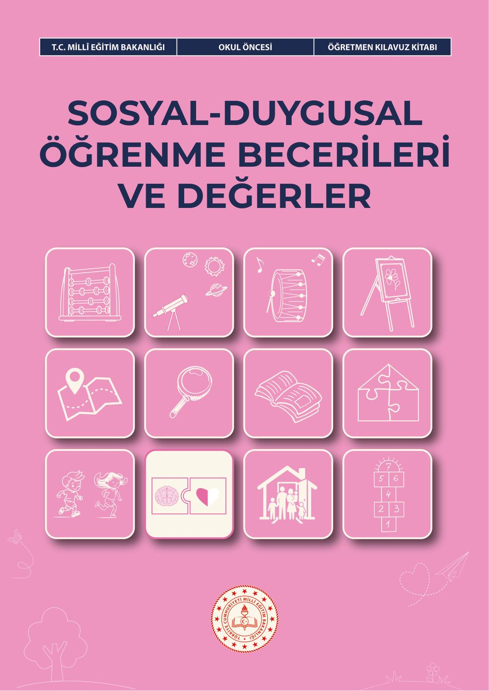

<!-- sayfa 1 -->

Verdiğiniz metin katmanı boş olduğu için (`<<< >>>` arasında herhangi bir içerik bulunmuyor) dönüştürülecek bir veri mevcut değildir. Lütfen metin katmanını içeren içeriği paylaşın, böylece talimatlarınıza uygun şekilde Markdown formatına çevirebilirim.

<!-- sayfa 2 -->

OKUL ÖNCESİ

# Sosyal-Duygusal Öğrenme Becerileri ve Değerler Öğretmen Kılavuz Kitabı

## Yazarlar
AYŞE ÇULCU
BETÜL SÜREK
DİDEM EROL
DİREN KILAV
İLKAY CAN
MERVE ÖZTEMİR
NEŞE AŞKAR
NİHAL AKIN TAKCI
ZEHRA GÜNEYSU

DEVLET KİTAPLARI

<!-- sayfa 3 -->

Millî Eğitim Bakanlığı Yayınları ................................................................................................................ 11238
Ders Kitapları Dizisi No........................................................................................................................... 2665

Her hakkı saklıdır ve Millî Eğitim Bakanlığına aittir. Kitabın metin, soru ve şekilleri kısmen de olsa hiçbir surette alınıp yayımlanamaz.

**Editör**
Prof. Dr. Ramazan SAK
Doç. Dr. Fatma Özge ÜNSAL AKSEBZECİ
Doç. Dr. Nevra ATIŞ AKYOL

**Dil Uzmanı**
Hatice MÜLKOĞLU

**Görsel Tasarımcı**
Metin BİLAL

**Çoklu Ortam Tasarımcısı**
Büşra Nur DURAN YILMAZ
Ezgi AVCI AŞIR
Kübra KARAKUŞ
Yudum CAN

**Program Geliştirme Uzmanı**
Hilal ALTINTAŞ

**Ölçme ve Değerlendirme Uzmanı**
Merve ERELİ

**Rehberlik Uzmanı**
Emine SAYAN

ISBN
978-625-8867-33-6

<!-- sayfa 4 -->

# İSTİKLÂL MARŞI

Korkma, sönmez bu şafaklarda yüzen al sancak;
Sönmeden yurdumun üstünde tüten en son ocak.
O benim milletimin yıldızıdır, parlayacak;
O benimdir, o benim milletimindir ancak.

Çatma, kurban olayım, çehreni ey nazlı hilâl!
Kahraman ırkıma bir gül! Ne bu şiddet, bu celâl?
Sana olmaz dökülen kanlarımız sonra helâl.
Hakkıdır Hakk'a tapan milletimin istiklâl.

Mehmet Âkif Ersoy

<!-- sayfa 5 -->

ANDIMIZ

Türküm, doğruyum, çalışkanım.

İlkem küçüklerimi korumak, büyüklerimi saymak; yurdumu, milletimi özümden çok sevmektir.
Ülküm yükselmek, ileri gitmektir.

Ey Büyük Atatürk!

Açtığın yolda, gösterdiğin hedefe durmadan yürüyeceğime ant içerim.

Varlığım Türk varlığına armağan olsun.

Ne mutlu Türküm diyene!

<!-- sayfa 6 -->

MUSTAFA KEMAL ATATÜRK

<!-- yer tutucu bulunamadı: sayfa sonuna eklendi -->

<!-- sayfa 7 -->

Verdiğiniz metin katmanı boş olduğu için (`<<< >>>` arası boş) dönüştürülecek bir içerik bulunmamaktadır. Lütfen metin katmanını içeren içeriği paylaşın, böylece talimatlarınıza uygun şekilde Markdown formatına çevirebilirim.

<!-- sayfa 8 -->

# İÇİNDEKİLER

| | |
| :--- | ---: |
| GİRİŞ | 9 |
| ERDEM: DEĞER-EYLEM ÇERÇEVESİNE İLİŞKİN ESASLAR | 13 |
| ETKİNLİKLERDE SOSYAL-DUYGUSAL ÖĞRENME BECERİLERİ VE DEĞERLERİN ALAN BECERİLERİYLE İLİŞKİLENDİRİLMESİ | 16 |
| SOSYAL-DUYGUSAL ÖĞRENME BECERİLERİ VE DEĞERLERİN ALANI ETKİNLİK ÖRNEKLERİ | 18 |
| &nbsp;&nbsp;&nbsp;&nbsp;Ne Hissediyorsun? | 18 |
| &nbsp;&nbsp;&nbsp;&nbsp;Duygu Kartlarım | 20 |
| &nbsp;&nbsp;&nbsp;&nbsp;Kovadan Kovaya | 23 |
| &nbsp;&nbsp;&nbsp;&nbsp;Aynı Durum Farklı Duygu | 25 |
| &nbsp;&nbsp;&nbsp;&nbsp;Sandalyeler Nerede? | 27 |
| &nbsp;&nbsp;&nbsp;&nbsp;Sınıf Ağacımız | 29 |
| &nbsp;&nbsp;&nbsp;&nbsp;Merak Panosu | 34 |
| &nbsp;&nbsp;&nbsp;&nbsp;Arkadaşım Ayna | 36 |
| &nbsp;&nbsp;&nbsp;&nbsp;Duygu Köprüsü | 39 |
| &nbsp;&nbsp;&nbsp;&nbsp;Haydi, Gel Arkadaşım | 43 |
| &nbsp;&nbsp;&nbsp;&nbsp;Nezaketle Uyan | 46 |
| &nbsp;&nbsp;&nbsp;&nbsp;Ortak ve Farklı Yönlerimiz | 49 |
| &nbsp;&nbsp;&nbsp;&nbsp;Davranıştan Duyguya | 52 |
| &nbsp;&nbsp;&nbsp;&nbsp;Değerlerim En Büyük Hazinelerim | 57 |
| &nbsp;&nbsp;&nbsp;&nbsp;Duygu Eşleştirme | 60 |
| &nbsp;&nbsp;&nbsp;&nbsp;Müzik Aletim | 62 |
| &nbsp;&nbsp;&nbsp;&nbsp;Duygu Kolajı | 64 |
| &nbsp;&nbsp;&nbsp;&nbsp;Yeni Bir Eve Taşınmak | 67 |
| &nbsp;&nbsp;&nbsp;&nbsp;Haksızlık | 70 |
| &nbsp;&nbsp;&nbsp;&nbsp;Okulum İçin Bir Çözümüm Var | 72 |
| &nbsp;&nbsp;&nbsp;&nbsp;Kuşları Besliyorum | 75 |
| &nbsp;&nbsp;&nbsp;&nbsp;Dur-Bak-Onar | 81 |
| &nbsp;&nbsp;&nbsp;&nbsp;Sözünde Duran Kahraman | 84 |
| &nbsp;&nbsp;&nbsp;&nbsp;Buğday Tanesinden Ekmeğe | 87 |
| &nbsp;&nbsp;&nbsp;&nbsp;Fillerin Ayak Sesi | 90 |
| &nbsp;&nbsp;&nbsp;&nbsp;Sınıfımızın Türküsü | 92 |
| &nbsp;&nbsp;&nbsp;&nbsp;Benim Aile Ağacım | 96 |
| &nbsp;&nbsp;&nbsp;&nbsp;Sınıf Kuralları | 98 |
| &nbsp;&nbsp;&nbsp;&nbsp;Otoportrem | 101 |

<!-- sayfa 9 -->

| | |
| :--- | :--- |
| Güçlü Yönlerim | 104 |
| Duygunu Dönüştür | 107 |
| Çıt Çıt Çıtırık | 113 |
| Temizlik Kahramanları | 116 |
| Kitabım Benim Sorumluluğumda | 118 |
| Çizgilerle Duygular | 120 |
| Gün Çiçeği | 122 |
| İletişim Oyunu | 124 |
| Benim-Senin | 126 |
| Çöpçü Karga ve Şaşkın Zebra | 128 |
| Çekirdek | 131 |
| Böcek Oteli Neden Sessiz? | 134 |
| Mektubumuz Var | 138 |
| Balıklar Sabreder mi? | 141 |
| Sabırla Büyüyen Mercimekler | 143 |
| Birlikte Bak Birlikte Yap | 148 |
| Afet Afacanı | 150 |
| Haklarımı Anlatıyorum | 155 |
| İletişim Engelleri | 161 |
| Okul Kahramanları Görevde | 165 |
| Ben de Okulumun Bir Parçasıyım | 168 |
| Nezaket ile Peksimet | 172 |
| Benim Ülkem Türkiye | 175 |
| KAYNAKÇA | 177 |
| GÖRSEL VE GENEL AĞ KAYNAKÇASI | 177 |
| TÜRKİYE’NİN MÜLKİ İDARE BÖLÜMLERİ İLE KARA VE DENİZ KOMŞULARI HARİTASI | 178 |
| TÜRK DÜNYASI HARİTASI | 179 |

<!-- sayfa 10 -->

# GİRİŞ

Sosyal-duygusal öğrenme becerileri, çocukların günlük yaşamlarında ve sosyal ilişkilerinde ihtiyaç duydukları temel becerilerdir. Bu beceriler; çocukların toplumsal hayata uyum sağlamalarını, duygusal gelişimlerini desteklemelerini ve iyi alışkanlıklar kazanmalarını desteklemektedir. Çocukların akranları ve yetişkinlerle sağlıklı ve etkili iletişim kurabilmeleri için gerekli becerilerin kazandırılması, TYMM Okul Öncesi Eğitim Programı’nın temel amaçları arasında yer almaktadır. TYMM Okul Öncesi Eğitim Programı’nda sosyal-duygusal öğrenme (SDÖB) becerileri üç başlık altında ele alınmaktadır.

**Benlik Becerileri:** Çocuğun kendi duygu ve düşüncelerinin farkında olması, duygu ve düşüncelerini uygun biçimde ifade edebilmesi, davranışlarını değerlendirebilmesi ve karşılaştığı durumlara sağlıklı tepkiler verebilmesi ile ilişkilidir. Program kapsamında bu beceriler, benlik becerileri kendini tanıma ve kendini düzenleme becerileri olarak sınıflandırılmıştır.

**Sosyal Yaşam Becerileri:** Bireyin toplumsal hayata etkin olarak katılabilmek ve günlük hayatta karşılaştığı problemlerin üstesinden gelebilmek için kullandığı becerileri ifade etmektedir. Bu beceriler; iletişim, iş birliği becerisi ve sosyal farkındalık becerileridir. Bu beceriler; çocukların duygularını tanıma ve yönetme, başkalarının duygularını anlama ve empati kurma, sağlıklı ilişkiler geliştirme ve sürdürme, sorumluluk alma ve doğru kararlar verme becerilerini güçlendirir. Bu sayede çocuklar stresle başa çıkma, iş birliği yapma ve problem çözme becerilerinde daha yetkin hâle gelir. Program kapsamında bu beceriler; iletişim, işbirliği, sosyal farkındalık becerileri olarak sınıflandırılmıştır.

**Ortak / Birleşik Beceriler:** Çocuğun değişen çevre koşullarına uyum sağlamasını, kendisi ve çevresi arasında dengeli bir ilişki kurmasını ve karşılaştığı problemlere farklı çözüm yolları geliştirebilmesini ifade etmektedir. Bu beceriler aynı zamanda çocuğun farklı durumlarda davranışlarını ve sosyal etkileşimlerini bilinçli ve yapıcı şekilde yönlendirebilmesini desteklemektedir. Program kapsamında bu beceriler uyum ve sorumlu karar verme becerileri olarak sınıflandırılmıştır.

**Öğretmenler İçin Notlar**

Sosyal-duygusal öğrenme becerileri TYMM’de öğrenme sürecinin tamamına yayılan ve gelişimi bütüncül olarak destekleyen temel bir yapıdır. Bu beceriler tüm öğrenme etkinliklerinin doğal bir bileşeni olarak ele alınmalıdır. Bu doğrultuda sosyal-duygusal öğrenme becerilerinin alan becerileri ve değerlerle birlikte etkinliklerin içerisinde verilmesi gerekmektedir. Böylece öğrenme süreci akademik gelişimin yanı sıra sosyal ve duygusal gelişimi de kapsayan bütüncül bir yapıya dönüşür.

TYMM’nin bütüncül ve çocukta davranış değişikliğini destekleyen yapısı uygulanırken özellikle dikkat edilmesi gereken noktalardan biri SDÖB becerilerinin çocuklara kazandırılmasında bu becerilere ait süreç bileşenlerinin etkinlik içerisinde kapsamlı ve amaçlı biçimde ele alınmasıdır. Örneğin herhangi bir alanda gerçekleştirilen bir etkinliğin akışında çocukların iletişim kuruyor olması, tek başına o etkinlikte SDÖB kapsamında iletişim becerisinin ele alındığı anlamına gelmemektedir. Bir SDÖB becerisinin ele alınabilmesi için etkinlik sürecinin ilgili beceriyi geliştirecek ve güçlendirecek öğrenme deneyimlerini içerecek biçimde bilinçli olarak yapılandırılması gerekmektedir.

## 2.1. BENLİK BECERİLERİ (SDB1)

**Dikkat Edilmesi Gereken Önemli Noktalar**

Benlik becerilerinin geliştirilmesinde çocukların kendilerini tanımalarına fırsat verilmesi önemlidir. Çocukların kendi özelliklerini ifade etmeleri, güçlü ve gelişime açık yönlerini fark etmeleri, kendini tanıma (öz farkındalık) becerisinin temelini oluşturur. Bu süreçte öğretmenin açık uçlu sorular sorması, çocukların kendilerini ifade etmelerine fırsat vermesi ve yargılayıcı olmayan bir tutum sergilemesi önerilir.

Benlik becerilerinden kendini düzenleme (öz düzenleme) becerileri, erken çocukluk döneminde yetişkin rehberliği ile gelişen bir süreçtir. Okul öncesi eğitim döneminde çocukların duygularını tanımaları ve isimlendirmeleri, duygularını düzenleme yöntemlerini (nefes alma, mola verme, dikkat yönlendirme vb.)

<!-- sayfa 11 -->

sahiptir. Bu nedenle öğretmenlerin çocukların olaylar ve durumlarla ilgili alternatif düşünceleri kullanma konusunda rehberlik etmesi gerekmektedir. Örneğin örnek olaylar karşısında farklı düşünceler üretme, faydalı ve faydasız düşünceleri belirleme çalışmaları yapılabilir. Çocukların düşünce ve davranışlarını düzenleme becerileri; planlama yapma, hedef belirleme, isteklerini erteleme gibi süreçleri içermektedir. Bu beceriler, yürütücü işlevlerin gelişimi ile doğrudan ilişkilidir. Öğretmenlerin çocuklara seçim yapma, plan oluşturma ve süreçleri değerlendirme fırsatı sunmaları bu becerilerin gelişimini destekler. Ayrıca çocukların duyguları, düşünceleri ile davranışları arasındaki ilişkiyi fark etmeleri, davranışlarını kontrol etmeleri açısından önemlidir. Çocukların kendilerini düzenleme becerilerini desteklemek için öğretmenlerin, çocukların duygularını anlaması ve onlara davranışlarını düzenleyebilmelerinde yöntemler sunması önerilir.

**Sınıf İçi Uygulama Önerileri**

Sınıfta “duygu köşesi” oluşturabilirsiniz. Bu köşede farklı duygu ifadelerini gösteren görseller bulundurabilirsiniz ve çocukların gün içinde hissettikleri duyguyu seçmelerine fırsat verebilirsiniz. Çocukların seçtikleri duyguları, nedenleriyle ifade etmelerine fırsat vererek duygu farkındalıklarının ve ifade becerilerinin gelişimini destekleyebilirsiniz.

“Bugün Nasıl Hissediyorum?” etkinliği düzenleyebilirsiniz. Çocuklardan güne başlama zamanında çocuklarla o günkü duygular hakkında sohbet edebilirsiniz. Sürece kendi duygularınızı ifade ederek başlamanız çocukların katılımını artıracaktır. Her gün mutlu hissedemeyeceğimizi bilmek, farklı duyguları tanımak ve kabul etmek açısından önemlidir. 36–48 aylık çocuklar duygularını işaret ederek 60–72 aylık çocuklar ise sözel olarak açıklayabilir. Bu süreçte çocukların beden dilini gözlemleyerek ve ifadelerini dikkatlice dinleyerek onları ve duygularını kabul edici bir tutum sergilemeniz önemlidir.

Ayna etkinlikleri ile çocukların kendilerini tanımalarını destekleyebilirsiniz. “Kendinde en çok neyi seviyorsun?” gibi sorularla öz farkındalık geliştirilebilir. Çocuğun verdiği yanıtlara olumlu geri bildirim vererek güçlü yönlerini fark etmesine ve olumlu bir benlik algısı geliştirmesine rehberlik edebilirsiniz.

Günlük rutinlerde çocuklara seçim yapma fırsatları sunmak çocukların benlik becerilerini destekler. Çocuklar ilgileri, ihtiyaçları ve istekleri doğrultusunda seçim yaptıklarında, kendilerini tanıma ve kendilerini düzenleme becerileri desteklenirken aynı zamanda öğrenme süreçleri de desteklenmektedir.

Duygu düzenleme becerilerini geliştirmek için “nefes egzersizleri”, “sakinleşme köşesi” gibi farklı uygulamalar planlayabilirsiniz. Bu uygulamalar sırasında çocuğa eşlik ederek duygusunu yatıştırmasına rehberlik etmek, zamanla kendi kendini düzenleme becerisini geliştirmesine katkıda bulunur. Duygu düzenleme stratejilerinde duygu termometresi, kum saati gibi somut materyaller kullanmak çocukların süreçlerini kolaylaştıracaktır.

## 2.2. SOSYAL YAŞAM BECERİLERİ (SDB2)

**Dikkat Edilmesi Gereken Önemli Noktalar**

Sosyal yaşam becerilerinin gelişiminde iletişim, iş birliği ve sosyal farkındalık temel bileşenlerdir. Etkili iletişim becerilerinin gelişebilmesi için çocukların dinleme, konuşma sırasını bekleme, göz teması kurma, uygun geri bildirim verme gibi davranışları edinmeleri gerekmektedir. Bu süreçte öğretmenin rol model olması ve sınıf içinde güvenli bir iletişim ortamı oluşturması önerilir. Bu becerilerin gelişimi için örnek olaylar ve drama etkinliklerinin kullanımı faydalı olacaktır.

Sosyal yaşam becerilerinden iş birliğibecerisi, çocukların ortak hedefler doğrultusunda birlikte hareket etmelerini gerektirir. Grup etkinlikleri sırasında görev paylaşımı yapma, kurallara uyma ve uzlaşma sağlama becerileri desteklenmelidir. Okul öncesi eğitim döneminde çocukların gelişimsel ve bireysel özelliklerine göre iş birliğine dayalı etkinliklerin planlanması önerilir.

Sosyal yaşam becerilerinden sosyal farkındalık becerileri, çocukların başkalarının duygularını anlama, farklılıklara saygı duyma ve toplumsal kurallara uyum sağlama süreçlerini kapsar. Çocukların sosyal ipuçlarını fark etmeleri, empati kurmaları ve farklı bakış açılarını anlamaları için hikâye, drama ve tartışma etkinliklerinden yararlanılabilir.

<!-- sayfa 12 -->

düzenlenebilir. Konuşma hakkı yalnızca topu tutan çocuğa verilir. Böylece çocukların sırasını beklemesi ve karşılıklı konuşma kurallarını benimsemesi desteklenir. Bu süreçte çocukların birbirini sabırla dinlemelerine ve konuşma sırasına saygı göstermelerine dikkat edilmelidir.

“Arkadaşım Ne Hissediyor?” etkinliği düzenlenebilir. Hikâye veya görseller üzerinden karakterlerin duygularını tahmin etmelerini isteyebilirsiniz. Bu süreçte çocukların yüz ifadelerini gözlemleyerek duyguları tahmin etmeleri desteklenir ve empati becerileri güçlendirilir.

Sınıfta iş birliğine dayalı oyunlar planlayabilirsiniz. Grup çalışmaları ve ortak ürün oluşturma etkinlikleri çocukların iş birliği becerilerini destekler. Bu süreçte çocukların görev paylaşımı yapmalarına, birbirlerinin fikirlerine saygı göstermelerine dikkat edilmelidir. Özellikle çekingen çocukların grup çalışmalarında aktif rol alabilmesi için öncelikli olarak küçük grup çalışmaları önerilir.

“Sorun Çözen Küçük Grup” etkinliği düzenleyebilirsiniz. Basit sınıf veya çevre sorunları (temizlik, düzen, paylaşım vb.) ele alınarak çocukların çözüm önerileri üretmeleri istenir. Bu süreçte çocukların yaşadıkları topluma katkıda bulunan davranışlar geliştirmeleri desteklenir.

## 2.3. ORTAK / BİRLEŞİK BECERİLER

**Dikkat Edilmesi Gereken Önemli Noktalar**

Ortak / birleşik beceriler kapsamında yer alan uyum ve sorumlu karar verme, çocukların değişen durumlara esnek tepkiler verebilmelerini ve problem çözme becerilerini geliştirmelerini sağlar. Çocukların yeni durumlara uyum sağlamaları, alternatif çözüm yolları üretmeleri ve davranışlarının sonuçlarını fark etmeleri desteklenmelidir. Bu süreçte öğretmenin rehberlik edici bir rol üstlenmesi ve çocuklara düşünme fırsatı sunması önerilir.

Ortak / birleşik becerilerden sorumlu karar verme becerisi, çocukların karşılaştıkları problemleri tanımlamaları, çözüm yolları üretmeleri ve davranışlarının sonuçlarını değerlendirmeleri ile ilişkilidir. Öğretmenler, çocuklara günlük yaşamdan problem durumları sunarak onların neden-sonuç ilişkisi kurmalarını ve alternatif çözümler geliştirmelerini destekleyebilir.

Sosyal-duygusal öğrenme becerileri ile değerlerin bütünleşik olarak ele alınması önemlidir. Değerler, çocukların davranışlarını yönlendiren içsel motivasyon kaynaklarıdır. Bu nedenle öğretmenlerin saygı, sorumluluk, yardımseverlik, sabır, dürüstlük gibi değerleri günlük yaşam içinde modellemeleri ve çocukların bu değerleri deneyimlemelerine fırsat vermeleri önerilir.

Değerlendirme sürecinde çocukların gelişimleri, süreç bileşenleri ve göstergeler doğrultusunda gözlemlenmelidir. Çocukların performansları karşılaştırılmamalı, bireysel gelişimleri dikkate alınarak destekleyici geri bildirimler verilmelidir. Özellikle erken çocukluk döneminde değerlendirme, ürün odaklı değil süreç odaklı ele olmalıdır. Bu nedenle çocukların SDÖB becerilerinin desteklenebilmesi için çocukların öğrenme süreçlerindeki çabaları, sabırları, sorumluluklarını yerine getirme süreçleri ve ilerlemeleri üzerinden olumlu geri bildirimler verilmesi önerilir. Özellikle her çocuğun güçlü yönüne odaklanmak ve bunu vurgulamak önemlidir.

**Sınıf İçi Uygulama Önerileri**

Kuralları değişen oyunlar ile esneklik becerisi geliştirilebilir. Örneğin sınıfta “Değişim Kartları” etkinliği planlanabilir. Çocuklara günlük yaşamdan farklı ve değişen durumları içeren görseller sunularak (sınıf düzeninin değişmesi, yeni bir etkinliğin eklenmesi vb.) bu durumları fark etmeleri sağlanır. Bu süreçte çocukların yeni veya değişen durumları ifade etmeleri ve yaşadıkları zorlukları açıklamaları desteklenir.

Çocukların günlük yaşamda karşılaştıkları basit problem durumlarını fark etmelerine yönelik uygulamalar planlanabilir. Hikâye tamamlama, resimli olay kartları ve drama etkinlikleri aracılığıyla çocukların “Ne oldu?”, “Neden oldu?”, “Sonuçta ne olur?” gibi sorular üzerinden düşünmeleri desteklenebilir. Bu süreçte öğretmenin yönlendirici sorularla çocuğa eşlik etmesi, problem durumunu fark etmesine ve neden-sonuç ilişkisi kurmasına yardımcı olur.

“Sen Olsan Ne Yapardın?” etkinlikleriyle çocuklara günlük yaşamdan farklı durum ve senaryolar sunarak çocukların olayları farklı açılardan değerlendirmelerini olası çözüm yolları üzerinde düşünmelerini ve kendi

<!-- sayfa 13 -->

# Sosyal-Duygusal Öğrenme Becerilerinin İzlenmesi ve Değerlendirilmesi

Sosyal-duygusal öğrenme becerilerinin değerlendirilmesi, çocukların süreç içerisindeki gelişimlerini izlemeye ve bu gelişimi desteklemeye yönelik olarak ele alınmalıdır. Bu değerlendirme çocukların duygu, düşünce ve davranışlarını nasıl anlamlandırdıklarını ortaya koyan süreç odaklı bir yaklaşımı gerektirir. Değerlendirme sürecinde çocukların kendilerini ifade etmelerine fırsat tanınmalı, farklı ifade biçimleri (jest, mimik, sözlü ifade, resim vb.) desteklenmeli ve yargılayıcı olmayan bir dil kullanılmalıdır. Ayrıca değerlendirme uygulamaları, çocukların öz farkındalık, öz düzenleme, sosyal farkındalık, iletişim ve sorumlu karar verme becerilerini geliştirecek şekilde yapılandırılmalıdır.

“Duygu Termometresi” etkinliği kullanılarak etkinlik sonunda çocukların kendilerini nasıl hissettiklerini ifade etmeleri sağlanabilir. Çocuklar uygun yüz ifadelerini seçerek ya da işaretleyerek duygularını gösterebilirler. Daha küçük yaş gruplarında jest ve mimiklerle ifade yeterli kabul edilirken, 60-72 aylık çocuklardan duygularını sözlü olarak açıklamaları da beklenebilir. Bu uygulama, çocukların duygu farkındalıklarını geliştirmelerine katkıda bulunur.

Gün sonunda değerlendirme çemberleri oluşturularak çocukların gün içinde yaşadıkları deneyimleri paylaşmaları desteklenebilir. “Bugün en çok neyi sevdin?”, “Bir arkadaşına nasıl yardımcı oldun?”, “Seni en mutlu eden an neydi?” gibi sorularla çocukların hem yaşantılarını hatırlamaları hem de sosyal-duygusal deneyimlerini ifade etmeleri sağlanabilir. Bu süreç, çocukların öz değerlendirme yapmalarını ve sosyal etkileşimlerini fark etmelerini destekler.

“Değer Kartları” etkinliği ile çocukların gün içinde sergiledikleri davranışları belirli değerlerle ilişkilendirmeleri sağlanabilir. Örneğin bir arkadaşına yardım eden çocuk, bu davranışını “yardımseverlik” değeri ile eşleştirebilir. Bu tür eşleştirmeler, çocukların soyut değer kavramlarını somut davranışlarla ilişkilendirmelerine yardımcı olur ve değerlerin içselleştirilmesini destekler.

Akran geri bildirimi etkinlikleri düzenlenerek çocukların birbirlerinin olumlu davranışlarını fark etmeleri ve ifade etmeleri sağlanabilir. Örneğin “Bugün arkadaşında hoşuna giden bir davranış neydi?” gibi sorular yöneltilerek çocukların sosyal farkındalıklarının gelişmesi desteklenir. Bu etkinlikler, sınıf içinde olumlu bir iletişim ortamı oluşmasına katkıda bulunur.

60-72 aylık çocuklarla davranışların sonuçlarını değerlendirmeye yönelik daha derinlemesine sohbetler yapılabilir. “Bu davranışın arkadaşını nasıl hissettirmiş olabilir?”, “Farklı bir şekilde davransaydın ne olurdu?” gibi sorularla çocukların neden-sonuç ilişkisi kurmaları, empati geliştirmeleri ve sorumlu karar verme becerileri desteklenir.

Değerlendirme sürecinde çocukların kendilerini ifade etmeye zorlanmamasına özen gösterilmeli ve her çocuğun gelişim düzeyi dikkate alınmalıdır. Süreç boyunca çocukların olumlu davranışları fark edilerek pekiştirilmeli, gelişimlerini destekleyici geri bildirimler verilmelidir. Bu yaklaşım, çocukların sosyal-duygusal öğrenme becerilerini kalıcı bir şekilde geliştirmelerine katkıda bulunur.

Öğretmenler SDÖB becerilerinin süreç değerlendirmesinde çocukların ihtiyaçları doğrultusunda her çocuk için farklı zamanlarda tekrarlayan planlı gözlemler yaparak gözlem kayıtları tutmalıdır. Ayrıca farklı çocuğu değerlendirme araçlarından yararlanarak SDÖB becerilerindeki değişimleri kayıt altına almalıdır.

<!-- sayfa 14 -->

# ERDEM: DEĞER-EYLEM ÇERÇEVESİNE İLİŞKİN ESASLAR

“Erdem: değer-eylem çerçevesi”, okul öncesi eğitim sürecinde değerlerin planlı ve sistemli bir şekilde ele alınmasını sağlayan temel bir yaklaşımdır. Bu çerçeve, çocukların değerleri yalnızca tanımalarını değil aynı zamanda bu değerleri davranışa dönüştürmelerini hedeflemektedir. Eğitim sürecinde değerlerin sosyal-duygusal öğrenme becerileriyle bütünleşik olarak ele alınması, çocukların hem bireysel hem de toplumsal gelişimlerini desteklemektedir.

Türkiye Yüzyılı Maarif Modeli Okul Öncesi Eğitim Programı’nda değerler, günlük planlama süreçlerinden sınıf içi uygulamalara kadar geniş bir çerçevede ele alınmakta; öğretim sürecinin doğal bir parçası olarak çocukların yaşantılarıyla bütünleştirilmektedir. Bu yaklaşım, değerlerin kalıcı ve anlamlı öğrenmelere dönüşmesini sağlamaktadır.

İnsanın sosyal ve fiziksel çevresiyle ilişkilerinde olumlu kişilik özelliklerinin ortaya çıkmasını sağlayan değer; insan, toplum ve çevre açısından gerekli bir yapıdır. Türkiye Yüzyılı Maarif Modeli Okul Öncesi Eğitim Programı, millî manevi ve kültürel değerlerin önemini vurgulamaktadır. Bu değerlerin okul öncesi dönemden itibaren kazandırılması hedeflenmektedir. Türkiye Yüzyılı Maarif Modeli Okul Öncesi Eğitim Programı’ndaki değerler Türkiye Yüzyılı Maarif Modeli’nde kullanılan “erdem: değer-eylem çerçevesi”ne göre belirlenmiştir. Bu çerçevenin ana amacı, “Huzurlu Aile ve Toplum” ile “Huzurlu İnsanlar için Yaşanabilir Çevre” oluşturmaktır.” Erdem: değer-eylem çerçevesi”nde çatı değerler etrafında kümelenen bir değer çerçevesi sunulmaktadır. Türkiye Yüzyılı Maarif Modeli Okul Öncesi Eğitim Programı’nda adalet, aile bütünlüğü, çalışkanlık, dostluk, duyarlılık, dürüstlük, estetik, mahremiyet, merhamet, mütevazılık, özgürlük, sabır, sağlıklı yaşam, saygı, sevgi, sorumluluk, tasarruf, temizlik, vatanseverlik, yardımseverlik olmak üzere yirmi adet değer bulunmaktadır.

**Adalet:** Hak ve özgürlükleri, eşitliği, etik davranmayı, hakkaniyeti, ön yargısızlığı, ölçülülüğü ve liyakati kapsar.

**Aile Bütünlüğü:** Aile içi iletişim ve iş birliğini güçlendirmeyi, ailede sorumlulukları yerine getirmeyi, aileyle vakit geçirmeyi; saygı, sevgi ve güvene dayalı ilişkiler kurmayı kapsar. Bu değerin edinimi ve ilgili eylemlerin takibinde ailelerle iş birliği esastır.

**Çalışkanlık:** Disiplinli, planlı ve istikrarlı olmayı; bilimselliğe önem vermeyi, iç motivasyon ve öz denetim sahibi olmayı, hayat boyu öğrenmeyi, görev ve sorumluluk üstlenmeyi kapsar.

**Dostluk:** Sosyal ilişkilerde duyarlılık göstermeyi dayanışma içinde olmayı; etkili iletişimle sevgi, saygı ve güvene dayalı ilişkiler kurmayı; nitelikli vakit geçirmeyi ve evrensel bağ kurmayı kapsar.

**Duyarlılık:** Kendisine, içinde yaşadığı topluma, kültürel zenginliklere, tüm varlıklara değer vermeyi; sürdürülebilirliği önemsemeyi ve afetlere karşı hazırlıklı olmayı kapsar.

**Dürüstlük:** Söz ve davranışlarında tutarlı, doğru ve güvenilir olmayı kapsar.

**Estetik:** Sanatsal bakış açısı kazanmayı, sanatsal ve kültürel varlığı koruyup zenginleştirmeyi, doğal güzelliklerin ve çevrenin korunması ile ilgili duyarlı olmayı ve sorumluluk üstlenmeyi, estetik aracılığıyla özgün üretkenliği ve ruhsal gelişimi desteklemeyi, sanatı hayatın bir parçası hâline getirmeyi kapsar.

**Mahremiyet:** Kendisinin, ailesinin ve başkalarının kişisel alanını ve bilgilerini korumayı; başkalarının özgürlüklerini ihlal etmemeyi, kişisel sınırlarına saygı duymayı ve millî ve manevi değerlerde mahremiyetin sınırlarını kapsar.

**Merhamet:** İnsanlara ve diğer canlılara karşı vicdanlı, şefkatli, sevgi dolu, duyarlı ve sorumlu olmayı kapsar.

**Mütevazılık:** Kendini bilmeyi; gösterişten ve kibirden uzak, sade, sabırlı, saygılı, duyarlı ve yapıcı olmayı kapsar.

**Özgürlük:** Cesur, girişimci ve kararlı olmayı; özgürlüklerini kullanırken kişisel ve toplumsal haklara saygı göstermeyi, kapsar.

**Sabır:** Olumlu bakış açısına olmayı, zor ve kötü durumlara karşı dayanmayı, istikrarlı davranmayı, süreci yönetmeyi, sorumlulukları yerine getirmeyi; duygu, düşünce ve eylemleri kontrol etmeyi kapsar.

**Sağlıklı Yaşam:** Yeterli, dengeli ve sağlıklı beslenmeyi; sosyal ve sportif etkinliklere katılmayı, bağımlılıktan kaçınmayı, bağımlılıkla mücadele etmeyi ve insan sağlığını önemsemeyi kapsar.

**Saygı:** Nazik olmayı ilkeli davranmayı empati ve etkili iletişim kurmayı sağlıklı yaşamayı; kendisine çevresine

<!-- sayfa 15 -->

**Sevgi:** Ailesine, dostlarına ve ülkesine karşı vefalı, dürüst, sadık ve özverili olmayı; barışçıl bakış açısına sahip olmayı; misafirperverliği, doğaya ve bütün canlılara karşı merhametli davranmayı kapsar.

**Sorumluluk:** Kendisine ve çevresine karşı görevlerini tam ve zamanında yerine getirmeyi; duygu, düşünce ve eylemlerinin sonucunu kabul etmeyi kapsar.

**Tasarruf:** Maddi kaynakları planlı ve kontrollü harcamayı, israftan kaçınmayı, tutumlu olmayı, birikim yapmayı, sahip olduklarının değerini bilmeyi ve bilinçli tüketici olmayı kapsar.

**Temizlik:** Kişisel temizlik ve bakıma dikkat ederek kendisine ve topluma saygı duymayı, yaşadığı ortamın ve çevrenin temizliğine önem vererek toplumdaki genel yaşam kalitesine ve sürdürülebilirliğe katkıda bulunmayı kapsar.

**Vatanseverlik:** Millî, manevi, insani, kültürel değerleri ve ülke varlıklarını korumayı, sevmeyi ve onlara saygı duymayı; bağımsızlığa önem vermeyi, ülkesi için sorumluluk almayı kapsar.

**Yardımseverlik:** İnsanlara ve canlılara duyarlı olmayı, onları sevmeyi, onlara merhamet etmeyi, cömertliği, dayanışmayı, fedakârlık yapmayı, iyiliksever olmayı kapsar.

Bu değerler, tek başına değil; sosyal-duygusal becerilerle ele alınarak çocukların bütüncül gelişimi desteklenmelidir.

### Öğretmenler İçin Rehber Notlar

* Değerlerin gelişiminin değerlendirilmesinde, çocukların belirli bir değere sahip olup olmadıklarına ilişkin yargıda bulunmak yerine değerlerin davranışlarına nasıl yansıdığı izlenmelidir. Bu davranışlar farklı zaman, durum ve yaşantılar içerisinde gözlemlenmelidir. Tek bir davranıştan hareketle değerlendirme yapılmamalı, gözlemler süreç içerisinde tekrarlanarak çocuğun gelişimi bütüncül biçimde ele alınmalıdır.
* Öğretmenler, çocukların değerleri davranışlarına yansıtma biçimlerini izlemek amacıyla planlı ve sistematik gözlemler yapmalıdır. Bu süreçte anekdot kayıtları, gözlem formları ve kısa gözlem notları gibi farklı araçlardan yararlanılabilir. Örneğin bir çocuğun arkadaşının ihtiyaç duyduğu bir durumda ona yardım etmesi, yardımseverlik değeriyle ilişkili bir davranış olarak kaydedilebilir. Benzer davranışların farklı durum ve zamanlarda ortaya çıkıp çıkmadığı süreç içerisinde izlenebilir.
* Değerlendirmede çocukları karşılaştıran, etiketleyen veya yargılayan ifadelerden kaçınılmalıdır. Bunun yerine çocuğun davranışını fark etmesini sağlayan ve gelişimini destekleyen geri bildirimler verilmelidir. Örneğin “Arkadaşına yardım ettiğini fark ettim.” veya “Arkadaşın konuşurken sıranı bekledin.” gibi ifadelerle gözlenen davranış çocuğa yansıtılabilir. Ardından “Sence arkadaşın bu durumda nasıl hissetmiş olabilir?” gibi sorular yöneltilerek çocuğun davranışı ve davranışının başkaları üzerindeki etkisi hakkında düşünmesi desteklenebilir.
* Günlük akış içerisinde kısa değerlendirme anları oluşturularak çocukların kendi davranışları üzerine düşünmelerine fırsat verilebilir. Gün sonunda “Bugün birine yardım ettiğin bir an oldu mu?”, “Bugün sabırlı olman gereken bir durum yaşadın mı?” veya “Bugün yaptığın hangi davranışın bir başkasını mutlu etmiş olabilir?” gibi sorular yöneltilebilir. Sorular çocukların yaş ve gelişim özelliklerine göre uyarlanmalıdır. Küçük yaş gruplarında çocukların yaşantılarını resim, jest, mimik veya sözel olmayan farklı yollarla ifade etmelerine de fırsat verilmelidir.
* Akranların birbirlerinin davranışlarını fark etmelerini sağlayan uygulamalara da değerlendirme sürecinde yer verilebilir ancak bu uygulamalarda çocukların birbirlerini değerlendirmelerinden veya karşılaştırmalarından kaçınılmalıdır. Bunun yerine belirli davranışların fark edilmesine odaklanılabilir. Örneğin “Bugün bir arkadaşının sana ya da başka birine yardım ettiği bir anı hatırlıyor musun?” sorusu yöneltilebilir. Böylece çocukların günlük yaşantılarında değerlerin davranışlara nasıl yansıdığını fark etmeleri desteklenebilir.
* Belirli aralıklarla yapılan bütüncül değerlendirmelerde farklı zamanlarda elde edilen gözlem ve kayıtlar birlikte ele alınmalıdır. Çocuğun gelişimindeki değişim, gösterdiği çaba ve değerleri günlük yaşantısına yansıtma biçimleri dikkate alınmalıdır. “Paylaşma konusunda daha istekli olmaya başladı.” veya

<!-- sayfa 16 -->

* Değerlendirme sonucunda elde edilen bilgiler yalnızca çocuğun mevcut durumunu belirlemek amacıyla kullanılmamalıdır. Öğretmen, bu bilgilerden hareketle çocukların hangi değerleri davranışlarına yansıtmakta daha fazla desteğe ihtiyaç duyduklarını belirlemeli ve sonraki öğrenme deneyimlerini buna göre planlamalıdır. Böylece değerlendirme, değerlerin gelişimini izleyen ve sonraki öğrenme-öğretme süreçlerine yön veren sürekli bir sürecin parçası hâline gelir.
* Değerlendirme sürecinin tamamında çocukların kendilerini güvende hissetmelerini sağlayan, gelişimlerini destekleyen ve yargılayıcı olmayan bir dil kullanılmalıdır. Bu yaklaşım, çocukların kendi davranışları üzerine düşünmelerini, değerlerin anlamını kavramalarını ve bu değerleri günlük yaşamlarına yansıtmalarını destekler.

## Sınıf İçi Uygulama Önerileri

Değerlerin edinimi sürecinde oyun ve çocuk merkezli öğrenme yaklaşımı temel alınmalıdır. Eğitsel oyunlar, drama, canlandırma ve hikâye anlatımı gibi yöntemler, çocukların değerleri deneyimleyerek öğrenmelerine olanak tanır. Örneğin “paylaşma oyunu” etkinliğinde çocukların oyuncakları sırayla kullanmaları sağlanarak yardımseverlik ve saygı değerleri desteklenebilir. Hikâye anlatımı sonrasında karakterlerin davranışları üzerine konuşularak “Bu davranış doğru muydu?”, “Sen olsaydın ne yapardın?” gibi sorularla çocukların değerler üzerine düşünmeleri sağlanabilir. Günlük yaşamda karşılaşılan durumlar da değer eğitimi için doğal öğrenme fırsatları olarak değerlendirilmelidir.

Sınıf içi etkinlikler planlanırken yakından uzağa, bilinenen bilinmeyene ve somuttan soyuta ilkeleri dikkate alınmalıdır. Değerlerin edinimi sürecinde öncelikle çocukların kendi yaşam deneyimlerinden yola çıkılması önemlidir.

Öğretmen, çocukların sosyal etkileşimlerini gözlemleyerek uygun anlarda rehberlik etmeli ve bu etkileşimleri değer eğitimi açısından değerlendirmelidir. Oyun sırasında ortaya çıkan paylaşma, sıra bekleme, iş birliği yapma gibi davranışlar desteklenerek değerlerin doğal bir şekilde öğrenilmesi sağlanabilir. Benzer şekilde bir anlaşmazlık durumunda çocuklara farklı çözüm yolları sunmaları için fırsat verilerek sorumluluk ve dürüstlük değerleri desteklenebilir.

İş birlikli öğrenme, proje çalışmaları, gezi-gözlem etkinlikleri ve örnek olay incelemeleri gibi yöntemler de değerlerin günlük yaşamla ilişkilendirilmesini destekler. Örneğin, birlikte hazırlanan bir sınıf projesinde çocuklara görev dağılımı yapılarak sorumluluk ve iş birliği değerleri geliştirilebilir. Doğa gezileri sırasında çevreyi koruma üzerine konuşularak duyarlılık ve temizlik değerleri desteklenebilir. Örnek olay incelemelerinde ise çocuklara günlük yaşamdan durumlar sunularak “Bu durumda ne yapardın?” sorusu ile adalet, saygı, yardımseverlik gibi değerler üzerine düşünmeleri sağlanabilir.

### Değerlerin Edinim Sürecinin İzlenmesi

Değerlerin edinim sürecinin değerlendirilmesinde, çocukların belirli bir değere sahip olup olmadıklarına ilişkin yargıda bulunmak yerine değerlerin davranışlarına nasıl yansıdığı farklı zaman, durum ve yaşantılar içerisinde izlenmelidir. Tek bir davranıştan hareketle değerlendirme yapılmamalı; gözlemler süreç içerisinde tekrarlanarak çocuğun gelişimi bütüncül biçimde ele alınmalıdır.

Karşılaştırma ve yargılama yerine, gelişimi destekleyici bir yaklaşım benimsenmelidir. Çocukların olumlu davranışları fark edilerek sözel olarak pekiştirilebilir. Örneğin, “Arkadaşına oyuncak verdiğin için çok düşünceli davrandın.” ya da “Sıranı beklediğin için sabırlı davrandın.” gibi ifadelerle çocukların sergiledikleri değer temelli davranışlar görünür hâle getirilebilir. Bu tür geri bildirimler, çocukların davranışlarının farkına varmalarını ve bu davranışları sürdürmelerini destekler.

Günlük akış içerisinde kısa değerlendirme anları oluşturularak çocukların kendi davranışlarını fark etmeleri sağlanabilir. Örneğin gün sonunda “Bugün hangi davranışınla arkadaşına yardımcı oldun?” ya da “Bugün hangi durumda sabırlı davrandın?” gibi sorular yöneltilerek çocukların öz değerlendirme yapmaları desteklenebilir. Daha küçük yaş gruplarında bu değerlendirmeler resim çizme, işaretleme veya jest-mimik yoluyla da gerçekleştirilebilir.

<!-- sayfa 17 -->

Akran geri bildirimine dayalı değerlendirmeler de sürece dâhil edilebilir. Örneğin çocuklardan “Bugün bir arkadaşında beğendiğin bir davranışı söyleyebilir misin?” sorusuna yanıt vermeleri istenerek, sınıf içinde olumlu davranışların fark edilmesi ve pekiştirilmesi sağlanabilir. Bu uygulama, çocukların hem sosyal farkındalıklarını hem de empati becerilerini destekler.

Dönem sonlarında yapılan değerlendirmelerde çocukların değerlerle ilgili gelişimleri bütüncül bir şekilde ele alınmalıdır. Bu süreçte çocukların gösterdiği ilerleme, çaba ve olumlu davranışlar ön plana çıkarılmalı, eksikliklerden çok gelişim alanlarına odaklanılmalıdır. Örneğin “Paylaşma konusunda daha istekli olmaya başladı.” ya da “Arkadaşlarının duygularını fark etmeye yönelik davranışlar gösteriyor.” gibi ifadeler tercih edilmelidir.

Değerlendirme sürecinde olumsuz ve yargılayıcı ifadelerden kaçınılmalı, çocukların öz güvenlerini destekleyen bir dil kullanılmalıdır. Bu yaklaşım, çocukların değerleri içselleştirmelerini kolaylaştırırken aynı zamanda kendilerini güvende hissettikleri bir öğrenme ortamı oluşmasına katkıda bulunur.

# ETKİNLİKLERDE SOSYAL-DUYGUSAL ÖĞRENME BECERİLERİ VE DEĞERLERİN ALAN BECERİLERİYLE İLİŞKİLENDİRİLMESİ

Okul öncesi eğitimde sosyal-duygusal öğrenme becerileri ile değerlerin etkinlikler içinde ele alınması, çocukların bu beceri ve değerleri anlamalarını, içselleştirmelerini ve günlük yaşamlarına aktarmalarını destekleyen etkili bir yaklaşımdır. Bu doğrultuda eğitim sürecinde Türkçe, matematik, fen, sosyal, hareket ve sağlık ile sanat ve müzik alan becerileri; sosyal-duygusal öğrenme becerileri ve değerlerle bütünleşik olarak ele alınmalıdır. Bu bütüncül yaklaşım, çocukların yalnızca bilişsel gelişimlerini değil aynı zamanda duygusal ve sosyal gelişimlerini de destekleyerek öğrenmenin daha kalıcı ve işlevsel olmasına katkıda bulunur. Bu nedenle sosyal-duygusal öğrenme becerileri ve değerler; etkinliğin sonunda kısa hatırlatmalar şeklinde değil çocukların aktif katılımını sağlayacak, deneyimleyerek öğrenmelerine fırsat verecek biçimde etkinliğin doğal akışı içerisinde planlanmalıdır.

Türkçe alan becerileri kapsamında dinleme / izleme, konuşma ve erken okuryazarlık becerileri desteklenirken sosyal-duygusal öğrenme becerileri ve değerler doğal bir şekilde sürece dâhil edilebilir. Örneğin bir hikâye dinleme etkinliği sırasında çocukların birbirlerini dikkatlice dinlemelerine fırsat verilmesi iletişim becerilerini desteklerken, söz almadan konuşmama ve arkadaşlarının düşüncelerine saygı gösterme davranışları aracılığıyla saygı ve dostluk gibi değerler de pekiştirilebilir. Hikâyedeki karakterlerin duygu ve düşünceleri üzerine konuşulması ise çocukların empati kurmalarını ve farklı bakış açılarını anlamalarını destekler. Böylece çocukların fikir alışverişinde bulunmaları, farklı görüşleri dinlemeleri ve kendi düşüncelerini ifade etmeleri hem sosyal etkileşimlerini güçlendirir hem de değerlerin yaşantı yoluyla öğrenilmesine katkıda bulunur.

Matematik alan becerileri kapsamında problem çözme süreçlerinde çocukların birlikte düşünmeleri, farklı çözüm yolları üretmeleri, karar vermeleri ve ortak bir sonuca ulaşmaları iş birliği, iletişim ve sorumluluk becerilerini geliştirirken sabır, adalet ve saygı gibi değerlerin deneyimlenmesine de fırsat sunar. Grup çalışmalarında çocukların sırayla işlem yapmaları, ortak materyalleri paylaşmaları, arkadaşlarının çözüm önerilerini dinlemeleri ve farklı çözüm yollarına saygı göstermeleri, sosyal-duygusal öğrenme becerilerinin matematik öğrenme süreci içerisinde doğal olarak desteklenmesini sağlar.

Fen alan becerileri kapsamında gerçekleştirilen gözlem, araştırma ve deney etkinlikleri çocukların merak duygularını harekete geçirirken aynı zamanda sosyal-duygusal öğrenme becerileri ve değerlerin gelişimi için önemli fırsatlar sunar. Örneğin bir bitkinin büyüme sürecini gözlemleyen çocuklar sabırlı olmayı deneyimlerken, bitkinin bakımına katılarak sorumluluk alma davranışı geliştirirler. Deneyler sırasında birlikte plan yapmaları, görev paylaşmaları ve birbirlerinin fikirlerini dinlemeleri iş birliği becerilerini destekler. Ayrıca canlılara ve doğaya özen gösterilmesini gerektiren uygulamalar çocukların çevreye karşı duyarlılık ve sorumluluk geliştirmelerine katkıda bulunur. Bitkinin büyüme sürecinde geçen zamanın çocuklar tarafından somut olarak izlenebilmesine olanak sağlayacak düzenlemeler yapılması, sabırlı olma değerinin deneyimlenmesini destekler.

<!-- sayfa 18 -->

sosyal farkındalık ve saygı değerinin gelişimine katkıda bulunur. Ortak sanat ve müzik çalışmalarında çocukların birlikte ürün ortaya koymaları, farklı fikirleri değerlendirmeleri ve birbirlerinin katkılarını takdir etmeleri iş birliği, empati ve sorumluluk becerilerini destekler. Bu nedenle etkinliklerde çocukların kendilerini özgürce ifade edebilecekleri, arkadaşlarının ürünlerine olumlu geri bildirim verebilecekleri ve farklı estetik tercihlere saygı duyabilecekleri öğrenme yaşantılarının planlanması önemlidir.

Hareket ve sağlık alanında gerçekleştirilen etkinlikler çocukların öz düzenleme, iş birliği ve sorumluluk becerilerini desteklemenin yanı sıra kişisel alan farkındalığının gelişimi açısından da önemli fırsatlar sunar. Hareket etkinliklerinde çocukların kendi bedenlerini kontrollü kullanmaları, arkadaşlarının kişisel alanlarına saygı göstermeleri, güvenli hareket etmeleri ve ortak kurallara uymaları; saygı, sorumluluk ve öz denetim gibi değerlerin günlük yaşantı içerisinde deneyimlenmesini destekler. Kurallı oyunlarda sıra bekleme, birlikte hareket etme, gerektiğinde durma, arkadaşının hareket alanını gözetme, oyun sonunda kullanılan materyalleri düzenleme ve öz bakım uygulamalarında sorumluluk alma gibi süreçlere yer verilmesi, sosyal-duygusal öğrenme becerileri ile değerlerin doğal öğrenme süreci içerisinde gelişimine katkıda bulunur.

Bu bütünleşik yapı sayesinde çocuklar alan becerilerini geliştirirken aynı zamanda sosyal-duygusal öğrenme becerilerini ve değerleri de deneyimleyerek içselleştirirler. Öğrenme sürecinin doğal akışı içinde sunulan bu deneyimler, çocukların öğrendiklerini günlük yaşamlarına aktarmalarını kolaylaştırır.

Bu süreçte öğretmen önemli bir rol model ve rehberdir. Öğretmen yalnızca planlanan etkinliklerde değil; güne başlama zamanı, öğrenme merkezleri, geçişler, beslenme, açık hava oyunları, serbest oyun ve gün sonu değerlendirmeleri gibi günlük rutinlerde ortaya çıkan doğal öğrenme fırsatlarını da sosyal-duygusal öğrenme becerileri ve değerlerin desteklenmesi açısından değerlendirmelidir. İyi bir gözlemci olarak çocukların etkileşimlerini fark etmesi, uygun yönlendirmelerle süreci desteklemesi ve olumlu davranışları görünür hâle getirmesi, bu beceri ve değerlerin kalıcı hâle gelmesine katkıda bulunur.

Ayrıca aile ve toplum katılımı da bu sürecin önemli bir parçasıdır. Ailelerin eğitim sürecine aktif olarak katılması ve okulda desteklenen sosyal-duygusal öğrenme becerileri ile değerleri ev ortamında ve günlük yaşam içerisinde de desteklemesi, çocukların bu kazanımları farklı bağlamlarda kullanmalarını kolaylaştırır. Toplumla etkileşim kurmayı sağlayan yaşantılar da çocukların öğrendikleri beceri ve değerleri gerçek yaşam durumlarında deneyimlemelerine fırsat sunar. Böylece öğrenme süreci yalnızca sınıf ortamıyla sınırlı kalmayarak çocuğun yaşamının bütününe yayılır.

<!-- sayfa 19 -->

# SOSYAL-DUYGUSAL ÖĞRENME BECERİLERİ VE DEĞERLERİN ALANI ETKİNLİK ÖRNEKLERİ

**ETKİNLİK ADI:** Ne Hissediyorsun?

**ALAN ADI:** Hareket ve Sağlık

**YAŞ GRUBU:** 36-48 ay

**ALAN BECERİLERİ, ÖĞRENME ÇIKTILARI VE SÜREÇ BİLEŞENLERİ**

**HAREKET VE SAĞLIK ALANI**

**HSAB1. Aktif Yaşam İçin Motor Beceriler**

**HSAB.1. Farklı çevre ve fiziksel etkinliklerde temel hareket becerilerini sergileyebilme**

HSAB.1.a. Basit yönergeler doğrultusunda yer değiştirme hareketleri yapar.

**EĞİLİMLER**

**E1. Benlik Eğilimleri**

E1.1. Merak

**PROGRAMLAR ARASI BİLEŞENLER**

**Sosyal-Duygusal Öğrenme Becerileri**

SDB2.1. İletişim

SDB2.3. Sosyal Farkındalık

**Değerler**

D11. Özgürlük

D11.1 Kararlı olmak

**Kavramlar:** duygular

**Sözcükler:** duygu, yüz ifadesi

**Materyaller:** isteğe bağlı olarak duygu kartları, minder

**Eğitim / Öğrenme Ortamları:** Çocukların güvenli biçimde hareket edebilecekleri geniş ve boş bir alan hazırlanır. Zemindeki kayma ve takılma riski oluşturabilecek materyaller kaldırılır. Çemberin ortasında oturacak çocuk için rahat bir minder yerleştirilebilir. Duygu ifadelerinin rahatça görülebilmesi için ortamın aydınlık olması sağlanır.

<!-- sayfa 20 -->

# ETKİNLİKLER

## Hareket ve Sağlık (Büyük Grup Etkinliği)
* Çocuklar sınıfta el ele tutuşarak çember şeklinde sınıf ortamında bulunurlar. Çocukların arasından çemberin ortasında yere oturacak, yüzünü gizleyecek bir çocuk seçilir. Çocuklar el ele tutuşarak yavaşça çember şeklinde dönerlerken tekerlemeyi tekrar ederler (**HSAB.1. a**).

*Tekerleme*
*“Çember olduk el ele*
*Bir yüz saklandı içeride,*
*....... göster duygunu herkese”*

* Tekerleme tamamlandığında tüm çocuklar ortadaki çocuğa “Şimdi ne hissediyorsun?” sorusunu yöneltir. Ortada bulunan çocuk yüzünü açar ve bir yüz ifadesi (mutluluk, üzüntü, şaşkınlık, öfke vb.) gösterir. Çemberdeki çocuklardan bu duyguyu tahmin etmeleri istenir. Çocukların verdikleri cevaplar dinlenir, doğru duygu birlikte doğrulanır (**SDB2.3**).
* Ardından ortadaki çocuk çemberdeki arkadaşlarından birini seçerek yerine geçirir. Seçilen çocuk ortadaki yere gelir, yüzünü kapatır ve tekerleme tekrar söylenir. Oyun bu şekilde devam eder ve tüm çocukların en az bir kez ortada yer almasına fırsat verilir. Her turda ortadaki çocuk bir yüz ifadesi gösterir ve diğer çocuklar bu ifadeyi tahmin eder. Böylece çocukların başkalarının duygularını yüz ifadesinden tahminlerde bulunması sağlanır. Çocukların farklı duygular göstermeyi denemeleri ve tahmin etmekte zorlandıklarında yeniden düşünmeleri desteklenir (**E1.1, SDB2.1, D11.1**). Oyun süresince çocuklara “Hangi ifadeyi gördün?”, “Sence arkadaşın nasıl hissediyor?”, “Yüzünden nasıl anladın?” gibi sorular yöneltilir (**SDB2.3**).

## DEĞERLENDİRME
* Bir duygu tahmin ederken nelere dikkat ettin?
* Mutlu bir yüz nasıl görünür?
* Arkadaşının duygusunu anlamak neden önemlidir?
* Hangi duyguyu göstermek daha kolaydı? Neden?
* Arkadaşının gösterdiği duyguyu doğru tahmin edemediğinde ne yaptın?

# FARKLILAŞTIRMA

**Zenginleştirme:** : Çocuklardan ortadaki arkadaşlarının gösterdiği duyguyu sadece tahmin etmek değil neden öyle hissediyor olabileceğini de söylemeleri istenebilir. Çocuklar kendi duygu ifadelerini seçerek (“Ben bugün mutluyum çünkü...”) cümleler kurabilir. İsteyen çocuklar ortada daha uzun süre kalarak farklı duygu ifadeleri deneyebilir. Çocuklar akranları ile eşleşerek de duyguları deneyimleyebilirler.

**Destekleme:** Ortadaki çocuk için duygular görsel kartlarla desteklenebilir. Çocuk duygusunu kart seçerek de ifade edebilir. Tekerleme daha kısa ve tekrar edilerek söylenebilir. Tahmin sürecinde çocuklara seçenekler sunularak (Mutlu mu, üzgün mü, şaşkın mı?) yönlendirme yapılabilir. Ortadaki çocuğun rolü istemesi durumunda değiştirilebilir, gerektiğinde akran desteği sağlanabilir.

# AİLE VE TOPLUM KATILIMI

**Aile Katılımı:** Ailelerden çocuklarıyla evde “duygu tahmin oyunu” oynamaları önerilebilir. Aile bireyleri yüz ifadeleri yapar, çocuklar hangi duyguyu gösterdiğini tahmin eder. Günlük yaşamda çocukların hangi durumlarda mutlu, üzgün, şaşkın ya da kızgın hissettiklerini konuşmaları teşvik edilir. Aileler çocukların duygularını ifade etmeleri için “Bugün kendini nasıl hissediyorsun?” sorusunu düzenli olarak sormaları konusunda bilgilendirilir.

**Toplum Katılımı:** Okul rehberlik servisi veya sınıfa davet edilecek bir uzman ile duyguları tanıma ve ifade etme

<!-- sayfa 21 -->

**ETKİNLİK ADI:** Duygu Kartlarım
**ALAN ADI:** Sanat
**YAŞ GRUBU:** 36-48 ay

**ALAN BECERİLERİ, ÖĞRENME ÇIKTILARI VE SÜREÇ BİLEŞENLERİ**

**SANAT ALANI**

**SNAB4. Sanatsal Uygulama Yapma**

**SNAB.4. Sanat etkinliği uygulayabilme**

SNAB.4.ç. Sanat etkinliklerinde özgün ürünler oluşturur.

**PROGRAMLAR ARASI BİLEŞENLER**

**Sosyal-Duygusal Öğrenme Becerileri**

**SDB2.3. Sosyal Farkındalık**

**Değerler**

**D4. Dostluk**

D4.2. Arkadaşları ile etkili iletişim kurmak

**Okuryazarlık Becerileri**

**OB4. Görsel Okuryazarlık**

**Kavramlar:** Duygu: mutluluk, üzüntü, öfke, korku, şaşkınlık, endişe
**Sözcükler:** duygu
**Materyaller:** duygu kartları, boya çeşitleri, kâğıt, fırça
**Eğitim / Öğrenme Ortamları:** Duygu kartları, duyguları anlatan dijital içerik, zemine yerleştirilecek duygu görselleri, resim kâğıtları ve sanat malzemeleri hazırlanır. Sınıfta çocukların rahat hareket edebileceği bir alan düzenlenir.

<!-- sayfa 22 -->

# ETKİNLİKLER

## Sanat (Büyük Grup Etkinliği)
* Farklı duygu kartları kullanılarak her bir duygunun ne anlama geldiği hakkında çocuklar ile sohbet edilir. Çocuklar kendilerini ne zaman mutlu, üzgün, korkmuş, heyecanlı, öfkeli vb. hissettikleri hakkında kendi yaşadıklarından örnekler verir.
* Ardından duygu kartları çocuklara gösterilir. Çocuklar yüz ifadeleriyle kartlardaki duyguyu canlandırırlar. Çocukların yaş düzeyine uygun olarak hazırlanmış, duyguları anlatan bir dijital içerik izletilir ve içerik hakkında konuşulur (OB4). A4 kâğıdına duyguları ifade eden görseller çıktı alınır ve yere yapıştırılır. Çocuklara “Sen olsan nasıl hissederdin, o duyguya doğru git.” denilir. Çocuk, o duyguyu gösteren görsele doğru yönelir (SDB2.3).
    * Örnek olarak
        - En sevdiğin oyuncağın kaybolmuş, sen olsan kendini nasıl hissederdin?
        - Arkadaşın seninle oyuncağını paylaşıyor, kendini nasıl hissedersin?
        - Arkadaşın seni ittiğinde kendini nasıl hissedersin?
        - Arkadaşın sana verdiği oyuncağı geri vermezse ne hissedersin?
        - Senin için sürpriz doğum günü kutlaması yapsalar kendini nasıl hissedersin?
        - Arkadaşın seni oyuna çağırırsa nasıl hissedersin?
        - Markette sırada bekliyorsun, arkandaki kişi izin istemeden senin önüne geçiyor, kendini nasıl hissedersin?
        - Baban lunaparka gideceğinizi söylüyor, kendini nasıl hissedersin? vb. verilebilir (D4.2).
* Örnekler çoğaltılabilir, farklılaştırılabilir. Sonrasında çocuklar ikili olarak karşılıklı oturur. Öğretmen bir durum söyler:
* “Oyuncağın kırıldı, arkadaşın seni oyuna çağırdı, doğum günü sürprizi yaptılar.” Bir çocuk “Ben üzülürdüm.” gibi cevap verir. Diğer çocuk da “Ben de üzülürdüm.” veya “Ben şaşırırdım.” diyerek kendi düşüncesini paylaşır. Böylece birbirlerinin duygularını dinlerler. Tüm çocukların katılımıyla etkinlik sonlandırılır.
* Daha sonra önlükler giyilir ve çocuklar masalara yönlendirilir. Bugün kendilerini nasıl hissediyorlarsa o duygunun resmini çizmeleri istenir. Duygularını resim yoluyla ifade edecekleri belirtilir. Çocuklara sanat malzemeleri olarak sulu boya, parmak boyası, pastel boya vb. sunulur. Çocuklar istediği malzemeleri seçer ve duygularını resme yansıtır (SNAB.4.ç). Etkinlikler sergilenir. Çocuklar çizdikleri resimleri ve resimlerdeki duyguları arkadaşlarıyla paylaşır ve çalışmalarını arkadaşlarına sunarlar.

## DEĞERLENDİRME
* Bugün hangi duygular hakkında konuştuk?
* Resminde hangi duyguyu anlattın?
* Bu duyguyu anlatmak için hangi renkleri ve şekilleri kullandın?
* Karşındaki kişinin ne hissettiğini anlayabilir misin? Nasıl?
* Aynı olay karşısında herkes aynı duyguyu mu hisseder? Neden?
* Arkadaşının senden farklı bir duygu hissettiğini fark ettiğinde ne yaparsın?
* Arkadaşın üzgün olduğunda ona nasıl destek olabilirsin?
* Hangi duyguyu yüz ifadenle göstermekte zorlandın?
* Duygularımızı başkalarına hangi yollarla anlatabiliriz?

# FARKLILAŞTIRMA

**Zenginleştirme:** Çocuklardan aynı durum karşısında farklı kişilerin hissedebileceği duyguları düşünmeleri ve nedenlerini açıklamaları istenebilir. “Oyuncağın kaybolduğunda sen üzülürken bir başkası neden öfkelenebilir?” gibi sorular yöneltilebilir. Çocukların seçtikleri bir duygu için kısa bir olay oluşturmaları, bu olayı yüz ifadeleri ve beden hareketleriyle canlandırmaları desteklenebilir. Hazırlanan duygu resimlerine çocukların açıklamaları eklenerek “Duygularımız Farklı Olabilir” adlı sınıf kitabı oluşturulabilir.

<!-- sayfa 23 -->

**Destekleme:** Hem duyguların seçimi hem de resmedilmesi aşamasında akran eşleştirmesi yapılarak çocuklar desteklenebilir. Duyguları daha anlaşılır hâle getirmek için örnek hikâye veya deneyimler paylaşılabilir. Çocuklara duygusal anlarını paylaşmaları için destekleyici cümleler veya duyguların nasıl ifade edilebileceği konusunda görsel ipuçları verilebilir. Hem duygu kartlarında hem de yerde kullanılan çıktılardaki duygu ifadelerinin önemli kısımlarına (mutlu yüzde ağız, kızgın yüzde kaşlar vb.) bant yapıştırılarak ya da farklı materyallerle kabartılarak görseller dokunsal açıdan daha işlevsel hâle getirilebilir. Çocukların duygularını resmetmeleri, oyun hamuru kullanarak ifade etmeleri, rol oynama ya da anlatım gibi farklı şekillerde yansıtmaları desteklenebilir.

**AİLE VE TOPLUM KATILIMI**

**Aile Katılımı:** Ailelerden çocukları ile fotoğraf albümlerini incelemeleri ve fotoğraflar hakkında sohbet etmeleri istenebilir. Fotoğrafları inceleyerek o an hissettikleri duygular hakkında çocukları ile konuşmaları istenebilir.

**Uyarı:** *Çığ konusu ele alınırken çocukların gelişim düzeyleri dikkate alınmalı; korku ve kaygı oluşturabilecek ayrıntılı anlatımlardan, görüntülerden ve dramatik ifadelerden kaçınılmalıdır. Konu, güvenli davranışlar ve korunma yolları çerçevesinde, sade ve güven verici bir dille ele alınmalıdır.*

<!-- sayfa 24 -->

**ETKİNLİK ADI:** Kovadan Kovaya  
**ALAN ADI:** Hareket ve Sağlık  
**YAŞ GRUBU:** 36-48 ay  

**ALAN BECERİLERİ, ÖĞRENME ÇIKTILARI VE SÜREÇ BİLEŞENLERİ**  
**HAREKET VE SAĞLIK ALANI**  
HSAB2. Sağlıklı Yaşam ve Öz Bakım Becerileri  
HSAB.7. İç ve dış mekânda fiziksel aktivitelere katılabilme  
HSAB.7. a. Hareketli etkinliklere yetişkin rehberlinde katılır.  

**EĞİLİMLER**  
**E3. Entelektüel Eğilimler**  
E3.2. Odaklanma  

**PROGRAMLAR ARASI BİLEŞENLER**  
**Sosyal-Duygusal Öğrenme Becerileri**  
SDB1.2. Kendini Düzenleme (Öz Düzenleme)  

**Değerler**  
**D3. Çalışkanlık**  
D3.1. Azimli Olmak  

**Kavramlar:** Miktar: az–çok, dolu–boş  
Zaman: önce-sonra  

**Sözcükler:** fikir, çözüm, taşımak  

**Materyaller:** su dolu büyük kova, boş kova, su taşıma kapları (bardak, küçük kap vb.), müzikçalar, hareketli bir müzik  

**Eğitim / Öğrenme Ortamları:** Açık havada çocukların güvenli biçimde hareket edebilecekleri düz ve kaymayan bir alan hazırlanır. Su dolu ve boş kovalar uygun mesafede sabitlenir, küçük taşıma kapları çocukların kolayca ulaşabilecekleri şekilde yerleştirilir. Islanan zeminde kayma riskine karşı gerekli önlemler alınır. Çocukların farklı yöntemleri deneyebilmeleri için hareket alanı açık tutulur ve etkinlik sonunda kullanılmak üzere kurulama malzemeleri hazır bulundurulur.

<!-- sayfa 25 -->

# ETKİNLİKLER
## Hareket ve Sağlık (Büyük Grup Etkinliği)
* Çocuklar açık havada uygun bir alanda yarım ay şeklinde oturur. Bir tarafta içi su dolu büyük bir kova, diğer tarafta ise boş bir kova bulunmaktadır. Çocukların dikkatleri kovalara çekilir. Su dolu kovadan boş kovaya nasıl su taşınabileceği hakkında sohbet edilir. Çocukların fikirleri dinlenir. Ardından çocuklara küçük kaplar dağıtılır. Çocuklardan müzik başlayınca su dolu kovadan aldıkları suyu karşı taraftaki boş kovaya taşımaları istenir. Çocuklar müzik eşliğinde su taşıma oyununu oynarlar. Müzik durduğunda oyun sonlandırılır. Hep birlikte boş kovada biriken su miktarı incelenir. (HSAB.7. a)
* Çocuklara “Sizce çok mu az mı su taşıdık?”, “Daha fazla su taşımak için neler yapabiliriz?” soruları yöneltilir. Öneriler dinlenir. “Daha büyük kap kullanabiliriz. Suyu dökmeden taşıyabiliriz. Elden ele verebiliriz. Daha dikkatli yürüyebiliriz.” gibi fikirler üzerine konuşulur. Çocukların yeni fikirler üretmeleri desteklenir. Ayrıca taşıma sırasında çocuklara “Suyu taşımak için tekrar tekrar deniyorsunuz.”, “Vazgeçmeden denemeniz çok güzel.” geri bildirimleri verilir (E3.2, SDB1.2, D3.1).
* Çocukların önerileri arasından uygulanabilecek bir yöntem seçilir. Örneğin çocuklar elden ele aktarma yöntemini önerdiyse su dolu kova ile boş kova arasına sıra olunur. Eğer daha dikkatli yürüme ya da suyu dökmeden taşıma önerileri geldiyse bu yöntemler uygulanır. Müzik yeniden başlatılır ve çocuklar belirledikleri yeni yöntemi kullanarak aynı oyunu tekrar oynarlar. Müzik sona erdiğinde boş kovada biriken su miktarı tekrar incelenir. İlk denemedeki ve ikinci denemedeki su miktarları karşılaştırılır. Çocuklara “Bu kez neyi farklı yaptık?”, “Yeni yöntemimiz işe yaradı mı?”, “Daha fazla su taşıyabildik mi?” soruları yöneltilir. Çocukların yaptıkları işi geliştirmek için yeni yollar denediklerini fark etmeleri sağlanır. İstenirse çocukların farklı bir önerisi daha uygulanarak oyun tekrar edilebilir.

## DEĞERLENDİRME
* İlk denemede suyu neyle taşıdın?
* Su taşırken hangi zorluklarla karşılaştın?
* Daha fazla su taşımak için hangi fikirleri önerdin?
* İkinci denemede neyi farklı yaptın?
* Yeni yöntem işe yaradı mı?
* Hangi yöntemi daha çok beğendin?
* Bugün yeni bir fikir denediğinizde neler hissettiniz?

## FARKLILAŞTIRMA
**Zenginleştirme:** Çocuklardan oyunun üçüncü turu için yeni yöntemler üretmeleri istenebilir. Örneğin iki kişi birlikte taşıma, farklı büyüklükte kaplar kullanma ya da suyu belirlenen bir yol üzerinden taşıma gibi öneriler denenebilir. Her denemenin sonunda sonuçlar karşılaştırılarak hangi yöntemin daha etkili olduğu üzerine sohbet edilebilir.

**Destekleme:** Su taşıma kapları çocukların kolay kavrayabileceği büyüklükte seçilebilir. Su dolu ve boş kova arasındaki mesafe kısaltılabilir. Koşma ve su dökülmesi anında kayıp düşme riskini önlemek ve çocukların nereden gideceğini belirlemek için yere renkli bantlarla veya tebeşirle yürüyüş yolları çizilebilir. Çocukların öneri sunmalarını desteklemek için görseller veya örnek fikirler kullanılabilir. Öğretmen fikir üretme konusunda yüksek sesle konuşma stratejisini kullanarak model olabilir. Gerektiğinde çocuklara akran desteği sağlanabilir.

## AİLE VE TOPLUM KATILIMI
**Aile Katılımı:** Ailelere etkinlikle ilgili kısa bir bilgilendirme gönderilir. Çocuklarıyla evde bir işi daha kolay veya daha iyi yapabilmek için farklı yollar denemeleri önerilir. Örneğin oyuncak toplama, kitapları yerleştirme veya masayı hazırlama gibi günlük işlerde yeni yöntemler deneyerek çocukların fikir üretmeleri desteklenebilir.

**Toplum Katılımı:** Çocukların günlük yaşamda insanların işleri kolaylaştırmak için kullandıkları araçları ve

<!-- sayfa 26 -->

**ETKİNLİK ADI:** Aynı Durum Farklı Duygu  
**ALAN ADI:** Hareket ve Sağlık  
**YAŞ GRUBU:** 36-48 ay  

**ALAN BECERİLERİ, ÖĞRENME ÇIKTILARI VE SÜREÇ BİLEŞENLERİ**  
**HAREKET VE SAĞLIK ALANI**  
**HSAB1. Aktif Yaşam İçin Motor Beceriler**  
**HSAB.3. Müzik ve ritim eşliğinde hareket örüntüleri sergileyebilme**  
HSAB.3.a. Basit dans hareketleri yapar.  

**EĞİLİMLER**  
**E2. Sosyal Eğilimler**  
E2.1. Empati  

**PROGRAMLAR ARASI BİLEŞENLER**  
**Sosyal-Duygusal Öğrenme Becerileri**  
SDB1.2. Kendini Düzenleme (Öz Düzenleme)  

**Değerler**  
**D9. Merhamet**  
D9.1. Vicdanlı olmak  

**Kavramlar:** Duygu: mutluluk-üzüntü-korku-şaşkınlık  
**Sözcükler:** duygu  
**Materyaller:** duygu kartları  
**Eğitim / Öğrenme Ortamları:** Sınıf ya da bahçe alanında dört farklı köşe oluşturulur ve her köşe bir duyguyu temsil eder.

<!-- sayfa 27 -->

# ETKİNLİKLER
## Hareket ve Sağlık (Büyük Grup Etkinliği)
* Sınıfın köşelerine hangi duyguyu temsil ettiğine dair belirgin bir görsel asılır (mutluluk, şaşırma, üzüntü, korku). Çocuklar alanın ortasında müziğin ritmine ve temposuna göre serbestçe hareket eder (HSAB.3.a). Müzik durduğunda bir durum ifadesi söylenir (“Arkadaşın oyuncağını izinsiz aldı.”, “Bir arkadaşın seni oyun oynamaya davet etti.”, “Sırada beklerken birisi senin önüne geçti.”, “Arkadaşın sana teşekkür etti’’). Çocuklar bu durumda hissedebilecekleri duyguyu düşünerek uygun duygu köşesine geçer (SDB1.2).
* Aynı durumda farklı köşelere giden çocuklara dikkat çekerek insanların aynı olay karşısında farklı duygular hissedebileceğini söylenir. Köşelere ulaşıldığında çocuklardan neden o duyguyu seçtiklerini kısa cümlelerle ifade etmeleri istenir (SDB1.2). Çocuklar arkadaşlarının duygu ve düşüncelerini dinler (SDB1.2, SDB1.2).
* Oyun süresince çocuklardan seçtikleri duyguya uygun bir beden hareketi ya da mimik oluşturmaları istenir. Bu süreçte çocukların diğer arkadaşlarına da bakarak hem benzer yönleri hem de farklı yönleri söylemeleri istenir. Ardından çocuklara çeşitli senaryolar verilir. (Arkadaşın düştü ağlıyor. Ona nasıl yardım edebilirsin vb.) Çocuklardan cevapları dinlenir. (E2.1, D9.1)

# DEĞERLENDİRME
* Oyunda hangi duygu köşesine gittin?
* Mutlu olduğunda yüzün nasıl görünür?
* Üzgün olduğunda ne yapmak istersin?
* Arkadaşının üzgün olduğunu nasıl anlarsın?
* Oyunda en sevdiğin bölüm hangisiydi?
* Bugün sınıfta bu duygulardan birini hissettiğin bir durum oldu mu? Hangi duyguyu hissettin?
* Arkadaşlarının hangi duyguları seçtiğini fark ettin mi?

# FARKLILAŞTIRMA
**Zenginleştirme:** Çocuklar müzik eşliğinde mutluluk, üzüntü, şaşırma gibi duyguları yansıtan yürüyüşler ve farklı duygu hareketleri yapabilirler. Yürüyüşler sırasında “Bu duyguyu yürüyüşünde nasıl gösterdin?”, “Aynı müzikte farklı bir duygu seçseydin, yürüyüşün nasıl değişirdi?” gibi açık uçlu sorularla süreç derinleştirilebilir.

**Destekleme:** Çocukların kendi yüz ifadelerini gözlemleyebilecekleri küçük aynalar yerleştirilerek kendi yüz ifadelerini, mimiklerini incelemeleri sağlanabilir. Müzik, hareketlilik veya olumsuz duygu senaryoları karşısında aşırı uyaranları ve kaygı duygularını önlemek için sınıf ortamı çeşitlendirilir. Sınıfın uygun bir köşesine minderler, peluş oyuncaklar veya gürültü önleyici kulaklıklar konularak çocukların kendilerini güvende hissedecekleri ve duygu geçişlerinde rahatlayabilecekleri “sakinleşme alanları / sessiz köşeler” oluşturulabilir.

# AİLE VE TOPLUM KATILIMI
**Aile Katılımı:** Etkinlik ile ilgili ailelere bilgi verilerek ailelerden evde çocuklarıyla günün farklı zamanlarında “Bugün nasıl hissediyorum?” oyunu oynamaları istenebilir. Çocuk aynaya bakarak mutlu, üzgün, şaşkın veya kızgın yüz ifadeleri yapar. Aile üyeleri de aynı yüz ifadelerini yaparak çocuğun duyguları fark etmesine destek olabilir.

**Toplum Katılımı:** Çocuklar öğretmenleri eşliğinde okulda veya yakın çevrede bulunan bir resim sergisini ziyaret edebilir. Sergide yer alan insan yüzleri ve duygu ifadeleri incelenir. Çocuklarla “Bu kişi nasıl hissediyor olabilir?” sorusu üzerinden sohbet edilebilir. Ziyaret sonrasında çocuklar sergide gördükleri duyguları sınıfta canlandırılabilir.

<!-- sayfa 28 -->

**ETKİNLİK ADI:** Sandalyeler Nerede?
**ALAN ADI:** Sanat, Müzik
**YAŞ GRUBU:** 36-48 ay

**ALAN BECERİLERİ, ÖĞRENME ÇIKTILARI VE SÜREÇ BİLEŞENLERİ**

**SANAT ALANI**

**SNAB4. Sanatsal Uygulama Yapma**

**SNAB.4. Sanat etkinliği uygulayabilme**

SNAB.4.ç. Sanat etkinliklerinde özgün ürünler oluşturur.

**MÜZİK ALANI**

**MHB4. Müziksel Hareket**

**MHB.2. Müzik eserleriyle hareket / dans edebilme**

MHB.2.a. Müzik eşliğinde grupla birlikte hareket / dans eder.

**EĞİLİMLER**

**E3. Entelektüel Eğilimler**

E3.2. Odaklanma

**PROGRAMLAR ARASI BİLEŞENLER**

**Sosyal-Duygusal Öğrenme Becerileri**

SDB3.1. Uyum

**Değerler**

**D3. Çalışkanlık**

D3.1. Azimli olmak

**Kavramlar:** Zıt: eski-yeni, kolay-zor

**Sözcükler:** değişiklik

**Materyaller:** büyük boy kâğıtlar, kalın boya kalemleri, hareketli / dinlendirici müzik, bant, minderler

**Eğitim / Öğrenme Ortamları:** Çocuklar sınıfa gelmeden önce sandalyeler sınıftan çıkarılır. Sınıfta çocukların güvenli hareket edebileceği boş bir alan oluşturulur. Büyük kâğıtlar ve boyalar etkinlik sırasında kullanılmak üzere hazır bulundurulur.

<!-- sayfa 29 -->

# Sanat ve Müzik (Bütünleştirilmiş Büyük Grup Etkinliği)

**ETKİNLİKLER**

* Çocuklar sınıfa gelmeden önce sınıftaki sandalyelerin hepsi sınıftan çıkarılır. Çocuklar sınıfa geldiğinde sınıftaki değişikliği fark etmeleri için kısa süre beklenir. Çocukların sınıfı incelemelerine fırsat verilir. Ardından “Sınıfımızda ne değişmiş?”, “Daha önce burada ne vardı?” soruları yöneltilir. Çocukların sandalyelerin sınıfta olmadığını söylemelerine rehberlik edilir **(SDB3.1)**. Çocuklara “Sandalyelerimiz nerede olabilir?” sorusu sorulur. Çocukların tahminleri dinlenir. Bu sırada bir okul çalışanı sınıfa gelir ve sandalyelerin temizlenmek / bakıma gitmek için sınıfta olmadığını açıklar. Çocuklara “Sandalyelerimiz temizleniyor. Daha sonra sınıfımıza geri gelecek.” bilgisi verilir. “Peki, şimdi ne yapacağız?”, “Sandalyelerimiz olmadan etkinliklerimizi yapmak zor olur mu?”, “Etkinliklerimizi nasıl yapabiliriz?” soruları sorulur. Çocukların fikirleri dinlenir. **(SDB3.1)**.
* Ardından etkinliğe geçilir. Çocuklara uygun bir müzik açılır. Çocuklar müzik eşliğinde hep birlikte dans eder **(MHB.2.a)**. Müzik bittiğinde çocuklara büyük kâğıtlar ve boyalar verilir. “Şimdi de aynı müzik eşliğinde boyalarımız kâğıtlarımızın üzerinde dans edecek.” denir. Müziğe göre çocukların kâğıda istediği gibi çizgiler çizecekleri söylenir. Sandalyeler olmadığı için bu etkinliğin nasıl yapılabileceği sorulur. Çocukların fikirleri dinlenir. “Yerde oturabiliriz. Ayakta yapabiliriz. Minder kullanabiliriz. Kâğıdı yere koyabiliriz. Kâğıdı duvara yapıştırabiliriz.” gibi fikirler söylemeleri desteklenir **(E3.2, SDB3.1)**.
* Ardından çocukların fikirlerini uygulayarak etkinliği gerçekleştirmelerine ve müzik eşliğinde istedikleri çizgileri, şekilleri çizmelerine rehberlik edilir. Etkinlik sonrasında sandalyelerin sınıfta olmamasıyla karşılaştıklarında neler hissettikleri, bu duruma nasıl uyum sağladıkları ve etkinliği sürdürebilmek için hangi çözüm yollarını denedikleri hakkında çocuklarla sohbet edilir **(SDB3.1, D3.1)**. Müzik bittiğinde çocukların resimleri sergilenir **(SNAB.4.ç)**.

**DEĞERLENDİRME**

* Bugün sınıfımızda ne gibi bir değişiklik vardı?
* Sandalyelerimiz neden sınıfta değildi?
* Sınıfta sandalyesiz bir gün sizce nasıldı? Zorlandınız mı? Neden?
* Sandalyeler yokken nasıl resim yaptık?
* Resim yaparken hangi çözümü denedin?

**FARKLILAŞTIRMA**

**Zenginleştirme:** Çocuklara sınıfta oluşabilecek farklı değişiklik durumlarını gösteren görsel kartlar sunulabilir, durumlar üzerinden “Ne değişti?” ve “Başka nasıl yapabiliriz?” düşünmeleri desteklenebilir. Süreç boyutunda çocuklara farklı çözüm yollarını deneme fırsatı verilebilir. Çocukların kâğıtlara bireysel çizim yapması yerine, sınıfın farklı köşelerine büyük kâğıtlar serilerek farklı “sandalyesiz istasyonlar” kurulabilir (ayakta çizim istasyonu, yüzüstü yatarak çizim istasyonu vb.). Çocuklar gruplar hâlinde çalışarak müzik her durduğunda bir sonraki istasyona geçebilir ve birbirlerinin çizimlerini tamamlayarak işbirlikli bir duvar / zemin resmi oluşturabilirler.

**Destekleme:** Değişiklik çocuklara büyük ve somut görsellerle gösterilebilir. “Sandalye vardı, şimdi sandalye yok.” karşılaştırması yapılabilir. Sorular kısa ve tek tek yöneltilebilir. “Zor mu, kolay mı?”, “Yerde mi, minderde mi?” gibi iki seçenekli sorular kullanılabilir. Kalın boya kalemleri, pastel boyalar ya da parmak boyası kullanılabilir. Ayrıca yerde desteksiz oturmayı desteklemek için arkalığı olan “U”şeklinde yer minderleri sunularak veya duvar kenarına konumlandırılarak gövde destekleri sağlanabilir.

**AİLE VE TOPLUM KATILIMI**

**Aile Katılımı:** Aileler etkinlikle ilgili bilgilendirilir. Ailelerden hafta içinde evde yaşanan küçük bir değişiklik durumunda çocuklarıyla aynı adımları denemeleri istenebilir. “Ne değişti? Bu durumda ne zor olabilir? Başka nasıl yapabiliriz?” soruları yöneltmeleri önerilir.

**Toplum Katılımı:** Çocukların “Kalemlerimiz Dans Etti” çalışmaları okulun uygun bir alanında “Değişiklik Olunca Çözüm Buluruz” başlığıyla sergilenir. Sergi alanına “Sınıfımızda sandalyeler yoktu. Biz düşündük, yeni bir yol...

<!-- sayfa 30 -->

**ETKİNLİK ADI:** Sınıf Ağacımız
**ALAN ADI:** Müzik
**YAŞ GRUBU:** 48-60 ay

**ALAN BECERİLERİ, ÖĞRENME ÇIKTILARI VE SÜREÇ BİLEŞENLERİ**

**MÜZİK ALANI**

**MSB2. Müziksel Söyleme**

**MSB.1. Şarkılara kendi sesiyle eşlik edebilme**

MSB.1.c. Yaşına ve gelişim düzeyine uygun şarkıyı temposuna uyum sağlayarak söyler.

**EĞİLİMLER**

**E1. Benlik Eğilimleri**

E1.2. Bağımsızlık

**PROGRAMLAR ARASI BİLEŞENLER**

**Sosyal-Duygusal Öğrenme Becerileri**

**SDB1.1.Kendini Tanıma (Öz Farkındalık)**

**SDB2.1. İletişim**

**Değerler**

**D14. Saygı**

D14.1. Nezaketli olmak

**D15. Sevgi**

D15.3. Misafirperverlik

**Okuryazarlık Becerileri**

**OB4. Görsel Okuryazarlık**

**Kavramlar:**

**Sözcükler:** Zıt: aynı-farklı-benzer

**Materyaller:** sınıf ağacı posteri, farklı renk ve boyutlarda hazırlanmış yaprak şeklinde isim kartları, boya kalemleri, yapıştırıcı, şarkı

**Eğitim / Öğrenme Ortamları:** Okul bahçesinde belirlenmiş bir ağacın altı (Uygun hava koşulları yoksa sınıf ortamı düzenlenir), sınıf ağacı posteri asılmak üzere hazır bulundurulur.

<!-- sayfa 31 -->

# ETKİNLİKLER

## Müzik (Büyük Grup Etkinliği)

* Uyum haftası kapsamında aileler sınıfa davet edilir. Çocuklar ve aileleri okul bahçesinde belirlenen ağacın altında çember şeklinde toplanır. Çocukların birbirlerini ve etkinliğe katılan aileleri selamlamaları desteklenir (D14.1, D15.3). Çocukların ağacı incelemelerine; ağacın gövdesi, dalları, yaprakları, rengi ve büyüklüğü gibi görsel özellikleri hakkında konuşmalarına fırsat verilir (OB4). Ağacın adı söylenir ve sınıflarının isminin de bu ağacın adı olduğu belirtilir. (Çocukların uyum sürecinde aidiyet geliştirmesi için sınıf isimlerinin somut ve akılda kalıcı olması önemlidir. Öğretmen, bu örnek doğrultusunda etkinliğin bu aşamasını sınıfının ismine uygun şekilde değiştirebilir. Örneğin sınıfın ismi “Kelebek” ise öğretmen kelebek rozeti takabilir.) “Okuluma Başladım” şarkısı ağacın altında dinlenir ve şarkıya eşlik edilir (MSB.1.c).
* Ardından çocuklara farklı renk ve boyutlarda hazırlanmış yaprak şeklindeki isim kartları gösterilir. Çocukların kartları renk, biçim ve büyüklük bakımından incelemelerine fırsat verilir (OB4). “Yaprakların birbirine benzeyen ve birbirinden farklı özellikleri nelerdir?” sorusu yöneltilerek yaprakların görsel özellikleri hakkında konuşmaları sağlanır (OB4). Çocuklardan ebeveynleriyle birlikte istedikleri yaprak kartını seçmeleri istenir (E1.2, SDB1.1).
* Öğretmen de kendisi için bir yaprak seçer ve “Benim adım Zeynep, saçlarım siyah.” diyerek kendini tanıtır. Her çocuğun sırası geldiğinde seçtiği yaprağı arkadaşlarına göstermesi; ardından hem çocuğun hem de ebeveyninin adını ve kendisine ait bir özelliği söylemesi istenir (SDB1.1, SDB2.1). (Kendini tanıtmak veya konuşmak istemeyen çocuklar zorlanmamalıdır.) Gerektiğinde çocukların kendilerini ifade etmelerini destekleyici sorular yöneltilir.
* Etkinlik, çocukların seçtikleri yaprakların üzerine kendilerini ifade eden bir sembol çizmeleriyle devam eder. Çocuklardan çizdikleri sembolü incelemeleri ve bu sembolün kendileri için ne ifade ettiğini anlatmaları istenir. Ardından sınıf ağacı posteri ortaya çıkarılır. Her çocuk, yaprağını ağacın istediği bir dalına ebeveyninin yardımıyla yerleştirir. Yapraklar yerleştirilirken “Yaprağını nereye yapıştırmak istiyorsun?” ve “Yaprağına ne çizdin, bu sembol ne anlatıyor?” soruları yöneltilerek çocukların seçimlerini ve oluşturdukları görselin anlamını paylaşmaları sağlanır (SDB2.1, OB4). (Uyum sürecinde bazı çocukların çekingen kalabileceği unutulmamalıdır.) Konuşmaya istekli çocuklara “Bu dalı neden seçtin?” ve “Yaprağının burada olmasını neden istedin?” gibi sorular yöneltilerek tercihlerini açıklamaları desteklenir (SDB1.1).
* Etkinliğin sonunda tamamlanan sınıf ağacı çocuklarla birlikte incelenir. Çocukların yaprakların renkleri, büyüklükleri, üzerlerindeki semboller ve ağaç üzerindeki yerleri hakkında konuşmaları sağlanır (OB4). “Sınıf ağacımız size neler anlatıyor?” sorusu yöneltilerek oluşturulan görsel bütünü yorumlamalarına fırsat verilir (OB4). Ardından “Hepimizin farklı özellikleri ve farklı seçimleri var. Bu farklılıklar sınıfımızı özel yapıyor.” açıklaması yapılır. Çocukların etkinliğe katılan ailelere teşekkür etmeleri ve onlarla uygun biçimde vedalaşmaları desteklenir (D14.1, D15.3).

## DEĞERLENDİRME

* Bugün sınıf ağacımıza neler yaptık?
* Ağacımızda hangi renklerde yapraklar var?
* Sen neden o yaprağı seçtin?
* Sınıf ağacımız bittiğinde ne hissettin?

<!-- sayfa 32 -->

FARKLILAŞTIRMA

**Zenginleştirme:** Ağaç dalına konulacak kuş, bulut, güneş gibi ek semboller tasarlanabilir. Farklı kültürlerdeki “aidiyet” ve “topluluk” temalı sanat çalışmaları incelenebilir. İnceleme sırasında “Bizim sınıf ağacımızı başka hangi semboller anlatabilirdi?”, “Ağacımıza yeni bir arkadaş katılsaydı neler değişirdi?” gibi açık uçlu sorularla süreç derinleştirilebilir.

**Destekleme:** İsteyen çocuklardan kendi özelliklerinin resmini çizmeleri veya göstermeleri desteklenebilir. Sembol çizme aşamasında hazır semboller arasından seçim yapma ve seçilen sembolü yaprağa yapıştırma seçeneği sunulabilir. Etkinlik yönergeleri görsellerle desteklenerek adım adım verilebilir.

AİLE VE TOPLUM KATILIMI

**Aile Katılımı:** Ailelerden çocuklarıyla evde bir ağaç resmi incelemeleri ve “Ağacın dalları nasıl birlikte duruyorsa bizim ailemiz de birlikte.” üzerine kısa bir sohbet etmeleri istenir. Çocuklar ertesi gün aileleriyle ilgili paylaşmak istedikleri bir özelliği sınıfa anlatabilir.

**Toplum Katılımı:** Hazırlanan sınıf ağacı okul koridorunda sergilenir. Diğer sınıflardaki çocuklar ve okul çalışanları sınıf ağacını inceleyerek çocuklara “Hoş geldiniz.” dileklerini iletebilir.

<!-- sayfa 33 -->

EK-1: Sınıf Kuralları

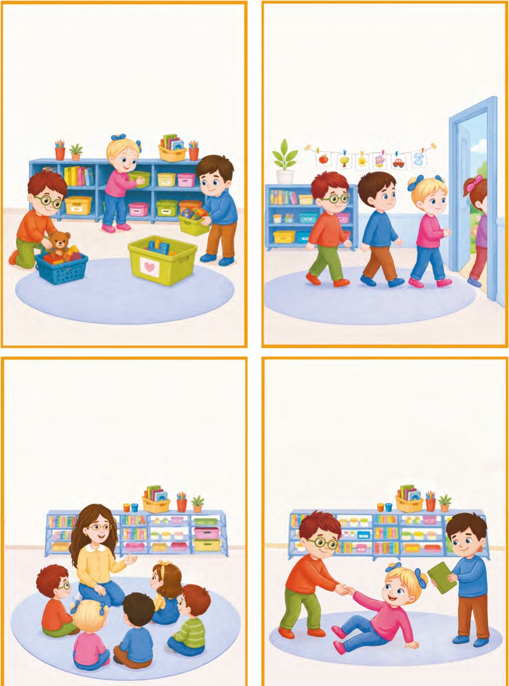

<!-- sayfa 34 -->

# EK-2: Olumsuz Davranışlar

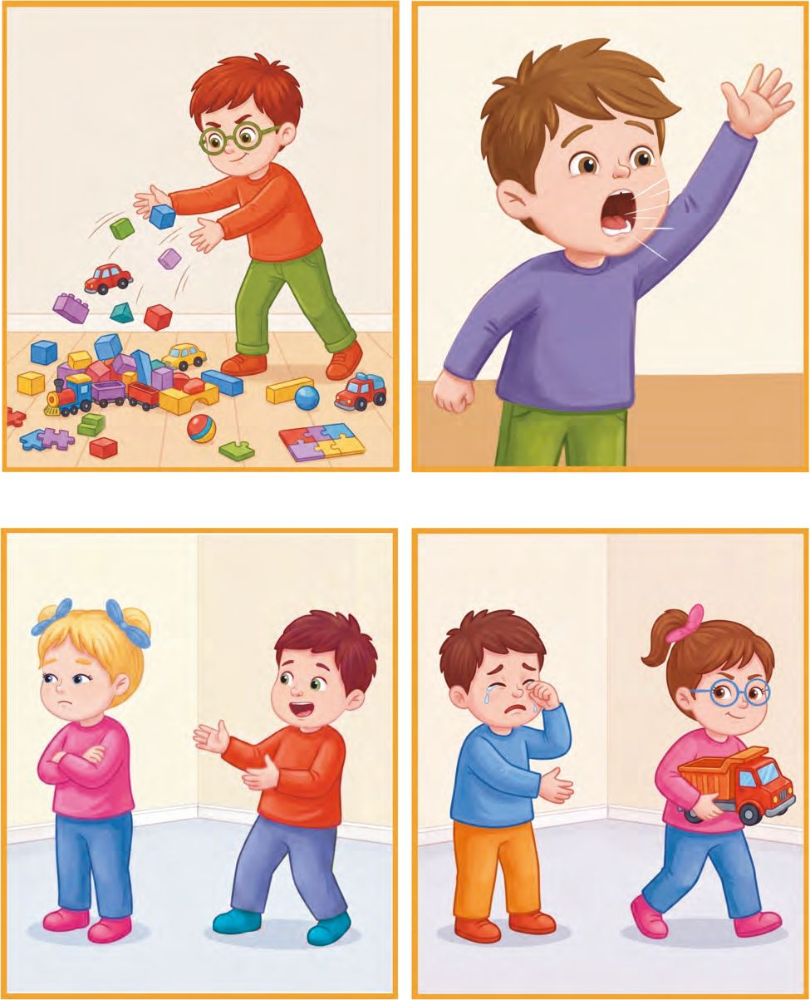

<!-- sayfa 35 -->

**ETKİNLİK ADI:** Merak Panosu  
**ALAN ADI:** Fen  
**YAŞ GRUBU:** 48–60 ay

**ALAN BECERİLERİ, ÖĞRENME ÇIKTILARI VE SÜREÇ BİLEŞENLERİ**

**FEN ALANI**

**FBAB1. Bilimsel Gözlem**

**FAB1. Günlük yaşamında fenle ilgili olaylara / olgulara ve durumlara yönelik bilimsel gözlem yapabilme**

FAB1.a. Çevresinde merak ettiği nesne / olay / olguları dikkatle gözlemler.

**EĞİLİMLER**

**E1. Benlik Eğilimleri**

E1.1. Merak

**PROGRAMLAR ARASI BİLEŞENLER**

**Sosyal-Duygusal Öğrenme Becerileri**

**SDB1.1. Kendini Tanıma (Öz Farkındalık)**

**Değerler**

**D11. Özgürlük**

D11.1. Kararlı olmak

**Okuryazarlık Becerileri**

**OB1. Bilgi Okuryazarlığı**

**Kavramlar:** Yön / Mekanda Konum: iç–dış  
Zıt: eski–yeni

**Sözcükler:** radyo, merak, ses, düğme, inceleme, keşif, parça, dinleme, tahmin, öğrenme, “Merak Panosu”.

**Materyaller:** eski radyo, örtü, kâğıt, kalem

**Eğitim / Öğrenme Ortamları:** Sınıf ortamında tüm çocukların görebileceği bir noktaya radyo konur. Radyonun üzeri bir örtü ile kapatılır.

<!-- sayfa 36 -->

# ETKİNLİKLER

## Fen (Büyük Grup Etkinliği)

* Çocuklar sınıfa geldiklerinde öğretim ortamında üzeri örtülü bir nesneye dikkat çekilir. Örtünün altından radyodan hafif sesler gelmesi sağlanır. Çocuklara “Sizce örtünün altında ne olabilir?”, “ Bu ne işe yarıyor olabilir?” soruları yöneltilir. Çocukların tahminleri dinlenir. Ardından örtü kaldırılarak radyo çocuklara gösterilir ve kısa bir inceleme süresi verilir. Nesne hakkında merak ettikleri sorular alınır. Çocukların ifadeleri doğrultusunda “Merak Panosu” oluşturulur ve sorular panoya yazılır (SDB1.1) Panoda yer alan sorular birlikte incelenir. Çocukların merakları doğrultusunda keşif süreci başlatılır (FAB.1. a, E1.1.).
* Çocuklara aynı nesneyi öğrenmek için farklı yollar sunulur. Her çocuk kendi tercihine göre bir yöntem seçer (D11.1).
    * Radyoyu dikkatlice inceleme
    * Düğmeleri çevirerek deneme yapma
    * Radyoyu dinleyerek ses değişimlerini fark etme
    * İçini açarak parçalarını inceleme (yetişkin rehberliğinde)
    * Nesneyi çizerek ifade etme
    * Arkadaşına anlatarak bildiklerini paylaşma
* Çocuklar seçtikleri yönteme göre nesneyi keşfetmeye başlar. Süreç boyunca “Ne yapıyorsun?”, “Neyi fark ettin?”, “Neden bunu denedin?”gibi sorularla çocukların öğrenme süreçlerini ifade etmeleri desteklenir (SDB1.1).
* Etkinlik sonunda çocuklar çemberde bir araya gelir. “Merak Panosu” tekrar incelenir. Çocuklara “Ne yaptın? Bunu nasıl öğrendin? Sana en çok ne yardımcı oldu?” soruları yöneltilir. Çocukların kendi öğrenme süreçlerini adım adım anlatmaları desteklenir (SDB1.1, OB1).

## DEĞERLENDİRME

* Radyoyu öğrenmek için hangi yolu seçtin?
* Bu nesneyi başka nasıl öğrenebilirdin?
* Öğrenirken sana en çok ne yardımcı oldu?
* Bugün ne öğrendin ve bunu nasıl öğrendin?

## FARKLILAŞTIRMA

**Zenginleştirme:** Çocuklara farklı eski teknoloji nesneleri (telefon, küçük mekanik araçlar görselleri) gösterilir. Radyonun nasıl çalışabileceği hakkında tahmin yürütmeleri ve “Ben olsam bu radyoyu nasıl geliştirirdim?” sorusuna cevap vermeleri istenir. Nesnenin iç yapısı hakkında basit tahmin çizimleri yapılabilir. Çocuklar radyonun sesini değiştirerek “farklı sesler üretme denemeleri” yapar. Merkezleri sadece radyonun incelendiği bir masa olmaktan çıkarılıp “ses laboratuvarı” veya “radyo yayın stüdyosu” formatına dönüştürülebilir. Merkeze çeşitli mikrofonlar, boş kasetler veya ses yalıtımı hissi veren karton paneller eklenerek çocukların mekânı çok yönlü deneyimleyebilecekleri fiziksel bir çeşitlilik sağlanabilir.

**Destekleme:** Radyonun bölümleri görsel kartlarla desteklenir. İnceleme sürecinde çocuklara tek adımlı yönergeler verilir. Nesneyi açma süreci sadece yetişkin kontrolünde yapılır. “Merak Panosu” görsellerle desteklenir. Radyodan aniden çıkan cızırtılı seslerden veya yüksek müzikten aşırı uyarılmayı desteklemek için gürültü önleyici kulaklıklar sunulabilir veya sınıfın uygun bir noktasındaki minderli “sakinleşme merkezinde” radyoyu kapalı hâldeyken incelemelerine imkân tanınabilir.

## AİLE VE TOPLUM KATILIMI

**Aile Katılımı:** Ailelerden evde çocuklarıyla eski bir eşya (telefon, kumanda, saat vb.) incelemeleri ve “Bu nasıl çalışıyor olabilir?” sorusu üzerinden sohbet etmeleri önerilebilir. Aileler çocukların merak ettikleri soruları not

<!-- sayfa 37 -->

**ETKİNLİK ADI:** Arkadaşım Ayna  
**ALAN ADI:** Hareket ve Sağlık  
**YAŞ GRUBU:** 48-60 ay

**ALAN BECERİLERİ, ÖĞRENME ÇIKTILARI VE SÜREÇ BİLEŞENLERİ**

**HAREKET VE SAĞLIK ALANI**

**HSAB1. Aktif Yaşam İçin Motor Beceriler**

**HSAB.3. Müzik ve ritim eşliğinde hareket örüntüleri sergileyebilme**

HSAB.3.b. Müzik eşliğinde gösterilen basit dans figürlerini grupla birlikte yapar.

**EĞİLİMLER**

**E2. Sosyal Eğilimler**

E2.5.Oyunseverlik

**PROGRAMLAR ARASI BİLEŞENLER**

**Sosyal-Duygusal Öğrenme Becerileri**

**SDB1.2. Kendini Düzenleme (Öz Düzenleme)**

**SDB2.2. İş Birliği**

**Değerler**

**D3. Çalışkanlık**

D3.4. Çalışmalarda aktif rol almak

**Kavramlar:** Zıt: aynı-farklı-benzer

**Sözcükler:** eşleşme, liderlik 

**Materyaller:** ayna

**Eğitim / Öğrenme Ortamları:** Sınıfta bulunan ayna etkinlik sırasında kullanılmak üzere erişilebilir bir yere yerleştirilir ve çocukların güvenli bir şekilde eşleşerek hareket edebilecekleri boş alan hazırlanır.

<!-- sayfa 38 -->

# Hareket ve Sağlık (Büyük Grup Etkinliği)

* Çocuklara günün tekerlemesi söylenerek oyun alanına toplanmaları sağlanır.
  Haydi, çocuklar haydi; artık oyun vakti.
  Eğlenelim, gülelim, biraz öğrenelim.
  Toplanalım, şimdi birlik olalım.
  Neler olacak acaba haydi duyalım.

* “Çocuklar hangi eşya ben ne yaparsam benim yaptığımın aynısını yapabilir?” sorusu yöneltilerek çocukların “Ayna” cevabına ulaşmaları desteklenir. Ayna cevabı alındıktan sonra sınıftaki aynanın karşısına geçilir. Esneme, kolları yavaşça sallama, zıplama, kolları kaldırma, kolları çevirme gibi çeşitli hareketler yapılır (SDB1.2).

* Daha sonra öğretmen aynaya bakarak farklı duyguları yüz ifadesiyle gösterir. Mutlu, üzgün, şaşkın, heyecanlı, kızgın gibi yüz ifadeleri yapılır. Çocuklara “Şu anda hangi duyguyu gösteriyorum?” sorusu sorulur. “Şimdi hepiniz benim aynam olacaksınız. Ben hangi hareketi yaparsam siz de aynısını yapacaksınız.” denilir. Çocuklardan hareketleri canlandırmaları istenir.

* “Şimdi oyunumuz biraz farklılaşacak ve eşli bir ayna oyunu oynayacağız” denilerek sınıf ikiye ayrılır ve eşler karşılıklı duracak şekilde dizilir. Eşleşme sonrasında çocuklardan biri “ayna” olur. Müzik eşliğinde eşlerden ayna olan karşısında duran arkadaşının hareketinin aynısını yapmaya çalışır ayna olan çocuklar sonrasında yer değiştirir. Çocuklara “Şimdi hiç kimsenin yapmadığı bir hareket bul.”, “Uzaya giden bir ayna olsaydın nasıl hareket ederdin?” gibi yönergeler verilerek oyun devam ettirilir (HSAB.3.b). Çocuklara son olarak robot aynası, mutlu ayna, yavaş çekim aynası olmak üzere üç rol görevi verilir. Üç görev tamamlandığında roller değiştirilir. Çocukların yeni rollerine uyum sağlayarak etkinliğe devam etmeleri desteklenir.

* Oyun sonrası çocuklara tüm sınıfa liderlik yapmak isteyen birisi olup olmadığı sorulur (E2.5, SDB1.2, SDB2.2, D3.4). İstekli olan çocuk grup önüne çıkar ve onun yaptığı hareketleri tüm sınıf ayna olarak canlandırır. Hareketlerin ardından, lider olan çocuklardan bu kez bir duygu seçmeleri istenir. Seçtikleri bir duyguyu (mutluluk, üzüntü, şaşırma, heyecan vb.) yüz ifadeleri ve beden hareketleriyle göstermeleri beklenir. Ayna olan çocuklar da bu duygu ifadelerini yansıtır. Böylece çocukların hem duyguları tanımaları hem de arkadaşlarını dikkatlice gözlemlemeleri desteklenir (SDB2.2).

* Etkinlik sonunda çocuklarla oyunun başından sonuna kadar katılım göstermenin önemi üzerine kısa bir sohbet edilir. Çocukların başladıkları etkinliği tamamlamaları konusunda gösterdikleri çabalar vurgulanır ve olumlu geri bildirim verilir (SDB1.2).

## DEĞERLENDİRME

* Ayna hangi duyguları gördük?
* Arkadaşının yaptığı hareketleri takip ederken neler hissettin?
* Lider olduğunda nasıl hissettin?
* Ayna olduğunda nelere dikkat ettin?
* Oyunu sonuna kadar sürdürmek için neler yaptın?

**FARKLILAŞTIRMA**

**Zenginleştirme:** Etkinlik sırasında çocuklardan yaptıkları harekete uygun bir ses ya da ritim (el çırpma, ayak vurma, “vınn” gibi ses çıkarma) eklemeleri istenebilir. Sınıfta birden fazla ayna kullanılabilir ya da çocukların birbirlerinin göz bebeklerinde kendi yansımalarını gözlemlemeleri sağlanarak farklı bir “ayna” deneyimi sunulabilir. Sınıfın farklı köşelerine folyolardan veya gerçek materyallerden “boy aynası”, “küçük el aynası”, “dev ayna” gibi farklı istasyonlar kurularak çocukların bu alanlarda kendi yansımalarını çok yönlü deneyimleyebilecekleri fiziksel bir ortam çeşitliliği sağlanabilir.

<!-- sayfa 39 -->

**Destekleme:** Duygu ifadelerinin tanınmasını desteklemek için ayna karşısında öğretmenle duygu kartları kullanılabilir. Akran eşleştirmesi yapılarak karttaki duygunun sırasıyla yapılması istenebilir. Çocukların ilgisinin azaldığı gözlemlendiğinde etkinlik süresi kısaltılabilir; örneğin üç farklı duygu ile sınırlandırılarak etkinliği tamamlamaları desteklenebilir. Eşli oyun esnasında arkadaşıyla yüz yüze dururken kişisel alan sınırlarını korumakta veya mesafeyi ayarlamakta zorlanan çocuklar için yere renkli bantlarla, çemberlerle (hulahop) veya ayak izi görselleriyle “durma noktaları” (fiziksel sınırlar) çizilerek ortam farklılaştırılabilir.

**AİLE VE TOPLUM KATILIMI**

**Aile Katılımı:** Ailelere evde çocuklarıyla “ayna oyunu” oynamaları için kısa bir bilgi notu gönderilebilir. Notta şu öneriler yer alır: “Çocuğunuzla karşılıklı geçin. Önce siz lider olun, çocuğunuz ayna olsun. Sonra rolleri değiştirin. Duyguları yüz ve beden hareketleriyle gösterin.” Evde çocuğun odasına küçük bir güvenli ayna konulması ve her sabah aynaya bakarak “Bugün kendimi nasıl hissediyorum?” sorusunu yanıtlamasının desteklenmesi önerilebilir.

**Toplum Katılımı:** Yerel bir çocuk tiyatrosu veya drama atölyesinden bir sanatçı sınıfa davet edilerek “dramada ayna tekniği” üzerine kısa bir uygulamalı çalışma yapılabilir. Sanatçı çocuklarla birlikte duygu ve hareket yansıtma oyunları oynanabilir.

<!-- sayfa 40 -->

**ETKİNLİK ADI:** Duygu Köprüsü  
**ALAN ADI:** Hareket ve Sağlık  
**YAŞ GRUBU:** 48-60 ay  

**ALAN BECERİLERİ, ÖĞRENME ÇIKTILARI VE SÜREÇ BİLEŞENLERİ**  
**HAREKET VE SAĞLIK ALANI**  
**HSAB1.** Aktif Yaşam İçin Motor Beceriler  
**HSAB.2.** Farklı büyüklük ve özellikteki nesneleri kullanabilme  
**HSAB.2.a.** Nesnelere farklı şekiller verir.  

**EĞİLİMLER**  
**E2.** Sosyal Eğilimler  
**E2.1.** Empati  
**E3.** Entelektüel Eğilimler  
**E3.3.** Yaratıcılık  

**PROGRAMLAR ARASI BİLEŞENLER**  
**Sosyal-Duygusal Öğrenme Becerileri**  
**SDB1.1.** Kendini Tanıma (Öz Farkındalık)  
**SDB1.2.** Kendini Düzenleme (Öz Düzenleme)  
**SDB2.2.** İş Birliği  
**SDB3.3.** Sorumlu Karar Verme  

**Değerler**  
**D4.** Dostluk  
**D4.1.** Arkadaşlarına destek olmak  
**D12.** Sabır  
**D12.2.** İstikrarlı olmak  

**Okuryazarlık Becerileri**  
**OB4.** Görsel Okuryazarlık  

**Kavramlar:** Duygu: mutluluk, üzüntü, korku, endişe  
**Sözcükler:** köprü, sabır  
**Materyaller:** farklı boyutlarda ahşap bloklar, renkli plastik / yumuşak bloklar, küçük oyuncak figürler (hayvanlar veya insanlar), “Bu Hafta Neler Yaptık?” çalışma sayfası (EK-1).  
**Eğitim / Öğrenme Ortamları:** Sınıf içerisinde çocukların grup çalışması yapabileceği kadar geniş bir zemin hazırlanır. Bu alana bloklar düzenli bir şekilde yerleştirilir.

<!-- sayfa 41 -->

# ETKİNLİKLER

**Hareket ve Sağlık (Küçük Grup Etkinliği)**

* Çocuklar çember düzeninde oturur. Öğretmen, elinde yumuşak bir oyuncak (bir sincap vb.) ile çembere gelir. “Sevgili çocuklar, bu sabah okula gelirken yolda çok üzgün bir sincap gördüm. Adı Simi’ymiş. Simi, ormanın diğer tarafındaki arkadaşlarını çok özlemiş ancak karşıya geçmek için kullandığı taş köprü dün geceki fırtınada yıkılmış. Simi ne yapacağını bilemiyor. Ona nasıl yardım edebiliriz? Siz Simi’nin yerinde olsaydınız ne hissederdiniz?” diye sorar. Çocukların Simi’nin yaşadığı duruma ilişkin duygu ve düşüncelerini paylaşmaları sağlanır (E2.1).

* Ardından çocuklara farklı köprü görselleri gösterilir. Çocukların görsellerdeki köprüleri, köprülerin bölümlerini ve yapımında kullanılan malzemeleri fark etmeleri ve tanımaları sağlanır (OB4). “Bu köprülerin benzer ve farklı özellikleri nelerdir?”, “Sizce hangi köprü daha sağlam görünüyor?” ve “Görseldeki hangi ayrıntılar böyle düşünmenizi sağladı?” soruları yöneltilerek çocukların görüşleri alınır.

* Çocuklardan gelen cevaplar doğrultusunda “Simi’ye yeni bir köprü kuracağız. Ancak bu kolay olmayacak. Rüzgâr hâlâ esiyor ve köprünün sağlam olması gerekiyor. Hazır mısınız?” denir. Çocuklar 2-3 kişilik gruplara ayrılır.

* Her gruba bir oyuncak figür (Simi’nin arkadaşlarından biri) ve bloklar verilir. “Şimdi her grup, kendi arkadaşını güvenle karşıya geçirecek bir köprü kuracak. Köprünüzün sağlam, dengeli ve dayanıklı olması gerekiyor. Malzemelerinizi inceleyin, birlikte karar verin ve denemeler yapın. Köprünüzü istediğiniz şekilde tasarlayabilirsiniz; köprünüz düz, kıvrımlı, yüksek veya renkli olabilir.” denir. Çocukların blokları renk, biçim ve büyüklük gibi görsel özellikleri bakımından incelemeleri ve köprüleri için kullanacakları blokları seçmeleri sağlanır (OB4). Grup üyelerinin köprüyü nasıl oluşturacaklarına birlikte karar vermeleri ve ortak bir amaç doğrultusunda çalışmaları desteklenir (SDB2.2). Çocuklar blokları kavrayıp uygun yerlere bırakarak köprülerini oluşturur (HSAB.2.a). Blokları farklı biçimlerde bir araya getirerek özgün köprüler tasarlamaları desteklenir (E3.3).

* Çocuklar köprülerini inşa ederken “Neden bu büyük bloğu alta koydun?”, “Şimdi oyuncağı köprüden geçirmeyi denemek ister misin?” ve “Köprü sallanıyor, köprüyü nasıl daha sağlam hâle getirebiliriz?” gibi sorularla süreç desteklenir.

* Köprüler inşa edilirken sınıfta esen rüzgârı canlandıran bir fon müziği açılır veya yelpaze kullanılarak rüzgâr etkisi oluşturulur. “Aman dikkat! Rüzgâr çok kuvvetli esti ve bir grubun köprüsünün bir kısmını uçurdu. Şimdi ne yapacaksınız?” diye sorulur. Çocukların karşılaştıkları problemi fark etmeleri, köprülerini onarmak için neler yapabileceklerini düşünmeleri ve uygun gördükleri çözüm yolunu denemeleri sağlanır (SDB1.2, SDB3.3). Çocuklar köprüyü onarmayı sürdürürken bir işi yapmakta zorlanan arkadaşlarını fark etmeleri ve arkadaşlarına destek olmaları teşvik edilir (D4.1). Çocukların köprüyü yeniden kurmaları, farklı bir blok kullanmaları veya blokların yerlerini değiştirmeleri desteklenir. Problem çözülmediğinde yeni yollar denemeleri ve köprü tamamlanıncaya kadar çalışmalarını sürdürmeleri sağlanır (D12.2).

* Köprüler tamamlandığında her grup kendi oyuncağını köprüsünden geçirmeye çalışır. “Şimdi oyuncağınız köprüden geçerken onu konuşturalım. Sizce nasıl hissediyor? Korkuyor mu, heyecanlı mı, yoksa çok mu mutlu?” denir. Çocuklar oyuncaklarını konuşturur; diğer çocuklar da kullanılan ses tonu ve yüz ifadelerinden oyuncağın duygusunu tahmin etmeye çalışır (E2.1). Örneğin “Benim zebram köprüye ilk adım attığında çok korktu, dizleri titredi ancak sonra bize güvenince çok mutlu oldu.” denilebilir.

* Her grup köprüsünü arkadaşlarına tanıtır. Çocuklardan köprülerinin biçimini, kullandıkları blokları ve köprüye ekledikleri bölümleri göstermeleri istenir (OB4). “Köprünüzü nasıl yaptınız?”, “Köprünüz bozulduğunda hangi parçaları değiştirdiniz?”, “Oyuncak köprüden güvenle geçti mi?” ve “Grup arkadaşlarınızla nasıl çalıştınız?” soruları yöneltilir. Çocukların köprüyü oluştururken gerçekleştirdikleri denemeleri, yaptıkları değişiklikleri ve grup arkadaşlarıyla çalışma deneyimlerini paylaşmaları sağlanır (SDB1.1, SDB2.2).

<!-- sayfa 42 -->

# DEĞERLENDİRME
* Bugün Simi’nin problemine nasıl bir çözüm buldunuz?
* Köprünüz yıkıldığında pes mi ettiniz, yeniden mi denediniz?
* Oyuncağınız köprüdeyken neler oldu?
* En zor anlarda size en çok kim yardım ediyor?
* Evde veya okulda sabır gerektiren başka durumlar var mı?

# FARKLILAŞTIRMA

**Zenginleştirme:** Bloklara ek olarak maket bantları, ip, yapıştırıcı, kumaş parçaları, kâğıt havlu ruloları da eklenebilir. Çocuklar “asılı köprü”, “halatlı köprü” gibi farklı türler deneyebilir. İnşa sürecinde çocukların iş birliği ve yaratıcı düşünme yollarını çeşitlendirmek için RAFT Stratejisi (rol, izleyici, format, tema) kullanılabilir. Çocuklardan sadece köprü yapan bir çocuk olmaları değil; “Orman Mimarı” rolüne girerek tasarladıkları köprüyü bir çizim / taslak eşliğinde savunmaları istenebilir.

**Destekleme:** Blokların tutulması zorsa üzerine kavramayı kolaylaştıran bantlar veya tutamaklar eklenebilir. Blokların altına halı kaydırmaz örtüler yerleştirilebilir veya birbirine geçen cırtcırtlı / mıknatıslı bloklar kullanılarak çocukların fiziksel erişimi desteklenebilir. Gruplar oluşturulurken akran desteği sağlanabilir; eşleştirmeler çocukların birbirini tamamlayan güçlü yönleri dikkate alınarak yapılabilir.

# AİLE VE TOPLUM KATILIMI

**Aile Katılımı:** Ailelere evde çocuklarıyla atık malzemelerden (koli kutusu, yumurta kolisi vb.) bir “duygu köprüsü” inşa etmeleri önerilir. Köprünün her bir bölümüne farklı bir duygunun adı yazılabilir veya o duyguyu temsil eden bir resim çizilebilir.

**Toplum Katılımı:** Sınıfa bir inşaat mühendisi veya mimar veli davet edilerek, basit bir dille “sağlam yapılar nasıl inşa edilir?” anlatması sağlanabilir. Okulun yakınında bulunan bir yaya köprüsüne kısa bir gezi düzenlenebilir. Çocuklar köprünün yapısını gözlemler, kimler için ve neden yapıldığı hakkında sohbet edilebilir.

<!-- sayfa 43 -->

# EK-1: Bu Hafta Neler Yaptık?

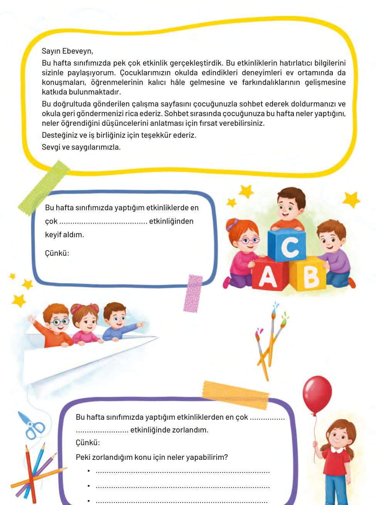

Sayın Ebeveyn,
Bu hafta sınıfımızda pek çok etkinlik gerçekleştirdik. Bu etkinliklerin hatırlatıcı bilgilerini sizinle paylaşıyorum. Çocuklarımızın okulda edindikleri deneyimleri ev ortamında da konuşmaları, öğrenmelerinin kalıcı hâle gelmesine ve farkındalıklarının gelişmesine katkıda bulunmaktadır.
Bu doğrultuda gönderilen çalışma sayfasını çocuğunuzla sohbet ederek doldurmanızı ve okula geri göndermenizi rica ederiz. Sohbet sırasında çocuğunuza bu hafta neler yaptığını, neler öğrendiğini düşüncelerini anlatması için fırsat verebilirsiniz.
Desteğiniz ve iş birliğiniz için teşekkür ederiz.
Sevgi ve saygılarımızla.

Bu hafta sınıfımızda yaptığım etkinliklerde en çok ........................................ etkinliğinden keyif aldım.
Çünkü:

Bu hafta sınıfımızda yaptığım etkinliklerden en çok ........................................ etkinliğinde zorlandım.
Çünkü:
Peki zorlandığım konu için neler yapabilirim?
• ...............................................................................
• ...............................................................................
• ...............................................................................

<!-- sayfa 44 -->

**ETKİNLİK ADI:** Haydi, Gel Arkadaşım
**ALAN ADI:** Hareket ve Sağlık
**YAŞ GRUBU:** 48-60 ay

**ALAN BECERİLERİ, ÖĞRENME ÇIKTILARI VE SÜREÇ BİLEŞENLERİ**

**HAREKET VE SAĞLIK ALANI**

**HSAB2. Sağlıklı Yaşam ve Öz Bakım Becerileri**

**HSAB.7. İç ve dış mekânda fiziksel aktivitelere katılabilme**

**HSAB.7. a. İç ve dış mekânda hareketli etkinliklere katılır.**

**EĞİLİMLER**

**E3. Entelektüel Eğilimler**

**E3.2. Odaklanma**

**PROGRAMLAR ARASI BİLEŞENLER**

**Sosyal-Duygusal Öğrenme Becerileri**

**SDB2.2. İş birliği**

**Değerler**

**D4. Dostluk**

**D4.2. Arkadaşları ile etkili iletişim kurmak**

**Kavramlar:** geometrik şekil

**Sözcükler:** arkadaş, grup, birlikte, iletişim, iş birliği, katılmak, davet etmek, paylaşmak, eşleşmek

**Materyaller:** müzik çalar, hareketli bir müzik

**Eğitim / Öğrenme Ortamları:** Çocukların güvenli biçimde dans edebilecekleri ve grup oluşturabilecekleri geniş, boş ve kaymayan bir oyun alanı hazırlanır. Çember, ikili, üçlü ve dörtlü grup çalışmalarına uygun hareket alanı bırakılır. Müzik aracı çocukların rahatça duyabileceği bir konuma yerleştirilir.

<!-- sayfa 45 -->

# ETKİNLİKLER

## Hareket ve Sağlık (Büyük Grup Etkinliği)

* Hep birlikte hareketli bir tekerleme söylenerek etkinliğe başlanır. Oyun alanında çember oluşturulur.

**Tekerleme**

“Haydi gel arkadaşım, el ele verelim,
Müzikle dönelim, neşeyle gülelim.
Bazen iki kişi, bazen üç kişi,
Birlikte oynayalım hepimiz şimdi.”

* Tekerleme sonrasında çocuklara birazdan müzik eşliğinde dans edecekleri söylenir. Müzik başladığında çocuklar oyun alanında serbestçe hareket eder, dans eder ve arkadaşlarını gözlemler. Müzik durduğunda “İkişerli grup olun.” yönergesi verilir. Çocukların bir arkadaşına yaklaşmaları, onunla iletişim kurmaları ve birlikte eş olmaları beklenir. “Benimle eş olmak ister misin?”, “Birlikte olalım mı?” gibi ifadelerin kullanılması desteklenir (SDB2.2).
* Eşleşme sonrasında ikişerli gruplara bedenlerini kullanarak birlikte bir köprü oluşturmaları yönergesi verilir (E3.2). Tüm çocuklar köprü oluşturduktan sonra müzik yeniden başlatılır. Çocuklar tekrar serbest şekilde dans eder. Müzik durduğunda bu kez “Üç kişilik grup olun.” yönergesi verilir. Çocukların arkadaşlarıyla iletişim kurarak grup oluşturmaları için zaman tanınır. Üçlü gruplara “Birlikte bir üçgen oluşturun” denir. Oyun aynı şekilde devam eder. Müzik yeniden başlatılır ve durduğunda “Dört kişilik grup olun.” yönergesi verilir. Çocukların iş birliği yapmak istedikleri arkadaşlarıyla iletişim kurmaları, gruba katılmak isteyen arkadaşlarına yer vermeleri ve birlikte hareket etmeleri desteklenir (SDB2.2). Dörtlü gruplar oluşturulduğunda bu gruplara bir kare oluşturun yönergesi verilir. Etkinlik süresince grup oluşturmakta zorlanan çocuklara akran desteği sağlanır. Çocukların arkadaşlarını davet etmeleri, gruplara katılmaları ve iletişim kurmaları için fırsatlar oluşturulur (HSAB.7. a, D4.2).
* Etkinliğin ardından çocuklar yeniden çember şeklinde oturur. “Bir arkadaşının yanına giderken ne söyledin?”, “Grup oluştururken nasıl anlaştınız?”, “Birlikte hareket etmek nasıl hissettirdi?” gibi sorularla sohbet edilir. Çocukların iş birliği yapmak istedikleri kişilerle iletişim kurduklarını fark etmeleri desteklenir (SDB2.2).

## DEĞERLENDİRME

* Grup oluşturmak için arkadaşına ne söyledin?
* Bir arkadaşın seni grubuna davet etti mi? Nasıl davet etti?
* Sen bir arkadaşını grubuna nasıl çağırdın?
* Birlikte şekil oluştururken birbirinize nasıl yardımcı oldunuz?
* Bir arkadaşın gruba katılmak istediğinde ne yaptınız?
* İş birliği yaparken en çok hangi bölüm hoşuna gitti?
* Bir sonraki oyunda arkadaşlarınla iş birliği yapmak için neler yapabilirsin?

**FARKLILAŞTIRMA**

**Zenginleştirme:** Çocuklardan grup oluşturduktan sonra birlikte kısa bir hareket belirlemeleri istenebilir. Örneğin aynı anda zıplama, dönme veya alkış yapma gibi görevler verilebilir. Daha sonraki turlarda beş kişilik grup oluşturma ya da belirli özelliklere göre grup kurma (aynı renkte kıyafet giyenler, aynı ayda doğanlar vb.) çalışmaları yapılabilir. Müzik durduğunda çocuklara sadece “Grup olun.” yönergesi vermek yerine, oluşturulan 3’lü veya 4’lü gruplar içerisinde farklı görev paylaşımları yapılarak sosyal etkileşimleri ve sorumluluk alma becerileri daha karmaşık bir düzeye taşınabilir.

<!-- sayfa 46 -->

**Destekleme:** Grup oluşturmada model olunabilir. Çocukların kullanabilecekleri iletişim ifadeleri önceden birlikte tekrar edilebilir. Grup sayıları azaltılabilir ve çocuklara daha fazla süre verilebilir. Akran desteğinden yararlanılabilir. İletişimi başlatmayı desteklemek için üzerinde iki çocuğun el ele tutuştuğu ve “Benimle oynar mısın?” mesajı taşıyan iletişim / görsel destek kartları hazırlanarak çocukların bu kartları arkadaşlarına göstermeleri sağlanabilir. 

### AİLE VE TOPLUM KATILIMI

**Aile Katılımı:** Ailelerden evde çocuklarıyla iş birliği gerektiren basit oyunlar oynamaları önerilebilir. Örneğin birlikte yapboz tamamlama, oyuncak toplama veya bir kule inşa etme gibi etkinlikler yapılabilir. Çocukların oyun sırasında kullandıkları iletişim ifadeleri gözlemlenebilir ve sınıfta paylaşılabilir. 

**Toplum Katılımı:** Okul içerisinde farklı sınıflarla ortak oyun etkinlikleri planlanabilir. Çocukların farklı arkadaş gruplarıyla iletişim kurabilecekleri ve birlikte hareket edebilecekleri oyunlar düzenlenebilir. Böylece iş birliği ve iletişim becerilerinin farklı ortamlarda kullanılması desteklenebilir.

<!-- sayfa 47 -->

**ETKİNLİK ADI:** Nezaketle Uyan
**ALAN ADI:** Sosyal, Hareket ve Sağlık 
**YAŞ GRUBU:** 48-60 ay

**ALAN BECERİLERİ, ÖĞRENME ÇIKTILARI VE SÜREÇ BİLEŞENLERİ**

**SOSYAL ALAN**

**SBAB1. Zamanı Algılama ve Kronolojik Düşünme**

**SAB1. Günlük hayatta karşılaştığı nesne / olay / yer ve kişilerde zaman içerisinde değişen ve benzerlik gösteren özellikleri karşılaştırabilme**

SAB1.a. Sabah, akşam, gece ve gündüz yapılan işleri karşılaştırır.

**HAREKET VE SAĞLIK ALANI**

**HSAB1. Aktif Yaşam İçin Motor Beceriler**

**HSAB3. Müzik ve ritim eşliğinde hareket örüntüleri sergileyebilme**

HSAB3.a. Müziğe uygun ardışık ritmik hareketler yapar.

**EĞİLİMLER**

**E2. Sosyal Eğilimler**

E2.4. Güven

E2.5. Oyunseverlik

**PROGRAMLAR ARASI BİLEŞENLER**

**Sosyal-Duygusal Öğrenme Becerileri**

SDB2.3. Sosyal Farkındalık Becerisi

**Değerler**

D14. Saygı

D14.1. Nezaketli olmak 

**Okuryazarlık Becerileri**

OB4. Görsel Okuryazarlık

**Kavramlar:** Zaman: gece-gündüz

**Sözcükler:** nezaket, “Günaydın.”, “Teşekkür ederim.”, “Lütfen.”

**Materyaller:** büyükçe bir örtü, güneş görseli, ay ve yıldız görseli, müzikçalar

**Eğitim / Öğrenme Ortamları:** Sınıfın bir köşesine büyük bir güneş görseli asılarak “Gündüz Merkezi”, başka bir köşesine ay ve yıldız görselleri asılarak “Gece Merkezi” hazırlanır. Ortada çocukların rahat hareket edebileceği boş bir alan bırakılır.

<!-- sayfa 48 -->

# Sosyal, Hareket ve Sağlık (Büyük Grup Etkinliği)

* Çocuklar çember olur. Öğretmen sırayla güneş ve ay / yıldız görsellerini göstererek “Bu hangisi?”, “Gündüz olunca neler yaparız?”, “Gece olunca ne olur?” diye sorar. Sabah, öğle, akşam ve gece yapılan işler hakkında kısa bir sohbet edilir (SAB.1.a, OB4).
* “Şimdi ‘Nezaketle Uyan’ adında bir oyun oynayacağız. Oyunda uyuma ve nezaketli davranışları canlandıracağız.” denir. Öğretmen “Şimdi gündüz oldu. Güneş doğdu, herkes uyandı!” der ve “Günaydın” isimli şarkı açılır. Çocuklar “Gündüz Merkezi”ne giderek müziğe uygun hareketler yaparlar (HSAB.3.a, E2.5). Bir süre sonra öğretmen müziği kapatır ve “Şimdi gece oldu. Güneş battı, herkes uyusun.” der. Çocuklar “Gece Merkezi”ne giderek yere uzanır ve uyuma taklidi yapar, gözlerini kapatır. Öğretmen çocuğun üzerini örtüyle örter. Sonra “Sabah oldu, güneş doğdu! Haydi, uyanın!” der. Çocuklar ayağa kalkar, sadece üzeri örtülü olan çocuk kalkmaz. Öğretmen “Aaa, kim uyuyor?”, “Bakalım kim kalkmayı unuttu?” diye sorar (E2.4). Çocuklar tahmin eder.
* Tahmin edildikten sonra öğretmen örtüyü açar ve tüm çocuklar birlikte “Günaydın ... (çocuğun ismi)” der (SDB2.3). Oyun, her çocuğun sırayla örtü altında kalması ve herkese “Günaydın.” denmesiyle devam eder (E2.5). Önceden hazırlanmış içerisinde nezaket sözcüklerinin olduğu “nezaket kavanozu” çıkarılır ve içerisindeki diğer nezaket sözcükleri tek tek çekilerek okunur. Bu sözcükleri ne zaman ve ne durumda kullandığımız hakkında konuşulur (D14.1).

## DEĞERLENDİRME

* Sen uykudayken arkadaşlarının sana “Günaydın.” demesini beklemek nasıldı?
* “Günaydın.” demek sana ne hissettirdi?
* Nezaket kavanozunda hangi kelimeler vardı?
* “Teşekkür ederim.” kelimesini ne zaman söyleriz?
* Bugün en çok hangi bölümde eğlendin?

## FARKLILAŞTIRMA

**Zenginleştirme:** Çocuklara sabah, öğle, akşam ve geceyi gösteren görsel kartlar karışık olarak sunulabilir. Çocuklardan kartları günün akışına uygun biçimde sıralamaları ve her zaman diliminde yaptıkları bir eylemi açıklamaları istenebilir. Ardından Nezaket Kavanozu’ndan seçtikleri sözcüğün kullanılabileceği bir durum oluşturmaları ve bu durumu arkadaşlarıyla canlandırmaları sağlanabilir. Çocuklar, “Sabah arkadaşımla karşılaşınca...”, “Birinden yardım istediğimde...” veya “Akşam eve giderken...” gibi tamamlanmamış cümlelerden hareketle nezaket sözcüklerini uygun bağlamlarda kullanabilir. İsteyen çocukların “Günaydın” şarkısına sabah, öğle, akşam ve geceyle ilgili yeni sözler veya bu zaman dilimlerini temsil eden özgün hareketler eklemelerine fırsat verilebilir.

**Destekleme:** Gece-gündüz ayrımı için güneş, ay ve yıldız görselleri büyük ve belirgin hazırlanabilir. Görsellerin üzerindeki ana hatlar bantla kabartılarak dokunsal hâle getirilebilir. Örtü altında bekleme süresini desteklemek için çocuklara sadece uyuma taklidi yapma veya oyuncak bir bebeği uyandırma seçeneği sunulabilir. Koşma ve hareketlilik esnasında yönünü bulmakta veya yönergeye uymakta zorlanan çocuklar için Gece ve Gündüz merkezlerinin sınırları yere renkli bantlarla (Gündüz için sarı bantlı alan, gece için mavi bantlı alan) çizilerek fiziksel sınırlar netleştirilebilir.

## AİLE VE TOPLUM KATILIMI

**Aile Katılımı:** Ailelerden, evde sabahları çocuklarına “Günaydın.” diyerek güne başlamaları ve gün içinde “lütfen, teşekkür ederim.” gibi sözcükleri kullanmaları önerilir. İsteyen ailelerin nezaket sözcükleri ile kısa bir tekerleme veya şarkı oluşturarak video çekmesi ve sınıfla paylaşması istenebilir.

<!-- sayfa 49 -->

EK-1: “Günaydın” şarkısı

<!-- sayfa 50 -->

**ETKİNLİK ADI:** Ortak ve Farklı Yönlerimiz
**ALAN ADI:** Hareket ve Sağlık Alanı
**YAŞ GRUBU:** 48-60 ay

**ALAN BECERİLERİ, ÖĞRENME ÇIKTILARI VE SÜREÇ BİLEŞENLERİ**

**HAREKET ve SAĞLIK ALANI**

**HSAB1. Aktif Yaşam İçin Motor Beceriler**

**HSAB.1. Farklı çevre ve fiziksel etkinliklerde temel hareket becerilerini sergileyebilme**

HSAB.1.a. Basit yönergeler doğrultusunda yer değiştirme hareketleri yapar.

**EĞİLİMLER**

**E2. Sosyal Eğilimler**

E2.5. Oyunseverlik

**PROGRAMLAR ARASI BİLEŞENLER**

**Sosyal-Duygusal Öğrenme Becerileri**

SDB2.3. Sosyal Farkındalık

**Kavramlar:** Zıt: aynı–farklı
**Sözcükler:** metre / mezura, ortak
**Materyaller:** metre ya da mezura
**Eğitim / Öğrenme Ortamları:** Boy ölçümlerinin yapılabileceği düz bir duvar alanı ve çocukların güvenli biçimde hareket edebilecekleri geniş, kaymayan bir oyun alanı hazırlanır. Metre veya mezura, çocukların inceleyebileceği şekilde erişilebilir bir konuma yerleştirilir. Çember düzeni için yeterli boşluk bırakılır; zıplama, dönme ve adım atma hareketlerinde çarpışmayı önleyecek mesafe sağlanır.

<!-- sayfa 51 -->

# ETKİNLİKLER

## Hareket ve Sağlık (Büyük Grup Etkinliği)

* Bir metre ya da mezura gösterilerek çocukların dikkatleri çekilir. “Bu aracın ne olduğunu biliyor musunuz?”, “Bununla ne yapabiliriz” soruları sorulur ve çocukların cevapları dinlenir. Ardından metrenin uzunluk ölçmeye yarayan bir araç olduğu açıklanır. Sınıfta çeşitli nesnelerin uzunlukları ölçülür. Ardından çocukların boy ölçümleri yapılır ve karşılaştırmalar yapılır. Aynı ve farklı boy uzunlukları hakkında konuşulur. Çember olunur. Ellerim saçlarımda, ellerim gözlerimde, ellerim burnumda gibi yönergelerle çocukların hareketlere eşlik etmeleri sağlanır. Ardından “ortak özellik” oyunu oynanacağı söylenir. Söylenen özelliklerin kendilerine uyduğunu düşünenler çemberde bir adım öne çıkar. “Saçları sarı olanlar bir adım öne çıksın.” yönergesi verilir. “Bakalım kimlerin saçı sarıymış?”, “Kimlerin değilmiş?” soruları ile çocukların çevrelerine bakarak kendileriyle ortak ve farklı yönlere sahip kişileri fark etmelerine rehberlik edilir. Konuşmak isteyen çocuklara fırsat verilir. Senin gibi saçı sarı olanlar kimler? …….’nın saçı farklı mı? gibi sorularla çocukların kendisi ile başkaları arasındaki farklılıkları ve ortak yönleri açıklamasına rehberlik edilir (SDB2.3). Oyun farklı yönergelerle devam ettirilir.
* Örnek cümleler şu şekilde olabilir:
    * Kızlar bir adım öne çıksın.
    * Erkekler kollarını havaya kaldırsın.
    * Gözleri kahverengi olanlar yerinde 2 kere zıplasın (Her saç rengi için yapılır.).
    * Saçları siyah olanlar yerinde dönsün (Her göz rengi için yapılır.).
    * Gözlük kullanalar yerinde koşsun.
    * Saçı kısa / uzun olanlar ellerini dizlerine vursun.
    * Yüzmeyi sevenler çömelsin.
    * En sevdiği yemek ……. olanlar geriye bir adım atsın.
    * En sevdiği etkinlik resim yapmak olanlar 3 kere zıplasın (HSAB.1. a, E2.5).
* Cümleler isteğe bağlı ve gruba uygun olarak arttırılabilir. Her yönergeden sonra ortak ve farklı yönlerini fark etmeleri için çocuklara süre tanınır.

## DEĞERLENDİRME

* Seninle aynı özelliğe sahip arkadaşların var mıydı?
* Arkadaşlarınla hangi ortak yönlerini fark ettin?
* Arkadaşlarından farklı olan hangi özelliğini fark ettin?
* Farklı özelliklere sahip olmak sence nasıl bir şey?
* Arkadaşının sende olmayan bir özelliğini söyleyebilir misin?
* Oyunda en çok hangi hareketi yapmayı sevdin?
* Bu oyunu oynarken kendini nasıl hissettin?

# FARKLILAŞTIRMA

**Zenginleştirme:** Çocuklardan oyunun sonunda kendileriyle ortak özelliği olan bir arkadaşını ve farklı özelliği olan bir arkadaşını seçerek bu özellikleri açıklamaları istenebilir. Farklılıkların sınıfı nasıl zenginleştirdiği üzerine sohbet gerçekleştirilebilir. Buna ek olarak çocuklar “Kırmızı rengi sevenler zıplasın.” gibi yönergeleri kendileri üreterek oyunu kısa süreliğine yönetebilir.

**Destekleme:** Çocukların gözlem yapabilmeleri için ek süre tanınabilir. Çocukların akran desteği ile kısa bir süre “Kırmızı rengi sevenler zıplasın.” gibi yönergelerle oyunu yönetmeleri sağlanabilir. Yönergeler model olma ve jestlerle desteklenebilir, gerektiğinde tek özellik içeren sade yönergeler kullanılabilir. Saç ve göz rengi gibi özellikler için küçük görsel kartlardan yararlanılabilir.

<!-- sayfa 52 -->

# AİLE VE TOPLUM KATILIMI

**Aile Katılımı:** Ailelere bilgilendirme notu gönderilerek çocuklarıyla aile bireylerinin ortak ve farklı özellikleri hakkında sohbet etmeleri önerilir. “Evde kimlerin göz rengi aynı?”, “Kimler aynı yemeği seviyor?”, “Birbirinizden farklı olan özellikleriniz neler?” gibi sorular üzerine konuşmaları teşvik edilir. Ailelerden çocuklarıyla kendilerini anlatan küçük bir aile posteri hazırlamaları istenebilir. Posterde aile üyelerinin ortak ve farklı özelliklerine yer verilebilir.

**Toplum Katılımı:** Okulda farklı sınıflardaki çocuklarla ortak bir oyun etkinliği düzenlenebilir. Çocukların farklı yaş gruplarındaki bireylerin de benzer ve farklı özelliklere sahip olduğunu fark etmeleri desteklenebilir. Okul panosunda “Hepimiz Farklı, Hepimiz Değerliyiz” temalı bir sergi oluşturularak çocukların çalışmaları sergilenebilir.

<!-- sayfa 53 -->

**ETKİNLİK ADI:** Davranıştan Duyguya
**ALAN ADI:** Sanat
**YAŞ GRUBU:** 48-60 ay

**ALAN BECERİLERİ, ÖĞRENME ÇIKTILARI VE SÜREÇ BİLEŞENLERİ**

**SANAT ALANI**

**SNAB4. Sanatsal Uygulama Yapma**

**SNAB.4. Sanat etkinliği uygulayabilme**

SNAB.4.ç. Sanat etkinliklerinde özgün ürünler oluşturur.

**EĞİLİMLER**

**E3. Entelektüel Eğilimler**

E3.3. Yaratıcılık

**PROGRAMLAR ARASI BİLEŞENLER**

**Sosyal-Duygusal Öğrenme Becerileri**

**SDB2.3. Sosyal Farkındalık**

**Değerler**

**D3. Çalışkanlık**

D3.4. Çalışmalarda aktif rol almak

**Okuryazarlık Becerileri**

**OB4. Görsel Okuryazarlık**

**Kavramlar:** duygu

**Sözcükler:** canlandırma

**Materyaller:** uygun bir müzik, canlandırma yapılacak durumlara ait 4 adet kart (Ek-1), mutluluk, üzüntü, şaşırma ve öfke duygu kartları (Ek-2).

**Eğitim / Öğrenme Ortamları:** Duygu görselleri, durum kartları ve uygun müzik kullanılarak sınıfta hareket etmeye ve canlandırma yapmaya uygun bir öğrenme ortamı düzenlenir.

<!-- sayfa 54 -->

# ETKİNLİKLER

## Sanat (Küçük Grup Etkinliği)

* Öğretmen şaşırma yüz ifadesi görselini çocukların göremeyeceği şekilde sırtına yapıştırır ve çocukları karşılar. “Arkama bir şey sakladım, bu bir duygu. Hangi duygularımız vardı?”, “Haydi önce birlikte hatırlayalım.”. “Şimdi sırtıma sakladığım duyguyu hareketlerimle size anlatacağım. Bakalım bu duyguyu tahmin edebilecek misiniz?” açıklaması yapılır. Ardından pandomim şeklinde o duyguya ait davranışlar yapılır ve çocukların tahminleri alınır. Doğru tahminden sonra öğretmen sırtını döner ve şaşırma görselini çocuklara gösterir. Uygun bir müzik eşliğinde çocuklar sınıfta serbest bir şekilde yürür. Ardından “Mutlu bir şekilde yürüyelim.”, “Üzgün bir şekilde yürüyelim.”, “Şaşırmış gibi yürüyelim.”, “Öfkeli bir şekilde yürüyelim.” yönergeleri verilir. Her yönergeden sonra kısa süre durulur. “Yüzümüz nasıl oldu?”, “Bedenimiz nasıl durdu?” soruları ile duyguların yüzümüzde, bedenimizde ve davranışlarımızda nasıl değişiklikler oluşturduğunu hakkında konuşulur.
* Çocuklar 4 gruba ayrılır ve sınıfın 4 farklı köşesine geçerler. Her gruba bir durum kartı verilir (**Ek-1**). Gruplar bir süre durum kartlarını inceler (**OB4**). Grupların yanlarına gidilerek durumun ne olduğu hakkında konuşulur. Kartta yer alan durum üzerine konuşup grup üyelerinin aktif rol alacakları kısa bir canlandırma hazırlamaları için gruplara süre verilir (**D3.4**).

    1. **Durum:** Bir çocuk, ailesi ve arkadaşlarıyla piknik yapmaya gider. Piknik örtüsü serilir, yiyecekler paylaşılır ve birlikte oyun oynanır. Çocuk arkadaşlarıyla koşar, güler, ellerini çırpar ve ailesine sarılır. Arkadaşlarından biri “Ne güzel birlikte piknik yapıyoruz.” der. Herkes gülümser.
    2. **Durum:** Bir grup çocuk birlikte oyun oynar. Çocuklardan biri oyuna katılmak ister ancak diğer çocuklar onu oyuna almaz. Oyuna alınmayan çocuk başını öne eğer, sessizleşir ve sınıfın bir köşesine çekilir.
    3. **Durum:** Çocuklar birlikte bloklarla kule yapar. Çocuklardan biri dikkat etmeden arkadaşının yaptığı kuleyi yıkar. Kulesi yıkılan çocuk kaşlarını çatar, ellerini sıkar ve yüksek sesle “Kulemi yıktın!” der.
    4. **Durum:** Bir grup çocuk uzun zamandır görmedikleri bir arkadaşlarıyla karşılaşır. Arkadaşlarını görünce gözlerini büyütür, ağızlarını hafifçe açar ve bir süre durup bakarlar. Sonra içlerinden biri “Sen de mi buradaydın?” der.

* Gruplar hazır olduğunda canlandırmalar sırayla izlenir (**SNAB.4.ç, E3.3**). Her canlandırma sonrasında gruplar alkışlanır ve çocuklara:
    * Ne oldu?
    * Ne izledik?
    * Kimler vardı?
    * Ne hissediyorlar?
    * “Bunu hangi davranışlarından anladın?” soruları sorularak kısa değerlendirmeler yapılır (**SDB2.3**).

# DEĞERLENDİRME

* Çember olunur. Mutluluk, üzüntü, şaşırma ve öfke duygu kartları ortaya konulur (**Ek-2**). Çocuklar sırayla bir duygu seçer ve o duyguya uygun bir yüz ifadesi ya da beden duruşu gösterir. Diğer çocuklardan duyguyu tahmin etmeleri istenir. Tahminlerin ardından çocuklara “Bunu nasıl anladın?” sorusu yöneltilir ve “Bunu ............dan anladım.” cümlesini tamamlamaları istenir

<!-- sayfa 55 -->

# FARKLILAŞTIRMA

**Zenginleştirme:** Canlandırma sonrasında “Bu duyguyu başka hangi davranışlardan anlayabiliriz?” sorusu yöneltilerek çocukların sosyal ipuçları üzerine düşünmeleri sağlanabilir. Gruplardan durum kartındaki olaya kısa bir çözüm bölümü eklemeleri istenebilir. Örneğin oyuna alınmayan çocuğun oyuna davet edilmesi, kulesi yıkılan çocuğa yardım edilmesi, uzun zamandır görülmeyen arkadaşla karşılaşınca selamlaşılması ya da piknikte yiyeceklerin paylaşılması gibi olumlu davranışlar canlandırmaya eklenebilir. Çocukların aynı olayda birden fazla duygu yaşanabileceğini fark etmeleri desteklenebilir. Farklı duygular da eklenerek etkinlik zenginleştirilebilir.

**Destekleme:** Yüz ifadesi, beden duruşu ve davranış ipuçlarını göstererek çocuklara model olunabilir. Çocukların mutluluk, üzüntü, şaşırma ve öfke duygularını fark etmelerini desteklemek için duygu kartları büyük ve belirgin görsellerle sunulabilir. Süreçte önce iki duygu kartı üzerinden kısa bir çalışma yapılabilir, ardından diğer duygu kartları etkinliğe eklenebilir. Canlandırma öncesinde çocukların duyguya ait sosyal ipuçlarını fark etmeleri için ayna kullanılabilir. Durum kartları çocuklarla incelenebilir. Kartlarda yer alan olaylar kısa ve anlaşılır cümlelerle açıklanabilir. Çocukların etkinliğe farklı yollarla katılmalarına fırsat verilebilir. Çocuklar duyguyu sözel olarak ifade edebilir, duygu kartını gösterebilir, yüz ifadesi yapabilir ya da beden duruşuyla duyguyu canlandırabilir. Canlandırma sürecinde çocuklara duygu kartını tutma, gruba eşlik etme, izlenen duyguyu gösterme, kısa bir cümle söyleme gibi görev seçenekleri sunulabilir. Hazırlık süresi çocukların ihtiyacına göre esnek tutulabilir. Canlandırmalar kısa tutulabilir ve çocuklara aynı durumu tekrar deneme fırsatı verilebilir.

# AİLE VE TOPLUM KATILIMI

**Aile Katılımı:** Ailelerden gün içinde çocuklarıyla kısa duygu sohbetleri yapmaları istenebilir. Örneğin evde, parkta ya da sokakta bir kişinin davranışı gözlemlendiğinde “Sence nasıl hissediyor olabilir? Bunu nereden anladın?” soruları üzerinden konuşmaları önerilebilir. Aileler çocuklarının verdiği bir örneği küçük bir not olarak öğretmenle paylaşabilir.

**Toplum Katılımı:** Yerel bir çocuk tiyatrosu veya drama topluluğu ziyaret edilerek oyuncuların yüz ifadeleri ve beden hareketleriyle duyguları nasıl anlattıkları gözlemlenebilir.

<!-- sayfa 56 -->

EK-1: Durum Kartı

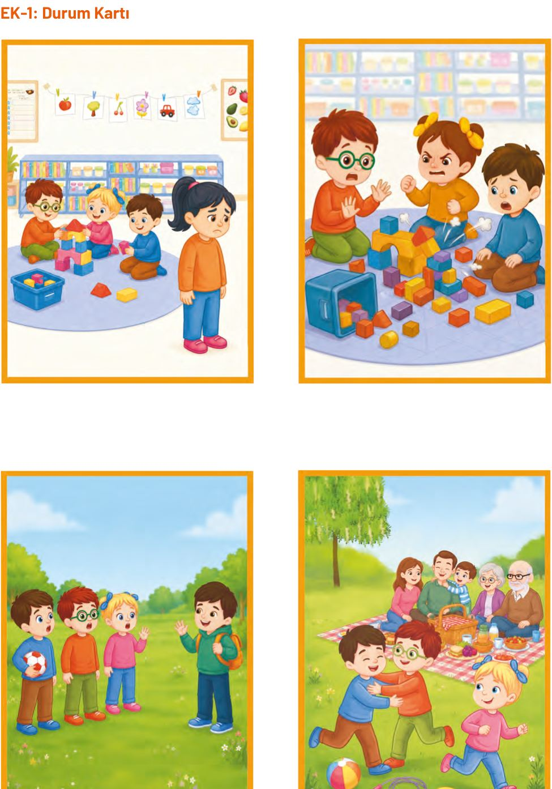

<!-- sayfa 57 -->

# EK-2: Duygu Kartları

<!-- sayfa 58 -->

**ETKİNLİK ADI:** Değerlerim En Büyük Hazinelerim
**ALAN ADI:** Sosyal
**YAŞ GRUBU:** 48–60 ay

**ALAN BECERİLERİ, ÖĞRENME ÇIKTILARI VE SÜREÇ BİLEŞENLERİ**

**SOSYAL ALAN**

**SBAB16. Eleştirel Sosyolojik Düşünme**

**SAB.14. Toplumsal yaşama yönelik nesne, olgu ve olayları çözümleyebilme**
SAB.14.b. Mustafa Kemal Atatürk’ün Türk toplumu için önemini söyler.

**EĞİLİMLER**

**E1. Benlik Eğilimleri**
E1.1. Merak

**E2. Sosyal Eğilimler**
E2.5. Oyunseverlik

**PROGRAMLAR ARASI BİLEŞENLER**

**Sosyal-Duygusal Öğrenme Becerileri**
SDB1.2. Kendini Düzenleme (Öz Düzenleme)

**Değerler**
**D16. Sorumluluk**
D16.2. Topluma karşı görevlerini yerine getirmek

**Okuryazarlık Becerileri**
**OB5. Kültür Okuryazarlığı**

**Sözcükler:** sorumluluk

**Materyaller:** zarflar, kâğıtlar, süsleme malzemeleri, Türk bayrağı

**Eğitim / Öğrenme Ortamları:** Çocuklar sınıfa gelmeden önce çocukların fark edebileceği düzeyde sınıfta yer alan oyuncak ve malzemelerin yerleri değiştirilir ve sınıf bir miktar dağıtılır.

<!-- sayfa 59 -->

# Sosyal (Büyük Grup Etkinliği)

* Çocuklar sınıfa geldiklerinde sınıftaki dağınıklığı fark etmeleri sağlanır (**E1.1**). Gözlem yapmaları ve nerelerde dağınıklık bulunduğunu ifade etmeleri istenir. “Şimdi sizinle sorumluluk hazinemizi bulacağız ama öncesinde üzerimize düşen sorumlulukları yerine getirmemiz gerekecek. Sizin için sınıfın farklı noktalarına ipuçları yerleştirildi. Bu ipuçlarını bulup görevlerinizi yerine getirip notlarda yazan soruları doğru olarak cevaplamanız gerekmektedir (**E2.5**) denilerek ilk ipucunun kapının üzerinde asılı olduğu fark edilir ve zarf açılarak ilk ipucu okunur (**SDB1.2**).
* **İpucu:** “Kitap merkezini düzenleyerek kitapları nasıl kullanmamız gerektiğini anlatır mısın?” Çocukların cevapları dinlenerek kitap merkezini düzenlemeleri sağlanır (**D16.2**). İlk ipucunun yer aldığı kâğıdın arkasında bir sonraki ipucunun yerini belirten cümleler okunur, ikinci ipucu camda asılıdır. Camda asılı olan ikinci ipucu alınır.
* **İpucu:** Oyun bloklarını üst üste dizerek yerine yerleştir. “Okula gelirken hangi hazırlıkları yaparsın? Bizimle paylaşır mısın?” ifadesine uygun cevaplar alınarak düzenleme yapılması istenir. üçüncü ipucu fen ve doğa merkezinde yer almaktadır.
* **İpucu:** ‘Rafta dağınık olarak duran yapbozu iki gruba ayrılarak tamamlar mısın?”, “Aç bir yavru kedi gördüğünde onun için ne yapardın bizimle paylaşır mısın?” dördüncü ipucu öğretmen masasının altında yer almaktadır.
* **İpucu:** “Sandalyeler biraz dağılmış durumda. Onları yerine yerleştirerek bir saksıda solmuş çiçek gördüğünde ne yapardın, bizimle paylaşır mısın?” beşinci ipucu sınıfımızdaki Atatürk bölümünde yer almaktadır.
* **İpucu:** “Atatürk ülkemiz için neler yaptı?”, “Türk bayrağımız hangi renk ve şekillerden oluşmaktadır? Bizimle paylaşır mısın?”, müzik merkezindeki kutuda yer alan kâğıt çiçekleri Atatürk bölümünü süslemek için kullanabilirsin (**SAB.14.b, OB5**).
* **İpucu:** Öğretmenin masasının altında bulunan sorumluluk hazinen seni bekliyor.
* Hazine kutusu açılır. İçerisinden daha önceden yerleştirilmiş olan bayraklar ve süsleme malzemeleri çıkarılır. İçerisinden “Çocuklar bugün sınıfınıza ait birçok sorumluluğu yerine getirdiniz. Ülkemizi kurtaran Mustafa Kemal Atatürk gibi vatanını milletini seven, koruyan ve ülkesi için çok çalışma sorumluluğunu yerine getirmeyi amaç edinen çocuklar olarak sizler ülkemizin ve bağımsızlığımızın en büyük sembolü olan Türk bayrağı ödülünü hak ettiniz. Cumhuriyet Bayramı’nız kutlu olsun.” yazılı not çocuklara okunur. Bayraklar hediye edilerek etkinlik sonlandırılır (**SDB1.2**).

# DEĞERLENDİRME

* Sorumluluk ne demektir?
* Hazine kutusuna ulaşmak için sırayla birçok görev yaptın. Bu görevleri sonuna kadar tamamlamak sana ne hissettirdi?
* Atatürk ülkemiz için neler yapmıştır?
* Evde bir sorumluluğun var mı? Varsa bunlar nelerdir?
* Okulda sorumlulukların var mı? Varsa bunlar nelerdir?

# FARKLILAŞTIRMA

**Zenginleştirme:** Atatürk’ün farklı cephelerde, ülkemizi kurtarma anlarında, kar üstünde uyurken vb. fotoğrafları sınıfa asılabilir ve bu fotoğraflarda neler olduğuna ilişkin sohbet edilebilir. Çocuklar ilgi ve tercihleri doğrultusunda animasyonu tekrar izleyebilir. Cumhuriyetin ilanı ile ilgili öykü ve masallar okunabilir.

**Destekleme:** Etkinlikteki görevler yerine getirilirken akran desteği sağlanabilir. Gruplar içinde görev dağılımına rehberlik edilebilir. Her çocuğa uygun görevler verilebilir. Zarflardan çıkan görevlerin okunmasının yanı sıra bu görevleri gösteren görseller de eklenebilir. Görseller, dokunsal özellikler eklenerek veya zıt renkli zemine yapıştırılarak görme bakımında işlevsel hale getirilebilir Öğretmen gerektiğinde çocukları kendine daha yakın

<!-- sayfa 60 -->

# AİLE VE TOPLUM KATILIMI

**Aile Katılımı:** Ailelere yapılan çalışma ile ilgili bilgi verilir. Sorumluluğun önemine vurgu yapılarak ev ortamında da çocuğun yaşına uygun; sofrayı kurmaya yardım etme, kirlilerini sepete atma veya oyuncaklarını toplama gibi sorumluluklar belirlemeleri istenebilir.

**Toplum Katılımı:** Çocukların etkinlikte hazırladıkları Atatürk bölümü süslemeleri ve Türk bayrağı resimleri okul koridorunda sergilenebilir. Sergi, diğer sınıflardaki çocuklar ve okul çalışanlarıyla gezilir. Çocuklardan hazırladıkları çalışmalar üzerinden Atatürk’ün ülkemiz için önemi hakkında kısa açıklamalar yapmaları istenebilir.

<!-- sayfa 61 -->

**ETKİNLİK ADI:** Duygu Eşleştirme  
**ALAN ADI:** Türkçe, Müzik  
**YAŞ GRUBU:** 48-60 ay  

**ALAN BECERİLERİ, ÖĞRENME ÇIKTILARI VE SÜREÇ BİLEŞENLERİ**

**TÜRKÇE ALANI**

**TAKB. Konuşma**

**TAKB.2. Konuşma sürecinin içeriğini oluşturabilme**

TAKB.2.b. Konuşmanın devamı hakkındaki basit tahminini söyler.

**TAKB.3. Konuşma sürecinde Türkçeyi doğru kullanabilme**

TAKB.3.b. Yetişkin rehberliğinde konuşurken benzetme ve örneklendirme içeren ifadeler kullanır.

**MÜZİK ALANI**

**MHB4. Müziksel Hareket**

**MHB.2. Müzik eserleriyle hareket / dans edebilme**

MHB.2.b. Doğaçlama / planlı hareket / dans sergiler.

**EĞİLİMLER**

**E2. Sosyal Eğilimler**

E2.5. Oyunseverlik

**PROGRAMLAR ARASI BİLEŞENLER**

**Sosyal-Duygusal Öğrenme Becerileri**

SDB2.1. İletişim

**Değerler**

D14. Saygı

D14.1. Nezaketli olmak 

**Kavramlar:** Duygu: mutluluk, üzüntü, öfke, şaşkınlık  
**Sözcükler:** kukla 
**Materyaller:** üzerinde farklı duygu durumları bulunan renkli ve siyah-beyaz fotoğraflar, boya kalemleri, makas, yapıştırıcı, dil çubuğu, bant  
**Eğitim / Öğrenme Ortamları:** Etkinlik öncesinde, duygu ifadelerini içeren fotoğraflar sınıfta uygun yerlere yerleştirilir ve etkinlikte kullanılacak sanat materyalleri hazırlanır.

<!-- sayfa 62 -->

**Türkçe, Müzik (Bütünleştirilmiş Büyük Grup Etkinliği)**

* Çocukların göz hizasında ve rahatça inceleyebilecekleri bir alana, farklı duygu ifadelerinin yer aldığı renkli insan fotoğrafları asılır. “Sınıfımızda dikkatinizi çeken yeni bir şey var mı?” sorusu yöneltilir. Fotoğraflar fark edildikten sonra duygu ifadeleri üzerine sohbet edilir; çocuklardan fotoğraflardaki kişilerin ne hissediyor olabileceğini yüz ifadelerinden tahmin etmeleri istenir (SDB2.1). Kukla kullanarak “Aslı mutlu, üzgün, öfkeli, şaşırmış, pişman, endişeli veya utanmış hissediyordu çünkü…” cümlesi söylenir. “Bu cümleyi nasıl tamamlayabiliriz?” ve “Bir örnek vererek tamamlamak isteyen var mı?” soruları yöneltilir. Çocukların cümleyi bir benzetme veya örnekle tamamlamaları desteklenir (TAKB.2.b, TAKB.3.b).
* Paylaşım yapmak isteyen çocuklara sırayla söz hakkı verilir; her çocuğun konuşması bitene kadar diğerlerinin sırasını beklemesi hatırlatılır (SDB2.1). Bir arkadaşları konuşurken baş sallama, gülümseme gibi tepkilerle onu dinlediğini göstermesi teşvik edilir (SDB2.1). Bir çocuk konuşmasını tamamladıktan sonra öğretmen sorar: “Arkadaşımız bize kendi hissettiği bir duyguyu anlattı. Onun hissettiği bu duyguya saygı göstermek için ne yapabiliriz?” Çocukların “onu dinleriz”, “gülmeyiz”, “onunla dalga geçmeyiz”, “’senin hakkın’ deriz” gibi yanıtlar vermesi desteklenir. Herkesin farklı bir durumda farklı bir duygu hissedebileceğini, bunun doğal olduğunu ve arkadaşımızın hissettiği duyguyu yargılamadan kabul etmenin saygı göstermek anlamına geldiğini vurgular (D14.1).
* Sınıfa asılan renkli fotoğraflardan ve bu fotoğrafların siyah-beyaz eşlerinden her çocuğa birer tane verilir. Müzik açılır ve çocuklardan müzik eşliğinde sınıf içinde hareket ederek ellerindeki fotoğrafın eşini bulmaları istenir. Eşini bulan çocuklar, fotoğraftaki duygu ifadesini yüzleri ve bedenleriyle canlandırarak heykel gibi hareketsiz kalırlar (MHB.2.b, E2.5). Müzik sırasında sınıfta hareket ederken arkadaşlarının alanına dikkat etmeleri, onlara çarpmamaya ve birbirlerinin hareket alanına saygı göstermeye özen göstermeleri hatırlatılır (D14.1).
* Oyun tamamlandıktan sonra bütün fotoğraflar toplanır. Renkli fotoğraflar uygun bir zemine yapıştırılır; siyah-beyaz fotoğraflar bir sepete veya kutuya yerleştirilir. Çocuklardan sırayla sepetten bir fotoğraf seçmeleri, fotoğrafın renkli eşini bulmaları ve iki fotoğrafı yan yana yerleştirmeleri istenir.
* Ardından kâğıt, boya kalemleri, çocuk makası, yapıştırıcı, dil çubuğu ve bant verilir. Çocuklardan istedikleri bir duyguyu anlatan bir yüz tasarlayıp boyamaları, kesmeleri ve dil çubuğuna bantla sabitleyerek kukla hâline getirmeleri istenir. Çocuklardan kendi kuklalarını tasarlarken arkadaşlarının malzemelerini (makas, yapıştırıcı, boya kalemi) paylaşarak ve sırayla kullanarak birbirlerine saygı göstermeleri istenir (D14.1). Tamamlanan kuklalar sergilenmek üzere uygun bir alana yerleştirilir.

**DEĞERLENDİRME**

* Bugün hangi duygular hakkında konuştuk?
* Bir kişinin ne hissettiğini yüzünden nasıl anlayabiliriz?
* Aynı duygu herkesin yüzünde aynı şekilde mi görünür?
* Fotoğrafının eşini bulurken nelere dikkat ettin?
* Arkadaşın senden farklı düşündüğünde onu nasıl dinledin?
* Düşünceni nazikçe ifade etmek için hangi sözleri kullanabilirsin?

**FARKLILAŞTIRMA**

**Zenginleştirme:** Çocuklardan sepetteki siyah-beyaz fotoğraflardan seçtikleri birini alıp o kişinin neden öyle hissettiğine dair kısa bir öykü oluşturmaları istenir. Fotoğraf eşleştirme oyunu bir tur daha oynanır; bu kez çocuklar müzik durduğunda buldukları duyguyu yalnızca bedenleriyle değil, kısa bir cümleyle de anlatır. Yapılan kuklalar kullanılarak ikili küçük gösteriler hazırlanması istenebilir.

**Destekleme:** Fotoğraflardaki duyguyu adlandırmakta zorlanan çocuğa öğretmen iki seçenek sunarak yönlendirir. Müzik eşliğinde eş bulma oyununda öğretmen çocukla hareket ederek sürece katılımını kolaylaştırır. Kukla yaparken makas ve yapıştırıcı kullanımında gerektiğinde fiziksel destek sağlanır.

**AİLE VE TOPLUM KATILIMI**

**Aile Katılımı:** Ailelerden çocuklarıyla birlikte ayna karşısında farklı duygularda olan yüz ifadelerini incelemeleri...

<!-- sayfa 63 -->

**ETKİNLİK ADI:** Müzik Aletim  
**ALAN ADI:** Müzik, Sanat  
**YAŞ GRUBU:** 48-60 ay  

**ALAN BECERİLERİ, ÖĞRENME ÇIKTILARI VE SÜREÇ BİLEŞENLERİ**

**SANAT ALANI**

**SNAB4. Sanatsal Uygulama Yapma**  
**SNAB.4. Sanat etkinliği uygulayabilme**  
SNAB.4.b. Sanat etkinliği için gerekli materyalleri seçer.  
SNAB.4.ç. Sanat etkinliklerinde özgün ürünler oluşturur.  

**MÜZİK ALANI**

**MÇB3. Müziksel Çalma**  
**MÇB.1. Duyduğu sesleri / müzik eserlerini çalabilme**  
MÇB.1.c. Bedenini / nesneleri / vurmalı çalgıları kullanarak ritim çalışmaları yapar.  

**EĞİLİMLER**

**E1. Benlik Eğilimler**  
E1.1. Merak  

**PROGRAMLAR ARASI BİLEŞENLER**

**Sosyal-Duygusal Öğrenme Becerileri**  
SDB1.2. Kendini Düzenleme (Öz Düzenleme)  

**Değerler**  
**D5. Duyarlılık**  
D5.2. Çevreye ve canlılara değer vermek  

**Okuryazarlık Becerileri**  
**OB4. Görsel Okuryazarlık**  

**Kavramlar:** Zaman: önce, şimdi, sonra  
**Sözcükler:** geri dönüşüm, artık materyal  
**Materyaller:** “Meraklı Yolculuk” (365 Gün Öykü) hikâye kitabı, plastik şişe, farklı boyutlarda şişe kapakları, kâğıt, karton bardak, kâğıt havlu rulosu, karton, kumaş parçaları, pil, tahta çubuklar gibi çeşitli artık materyaller, makas, yapıştırıcı, boya kalemleri  
**Eğitim / Öğrenme Ortamları:** Etkinlik öncesinde, “Meraklı Yolculuk” hikâye kitabı ile geri dönüşüm ve müzik aleti yapımında kullanılacak atık materyaller sınıfta hazır hâle getirilir.

<!-- sayfa 64 -->

**ETKİNLİKLER**

**Müzik, Sanat (Bütünleştirilmiş Büyük Grup Etkinliği)**

* “Meraklı Yolculuk” isimli hikâye kitabının kapağı çocuklara gösterilir. “Kapakta neler görüyorsunuz?”, “Sizce bu kitabın adı ne olabilir?”, “Bu kitapta ne anlatılıyor olabilir?” şeklinde sorular sorularak çocukların tahminleri dinlenir (**E1.1**). Kitabın adı, yazarı ve çizeri okunur. Ardından kitap tüm çocukların sayfalardaki görselleri incelemelerine fırsat verecek şekilde okunur. Kitabın son sayfası okunduktan sonra ilk sayfasındaki görsel gösterilerek çocuğun süt kutusunu nereye attığı sorulur. Geri dönüşüm kutusu cevabı alındığında “Geri dönüşüm ne demek?”, “Çocuk neden süt kutusunu geri dönüşüm kutusuna attı?”, “Süt kutusunun başına neler geldi?”, “Neye dönüştü?” şeklinde geri dönüşüm konusuna dair farkındalık yaratmak amaçlı sorular sorulur (**OB4**).
* Ardından kâğıt, metal, cam, karton, ahşap, tekstil ürünleri, plastik ürünler gibi bazı artık materyallerin yeniden kullanılmak üzere geri dönüştürülebileceği, bu nedenle geri dönüşüm kutularına atılması gerektiği söylenir. Sınıftaki ya da okuldaki geri dönüşüm kutusuna neler atılabileceği hakkında sohbet edilir. Geri dönüşüm işaretine dikkat çekilir. Hep birlikte sınıfta geri dönüşüm işareti olan malzemeler belirlenir (**D5.2**).
* Hazırlanan atık materyaller çocuklara gösterilir. Bu materyalleri kullanarak neler yapabilecekleri sorulur. Cevaplar alındıktan sonra “Bugün hepiniz birer müzik aleti tasarımcısı olacaksınız. Tasarımınızı tamamlayıp arkadaşlarınıza tanıttığınızda görevinizi bitirmiş olacaksınız.” açıklaması yapılarak kendi müzik aletlerini tasarlamaları istenir (**SNAB.4.b, SNAB.4.ç, SDB1.2**). Uygulama sürecinde “Müzik aletini tamamlamak için hangi parçaları eklemek istediğini düşün. İstersen biraz ara verip sonra devam edebilirsin.” gibi açıklamalarla kolaylaştırıcı dönütler verilir.
* Tasarım tamamlandıktan sonra tüm çocuklar tasarladıkları müzik aletlerini arkadaşlarına tanıtırlar. Tasarladıkları müzik aletleri ile hareketli çocuk şarkılarına eşlik ederler ve ritim çalışmaları yaparlar (**MÇB1.c**).

**DEĞERLENDİRME**

* Geri dönüşüm ile ilgili neler öğrendiniz?
* Geri dönüşüm kutusuna neleri atabiliriz?
* Atık materyalleri kullanarak nasıl bir müzik aleti yaptınız? Hangi malzemeleri kullandınız?
* Geri dönüşüm neden önemli?
* Kullandığımız geri dönüştürülebilir malzemeleri çöpe atmak yerine ne yapabiliriz?

**FARKLILAŞTIRMA**

**Zenginleştirme:** Çocuklarla yaptıkları müzik aletleri kullanılarak geri dönüşüm konulu bir şarkı ya da ritim oyunu oluşturulabilir. Geri dönüşüm maddelerinin (kâğıt, cam, metal vb.) sesleri hakkında konuşularak belirli seste belirli hareketin yapıldığı bir oyun oynanabilir. İlgi ve tercihlerine göre çocukların kendi yaşadıkları bölgede geri dönüşüm sorumlusu olmaları teşvik edilebilir.

**Destekleme:** “Geri dönüşüm, eski şeyleri yeni şeylere dönüştürmek demektir.” gibi basit cümleler kullanılarak konu daha anlaşılır hâle getirilebilir. Kendi müzik aletlerini tasarlama etkinliğinde akranları ile eşleştirilerek çocuklara destek olunabilir. İsteyen çocukların tasarlamak yerine çizim yapmasına ya da tasarlamayı hayal ettikleri şeyi açıklamalarına izin verilerek ürünler farklılaştırılabilir. Gerektiğinde öğretmen fiziksel destek sağlayabilir.

**AİLE VE TOPLUM KATILIMI**

**Aile Katılımı:** Ailelerden çocuklarıyla bir geri dönüşüm kutusu tasarlamaları ve evdeki uygun atıkları bu geri dönüşüm kutusunda biriktirmeleri istenebilir.

**Toplum Katılımı:** Yakın çevredeki bir geri dönüşüm tesisi ziyaret edilebilir. Tesis çalışanlarından geri dönüşüm ve atıklar hakkında bilgi edinilebilir.

<!-- sayfa 65 -->

**ETKİNLİK ADI:** Duygu Kolajı  
**ALAN ADI:** Sanat  
**YAŞ GRUBU:** 48-60 ay  

**ALAN BECERİLERİ, ÖĞRENME ÇIKTILARI VE SÜREÇ BİLEŞENLERİ**

**SANAT ALANI**

**SNAB4. Sanatsal Uygulama Yapma**

**SNAB.4. Sanat etkinliği uygulayabilme**

* SNAB.4.b. Sanat etkinliği için gerekli materyalleri seçer.
* SNAB.4.c. Sanat etkinliklerine aktif olarak katılır.
* SNAB.4.ç. Sanat etkinliklerinde özgün ürünler oluşturur.

**EĞİLİMLER**

**E3. Entelektüel Eğilimler**

E3.3. Yaratıcılık

**PROGRAMLAR ARASI BİLEŞENLER**

**Sosyal-Duygusal Öğrenme Becerileri**

SDB1.2. Kendini Düzenleme (Öz Düzenleme)

**Değerler**

**D7. Estetik**

D7.1. Duyusal derinliği anlamak

**Okuryazarlık Becerileri**

**OB1. Bilgi Okuryazarlığı**

**OB4. Görsel Okuryazarlık**

**Kavramlar:** Duygu: mutluluk, üzüntü, öfke, korku, şaşkınlık, endişe

**Sözcükler:** kolaj

**Materyaller:** üzerinde farklı yüz ifadeleri olan resimlerin bulunduğu dergi, gazete ve eski kitaplar, boyalar, tüy, boncuk, süs, makas ve yapıştırıcı 

**Eğitim / Öğrenme Ortamları:** Üzerlerinde farklı yüz ifadelerinin yer aldığı görsellerin bulunduğu materyaller, etkinlik öncesinde masaların üzerine hazırlanır.

<!-- sayfa 66 -->

# ETKİNLİKLER
## Sanat (Büyük Grup Etkinliği)

* Çocuklar masalara alınır. Duygular üzerine sohbet edilir. “Mutluluk bir renk olsaydı hangi renk olurdu?” “Öfke hangi şekle benzerdi?” “Şaşkınlık bir hayvan olsaydı hangisi olurdu?” soruları sorulur (**E3.3**). Ardından “Kolaj nedir?” diye sorulur. Verdikleri cevaplar dinlenir. “Kolaj, bir yüzey üzerine (kâğıt, karton, kumaş, tahta vb.) fotoğraf, gazete kâğıdı ve farklı çeşitli nesnelerin yapıştırılmasıyla ve bazen boya ile karıştırılarak da uygulanan bir resimleme tekniğidir (**OB1**).
* Bugün biz de yüz ifadelerini kullanarak bir kolaj çalışması yapacağız.Gazete, eski dergi ve kitaplardan bulduğumuz yüz resimlerini elimizle yırtarak ya da makas ile keserek istediğimiz şekilde kâğıdımıza düzenleyerek yapıştıracağız. Yaptığınız kolaj çalışmasını çıkartma, tüy, boncuk, sim ve boya ile süsleyebilirsiniz. İstediğiniz duygu ifadesi olan yüzü kullanabilirsiniz.” açıklaması yapılarak çocuklara kolaj tekniğini uygulamaları gerekli olan malzemeler verilir. “Önce hangi yüzleri kullanacağına karar ver. Sonra onları nereye yerleştireceğini düşün. En son hangi süsleri ekleyeceğine karar ver.” ifadeleriyle süreç adımlara bölünür. Her çocuk kendi kolajı için istediği malzemeyi seçer (**SNAB.4.b, SDB1.2**). Yardıma ihtiyaç duyduklarında kendilerine rehberlik edilir.
* Kolaj tekniğini duygular ile ilgili yüz görsellerini kullanarak yaratıcı bir şekilde oluşturmaları için çocuklara fırsat verilir. Çocuklar ortaya çıkan ürünlerde yer alan duygu içeren ifadelerini arkadaşlarıyla paylaşırlar (**SNAB.4.c, SNAB.4.ç, E3.3, OB4**). Biten çalışmalar sınıfta sergilenir. Çocuklar ile “duygu kolajı sergisi” gezilir. Sıra ile resimler incelenir, “Hangi malzemeler kullanılmış, seçilen yüzlerde hangi duygular var, acaba neden o duyguyu hissetmiştir, resimde hangi renkler daha çok var?” soruları hakkında paylaşımlar yapılır (**D7.1**).

## DEĞERLENDİRME

* Kolajında hangi malzemeleri kullanmaya karar verdin?
* Hangi duygu ifadelerini seçtin?
* Bu kişilerin neden böyle hissettiğini düşünüyorsun?
* Duyguları anlatmak için hangi renkleri ve şekilleri kullandın?
* Aynı duygu farklı renklerle anlatılabilir mi? Neden?
* Kolajındaki malzemeleri yerleştirirken nelere karar verdin?
* Arkadaşının çalışmasıyla senin çalışman arasındaki benzerlikler ve farklılıklar nelerdi?
* Duygularını bir kolajla anlatmak sana nasıl hissettirdi?

# FARKLILAŞTIRMA

**Zenginleştirme:** Güncel panoya temel sanat türlerinden heykel ve resim sanat türlerine ait fotoğraflar yerleştirilebilir. Bu sanat türlerinin nasıl yapıldığı, yapımında hangi malzemelerin kullanıldığı konularına değinilebilir. Kolajın üç boyutlu türü olan asamblaj tekniğinden bahsedilebilir. Bu teknik uygulanırken tüm malzemeleri kullanabilecekleri belirtilebilir. Çocukların üç boyutlu kolaj yapmaları sağlanabilir. Bu kolaj için bahçeye çıkılıp dal, küçük taş, büyük veya küçük yapraklar gibi malzemeler toplanabilir. Yapılan kolaj çocukların ilgi ve isteklerine göre uygun boya ve malzemelerle renklendirilebilir. Yapılan çalışmalar çocukların hazırladığı bir sergi ile sergilenebilir.

**Destekleme:** Makas, kalem gibi materyallere kavramayı kolaylaştıracak parçalar eklenebilir. Çocukların daha küçük parçaları daha kolay kavramalarını sağlamak amacıyla küçük maşa ya da cımbızlar kullanılabilir. Gerektiğinde çocuklara farklı türlerde ipuçları ve yardımlar sunularak çocukların etkinliğe katılımları artırılabilir. Etkinliğe katılmaya teşvik etmeye yönelik, etkinliğin farklı aşamalarında yardımcı olabilecekleri alternatif görevler belirlenebilir. Materyallerin dağıtımında çocuklardan yardım istenerek sosyal ortam düzenlenebilir. Etkinliğe başlamadan önce duygu kartları kullanılarak duygular daha somut hâle getirilebilir. Çeşitli türlerde geri bildirim verilerek çocukların etkinliğe katılımları desteklenebilir.

<!-- sayfa 67 -->

# AİLE VE TOPLUM KATILIMI

**Aile Katılımı:** Ailelere evde “kayıp duygular” oyunu oynamaları önerilir. Oyun için farklı duygulara sahip insan ve hayvan fotoğrafları kullanılır. Bu fotoğraflar evin içinde farklı yerlere saklanır. Çocuklardan fotoğrafları bulmaları istenir. Çocuklar buldukları duygu ifadeleri ile ilgili konuşabilirler.

**Toplum Katılımı:** Yakın çevredeki bir sanat atölyesi veya görsel sanatlar alanında çalışan bir sanatçıyla iletişim kurulabilir. Konuk sınıfa davet edilerek kolaj tekniği, farklı malzemelerin sanat çalışmalarında kullanımı ve duyguların renk, biçim ve görsellerle nasıl anlatılabileceği hakkında çocuklara kısa bilgiler vermesi sağlanabilir. Ardından çocukların kolajları okulun ortak alanında, kültür merkezinde veya uygun bir toplum alanında “Duyguların Renkleri” başlığıyla sergilenebilir.

<!-- sayfa 68 -->

**ETKİNLİK ADI:** Yeni Bir Eve Taşınmak  
**ALAN ADI:** Türkçe    
**YAŞ GRUBU:** 48-60 ay    

**ALAN BECERİLERİ, ÖĞRENME ÇIKTILARI VE SÜREÇ BİLEŞENLERİ**

**TÜRKÇE ALANI**

**TAOB. Okuma**

**TAOB.2. Resimli öykü kitabı, dijital içerikler, afiş, broşür gibi görsel okuma materyallerinden anlamlar oluşturabilme**

* TAOB.2.b. Görsellerden hareketle metinle ilgili tahminde bulunur.
* TAOB.2.c. Yetişkin rehberliğinde / kendiliğinden görsel okuma materyallerine ilişkin çıkarımda bulunur.

**EĞİLİMLER**

**E2. Sosyal Eğilimler**

* E2.1. Empati

**PROGRAMLAR ARASI BİLEŞENLER**

**Sosyal-Duygusal Öğrenme Becerileri**

* SDB3.1. Uyum

**Değerler**

**D12. Sabır**

* D12.1. Düşünce, duygu ve davranışlarında kontrollü olmak

**Okuryazarlık Becerileri**

**OB4. Görsel Okuryazarlık**

**Kavramlar:** Duygu  
**Zıt:** eski-yeni 

**Sözcükler:** taşınmak, kovuk

**Materyaller:** Sincap Simsin’in Telaşlı Günü (365 Gün Öykü Serisi)  

**Eğitim / Öğrenme Ortamları:** “Sincap Simsin’in Telaşlı Günü (365 Gün Öykü Serisi)” adlı kitap sınıfta çocukların görebileceği şekilde hazır bulundurulur.

<!-- sayfa 69 -->

**Türkçe (Bütünleştirilmiş Büyük Grup Etkinliği)**

* 365 Gün Hikâye serisinden “Sincap Simsim’in Telaşlı Günü” isimli hikâye çocuklara gösterilerek “Çocuklar bugün okuyacağımız hikâyede minik bir sincabımız var. Acaba bize nasıl bir hikâye anlatacak. Birlikte sincabımızın resimlerine bakarak hikâyemizi inceleyelim. Hikayeyi okurken beni dikkatlice dinleyin çünkü hikâye ile ilgili merak ettiğim bazı sorular olacak. Bu soruların cevapları konusunda bana yardımcı olacağınıza inanıyorum.” denir.
* 6. sayfanın resmi gösterilir ve sincabın kendisini nasıl hissettiği sorulur. “Yüzü nasıl görünüyor, ne hissediyor olabilir?” denilerek hikâye etkileşimli olarak okunmaya başlanır. Sincabın kendisini tedirgin ve heyecanlı hissettiği vurgulanır (TAOB.2.b, OB4) “Acaba neden tedirgin hissetti, tedirgin olmak ne demek?” diye sorulur (SDB3.1). Çocuklardan gelen yanıtlar dinlenir. “Evinden ayrılmak istemiyormuş.” cevabı gelince “Evden ayrılmak neden Sincap Simsim’i tedirgin etmiş olabilir?” sorusu sorulur. Çocuklardan gelen yanıtlar dinlenerek “taşınmak, ayrılmak, evini değiştirmek” kelimelerine dikkat çekilir ve hikâyeye devam edilir (SDB3.1).
* Hikâyede geçen “kovuk” kelimesinin resmi gösterilerek hikâye tamamlanır. “Sincap evi ile ilgili hangi eşyaları taşıyabilir, hangi eşyaları taşıyamaz? Neden? Sizce sincap neden evinden ayrılmak istemiyormuş? Güvende olmak ne demektir? Kendimizi ne zaman güvende hissederiz? Sincap “kovuğunu” taşıyamayınca ne yaptı? (TAOB.2.b, TAOB.2.c, SDB3.1). “Sincap Simsim yeni evinde hiç arkadaş bulamasaydı ne yapabilirdi?”, “Yeni evinde kendini mutlu hissetmek için neler yapabilirdi?”, “Siz de yeni bir yere taşındığınız için üzgün ve kaygılı hissediyor olsaydınız kendinizi daha iyi hissetmek için neler yapardınız?”, “Kimlerden yardım isterdiniz?”, ”Taşan arkadaşlarınız ya da akrabalarınız oldu mu? Neler hissettiniz?”, “Onlara nasıl yardımcı oldunuz (E2.1)?”gibi sorular etrafında sohbet edilir. (SDB3.1).
* Çocuklardan kendi çözüm yollarının resmini çizmeleri istenir. Çizilen resimler incelendikten sonra “Bazen böyle zorlandığımız ve tedirgin olduğumuz anlarda her şeyin hemen düzelmesini isteriz ancak böyle durumlarda derin bir nefes alarak duygularımızı ve davranışlarımızı kontrol etmek, işlerin yoluna girmesi için biraz sabırlı olmak bize yardımcı olabilir (SDB3.1, D12.1). konuşması yapılır.

**DEĞERLENDİRME**

* Sincap Simsim hikâyenin başında kendini nasıl hissediyordu?
* Sincabın tedirgin olduğunu hangi ipuçlarından anladın?
* Sincap neden evinden ayrılmak istemedi?
* Sincap hangi eşyalarını taşıyabildi, hangilerini taşıyamadı?
* Sincap yaşadığı soruna nasıl bir çözüm buldu?
* Yeni bir yere taşınan kişi hangi duyguları hissedebilir?
* Sincap yeni evinde kendini daha iyi hissetmek için neler yapabilir?
* Tedirgin veya kaygılı hissettiğinde kimden yardım isteyebilirsin?
* Zorlandığında sakinleşmek için neler yapabilirsin?
* Derin ve yavaş nefes almak bize nasıl yardımcı olabilir?
* Her şey hemen düzelmediğinde sabırlı olmak neden önemlidir?

**FARKLILAŞTIRMA**

**Zenginleştirme:** Hazır bulunuşluğu yüksek olan çocuklardan Sincap Simsim’in yaşadığı soruna yönelik birden fazla çözüm geliştirmeleri istenebilir. “Yeni evinde kendini güvende hissetmesi için ne yapabilir?”, “Arkadaş edinmek için nasıl bir adım atabilir?” ve “Tedirgin olduğunda kimden yardım isteyebilir?” soruları üzerinden çözüm yolları karşılaştırılabilir. Çocukların seçtikleri çözümü resimlerle sıralamaları ve hikâyeye farklı bir son oluşturmaları sağlanabilir. Ayrıca sakinleşme süreci “Dur, nefes al, duygunu söyle, yardım iste ve sabırla bekle.” adımlarıyla canlandırılabilir.

<!-- sayfa 70 -->

**Destekleme:** Kitabın resimleri daha büyük boyutlarda ve kontrast zemin üzerine hazırlanarak görsel açıdan daha işlevsel hâle getirilebilir. Boya kalemlerine bu kalemlerin kavranmasını kolaylaştıracak özellikler eklenebilir. Kâğıtlar bant ya da kaydırmaz materyaller kullanılarak sabitlenebilir. Çocuklardan sorulara yalnızca sözlü cevap vermek yerine rol yapmaları da istenerek etkinlik farklılaştırılabilir.

# AİLE VE TOPLUM KATILIMI

**Aile Katılımı:** Ailelere ev eşyalarının yerini çocukların fikrini de alarak değiştirmeleri önerilir.

**Toplum Katılımı:** Yakın çevrede bulunan kütüphane veya rehberlik biriminden bir görevli sınıfa davet edilir. Konuktan yeni bir eve, okula veya çevreye taşınan çocukların kendilerini güvende hissetmeleri ve çevrelerine uyum sağlamaları için neler yapabileceklerini yaş düzeyine uygun biçimde anlatması istenir. Çocukların “Yeni bir yere geldiğimizde kimlerden yardım isteyebiliriz?”, “Yeni arkadaşlarımızla nasıl tanışabiliriz?” ve “Yeni gelen bir çocuğa nasıl destek olabiliriz?” sorularını konuğa yöneltmelerine fırsat verilir.

<!-- sayfa 71 -->

**ETKİNLİK ADI:** Haksızlık
**ALAN ADI:** Sanat, Türkçe
**YAŞ GRUBU:** 48-60 ay

**ALAN BECERİLERİ, ÖĞRENME ÇIKTILARI VE SÜREÇ BİLEŞENLERİ**

**TÜRKÇE ALANI**

**TAKB. Konuşma**
**TAKB2. Konuşma sürecinin içeriğini oluşturabilme**
TAKB2.a. Konuşacağı konu ile günlük yaşamı arasında bağlantı kurar.

**SANAT ALANI**

**SNAB4. Sanatsal Uygulama Yapma**
**SNAB4. Sanat etkinliği uygulayabilme**
SNAB4.ç. Sanat etkinliklerinde özgün ürünler oluşturur.

**EĞİLİMLER**

**E1. Benlik Eğilimleri**
E1.4. Kendine İnanma (Öz Yeterlilik)

**PROGRAMLAR ARASI BİLEŞENLER**

**Sosyal-Duygusal Öğrenme Becerileri**
SDB1.2. Kendini Düzenleme (Öz Düzenleme)

**Değerler**
D11. Özgürlük
D11.2. Kişisel ve toplumsal haklara saygı göstermek

**Okuryazarlık Becerileri**
OB4. Görsel Okuryazarlık

**Kavramlar:** Boyut: büyük-orta-küçük
**Sözcükler:** haklarımız
**Materyaller:** tuz, un, su
**Eğitim / Öğrenme Ortamları:** Seramik etkinliği için gerekli malzemeler daha önceden öğretmen tarafından hazırlanır.

<!-- sayfa 72 -->

**ETKİNLİKLER**

**Sanat, Türkçe (Bütünleştirilmiş Büyük Grup Etkinliği)**

* Çocuklar etkinlik masalarına geçerler. Tuz seramiği yapacakları söylenir ve gerekli malzemeler gösterilir. Geniş bir kapta hamur yoğrulur. Öğretmen çocuklara eşit büyüklükte toplar yapıp dağıtacağını söyler, ancak hamurları kasıtlı olarak farklı büyüklüklerde dağıtır. Çocukların bu farklılığı fark etmeleri beklenir (**TAKB.2.a**). Çocuklar farklılığı fark edip neden diye sorduğunda öğretmen önce “Bu normal, böyle olsun” der ve çocukların tepkilerini gözlemler; sorularını sabırla dinler (**E1.4**). Ardından öğretmen çocuklara döner ve sorar: “Hamurun küçük olunca ne hissettin?” “Bunun haksız olduğunu düşündün mü?” “Peki ne yapmak istedin?” Çocukların duygu ve düşünceleri dinlenir (**D11.2**).
* Sohbetin ardından “Herkesin eşit ve adil davranılmasını isteme hakkı vardır. Bir haksızlıkla karşılaştığınızda ya da başka birinin haksızlığa uğradığını gördüğünüzde, karşınızdaki kim olursa olsun, kibarca ve saygılı bir şekilde bunun sebebini sorabilirsiniz, bu sizin hakkınızdır.” açıklaması yapılır (**D11.2, SDB1.2**). Çocuklara tekrar sorulur: “Peki hamur dağıtılırken bir haksızlık oldu mu? Bunu bana söylemek ister misiniz?” Çocukların düşüncelerini özgürce ifade etmeleri desteklenir (**D11.2**).
* İtirazlar dinlendikten sonra öğretmen haksızlığı kabul eder ve “Haklısınız, bu adil değildi, düzeltelim” diyerek hamurlar tekrar toplanır ve eşit şekilde yeniden dağıtılır. Bu haksızlığı ortadan kaldırmak için neler yapılabileceği üzerine kısa bir sohbet edilir, çocukların fikirleri alınır (**SDB1.2, D11.2**). Çocuklar eşit hamurlarla özgün ürünler oluşturur (**SNAB.4.ç, OB4**). Yapılan ürünler kurumaya bırakılır.

**DEĞERLENDİRME**

* Hamur parçaları arasında bir fark var mıydı?
* Hamurların farklı büyüklükte olması sana ne düşündürdü?
* Hamurun diğerlerinden küçük olduğunda nasıl hissettin?
* Bu durumu kırmadan ve nazikçe nasıl ifade edebilirsin?
* Hamurların farklı dağıtılması sence adil miydi? Neden?
* Bir arkadaşına haksızlık yapıldığını fark edersen ne yapabilirsin?
* Haksız olduğunu düşündüğün bir durumun nedenini nasıl sorabilirsin?

**FARKLILAŞTIRMA**

**Zenginleştirme:** Hamur eşit dağıtıldıktan sonra çocuklardan yaptıkları ürünü arkadaşlarına gösterip neden bu şekli seçtiklerini anlatmaları istenebilir. Ayrıca çocuklara günlük hayattan başka haksızlık örnekleri (“Herkes oyuncakla oynarken bir arkadaş oynayamazsa ne yaparız?”) sorularak bu durumlarda nasıl davranabilecekleri üzerine konuşulabilir.

**Destekleme:** Öğretmen iki hamuru yan yana tutarak karşılaştırma yapılmasına yardımcı olabilir. Basit seçenekli sorularla (“Sence bu adil miydi, değil miydi?”) destek olunabilir.

**AİLE VE TOPLUM KATILIMI**

**Aile Katılımı:** Ailelerden çocuklarıyla evde adil paylaşım gerektiren günlük bir durum belirlemeleri istenir. Oyuncakları, yiyecekleri veya ortak kullanılan malzemeleri paylaşırken herkesin gereksiniminin ve hakkının nasıl gözetilebileceği üzerine sohbet sağlanır. Çocuğun “Bu durum adil mi?”, “Daha adil olması için ne yapabiliriz?” ve “Düşüncemi nazikçe nasıl söyleyebilirim?” sorularına yanıt vermesi desteklenir. Belirlenen çözüm çocuk tarafından resmedilerek sınıfta arkadaşlarıyla paylaşılabilir.

<!-- sayfa 73 -->

**ETKİNLİK ADI:** Okulum İçin Bir Çözümüm Var
**ALAN ADI:** Türkçe
**YAŞ GRUBU:** 60-72 ay

**ALAN BECERİLERİ, ÖĞRENME ÇIKTILARI VE SÜREÇ BİLEŞENLERİ**

**TÜRKÇE ALANI**

**TAKB. Konuşma**

**TAKB.2. Konuşma sürecinin içeriğini oluşturabilme**
* TAKB.2.d. Bir konuyu kendi cümleleriyle yeniden ifade eder.
* TAKB.2.g. Topluluk önünde sözlü sunum yapar.

**EĞİLİMLER**

**E2. Sosyal Eğilimler**
* E2.2. Sorumluluk
* E2.3. Girişkenlik

**E3. Entelektüel Eğilimler**
* E3.3. Yaratıcılık

**PROGRAMLAR ARASI BİLEŞENLER**

**Sosyal-Duygusal Öğrenme Becerileri**
* SDB2.3. Sosyal Farkındalık

**Değerler**
**D5. Duyarlılık**
* D5.1. İnsana ve topluma değer vermek

**Okuryazarlık Becerileri**
**OB4. Görsel Okuryazarlık**

**Kavramlar:** Zaman: önce-sonra
**Sözcükler:** ihtiyaç, sorun, röportaj, çözüm, katkı, öneri
**Materyaller:** okul çalışanlarına ait fotoğraflar, büyük karton, bloklar / işaret taşları, boya kalemleri, yapıştırıcı, renkli kâğıtlar, artık materyaller
**Eğitim / Öğrenme Ortamları:** Etkinlik öncesinde okul çalışanlarıyla kısa görüşmeler yapılabilecek uygun zaman belirlenir. Çalışanlar önceden süreç hakkında bilgilendirilir. Sınıfta fotoğrafların incelenebileceği bir pano alanı ve küçük grup çalışmaları için materyal masaları hazırlanır.

<!-- sayfa 74 -->

# ETKİNLİKLER
## Sanat (Küçük Grup Etkinliği)

* Çocuklarla çember oluşturulur. Okulumuzda birçok kişi bir arada bulunur ve birlikte çalışır. Bazen okulumuzun ihtiyaçları ya da çözülmesi gereken küçük sorunları olabilir. Bugün okulumuzdaki kişileri dinleyerek okulumuz için ne yapabileceğimizi düşüneceğiz.” açıklaması yapılır. Çocuklarla kısa bir örnek röportaj canlandırılır. Çocuklara “Merhaba, size bir soru sorabilir miyim?”, “Sizce okulumuzun bir ihtiyacı ya da çözülmesi gereken bir sorunu var mı?”, “Teşekkür ederim.” cümleleri ile model olunur. Ardından çocukların bu cümleleri tekrar etmelerine rehberlik edilir.
* Çocuklar küçük gruplara ayrılır. Her gruba bir okul çalışanına ait fotoğraf verilir. Gruplar öğretmen rehberliğinde okul çalışanlarıyla kısa röportajlar yapar (E2.3). Okul müdürü, müdür yardımcısı, öğretmen, yardımcı personel, temizlik görevlisi, yemekhane görevlisi, güvenlik görevlisi ya da okulda bulunan diğer kişilerle görüşülür. Her çalışanın söylediği ihtiyaç ya da sorun öğretmen tarafından not alınır. Röportaj anlarının fotoğrafı çekilir. Sınıfa dönüldüğünde çekilen fotoğraflar çocukların görebileceği bir yere yerleştirilir. Çocuklardan röportajlar sonunda topladıkları bilgileri, hangi çalışanın ne söylediğini, okulun ihtiyacı / sorununu ifade etmeleri için rehberlik edilir (TAKB2.d). Çocukların okula ait bir ihtiyacı ya da sorunu söylemeleri desteklenir (SDB2.3). Her fotoğrafın altında ilgili okul çalışanının söylediği ihtiyaç ya da sorun kısa ve anlaşılır bir cümleyle ifade edilir. Örneğin “Bahçedeki oyuncaklar dağınık kalıyor.”, “Yemekhanede bazen çok gürültü oluyor. Sınıflarda çöpler yere atılabiliyor. Bitkilerin sulanması gerekiyor.” gibi ifadeler kullanılabilir.
* Fotoğraflar tek tek incelenir. “Bu kişi hangi ihtiyacı söyledi?”, “Bu sorun okulda kimleri etkiler?”, “Bu ihtiyaç karşılanırsa okulumuzda ne değişir?” soruları yöneltilir. Ardından öncelikli ihtiyaç / sorun seçimi yapılır. Her çocuğa bir blok ya da işaret taşı verilir. Çocuklar çözülmesini en önemli gördükleri ihtiyacı / sorunu söyleyen kişinin fotoğrafının altına bloklarını bırakır (OB4). Bloklar birlikte sayılır. En çok blok bırakılan fotoğrafın altındaki ihtiyacı / sorunu okulun öncelikli konusu olarak belirlenir. Seçilen ihtiyaç / sorun için beyin fırtınası yapılır. “Bu sorun çözülebilir mi?”, “Biz bu sorunu çözmek için ne yapabiliriz?”, “Hemen bugün yapabileceğimiz küçük bir şey var mı?”, “Daha sonra çözmek için ne planlayabiliriz?”, “Kimlerden yardım alabiliriz?” sorularıyla çocukların çözüm düşünmeleri sağlanır (E3.3). Çocuklar yeniden küçük gruplara ayrılır. Her grup seçilen okul ihtiyacına / sorununa yönelik bir çözüm önerisi geliştirir (E2.2). Gruplara karton, boya kalemleri, görseller, artık materyaller ve yapıştırıcı sunulur. Çocuklar çözüm önerilerini çizerek, görsellerle anlatıp yapıştırarak, kısa canlandırmalar hazırlayarak sunuma hazırlar. Gruplar çalışmalarını tamamladıktan sonra sırayla sunum yapar (TAKB2.g, D5.1). Çocukların “Bizim çözüm önerimiz...”, “Bunu yaparsak okulumuzda... olur.”, “Bu çözüm için ... yapabiliriz.” gibi cümlelerle fikirlerini ifade etmelerine rehberlik edilir. Her grup sunumundan sonra çözüm önerileri panoda bir araya getirilir (SDB2.3).
* Çözüm önerileri hemen yapılabilecekler ve zamanla yapılabilecekler olarak gruplanır. Son aşamada çocuklarla seçilen soruna yönelik hemen yapılabilecek küçük ve güvenli bir davranış belirlenir. Örneğin bahçedeki oyuncaklar dağınıksa oyuncakları birlikte düzenleme, yemekhanede gürültü sorunu seçildiyse “yemekhanede sakin ses” hatırlatma görseli hazırlama, çöpler yere atılıyorsa sınıf / koridor için “Çöp kutusunu kullanıyorum.” görseli hazırlama, bitkilerin sulanması gerekiyorsa sulama sırası oluşturma gibi önerilerden biri seçilerek uygulanır (SDB2.3).

# DEĞERLENDİRME

* Bugün okul çalışanlarına hangi soruyu sorduk?
* Okulumuzla ilgili hangi ihtiyaçları ya da sorunları öğrendik?
* Seçtiğimiz öncelikli sorun / ihtiyaç neydi?
* Bu sorunu çözmek için grubunuz hangi öneriyi hazırladı?
* Sence bu çözüm okulumuzda neyi değiştirebilir?
* Bugün okulumuz için hangi katkı adımını attık?
* Bundan sonra okulumuz için hangi olumlu davranışı sürdürmek istersin?

<!-- sayfa 75 -->

# FARKLILAŞTIRMA

**Zenginleştirme:** Çocuklardan seçilen sorun için “Bugün yapabiliriz.” ve “Zamanla yapabiliriz.” olmak üzere iki aşamalı çözüm önerisi geliştirmeleri istenebilir. Çocukların verdikleri çözüm önerileri yetişkin desteği ile genişletilebilir. Gruplar çözüm önerilerini afiş, kısa canlandırma, model ya da sembol haritası olarak sunabilir. Çocuklar okul çalışanlarından gelen ihtiyaçları benzerliklerine göre gruplandırabilir ve hangi ihtiyacın daha çok kişiyi etkilediğini tartışabilir.

**Destekleme:** Röportaj sorusu görsel bir kartla desteklenebilir. Çocuklara “Okulumuzun bir ihtiyacı var mı?”, “Bu sorun nasıl çözülebilir?” gibi kısa ve net soru kalıpları sunulabilir. Fotoğraf sayısı azaltılabilir ve yalnızca iki ya da üç ihtiyaç üzerinde çalışılabilir. Çocukların blok bırakma, görsel seçme, çizim yapma, işaret etme ya da grup arkadaşının desteğiyle sunuma katılmalarına fırsat verilebilir. Çözüm üretme sürecinde öğretmen “Oyuncaklar dağınıksa ne yapabiliriz?”, “Bitki susuzsa ne yapabiliriz?” gibi somut ipuçları verebilir.

# AİLE VE TOPLUM KATILIMI

**Aile Katılımı:** Ailelere “Okulumuz İçin Çözüm Ürettik” başlıklı kısa bir bilgilendirme notu gönderilebilir. Çocukların okul çalışanlarıyla röportaj yaptığı, okulun bir ihtiyacını / sorununu belirlediği ve çözüm için küçük bir katkı adımı attığı açıklanır. Ailelerden çocuklarıyla evde “Evimizin ya da apartmanımızın küçük bir ihtiyacı ne olabilir?” üzerine sohbet etmeleri önerilebilir. Çocukların evde belirledikleri küçük katkı davranışını resimleyerek sınıfa getirmeleri sağlanabilir.

**Toplum Katılımı:** Okulun ihtiyacı / sorunu için çözüm önerileri ve uygulama kısmı için diğer sınıflar ile iş birliği yapılabilir. Çözüm için okul idaresi ve aileler ile iş birliği yapılabilir.

<!-- sayfa 76 -->

**ETKİNLİK ADI:** Kuşları Besliyorum
**ALAN ADI:** Fen  
**YAŞ GRUBU:** 60-72 ay

**ALAN BECERİLERİ, ÖĞRENME ÇIKTILARI VE SÜREÇ BİLEŞENLERİ**

**FEN ALANI**

**FBAB13. Bilimsel Sorgulama** 

**FAB.13. Fene yönelik günlük hayatla ilişkili olay, olgu ve / veya durumlara yönelik bilimsel sorgulama yapabilme**

FAB.13.b. Problem durumuna yönelik geliştirdiği modeli gerçek yaşamla karşılaştırır.

FAB.13.ç. Problem çözümünde ulaştığı bilgi ve bulguları değerlendirir.

**EĞİLİMLER** 

**E1. Benlik Eğilimleri**

E1.1. Merak

**E2. Sosyal Eğilimler**

E2.2. Sorumluluk

**PROGRAMLAR ARASI BİLEŞENLER** 

**Sosyal-Duygusal Öğrenme Becerileri**

SDB3.3. Sorumlu Karar Verme 

**Okuryazarlık Becerileri**

OB8. Sürdürülebilirlik Okuryazarlığı

**Kavramlar:** Miktar: az-çok
Boyut: büyük-küçük

**Sözcükler:** kabuk, kuş yemi, yeniden kullanım, doğaya yardım

**Materyaller:** portakallar (her çocuk için yarım adet), tahta çubuklar, ip, kuş yemi, kaşık, problem durumu tablosu (EK-1), Yardım Küpü İstasyonu (EK-2), portakal yem kabı görseli (EK-3), çocuk kuklaları

**Eğitim / Öğrenme Ortamları:** Etkinlik öncesinde portakallar kesilip içleri çıkarılır; her masaya yarım portakal kabuğu, çubuklar ve ip hazırlanır. EK-1 tabloları çocuk sayısı kadar çoğaltılır. Yardım Küpü (EK-2) hazırlanır. Bahçede uygun bir ağaç belirlenir.

<!-- sayfa 77 -->

**ETKİNLİKLER**

**Fen (Küçük Grup Etkinliği)**

* Çocuklar kura ile iki gruba ayrılır. Kura gruplarını öğretmen belirler. Bir grup “Yardım Küpü İstasyonu”na geçerken diğer çocuklar “Çizim İstasyonu”nda çalışır.
* **Çizim İstasyonu:** Her çocuğun önünde problem durumlarının yer aldığı bir tablo bulunur (EK-1). Tablonun sağ yarısı boş bırakılmıştır; çocuklar buldukları çözümü o alana resmederler. Öğretmen istasyona geldiğinde çocukların resmettiği çözüm önerilerini dinler ve olumlu geri bildirimler verir. “Portakal kabuğunu çöpe atmak yerine ne yapabiliriz? Resmin içinde nasıl bir çözüm buldun?” gibi sorularla çocukların düşünceleri genişletilir (FAB.13.b).
* **Yardım Küpü İstasyonu:** Bu istasyondaki çocuklar sırayla “Yardım Küpü”nü (EK-2) atar. Küpten çıkan yüzdeki sosyal farkındalık problemi okunur. Çocukların karşılaşılan problemin ne olduğunu kendi ifadeleriyle açıklamaları sağlanır (SDB3.3). Ardından küpü atan çocuktan problemi daha iyi anlamaya yönelik kendi sorusunu oluşturması istenir. Gerektiğinde “Sence ne olmuş olabilir?”, “Bu kişi kendini nasıl hissediyor olabilir?”, “Neden yardıma ihtiyaç duyuyor olabilir?” ve “Ona nasıl yardımcı olabiliriz?” gibi örneklerle çocukların soru oluşturmaları desteklenir (SDB3.3). Oluşturulan sorular gruptaki diğer çocuklara yöneltilir. Çocuklar sorulardan hareketle problemin çözümüne yönelik fikirlerini söyler. Öğretmen çocukların cevaplarını genişletir, yansıtır ve not alır. Gruplar istasyonları tamamladıktan sonra kendi aralarında yer değiştirir.
* Tüm çocuklar istasyonları tamamladıktan sonra sanat çalışmasına kukla yardımıyla geçilir. Öğretmen eline çocuk kuklasını alarak konuşturmaya başlar: “Merhaba Çocuklar, ben bugün yolda giderken ‘cıv cıv’ diye sesler duydum. Bir baktım, kuşlar aç aç bana bakıyor. Aklıma süper bir fikir geldi! Portakalı güzelce yedim, kabuğunu da kuşlara mama kabı yaptım. Hem çöpe gitmedi hem kuşlar doydu. Siz de deneyin çocuklar! Portakal kabuğununı atmayın, içine biraz yem koyup bir ağaca asın. Unutmayın, küçücük bir iyilik bile dünyayı güzelleştirir.”
* Kukla konuşmasının ardından çocuklara şu sorular yöneltilir: “Kukla portakal kabuğunu çöpe atmak yerine ne yaptı?”, “Sizce bu iyi bir çözüm mü? Neden?”, “Peki siz daha önce böyle bir şey düşündünüz mü?” Çocukların yanıtları dinlenir, gerçek yaşam örnekleri ile EK-1’de çizdikleri çözümler arasında karşılaştırma yapmaları sağlanır. “Az önce tabloda çizdiğin çözüm ile kuklanın çözümü birbirine benziyor mu?” sorusu sorularak çocukların modelleri gerçek yaşamla ilişkilendirilmeleri desteklenir (FAB.13.b).
* Çocuklar masalara alınır. Her çocuğun önünde önceden kesilmiş ve içi çıkarılmış yarım portakal kabuğu, tahta çubuklar, ip ve kuş yemi bulunur. Öğretmen yardımıyla portakal kabuğu tahta çubuklarla delinip sabitlenir, çubukların olduğu yerlerden asmak için ipler bağlanır. Öğretmen sırayla masalara gelerek çocuklara rehberlik eder ve güvenliği sağlar. Çocuklarla portakal kaplarının içine kuş yemi konur (OB8, E2.2).
* Tamamlanan portakal yem kapları (EK-3’teki örneğe benzer biçimde) bahçedeki önceden belirlenen ağaca çocuklarla asılır. “Bizim yaptığımız portakal yem kabı gerçekten işe yarar mı?”, “Kuşlar gelir mi?” sorusu sorularak çocuklarda merak uyandırılır ve işe yaramaması durumunda başka hangi yolların denenebileceği konuşulur (SDB3.3).
* Çocuklardan birkaç gün sonra kuşların gelip gelmediğini gözlemlemeleri istenerek süreç değerlendirmeye açık bırakılır (FAB.13.ç, E1.1). Çocuklardan portakal kabı yem yapma sürecini (1. portakalı yedik, 2. kabuğu deldik, 3. ip bağladık, 4. yem koyduk, 5. ağaca astık) doğru sırayla ifade etmesi istenir. Her çocuk bu sıralamaya uygun süreci bir arkadaşına anlatır (FAB.13.ç, SDB3.3).

**EĞERLENDİRME**

* Portakal kabuğunu çöpe atmak yerine ne yaptık?
* Kuklanın çözümü ile senin çizdiğin çözüm birbirine benziyor muydu?
* Portakal kabuğundan yaptığımız mama kabı gerçekten işe yarar mı? Ne düşünüyorsun?
* Kuşlar gelirse bu ne anlama gelir? Gelmezse ne yapabiliriz?
* Evde ya da bahçede başka neleri çöpe atmak yerine yeniden kullanabiliriz?

<!-- sayfa 78 -->

# FARKLILAŞTIRMA

**Zenginleştirme:** “Portakal kabuğunun dışında hangi meyve kabukları yem kabı olarak kullanılabilir?” sorusu ile beyin fırtınası yapılabilir. Farklı doğal malzemeler (Hindistan cevizi kabuğu, kabak vb.) ile alternatif yem kabı tasarımları üretilebilir. Çocuklara “Sadece kuşlara mı yardım edebiliriz yoksa başka hayvanlar için de bir şeyler yapabilir miyiz?” sorusu yöneltilerek araştırma süreci başlatılabilir. Ulaştıkları fikirler sınıf panosuna poster olarak sergilenebilir. Bahçedeki ağacın etrafı “Kuş Gözlem İstasyonu” olarak adlandırılıp çocuklara büyüteçler, dürbünler ve kuş seslerinin çaldığı ses kayıt cihazları sunularak çocukların doğa ile çoklu duyusal yollarla etkileşime girmesi sağlanabilir.

**Destekleme:** Etkinlik sürecinin başında çocuklara adım adım görseller eşliğinde açıklama yapılabilir. Problem durumu tablosu sözel yönlendirme ile desteklenebilir. Gerektiğinde çocuklara fiziksel destek sunulabilir. Çocuklar küçük gruplarda akranlarıyla çalışarak birbirinden destek alabilir. Portakal kabuğunu delme ve ip bağlama aşamalarında akran desteği sağlanabilir.

# AİLE VE TOPLUM KATILIMI

**Aile Katılımı:** Ailelerden çocuklarıyla evde meyve kabukları ve doğal malzemelerden kuşlar için basit bir mama kabı yapmaları ve fotoğraflarını sınıfa getirmeleri istenebilir. “Evde hangi atık malzemeleri yeniden kullandınız?” sorusu ile aile sohbeti teşvik edilebilir.

**Toplum Katılımı:** Çevre ya da doğa koruma alanında görev yapan uzman kişiler (veteriner, orman mühendisi vb.) okula davet edilerek hayvanların yaşam alanları ve insanların doğaya katkısı hakkında çocuklarla sohbet etmeleri sağlanabilir. Yakın çevredeki bir parka ya da okul bahçesine ek yem kapları asılarak etkinlik okul dışına taşınabilir.

<!-- sayfa 79 -->

# EK-1: Problem Durumu Tablosu

| | |
| :---: | :---: |
| 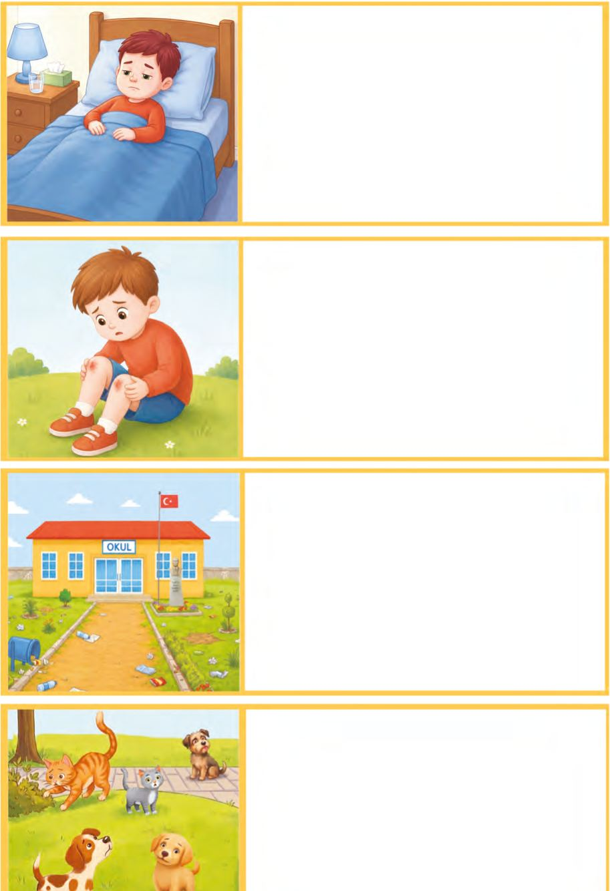 | |
|  | |
|  | |
|  | |

<!-- sayfa 80 -->

# EK-2: Yardım Küpü

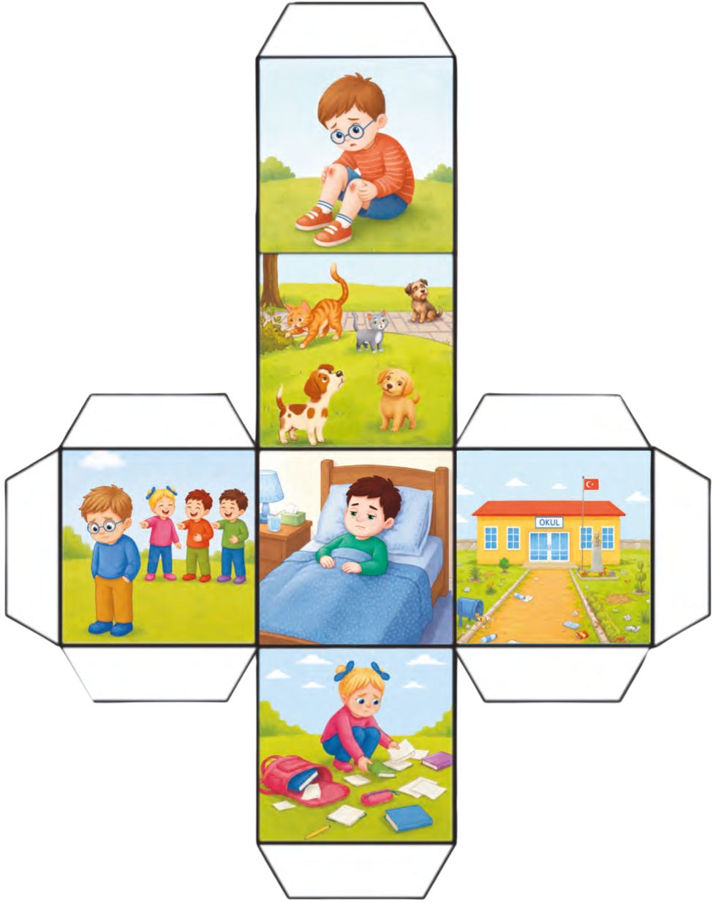

<!-- sayfa 81 -->

# EK-3: Portakal Kuş Yemi Kabı

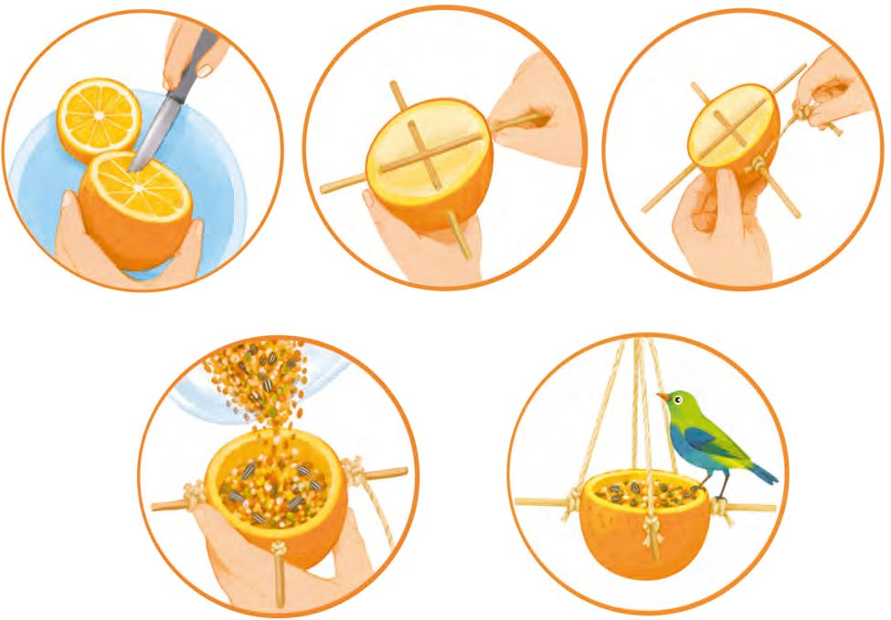

<!-- sayfa 82 -->

**ETKİNLİK ADI:** Dur-Bak-Onar
**ALAN ADI:** Türkçe
**YAŞ GRUBU:** 60-72 ay

**ALAN BECERİLERİ, ÖĞRENME ÇIKTILARI VE SÜREÇ BİLEŞENLERİ**

**TÜRKÇE ALANI**

**TAKB. Konuşma**

**TAKB.2. Konuşma sürecinin içeriğini oluşturabilme**

TAKB.2.g. Topluluk önünde sözlü sunum yapar.

**EĞİLİMLER**

**E2. Sosyal Eğilimler**

E2.1. Empati

**PROGRAMLAR ARASI BİLEŞENLER**

**Sosyal-Duygusal Öğrenme Becerileri**

**SDB3.3.Sorumlu Karar Verme**

**Değerler**

**D4. Dostluk**

D4.1. Arkadaşlarına destek olmak

**Sözcükler:** davranış, çözüm, onarmak, özür dilemek, yardım etmek, paylaşmak, arkadaşlık

**Eğitim / Öğrenme Ortamları:** Sınıf, çember düzeninde oturma ve küçük grup canlandırmalarına uygun şekilde düzenlenir. Çemberin ortasında alet çantası, durum kartları ve canlandırmalarda kullanılabilecek materyaller bulundurulur.

<!-- sayfa 83 -->

ETKİNLİKLER

Türkçe (Büyük Grup Etkinliği)

• Çocuklar çember şeklinde oturur. Çemberin ortasına bir alet çantası koyulur. Bu çantayı kimin kullandığı, çantanın içindekilerle neler yapıldığı üzerine konuşulur. “Bugün bizler de oyun tamircileri olacağız” denir. Bazen oyun sırasında yapılan bazı davranışların arkadaşlarımızı etkileyebileceği, onları üzebileceği veya oyunun akışını bozabileceği ifade edilir. “Oyun tamircilerinin görevi: ne olduğunu anlamak, davranışların sonuçlarını fark etmek ve çözümler bulmaktır.” açıklaması yapılır. Çocuklarla üç hareket belirlenir:

**Dur:** Herkes olduğu yerde donar.

**Bak:** Eller gözlerin üzerine götürülür ve dikkatlice inceliyormuş gibi yapılır.

**Onar:** Ellerle tamir etme hareketi yapılır.

• Hareketler birkaç kez uygulanarak oyunun akışı tanıtılır. İlk durum canlandırılır. Canlandırma için bir grup gönüllü çocuk seçilir. Canlandırma yapacak çocuklara durum anlatılır. Bir çocuk bloklarla kule yaparken başka bir çocuk yürürken kuleye çarpar ve kule devrilir.

• “Dur!” yönergesi verilir. Ardından “Bak!” yönergesi ile çocuklardan olayı incelemeleri istenir. Çocuklara “Burada ne oldu?”, “Bu davranış kimi etkiledi?”, “Kule yapan çocuk nasıl hissetmiş olabilir?”, “Kuleye çarpan çocuğun davranışı arkadaşını nasıl etkilemiş olabilir?” soruları yöneltilir. Çocukların davranışın başkaları üzerindeki etkisini fark etmeleri ve ifade etmeleri desteklenir. **(E2.1, SDB3.3)**

• Daha sonra çocuklara çözüm seçenekleri sunulur:
-Hiçbir şey söylemeden uzaklaşmak
-Arkadaşına gülmek
-Özür dileyip birlikte yeniden yapmak
-Oyunu bırakıp gitmek

• “Bu durumda hangi davranış doğru olur?” sorusu yöneltilir. Çocukların doğru davranışı seçmeleri desteklenir. **(SDB3.3)** Seçim yapıldıktan sonra “Onar!” yönergesi verilir. **(TAKB.2.g, D4.1)** Çocuklara aşağıdaki sorular yöneltilir:

*Arkadaşının üzüntüsünü azaltmak için ne yapabiliriz?*
*Oyunu yeniden düzeltmek için nasıl yardım edebiliriz?*
*Bu olumsuz sonucu nasıl telafi edebiliriz?*

• Çocukların özür dileme, yardım etme, birlikte yeniden yapma, zarar gören materyali onarma gibi çözüm yolları üretmeleri desteklenir. **(SDB3.3)** Ardından çözüm yeniden canlandırılır.

• Etkinlik aşağıdaki durumlarla aynı akışta devam eder. Aşağıdaki durumlar kâğıtlara yazılır. Sınıf küçük gruplara ayrılıp durum seçip canlandırma çalışmaları yapılır.

-Bir çocuğun arkadaşının oyuncağını izin almadan alması
-Bir çocuğun sırada bekleyen arkadaşının önüne geçmesi
-Bir çocuğun arkadaşının yaptığı resme gülmesi
-Bir çocuğun oyuna katılmak isteyen arkadaşını oyuna almaması
-Bir çocuğun yanlışlıkla arkadaşına çarpıp hiçbir şey söylemeden uzaklaşması
-Bir çocuğun kullandığı oyuncakları toplamadan bırakması

• Her durumda çocuklardan sırasıyla Davranışın kimi etkilediğini söylemeleri, doğru davranışı seçmeleri, sorunu giderecek telafi edecek çözüm yolları önermeleri beklenir **(SDB3.3)**.

<!-- sayfa 84 -->

**DEĞERLENDİRME**
* En çok hangi olayı çözmeyi sevdiniz?
* Oyunu yeniden düzenlemek için hangi çözümleri bulduk?
* Özür dilemek neden önemlidir?
* Yardım istemek veya yardım etmek hangi durumlarda işe yarar?
* Bugün öğrendiğiniz yeni çözüm yollarından biri neydi?

**FARKLILAŞTIRMA**

**Zenginleştirme:** Çocuklardan kendi “Oyun Tamircisi Senaryolarını” oluşturmaları istenebilir. Küçük gruplar hâlinde yeni bir sorun durumu düşünmeleri ve arkadaşlarının bu durumu çözmelerine fırsat vermeleri sağlanabilir. Çocuklar çözüm için birden fazla öneri geliştirerek hangi çözümün neden daha uygun olduğunu tartışabilirler. Canlandırma yapacak küçük gruplar oluşturulurken çocuklara sadece rol yapmak yerine “oyun gözlemcisi”, “çözüm üreticisi” ve “tamirci” gibi özel görevler verilerek akran etkileşiminin karmaşıklık düzeyi artırılabilir.

**Destekleme:** Sorun durumları görsellerle desteklenebilir. Çocukların çözüm durumunda iki seçenek sunularak seçim yapmaları sağlanabilir. Duyguları ifade etmek için duygu kartlarından yararlanılabilir. Canlandırmalarda akran desteği kullanılabilir. Çocuklara sunulan “Dur, bak ve onar!” yönergeleri eş zamanlı olarak bu eylemleri temsil eden görsel kartlar gösterilerek desteklenebilir. Gerektiğinde öfke ile ilgili sosyal öyküler eve gönderilebilir. Bu öyküler çocuklarla evde ailesiyle okuyup “Dur ve bak!” eylemlerinin provasını güvenli ev ortamında yapması sağlanarak, sınıftaki çatışma anlarına çocukların duygusal olarak hazırlanması desteklenebilir.

**AİLE VE TOPLUM KATILIMI**

**Aile Katılımı:** Ailelere evimizin oyun tamircisi çalışması gönderilir. Çocuklardan evde karşılaştıkları küçük bir problemi aileleriyle çözmeleri ve çözüm yolunu ertesi gün arkadaşlarıyla paylaşmaları istenebilir. Aileler çocukların kullandıkları çözüm cümlelerini not ederek okula iletebilir.

**Toplum Katılımı:** Okulun farklı sınıflarında kullanılan ortak kurallar incelenebilir. Çocuklarla “Oyun Tamircileri Kuralları” afişi hazırlanarak okulun ortak alanında sergilenebilir. Böylece olumlu davranışların okul topluluğunda yaygınlaştırılması desteklenebilir.

<!-- sayfa 85 -->

**ETKİNLİK ADI:** Sözünde Duran Kahraman
**ALAN ADI:** Türkçe
**YAŞ GRUBU:** 60-72 ay

**ALAN BECERİLERİ, ÖĞRENME ÇIKTILARI VE SÜREÇ BİLEŞENLERİ**

**TÜRKÇE ALANI**

**TADB. Dinleme / İzleme**

**TADB.2. Dinledikleri / izledikleri şiir, hikâye, tekerleme, video, tiyatro, animasyon gibi materyalleri ile ilgili yeni anlamlar oluşturabilme**

* TADB.2.a. Dinledikleri / izledikleri materyaller ile ön bilgileri arasında bağlantı kurar.
* TADB.2.b. Dinledikleri / izledikleri materyaller hakkındaki tahminini söyler.

**EĞİLİMLER**

**E2. Sosyal Eğilimler**

* E2.2. Sorumluluk
* E2.5. Oyunseverlik

**PROGRAMLAR ARASI BİLEŞENLER**

**Sosyal-Duygusal Öğrenme Becerileri**

**SDB1.2. Kendini Düzenleme (Öz Düzenleme)**

**Değerler**

**D4. Dostluk**

* D4.3. Güvene dayalı ilişkiler kurmak

**Okuryazarlık Becerileri**

**OB4. Görsel Okuryazarlık**

**Kavramlar:** Zıt: aynı-farklı
**Sözcükler:** söz vermek, hazine, güven
**Materyaller:** hazine kutusu, görsel kartlar, rozetler
**Eğitim / Öğrenme Ortamları:** Etkinlikte kullanılacak olan söz kartlarından iki adet hazırlanır. Kartların üzerinde hem yazılar ve basit bir sembol olur. Kartlardan biri sepete konur, diğer aynı kart sınıf içinde farklı bir yere saklanır.

<!-- sayfa 86 -->

**ETKİNLİKLER**

**Türkçe (Büyük Grup Etkinliği)**

* “Bir hikâyem var, hadi toplanın, dinleyin bakalım, bugün neler anlatacağım.” denilerek çocukların dikkati çekilir. “Bir zamanlar sözünde duran ve hep doğruyu söyleyen bir kahraman varmış. Bu kahramanın en büyük gücü, sözünde durmasıymış. Sözünde durduğu için herkes onu çok sever ve ona çok güvenirmiş. Bir gün kahramanımız, gizemli bir adaya gitmiş ve bir hazinenin peşine düşmüş. Bu hazineyi bulmak için kahramanımızın birçok zorluğun üstesinden gelmesi gerekiyormuş ve bize ihtiyacı olacakmış. Kimler ona yardımcı olmak ister? Söz vererek, verdiğimiz sözleri tutarak bu gizemli hazineyi bulabilecek miyiz, ne dersiniz?” diyerek etkinlik başlatılır (TADB.2.b).
* Çocuklar çember olur ve kahramanın en önemli özelliğinin ne olabileceği çocuklara sorulur. Çocuklara “Söz vermek ne demektir?” diye sorulur. Gelen cevaplar dinlenir. “Söz vermek, bir şeyi yapacağını kesin bir şekilde söylemektir. Bir arkadaşımıza söz verdiğimizde o sözü yerine getirmek bizim sorumluluğumuzdur.” açıklamaları yapılır. “Sözümüzü tutarsak neler olabilir? Sözümüzü tutmazsak neler olabilir?” soruları sorulur ve çocukların cevapları dinlenir (TADB.2.a, SDB1.2)
* “Haydi, şimdi kahramanımızın macerasına biz de katılalım ve hazine sandığını bulalım.” denir (E2.5). “Hazine sandığını bulmak için kahramanımıza yardım edelim. Elimde bulunan sepetin içinde hazineye ulaşmak için yerine getirmemiz gereken sözler yer alıyor. Önce herkes elimde bulunan sepetten bir söz kartı seçsin. Sınıfın içinde farklı yerlere sizin kartlarınızın aynısını sakladım. Hazineye ulaşmak için birinci adım, kartınızın aynısını sınıfın içinden bulup bana getirin.” denir. Çocuklar sınıfın içine saklanan kartlar arasından kendi kartının aynısını bulmaya çalışır (OB4).
* Tüm çocuklar kartı bulup getirdikten sonra kartların üzerindeki görselleri inceleyip kartın üzerindeki görselin nasıl bir söz verme eylemini ifade edebileceği çocuklara sorulur. Çocukların tahminleri dinlenir. Kartların üzerindeki sözler çocuklara okunur. Kartların üzerinde “Bir arkadaşına okuldaki eşyanı paylaşacağına dair söz verdin.”, “Sözünü tutmak için ne yapman gerekir?”, “Bir arkadaşına onunla parkta onun istediği oyunu oynayacağına söz verdin. Sözünü tutmak için ne yapman gerekir?”, “Öğretmenine ve arkadaşlarına sınıfın kurallarına uyacağınla ilgili söz verdin. Sözünü tutmak için ne yapman gerekir?” gibi ifadeler yer almaktadır. Çocuklar, verdikleri sözü yerine getirmek için üzerlerine düşen görevlerin neler olduğunu ve nasıl davranmaları gerektiğini kendi cümleleriyle açıklarlar (SDB1.2, D4.3, E2.2).
* Tüm çocuklar kartlarında yazan sözlere ilişkin düşüncelerini ifade ettikten sonra kartlar çocukların görebileceği bir alana asılır. Ardından “Kahramanımıza yardım etmek için hepiniz söz kartlarını buldunuz ve verdiğiniz sözleri tutmak için neler yapmanız gerektiğini söylediniz. Böylece hazineye giden tüm adımları tamamladınız. Şimdi hazine sandığını açma zamanı” denir ve hazine kutusu getirilir. Hazine kutusunun içinden çıkan rozetler çocuklara dağıtılır. “Bu rozetler, verdiğimiz sözleri tutmak için gösterdiğiniz çabayı ve güvenilir bir arkadaş olmayı hatırlatsın” denilerek etkinlik sonlandırılır.

**DEĞERLENDİRME**

* Kahramanımızın en önemli özelliği neydi?
* Bir söz verdiğinizde tutmak için neler yaparsınız?
* Birine söz verip tutmadığımızda, o kişinin bize olan güveni nasıl değişir?
* En son kime, ne hakkında söz verdiniz?

<!-- sayfa 87 -->

# FARKLILAŞTIRMA

**Zenginleştirme:** Çocuklara seçtiği karttaki durumun şartları değiştiğinde (sözünü tutması zorlaştığında veya beklenmedik bir engel çıktığında) nasıl alternatif çözümler üretebileceği sorulabilir. Arkadaşların birbirlerine verdiği farklı sözleri konu edinen bir animasyon izletilebilir. “Bundan sonra ne olacak sizce?”, “Kahraman sözünü tutabilecek mi?” gibi sorular sorularak çocuklardan animasyonun devamını tahmin etmeleri istenebilir. Animasyonun ardından “Sizce bize anlatılmak istenen nedir?” vb. sorular sorulabilir.

**Destekleme:** Günlük yaşamdan kısa ve anlaşılır örnekler verilebilir. Basit cümleler kurmaları desteklenebilir. Öyküye ilişkin büyük boyda resimler kontrast renkte zemin üzerine hazırlanarak görsel açıdan daha işlevsel öykü kartları oluşturulabilir. Gizlenen kartları bulma bölümünde akran eşleştirmesi yapılabilir. Kartların saklı olduğu yerleri gösteren sınıf haritası kullanılabilir. Gerektiğinde çocuklara ek süre sağlanabilir.

# AİLE VE TOPLUM KATILIMI

**Aile Katılımı:** Ailelere, sözünde durma ile ilgili masal anlatmaları veya hikâye okumaları ve masal / hikâye ile ilgili sohbet etmeleri istenebilir.

<!-- sayfa 88 -->

**ETKİNLİK ADI:** Buğday Tanesinden Ekmeğe
**ALAN ADI:** Türkçe
**YAŞ GRUBU:** 60-72 ay

**ALAN BECERİLERİ, ÖĞRENME ÇIKTILARI VE SÜREÇ BİLEŞENLERİ**
**TÜRKÇE ALANI**
**TAKB. Konuşma**
**TAKB.2. Konuşma sürecinin içeriğini oluşturabilme**
TAKB.2.b. Konuşmanın devamı hakkındaki tahminini söyler.

**EĞİLİMLER**
**E3. Entelektüel Eğilimler**
E3.6. Analitiklik

**PROGRAMLAR ARASI BİLEŞENLER**
**Sosyal-Duygusal Öğrenme Becerileri**
SDB1.2. Kendini Düzenleme (Öz Düzenleme)

**Değerler**
D12. Sabır
D12.1. Düşünce, duygu ve davranışlarında kontrollü olmak

**Okuryazarlık Becerileri**
OB1. Bilgi Okuryazarlığı

**Kavramlar:** Miktar: eşit
Duyu: sıcak-soğuk-ılık

**Sözcükler:** buğday, çiftçi, ambar

**Materyaller:** buğday tanesi fotoğrafı, un, su, tuz, maya, perde ya da çarşaf

**Eğitim / Öğrenme Ortamları:** Bir kabın içine un, su, maya ve tuz koyularak bu şekilde masalara dağıtılır.

<!-- sayfa 89 -->

**Türkçe (Büyük Grup Etkinliği)**

* Buğday tanesinin fotoğrafları çocuklara gösterilir, incelemeleri için fırsat verildikten sonra “Çocuklar bu resimde ne olduğunu bilen var mı? Görmüş olduğunuz bu buğday tanesi. Peki, bu buğday tanesi ne için kullanılır?” sorularıyla sohbet başlatılır. Çocukların cevapları dinlendikten sonra öğretmen elindeki bir kuş kuklasıyla şu hikâyeyi anlatmaya başlar:“Bir gün çiftçi, buğday tarlalarındaki buğdayların olgunlaştığını fark etmiş. Buğdayları toplamış ve ambarına yerleştirmiş. Bir süre sonra çiftçinin eşi, ‘Bu buğdayları nasıl kullanabiliriz?’ diye sormuş. İkisi birlikte buğdayları temizlemiş ve taş yardımıyla ezerek un haline getirmişler. Çiftçi, ‘Peki, şimdi ne yapacağız?’ diye sormuş.” Hikâye durdurularak “Sizce undan ne yapılabilir?” sorusu yöneltilir. Çocukların tahminleri dinlendikten sonra hikâye devam edilir: Çiftçinin harika bir fikir bulduğunu söylemiş ve unu bir kaba koymuş. Üzerine suyu, tuzu ve mayayı yavaş yavaş ekleyerek yoğurmaya başlamış. Ama hamur çok yumuşak olmuş ve şekil almamış. Hikâye durdurularak çocuklardan hamurun uygun kıvamı gelmesi için çözüm önerileri istenir. Yanıtlar dinlendikten sonra hikâye sürdürülür: “Çiftçi ile eşi, uygun miktarlarda un ekleyerek hamuru yeniden yoğurmuşlar. Sonunda yumuşak ve kolay şekil alan bir hamur hazırlamışlar. Hamurun mayalanması için bir süre beklemişler.” “Sizce hamuru yoğurup beklediklerinde hamurda nasıl bir değişiklik olmuş olabilir?” sorusu yöneltilir (TAKB.2.b, E3.6, SDB1.2, OB1, ). Çocukların yanıtları dinlendikten sonra hikâye devam eder. “Bir süre sonra bir bakmışlar ki hamur çoğmalmış da çoğmalmış. İki katı kadar olmuş. Hamura şekil vererek taş fırına yerleştirmişler. Pişen ekmek kızarmış ve çevreye güzel kokular yayılmış. Kuş kuklası, ‘Bana da, bana da!’ diyerek ekmekten istemiş. Sıcak olan ekmeği fırından çıkaran çiftçi ve hanımı, yaptıkları karşısında kendileri ile gurur duymuşlar. Ekmeğin tadına bakmışlar. Çok ama çok beğenmişler.
* Hikâyenin ardından “Çocuklar, bizim her gün severek yediğimiz, tadına doyamadığımız ekmekler işte buğdaydan yapılıyor. Buğdayın öğütülmesiyle un elde edildi. Un, su, tuz ve maya kullanılarak da ekmek yapıldı. Şimdi biz de ekmek yapalım mı?” sorusu yöneltilir. Çocukların yanıtları dinlendikten sonra lavaboya gidilerek ellerin yıkanması sağlanır. Bir kabın içine un, su, tuz ve maya konur. Bu malzemeler bir güzel karıştırılır ve yoğrulur..
* Yoğurma işlemi bittikten sonra hamur mayalanırken oyun oynayacakları söylenir. Hamur mayalanırken hangi oyunları oynamak istedikleri sorularak seçtikleri birkaç oyun bu zaman diliminde oynanır (D12.1). Oyun sonunda “Çocuklar ekmek hamurumuz mayalanmıştır. Hadi şimdi ellerimizi yıkayarak hamura şekil vermeye gidelim” denir. Önce eller yıkanır, sonra tüm çocuklara eşit miktarda hamur verilir. Çocuklar önce hamura dokunur, yoğururlar, daha sonra herkes istediği şekilde hamura şekil verir ve hamurlar fırın tepsisine konulur ve fırına verilir.
* Hamurlar karışmasın diye çocukların isimleri yazılabilir. “Çocuklar ekmek yapmak sabır isteyen bir iştir. Artık heyecanlı bekleyiş süresi başlar. Çocuklar ekmeğin fırında pişerek nar gibi kızarmasını izlerler (SDB1.2, D12.1). Çocuklarla çok istediğimiz bir şeyin olması için heyecanla beklemeye ‘sabretmek’ denildiği, bir işi sonuna kadar tamamlamanın neden önemli olduğu ve neleri beklerken zorlandığımız üzerine konuşulur. Tıpkı fırındaki ekmeğin pişmesini beklemek gibi güzel sonuçlara ulaşmak için sabırlı olmanın bize neler hissettirdiği paylaşılır (D12.1). Pişen ekmekler soğuması için kenara alınır. Ekmekler soğuduktan sonra her çocuk kendi yapmış olduğu ekmeğin tadına bakar.

**DEĞERLENDİRME**

* Buğdaydan başka neler elde edilir?
* Ekmek hamurunun içine neler koyduk?
* Sabretmek neden önemlidir?
* Sabırlı insanlar nasıl davranır?
* Sen hangi durumlarda sabırlı davranırsın?

<!-- sayfa 90 -->

# FARKLILAŞTIRMA

**Zenginleştirme:** Hikâyeye çocuklara anlatılırken “Sizce bu buğday tanesine bundan sonra ne olacak?” gibi sorular sorarak etkileşimli okuma gerçekleştirebilir. Çocuklara; buğdayları, buğdayların nasıl yetiştiklerini, buğday hasadını, başaklar gibi konularda konuşmaları için fırsat verilebilir. Hikâye anlatırken yarıda kesilerek arkası yarın tekniği ile çocukların hikâyeyi tamamlamaları istenebilir. “Buğdayın ekmeğe dönüşümü gibi hayatımızda birçok dönüşüm süreci vardır. Bunlar neler olabilirler?” diye sorarak beyin fırtınası yapılabilir. Örneğin tırtılın kelebeğe dönüşümü, larvanın kurbağaya dönüşümü vb. Buğdayın ekmeğe dönüşümünü gösteren görsel kartlar hazırlanarak bir grafik oluşturulabilir. Kartlardaki olaylarla ilgili tahminde bulunmaları ve ne yapılabileceği konusunda çıkarım yapmaları istenebilir.

**Destekleme:** Buğday tanesi ve ekmeğin ilişkisini daha somut hale getirmek için etkinliğin başında görsel materyaller (resimler, videolar) kullanılabilir. Örneğin buğday tanesi ve ekmek yapımının basitleştirilmiş modelleriyle görsel bir sunum yapılabilir. Dokunsal açıdan daha işlevsel olması için buğday tanesi fotoğrafı yerine sınıfa gerçek buğday taneleri getirilebilir. Küçük gruplar oluşturularak ya da akran eşleştirmesi yapılarak çocuklar desteklenebilir. Hamura dokunmak istemeyen çocuklar için hamur kesme aparatları ya da eldiven gibi materyaller kullanarak ekmek yapmaları sağlanabilir.

# AİLE VE TOPLUM KATILIMI

**Aile Katılımı:** Çocukların ekmek yaparken çekilen fotoğraf ve videoları aileler ile paylaşılır. Evde çocukları ile ekmek yapmaları ve ailece oturup yerken ekmeği israf etmemek gerektiği konusunu konuşmaları istenebilir.

**Toplum Katılımı:** Ekmek fırınına alan gezisi düzenlenerek bir ekmeğin nasıl yapıldığı hakkında gözlem yapılabilir.

<!-- sayfa 91 -->

**ETKİNLİK ADI:** Fillerin Ayak Sesi  
**ALAN ADI:** Türkçe  
**YAŞ GRUBU:** 60-72 ay  

**ALAN BECERİLERİ, ÖĞRENME ÇIKTILARI VE SÜREÇ BİLEŞENLERİ**  

**TÜRKÇE ALANI**  
**TADB. Dinleme / İzleme**  
**TADB.4. Dinledikleri / izledikleri şiir, hikâye, tekerleme, video, tiyatro, animasyon gibi materyalleri değerlendirebilme**  
TADB.4.a. Dinledikleri / izledikleri materyallere ilişkin duygu ve düşüncelerini ifade eder.  

**EĞİLİMLER**  
**E2. Sosyal Eğilimler**  
E2.5. Oyunseverlik  
**E3. Entelektüel Eğilimler**  
E3.3. Yaratıcılık  
E3.6. Analitiklik  

**PROGRAMLAR ARASI BİLEŞENLER**  

**Sosyal-Duygusal Öğrenme Becerileri**  
**SDB2.2. İş Birliği**  

**Değerler**  
**D5. Duyarlılık**  
D5.3. Afet bilincine sahip olmak  

**Okuryazarlık Becerileri**  
**OB4. Görsel Okuryazarlık**  

**Sözcükler:** deprem, sarsıntı, sabitleme, mühendis  
**Materyaller:** “Fillerin Ayak Sesi” isimli hikâye kitabı, ahşap bloklar, kum saati.  
**Eğitim / Öğrenme Ortamları:** “Fillerin Ayak Sesi” isimli hikâye kitabı ve çocukları gruplamak için renkli düğmeler masalarda önceden hazırlanır.

<!-- sayfa 92 -->

# ETKİNLİKLER

## Türkçe (Küçük Grup Etkinliği)

* Çocukların çember düzeninde oturmaları sağlanır. Daha önce öğrenilen parmak oyunlarından birini seçmeleri istenir. Seçilen parmak oyunu çocukların katılımıyla söylenir. Ardından “Fillerin Ayak Sesi” adlı hikâye kitabı okunur. Hikâyenin bazı bölümlerinde durularak sayfadaki olaylar hakkında konuşulur (TADB.4.a). Hikâyenin ardından aşağıdaki sorularla anlatılanlar pekiştirilir:
    -Karıncaların yuvası neden sallandı?
    -Karıncalar hangi önlemleri aldılar?
    -Karıncaların aldıkları önlemler işe yaradı mı? (D5.3)
* Ardından sağlam ve dayanıklı binalar hakkında sohbet edilir. Binaların mühendisler tarafından sağlam ve güvenli olacak şekilde tasarlandığı, uygun malzemelerin kullanılmasıyla yapıların dayanıklılığının artırılabileceği açıklanır. Çocukların gruplara ayrılmaları için bez bir kesenin içinden birer düğme seçmeleri istenir. Her çocuğun seçtiği düğmenin rengine uygun masaya geçmesi sağlanır. Grup masalarına farklı yapı malzemeleri yerleştirilir. Bir masaya çeşitli kartonlar, bir masaya pipet, bardak gibi plastik malzemeler, bir başka masaya geçmeli plastik bloklar, diğer masaya ise aynı şekillerden oluşan ahşap bloklar bırakılır. Bir kum saati gösterilerek kumlar tamamen diğer bölüme akıncaya kadar sürelerinin olduğu açıklanır. Bu süre içinde grup arkadaşlarıyla iş birliği yaparak sağlam ve dayanıklı bir bina oluşturmaları istenir. Süre sonunda yapıların dayanıklılığını gözlemlemek amacıyla masaların hafifçe sallanacağı belirtilir. Sağlam ve dayanıklı binalar oluşturmak için çocukların grup arkadaşlarıyla fikir alışverişinde bulunmaları ve ortak karar almaları desteklenir (SDB2.2). Süre tamamlandığında çocukların masaların kenarına geçmeleri sağlanır. Masalar hafifçe sallanarak yapıların bu hareketten nasıl etkilendiği birlikte gözlemlenir. “Yapınızda nasıl bir değişiklik oldu?” ve “Sizce bunun nedeni ne olabilir?” soruları yöneltilir. Çok fazla değişen veya dağılan yapıların neden etkilenmiş olabileceği üzerine konuşulur. Çocuklara yapılarını yeniden düzenlemeleri ve farklı çözümler denemeleri için fırsat verilir (E2.5). Oyunun ardından malzemeler birlikte toplanır ve çocukların masalara geçmeleri sağlanır. Her çocuğa boş kâğıt ve boya kalemleri verilir. Birer mühendis olduklarını hayal ederek sağlam ve dayanıklı bir bina tasarımı çizmeleri istenir (E3.3, E3.6, OB4). Çizimini tamamlayan çocuklara tasarımlarını anlatmaları için fırsat verilir. Çocukların açıklamaları kâğıtların kenarına not edilir. Tamamlanan çizimler sınıf panosunda sergilenir.

## DEĞERLENDİRME

* Hikâyede neler oldu?
* Daha önce evdeki eşyaların sabitlenmesi gerektiğini duymuş muydun? Eşyalar neden sabitleniyor olabilir?
* Ahşap bloklarla ev inşa ederken ne gibi problemlerle karşılaştın?
* Bina tasarımı yaparken çiziminde nelere dikkat ettin?

## FARKLILAŞTIRMA

**Zenginleştirme:** Mühendislik ve yapı hakkında bazı temel kavramlar, depreme dayanıklı binaların tasarım özellikleri, raylı sistemler çocuklara bilgisayar / projeksiyon ile sunulabilir. Gruplardan farklı malzemeler kullanarak ikinci bir bina oluşturmaları ve iki yapının dayanıklılığını karşılaştırmaları istenebilir. Çocukların yapılarına destek kolonları ekleyerek yeniden deneme yapmaları sağlanabilir. Ardından “Hangi değişiklik binanı daha sağlam hâle getirdi?” ve “Aynı yapıyı başka bir malzemeyle yapsaydın ne değişirdi?” soruları yöneltilebilir. Hazırlanan bina çizimleri bir araya getirilerek “Dayanıklı Yapılar Şehri” oluşturulabilir.

**Destekleme:** Grupların oluşturulması sırasında çocukların bireysel özellikleri dikkate alınarak düzenlemeler yapılabilir. Çizim yapmaları yerine isteyen çocuklara birbirine geçmeli tuğlalar ile bina tasarlayabilirler.

## AİLE VE TOPLUM KATILIMI

**Aile Katılımı:** Gün içerisinde yapılan etkinlikler hakkında aileler bilgilendirilir. Ev içerisinde eşyalar sabitlenmişse çocuklarla incelemeleri eğer eşyalar sabit değilse hangilerinin sabitlenmesi gerektiği hakkında sohbet etmeleri istenebilir.

<!-- sayfa 93 -->

**ETKİNLİK ADI:** Sınıfımızın Türküsü
**ALAN ADI:** Türkçe, Matematik, Sosyal, Müzik
**YAŞ GRUBU:** 60-72 ay

**ALAN BECERİLERİ, ÖĞRENME ÇIKTILARI VE SÜREÇ BİLEŞENLERİ**

**TÜRKÇE ALANI**
**TAKB. Konuşma**
**TAKB2. Konuşma sürecinin içeriğini oluşturabilme**
TAKB.2.e. Şiir, hikâye, tekerleme gibi özgün sözlü ürün oluşturur.

**MATEMATİK ALANI**
**MAB3. Matematiksel Temsil**
**MAB.9. Matematikle ilgili temsillerden yararlanabilme**
MAB.9.f. Tek özelliğe dayalı verileri grafik kullanarak sembolleştirir.

**MAB4. Veri ile Çalışma ve Veriye Dayalı Karar Verme**
**MAB.11. Veriyle çalışabilme**
MAB.11.b. Veri toplar.

**MAB.13. Bulguyu yorumlayabilme**
MAB.13.a. Elde ettiği sonuçlara ilişkin basit çıkarımlarda bulunur.

**SOSYAL ALAN**
**SBAB16. Eleştirel Sosyolojik Düşünme**
**SAB.14. Toplumsal yaşama yönelik nesne, olgu ve olayları çözümleyebilme**
SAB.14.a. Türk kültürüne ait özellikleri belirler.

**MÜZİK ALANI**
**MDB1. Müziksel Dinleme**
**MSB.2. Söyleme becerilerini sınıf içinde sergileyebilme**
MDB.1. b. Müzik eserlerini dinler.

**MSB2. Müziksel Söyleme**
**MDB.1. Çeşitli müzik eserlerini dinleyebilme**
MSB.2.a. Şarkıyı grupla ya da tek başına söyler.

**EĞİLİMLER**
**E3. Entelektüel Eğilimler**
E3.3. Yaratıcılık

**PROGRAMLAR ARASI BİLEŞENLER**
**Sosyal-Duygusal Öğrenme Becerileri**
SDB2.1. İletişim
SDB2.3. Sosyal Farkındalık

**Değerler**
D19. Vatanseverlik

<!-- sayfa 94 -->

**Okuryazarlık Becerileri**

**OB5. Kültür Okuryazarlığı**

**Kavramlar:** Miktar: az-çok

**Sözcükler:** bağlama, saz, davul, kemençe, tulum

**Materyaller:** farklı yörelere ait türküler, türkü yörelerine ait kostüm, enstrüman görselleri, çocukların fotoğrafları, karton, kalem

**Eğitim / Öğrenme Ortamları:** Etkinlik öncesinde farklı yörelere ait türkü kayıtları ve bu türkülere ilişkin görseller dijital sunum aracında hazır hâle getirilir, grafik çalışmasında kullanılacak karton ve çocuk fotoğrafları masalara yerleştirilir.

<!-- sayfa 95 -->

# ETKİNLİKLER

## Müzik (Büyük Grup Etkinliği)

* Gün içinde çocuklar öğrenme merkezlerinde vakit geçirirken farklı yörelere ait türküler kısık sesle dinletilir. Öğrenme merkezlerindeki oyunları bittikten sonra çocukların çemberde bir araya gelmeleri sağlanır ve türkülerin sesi biraz yükseltilir. Çocukların türküleri dikkatle dinlemeleri sağlanır (**MDB.1.b**). “Bu türküleri daha önce duydunuz mu?” sorusu yöneltilir. Çocukların konuşmak için sıralarını bekleyerek yanıtlarını paylaşmaları desteklenir (**SDB2.1**).
* Dinlenen eserlerin Türkiye’nin farklı bölgelerine ait türküler olduğu açıklanır. “Türkü” sözcüğünün “Türk’e özgü” anlamı geldiği söylenir. Bazı türkülerin halk şairleri tarafından yazıldığı, bazı türkülerde ise söyleyen kişinin zamanla unutulduğu ve bu tür eserlerin “anonim” olarak adlandırıldığı açıklanır. Çocuklardan dinledikleri türkülerin kültürümüze ait hangi unsurları yansıttığına ilişkin düşüncelerini söylemeleri istenir (**OB5**). Türkülerin kültürümüzde önemli bir yere sahip olduğu; dinlenerek, öğrenilerek ve yeni kuşaklara aktarılarak korunabileceği üzerinde durulur.
* Öğrenme merkezine kartondan hazırlanmış bir lokomotif ve vagonlardan oluşan “Türkü Treni” yerleştirilir. Vagonlara Türkiye’nin farklı bölgelerine ait fotoğraflar ve bu bölgelerin kültürel özelliklerini yansıtan görseller eklenir. Çocukların treni incelemeleri sağlanır. Her vagonun bir bölgeyi temsil ettiği açıklanır. Çocuklar vagonlardaki bölge görsellerini, yöresel kıyafetleri ve türkülerde kullanılan çalgıları inceleyerek Türk kültürüne ait özellikleri belirler (**SAB.14.a, OB5**). Çocukların farklı bölgelere ait kültürel özellikleri ilgiyle incelemeleri ve bu farklılıklara saygı göstermeleri desteklenir (**SDB2.3**).
* Ardından bölgelere ait türküler dinletilir (**MDB.1.b**). Çocuklardan türkülerde duydukları ezgi, çalgı ve ritim özelliklerine dikkat etmeleri istenir. “Bu türküde hangi çalgıları duydunuz?”, “Türkülerin ezgileri birbirine benziyor mu?” ve “Türkülerin ritimlerinde ne gibi farklılıklar fark ettiniz?” soruları yöneltilir. Çocukların dinledikleri türkülerin ezgi, çalgı ve ritim özellikleri arasındaki farklılıkları söylemeleri sağlanır (**MDB.3.ç**). Çocukların türküler ile vagonlarda yer alan bölge, kıyafet ve çalgı görselleri arasında ilişki kurmaları desteklenir (**OB5**). Her türkünün ardından “Bu türkü sana ne hissettirdi?” ve “Türküde neler anlatılıyor olabilir?” soruları yöneltilir. Çocukların konuşmak için sıralarını bekleyerek duygu ve düşüncelerini paylaşmaları sağlanır (**SDB2.1**).
* Büyük bir karton üzerine grafik hazırlanır. Grafiğin sol bölümüne çocukların fotoğrafları, üst bölümüne ise dinlenen türkülerin adları yerleştirilir. Bütün türküler dinlendikten sonra çocuklardan en beğendikleri türküye oy vermeleri istenir. Her çocuğun tercihi alınarak sınıfın türkü tercihlerine ilişkin veriler toplanır (**MAB.11.b**). Çocuklar fotoğraflarını veya kendilerini temsil eden sembolleri seçtikleri türkünün bulunduğu bölüme yerleştirerek tercih verilerini grafikte gösterir (**MAB.9.f**). Tüm çocukların oy vermesinin ardından grafik birlikte incelenir. En fazla ve en az oy alan türküler karşılaştırılır. Çocukların grafikteki verilerden hareketle en çok tercih edilen türkü hakkında çıkarımda bulunmaları sağlanır (**MAB.13.a**). En fazla oy alan türkü “Sınıfımızın Türküsü” olarak belirlenir. Hazırlanan grafik çocukların görebilecekleri uygun bir alana asılır.
* Çocuklara “Türkülerin unutulmaması ve bizden sonra gelecek çocuklara aktarılması için neler yapabiliriz?” sorusu yöneltilir. Çocukların kültürümüze ait türküleri korumaya ve gelecek kuşaklara aktarmaya ilişkin düşüncelerini paylaşmaları sağlanır (**D19.3**).
* Ardından “Bizden sonra sınıfımıza gelecek çocuklar için birlikte bir türkü oluşturalım mı?” sorusu yöneltilir. Çocukların önerileri doğrultusunda özgün türkü sözleri oluşturulur (**TAKB.2.e, E3.3**). Oluşturulan sözler büyük bir kartona yazılarak çocukların görebilecekleri bir alana asılır. Sözler tamamlandıktan sonra “Bu sözleri bir melodiyle söylemek isteseydiniz melodisi nasıl olurdu?” sorusu yöneltilir. Çocukların hayal güçlerini kullanarak türküye özgün bir melodi oluşturmaları desteklenir (**E3.3**). Oluşturulan türkü çocuklar tarafından grup hâlinde veya tek başına seslendirilir (**MSB.2.a**).

<!-- sayfa 96 -->

# DEĞERLENDİRME
* Daha önce türkü dinledin mi?
* Türküler arasında ne gibi farklılıklar var?
* Bir enstrüman çalsaydın bu ne olurdu? Neden?
* Türkü yazarken (oluştururken) ve yazdığın türküye beste yaparken zorlandın mı?
* Türküleri dinlemek sana ne hissettirdi?

## FARKLILAŞTIRMA
**Zenginleştirme:** Çocuklardan “türkü treni”ndeki bölgelerden birini seçmeleri ve o bölgeye ait görsellerle dinlenen türkü arasında kurdukları ilişkiyi arkadaşlarına açıklamaları istenebilir. Türküler; ritim, kullanılan çalgılar ve hissettirdiği duygular bakımından karşılaştırılabilir. Oluşturulan sınıf türküsüne ritim çalgılarıyla eşlik edebilir ve çocuklar türkünün bir bölümünü bireysel ya da küçük grup hâlinde seslendirebilirler.

**Destekleme:** Türkülerin anlaşılmasını kolaylaştırmak amacıyla az sayıda ve kısa örnek seçilebilir, türküler gerektiğinde tekrar dinletilebilir. Bölge, kıyafet ve çalgı görselleri büyük boyutlu ve belirgin biçimde hazırlanabilir. Oy verme ve türkü oluşturma aşamalarında akran desteği sağlanabilir, çocuklara seçim yapmaları ve düşüncelerini paylaşmaları için ek süre verilebilir. Melodi oluşturma sürecinde ritim çalgılarından, alkıştan veya örnek bir ezgiden yararlanılabilir.

## AİLE VE TOPLUM KATILIMI
**Aile Katılımı:** Gün içerisinde yapılan etkinlikler hakkında aileler bilgilendirilebilir. Evde çocuklarıyla kendi yörelerine ait bir türküyü araştırmaları ve dinlemeleri önerilebilir.

**Toplum Katılımı:** Sınıfa bir bağlama ya da bir müzik aleti çalan bir yetişkin davet edilebilir ve çocuklarla türkü söylenebilir.

<!-- sayfa 97 -->

**ETKİNLİK ADI:** Benim Aile Ağacım   
**ALAN ADI:** Sanat    
**YAŞ GRUBU:** 60 -72 ay     

**ALAN BECERİLERİ, ÖĞRENME ÇIKTILARI VE SÜREÇ BİLEŞENLERİ**

**SANAT ALANI**

**SNAB.4. Sanatsal Uygulama Yapma** 
* **SNAB4. Sanat etkinliği uygulayabilme**
    * SNAB.4.ç. Sanat etkinliklerine aktif olarak katılır.
    * SNAB.4.d. Sanat etkinliklerinde özgün ürünler oluşturur.

**EĞİLİMLER** 

**E3. Entelektüel Eğilimler**
* E3.3. Yaratıcılık

**PROGRAMLAR ARASI BİLEŞENLER** 

**Sosyal-Duygusal Öğrenme Becerileri**
* **SDB1.2. Kendini Düzenleme (Öz Düzenleme)** 

**Değerler**
* **D2. Aile Bütünlüğü**
    * D2.1. Aile içi dayanışma göstermek

**Kavramlar:** Duygu: sevgi
**Sözcükler:** paylaşım, yardımlaşma, dayanışma
**Materyaller:** ağaç kalıbı, renkli kartonlar, boya kalemleri   
**Eğitim / Öğrenme Ortamları:** Sınıf panosuna bir ağaç görseli asılır. Etkinlik uygulanmadan önce ailelere bilgilendirme yapılarak aile üyelerinin fotoğrafları ve aile üye sayısı kadar yaprak getirmeleri istenir.

<!-- sayfa 98 -->

# ETKİNLİKLER

## Sanat (Büyük Grup Etkinliği)
* Çocuklar masalara geçer ve evden getirdikleri yaprakları yan yana dizer. Çocuklara “Kaç tane yaprak getirdiniz?”, “Bu yapraklardan hangisi anneniz, hangisi babanız, hangisi kardeşiniz olacak?” soruları sorulur. Yaprakların bir aile ağacı oluşturmak için kullanılacağı çocuklara söylenir.
* Üzerinde aile bireylerinin yer aldığı örnek bir “aile ağacı” gösterilir. “Sizce bir ailede kim kime yardım eder? Anneniz babanıza, kardeşiniz size nasıl yardımcı olur?” soruları sorularak çocukların aile içinde birbirine destek olmasının, yardımlaşmanın önemini kendi cümleleriyle ifade etmeleri desteklenir (D2.1).
* Her çocuğa ağaç şablonu, boya kalemleri, renkli kâğıtlar ve yapıştırıcı dağıtılır. Çocuklar aile bireylerini çizerek veya fotoğraflarını yapraklara yapıştırarak kendi aile ağaçlarını oluştururlar (SNAB.4.ç, SNAB.4.d, E3.3).
* Çalışma tamamlandıktan sonra çocuklar sırayla aile ağaçlarını arkadaşlarına göstererek anlatır. Ağacındaki kişileri tanıtır ve aile bireyleriyle yaşadığı paylaşım ve dayanışma örneklerini anlatır (SDB1.2, D2.1). Etkinlik sonunda çalışmalar sınıfta sergilenir.

## DEĞERLENDİRME
* Aile ağacındaki kişileri çizerken / yapıştırırken ne hissettin?
* Ailenle birlikteyken en çok hangi duyguyu hissedersin?
* Sen en son ne zaman mutlu oldun? Neden?
* Ailen sana hangi konularda yardımcı oluyor?
* Üzüldüğünde ya da zorlandığında kimden destek alırsın?
* Aile ağacında kullandığın semboller veya renkler neyi anlatıyor?

# FARKLILAŞTIRMA

**Zenginleştirme:** Çocuklardan seçtikleri bir duygu kartını mimik ve beden hareketleriyle canlandırmaları, arkadaşlarının da hangi duyguyu gösterdiğini tahmin etmeleri istenebilir. Aile ağaçlarındaki yapraklara ek olarak, aile bireyleriyle yaşadıkları mutlu bir anı resmedip bunu da ağaçlarına eklemeleri istenebilir.

**Destekleme:** Alternatif olarak hazır görsel veya fotoğraf kullanılabilir. “Ben mutlu olurum çünkü…” gibi yarım bırakılmış bir cümleyle başlangıç desteği sağlanabilir.

# AİLE VE TOPLUM KATILIMI

**Aile Katılımı:** Ailelerden çocuklarıyla birlikte evde “duygu çizelgesi” hazırlamaları istenir, çocuk her gün hissettiği duyguyu (mutlu, üzgün, heyecanlı vb.) bir sembol veya yüz ifadesi çizerek işaretler. Ertesi gün bu çizelgeyi okula getirerek ailesiyle yaptığı seçimleri sınıfta kısaca anlatır.

**Toplum Katılımı:** Okulda “Aile Buluşma Atölyeleri” kapsamında veliler ve çocukların birlikte katıldığı oyun ve iş birliği etkinlikleri düzenlenebilir. Ayrıca bir uzmanın katılımıyla aile içi iletişim ve empatiyi destekleyen kısa ve etkileşimli bir çalışma yapılabilir.

<!-- sayfa 99 -->

**ETKİNLİK ADI:** Sınıf Kuralları
**ALAN ADI:** Türkçe
**YAŞ GRUBU:** 60-72 ay

**ALAN BECERİLERİ, ÖĞRENME ÇIKTILARI VE SÜREÇ BİLEŞENLERİ**

**TÜRKÇE ALANI**

**TAOB. Okuma**

**TAOB.1. Resimli öykü kitabı, dijital içerikler, afiş, broşür gibi görsel okuma materyallerini seçebilme**

TAOB.1.a. Görsel okuma materyallerini inceler.
TAOB.1.b. Görsel okuma materyallerini seçer.

**EĞİLİMLER**

**E2. Sosyal Eğilimler**

E2.1. Empati

**PROGRAMLAR ARASI BİLEŞENLER**

**Sosyal-Duygusal Öğrenme Becerileri**

SDB2.2. İş Birliği
SDB2.3. Sosyal Farkındalık

**Değerler**

**D4. Dostluk**

D4.1. Arkadaşlarına destek olmak
D4.2. Arkadaşları ile etkili iletişim kurmak

**Okuryazarlık Becerileri**

**OB6.Vatandaşlık Okuryazarlığı**

**Kavramlar:** Duygu: mutluluk, üzüntü, endişe, pişmanlık, utanma, yalnızlık vb.

**Sözcükler:** kural

**Materyaller:** küçük grup sayısı kadar sınıf kurallarının olduğu olumlu davranış görselleri (EK-1), farklı davranış görselleri (EK-2), 3 yıldız, 2 yıldız, 1 yıldız etiketleri (EK-3), büyük bir karton.

**Eğitim / Öğrenme Ortamları:** Görsellerin tüm çocuklar tarafından rahatça görülebileceği yarım daire biçiminde bir oturma düzeni oluşturulur. Küçük grup çalışmaları için masalar düzenlenir; yıldız görselleri, etiketler ve kural kartları çocukların kolayca ulaşabilecekleri şekilde hazırlanır. Grup sunumları için sınıfın önünde uygun bir alan bırakılır. Kurallar panosunun hazırlanacağı büyük karton, boya kalemleri ve parmak boyası güvenli biçimde yerleştirilir.

<!-- sayfa 100 -->

# ETKİNLİKLER

## Türkçe (Küçük Grup Etkinliği)

* Çocuklara karışık bir şekilde görseller gösterilir (**EK-1, EK-2**). Görseller tek tek incelenir. “Bu görselde ne görüyorsunuz?”, “Bu çocukların yerinde olsaydınız ne hissederdiniz?” soruları yöneltilir. Çocukların görselleri incelemelerine ve görsellerdeki davranışlar hakkında düşüncelerini ifade etmelerine rehberlik edilir (**TAOB.1.a, E2.1**). Çocuklara “Kurallar neden vardır?”, “Sizce bir sınıfta hiç kural olmazsa neler olabilir?”, “Herkes aynı anda konuşursa birbirimizi duyabilir miyiz?”, “Oyuncakları toplamazsak sınıfta neler yaşanabilir?”, “Bir arkadaşımız konuşurken onu dinlemek neden önemlidir?” soruları sorulur. Çocukların yanıtları dinlenir. Kuralların sınıftaki herkesin güvenliğini, haklarını, birlikte öğrenmesini ve sınıf düzenini korumaya yardımcı olduğu; bu nedenle belirlenen sınıf kurallarının tamamına uyulmasının önemli olduğu vurgulanır (**SDB2.3, D4.2**).
* Çocuklara “Şimdi sınıfımızda hep birlikte uyacağımız kuralları inceleyeceğiz.” denir. Çocuklar sınıf mevcuduna göre küçük gruplara ayrılır. Her gruba sınıf kurallarını temsil eden görseller (**EK-1**) verilir. Gruplardan görselleri incelemeleri, görselde hangi kuralın anlatıldığını belirlemeleri ve bu kurala neden ihtiyaç duyulduğu hakkında konuşmaları istenir (**TAOB.1.b, D4.1**).
* Grup çalışması sırasında çocukların birbirlerini dinlemelerine, sırayla konuşmalarına ve düşüncelerini ifade etmelerine rehberlik edilir. “Bu görselde hangi kural anlatılıyor?”, “Bu kurala uyulduğunda sınıfımızda neler olur?”, “Bu kurala uyulmadığında neler yaşanabilir?”, “Bu kural kimleri ilgilendiriyor?” gibi sorular yöneltilir. Çocukların kuralların yalnızca kendilerini değil sınıftaki herkesi ilgilendirdiğini fark etmeleri desteklenir (**SDB2.2, SDB2.3, OB6**).
* Gruplar çalışmalarını tamamladıktan sonra her grubun kendi içerisinde bir sözcü belirlemesi istenir. Gruplar sırayla kendilerine verilen kuralları sınıfa tanıtır ve bu kurallara neden ihtiyaç duyulduğuna ilişkin görüşlerini paylaşır. “Bu kurala uyduğumuzda arkadaşlarımız nasıl hisseder?”, “Bu kural sınıfımızda neyi kolaylaştırır?”, “Herkesin bu kurala uyması neden önemlidir?” soruları yöneltilir.
* Paylaşımların ardından sınıfta geçerli olacak kurallar olumlu ve açık cümlelerle birlikte ifade edilir. Kurallar arasında önem sıralaması yapılmaz; her birinin sınıftaki herkes için geçerli olduğu ve tüm kurallara uyulmasının gerektiği vurgulanır.
* Belirlenen kuralların görselleri büyük bir kartona yapıştırılır ve her çocuğun kuralların altına imza atmasına (parmak izi gibi) rehberlik edilir. Kurallar panosu sınıfın uygun bir yerine asılır. Kurallar birlikte tekrar edilir.

## DEĞERLENDİRME

* Sınıfımızda hangi kurallar var?
* Kurallara neden ihtiyaç duyarız?
* Kurallar sınıfımızda neleri kolaylaştırır?
* Bir arkadaşımız konuşurken ne yapmamız gerekir? Neden?
* Oyunumuz bittikten sonra oyuncakları neden toplamalıyız?
* Sınıf kurallarına herkesin uyması neden önemlidir?
* Bir kurala uyulmadığında sınıfta neler yaşanabilir?
* Bugün üzerinde konuştuğumuz kurallardan birini seçerek bu kuralın neden gerekli olduğunu anlatır mısın?

# FARKLILAŞTIRMA

**Zenginleştirme:** Çocuklara sınıfta karşılaşılabilecek yeni problem durumları sunulabilir ya da çocuklardan sınıfta karşılaşılabilecek bir problem durumuna örnek vermeleri istenebilir. Örneğin “İki çocuk aynı oyuncağı kullanmak istiyor.”, “Bir çocuk konuşurken arkadaşları onu dinlemiyor.”, “Oyun bitince oyuncaklar yerde kalıyor.” gibi durumlar görsel kartlarla sunulabilir. Çocuklardan verilen durumlarda hangi sınıf kuralının hatırlanması gerektiğini belirlemeleri ve bu kuralın neden gerekli olduğunu açıklamaları istenebilir. Çocuklar gruplar hâlinde

<!-- sayfa 101 -->

**Destekleme:** Kullanılan görsellerin sayısı azaltılabilir; büyük, sade ve davranışı açık biçimde gösteren görseller kullanılabilir. Kurallar çocuklara tek tek sunularak görselde hangi davranışın gösterildiğini fark etmeleri desteklenebilir. Küçük grup çalışmasında çocuklar ikili gruplara ayrılabilir ya da akran desteği sağlanabilir. Çocukların kuralların gerekliliğini açıklamalarını desteklemek amacıyla “Bu kurala uymamız gerekir çünkü...” ve “Bu kurala uyduğumuzda...” gibi cümle kalıpları kullanılabilir. Gerektiğinde “Bu davranış sınıf kuralımıza uygun mu?” gibi iki seçenekli sorular yöneltilebilir. Çocukların yanıtlarını konuşarak, göstererek, işaret ederek ya da uygun görseli seçerek vermelerine fırsat tanınabilir.

**AİLE VE TOPLUM KATILIMI**

**Aile Katılımı:** Bugün yapılan etkinliği anlatan bir haber mektubu gönderilerek benzer bir çalışmayı ev kuralları için de yapmaları önerilebilir.

**Toplum Katılımı:** Sınıfa bir trafik polisi çağrılarak, trafikteki kurallar hakkında söyleşi düzenlenebilir.

<!-- sayfa 102 -->

**ETKİNLİK ADI:** Otoportrem
**ALAN ADI:** Sanat
**YAŞ GRUBU:** 60-72 ay

**ALAN BECERİLERİ, ÖĞRENME ÇIKTILARI VE SÜREÇ BİLEŞENLERİ**

**SANAT ALANI:**

**SNAB4. Sanatsal Uygulama Yapma**

**SNAB.4. Sanat etkinliği uygulayabilme**

SNAB.4.d. Sanat etkinliklerinde özgün ürünler oluşturur.

**EĞİLİMLER**

**E1. Benlik Eğilimleri**

E1.4.Kendine İnanma (Öz Yeterlilik)

**PROGRAMLAR ARASI BİLEŞENLER**

**Sosyal-Duygusal Öğrenme Becerileri**

**SDB1.1. Kendini Tanıma (Öz Farkındalık)**

**SDB1.2. Kendini Düzenleme (Öz Düzenleme)**

**Okuryazarlık Becerileri**

**OB4. Görsel Okuryazarlık**

**Kavramlar:** Duygu: mutluluk, üzüntü, şaşırma, öfke

**Sözcükler:** otoportre

**Materyaller:** ayna, kâğıt, boya kalemleri

**Eğitim / Öğrenme Ortamları:** Her çocuğun rahatça görebileceği bir ayna (veya birkaç ayna) sınıfta uygun bir yere konur.

<!-- sayfa 103 -->

# ETKİNLİKLER

## Sanat (Büyük Grup Etkinliği)

* Çocuklar sınıfa gelmeden önce öğretmen, sınıf panolarından birine kendi otoportresini asar. Çocukların dikkati panodaki resme çekilir ve “Sizce bu resim neyi anlatıyor?” sorusu yöneltilir. Cevaplar dinlendikten sonra “Otoportre, kişinin kendisini çizdiği resimdir.” açıklaması yapılır. Sınıfta gördükleri otoportreyi incelemeleri sağlanır ve resmin kime ait olabileceği üzerine sohbet edilir.
* Ardından her çocuğa birer ayna ve tahta kalemi verilir (Etkinlik öncesinde ailelerden istenebilir veya yansıtıcı materyaller kullanılabilir.). Çocuklardan aynaya bakmaları istenir. “Şimdi aynadaki görüntünü incele ve kendini nasıl görüyorsan öyle çizmeye başlayabilirsin.” yönergesi verilir. Saçlarını, gözlerini, burnunu, ağzını ve dikkatlerini çeken diğer özelliklerini kendi istedikleri şekilde çizebilecekleri belirtilir. “Bu resim senin otoportren olacak. Yani ‘Ben buyum.’ dediğin özel bir resim.” denir (SNAB.4.d).
* Çocuklardan çizimlerini tamamladıktan sonra sırayla otoportrelerini arkadaşlarına göstermeleri istenir. Her çocuğa kendi fiziksel özelliklerini anlatma fırsatı verilir. “Saçlarım kıvırcık.”, “Gözlerim kahverengi.”, “Saçlarım uzun.” gibi ifadeler kullanmaları desteklenir. Her çocuğun kendine özgü özellikleri olduğu vurgulanarak farklılıkların doğal ve değerli olduğu üzerine kısa bir sohbet gerçekleştirilir (E1.4, SDB1.1, OB4). “Yüzümüz yalnızca fiziksel özelliklerimizi değil, duygularımızı da gösterir.” denilir ve çocuklardan aynalarına tekrar bakmaları istenir. Önce mutlu bir yüz ifadesi yapmaları ve aynadaki değişikliği incelemeleri sağlanır. Ardından üzgün, şaşkın, heyecanlı ve kızgın yüz ifadeleri oluşturmaları istenir. Her duygu sonrasında “Yüzümüzde neler değişti?”, “Kaşlarımız nasıl oldu?”, “Ağzımızın şekli değişti mi?” gibi sorularla çocukların gözlem yapmaları desteklenir.
* Çocuklardan otoportrelerine seçtikleri bir duyguyu yansıtmaları istenir. Çizimlerini tamamladıktan sonra hangi duyguyu seçtiklerini ve bu duyguyu ne zaman hissettiklerini paylaşmaları için fırsat verilir. Duyguların herkes tarafından hissedilebileceği ve her duygunun doğal olduğu vurgulanır. Etkinlik sonunda otoportreler sınıfta sergilenir ve çocukların birbirlerinin çalışmalarını incelemelerine fırsat tanınır (SDB1.2, SDB1.2).

## DEĞERLENDİRME

* Otoportre çizerken yüzünde hangi özellikleri fark ettin?
* Arkadaşlarının otoportrelerinde seninkine benzeyen özellikler nelerdi?
* Arkadaşlarının otoportrelerinde seninkinden farklı olan özellikler nelerdi?
* Duygularımızı başka nasıl gösterebiliriz?
* Arkadaşlarınızın farklı özelliklerini görmek sana nasıl hissettirdi?

# FARKLILAŞTIRMA

**Zenginleştirme:** Çocuklardan otoportrelerine kendilerini özel hissettiren bir nesne (sevdiği oyuncak, kitap vb.) eklemeleri istenebilir. Daha sonra bu nesneyi neden seçtiklerini arkadaşlarına anlatmaları sağlanır. Evde aileleriyle otoportre çalışması yapmaları konusunda çocuklar yönlendirilebilir. İlgi ve tercihlerine göre çocuklarla otoportre çizimi yapan ressamların resimlerinin yer aldığı müze ziyaretleri yapılabilir.

**Destekleme:** Aynada kendini tanıma sürecini desteklemek için yüz bölümlerini (göz, burun, ağız) gösteren basit görsel kartlar kullanılabilir. Çizim sürecini kolaylaştırmak için daha kalın boya kalemleri veya hazır yüz şablonları verilebilir. Duyguların sözel olarak ifade edilmesine alternatif olarak çocuklar önceden hazırlanmış duygu kartlarından birini seçerek duygularını gösterebilir.

<!-- sayfa 104 -->

# AİLE VE TOPLUM KATILIMI

**Aile Katılımı:** Ailelerden çocuklarıyla evde aile üyelerinin otoportrelerini çizmeleri önerilebilir. Çocuklar çizimlerin altına aile bireylerinin en belirgin özelliklerini söyleyerek not düşülmesini sağlar. Hazırlanan çalışmalar sınıfta “Ailemizi Tanıyoruz Panosu”nda sergilenebilir.

**Toplum Katılımı:** Yakın çevrede çalışan bir ressam, görsel sanatlar uzmanı veya fotoğrafçı sınıfa davet edilir. Etkinlikte yapılan çocukların otoportrelerini konuğa tanıtmalarına, çizimlerinde hangi fiziksel özelliklere ve duygu ifadelerine yer verdiklerini anlatmalarına fırsat verilir. Konuktan da otoportre örneklerini incelemesi, insanların yüzlerindeki benzer ve farklı özellikleri çocukların anlayabileceği bir dille açıklaması istenir. Hazırlanan çalışmalar okulun ortak alanında, yakın çevredeki bir kültür merkezinde veya kütüphanede “benim otoportrem, benim duygum” başlığıyla sergilenebilir.

<!-- sayfa 105 -->

**ETKİNLİK ADI:** Güçlü Yönlerim
**ALAN ADI:** Sanat, Hareket ve Sağlık, Türkçe
**YAŞ GRUBU:** 60-72 ay

**ALAN BECERİLERİ, ÖĞRENME ÇIKTILARI VE SÜREÇ BİLEŞENLERİ**

**TÜRKÇE ALANI**

**TAKB. Konuşma**

**TAKB.2. Konuşma sürecinin içeriğini oluşturabilme**

TAKB.2.g. Topluluk önünde sözlü sunum yapar.

**SANAT ALANI**

**SNAB4. Sanatsal Uygulama Yapma**

**SNAB.4. Sanat etkinliği uygulayabilme**

SNAB.4.d. Sanat etkinliklerinde özgün ürünler oluşturur.

**HAREKET VE SAĞLIK ALANI**

**HSAB1. Aktif Yaşam İçin Motor Beceriler**

**HSAB.3. Müzik ve ritim eşliğinde hareket örüntüleri sergileyebilme**

HSAB.3.b. Bireysel / eşli / grupla hayal gücünü kullanarak özgün hareket dizileri oluşturur.

**EĞİLİMLER**

**E1. Benlik Eğilimleri**

E1.4. Kendine İnanma (Öz Yeterlilik)

**PROGRAMLAR ARASI BİLEŞENLER**

**Sosyal-Duygusal Öğrenme Becerileri**

SDB1.1. Kendini Tanıma (Öz Farkındalık)

SDB2.1. İletişim

**Değerler**

**D4. Dostluk**

D4.2. Arkadaşları ile etkili iletişim kurmak

**Kavramlar:** Zıt: aynı-farklı

**Sözcükler:** güçlü yön, özellik, rozet

**Materyaller:** “Benim Güçlü Yönlerim” şablonu, boya kalemleri

**Eğitim / Öğrenme Ortamları:** Etkinlik öncesinde hareketli canlandırma için sınıfta güvenli bir alan oluşturulur. Masa çalışması için Benim Güçlü Yönlerim (EK-1) şablonları ve boya kalemleri hazırlanır. Çember çalışması için çocuk fotoğraflarının bulunduğu bir kese hazırlanır.

<!-- sayfa 106 -->

# ETKİNLİKLER
**Sanat, Hareket ve Sağlık, Türkçe (Bütünleştirilmiş Büyük Grup Etkinliği)**

* Öğretmen sınıfta herkesin görebileceği bir konumda sessiz bir şekilde bir hareketi (örneğin, bisiklete biner gibi, kitap okur gibi) bedeniyle gösterir ve tüm çocukların dikkati çekilene kadar hareketi tekrarlar. (Bu esnada herhangi bir sözel uyarıda bulunmaz, çocukların kendiliğinden dikkatlerini çekmesi hedeflenir.) Daha sonra “Çocuklar, ben ne yapıyorum sizce?” diye sorarak tahminleri alır. Ardından çocuklar yapmayı en çok sevdikleri eylemleri konuşmadan, sadece hareketleriyle anlatmaya çabalarlar. Bir çocuk en sevdiği eylemi gösterirken diğer çocuklar dikkatlice inceleyip hareketi tahmin etmeye çalışırlar (E1.4, HSAB.3.b).
* Ardından çocukların boyunlarına 1 ve 2 rakamlarının olduğu kartlar asılır. Çocuklardan boynunda 1 rakamı olanlar, karşısındaki arkadaşına hareketleriyle en çok keyif aldığı şeyi anlatırken boynunda 2 rakamı olanlar ise bu hareketi dikkatlice izleyip tahmin ederler. Bir süre sonra roller değiştirilerek etkinlik devam ettirilir (SDB2.1).
* Bütün çocuklar hareketleriyle anlatım yaptıktan sonra fonda sakinleştirici bir müzik açılır. Daha önceden hazırlanmış “Benim Güçlü Yönlerim” (EK-1) rozet şablonları dağıtılır. Her bireyin güçlü olduğu özellikleri olduğu vurgulanır. Çocuklar kendi güçlü yönlerinin neler olduğunu düşünüp bunu güç rozetlerinin içine resmini çizerler. Kendi güçlü yönünü bulmakta zorlanan çocuklara “En çok ne yaparken mutlu oluyorsun?”, “Arkadaşların sana ne zaman teşekkür ediyor?” gibi sorularla destek olunur. Her çocuğun en az bir güçlü yönünü fark etmesini sağlanır (SNAB.4.d, SDB1.1).
* Rozetlere çizimini tamamlayan çocuklar, rozetlerini takarak sandalyelerle yarım ay şeklinde oturma düzenine geçerler. Her çocuk sırayla arkadaşlarına, “Benim adım ..., Benim güçlü yönüm ise …” şeklinde bir sunum yapar (TAKB.2.g). Her sunumdan bittikten sonra “Peki, çevrende senin güçlü yönüne (yardımsever olmak, iyi resim yapmak vb.) benzeyen başka kimler var?. “Ailende kimler var?” diye sorularak yakın çevrelerindeki bireylerin de güçlü yönlerini düşünmelerini sağlanır (SDB1.1).
* Son olarak çocuklar çember şeklinde otururlar. Öğretmen tarafından içinde tüm çocukların fotoğraflarının olduğu bir keseyi göstererek “Kesenin içerisinden seçilen bir fotoğrafın ait olduğu çocuğun çemberin ortasına geleceği, arkadaşlarının da onun rozetindeki güçlü yönünü hatırlamaya çalışacağı belirtilir. Doğru cevabı veren çocuklar alkışlanır. Oyun, tüm çocukların güçlü yönlerinin hatırlatılması sağlanana dek devam ettirilir (D4.2, SDB1.1).

# DEĞERLENDİRME

* Bugün kendi gücünü keşfederken neler hissettin?
* Başka bir arkadaşının gücünü öğrenmek nasıl bir duyguydu?
* Sence bir arkadaşının güçlü yönünü bilmek, onunla arkadaşlığını nasıl etkiler?

# FARKLILAŞTIRMA

**Zenginleştirme:** Çocuklardan, bir arkadaşının güçlü yönünü anlatan bir hikâye resmi çizmeleri istenebilir. Bu resimler birleştirilerek “Sınıfımızın Güçlü Yönleri” kitabı oluşturulabilir. Bu kitaplar oluşturulurken çocukların ilgi ve tercihlerine göre dijital araçlar da kullanılabilir.

**Destekleme:** Rozet tasarlama aşamasında çizim sürecini desteklemek için farklı güçlü yönleri temsil eden hazır görseller sunulabilir. Çocuklar bu görsellerden birini seçip rozetine yapıştırabilir. Rozetini yarım ay düzeninde sözel olarak ifade etmelerinin yanı sıra çocukların; çizdiği rozeti havaya kaldırarak arkadaşlarına göstermesi, sınıf panosundaki eylem / duygu görsellerini parmağıyla işaret etmesi veya öğretmenin kendisine yönelttiği destekleyici kapalı uçlu sorulara (Sen boya yapmayı çok seviyorsun, bu senin güçlü yönün mü?) sadece baş sallama / gülümseme gibi mimiklerle onay vererek tepki göstermesi kabul edilebilir bir öğrenme ürünü olabilir.

<!-- sayfa 107 -->

# AİLE VE TOPLUM KATILIMI

**Aile Katılımı:** Ailelere, çocuklarıyla bir “aile güç rozeti” hazırlamaları önerilebilir. Aile üyelerinin güçlü yönlerini çizip sınıfa göndermeleri istenebilir. Bu rozetler “Ailemizin Güçleri” panosunda sergilenebilir.

**Toplum Katılımı:** Sınıfta hazırlanan “Güçlü Yönlerimiz Galerisi” okulun uygun bir alanında sergilenebilir. Uygun görülürse okul çalışanlarından biri sınıfa davet edilerek kendi güçlü yönünü çocuklarla paylaşması sağlanabilir.

## EK-1: Güçlü Yönlerim Rozeti

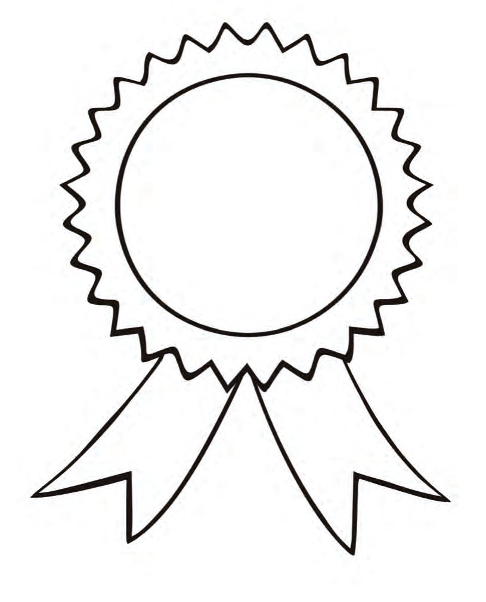

<!-- sayfa 108 -->

**ETKİNLİK ADI:** Duygunu Dönüştür

**ALAN ADI:** Türkçe, Sanat

**YAŞ GRUBU:** 60-72 ay

**ALAN BECERİLERİ, ÖĞRENME ÇIKTILARI VE SÜREÇ BİLEŞENLERİ**

**TÜRKÇE ALANI**

**TAKB. Konuşma**

**TAKB.3. Konuşma sürecinde Türkçeyi doğru kullanabilme**

TAKB.3.ç. Söylemek istediklerini açık biçimde ifade eder.

TAKB.3.e. Konuşmasında beden dilini kullanır.

**SANAT ALANI**

**SNAB4. Sanatsal Uygulama Yapma**

**SNAB.4. Sanat etkinliği uygulayabilme**

SNAB.4.b. Sanat etkinliği için gerekli materyalleri seçer.

SNAB.4.ç. Sanat etkinliklerine aktif olarak katılır.

SNAB.4.d. Sanat etkinliklerinde özgün ürünler oluşturur.

**EĞİLİMLER**

**E2. Sosyal Eğilimler**

E2.3. Girişkenlik

**PROGRAMLAR ARASI BİLEŞENLER**

**Sosyal-Duygusal Öğrenme Becerileri**

SDB1.2. Kendini Düzenleme (Öz Düzenleme)

**Değerler**

D12. Sabır

D12.1. Düşünce, duygu ve davranışlarında kontrollü olmak

**Okuryazarlık Becerileri**

OB4. Görsel Okuryazarlık

**Kavramlar:** Duygu: mutluluk, üzüntü, endişe, pişmanlık, utanma

**Sözcükler:** sakinleşme, nefes, strateji

**Materyaller:** önceden hazırlanmış duygu termometresi (EK-1), strateji kartları (EK-2), duygu kartları (EK-3), minder, yumuşak oyuncak, resim kâğıtları, boya kalemleri, küçük bir kum saati, kar küresi, kartondan hazırlanmış sakinleşme çarkı

**Eğitim / Öğrenme Ortamları:** Çocukların birbirlerini rahatça görebilecekleri çember biçiminde bir oturma düzeni oluşturulur. Duygu termometresi, duygu kartları ve sakinleşme stratejileri görünür ve erişilebilir bir alana yerleştirilir. Sınıfın sakin ve güvenli bir bölümünde minder, yumuşak oyuncak, boya malzemeleri, kum saati

<!-- sayfa 109 -->

**ETKİNLİKLER**

**Türkçe, Sanat (Büyük Grup Etkinliği)**

* Çocuklar çember düzeninde oturur. Öğretmen, “Bugün kendimi ... hissediyorum çünkü ...” cümlesini tamamlayarak süreci başlatır. Ardından her çocuğa ismiyle seslenilerek “Bugün nasılsın?” sorusu yöneltilir. Çocukların nasıl hissettiklerini ve bu şekilde hissetmelerinin nedenini kısa cümlelerle ifade etmelerine rehberlik edilir (TAKB.3.ç, SDB1.2). Konuşmak istemeyen çocuklar zorlanmaz; duygu kartları arasından kendilerini ifade eden bir kart seçerek göstermelerine fırsat verilir.
* Ardından “Bazen duygularımızı çok yoğun yaşadığımız zamanlar olur.” denir ve önceden hazırlanan duygu termometresi (EK-1) çocuklara gösterilir. Çocukların termometreyi incelemeleri ve üzerindeki farklı duygu ifadelerini tanımaları sağlanır (OB4). Duygu termometresi üzerinde bir mandal aşağı ve yukarı hareket ettirilerek “Bazen çok öfkelenebilir, korkabilir veya üzülebiliriz. Bunların hepsi normaldir. Duygularımızın yoğunluğu zamanla değişebilir.” açıklaması yapılır. “Kendinizi çok kızgın, üzgün veya korkmuş hissettiğiniz bir zaman oldu mu?”, “Neden böyle hissetmiştiniz?” ve “Bu duygunuz daha sonra değişti mi?” soruları yöneltilir. Çocukların duygularını isimlendirmeleri, nedenlerini açıklamaları ve duygularının değişebileceğine ilişkin deneyimlerini paylaşmaları sağlanır (TAKB.3.ç, SDB1.2).
* “Bazen bu yoğun duygular bizi zorlayabilir. Böyle zamanlarda sakinleşmek için neler yapabiliriz?” sorusu yöneltilerek çocukların düşüncelerini söylemelerine fırsat verilir (TAKB.3.ç). Derin nefes alıp verme, dans etme, resim yapma, sayı sayma, sevdiği birine sarılma, yürüyüş yapma, öğretmenden yardım isteme, sessiz bir yerde dinlenme ve yumuşak bir nesneye dokunma gibi sakinleşme yöntemlerinin yer aldığı strateji kartları (EK-2) kapalı olarak çocukların görebileceği bir alana yerleştirilir.
* Çocuklar sırayla strateji kartlarından birini seçer. Seçtiği karttaki görseli inceleyerek görselde anlatılan sakinleşme yöntemini belirlemeye çalışır (OB4). Çocuk, kartta yer alan yöntemi konuşmadan beden hareketleriyle canlandırır (TAKB.3.e). Diğer çocuklar canlandırmayı izleyerek görselde anlatılan sakinleşme yöntemini tahmin eder. Tahminde bulunan çocukların düşüncelerini kısa cümlelerle açıklamaları sağlanır (TAKB.3.ç). Tahminlerin ardından karttaki sakinleşme yöntemi bütün çocuklarla birlikte uygulanır.
* Strateji kartlarının tamamı incelendikten sonra görseller bir çarkın üzerine yerleştirilir. Çocuklarla birlikte sınıfta duygu merkezi olarak kullanılabilecek uygun ve güvenli bir alan belirlenir. Sakinleşme çarkı ve duygu kartları (EK-3) oluşturulacak duygu merkezine yerleştirilir.
* Her çocuk bir duygu kartı seçer. Seçtiği duyguyu isimlendirir ve bu duygunun yoğunluğunu duygu termometresi üzerinde gösterir (SDB1.2). Ardından bu duyguya iyi gelebileceğini düşündüğü bir sakinleşme kartı seçer. Çocukların seçtikleri görsellerden yararlanarak “Kızgın hissettiğimde derin nefes alabilirim.” veya “Üzgün hissettiğimde öğretmenimden yardım isteyebilirim.” gibi kısa cümleler kurmaları sağlanır (TAKB.3.ç, OB4). Çocukların duyguya uygun sakinleşme yöntemini seçmeye ve uygulamaya odaklanmaları desteklenir (E3.2).
* Ardından çocuklara resim kâğıtları, boya kalemleri, pastel boyalar ve farklı renklerde kâğıtlar sunulur. Çocuklardan kendilerini sakinleştiren veya iyi hissettiren başka bir yöntemi düşünmeleri istenir. Çocuklar oluşturmak istedikleri sakinleşme kartı için kullanacakları sanat materyallerini seçer (SNAB.4.b). Seçtikleri sakinleşme yöntemini resim, renk ve sembollerden yararlanarak kâğıt üzerinde özgün biçimde gösterirler (SNAB.4.ç, SNAB.4.d). Çalışmalar tamamlandığında çocukların oluşturdukları kartı arkadaşlarına göstermeleri ve “Bu kartta ... yaptım. Kendimi ... hissettiğimde bunu yapabilirim.” cümlesinden yararlanarak çalışmalarını açıklamaları sağlanır (TAKB.3.ç). Çocukların hazırladığı sakinleşme kartları da sakinleşme çarkına veya duygu merkezindeki uygun bir bölüme yerleştirilir.
* Çocuklara öfke, üzüntü veya korku gibi yoğun duygular yaşadıklarında kendilerine, başkalarına veya çevrelerindeki nesnelere zarar vermeden önce durabilecekleri, düşünebilecekleri ve uygun bir sakinleşme yöntemi seçebilecekleri söylenir. Ardından öğretmen “Bir oyuncağın bozulduğu için çok öfkelendin.”, “Arkadaşın seninle oynamadığı için üzüldün.” veya “Daha önce duymadığın yüksek bir sesten korktun.” gibi örnek durumlar sunar. Çocuklar sırayla bir durum seçerek önce durmayı, ardından düşünmeyi ve kendilerini kontrol etmelerine yardımcı olacak uygun bir sakinleşme yöntemini uygulamayı canlandırırlar (D12.1, SDB1.2).

<!-- sayfa 110 -->

**ETKİNLİKLER**
* Oluşturulan duygu merkezine minder, yumuşak oyuncak, resim kâğıtları, boya kalemleri, etkinlikte kullanılan duygu düzenleme strateji kartları (**EK-2**), çocukların hazırladığı sakinleşme kartları, küçük bir kum saati ve kar küresi gibi materyaller yerleştirilir. Materyaller çocuklarla birlikte düzenlenir ve duygu merkezi birlikte incelenir. İsteyen çocuklardan seçtiği duygu kartını, duygusunun termometredeki yoğunluğunu ve bu duyguyla baş etmek için kullanabileceği sakinleşme yöntemini açıklaması istenir (**TAKB.3.ç, SDB1.2**). Çocukların seçtikleri stratejileri kısa süreli olarak uygulamalarına fırsat verilir. İhtiyaç duyduklarında duygu merkezindeki materyallerden yararlanabilecekleri ve sakinleşmelerine yardımcı olacak uygun bir strateji seçebilecekleri hatırlatılır.

**DEĞERLENDİRME**
* Duygularımız zamanla değişebilir mi? Bunu nasıl anlayabiliriz?
* Önce üzgün, sonra mutlu hissettiğin bir durum oldu mu?
* Bugün öğrendiğin sakinleşme yöntemlerinden hangisini evde de kullanabilirsin?
* Duygu kartındaki görseli arkadaşlarına nasıl açıkladın?
* Bir çocuk hangi durumlarda üzgün veya öfkeli hissedebilir?

**FARKLILAŞTIRMA**

**Zenginleştirme:** Çocuklara temel strateji kartlarının yanında “Ben olsam ne yapardım?” görselleri sunulabilir. Çocuklardan yoğun duygu yaşanan bir durum seçmeleri ve bu durumda kullanılabilecek yeni bir sakinleşme yolu önermeleri istenebilir. Çocuklar küçük gruplara ayrılarak “duygu, durum, strateji” eşleştirmeleri yapabilir. Duygu merkezi çocukların önerileriyle genişletilebilir. Merkeze “Bugün Kendimi Nasıl Hissediyorum?” panosu, çocukların çizdiği strateji kartları ve doğal materyallerle hazırlanmış sakinleşme kutusu eklenebilir. Bu süreçte akran eşleştirmesi yapılarak çocukların birlikte çalışmasına fırsat verilir.

**Destekleme:** Çocukların duygu ve stratejilerini sözel olarak ifade etmeleri için, mimikle ya da resim çizerek göstermelerine fırsat verilebilir. Sakinleşme çarkına katkı sürecini kolaylaştırmak için hazır kesilmiş görseller kullanılabilir. Duygu merkezi sade ve dikkat dağıtıcı olmayan şekilde düzenlenebilir. Merkeze az sayıda materyal yerleştirilebilir ya da materyaller görseller içeren kutularda düzenli bir şekilde bulunabilir.

**AİLE VE TOPLUM KATILIMI**

**Aile Katılımı:** Ailelere sınıfta oluşturulan duygu merkezi hakkında kısa bir bilgilendirme notu gönderilebilir. Çocuklarıyla evde “Ben sakinleşmek için ne yapabilirim?” üzerine sohbet etmeleri istenebilir. Ailelerden evde kullanılabilecek bir sakinleşme yöntemi belirlemeleri ve çocuklarıyla bunu resimleyerek sınıfa göndermeleri istenebilir. Gönderilen çalışmalar sınıftaki duygu merkezine eklenebilir.

**Toplum Katılımı:** Okulda uygun görülmesi hâlinde rehberlik servisi ya da alan uzmanı tarafından ailelere ve öğretmenlere yönelik “çocuklarda yoğun duygularla baş etme” konulu kısa bir bilgilendirme yapılabilir. Sınıfta hazırlanan sakinleşme strateji kartları okul panosunda “Duygumu Tanırım, Kendimi Sakinleştiririm” başlığıyla sergilenebilir.

<!-- sayfa 111 -->

EK-1: Duygu Termometresi

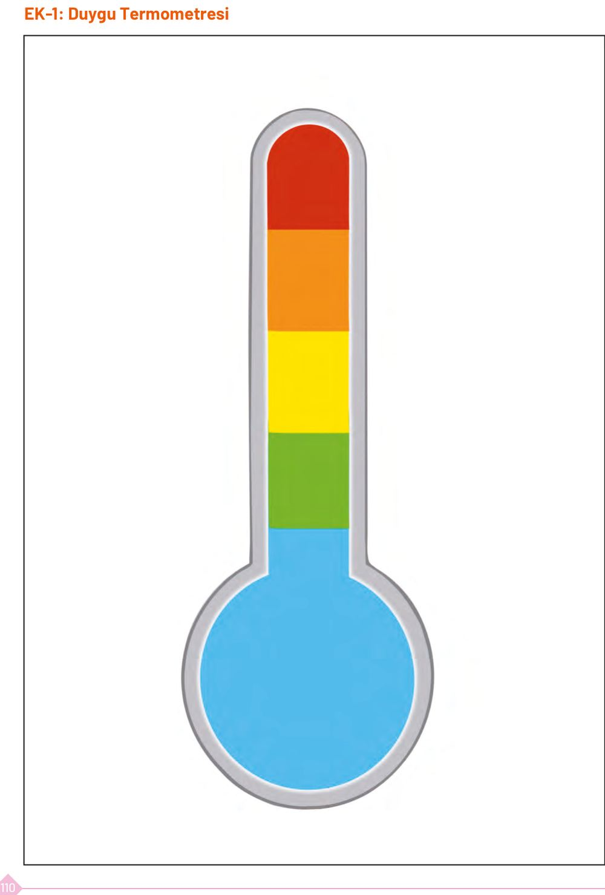

<!-- sayfa 112 -->

# EK-2: Strateji Kartları

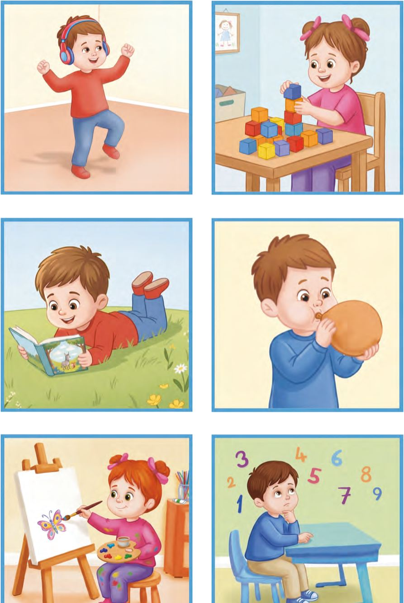

<!-- sayfa 113 -->

# EK-3: Duygu Kartları

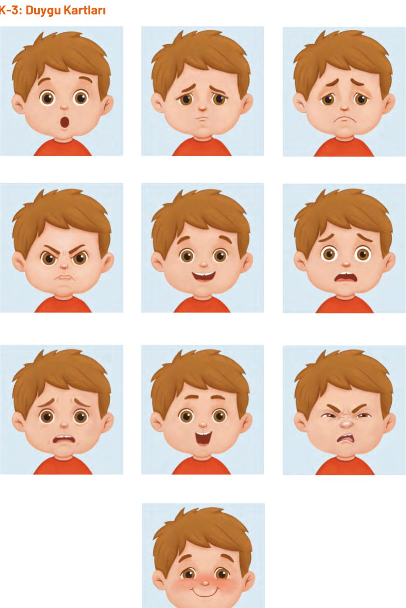

<!-- sayfa 114 -->

**ETKİNLİK ADI:** Çıt Çıt Çıtırık  
**ALAN ADI:** Türkçe    
**YAŞ GRUBU:** 60-72 ay    

**ALAN BECERİLERİ, ÖĞRENME ÇIKTILARI VE SÜREÇ BİLEŞENLERİ**

**TÜRKÇE ALANI**

**TAKB. Konuşma**

**TAKB2. Konuşma içeriğini oluşturabilme**

TAKB2.a. Konuşacağı konu ile ön bilgileri arasında bağlantı kurar.  
TAKB2.b. Konuşmanın devamı hakkındaki tahminini söyler.

**EĞİLİMLER**

**E3. Entelektüel Eğilimler**

E3.3. Yaratıcılık

**PROGRAMLAR ARASI BİLEŞENLER**

**Sosyal-Duygusal Öğrenme Becerileri**

**SDB1.2. Kendini Düzenleme (Öz Düzenleme)** 

**SDB3.3. Sorumlu Karar Verme**

**Değerler**

**D13. Sağlıklı Yaşam**

D13.1. Yeterli, dengeli ve sağlıklı beslenmek

**Materyaller:** farklı renklerde kuş tüyleri (ya da tüy biçiminde kesilmiş kâğıtlar)  

**Eğitim / Öğrenme Ortamları:** Öğretmen çocukları kıyafetine renkli tüyler yapıştırılmış bir halde, hızlı hızlı çekirdek yiyerek karşılar.

<!-- sayfa 115 -->

ETKİNLİKLER

**Türkçe (Büyük Grup Etkinliği)**

* Öğretmen “Bugün çok acıkmış bir papağan oldum.” diyerek etkinliğe giriş yapar. “Siz de bana katılmak ister misiniz?” sorusu sorulur. Yanıtların ardından çocuklar için hazırlanmış olan tüyler de çocuklara yapıştırılarak ısınma oyunu oynanır. “Şimdi bir papağan sürüsü olduk ve dev ağaçların olduğu bir ormanda uçuyoruz.” yönergesi çocuklara verilir. Çocuklar kanatlarını çırpıp papağan sesleri çıkararak sınıfta hareket ederler. “Şimdi yemyeşil bir çimenlikten geçiyoruz sürünelim ve istediğimiz gibi uçabiliriz. Karşımıza büyük bir ağaç çıktı, yavaşlayalım. Papağanlar şimdi tek ayak üzerinde dursun. Ama dikkat yorulsanız da hemen bırakmayın. Hızlı uçtuğumuz için biraz susadık derede su içip, yıkanalım. Yorulduk, bir ağacın dalına konup biraz dinlenelim.” yönergeleri verilir. Oyunun sonlanmasının ardından öğretmen sınıfta kimsede olmayan renkte ve büyüklükte bir tüy bulduğunu söyler ve tüy göstererek “Bu tüy kimden düştü?”, “Kimin acaba?” sorusunu sorar. Herkesin tüyü kontrol edildiğinde tüyün başkaları ile eşleşmediği görülür ve tüyün sahibini sınıfta aramaları istenir. Çocukların, üzerinde aynı tüy yapıştırılmış olan kuş kuklasını bulması sağlanır. Öğretmen kuklaya / oyuncağa “Sen de kimsin, nerden geldin?” gibi sorular sorar. “Kulağıma mı söylemek istiyorsun” diyerek kuşu kulağına yaklaştırır. “Bize anlatacak bir öykün mü var?” der ve “Kuşun öyküsünü dinlemek ister misiniz?” sorusu sorulur ve çember hâli alınarak öykü anlatılır.

**ÇITIRIK**

Çıtırık, çekirdek yemeyi çok seven bir papağandı. Gün boyunca çoğunlukla çekirdek yiyor, hareket etmeye ve çevresini düzenlemeye yeterince zaman ayırmıyordu. Evinin her köşesinde çekirdek kabukları birikmişti. Bir gün arkadaşı Sultan pencereye kondu: “Çıtırık, üç gün sonra doğum günüm var. Seni de bekliyorum.” dedi. Çıtırık, “En sevdiğim arkadaşımın doğum gününü kaçırmam. Zamanında orada olacağım.” diye karşılık verdi. Günler geçti ve Sultan’ın doğum günü geldi. Sultan’ın evi ormanın uzak bir köşesindeydi. Çıtırık hazırlanarak yola çıktı. Birkaç kez kanat çırptıktan sonra yoruldu ve su içmek için dere kenarına kondu. Uzun zamandır yeterince hareket etmediğini fark etti. Yeniden uçmayı denedi ancak kısa süre sonra tekrar dinlenmek zorunda kaldı. Dinlenirken havanın karardığını gördü. Sultan’ın doğum gününe zamanında yetişemeyeceğini anlayarak evine döndü. Arkadaşına verdiği sözü tutamadığı için üzüldü ve bu durumu nasıl telafi edebileceğini düşünmeye başladı.

* Öykü bu bölümde durdurularak “Çıtırık doğum gününe neden yetişememiş olabilir?”, “Verdiği sözü yerine getiremediğinde bu durumu nasıl telafi edebilir?” ve “Sultan, doğum gününde Çıtırık’ı göremeyince kendini nasıl hissetmiş olabilir?” soruları yöneltilir (TAKB.2.b, SDB1.2, E3.3).
* Çocukların yanıtları dinlendikten sonra öyküye devam edilir.
“Çıtırık, sağlıklı ve güçlü kalabilmek için günlük alışkanlıklarını değiştirmeye karar verdi. Gün içinde uçmaya, yürümeye, dinlenmeye ve çevresini düzenlemeye zaman ayırdı. Yalnızca çekirdek yemek yerine kendisi için uygun farklı besinleri de dengeli biçimde tüketmeye başladı. Acıktığını ve doyduğunu fark etmeye, yiyecekleri uygun miktarlarda tüketmeye özen gösterdi. Bir süre sonra kendisini daha hareketli ve zinde hissetmeye başladı. Sultan için hazırladığı hediyeyi alarak yeniden yola çıktı. Bu kez dinlenme ihtiyacını fark ederek yolculuğunu planladı ve Sultan’ın evine ulaştı. Çıtırık, “Doğum gününe gelemediğim ve sana haber veremediğim için üzgünüm. Özür dilerim.” dedi ve hazırladığı hediyeyi verdi. Sultan, arkadaşını gördüğüne sevindi. İki arkadaş birlikte sohbet etmeye başladı.”
* Öykünün ardından “Çıtırık’ın sağlığını ve günlük yaşamını olumsuz etkileyen alışkanlıklar nelerdi?” sorusu yöneltilir. Yalnızca tek tür besin tüketmesinin, yeterince hareket etmemesinin, dinlenme ve temizlik düzenine dikkat etmemesinin onu zorladığı açıklanır (TAKB.2.a).
* Sağlıklı kalabilmek için yaşa ve gereksinime uygun çeşitli besinleri tüketmenin, su içmenin, hareket etmenin, dinlenmenin ve uyku düzenine dikkat etmenin önemi üzerinde durulur.
* Ardından yer değiştirme oyunu oynanır. Zeminde birbirine paralel iki çizgi oluşturulur ve çocukların çizgilerin üzerinde güvenli biçimde durmaları sağlanır. “Elma yemeyi sevenler yer değiştirsin.”, “Süt veya yoğurt tüketmeyi sevenler yer değiştirsin.”, “Bisiklete binmeyi sevenler yer değiştirsin.” ve “Açık havada oyun oynamayı sevenler yer değiştirsin ” gibi yönergeler verilir Yer değiştirme sırasında

<!-- sayfa 116 -->

# ETKİNLİKLER
* Oyun tamamlandıktan sonra yeniden çember oluşturulur. “Sevdiğimiz bir yiyeceği veya etkinliği uygun miktarda ve sürede yapmak önemlidir. Acıktığımızı, doyduğumuzu, yorulduğumuzu veya dinlenmeye ihtiyaç duyduğumuzu fark ederek davranışlarımızı düzenlemeye öz denetim denir.” açıklaması yapılır.
* Bazı daha az tanınıyor veya tercih edilmiyor olabileceği, sağlıklı beslenme alışkanlığı kazanırken farklı yiyeceklerin zorlanmadan ve küçük miktarlarda denenebileceği belirtilir (SDB1.2, SDB3.3, D13.1)

# DEĞERLENDİRME
* Çıtırık neden Sultan’ın doğum gününe zamanında yetişemedi?
* Çıtırık’ın günlük yaşamında hangi alışkanlıklar onu zorladı?
* Çıtırık alışkanlıklarını değiştirmek için neler yaptı?
* Sağlıklı ve zinde kalmak için nelere dikkat edebiliriz?
* Yalnızca tek çeşit besin tüketmek neden uygun değildir?
* Acıktığını, doyduğunu veya yorulduğunu nasıl anlayabilirsin?
* Çok sevdiğimiz bir şeyi ölçülü yapmak neden önemlidir?
* Çıtırık verdiği sözü yerine getiremeyince nasıl hissetti?
* Çıtırık bu durumu nasıl telafi etti?
* Sultan, Çıtırık doğum gününe gelmeyince nasıl hissetmiş olabilir?
* Bir arkadaşına verdiğin sözü yerine getiremezsen ne yapabilirsin?

# FARKLILAŞTIRMA
**Zenginleştirme:** Öykü ortasındaki duraksamada çocuklara sorular yerine “Sen Çıtırık’ın yerine olsaydın nasıl bir sağlıklı yaşam planı yapardın, neyi değiştirirdin?” gibi neden-sonuç ilişkisi kurma ve karar verme becerilerini harekete geçiren sorular yöneltilebilir. Daha sonra sınıf küçük gruplara ayrılarak her gruba “Ormandaki tüm papağanlar için sağlıklı yaşam kuralları belirleyin” gibi görevler verilerek akran iş birliği desteklenebilir. Etkinlik, “çalışkanlık” değeriyle ilişkilendirilerek sınıfın bir “Sağlıklı Yaşam Haftası” planlamasına dönüştürülüp çocukların projeyi öğretmen rehberliğinde bağımsızca yürütmesi sağlanabilir.

**Destekleme:** Konuyu desteklemek için sağlıklı ve sağlıksız besinleri, hareket eden ve hareketsiz duran papağanları gösteren büyük ve renkli görseller kullanılabilir. Her çocuk bir akranıyla eşleştirilerek etkinlik boyunca, özellikle yer değiştirme oyunu ve grup çalışmaları sırasında birbirlerine yardım etmeleri sağlanabilir. Öykü dinleme ve değerlendirme çemberi sırasında öğretmen, gerektiğinde çocuklara bireysel yaklaşım sunabilir. Çocukların soruları yalnızca sözel olarak değil, ilgili besini ya da görseli işaret etme veya papağan kuklasını kullanma gibi farklı yollarla yanıtlamaları sağlanabilir. Etkinlikte kullanılan besin ve hareket görselleri daha büyük boyda hazırlanabilir, kontrast oluşturacak renkli bir fona yapıştırılarak görme bakımından daha işlevsel hale getirilebilir. Öğretmen, öykü anlatımı ve yönerge verme sırasında çocukların kendisini görebileceği biçimde karşısında ya da yanında oturmalarına özen gösterebilir.

# AİLE VE TOPLUM KATILIMI
**Aile Katılımı:** Dengeli beslenme tablosu hazırlanır ve eve gönderilir. Çocuktan gün boyunca yediklerini tabloya yapıştırarak 2 hafta boyunca “Dengeli Beslenme” tablosunu doldurmaları istenebilir. Ailelerin çocuklar ile yakın çevredeki spor salonu, aktivite alanlarını ziyaret etmeleri, doğa yürüyüşleri gerçekleştirmeleri istenebilir.

**Toplum Katılımı:** Yaşanan bölgedeki sağlık ya da spor kuruluşlarından uzmanlar okula davet edilip, okul öncesi çocuklarına uygun beslenme ve hareket eğitimi gerçekleştirilebilir.

<!-- sayfa 117 -->

**ETKİNLİK ADI:** Temizlik Kahramanları  
**ALAN ADI:** Hareket ve Sağlık  
**YAŞ GRUBU:** 60-72 ay  

**ALAN BECERİLERİ, ÖĞRENME ÇIKTILARI VE SÜREÇ BİLEŞENLERİ**  
**HAREKET VE SAĞLIK ALANI**  
**HSAB1. Aktif Yaşam İçin Motor Beceriler**  
**HSAB.1. Farklı çevre ve fiziksel etkinliklerde temel hareket becerilerini sergileyebilme**  
HSAB.1. a. Yer değiştirme becerilerini koordineli biçimde yapar.  
**HSAB2. Sağlıklı Yaşam ve Öz Bakım Becerileri**  
**HSAB.8. Temel kişisel hijyen ve bulunduğu ortamın düzeninin farkında olabilme**  
HSAB.8.b. Ortak kullanım alanlarında çevresini düzenli tutma sorumluluğunu üstlenir.  

**EĞİLİMLER**  
**E2. Sosyal Eğilimler**  
E2.2. Sorumluluk  

**PROGRAMLAR ARASI BİLEŞENLER**  
**Sosyal-Duygusal Öğrenme Becerileri**  
SDB2.2. İş Birliği  

**Değerler**  
**D18. Temizlik**  
D18.2. Yaşadığı ortamın temizliğine dikkat etmek  

**Kavramlar:** Zıt: kirli, temiz  
**Sözcükler:** faraş, süpürge  
**Materyaller:** faraş, süpürge, temizlik bezi  
**Eğitim / Öğrenme Ortamları:** Etkinlik öncesinde, temizlik etkinliğinde kullanılacak materyaller hazırlanır ve sınıftaki öğrenme merkezleri etkinliğe uygun şekilde düzenlenir.

<!-- sayfa 118 -->

**ETKİNLİKLER**

**Hareket ve Sağlık (Küçük Grup Etkinliği)**

* Etkinliğe başlamak için çocuklar çember şeklinde oturur ve onlara temizlik kahramanları olacakları söylenir. Temizlik yapmanın neden önemli olduğu ve temiz bir ortamın yaşam kalitesini nasıl artırdığı açıklanır. Temiz yerlerin sağlıklı olduğu hakkında sohbet edilir. Temizlik öncesi sınıfın fotoğrafları çekilir. Temizlikten önce çocukların enerjilerini artırmak ve vücutlarını hazırlamak için ısınma hareketleri yapılır. Kol ve bacak germe, hafif koşu, bir adım sağa-sola, öne-arkaya gitme gibi basit egzersizler eğlenceli müzik eşliğinde gerçekleştirilir (**HSAB.1.a**). “Sınıfımızın hangi bölümü önce temizlenmeli?”, “Kim hangi görevi almak ister?” sorularıyla temizlik planlaması yapılır ve çocuklar istedikleri arkadaşlarıyla küçük gruplara ayrılır. (**SDB2.2, D18.2**).
* Bir gruptan oyuncak süpürge ve faraşlar kullanarak sınıfın zeminini temizlemesi, diğer gruptan yumuşak bezlerle oyuncak ve mobilyaları silmesi istenir (**D18.2.**). Başka bir gruptan sınıfta yer alan merkezleri düzenlemesi istenir. Temizlik işleri müzik eşliğinde daha eğlenceli hâle getirilir ve çocuklar motive edilir. Gruplar kendilerine verilen görevleri tamamladığında çocuklar alkışlanır ve çocuklara teşekkür edilir (**HSAB.8.b**). Temizlik görevlerini tamamlayan çocuklara renkli yapışkanlı etiketler verilir ve onlar “Temizlik Kahramanı” olarak adlandırılır. Temizlik sonrasında sınıf fotoğrafları çekilerek “Öncesi-Sonrası” panosu hazırlanır. Çocuklar bir araya gelir ve pano incelenir; çalışmaya katkıda bulunduğu için her biri kutlanır. Temizliğin önemi tekrar vurgulanır ve çocuklara bu tür görevleri günlük yaşamlarında nasıl sürdürebilecekleri hatırlatılır (**E2.2**).

**DEĞERLENDİRME**

* Temizlik yaparken en eğlenceli kısım hangisiydi?
* Temizlik yaparken zorlandığın kısım hangisi oldu?
* Başka nereleri temizlemeyi isterdin?
* Evde temizlik yaparken sorumlulukların neler?
* Çevremizi temiz tutmak neden önemli?

**FARKLILAŞTIRMA**

**Zenginleştirme:** Çocuklardan “Öncesi-Sonrası” panosuna bakarak temizlik sayesinde sınıfta neyin değiştiğini anlatmaları istenir. Temizlik kahramanı etiketini alan çocuklardan, kendi görev alanlarını (süpürme, silme, düzenleme) diğer arkadaşlarına kısaca anlatarak bir “görev tanıtımı” yapmaları istenebilir. Ayrıca çocuklara “Sınıfımız hep böyle temiz kalsın diye her gün neler yapabiliriz?” sorusu yöneltilerek günlük küçük bir temizlik görevi belirlemeleri desteklenir.

**Destekleme:** Süpürge, faraş veya bez kullanımında öğretmen çocukla hareket ederek görevi nasıl yapacağını gösterebilir. Çocukların daha küçük bir görevler ile sürece dahil edilmeleri sağlanabilir.

**AİLE VE TOPLUM KATILIMI**

**Aile Katılımı:** Ailelerden çocuklarına evde uygun bir sorumluluk vermeleri istenebilir

**Toplum Katılımı:** Okul bahçesi etrafında velilerle beraber çöp toplama etkinliği düzenlenebilir.

<!-- sayfa 119 -->

**ETKİNLİK ADI:** Kitabım Benim Sorumluluğumda  
**ALAN ADI:** Türkçe 
**YAŞ GRUBU:** 60-72 ay    

**ALAN BECERİLERİ, ÖĞRENME ÇIKTILARI VE SÜREÇ BİLEŞENLERİ**

**TÜRKÇE ALANI**

**TAOB. Okuma** 

**TAOB.1. Resimli öykü kitabı, dijital içerikler, afiş, broşür gibi görsel okuma materyallerini seçebilme**

**TAOB.1.b.** Görsel okuma materyallerini seçer.

**TAKB. Konuşma** 

**TAKB.2. Konuşma sürecinin içeriğini oluşturabilme**

**TAKB.2.g.** Topluluk önünde sözlü sunum yapar.

**EĞİLİMLER** 

**E1. Benlik Eğilimleri**

E1.1. Merak

E1.2. Bağımsızlık

**E2. Sosyal Eğilimler**

E2.2. Sorumluluk

**PROGRAMLAR ARASI BİLEŞENLER** 

**Sosyal-Duygusal Öğrenme Becerileri**

**SDB1.2. Kendini Düzenleme (Öz Düzenleme)**

**SDB2.1. İletişim**

**Değerler**

**D3. Çalışkanlık**

D3.4. Çalışmalarda aktif rol almak

**D16. Sorumluluk**

D16.3. Görev bilincine sahip olmak  

**Kavramlar:** Zaman: önce, şimdi, sonra

**Sözcükler:** sorumluluk 

**Materyaller:** bez çanta, kumaş boyası veya keçeli kalem   

**Eğitim / Öğrenme Ortamları:** Etkinlik öncesinde proje kapsamında kullanılacak bez çanta, kura kutusu ve kitaplar hazırlanarak çocukların görebileceği bir alana yerleştirilir.

<!-- sayfa 120 -->

**Türkçe (Büyük Grup Etkinliği)**

**ETKİNLİKLER**

* Bez çanta çocuklara gösterilir. Çantanın ne için kullanılabileceği üzerine sohbet edilir (**E1.1, SDB2.1**). Yapılacak proje ile ilgili bilgi verilir. “Kitabım Benim Sorumluluğumda” projesi kapsamında her gün sınıftan bir kişinin okul kitaplığından seçtiği bir kitabı evine bez çantayla götüreceği, kitabı evde ailesiyle inceleyip okuyacağı ve dikkatli kullanacağı ertesi gün okula geri getirerek öğrendiklerini arkadaşlarına anlatacağı söylenir (**TAOB.1.b, TAKB.2.g, E2.2**). “Peki, sorumluluk ne demektir çocuklar?” sorusu yöneltilir ve beyin fırtınası yaptıktan sonra “Sorumluluk bireyin evde, okulda, toplumda üzerine düşen görevleri yerine getirmesi, başkalarının haklarına saygı göstermesi ve kendi davranışlarının sonuçlarını üstlenmesidir.” açıklaması yapılır. Ardından çantanın süslenmesi görevi çocuklara verilir. Çocuklar sırayla gelerek istedikleri bir şeyi çantaya çizerler (**E1.2**).
* Çanta hazırlandıktan sonra “Bugün kim seçtiği kitabı eve götürsün? Buna nasıl karar verebiliriz?” denilir. Çözüm önerileri dinlenir. Ardından “Kura çekmeye ne dersiniz?” denilir. Hazırlanan kura kutusu çocuklara gösterilir. Kutunun içindeki kâğıtlarda herkesin adının yazılı olduğu, kutudan rastgele çekilen kâğıtta adı yazan kişinin o gün seçtiği kitabı eve götüreceği söylenir.
* Kura çekilir ve ismi çıkan çocuk kitap merkezinden bir kitap seçerek çantayı hazırlar (**TAOB.1.b**). Kurada çıkan çocuğa “Bu çanta artık senin sorumluluğunda. Çanta ve kitaba zarar vermeden onları eve götürüp getirmeli ve kitabı ailenle okumayı unutmamalısın.“ denilir. Sorumlulukların önemi üzerine konuşularak süreç sonlandırılır (**SDB1.2, D3.4, D16.3**). Tüm çocuklar sorumluluk üstlenene kadar proje sürdürülür. Kitabını evine götürüp sınıfa geri getiren her çocuk arkadaşlarına okuduğu kitap ile ilgili bilgileri (ismi, konusu, karakterleri vb.) ve ailesiyle kitabı okuma süreci ile ilgili duygu ve yaşantılarını paylaşır (**TAKB.2. g**).

**DEĞERLENDİRME**

* Bez çantayı hangi amaçla kullanacağız?
* Eve götürülen kitap nasıl kullanılmalıdır?
* Kitabı ertesi gün okula getirmek neden önemlidir?
* Sorumluluk ne demektir?
* Kitabın ve çantanın sorumluluğu sende olduğunda nelere dikkat etmelisin?
* Sana verilen bir görevi unutmamak için ne yapabilirsin?
* Günlük yaşamda üstlendiğin başka hangi sorumluluklar vardır?
* Sorumluluğunu yerine getirdiğinde kendini nasıl hissedersin?

**FARKLILAŞTIRMA**

**Zenginleştirme:** Çocuklardan evlerine götürüp geri getirdikleri kitabın adını, karakterlerini ve konusunu anlatmaları; kitapta en çok ilgilerini çeken bölümü seçerek bu bölümü neden seçtiklerini açıklamaları istenebilir. Çocuklar kitabın kapağını yeniden tasarlayabilir veya hikâyeye farklı bir son oluşturabilirler. Hazırladıkları kapak ya da oluşturdukları son bölümden yararlanarak kitabı arkadaşlarına tanıtabilirler.

**Destekleme:** Sorumluluk temalı resimler veya kısa hikâyelerden yararlanılarak çocukların sorumluluğun ne anlama geldiğini daha iyi anlaması sağlanabilir. Sorumluluk ile ilgili sosyal öykülerden destek alınabilir. Çantayı süsleme veya kitabı seçme sırasında fiziksel ya da işaret ipucu kullanılarak çocuklara destek olunabilir. Kura kutusuna çocukların isimleri yerine resimleri eklenerek etkinlik daha somut hâle getirilebilir.

**AİLE VE TOPLUM KATILIMI**

**Aile Katılımı:** Ailelere proje hakkında bilgi verilerek çocukların eve getirdiği kitabı birlikte okumaları, verilen sorumluluğu yerine getirebilmeleri için çocuklara rehberlik etmeleri istenebilir.

<!-- sayfa 121 -->

**ETKİNLİK ADI:** Çizgilerle Duygular  
**ALAN ADI:** Türkçe  
**YAŞ GRUBU:** 60-72 ay  

**ALAN BECERİLERİ, ÖĞRENME ÇIKTILARI VE SÜREÇ BİLEŞENLERİ**  
**TÜRKÇE ALANI**  
**TAKB. Konuşma**  
**TAKB.3. Konuşma sürecinde Türkçeyi doğru kullanabilme**  
TAKB.3.b. Konuşurken benzetme ve örneklendirme içeren ifadeler kullanır.  
TAKB.3.ç. Söylemek istediklerini açık biçimde ifade eder.  

**EĞİLİMLER**  
**E1. Benlik Eğilimleri**  
E1.1. Merak  

**PROGRAMLAR ARASI BİLEŞENLER**  
**Sosyal-Duygusal Öğrenme Becerileri**  
**SDB1.2 Kendini Düzenleme (Öz Düzenleme)**  
**SDB2.1. İletişim**  

**Değerler**  
**D12. Sabır**  
D12.1. Düşünce, duygu ve davranışlarında kontrollü olmak  

**Kavramlar:** Duygu: mutluluk, üzüntü, öfke, korku, şaşkınlık, endişe, pişmanlık, utanma, gurur, mahçubiyet  
**Sözcükler:** düz, eğri, zikzak  
**Materyaller:** çalışma sayfası, sarı-turuncu-kırmızı daireler, ip, karton parçaları, boya kalemleri, A4 kâğıt  
**Eğitim / Öğrenme Ortamları:** Etkinlik öncesinde, sınıfın çeşitli yerlerine düz, eğri ve zikzak biçiminde iplerle çizgiler oluşturulur; çalışma kâğıtları ile duygu ifadelerini temsil eden renkli daireler hazırlanarak sınıfta uygun bir alana yerleştirilir.  

---

| ETKİNLİKLER |
| :--- |
| **Türkçe (Büyük Grup Etkinliği)**   • Çocuklara “Daha önce ‘çizgi dedektifi’ diye bir oyun duydunuz mu?” (**E1.1**). Çizgi dedektifi bizim sınıfımıza özel bir oyun. Şimdi ‘çizgi dedektifi’ olup sınıfımızdaki çizgileri bulmaya çalışacağız. Sınıfımızda iplerle oluşturulmuş çizgiler var. İpler dışında dolaplarda, kapı, pencere ve zeminde bulunan çizgiler var. Bu çizgileri bulanlar ‘Buldum!’ desin ve parmak kaldırıp beklesin. Söz sırası size gelene kadar sabırla bekleyip sıra size geldiğinde nasıl bir çizgi bulduğunuzu söyleyebilirsiniz.” denilir (**SDB2.1, D12.1**).   • Oyun bittikten sonra çocuklara çalışma sayfası dağıtılır. “Peki, duyguları çizgiyle ifade etseydiniz o çizgiler nasıl olurdu?” sorusu yöneltilir (**TAKB.3.b**). Cevaplar dinlendikten sonra uygulamaya geçilir. Çocuklar boya kalemlerini alırlar. Baştaki sütuna mutluluğu, ortadaki sütuna üzüntüyü, sondaki sütuna öfkeyi ifade eden çizgiler çizmeleri yönünde yönlendirilirler. Çizimini bitiren çocuk kâğıdını keserek 3 parçaya ayırır. Önceden hazırlanan sarı (mutlu yüz ifadesi), turuncu (üzgün), kırmızı (öfkeli) büyük daireler çocuklara gösterilir. Çocuklar mutlu, üzgün ve öfkeli durumları ifade eden çizgiler çizdikleri |

<!-- sayfa 122 -->

**ETKİNLİKLER**
* Ardından oluşturulan çalışmalar incelenir. “Hangi çizgiler birbirine benziyor?”, “Zikzak çizgiler daha çok hangi duygu için kullanılmış?”, “Aynı duygu için farklı çizgiler çizilmiş mi?” gibi sorular yöneltilerek çocukların grafik üzerinde gözlem yapmaları sağlanır. “Ne zaman mutlu, üzgün, öfkeli, korkmuş, şaşırmış, pişman, endişeli, gururlu, utanmış veya mahcup hissedersiniz?” soruları yöneltilir. Çocukların kendi deneyimlerinden örnek vermeleri desteklenir (TAKB.3.ç). “Duyguların bir sesi olsaydı nasıl olurdu?”, “Mutluluğun sesi nasıl olabilir?”, “Öfkenin sesi nasıl olabilir?” ve “Şaşkınlığın sesi nasıl olabilir?” soruları yöneltilir. Çocuklardan seçilen duyguyu yansıttığını düşündükleri sesleri sırayla çıkarmaları istenir. Duyguların doğal ve önemli olduğu; aynı duygunun farklı kişiler tarafından farklı çizgilerle, seslerle ve ifadelerle gösterilebileceği açıklanır (SDB1.2).

**DEĞERLENDİRME**
* Sıra sana gelene kadar beklemek kolay mıydı? Neden?
* Arkadaşın konuşurken onu nasıl dinledin?
* Sınıfta hangi çizgileri fark ettin?
* Mutluluk için nasıl bir çizgi çizdin? Neden?
* Üzüntü ve öfke için çizdiğin çizgiler birbirinden nasıl farklıydı?
* Arkadaşlarının çizgileriyle senin çizgilerin arasında hangi benzerlikler ve farklılıklar vardı?
* Aynı duygu neden farklı çizgilerle ifade edilmiş olabilir?
* Hangi duygu için daha çok zikzak, dalgalı veya düz çizgi kullanıldı?
* Duyguları sesle ifade ederken hangi sesleri çıkardın?
* Bir duyguyu çizgiyle mi sesle mi anlatmak daha kolaydı? Neden?

**FARKLILAŞTIRMA**

**Zenginleştirme:** Çocuklara yeni bir duygu (gururlu veya şaşırmış) verilip bu duygu için hem bir çizgi hem de bir ses bulmaları istenebilir. İsteyen çocuklardan çizdikleri çizgiyi havada parmaklarıyla veya bedenleriyle büyük hareketlerle “çizmeleri” istenebilir.

**Destekleme:** Çocukların duygu ve çizgi arasındaki ilişkiye yönelik tepki verme biçimleri esnetilebilir. Çizgi çizmek yerine hazırlanmış çizgi örnekleri arasından parmağıyla işaret ederek seçim yapılabilir ya da öğretmen çizgi çizerken çocuklara eliyle destek verebilir. Grafik okuma aşamasında sorulara çizgiler işaret edilerek de yanıt alınabilir. Gerektiğinde çocuklara ek süre verilebilir.

**AİLE VE TOPLUM KATILIMI**

**Aile Katılımı:** Ailelerden çocuklarıyla evde farklı duygular için çizgiler çizmeleri ve bu çizgileri neden öyle çizdiklerini birbirlerine anlatmaları istenebilir. Çocuklardan ailecek yaptıkları bu çalışmayı okula getirip sınıf arkadaşlarıyla paylaşmaları istenebilir.

**Toplum Katılımı:** Sınıfa rehberlik öğretmeni çağrılarak duygu ve tepki kavramları üzerine söyleşi düzenlenebilir.

<!-- sayfa 123 -->

**ETKİNLİK ADI:** Gün Çiçeği  
**ALAN ADI:** Türkçe  
**YAŞ GRUBU:** 60-72 ay  

**ALAN BECERİLERİ, ÖĞRENME ÇIKTILARI VE SÜREÇ BİLEŞENLERİ**

**TÜRKÇE ALANI**

**TAOB. Okuma**

**TAOB.2. Resimli öykü kitabı, dijital içerikler, afiş, broşür gibi görsel okuma materyallerinden anlamlar oluşturabilme**

TAOB.2.b. Görsellerden hareketle metinle ilgili tahminde bulunur.

**EĞİLİMLER**

**E1. Benlik Eğilimleri**

E1.1. Merak

**PROGRAMLAR ARASI BİLEŞENLER**

**Sosyal-Duygusal Öğrenme Becerileri**

**SDB1.1. Kendini Tanıma (Öz Farkındalık)**

**Değerler**

**D5. Duyarlılık**

D5.2. Çevreye ve canlılara değer vermek 

**D18. Temizlik**

D18.2. Yaşadığı ortamın temizliğine dikkat etmek

**Okuryazarlık Becerileri**

**OB4. Görsel Okuryazarlık**

**Kavramlar:** Zaman: sabah, öğle, akşam

**Sözcükler:** günebakan 

**Materyaller:** günebakan çiçeği, mektup, bir paket çekirdek  

**Eğitim / Öğrenme Ortamları:** Etkinlik öncesinde “Çekirdek” kitabı kitap merkezine yerleştirilir, günebakan buketi, mektup, hediye paketi ve çekirdek paketleri hazırlanarak sınıfta hazır bulundurulur. 

**ETKİNLİKLER**

**Türkçe (Büyük Grup Etkinliği)** 

• Sınıfa sözcüksüz, resimli bir kitap olan 365 Gün Öykü serisinden “Çekirdek” kitabı getirilir. Çocuklar sınıfa gelmeden önce kitap merkezine yerleştirilir. Çocuklar kitap merkezindeyken sınıfın kapısı çalınır ve sınıfa bir buket günebakan çiçeği gelir. Öğretmen, çocukları yanına çağırır. Çiçekle birlikte gelen mektubu ve hediye paketini çocuklara gösterir (**E1.1**). Mektubu açar ve çocuklara okur.“Sevgili Çocuklar, ben kocaman başımı güneşe doğru çeviren, altın sarısı yapraklarımla parlayan bir ayçiçeğiyim. Benim en çok bilinen adım ayçiçeğidir ama aslında birden çok adım var. Gün çiçeği, günebakan, gündöndü ve günâşık benim diğer adlarım. Her gün güneşin doğuşundan batışına kadar onu takip ediyorum. Güneş ışığı bana hayat veriyor, beni mutlu ediyor ve büyümemi sağlıyor. Benim gibi gün çiçeklerini tarlalarınızda, bahçelerde hatta evlerinizin pencerelerinde bile görebilirsiniz. Her birimiz güneşin ışığını yakalamak için elimizden geleni yapıyoruz Bugün size bir hediye yolluyorum Unutmayın güneşe ve

<!-- sayfa 124 -->

* ETKİNLİKLER
    * Mektubun ardından çocuklara “Sizce bize hediye gönderen çiçeğin adı neydi? Bu çiçeğin diğer adları nelerdi?, ‘Bize yolladığı paketten nasıl bir hediye çıkacak?’ soruları sorulur ve çocukların verdikleri cevaplar dinlenir. Paket açılır, paketten çıkan hediyenin çekirdek olduğu çocuklara gösterilir. Çekirdek çocuklarla incelenir. Koklanır, dokunulur, büyüteçle incelenir ve çocuklara “Bu küçücük çekirdekten ne çıkabilir?” soruları yöneltilir (E1.1).
    * Ardından her çekirdeğin içinde uyuyan minik bir canlı (bitki) olduğu ve doğadaki tüm canlılar gibi onların da yaşamak için bizim sevgimize, bakımımıza ihtiyacı olduğu vurgulanır. Daha sonra “Bugün kitap merkezinde bu minik çekirdek ile ilgili dikkatinizi çeken bir şey oldu mu?” sorusu ile çocukların sözcüksüz, resimli çekirdek kitabını bulmaları ve getirmeleri istenir. Kitabın kapağı, yazarı, çizeri okunur ve kitabın sayfaları çocuklara gösterilir. Kitabın kapak resmi incelenerek kitabın ismi ve konusunu tahmin etmeleri istenir (TAOB.2.b, OB4).
    * Yaşadığımız ortamı temiz tutmanın bizim için önemi üzerine konuşulur. “Çevremizi korumak, temiz tutmak için biz neler yapabiliriz?” sorusu sorulara çocukların yanıtları dinlenir. Çocuklar verdikleri yanıtlara uygun olarak çalışma yapmak üzere (masa silmek, yerdeki çöpleri toplamak vb) yönlendirilir (D5.2, D18.2). “Çevremizi temiz tutmazsak ne gibi sorunlar oluşabilir?” soruları tartışılarak konu hakkında sohbet edilir (SDB1.1). Çekirdekler çocuklara küçük paketlerle paylaştırılır ve evde aileleriyle tüketmeleri istenir.

* DEĞERLENDİRME
    * Bize mektup gönderen çiçeğin adı neydi?
    * Ayçiçeğinin başka hangi adlarını öğrendik?
    * Çekirdekleri incelerken hangi özelliklerini fark ettin?
    * Bir çekirdeğin büyüyebilmesi için nelere ihtiyacı vardır?
    * Sözcüksüz kitabın konusunu nasıl anladın?
    * Çevremizi temiz tutmak için bugün neler yaptık?
    * Yerlere çöp atıldığında çevrede hangi sorunlar oluşabilir?
    * Sınıfımızı ve çevremizi korumak için başka neler yapabiliriz?
    * Etkinlik sırasında en çok hangi bölüm ilgini çekti? Neden?
    * Doğaya karşı sorumluluklarımız nelerdir?

**FARKLILAŞTIRMA**

**Zenginleştirme:** “Çekirdek” kitabının devamında neler olabileceğine ilişkin yeni bir sayfa tasarlanabilir. Çevreyi korumaya yönelik bir afiş hazırlanması istenebilir.

**Destekleme:** Gün çiçeğinin resmi ve çekirdek resmi kullanılarak anlatım daha görsel hâle getirilebilir. Mektuptaki karmaşık ifadeler basitleştirerek açıklanabilir. Çocuklar küçük gruplara ayrılarak grupların birlikte çalışması sağlanabilir. Böylece çocukların birbirlerinden destek alması sağlanabilir. Kitabın görselleri daha büyük boyda ve kontrast renkte bir zemin üzerine hazırlanarak görme bakımından daha işlevsel hâle getirilebilir.

**AİLE VE TOPLUM KATILIMI**

**Aile Katılımı:** Ailelerden çocuklarıyla evde ve yakın çevrede çevreyi temiz tutmak için yapabilecekleri bir davranış belirlemeleri ve bu deneyimi sınıfla paylaşmaları istenebilir.

**Toplum Katılımı:** Ailelerden çocuklarıyla ev veya mahalle çevresinde küçük bir temizlik yapmaları ve bu sırada doğayı temiz tutmanın önemi üzerine sohbet etmeleri rica edilebilir. Çocuklardan evde ailelerine sınıfta öğrendikleri “Çevreyi temiz tutmak için neler yapabiliriz?” fikirlerini anlatmaları istenebilir.

<!-- sayfa 125 -->

**ETKİNLİK ADI:** İletişim Oyunu
**ALAN ADI:** Türkçe
**YAŞ GRUBU:** 60-72 ay

**ALAN BECERİLERİ, ÖĞRENME ÇIKTILARI VE SÜREÇ BİLEŞENLERİ**
**TÜRKÇE ALANI**
**TAKB. Konuşma**
**TAKB.2. Konuşma sürecinin içeriğini oluşturabilme**
TAKB.2.f. Konuşma sürecinde nefesini / sesini uygun şekilde kullanır.
**TAKB.4. Konuşma sürecini değerlendirebilme**
TAKB.4.a. Konuşma sürecine ilişkin duygu ve düşüncelerini söyler.

**PROGRAMLAR ARASI BİLEŞENLER**
**Sosyal-Duygusal Öğrenme Becerileri**
**SDB2.1. İletişim**

**Kavramlar:** Zıt: hızlı - yavaş, yüksek - alçak
**Sözcükler:** iletişim, duygu
**Materyaller:** duygu kartları

---

**ETKİNLİKLER**
**Türkçe (Büyük Grup Etkinliği)**
* “Şimdi birlikte bir iletişim oyunu oynayacağız. Oyun sırasında farklı duygular hissedebilirsiniz. Hissettiğiniz duyguyu elinizdeki kartlardan birini göstererek ifade edebilirsiniz. İki grup oluşturulacak ve gruplar karşılıklı oturacak. Sırayla bazı çocuklara nasıl konuşacaklarına ilişkin yönergeler verilecek. Konuşan arkadaşınızı dikkatlice dinleyin ve konuşmanın sizde nasıl bir etki oluşturduğunu fark etmeye çalışın.” açıklaması yapılır. Çocuklar iki gruba ayrılır ve her çocuğa dört beş duygu kartı verilir.
* Birinci gruptan bir çocuğa, “Karşındaki arkadaşına arkanı dönerek en sevdiğin oyunu, oyuncağını ve onunla nasıl oynadığını anlat.” yönergesi verilir. Konuşmanın ardından dinleyen çocuğa “Konuşma sırasında seni rahatsız eden veya dinlemeni zorlaştıran bir durum oldu mu?” ve “Bu konuşma sana kendini nasıl hissettirdi?” soruları yöneltilir. Dinleyen çocuktan duygusunu kendisine uygun gelen kartı göstererek ifade etmesi istenir. Seçtiği duygunun nedeni üzerine konuşulur. Konuşurken bedenin ve yüzün dinleyen kişiye yöneltilmesinin iletişimi nasıl etkilediği üzerinde durulur (SDB2.1).
* Ardından yönerge sırası ikinci gruba geçer. İkinci gruptan bir çocuğa, “Karşındaki arkadaşına en sevdiğin yemeği ve bu yemeği kimin yaptığını çok hızlı konuşarak anlat.” yönergesi verilir. Konuşmanın ardından dinleyen çocuğa “Konuşmayı anlamakta zorlandığın bir bölüm oldu mu?” ve “Bu konuşma sana kendini nasıl hissettirdi?” soruları yöneltilir. Çocuktan duygusunu uygun gördüğü kartla ifade etmesi istenir. Seçilen duygunun nedeni üzerine konuşulur. Konuşurken sözcüklerin anlaşılabilecek bir hızda söylenmesinin önemi üzerinde durulur (SDB2.1).
* Oyun “Çok alçak sesle konuş.”, “Yüksek sesle konuş.”, “Çatık kaşlarla konuş.”, “Güler yüzle konuş.” ve “Uygun ses tonu ve hızla konuş.” gibi yönergelerle sürdürülür. Her çocuğun hem konuşan hem de dinleyen rolünü deneyimlemesine fırsat verilir. Oyun sırasında çocukların birbirlerini sözlerini kesmeden sabırla ve nezaketle dinlemeleri desteklenir. Konuşma hızı, ses şiddeti, yüz ifadesi, bedenin yönü ve dinleme biçimi gibi iletişimi etkileyen özellikler hakkında sohbet edilir.
* Oyunda yaşanan durumlardan hareketle iletişim sırasında karşılaşılabilecek güçlükler üzerinde durulur. “Bu konuşmanın daha anlaşılır olması için ne değiştirilebilir?”, “Dinleyen kişinin kendini daha iyi hissedebilmesi için ne yapılabilir?”, “Bir konuşmanın daha anlaşılır olması için ne yapılabilir?”

<!-- sayfa 126 -->

**DEĞERLENDİRME**

* Arkadaşını dinlerken rahat mıydın, yoksa zorlandın mı? Neden?
* Konuşma hızı, söylenenleri anlamanı nasıl etkiledi?
* Sesin çok yüksek veya çok alçak olması seni nasıl etkiledi?
* Karşındaki kişinin yüz ifadesi sana ne hissettirdi?
* Konuşma sırasında seni en çok zorlayan durum neydi?
* Bir konuşmanın anlaşılır olması için nelere dikkat edilmelidir?
* Karşımızdaki kişiyi daha iyi dinlemek için neler yapabiliriz?
* İletişim sırasında bir sorun yaşandığında bunu nasıl düzeltebiliriz?

**FARKLILAŞTIRMA**

**Zenginleştirme:** Çocuklardan iletişimi zorlaştıran farklı durumlar oluşturmaları ve bu durumları canlandırmaları istenebilir. Aynı cümlenin çok hızlı, çok yavaş, yüksek sesle, alçak sesle ve uygun ses tonuyla söylenmesi sağlanarak dinleyen üzerindeki etkileri karşılaştırılabilir. Çocuklardan seçtikleri bir iletişim güçlüğüne çözüm önermeleri ve cümleyi daha anlaşılır biçimde yeniden söylemeleri istenebilir.

**Destekleme:** Anlatma ve dinleme sırasında çocukların bireysel özellikleri dikkate alınarak eşleme yapılabilir. Sözlü olarak anlatmanın yanı sıra çizim yapma ya da rol oynama çalışmaları sürece dâhil edilerek etkinlik zenginleştirilebilir. İletişimi başlatmak amacıyla doğal öğretim stratejilerinden yararlanılabilir. Çocukların iletişimi sürdürmeleri için ilgi alanlarına göre eşleştirmeler yapılabilir.

**AİLE VE TOPLUM KATILIMI**

**Aile Katılımı:** Ailelere öneri notları yollanabilir. “Çocuklarınızın sevdiği konular hakkında onlarla konuşun ve çocuğunuzu dinlerken ona ilginizi gösterin. Farklı duyguları ifade eden kelimeleri kullanmayı teşvik edin. Birbirinizi dinlemenin ve iletişim sürecinde birbirimize saygı göstermenin önemini vurgulayın. Evde hep birlikte iletişim becerilerini geliştirmeye yönelik oyunlar oynayın. Çocuklarınızla iletişim kurarken güler yüzlü olun”.

**Toplum Katılımı:** Sınıfa rehberlik öğretmeni çağrılarak saygılı iletişim üzerine söyleşi düzenlenebilir.

<!-- sayfa 127 -->

**ETKİNLİK ADI:** Benim-Senin  
**ALAN ADI:** Hareket ve Sağlık      
**YAŞ GRUBU:** 60-72 ay  

**ALAN BECERİLERİ, ÖĞRENME ÇIKTILARI VE SÜREÇ BİLEŞENLERİ**  
**HAREKET VE SAĞLIK ALANI**  
**HSAB1. Aktif Yaşam İçin Motor Beceriler**  
**HSAB.5. Kişisel ve genel alanın farkında olarak hareket edebilme**  
* HSAB.5.a. Başkalarının kişisel alanına girmeden hareket eder.  
* HSAB.5.b. Kişisel alanına müdahale durumlarında uygun tepki verir.  

**PROGRAMLAR ARASI BİLEŞENLER**  
**Sosyal-Duygusal Öğrenme Becerileri**  
**SDB1.2 Kendini Düzenleme (Öz Düzenleme)**  

**Değerler**  
**D8. Mahremiyet**  
* D8.1. Kişisel özgürlük alanını korumak  
* D8.2. Sosyal ilişkilerde kişisel alanları korumak  

**D14. Saygı**  
* D14.2. Kendisine saygı duymak  

**Sözcükler:** benim, senin, izin, kişisel alan, eşya, beden, saygı, paylaşmak  
**Materyaller:** çocuk sayısı kadar kutu, hulahop   
**Eğitim / Öğrenme Ortamları:** Çocuk sayısı kadar kutu ve hulahop hazırlanır. Çocukların kişisel alanlarını oluşturabilecekleri uygun bir oyun ortamı düzenlenir.

<!-- sayfa 128 -->

# Hareket ve Sağlık (Büyük Grup Etkinliği)

**ETKİNLİKLER**

* Çocukların çember şeklinde oturmaları sağlanır. “Benim” ve “senin” kavramları üzerine sohbet başlatılır. “Hepimizin kendisine ait bir bedeni ve kişisel eşyaları vardır. Başkasına ait bir eşyayı kullanmadan önce izin istememiz gerekir.” açıklaması yapılır. Farklı renk ve büyüklüklerdeki kutular çocuklara dağıtılır. Her çocuktan sınıftaki oyuncaklardan istediklerini seçerek kendi kutusuna yerleştirmesi istenir. Kutuların oyun süresince çocukların kişisel eşya kutusunu temsil edeceği açıklanır. Kutudaki oyuncakları kullanmak isteyen bir arkadaşın öncelikle kutunun sahibinden izin istemesi gerektiği vurgulanır. Ardından her çocuğa bir hulahop verilir. Hulahopun iç bölümünün oyun sırasında kişisel oyun alanını temsil ettiği açıklanır. Başkasının oyun alanına girmeden veya o alandaki oyuncakları almadan önce izin istenmesi gerektiği belirtilir (D8.1).
* Çocukların kendi kutularındaki oyuncaklarla, belirlenen alanlarda serbestçe oynamaları sağlanır. Oyun sırasında arkadaşlarının eşyalarına ve kişisel alanlarına saygı göstermeleri desteklenir (HSAB.5.a, D8.2). Çocukların izin isteme, izin verme veya izin vermeme davranışları gözlemlenir; gerektiğinde sözel hatırlatmalar yapılır. Serbest oyunun ardından “benim eşyalarım” ve “benim alanım” üzerine sohbet edilir.

Aşağıdaki sorular yöneltilir:
*Bir arkadaşın izin istemeden oyun alanına girdi mi?*
*İzin alınmadan oyuncağın kullanıldığında ne hissettin?*
*Arkadaşın senden izin istediğinde ne hissettin?*
*Bir arkadaşın izin vermediğinde nasıl davranabiliriz?* (HSAB.5.b, SDB1.2).
* Bedenin de kişiye ait olduğu açıklanır. Birine dokunmadan veya sarılmadan önce izin istenmesi gerektiği belirtilir. Çocukların istemedikleri ya da kendilerini rahatsız eden bir dokunuş karşısında “Hayır, istemiyorum.” diyebilecekleri, uzaklaşabilecekleri ve güvendikleri bir yetişkine durumu anlatabilecekleri üzerinde durulur (D14.2). Ardından müzik açılarak çocukların dans etmeleri sağlanır. Müzik durduğunda çocuklardan yakınlarındaki bir arkadaşlarına “Sana sarılabilir miyim?” diye sormaları istenir. İzin verilmesi durumunda arkadaşlarını rahatsız etmeyecek biçimde sarılmaları desteklenir. İzin verilmemesi durumunda bu karara saygı gösterilmesi gerektiği hatırlatılır. Sarılmak istemeyen çocuklara el sallama, gülümseme veya sözlü olarak selamlaşma gibi alternatifler sunulur.

**DEĞERLENDİRME**

* Benim ve senin arasındaki fark nedir?
* Kendi eşyalarımıza ve bedenimize kimler dokunabilir?
* Arkadaşlarımızın eşyalarına ve bedenlerine dokunmadan önce ne yapmalısınız?
* Birbirinizin alanlarına saygı göstermek neden önemli?
* Kendi alanlarınız ihlal edildiğinde ne hissettiniz?
* Biri bedeninize izinsiz dokunduğunda ne yapmalısınız?

**FARKLILAŞTIRMA**

**Zenginleştirme:** “Bir arkadaşın oyun alanına girmek istiyor.” veya “Arkadaşına sarılmak istiyorsun.” gibi durumlarda hangi ifadelerin kullanılabileceği üzerine konuşulabilir. Çocukların “Kullanabilir miyim?”, “Alanına girebilir miyim?”, “Sana sarılabilir miyim?”, “Şu anda istemiyorum.” ve “Daha sonra olabilir.” gibi ifadelerini kullanarak canlandırma yapmaları istenebilir.

**Destekleme:** “Benim” ve “senin” kavramlarını açıklarken çocukların kolayca anlayabileceği somut örnekler kullanılabilir. Örneğin “Bu benim kalemim, bu senin kitabın.” gibi örnekler verilerek kavramlar somutlaştırılabilir. Kutuların ve hulahopların dağıtımı sırasında sosyal çevre düzenlenebilir. Sorular kelime sayısı ve kelime zorluğu bakımından basitleştirerek sorulabilir ya da sayısı azaltılabilir.

**AİLE VE TOPLUM KATILIMI**

<!-- sayfa 129 -->

**ETKİNLİK ADI:** Çöpçü Karga ve Şaşkın Zebra  
**ALAN ADI:** Türkçe  
**YAŞ GRUBU:** 60-72 ay  

**ALAN BECERİLERİ, ÖĞRENME ÇIKTILARI VE SÜREÇ BİLEŞENLERİ**  
**TÜRKÇE ALANI**  
**TADB. Dinleme / İzleme**  
**TADB.1. Dinleyecekleri / izleyecekleri şiir, hikâye, tekerleme, video, tiyatro, animasyon gibi materyalleri yönetebilme**  
TADB.1.b. Seçilen materyalleri dinler / izler.  
**TADB.2. Dinledikleri / izledikleri şiir, hikâye, tekerleme, video, tiyatro, animasyon gibi materyalleri ile ilgili yeni anlamlar oluşturabilme**  
TADB.2.a. Dinledikleri / izledikleri materyaller ile ön bilgileri arasında bağlantı kurar.  
TADB.2.b. Dinledikleri / izledikleri materyaller hakkındaki tahminini söyler.  

**EĞİLİMLER**  
**E1. Benlik Eğilimleri**  
E1.1. Merak  

**PROGRAMLAR ARASI BİLEŞENLER**  
**Sosyal-Duygusal Öğrenme Becerileri**  
**SDB3.3. Sorumlu Karar Verme**  

**Okuryazarlık Becerileri**  
**OB4. Görsel Okuryazarlık**  

**Kavramlar:** Duygu: mutluluk, üzüntü, öfke, korku, şaşkınlık, endişe  
**Sözcükler:** alakarga, kasaba  
**Materyaller:** alakarga fotoğrafları, meşe palamudu  
**Eğitim / Öğrenme Ortamları:** “Çöpçü Karga ve Şaşkın Zebra” kitabı ile resim etkinliğinde kullanılacak kâğıt ve boya malzemeleri hazırlanır. Drama çalışması için sınıf düzenlenir.

<!-- sayfa 130 -->

ETKİNLİKLER

**Türkçe (Büyük Grup Etkinliği)**

* Çocukların “U” düzeninde oturmaları sağlanır. Etkinlikte okunacak kitabın kapağı gösterilerek “Sizce bu kitabın adı ne olabilir?” sorusu yöneltilir (TADB.2.a, TADB.2.b, E1.1). Çocukların tahminleri dinlendikten sonra kitabın adının “Çöpçü Karga ve Şaşkın Zebra” olduğu açıklanır. Kitabın adı, yazarı, resimleyeni ve yayınevi hakkında konuşulur. Afet eğitimini ve çığ konusunu ele alan kitap 11. sayfaya kadar okunur (TADB.1.b).
* Bu bölüme kadar Çöpçü Karga ile Şaşkın Zebra’nın yaşadıkları olaylar üzerinde durulur. On birinci sayfada büyük bir gürültü duyulduğu ve çığın karakterlere doğru ilerlediği fark ettirilir. Okuma bu noktada durdurularak çocuklar gruplara ayrılır. Gruplardan Çöpçü Karga ile Şaşkın Zebra’nın bu durumda neler yapabileceklerini konuşmaları istenir (SDB3.3).
* Her grubun çığ sırasında yapılabilecekleri canlandırması sağlanır. Çocukların Çöpçü Karga ve Şaşkın Zebra rollerine girerek karakterlerin çığ anındaki davranışlarını göstermelerine fırsat verilir. Gerektiğinde yardım isteme gibi farklı durumlar eklenerek canlandırma süreci genişletilir (SDB3.3).
* Tüm grupların canlandırmalarını tamamlamalarının ardından kitabın okunmasına devam edilir. Okuma sırasında çığ tehlikesinde yapılması gereken davranışlara dikkat çekilir. Kitabın son sayfasında hayvanların bir araya gelerek çığ tehlikesinden korunmak için yapılabilecekleri anlatan bir metin hazırladıkları ve bu metni kasaba halkına dağıttıkları açıklanır. Sayfadaki görselin çocuklar tarafından incelenmesine fırsat verilir (OB4).
* Kitabın tamamlanmasının ardından çocuklardan istedikleri materyalleri kullanarak çığ tehlikesinden korunmak için yapılması gerekenleri resmetmeleri istenir (SDB3.3). Çalışmalar tamamlandıktan sonra çocukların çizimlerini arkadaşlarına anlatmalarına fırsat verilir.

DEĞERLENDİRME

* Okuduğumuz kitabın adı neydi?
* Kitabın kahramanları kimlerdi?
* Çöpçü Karga ve Şaşkın Zebra hangi tehlikeyle karşılaştı?
* Çığın yaklaştığını nasıl fark ettiler?
* Çığ sırasında karakterler neler yaptı?
* Canlandırmada grubunuz hangi çözümü önerdi?
* Zor bir durumda kimlerden yardım isteyebiliriz?
* Çığ tehlikesinden korunmak için neler yapılabilir?
* Kitabın sonunda hayvanlar kasaba halkı için ne hazırladı?
* Hazırlanan bilgilendirme metni neden önemliydi?
* Resminde çığdan korunmak için hangi davranışı gösterdin?
* Bu davranışın güvenliğe nasıl katkı bulunduğunu açıklayabilir misin?
* Etkinliğin en çok hangi bölümü ilgini çekti? Neden?

<!-- sayfa 131 -->

# FARKLILAŞTIRMA

**Zenginleştirme:** Çocuklardan canlandırma sırasında geliştirdikleri çözüm önerileri ile kitaptaki karakterlerin uyguladığı çözüm yollarını karşılaştırmaları istenebilir. “Bizim çözümümüzle kitaptaki çözümün benzer ve farklı yönleri nelerdir?” ve “Başka nasıl bir çözüm geliştirilebilirdi?” soruları yöneltilebilir. Ardından çocuklar gruplara ayrılarak çığ öncesinde, çığ sırasında ve çığ sonrasında yapılması gerekenleri gösteren resimli bilgilendirme kartları hazırlayabilir. Kartlar oluş sırasına göre sıralanarak sınıfa ait “Çığdan Korunma Rehberi” oluşturulabilir. İsteyen çocukların hazırlanan kartlardan yararlanarak hikâyeye farklı bir son oluşturmaları ve bu sonu arkadaşlarına anlatmaları sağlanabilir.

**Destekleme:** Büyük boyutlarda ve kontrast zemin üzerine öykü kartları hazırlanarak kitap okuma etkinliği görme bakımından daha işlevsel hâle getirilebilir. Gruplar oluşturulurken akran liderliği bakımından dengeli gruplar oluşturulmasına dikkat edilebilir. Gerektiğinde çocukların bu süreçte kendilerini güvende hissetmeleri için sınıfın daha sessiz bir bölümünde yer alan minderli duygu düzenleme alanına geçmelerine ve rahatlamalarına fırsat tanınabilir.

# AİLE VE TOPLUM KATILIMI

**Aile Katılımı:** Çocukların çığ tehlikesi karşısında neler yapılabileceğine ilişkin çizdiği resimler çoğaltılarak ebeveynleri ile mahalledeki dükkânlara dağıtılabilir.

**Toplum Katılımı:** AFAD gönüllüleri okula davet edilerek ailelere doğal afetler ile ilgili seminerler düzenlenebilir.

<!-- sayfa 132 -->

**ETKİNLİK ADI:** Çekirdek
**ALAN ADI:** Hareket ve Sağlık, Matematik
**YAŞ GRUBU:** 60-72 ay

**ALAN BECERİLERİ, ÖĞRENME ÇIKTILARI VE SÜREÇ BİLEŞENLERİ**

**MATEMATİK ALANI**

**MAB6. Sayma**
* **MAB1. Sayıları farklı durumlarda doğru kullanabilme**
    * MAB.1.ç. 1 ile 20 arasındaki nesne / varlık miktarını sayarak belirler.

**MAB1. Matematiksel Muhakeme**
* **MAB4. Karşılaştırmaya ve tahmine dayalı çıkarım yapabilme**
    * MAB.4.a. Uzunluk / büyüklük / ağırlık / miktar gibi birden fazla özelliğe ilişkin tahmini ile sonucu karşılaştırır.
    * MAB.4.d. Nesne / olgu / olayları birden fazla özelliğe göre karşılaştırır.

**MAB2. Matematiksel Problem Çözme**
* **MAB5. Matematikle ilgili problemleri çözümleyebilme**
    * MAB.5.a. Verilen problemdeki eksik / fazla / uyumsuz durumları söyler.
* **MAB7. Matematikle ilgili problemlere çözüm yolları geliştirebilme**
    * MAB.7.a. Bir problemin çözümüne ilişkin yollar önerir.

**HAREKET VE SAĞLIK ALANI**

**HSAB1. Aktif Yaşam İçin Motor Beceriler**
* **HSAB.1. Farklı çevre ve fiziksel etkinliklerde temel hareket becerilerini sergileyebilme**
    * HSAB.1.a. Yer değiştirme becerilerini koordineli biçimde yapar.
* **HSAB.3. Müzik ve ritim eşliğinde hareket örüntüleri sergileyebilme**
    * HSAB.3.a. Müziğin temposuna ve ritmine uygun bireysel / eşli / grupla dans eder.

**HSAB2. Sağlıklı Yaşam ve Öz Bakım Becerileri**
* **HSAB.6. Yeterli ve dengeli beslenebilme**
    * HSAB.6.a. Tabağındaki porsiyon miktarını kendi ihtiyacına göre belirler.

**EĞİLİMLER**

**E1. Benlik Eğilimleri**
* E1.1. Merak

**PROGRAMLAR ARASI BİLEŞENLER**

**Sosyal-Duygusal Öğrenme Becerileri**
* SDB2.2. İş Birliği

**Değerler**
* **D1. Adalet**
    * D1.2. Hakkaniyetli davranmak

<!-- sayfa 133 -->

**Kavramlar:** Miktar: az-çok
**Sözcükler:** hak, ziyafet, adalet, çitlembik
**Materyaller:** Çekirdek, farklı miktarlarda çekirdek konulmuş şeffaf ve kapaklı kaplar, hulahoplar
**Eğitim / Öğrenme Ortamları:** Etkinlikte kullanılacak çekirdekler hazırlanır. Bahçeye adalet oyunu için hulahoplar yerleştirilir ve çocukların güvenli hareket edebilecekleri bir oyun alanı düzenlenir.

> **Hareket ve Sağlık, Matematik (Bütünleştirilmiş Büyük Grup Etkinliği)**
> * “Çekirdek” tekerlemesi söylenerek çocukların aralarında dolaşmaya başlanır ve “Çocuklar, omzuna dokunduğum kişi arkamda sıraya girsin.” denir. Çocukların omuzlarına sırayla dokunularak aşağıdaki tekerleme bütün çocuklar trene katılıncaya kadar tekrar edilir. Her çocuğun oyuna eşit biçimde katılması sağlanır (D1.2).
>
> **ÇEKİRDEK**
> “Ooooooo!
> Çe çe çekirdek,
> Çit çit çit çitlenecek.
> Çekirdeği kim ister?
> Çitlembik hep yer ha yer…
> İsteyenler öne çıksın,
> Bir bir avcunu açsın.
> Biraz sana, biraz ona,
> Olmaz hepsi bana bana!
> Pek lezzetlidir tadı!
> Bu kalan kimin hakkı?
> O da Hakkı’nın hakkı.
> Hakkı gelsin, hakkını alsın.
> Hakkını burada bırakmasın.
> Et et, acele et!
> Ne de güzel oluyor
> Çekirdekle ziyafet!
> ‘Şu da benim, o da benim.’
> Dersen nerede adalet?”
> * Tekerlemenin ardından çocukların çember oluşturarak oturmaları sağlanır. Bir miktar çekirdek, çocukların inceleyebileceği kapalı ve şeffaf bir kap içinde gösterilir. “Çekirdek çitlemeyi seven var mı?” sorusu yöneltilerek yanıtlar dinlenir. Etkinlikte kullanılacak çekirdeklerin yenmeyeceği ve ağza götürülmeyeceği açıklanır.
> * Çekirdekler, 1-10 arasında farklı miktarlarda hazırlanmış ve kapakları güvenli biçimde kapatılmış şeffaf kaplara yerleştirilir. Her çocuğa içinde farklı miktarda çekirdek bulunan bir kap verilir. Miktarlar arasındaki farkların kolayca görülebilmesine dikkat edilir. “Sizce kaplardaki çekirdek miktarları aynı mı?”, “Hangi kapta daha fazla, hangi kapta daha az çekirdek var?” soruları yöneltilir. Çocukların kaplardaki çekirdekleri miktarlarına göre karşılaştırmaları sağlanır (MAB.4.d).
> * Çocuklardan kaplarında kaç çekirdek bulunduğuna ilişkin tahminde bulunmaları istenir. Ardından çocuklar kapları açmadan çekirdekleri sayarak miktarlarını belirler (MAB.1.ç). Çocukların tahminleri ile sayma sonucunda belirledikleri miktarı karşılaştırmaları sağlanır (MAB.4.a). Kaplardaki çekirdek miktarlarının eşit olmadığını, bazı kaplarda eksik veya fazla çekirdek bulunduğunu söylemelerine fırsat verilir (MAB.5.a).

<!-- sayfa 134 -->

# ETKİNLİKLER

* “Kabında daha az çekirdek olduğunu fark edenler ne hissetti?” ve “Çekirdekleri yeniden dağıtsaydık nasıl paylaştırabilirdik?” soruları yöneltilir. Çocukların adil paylaşıma yönelik farklı çözüm yolları önermeleri sağlanır (MAB.7.a, E1.1). Çekirdeklerin herkese aynı ölçüde veya aynı sayıda verilmesi gibi paylaşım yöntemleri birlikte değerlendirilir. Çocuklarla birlikte belirlenen yönteme göre çekirdekler yetişkin tarafından tek tek sayılarak eşit miktarlarda şeffaf ve kapaklı kaplara paylaştırılır. Çocuklar, paylaştırma işlemi sırasında çekirdekleri yetişkinle birlikte sayar (MAB.1.ç). Paylaştırma tamamlandıktan sonra çocukların kapları yeniden karşılaştırmaları ve ulaşılan sonucu açıklamaları sağlanır. Adil paylaşımda herkesin hakkının gözetilmesinin önemli olduğu hakkında sohbet edilir (D1.2). Çekirdeklerin yalnızca karşılaştırma ve paylaşma çalışmasında kullanıldığı hatırlatılarak kaplar çocuklardan toplanır.
* Ardından çocuklarla birlikte bahçeye çıkılır. Zemine yerleştirilen her hulahopun önünde iki çocuğun durması sağlanır. Hareketli bir müzik açılır ve çocukların müziğe uygun ardışık ritmik hareketler yaparak hulahopların çevresinde dans etmelerine fırsat verilir (HSAB.3.a).
* Müzik durduğunda çocuklardan heykel gibi hareketsiz kalmaları, ardından verilen yönergeye uygun olarak güvenli biçimde hulahopun içine geçmeleri istenir (HSAB.1.a). Oyun birkaç kez tekrarlanır.
* Daha sonra çeşitli durumları anlatan cümleler okunur. Çocuklardan anlatılan davranışın adil olup olmadığına karar vermeleri istenir. Eşlerin düşüncelerini birbirleriyle paylaşmaları ve ortak bir karara varmaları sağlanır (SDB2.2). Çocuklar davranışın adil olduğunu düşünüyorlarsa eşleriyle aynı anda hulahopun içine geçer; adil olmadığını düşünüyorlarsa hulahopun dışında heykel gibi durur (HSAB.1.a, D1.2).
* Her cümlenin ardından çocuklardan davranışın neden adil veya adil olmadığını açıklamaları istenir. Çocukların görev, sorumluluk, oyun ve paylaşım durumlarında herkese adil davranılması gerektiğine ilişkin düşüncelerini paylaşmaları sağlanır (D1.2).
    - Herkese üç top dondurma, sana bir top dondurma verildi.
    - Herkese üç kepçe çorba verildi.
    - Herkese bir dilim yaş pasta, sana iki dilim yaş pasta verildi.
    - Oyunu kazanamadığın hâlde ödül aldın.
    - Oyuncaklarla sen oynadığın hâlde oyuncakları arkadaşın topladı.
    - Oyunda kazanan kişi ödül aldı.
    - Pastayı eşit dilimlere ayırarak arkadaşlarınla paylaştın. Oyun, çocukların ilgileri doğrultusunda sürdürülür (HSAB.6.a).

# DEĞERLENDİRME

* Çekirdekler nasıl paylaştırıldı?
* İlk dağıtımda çekirdek miktarları aynı mıydı?
* Kabında daha az çekirdek olduğunu gördüğünde ne hissettin?
* Çekirdekleri adil biçimde paylaşmak için nasıl bir yöntem kullandık?
* Herkese eşit miktarda çekirdek verilmesi her zaman adil midir? Neden?
* Arkadaşlarınla bir şeyi paylaşırken nelere dikkat edersin?
* Etkinlik sırasında öğrendiğin en önemli şey neydi?
* Bir durumun adil olup olmadığına nasıl karar verebiliriz?

# FARKLILAŞTIRMA

**Zenginleştirme:** Çocuklardan kapalı şeffaf kaplardaki çekirdekleri sayarak miktarları karşılaştırmaları ve adil paylaşım için farklı yöntemler önermeleri istenebilir. “Çekirdek sayısı herkese yetmezse nasıl bir çözüm bulabiliriz?” ve “Herkese aynı miktarı vermek hangi durumlarda adil olmayabilir?” soruları yöneltilebilir. Çocukların adil ve adil olmayan durumları anlatan yeni örnekler oluşturmaları, bu durumları canlandırmaları ve çözüm önerilerini arkadaşlarıyla paylaşmaları desteklenebilir. Hazırlanan örnekler resimlendirilerek “Adaletli Davranışlar” sınıf kitabı oluşturulabilir.

**Destekleme:** Oyun hulahop içine girmek yerine adil durumda kollarını kaldırmak gibi yönergelerle farklılaştırılabilir. Dağıtım sonrasında çocuklara duygularını ifade etmeleri için zaman tanınarak yaşadıkları duyguları paylaşmaları desteklenebilir.

# AİLE VE TOPLUM KATILIMI

<!-- sayfa 135 -->

**ETKİNLİK ADI:** Böcek Oteli Neden Sessiz?
**ALAN ADI:** Türkçe, Matematik, Fen, Müzik
**YAŞ GRUBU:** 60-72 ay

**ALAN BECERİLERİ, ÖĞRENME ÇIKTILARI VE SÜREÇ BİLEŞENLERİ**

**TÜRKÇE ALANI**
**TADB. Dinleme / İzleme**
**TADB.2. Dinledikleri / izledikleri şiir, hikâye, tekerleme, video, tiyatro, animasyon gibi materyaller ile ilgili yeni anlamlar oluşturabilme**
* TADB.2.a. Dinledikleri / izledikleri materyaller ile ön bilgileri arasında bağlantı kurar.
* TADB.2.b. Dinledikleri / izledikleri materyaller hakkındaki tahminini söyler.

**TADB.3. Dinledikleri / izledikleri şiir, hikâye, tekerleme, video, tiyatro, animasyon gibi materyalleri çözümleyebilme**
* TADB.3.a. Dinledikleri / izledikleri materyalleri oluşturan unsurları belirler.
* TADB.3.b. Dinledikleri / izledikleri materyalleri oluşturan unsurlar arasındaki ilişkileri belirler.

**TADB.4. Dinledikleri / izledikleri şiir, hikâye, tekerleme, video, tiyatro, animasyon gibi materyalleri değerlendirebilme**
* TADB.4.a. Dinledikleri / izledikleri materyallere ilişkin duygu ve düşüncelerini ifade eder.

**MATEMATİK ALANI**
**MAB6. Sayma**
**MAB.1. Sayıları farklı durumlarda doğru kullanabilme**
* MAB.1.ç. 1 ile 20 arasındaki nesne / varlık miktarını sayarak belirler.

**FEN ALANI**
**FBAB1. Bilimsel Gözlem**
**FAB.1. Günlük yaşamında fenle ilgili olaylara / olgulara ve durumlara yönelik bilimsel gözlem yapabilme**
* FAB.1.a. Çevresinde merak ettiği nesne / olay / olguları odaklanarak gözlemler.

**FBAB3. Bilimsel Gözleme Dayalı Tahmin**
**FAB.3. Günlük yaşamda fen olaylarına yönelik bilimsel gözleme dayalı tahminlerde bulunabilme**
* FAB.3.b. Yakın çevresinde meydana gelen değişimlere ilişkin gözlem ve deneyimlerinden hareketle tahminlerde bulunur.

**MÜZİK ALANI**
**MHB4. Müziksel Hareket**
**MHB.2. Müzik eserleriyle hareket / dans edebilme**
* MHB.2.a. Müzik eşliğinde grupla birlikte hareket / dans eder.

**EĞİLİMLER**
**E1. Benlik Eğilimleri**
* E1.1. Merak

**E2. Sosyal Eğilimler**
* E2.1. Empati

**E3. Entelektüel Eğilimler**

<!-- sayfa 136 -->

# PROGRAMLAR ARASI BİLEŞENLER

## Sosyal-Duygusal Öğrenme Becerileri
**SDB1.1. Kendini Tanıma (Öz Farkındalık)**

## Değerler
**D9. Merhamet**
**D9.1. Vicdanlı olmak**

**D20. Yardımseverlik**
**D20.3. İyiliksever olmak**

**Kavramlar:** Duyu: sesli- sessiz

**Sözcükler:** otel, tok, kuşburnu

**Materyaller:** kartondan yapılmış böcek oteli, örümcek, çekirge, karınca ve cırcır böceği resimleri / kuklaları, kâğıt vb. malzemelerden yapılmış meyveler

**Eğitim / Öğrenme Ortamları:** Etkinlik, okula yakın ağaçlık bir doğal alanda gerçekleştirilen doğa yürüyüşüyle başlar; bu bölümde çocuklar böceklerin ve diğer küçük canlıların yaşam alanlarını (ağaç kökleri, toprak altı vb.) yerinde inceleme fırsatı bulur. Yürüyüşün ardından süreç okul bahçesine taşınır; burada önceden hazırlanmış kartondan böcek oteli çocuklara sunulur ve incelenir. Hikâye anlatımı kukla gösterimi ve sohbet bölümleri ise sınıf içindeki grup etkinliği alanında, çocukların rahatça oturup dinleyebileceği bir düzende yürütülür. Kuşburnu meyvesi arama oyunu için sınıfın çeşitli köşelerine önceden keseler gizlenir ve çocuklar müzik eşliğinde bu alanları dolaşarak keseleri toplar. Etkinliğin son bölümünde ise sınıfın geniş ve açık alanı, neşeli müzik eşliğinde yapılan dans etkinliği için kullanılır.

<!-- sayfa 137 -->

# ETKİNLİKLER

Türkçe, Matematik, Fen, Müzik (Büyük Grup Etkinliği)

* Okula yakın ağaçlık bir alanda doğa yürüyüşüne çıkılır. Yürüyüş hazırlıkları sırasında çocukların ayakkabılarını ve montlarını kendilerinin giymeleri desteklenir. “Şu anda hangi mevsimdeyiz?” ve “Dışarı çıkarken üzerimize neler giydik?” soruları yöneltilir. Ardından “Soğuk havalarda ellerimizi korumak için eldiven, başımızı korumak için bere, boynumuzu korumak için atkı takarız. Ayaklarımızı korumak için bot, bedenimizi korumak için mont giyeriz. Bazı hayvanlar ise soğuktan korunmak için kış uykusuna yatar. Üzerinde kendisini sıcak tutan postu bulunan büyük ayılar bile kış uykusuna yatabilir. Peki, sizce böcekler kışın ne yapar? Küçücük böcekler soğuk havadan nasıl korunabilir?” soruları yöneltilir. Çocukların gözlem ve deneyimlerinden hareketle böceklerin soğuk havalarda neler yapabileceklerine ilişkin tahminlerini açıklamaları sağlanır (FAB.3.b).
* Çocukların yanıtları dinlendikten sonra “Böceklerin de soğuk havadan korunmak için kullandıkları farklı yöntemler vardır. Bazıları yuvalarının derinliklerine çekilir, bazıları ise daha sıcak bölgelere gider.” açıklaması yapılır. Çocuklardan böceklerin soğuktan korunmak ve barınmak için kullanabilecekleri yöntemlere örnek vermeleri istenir.
* Doğa yürüyüşü sırasında ağaç kökleri ve yaprakların altı gibi böceklerin bulunabileceği alanlar, canlılara zarar vermeden dikkatlice incelenir (FAB.1.a). “Bir böcekle konuşabilseydiniz ona ne sormak isterdiniz?” sorusu yöneltilir. Çocukların böceklerle ilgili öğrenmek istedikleri konuları söylemeleri (SDB1.1), merak ettikleri konulara yönelik sorular oluşturmaları desteklenir (E1.1, E3.8).
* Doğa yürüyüşünün ardından okul bahçesinin uygun bir köşesine kartondan hazırlanmış böcek oteli yerleştirilir. Çocukların oteli incelemelerine fırsat verilir. “Daha önce okuduğumuz ‘Böcek Oteli Sakinleri’ hikâyesini hatırlıyor musunuz?” sorusu yöneltilir. Çocukların daha önce dinledikleri hikâyede hatırladıkları olayları anlatmaları ve önceki bilgileriyle dinleyecekleri hikâye arasında bağlantı kurmaları sağlanır (TADB.2.a). “Böceklerin yaşadığı otelde bugün yeni olaylar olmuş. Sizce neler yaşanmış olabilir?” sorusu yöneltilerek çocukların hikâyenin devamına ilişkin tahminlerini söylemelerine fırsat verilir (TADB.2.b). Ardından “Haydi, birlikte keşfedelim.” denilerek kartondan hazırlanmış otel ve kuklalar eşliğinde hikâye anlatılır.

### BÖCEK OTELİ NEDEN SESSİZ?

Günlerden bir gün karıncalar işlerinden döndüklerinde otele girerken bir sessizlik fark ettiler. Zıp zıp çekirgelerin ve eğlenceli cırcır böceklerinin otelde olmadıklarını düşündüler. “Fırsat bu fırsat, çıkıp hemen dinlenelim.” dedi Küçük Karınca. “Ne kadar ayıp!” dedi annesi. “Onlar bizim komşularımız. Rahatsız olmayalım diye ellerinden geleni yaptılar.” Karınca ailesi odalarında hiç olmadığı kadar rahat bir şekilde uyudu. Sabah uyandıklarında otelde hâlâ hiç ses yoktu. En Yaşlı Karınca, “Ne kadar tuhaf! Komşularımızdan hâlâ ses gelmiyor. Yoksa başlarına bir şey mi geldi?” diye düşündü. Çok işleri olduğu için komşularına bakamadan işlerine gittiler. İşten döndüklerinde yine sessizlik hâkimdi. Dayanamayıp cırcır böceklerinin kapısını çaldılar. Ancak kapıyı açan olmadı. İkinci kata çıktıklarında çekirgelerin de kapısını çaldılar. Çekirgelerden biri kapıyı açtı. Yaşlı Karınca, “Dünden beri hiç sesiniz gelmiyor. Neden zıplamıyorsunuz?” diye sordu. Çekirge üzgün bir şekilde, “Cırcır böcekleri şarkı söylemez oldu. Biz de sıkıntıdan oturuyoruz.” diye cevap verdi. Yaşlı Karınca, “Zillerini çaldım ama kimse kapıyı açmadı.” deyince Çekirge, “Haberin yok mu? Onlar hasta.” dedi. Bunu duyan Yaşlı Karınca çok üzüldü. Hemen odalarına çıkıp cırcır böceklerinin hastalığına iyi gelecek bir kuşburnu çayı demlemek istedi. Ancak kuşburnu meyvelerinin kalmadığını fark etti.

* Hikâye bu bölümde durdurulur. “Böcek Oteli neden sessizleşmiş?”, “Cırcır böceklerinin hastalanması diğer böcekleri nasıl etkilemiş?” ve “Sizce karıncalar şimdi ne yapabilir?” soruları yöneltilir. Çocukların hikâyedeki temel olayları belirlemeleri (TADB.3.a), olaylar arasındaki neden-sonuç ilişkisini açıklamaları sağlanır (TADB.3.b). Çocukların cırcır böceklerinin yaşadığı güçlüğü fark etmeleri ve onlara yardım etmeye yönelik çözüm önermeleri desteklenir (D9.1, D20.3).
* Çocuklardan karıncaların cırcır böcekleri için ihtiyaç duyduğu kuşburnu meyvelerini toplamaları istenir. Önceden sınıfın çeşitli yerlerine kâğıt veya benzeri malzemelerden hazırlanmış kuşburnu meyveleriyle dolu keseler saklanır. Müzik başladığında çocuklar keseleri bulur ve içindeki kuşburnu meyvelerini müzik sona erene kadar masadaki sepete yerleştirerek cırcır böceklerine yardım eder (D20.3). Müzik tamamlandığında bulunan keseler birlikte sayılarak miktarı belirlenir (MAB.1.ç). Sepet böcek otelinin yanına yerleştirilerek hikâyeye devam edilir.

<!-- sayfa 138 -->

**ETKİNLİKLER**

“Resepsiyon görevlisi Bay Örümcek ile birlikte çayı cırcır böceklerine götürdüler. Çay, cırcır böceklerine o kadar iyi geldi ki ertesi gün böcek oteli eski neşesine kavuştu. Cırcır böcekleri, karıncalara teşekkür etmek için hazırladıkları şarkıyı her zamankinden daha yüksek sesle söylediler. Çok şaşıracaksınız ama bu kez karıncalar da danslarıyla onlara eşlik etti.”

* “Hikâye tamamlandıktan sonra “Cırcır böcekleri neden hastalandı?”, “Karıncalar onlara nasıl yardım etti?” ve “Karıncalar yardım ettikten sonra Böcek Otelinde neler değişti?” soruları yöneltilir. Çocukların hikâyedeki olayları ve olaylar arasındaki ilişkileri açıklamaları sağlanır (TADB.3.a, TADB.3.b).
* “Siz de karıncalarla birlikte dans etmek ister misiniz?” sorusu yöneltilir. Neşeli bir müzik açılır ve çocukların müzik eşliğinde grupla birlikte hareket ve dans etmeleri sağlanır (MHB.2.a).
* Dansın ardından “Cırcır böcekleri hastalandığında karıncalar kendilerini nasıl hissetti?”, “Cırcır böcekleri iyileştiğinde siz ne hissettiniz?” soruları yöneltilir. Çocukların hikâyeye ilişkin duygu ve düşüncelerini paylaşmaları sağlanır (TADB.4.a, E2.1).
* “Karıncalar sevinince biz de sevindik. Bazen çevremizdeki kişiler üzüldüğünde biz de üzülür ve onlara yardım etmek isteriz. Başkalarının yaşadığı zor durumları fark ederek onlar için üzüntü duymaya ve yardım etmek istemeye merhamet denir. İnsanları tanısak da tanımasak da onlara merhamet duyabiliriz. Merhamet duyduğumuz canlılar yalnızca insanlar değildir. Sizce başka hangi canlılara merhamet duyabiliriz?” açıklaması ve sorusu yöneltilir. Çocuklardan ağaçlara, hayvanlara, çiçeklere ve böceklere karşı nasıl duyarlı ve yardımsever davranabileceklerine ilişkin örnekler vermeleri istenir (D9.1, D20.3). Çocuklardan eve gittiklerinde hikâyeyi ailelerine anlatmaları ve çevredeki canlılara karşı duyarlı davranmanın önemi hakkında sohbet etmeleri istenir.

**DEĞERLENDİRME**

* Doğa yürüyüşünde neleri gözlemlediniz?
* Karıncalar işten döndüklerinde Böcek Otelinde ne ile karşılaştılar?
* Çekirgelerin neden canı sıkılıyordu?
* Sen hikâyedeki karıncaların yerinde olsaydın başka nasıl yardım ederdin?
* Siz olsaydınız sizi rahatsız eden komşunuza yardım eder miydiniz?
* Bir canlının yardıma ihtiyaç duyduğunu nasıl anlayabiliriz?
* Zor durumda kaldığınızda size yardım eden birileri oldu mu?

**FARKLILAŞTIRMA**

**Zenginleştirme:** Okunan hikâye yarım bırakılarak çocukların devam ettirmeleri istenebilir. Çocukların okunan hikâyeyi kullanarak çeşitli aksesuar, kostüm ve materyallerle drama çalışmaları yapmaları istenebilir. Ayrıca çocuklardan, hasta bir cırcır böceği olup, onlara kuşburnu çayı getiren karıncalara, yardımlaşmanın önemi hakkında bir teşekkür şarkısı veya mektubu kurgulamaları istenebilir. Çocuklardan ikişerli gruplar hâlinde çalışarak çekirgelere yardımcı olmak için bir çözüm yolları bulmaları istenerek resim çizdirilebilir.

**Destekleme:** Öykü anlatma bölümünde, büyük boyutlarda ve kontrast zemin üzerine hazırlanmış öykü kartları kullanılabilir. Doğa yürüyüşündeki böcek gözlemi sırasında büyüteçler kullanılarak çocukların görme bakımından desteklenmesi sağlanabilir. Gezide akran eşleştirmesi yapılarak çocukların desteklenmesi sağlanabilir.

**AİLE VE TOPLUM KATILIMI**

**Aile Katılımı:** Ailelerden çocuklarıyla hikâyeyi yeniden okumaları ve “Karıncalar cırcır böceklerine nasıl yardım etti?”,“Çevremizde yardıma ihtiyaç duyan canlıları nasıl fark edebiliriz?” gibi sorular üzerine sohbet etmeleri istenir. Evlerinin yakınındaki bahçe, park veya uygun bir doğal alanda böcekler ve diğer canlılar uzaktan gözlemlenebilir. Canlılara dokunmadan ve yaşam alanlarına zarar vermeden yapılabilecek yardım davranışları hakkında konuşulabilir. Çocuklardan çevrelerindeki bir canlıya karşı gösterdikleri duyarlı davranışı resmetmeleri ve hazırladıkları çalışmayı sınıfta arkadaşlarıyla paylaşmaları istenebilir.

**Toplum Katılımı:** Ailelerden çocuklarıyla hazırladıkları küçük ikramları hasta, yaşlı, ihtiyacı olan komşularına

<!-- sayfa 139 -->

**ETKİNLİK ADI:** Mektubumuz Var
**ALAN ADI:** Sosyal, Türkçe
**YAŞ GRUBU:** 60-72 ay

**ALAN BECERİLERİ, ÖĞRENME ÇIKTILARI VE SÜREÇ BİLEŞENLERİ**

**TÜRKÇE ALANI**

**TAOB. Okuma**

**TAOB.2. Resimli öykü kitabı, dijital içerikler, afiş, broşür gibi görsel okuma materyallerinden anlamlar oluşturabilme**

TAOB.2.c. Görsel okuma materyallerinde yer alan bilgilerden yararlanarak çıkarım yapar.

**SOSYAL ALAN**

**SBAB1. Zamanı Algılama ve Kronolojik Düşünme**

**SAB.1. Günlük hayatta karşılaştığı kavram / nesne / yer /toplum / olay / kişilere ilişkin zaman içerisinde değişen ve benzerlik gösteren özellikleri karşılaştırabilme**

SAB.1.b. Yakın çevresindeki kişi, nesne ve mekânlardaki değişen ve değişmeyen özellikleri söyler.

**SBAB16. Eleştirel Sosyolojik Düşünme**

**SAB.14. Toplumsal yaşama yönelik nesne, olgu ve olayları çözümleyebilme**

SAB.14.a. Türk kültürüne ait özellikleri belirler.

**EĞİLİMLER**

**E1. Benlik Eğilimleri**

E1.5. Kendine Güvenme (Öz Güven)

**PROGRAMLAR ARASI BİLEŞENLER**

**Sosyal-Duygusal Öğrenme Becerileri**

SDB2.1. İletişim

**Değerler**

**D15. Sevgi**

D15.3. Misafirperverlik

**Kavramlar:** Zıt: yaşlı–genç

**Sözcükler:** nine, dede, akraba, aile, misafir

**Materyaller:** mektup zarfı, kukla, sınıf süsleri, kolonya, büyük boy ortak resim kâğıdı, boya kalemleri / pastel boya

**Eğitim / Öğrenme Ortamları:** Sınıf içi grup etkinliği alanı hazırlanır. (zarfın okunduğu, sohbetin yapıldığı halı / oturma alanı). Sınıf kapısı ve giriş bölümü karşılama / kolonya ikramı için düzenlenir. Masaların birleştirilerek ortak resim yapılacak alan hazırlanır.

<!-- sayfa 140 -->

**Türkçe (Büyük Grup Etkinliği)**

* Çocukların dikkati sınıf kapısına çekilir. Kapıda bir zarf vardır. Mektubun kim tarafından bırakılmış olabileceği ve okula bir postacı tarafından getirilip getirilmediği konuşulur. Zarfın üzerindeki yazı okunarak mektubun bütün sınıfa gönderildiği açıklanır. Zarf açılmadan önce “Mektubu kim yazmış olabilir?” ve “Bu mektubu neden göndermiş olabilir?” soruları yöneltilir. Çocukların görsel ve yazılı ipuçlarından hareketle mektubu gönderen kişiye ilişkin tahminde bulunmaları sağlanır (TAOB.2.c).
* Ses tonu değiştirilerek ve yaşlı bir nine kuklasından yararlanılarak mektup okunur. Mektupta, gönderen kişinin bir zamanlar onlar gibi bir çocuk olduğu, sınıfı çok merak ettiği; çocuklarla tanışmak, çocukluk anılarını, oynadığı oyunları ve o dönemin günlük yaşamını anlatmak için sınıfa gelmek istediği yazılıdır. Mektupta ayrıca öğretmene uygun bir gün sorularak ziyaretin önceden haber verileceği belirtilir.
* “Mektubu gönderen kişi, bir zamanlar sizin gibi bir çocuk olduğunu söylüyor. Sizce çocuklarla yaşlılar arasında ne gibi benzerlikler ve farklılıklar vardır?” sorusu yöneltilir. Çocukların mektubu gönderen kişinin kim olabileceğine ilişkin tahminlerini ve çocuklarla yaşlıların özelliklerine ilişkin düşüncelerini paylaşmaları sağlanır.
* Öğretmen, misafirin uygun bir günü önceden haber vererek geleceğini hatırlatır. “Sınıfımıza bir misafir gelecek. Misafirleri nasıl ağırlamalıyız?” sorusu yöneltilir. Çocukların evlerine misafir geldiğinde yapılanları anlatmaları; kapının açılması, “Hoş geldiniz.” denmesi, ikramda bulunulması ve misafire oturacağı yerin gösterilmesi gibi misafir ağırlama uygulamalarını ifade etmeleri sağlanır. Çocukların bu uygulamaların Türk kültürüne ait özellikler olduğunu belirlemeleri desteklenir (SAB.14.a).
* Sohbet sırasında Türk kültüründe misafire kolonya ikram edilmesinin bir karşılama geleneği olduğu açıklanır. Kolonyanın misafirin ellerine birkaç damla dökülerek kullanıldığı belirtilir. Öğretmen rehberliğinde karşılama uygulaması yapılır. Çocuklar kolonya şişesini kimin tutacağına, misafire nasıl “Buyurun.” denileceğine ve oturacağı yerin nasıl gösterileceğine ilişkin görüşlerini paylaşır. Çocukların önerileri doğrultusunda sınıf düzenlenir, süslenir ve misafir için bir oturma alanı hazırlanır.
* Önceden haber verilen gün aile büyüğü sınıfa gelir. Çocukların misafiri kapıda “Hoş geldiniz.” diyerek karşılamaları sağlanır (D15.3). İstekli çocukların misafiri karşılamada görev almaları ve görevlerini kendilerine güvenerek yerine getirmeleri desteklenir (E1.5). Öğretmen rehberliğinde misafire kolonya ikram edilir ve hazırlanan oturma alanı gösterilir (D15.3).
* Misafirden çocukluğunda oynadığı oyunları; o dönemdeki okul, ev ve günlük yaşamını; kahvaltı, öğle ve akşam yemeği gibi rutinlerini anlatması istenir. Çocukların misafiri dinlerken konuşmak için sıralarını beklemeleri ve uygun zamanda söz almaları desteklenir (SDB2.1). Çocukların anlatılanlarla ilgili merak ettikleri soruları kendilerine güvenerek misafire yöneltmelerine fırsat verilir (E1.5).
* Misafirin anlatımı tamamlandıktan sonra “Misafirimizin çocukluğuyla sizin yaşamınız arasında hangi benzerlikler var?”, “O zamandan bugüne neler değişmiş?” ve “Sizce değişmeden kalan şeyler nelerdir?” soruları yöneltilir. Çocukların misafirin çocukluğundaki oyunlar ve günlük yaşam ile kendi yaşamlarını karşılaştırarak değişen ve değişmeyen özellikleri söylemeleri sağlanır (SAB.1.b).
* Misafirin anlattığı oyunlardan biri çocuklarla birlikte seçilerek oynanır. Oyunun ardından çocukların misafire teşekkür etmeleri ve uygun ifadeler kullanarak onunla vedalaşmaları sağlanır (D15.3).

**DEĞERLENDİRME**

* Zarfın üzerindeki yazıdan mektubun kime gönderildiğini nasıl anladın?
* Misafirimiz çocukken oynadığı oyunlarla senin oynadığın oyunlar arasında ne gibi farklar vardı?
* Evimize bir misafir geldiğinde ona nasıl davranmalıyız?
* Bir konuşmayı dinlerken merak ettiğin bir şeyi nasıl sorarsın?
* Misafir ağırlarken uyduğumuz görgü kurallarından hangilerini hatırlıyorsun?

<!-- sayfa 141 -->

# FARKLILAŞTIRMA

**Zenginleştirme:** Çocuklara misafir ağırlama temalı küçük bir drama sahnesi kurulabilir, gelen misafirlere misafirperverlik ile ilgili bir canlandırma yapmaları istenebilir. Roller değiştirilerek hem ev sahibi hem misafir rolü deneyimlenebilir. Farklı kültürlerde misafir karşılama geleneklerini (çay ikramı, şekerleme, farklı selamlaşma biçimleri) tanıtan basit görseller sınıfa asılabilir. Gönüllü olan çocuklar, evlerinde misafir geldiğinde neler yaptıklarını resimle anlatıp sınıfla paylaşabilir.

**Destekleme:** Konuşma nesnesinde yararlanılarak çocukların konuşmayı sürdürmelerine rehberlik edilebilir. Kolonya ikramı sırasında öğretmen çocuklara eşlik edebilir, önce birlikte model olunabilir.

# AİLE VE TOPLUM KATILIMI

**Aile Katılımı:** Etkinlik sonrasında ailelere, çocuklarının evde misafir ağırlarken sergilediği davranışları gözlemleyip kısa notlarla öğretmenle paylaşmaları için bir bilgi notu gönderilebilir.

<!-- sayfa 142 -->

**ETKİNLİK ADI:** Balıklar Sabreder mi?
**ALAN ADI:** Türkçe, Sanat, Hareket ve Sağlık
**YAŞ GRUBU:** 60-72 ay

**ALAN BECERİLERİ, ÖĞRENME ÇIKTILARI VE SÜREÇ BİLEŞENLERİ**

**TÜRKÇE ALANI**
**TAKB. Konuşma**
**TAKB.2. Konuşma sürecinin içeriğini oluşturabilme**
TAKB.2.a. Konuşacağı konu ile ön bilgileri arasında bağlantı kurar.

**SANAT ALANI**
**SNAB4. Sanatsal Uygulama Yapma**
**SNAB.4. Sanat etkinliği uygulayabilme**
SNAB.4.ç. Sanat etkinliklerine aktif olarak katılır.

**HAREKET VE SAĞLIK ALANI**
**HSAB1. Aktif Yaşam İçin Motor Beceriler**
**HSAB.1. Farklı çevre ve fiziksel etkinliklerde temel hareket becerilerini sergileyebilme**
HSAB.1. b. Denge gerektiren hareketlerde beden kontrolünü sağlar.

**EĞİLİMLER**
**E2. Sosyal Eğilimler**
E2.5.Oyunseverlik

**PROGRAMLAR ARASI BİLEŞENLER**

**Sosyal-Duygusal Öğrenme Becerileri**
**SDB1.2. Kendini Düzenleme (Öz Düzenleme)**

**Değerler**
**D12. Sabır**
D12.2. İstikrarlı olmak

**Okuryazarlık Becerileri**
**OB4. Görsel Okuryazarlık**

**Kavramlar:** Yön / Mekânda Konum: ileri-geri, sağ-sol
**Sözcükler:** istikrar, inci kefali, kararlılık
**Materyaller:** karton, makas, boya, süsleme malzemeleri, inci kefali videosu, tebeşir, engel olarak kullanılabilecek nesneler
**Eğitim / Öğrenme Ortamları:** İnci kefallerinin göçünü anlatan video, kartondan hazırlanmış balık kalıpları, süsleme malzemeleri, bahçede kullanılacak kodlama haritası önceden hazırlanır. Bahçe ve sınıf ortamı etkinliğe uygun şekilde düzenlenir.

<!-- sayfa 143 -->

**Türkçe (Küçük Grup Etkinliği)**

* Çocuklarla çember olunur. “Sabır kelimesini hiç duydunuz mu?”, “Sabırlı olmak ne demektir?”, “Sabırlı olmanızı gerektirecek durumlar yaşadınız mı?”, “Yaşadıysanız nasıl sabrettiniz?”, “Yetişkinler çocuklara hangi durumlarda ‘Sabret!’, ‘Sabırlı ol!’ kelimelerini söyler?” soruları sorularak çocuklar duygu ve düşünceleri ifade eder (**TAKB.2.a**).
* Ardından “Sabrıyla zor bir işi başaran bir hayvanla tanışmak ister misiniz?” denir. Çocuklara inci kefallerinin göçünü konu alan bir video izletilir. Videonun ardından çocuklara “Videoda ne gördünüz? Balıklar neden o şekilde zıplıyor olabilirler?” soruları sorulur. Çocukların fikir ve tahminleri alınır. Ardından bu balıkların ülkemizde Van Gölü’nde yaşayan inci kefali olduklarını, yaşadıkları gölde yumurtaları büyümediğinden her yıl yumurtalarını bırakmak için başka bir yere göç ettikleri bilgisini verir. İnci kefallerinin bu yolculuğu yapabilmek için suyun tersine yüzdükleri, bunu yapmanın bir balık için çok zor olduğu açıklanır (Videoda ilgili görüntü tekrar açılarak bu kısım pekiştirilebilir.). “Peki bu zorluğa rağmen inci kefali neden vazgeçmiyor?” sorusu çocuklara sorulur. Alınan yanıtların ardından balıkların bir hedefi olduğu, bunun için yüzmekte zorlansalar da dinlenerek yola devam ettikleri söylenir. İnci kefallerinin suyun tersine zıplarken bazen geriye düştükleri ama sabırla tekrar denedikleri çocuklara açıklanır.
* “Peki siz de öyle kararlı olup hedefinize ulaşacağınız bir oyun oynamak ister misiniz?” sorusu sorulur. Oyuna başlamadan önce herkesin bir inci kefalinin olması gerektiği söylenir ve kartondan kestikleri balıkları çocukların istedikleri gibi süslemeleri istenir (**SNAB.4.ç**). Süslenen balıklar alınarak bahçeye çıkılır. Bahçe zeminine hazırlanmış kodlama haritasının etrafına geçilir. Kodlama haritası çocuklarla incelenir (**OB4**). Her çocuk sırayla başlangıç kutusundan başlayarak kutulardan ileri, geri, sağ ve sol yaparak geçer ve balığını göle ulaştırmaya çalışır. Çocuk hareket ettikçe öğretmen çocuğun önüne birtakım engeller ekler. Her engelden sonra çocuğun farklı bir yöntem denemesi beklenir (**HSAB.1.b, E2.5, SDB1.2**). Farklı engeller karşısında çocukların motivasyonunu sürdürerek balığı göle ulaştırması için rehberlik edilir. Bu şekilde sırayla tüm çocuklar balığını göle ulaştırır (**D12.2**).

**DEĞERLENDİRME**

* İnci kefalleri neden geriye doğru zıplıyordu?
* İnci kefalleri zorlu yolculuğun ardından istediği yere ulaştığında ne hissetmiş olabilir?
* Balığını göle ulaştırmak isterken karşına engeller çıktığında engelleri aşmak için neler yaptın?
* Balığını göle ulaştırdığında ne hissettin?
* Senin de böyle pes etmeyip tekrar tekrar deneyerek başardığın bir şey oldu mu?

**FARKLILAŞTIRMA**

**Zenginleştirme:** Çocuklardan balıkların duygularını pandomim yöntemi kullanarak canlandırmaları istenebilir. Hikâyedeki balıkların karşılaştıkları sorunlardan yola çıkılarak sınıfta benzer bir ortam hazırlanarak çocukların bu zorlukları aşmaya çalıştıkları bir eğitsel oyun tasarlanabilir. Çocuklara balıklarla ilgili farklı problem durumları sunularak yaratıcı çözüm önerileri üretmeleri istenebilir. Çocukların balık hikâyesinde geçen sabretme ile ilgili bir sınıf şarkısı, şiir ya da tekerleme yazmaları istenebilir.

**Destekleme:** Çocukların oturma düzeni etkinlik öncesinde hazırlanarak her çocuğun oturacağı yere fotoğrafı ya da onu ifade eden seçtiği bir sembolü konulabilir. Açık hava etkinliğinde yapılan bireysel kodlama oyunu gerektiğinde akran eşleştirmesi yapılarak oynanabilir. Etkinlik sırasında kullanılan dil ve sorulan sorular daha da basitleştirilebilir ve soruların sayısı azaltılabilir. Balıkların süslenmesi aşamasında öğretmen ya da gönüllü akranların yardım etmesine izin verilerek destek sağlanabilir. Kodlama haritasındaki görevlerin zorluğu ya da sayısı azaltılarak etkinlik basitleştirilebilir.

**AİLE VE TOPLUM KATILIMI**

**Aile Katılımı:** Ailelerden evde, çocukların bebeklik dönemine ait emekleme, yürüme aşamaları ile ilgili fotoğrafları beraber incelemeleri ve ne zaman, nasıl yürüdüğü, bebek de olsa çok çaba sarf ettiği hakkında sohbet etmeleri önerilebilir.

<!-- sayfa 144 -->

**ETKİNLİK ADI:** Sabırla Büyüyen Mercimekler  
**ALAN ADI:** Fen  
**YAŞ GRUBU:** 60-72 ay  

**ALAN BECERİLERİ, ÖĞRENME ÇIKTILARI VE SÜREÇ BİLEŞENLERİ**

**FEN ALANI**

**FBAB8. Bilimsel Çıkarım Yapma**

**FAB8. Günlük hayatındaki fene yönelik olaylar hakkında gözlemlerine dayalı basit düzeyde bilimsel çıkarımlar yapabilme**

FAB8.a. Canlı / cansız varlıkların niteliklerine ilişkin gözlemlerinden sonuçlar çıkarır.

FAB8.c. Nesne / olay / olgulara ilişkin gözlem ve verilerine dayalı açıklamalar yapar.

**EĞİLİMLER**

**E2. Sosyal Eğilimler**

E2.2. Sorumluluk

**PROGRAMLAR ARASI BİLEŞENLER**

**Sosyal-Duygusal Öğrenme Becerileri**

**SDB1.2. Kendini Düzenleme (Öz Düzenleme)**

**Değerler**

**D12. Sabır**

D12.1. Düşünce, duygu ve davranışlarında kontrollü olmak

**Okuryazarlık Becerileri**

**OB1. Bilgi Okuryazarlığı**

**Sözcükler:** sabır, mercimek

**Materyaller:** tohum ekimi için kâğıt bardak, yeşil mercimek taneleri, toprak, mercimeğin çimlenme aşamaları görselleri (EK-1), sabırla büyüyen mercimek takip çizelgesi (EK-2), saksıda bir çiçek

**Eğitim / Öğrenme Ortamları:** Sınıf ya da açık hava masalarının üzerine kâğıt bardaklar ve mercimekler hazırlanır.

<!-- sayfa 145 -->

ETKİNLİKLER

Fen (Büyük Grup Etkinliği)

• Çember şeklinde oturulur. Çocuklara pamuk parçası üzerinde bir yeşil mercimek tanesi gösterilir. Bunun ne olduğu sorulur. Çocukların mercimeği elden ele dolaştırarak incelemelerine fırsat verilir. “Bu sabırsız bir mercimek! Gelin size hikayesini anlatayım.” denir. Hikâye anlatılırken “Mercimeğin Çimlenme Aşamaları Görselleri” (EK-1) kullanılır.

Sabırsız Mercimek Mino

Mino bir gün çiftçi dedenin ellerinden toprağa düşmüş. Toprak onu sıcacık kucağına almış.
“Merhaba Mino,” demiş toprak. “Biraz dinlen, köklerini çıkar ve büyümeye başla.”
Ama Mino çok sabırsızmış.
“Bekleyemem! Ben hemen büyümek istiyorum” diye seslenmiş.
Ertesi sabah gözlerini açar açmaz sormuş:
“Oldum mu? Kocaman bir bitki oldum mu?”
Toprak gülümsemiş.
“Henüz değil. Büyümek için zamana ihtiyacın var.”
Mino biraz üzülmüş ama beklemiş.
Bir gün sonra yağmur yağmış. Yağmur damlası toprağın içine süzülerek Mino’ya ulaşmış.
“İşte sana biraz su.” demiş.
Mino sevinmiş.
“Harika! O zaman yarın kesin büyümüş olurum!”
Ama ertesi gün yine minicikmiş.
“Olmaz” diye söylenmiş. “Neden hemen büyüyemiyorum?”
O sırada Güneş bulutların arasından gülümsemiş.
“Çünkü her canlının büyümek için zamana ihtiyacı vardır. Acele etmek büyümeyi hızlandırmaz.”
Mino biraz düşünmüş.
Günler geçmiş. Yağmur yağmış, güneş açmış, toprak onu korumuş. Mino beklemekte çok zorlanıyormuş.
Bir sabah kendini farklı hissetmiş. Küçücük bir kökü toprağın içine doğru uzanıyormuş.
“Yaşasın! Büyümeye başladım” diye sevinmiş.
Birkaç gün sonra ise toprağın üstüne minicik yeşil bir filiz çıkmış.
Mino heyecandan yerinde duramamış.
“Demek ki beklemek işe yarıyormuş.”
Zaman geçtikçe Mino biraz daha büyümüş, biraz daha güçlenmiş. Sonunda yemyeşil yaprakları olan güzel bir bitki olmuş.
O gün Toprak ona sormuş:
“Şimdi anladın mı Mino? Güzel şeyler neden hemen olmaz?”
Mino gülümsemiş.
“Evet, çünkü büyümek; öğrenmek ve güzel şeylere ulaşmak için sabretmek gerekir. Beklemek bazen zor olsa da sonunda çok güzel sonuçlar getirir.”

• Hikâye anlatıldıktan sonra “O günden sonra Mino, acele etmek yerine sabırla beklemeyi öğrenmiş ve çevresindeki tüm tohumlara da bunu anlatmış.” denir. “Sabır” kelimesinin ne anlama geldiği ve sabırlı insanların nasıl davranabileceği üzerine konuşulur. Sabırsız ve aceleci davranıldığında günlük yaşamda hangi durumlarla karşılaşılabiliceğine ilişkin çocukların fikirleri alınır. “Bir oyuncağı hemen almak istersek ne olabilir?”, “Sıramızı beklemeden konuşursak arkadaşlarımız ne hissedebilir?”, “Bitkinin hemen büyümesini istersek ve ona çok fazla su verirsek ne olabilir?” gibi sorularla çocukların duygu, düşünce ve davranışlarının olası sonuçlarını fark etmelerine rehberlik edilir (SDB1.2, D12.1).

• Sınıfa saksıda bir çiçek getirilerek çocukların dikkati çiçeğe çekilir. “Bu çiçeğin hemen büyümesini istemesem ne yapabilirim?”, “Her gün çok fazla su verirsem çiçek daha hızlı büyür mü?” ve “Çiçeğin yerini sürekli değiştirirsem ne olabilir?” soruları yöneltilir. Çocukların canlıların büyümesi için uygun koşulların sağlanması ve sabırla beklenmesi gerektiğini fark etmeleri desteklenir. Çocuklardan sabırlı olmanın önemine ilişkin örnekler vermeleri istenir. Çok sıcak bir yemeği hemen yemek istemek ve bir işi bitirmeden başka bir işe geçmek gibi günlük yaşam durumları verilerek “Bu durumda ne yapmalısın?” sorusu

<!-- sayfa 146 -->

**ETKİNLİKLER**

* Ardından çocuklara “Küçük bahçıvanlar, haydi iş başına!” denir ve yeşil mercimekler gösterilir. Mercimeğin hem bir gıda hem de uygun koşullarda filizlenebilen bir tohum olduğu açıklanır. Sınıftaki masalara kâğıt bardaklar, toprak, mercimek taneleri ve küçük sulama kapları yerleştirilir.
* Çocuklara “Şimdi bu mercimeklerin büyümesi için ne yapmalıyız?” ve “Mercimeklerin bakımını yapabilmek için hangi bilgileri öğrenmemiz gerekiyor?” soruları yöneltilir. Çocukların mercimeğin ekimi ve bakımıyla ilgili nelere ihtiyaç duyduklarını söylemeleri sağlanır (**OB1**). Çocukların cevapları dinlendikten sonra her çocuk tohumunu eker. Çocukların kendi bardağına adını veya kendisini temsil eden bir sembolü yerleştirmesine fırsat verilir.
* Mercimeklerin bakımına ilişkin günlük bir bakım çizelgesi hazırlanır (**EK-2**). Çocuklarla birlikte mercimeklerin sulanması ve değişimlerin gözlemlenmesi gibi bakım sorumlulukları belirlenir. Çocukların üstlendikleri sorumlulukları bakım çizelgesi üzerinde göstermeleri ve belirlenen zamanlarda yerine getirmeleri sağlanır (**SDB1.2, E2.2**).
* Ekim tamamlandıktan sonra çocukların ektikleri mercimekleri incelemeleri sağlanır. “Sence mercimeğin büyümesi için neler gereklidir?”, “Bugün ne yaptık?” ve “Bundan sonra neyi sabırla bekleyeceğiz?” soruları yöneltilir. Mercimeklerin hemen büyümeyeceği, bakımlarının sürdürülmesi gerektiği ve değişimlerin birkaç gün boyunca gözlemleneceği belirtilir.
* Çocukların belirlenen günlerde mercimeklerin bakımını yapmaları ve başladıkları bakım sürecini devam ettirmeleri sağlanır (**SDB1.2**). Çocuklar mercimeklerde gözlemledikleri değişimleri bakım çizelgesine resim veya sembollerle kaydeder. Mercimeğin önceki ve sonraki durumunu karşılaştırarak filizlenme ve büyümeye ilişkin gözlemlerinden sonuç çıkarmaları sağlanır (**FAB.8.a**). “Mercimekte hangi değişiklikleri gözlemledin?”, “Mercimeğin filizlenmesine nelerin yardımcı olduğunu düşünüyorsun?” ve “Bu sonuca hangi gözleminden yararlanarak ulaştın?” soruları yöneltilir. Çocukların bakım çizelgesindeki kayıtlarından ve gözlemlerinden yararlanarak mercimeğin gelişimine ilişkin açıklamalar yapmaları sağlanır (**FAB.8.c**).

**DEĞERLENDİRME**

* Bu etkinliğin değerlendirmesi SDÖB’nin doğası gereği süreçsel olmalıdır. Etkinliğin takip çizelgesini kullanarak her haftanın cuma günü çocukların takip çizelgeleri ile ilgili sohbet edecekleri çizelgelerini arkadaşlarına göstererek değerlendirecekleri küçük gruplar oluşturularak sabır değeri vurgulanmalıdır.
    * Mercimeği ekerken hangi adımları izlediniz?
    * Mercimeğin büyümesi için neler yapmamız gerekir?
    * Etkinliği sonuna kadar sürdürebilmek için nelere dikkat ettiniz?
    * Beklemekte zorlandığınızda ne yaptınız ya da kimden yardım istediniz?

**FARKLILAŞTIRMA**

**Zenginleştirme:** Mercimeğin her günkü boyu bir cetvel veya ip ile ölçülüp büyüme miktarları basit bir grafik üzerinde işaretlenebilir. “Kaç günde filizlendi?”, “Kaç yaprağı oldu?” gibi sorularla sorulabilir. Çocuklara büyüteç verilerek mercimeklerin kök, gövde ve yapraklarını günlük olarak daha ayrıntılı incelemeleri sağlanabilir.

**Destekleme:** Çocuklar için toprağı bardağa koyma, mercimeği yerleştirme, üzerini toprakla kapatma ve sulama aşamalarını gösteren görsel işlem kartları kullanılabilir. Çocuğa yönergeler tek tek ve kısa ifadelerle verilerek her aşamayı tamamlaması için yeterli süre tanınabilir. İnce motor becerilerinde desteğe ihtiyaç duyan çocuklara daha büyük kaplar ve kolay kavranabilen sulama araçları sunulabilir. Gözlemlerini bakım çizelgesine kaydetmekte zorlanan çocukların hazır görseller veya semboller arasından seçim yaparak uygun olanı çizelgeye yerleştirmeleri sağlanabilir. Çocuğun mercimekteki değişimleri ifade edebilmesi için “Önce … idi, şimdi … oldu.” gibi tamamlanmamış cümlelerden ve öğretmenden modellemesinden yararlanılabilir.

**AİLE VE TOPLUM KATILIMI**

**Aile Katılımı:** Yakın çevredeki bir marketin sebze-meyve reyonu veya bir manav ziyaret edilebilir. Tohumdan sofraya gelen ürünler (mercimek, fasulye, nohut gibi bakliyatlar veya taze sebzeler) incelenir. Çalışanlara bu ürünlerin nereden geldiği, nasıl yetiştirildiği sorulur. “Bir mercimek çorbasının sofraya gelmesi için sabırla neler yapılması gerekir?” sorusu üzerine çocuklarla konuşulabilir.

<!-- sayfa 147 -->

**EK-1: Mercimeğin Çimlenme Aşamaları**

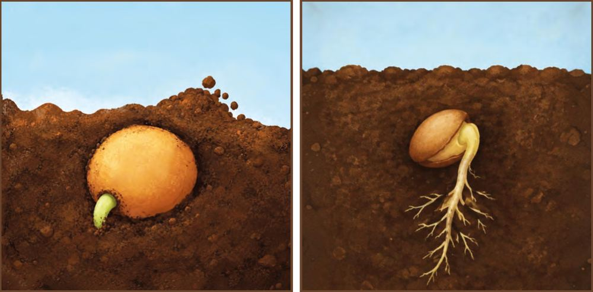
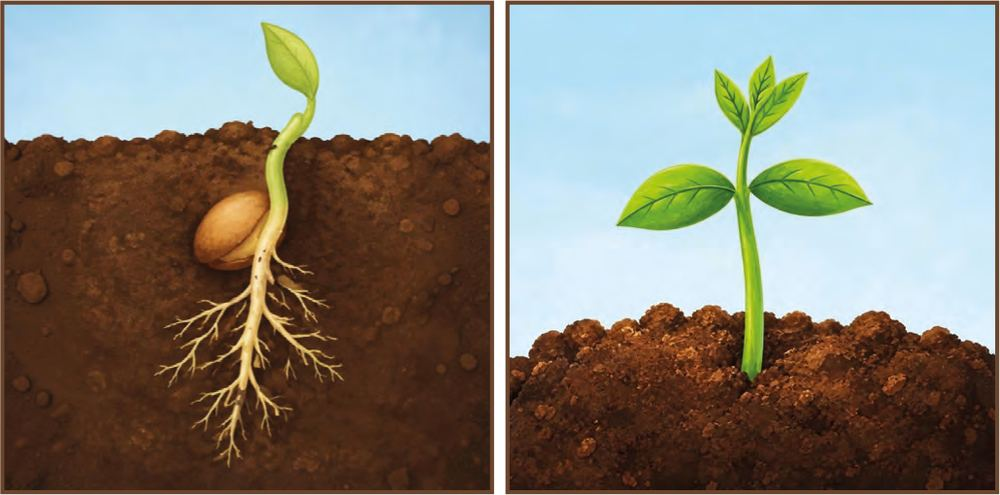

<!-- sayfa 148 -->

EK-2: Sabırla Büyüyen Mercimek Takip Çizelgesi

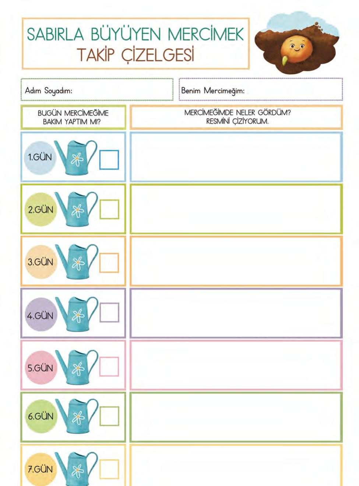

# SABIRLA BÜYÜYEN MERCİMEK TAKİP ÇİZELGESİ

Adım Soyadım:  
Benim Mercimeğim:

| BUGÜN MERCİMEĞİME BAKIM YAPTIM MI? | MERCİMEĞİMDE NELER GÖRDÜM? RESMİNİ ÇİZİYORUM. |
| :--- | :--- |
| 1. GÜN [Sulama İkonu] [ ] | |
| 2. GÜN [Sulama İkonu] [ ] | |
| 3. GÜN [Sulama İkonu] [ ] | |
| 4. GÜN [Sulama İkonu] [ ] | |
| 5. GÜN [Sulama İkonu] [ ] | |
| 6. GÜN [Sulama İkonu] [ ] | |
| 7. GÜN [Sulama İkonu] [ ] | |

<!-- sayfa 149 -->

**ETKİNLİK ADI:** Birlikte Bak Birlikte Yap  
**ALAN ADI:** Matematik  
**YAŞ GRUBU:** 60-72 ay  

**ALAN BECERİLERİ, ÖĞRENME ÇIKTILARI VE SÜREÇ BİLEŞENLERİ**  

**MATEMATİK ALANI**  
**MAB1. Matematiksel Muhakeme**  
**MAB2. Parça-bütün özelliklerini çözümleyebilme**  
MAB2.a. Bir bütünü oluşturan parçaları gösterir.  

**EĞİLİMLER**  
**E2. Sosyal Eğilimler**  
E2.5. Oyunseverlik  
**E3. Entelektüel Eğilimler**  
E3.2. Odaklanma  

**PROGRAMLAR ARASI BİLEŞENLER**  

**Sosyal-Duygusal Öğrenme Becerileri**  
SDB1.2. Kendini Düzenleme (Öz Düzenleme)  
SDB2.1. İletişim  
SDB2.2. İş Birliği  

**Değerler**  
**D3. Çalışkanlık**  
D3.4. Çalışmalarda aktif rol almak  

**Okuryazarlık Becerileri**  
**OB4. Görsel Okuryazarlığı**  

**Kavramlar:** Yön / Mekanda Konum: ön-arka  
**Materyaller:** renkli tak-çıkar oyuncaklar, blokları, yapboz görseli  
**Eğitim / Öğrenme Ortamları:** Çocuklara sırayla “siyah-beyaz-siyah-beyaz” renklerini söyler ve siyah olanlar A takımına, beyaz olanlar B takımına geçer.

<!-- sayfa 150 -->

# ETKİNLİKLER
## Matematik (Büyük Grup Etkinliği)
* Çocuklar eşit sayıda iki gruba ayrılarak her grup için bir ad belirlenir. Gruplar oluşturulduktan sonra etkinliğin kuralları çocuklarla belirlenir ve hatırlatılır. (sıra bekleme, arkadaşlarla nazik bir şekilde konuşma, herkesin etkinliğe katılmasını destekleme, takım arkadaşlarına yardım etme, malzemeleri dikkatli kullanma gibi). “Gruplarımızın başarılı olması için birbirimize nasıl davranmalıyız?” sorusu yönlendirilerek çocukların grup içinde belirlenen ortak kurallara uymaları desteklenir (SDB2.1, SDB2.2).
* Gruplardaki çocuklar sırayla ilerleyebilecekleri şekilde arka arkaya konumlandırılır. Sınıfın ortasına yerleştirilen masaların üzerine, doğrudan görebilecekleri bir noktaya, öğretmen tarafından hazırlanan model yerleştirilir. Bu model; renkli tak-çıkar oyuncakları ya da renkli blokları kullanarak renklerin alt alta geleceği biçimde oluşturulmuştur. Oyun başladığında her gruptan bir çocuk sırayla alana gelir ve modeli dikkatle inceler (E2.5, OB4). Modeldeki bloklarda kullanılan renkleri ve blokların dizilişini aklında tutarak kendi alanında aynı modeli oluşturmaya başlar (E3.2, SDB1.2, SDB2.2, D3.4). Modeli doğru şekilde tamamlayan çocuk, önceden hazırlanmış ve sınıftaki çocuk sayısına göre parçalara ayrılmış, tahtanın önünde bulunan yapbozdan bir parça alır ve doğru yerine yerleştirir (OB4). Oyun, gruplardaki tüm çocuklar görevlerini yerine getirene ve yapboz bütünüyle tamamlanana kadar devam eder (MAB.2.a)

## DEĞERLENDİRME
* Modele bakarken ilk olarak nelere dikkat ettiniz?
* Modeli oluştururken hangi bölüm sana kolay geldi, hangi bölüm zor geldi?
* Takım arkadaşlarınızın oyunu tamamlamasına nasıl yardımcı oldunuz?
* Grup olarak çalışırken belirlediğimiz kurallardan hangilerine dikkat ettiniz?
* Bu oyunu tekrar oynasaydık farklı olarak neler yapmak isterdin?
* Yapbozun tek bir kişi tarafından değil de herkesin katkısıyla tamamlanması sana ne düşündürdü?

# FARKLILAŞTIRMA
**Zenginleştirme:** Çocuklardan modeli üstü kapatılıp akılda tutularak tamamlaması beklenebilir. Puzzle tamamlandıktan sonra modele bakmadan aynı yapıyı yeniden kurma denemesi yapılabilir. Sadece renklerin alt alta dizildiği tek boyutlu modelleri kopyalamak yerine, “kademeli etkinlikler stratejisi” ile içerik seçenekleri çeşitlendirilebilir. Gruplar amaçlı olarak ayrılabilir, bir sonraki kademelerde gruplara çoklu yöne bakan, asimetrik veya üç boyutlu karmaşık blok yapıları sunularak modelin zorluk derecesi artırılabilir.

**Destekleme:** Gruplar amaçlı olarak ayrılabilir, bir sonraki kademelerde 5-6 blokluk bir yapı yerine, sadece temel iki renkten oluşan çok daha sade şablonlar sunulur. Etkinlik sırasında sözel ipuçları verilerek blokların dizilişi hatırlatılabilir. Örneğin “Önce hangi renk geliyordu, hatırlayalım.”, “Kırmızıdan sonra hangi rengi kullanmıştık?” gibi yönlendirici ifadelerle çocukların düşünmeleri desteklenebilir.

# AİLE VE TOPLUM KATILIMI
**Aile Katılımı:** Evde aile bireyleriyle “model kurma” oyunu oynanması önerilebilir. Bu oyunda renkli kapaklar, renkli bloklar ya da benzeri materyaller kullanılarak bir model oluşturulur. Ardından aile üyeleri sırayla modele parça ekler.

**Toplum Katılımı:** Okul bahçesinde ya da yakın çevrede bir parkta benzer bir takım oyunu düzenlenebilir farklı sınıflardan çocuklar bir araya getirilerek grup iş birliği ve ortak kural oluşturma deneyimi yaşatılabilir.

<!-- sayfa 151 -->

**ETKİNLİK ADI:** Afet Afacanı  
**ALAN ADI:** Hareket ve Sağlık  
**YAŞ GRUBU:** 60-72 ay  

**ALAN BECERİLERİ, ÖĞRENME ÇIKTILARI VE SÜREÇ BİLEŞENLERİ**  

**HAREKET VE SAĞLIK ALANI**  
**HSAB3. Güvenlik Becerileri**  
**HSAB.9. Kaza, afet ve tehlikeli durumlarda güvenli davranışları sergileyebilme**  
**HSAB.9.c. Kaza, afet ve tehlike durumlarında bedenini koruma pozisyonlarını uygular.**  

**EĞİLİMLER**  
**E3. Entelektüel Eğilimler**  
**E3.8. Soru Sorma**  

**PROGRAMLAR ARASI BİLEŞENLER**  

**Sosyal-Duygusal Öğrenme Becerileri**  
**SDB1.2. Kendini Düzenleme (Öz Düzenleme)**  

**Değerler**  
**D5. Duyarlılık**  
**D5.3. Afet bilincine sahip olmak**  

**Okuryazarlık Becerileri**  
**OB1. Bilgi Okuryazarlığı**  

**Kavramlar:** Zaman: önce-şimdi-sonra  
**Sözcükler:** deprem, afet ve acil durum çantası, önlem  
**Materyaller:** mektup, dört görev zarfı, görev kartları, karton zemin, ahşap bloklar, birbirine geçmeli tuğlalar, deprem öncesi-sırası-sonrası güvenli davranışları gösteren görseller (EK-1), afet ve acil durum çantası için uygun materyaller, çanta, “çök-kapan-tutun” kartları (EK-2).  
**Eğitim / Öğrenme Ortamları:** Etkinlik öncesinde sınıfa bir mektup ve dört görev zarfı yerleştirilir. Sınıfta çocukların güvenli hareket edebileceği alan oluşturulur. Bir masaya ahşap bloklar, diğer masaya birbirine geçmeli tuğla bloklar konur. Deprem öncesi, sırası ve sonrasında yapılacak güvenli davranışlara ilişkin görseller sınıfın farklı yerlerine yerleştirilir. Afet ve acil durum çantası için gerekli materyaller çocukların görebileceği bir alana hazırlanır. Çök-kapan-tutun oyunu için uygun ve güvenli bir alan belirlenir. Sınıfta konuya ilişkin hassasiyeti olan çocuk olup olmadığı değerlendirilir.

<!-- sayfa 152 -->

# ETKİNLİKLER

## Hareket ve Sağlık (Büyük Grup Etkinliği ve Küçük Etkinliği)

* Çocukların dikkati sınıfa bırakılan mektuba çekilir. Mektubun üzerinde “..........sınıfına” yazdığı fark ettirilir. Mektup açılır ve çocuklara okunur. “Merhaba Çocuklar, ben Afet Afacanı. Çocuklarla bir deprem hazırlık ekibi kuruyorum. Bugün sizin için dört görev hazırladım. Görevleri tamamlayıp bana yardım eder misiniz? Hazırsanız birinci görev zarfını açabilirsiniz.” Çocukların mektup hakkındaki düşünceleri alınır. Çocuklara “Sizce Deprem Hazırlık Ekibi ne yapar?”, “Depreme hazırlıklı olmak ne demektir?” soruları sorularak çocukların merak ettikleri soruları sormalarına fırsat verilir (E3.8).
* Birinci görev zarfı açılır. Zarftan “Dayanıklı Evler” görev kartı çıkarılır. Çocuklar iki gruba ayrılır. Bir gruba ahşap bloklar, diğer gruba birbirine geçmeli tuğlalar verilir. Her gruptan karton zemin üzerine bir ev yapmaları istenir. Çocukların evlerini yaparken malzemeleri incelemeleri, parçaların birbirine nasıl tutunduğunu fark etmeleri ve grup içinde görev paylaşımı yapmaları desteklenir. Evler tamamlandıktan sonra karton zemin yavaş ve kontrollü biçimde sallanır. Çocukların evlerde meydana gelen değişiklikleri gözlemlemeleri sağlanır. “Zemin sallanınca ne değişti?”, “Hangi ev daha çok hareket etti?”, “Sizce bunun nedeni ne olabilir?”, “Evi daha sağlam yapmak için başka ne denenebilir?” sorularıyla çocukların düşünmeleri desteklenir (SDB1.2).
* Çocukların önerilerine göre evlerin daha sağlam durması için yeniden denemeler yapılır. Depremin bir yer hareketi olduğundan bahsedilir. Deprem olmadan önce, deprem sırasında ve olduktan sonra almamız gereken önlemler var. Bu önlemler bizim ve çevremizdekilerin güvenliği için çok önemli denilerek ikinci görev zarfı açılır (D5.3).
* Zarftan “Deprem Dedektifleri” görev kartı çıkarılır. Sınıfın farklı yerlerine asılmış görseller (EK-1) çocuklara gösterilir. Çocuklardan sınıfta dolaşarak görselleri bulmaları ve incelemeleri istenir. Görsellerde; eşyaların sabitlenmesi, afet ve acil durum çantasının hazırlanması, aileyle buluşma yerinin belirlenmesi, deprem sırasında “Çök, kapan, tutun.” yapılması gibi çocukların yaş grubuna uygun durumlar yer alır.
* Çocuklar buldukları görselleri çembere getirir. Görseller “Depremden Önce”, “Deprem Sırasında” ve “Depremden Sonra” başlıkları altında gruplanır. “Bu görselde ne yapılıyor?”, “Bu davranış ne zaman yapılır?”, “Önce mi, deprem sırasında mı, sonra mı?”, “Bu davranış bizi nasıl korur?” soruları yöneltilir ve cevaplar dinlenir (D5.3, OB.1).
* Üçüncü görev zarfı açılır. Zarftan “Afet ve acil durum çantası Hazırlayalım” görev kartı çıkarılır. Ortaya boş bir çanta ve çeşitli materyaller yerleştirilir. Su, düdük, el feneri, pil, yara bandı, küçük battaniye, kuru gıda görseli, peçete gibi uygun materyaller ile çantaya konulmaması gereken materyaller birlikte sunulur. Çocuklardan afet ve acil durum çantasına konulabilecek uygun materyalleri seçmeleri istenir (D5.3, OB.1).
* Dördüncü görev zarfı açılır. Zarftan “Çök-Kapan-Tutun Kahramanları” görev kartı çıkarılır. “Çök, kapan, tutun.” kartları çocuklara gösterilir (EK-2). Çocuklara deprem sırasında güvenli beden pozisyonunun nasıl uygulanacağı hakkında model olunur. Uygulama öncesinde sınıftaki güvenli alan gösterilir. Çocuklarla çök, kapan ve tutun hareketleri yapılır. “Çök!” kartı gösterildiğinde çökme davranışı yapılır, “Kapan!” kartı gösterildiğinde kapanılır, “Tutun!” denildiğinde tutunma davranışı yapılır. Hareketler oyunlaştırılarak birkaç kez tekrar edilir (HSAB.9.c). Görevlerin tamamlandığı belirtilir. Çocuklara “Deprem Hazırlık Ekibi” oldukları söylenir. Mektuba cevap olarak sınıf adına çocuklarla bir mektup yazılır. Çocukların etkinlikle ilgili duygu ve düşüncelerini paylaşmalarına fırsat verilir.

## DEĞERLENDİRME

* Sınıfa gelen mektupta bizden ne isteniyordu?
* Evleri yaparken hangi malzemeleri kullandınız?
* Karton zemin sallandığında evlerde ne değişti?
* Evi daha sağlam yapmak için neler denediniz?
* Depremden önce hangi önlemler alınabilir?
* Deprem sırasında bedenimizi korumak için hangi hareketleri yaptık?

<!-- sayfa 153 -->

# FARKLILAŞTIRMA

**Zenginleştirme:** “Dayanıklı Evler” görevinde çocuklardan farklı bloklar kullanarak ikinci bir ev tasarlamaları, iki yapıyı aynı sallama testinde karşılaştırmaları ve daha sağlam olan yapının özelliklerini açıklamaları istenebilir. “Deprem Dedektifleri” görevinde çocuklardan seçtikleri bir önlemin neden önemli olduğunu arkadaşlarına anlatmaları beklenebilir. “Afet ve acil durum çantası Hazırlayalım” görevinde çantaya seçilen malzemeler su, beslenme, iletişim, aydınlatma, ilk yardım gibi kullanım amaçlarına göre gruplandırılabilir. “Çök, kapan, tutun.” uygulamasında ise sınıfın basit krokisi incelenerek güvenli alanların ve çıkış yolunun işaretlenmesi sağlanabilir.

**Destekleme:** Evlerin yapılması sırasında çocuklar akranları ile eşleştirilerek ya da küçük gruplar oluşturularak çocuklar desteklenebilir. Afet ve acil durum çantası için hazırlanan liste görsellerle desteklenerek birlikte bir afet ve acil durum çantası hazırlanabilir. “Çök, kapan, tutun.” çalışmasında hareketler tek tek gösterilebilir ve çocukla uygulanabilir. Çocuğun hareketlerin sırasını gösteren görsel kartlardan yararlanması sağlanabilir. Etkinlik boyunca kısa, açık ve tekrarlı yönergeler kullanılabilir.

# AİLE VE TOPLUM KATILIMI

**Aile Katılımı:** Ailelere depremde alınacak önlemler ile ilgili bülten hazırlanarak, çocukları ile afet ve acil durum çantası hazırlamaları önerilebilir/istenebilir.

**Toplum Katılımı:** Belediyenin itfaiye / afet işleri biriminden çocuklara eğitim vermek üzere uzman davet edilir. Uzmanların çocukların yaş düzeyine uygun olarak deprem öncesinde, sırasında ve sonrasında yapılması gerekenleri anlatmaları istenebilir.

<!-- sayfa 154 -->

EK-1: Deprem Öncesi / Sırası / Sonrası Önlem Kartları

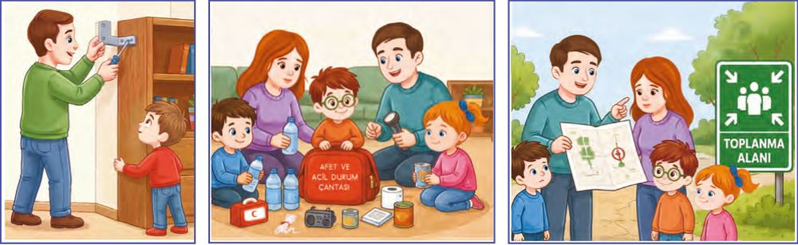
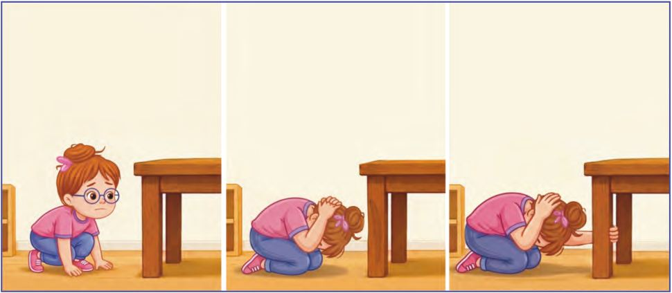
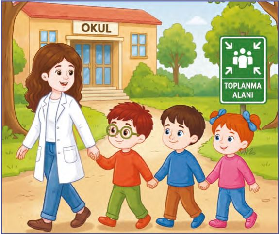

<!-- sayfa 155 -->

# EK-2: Çök-Kapan-Tutun Kartları

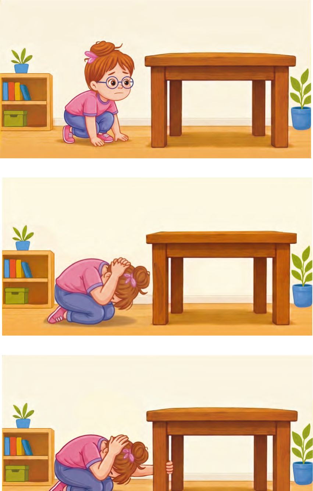

<!-- sayfa 156 -->

**ETKİNLİK ADI:** Haklarımı Anlatıyorum
**ALAN ADI:** Türkçe
**YAŞ GRUBU:** 60-72 ay

**ALAN BECERİLERİ, ÖĞRENME ÇIKTILARI VE SÜREÇ BİLEŞENLERİ**

**TÜRKÇE ALANI**

**TAKB. Konuşma**

**TAKB.4. Konuşma sürecini değerlendirebilme**

TAKB.4.a. Konuşma sürecine ilişkin duygu ve düşüncelerini söyler.

**EĞİLİMLER**

**E3. Entelektüel Eğilimler**

E3.8. Soru Sorma

**PROGRAMLAR ARASI BİLEŞENLER**

**Sosyal-Duygusal Öğrenme Becerileri**

**SDB2.1. İletişim**

**Değerler**

**D1. Adalet**

D1.1. Hak ve özgürlüklerini bilmek ve korumak

**D14. Saygı**

D14.1. Nezaketli olmak

**Okuryazarlık Becerileri**

**OB6. Vatandaşlık Okuryazarlığı**

**Sözcükler:** çocuk hakları, istasyon

**Materyaller:** çocuk hakları kartları (EK-1), istasyon sembolleri (EK-2), zil

**Eğitim / Öğrenme Ortamları:** Etkinlik öncesinde sınıfta dört istasyon masası hazırlanır. Her masanın üzerinde ilgili istasyon sembolü ve bir sepet içinde tüm çocuk hakları kartlarından birer örnek bulunur. Sınıfın bir köşesinde “Haklarımız Panosu” oluşturulur.

<!-- sayfa 157 -->

ETKİNLİKLER

**Türkçe (Küçük Grup Etkinliği)**

* Çember düzeninde oturan çocuklara bir çocuk hakları kartı (**EK-1**) (oyun oynayan çocuklar görseli) gösterilir. “Bu kartta ne görüyorsunuz?”, “En sevdiğiniz oyun nedir?”, “Sizce bir çocuğun hakları neler olabilir?” diye sorularak sohbet başlatılır. Ardından diğer kartlar da gösterilerek çocuk hakları ile ilgili sohbet edilir (**D1.1**).
* Sınıf dört gruba ayrılır. Hazırlanan istasyonlar, her istasyonun sembolü ve her istasyondaki görevler çocuklara açıklanır (**EK-2**). Her istasyonda çocuk hakları kartlarını inceleyecekleri ve farklı bir iletişim becerisi kullanacakları söylenir. Çocuklara istasyonlarda sırayla konuşmaları, arkadaşlarını dinlemeleri, materyalleri paylaşmaları, zil sesini duyduklarında grup düzenini bozmadan sıradaki istasyona geçmeleri ve etkinlik sonunda kullandıkları materyalleri yerine koymaları gerektiği açıklanır. Bu kuralların birlikte çalışabilmek için gerekli olduğu vurgulanır (**OB6**). Tüm istasyonları tamamladığımızda tekrar çemberde buluşacağı söylenir.

1. **İstasyon: Soru Soruyorum ve Cevap Veriyorum (Soru İşareti ve Konuşma Balonu Sembolü):** Çocuklar masadaki kartlarını inceler. Çocuk haklarını öğrenirken konuşma sırasında karşıdakinin gözlerine bakarak dinlemenin önemi vurgulanır ve iki çocukla kısa bir modelleme yapılarak nasıl göz teması kurulacağı gösterilir. Soru sorma döngüsü sırasında, soruyu soran çocuğa “Şimdi arkadaşının gözlerine bakarak sorunu sorabilirsin.” denir ve cevap veren çocuğa da “Göz temasını sürdürerek cevap vermesi hatırlatılır (**SDB2.1**). Çocuklar kartlarını incelerken “Bu kartta ne görüyorsun?”, “Sence bu çocuk neye ihtiyaç duyuyor?”, “Bu çocuk hakkı neden önemli olabilir?” gibi sorular sorabilmeleri için rehberlik edilir. Çocuklar sırayla birbirlerine soru sorar ve yanıtlar (**E3.8, SDB2.1**).
2. **İstasyon: Sesimi Ayarlıyorum (Ses Sembolü):** Çocuklardan bir kart seçerek bu hakkı üç farklı ses tonuyla (Önce kulağımıza fısıldar gibi çok kısık bir sesle, sonra normal konuşur gibi orta sesle anlatmaya, en son da kalabalık bir parkta arkadaşına sesini duyurmak ister gibi biraz daha yüksek bir sesle) anlatmaları istenir. Bu istasyonda anlaşılır ve duruma uygun ses tonuyla konuşmanın önemi vurgulanır (**SDB2.1, D14.1**).
3. **İstasyon: Jest ve Mimikle Anlatıyorum (Yüz İfadesi / El Sembolü):** Bu istasyonda konuşmadan sadece yüzün ve bedenin kullanılacağı belirtilir. Sırasıyla çocuklar bir kart seçer ve kartta anlatılan hakkı (oyun oynama hakkı) konuşmadan sadece jest, mimik ve beden hareketleriyle anlatmaya çalışır. Diğer çocuklar hangi hak olduğunu tahmin eder. Ardından kart hakkında sohbet edilir (**SDB2.1**).
4. **İstasyon: Konuşmayı Başlatıyor ve Sürdürüyorum (Konuşma Balonu Sembolü):** Bu istasyonda çocuklar bir kart seçer. “Şimdi bu hakla ilgili bir cümle kurarak konuşmaya başla.”, “Sonra arkadaşın da seninle aynı hakla ilgili bir şey söyleyerek konuşmaya devam etsin.” denilir. Örneğin bir çocuk “Eğitim hakkımız var hepimiz okula gidiyoruz.” der, diğer çocuk “Evet, öğretmenlerimizden yeni şeyler öğreniyoruz.” şeklinde devam ettirir. Çocukların birbirlerini dinleyerek konuşmayı sürdürmeleri desteklenir (**SDB2.1**).

* **Değerlendirme ve Paylaşım (Çember Zamanı)**
* Tüm gruplar dört istasyonu da tamamladıktan sonra çocuklar yeniden çember düzeninde bir araya gelirler. Her gruptan en çok ilgisini çeken kartını göstermeleri ve o hakkı anlatmaları istenir. “En çok hangi istasyonda zorlandın? En çok hangi istasyonda keyif aldın?” (**TAKB.4.a**) soruları sorularak etkinlik sonlandırılır.

**DEĞERLENDİRME**

* Bugün kimler arkadaşını dinlerken göz teması kurdu?
* Bugün hangi çocuk hakları kartlarını inceledik?
* Konuşurken sesini nasıl ayarladın? Sence neden önemli?
* Jest ve mimik kullanarak hangi hakkı anlattın? Arkadaşların tahmin edebildi mi?
* Bir arkadaşını dinlerken nelere dikkat ettin?

<!-- sayfa 158 -->

# FARKLILAŞTIRMA

**Zenginleştirme:** Çocuklardan seçtikleri bir çocuk hakkı için tamamen yeni bir hak kartı tasarlamaları istenebilir. Çocuklara “istasyon şefi” rolü verilerek kendi gruplarındaki arkadaşlarına yönergeleri hatırlatmalarına destek olunabilir. Çocuklardan 4. istasyonda sadece sözlü cümle kurmalarının ötesine geçerek, ikişerli eşleşip çocuk haklarına dair canlandırma yapabilirler.

**Destekleme:** İstasyon sayısı önce ikiye (soru sorma / cevaplama ve jest / mimik) düşürülebilir, çocukların hazır bulunurluğuna göre kademeli olarak artırılabilir. Hak kartlarının sayısı azaltılarak daha büyük boyutlu görseller seçilebilir. Zamanı somutlaştırmak ve geçişleri kolaylaştırmak için istasyonların ortasına büyük bir kum saati veya görsel zamanlayıcı konulabilir.

# AİLE VE TOPLUM KATILIMI

**Aile Katılımı:** Aileler, okulda yapılan etkinlikler hakkında bilgilendirilir. Ailelerden evde çocuklarıyla çocuk hakkı ile ilgili sohbet etmeleri ve isteyen çocukların çalışmalarını sınıfta paylaşmaları önerilebilir. Çocukların seçtikleri hakkı resimleyerek sınıfa getirmeleri istenebilir. Bu resimler sınıf ortamında oluşturabilecek “Haklarımız Panosu” na eklenebilir.

**Toplum Katılımı:** Çocukların hazırladığı çocuk hakları kartları ve çizimleri, okul girişindeki panoda “Haklarımı Biliyorum, Kendimi İfade Ediyorum” başlığıyla sergilenebilir. Diğer sınıflardaki çocukların panoyu incelemeleri ve etkinliğe katılan çocukların hazırladıkları çalışmaları ziyaretçilere anlatmaları sağlanabilir.

<!-- sayfa 159 -->

EK-1: Çocuk Hakları Kartları

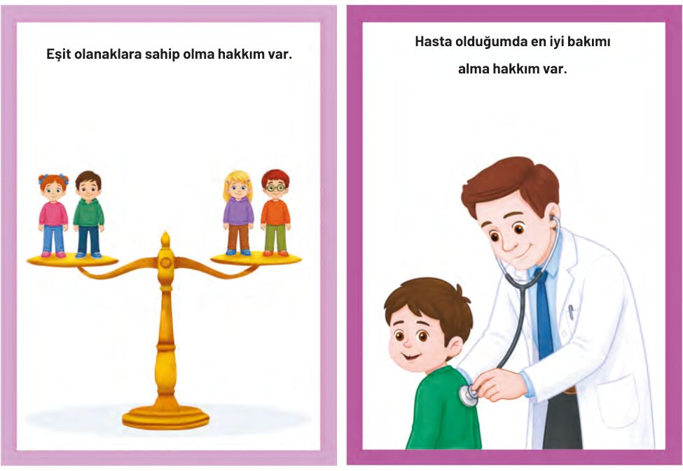
Eşit olanaklara sahip olma hakkım var.

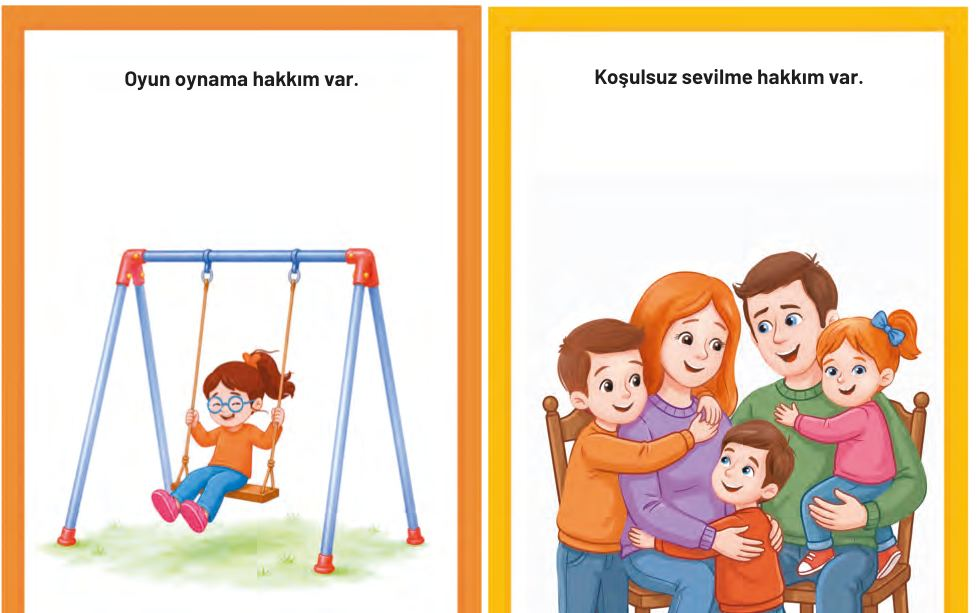
Hasta olduğumda en iyi bakımı alma hakkım var.

Oyun oynama hakkım var.

Koşulsuz sevilme hakkım var.

<!-- sayfa 160 -->

# EK-2: Çocuk Hakları Kartları

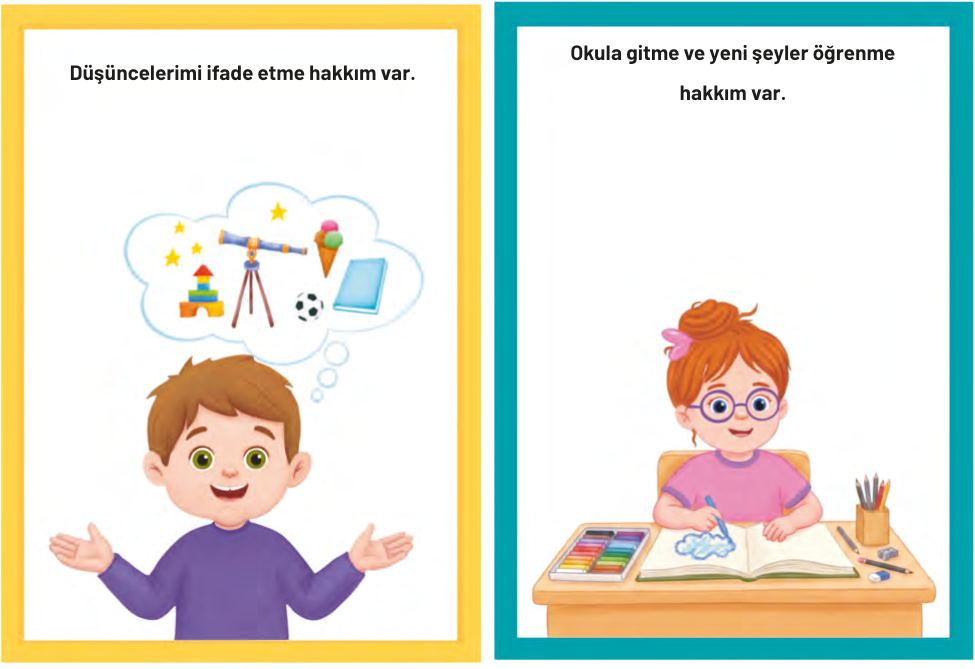

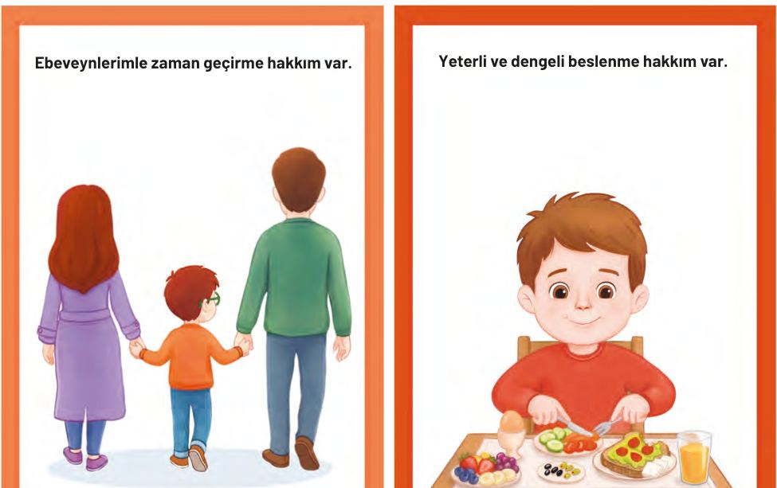

Düşüncelerimi ifade etme hakkım var.

Okula gitme ve yeni şeyler öğrenme hakkım var.

Ebeveynlerimle zaman geçirme hakkım var.

Yeterli ve dengeli beslenme hakkım var.

<!-- sayfa 161 -->

EK-2: İstasyon Sembolleri

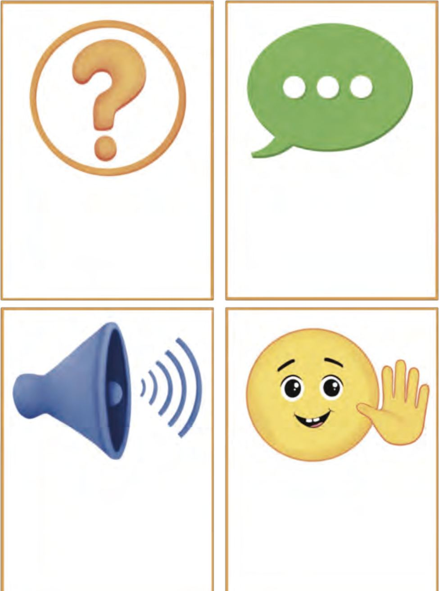

<!-- sayfa 162 -->

**ETKİNLİK ADI:** İletişim Engelleri  
**ALAN ADI:** Türkçe  
**YAŞ GRUBU:** 60-72 ay  

**ALAN BECERİLERİ, ÖĞRENME ÇIKTILARI VE SÜREÇ BİLEŞENLERİ**  
**TÜRKÇE ALANI**  
**TAKB. Konuşma**  
**TAKB.2. Konuşma sürecinin içeriğini oluşturabilme**  
TAKB.2.d. Bir konuyu kendi cümleleriyle yeniden ifade eder.  

**EĞİLİMLER**  
**E3. Entelektüel Eğilimler**  
E3.2. Odaklanma  

**PROGRAMLAR ARASI BİLEŞENLER**  
**Sosyal-Duygusal Öğrenme Becerileri**  
**SDB2.1. İletişim**  

**Değerler**  
**D4. Dostluk**  
D4.2. Arkadaşları ile etkili iletişim kurmak  

**Okuryazarlık Becerileri**  
**OB4. Görsel Okuryazarlık**  

**Sözcükler:** engel, iletişim, çatışma, çözüm, yardım  
**Materyaller:** durum kartı (EK-1)  
**Eğitim / Öğrenme Ortamları:** Sınıfta çocukların güvenli hareket edebilecekleri bir alan hazırlanır.

<!-- sayfa 163 -->

**Türkçe (Büyük Grup Etkinliği)**

**ETKİNLİKLER**

*   Öğretmen yüksek sesle “Çocuklar sesimizi kullanacağımız bir oyuna hazır mısınız?” der ve oyun için hazırlık yapılır. Çocuklar üç gruba ayrılır. Sınıfın uygun bir yerinde iki grubun arasına bir grup geçecek şekilde dizilir. Kenardaki gruplardan birine bir cümle söylenir ve karşı taraftaki diğer gruba bunu anlatmaları / söylemeleri istenir. Ortadaki grup zıplama, el çırpma, ses çıkarma gibi davranışlarla iletişimi engellemeye çalışır. Kısa bir süre sonra grupların rolleri değiştirilir. Oyun tamamlandıktan sonra çocuklarla iletişimi engelleyen durumlar üzerinde konuşulur. “Sesler, hareketler ve aynı anda konuşmak birbirimizi anlamamızı nasıl etkiledi?” sorusu üzerinden çocukların iletişim engellerini fark etmelerine rehberlik edilir.
*   Ardından çocuklara bir durum kartı gösterilir (**EK-1**). “Kartı sessizce inceleyelim.” denir (**E3.2**). Kartta aynı oyuncakla oynamak isteyen iki çocuk ve onları izleyen bir arkadaş yer alır. “Kartta kimler var?”, “Çocuklar ne yaşıyor olabilir?”, “Yanlarında duran çocuk ne fark etmiş olabilir?”, “Yaşadıkları sorunu çözmek için ne yapılabilir?” soruları yönlendirilir ve çocukların cevapları dinlenir. Resimdeki diğer çocuk olayı anlatacak olsaydı nasıl anlatırdı? sorusu üzerine sohbet edilir. “Siz hiç böyle bir durumla karşılaştınız mı?”, “Problem yaşayan arkadaşlarınıza nasıl yardım ediyorsunuz?”, “Arkadaşlarınıza yardım etmeyi denediniz ama sorun çözülmedi. Ne yapabiliriz?”, “Böyle bir durumda kimden yardım istersiniz?” soruları ile çocukların problem durumlarının çözümleri konusunda fikirleri alınır Böyle bir durumla karşılaştığımızda, olayı olduğu gibi anlatarak, gerektiğinde yardım isteyerek, konuşarak çözebileceğimizden bahsedilir (**SDB2.1, D4.2**).
*   Ardından çözüm yollarının ne olabileceği konuşulur. “Sırayla oynama, birlikte oynama, konuşarak anlaşma, yardım isteme” gibi seçenekler çocuklara örnek verilir. Çocuklar küçük gruplara ayrılır. Her grup bir çözümü kısa bir canlandırmayla dener. Canlandırmaların ardından “Bu çözüm işe yaradı mı?”, “Başka hangi çözüm denenebilir?” sorularıyla çocukların farklı çözüm yollarını fark etmeleri sağlanır. (**TAKB.2.d, OB4**). Çocukların çatışmayı tarafsız anlatma, farklı çözüm yolları deneme ve gerektiğinde yardım isteme davranışları süreç içinde gözlemlenir.

**DEĞERLENDİRME**

*   İletişim oyunu sırasında arkadaşını anlamanı zorlaştıran şey neydi?
*   Olayı anlatırken sadece gördüklerini söylemek neden önemlidir?
*   Arkadaşınla anlaşamadığında neler deneyebilirsin?
*   Sorunu çözemediğinde kimden yardım isteyebilirsin?

**FARKLILAŞTIRMA**

**Zenginleştirme:** Çocuklara farklı çatışma kartları sunulabilir. Küçük gruplardan aynı sorun için iki farklı çözüm yolu denemeleri istenebilir. Çocuklar “Konuşarak Çözerim” başlıklı sınıf çözüm kartları hazırlayabilir. Çözüm yolları üretilirken doğrudan kartları göstermek yerine, “düşün-eşleş-paylaş stratejisi” kullanılarak çocukların önce bireysel düşünüp sonra eşleştikleri bir arkadaşıyla özgün bir çözüm bulmaları ve ardından bu çözümü sınıfa sunmaları sağlanabilir. İlgi ve tercihlerine göre çocuklardan çatışma kartlarını kullanarak aileleriyle de çözüm yolları denemelerine fırsat sunulabilir.

**Destekleme:** İletişim engeli oyununda ses düzeyi azaltılabilir ve hareketler sınırlandırılabilir. Çatışma kartı daha sade hazırlanabilir. Çocukların çözüm kartı seçerek, işaret ederek ya da öğretmenle cümleyi tekrar ederek katılım göstermeleri desteklenebilir. Öğretmen yüksek sesle düşünerek model olma stratejisiyle kademeli rehberlik sağlayabilir. Örneğin öğretmen “Ben de o oyuncakla oynamak istiyorum ama arkadaşımın elinde, sanırım birlikte oynayalım mı diye sorabilirim.” diyerek soyut problem çözme sürecini somutlaştırabilir.

<!-- sayfa 164 -->

# AİLE VE TOPLUM KATILIMI

**Aile Katılımı:** Ailelere “Çatışmaları Konuşarak Çözmeyi Öğreniyoruz” başlıklı kısa bir bilgilendirme notu gönderilebilir. Ailelerden evde çocuklarıyla “sırayla kullanma, birlikte karar verme, yardım isteme” durumlarını konuşmaları istenebilir.

**Toplum Katılımı:** Sınıfta hazırlanan çözüm kartları okulun ortak alanında sergilenebilir. Uygun görülürse rehberlik servisiyle “Sorun Yaşarsam Ne Yapabilirim?” başlıklı kısa bir sınıf paylaşımı yapılabilir.

<!-- sayfa 165 -->

EK-1: Durum Kartı

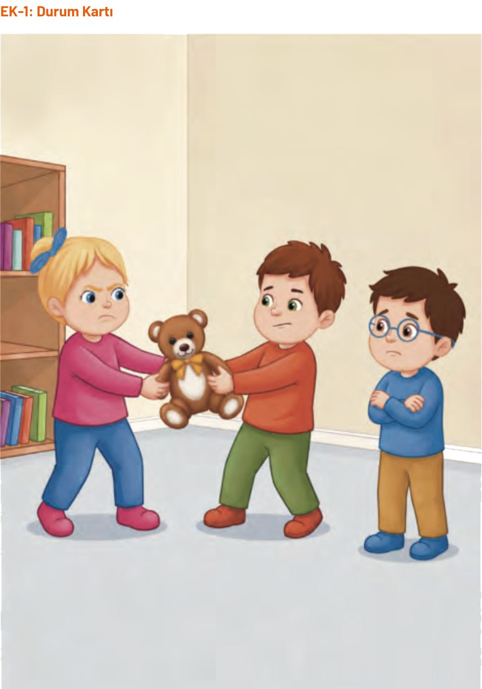

<!-- sayfa 166 -->

**ETKİNLİK ADI:** Okul Kahramanları Görevde  
**ALAN ADI:** Sosyal, Sanat  
**YAŞ GRUBU:** 60-72 ay  

**ALAN BECERİLERİ, ÖĞRENME ÇIKTILARI VE SÜREÇ BİLEŞENLERİ**

**SOSYAL ALAN**  
**SBAB2. Kanıta Dayalı Sorgulama ve Araştırma**  
**SAB5. Yakın çevresiyle / ülkemizle ilgili merak ettiği konuya yönelik kaynakları inceleyebilme**  
SAB5.a. Yakın çevresinde merak ettiği konularla ilgili görsel / işitsel materyalleri inceler.

**SANAT ALANI**  
**SNAB4. Sanatsal Uygulama Yapma**  
**SNAB.4. Sanat etkinliği uygulayabilme**  
SNAB.4.a. Yapmak istediği sanat etkinliğinin türüne karar verir.  
SNAB.4.b. Sanat etkinliği için gerekli materyalleri seçer.  
SNAB.4.c. Sanat materyallerini amacına uygun biçimde kullanır.  
SNAB.4.ç. Sanat etkinliklerine aktif olarak katılır.  
SNAB.4.d. Sanat etkinliklerinde özgün ürünler oluşturur.

**EĞİLİMLER**  
**E2. Sosyal Eğilimler**  
E2.3. Girişkenlik  
**E3. Entelektüel Eğilimler**  
E3.8. Soru Sorma

**PROGRAMLAR ARASI BİLEŞENLER**  

**Sosyal-Duygusal Öğrenme Becerileri**  
SDB2.2. İş Birliği  
SDB3.3. Sorumlu Karar Verme  

**Değerler**  
**D5. Duyarlılık**  
D5.1. İnsana ve topluma değer vermek  

**Sözcükler:** ihtiyaç, kahraman, görev, çözüm, katkı  

**Materyaller:** Okul Kahraman rozeti veya yaka kartları, okul çalışanlarının fotoğrafları, tablet / fotoğraf makinesi, büyük kartonlar, boya kalemleri, yapıştırıcı, çıkartmalar, artık materyaller  

**Eğitim / Öğrenme Ortamları:** Okulun bahçe, koridor, yemekhane ve sınıf gibi bölümlerinde güvenli gözlem alanları belirlenir. Küçük grup çalışmaları için sınıfta uygun masalar düzenlenir; gözlem kartları, fotoğraf aracı, kâğıt, boya, afiş ve maket malzemeleri erişilebilir biçimde hazırlanır. Çözüm önerilerinin sunulabileceği ve sergilenebileceği bir alan oluşturulur.

<!-- sayfa 167 -->

# ETKİNLİKLER

## Sosyal, Sanat (Bütünleştirilmiş Büyük Grup Etkinliği)

* Öğretmen çocuklara “Bugün sizleri çok önemli bir görev bekliyor. Okulumuzun kahramanları olacağız. Kahramanlar yalnızca sorunları fark etmez, çözüm de bulur.” diyerek her çocuğa bir kahraman rozeti verir. Çocuklar küçük gruplara ayrılır. Her grup okulun farklı bir bölümünü incelemek üzere görevlendirilir. Çocukların ziyaret edecekleri bölüme ve okul çalışanlarına yönelik merak ettikleri soruları oluşturmaları ve bu soruları okul çalışanlarına yöneltmeleri desteklenir (E2.3, E3.8 ).
* Bahçe Takımı, Koridor Takımı, Yemekhane Takımı ve Sınıf Takımı oluşturulur. Gruplara görev alanlarına ilişkin fotoğraflar ve görsel materyaller sunulur. Çocukların bu materyalleri inceleyerek görev alanlarını tanımaları sağlanır (SAB.5.a). Ardından gruplar öğretmen rehberliğinde görev alanlarını gezer. Çocuklara “Buranın daha güzel olması için neler yapılabilir?”, “Okulda insanların işini zorlaştıran bir durum var mı?”, “Okula nasıl yardım edebiliriz?” ve “Okulda bir değişiklik yapmak isteseydin ne yapardın?” soruları yöneltilir. Çocuklar görev alanlarını gözlemler, fotoğraf çeker veya gözlemlerini öğretmene anlatır; öğretmen de çocukların ifadelerini not alır. İnceleme sırasında çocukların okul çalışanlarını sabırla dinlemeleri, onlarla nazik biçimde iletişim kurmaları ve okulun farklı bölümlerini kullanan kişilerin ihtiyaçlarını dikkate almaları desteklenir (D5.1).
* Sınıfa dönüldüğünde gruplar belirledikleri durumları arkadaşlarına anlatır. Her grup okulun ilgili bölümünde fark ettiği bir ihtiyaç veya sorun üzerinde ortak karara varır (SDB2.2). Örneğin oyuncakların karışık olması, bitkilerin sulanmaya ihtiyaç duyması, koridorda koşulması veya kitap merkezinin dağınık olması ele alınabilir. Çocukların seçtikleri sorunu ve bu sorunun okul yaşamını nasıl etkilediğini ifade etmeleri sağlanır.
* Daha sonra çözüm atölyesine geçilir. Her grup seçtiği sorun için bir çözüm önerisi geliştirir. Çocuklara çözüm önerilerini anlatmak için afiş veya resim hazırlayabilecekleri söylenir. Gruplar hazırlamak istedikleri sanat çalışmasının türüne birlikte karar verir (SNAB.4.a). Çalışmalarında kullanacakları resim kâğıdı, fon kartonu, boya kalemi, pastel boya, artık materyal ve benzeri sanat materyallerini seçerler (SNAB.4.b). Grup üyeleri birlikte karar vererek görev paylaşımı yapar ve ortak çalışmalarını oluşturur (SDB2.2). Çocuklar seçtikleri sanat materyallerini amaçlarına uygun biçimde kullanır (SNAB.4.c). Belirledikleri sorunu ve çözüm önerisini resim, renk, biçim ve sembollerden yararlanarak özgün bir ürüne dönüştürürler (SNAB.4.ç, SNAB.4.d). İsteyen grupların hazırladıkları görsel ürüne ek olarak çözüm önerilerini kısa bir canlandırmayla göstermelerine de fırsat verilir.
* Gruplar çalışmalarını tamamladıktan sonra sırayla sunum yapar. Çocukların “Bizim görev alanımız…”, “Biz şu sorunu fark ettik…” ve “Bizim çözüm önerimiz…” gibi ifadelerden yararlanarak hazırladıkları ürünleri ve çözüm önerilerini açıklamaları desteklenir. Her grubun çalışması sunumun ardından panoda bir araya getirilir.
* Çocuklarla birlikte çözüm önerileri incelenir ve okulda uygulanabilecek bir çözüm üzerinde ortak karara varılır (SDB2.2, SDB3.3). Örneğin oyuncaklar düzenlenir, bitkiler sulanır, sessiz koridor afişi hazırlanır veya kitap merkezi yeniden düzenlenir. Çocuklar belirledikleri çözümü aynı gün uygulayarak fark ettikleri sorunun giderilmesine ve okul yaşamının iyileştirilmesine katkı sağlar (SDB3.3). Etkinliğin sonunda bütün çocuklara “Okul Kahramanı Sertifikası” verilir.

## DEĞERLENDİRME

* Bugün okulda hangi ihtiyacı fark ettin?
* Grubunuz hangi çözümü geliştirdi?
* Çözüm üretirken arkadaşlarınla nasıl iş birliği yaptın?
* Okulumuza nasıl katkıda bulunduk?
* En çok hangi görevi yapmayı sevdin?
* Bir okul kahramanı olmak nasıl hissettirdi?

<!-- sayfa 168 -->

FARKLILAŞTIRMA

**Zenginleştirme:** Çocuklardan geleceğin okulunu tasarlamaları istenebilir. Hiç sorun yaşanmayan bir okulun nasıl olacağını resimleyebilir veya üç boyutlu modelini hazırlayabilirler. Çözüm önerileri kısa drama çalışmalarıyla canlandırılabilir.

**Destekleme:** Fotoğraflar ve semboller kullanılarak sorunlar daha somut hâle getirilebilir. Çocuklara iki seçenekli çözüm kartları sunulabilir. Akran desteği sağlanabilir. Sunum yapmak istemeyen çocuklar çalışmalarını işaret ederek veya arkadaşının yardımıyla tanıtabilir.

AİLE VE TOPLUM KATILIMI

**Aile Katılımı:** Ailelerden çocuklarıyla evde veya apartmanda fark ettikleri küçük bir ihtiyacı belirlemeleri ve buna yönelik bir çözüm geliştirmeleri istenebilir. Çocuklar çözüm önerilerini resmederek okula getirilebilir.

**Toplum Katılımı:** Çocukların hazırladığı “Okul Kahramanları Çözüm Sergisi” okulun giriş alanında sergilenebilir. Diğer sınıflar, okul çalışanları ve veliler sergiyi ziyaret edebilir.

<!-- sayfa 169 -->

**ETKİNLİK ADI:** Ben de Okulumun Bir Parçasıyım
**ALAN ADI:** Türkçe, Sosyal
**YAŞ GRUBU:** 60-72 ay

**ALAN BECERİLERİ, ÖĞRENME ÇIKTILARI VE SÜREÇ BİLEŞENLERİ**

**TÜRKÇE ALANI**

**TADB. Dinleme / İzleme**
**TADB.3. Dinledikleri / izledikleri şiir, hikâye, tekerleme, video, tiyatro, animasyon gibi materyalleri çözümleyebilme**
* TADB.3.a. Dinledikleri / izledikleri materyalleri oluşturan unsurları belirler.

**TAOB. Okuma**
**TAOB.1. Resimli öykü kitabı, dijital içerikler, afiş, broşür gibi görsel okuma materyallerini seçebilme**
* TAOB.1.a. Görsel okuma materyallerini inceler.

**TAOB.2. Resimli öykü kitabı, dijital içerikler, afiş, broşür gibi görsel okuma materyallerinden anlamlar oluşturabilme**
* TAOB.2.a. Görsel okuma materyali ile ön bilgileri arasında ilişki kurar.
* TAOB.2.c. Görsel okuma materyallerinde yer alan bilgilerden yararlanarak çıkarım yapar.
* TAOB.2.ç. Görsel okuma materyallerini özelliklerine göre karşılaştırır.

**TAKB. Konuşma**
**TAKB.1. Konuşma sürecini yönetebilme**
* TAKB.1.c. İletişim sırasında uygun zamanda söz alır.

**TAKB.2. Konuşma sürecinin içeriğini oluşturabilme**
* TAKB.2.a. Konuşacağı konu ile ön bilgileri arasında bağlantı kurar.
* TAKB.2.d. Bir konuyu kendi cümleleriyle yeniden ifade eder.
* TAKB.2.g. Topluluk önünde sözlü sunum yapar.

**TAKB.3. Konuşma sürecinde Türkçeyi doğru kullanabilme**
* TAKB.3.a. Konuşacağı konuyu planlar.
* TAKB.3.c. Öğrendiği yeni sözcükleri anlamına uygun kullanır.
* TAKB.3.ç. Söylemek istediklerini açık biçimde ifade eder.

**SOSYAL ALAN**

**SBAB2. Kanıta Dayalı Sorgulama ve Araştırma**
**SAB.5. Yakın çevresiyle / ülkemizle ilgili merak ettiği konuya yönelik kaynakları inceleyebilme**
* SAB.5.a. Yakın çevresinde merak ettiği konularla ilgili görsel / işitsel materyalleri inceler.

**EĞİLİMLER**

**E3. Entelektüel Eğilimler**
* E3.8. Soru Sorma

<!-- sayfa 170 -->

# PROGRAMLAR ARASI BİLEŞENLER

## Sosyal-Duygusal Öğrenme Becerileri
### SDB2.3. Sosyal Farkındalık

## Değerler
### D15. Sevgi
#### D15.3. Misafirperverlik

## Okuryazarlık Becerileri
### OB4. Görsel Okuryazarlık

**Kavramlar:** Miktar: parça-bütün

**Materyaller:** büyük okul görseli, ev görseli, çocuk fotoğrafları, okul çalışanlarına ait fotoğraflar, boş yapboz parçaları, boya kalemleri

**Eğitim / Öğrenme Ortamları:** Etkinlik öncesinde sınıfta büyük bir okul görseli ve ev görseli hazırlanır. Çocuk fotoğrafları ve okul çalışanlarına ait fotoğraflar uygun şekilde düzenlenir. Etkinlik için okul çalışanları önceden bilgilendirilir.

<!-- sayfa 171 -->

ETKİNLİKLER

**Türkçe, Sosyal (Büyük Grup Etkinliği)**

* Büyük bir okul görseli ve ev görseliyle sınıfa girilir. “Bugün yoklamamızı farklı bir şekilde yapacağız ve bunun için iki görsel getirdim.” denir. Çocukların görselleri incelemeleri ve görsellerde neler gördüklerini söylemeleri sağlanır (TAOB.1.a). “Bu ev sizin evinize benziyor mu?”, “Hangi özellikleri benziyor?”, “Peki görseldeki okul bizim okulumuza benziyor mu?” soruları yöneltilir. Çocukların görseller ile kendi evleri ve okulları arasında ilişki kurmaları ve görselleri özellikleri bakımından karşılaştırmaları desteklenir (TAOB.2.a, TAOB.2.ç).
* Çocukların isimleri tek tek söylenir. Bugün sınıfta bulunan çocuklar, kendi fotoğraflarını okul görselinin üzerine sırayla yerleştirir. Okula gelmeyen bir çocuk varsa fotoğrafı diğer çocuklara gösterilerek ismi söylenir ve bugün okulda olmadığı belirtilerek fotoğrafı ev görselinin üzerine yerleştirilir.
* Ardından çocuklara “Okulda kimler bulunur?”, “Okulumuzda yalnızca çocuklar ve öğretmenler mi vardır?” soruları yöneltilir. Çocukların okulda daha önce karşılaştıkları kişilerden hareketle düşüncelerini söylemeleri sağlanır (TAKB.2.a). Konuşma sırasında sıralarını beklemeleri ve uygun zamanda söz almaları desteklenir (TAKB.1.c).
* Çocuklara boş yapboz parçaları dağıtılır. Her çocuktan yapboz parçasına kendisini anlatan küçük bir resim çizmesi istenir. Öğretmen de çocuklarla birlikte kendi yapboz parçasına resim çizer. Çocuklar resimlerini tamamladıktan sonra yapboz parçalarını büyük okul görselinin çevresine yapıştırır. “Her birimiz bu okulun bir parçasıyız.” açıklaması yapılır. Çocukların “Ben de bu okulun bir parçasıyım.” cümlesini açık biçimde söylemeleri desteklenir (TAKB.3.ç).
* Daha önceden hazırlanmış okul çalışanlarına ait fotoğraflar uygun bir alana asılır. Çocukların fotoğrafları incelemeleri; fotoğraflardaki kişilerin kim olabileceğine, okulda hangi görevleri yerine getirebileceklerine ve onları daha önce görüp görmediklerine ilişkin düşüncelerini söylemeleri sağlanır (SAB.5.a, OB4). Çocukların fotoğraflarda yer alan görsel bilgilerden hareketle bu kişilerin görevlerine ilişkin çıkarımda bulunmaları desteklenir (TAOB.2.c).
* Fotoğraflardaki kişilerin okulda çalışan kişiler olduğu açıklanır ve çocuklar küçük gruplara ayrılır. Her gruba bir veya daha fazla fotoğraf verilir. Çocukların fotoğraftaki kişiye hangi soruları soracaklarını önceden belirlemeleri sağlanır (TAKB.3.a). Gruplardan bu kişileri okulda bulmaları; onlara “Gün içinde neler yapıyorsunuz?”, “İşinizin en sevdiğiniz kısmı nedir?” ve “Bize nasıl yardım ediyorsunuz?” sorularını yöneltmeleri istenir. Çocukların bu soruların yanı sıra merak ettikleri farklı sorular oluşturmaları ve uygun zamanda okul çalışanlarına sormaları desteklenir (E3.8, TAKB.1.c). Çocukların okul çalışanlarıyla iletişim kurmaya istekli olmaları ve onları sınıfa davet etmeleri teşvik edilir.
* Çocukların okul çalışanlarının açıklamalarını dikkatle dinlemeleri; çalışanların isimleri, görevleri ve okulda yaptıkları işlerle ilgili temel bilgileri belirlemeleri sağlanır (TADB.3.a). Gerektiğinde çocukların öğrendikleri meslek ve görev adlarını tekrar etmelerine fırsat verilir.
* Sınıfa dönüldüğünde okul çalışanlarına ait fotoğraflar ortaya yerleştirilir. Çocuklar fotoğraflardan yararlanarak kimlerle tanıştıklarını, bu kişilerin isimlerini ve okulda yaptıkları görevleri kendi cümleleriyle anlatır (TAKB.2.d). “Biz okulda ... ile tanıştık.”, “Onun görevi ...”, “O, okulda ... yapıyor.” ve “O da okulumuzun bir parçası.” gibi ifadeler kullanmaları desteklenir. Çocukların öğrendikleri meslek ve görev adlarını anlamlarına uygun biçimde kullanmaları sağlanır (TAKB.3.c). Her grubun edindiği bilgileri arkadaşlarına sunmasına fırsat verilir (TAKB.2.g). Çocukların okulda çalışan kişilerin okul yaşamına sağladıkları katkıyı fark etmeleri ve bunu ifade etmeleri desteklenir (SDB2.3).
* Çocuklar gün içinde sınıfa gelen okul müdürü, müdür yardımcısı, öğretmenler, yardımcı personel, temizlik görevlisi, yemekhane görevlisi, güvenlik görevlisi veya okulda bulunan diğer kişileri “Hoş geldiniz.” diyerek karşılar (D15.3). Çocukların konuklara uygun zamanda söz alarak merak ettikleri soruları yöneltmeleri ve verilen cevapları dinlemeleri desteklenir (TAKB.1.c). Etkinliğin sonunda çocuklar konuklara katılımları için teşekkür eder ve onlarla uygun biçimde vedalaşır (D15.3).

<!-- sayfa 172 -->

**DEĞERLENDİRME**

* Bugün fotoğrafını okul görselinin üzerine koyduğunda ne hissettin?
* Sence biz neden “Okulun bir parçasıyız.” dedik?
* Okulumuzda çocuklar ve öğretmenler dışında kimlerle tanıştık?
* Tanıştığımız kişiler okulda hangi görevleri yapıyor?
* Okulumuzdaki çalışanlar olmasaydı okul yaşamımızda neler değişirdi?

**FARKLILAŞTIRMA**

**Zenginleştirme:** Çocuklara okul çalışanlarının görevleriyle ilgili daha ayrıntılı görseller sunulabilir. Çocuklardan “Okulda bu görev yapılmasa ne değişirdi?” üzerine düşünmeleri istenebilir. Her grup, tanıştığı okul çalışanının okula nasıl katkıda bulunduğunu kısa bir canlandırma ile gösterebilir. Çocuklardan “Okulumuzun Bir Parçasıyız” başlıklı ortak bir pano oluşturmaları istenebilir. Panoda çocukların yapboz parçaları, okul çalışanlarının fotoğrafları ve çocukların “Ben okulum için … yapabilirim.” cümlesini temsil eden çizimleri bir araya getirilebilir. Çocuklardan okul topluluğuna kendilerinin nasıl katkıda bulunabileceklerini düşünmeleri istenebilir. “Ben okuluma nasıl katkıda bulunabilirim?” başlıklı küçük resimler hazırlanabilir. Çocuklar okulda oyuncakları toplama, arkadaşına yardım etme, sınıfı temiz tutma, sıraya uyma gibi davranışları resmedebilir.

**Destekleme:** Sürece öncelikle çocukların sık karşılaştığı öğretmen, müdür, yardımcı personel ve güvenlik görevlisi gibi kişilerle başlanabilir. Fotoğrafların altına görevlerini anlatan basit semboller eklenebilir. Küçük grup çalışmasında akran desteği verilebilir. Yapboz parçasına çizim çalışmasında kendini anlatan hazır semboller, çıkartmalar ya da iki seçenekli görseller verilebilir. Kalabalık alanlara geçişler diğer sınıfların durumlarına göre değişiklik gösterebilir. Gezi sırasında çocuklara hatırlatıcı tekrarlar yapılabilir. Fotoğraflar büyük boy ve kontrast zeminli hazırlanabilir. Çocukların gözlemci olarak katılmasına, hazır olduğunda kısa bir selamlaşma yapmasına fırsat verilebilir.

**AİLE VE TOPLUM KATILIMI**

**Aile Katılımı:** Ailelere “Bugün okul topluluğumuzu tanıdık.” başlıklı kısa bir bilgilendirme notu gönderilir. Ailelerden çocuklarıyla “Biz ailemizin bir parçasıyız, okulumuzun da bir parçasıyız.” üzerine sohbet etmeleri önerilebilir.

**Toplum Katılımı:** Çocuklar tanıştıkları okul çalışanlarına küçük teşekkür kartları hazırlayabilir. Hazırladıkları kartları okuldaki kişilere vererek çalışanlar sınıfa davet edilebilir.

<!-- sayfa 173 -->

**ETKİNLİK ADI:** Nezaket ile Peksimet
**ALAN ADI:** Türkçe
**YAŞ GRUBU:** 60-72 ay

**ALAN BECERİLERİ, ÖĞRENME ÇIKTILARI VE SÜREÇ BİLEŞENLERİ**

**TÜRKÇE ALANI**

**TAKB. Konuşma**

**TAKB.2. Konuşma sürecinin içeriğini oluşturabilme**

TAKB.2.d. Bir konuyu kendi cümleleriyle yeniden ifade eder.

**EĞİLİMLER**

**E1. Benlik Eğilimleri**

E1.1. Merak

**E2. Sosyal Eğilimler**

E2.2. Sorumluluk

**PROGRAMLAR ARASI BİLEŞENLER**

**Sosyal-Duygusal Öğrenme Becerileri**

SDB2.2. İş Birliği

SDB2.3. Sosyal Farkındalık

**Değerler**

**D4. Dostluk**

D4.2. Arkadaşları ile etkili iletişim kurmak

**D10. Mütevazılık**

D10.1. İnsan ilişkilerinde yapıcı olmak

**D14. Saygı**

D14.1. Nezaketli olmak

**Okuryazarlık Becerileri**

**OB6. Vatandaşlık Okuryazarlığı**

**Sözcükler:** nezaket sözcükleri

**Materyaller:** renk torbası ve sarı kırmızı, mavi renkte kartlar, farklı özelliklerde kâğıtlar, farklı renklerde boyalar, makas ve yapıştırıcılar

**Eğitim / Öğrenme Ortamları:** Bahçede hikâye okuma alanı düzenlenir. Sınıfta kırmızı, mavi ve sarı çalışma masaları oluşturularak farklı özelliklerde kâğıtlar, boyalar, makaslar, yapıştırıcılar ve renk torbası hazırlanır. Müzik açmak için gerekli araçlar hazır bulundurulur.

<!-- sayfa 174 -->

ETKİNLİKLER

**Türkçe (Küçük Grup Etkinliği)**

• Çocuklarla bahçeye çıkılır. Bahçede çocuklara “Nezaket ile Peksimet” hikâyesi okunur.

**NEZAKET’LE PEKSİMET**

Nezaket ile Peksimet iki tavşan kardeşmiş.
Havuç toplamak için beraber gezerlermiş.
Nezaket gülümseyip ilerlerken kırlarda
Peksimet söylenerek gidermiş arkasında.

“Ben acıktım Nezaket; haydi koş, acele et!”
“N’olur dayan Peksimet, birazcık daha sabret.”

Yürürlerken bahçeye, denk geldiler çiftçiye.
Peksimet somurtarak “Havuuuç!” diye tutturdu.
Çiftçi amca bu tavra çok şaşırdı, bozuldu.
Nezaket öne çıktı, binbir özür diledi.
Pek yorulduk, acıktık, lütfen yemek azıcık!

Böyle kibar olanlar hiç geri çevrilir mi?
İstediği tazecik havuçlar verilmez mi?
“Çok teşekkür ederiz biz sana çiftçi amca!”
Diyerek iki kardeş düştüler tekrar yola…

Yokuşu tırmanınca susadı bizimkiler,
Peksimet sızlanınca hatırlandı çeşmeler.
Çeşmenin etrafında su sırası bekleyen
Kedilerle kuzular, kahverengi inekler…

Bizimki “Çok susadım, bekleyemem sırayı!”
Deyince Nezaket’ten aldı şu uyarıyı:
“Öyle sıra istenmez, sözlerine dikkat et!
Nazik davranman gerek, yeter bunca şikâyet!”

Nezaket öne geçti lafını bitirince:
“Arkadaşlar; susadık, yorulduk yeterince!
Rica etsem önce biz su içebilir miyiz?
Kaç zamandır yoldayız, olur mu ne dersiniz?”

Hayvanlar birer birer çeşmeden çekildiler.
Bekletmeden onları önceliği verdiler.
“Sağ olun arkadaşlar, sıranızı verdiniz,
Sizden isteğimizi geri çevirmediniz.”

Anladı ki Peksimet kabalık büyük illet,
Açar tüm kapıları tatlı sözle nezaket…

<!-- sayfa 175 -->

# ETKİNLİKLER

* Hikâyenin ardından “Hikâyemizin adı neydi?”, “Hikâyede hangi karakterler vardı?”, “Nezaketin davranışları nasıldı?” ve “Peksimet’in davranışları nasıldı?” soruları yöneltilerek çocukların düşüncelerini paylaşmaları sağlanır. Çocuklardan evlerinde ve çevrelerinde duydukları nezaket sözcüklerine örnek vermeleri istenir. Verilen yanıtlar birlikte değerlendirilir (TAKB.2.d, SDB2.3, OB6). “Peksimet ismi sizce nereden gelmiş olabilir?”, “Bu sözcüğün anlamını merak ettiniz mi?” soruları yöneltilir. Çocuklardan sözcüğün anlamını aileleriyle araştırmaları istenir (E1.1).
* Ardından sınıfa geçilir ve müzik açılır. Çocukların müzik eşliğinde dans etmeleri sağlanır. Kırmızı, mavi ve sarı olmak üzere üç renk masası hazırlanır. Müzik açılır, durdurulduğunda çocuklardan önceden hazırlanan renk torbasından birer kart seçmeleri ve kartlarıyla aynı renkteki masaya geçmeleri istenir (SDB2.2).
* Kırmızı masaya farklı özelliklerde kâğıtlar, sarı masaya farklı renklerde boyalar, mavi masaya ise makas ve yapıştırıcılar yerleştirilir. Çocuklardan masalardaki materyalleri kullanarak hikâyedeki karakterleri çizmeleri istenir. Her masaya sınırlı sayıda materyal koyularak çocukların çalışmalarını tamamlayabilmek amacıyla diğer masalardaki arkadaşlarıyla yardımlaşmaları sağlanır. Materyallerin paylaşılması sırasında nezaket sözcüklerinin kullanılması desteklenir (E2.2, SDB2.3, D10.1). “Arkadaşım, lütfen yapıştırıcıyı verir misin?”, “Teşekkür ederim.”, “Rica ederim.” ve “Sağ ol.” gibi ifadelerin uygun durumlarda kullanılması desteklenir (D4.2, D14.1).

# DEĞERLENDİRME

* Bugün dinlediğiniz nezaket sözcüklerinden hangilerini günlük yaşamınızda kullanıyorsunuz?
* Nezaket sözcüklerini hangi durumlarda kullanıyorsunuz?
* Nezaket sözcüklerini kullanmasaydık kendimizi nasıl hissederdik?
* Başka bir masadaki materyale ihtiyacın olduğunda arkadaşına neler söyledin?
* Arkadaşın etkinliğe katılmıyorsa ona nazikçe ne söyleyebilirsin?
* Arkadaşınla aynı fikirde olmadığında düşünceni nasıl nazikçe söylersin?

# FARKLILAŞTIRMA

**Zenginleştirme:** Çocuklardan Nezaket ile Peksimet’in karşılaşabileceği yeni bir durum düşünmeleri ve bu durumda kullanılabilecek nezaket ifadelerini canlandırmaları istenebilir. Hazırlanan karakter çalışmalarına konuşma balonları eklenerek “Lütfen.”, “Teşekkür ederim.”, “Rica ederim.”, “Özür dilerim.” gibi ifadeler istendiği takdirde yazılabilir. Çocukların farklı nezaket sözcüklerini içeren kısa diyalogları arkadaşlarına sunmaları istenebilir.

**Destekleme:** Hikâye kartları hazırlanarak hikaye daha anlaşılır hale getirilebilir. Gruplar oluşturulurken öğretmen çocukların bireysel özellikleri dikkate alarak düzenlemeler yapabilir.

# AİLE VE TOPLUM KATILIMI

**Aile Katılımı:** Aileler, evde bulunan boş bir kavanozu “Nezaket Kavanozu” olarak kullanabilir. Gün içinde aile üyelerinden biri “lütfen”, “teşekkür ederim”, “günaydın” gibi bir nezaket sözcüğü kullandığında kavanoza bir düğme, kuru fasulye veya küçük bir kâğıt parçası atabilir. Günün sonunda kavanozda biriken nesneleri birlikte inceleyerek kullanılan nezaket sözcükleri hakkında sohbet edebilirler.

<!-- sayfa 176 -->

**ETKİNLİK ADI:** Benim Ülkem Türkiye
**ALAN ADI:** Sosyal
**YAŞ GRUBU:** 60-72 ay

**ALAN BECERİLERİ, ÖĞRENME ÇIKTILARI VE SÜREÇ BİLEŞENLERİ**

**SOSYAL ALAN**

SBAB10. Harita

* SAB.11. Yakın çevresi ile ilgili olan basit krokiyi / haritayı okuyabilme
* SAB.11.b. Kroki, harita, küre ve pusulayı tanır.

**EĞİLİMLER**

**E3. Entelektüel Eğilimler**

* E3.3. Yaratıcılık

**PROGRAMLAR ARASI BİLEŞENLER**

**Sosyal-Duygusal Öğrenme Becerileri**

* SDB2.3. Sosyal Farkındalık

**Değerler**

* D19.Vatanseverlik
* D19.1. Millî bilinç sahibi olmak

**Okuryazarlık Becerileri**

* OB5. Kültür Okuryazarlığı

**Kavramlar:** Miktar: az-çok

**Sözcükler:** bağlama, saz, davul, kemençe, tulum

**Materyaller:** küre, dünya haritası, kırmızı renkte çeşitli atık malzeme, sanat malzemeleri, çocuk sayısı kadar ay ve yıldız, yapıştırıcı

**Eğitim / Öğrenme Ortamları:** Küre, Türk bayrağı görseli, çeşitli ülke bayrakları, Türkiye konulu müzik ve bayrak çalışmasında kullanılacak kırmızı zemin ile ay ve yıldız oluşturma materyalleri hazırlanır. Çocukların çalışabilecekleri masa düzeni oluşturulur.

<!-- sayfa 177 -->

**Sosyal (Büyük Grup Etkinliği)**

* Dünya küresi ile sınıfa gelinir ve küre birkaç kez kendi ekseni etrafında döndürülür. “Bu nesnenin ne olduğunu biliyor musunuz?” sorusu yöneltilir ve çocukların yanıtları dinlenir. Küreyi incelemeleri için çocuklara fırsat verilir. Ardından küre üzerindeki mavi alanların neyi temsil ettiği sorulur (**SAB.11.b**). Kara parçalarına dikkat çekilerek “Sizce farklı renklerle gösterilen bu alanlar neleri temsil ediyor olabilir?” sorusu yöneltilir. Çocukların yanıtları dinlenir.
* Dünyada farklı ülkelerin bulunduğu ve bu ülkelerin küre üzerinde farklı renklerle gösterildiği açıklanır. Küre üzerinde Türkiye’nin bulunduğu yer gösterilerek “Biz hangi ülkede yaşıyoruz?” sorusu yöneltilir. Yaşadığımız ülkenin ve vatanımızın adının Türkiye olduğu söylenir. Türk bayrağı gösterilerek adı söylenir. Bayrağın rengi ve üzerindeki şekiller incelenir. Türk bayrağının ülkemizi temsil ettiği belirtilerek bayrağa saygılı davranmanın önemi hakkında çocuklarla sohbet edilir.
* Millî marşımızın İstiklâl Marşı olduğu açıklanır. İstiklâl Marşı dinlenirken dikkat edilmesi gereken davranışlar hatırlatılır ve çocukların ayağa kalkmaları istenir. İstiklâl Marşı birlikte dinlenir ve okunur (**D19.1**). Ardından üzerinde bayraklar olan bir dünya haritası incelenir. Farklı ülkelere ait bayraklar gözlemlenerek Türk bayrağıyla benzer ve farklı yönleri hakkında konuşulur (**OB5**).
* Çocukların masalara geçmeleri sağlanır ve Türkiye ile ilgili bir müzik açılır. Çeşitli sanat malzemeleri kullanılarak Türk bayrağının kırmızı zemininin oluşturulması istenir. Zeminin üzerine ay ve yıldız eklenerek bayraklar tamamlanır (**E3.3**). Çocuklarla hazırladıkları bu bayrakların bizi bir arada tutan ortak değerimiz olduğu ve bu ülkenin bir parçası oldukları hakkında konuşulur. Hazırlanan çalışmaların üzerine çocukların isimleri yazılır ve Türk bayrakları “Bizim Ülkemiz, Bizim Bayrağımız” temasıyla okul bahçesinde sergilenir (**SDB2.3**).

**DEĞERLENDİRME**

* Küre üzerinde mavi renkli alanlar neyi gösteriyordu?
* Yaşadığımız ülkenin adı nedir?
* Türk bayrağının üzerinde hangi renk ve şekiller vardır?
* Türk bayrağını hazırlarken nelere dikkat ettin?
* İstiklâl Marşı dinlenirken / okunurken nasıl davranmalıyız?
* Türkiye’de yaşamak sana ne hissettiriyor?
* Bayrağını oluştururken hangi malzemelerle ne yaptın?

**FARKLILAŞTIRMA**

**Zenginleştirme:** Çocuklardan harita üzerinde Türkiye’yi bulmaları ve yakınındaki ülkeleri incelemeleri istenebilir. Türk bayrağı ile seçilen başka bir ülkenin bayrağı renk, şekil ve semboller açısından karşılaştırılabilir. Çocuklardan sergide Türk bayrağının özelliklerini ve İstiklâl Marşı dinlenirken nasıl davranılması gerektiğini ziyaretçilere anlatmaları istenebilir.

**Destekleme:** Türk bayrağı yapımı sırasında küçük gruplar oluşturulabilir ya da akran eşleştirmesi yapılabilir. Kürenin üzerinde kıtaların çizgileri belirginleştirilebilir ya da çizgileri belli edecek şekilde küçük kabartmalar yapılarak dokunsal açıdan daha işlevsel hale getirilebilir.

**AİLE VE TOPLUM KATILIMI**

**Aile Katılımı:** Ailelerden çocuklarıyla evde dünya haritasını incelemeleri, farklı ülkeler hakkında sohbet etmeleri, bu ülkelerin bayraklarını ve o ülkede yaşayan insanları incelemeleri istenebilir.

**Toplum Katılımı:** Sınıfa başka ülkenin vatandaşı olan biri çağrılarak ülkesinin bayrağı ve millî marşı üzerine sohbet edilebilir.

<!-- sayfa 178 -->

# KAYNAKÇA

Millî Eğitim Bakanlığı. Talim ve Terbiye Kurulu (2025). *Türkiye Yüzyılı Maarif Modeli Ortak Metni*.

Millî Eğitim Bakanlığı. Talim ve Terbiye Kurulu (2026). *Türkiye Yüzyılı Maarif Modeli Okul Öncesi Eğitim Programı*.

Bu kaynakça APA Stili 7. Sürümüne göre hazırlanmıştır.

# GÖRSEL VE GENEL AĞ KAYNAKÇASI

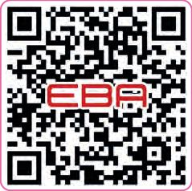

<!-- yer tutucu bulunamadı: sayfa sonuna eklendi -->

<!-- yer tutucu bulunamadı: sayfa sonuna eklendi -->

<!-- sayfa 179 -->

# TÜRKİYE’NİN MÜLKİ İDARE BÖLÜMLERİ İLE KARA VE DENİZ KOMŞULARI HARİTASI

50°D 45°D 40°D 35°D 30°D 25°D
40°K 35°K

**Ülkeler ve Bölgeler:**
* RUSYA FEDERASYONU
* UKRAYNA
* ROMANYA
* BULGARİSTAN
* YUNANİSTAN
* GÜRCİSTAN
* ERMENİSTAN
* NAHÇIVAN Ö.C. (AZERBAYCAN)
* AZERBAYCAN
* İRAN
* IRAK
* SURİYE
* LÜBNAN
* GÜNEY KIBRIS RUM YÖNETİMİ
* KUZEY KIBRIS TÜRK CUMHURİYETİ
* İSRAİL
* FİLİSTİN
* MISIR
* LİBYA

**Denizler ve Göller:**
* KARADENİZ
* EGE DENİZİ
* AKDENİZ
* MARMARA DENİZİ
* HAZAR DENİZİ

**Nehirler ve Akarsular:**
* Meriç N.
* Tuna N.
* Sakarya N.
* Kızılırmak N.
* Yeşilırmak N.
* Çoruh N.
* Kura N.
* Aras N.
* Fırat N.
* Dicle N.
* Asi N.
* Seyhan N.
* Ceyhan N.
* Göksu N.
* Büyük Menderes N.
* Küçük Menderes N.
* Bakırçay N.
* Gediz N.
* Nil N.

**Diğer Coğrafi Unsurlar:**
* Van Gölü
* Tuz Gölü
* Urumiye Gölü
* Süveyş K.
* Gazze Şeridi
* Batı Şeria

**Şehirler (İl Merkezleri):**
Adana, Adıyaman, Afyonkarahisar, Ağrı, Amasya, Ankara, Antalya, Artvin, Aydın, Balıkesir, Bilecik, Bingöl, Bitlis, Bolu, Burdur, Bursa, Çanakkale, Çankırı, Çorum, Denizli, Diyarbakır, Edirne, Elâzığ, Erzincan, Erzurum, Eskişehir, Gaziantep, Giresun, Gümüşhane, Hakkâri, Hatay, Isparta, Mersin, İstanbul, İzmir, Kars, Kastamonu, Kayseri, Kırklareli, Kırşehir, Kocaeli, Konya, Kütahya, Malatya, Manisa, Kahramanmaraş, Mardin, Muğla, Muş, Nevşehir, Niğde, Ordu, Rize, Sakarya, Samsun, Siirt, Sinop, Sivas, Tekirdağ, Tokat, Trabzon, Tunceli, Şanlıurfa, Uşak, Van, Yozgat, Zonguldak, Aksaray, Bayburt, Karaman, Kırıkkale, Batman, Şırnak, Bartın, Ardahan, Iğdır, Yalova, Karabük, Kilis, Osmaniye, Düzce.

**Harita Lejantı:**
* BAŞKENT: Ankara
* İL MERKEZİ
* GÖL
* AKARSU
* ÜLKE SINIRI
* ÖZERK BÖLGE SINIRI

**Ölçek:**
0 50 100 200 300 400 km

Harita Genel Müdürlüğü tarafından üretilmiştir.

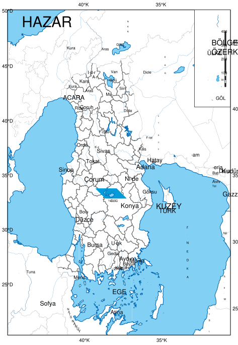
<!-- yer tutucu bulunamadı: sayfa sonuna eklendi -->

<!-- sayfa 180 -->

# TÜRK DÜNYASI HARİTASI

(Harita içeriği: Coğrafi bölgeler, ülkeler, denizler, göller, nehirler ve koordinat sistemleri yer almaktadır.)

**Lejant:**
* **Bağımsız Türk Devletleri** (Turuncu renkli alanlar)
* **Türk Cumhuriyetleri, Türk Bölgeleri** (Sarı renkli alanlar)
* **Türk Toplulukları** (Noktasal işaretler)

**Ölçek:**
0 - 250 - 500 - 1.000 - 1.500 - 2.000 km

---

### TÜRK CUMHURİYETLERİ, TÜRK BÖLGELERİ
1. GAGAVUZ YERİ
2. KARAÇAY-ÇERKESYA
3. KABARDİN-BALKARYA C.
4. DAĞISTAN C.
5. ÇUVAŞİSTAN C.
6. TATARİSTAN C.
7. BAŞKURT C.
8. KARAKALPAKİSTAN C.
9. ALTAY C.
10. HAKASYA C.

### TÜRK TOPLULUKLARI
**Avrupa'daki Türkler**
a. Kosova Türkleri
b. Yunanistan Türkleri
c. Bulgaristan Türkleri
ç. Romanya Türkleri

**Diğer Topluluklar**
d. Suriye Türkmenleri
e. Irak Türkmenleri
f. İran Türkleri
g. Afganistan Türkmenleri
ğ. Pakistan Türkmenleri
h. Hindistan Türkmenleri
i. Çin H. C. Türkleri
j. Moğolistan Türkleri
k. Rusya Federasyonu Türkleri

---

### ÜLKE KISALTMALARI
* ARN: Arnavutluk
* BEL: Belçika
* BH: Bosna-Hersek
* HRV: Hırvatistan
* İSV: İsviçre
* KRD: Karadağ
* KSV: Kosova
* KKTC: Kuzey Kıbrıs Türk Cumhuriyeti
* KMKD: Kuzey Makedonya
* LİH: Lihtenştayn
* SRB: Sırbistan
* GKRY: Güney Kıbrıs Rum Yönetimi

---

**Koordinatlar:**
* Boylam: $180^\circ$ <!-- KONTROL: Marker'da karşılığı yok, uydurma olabilir -->, $170^\circ\text{D}$ <!-- KONTROL: Marker'da karşılığı yok, uydurma olabilir -->, $160^\circ\text{D}$ <!-- KONTROL: Marker'da karşılığı yok, uydurma olabilir -->, $150^\circ\text{D}$ <!-- KONTROL: Marker'da karşılığı yok, uydurma olabilir -->, $140^\circ\text{D}$ <!-- KONTROL: Marker'da karşılığı yok, uydurma olabilir -->, $130^\circ\text{D}$ <!-- KONTROL: Marker'da karşılığı yok, uydurma olabilir -->, $120^\circ\text{D}$ <!-- KONTROL: Marker'da karşılığı yok, uydurma olabilir -->, $110^\circ\text{D}$ <!-- KONTROL: Marker'da karşılığı yok, uydurma olabilir -->, $100^\circ\text{D}$ <!-- KONTROL: Marker'da karşılığı yok, uydurma olabilir -->, $90^\circ\text{D}$ <!-- KONTROL: Marker'da karşılığı yok, uydurma olabilir -->, $80^\circ\text{D}$ <!-- KONTROL: Marker'da karşılığı yok, uydurma olabilir -->, $70^\circ\text{D}$ <!-- KONTROL: Marker'da karşılığı yok, uydurma olabilir -->, $60^\circ\text{D}$ <!-- KONTROL: Marker'da karşılığı yok, uydurma olabilir -->, $50^\circ\text{D}$ <!-- KONTROL: Marker'da karşılığı yok, uydurma olabilir -->, $40^\circ\text{D}$ <!-- KONTROL: Marker'da karşılığı yok, uydurma olabilir -->, $30^\circ\text{D}$ <!-- KONTROL: Marker'da karşılığı yok, uydurma olabilir -->, $20^\circ\text{D}$ <!-- KONTROL: Marker'da karşılığı yok, uydurma olabilir -->, $10^\circ\text{D}$ <!-- KONTROL: Marker'da karşılığı yok, uydurma olabilir -->, $0^\circ$ <!-- KONTROL: Marker'da karşılığı yok, uydurma olabilir -->
* Enlem: $50^\circ\text{K}$ <!-- KONTROL: Marker'da karşılığı yok, uydurma olabilir -->, $40^\circ\text{K}$ <!-- KONTROL: Marker'da karşılığı yok, uydurma olabilir -->, $30^\circ\text{K}$ <!-- KONTROL: Marker'da karşılığı yok, uydurma olabilir -->, $20^\circ\text{K}$ <!-- KONTROL: Marker'da karşılığı yok, uydurma olabilir -->, $10^\circ\text{K}$ <!-- KONTROL: Marker'da karşılığı yok, uydurma olabilir -->, $10^\circ\text{G}$ <!-- KONTROL: Marker'da karşılığı yok, uydurma olabilir -->, $20^\circ\text{G}$ <!-- KONTROL: Marker'da karşılığı yok, uydurma olabilir -->, $30^\circ\text{G}$ <!-- KONTROL: Marker'da karşılığı yok, uydurma olabilir -->

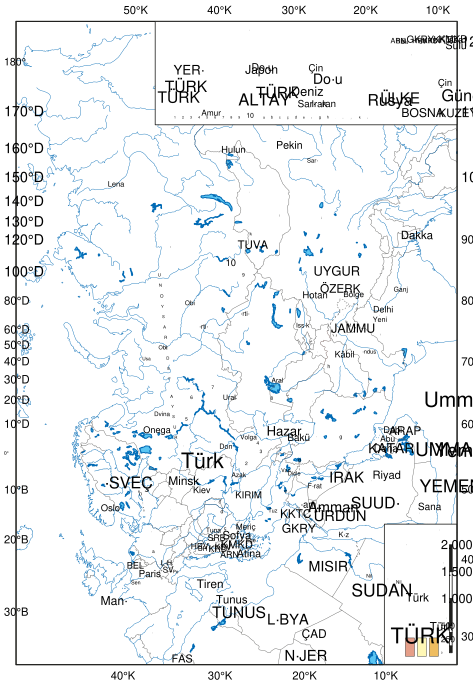
<!-- yer tutucu bulunamadı: sayfa sonuna eklendi -->

<!-- sayfa 181 -->

# Bu kitaba sığmayan daha neler var!

: QR kod ve teknolojik ürünlerin illüstrasyonu

**eba**
www.eba.gov.tr

Karekodu okut, bu kitapla ilgili EBA içeriklerine ulaş!

## Teknoloji Yolculuğumuz

: İstanbul Havalimanı, Mikro Uydu Fırlatma Sistemi, TÜRKSAT, KAAN, İnsansız Hava Aracı, Yerli ve Milli Otomobil, TCG Anadolu, GÖKBEY, GÖKMEN, Sondaj ve Sismik Arama Gemisi, Yüksek Hızlı Tren, Turbofan Motoru içeren görsel.

**İstanbul Havalimanı**
**Mikro Uydu Fırlatma Sistemi**
**TÜRKSAT**
**KAAN**
**İnsansız Hava Aracı**
**Yerli ve Milli Otomobil**
**TCG Anadolu**
**GÖKBEY**
**GÖKMEN**
**Sondaj ve Sismik Arama Gemisi**
**Yüksek Hızlı Tren**
**Turbofan Motoru**

BU DERS KİTABI MİLLÎ EĞİTİM BAKANLIĞINCA ÜCRETSİZ OLARAK VERİLMİŞTİR.
**PARA İLE SATILAMAZ.**

Bandrol Uygulamasına İlişkin Usul ve Esaslar Hakkında Yönetmeliğin Beşinci Maddesinin
