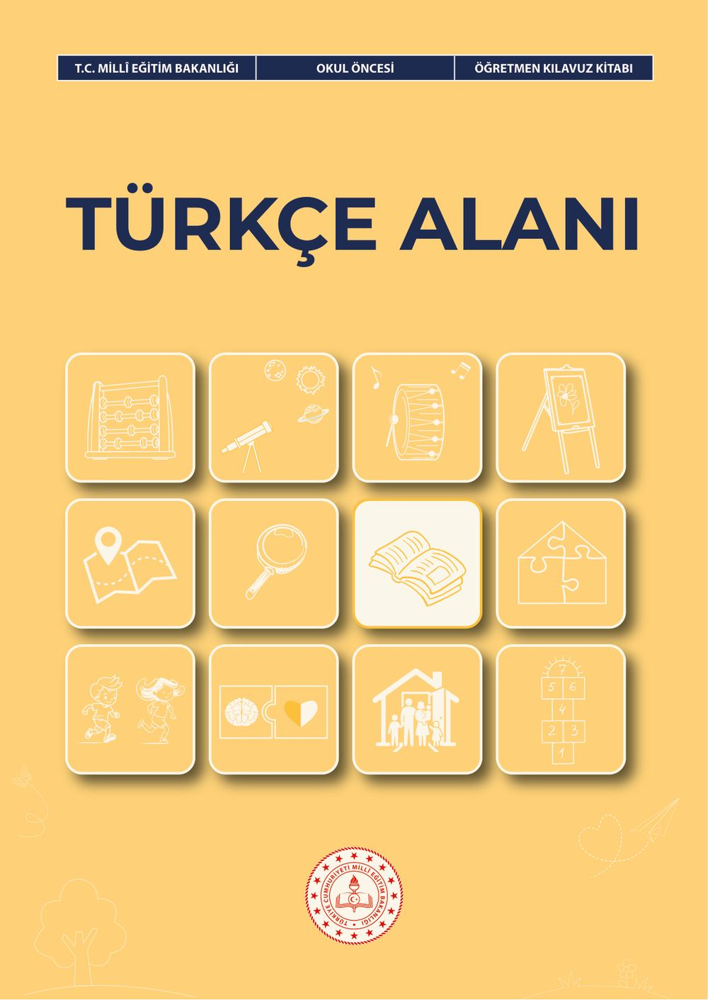
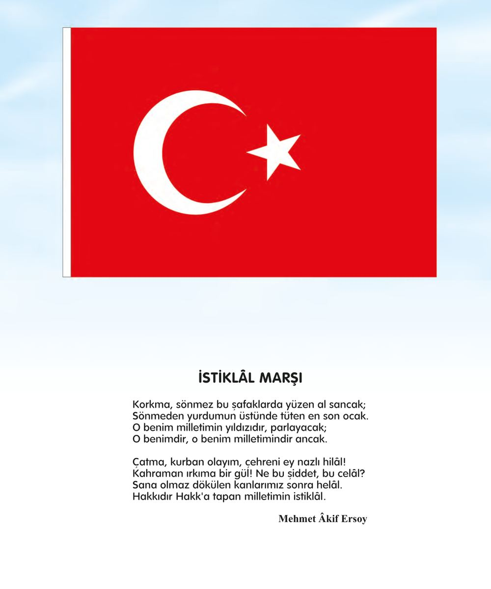
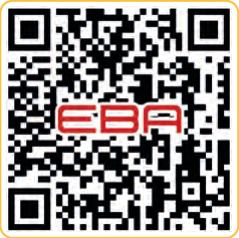
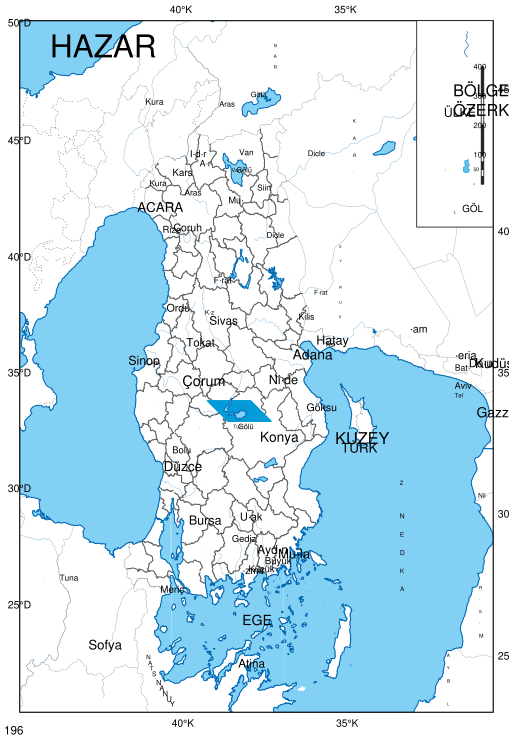
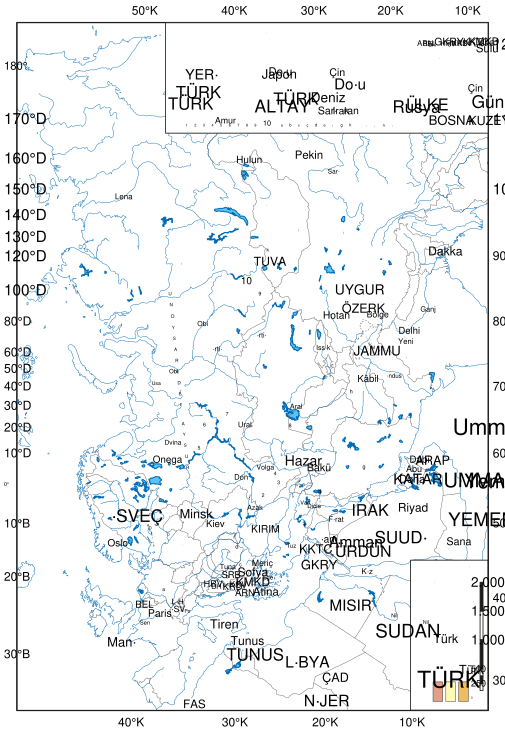

# Okul Öncesi Türkçe Alanı Öğretmen Kılavuz Kitabı

<!-- sayfa 0 -->

T.C. MİLLÎ EĞİTİM BAKANLIĞI | OKUL ÖNCESİ | ÖĞRETMEN KILAVUZ KİTABI

# TÜRKÇE ALANI

<!-- sayfa 1 -->

Verdiğiniz metin katmanı boş olduğu için (`<<< >>>` arası boş) çevrilecek herhangi bir içerik bulunmamaktadır. Lütfen metin katmanını içeren içeriği paylaşın, böylece talimatlarınıza uygun şekilde Markdown formatına dönüştürebilirim.

<!-- sayfa 2 -->

OKUL ÖNCESİ

# Türkçe Alanı Öğretmen Kılavuz Kitabı

## Yazarlar
AYŞE ÇULCU
BETÜL SÜREK
BÜŞRA AKÇAY
GAYE ERÇEN
KÜBRA KARAKUŞ
MERVE ÖZTEMİR
SILA USTABAŞ
SİNEM DEMİROĞLU BAŞAR

DEVLET KİTAPLARI

<!-- sayfa 3 -->

Milli Eğitim Bakanlığı Yayınları : 11230
Ders Kitapları Dizisi No. : 2657

Her hakkı saklıdır ve Millî Eğitim Bakanlığına aittir. Kitabın metin, soru ve şekilleri kısmen de olsa hiçbir surette alınıp yayımlanamaz.

**Editör**
Prof. Dr. Oğuz Serdar KESİCİOĞLU
Doç. Dr. Nurbanu PARPUCU

**Dil Uzmanı**
Hatice MÜLKOĞLU

**Görsel Tasarımcı**
Metin BİLAL
Yağmur YILDIRIM

**Çoklu Ortam Tasarımcısı**
Büşra Nur DURAN YILMAZ
Didem Erol
Ezgi AVCI AŞIR
Yudum CAN

**Program Geliştirme Uzmanı**
Dr. Emine SELMANOĞLU

**Ölçme ve Değerlendirme Uzmanı**
Merve ERELİ

**Rehberlik Uzmanı**
Sevgi CEVİZ

ISBN
978-625-8867-26-8

Millî Eğitim Bakanlığı Talim ve Terbiye Kurulu Başkanlığının 16 10 2026 tarih ve 172475677 sayılı yazısı ile eğitim

<!-- sayfa 4 -->

# İSTİKLÂL MARŞI

Korkma, sönmez bu şafaklarda yüzen al sancak;
Sönmeden yurdumun üstünde tüten en son ocak.
O benim milletimin yıldızıdır, parlayacak;
O benimdir, o benim milletimindir ancak.

Çatma, kurban olayım, çehreni ey nazlı hilâl!
Kahraman ırkıma bir gül! Ne bu şiddet, bu celâl?
Sana olmaz dökülen kanlarımız sonra helâl.
Hakkıdır Hakk'a tapan milletimin istiklâl.

Mehmet Âkif Ersoy

<!-- sayfa 5 -->

ANDIMIZ

Türküm, doğruyum, çalışkanım.

İlkem küçüklerimi korumak, büyüklerimi saymak; yurdumu, milletimi özümden çok sevmektir.
Ülküm yükselmek, ileri gitmektir.

Ey Büyük Atatürk!

Açtığın yolda, gösterdiğin hedefe durmadan yürüyeceğime ant içerim.

Varlığım Türk varlığına armağan olsun.

Ne mutlu Türküm diyene!

<!-- sayfa 6 -->

MUSTAFA KEMAL ATATÜRK

<!-- yer tutucu bulunamadı: sayfa sonuna eklendi -->

<!-- sayfa 7 -->

Verdiğiniz metin katmanı boş olduğu için (`<<< >>>` arasında herhangi bir içerik bulunmuyor) dönüştürülecek bir metin mevcut değildir. Lütfen işlenmesini istediğiniz metni veya görseli paylaşın.

<!-- sayfa 8 -->

# İÇİNDEKİLER

| | |
| :--- | ---: |
| GİRİŞ | 10 |
| TÜRKÇE ALAN BECERİLERİ | 10 |
| OKUL ÖNCESİ ÖĞRETMENLERİ İÇİN ETKİLEŞİMLİ KİTAP OKUMA REHBERİ | 20 |
| TÜRKÇE ALANI ETKİNLİKLERİNİN PROGRAMDA YER ALAN DİĞER ALANLARLA İLİŞKİLENDİRİLMESİ | 23 |
| TÜRKÇE ALANI ETKİNLİKLERİNİN PROGRAMLAR ARASI BİLEŞENLERLE İLİŞKİLENDİRİLMESİ | 26 |
| TÜRKÇE ALANI ETKİNLİK ÖRNEKLERİ | 29 |
| Hatıra Kutusu | 29 |
| Kış Uykusuna Yatan Hayvanlar | 32 |
| Kitap Dedektifleri | 34 |
| Mikrofon Pırıl | 37 |
| Kuklamı Konuşturuyorum | 39 |
| Kutudaki Kartlar | 42 |
| Harflerim El Ele | 44 |
| Hop Hop İki Sözcük | 47 |
| Hece Trenimiz Çuf Çuf | 49 |
| Tohumun Şiiri | 51 |
| Yazıların Yönü | 54 |
| Minik Muhabirler | 57 |
| Millî Muharip Uçak Kaan | 60 |
| Kartta Ne Var? | 63 |
| Çiz Bakalım | 65 |
| Gezelim, Seçelim | 67 |
| Torbada Ne Var? | 69 |
| Çıt Çıt Sözcükler | 72 |
| Duygular Sahneye Çıkıyor | 74 |
| Duygularım | 76 |
| Fikir Yağmuru | 79 |
| Hece Hece Zıpla | 81 |
| Kitap Yapboz Ustaları | 83 |
| Mahallemizde Konuşuyoruz | 86 |
| Mikrofonumla Konuşuyorum | 89 |

<!-- sayfa 9 -->

| | |
| :--- | :--- |
| Sıra Bende, Söz Hikâyede | 93 |
| Söz Sende, Oyuncaklar Sahnede | 95 |
| Sözcüğün İçinde Ne Var? | 98 |
| Zıpzıp'la Ses Avı | 100 |
| Sanal Müze | 102 |
| Renkli Çizmeler | 105 |
| Minik Editörlerin Seçimi | 108 |
| Kendi Tiyatromu Oynuyorum | 111 |
| İlk Ses Treni | 113 |
| A Sesi | 116 |
| Afiş İnceliyorum | 118 |
| Benim Resmim | 120 |
| Kış Uykusuna Yatan Hayvanlar | 123 |
| Kitap Dedektifleri | 125 |
| Konuşma Çemberi | 128 |
| Semboller ve Yazılar | 131 |
| Meslek Gözlemcileri | 134 |
| Noktalama İşaretlerini Keşfediyorum | 137 |
| Öykü Kutusu | 140 |
| Seçiyorum, Dinliyorum, İzliyorum | 142 |
| Sınıfımızın Şairleri | 144 |
| Son Ses Minderleri | 146 |
| Sözcükleri Heceliyorum | 148 |
| Tohumun Şiiri | 151 |
| Zıpzıp'la Uyak Eşleştirme Oyunu | 154 |
| Yazıların Yönü | 157 |
| Uyaklı Sözcüklerim | 160 |
| Uçan Gazeteler | 162 |
| Sözcükleri Öğreniyorum | 165 |
| Sözcük Tasarımcıları | 168 |
| Sınıf Kurallarımız | 171 |
| İlk Ses, Son Ses | 174 |
| İsmini Bul | 177 |
| Sevdiğim Hatıralar | 180 |

<!-- sayfa 10 -->

| | |
| :--- | :--- |
| Gezelim Seçelim | 183 |
| Anlat Bakalım | 186 |
| Millî Muharip Uçak Kaan 2 | 189 |
| Görevimi Yapıyorum, Doğamı Koruyorum | 192 |
| KAYNAKÇA | 195 |
| GÖRSEL VE GENEL AĞ KAYNAKÇASI | 195 |
| TÜRKİYE’NİN MÜLKİ İDARE BÖLÜMLERİ İLE KARA VE DENİZ KOMŞULARI HARİTASI | 196 |
| TÜRK DÜNYASI HARİTASI | 197 |

<!-- sayfa 11 -->

# GİRİŞ

Bu kılavuz, Türkiye Yüzyılı Maarif Modeli Okul Öncesi Öğretim Programı Türkçe alanı kapsamında öğretmenlere yol gösterici bir kaynak olarak hazırlanmıştır. Kılavuzda öncelikle Türkçe alan becerileri olan dinleme / izleme, okuma, konuşma ve erken okuryazarlık alanlarının her biri için dikkat edilmesi gereken önemli noktalar ve sınıf içi uygulama önerileri yaş gruplarının (36-48 ay, 48-60 ay, 60-72 ay) gelişimsel özellikleri dikkate alınarak sunulmaktadır. Ardından okul öncesi dönemde Türkçe becerilerinin gelişiminde önemli bir yeri olan etkileşimli kitap okuma yöntemine ilişkin kapsamlı açıklamalar yer almaktadır. Kılavuzun son bölümünde ise Türkçe alanı etkinliklerinin programda yer alan diğer alanlarla (matematik, fen, sosyal, hareket ve sağlık, sanat, müzik) ve programlar arası bileşenlerle (sosyal-duygusal öğrenme becerileri, erdem: değer-eylem çerçevesi, okuryazarlık becerileri) nasıl ilişkilendirilebileceğine dair öneriler sunulmaktadır. Kılavuz boyunca öğretmenlere yönelik ifadeler öneri niteliğinde olup uygulamalar sınıfın koşullarına, çocukların bireysel farklılıklarına ve gelişim düzeylerine göre uyarlanabilir.

# TÜRKÇE ALAN BECERİLERİ

## TADB. DİNLEME / İZLEME

Dinleme / izleme becerisi, çocuğun şiir, hikâye, tekerleme, video, tiyatro, animasyon gibi çeşitli materyalleri seçerek dinlemesini / izlemesini, dinledikleri / izledikleri üzerinde anlamlar oluşturmasını; bu materyalleri oluşturan unsurları, unsurlar arasındaki ilişkileri çözümlemesini, sürece ilişkin duygu ve düşüncelerini ifade etmesini kapsar. Okul öncesi düzeyde dinleme / izleme alan becerisi, matrislerde yer verilen öğrenme çıktılarına göre ele alınmıştır.

### Sınıf İçi Uygulama Önerileri

**TADB.1. Dinleyecekleri / izleyecekleri şiir, hikâye, tekerleme, video, tiyatro, animasyon gibi materyalleri yönetebilme**

Sınıfta geçici bir “Dinleme / İzleme Merkezi” oluşturulabilir. Bu merkezde farklı türlerde materyaller (resimli hikâye kitapları, şiir kartları, tekerleme afişleri, kısa çocuk videoları veya animasyonlar) bulundurulabilir. Çocukların bu merkeze gelerek dinlemek veya izlemek istedikleri materyali kendilerinin seçmesine fırsat verilebilir.

“Bugün Ne Dinleyelim / İzleyelim?” panosu hazırlanabilir. Panoya günün seçeneklerini gösteren görseller yerleştirilebilir. Çocuklardan güne başlama zamanı sırasında o gün dinlemek ya da izlemek istedikleri materyali oylayarak seçmelerini istenebilir. Bu etkinlik çocukların materyal tercihinde özerklik geliştirmelerine katkıda bulunabilir.

Çocukların dikkat sürelerini kademeli olarak uzatmaya yönelik çalışmalar planlanabilir. Materyalin süresi yaş grubuna ve çocukların ilgi düzeyine göre esnek tutulabilir, 36-48 aylık çocuklarla kısa süreli materyallerle başlanarak yaş ilerledikçe süre aşamalı biçimde arttırılabilir. Dinleme / izleme öncesinde çocuklarla basit kurallar belirlenebilir. “Dinlerken / izlerken neler yapmalıyız?” sorusu yöneltilerek çocukların kuralları belirleme sürecine katılmaları, süreci sahiplenmeleri ve dinleme kurallarına yönelik farkındalık geliştirmeleri desteklenebilir; belirlenen kurallar görselleştirilerek “Dinleme / İzleme Merkezi”ne asılabilir.

**TADB.2. Dinledikleri / izledikleri şiir, hikâye, tekerleme, video, tiyatro, animasyon gibi materyaller ile ilgili yeni anlamlar oluşturabilme**

Bir materyal dinletilmeden ya da izletilmeden önce kapak görseli, başlık veya kısa bir sahne üzerinden tahmin etkinlikleri yapılabilir. “Bu hikâyede neler olabilir?”, “Bu resimde neler görüyorsun”, “Sence hikâye ne hakkında olacak?” gibi sorularla çocuklarda merak uyandırarak ön bilgileri harekete geçirilebilir.

Dinleme / izleme etkinliği sırasında uygun yerlerde duraklatarak çocuklara “Şimdi ne olacak sence?”, “Karakter neden böyle davrandı?” gibi sorular sorulabilir

<!-- sayfa 12 -->

“Hikâyedeki çocuk parka gitmiş, sen parka gittiğinde neler yapıyorsun?”, “Bu durumda sen olsaydın ne yapardın?” gibi sorularla bağlantı kurması desteklenebilir.

İki farklı hikâye, şiir veya videoyu dinledikten / izledikten sonra karşılaştırma etkinlikleri yapılabilir. “Bu iki hikâyenin benzer ve farklı yönleri nelerdi?”, “Hangi hikâyeyi daha çok beğendin, neden?” gibi sorularla eleştirel düşünme desteklenebilir.

“Dinleme / İzleme Sepeti” oluşturulabilir. Sepetin içine dinlenilen / izlenen materyalle ilgili somut nesneler (oyuncak hayvan, küçük bir ev maketi, doğa nesneleri gibi) koyulabilir. Çocukların bu nesnelerle materyal arasında ilişki kurması sağlanabilir.

**TADB.3. Dinledikleri / izledikleri şiir, hikâye, tekerleme, video, tiyatro, animasyon gibi materyalleri çözümleyebilme**

Dinleme / izleme sonrasında “Kim, Nerede, Ne Zaman, Ne Oldu?” panosu kullanılabilir. Panoyu dört bölüme ayırarak her bölüme ilgili sorunun görseli yerleştirilebilir. Çocuklardan dinledikleri / izledikleri materyaldeki karakter, mekân, zaman ve olay unsurlarını bu panoya uygun görseller çizerek veya yapıştırarak yerleştirmeleri istenebilir.

36-48 aylık çocuklarla karakter tanıma etkinlikleri yapılabilir. Dinledikleri hikâyenin kahramanlarının resimlerini göstererek “Bu kim?”, “Ne yapmış?” gibi basit sorular sorulabilir. 48-60 aylık çocuklarla “Hikâyede ilk ne oldu, sonra ne oldu?” şeklinde olay sıralaması yapılabilir. 60-72 aylık çocuklarla “Karakter neden böyle davrandı?”, “Bu olay olmasaydı ne olurdu?”, “Hikâyede ilk ne oldu, ondan da önce ne olmuş olabilir? Şimdi ne oldu? Sonra ne olacak? Peki ondan sonra ne olacak?” şeklinde olay sıralaması yapılabilir ve unsurlar arası etkileşimi ortaya koyan sorular sorulabilir.

Hikâye haritası etkinlikleri düzenlenebilir. Büyük bir karton üzerinde hikâyenin başlangıcı, gelişmesi, sonucu ve olası devamına yönelik dört görsel alan oluşturulabilir. Çocukların dinledikleri veya izledikleri materyaldeki temel olayları görsel kartlar aracılığıyla bu haritaya yerleştirmelerine rehberlik edilebilir, ardından kendi anlatımlarıyla haritayı tamamlamalarına imkân tanınabilir.

Çocuklara dinledikleri / izledikleri materyaldeki karakterleri temsil eden kuklalar verilebilir ve sahneyi yeniden canlandırmaları istenebilir. Canlandırma sırasında “Bu karakter ne hissediyordu?”, “Hikâye nerede geçiyordu?” gibi sorularla unsurların fark edilmesi desteklenebilir.

Dinleme / izleme etkinliklerini planlarken süreci daha keyifli hâle getirebilmek amacıyla sınıfta hikâye çadırları kurulabilir, karanlık ortamda el feneriyle kitap inceleme etkinlikleri yapılabilir ya da bahçede battaniye üzerinde hikâye dinleme zamanları oluşturulabilir.

**TADB.4. Dinledikleri / izledikleri şiir, hikâye, tekerleme, video, tiyatro, animasyon gibi materyalleri değerlendirebilme**

“Duygu Termometresi” veya “Duygu Yüzleri” panosu oluşturulabilir. Dinleme / izleme etkinliği sonrasında çocuklardan materyalin onlarda yarattığı duyguyu panodaki uygun yüz ifadesinin yanına isimlerini kopyalamalarını veya bir işaret koymalarını istenebilir. 36-48 aylık çocuklar için jest, mimik veya ifade kartlarıyla göstermeleri, 48-60 ve 60-72 aylık çocuklardan duygularını sözlü olarak ifade etmeleri istenebilir.

“Kitap / Video Değerlendirme Kartı” uygulaması yapılabilir. Kart üzerinde yıldız, kalp veya gülen / üzgün yüz vb. simgeler bulunabilir. Çocuklar dinledikleri / izledikleri materyali bu kartla değerlendirebilir.

Dinleme / izleme etkinliği sonrasında sohbet çemberi oluşturulabilir. “Bu hikâyeyi / videoyu beğendin mi?”, “Sana ne hissettirdi?”, “En sevdiğin bölüm hangisiydi?” gibi sorularla çocukların duygu ve düşüncelerini paylaşmaları sağlanabilir. Çocukların birbirlerinin görüşlerini de dinlemelerine fırsat verilebilir.

# TAOB. OKUMA

Okuma becerisi; okul öncesi dönemde çocuğun resimli hikâye kitabı, dijital içerikler, afiş, broşür gibi görsel

<!-- sayfa 13 -->

dönemde okuma becerisi, harfleri ve sözcükleri çözümleyen geleneksel okuma anlamında değil görsel okuma olarak ele alınmaktadır. Okul öncesi düzeyde okuma alan becerisi, matrislerde yer verilen öğrenme çıktılarına göre ele alınmıştır.

**Dikkat Edilmesi Gereken Önemli Noktalar**

* Okul öncesi dönemde okuma becerisi görsel okumayı ifade eder. Çocukların çevrelerindeki görselleri anlamlandırma çabası okuma sürecinin temellerini oluşturur.
* Görsel okuma materyalleri çeşitlendirilebilir. Yalnızca resimli hikâye kitaplarıyla sınırlı kalınmayıp afiş, broşür, dijital içerik, fotoğraf, harita, grafik ve çevresel yazılı uyaranlar da görsel okuma materyali olarak değerlendirilebilir.
* Çözümleme becerisinde görsellerdeki karakter, olay, mekân gibi temel unsurların belirlenmesinden unsurlar arası ilişkilerin ve olay akışının bütüncül olarak değerlendirilmesine doğru aşamalı bir ilerleme söz konusudur. Soruların basitten karmaşığa doğru kademelendirilerek sorulması önerilebilir.
* Görsellerle birlikte görselde yer alan nesne, varlıkların adının yazılı olarak da sunulması, çocukların yazı farkındalığı becerilerinin gelişimini destekler.
* Görsellere ilişkin sorular sorulurken 5N1K (ne, neden, nerede, ne zaman, nasıl, kim) sorularından yararlanılabilir.
* Gün içinde çocuklarla çalışırken kendiliğinden gelişen öğrenme fırsatlarından yola çıkarak görsel okuma etkinlikleri planlanabilir. Çevredeki tabelalar, afişler, semboller ve işaretler doğal birer görsel okuma materyali olarak değerlendirilebilir.
* Görsel okuma etkinliklerinin yalnızca masa başı çalışmalarıyla sınırlandırılmaması önerilir; açık alan gezileri, doğa yürüyüşleri, müze, kütüphane ziyaretleri gibi farklı ortamlarda da gerçekleştirilebilir.

**Sınıf İçi Uygulama Önerileri**

**TAOB.1. Resimli öykü kitabı, dijital içerikler, afiş, broşür gibi görsel okuma materyallerini seçebilme**

Sınıfta zengin bir “Kitap Merkezi” oluşturulmalıdır. Bu merkezde resimli hikâye kitapları, dergiler, afişler, broşürler ve yaşa uygun sesli betimlemeli etkileşimli hikâye kitapları, görsel-işitsel dijital sözlükler, dijital ses kayıt ve anlatı araçları, dijital hikâye kartları vb. dijital içerikler bulundurulabilir. 36-48 aylık çocuklar yetişkin rehberliğiyle bu merkeze yönlendirilerek materyalleri incelemeleri sağlanabilir. 48-60 aylık çocukların materyalleri daha bilinçli biçimde inceleyerek tercih yapmalarına fırsat verilebilir. 60-72 aylık çocukların bu merkezi bağımsız olarak kullanmaları ve kendi okuma tercihlerini oluşturmaları desteklenebilir.

“Haftanın Kitabı / Görseli” uygulaması başlatabilirsiniz. Her hafta farklı türde bir görsel okuma materyali (resimli hikâye kitabı, afiş, broşür, fotoğraf vb.) sınıfa tanıtılabilir. Çocuklardan bu materyali incelemelerini ve hafta boyunca materyal hakkında gözlemlerini paylaşmaları istenebilir. Çocukların materyal seçimine katılmalarını sağlamak için “Önümüzdeki hafta hangisini inceleyelim?” diye sorarak tercihleri alınabilir.

Görsel okuma materyalleri sınıfın farklı noktalarına yerleştirilebilir. Duvarlara afişler, panolara fotoğraflar, raflara kitaplar ve broşürler koyarak çocukların gün boyunca bu materyallerle kendiliğinden etkileşim kurmalarını sağlayabilir. Materyalleri düzenli aralıklarla yenileyerek çocukların ilgisi canlı tutulabilir.

“Kitap Gezisi” etkinliği düzenlenebilir. Sınıftaki kitapları bir masaya sergileyerek çocuklar görselleri incelemeye ve ilgilerini çeken materyalleri seçmeye davet edilebilir.

Olanaklara bağlı olarak çocuk kütüphanelerine geziler düzenlenebilir. Kütüphanede çocukların farklı türde görsel okuma materyallerini keşfetmeleri, incelemeleri ve ilgilerini çekenleri seçmeleri sağlanabilir. Bu deneyim çocukların materyal tercihlerinde özerklik geliştirmelerine katkıda bulunur.

**TAOB.2. Resimli öykü kitabı, dijital içerikler, afiş, broşür gibi görsel okuma materyallerinden anlamlar oluşturabilme**

<!-- sayfa 14 -->

“Sence bu kitap ne hakkında olabilir?” gibi sorularla çocukların tahmin yürütmeleri sağlanabilir.

Görselleri günlük yaşamla ilişkilendirme etkinlikleri planlanabilir. Çocuklara bir afiş, fotoğraf veya kitap görseli gösterdikten sonra “Bu resimde gördüğün yere sen de gittin mi?”, “Bu duruma benzer bir şey başına geldi mi?” gibi sorularla kendi deneyimleriyle bağlantı kurmaları desteklenebilir.

“Çıkarım Yapıyorum” etkinlikleri yapılabilir. Bir görselin yalnızca bir bölümü gösterilerek “Resmin tamamında ne olabilir?” sorusu sorulabilir ya da bir hikâye kitabının sayfaları sırayla gösterilerek her sayfada “Sence sonra ne olacak?” diye sorulabilir. Bu etkinlik çıkarım yapma becerisini destekler.

Karşılaştırma ve sınıflandırma etkinlikleri düzenlenebilir. İki farklı kitabın kapak görselleri, iki farklı afiş veya iki farklı fotoğraf yan yana konularak çocuklara “Bu ikisi arasındaki benzerlikler ve farklılıklar neler?” gibi sorular sorulabilir. Çocuklardan görselleri belirli özelliklere göre (konu, renk, karakter vb.) gruplandırmaları istenebilir.

“Kendi Kitabımı / Afişimi Yapıyorum” etkinliği planlanabilir. Çocuklardan doğa yürüyüşlerinde topladıkları yaprak, taş ve çalı gibi nesneleri, dergilerden kestikleri resimleri veya kendi çizimlerini kullanarak özgün bir görsel okuma materyali oluşturmaları istenebilir. Bu etkinlik çocukların yaratıcı ve eleştirel düşünme becerilerini destekler.

“Dinleme / İzleme Sepeti”ne benzer biçimde “Görsel Okuma Kutusu” oluşturulabilir. Kutuya incelenecek materyallerle ilgili somut nesneler konulabilir. Çocuklardan nesnelerle görseller arasında ilişki kurmaları ve gözlemlerini paylaşmaları istenebilir.

**TAOB.3. Resimli öykü kitabı, dijital içerikler, afiş, broşür gibi görsel okuma materyallerini çözümleyebilme**

Görsellerdeki temel unsurları belirlemeye yönelik etkinlikler planlanabilir. 36-48 aylık çocuklara bir kitap sayfası ya da afiş gösterilerek “Burada kim var?”, “Burası neresi?”, “Ne oluyor?” gibi basit sorular sorulabilir. Çocukların karakter, mekân, olay gibi unsurları fark etmeleri ve söylemeleri istenebilir.

“Resmi Anlat” etkinliği düzenlenebilir. Çocuklara ayrıntılı bir resim göstererek bir süre bakmalarını sağladıktan sonra resmi kapatarak çocuklardan gördüklerini anlatmaları istenebilir. Bu etkinlik görsel hafıza ve çözümleme becerilerini birlikte destekler. 48-60 aylık çocuklar için resmin unsurları arasındaki ilişkilere, 60-72 aylık çocuklar için olay akışına dair sorular eklenebilir.

Olay sıralama kartları hazırlanabilir. Bir resimli hikâye kitabının önemli sahneleri kartlara aktarılabilir. Kartları karıştırarak çocuklardan doğru sıraya koymaları istenebilir. 36-48 aylık çocuklarla üç kartlı basit sıralamalar yaparak, 60-72 aylık çocuklarla beş-altı kartlı daha karmaşık sıralamalar planlanabilir.

“Öncesi ve Sonrası” etkinliği yapılabilir. Çocuklara bir görseldeki olayın öncesinde ve sonrasında neler olduğuna ilişkin tahminleri ve çıkarımları sorulabilir. Gördükleri sahneye dayanarak bir hikâye oluşturmaları istenebilir. Bu etkinlik parçalar arası ilişki kurma becerisini geliştirir.

Dikkat ve gözlem oyunları oynanabilir. Birbirine benzer iki resim göstererek aralarındaki farkları bulmalarını istenebilir. Aralıklı ya da belirsiz çizgilerle çizilmiş resimler göstererek hangi nesneye / hayvana ait olabileceği sorulabilir. Çiftler hâlinde resimli kartlarla eşleştirme ve hafıza oyunları oynanabilir. Bu tür etkinlikler çocukların görsel materyallerdeki ayrıntıları fark etme ve unsurları çözümleme becerilerini destekler.

60-72 aylık çocuklarla “Bütüncül Değerlendirme” etkinlikleri yapılabilir. Bir resimli hikâye kitabını baştan sona inceledikten sonra “Hikâyenin başında karakter nasıldı, sonunda nasıl değişti?”, “Bu olay olmasa sonuç farklı olur muydu?” gibi unsurlar arası etkileşimi ortaya koyan sorularla çocukların materyali bütüncül bir bakış açısıyla ele almaları desteklenebilir.

**TAOB.4. Resimli öykü kitabı, dijital içerikler, afiş, broşür gibi görsel okuma materyallerini değerlendirebilme**

“Beğeni Panosu” oluşturulabilir. Sınıfta incelenen her görsel okuma materyali için panoya bir bölüm ayırılabilir. Çocuklardan materyali beğenip beğenmediklerini gülen yüz, düz yüz veya üzgün yüz yapıştırarak ifade etmeleri istenebilir.

Görsel okuma etkinliği sonrasında sohbet çemberi oluşturulabilir. “Bu kitabı / afişi / görseli beğendin mi?”, “Sana

<!-- sayfa 15 -->

“Kitap Tanıtımı” etkinliği düzenlenebilir. Çocuklardan inceledikleri bir görsel okuma materyalini arkadaşlarına tanıtmaları istenebilir. “Bu kitabı neden beğendin?”, “Arkadaşlarına tavsiye eder misin?” gibi sorularla değerlendirme becerilerini desteklenebilir. Çocuklarla incelenen kitabın ya da görselin tanıtımı için poster, afiş veya broşür hazırlanabilir.

“Görsel Okuma Günlüğü” oluşturulabilir. Her çocuğun incelediği görsel okuma materyallerine ilişkin izlenimlerini çizim veya kısa ifadelerle kaydettiği bireysel bir günlük tutulabilir. Bu günlük çocukların görsel okuma deneyimlerine ilişkin değerlendirme alışkanlığı geliştirmelerini destekler.

# TAKB. KONUŞMA

Konuşma becerisi, çocuğun konuşma sürecini yönetmesini, konuşmasının içeriğini oluşturmasını; Türkçeyi dil bilgisi kurallarına uygun biçimde kullanmasını ve konuşma sürecine ilişkin görüşlerini değerlendirebilmesini kapsar. Başlangıçta yetişkin rehberliğiyle ve basit ifadelerle gerçekleşen konuşma deneyimleri, gelişimle birlikte bağımsız, planlı ve kurallara uygun bir nitelik kazanmaktadır. Okul öncesi düzeyde konuşma alan becerisi, matrislerde yer verilen öğrenme çıktılarına göre ele alınmıştır.

## Dikkat Edilmesi Gereken Önemli Noktalar

* Çocukların kendilerini hazır hissetmeden grup önünde veya topluluk önünde konuşmaya zorlanmaması önerilir. Konuşma isteği çocukta içsel olarak oluşabilir, bu süreç cesaretlendirme ve olumlu geri bildirimlerle desteklenebilir.
* Konuşma sürecini yönetme becerisi yaşla birlikte gelişir. 36–48 aylık çocuklardan konu seçme, sıra bekleme ve göz teması kurma gibi temel iletişim davranışlarını yetişkin rehberliğiyle denemeleri beklenirken 60–72 aylık çocukların bu süreçleri bağımsız olarak yönetmeleri hedeflenir. Beklentilerin yaş grubuna uygun tutulması önerilir.
* Türkçeyi doğru kullanmaya özen gösterilmelidir. Öğretmen konuşma sürecinde çocuklara model olmalıdır.
* Söz varlığının geliştirilmesi konuşma becerisinin temelini oluşturur. Yeni sözcükler farklı bağlamlarda tekrar tekrar kullanılabilir, çocukların bu sözcükleri konuşmalarında etkin biçimde kullanmalarına rehberlik edilebilir. 60–72 aylık çocuklarda eş anlamlı, zıt anlamlı ve sesteş sözcüklere yönelik farkındalık çalışmaları planlanabilir.
* Beden dili, jest ve mimikler konuşmanın ayrılmaz parçasıdır. Her yaş grubunda çocukların sözel ifadelerinin yanı sıra beden dilini de etkili biçimde kullanmalarına yönelik çalışmalara yer verilebilir.
* Çocuklara çok uzun ve karmaşık cümleler kurmaktan kaçınılması önerilir, yönergeler ve sorular açık, anlaşılır biçimde ifade edilebilir. Küçük yaş grubuna daha kısa ve az sayıda yönerge verilebilir, yaş grubu ilerledikçe bu sayı arttırılabilir. Aynı zamanda çocukların kendi ifadelerini açık biçimde oluşturmalarına yönelik destekleyici sorular sorulabilir.

## Sınıf İçi Uygulama Önerileri

### TAKB.1. Konuşma sürecini yönetebilme

Güne başlama ve günü değerlendirme zamanında “Konuşma Sırası” uygulaması başlatılabilir. Bir konuşma nesnesi (mikrofon, özel bir top veya kukla gibi) belirleyip yalnızca nesneyi elinde tutan çocuğun konuşma hakkına sahip olduğu açıklanabilir.

Çocuklarla günlük yaşamla ilgili herhangi bir konu hakkında sohbet edilebilir. Konu çocuğun ilgi ve ihtiyaçları doğrultusunda belirlenebilir ve o gün nasıl hissettikleri, hafta sonu neler yaptıkları, hoşlandıkları etkinlikler gibi konular üzerinde konuşulabilir.

“Göz Teması Oyunu” oynanabilir. Çocuklarla çiftler hâlinde karşılıklı oturabilir ve birbirlerine bakarak kısa cümleler söylemeleri istenebilir. Bu etkinlik konuşma sırasında göz teması kurma alışkanlığını oyun yoluyla destekler.

<!-- sayfa 16 -->

etkinlikler sırasında gerektiğinde panoya dikkat çekilebilir.
“Topluluk Önünde Konuşma” etkinlikleri düzenlenebilir. Çocuklardan en sevdikleri oyuncağı, kitabı veya hafta sonu deneyimlerini arkadaşlarına anlatmaları istenebilir. Bu etkinlik konuşma sürecini bağımsız olarak yönetme ve planlı konuşma yapma becerilerini destekler.

**TAKB.2. Konuşma sürecinin içeriğini oluşturabilme**

Çocukların konuşma içeriğini günlük yaşam deneyimleriyle ilişkilendirmelerine rehberlik edilebilir. “Bugün hava nasıl?”, “Dışarıda oynamak için ne giymeliyiz?”, “Markete gitsek ne alırdık?” gibi günlük yaşama dayalı sorularla konuşma başlatılabilir.

Çocuklara bir görselin, hikâyenin veya sohbetin yarısını sunularak devamında ne olacağını tahmin etmeleri istenebilir. 36-48 aylık çocuklardan basit tahminler beklerken 48-60 ve 60-72 aylık çocuklardan gerekçeli tahminler yapmaları için “Neden böyle düşünüyorsun?” gibi sorularla derinleştirilebilir.

Karşılaştırma ve sınıflandırma etkinlikleri planlanabilir. “Kedi ile köpeğin benzerlikleri ve farklılıkları neler?”, “Bu nesneleri renklerine göre nasıl gruplayabiliriz?” gibi sorularla çocukların karşılaştırma yaparak konuşmaları desteklenebilir.

“Yeniden Anlat” etkinlikleri yapılabilir. Çocuklara kısa bir olay, deneyim ya da bir hikâye anlattıktan sonra bunu kendi cümleleriyle yeniden ifade etmeleri istenebilir.

“Haberci Oluyorum” etkinliği düzenlenebilir. Çocuklara bir mikrofon vererek sınıftaki bir olayı, yapılan bir etkinliği veya gözlemledikleri bir durumu haber sunar gibi arkadaşlarına anlatmalarını istenebilir. Bu etkinlik özellikle 60-72 aylık çocukların topluluk önünde sözlü sunum yapma ve hedef kitleye uygun konuşma becerilerini geliştirir.

60-72 aylık çocuklarla “Özgün Hikâye Oluşturma” çalışmaları yapılabilir. Çocuklara bir başlangıç cümlesi verilerek hikâyeyi sürdürmeleri istenebilir. Sırayla her çocuğun bir ya da birkaç cümle eklemesiyle sınıf hikâyesi oluşturulabilir. Hikâye tamamlanınca çocukların resmetmesi sağlanarak ve hikâye yazılı hâle getirilebilir.

Okul öncesi dönemde “hikâye küpleri”, çocukların konuşma becerilerini geliştirmek için kullanılabilir. Küplerin her yüzüne hayvan, nesne veya eylem gibi görseller yerleştirerek çocukların atılan küpteki resimden yola çıkarak cümle kurması teşvik edilebilir. Birden fazla küp atıldığında çocuklar görselleri birbirine bağlayarak kısa hikâyeler oluşturulabilir, bu da hem sözcük dağarcığını hem de cümle kurma becerisini destekler.

Görseller konuşmayı desteklemek için kullanılabilir. Çocuklara resimler, fotoğraflar veya kartlar gösterilerek bu görseller hakkında konuşmaları istenebilir ve görselleri konuşmalarını destekleyecek bir araç olarak kullanmaları sağlanabilir.

Nefes ve ses kullanımına yönelik oyunlar oynatılabilir. “Fısıltıyla söyle, bağırarak söyle.”, “Yavaş söyle, hızlı söyle.” gibi etkinliklerle çocukların vurgu, tonlama ve konuşma hızına dikkat etmeye başlamaları desteklenebilir.

**TAKB.3. Konuşma sürecinde Türkçeyi doğru kullanabilme**

Çocuklara Türkçeyi doğru kullanma konusunda model olunmalıdır. Çocukların dil bilgisi hatalarını doğrudan düzeltmek yerine doğru biçimi konuşma akışı içinde doğal olarak tekrarlanabilir. Örneğin çocuk “Dün parka gideceğiz ve çok eğlenmiştik.” gibi bir cümle kurduğunda, ona “Hayır, öyle denmez.” demek yerine “Evet, dün parka gittik ve orada gerçekten çok eğlendik, değil mi?” gibi model olunabilir.

Yeni sözcüklere farklı bağlamlarda yer verilebilir. Her hafta belirli sözcükleri hedef alarak bu sözcüklerin anlamları açıklanabilir, ardından çocukların bu sözcükleri konuşmalarında kullanmalarına fırsat verilebilir. Öğrenilen sözcüklerin listesi oluşturularak düzenli olarak tekrar edilebilir.

Çocuklarla benzetme ve örneklendirme içeren ifadeler kullanma çalışmaları yapılabilir. “Bulutlar pamuk gibi yumuşak”, “Tavşan gibi hızlı koştu.” gibi örneklerle çocuklara benzetme kavramı tanıtılabilir. Çocuklar kendi benzetmelerini oluşturmaları konusunda desteklenebilir.

60-72 aylık çocuklarla eş anlamlı, zıt anlamlı ve sesteş sözcük oyunları oynatılabilir. “Büyük” sözcüğünün yerine başka hangi sözcükleri (kocaman, iri, devasa vb.) kullanabilecekleri sorulabilir. “Sıcak-soğuk, uzun-kısa” gibi

<!-- sayfa 17 -->

Bağlaç, zamir, sıfat, zarf, edat gibi dil bilgisi ögelerini doğrudan öğretim yerine bağlam içinde doğal biçimde kullanılabilir. Örneğin “Önce parkı gezdik, sonra dondurma yedik.”, “Bu çiçek çok güzel ama dikenleri var.” gibi cümlelerle bağlaçların kullanımı modellenebilir. Çocukların benzer yapıları kendi konuşmalarında kullanmalarına rehberlik edilebilir.

Farklı mekânlarda geçen konuşmaları canlandırma etkinlikleri düzenlenebilir. Sınıfta restoran, postane, hastane, market gibi geçici öğrenme merkezleri kurularak çocukların garson, doktor, müşteri gibi rollere girmesi sağlanabilir. Bu rollerdeki konuşmaları yönlendirecek “Bugün menüde hangi yemekler var?”, “Hastanın nesi var?” gibi sorular sorulabilir. Bu etkinlikler çocukların Türkçeyi farklı bağlamlarda, kurallara uygun biçimde kullanmalarını destekler.

Beden dili kullanımını destekleyen etkinlikler planlanabilir. “Sessiz Sinema” oyununda çocuklardan yalnızca jest ve mimiklerle bir durumu anlatmaları istenebilir. Ardından aynı durumu hem sözel hem de beden diliyle ifade etmeleri sağlanabilir. Bu etkinlik beden dilinin iletişimdeki rolünü fark ettirmeye yardımcı olur.

**TAKB.4. Konuşma sürecini değerlendirebilme**

Konuşma etkinliği sonrasında “Nasıl Hissettim?” çemberi oluşturulabilir. 36-48 aylık çocukların konuşma sürecinde yaşadıkları duyguları jest, mimik veya kısa ifadelerle ortaya koymalarına fırsat verilebilir.

“Arkadaşımı Dinledim” etkinliği düzenlenebilir. Bir çocuğun konuşmasının ardından diğer çocuklardan arkadaşlarının ne anlattığını kendi sözcükleriyle ifade etmeleri istenebilir.

“Konuşma Yıldızı” uygulaması başlatılabilir. Her çocuğun konuşma deneyimini olumlu yönleriyle vurgulayan kısa geri bildirimler verilebilir. “Çok güzel göz teması kurdun.”, “Sesini çok iyi ayarladın.”, “Arkadaşlarına güzel sorular sordun.” gibi ifadelerle çocukların konuşma sürecine ilişkin farkındalıkları arttırılabilir.

Portfolyo Paylaşım Günleri düzenlenebilir. Çocukların yaptıkları çalışmaları ailelerine sunmalarını sağlayabilir. Bu etkinlik planlı konuşma yapma, topluluk önünde sunum yapma ve konuşma sürecini değerlendirme becerilerini bir arada destekler.

# TAEOB. ERKEN OKURYAZARLIK

Erken okuryazarlık becerisi; çocuğun yazı farkındalığı geliştirmesini, ses bilgisel farkındalık becerileri göstermesini, sözcük-harf ilişkisini kavramasını, okuma öncesi ve yazma öncesi becerileri kazanmasını kapsar. Çocuklar günlük yaşamda karşılaştıkları semboller, yazılar, kitaplar ve çeşitli materyaller aracılığıyla yazılı dilin işlevini sezmeye ve okuryazarlığın temellerini oluşturmaya başlamaktadır. Başlangıçta yetişkin rehberliğiyle ve somut deneyimlerle şekillenen bu süreç, gelişimle birlikte çocuğun yazı sistemine ilişkin daha bilinçli ve bağımsız farkındalıklar geliştirmesine zemin hazırlamaktadır. Okul öncesi düzeyde erken okuryazarlık alan becerisi, matrislerde yer verilen öğrenme çıktılarına göre ele alınmıştır.

**Dikkat Edilmesi Gereken Önemli Noktalar**

Türkiye Yüzyılı Maarif Modeli Okul Öncesi Eğitim Programı’nda okuma ve yazma öğretimi yer almamaktadır. Erken okuryazarlık çalışmaları harf öğretimi değil yazı farkındalığı, ses bilgisel farkındalık ve okuma-yazma öncesi becerilerin kazandırılmasını amaçlar. Bu temel ilke yürütülen tüm çalışmalarda göz önünde bulundurulmalıdır.

Yazı farkındalığı gelişimsel bir süreci kapsar. 36-48 aylık çocuklardan yazının çevrelerinde var olduğunu fark etmeleri ve görsel sembollerden ayırt etmeye başlamaları beklenirken, 48-60 aylık çocuklardan yazının yönünü ve işlevini anlamaya başlamaları, 60-72 aylık çocuklardan ise yazının anlamını yorumlayabilmeleri ve daha ileri düzeydeki noktalama işaretlerini tanımaları beklenmektedir. Beklentiler bu gelişimsel sıraya uygun tutulmalıdır.

Ses bilgisel farkındalık becerileri; sözcük farkındalığı, uyak farkındalığı, hece farkındalığı ve ses birimi farkındalığı alt görevlerinden oluşmaktadır. Ses bilgisel farkındalık becerilerine ilişkin olarak;

* Ses bilgisel farkındalık çalışmaları harf öğretimini değil sesleri fark ettirmeyi amaçlar. Bu nedenle harflerin isimleri (a, be, ce vb.) değil harflerin sesleri ( $/ b / =bı$, $/ z / =zzz$ gibi) çıkarılabilir.

<!-- sayfa 18 -->

ve müzik etkinlikleri ile çocukların sesleri ayırt etme becerileri öncelikli olarak desteklenebilir. Yaşamdan örnek sesler ve o sesle başlayan materyaller ile dikkat çekilebilir, ardından etkinliklerdeki sözcüklerin seslerine yoğunlaşılabilir.

* Cümleleri sözcüklerine; sözcükleri hecelerine ayırırken nesne, hareket ve müzikten yararlanılabilir. Örnekler verilirken resim kartı ve somut nesneler kullanmak etkinliklerin etkisini artırabilir.
* Sözcük farkındalığına ilişkin seçilen cümledeki sözcük sayısı, cümleyi sözcüklerine ayırma görevinin zorluğunu doğrudan etkiler. 36-48 aylık çocuklarla iki sözcüklü cümlelerden başlanabilir, 48-60 aylık çocuklarla cümlelerdeki sözcük sayısı arttırılabilir. 48-60 aylık çocuklarla ayrıca cümlede sözcükler arasında boşluk olduğu kavramı üzerinde durulabilir.
* Uyaklı tekerlemeler, şarkılar, bilmeceler ve parmak oyunlarından olabildiğince yararlanılabilir. Hikâye kitapları seçilirken uyaklı olarak yazılmış olanlar tercih edilebilir.
* Çocukların uyağı tanıyabilmesi için doğrudan “Hangisi uyaklı?” diye sorulmaması önerilir. Uyaklı olanı fark etme görevi için “Hangi sözcüklerin söylenişleri benzer?” diye sormak daha uygun olabilir.
* Uyaklı sözcükler seçilirken kolaydan zora doğru şu sıra izlenebilir: Tek heceli ve sadece ilk sesi farklı olan sözcükler (tuz-buz, taş-baş vb.), birbirini içeren sözcükler (ev-dev, incir-zincir vb.), ilk sesi farklılaşan örnekler (tencere-pencere, masa-kasa vb.), aynı hece sayısına sahip sözcüklerden yalnızca son hecesi aynı olanlar (çilek-yelek vb.), hece sayıları farklı olan sözcüklerden son heceleri benzer olanlar (bebek-kelebek vb.) ve son olarak son hecelerindeki ses sayısı farklı olan sözcükler (çilek-kelebek vb.).
* Uyak üretme, uyak farkındalığındaki en zor görevlerden biridir. Bu nedenle mümkün olduğunca çok uyağı fark etme etkinliği yapıldıktan sonra bu göreve geçilmesi faydalı olabilir. Uyak üretmede çocukların anlamlı olmayan örnekleri de kabul edilebilir (masa-pasa gibi).
* İki heceli sözcüklerle çalışmak, üç heceli sözcüklerle çalışmaktan daha kolaydır. Çalışmalara iki heceli sözcüklerle başlanabilir.
* Bazı çocukların isimleri veya nesneler tek heceden oluşabilir. Bu sözcüklerin tek heceli olduğu ve başka heceye ayrılamadığı da çocuklara söylenebilir.
* Hecelere ayırmayı kolaylaştırmak için alkış, ayak vurma gibi fiziksel hareketler kullanılabilir ancak hangi hareket seçilirse çocuklar bunu kavrayana kadar tutarlı biçimde aynı hareketin kullanılması önerilebilir. Öğretmen açısından alkışı gözlemlemek, ayak vurmayı ayırt etmeye göre daha kolay olabilir.
* Sözcük yapısı, ses yapısı ve sözcükteki sesin yerine dikkat edilebilir.
* Sesli harflerin fark edilmesi daha kolaydır; bu nedenle önce sesli harflerle çalışılabilir.
* 48-60 aylık çocuklarla sözcüklerin ilk sesini söyleme ve ilk sesinden yeni sözcükler üretme çalışmaları yapılabilir. 60-72 aylık çocuklarla hem ilk sesi hem de son sesi belirleme ve bu seslerden yeni sözcükler türetme etkinlikleri planlanabilir.
* Sözcük-harf ilişkisine yönelik çalışmalarda 36-48 aylık çocukların harflerin varlığını sezmeye başlamaları yeterli iken 60-72 aylık çocuklardan sözcüklerdeki büyük ve küçük harfleri göstermeleri beklenmektedir. Bu süreçte çocuklar harf yazmaya zorlanmamalı, sadece farkındalık düzeyinde desteklenmelidir.
* Okuma öncesi becerilerde kitabı doğru tutma, sayfaları çevirme, kitabın fiziksel yapısını tanıma gibi davranışlar aşamalı olarak kazandırılmalıdır. 36-48 aylık çocuklar bu davranışları yetişkin desteğiyle deneyimlerken 60-72 aylık çocukların kitap kullanım davranışlarını alışkanlık hâline getirmeleri hedeflenmelidir.
* Yazma öncesi beceriler için
* Hazırlık etkinliklerine çizgi çalışmalarından önce somut nesneler (bakliyat, kum, ip vb.) ile başlanmalıdır.
* Yazmaya hazırlık çalışmaları yalnızca masa başında yapılan çizgi çalışmaları olarak değerlendirilmemelidir. Bu çalışmalar sanat, hareket, müzik, oyun drama gibi birçok etkinlikle gerçekleştirilebilir.

<!-- sayfa 19 -->

• Çocuklar kendi isimlerini tanımaları ve yazmaları konusunda aşamalı biçimde desteklenmelidir ancak isim yazmaları konusunda kesinlikle zorlanmamalıdır.
• 48-60 aylık çocukların harf benzeri şekiller çizerek adını kopyalama girişiminde bulunması, 60-72 aylık çocukların ise adını / soyadını kopya edebilmesi beklenmektedir.

### Sınıf İçi Uygulama Önerileri

#### TAEOB.1. Yazı farkındalığına ilişkin becerileri gösterebilme

Çevredeki yazılı uyaranlara dikkat çekerek okuma ve yazmanın önemi hakkında konuşulabilir. Sınıfın çeşitli noktalarına (dolap, kapı, pencere, raf vb.) etiketler asarak çocukların yazının çevrelerinde var olduğunu fark etmeleri sağlanabilir. 36-48 aylık çocuklarla “Bu nedir, bak burada bir yazı var.” gibi basit dikkat çekme ifadeleri kullanırken 60-72 aylık çocuklara “Bu yazı ne anlama geliyor sence?” diye sorarak yorumlama becerileri desteklenebilir.

Günlük yaşamda sık karşılaşılan yazı ve sembolleri sınıfa taşınabilir. Market logoları, trafik işaretleri, yön levhaları, bilinen markaların görselleri gibi çevresel yazıları pano hâlinde düzenlenebilir. Çocuklardan bu sembolleri tanımaları istenebilir. Çocuklara “Yazıya neden ihtiyaç duyuyoruz?” sorusunu yönelterek günlük yaşamdan örnekler vermeleri sağlanabilir.

Yazının tarihçesini çocuklara uygun bir hikâye biçiminde anlatılabilir. Mağara duvarlarına yapılan resimlerden çivi yazısına, farklı alfabe türlerine (Braille Alfabesi, farklı ülkelerin alfabeleri vb.) ilişkin görselleri sınıfta bulundurulabilir. Bu etkinlik yazının bir iletişim aracı olduğu kavramını somutlaştırır.

Çocuklarla yazının yönünü keşfetme etkinlikleri yapılabilir. Kitap okurken kapaktaki metinleri parmağınızla takip ederek yazının soldan sağa, yukarıdan aşağıya doğru olduğu fark ettirilebilir. Parmak kuklalarından yararlanarak çocukların okuma yönünü takip etmeleri sağlanabilir. Öğretmen ve çocuk eş zamanlı olarak parmak kuklalarını takabilir, okuma sırasında kukla ile ilerleyebilir ve çocuk metnin yönünü izleyebilir.

48-60 aylık çocuklara temel noktalama işaretleri (nokta, soru işareti, ünlem) tanıtılabilir. 60-72 aylık çocuklara virgül işareti de tanıtılabilir. Kitap okurken bu işaretlere dikkat çekerek küçük bir oyuncak veya parmak kuklası kullanarak başlangıç sözcüğünde “İlerle.”, noktalama işaretlerinde “Dur!” yönergesi verilebilir. Birkaç tekrardan sonra çocuklardan uygun yönergeleri vermeleri istenebilir.

Çocukların ulaşabileceği yerlere (masası, dolabı, kalemliği vb.) onlar için yazılmış notlar veya mesajlar bırakılabilir. Sınıfta bir mesaj panosu oluşturulabilir ve çocukları da yazı benzeri karalamalar veya resimlerle düşüncelerini bu panoda ifade etmeye cesaretlendirilebilir.

Sınıfın posta kutusu çocuklarla oluşturulabilir. Kutunun süslenmesine ve yerleştirilmesine karar verilebilir. Düzenli olarak kutuya mesajlar, resimler ve teşekkür notları atarak çocuklarla incelenebilir. Posta kutusunun yanına kâğıt ve kalem konularak çocukların bunları kullanmaları teşvik edilebilir. Çocuklar aile üyelerine veya arkadaşlarına mektup yazmaya yönlendirilebilir.

#### TAEOB.2. Ses bilgisel farkındalık becerileri gösterebilme

36-48 aylık çocuklarla iki sözcüklü cümleleri sözcüklerine ayırma ve iki heceli sözcükleri hecelerine ayırma etkinlikleri yapılabilir. Ayırma etkinlikleri yaparken çocukların alkışlama, parmak şıklatma, ayağını yere vurma gibi fiziksel hareketleri kullanmaları teşvik edilebilir. Örneğin “masa” sözcüğü hecelerine ayrılırken her bir hecede çocuğun alkış yapması sağlanabilir. Çocuklarla marakas yapılabilir, marakas yardımıyla cümleleri sözcüklerine, sözcükleri hecelerine ayırma çalışmaları gerçekleştirilebilir. Bir sözcük hecelerine ayrılarak söylenebilir ve çocuklardan hece sayısı kadar marakasla ses çıkarmaları istenebilir.

48-60 aylık çocuklarla cümlede sözcükler arasında boşluk olduğunu fark ettirme etkinlikleri yapılabilir. Tahtaya yazılmış bir cümle gösterilerek sözcükler arasındaki boşluklara dikkat çekilebilir. Nesneler (blok, lego vb.) kullanarak her sözcük için bir nesne koyma etkinliği yapılabilir.

Uyaklı sözcük çalışmaları planlanabilir. Uyaklı şarkı, şiir ve tekerlemeler okunabilir. “Aldım; pazardan bir kilo

<!-- sayfa 20 -->

söylenen sözcükle uyaklı yeni sözcükler üretmeleri istenebilir. Görseller kullanarak birbirleriyle uyaklı olan ve olmayan sözcükleri eşleştirme oyunları oynanabilir.

Sözcüklerin ilk ve son sesini fark ettirmeye yönelik etkinlikler düzenlenebilir. Örneğin ses sandalyesi oyunu oynatılabilir. Müzik durduğunda öğretmenin söylediği sözcüğün ilk sesini söyleyen oturur.

48-60 aylık çocuklarla sözcüklerin ilk sesini söyleme ve ilk sesinden yeni sözcükler üretme çalışmaları yapılabilir. 60-72 aylık çocuklarla hem ilk sesi hem de son sesi belirleme ve bu seslerden yeni sözcükler türetme etkinlikleri planlanabilir.

Her ses için bir kutu hazırlanabilir. Kutunun üstüne hangi sese ait olduğunu yazılabilir ve o sesle başlayan bir görsel yapıştırılabilir. Çocuklarla gazete ve dergilerden kesilen görseller ilgili ses kutusuna konulabilir. Belirli bir süre görselleri biriktirdikten sonra kutuların içindeki görsellerle ses oyunları oynatılabilir. Örneğin bu sözcük kartları ile ses avı etkinliği düzenlenebilir, sınıfta veya bahçede belirli bir sesle başlayan nesneleri bulma oyunu oynatılabilir.

**TAEOB.3. Sözcük-harf ilişkisini açıklayabilme**

36-48 aylık çocuklara sözcüklerin harflerden oluştuğunu fark ettirmeye yönelik etkinlikler planlanabilir. Sınıftaki nesnelerin üzerine isim etiketleri yapıştırarak harflerin varlığına dikkat çekilebilir. “Bak, bu sözcük harflerden oluşuyor; şurada bir harf var, şurada bir harf daha var.” gibi öğretmen rehberliğiyle çocukların harfleri sezmeye başlamaları desteklenebilir.

48-60 aylık çocuklarla sözcüklerin harflerden oluştuğunu daha bilinçli biçimde kavrama etkinlikleri yapılabilir. Manyetik harflerle oyun oynayarak sözcüklerin harflerden meydana geldiği gösterilebilir. Çocukların kendi isimlerinin harflerini tanımaları desteklenebilir. Harfleri birleştirme ve ayırma oyunları ile sözcük-harf ilişkisi somutlaştırılabilir.

60-72 aylık çocuklarla büyük ve küçük harf ayrımı etkinlikleri düzenlenebilir. Kitap, afiş ve çevresel yazılarda büyük ve küçük harflere dikkat çekilebilir, aynı harfin büyük ve küçük biçimlerini eşleştirme kartları hazırlayarak oyun oynatılabilir.

Harflerin farklı biçimlerinin olduğunu fark ettirmeye yönelik bulmacalar ve eşleştirme etkinlikleri planlanabilir.

Sınıfta bir “Harf Duvarı” oluşturabilirsiniz. Duvara harfleri büyük ve küçük biçimleriyle birlikte asılabilir, her harfin yanına o harfle başlayan nesnelerin görselleri yerleştirilebilir. Çocukların bu duvarla etkileşim kurarak sözcük-harf ilişkisini keşfetmeleri sağlanabilir.

**TAEOB.4. Okuma öncesi becerileri kazanabilme**

Çocuklara kitabı doğru tutma, sayfaları çevirme gibi temel kitap kullanım davranışları oyun yoluyla kazandırılabilir. Çocuklarla birlikte “Kitabımızı nasıl tutarız?” etkinliği yapılarak kitabın önü, arkası ve sayfaları hakkında konuşulabilir. Çocukların kitap tutma ve sayfa çevirme becerilerini günlük kitap okuma rutinlerinde düzenli olarak desteklenebilir.

Çocuklara kitabın ön kapak, arka kapak, sayfa, yazar adı ve resimleyen gibi temel unsurları tanıtılabilir. Kitap okumadan önce kapağı incelenilerek “Bu kitabı kim yazmış?”, “Resimleri kim çizmiş?” gibi sorularla çocukların kitabın fiziksel yapısını tanımaları desteklenebilir.

Çocuklarla kitabın yapısal özelliklerini kapsamlı biçimde keşfetme etkinlikleri yapılabilir. Yazar adı ve çizerleri hakkında konuşulabilir. Çocukların kitap kullanım davranışlarını alışkanlık hâline getirmeleri desteklenebilir.

Çocuklarla birlikte kitaplardan oluşan sergiler düzenlenebilir. Kitapları çeşitli özelliklerine göre sınıflandırarak sergilemeleri sağlanabilir. Bu etkinlik kitabın yapısal ögelerini tanıma becerisini pekiştirir.

Kitap merkezindeki kitaplar etkileşimli kitap okuma yöntemi ile tekrar tekrar okunabilir. Çocuklara kitap okuma yerine çocuklarla birlikte okumaya önem verilmelidir. Her okuma deneyiminde kitabın fiziksel yapısına ilişkin bir unsura dikkat çekilebilir.

**TAEOB 5 Yazma öncesi becerileri kazanabilme**

<!-- sayfa 21 -->

kalem dışında farklı materyaller kullanılabilir. Örneğin kum havuzuna parmakla çizgi çizme, oyun hamuru ile şekil oluşturma, ipe boncuk dizme, havaya parmakla daire çizme vb. yaptırılabilir. İnce motor becerilerini destekleyecek kesme-yapıştırma ve kâğıt katlama çalışmaları yapılabilir.

Çocuklarla harf benzeri şekiller çizme ve isim kopyalama etkinlikleri düzenlenebilir. Çocuğun ismini büyük harflerle yazarak altına kopyalaması için boşluk bırakılabilir. Çocukları zorlamadan kendi hızlarında deneme yapmalarını sağlanabilir. Çeşitli yüzeylerde (kum, un, köpük vb.) harf benzeri şekiller çizme fırsatı sunulabilir.

Çocuklara kalemi doğru tutma alışkanlıklarını kazandırma çalışmaları yapılabilir. Uygun oturma pozisyonunu gösterilerek kalemi doğru tutmak için üç parmağın işlevsel kullanımı modellenebilir. İsim ve soyadını kopya etme çalışmaları yapılabilir ancak bu süreçte çocuğun rahat hissetmesi ve yazma eylemine olumlu tutum geliştirmesi birincil önceliktir.

Yazmaya hazırlık çalışmaları çeşitli etkinlik türleriyle bütünleştirilebilir. İpten nesneler geçirme, ip bağlama, çözme gibi el kaslarını güçlendirecek çalışmalar yapılabilir. Gölgenin oluştuğu bir zaman diliminde açık alana çıkarak çocukların birbirlerinin gölgelerini gözlemlemelerini ve gölge çizimlerini yapmaları sağlanabilir.

Sürekli, kesik, düz ve dalgalı çizgilerle serbest ve düzenli çizgi çalışmaları için kâğıt kalem dışında lego, ip, kurdele, blok ve mandal gibi somut nesneler kullanılabilir. Çizgi çalışmalarına somut nesnelerle başlayarak kademeli olarak kâğıt-kalem çalışmalarına geçilebilir.

Çocukların oluşturdukları yazı benzeri ürünleri (karalamalar, harf benzeri şekiller, isim kopyaları) biriktireceği bir “Yazma Portföyü” oluşturulabilir. Bu portföy çocuğun yazma öncesi becerilerindeki gelişimi somut biçimde gösterir ve aile ile paylaşılabilir.

# OKUL ÖNCESİ ÖĞRETMENLERİ İÇİN ETKİLEŞİMLİ KİTAP OKUMA REHBERİ

## ETKİLEŞİMLİ KİTAP OKUMA

Etkileşimli kitap okuma, öğretmenin çocuklara kitap okuduğu sıradan bir dinleme etkinliği değildir. Bu yöntemde çocuk, dinleyici koltuğundan kalkıp etkinliğin tam ortasına girer. Tahmin yapar, sorular yanıtlar, gördüklerini kendi sözleriyle anlatır, öyküdeki olayları kendi yaşantısıyla ilişkilendirir. Öğretmen de bir anlatıcı olmaktan çıkıp bir konuşma ortağına dönüşür.

Araştırmalar bu dönüşümün gerçek bir fark yarattığını ortaya koymaktadır. Etkileşimli kitap okuma yöntemi, geleneksel okumaya kıyasla çocukların sözcük dağarcığını, dinleme ve anlama becerilerini ve dil becerilerini çok daha güçlü biçimde desteklemektedir. Ancak bu farkın ortaya çıkması için yöntemin doğru ve planlı uygulanması gerekir.

Bir kitabı sınıfa ilk kez o gün açıyorsanız, o gün için etkileşimli kitap okuma yapmıyorsunuz demektir. Kitabı önceden okumak, üzerinde düşünmek ve hazırlanmak bu yöntemin olmazsa olmaz başlangıç adımıdır. 

## ETKİLEŞİMLİ KİTAP OKUMA ÖNCESİ HAZIRLIK

Etkileşimli kitap okuma süreci, sadece bir metni seslendirmek değil çocukların dil becerilerini destekleyen planlı bir yolculuktur. Okuma anının verimli, akıcı ve merak uyandırıcı geçmesini sağlamak için aşağıdaki temel hazırlık adımlarının önceden tamamlanması kritik önem taşır.

### 1. Kitap önceden okunmalı ve tanınmalı

Kitap önceden baştan sona okunmalı, kitaptaki resimler dikkatlice incelenmeli, hikâyenin akışı zihinsel olarak kavranmalıdır. Hangi sayfalarda duraklamak istenildiğine, hangi anların soru sormak için uygun olduğuna önceden karar verilmelidir. Bu adım olmadan diğer tüm hazırlık adımları havada kalır.

### 2. Hedef sözcükleri belirleyin

Her kitap için okuma öncesinde en az üç hedef sözcük seçilmelidir. Bu sözcükler çocuklar için yeni ancak

<!-- sayfa 22 -->

Örnek: “Yorgun” sözcüğü için “Çok koştuktan ya da çalıştıktan sonra enerjimizin bittiğini hissetmemiz demektir. Siz de uzun süre oynadıktan sonra yorgun olmuyor musunuz?”
Örnek: “Nazik” sözcüğü için “Birine güzel ve kibar davranmak demektir. Mesela birine ihtiyaç duyduğu konuda yardımcı olmak nazik bir davranıştır.”

Hedef sözcükler okuma sırasında geçtiğinde kısa bir açıklama yapılmalı, okuma sonrasında ise bu sözcükler tekrar gündeme getirilerek pekiştirilmelidir.

### 3. Sorular önceden hazırlanmalı
Her sayfa ya da sayfa çifti için hangi sorunun sorulacağı önceden düşünülmeli ve not edilmelidir. Bütün soruları okuma sırasında doğaçlama bulmaya çalışmak akışı bozar. Daha önemlisi hazırlıksız sorular çoğunlukla yüzeysel kalır ve çocukları gerçek anlamda düşündürmez. Aşağıdaki strateji türlerinden hangisini nerede kullanılacağına önceden karar verilmelidir.

#### Etkileşimli Kitap Okuma Stratejileri

**Konuşmayı başlatma stratejileri**
Bu stratejiler öğretmenin çocukla diyaloğu başlatmasını sağlar. Beş temel strateji şunlardır:

**Tamamlama:** Öğretmen cümleyi yarıda bırakır ve çocuğun tamamlamasını bekler. Tekrarlayan ya da uyaklı ifadeler içeren kitaplarda özellikle işe yarar, çocuk öykünün ritmine girerek sıradaki sözcüğü tahmin eder.
*Örnek:* “Küçük köpek yağmurdan ıslandı ve eve girince tir tir ___” (Ttitredi.)

**Hatırlama:** Öğretmen çocuğun öyküde olup bitenleri hatırlamasına yardımcı olacak sorular sorar. Bu sorular kitabın hem başında hem sonunda kullanılabilir, önceki oturumda okunan bir kitabı anımsamak için de çok işe yarar.
*Örnek:* “Geçen gün okuduğumuz kitapta küçük kurbağa nereye gitmek istiyordu, hatırlıyor musunuz?”

**Açık Uçlu Sorular:** Çocuğun “Evet.” ya da “Hayır.” yerine cümle kurarak yanıt vermesini gerektiren sorulardır. Ayrıntılı resimlerin olduğu kitaplarda çok etkilidir, çocuğu gördüklerini kendi sözleriyle ifade etmeye yönlendirir.
*Örnek:* “Bu sayfada neler oluyor, bana anlatır mısın?”

**5N1K Soruları:** Kim, ne, nerede, ne zaman, nasıl, neden sorularıyla çocuğun öykünün içeriğini daha derinlemesine kavraması sağlanır.
*Örnek:* “Tavşan neden ormandan çıkmak istemedi?”, “Küçük kız kardeşine nasıl yardım etti?”

**İlişkilendirme:** Çocuğun öyküdeki olayları kendi yaşantısıyla ilişkilendirmesi istenir. Bu strateji kitap ile gerçek dünya arasında köprü kurar ve öğrenilen sözcük ve kavramların kalıcı hâle gelmesini destekler.
*Örnek:* “Kitaptaki çocuk ilk kez denizi görünce çok heyecanlandı. Sen hiç ilk kez bir şey gördüğünde böyle heyecanlandın mı?”

**Konuşmayı sürdürme stratejileri: Başlat - Değerlendir - Genişlet - Tekrarlat**
Bu dört strateji birbirini izleyen bir döngü olarak çalışır ve öğretmenin çocukla kurduğu her diyalog alışverişinin temelini oluşturur.

**Başlat:** Öğretmen resimdeki bir nesneye işaret ederek ya da sayfa hakkında bir soru sorarak çocuğu konuşmaya davet eder.
*Örnek:* Resimdeki köprüye işaret ederek “Bu nedir?” diye sorulur. Çocuk: “Köprü.” der.

**Değerlendir:** Öğretmen, çocuğun yanıtını doğrular ya da nazikçe yönlendirir.
*Örnek:* “Evet, burası bir köprü! Çok güzel buldun.” ya da “Emin misin? Bir daha bakalım mı?”

**Genişlet:** Öğretmen, çocuğun yanıtına birkaç sözcük daha ekleyerek ifadeyi zenginleştirir.
*Örnek:* “Bu ahşap, uzun bir köprü. Köprüler iki yakayı birbirine bağlar.”

**Tekrarlat:** Çocuktan öğretmenin genişlettiği ifadeyi tekrar etmesi istenir. Bu adım, çocuğun yeni sözcük ve

<!-- sayfa 23 -->

Her sayfada soru sormak zorunda değilsiniz. Bu hem hikâyenin akışını bozar hem de çocukların dikkatini dağıtır. 
Etkileşimli kitap okumada amaç kitabı sorulara boğmak değil, doğru yerlerde doğru soruyu sormaktır.
Hangi sayfalarda durulacağı, hangi stratejinin nerede kullanılacağı hazırlık aşamasında zaten belirlenmiş olmalıdır. Bazı sayfalar yalnızca okunur; çocukların hikâyeye daldığı, sesi hissettiği ve ritmi takip ettiği o anlar da bu sürecin değerli bir parçasıdır. Soru, hikâyenin anlaşılmasına ya da sözcük öğrenimine katkıda bulunacak anlarda gelirse çok daha etkili olur.

**4. Fiziksel ortam hazırlanmalı**

Çocukların kitabın resimlerini rahatça görebilmesi için oturma düzeni ayarlanmalıdır. Dikkat dağıtıcı unsurları azaltılmalıdır. Çocukların kitaba dokunmak ya da sayfaları tutmak istemesi hâlinde buna izin verilmelidir; bu doğal ve desteklenmesi gereken bir merak belirtisidir.

**5. Kapak tanıtımı planlanmalı**

Okumaya her zaman kapakla başlanmalıdır. Kapak resmi, başlık, yazar, çizer ve yayınevi bilgisini çocuklara nasıl tanıtacağınızı planlanmalıdır. Kapak, aynı zamanda ilk tahmin sorularını sormak için doğal bir kapı aralığıdır.
*Örnek:* Kapakta yalnız bir çocuk resmi varsa “Bu çocuğun yüzüne bakın, sizce ne hissediyor? Bu kitabın ne hakkında olduğunu düşünüyorsunuz?”

**6. Okuma sonrası etkinliği planlanmalı**

Kitabı kapattıktan sonra öykünün özetlenmesi, yaşantıyla ilişkilendirme soruları ve bağlantılı bir sanat ya da oyun etkinliği öğrenilen içeriğin pekişmesine büyük katkıda bulunur.
*Örnek:* Dostluk temalı bir kitabın ardından çocuklardan bir arkadaşlarına küçük bir kartpostal çizmeleri istenebilir.

# AYNI KİTAP, HER SEFERİNDE FARKLI BİR ŞEKİLDE OKUNABİLİR

Etkileşimli kitap okumanın en güçlü yanlarından biri aynı kitabın birden fazla oturumda, her seferinde farklı bir odakla okunabilmesidir. Aynı kitabı tekrar açmaktan çekinmeyin, aksine bir kitabı tek oturumda bitirip rafa kaldırmak bu yöntemin sunduğu en büyük fırsatı harcamak anlamına gelir. Aynı kitabın birden fazla kez okunması sözcük öğrenimini tek seferlik okumaya kıyasla çok daha fazla derinleştirmektedir.

Her okuma oturumu için farklı bir amaç belirlenebilir:

**Birinci Okuma - Tanıma ve Sözcük Odağı:** Kitap ilk kez okunur. Öykünün genel akışı kavranır, seçilen hedef sözcükler tanıtılır. Sorular daha çok “Ne görüyorsun?”, “Bu nesnenin adı ne?” gibi giriş düzeyindedir.

**İkinci Okuma - Anlama ve İlişkilendirme Odağı:** Çocuklar öyküyü zaten bildiklerinden bu kez daha derin sorular sorulabilir. “Sence bu neden oldu?”, “Sen o durumda ne yapardın?” gibi sorular hem öykü anlayışını hem de çocukların kendi deneyimleriyle bağlantı kurmasını destekler. Yeni bir ya da iki hedef sözcük eklenebilir.

**Üçüncü Okuma - Anlatı Becerisi Odağı:** Kitap bu kez çocuklara anlattırılır. Öğretmen resmi gösterir, çocuklar o sayfada ne olduğunu kendi sözleriyle anlatır. Bu aşama çocukların dili üretici biçimde kullanmasını, cümle kurmayı ve öykü yapısını içselleştirmeyi doğrudan destekler. Onlarca kitabı yüzeysel biçimde okumak yerine daha az kitabı bu derinlikte okumak, çocukların dil becerilerine çok daha büyük katkıda bulunur. Önemli olan kitap sayısı değil her kitaptan elde edilen derinliktir.

# ETKİLEŞİMLİ KİTAP OKUMA İLE ERKEN OKURYAZARLIK BECERİLERİNİN DESTEKLENMESİ

Etkileşimli kitap okuma yalnızca sözel dil becerilerini değil erken okuryazarlığın birden fazla boyutunu bilinçli ve planlı biçimde desteklemek için de kullanılabilir. Bunun için öğretmenin o oturumda hangi erken okuryazarlık bileşenini hedeflediğini önceden belirlemesi ve sorularını, duraksamalarını buna göre planlaması gerekir.

**Yazı Farkındalığı**

<!-- sayfa 24 -->

bir anlam taşıdığını fark etmek bu becerinin parçalarıdır. Etkileşimli kitap okuma, çocuğun gerçek bir kitapla yüz yüze geldiği için bu beceriyi desteklemek açısından son derece elverişli bir bağlamdır.

Örnek Uygulamalar
* Kitabı açmadan önce kapak gösterilerek: “Burada hem resim hem de yazı var. Hangisi yazı, hangisi resim?” diye sorarak başlığın üzerinde soldan sağa parmağınızı gezdirilmeli ve yüksek sesle okunmalıdır.
* Sayfa çevrilirken “Şimdi bu sayfanın neresinden başlıyoruz?” diye sorarak çocukların okuma yönünü göstermesi istenmelidir.
* Bir sözcüğe işaret ederek “Bu sözcük kitabın başka bir yerinde de geçiyor, haydi bulalım.” diyerek sözcük arama etkinliği yapılmalıdır.
* Bir cümlenin sonundaki nokta gösterilerek “Bu işaret ne anlama geliyor? Öğretmen sesini neden burada düşürdü?” diye sorulmalıdır.

## Ses bilgisel Farkındalık Becerileri

Ses bilgisel farkındalık becerileri, çocuğun konuşma dilinin küçük parçalara ayrılabileceğini fark etmesidir. Cümleyi sözcüklere, sözcükleri hecelere ayırabilmek; iki sözcüğün uyaklı olduğunu duymak, aynı sesle başlayan sözcükleri fark etmek bu becerinin göstergeleridir. Etkileşimli kitap okuma; özellikle tekrarlayan ifadeler, uyaklı dizeler ve zengin sesli anlatım içeren kitaplarda bu beceri için mükemmel bir fırsat sunar.

Örnek Uygulamalar
* Uyaklı ifadeler geçtiğinde duraksayarak “Dikkat edin, bu iki sözcüğün söylenişleri birbirine benziyor mu? Nasıl bir benzerlik var?” diye sorun, ardından iki sözcüğü yavaşça söyleyerek sonlarındaki ortak sesi vurgulanmalıdır.
* Uzun bir sözcük geçtiğinde “Bu sözcüğü hep birlikte parçalara bölelim.” diyerek her hecede çocukların dizlerine vurmasını ya da ellerini çırpmasını istenmelidir.
* Belirli bir sesle başlayan nesneler için “Bu sayfada ‘t’ sesiyle başlayan kaç şey bulabiliriz?” diye sorarak ses bilgisel farkındalık becerilerini resim üzerinden çalıştırılmalıdır.
* İlk sesi fark ettirmek için öykünün bir cümlesinde aynı sesle başlayan sözcükler varsa bunlar yavaşça okunabilir ve “Bu sözcüklerin hepsi aynı sesle başlıyor, duydunuz mu?” diye sorulabilir.

Etkileşimli kitap okuma, öğrenilmesi biraz zaman alan ama pratikte giderek içselleşen bir yöntemdir. Başlangıçta her şeyi mükemmel yapmaya çalışmak yerine, her oturumda bir stratejiyi bilinçli olarak uygulama hedeflenmelidir. Zamanla bu stratejiler doğal bir konuşma ritmine dönüşür ve sınıf kitap okumaları çocuklar için gerçekten anlamlı bir deneyime dönüşmeye başlar.

# TÜRKÇE ALANI ETKİNLİKLERİNİN PROGRAMDA YER ALAN DİĞER ALANLARLA İLİŞKİLENDİRİLMESİ

Türkçe alan becerilerinin kazandırılması planlanırken öncelikli olarak çocukların gelişim düzeyleri ve ihtiyaçları göz önünde bulundurulabilir. Türkçe alanı öğrenme çıktıları edinimi süreç gerektirdiği için bu çıktıların ihtiyaca göre farklı yöntem ve tekniklerle tekrar tekrar ele alınması önemlidir. Böylece öğrenme çıktılarının edinilmesi ve pekiştirilmesi kolaylaşabilir. Bir beceri daha kapsamlı başka bir becerinin ön koşulu olabilir veya o becerinin içinde alt beceri olarak yer alabilir. Beceriler ele alınırken bilinenden bilinmeyene, somuttan soyuta, yakından uzağa ilkelerine dikkat edilebilir. Etkinlikler oyun temelli olarak planlanabilir. Çocuğun bütüncül gelişimi önemlidir. Etkinlikler planlanırken diğer alan becerileri ile Türkçe alan becerileri birlikte ele alınarak bütünleştirilmiş etkinliklerin planlanması çocukların dil becerilerinin gelişimini destekleyebilir.

### Matematik Alanı ile İlişkilendirme

Türkçe alanı etkinlikleri matematik alanı becerileriyle doğal bir bütünlük içinde ele alınabilir. Dinleme / izleme etkinliklerinde çocuklara okunan hikâyelerde geçen sayı, miktar, sıralama ve karşılaştırma kavramları

<!-- sayfa 25 -->

Konuşma ile ilgili Türkçe alan etkinliklerinde çocukların karşılaştırma ve sınıflandırma yaparak düşüncelerini ifade etmeleri matematiksel akıl yürütme ile ilişkilendirilebilir. “Hangisi daha büyük?”, “Kaç tane var?”, “Önce ne oldu, sonra ne oldu?” gibi sorularla hem içerik oluşturma becerisi hem de matematiksel kavramların sözel ifadesi desteklenebilir.

Görsel okuma çalışmalarında grafik, şema gibi görsel materyallerin incelenmesi matematiksel temsiller ile doğrudan bağlantı kurulmasına olanak tanıyabilir. Çocukların görsellerdeki miktar ilişkilerini, örüntüleri ve uzamsal konumları yorumlaması hem görsel okumanın anlam oluşturma boyutunu hem de matematik alanı becerilerini geliştirebilir.

Erken okuryazarlık etkinliklerinde cümleleri sözcüklerine, sözcükleri hecelerine ayırma çalışmaları sayma ve birebir eşleme becerileriyle bütünleştirilebilir. Çocukların hece sayısını belirlerken alkışlama, parmakla sayma gibi yöntemler kullanması matematiksel becerilerle ses bilgisel farkındalık çalışmalarının birlikte ele alınmasına örnek oluşturabilir.

## Fen Alanı ile İlişkilendirme

Türkçe alanı etkinlikleri fen alanı becerileriyle bütünleştirilerek çocukların hem dil gelişimi hem de bilimsel düşünme becerileri desteklenebilir. Dinleme / izleme etkinliklerinde doğa olayları, hayvanlar, bitkiler ve mevsimlerle ilgili hikâye, şiir ve belgeseller kullanılabilir. Çocukların bu materyalleri dinleyerek / izleyerek gözlem yapma, sorgulama ve çıkarımda bulunma süreçleri hem anlam oluşturma becerisini hem de fen alanının temel yaklaşımı olan araştırma-sorgulama sürecini destekleyebilir.

Konuşma etkinliklerinde çocukların doğada gözlemledikleri olayları anlatmaları, deney sonuçlarını arkadaşlarıyla paylaşmaları ve “Neden böyle oldu?”, “Ne olurdu acaba?” gibi sorulara yanıt aramaları hem içerik oluşturma hem de bilimsel süreç becerilerini geliştirebilir. Çocukların neden-sonuç ilişkisi kurarak konuşmaları, tahminlerini dile getirmeleri ve gözlemlerini sözcüklerle ifade etmeleri fen alanı ile Türkçe alanının kesişim noktalarından birini oluşturabilir.

Görsel okuma etkinliklerinde doğa fotoğrafları, bitki gelişim aşamalarını gösteren görseller, hayvan yaşam döngüleri ve basit deney afişleri kullanılabilir. Çocukların bu görselleri inceleyerek olayları sıralama, karşılaştırma yapma ve çıkarımda bulunma süreçleri hem çözümleme becerisini hem de bilimsel gözlem ve kayıt tutma alışkanlığını destekleyebilir.

Erken okuryazarlık etkinliklerinde doğadaki seslerle (rüzgâr, yağmur, kuş sesleri gibi) çalışmalar yapılarak ses bilgisel farkındalık çalışmalarına geçiş sağlanabilir. Doğa yürüyüşlerinde karşılaşılan yazılı uyaranlar (bitki isimleri, uyarı levhaları, bilgilendirme tabelaları) yazı farkındalığı çalışmalarıyla ilişkilendirilebilir.

## Sosyal Alan ile İlişkilendirme

Türkçe alanı etkinlikleri sosyal alan becerileriyle bütünleştirilerek çocukların toplumsal farkındalık, empati ve iletişim becerileri desteklenebilir. Dinleme / izleme etkinliklerinde farklı kültürlere, mesleklere, aile yapılarına ve toplumsal kurallara ilişkin hikâyeler, tiyatro oyunları ve animasyonlar kullanılabilir. Çocukların bu materyallerdeki karakterlerin duygularını ve davranışlarını anlamaya çalışmaları hem anlam oluşturma becerisini hem de empati ve toplumsal farkındalık gelişimini destekleyebilir.

Konuşma etkinliklerinde çocukların duygu ve düşüncelerini ifade etmeleri, başkalarını dinlemeleri, sıra beklemeleri ve grup içinde iş birliği yaparak konuşmaları sosyal alan becerileriyle doğrudan ilişkilendirilebilir. Konuşmayı yönetme becerisinde yer alan göz teması kurma, sıra bekleme, uygun zamanda söz alma gibi davranışlar aynı zamanda sosyal alanın temel bileşenlerini oluşturabilir. Drama etkinlikleri aracılığıyla çocukların farklı rolleri deneyimlemeleri hem kural uygulama becerisini hem de toplumsal rolleri anlama becerilerini geliştirebilir.

Görsel okuma etkinliklerinde toplumsal yaşama ilişkin görseller (aile fotoğrafları, bayram kutlamaları, farklı meslekleri gösteren afişler, trafik kuralları posteri vb.) kullanılabilir. Çocukların bu görselleri inceleyerek toplumsal kuralları değerleri ve ilişkileri anlamlandırmaları hem görsel okuma becerilerini hem de sosyal alan

<!-- sayfa 26 -->

Erken okuryazarlık etkinliklerinde sınıfta oluşturulan mesaj panoları, posta kutuları ve davetiye yazma çalışmaları yazı farkındalığının yanı sıra toplumsal iletişim becerilerini de geliştirebilir. Çocukların birbirlerine mektup, teşekkür kartı veya davetiye hazırlamaları hem yazma öncesi becerileri hem de sosyal ilişki kurma becerilerini bütünleşik biçimde destekleyebilir.

**Hareket ve Sağlık Alanı ile İlişkilendirme**

Türkçe alanı etkinlikleri hareket ve sağlık alanı becerileriyle bütünleştirilerek çocukların hem dil gelişimi hem de motor becerileri ile sağlıklı yaşam alışkanlıkları desteklenebilir. Dinleme / izleme etkinliklerinde harekete dayalı tekerleme, şarkı ve parmak oyunları kullanılabilir. Çocukların dinledikleri yönergelere uygun hareket etmeleri, ritim tutmaları ve dans etmeleri hem dinlemeyi yönetme becerisini hem de kaba motor becerilerini geliştirebilir.

Konuşma etkinliklerinde çocukların hareket deneyimlerini, oynadıkları oyunları ve beden hareketlerini sözcüklerle ifade etmeleri içerik oluşturma becerisiyle ilişkilendirilebilir. Beden dilini etkili kullanma, jest ve mimiklerle desteklenen konuşma çalışmaları hem konuşma becerisini hem de beden farkındalığını geliştirebilir. “Sessiz Sinema” gibi yalnızca beden diliyle anlatım etkinlikleri hareket alanı ile konuşma becerisinin bütünleştirilmesine örnek oluşturabilir.

Ses bilgisel farkındalık etkinliklerinde hece ayırma çalışmalarında alkışlama, ayak vurma, zıplama gibi kaba motor hareketleri kullanılabilir. Cümleleri sözcüklerine ayırırken her sözcük için bir adım atma, sözcükteki hece sayısı kadar top zıplatma gibi hareket temelli etkinlikler planlanabilir. Bu yaklaşım hem ses bilgisel farkındalık gelişimini hem de hareket becerileri ve koordinasyonu destekleyebilir.

Yazma öncesi becerileri doğrudan ince motor gelişimiyle ilişkilidir. Çizgi çalışmaları, kalem tutma, makasla kesme, ip bağlama ve çözme gibi etkinlikler hem yazma öncesi becerileri hem de ince motor becerilerini birlikte destekleyebilir. Sağlıklı yaşam konulu hikâyeler ve görseller (beslenme, temizlik, spor) ise Türkçe alan etkinlikleri içinde sağlık bilinci oluşturmak amacıyla kullanılabilir.

**Sanat Alanı ile İlişkilendirme**

Türkçe alanı etkinlikleri sanat alanı becerileriyle bütünleştirilerek çocukların yaratıcılık, estetik duyarlılık ve ifade becerileri desteklenebilir. Dinleme / izleme etkinliklerinde sanat eserlerinin tanıtıldığı materyaller, müze ve sergi ziyaretlerine ilişkin videolar veya sanatçıların yaşam öykülerini anlatan hikâyeler kullanılabilir. Çocukların dinledikleri / izledikleri materyallere ilişkin duygularını ifade etmeleri sanat alanının estetik değerlendirme boyutuyla ilişkilendirilebilir.

Konuşma etkinliklerinde çocukların kendi sanat çalışmalarını arkadaşlarına tanıtmaları, bir resmi veya heykeli betimlemeleri ve sanat eserlerinin onlarda yarattığı duyguları sözcüklerle ifade etmeleri hem içerik oluşturma hem de estetik algı becerilerini geliştirebilir. Çocukların yaptıkları resimleri, kolajları veya el işlerini sözel olarak sunmaları konuşma becerisinin sanat alanıyla bütünleştirilmesine olanak tanıyabilir.

Görsel okuma etkinliklerinde sanat eserleri, resimler, heykeller, fotoğraflar ve çeşitli görsel kompozisyonlar materyal olarak kullanılabilir. Çocukların bu görselleri inceleyerek renk, biçim, doku ve kompozisyon unsurlarını fark etmeleri hem çözümleme becerisini hem de sanatsal algı becerilerini geliştirebilir.

Erken okuryazarlık etkinliklerinde yazma öncesi çalışmaları sanat etkinlikleriyle doğrudan bütünleştirilebilir. Serbest çizim, boyama, kolaj yapma, hamurla şekillendirme gibi sanat etkinlikleri ince motor gelişimini desteklerken aynı zamanda yazma öncesi becerilere zemin hazırlayabilir. Harf benzeri şekiller çizme ve isim kopyalama gibi çalışmalar sanat etkinlikleri kapsamında değerlendirilebilir.

**Müzik Alanı ile İlişkilendirme**

Türkçe alanı etkinlikleri müzik alanı becerileriyle bütünleştirilerek çocukların hem dil becerilerini hem de ritim, melodi ve müzikal ifade becerileri desteklenebilir. Dinleme / izleme etkinliklerinde şarkılar, tekerlemeler, ninniler ve müzikli hikâyeler temel materyaller olarak kullanılabilir. Çocukların şarkı sözlerini dinleyerek

<!-- sayfa 27 -->

Konuşma etkinliklerinde ritim ve melodi kalıpları konuşmanın prozodik özelliklerini (vurgu, tonlama, durak) geliştirmek amacıyla kullanılabilir. Çocukların nefes kontrolü, ses tonu ayarlama ve konuşma hızını düzenleme becerileri müzikal etkinliklerle desteklenebilir. “Fısıltıyla söyle, bağırarak söyle.”, “Yavaş söyle, hızlı söyle.” gibi çalışmalar hem kural uygulama hem de müzikal ifade becerilerini geliştirebilir.

Ses bilgisel farkındalık etkinlikleri müzik alanıyla en güçlü bağı kuran alandır. Uyak farkındalığı çalışmalarında uyaklı şarkılar, tekerlemeler ve parmak oyunları temel araçlar olarak kullanılabilir. Hece farkındalığı çalışmalarında ritim aletleri (davul, marakas, ritim çubukları) eşliğinde hecelere bölme etkinlikleri yapılabilir. Müzik alanındaki ritim kalıplarını algılama ve üretme becerileri, ses bilgisel farkındalığın temelini oluşturan işitsel ayırt etme becerisiyle ilişkilidir. Görsel okuma etkinliklerinde şarkı sözlerinin yazılı olduğu afişler, nota görselleri ve müzik aletlerinin tanıtıldığı kitaplar materyal olarak kullanılabilir. Çocukların bu görselleri inceleyerek müzikle yazılı dilin ilişkisini fark etmeleri hem görsel okuma hem de müzik alanı becerilerini bütünleşik biçimde destekleyebilir.

Yazma öncesi becerileri müzik alanı etkinlikleriyle bütünleştirilebilir. Çocukların ritim kalıplarını çizgiyle temsil etmeleri, uzun ve kısa sesleri farklı uzunluktaki çizgilerle göstermeleri, şarkı sözlerini resimleyerek görselleştirmeleri hem yazma öncesi ince motor becerilerini hem de müzikal sembolleri anlamlandırma sürecini destekleyebilir. Müzik aletlerini çalma sırasında parmak koordinasyonu gerektiren çalışmalar (piyano tuşlarına basma, ritim çubuklarını tutma, flüt deliklerini kapatma vb.) yazma için gerekli olan el-parmak kaslarının güçlenmesine katkıda bulunabilir. Ayrıca çocukların dinledikleri bir şarkının kendilerinde yarattığı duyguları karalama, çizgi veya harf benzeri şekillerle kâğıda aktarmaları müzikal deneyimi yazıyla ifade etme isteği uyandırarak yazma motivasyonunu destekleyebilir.

# TÜRKÇE ALANI ETKİNLİKLERİNİN PROGRAMLAR ARASI BİLEŞENLERLE İLİŞKİLENDİRİLMESİ

## Sosyal-Duygusal Öğrenme Becerileri

Türkçe alanı etkinlikleri, çocukların sosyal-duygusal öğrenme becerilerinin geliştirilmesinde önemli fırsatlar sunabilir. Programda yer alan sosyal duygusal öğrenme becerileri Türkçe alan becerileriyle karşılıklı olarak birbirini besleyen bir ilişki içindedir. Çocuklar duygularını tanıdıkça ve ifade ettikçe dil becerileri gelişebilir, dil becerileri geliştikçe de sosyal-duygusal yetkinliklerini daha etkili biçimde ortaya koyabilirler.

Dinleme / izleme etkinliklerinde çocukların hikâye, şiir, tiyatro, animasyon gibi materyallerdeki karakterlerin duygularını tanımaları ve bu duyguların nedenlerini anlamaya çalışmaları benlik becerilerini destekleyebilir. Anlam oluşturma sürecinde çocukların “Karakter neden üzüldü?”, “Sen olsaydın ne hissederdin?” gibi sorularla kendi duygusal deneyimleriyle bağlantı kurmaları öz farkındalık ve duygu tanıma becerilerini geliştirebilir. Aynı etkinliklerde çocukların karakterlerle empati kurmaları, farklı bakış açılarını anlamaya çalışmaları sosyal yaşam becerilerini destekleyebilir. Süreci değerlendirme aşamasında çocukların dinledikleri / izledikleri materyalin kendilerinde yarattığı duyguları ifade etmeleri, duygu termometresi veya duygu yüzleri gibi araçlarla duygularını tanımlamaları hem benlik becerilerinin hem de ortak / birleşik becerilerin gelişimine katkıda bulunabilir.

Konuşma etkinlikleri, sosyal-duygusal öğrenme becerilerinin en yoğun biçimde desteklenebildiği alandır. Konuşmayı yönetme becerisinde yer alan sıra bekleme, göz teması kurma, başkalarını dinleme ve uygun zamanda söz alma gibi davranışlar sosyal yaşam becerilerinin temelini oluşturabilir. Çocukların kendilerini hazır hissetmeden grup önünde konuşmaya zorlanmaması, konuşma isteğinin içsel olarak oluşmasının desteklenmesi benlik becerileri kapsamında öz yönetim ve öz güven gelişimiyle ilişkilendirilebilir. İçerik oluşturma sürecinde çocukların duygularını, düşüncelerini ve deneyimlerini sözcüklerle ifade etmeleri benlik becerilerini desteklerken, başkalarının konuşmalarını dinleyerek anlamaya çalışmaları ve grup içinde iş birliği yaparak konuşmaları sosyal yaşam becerilerini geliştirebilir. Süreci değerlendirme aşamasında çocukların hem kendi konuşma deneyimlerini değerlendirmeleri hem de arkadaşlarının konuşmalarını olumlu biçimde yorumlamaları ortak / birleşik becerilerin gelişimini destekleyebilir, bu süreçte öz değerlendirme ile sosyal farkındalık bir arada işe koşulabilir.

<!-- sayfa 28 -->

ifadelerini yorumlamaları benlik becerileri kapsamında duygu tanıma ve sosyal yaşam becerileri kapsamında sosyal ipuçlarını okuma becerilerini destekleyebilir. Farklı duygu durumlarını yansıtan görsellerin incelenmesi, çocukların hem görsel çözümleme becerisini hem de duygusal ifadeleri anlama ve empati kurma yetkinliklerini geliştirebilir. Çocukların görsellerdeki toplumsal etkileşimleri yorumlamaları, grup içi ilişkileri değerlendirmeleri ortak / birleşik becerilerin görsel okuma bağlamında desteklenmesine olanak tanıyabilir.

Erken okuryazarlık etkinliklerinde sınıf içinde oluşturulan mesaj panoları, posta kutuları ve teşekkür kartı çalışmaları sosyal yaşam becerilerini desteklerken çocukların duygularını görsel biçimde ifade etme deneyimi yaşamalarına olanak tanıyarak benlik becerilerini de geliştirebilir.

**Erdem: Değer-Eylem Çerçevesi**

Programda yer alan değerlerin edinimi sürecinde Türkçe alan becerileri doğal bir bağlam oluşturabilir. Dinleme / izleme etkinliklerinde değer içerikli hikâyeler, masallar, şiirler ve animasyonlar kullanılabilir. Yardımseverlik ve merhamet temalarını işleyen bir hikâyenin dinlenmesi, dürüstlük ve adalet kavramlarını ele alan bir animasyonun izlenmesi veya dostluk ve sevgi konulu bir şiirin paylaşılması çocukların bu değerlerle anlamlı biçimde karşılaşmalarını sağlayabilir. Anlam oluşturma sürecinde çocukların hikâyedeki karakterlerin davranışlarını “Bu doğru muydu?”, “Başka ne yapabilirdi?”, “Sen olsaydın ne yapardın?” gibi sorularla değerlendirmeleri ahlaki muhakeme becerilerinin gelişimini destekleyebilir. Çözümleme aşamasında karakterlerin davranışlarının sonuçlarını incelemeleri sorumluluk, sabır ve duyarlılık gibi değerlerin eylem boyutunu somutlaştırabilir.

Konuşma etkinliklerinde çocukların değerlere ilişkin günlük yaşam deneyimlerini paylaşmaları erdem-değer-eylem bütünlüğünü pekiştirebilir. İçerik oluşturma sürecinde çocukların aile bütünlüğü, dostluk ve sevgi ile ilgili anılarını anlatmaları, tasarruf, temizlik gibi konularda düşüncelerini ifade etmeleri değerlerin sözel düzeyde içselleştirilmesini destekleyebilir. Kural uygulama becerisinde çocukların konuşma sırasında saygılı bir dil kullanmaları, başkalarının fikirlerine değer vermeleri, farklı düşüncelere hoşgörü göstermeleri ve sıra bekleyerek sabır göstermeleri saygı, mütevazılık, özgürlük ve sabır değerlerinin doğal bağlamda uygulamaya dönüşmesine zemin hazırlayabilir. Drama etkinliklerinde çocukların değerleri eyleme dönüştürmesi desteklenebilir.

Görsel okuma etkinliklerinde değer temelli görseller, afişler ve resimli hikâye kitapları materyal olarak kullanılabilir. Çevre duyarlılığı ve sürdürülebilirlik konulu görseller duyarlılık değerini, temizlik ve sağlıklı yaşam afişleri ilgili değerleri, vatanseverlik ve mahremiyet konularını ele alan materyaller ise bu değerlere ilişkin farkındalığı destekleyebilir. Çocukların görsellerdeki davranışları değerlendirmeleri; estetik unsurları fark etmeleri ve görseller üzerinden adalet, özgürlük ve çalışkanlık gibi soyut kavramları somutlaştırmaları süreci değerlendirme becerisiyle erdem-değer çerçevesini bütünleştirebilir.

Erken okuryazarlık etkinliklerinde değer içerikli sözcükler ses bilgisel farkındalık çalışmalarında kullanılabilir; sevgi, saygı, sabır, dostluk gibi sözcüklerin hecelenmesi, ilk ve son seslerinin belirlenmesi gibi etkinlikler hem ses bilgisel farkındalık hem de değer söz varlığının gelişimini destekleyebilir. Yazı farkındalığı çalışmalarında sınıfa asılan değer görseller çocukların değerlerle karşılaşma sıklığını artırabilir.

**Okuryazarlık Becerileri**

Türkçe alanı etkinlikleri, programlar arası bileşenler arasında yer alan okuryazarlık becerilerinin geliştirilmesinde temel bir işlev üstlenebilir.

Dinleme / izleme etkinliklerinde farklı türde materyallerin kullanılması bilgi ve dijital okuryazarlığın temellerini oluşturabilir. Çocukların farklı kaynaklardan gelen bilgileri dinleyerek / izleyerek karşılaştırmaları, “Bu bilgi doğru olabilir mi?”, “Bunu nereden anlıyoruz?” gibi sorularla sorgulamaları eleştirel düşünme ve bilgi okuryazarlığı becerilerini destekleyebilir. Doğa ve çevre konulu materyallerin dinlenmesi / izlenmesi sürdürülebilirlik okuryazarlığına, farklı kültürlere ait hikâyelerin kullanılması kültür okuryazarlığına, toplumsal kuralları ve hakları konu alan animasyonlar ise vatandaşlık okuryazarlığına zemin hazırlayabilir.

Konuşma etkinliklerinde çocukların farklı kaynaklardan edindikleri bilgileri arkadaşlarıyla paylaşmaları,

<!-- sayfa 29 -->

finansal okuryazarlığın sözel temellerini oluşturabilir. Sanat eserleri hakkında duygu ve düşüncelerini ifade etmeleri sanat okuryazarlığını, çevre koruma ve tasarruf konularında konuşmaları sürdürülebilirlik okuryazarlığını, sınıf kuralları ve haklar üzerine tartışmaları ise vatandaşlık okuryazarlığını destekleyebilir. Görsel okuma etkinlikleri okuryazarlık becerilerinin en doğrudan desteklenebildiği alandır. Çocukların resimli öykü kitapları, afişler, broşürler, dijital içerikler, fotoğraflar ve çevresel yazılı uyaranları inceleyerek anlamlandırmaları görsel okuryazarlığın temelini oluşturabilir. Erken okuryazarlık etkinlikleri kapsamındaki yazı farkındalığı çalışmalarında çocukların çevrelerindeki yazılı uyaranları fark etmeleri ve okuma öncesi beceriler kapsamında kitabın yapısal özelliklerini tanıma, sayfaları doğru biçimde çevirme, yazının yönünü bilme gibi kazanımlar bilgi okuryazarlığının temelini oluşturur.

<!-- sayfa 30 -->

# TÜRKÇE ALANI ETKİNLİK ÖRNEKLERİ

**ETKİNLİK ADI:** Hatıra Kutusu  
**ALAN ADI:** Türkçe  
**YAŞ GRUBU:** 36-48 ay  

**ALAN BECERİLERİ, ÖĞRENME ÇIKTILARI VE SÜREÇ BİLEŞENLERİ**

**TÜRKÇE ALANI**  
**TAOB. Okuma**  
**TAOB.1. Resimli öykü kitabı, dijital içerikler, afiş, broşür gibi görsel okuma materyallerini seçebilme**  
&nbsp;&nbsp;&nbsp;&nbsp;TAOB.1.a. Yetişkin rehberliğinde, kendisine sunulan görsel okuma materyallerini inceler.  
&nbsp;&nbsp;&nbsp;&nbsp;TAOB.1.b. Kendisine sunulan seçenekler arasından görsel okuma materyallerini seçer.

**EĞİLİMLER**  
**E1. Benlik Eğilimleri**  
&nbsp;&nbsp;&nbsp;&nbsp;E1.1. Merak  
**E2. Sosyal Eğilimler**  
&nbsp;&nbsp;&nbsp;&nbsp;E2.1. Empati

**PROGRAMLAR ARASI BİLEŞENLER**  

**Sosyal-Duygusal Öğrenme Becerileri**  
**SDB1.1. Kendini Tanıma (Öz Farkındalık)**  

**Değerler**  
**D2. Aile Bütünlüğü**  
&nbsp;&nbsp;&nbsp;&nbsp;D2.1. Aile içi dayanışma göstermek  
**D4. Dostluk**  
&nbsp;&nbsp;&nbsp;&nbsp;D4.2. Arkadaşları ile etkili iletişim kurmak  
**D15. Sevgi**  
&nbsp;&nbsp;&nbsp;&nbsp;D15.1. Anlayışlı ve barışçıl olmak  

**Okuryazarlık Becerileri**  
**OB1. Bilgi Okuryazarlığı**  
**OB4. Görsel Okuryazarlık**  

**Kavramlar:** Duygu: mutluluk  
&nbsp;&nbsp;&nbsp;&nbsp;&nbsp;&nbsp;&nbsp;&nbsp;&nbsp;&nbsp;&nbsp;&nbsp;&nbsp;&nbsp;&nbsp;&nbsp;&nbsp;&nbsp;&nbsp;&nbsp;&nbsp;&nbsp;&nbsp;&nbsp;&nbsp;&nbsp;&nbsp;&nbsp;&nbsp;&nbsp;Zaman: önce, şimdi  
&nbsp;&nbsp;&nbsp;&nbsp;&nbsp;&nbsp;&nbsp;&nbsp;&nbsp;&nbsp;&nbsp;&nbsp;&nbsp;&nbsp;&nbsp;&nbsp;&nbsp;&nbsp;&nbsp;&nbsp;&nbsp;&nbsp;&nbsp;&nbsp;&nbsp;&nbsp;&nbsp;&nbsp;&nbsp;&nbsp;Zıt: eski, yeni  

**Sözcükler:** hatıra, anı, sembol, hatıra kutusu, ait olma  

**Materyaller:** her çocuk için küçük karton kutu, kutuları süslemek için artık materyaller (simli eva, düğme, kurdele, pul, boya, yapıştırıcı, renkli kâğıtlar), çocukların kendilerini mutlu hissettikleri anları çizdiği görseller, evden getirdikleri küçük hatıra niteliğinde nesneler (deniz kabuğu, bir taş, eski bir anahtarlık, bir düğme, fotoğraf vb.), çocukların bebeklik fotoğrafları (Velilerden önceden temin edilir veya çıktısı alınır.)

**Eğitim / Öğrenme Ortamları:** Etkinlik sınıfın çember düzenine uygun, rahat hareket edilebilen bir alanında gerçekleştirilir. Ortama süslenmiş örnek bir hatıra kutusu, çocuklar için boş kutular, resimli öykü kitapları,

<!-- sayfa 31 -->

**Türkçe (Büyük Grup Etkinliği)**

* Çember olduktan sonra süslenmiş örnek bir “Hatıra Kutusu” ortaya getirilir. “Bu benim çok özel bir kutum. İçinde benim için değerli şeyler var. Bakmak ister misiniz?” denilerek çocukların merak duymaları sağlanır **(E1.1)**.
* Kutudan sırayla birkaç nesne çıkarılır. Örneğin bir deniz kabuğu gösterilerek “Bu kabuğu tatilde bulmuştum.”, bir resim gösterilerek “Bu resmi bir arkadaşım bana hediye etmişti.” denir. Her nesnenin özel bir anıyı hatırlattığı ve mutluluk verdiği açıklanır **(SDB1.1, D15.1)**.
* Masanın üzerine resimli bir öykü kitabı, fotoğraf kartları ve çocuklara ait çizimler yerleştirilir. “Burada resimler ve bir kitap var. Hangisini incelemek istersiniz? Birini seçebilirsiniz” denilerek çocukların görselleri incelemeleri ve sunulan seçeneklerden birini seçmeleri sağlanır **(TAOB.1.a, TAOB.1.b)**.
* Çocuklardan seçtikleri görseli göstererek “Ben bunu seçtim.” demeleri istenir. “Neden bunu seçtin?” sorusu yöneltilerek seçimleriyle ilgili kısa açıklamalar yapmaları desteklenir **(D4.2, OB4)**.
* Ardından daha önce ailelerden temin edilen bebeklik fotoğrafları gösterilir. “Bugün size sürpriz fotoğraflar getirdim. Bu bebek kim olabilir?” sorusu yöneltilir. Fotoğraftaki bebeğin kendisi olduğunu fark eden çocuğa resimle ilgili kısa ve somut sorular sorulur **(TAOB.1.a, OB4)**.
* Her çocuğun fotoğrafı için benzer bir sohbet süreci yürütülür. Sohbetin sonunda “Hepimiz büyüdük ve birçok güzel şey yaşadık.” denir.
* Her çocuğa boş bir kutu verilir. “Şimdi siz de kendi kutunuzu hazırlayacaksınız. Bu kutuda sizin için özel olan şeyler saklanacak.” açıklaması yapılır. “Şimdi kutularımızın içine bizim için özel olan şeyleri yerleştirelim.” denilerek evden getirilen anı nesnelerinin, bebeklik fotoğraflarının ve çocukların çizdikleri resimlerin kutulara yerleştirilmesi istenir.
* Nesneler kutulara yerleştirilirken “Bu nedir?”, “Bunu neden seviyorsun?” gibi kısa sorular yöneltilerek çocukların duygu ve düşüncelerini ifade etmeleri desteklenir **(OB1)**. Bu sırada diğer çocukların arkadaşlarını dinlemeleri sağlanır **(E2.1, D4.2)**.
* Etkinliğin sonunda kutular sınıftaki bir masanın üzerine yan yana yerleştirilir. Her çocuktan kutusunu arkadaşlarına göstermesi ve kutusundaki bir nesneyi “En sevdiğim şey bu” diyerek tanıtması istenir **(D4.2, D15.1)**. “Herkesin kutusunda birbirinden farklı ve güzel şeyler var.” denilerek çocukların birbirlerinin kutularını incelemeleri desteklenir **(E2.1, SDB1.1, OB4)**.

**DEĞERLENDİRME**

* Kutuna ne koydun? En çok hangisini seviyorsun?
* Kutundaki nesnelerden en çok hangisini seviyorsun?
* Bebeklik fotoğrafına baktığında nelerin değiştiğini düşünüyorsun?
* Şimdi bebekken yapamadığın hangi şeyleri yapabiliyorsun?
* Kutunu süslerken nasıl hissettin? Eğlenceli miydi?
* Arkadaşının kutusunda ne varmış? Sende de benzer bir şey var mı?
* Masadaki resimlerden hangisini seçtin? Onu neden beğendin?

**FARKLILAŞTIRMA**

**Zenginleştirme:** Öğretmen, her çocuğun kutusundaki bir nesneyi seçerek “Bu nesne bize ne anlatıyor?” diye sınıfa soru sorabilir ve çocukların birbirlerinin hatıraları hakkında konuşmalarını destekleyebilir. Etkinliğin sonunda kutuların sunumu aşamasında çocuklar bir “müze rehberi” rolüne girerek hatıra kutularından oluşan mini bir sınıf sergisi düzenleyebilir ve arkadaşlarına kendi kutularını anlatırken onlardan gelen soruları yanıtlamaları teşvik edilebilir.

**Destekleme:** Çocukların uzun cevap verebileceği açık uçlu soruların yanı sıra öğretmen, nesneyi çocuklarla birlikte tutarak “Bu ne? Bunu sevdin mi?” gibi ”Evet, hayır.” veya tek sözcüklük yanıt gerektiren sorularla destek olabilir. Kutu süsleme aşamasında büyük parçalı hazır süslemeler (önceden kesilmiş yıldızlar, kalpler), kalın fırçalar kullanılabilir. Öğretmen, ihtiyaç olduğunda yapıştırma ve boyama işlemlerinde çocuklara destek sağlayabilir.

<!-- sayfa 32 -->

# AİLE VE TOPLUM KATILIMI

**Aile Katılımı:** Etkinlik öncesinde ailelerden çocuğun bebeklik fotoğrafı ve evden küçük bir hatıra nesnesi göndermeleri istenebilir. Etkinlik sonrasında ailelere bilgi verilebilir. “Hatıra Kutuları” bir haftalığına sırayla evlere gönderilebilir. Ailelerden kutuyu çocuklarıyla birlikte açmaları, içindeki nesneler hakkında basit sorular sormaları (Bu nedir? Bunu hatırlıyor musun? vb.) ve birlikte bir aile fotoğrafı ya da küçük bir nesne eklemeleri istenebilir. Çocuklar kutuyu sınıfa geri getirdiğinde öğretmen rehberliğinde arkadaşlarına yeni eklenen nesneyi gösterilebilir.

<!-- sayfa 33 -->

**ETKİNLİK ADI:** Kış Uykusuna Yatan Hayvanlar  
**ALAN ADI:** Türkçe  
**YAŞ GRUBU:** 36-48 ay

**ALAN BECERİLERİ, ÖĞRENME ÇIKTILARI VE SÜREÇ BİLEŞENLERİ**

**TÜRKÇE ALANI**

**TAOB. Okuma**

**TAOB.2. Resimli öykü kitabı, dijital içerikler, afiş, bröşür gibi görsel okuma materyallerinden anlamlar oluşturabilme**

* TAOB.2.a. Yetişkin rehberliğinde görsel okuma materyallerinde yer alan bilgiler ile günlük yaşamı arasında ilişki kurar.
* TAOB.2.b. Görsellerden hareketle metinle ilgili basit tahminlerde bulunur.

**EĞİLİMLER**

**E1. Benlik Eğilimleri**
* E1.1. Merak

**E3. Entelektüel Eğilimler**
* E3.2. Odaklanma

**PROGRAMLAR ARASI BİLEŞENLER**

**Sosyal-Duygusal Öğrenme Becerileri**
* SDB2.1. İletişim
* SDB2.3. Sosyal Farkındalık

**Değerler**
* D16. Sorumluluk
* D16.2. Topluma karşı görevlerini yerine getirmek

**Okuryazarlık Becerileri**
* OB4. Görsel Okuryazarlık

**Kavramlar:** Duyu: sıcak, soğuk

**Sözcükler:** kış uykusu, ayı, uyku, soğuk

**Materyaller:** 365 Gün Öykü kitaplarından “Bu Kış Uyumasak Olmaz mı?” isimli hikâye kitabı; ayı, sincap, kirpi ve kaplumbağaya ait büyük boyutlu görseller, çocuk sayısı kadar hayvanların farklı durumlarına ait görsel kartları (uyuyan ayı, yemek yiyen sincap, üşüyen kirpi vb.), sınıf panosu için karton

**Eğitim / Öğrenme Ortamları:** Ayı, sincap, kirpi ve kaplumbağaya ait büyük boyutlu görseller hazırlanarak sınıfın uygun bir alanına yerleştirilir. Ayrıca hikâye okuma sürecinde kullanılacak kitap ve kitapta yer alan hayvanların farklı durumlarını gösteren görsel kartlar hazır bulundurulur.

<!-- sayfa 34 -->

**Türkçe (Büyük Grup Etkinliği)**

* Etkinliğe ayı, sincap, kirpi ve kaplumbağaya ait büyük boyutlu görseller sınıfa getirilerek başlanır. Görseller, çocukların görebileceği şekilde tek tek gösterilir. Her görsel için “Bu hayvanı tanıyor musunuz?” ve “Bu hangi hayvan?” gibi sorular yöneltilir (E1.1).
* Çocukların yanıtları dinlendikten sonra “Biz geceleri uyuruz. Sizce hava soğuduğunda bu hayvanlar ne yapıyor olabilir?” sorusu sorulur (TAOB.2.a). Yanıtların alınmasının ardından görseller sınıfın uygun bir alanına asılır.
* 365 Gün Öykü kitaplarından “Bu Kış Uyumasak Olmaz mı?” adlı kitabın okunması için hazırlık yapılır. Okuma öncesinde “Kitaplarımızı özenli kullanmalıyız.” ve “Kitap okunurken sessizce dinlemeliyiz.” gibi kısa hatırlatmalarda bulunulur (SDB2.3, DİB.2). Kitabın kapağı çocuklara gösterilir. “Kapakta neler görüyorsunuz?” ve “Sizce bu kitap ne hakkında olabilir?” soruları yöneltilerek çocukların kapak görselinden hareketle tahminde bulunmaları desteklenir (TAOB.2.b). Kitap, görselleri çocuklara gösterilerek yavaş ve anlaşılır bir şekilde okunur. Okuma sırasında uygun sayfalarda durularak “Bu resimde neler var?” ve “Bu hayvan ne yapıyor?” gibi kısa sorular yöneltilir.
* Okumanın ardından kitabın belirli sayfaları yeniden açılır. “Bu resimde neler görüyorsunuz?”, “Bu hayvan ne yapıyor?” ve “Sizce bu hayvan uyuyor mu?” gibi sorularla çocukların görselleri incelemeleri ve görsellerden hareketle tahminde bulunmaları desteklenir (TAOB.2.b). “Evinizde sizinle yaşayan bir hayvan var mı?”, “Hayvanınız nerede uyuyor?” ve “Hava soğuduğunda siz neler yaparsınız?” soruları yöneltilerek kitaptaki olaylarla günlük yaşam arasında ilişki kurulması sağlanır (TAOB.2.a, E3.2).
* Ardından çember oluşturularak oturulur. Önceden hazırlanmış büyük boyutlu görsel kartlar çocuklara gösterilir. Kartlarda kitapta yer alan hayvanların farklı durumlarını gösteren resimler bulunur. Her çocuğa bir kart verilir. “Kartında hangi hayvan var?”, “Bu hayvan ne yapıyor?” ve “Kitapta bu hayvan ne yapıyordu, hatırlıyor musun?” gibi sorular yöneltilerek görsellerin tanımlanması ve kitapla ilişkilendirilmesi desteklenir (TAOB.2.a, OB4). Çocukların sırayla söz alarak kartlarındaki hayvanı ve hayvanın ne yaptığını anlatmaları sağlanır (SDB2.1).

**DEĞERLENDİRME**

* Öyküde hangi hayvanlar vardı?
* Kartında ne vardı?
* Kitabın kapağında ne gördün? Kitap ne hakkındaydı?
* Kitaptaki resimler sana neler hatırlattı?
* Sence hayvanlar kış uykusuna yatmasaydı ne olurdu?

**FARKLILAŞTIRMA**

**Zenginleştirme:** Etkinlik süresinin kullanılmasında alternatif olarak çocuklardan sınıfta atık materyaller kullanarak hayvanlar için basit yuva modellemeleri oluşturmaları istenebilir. Çocuklardan kitaptaki hayvan görsellerini büyükten küçüğe sıralamaları istenebilir. Öğretmen rehberliğinde kitaptaki görseller tekrar incelenerek “Bu hayvan nerede uyuyor?” sorusuyla çocukların görseldeki bilgiler ile günlük yaşamları arasında ilişki kurmaları desteklenebilir. 

**Destekleme:** Öğrenme içeriğini basitleştirmek için hayvan görseller az sayıda ve büyük boyutlu olacak şekilde düzenlenerek çocukların incelemesi sağlanabilir. Görsel kartlarındaki detaylarına dikkat çekmek için öğretmen, görselin belirli bölümlerini çocuklara işaret ederek “Bak, bu hayvanın gözleri kapalı mı?” gibi basit yönlendirici sorular sorabilir. Çocukların sözel katılımını desteklemek için gerektiğinde “Evet mi hayır mı?” şeklinde kapalı uçlu sorular sorulabilir. 

**AİLE VE TOPLUM KATILIMI**

**Aile Katılımı:** Ailelerden çocuklarıyla birlikte evde bir resimli kitap seçerek kitabın kapağındaki resme bakmaları ve “Bu kitap ne hakkında olabilir?” diye birlikte tahmin etmeleri, ardından okumaları istenebilir. Ayrıca ailelerden evdeki dergi veya broşürlerdeki hayvan resimlerini çocuklarıyla birlikte inceleyerek “Bu hayvan nerede yaşar? Biz bunu nerede görmüştük?” gibi sorularla günlük yaşamla ilişkilendirmeleri istenebilir.

<!-- sayfa 35 -->

**ETKİNLİK ADI:** Kitap Dedektifleri  
**ALAN ADI:** Türkçe  
**YAŞ GRUBU:** 36-48 ay  

**ALAN BECERİLERİ, ÖĞRENME ÇIKTILARI VE SÜREÇ BİLEŞENLERİ**  
**TÜRKÇE ALANI**  
**TADB. Dinleme / İzleme**  
**TADB.2. Dinledikleri / izledikleri şiir, hikâye, tekerleme, video, tiyatro, animasyon gibi materyaller ile ilgili yeni anlamlar oluşturabilme**  
TADB.2.a. Yetişkin rehberliğinde dinledikleri / izledikleri materyallerde yer alan bilgiler ile günlük yaşamı arasında ilişki kurar.  
TADB.2.b. Görsellerden yararlanarak dinleyeceği / izleyeceği hakkında basit tahminlerde bulunur.  

**EĞİLİMLER**  
**E3. Entelektüel Eğilimler**  
E3.6. Analitiklik  

**PROGRAMLAR ARASI BİLEŞENLER**  
**Sosyal-Duygusal Öğrenme Becerileri**  
SDB2.1. İletişim  

**Değerler**  
**D16. Sorumluluk**  
D16.3. Görev bilincine sahip olmak  

**Okuryazarlık Becerileri**  
**OB4. Görsel Okuryazarlık**  

**Kavramlar:** Zıt: aynı, farklı  
Boyut: büyük, küçük  

**Sözcükler:** dedektif, kitap, kapak, büyük, küçük, insan, hayvan  

**Materyaller:** sınıf kitaplığından seçilmiş, kapak görselleri net ve büyük olan 6-8 adet resimli çocuk kitabı, üzerinde “insan” ve “hayvan” sembolleri (büyük ve renkli görseller) olan iki adet sepet  

**Eğitim / Öğrenme Ortamları:** Çocukların inceleyebileceği, kapaklarında insan ve hayvan görsellerinin yer aldığı farklı boyutlardaki kitaplar hazırlanır. Ayrıca sınıfın uygun bir bölümüne insan ve hayvan sembollerinin bulunduğu iki sepet yerleştirilerek etkinlik alanı düzenlenir.

<!-- sayfa 36 -->

**ETKİNLİKLER**

**Türkçe (Büyük Grup Etkinliği)**

* Kitaplar çocukların önüne yerleştirilir ve her çocuktan bir kitap seçmesi istenir. Çocukların seçtikleri kitabın kapağını incelemeleri sağlanır (**OB4**). Kapak görselleri gösterilerek “Kapakta ne görüyorsun?”, “Bir insan mı var, bir hayvan mı?” gibi sorular yöneltilir (**SDB2.1**). Ardından çocuklara kitapların sayfalarını incelemeleri için kısa bir süre verilir. Kapaktaki görseller ile kitabın iç sayfalarındaki görseller arasında ilişki kurmaları desteklenir. Örneğin “Kapakta bir kedi var. Evinizde veya çevrenizde kedi görüyor musunuz?” ve “Kediler neler yapar?” gibi sorular yöneltilerek kitaptaki görsellerin günlük yaşamla ilişkilendirilmesi sağlanır (**TADB.2.a**).
* Çocukların yan yana oturarak kitaplarını birlikte incelemeleri sağlanır. İki kitabın kapağı gösterilerek “Bu kitabın kapağında kim var?”, “Diğer kitabın kapağında kim var?” ve “İki kapakta benzer ya da farklı neler var?” soruları yöneltilir. Çocukların kapak görsellerindeki benzerlikleri ve farklılıkları ifade etmeleri desteklenir (**SDB2.1**). Ardından iki kitap yan yana getirilir. “Hangi kitap daha büyük?”, “Hangi kitap daha küçük?” soruları yöneltilerek çocukların kitapların boyutlarını karşılaştırmaları sağlanır (**E3.6**).
* Sınıfın ortasına üzerinde “insan” ve “hayvan” sembolleri bulunan iki sepet yerleştirilir. Kitapların kapak görselleri çocuklarla birlikte incelenir. “Kapakta bir insan mı var, bir hayvan mı?” sorusu yöneltilir. Örnek olması amacıyla bir kitabın kapağı gösterilir. “Bu kitabın kapağında bir çocuk var. Çocuk bir insandır. Bu nedenle kitabı insan sepetine yerleştiriyorum.” denilerek sınıflandırma süreci açıklanır. Çocuklardan sırayla kitaplarının kapaklarını incelemeleri ve kitaplarını uygun sepete yerleştirmeleri istenir. “Senin kitabının kapağında kim var?”, “Bu bir insan mı, hayvan mı?” gibi sorular yöneltilerek sınıflandırma yapmaları desteklenir (**TADB.2.b**). Sepetlerden birinden bir kitap seçilir ve kitabın kapağı çocuklara gösterilir. “Bu kitabın kapağında neler görüyorsunuz?” ve “Sizce bu kitapta neler olabilir?” soruları yöneltilerek çocukların kapak görselinden hareketle tahminde bulunmaları sağlanır (**TADB.2.b**).
* Çocukların tahminleri dinlendikten sonra kitap okunmaya başlanır. Okuma sırasında uygun yerlerde durularak görseller gösterilir. “Burada neler oluyor?” ve “Evinizde, bahçenizde veya çevrenizde buna benzer bir olay yaşadınız mı?” gibi sorular yöneltilerek çocukların kitaptaki olaylarla kendi yaşamları arasında ilişki kurmaları desteklenir (**TADB.2.a, D16.3**).

**DEĞERLENDİRME**

* Kitabının kapağında ne vardı? İçinde de onu gördün mü?
* Kitabı hangi sepete koydun? Neden oraya koydun?
* Hikâyede ne oldu?
* En çok hangi kitap hoşuna gitti?

**FARKLILAŞTIRMA**

**Zenginleştirme:** Çocuklar yaptıkları şekli, resmi kitaplarının yanına koyarak sınıf kitaplığında sergileyebilirler. Görsellerle ilgili daha karmaşık tahminlerde bulunmaları için çocuklar ek sorularla desteklenebilir. Görsellerden çıkarım yapmaları beklenebilir.

**Destekleme:** Öğretmen çocukların konuşmayı başlatmaları için doğal öğretim stratejilerinden yararlanabilir. Örneğin kullanılacak materyali ulaşılması zor bir noktaya koyabilir böylece çocukların materyal doğrultusunda konuşmayı başlatmalarına fırsat sunulabilir. İhtiyaç duyulduğunda çocuklara kitaplarının kapağındaki resmi işaret ederek “Bak, burada bir tavşan var. Tavşan bir insan mı, hayvan mı?” diye sorulabilir. Çocuklar yanıt verdikten sonra öğretmenle uygun sepete yürüyebilir ve kitabı bırakabilirler.

**AİLE VE TOPLUM KATILIMI**

**Aile Katılımı:** Ailelere gönderilen bültende, çocuklarıyla birlikte evdeki kitapların kapak resimlerini inceleyerek basit bir kitap keşif oyunu oynamaları önerilebilir. Aile, çocuğun birkaç kitabını önüne koyarak “Bu kitabın kapağında kim var? Bir insan mı, bir hayvan mı?” diye sorabilir. Ardından kitabı açarak içindeki resimlerle kapaktaki resmi “Kapaktaki kediyi içerde de bulabildik mi?” diye karşılaştırabilirler.

<!-- sayfa 37 -->

**Toplum Katılımı:** Yakın çevredeki bir çocuk kütüphanesine gezi düzenlenebilir. Öğretmen rehberliğinde çocuklar raflardaki kitapların kapak resimlerini inceler. Öğretmen, “Bu kitabın kapağında ne var? Bir hayvan mı, bir insan mı?” diye sorarak çocukların görsel okuma becerilerini günlük yaşam ortamında uygulamalarını desteklenebilir.

<!-- sayfa 38 -->

**ETKİNLİK ADI:** Mikrofon Pırıl
**ALAN ADI:** Türkçe
**YAŞ GRUBU:** 36-48 ay

**ALAN BECERİLERİ, ÖĞRENME ÇIKTILARI VE SÜREÇ BİLEŞENLERİ**
**TÜRKÇE ALANI**
**TAKB. Konuşma**
**TAKB.4. Konuşma sürecini değerlendirebilme**
TAKB.4.a. Konuşma sürecine ilişkin duygu ve düşüncelerini ifade eder.

**EĞİLİMLER**
**E2. Sosyal Eğilimler**
E2.3. Girişkenlik

**PROGRAMLAR ARASI BİLEŞENLER**
**Sosyal-Duygusal Öğrenme Becerileri**
SDB1.2. Kendini Düzenleme (Öz Düzenleme)

**Okuryazarlık Becerileri**
OB4. Görsel Okuryazarlık

**Kavramlar:** Duygu: mutluluk, utanma
**Sözcükler:** mikrofon, duygu, mutlu, heyecanlı, utangaç
**Materyaller:** atık malzemelerden yapılmış bir mikrofon (karton rulo, parlak folyo, ponpon, simli kâğıt), üç büyük duygu yüzü kartı (mutlu, heyecanlı, utangaç), yumuşak fon müziği için ses sistemi, minderler

**Eğitim / Öğrenme Ortamları:** Öğretmen çocuklar gelmeden önce sınıfın ortasında halı üzerinde yarım daire oluşturur. Yarım dairenin ortasına üç büyük duygu yüzü kartını yan yana yere serer. Mikrofon çocukların göremeyeceği bir kutuda hazır bekletilir. Yumuşak fon müziği önceden ayarlanır.

<!-- sayfa 39 -->

# ETKİNLİKLER

## Türkçe (Büyük Grup Etkinliği)

* Çocukların halıda yarım daire şeklinde oturmaları sağlanır. “Çocuklar, bugün sınıfımıza çok özel bir konuk geldi. Adı Pırıl. Pırıl farklı bir mikrofon. Onu eline alıp bir şey söyleyen kişinin sözlerini parlatıp sevgiyle havaya uçuruyor.” denir. Kutunun içinden rengârenk bir mikrofon çıkarılarak çocuklara gösterilir. Çocuklara mikrofonu yakından incelemeleri ve dokunmaları için fırsat verilir. Etkinliğin kuralı “Pırıl kimin elindeyse o konuşur, diğerleri dinler.” cümlesiyle kısa ve açık bir şekilde hatırlatılır (EZ.3). Mikrofon kullanılarak çocuklara örnek olunur. “Bugün sizinle birlikte olduğum için çok mutluyum.” denir. Ardından yerde bulunan mutlu yüz kartının üzerine basılarak “Pırıl ile konuşurken kendimi mutlu hissettim.” açıklaması yapılır. Böylece konuşma ile hissedilen duygu arasında nasıl ilişki kurulacağı gösterilir.
* Yumuşak bir müzik açılır. Mikrofonun yarım daire boyunca elden ele dolaştırılması sağlanır. Müzik durdurulduğunda mikrofonun bulunduğu çocuğa söz hakkı verilir. Çocuktan Pırıl’a istediği bir şeyi söylemesi istenir. Adını, en sevdiği hayvanı, sevdiği bir rengi veya istediği bir sözcüğü söyleyebilir. Konuşmak istemeyen çocuğun Pırıl’a öpücük göndermesine, el sallamasına veya istediği bir beden hareketiyle sırasını tamamlamasına fırsat verilir. Çocuğun paylaşımı tamamlandığında “Pırıl’a konuşurken kendini nasıl hissettin?” sorusu yöneltilir. Çocuktan ayağa kalkması ve hissettiği duyguyu en iyi yansıtan yüz kartının üzerine basması istenir (OB4). Yapılan seçim sözel olarak ifade edilir. Örneğin “Mutlu yüzü seçtin. Pırıl ile konuşmak seni mutlu etmiş olabilir.” denir (TAKB.4.a). Daha fazla paylaşımda bulunmak isteyen çocuklara “Konuşurken yüzün gülüyordu. Sence bunun nedeni ne olabilir?” veya “Konuşurken kendini rahat mı, heyecanlı mı, yoksa biraz çekingen mi hissettin?” gibi kısa ve destekleyici sorular yöneltilebilir. Duygusunu sözcüklerle ifade etmek istemeyen veya edemeyen çocukların yüz kartlarından birini seçmeleri de bir ifade biçimi olarak kabul edilir. “Duygunu seçtiğin kartla anlattın. Teşekkür ederim.” denilerek yapılan seçim desteklenir (TAKB.4.a, SDB1.2).
* Etkinliğin sonunda “Bugün Pırıl ile birçok duygu ve düşünce paylaştık. Pırıl şimdi dinlenmek için kutusuna dönüyor.” denir. Mikrofon kutusuna yerleştirilerek etkinlik sonlandırılır.

## DEĞERLENDİRME

* Pırıl senin elindeyken neler hissettin?
* Pırıl ile konuşmadan önce kendini nasıl hissediyordun? Konuştuktan sonra nasıl hissettin?
* Hangi yüz senin duygunu en iyi anlattı? Neden?
* Konuşmak hoşuna gitti mi yoksa zor mu geldi?
* Pırıl yarın geldiğinde ona ne söylemek istersin?

# FARKLILAŞTIRMA

**Zenginleştirme:** İlgi ve isteklerine göre çocuklara Pırıl ile iki cümlelik küçük bir hikâye anlatma fırsatı verilebilir. Sonrasında çocuktan hikâyesini anlatırken hissettiklerini birden fazla duygu kartını yan yana koyarak göstermesi istenebilir. Böylece çocuklar konuşma süreci boyunca duygularının nasıl değiştiğini fark edebilir.

**Destekleme:** Sözel katılımı desteklemek amacıyla Pırıl’a konuşmak yerine bir hayvan sesi çıkarmak, bir el hareketi yapmak ya da Pırıl’ı tutup doğrudan duygu kartına yürümek de yeterlidir. Öğretmen çocuğun yanına çömelip gerekirse mikrofonu çocukla birlikte tutar ve sözel ifade yerine vücut diliyle yaptığı paylaşıma teşekkür edebilir.

# AİLE VE TOPLUM KATILIMI

**Aile Katılımı:** Ailelerden evdeki bir karton rulo ile çocuklarıyla birlikte kendi mikrofonlarını yapmaları istenebilir. Akşam yatmadan önce mikrofon aile bireyleri arasında elden ele dolaştırılarak günün en güzel ve en zor anı paylaşılır. Aile, çocuğun anlatımı sırasında “Bunu anlatırken nasıl hissettin?” sorusunu sorabilir.

**Toplum Katılımı:** Okul içinde başka bir gruba kısa bir ziyaret düzenlenebilir. Çocuklar yanlarında Pırıl ile gider ve diğer gruptan bir arkadaşa adlarını ya da sevdikleri bir şeyi söylerler. Dönüşte sınıfta bu deneyim sırasında neler hissettikleri kısa bir sohbetle paylaşılabilir.

<!-- sayfa 40 -->

**ETKİNLİK ADI:** Kuklamı Konuşturuyorum  
**ALAN ADI:** Türkçe  
**YAŞ GRUBU:** 36-48 ay  

**ALAN BECERİLERİ, ÖĞRENME ÇIKTILARI VE SÜREÇ BİLEŞENLERİ**  
**TÜRKÇE ALANI**  
**TAKB. Konuşma**  
**TAKB.1. Konuşma sürecini yönetebilme**  
&nbsp;&nbsp;&nbsp;&nbsp;TAKB.1.a. Yetişkin rehberliğinde konuşacağı konuyu seçer.  
&nbsp;&nbsp;&nbsp;&nbsp;TAKB.1.b. Yetişkin rehberliğinde uygun zamanı bekleyerek bir konu hakkında konuşur.  

**EĞİLİMLER**  
**E3. Entelektüel Eğilimler**  
&nbsp;&nbsp;&nbsp;&nbsp;E3.2. Odaklanma  

**PROGRAMLAR ARASI BİLEŞENLER**  
**Sosyal-Duygusal Öğrenme Becerileri**  
**SDB1.1. Kendini Tanıma (Öz Farkındalık)**  
**SDB2.1. İletişim**  

**Değerler**  
**D4. Dostluk**  
&nbsp;&nbsp;&nbsp;&nbsp;D4.2. Arkadaşları ile etkili iletişim kurmak  

**Kavramlar:** Yön / Mekânda Konum: önünde, arkasında  
**Sözcükler:** göz teması, sıra bekleme, dinleme, konu seçme  
**Materyaller:** en az 6 farklı karakterden el kuklaları, her çocuk için bir tane parlak boyalı “sıra taşı”, kukla sahnesi, resimli “Konu Kartları” sepeti (sevdiğim yemek-oyuncak-hayvan-renk-aile), köpük ya da kartondan yapılmış “mikrofon”, taşları toplamak için orta boy sepet  

**Eğitim / Öğrenme Ortamları:** Sınıfın odak noktasında yer alan ve çocukların kuklaları konuşturabilecekleri bir kukla sahnesi kurulur.

<!-- sayfa 41 -->

# Türkçe (Büyük Grup Etkinliği)

## ETKİNLİKLER

* Sınıfın bir köşesinde bulunan kukla sahnesinin arkasından ördek sesi gibi çeşitli hayvan sesleri çıkarılarak çocukların dikkati çekilir. Çocukların sahnenin karşısındaki minderlere oturmaları sağlanır. Her minderin önüne bir “sıra taşı” yerleştirilir. Bu taşın konuşma sırası gelene kadar dinleme sürecini hatırlatan somut bir araç olduğu açıklanır. Paravanın üzerine birbirinden farklı ve kolayca ayırt edilebilen el kuklaları yerleştirilir. Kuklalardan biri ele takılarak sahnenin penceresinden çıkarılır. Ses tonu değiştirilerek kukla aracılığıyla çocuklara seslenilir: “Vak vak vak! Merhaba çocuklar, ben Ördek Vakvak! Minderlerinizin önünde pırıl pırıl sıra taşları var. Taşımız elimizdeyken konuşan arkadaşımızı gözlerimizle izler, kulaklarımızla dinleriz. Ben konuşmamı bitirdiğimde pencereye başka bir kukla arkadaş gelecek. Hazır mısınız? Vak vak!”
* Ardından kukla yerine bırakılır ve oyunun nasıl oynanacağı açıklanır:“Burada birçok kukla arkadaşımız var. Sırayla paravanın arkasına geçeceğiz ve istediğimiz bir kuklayı seçeceğiz. Daha sonra sepetten bir “konu kartı” alarak kuklamızı bu konu hakkında konuşturacağız. Bir arkadaşımız konuşurken minderimizde oturup sıra taşımızı tutarak onu dinleyeceğiz. Sıramız geldiğinde taşımızı sepete bırakıp paravanın arkasına geçeceğiz.” (E3.2). İlk çocuk paravanın arkasına davet edilir. Kuklaları incelemesi ve canlandırmak istediği karakteri kendi tercihine göre seçmesi sağlanır. Örneğin “şaşkın maymun” kuklası seçilebilir (TAKB.1.a, SDB1.1).
* Sevilen yemek, en sevilen oyuncak, aile, en sevilen renk ve en sevilen hayvan gibi konuları gösteren resimli kartların bulunduğu sepet çocuğa sunulur. “Kuklan bugün ne anlatmak ister?”, “Hangi kartı seçmek istersin?” soruları yöneltilerek konuşma konusunu belirlemesi desteklenir. Çocuktan seçtiği kartı göstermesi istenir. Köpük veya kartondan hazırlanan mikrofon çocuğa uzatılır. Seçilen konu kartına göre kısa bir açıklama yapılır. Örneğin sevilen yemek kartı seçildiyse “Maymun arkadaşımız bize en sevdiği yemeği anlatacakmış. Mikrofonumuz hazır, haydi onu dinleyelim.” denir. Çocuğun kuklayı paravanın penceresinden çıkararak seçtiği konu hakkında konuşturması desteklenir. Gerektiğinde “En sevdiği yemek neymiş?”, “Bu yemeğin tadı nasılmış?” veya “Onu ne zaman yemeyi seviyormuş?” gibi açık uçlu ve kısa sorular yöneltilebilir. Bu sırada minderlerde oturan çocukların kuklayı izlemeleri ve anlatılanları dinlemeleri sağlanır. Konuşan arkadaşının sözünü kesmek isteyen çocuğa Sıra Taşı hatırlatılarak “Sıra Taşın hâlâ elinde. Şimdi kukla arkadaşımızı dinliyoruz. Taşını sepete bıraktığında senin sıran gelecek.” denir. Böylece çocuğun konuşmak için uygun zamanı beklemesi desteklenir (TAKB.1.b, SDB2.1). Konuşmasını tamamlayan çocuğun kuklayı yerine bırakması ve sıra taşını alarak minderine dönmesi sağlanır.
* Süreç, tüm çocuklara seçtikleri bir kuklayı konuşturma fırsatı verilinceye kadar sürdürülür (D4.2). Etkinliğin sonunda “alkış treni” oyunu oynanır. Çocukların minderlerinden kalkarak kuklaları sahnenin önüne sıralamaları sağlanır. Kuklaların önünden geçilirken “tak tak tak, vak vak vak!” denilerek hafif ve ritmik biçimde alkış yapılır (SDB2.1, D4.2). “Bugün hepimiz konuştuk, hepimiz birbirimizi dinledik!” denir ve etkinlik sonlandırılır.

## DEĞERLENDİRME

* Kukla sahnesinin arkasına geçtiğinde orada duran kuklalardan hangisini eline takmak istedin? O kuklayı neden seçtin?
* Arkadaşın kukla sahnesinin penceresinden kuklasını konuştururken ve ona bakarken elindeki sıra taşını tutup beklemek sana ne hissettirdi?
* Arkadaşımız içeride kuklasıyla konuşurken biz taşlarımızı bırakıp odada koşsaydık veya konuşsaydık, maymunun muz yediğini duyabilir miydik? Neden?
* Evde annemiz, babamız ya da kardeşimiz bize bir şey anlatırken bizim de buradaki gibi sıramızı beklememiz neden önemlidir?

## FARKLILAŞTIRMA

**Zenginleştirme:** Kuklasını rahatlıkla konuşturabilen çocuklardan, kuklayı yalnızca fiziksel özellikleri üzerinden konuşturmaları yerine karakterin duygusunu, karşılaştığı bir sorunu veya bir hayalini kurgulayarak canlandırmaları istenebilir. Örneğin “Ben bir maymunum, muz yerim.” ifadesi yerine “Arkadaşımı bulamadığım için üzgünüm.” veya “Gökyüzünde uçmayı hayal ediyorum.” gibi ifadeler kullanılabilir. Çocukların sahnenin arkasına tek tek geçmeleri yerine “düşün-eşleş-paylaş” tekniğinden yararlanılabilir. İkişerli gruplar oluşturularak

<!-- sayfa 42 -->

**Destekleme:** Konuşmaya geçişi ve kukla seçimini kolaylaştırmak için öğretmen paravandaki seçenekleri ikiye indirebilir. Öğretmen kendi eline de bir kukla takarak karşılıklı konuşma başlatabilir. “Bak tavşan sana el sallıyor, seninki de ona merhaba desin mi?” diyerek çocuğun tek kelimelik de olsa sürece sözel katılım göstermesine rehberlik edebilir. Sıra bekleme sürecini desteklemek için çocuğun elindeki taşa öğretmen tarafından hafif ritmik dokunuşlar yapılarak bekleme süresi somutlaştırılabilir.

**AİLE VE TOPLUM KATILIMI**

**Aile Katılımı:** Ailelere küçük bir not gönderilebilir. Evde eski bir çorabın ucuna iki tane göz çizerek basit bir “çorap kuklası” yapmaları istenebilir. Akşam sohbetinde aile üyelerinin bu çorabı sırayla ellerine takması, çorap kimin elindeyse diğerlerinin söz kesmeden (sıra taşı kuralına benzer şekilde bir nesne tutarak) uygun zamanı beklemesi ve çorabın ağzından günün nasıl geçtiğini anlatması istenebilir.

**Toplum Katılımı:** Sınıfa okulun üst yaş gruplarından (60-72 ay) bir çocuk davet edilebilir. Bu davetli çocuk, paravanın arkasına geçerek minik yaş grubuna kendi seçtiği bir kuklayı konuşturur. 36-48 ay grubu çocuklar; dışarıdan gelen bu büyük arkadaşlarını minderlerinde sıra taşlarını tutarak, odaklanarak ve sıralarını bekleyerek dinleyebilir.

<!-- sayfa 43 -->

**ETKİNLİK ADI:** Kutudaki Kartlar
**ALAN ADI:** Türkçe
**YAŞ GRUBU:** 36-48 ay

**ALAN BECERİLERİ, ÖĞRENME ÇIKTILARI VE SÜREÇ BİLEŞENLERİ**
**TÜRKÇE ALANI**
**TAEOB. Erken Okuryazarlık**
**TAEOB.1. Yazı farkındalığına ilişkin becerileri gösterebilme**
* TAEOB.1.a. Yetişkin rehberliğinde, görsel semboller arasından yazıyı gösterir.
* TAEOB.1.b. Günlük yaşamda sık karşılaştığı temel yazı ve sembolleri tanır.

**EĞİLİMLER**
**E1. Benlik Eğilimleri**
* E1.1. Merak
**E3. Entelektüel Eğilimler**
* E3.2. Odaklanma

**PROGRAMLAR ARASI BİLEŞENLER**
**Sosyal-Duygusal Öğrenme Becerileri**
**SDB1.2. Kendini Düzenleme (Öz Düzenleme)**
**Değerler**
**D16. Sorumluluk**
* D16.3. Görev bilincine sahip olmak
**Okuryazarlık Becerileri**
**OB4. Görsel Okuryazarlık**

**Kavramlar:** Zıt: düzenli, dağınık
**Sözcükler:** sembol, yazı, kart
**Materyaller:** kapalı bir kutu, çocuk sayısı kadar üzerinde yazı ve sembollerin bulunduğu kartlar, A4 kâğıt, boya kalemleri
**Eğitim / Öğrenme Ortamları:** Üzerinde farklı sembollerin (hava durumu, yoklama, kurallar panolarında sembol ve yazı çifti, sayı sembolleri ve yazıları merkez etiketleri vb.) olduğu kartlar hazırlanarak kutuya konur.

<!-- sayfa 44 -->

# ETKİNLİKLER

## Türkçe (Büyük Grup Etkinliği)

* İçinde çeşitli kartların bulunduğu bir kutu sallanarak sınıfa getirilir. Çember oluşturularak oturulur. “Çocuklar, sizce bu kutunun içinde ne olabilir?” sorusu yöneltilerek etkinlik başlatılır (**E1.1**). Kutu elden ele dolaştırılır. Çocuklardan kutuyu sallamaları, çıkan sesi dikkatlice dinlemeleri ve kutunun içinde ne olduğuna ilişkin tahminlerde bulunmaları istenir. Tahminler dinlendikten sonra kutu açılarak kartlar gösterilir. Kartların bazılarında yazılar, bazılarında ise günlük yaşamda sık karşılaşılan semboller bulunur. Hava durumu, yoklama ve sınıf kuralları panolarında kullanılan sembol-yazı eşleştirmeleri, sayı sembolleri ve yazıları ile öğrenme merkezlerine ait etiketler bu kartlara örnek olarak verilebilir.
* Kartlar, tüm çocukların görebileceği şekilde çemberin ortasına karışık olarak yerleştirilir. Çocuklardan kartların yerleşimini incelemeleri istenir. Kartların karışık olduğu fark edildikten sonra benzer sembol veya yazı özelliklerine göre gruplandırılmaları sağlanır (**TAEOB.1.a, OB4**). Yazı bulunan kartlar gösterilerek yazının, duygu ve düşünceleri anlatmak ve bilgi vermek amacıyla kullanılan işaretlerden oluştuğu basit bir dille açıklanır.
* Ardından boya malzemeleri alınarak masalara geçilir (**SDB1.2**). Her çocuğa bir A4 kâğıdı verilir ve çemberin ortasında bulunan sembollerden birini seçmesi istenir. Çocuk sayısı kadar farklı sembol bulunmaması durumunda aynı sembolden birden fazla kart hazırlanabilir. Çocukların seçtikleri sembolü dikkatlice incelemeleri sağlanır. “Bu sembolü daha önce gördün mü?”, “Bu sembolü nerede görmüş olabilirsin?” ve “Sence bu sembol bize ne anlatıyor?” gibi sorular yöneltilerek kısa bir sohbet gerçekleştirilir (**TAEOB.1.b, OB4**). Çocuklardan seçtikleri sembolü boya kalemleriyle kâğıtlarına çizmeleri istenir. Çizim sürecinde sembolün biçimine ve ayrıntılarına odaklanmaları desteklenir (**E3.2**).
* Çizimler tamamlandıktan sonra her çocuktan çalışmasını göstermesi ve çizdiği sembolü tanıtması istenir. Sembollerin anlamları çocuklarla birlikte konuşulur (**D16.3**). Etkinliğin sonunda çizilen semboller yeniden incelenir ve anlamları kısaca hatırlanır. Çocukların çalışmalarını sınıf panosunda sergilemeleri sağlanarak etkinlik tamamlanır (**D16.3**).

## DEĞERLENDİRME

* Kartların üzerinde yazı olanları bana gösterebilir misin? Yazı olan kartlar hangileriydi?
* Bu sembolü daha önce gördün mü? Neredeydi? 
* Çizdiğin sembol neye benziyor?
* Hangi sembolü seçtin, gösterebilir misin?

# FARKLILAŞTIRMA

**Zenginleştirme:** Sınıf içinde bir sembol merkezi oluşturularak çocukların gün içinde kartları incelemesi sağlanabilir. Öğretmen farklı günlerde yeni sembol ve yazı kartları ekleyerek çocukların yazı ile sembol arasındaki farkı pekiştirmesi desteklenebilir. Buna ek olarak çocuklar çevrelerinde gördüğü yazı ve sembolleri bu merkeze getirip arkadaşları ile paylaşması için teşvik edilir. Sınıfta iletişimi artırabilecek sembol tasarımları da yapılabilir. 

**Destekleme:** Materyali görsel olarak işlevsel hale getirebilmek için çocukların kullanabileceği yazı kartları farklı bir renkte hazırlanarak ayırt etmeleri kolaylaştırılabilir. Sembol seçiminde çocuklara rehberlik edilerek en tanıdık sembollerden başlaması sağlanabilir. Etkinliğe başlamadan önce her sembol öğretmen tarafından tek tek gösterilip adlandırılabilir ya da kartlardaki görseller betimlenebilir. 

# AİLE VE TOPLUM KATILIMI

**Aile Katılımı:** Çocuklardan aileleri ile evde ve çevrelerinde karşılaştıkları yazı ve sembolleri (market tabelaları, trafik levhaları, eczane işareti, geri dönüşüm sembolü vb.) gözlemlemeleri ve bu sembollerle yazıların ne anlama geldiği hakkında sohbet etmeleri istenebilir.

**Toplum Katılımı:** Mahallede görev yapan bir trafik polisi sınıfa davet edilerek trafik işaretleri ve bu işaretlerin toplumsal önemi hakkında sohbet etmesi sağlanabilir.

<!-- sayfa 45 -->

**ETKİNLİK ADI:** Harflerim El Ele
**ALAN ADI:** Türkçe
**YAŞ GRUBU:** 36-48 ay

**ALAN BECERİLERİ, ÖĞRENME ÇIKTILARI VE SÜREÇ BİLEŞENLERİ**

**TÜRKÇE ALANI**
**TAEOB. Erken Okuryazarlık**
**TAEOB.3. Sözcük-harf ilişkisini açıklayabilme**
TAEOB.3.a. Yetişkin rehberliğinde sözcüklerin harflerden oluştuğunu söyler.

**EĞİLİMLER**
**E3. Entelektüel Eğilimler**
E3.2. Odaklanma

**PROGRAMLAR ARASI BİLEŞENLER**

**Sosyal-Duygusal Öğrenme Becerileri**
**SDB2.2. İş Birliği**

**Değerler**
**D3. Çalışkanlık**
D3.1. Azimli olmak

**Okuryazarlık Becerileri**
**OB7. Veri okuryazarlığı**

**Kavramlar:** Miktar: parça-bütün, az-çok
**Sözcükler:** harf, sözcük
**Materyaller:** 2 ve 3 harften oluşan kısa sözcüklerin (EV, AL, AT, KOL, KEDİ) her harfi büyük A4 boyutunda renkli karta yazılmış hâlde öğretmenin elinde tutacağı ve üzerinde sözcüğün resmi ile harflerinin büyük punto ile yazılı olduğu sözcük kartları (ev resmi ile birlikte EV yazısı vb.); her çocuğun boynuna asılacak, üzerinde tek harf yazılı yakalık kartları, yere yapıştırılacak kırmızı ve mavi iki büyük çember, kırmızı ve mavi renkte boyanmış harf kartları ile bir sepet, her çocuk için üzerine yıldız çıkartması yapıştırılacak “yapbozcu kartı”, etkinlik sonunda dağıtılacak “sözcük yapbozcusu” yıldız rozetleri

**Eğitim / Öğrenme Ortamları:** Etkinlik; çocukların çember düzeninde toplanabileceği bir halı alanı ve oyunlar için geniş, güvenli serbest hareket alanına sahip sınıfta gerçekleştirilir. Zemin, üzerinde yürünecek harf kartlarının kaymayacağı ve renkli çemberlerin (mavi-kırmızı) birbirinden ayrı konumlandırıldığı bir düzenekle hazırlanır. Harf kartları, sepet, yıldızlı takip kartları ve rozetler çocukların kolayca erişebileceği, dikkat dağıtıcı unsurlardan arındırılmış merkezi noktalarda bulundurulur.

<!-- sayfa 46 -->

**ETKİNLİKLER**

**Türkçe (Büyük Grup Etkinliği)**

* Çocukların halıda toplanmaları sağlanır ve her çocuğa bir “Yapbozcu Kartı” verilir. “Bugün yazılı sözcükleri inceleyecek ve bunların harflerden oluştuğunu keşfedeceğiz. Üç oyun oynayacağız. Her oyunun sonunda kartımıza bir yıldız yapıştıracağız. Hazır mısınız?” açıklaması yapılır.
* İlk oyun için üzerinde “EV” sözcüğünün yazılı olduğu büyük ve renkli bir kart çocuklara gösterilir. Karttaki sözcük yetişkin tarafından okunarak “Burada ‘ev’ yazıyor. Bu sözcük harflerden oluşuyor.” açıklaması yapılır. Ardından sözcük kartı iki yapboz parçasına ayrılır. Sırası gelen çocuktan, bütün hâli gösterilen sözcük kartını model alarak parçaları uygun biçimde yan yana getirmesi istenir. Parçalar birleştirildikten sonra sözcük yeniden yetişkin tarafından okunur. Aynı çalışma “AL” ve “AT” sözcükleriyle tekrarlanır. Bu süreçte çocuklardan harflerin adlarını söylemeleri veya sözcükleri okumaları beklenmez. Çalışmayı tamamlayan çocukların Yapbozcu Kartı’na ilk yıldızı yapıştırmaları sağlanır (TAEOB.3.a, E3.2).
* İkinci oyuna geçilmeden önce “Arkadaşımızın elini nazikçe tutacağız.” kuralı hatırlatılır. Çocuklardan ikisine “EV” sözcüğünü oluşturan harflerin bulunduğu yakalıklar takılır. Büyük “EV” kartı gösterilir ve sözcük yetişkin tarafından okunur. Çocuklardan, yakalıklarındaki harfleri kartta yer alan yazılı sözcükle görsel olarak eşleştirerek uygun sırada yan yana gelmeleri istenir. Ardından sözcüğün kaç harften oluştuğu birlikte sayılır. Oyun “AL” sözcüğüyle tekrarlanır. Çocukların farklı harfleri temsil etmelerine fırsat verilir; ancak harflerin adlarını söylemeleri beklenmez. İkinci oyuna katılan çocukların kartlarına ikinci yıldızı yapıştırmaları sağlanır (TAEOB.3.a, SDB2.2).
* Son oyun için zemine kırmızı ve mavi iki büyük çember yerleştirilir. Kırmızı ve mavi harf kartları bir sepete konur. “Sıramızı bekleyeceğiz ve sepet boşalıncaya kadar birlikte oynayacağız.” kuralı hatırlatılır. “Kırmızı harfler kırmızı alana, mavi harfler mavi alana!” denilerek oyun başlatılır. Sırası gelen çocuktan sepetten bir kart seçmesi, kartın rengini incelemesi ve güvenli adımlarla aynı renkteki çembere ilerleyerek kartı bırakması istenir. Bu sırada “Hop hop, doğru alan” ifadesiyle ritim tutulabilir (OB7).
* Sepetteki kartlar tamamlandıktan sonra çemberlerde bulunan harf kartları birlikte sayılır. “Hangi çemberde daha çok harf var?”, “Hangi çemberde daha az harf var?” ve “İki çemberde eşit sayıda harf var mı?” soruları yöneltilerek miktarlar karşılaştırılır. Oyuna katılan çocukların kartlarına üçüncü yıldızı yapıştırmaları sağlanır (SDB2.2, D3.1, OB7).
* Etkinliğin sonunda halka oluşturulur ve Yapbozcu Kartları birlikte incelenir. Tüm çocuklara etkinliğe katılımlarını simgeleyen “Sözcük Yapbozcusu” rozeti verilir. “Bugün yazılı sözcükleri inceledik ve sözcüklerin harflerden oluştuğunu fark ettik.” denilerek etkinlik sonlandırılır (D3.1).

**DEĞERLENDİRME**

* Bir sözcük oluşması için nelere ihtiyaç var? Harfler olmasaydı “EV” sözcüğümüzü söyleyebilir miydik?
* Bugün oynadığımız “EV” sözcüğü kaç harften oluşuyordu? Hadi parmaklarımızla birlikte sayalım.
* Harf Patikası oyununda en sevdiğin sözcük hangisiydi? O sözcük kaç harften oluşuyordu?
* Harflerim “el ele” oyununda birlikte hangi kuralları belirledik? Arkadaşımızın elini nasıl tuttuk?
* Yapbozcu kartındaki üç yıldızı da toplayabildin mi? En çok hangi oyunda eğlendin?

**FARKLILAŞTIRMA**

**Zenginleştirme:** Öğretmen, isimlerinin baş harfini büyük renkli bir karta yazarak gösterir ve ”Bu, senin isminin ilk harfi! İsmin de harflerden oluşuyor, hadi birlikte parmaklarımızla sayalım.” der. Çocuk, isim kartındaki harflerin üzerinden parmağıyla kendisi geçerek harfleri sayar. Ardından isminin harf sayısını bir arkadaşının isminin harf sayısıyla karşılaştırması ve hangi ismin daha çok harften oluştuğunu söylemesi istenebilir.

**Destekleme:** Sözcüğün harflerden oluştuğunu fark etme sürecini desteklemek için öğretmen, kartı çocuğun göz hizasına getirir ve her harfin üzerine sırayla parmağını koyarak yavaşça tek tek gösterir: “Bak, bir harf... iki harf!” Gerekirse çocuğun parmağını da harfin üzerinde gezdirir. Önce yalnızca 2 harfli sözcüklerle (EV, AL) çalışılır, çocuk hazır olduğunda üç sesli sözcüklere geçilir. Çocukların evde süreci aileleriyle oyunla tekrar

<!-- sayfa 47 -->

# AİLE VE TOPLUM KATILIMI

**Aile Katılımı:** Ailelerden, çocuklarıyla birlikte evdeki bir resimli çocuk kitabını incelemeleri; resimlerin altındaki kısa sözcüklerden (anne, baba, ev gibi) birkaçını birlikte seçmeleri, her bir sözcüğün harflerini parmaklarıyla teker teker sayarak “Şu sözcük kaç harften oluşuyor?” sorusunu çocuklarına yöneltmeleri istenebilir.

**Toplum Katılımı:** Yakın çevrede bulunan market, fırın, eczane veya kırtasiye gibi iş yerlerine kısa bir gezi düzenlenebilir. İş yeri sahiplerinden ya da çalışanlardan tabelalarında yer alan yazıyı çocuklara göstermeleri ve iş yerinin adını açıklamaları istenebilir. Çocukların tabelalardaki harfleri incelemeleri, harfleri tek tek göstermeleri ve birlikte saymaları sağlanabilir. Ardından çocuklara “Bu tabelada hangi harfleri fark ettiniz?”, “İş yerinin adı kaç harften oluşuyor?” gibi sorular yöneltilebilir. Gezi sonunda gözlemlenen tabelalara ait görseller veya çocukların çizimleri bir araya getirilerek “Çevremizdeki Yazılar” panosu oluşturulabilir.

<!-- sayfa 48 -->

**ETKİNLİK ADI:** Hop Hop İki Sözcük
**ALAN ADI:** Türkçe 
**YAŞ GRUBU:** 36-48 ay

**ALAN BECERİLERİ, ÖĞRENME ÇIKTILARI VE SÜREÇ BİLEŞENLERİ**
**TÜRKÇE ALANI**
**TAEOB. Erken Okuryazarlık**
**TAEOB.2. Ses bilgisel farkındalık becerileri gösterebilme**
TAEOB.2.a. Söylenen iki sözcüklü cümledeki sözcükleri fark eder.

**EĞİLİMLER**
**E1. Benlik Eğilimleri**
E1.2. Bağımsızlık 

**PROGRAMLAR ARASI BİLEŞENLER**
**Sosyal-Duygusal Öğrenme Becerileri**
SDB1.2. Kendini Düzenleme (Öz Düzenleme)
**Okuryazarlık Becerileri**
OB4. Görsel Okuryazarlık    

**Kavramlar:** -
**Sözcükler:** sözcük, iki, hop
**Materyaller:** iki sözcüklü kısa cümleler için büyük resim kartları (“Anne geldi.”, “Top zıpladı.”, “Kedi miyavladı.”, “Bebek–güldü.”), yere konacak iki renkli hulahop (kırmızı ve mavi), parmak kuklaları, iki küçük sepet, “sözcük yıldızı” çıkartmaları, bahçe etkinliği için renkli tebeşir

**Eğitim / Öğrenme Ortamları:** Yere yan yana iki farklı renkte hulahop yerleştirilir. Hulahopların içine iki sözcüklü cümleleri temsil eden resimli kartlar konulur. Çocukların sırayla etkinliğe katılabilecekleri şekilde oturma düzeni oluşturulur.

<!-- sayfa 49 -->

# ETKİNLİKLER

## Türkçe (Büyük Grup Etkinliği)

* Çocukların çember şeklinde oturmaları sağlanır. “Bugün iki sözcükten oluşan cümlelerle eğlenceli bir oyun oynayacağız.” denilerek çocukların dikkatleri etkinliğe çekilir. Yere kırmızı ve mavi iki hulahop, aralarında güvenli bir geçiş mesafesi bırakılarak yan yana yerleştirilir. “Anne” görseli kırmızı, “Geldi.” görseli ise mavi hulahopun içine konur. Görsellere sırayla dokunularak “Anne geldi.” cümlesi yavaş ve anlaşılır biçimde söylenir (**OB4**). Çocuklardan duydukları her sözcük için bir kez alkış yapmaları istenir. Ardından hulahopların üzerinde sırayla ilerlenir. Her hulahopa geçildiğinde içinde bulunan görselin adı söylenir: “Anne geldi.” Hulahoplar arasındaki geçiş sessizce yapılır. Çocukların da sırayla aynı şekilde ilerleyerek cümledeki her sözcüğü ayrı ayrı söylemeleri sağlanır (**TAEOB.2.a**). “Birinci sözcük ‘anne’, ikinci sözcük ‘Geldi’. Bu cümlede iki sözcük var.” denilerek sözcük sayısı parmaklarla gösterilir (**E1.2**). Oyun “Kedi miyavladı.”, “Bebek güldü.” ve “Top zıpladı.” gibi iki sözcüklü farklı cümlelerle tekrarlanır. Her cümlede hulahopların içindeki görsel kartlar değiştirilir. Çocuklardan önce cümleyi dinlemeleri, ardından her sözcük için bir hulahopa ilerleyerek cümleyi sözcüklerine ayırmaları istenir. Sıra geçişlerinde “Şimdi arkadaşımızın sırası. Hulahopların dışında belirlenen alanda bekliyoruz.” hatırlatması yapılarak yönergeyi takip etme ve sırasını bekleme becerileri desteklenir (**SDB1.2**).
* Etkinliğin sonunda “Bugün iki sözcükten oluşan cümleleri dinledik, her sözcük için bir hulahopa ilerledik ve cümlelerdeki sözcükleri saydık.” denilerek süreç birlikte özetlenir.

# DEĞERLENDİRME

* Hulahoplara kaç kere “hop” dedik?
* Kırmızı hulahopta hangi sözcük vardı?
* Mavi hulahopta hangi sözcük vardı?
* “Top zıpladı.” dersem ellerini kaç kez çırparsın?
* “Kedi miyavladı.” dediğimde kaç sözcük duyuyoruz?
* Bugün en çok hangi oyunu sevdin?
* Sen de bana iki sözcüklü bir cümle söyleyebilir misin?

# FARKLILAŞTIRMA

**Zenginleştirme:** Hazır olan çocuklara üç sözcüklü kısa bir cümle (Anne kek yaptı.) söylenebilir. Üçüncü bir hulahop eklenerek aynı “hop” oyunu üç hulahopla oynanabilir. Çocuk kendi seçtiği iki sözcüklü bir cümleyi (Köpek havladı.) arkadaşlarına söyleyip onları hulahoplardan atlatabilir. Fiziksel hareketi çeşitlendirmek adına, hulahoptan hulahopa her zaman düz zıplamak yerine; tek ayak üstünde, geri geri veya yan yana sıçrama gibi farklı motor seçenekler sunulabilir.

**Destekleme:** Sözcükleri ayırt etme sürecini desteklemek için yalnızca iki sözcüklü tanıdık cümleler (“Anne geldi.”, “Süt içtim.”) kullanılabilir. Öğretmen her sözcükte çocukla birlikte alkışlar, gerekirse hulahoptan hulahopa çocukla birlikte atlar ve “Bir… iki…” diye sayar. Hulahoptan atlamaları için çocuklar ikili eşleştirilebilir. Yere “bekleme noktalarını” gösteren renkli bantlar, halı kaydırmazlar veya ayak izi görselleri yapıştırılarak fiziksel sınırlar netleştirilebilir.

# AİLE VE TOPLUM KATILIMI

**Aile Katılımı:** Ailelerden günlük yaşamda kullanılan “Süt içtim.”, “Ayakkabı giydim.” ve “Anne öptü.” gibi iki sözcüklü kısa cümleler belirlemeleri istenebilir. Cümle yavaşça söylenir ve duyulan her sözcük için bir kez alkış yapılır. Ardından cümlede kaç sözcük bulunduğu birlikte sayılır. Hareketli çalışma için zemine kaymayacak biçimde iki minder veya iki renkli alan yerleştirilebilir. Çocuktan cümledeki her sözcük için bir alana adım atması ve ilgili sözcüğü söylemesi istenir. Alanlar arasındaki geçiş sessizce yapılır. Çalışma, giyinme, yemek gibi günlük rutinlerde kullanılan iki sözcüklü cümlelerle sürdürülebilir.

**Toplum Katılımı:** Aile üyeleri, mahalle sakinleri veya yakın çevrede görev yapan kişiler okul bahçesine davet edilebilir. Bahçeye tebeşirle yan yana iki büyük daire çizilir ve içlerine iki sözcüklü cümleleri temsil eden görsel kartlar yerleştirilir. Çocuklar ve davetliler eşleştirilerek cümledeki her sözcük için bir daireye adım atmaları...

<!-- sayfa 50 -->

**ETKİNLİK ADI:** Hece Trenimiz Çuf Çuf
**ALAN ADI:** Türkçe
**YAŞ GRUBU:** 36-48 ay

**ALAN BECERİLERİ, ÖĞRENME ÇIKTILARI VE SÜREÇ BİLEŞENLERİ**
**TÜRKÇE ALANI**
**TAEOB. Erken Okuryazarlık**
**TAEOB.2. Ses bilgisel farkındalık becerileri gösterebilme**
TAEOB.2.b. Söylenen iki heceli sözcükteki heceleri fark eder.

**EĞİLİMLER**
**E1. Benlik Eğilimleri**
E1.1. Merak
**E3. Entelektüel Eğilimler**
E3.2. Odaklanma

**PROGRAMLAR ARASI BİLEŞENLER**
**Sosyal-Duygusal Öğrenme Becerileri**
**SDB1.2. Kendini Düzenleme (Öz Düzenleme)**
**SDB2.1. İletişim**

**Okuryazarlık Becerileri**
**OB5. Kültür Okuryazarlığı**

**Kavramlar:** -
**Sözcükler:** hece, sözcük, şehir
**Materyaller:** yere sek sek dizilimi gibi yan yana yapıştırılmış 3-4 adet renkli halka (vagonlar), bir makinist şapkası, bir düdük, çocukların fotoğraflarının basılı olduğu kartlar, renkli bir torba

**Eğitim / Öğrenme Ortamları:** Sınıfın uygun bir alanına sek sek düzeninde 3-4 renkli halka yerleştirilir. Çocukların fotoğraflı isim kartları, iki heceli sözcük kartları ve şehir isimlerinin yer aldığı kartlar ile makinist şapkası hazırlanır.

<!-- sayfa 51 -->

# ETKİNLİKLER

## Türkçe (Büyük Grup Etkinliği)

* Halı üzerine üç veya dört renkli halka, çocukların güvenli biçimde ilerleyebilecekleri aralıklarla yan yana yerleştirilir. Makinist şapkası takılarak düdük sesi çıkarılır ve “Çocuklar, sınıfımıza bir hece treni geldi. Her vagon bir heceyi gösterecek. Sözcükleri hecelerine ayırarak vagonlarda ilerleyeceğiz.” denilerek çocukların merak duymaları sağlanır (E1.1). Öncelikle uygulama gösterilir. “Anne” sözcüğü yavaşça “an-ne” biçiminde hecelenir. “An” denildiğinde birinci halkaya, “ne” denildiğinde ikinci halkaya geçilir. Halkalar arasındaki geçiş sırasında başka bir sözcük veya ses kullanılmaz. Ardından “Anne sözcüğü iki heceden oluşuyor. Bu nedenle iki vagonda ilerledik.” açıklaması yapılır ve hece sayısı birlikte gösterilir.
* Çocukların fotoğraflarının bulunduğu kartlar, renkli bir torbaya yerleştirilir. Her çocuktan sırası geldiğinde torbadan bir kart seçmesi istenir. Kartta yer alan iki heceli ad, örneğin “Ay-şe”, “A-li” veya “E-ce”, hecelerine ayrılarak söylenir. Çocuk, duyduğu her hece için bir halkaya ilerler (TAEOB.2.b). Her sözcüğün ardından kaç halkada ilerlenildiği birlikte sayılır. Böylece sözcüğün kaç heceden oluştuğunun fark edilmesi desteklenir (SDB1.2). Çocukların sıralarını takip etmeleri, arkadaşlarını izlemeleri ve oyun sürecine istekli biçimde katılmaları sağlanır (SDB2.1). Etkinlik “an-ne”, “ba-ba”, “ka-pı”, “top-rak” ve “ki-tap” gibi tanıdık iki heceli sözcüklerle sürdürülür. Çocuklardan sözcükleri hecelerine ayırarak her hecede bir halkaya ilerlemeleri istenir (E3.2).
* Son olarak Bursa, Konya, Sivas, İzmir gibi iki heceli şehir adları kullanılır. Şehir adları “Bur-sa”, “Kon-ya”, “Si-vas” ve “İz-mir” biçiminde hecelenir (OB5). Etkinliğin sonunda kullanılan sözcükler yeniden hatırlanır. “Hangi sözcüklerde iki vagonda ilerledik?” ve “Her vagonda neyi söyledik?” gibi sorular yöneltilerek süreç kısaca değerlendirilir.

## DEĞERLENDİRME

* Her halkada sözcüğün hangi bölümünü söyledik?
* Hece trenimizde “anne” sözcüğünde kaç kez zıpladığımızı hatırlıyor musunuz?
* Kendi adınızı söylerken vagonlarda kaç kez zıpladınız?
* Sınıftan iki kez “hop hop” diyerek zıplayabileceğimiz iki heceli bir oyuncak ya da nesne ismi söyleyebilir misiniz?
* Etkinlik sırasında sözcükleri nasıl parçalara ayırdık?
* Bir sözcüğün kaç heceden oluştuğunu nasıl anladın?

# FARKLILAŞTIRMA

**Zenginleştirme:** İki heceli sözcükleri zıplayarak ayıran çocuklardan hece treninin vagonlarına basarak başka iki heceli sözcükler (el-ma, ki-tap, kö-pek) bulup söylemeleri istenir. Ayrıca üç heceli sözcüklerle (a-ra-ba, ke-le-bek) üç vagonluk denemeler yapılabilir. Tüm sınıfın sadece halkalarda zıplaması yerine alternatif istasyonlar kurulabilir. İsteyen çocuklar halkalarda zıplayabilir, isteyen çocuklar her hece için birbirine geçmeli bloklardan vagon inşa edebilir, isteyenler ise tebeşirle yere hece sayısı kadar vagon çizebilir.

**Destekleme:** Zıplama ya da heceleri ayırma sürecini desteklemek için gerektiğinde birebir çalışılabilir. Öğretmen çocuğun ellerinden tutarak halkadan halkaya birlikte zıplar ve çok tanıdık iki heceli sözcükleri (an-ne, ba-ba) çok yavaş bir tempoyla söyleyerek her hecede bir halkaya birlikte adım atar. Çocuğun parkurda zıplaması yerine; masa üzerinde çizili bir tren yolunda küçük bir oyuncak treni hece sayısı kadar ilerletmesi veya önündeki boş kutuya hece sayısı kadar “yolcu” (ponpon) atması geçerli bir öğrenme ürünü olarak kabul edilebilir.

# AİLE VE TOPLUM KATILIMI

**Aile Katılımı:** Ailelere gönderilecek bir notla evde “yatak yolunda hece treni” oyunu önerilebilir, uyumadan önce ebeveyn ve çocuk, yatağa giderken iki heceli aile bireylerinin isimlerini (an-ne, ba-ba, ab-la) söyleyerek el ele iki kez “hop hop” diye zıplarlar.

<!-- sayfa 52 -->

**ETKİNLİK ADI:** Tohumun Şiiri
**ALAN ADI:** Türkçe 
**YAŞ GRUBU:** 36-48 ay

**ALAN BECERİLERİ, ÖĞRENME ÇIKTILARI VE SÜREÇ BİLEŞENLERİ**

**TÜRKÇE ALANI**
**TADB. Dinleme / İzleme**
**TADB.2. Dinledikleri / izledikleri şiir, hikaye, tekerleme, video, tiyatro, animasyon gibi materyallerle ilgili yeni anlamlar oluşturabilme**
* TADB.2.a. Yetişkin rehberliğinde dinledikleri / izledikleri materyallerde yer alan bilgiler ile günlük yaşamı arasında ilişki kurar.
* TADB.2.b. Görsellerden yararlanarak dinleyeceği / izleyeceği hakkında basit tahminlerde bulunur.

**EĞİLİMLER**
**E1. Benlik Eğilimleri**
E1.1. Merak 

**PROGRAMLAR ARASI BİLEŞENLER**
**Sosyal-Duygusal Öğrenme Becerileri**
SDB2.1. İletişim
**Okuryazarlık Becerileri**
OB4. Görsel Okuryazarlık 

**Kavramlar:** Yön / Mekânda Konum: altında, üstünde
Boyut: küçük, büyük
**Sözcükler:** tohum, toprak, güneş, yağmur, ağaç, yaprak
**Materyaller:** “Tohumun Şiiri” adlı öğretmen tarafından hazırlanmış kısa şiir metni (büyük punto ile yazılmış), büyük boyutlu resimli kartlar (tohum, ağaç, güneş, yağmur), gizemli bir kutu içinde gerçek tohumlar (fasulye), el kuklası (tohum karakteri)
**Eğitim / Öğrenme Ortamları:** İçerisinde çeşitli tohumların bulunduğu bir kutu hazırlanır. Ayrıca şiirde geçen tohum, yağmur, güneş, filiz ve ağaç görsellerini içeren resimli kartlar ile büyük puntolu şiir metni çocukların görebileceği şekilde hazır bulundurulur.

<!-- sayfa 53 -->

**Türkçe (Büyük Grup Etkinliği)**

* Çocukların çember şeklinde oturmaları sağlanır. İçinde tohumların bulunduğu bir kutu yavaşça sallanarak çıkan ses dinletilir. “Sizce bu kutunun içinde ne olabilir? Dikkatlice dinleyelim.” soruları yöneltilir (E1.1, SDB2.1). Kutu elden ele dolaştırılır. Her çocuğa kutuyu sallaması, çıkan sesi dinlemesi ve kutunun içinde ne olduğuna ilişkin tahminini paylaşması için fırsat verilir (SDB2.1). Tahminlerin ardından kutu açılarak içindeki tohumlar gösterilir. “Bunlar birer tohum. Tohumlar toprağa ekildiğinde uygun koşullarda büyümeye başlar. Şimdi bir tohumun büyümesini anlatan şiiri dinleyelim.” denilerek şiire geçilir.

Küçücük bir tohum toprağın altında,
Sessiz sessiz uyur karanlıkta.
Yağmur gelmiş, tık tık vurmuş,
“Uyan!” demiş, tohumu uyandırmış.

Tohum gerinmiş, uzanmış aşağı,
Kökleriyle sıkıca tutmuş toprağı.
Sonra başını çevirmiş yukarı,
“Güneş nerede?” deyip aramış ışığı.

Filiz olmuş, toprağı delmiş,
Gökyüzüne ”Merhaba!” demiş.
Yapraklarını açmış güneşe,
Küçük tohum dönüşmüş koca bir ağaca.

* Şiir, büyük ve okunaklı biçimde yazılarak uygun bir alana asılır. Tohum, yağmur, kök, filiz, güneş ve ağaç görselleri şiirin yanına yerleştirilir. Şiir yavaş ve ritmik bir ses tonuyla okunur. Her dizede ilgili görsel gösterilir. İlk bölümün ardından şiirin devamına ilişkin tahminlerde bulunulması desteklenir. Tohum kartı gösterilerek “Sizce tohuma bundan sonra ne olabilir?” yağmur kartı gösterilerek “Yağmur yağdıktan sonra tohumda nasıl bir değişiklik olabilir?” soruları yöneltilir. Ağaç kartı gösterilerek “Sizce küçücük tohum büyüdüğünde neye dönüşebilir?” diye sorulur (TADB.2.b, OB4).

* Çocukların tahminleri dinlendikten sonra şiirin kalan bölümleri okunur. İlgili görseller her dizede gösterilerek olayların sırasının takip edilmesi desteklenir. Ardından kartlar yeniden incelenir ve “Bu görselde neler görüyorsunuz?”, “Tohum toprağın altında nasıl değişti?” ve “Filiz toprağın üzerine nasıl çıktı?” gibi sorular yöneltilir. Şiirin tamamlanmasının ardından çocukların günlük yaşam deneyimleriyle bağlantı kurmaları desteklenir. “Daha önce hiç tohum ektiniz mi?”, “Bahçede veya saksıda büyüyen bir bitki gördünüz mü?” ve “Tohum büyüdüğünde neye dönüşebilir?” soruları yöneltilir (TADB.2.a).

* Şiir bir kez daha baştan sona okunur. Çocukların “tık tık”, “Uyan.” ve “Merhaba.” gibi tekrarlanan ifadeleri birlikte söylemelerine fırsat verilir. Ardından yağmur kartı gösterilerek “Şiirde yağmur ne yaptı?” ve “Tohuma ne söyledi?” soruları yöneltilir. Tohum ve ağaç kartları yan yana gösterilerek “Tohum ile ağaç arasında hangi farklılıkları görüyorsunuz?” diye sorulur. Güneş kartı gösterilerek “Güneş tohumun büyümesine nasıl yardımcı olmuş olabilir?” ve “Güneş olmasaydı sizce ne olurdu?” soruları yöneltilir (TADB.2.a, TADB.2.b). Çocukların yanıtları dikkatlice dinlenir. “Yağmurun tohumu uyandırdığını düşündün.” veya “Tohumun büyüyerek ağaca dönüştüğünü fark ettin.” gibi açıklayıcı geri bildirimlerle düşüncelerinin anlaşıldığı gösterilir. Etkinliğin sonunda “Bugün bir tohumun nasıl büyüdüğünü anlatan şiiri dinledik. Tohumun kök oluşturduğunu, filizlendiğini ve zamanla büyüdüğünü keşfettik.” denilerek süreç kısaca özetlenir.

**DEĞERLENDİRME**

* Şiirde tohum ne söyledi? Tohum sevinçli miydi?
* Şiirde en çok neyi sevdin? Hangi sözcük hoşuna gitti? 
* En çok hangi resmi beğendin? 
* Tohum gibi büyümeyi gösterebilir misin? Kollarını yukarı kaldır, ağaç ol! Nasıl hissettin?

<!-- sayfa 54 -->

# FARKLILAŞTIRMA
**Zenginleştirme:** Çocuklardan resimli kartları şiirdeki sıraya göre dizmeleri istenebilir. Öğretmen “Önce ne oldu, sonra ne oldu?” diye sorarak çocukların sıralama yapması desteklenebilir. İsteyen çocuklar, el kuklasıyla tohumu canlandırarak arkadaşlarına gösterir. 

**Destekleme:** Öğretmen gerektiğinde çocukların yanına oturarak resimli kartları birlikte incelemeye davet edebilir. Şiire eşlik ederken hareketlere alternatif olarak yalnızca hareketleri el hareketleriyle (açma-kapama, yukarı kaldırma) yapma alternatifi çocuklara sunulur. Şiirdeki tekrarlayan sözcükleri (tık tık vb.) öğretmenle birlikte söylemeleri teşvik edilir. Şiirin uzun bölümleri gerektiğinde sadeleştirilebilir.

# AİLE VE TOPLUM KATILIMI
**Aile Katılımı:** Ailelere gönderilen haftalık bültenle, çocukların okulda şiir dinleme ve resimli kartlarla anlama etkinliği yaptıkları paylaşılabilir. Ailelerden evde çocuklarıyla birlikte kısa ve tekrarlı şiirleri yüksek sesle okumaları, şiirdeki resimleri birlikte incelemeleri ve “Bu resimde ne var?” gibi basit sorular sormaları istenebilir.

<!-- sayfa 55 -->

**ETKİNLİK ADI:** Yazıların Yönü  
**ALAN ADI:** Türkçe  
**YAŞ GRUBU:** 36-48 ay  

**ALAN BECERİLERİ, ÖĞRENME ÇIKTILARI VE SÜREÇ BİLEŞENLERİ**  
**TÜRKÇE ALANI**  
**TAEOB. Erken Okuryazarlık**  
**TAEOB.4. Okuma öncesi becerileri kazanabilme**  
TAEOB.4.a. Yetişkin rehberliğinde uygun okuma şeklini gösterir.  

**EĞİLİMLER**  
**E1. Benlik Eğilimleri**  
E1.1. Merak  
**E3. Entelektüel Eğilimler**  
E3.2. Odaklanma  

**PROGRAMLAR ARASI BİLEŞENLER**  
**Sosyal-Duygusal Öğrenme Becerileri**  
SDB2.1. İletişim  

**Değerler**  
**D16. Sorumluluk**  
D16.2. Topluma karşı görevlerini yerine getirmek  

**Okuryazarlık Becerileri**  
OB4. Görsel Okuryazarlık  

**Kavramlar:** Zıt: ters, düz  
**Sözcükler:** kapak, resim, sayfa  
**Materyaller:** 365 Güne Hikâyeler, kâğıt, boya kalemleri  
**Eğitim / Öğrenme Ortamları:** Etkinlik öncesinde çember oturma düzeni oluşturulur. Etkileşimli okuma sürecinde kullanılacak hikâye kitabı, çocukların sayfa çevirme deneyimi yaşayabilecekleri kitaplar ile resim çiziminde kullanılacak materyaller öğrenme ortamında hazır bulundurulur.

<!-- sayfa 56 -->

**Türkçe (Büyük Grup Etkinliği)**

* Ayakkabılar kasıtlı olarak ters giyilerek sınıfa girilir ve çocukların arasında doğal biçimde yürünür. Çocukların bu farklılığı ve yürüyüşteki güçlüğü fark etmeleri beklenir. Bir karışıklık olduğu belirtilerek çocukların yönlendirmeleri doğrultusunda ayakkabılar doğru biçimde giyilir. Ardından “365 Gün Hikâye” serisinden seçilen bir kitap çocuklara gösterilir ancak kasıtlı olarak ters tutulur. Kitabın sayfaları açılmaya çalışılır ve yaşanan güçlük jest ve mimiklerle yansıtılır (*E1.1*). Çocukların kitabın ters tutulduğunu ve görsellerin baş aşağı durduğunu fark etmeleri beklenir. Ayakkabıların ters giyilmesi ile kitabın ters tutulması arasında ilişki kurularak nesneleri uygun yönün dışında kullanmanın oluşturduğu güçlükler üzerine konuşulur. Çocukların yönlendirmeleriyle kitap düz konuma getirilir.
* “Kitabın düz durduğunu nasıl anladık?” sorusu yöneltilir. Ön kapaktaki görsel incelenerek kitabın hangi yönde tutulması gerektiğine ilişkin ipuçlarının fark edilmesi desteklenir. “Kitabı nasıl tutmalıyız?” ve “Sayfaları nasıl çevirmeliyiz?” soruları yöneltilir. Gönüllü bir çocuktan kitabı uygun biçimde tutması ve sayfalarını dikkatli bir şekilde çevirmesi istenir. Gerektiğinde sözel ve görsel ipuçlarıyla destek sağlanır (*TAEOB.4.a*).
* Ardından kitap etkileşimli okuma yöntemiyle okunur. Okuma sırasında sayfadaki görseller ve metin bölümleri parmakla gösterilerek çocukların dikkatlerinin kitaba yönelmesi sağlanır (*E3.2*). Sayfalar yavaş ve dikkatli hareketlerle çevrilir. “Sayfayı köşesinden tutuyorum ve yavaşça çeviriyorum.” denilerek yapılan hareket açıklanır. Çocukların kitabın nasıl tutulduğunu ve sayfaların nasıl çevrildiğini gözlemlemelerine fırsat verilir. Okumanın ardından “Kitabı bu şekilde tutmayı ve sayfasını çevirmeyi kim denemek ister?” sorusu yöneltilir. Gönüllü çocuklardan kitabı iki elleriyle uygun biçimde tutmaları ve bir sayfayı köşesinden alarak yavaşça çevirmeleri istenir. Gerektiğinde çocuğun izni alınarak fiziksel destek sunulur (*TAEOB.4.a*).
* Diğer çocuklara da sırayla aynı uygulamayı deneme fırsatı verilir. Kitaba özenle dokunulması, sayfaların çekilmeden ve buruşturmadan çevrilmesi, incelenen sayfadaki görsellerin arkadaşlara gösterilmesi desteklenir (*TAEOB.4.a*). Tüm çocukların uygulamayı deneyimlemelerinin ardından “Kitabı uygun biçimde tuttuğumuzda ve sayfalarını yavaşça çevirdiğimizde neleri daha kolay yapabildik?” sorusu yöneltilir. Çocukların deneyimlerini kendi cümleleriyle anlatmaları sağlanır (*SDB2.1, D16.2, OB4*).
* Etkinliğin sonunda her çocuğa bir kâğıt ve boya kalemleri verilir. Çocukların önüne yaşlarına uygun kitaplar yerleştirilir. “Kitabınızı dikkatli bir şekilde tutun, sayfalarını yavaşça çevirin ve ilginizi çeken bir görsel bulun.” yönergesi verilir. Çocukların kitaplarını uygun biçimde tutmaları, sayfalarını dikkatlice çevirmeleri ve seçtikleri görseli kâğıtlarına çizmeleri desteklenir (*TAEOB.4.a*). Tamamlanan çalışmalar sınıf panosunda sergilenir.

**DEĞERLENDİRME**

* Bugün kitabı nasıl tuttuk?
* Kitabın sayfalarını nasıl çevirdik?
* Kitabı ters tuttuğumuzda ne oldu?
* Kitabı doğru tuttuğumuzda neleri daha kolay görebildik?
* Kitaplara neden dikkatli davranmalıyız?
* Kitabın içinde en çok hangi resmi beğendin?
* Evde kitap okurken bugün öğrendiklerimizden hangisini yapabilirsin?
* Kitapların yırtılmaması için neler yapabiliriz?

**FARKLILAŞTIRMA**

**Zenginleştirme:** Yazının sadece soldan sağa (Türkçe) yazılmadığını, dünyada yukarıdan aşağıya (Japonca) yazılan yazıların olduğunu ve yazının farklı yönlerin de oldu örneklerle keşfedilir. Çocukların masasına kitabın unsurlarını hızla tanıyan çocuklar için sınıfa farklı boyut ve biçimlerde kitaplar (küçük boy, büyük boy, kare, dikdörtgen) getirilebilir. Etkinlikleri erken bitiren çocukların kitapları incelemesine fırsat verilir. 

**Destekleme:** Çocuklarda kitabı ters / düz ayrımını yapmalarını desteklemek için kitabın ön kapağına renkli bir çıkartma (yıldız, kalp vb.) yapıştırılarak düz tutma yönü belirgin hâle getirilebilir. Sayfaları çevirmeyi

<!-- sayfa 57 -->

çevirmeyi gösterebilir. İhtiyaç duyulduğunda, çocukların kitabı tutarken zorlanmamaları için kitap sehpası veya minder üzerine yaslanmış destekler sağlanabilir.

### AİLE VE TOPLUM KATILIMI

**Aile Katılımı:** Ailelerin evde çocuklarıyla birlikte kitap seçerek kitabın kapağındaki resmi ve adı birlikte incelemesi, kitabı çocuğun eline vererek doğru şekilde tutmasına rehberlik etmesi ve sayfaları birlikte çevirmesi istenebilir.

**Toplum Katılımı:** Çevrede bulunan bir çocuk kütüphanesine veya kitabevine gezi düzenlenebilir. Kütüphane görevlisinin rehberliğinde çocuklar raflardaki kitapların kapaklarını inceleyerek resimleri ve kitap adlarını keşfeder, bir kitap seçerek doğru şekilde tutma ve sayfalarını çevirme denemesi yapabilirler.

<!-- sayfa 58 -->

**ETKİNLİK ADI:** Minik Muhabirler  
**ALAN ADI:** Türkçe  
**YAŞ GRUBU:** 36-48 ay  

**ALAN BECERİLERİ, ÖĞRENME ÇIKTILARI VE SÜREÇ BİLEŞENLERİ**  

**TÜRKÇE ALANI**  
**TAKB. Konuşma**  
**TAKB.3. Konuşma sürecinde Türkçeyi doğru kullanabilme**  
* TAKB.3.a. Yetişkin rehberliğinde konuşacağı konuyu planlar.  
* TAKB.3.b. Yetişkin rehberliğinde konuşurken benzetme ve örneklendirme içeren basit ifadeler kullanır.  
* TAKB.3.c. Yetişkin rehberliğinde öğrendiği yeni sözcükleri anlamına uygun kullanır.  
* TAKB.3.ç. Söylemek istediklerini kısa cümlelerle ifade eder.  
* TAKB.3.d. Türkçenin basit sözcük ve cümle yapılarına uygun konuşur.  
* TAKB.3.e. Konuşmasında beden dilini kullanır.  

**EĞİLİMLER**  

**E1. Benlik Eğilimleri**  
* E1.1. Merak  

**E2. Sosyal Eğilimler**  
* E2.2. Sorumluluk  

**E3. Entelektüel Eğilimler**  
* E3.2. Odaklanma  

**PROGRAMLAR ARASI BİLEŞENLER**  

**Değerler**  
**D5. Duyarlılık**  
* D5.2. Çevreye ve canlılara değer vermek  

**Okuryazarlık Becerileri**  
**OB4. Görsel Okuryazarlık**  

**Kavramlar:** Boyut: büyük, küçük  
Miktar: az, çok  
Zıt: eski-yeni, aynı-farklı  

**Sözcükler:** gazete, haber, muhabir, resim, yazı  

**Materyaller:** renkli ve bol resimli gazete sayfaları, oyuncak ya da kâğıttan yapılmış bir mikrofon, hafif enstrümantal müzik, ses cihazı, büyük yapışkanlı renkli noktalar  

**Eğitim / Öğrenme Ortamları:** Gazete sayfaları sınıf zeminine aralıklı olarak yerleştirilir. Renkli noktalar ve oyuncak mikrofon çocukların kolaylıkla ulaşabileceği biçimde hazırlanır.

<!-- sayfa 59 -->

# ETKİNLİKLER
## Türkçe (Büyük Grup Etkinliği)

* Etkinlik öncesinde gazeteler incelenir ve çocukların gelişim düzeyine uygun, renkli görsellerin bulunduğu sayfalar seçilir. Her sayfanın bir köşesine renkli bir nokta yapıştırılır. Sayfalar sınıf zeminine aralıklı olarak yerleştirilir. Çocukların hafif müzik eşliğinde sayfaların arasında yürümeleri sağlanır. Müzik durduğunda her çocuktan yakınındaki sayfayı alması ve beğendiği bir görseli göstermesi istenir **(E3.2)**.
* Oyuncak mikrofon gösterilerek “Bu nesnenin adı nedir?” ve “Kimler mikrofon kullanır?” soruları yöneltilir **(E1.1)**. Ardından muhabirlerin olayları araştırarak insanlara aktardığı açıklanır ve çocukların etkinlikte birer muhabir olacağı belirtilir. Mikrofon sırayla verilerek çocukların adlarını söylemelerine fırsat tanınır.
* Gazete, görsel, yazı, haber ve muhabir sözcükleri gazete sayfaları üzerinden tanıtılır. Çocuklardan sayfalarındaki bir görseli ve yazılı bölümü göstermeleri istenir. “Görselde neler var?” gibi sorularla yeni sözcüklerin anlamına uygun cümlelerde kullanılması desteklenir **(TAKB.3.c)**.
* Her çocuktan anlatmak istediği bir görseli seçmesi istenir. “Hangi görseli anlatmak istersin?” ve “Bu görselde neler var?” sorularıyla kısa bir konuşma planı oluşturulur. Seçilen görsel renkli bir noktayla işaretlenir **(TAKB.3.a)**.
* Oyuncak mikrofon sırayla çocuklara verilerek seçtikleri görseli kısa cümlelerle anlatmaları sağlanır. “Benim görselimde bir kedi var. Kedi uyuyor.” gibi cümlelerle örnek olunur. Eksik veya dil bilgisi açısından uygun olmayan ifadeler doğrudan yanlış olarak belirtilmeden doğru biçimiyle tekrar edilir **(TAKB.3.d)**.
* Yalnızca işaret ederek yanıt veren çocuklara “Görselde ne var?” ve “Ne yapıyor?” gibi kısa sorular sırayla yöneltilir. Verilen sözcükler “Kuş uçuyor.” gibi kısa bir cümle hâline getirilerek modellenir **(TAKB.3.ç)**.
* Çocukların basit benzetmeler kurmaları da desteklenir. “Bu bulutlar pamuğa benziyor.” şeklinde örnek verilir. Gerektiğinde “Sarı top limona mı, güneşe mi benziyor?” gibi seçenekler sunulur **(TAKB.3.b)**.
* Çocuklardan seçtikleri görselleri bedenleriyle canlandırmaları, ardından kısa bir cümleyle anlatmaları istenir. Hareketler ile mutlu, üzgün, şaşkın gibi yüz ifadeleri jest ve mimiklerle gösterilebilir **(TAKB.3.e, OB4)**.
* Etkinliğin sonunda gazete sayfalarının farklı çalışmalarda yeniden kullanılabileceği açıklanır. Sayfaların buruşturularak yumuşak toplar hâline getirilmesi ve geri dönüşüm kutusuna atılması sağlanır **(E2.2, D5.2)**.

## DEĞERLENDİRME

* Gazetende en çok hangi resmi sevdin?
* Muhabir ne yapar?
* Eski gazeteleri çöpe atmak yerine ne yaptık?

# FARKLILAŞTIRMA

**Zenginleştirme:** Çocukların seçtikleri gazete görselinin yanında incelemeleri için ikinci bir görsel sunulabilir. “Bu iki görselin benzer özellikleri nelerdir?” ve “Görseller arasında hangi farklılıkları fark ettin?” soruları yöneltilerek benzerlik ve farklılıkları kısa cümlelerle ifade etmeleri desteklenebilir. Çocuklara görseli beden hareketleriyle canlandırma, resmini çizme, görselle ilgili kısa bir cümle kurma, ses çıkarma veya kuklayla anlatma gibi farklı ifade seçenekleri sunulabilir.

**Destekleme:** Gerektiğinde çocukları sözel olarak desteklemek için çocuklar öğretmenleriyle “ikili muhabir” olabilir. Öğretmen “Resimde ne var?” diye sorabilir, çocuklar parmağıyla işaret edebileceği ya da tek kelimeyle yanıt verebilir. Öğretmen çocukların yanıtlarını kısa bir cümleye dönüştürerek mikrofonla tekrarlayabilir. Çocuklar dil dili l b d d dili l d ü k l bili

<!-- sayfa 60 -->

# AİLE VE TOPLUM KATILIMI

**Aile Katılımı:** Evde bulunan bir gazete veya dergiden çocuğun ilgisini çeken bir görsel seçilebilir. Görsel, bir aile üyesinin desteğiyle kesilerek boş bir kâğıda yapıştırılır. Çocuğun görselde gördüklerini kısa ve anlaşılır cümlelerle anlatması desteklenir. Kurulan cümleler, bir aile üyesi tarafından görselin altına okunaklı biçimde yazılır. Hazırlanan “Aile Haberleri” çalışmaları okula getirilerek sınıf panosunda sergilenebilir.

**Toplum Katılımı:** Yakın çevrede görev yapan bir muhabir, yerel gazete çalışanı veya belediyenin basın biriminden bir görevli sınıfa davet edilebilir. Davet edilen kişiden gazete, haber, muhabir, görsel ve yazı kavramlarını çocukların gelişim düzeyine uygun biçimde tanıtması ve mesleğinde kullandığı araçları göstermesi istenebilir. Hazırlanan cümleler ve etkinlik sırasında oluşturulan görseller bir araya getirilerek “Sınıfımızdan Haberler” panosunda sergilenebilir.

<!-- sayfa 61 -->

**ETKİNLİK ADI:** Millî Muharip Uçak Kaan
**ALAN ADI:** Türkçe 
**YAŞ GRUBU:** 36-48 ay

**ALAN BECERİLERİ, ÖĞRENME ÇIKTILARI VE SÜREÇ BİLEŞENLERİ**
**TÜRKÇE ALANI**
**TADB. Dinleme / İzleme**
**TADB.4. Dinledikleri / izledikleri şiir, hikâye, tekerleme, video, tiyatro, animasyon gibi materyalleri değerlendirebilme**
TADB.4.a. Dinledikleri / izledikleri materyallere ilişkin duygu ve düşüncelerini ifade eder.

**EĞİLİMLER**
**E1. Benlik Eğilimleri**
E1.1. Merak 

**PROGRAMLAR ARASI BİLEŞENLER**
**Sosyal-Duygusal Öğrenme Becerileri**
SDB1.2. Kendini Düzenleme (Öz Düzenleme) 
**Değerler**
D19. Vatanseverlik
D19.1. Millî bilinç sahibi olmak
**Okuryazarlık Becerileri**
OB2. Dijital Okuryazarlık
OB4. Görsel Okuryazarlık

**Kavramlar:** Zıt: ters, düz
**Sözcükler:** mühendis
**Materyaller:** “Millî Muharip Uçak Kaan”ın fotoğraflarının olduğu çıktılar, önceden kesilmiş kâğıt uçak parçaları (kanat, gövde), boya kalemleri, çıkartmalar, yapıştırıcı kalem
**Eğitim / Öğrenme Ortamları:** Sinema için uygun ortam hazırlanır. Millî Muharip Uçak Kaan’ın birkaç fotoğrafı çıktı alınarak hazır bulundurulur.

<!-- sayfa 62 -->

# ETKİNLİKLER

## Türkçe (Büyük Grup Etkinliği)

* “Bugün sınıfımız sinema oluyor! Birlikte uçaklarla ilgili güzel bir film izleyeceğiz. Hep birlikte hazır mıyız?” denilerek çocukların dikkati etkinliğe çekilir. Uçak yapma etkinliği için önceden kesilmiş kâğıt uçak parçaları, boya kalemleri, çıkartmalar ve yapıştırıcı kalem bir masanın üzerine hazırlanır. Ailelere ve çocuklara “sinema günü” yapılacağı bilgisi bir gün önceden verilir. “Millî Muharip Uçak Kaan”ın fotoğraflarının olduğu kâğıtlar ters çevrilerek tutulur. Kâğıtlarda ne olabileceği ile ilgili çocukların tahminleri alınır (**E1.1**). Tahminlerden sonra “Millî Muharip Uçak Kaan”ın fotoğrafları çocuklara gösterilir. “Bu nedir? Bunu hiç gördünüz mü? Uçağa binmek ister miydiniz?” gibi sorular sorulur ve cevaplar dinlenir. Ardından görseldeki uçağın hangi uçak olduğu bilgisinin sinema saatinden sonra verileceği belirtilir. Film başlamadan önce çocuklara “Filmde uçakları göreceğiz. Dikkatlice bakalım, sonra konuşacağız.” denir. Çocuklara rahatça oturmaları ve film bitene kadar arkadaşlarını rahatsız etmemeleri hatırlatılır.
* Uçaklarla ilgili kısa süreli bir film izlenir. Film sonunda önce film hakkında değerlendirme soruları sorulur: “Film hoşuna gitti mi? Filmde uçakları görünce ne hissettin?” Çocukların filmle ilgili duygu ve düşüncelerini paylaşmaları teşvik edilir (**TADB.4.a**).
* Değerlendirmelerin ardından çocuklar sandalyelerine geçer. Çocuklara “Peki, biliyor musunuz, bizim de kendi uçağımız var! Şimdi size “Millî Muharip Uçak Kaan”ı tanıtmak istiyorum. Bu uçağı Türk mühendisleri yaptı. Hep birlikte ‘1, 2, 3!’ diyelim.” denir, hep birlikte sayılır. “Millî Muharip Uçak Kaan”ın fotoğrafları çocuklara gösterilir. Çocuklar fotoğrafları inceler (**OB4**). Öğretmen tablet ya da telefonla “Millî Muharip Uçak Kaan”ın başka fotoğraflarını çocuklara gösterir (**OB2**). “Bizim uçağımız çok güzel ve çok güçlü. Bu uçağın bizim ülkemizde yapılmış olması sana ne hissettirdi?” gibi sorularla çocuklar yorum yapmaya teşvik edilir (**D19.1**).
* Sohbetin ardından çocuklar uçak masasına çağrılır. Çocuklar masadan boya kalemleri ve çıkartmaları alır, kâğıt uçak parçalarını boyayıp süslerler. Öğretmen parçaların birleştirilmesine yardım eder (**SDB1.2**). Herkes kendi uçağını boyayıp ve süsledikten sonra çocuklar uçakları ile oynarlar.

## DEĞERLENDİRME

* Daha önce gerçek bir uçak gördün mü?
* Filmde hangi ulaşım aracını gördük?
* Filmde en çok aklında kalan bölüm hangisiydi?
* Millî Muharip Uçak Kaan hakkında neler hatırlıyorsun?
* Millî Muharip Uçak Kaan’ın ülkemizde yapılmış olması sana nasıl hissettirdi?
* Bir gün Millî Muharip Uçak Kaan’ı yakından görmek ister misin?

## FARKLILAŞTIRMA

**Zenginleştirme:** Eğer imkân var ise eski ve yeni uçakların yer aldığı bir müze ziyaret edilerek çocukların uçakları yakından incelemelerine ve sevdikleri uçağı göstermelerine fırsat verilebilir ya da sınıfa bir uçak mühendisi yüz yüze veya videolu görüşmeyle davet edilerek uçaklar hakkında kısa bir sohbet yapılabilir. Çocuklar yaptıkları uçağı arkadaşlarına gösterip “Bu benim uçağım, adı …” diyerek kısaca tanıtabilirler. Sınıfta küçük bir “uçak merkezi” oluşturularak farklı uçak maketleri, fotoğrafları ve havacılıkla ilgili çocuk kitapları yerleştirilebilir. “Sizin de bir uçağınız olsa nasıl olurdu? Hangi renklere boyardınız?” diye sorularak çocukların hayal etmeleri sağlanabilir, atık materyallerle (kâğıt kutu, pipet, kısa makarna) basit uçaklar yapılabilir.

**Destekleme:** Fotoğraflara dokunsal özellikler eklenerek veya zıt renkli zemine yapıştırılarak fotoğraflar görme bakımından işlevsel hâle getirilebilir. Çocukların fotoğrafları tek tek incelemelerine fırsat verilebilir. Uçak boyama ve süsleme sırasında desteğe ihtiyaç duyan çocuklar olursa farklı türlerde ipuçları ve yardım sunularak destek olunabilir. Önceden bir model uçak yapılıp örnek olması açısından çocuklara gösterilebilir. Sorular basitleştirilerek ve yanıtlar için ipuçları sunularak çocukların katılımları desteklenebilir. Çeşitli türlerde geri bildirimler verilerek çocukların etkinliğe katılımları arttırılabilir.

# AİLE VE TOPLUM KATILIMI

<!-- sayfa 63 -->

söylemeleri istenebilir. Çocukların evden bir oyuncak taşıt getirip sınıfta arkadaşlarına göstermesi ve adını söylemesi sağlanabilir. Çocuklara yaptıkları uçakları evde ailelerine gösterme ve birlikte uçakla oynama görevi verilebilir.

<!-- sayfa 64 -->

**ETKİNLİK ADI:** Kartta Ne Var?
**ALAN ADI:** Türkçe
**YAŞ GRUBU:** 36-48 ay

**ALAN BECERİLERİ, ÖĞRENME ÇIKTILARI VE SÜREÇ BİLEŞENLERİ**

**TÜRKÇE ALANI**
**TAEOB. Erken Okuryazarlık**
**TAEOB.1. Yazı farkındalığına ilişkin becerileri gösterebilme**
* TAEOB.1.a. Yetişkin rehberliğinde, görsel semboller arasından yazıyı gösterir.
* TAEOB.1.b. Günlük yaşamda sık karşılaştığı yazı ve sembolleri tanır.

**EĞİLİMLER**
**E1. Benlik Eğilimleri**
* E1.1. Merak
**E3. Entelektüel Eğilimler**
* E3.2. Odaklanma

**PROGRAMLAR ARASI BİLEŞENLER**

**Sosyal-Duygusal Öğrenme Becerileri**
**SDB1.2. Kendini Düzenleme (Öz Düzenleme)**

**Değerler**
**D16. Sorumluluk**
* D16.3. Görev bilincine sahip olmak

**Okuryazarlık Becerileri**
**OB4. Görsel Okuryazarlık**

**Kavramlar:** -
**Sözcükler:** sembol, yazı, kart
**Materyaller:** kapalı bir kutu, çocuk sayısı kadar üzerinde yazı ve sembollerin bulunduğu kartlar, A4 kâğıt, boya kalemleri
**Eğitim / Öğrenme Ortamları:** Sınıfın çember alanı etkinlik için düzenlenir. Sanat masalarına A4 kâğıtları ve boya kalemleri hazırlanır. Yazı ve sembol kartları ile kutu etkinlik alanına yerleştirilir. Etkinlik sonunda çocukların çalışmaları sınıf panosunda sergilenir.

<!-- sayfa 65 -->

# ETKİNLİKLER

## Türkçe (Büyük Grup Etkinliği)

* Öğretmen, elindeki kutuyu sallayarak sınıfa gelir. “Çocuklar, bu kutunun içinde ne olabilir?” diye sorulur (E1.1). Bu süreçte kutu elden ele dolaştırılır ve çocukların kutuyu sallayarak çıkan sesi dinlemesi ve bir tahminde bulunmasını istenir. Yapılan tahminlerin ardından kutu açılarak kartlar gösterilir. Kartların bazılarının üzerinde yazılar bazılarında da çevremizde gördüğümüz semboller bulunmaktadır (hava durumu, yoklama, kurallar panolarında sembol ve yazı çifti, sayı sembolleri ve yazıları merkez etiketleri vb.). Kartlar tüm çocukların görebileceği şekilde çemberin ortasına dizilir. Çocuklardan sırayla yerdeki kartlardan üzerinde yazı olan bir tanesini bulup almaları istenir (TAEOB.1.a, OB4). Tüm çocuklar yazı olan kartını aldığında öğretmen, yazının ne olduğunu basit bir şekilde anlatır ve kartların üzerindeki yazıları çocuklara gösterir. Öğretmen, yazıyı parmağıyla takip ederek çocuklara yazının nasıl göründüğünü fark ettirmelerini sağlar. Ardından çocuklar boya malzemelerini alarak masalarına geçer (SDB1.2).
* Masasına geçen çocuklara öğretmen bir tane A4 kâğıt verir ve çocuklardan yerde bulunan sembollerden birini seçmelerini ister (Çocuk sayısı kadar sembol olmaması durumunda aynı sembolden birkaç adet hazırlanabilir). Çocuklar seçtikleri sembolü inceler. Daha önce bu sembolü görüp görmediği hakkında her çocukla kısa bir sohbet edilir (TAEOB.1.b, OB4). Çocuklar boya kalemlerini kullanarak seçtikleri sembolleri kâğıtlarına çizmeye çalışır (E3.2). Çizimlerin ardından her çocuğun çizdiği sembolün gösterilmesi istenir ve sembolün ne olduğunu birlikte konuşulur (D16.3).
* Çocukların çizimleri toplanır ve her sembolün ne olduğu kısaca hatırlatılır. Çocukların çizimleri sınıf panosuna asılarak etkinlik tamamlanır (D16.3).

## DEĞERLENDİRME

* Günlük yaşamda başka nerelerde yazılar ve semboller görüyorsunuz?
* Yazı olan kart ile sembol olan kartlar arasında nasıl bir fark gördünüz?
* Yazının hangi taraftan başladığını hatırlıyor musunuz?

# FARKLILAŞTIRMA

**Zenginleştirme:** Sınıf içinde bir sembol merkezi oluşturularak çocukların gün içinde kartları incelemesi sağlanabilir. Öğretmen ve ilgilerine göre çocuklar farklı günlerde yeni sembol ve yazı kartları ekleyerek çocukların yazı ile sembol arasındaki farkı pekiştirmesi desteklenebilir. Gerektiğinde çocukların bu merkezde zaman geçirmeleri için ek süre verilebilir.

**Destekleme:** Yazı kartları kontrast renklerde hazırlanarak görsel açıdan işlevsel hâle getirilebilir ve çocukların yazıları ayırt etmeleri kolaylaştırılabilir. Sembol seçiminde çocuğa rehberlik edilerek en tanıdık sembollerden başlaması sağlanabilir. Etkinliğe başlamadan önce her sembol öğretmen tarafından tek tek gösterilip adlandırılabilir. Ters yüz öğrenme stratejisi kullanılarak çocukların evde sembollerle tanışmasına fırsat sunulabilir.

# AİLE VE TOPLUM KATILIMI

**Aile Katılımı:** Çocuklardan aileleri ile evde ve çevrelerinde karşılaştıkları yazı ve sembolleri (market tabelaları, trafik levhaları, eczane işareti, geri dönüşüm sembolü vb.) gözlemlemeleri ve bu sembol ve yazıların ne anlama geldiği hakkında sohbet etmeleri istenebilir.

**Toplum Katılımı:** Mahallede görev yapan bir trafik polisi sınıfa davet edilerek trafik işaretleri ve bu işaretlerin toplumsal önemi hakkında sohbet etmesi sağlanabilir.

<!-- sayfa 66 -->

**ETKİNLİK ADI:** Çiz Bakalım
**ALAN ADI:** Türkçe, Sanat
**YAŞ GRUBU:** 36-48 ay

**ALAN BECERİLERİ, ÖĞRENME ÇIKTILARI VE SÜREÇ BİLEŞENLERİ**

**TÜRKÇE ALANI**
**TAEOB. Erken Okuryazarlık**
**TAEOB.1. Yazı farkındalığına ilişkin becerileri gösterebilme**
TAEOB.1.a. Yetişkin rehberliğinde, görsel semboller arasından yazıyı gösterir.

**SANAT ALANI**
**SNAB4. Sanatsal Uygulama Yapma**
**SNAB.4. Sanat etkinliği uygulayabilme**
SNAB.4.ç. Sanat etkinliklerinde özgün ürünler oluşturur.

**EĞİLİMLER**
**E3. Entelektüel Eğilimler**
E3.2. Odaklanma

**PROGRAMLAR ARASI BİLEŞENLER**
**Sosyal-Duygusal Öğrenme Becerileri**
SDB1.1. Kendini Tanıma (Öz Farkındalık)

**Değerler**
D12. Sabır
D12.2. İstikrarlı olmak

**Okuryazarlık Becerileri**
OB4. Görsel Okuryazarlık

**Kavramlar:** Geometrik Şekil: çember
Boyut: büyük, küçük

**Sözcükler:** çizgi, çember, kalem, çizmek

**Materyaller:** kalın boya kalemleri, A3 kâğıtları, çizgi ve çember şablon kartları, oyun hamuru, renkli yapıştırma bantları

**Eğitim / Öğrenme Ortamları:** Sınıfta tren oyununun oynanmasına olanak sağlayacak geniş bir boş alan, masa çalışmaları için düzenlenmiş oturma alanı ve çember etkinlikleri için uygun bir öğrenme ortamı hazırlanır. Etkinlikte büyük ve renkli görsel kartlar (ayı, araba, elma vb.), ritim çubuğu ve çocukların rahatça hareket edebilecekleri geniş bir alan kullanılır. Öğrenme ortamı, çocukların bireysel ve grup hâlinde etkileşim kurabilecekleri, hareket ederek öğrenebilecekleri ve ilk ses farkındalığını oyun yoluyla deneyimleyebilecekleri şekilde düzenlenir.

<!-- sayfa 67 -->

# ETKİNLİKLER

## Türkçe (Büyük Grup Etkinliği)

* Etkinlik öncesinde tahtaya büyük bir çember ve çemberin altına bir yatay, bir dikey çizgi çizilir. Tahtaya ayrıca bir görsel ve kısa bir kelime yerleştirilir. Çocukların tahtadaki şekilleri ve görselleri incelemelerine fırsat verilir. “Tahtada hangi şekilleri görüyorsunuz?”, “Bu yuvarlak şekil size neyi hatırlatıyor?”, “Burada hangisi yazı?” gibi sorular sorularak çocukların görsel semboller arasından yazıyı göstermeleri sağlanır (**TAEOB.1.a, OB4**).
* Daha sonra öğretmen tarafından çocuklara “Bugün biz de bu şekilleri oluşturacağız.” açıklaması yapılarak masalarda bulunan A3 kâğıtları ve kalın boya kalemlerine dikkat çekilir. Çocukların masalara geçtikten sonra öncelikle havada çizim çalışması yapılır. Çocuklardan kollarını kaldırmaları istenir ve öğretmen rehberliğinde büyük bir çember çizme hareketi gerçekleştirilir. Ardından yukarıdan aşağıya doğru dikey çizgi ve soldan sağa ya da sağdan sola yatay çizgi çizme hareketleri uygulanır. Havada yapılan çizim çalışmaları çocukların katılım durumuna göre birkaç kez tekrarlanır (**E3.2**).
* Hareket çalışmalarının ardından çocukların kalın boya kalemlerini kullanarak A3 kâğıtlarına büyük bir çember çizmeleri desteklenir. Daha sonra çemberin altına dikey bir çizgi, ardından yatay bir çizgi eklemeleri istenir. Çocukların şekilleri kendi hızlarında oluşturmalarına fırsat tanınır (**SNAB.4.ç, D12**).
* Etkinliğin sonunda çocukların oluşturdukları çalışmalarını incelemelerine fırsat verilir. Çizdikleri şekiller hakkında konuşmaları, en çok hangi şekli çizmeyi sevdiklerini, hangi şekli oluştururken farklı deneyimler yaşadıklarını paylaşmaları desteklenir. Böylece çocukların hem ürünlerini değerlendirmeleri hem de süreçle ilgili duygu ve düşüncelerini ifade etmeleri sağlanır (**SDB1.1**).

## DEĞERLENDİRME

* Hangi şekilleri çizdin?
* Etkinlikte seni zorlayan bir bölüm oldu mu?
* Düz çizgi çizmek mi daha kolaydı yoksa çember mi?
* Şekilleri havada çizmeyi mi yoksa kağıtta çizmeyi mi tercih edersin? Neden?
* En çok hangi şekli çizmeyi sevdin?

# FARKLILAŞTIRMA

**Zenginleştirme:** Sınıf ortamı sadece standart masalarla sınırlı kalmayıp çocukların ilgi ve tercihlerine göre bir ressam atölyesi veya mimarlık merkezine dönüştürülebilir. A3 kâğıdına çizim yapmalarına alternatif olarak, çocuklar istedikleri takdirde oyun hamurları ve tellerle bu şekillerin üç boyutlu modellerini tasarlayabilir, bedenlerini kullanarak şekillerin dansını sergileyebilir veya dijital araçlar kullanarak tasarım üretebilir. Gerektiğinde çocuklara ek süre verilebilir.

**Destekleme:** Çizgi çizme sürecini desteklemek için çocuklara şablon kartlarının üzerinden parmakla geçme çalışması yapılabilir. Materyallerde daha kalın boya kalemleri veya mum boyalar alternatif olarak sunulabilir. Öğretmen çocukların elini tutarak fiziksel destek sağlar ve birlikte çizim yapabilir.

# AİLE VE TOPLUM KATILIMI

**Aile Katılımı:** Ailelerden çocuklarıyla birlikte evde büyük kâğıtlara çember ve çizgi çizmeleri, çizdikleri şekilleri renkli kalemlerle boyamaları istenebilir. Evdeki yuvarlak ve düz nesneleri (tabak, kaşık sapı vb.) birlikte keşfetmeleri teşvik edilebilir.

<!-- sayfa 68 -->

**ETKİNLİK ADI:** Gezelim, Seçelim
**ALAN ADI:** Türkçe
**YAŞ GRUBU:** 36-48 ay

**ALAN BECERİLERİ, ÖĞRENME ÇIKTILARI VE SÜREÇ BİLEŞENLERİ**

**TÜRKÇE ALANI**
**TAOB. Okuma**
**TAOB.4. Resimli öykü kitabı, dijital içerikler, afiş, broşür gibi görsel okuma materyallerini değerlendirebilme**
TAOB.4.a. Görsel okuma sürecine ilişkin duygu ve düşüncelerini söyler.

**EĞİLİMLER**
**E3. Entelektüel Eğilimler**
E3.2. Odaklanma

**PROGRAMLAR ARASI BİLEŞENLER**

**Sosyal-Duygusal Öğrenme Becerileri**
SDB1.2. Kendini Düzenleme (Öz Düzenleme)

**Değerler**
**D4. Dostluk**
D4.2. Arkadaşları ile etkili iletişim kurmak

**Okuryazarlık Becerileri**
**OB4. Görsel Okuryazarlık**

**Kavramlar:** Boyut: büyük, küçük
**Sözcükler:** resim, sayfa
**Materyaller:** yumuşak bir battaniye veya halı parçası, birkaç yastık, büyük boy resimli öykü kitapları, A4 boyutunda renkli resim kartları, sevimli bir el kuklası ya da peluş oyuncak (küçük bir tavşan)

**Eğitim / Öğrenme Ortamları:** Etkinlik, sınıfın sessiz ve rahat bir köşesinde gerçekleştirilir. Ortama battaniye, renkli yastıklar, büyük resimli öykü kitapları, renkli resim kartları, sevimli bir kukla ve resimlerin sergileneceği pano hazırlanır.

<!-- sayfa 69 -->

# ETKİNLİKLER

## Türkçe (Büyük Grup Etkinliği)

* Çocuklar gelmeden önce sınıfın uygun bir köşesine yumuşak bir battaniye serilir, üzerine birkaç renkli yastık yerleştirilir ve bu alan bir resim köşesi hâline getirilir. Battaniyenin üzerine farklı boyutlarda büyük resimli öykü kitapları ve renkli resim kartları çocukların ulaşabileceği biçimde dizilir.
* Daha sonra sevimli bir kukla (küçük bir tavşan) ortaya çıkarılır ve çocukların dikkatini çekmek amacıyla “Bakın, bugün sınıfımıza Pıtırcık gelmiş. Pıtırcık resimlere bakmayı çok seviyormuş. Haydi, birlikte resimlere bakalım.” denilir (E3.2).
* Birkaç sayfa birlikte incelendikten sonra kukla sırayla çocuklara uzatılır. Her çocuğa “Bu resimde ne gördün?” ve “Bu resme bakınca kendini nasıl hissettin?” gibi kısa ve anlaşılır sorular yöneltilir (OB4). Çocuk konuşurken diğer çocukların onu sessizce dinlemeleri sağlanır. Gerektiğinde “Şimdi arkadaşımız konuşuyormuş, biz de onu dinliyormuşuz.” denilerek dinleme davranışı desteklenir (D4.2). Kukla sırayla tüm çocuklara uzatılır ve her çocuğun en az bir kez konuşmasına fırsat verilir.
* Daha sonra büyük resim kartları yere yerleştirilir. Çocuklara “En çok hangi resmi sevdin?”, “Hangi resme bakınca mutlu oldun?” ve “Hangi resim seni güldürdü?” gibi basit sorular yöneltilerek duygularını ifade etmeleri desteklenir (TAOB.4.a, SDB1.2). Verilen cevaplar öğretmen tarafından olumlu ifadelerle tekrar edilerek pekiştirilir. Örneğin “Bu resme bakınca mutlu olmuşsun.” denilerek çocukların paylaşımlarına değer verildiği hissettirilir.
* Etkinliğin sonunda her çocuktan en sevdiği resmi seçmesi istenir. Seçilen resimler sınıfın bir duvarına “Bizim Sevdiğimiz Resimler” başlığı altında birlikte asılır ve etkinlik tamamlanır.

## DEĞERLENDİRME

* Pıtırcık ile resimlere bakmak nasıldı?
* Baktığın resimlerde en çok ne hoşuna gitti?
* Hangi resme bakınca güldün ya da mutlu oldun?
* Resimde gördüğün bir şey sana neyi hatırlattı?

# FARKLILAŞTIRMA

**Zenginleştirme:** Resim köşesine farklı dokulara sahip (kabartmalı, kumaş kaplı, parlak yüzeyli) resimli kitaplar eklenebilir. Çocuklardan parmaklarıyla en sevdikleri bir resmi göstererek o resimdeki bir şeyi (renk, hayvan, nesne) söylemeleri, işaret etmeleri ve canlandırmaları istenebilir. Etkinliğin sonunda “Bizim Sevdiğimiz Resimler” başlığı altında asılan resimler çocuklar tarafından aileleriyle paylaşılabilir. İlgi ve tercihlerine göre çocuklar bu paylaşımlar sırasında farklı rol ve sorumluluklar alabilir.

**Destekleme:** Dikkatini toplamakta zorluk yaşayan çocuklar için resimler tek tek ve büyük boyutta gösterilebilir; her resimde yalnız bir tek nesne bulunması tercih edilebilir. Çocukların kendilerini sözel olarak ifade etmelerinin yanı sıra Pıtırcık kucağa verilerek sözlü cevap yerine resmi parmakla gösterme ya da başını sallayarak (evet / hayır) ifade etmelerine fırsat tanınabilir. Gerektiğinde çocuklara ek süre verilebilir.

# AİLE VE TOPLUM KATILIMI

**Aile Katılımı:** Ailelerden çocuklarıyla evdeki resimli bir kitaba bakmaları ve çocuğun en sevdiği bir resmi (kitabın kendisi, fotoğrafı veya çıktısı) ertesi gün okula göndermeleri istenebilir. Çocuk bu resmi sınıfta arkadaşlarına gösterdiği sırada öğretmen “Bu resim sana ne hissettirdi?” diye sorarak paylaşıma rehberlik edebilir.

**Toplum Katılımı:** Çocuklar ile yakın çevrede bulunan bir kütüphane ziyaret edilebilir. Kütüphanede uyulması gereken kurallar hakkında konuşularak bu kurallara uyarak görsel materyal incelemeleri yapılabilir.

<!-- sayfa 70 -->

**ETKİNLİK ADI:** Torbada Ne Var?
**ALAN ADI:** Türkçe 
**YAŞ GRUBU:** 36-48 ay

**ALAN BECERİLERİ, ÖĞRENME ÇIKTILARI VE SÜREÇ BİLEŞENLERİ**
**TÜRKÇE ALANI**
**TAKB. Konuşma**
**TAKB.2. Konuşma sürecinin içeriğini oluşturabilme**
TAKB.2.a. Yetişkin rehberliğinde konuşacağı konu ile günlük yaşamı arasında bağlantı kurar. 
TAKB.2.b. Konuşmanın devamı hakkında basit tahminini söyler. 

**EĞİLİMLER**
**E2. Sosyal Eğilimler**
E2.5. Oyunseverlik 
**E3. Entelektüel Eğilimler**
E3.3. Yaratıcılık 

**PROGRAMLAR ARASI BİLEŞENLER**
**Sosyal-Duygusal Öğrenme Becerileri**
SDB2.1. İletişim

**Değerler**
**D3. Çalışkanlık** 
D3.4. Çalışmalarda aktif rol almak 

**Okuryazarlık Becerileri**
OB4. Görsel Okuryazarlık

**Kavramlar:** Zaman: önce, sonra
**Sözcükler:** tahmin, ipucu, sıra
**Materyaller:** bir adet “hikâye torbası” ve yavru kedi, süt kâsesi, kara bulut, şemsiye, sıcak çorba, renkli bir çiçek, itfaiye arabası, ağaç dalı görsellerinden oluşan kartlar
**Eğitim / Öğrenme Ortamları:** Etkinlik, çocukların birbirlerini rahatça görebilecekleri çember düzeninde hazırlanmış sınıf ortamında gerçekleştirilir. Sınıfın ortasına içinde günlük yaşamdan nesne, hayvan, doğa olayı ve çeşitli durumları yansıtan resimli kartların bulunduğu hikâye torbası yerleştirilir.

<!-- sayfa 71 -->

**ETKİNLİKLER**

**Türkçe (Büyük Grup Etkinliği)**

* Çocuklarla çember düzeninde oturulur. Çemberin ortasına bir hikâye torbası yerleştirilir. Torba hemen açılmaz, dikkat çekmek amacıyla yavaşça sallanır ve “Bu torbada bir şeyler var. Duyuyor musunuz? Sizce içinde ne olabilir?” soruları yöneltilerek çocuklara düşünme ve tahminlerini paylaşma fırsatı sunulur (TAKB.2.b).
* Daha sonra içinde resimli kartların karışık hâlde bulunduğu hikâye torbası açılarak kartlar gösterilir. “Bu torbada görsel kartlar bulunuyor. Bunlarla eğlenceli bir oyun oynayacağız.” açıklaması yapılır. “Çocuklar; bu torbanın içinde doğadan, evden ve sokaktan gelen pek çok farklı şeyin kartları var. Hepsi birbirine karışmış görünüyor ama aslında her biri bir hikâye zincirinin parçası olabilir. Düşünün. Sabah gökyüzünde kara bulutlar görürseniz ne olacağını tahmin edebilir misiniz? Bulutlar yağmuru getirir, yağmur başlayınca şemsiyeye ihtiyaç duyarız, şemsiyeyle dışarı çıkınca belki su birikintisinde titreyen bir yavru kedi görürüz. Her şey birbiriyle bağlantılı, tıpkı sizin yaşadığınız olaylarda olduğu gibi.”. Torbadan ilk kart tamamen rastgele çekilir (yavru kedi). Kartı çeken çocuk, arkadaşlarına görseli göstermeden ve ne olduğunu doğrudan söylemeden bu görselle ilgili kendi yaşamından bir anıyı hatırlar. Anısını nerede ve ne zaman yaşadığını, ne hissettiğini ve neden öyle olduğunu ayrıntılandırarak anlatır; arkadaşları hem anıyı dinler hem de hangi kartı çektiğini tahmin etmeye çalışır (TAKB.2.a, E3.3, SDB2.1). Tüm çocuklar katılana kadar etkinlik sürdürülür.
* Her yeni kartta çocuklardan önce ipuçları vermeleri, ardından kartlar arasında ilişki kurarak tahminlerini paylaşmaları beklenir. Sorular, seçilen kartların içeriğine göre çeşitlendirilerek çocukların günlük yaşam deneyimlerinden yararlanmaları, kartlar arasında bağlantı kurmaları ve basit çıkarımlarda bulunmaları desteklenir (TAKB.2.a, TAKB.2.b, E2.5, D3.4).
* Birkaç kart açıldıktan sonra çemberin ortasında bulunan kartlar birlikte incelenir. Kartlar arasındaki basit ilişkilerin fark edilmesini desteklemek amacıyla “Önce kedi çıktı, sonra süt çıktı. Kedi süt içer, değil mi?” gibi yönlendirici ifadeler kullanılır. Ardından “Sizce sırada hangi kart çıkabilir?” sorusu yöneltilerek çocukların önceki kartlardan hareketle basit tahminlerde bulunmaları desteklenir (TAKB.2.a, TAKB.2.b).
* Tüm kartlar açıldıktan sonra kartlar sırasıyla gözden geçirilir. “Önce hangi kart çıktı? Sonra hangisi geldi?” soruları yöneltilerek çocukların kartları oluş sırasına göre hatırlamaları desteklenir. Etkinlik sonunda çocukların günlük yaşam deneyimlerinden yararlanarak kartlar arasında ilişki kurdukları ve tahminlerde bulundukları vurgulanarak süreç olumlu geri bildirimlerle sonlandırılır (TAKB.2.a, TAKB.2.b).

**DEĞERLENDİRME**

* Kartın ne olduğunu tahmin ederken hangi ipuçlarından yararlandın?
* Kartlar arasında nasıl bir bağlantı kurdun?
* Sence hangi iki kart birbirine en çok uyuyordu? Neden?
* Günlük yaşamında bu kartlardan hangilerini görüyorsun?
* Başka hangi kart torbada olsaydı oyuna uygun olurdu?

**FARKLILAŞTIRMA**

**Zenginleştirme:** İleri düzey çocuklardan kademeli olarak öğretmen yardımı olmadan kartı kısa cümlelerle kendi başlarına anlatmaları istenebilir. Ayrıca bu çocuklardan yerdeki iki kartı göstererek aralarındaki bağlantıyı “Kedi süt içer.” gibi basit bir cümleyle söylemeleri beklenebilir. Gerektiğinde öğretmen rehber olarak çocukların verdiği cevabı genişletebilir.

**Destekleme:** Kartı anlatmakta zorlanan çocuğa kartların anlaşılmasını desteklemek için öğretmen iki kart görseli göstererek “Bunlardan hangisini çektin?” diyerek çocuklara seçenek sunabilir. Çocuklar parmağıyla gösterdiklerinde öğretmen cümleyi onların yerine kurabilir. “Arkadaşımız kedi kartı çekmiş! Kedi demiş, miyav!” Böylece çocuklar hem katılmış hem de doğru dil kalıbını duymuş olur. Tahmin aşamasında ise öğretmen “Sence sırada süt mü çıkacak, çiçek mi?” gibi iki seçenekli sorularla çocukların katılımını destekleyebilir.

<!-- sayfa 72 -->

# AİLE VE TOPLUM KATILIMI

**Aile Katılımı:** Ailelere, çocuklarıyla birlikte evde oynayabilecekleri basit yönergeler gönderilebilir. Yönergelerde “Evdeki iki tanıdık nesneyi (bir kaşık, bir bardak) yan yana koyun.”, “Bu nesne nedir? Bu nesneyi nerede kullanıyoruz?”, “Bu iki nesne birlikte ne yapabilir?” gibi ifadeler yer alabilir.

<!-- sayfa 73 -->

**ETKİNLİK ADI:** Çıt Çıt Sözcükler
**ALAN ADI:** Türkçe
**YAŞ GRUBU:** 48-60 ay

**ALAN BECERİLERİ, ÖĞRENME ÇIKTILARI VE SÜREÇ BİLEŞENLERİ**
**TÜRKÇE ALANI**
**TAEOB. Erken Okuryazarlık**
**TAEOB.2. Ses bilgisel farkındalık becerileri gösterebilme**
TAEOB.2.a. Cümlede sözcükler arasında boşluk olduğunu ifade eder.
TAEOB.2.b. Cümleyi sözcüklerine ayırır.

**EĞİLİMLER**
**E3. Entelektüel Eğilimler**
E3.2. Odaklanma

**PROGRAMLAR ARASI BİLEŞENLER**
**Sosyal-Duygusal Öğrenme Becerileri**
SDB1.2. Kendini Düzenleme (Öz Düzenleme)
**Değerler**
D3. Çalışkanlık
D3.1. Azimli olmak
**Okuryazarlık Becerileri**
OB4. Görsel Okuryazarlık

**Kavramlar:** Miktar: parça, bütün
**Sözcükler:** cümle, sözcük, boşluk
**Materyaller:** önceden tahtaya yazılmış on adet cümle, her çocuk için aynı cümlelerin basılı olduğu çalışma sayfaları, makas, kesilen sözcükleri biriktirmek için küçük kaplar veya zarflar, renkli tahta kalemleri

**Eğitim / Öğrenme Ortamları:** Etkinlik sınıf ortamında uygulanır. Tahtanın önünde çocukların yarım çember oluşturabileceği ve zıplama oyunu sırasında serbestçe hareket edebileceği açık, engelsiz bir alan düzenlenir. Masalar, çocukların ikişer ya da üçer kişilik küçük gruplar hâlinde oturabileceği ve rahatça kesme işlemi yapabileceği biçimde yerleştirilir, her masada kap veya zarf için yeterli alan bırakılır.

<!-- sayfa 74 -->

# ETKİNLİKLER

## Türkçe (Büyük Grup Etkinliği)

* Etkinlik öncesinde öğretmen yazı tahtasına aralarında belirgin, geniş boşluklar bırakarak şu on cümleyi yazar: “Kuş uçuyor. Araba gitti. Bebek ağladı. Güneş açtı. Elma tatlı. Kedi süt içiyor. Anne yemek yaptı. Çocuk parkta oynadı. Kırmızı balon uçtu. Öğretmen kitap okudu.”
* Çocuklar yarım çember düzeninde tahtanın önüne toplanır. Tahtadaki yazılar gösterilir. “Çocuklar, burada bizim konuştuğumuz cümleler yazıyor.” denilerek önce cümle yapısı ve ardından boşluklar parmakla gösterilir (OB4). Ardından “Şimdi bir oyun oynuyoruz. Ben tahtadaki cümleleri sırayla okuyacağım. Ben okurken, renkli kalemimle o sözcüğün altını çizeceğim. Benim çizgim durup boşluğa geldiğinde, siz de olduğunuz yerde zıplayacaksınız.” denilir.
* İlk cümlenin altı çizilir: “Kedi” (Çocuklar bekler). Kalem, sözcüğün sonuna gelip boşlukta durur (Çocuklar hep birlikte bir kez havaya zıplar) (TAEOB.2.a, E3.2). Bu oyun tahtadaki diğer cümlelerle tekrar edilir.
* Ardından çocuklar masalara yönlendirilir (SDB1.2). Her çocuğun masasına tahtadaki cümlelerin aynısının yazılı olduğu çalışma sayfaları ve makaslar dağıtılır. Çocuklardan önce sayfadaki cümleleri yatay çizgilerinden keserek şeritler haline getirmeleri istenir. Tüm cümleler kesildikten sonra ikinci aşamaya geçilir. “Şimdi bu cümle şeritlerindeki sözcükleri, tıpkı tahtada zıpladığımız o boşluk yerlerinden makasımızla çıt çıt diye keserek birbirinden ayıralım.” denilir. Çocuklar her cümlenin içindeki sözcüklerin arasındaki boşluklardan dikey kesimler yaparak cümle bütününü sözcük parçalarına ayırırlar (TAEOB.2.b). Kesilen her bir sözcük parçası masadaki kaplara toplanır (D3.1).
* Çocuklar öğretmenin etrafında yeniden yarım ay düzeninde toplanırlar. Öğretmen tahtadaki cümlelerden bazılarını sırayla sesli okumaya devam eder. Çocuklar her sözcükte bir parmak kaldırarak sayar, cümle bitince hep birlikte kaç sözcük saydıklarını söylerler (TAEOB.2.b). Oyun birkaç farklı cümleyle sürdürülür.

# DEĞERLENDİRME

* Tahtada kelimelerin altını çizerken hangi anlarda havaya zıpladık?
* Çalışma sayfalarındaki cümleleri keserken makasımızla tam nereden kestik? O boşluklar ne işe yarıyordu?
* Bir cümlenin içinde birden fazla sözcük olduğunu nasıl anladık?
* Bugün kelimeleri keserek ayırmak mı daha çok hoşunuza gitti yoksa boşluklarda zıplamak mı?

# FARKLILAŞTIRMA

**Zenginleştirme:** Çocuklardan kestikleri sözcük parçalarını masanın üzerinde tekrar yan yana getirerek (aralarında yine boşluklar bırakarak) orijinal cümleyi yeniden oluşturmaları / yapboz gibi birleştirmeleri istenebilir. Dinleme etkinliğinde ise bu çocuklara 4-5 sözcüklü daha uzun cümleler okunabilir; kaç sözcük saydıklarını söyledikten sonra kestikleri sözcük kartlarını kullanarak cümleyi masada yeniden kurmaları ve parmak sayısıyla eşleştirmeleri istenebilir.

**Destekleme:** Kesme ve boşluk sınırlarını ayırt etme süreçlerini kolaylaştırmak için çalışma sayfalarındaki boşluk noktaları öğretmen tarafından renkli bir fosforlu kalemle belirginleştirilebilir. Kesim esnasında öğretmen “Tam bu renkli boşluktan kesiyoruz” diyerek fiziksel ve sözel destek sunabilir. Sözcük sayma sürecini desteklemek için öğretmen her sözcüğü belirgin duraklamalar ve yavaş tempoda okuyabilir; yalnızca iki sözcüklü kısa cümlelerle (Kedi uyuyor.) başlanarak sözcük sayısı kademeli olarak arttırılabilir.

# AİLE VE TOPLUM KATILIMI

**Aile Katılımı:** Ailelere yapılan etkinlikler hakkında bilgilendirme notu gönderilebilir. Evde çocuklarla eski bir dergi ya da gazetedeki büyük puntolu cümleleri bularak sözcüklerin arasında kalan boşlukları renkli bir boya kalemiyle işaretlemesi ve boşluk yerlerinden gazete / dergi sayfasını makasla keserek sözcüklere ayırması istenebilir.

<!-- sayfa 75 -->

**ETKİNLİK ADI:** Duygular Sahneye Çıkıyor  
**ALAN ADI:** Türkçe  
**YAŞ GRUBU:** 48-60 ay  

**ALAN BECERİLERİ, ÖĞRENME ÇIKTILARI VE SÜREÇ BİLEŞENLERİ**  
**TÜRKÇE ALANI**  
**TADB. Dinleme / İzleme**  
**TADB.4. Dinledikleri / izledikleri şiir, hikâye, tekerleme, video, tiyatro, animasyon gibi materyalleri değerlendirebilme**  
TADB.4.a. Dinledikleri / izledikleri materyallere ilişkin duygu ve düşüncelerini ifade eder.  

**EĞİLİMLER**  
**E2. Sosyal Eğilimler**  
E2.1. Empati  
**E3. Entelektüel Eğilimler**  
E3.2. Odaklanma  

**PROGRAMLAR ARASI BİLEŞENLER**  
**Sosyal-Duygusal Öğrenme Becerileri**  
**SDB1.2. Kendini Düzenleme (Öz Düzenleme)**  
**Okuryazarlık Becerileri**  
**OB4. Görsel Okuryazarlık**  

**Kavramlar:** Duygu: mutluluk, üzüntü, öfke, korku, şaşkınlık, utanma  
**Sözcükler:** duygu, küp  
**Materyaller:** parmak kuklaları, sahne arka plan kartı, boya kalemleri, kâğıt, duygu küpü  
**Eğitim / Öğrenme Ortamları:** Etkinlik öncesinde sınıfta çocukların rahatça çember oluşturabileceği bir alan düzenlenir. Parmak kuklaları, tiyatro sahnesi kartı, duygu küpü, resim kâğıtları ve boya kalemleri etkinlikte kullanılmak üzere hazır bulundurulur.

<!-- sayfa 76 -->

**Türkçe (Büyük Grup Etkinliği)**

**ETKİNLİKLER**

* Çember şeklinde yere oturulur. “Çocuklar bugün yüzümüzü kullanarak bir oyun oynayacağız. Söylediğim cümleler sizde hangi duyguyu hissettiriyorsa yüzünüzde duyguyu göstermenizi istiyorum.’’ denilir. ‘“Mehmet’in en sevdiği oyuncak kırılmış”, “Esra’ya ailesi yeni bir oyuncak almış.”’, “Seda, ablasının geldiğini görünce çok şaşırmış”, “Ali karanlık odaya girince ne olacağını bilemeden durmuş”, “Ayşe, kardeşi en sevdiği oyuncağını izinsiz alınca çok kızmış”, “Zeynep arkadaşlarının önünde düşünce yanakları kızarmış” vb. örneklerle sürece başlanır. Çocukların dinledikleri cümledeki duyguya odaklanarak bu duyguyu yüz ifadeleriyle ortaya koymaları beklenir **(E3.2)**.
* Çocukların ilgi ve isteği doğrultusunda cümleler arttırabilir. Ardından parmak kuklaları için önceden hazırlanan sahne arka plan kartı çocuklara gösterilir, çocuklar kartı inceleyerek sahnede neler olabileceğini tahmin eder **(OB4)**. Ardından çocuklar için parmak kuklalarıyla birkaç farklı duyguyu barındıran tiyatro sahnesi canlandırılır. Kuklalardan biri sevdiği oyuncağını kaybedip üzülür, arkadaşı ona yardım etmek ister ve aramaya çıkarlar, beklenmedik bir yerde başka bir şeyle karşılaşarak şaşırırlar, sonunda oyuncağı birlikte bularak sevinirler. Sahnenin belirli noktalarında duraklanır; ”Sence kuklamız şu an ne hissediyor? Yardım eden kukla nasıl hissediyor olabilir? Sen onun yerinde olsan ne hissederdin?’’ vb. sorularla çocukların izledikleri tiyatro sahnesine ilişkin duygu ve düşüncelerini ifade etmeleri desteklenir **(TADB.4.a, E2.1)**.
* Tiyatronun tamamlanmasının ardından çemberin ortasına bir duygu küpü getirilir. Çocuklar sırayla küpü atar. Çıkan duygu incelenir. “Hikâyenin hangi kısmında sen de kendini böyle üzgün hissettin? Hikâyede senin de şaşırdığın bir yer oldu mu? Hikâyenin en çok hangi kısmı seni mutlu etti?” tarzında sorularla çocukların izledikleri tiyatroya ilişkin duygu ve düşüncelerini ifade etmeleri desteklenir **(TADB.4.a)**.
* Ardından çocuklar boya kalemlerini ve kâğıtlarını alarak masalara geçer. Çocuklardan izlediği tiyatro oyununu düşünmeleri ve resmini yapmaları istenir. Çizimler bittikten sonra her çocuk arkadaşlarına resmini ve tiyatro hakkında ne düşündüğünü birkaç cümleyle anlatır **(TADB.4.a, SDB1.2)**.

**DEĞERLENDİRME**

* Tiyatroda kuklalar oyuncağı ararken sence neler hissetmiş olabilirler?
* Duygu küpünde gelen duygu hangisiydi? Bu duyguyu ne zaman hissedersin?
* Tiyatroyu izlerken hissettiklerini çizim ile rahat anlatabildin mi?
* Tiyatroyu izledikten sonra neler hissettin?

**FARKLILAŞTIRMA**

**Zenginleştirme:** Sınıfa farklı duygu ifadelerinin bulunduğu fotoğraflar getirilebilir. Çocuklar fotoğrafları inceleyerek duyguların isimlerini tahmin edebilir ve bu duyguları yaşadıkları bir anıyı akranlarıyla paylaşabilirler. İsteyen çocuklar parmak kuklalarıyla bir duygudan başka bir duyguya geçişin yaşandığı kısa bir gösteriyi arkadaşlarına yapabilir. İzleyen çocuklardan sahnedeki duygu değişimini ve nedenini değerlendirmeleri istenebilir.

**Destekleme:** Duyguların ifade edilmesini desteklemek için mutlu, üzgün, şaşkın ve kızgın gibi temel duyguları gösteren görsel kartlar kullanılabilir. Çocuklardan sözlü olarak açıklamak yerine kartı seçmeleri veya işaret etmeleri istenebilir. Gerektiğinde yönlendirici sorularla destek sağlanabilir.

**AİLE VE TOPLUM KATILIMI**

**Aile Katılımı:** Ailelerden çocuklarıyla evde gün içinde yaşadıkları bir olayı konuşmaları ve bu olay sırasında hangi duyguları hissettiklerini paylaşmaları istenebilir. Çocuk ertesi gün ailesiyle yaptığı duygu sohbetinden bir örneği sınıfta anlatabilir.

**Toplum Katılımı:** Okul içinden veya yakın çevreden bir büyük (bir büyükanne / büyükbaba veya okul rehber öğretmeni) sınıfa davet edilerek çocuklara, çocukluklarına ilişkin bir anısını paylaşabilir. Ardından çocuklar

<!-- sayfa 77 -->

**ETKİNLİK ADI:** Duygularım
**ALAN ADI:** Türkçe
**YAŞ GRUBU:** 48-60 ay

**ALAN BECERİLERİ, ÖĞRENME ÇIKTILARI VE SÜREÇ BİLEŞENLERİ**
**TÜRKÇE ALANI**
**TAKB. Konuşma**
**TAKB.4. Konuşma sürecini değerlendirebilme**
TAKB.4.a. Konuşma sürecine ilişkin duygu ve düşüncelerini ifade eder.
TAKB.4.b. Başkalarının görüşleri hakkında kendi fikirlerini söyler.

**EĞİLİMLER**
**E2. Sosyal Eğilimler**
E2.1. Empati

**PROGRAMLAR ARASI BİLEŞENLER**
**Sosyal-Duygusal Öğrenme Becerileri**
SDB1.2. Kendini Düzenleme (Öz Düzenleme)

**Değerler**
**D14. Saygı**
D14.1. Nezaketli olmak

**Okuryazarlık Becerileri**
**OB4. Görsel Okuryazarlık**

**Kavramlar:** Duygu: mutlu, mutsuz, kızgın, üzgün, şaşkın
**Sözcükler:** çark, ifade, paylaşmak, dinlemek
**Materyaller:** üzerinde duygu görsellerinin yer aldığı önceden hazırlanmış duygu çarkı, oyun hamuru, poşet dosyaya geçirilmiş, yüz ifadeleri olmayan insan resimleri, küçük el aynaları, duygu kartları; sakin fon müziği

**Eğitim / Öğrenme Ortamları:** Sınıfın çeşitli yerlerine farklı duyguları anlatan görseller asılır. Çocukların birbirini rahatça görebileceği bir paylaşım çemberi oluşturulur. Çocuklara sırayla görsellerde neler gördükleri sorulur ve resimdeki kişinin nasıl hissettiğini düşündükleri dinlenir.

<!-- sayfa 78 -->

# ETKİNLİKLER

## Türkçe (Büyük Grup Etkinliği)

* Etkinliğe başlamadan önce sakin bir fon müziği açılır ve çocuklar paylaşım çemberine davet edilir. Çocuklarla sınıfa asılan duygu görselleri tek tek incelenir. Her bir görselde neler olduğu, resimdeki kişinin yüz ifadesinin nasıl göründüğü, gözlerinde, kaşlarında ve ağzında hangi ipuçlarının yer aldığı ve kendisini nasıl hissediyor olabileceği hakkında çocukların düşünceleri dinlenir (E2.1, OB4).
* Çocuklara “Sizce bu kişi neden mutlu, üzgün, şaşkın ya da kızgın olabilir?”, “Onun yerinde olsaydın sen ne hissederdin?” gibi sorular yöneltilerek duygu ve düşüncelerini sözlü olarak ifade etmeleri desteklenir. Ardından çocuklara küçük el aynaları dağıtılır ve “Şimdi biraz da kendi yüzümüzü inceleyelim.” denir. Çocuklar aynaya bakarak sırayla mutlu, üzgün, kızgın ve şaşkın yüz ifadelerini canlandırır. Bu sırada yüzlerinde, gözlerinde ve ağızlarında neler değiştiğini fark etmeleri için sorular sorulur. Aynalar toplandıktan sonra “Duyguların bazılarının bize kendimizi iyi hissettirebileceği, bazılarının ise hoşumuza gitmeyebileceği” söylenir ve görsellerdeki olaylar üzerinden hangi duyguların iyi, hangilerinin daha zor hissettirdiği üzerine sohbet edilir. Kızgın, üzgün ya da korkmuş hissettiğimizde duygumuzu fark etmenin önemli olduğu söylenir. Böyle hisler yaşadığımızda, derin nefes alıp sakinleşebileceğimizi, sevdiğimiz bir yetişkinle ya da arkadaşımızla konuşabileceğimiz hatırlatılır. Ardından çocuklarla birlikte birkaç derin nefes alıp verme denemesi yapılır (SDB1.2).
* Daha sonra “Şimdi birlikte eğlenceli bir oyun oynayacağız.” denilerek önceden hazırlanan duygu çarkı çocuklara tanıtılır. Çark üzerinde yer alan duygu görselleri çocuklarla incelenir. Her görselin hangi duyguyu anlattığı çocuklarla adlandırılır. Çocuklar paylaşım çemberinde sırayla çarkı çevirir. Çarkta çıkan duyguyu daha önce ne zaman ve nerede hissettiklerini bir olayla anlatır. O sırada bedenlerinde ve düşüncelerinde neler olduğunu arkadaşlarıyla paylaşır. Konuşan çocuğun sözü kesilmeden dinlenir (D14.1).
* Çocuklar arkadaşlarının anlattıkları olayları dinledikten sonra “Ben olsaydım farklı hissedebilirdim.”, “Bence o kişi başka bir sebepten dolayı da böyle davranmış olabilir.”, “Arkadaşımın söylediğine katılıyorum çünkü…” gibi ifadelerle başkalarının görüşleri hakkında kendi fikirlerini söylemeleri için teşvik edilir (TAKB.4.b). Her görüşün değerli olduğu vurgulanır, farklı düşünmenin doğal olduğu hatırlatılır (D14.1).
* Oyunun ardından çocuklar oyun hamurlarını alarak masalara geçer. Her çocuğa üzerinde yüz ifadeleri bulunmayan, poşet dosyaya geçirilmiş insan resimleri dağıtılır. “Bu resimlerde neler eksik?”, “Bu kişinin nasıl hissettiğini nereden anlarız?”, “Bir kişinin duygusunu yüzünün hangi bölümlerine bakarak anlayabiliriz?” soruları sorulur ve çocukların görseli dikkatlice inceleyerek verdikleri cevaplar dinlenir (OB4). Daha sonra çocuklar göz, kaş, burun ve ağız gibi ayrıntıları oyun hamuru ile tamamlar. “Mutlu olduğumuzda yüzümüz nasıl görünür?”, “Üzgün olduğumuzda kaşlarımız ve ağzımız nasıl olur?” gibi sorularla çocukların yüz ifadeleri üzerinden duyguları canlandırmaları desteklenir. Ardından her çocuk içinden seçtiği bir duyguyu oyun hamuru kullanarak yüz görseline yansıtır. Etkinliğin sonunda öğretmen çocukları tekrar paylaşım çemberine alır ve kısa bir değerlendirme sohbeti yapar. “Bugün duygularımızı konuşurken neler hissettiniz?”, “Konuşmak ya da arkadaşlarını dinlemek sana nasıl geldi?”, “Bugün konuşurken kendini en çok ne zaman iyi hissettin?”, “Bir arkadaşının söylediği şey sana farklı bir şey düşündürdü mü?”, “Arkadaşının fikrine katıldığın ya da farklı düşündüğün bir an oldu mu?” soruları yöneltilerek çocukların hem konuşma sürecini hem de başkalarının görüşleri hakkındaki düşüncelerini değerlendirmelerine fırsat verilir (TAKB.4.a, TAKB.4.b).

## DEĞERLENDİRME

* En çok ne zaman mutlu olursun? Bu duyguyu yaşadığını arkadaşlarına anlatırken kendini nasıl hissediyorsun?
* Mutsuz birini gördüğünde ne hissedersin? Onunla konuşmak ister misin, neden?
* Seni en çok ne korkutur? Bunu birine anlatmak sana iyi gelir mi?
* Şu anda kendini nasıl hissediyorsun? Bu duyguyu arkadaşlarınla paylaşmak nasıl hissettirdi?

## FARKLILAŞTIRMA

**Zenginleştirme:** “Sizi en çok ne mutlu eder?”, “Sizi en çok ne üzer?”, “En çok ne heyecanlandırır?”, “En çok ne korkutur?” gibi sorular yöneltilerek çocukların kendilerini ifade etmeleri sağlanabilir. Üzerinde duygu ifadeleri olan kartlar kullanılarak çocukların o duygulara uygun jest ve mimiklerle hareket etmeleri arkadaşlarının ifade...

<!-- sayfa 79 -->

Sınıfta yaşadıkları örnek olaylar anlatılıp kendi hissettikleri duygulara uygun kartları bulmaları sağlanabilir. Ayrıca çocuklardan kısa bir “duygu hikâyesi” oluşturup arkadaşlarına anlatmaları istenebilir; anlatımın ardından dinleyen çocukların hikâyedeki karakterin yerinde olsalardı neler hissedeceklerini paylaşmaları teşvik edilebilir. 

**Destekleme:** Resimler farklı büyüklüklerde ve zıt renkli yüzeylere paspartu yapılarak hazırlanabilir. Çark çevirdiğinde çıkan duyguyu sözlü olarak anlatmak yerine görseller üzerinden o duygunun yaşandığı durumları çocukların göstermesi istenebilir. Resimlerde eksik olan göz, kaş, burun gibi ayrıntıların oyun hamuru ile tamamlanması sürecinde gerektiğinde akran desteği sağlanabilir. Duygulara ait yüz ifadelerini çocukların canlandırmaları, bunların fotoğraflarının çekilerek görsellerle eşleştirilmesi sağlanabilir. Kendini ifade etme sürecini desteklemek için iki seçenekli sorulardan (Mutlu mu hissettin, üzgün mü?) yararlanılabilir, çocuğun yanıtı bir duygu kartını göstererek vermesine olanak tanınabilir.

# AİLE VE TOPLUM KATILIMI

**Aile Katılımı:** Ailelerden çocukları ile gün içinde yaşadıkları duygular hakkında sohbet etmeleri istenebilir. Akşam yemeği ya da uyku öncesinde “Bugün seni en çok ne mutlu etti?”, “Bugün üzüldüğün ya da kızdığın bir an oldu mu?”, “Bunu bana anlatmak sana nasıl geldi?” gibi sorularla çocuğun duygularını paylaşması teşvik edilebilir. Aileler, çocuklarıyla evde bulunan dergi ya da kitaplardaki yüz görsellerini inceleyerek hangi duyguyu ifade ettiklerini konuşabilir. Ayrıca ailelerden çocuklarıyla küçük bir “duygu defteri” hazırlamaları, her gün çocuğun o günkü duygusunu çizmesi ya da anlatması ve birlikte değerlendirmeleri istenebilir.

<!-- sayfa 80 -->

**ETKİNLİK ADI:** Fikir Yağmuru  
**ALAN ADI:** Türkçe  
**YAŞ GRUBU:** 48-60 ay  

**ALAN BECERİLERİ, ÖĞRENME ÇIKTILARI VE SÜREÇ BİLEŞENLERİ**  
**TÜRKÇE ALANI**  
**TAKB. Konuşma**  
**TAKB.2. Konuşma sürecinin içeriğini oluşturabilme**  
TAKB.2.a. Konuşacağı konu ile günlük yaşamı arasında bağlantı kurar.  
TAKB.2.b. Konuşmanın devamı hakkındaki basit tahminini söyler.  

**EĞİLİMLER**  
**E1. Benlik Eğilimleri**  
E1.1. Merak  
**E3. Entelektüel Eğilimler**  
E3.3. Yaratıcılık  

**PROGRAMLAR ARASI BİLEŞENLER**  
**Sosyal-Duygusal Öğrenme Becerileri**  
SDB2.3. Sosyal Farkındalık  
**Değerler**  
D16. Sorumluluk  
D16.3. Görev bilincine sahip olmak  
**Okuryazarlık Becerileri**  
OB4. Görsel Okuryazarlık  

**Kavramlar:** Zıt: aynı, farklı  
**Sözcükler:** fikir  
**Materyaller:** çocukların algılayabileceği basit görseller (top, çanta, şemsiye, kitap, su birikintisi vb.), şemsiye  
**Eğitim / Öğrenme Ortamları:** Görsel okuma materyalleri çocukların tüm görselleri rahatlıkla görebilecekleri ve inceleyebilecekleri şekilde düzenlenir.

<!-- sayfa 81 -->

**Türkçe (Büyük Grup Etkinliği)**

**ETKİNLİKLER**

* Açık bir şemsiye ile sınıfa girilir. Çocukların dikkati çekildikten sonra şemsiye kapatılır ve çocuklarla çember şeklinde oturulur (**(E1.1)**. “Çocuklar, bugün okula gelirken gökyüzünde kocaman gri bulutlar gördüm. Hava biraz soğuktu. Yağmur yağacağını düşünerek yanıma şemsiyemi aldım. Sizler yağmur yağdığında neler yaparsınız? Dışarı çıkmanız gerekirse neler giyersiniz?” soruları ile çocuklarla sohbet başlatılır (**(TAKB.2.a)**. Çocuklar yağmurlu havalarda neler yapmayı sevdiklerini, neler giydiklerini arkadaşları ile paylaşır. Önceden hazırlanan görsel okuma materyalleri çocuklara gösterilir ve çocuklar görselleri inceler (**(OB4)**. Görseller sırayla gösterilerek çocuklara birkaç cümlelik kısa bir olay örgüsü sunulur (Bu top, Ayşe’ye ait. Ayşe oyun oynarken topu yandaki bahçeye kaçmış). Olay örgüsünün belli bir noktasında durularak “Devamında ne olmuş olabilir çocuklar?” sorusunu yöneltilir. Çocukların tahminleri dinlenir (**(TAKB.2.b)**.
* Önce “fikir” sözcüğünü tanıtılır. Ardından çocuklara herkesin kendine ait bir fikri olduğu, fikirlerimizin bazen aynı bazen de farklı olabileceği ve bu nedenle çok farklı cevaplar gelebileceği açıklanır. Bu noktada “aynı” ve “farklı” sözcükleri zıt anlamlı sözcükler olarak tanıtılır. “İkiniz de “Top bahçede kaldı.” dediniz. Bu, aynı fikirdir. Sen “Top bahçede kaldı.” dedin, arkadaşın ise “Topu biri eve götürdü.” dedi. Bunlar farklı fikirlerdir. Aynı ve farklı sözcükleri birbirinin zıttıdır.” Çocuklarla fikirlerin neden aynı ya da farklı olabileceği üzerine konuşulur (**(SDB2.3)**.
* Sürecin sonunda çocuklara bir hikâye oluşturacakları söylenir. Birkaç cümle söyleyerek bir hikâye başlatılır. Çemberi takip edecek şekilde sırası gelen çocuk hikâyeye cümle ekler **(E3.3, D16.3)**.

**DEĞERLENDİRME**

* Arkadaşlarının seninkinden farklı bir fikir söylemesi seni nasıl hissettirdi?
* Arkadaşınla aynı fikri mi söyledin yoksa farklı bir fikrin mi vardı?
* Bugün yeni bir şey öğrendin mi? Ne öğrendiğini bize anlatır mısın?
* Bir dahaki etkinlikte farklı ne yapmak isterdin?
* Günlük hayatında bir şeyi tahmin etmeye çalıştığın oldu mu? Bize anlatır mısın?

**FARKLILAŞTIRMA**

**Zenginleştirme:** Çocuklar ikili veya küçük gruplar hâlinde çalışarak görsellerden seçtikleri nesneleri kullanarak kendi hikâye kartlarını oluşturabilirler. Çocuklar önce seçtikleri görselden yola çıkarak hikâyelerinin devamını sözlü olarak tahmin edebilir ve arkadaşlarına anlatabilir, anlatırken günlük yaşamlarından örnekler vermelerine fırsat tanınabilir. Çember alanı sadece sandalyelerin dizildiği bir yer olmaktan çıkarılıp şemsiyeler, yağmurluklar, mavi tüller konulup arka planda bir yağmur sesi açılarak çocukların role girmeleri ve yaratıcı hikâyeler üretmeleri çeşitlendirilebilir.

**Destekleme:** Tahmin sürecini desteklemek için iki seçenekli sorulardan yararlanılabilir. “Sence top bahçede mi kaldı, yoksa başka bir yere mi gitti.” Çocuğun günlük yaşamından örnekler verilebilir. “Sen hiçbir şeyini kaybettin mi? O zaman ne olmuştu?” Hikâye oluşturma sürecini desteklemek için olay sırasını gösteren görsel kartlar sunulabilir. Öğretmen yarım bırakılan cümlelerle (Ayşe topu almak için...) çocuğun düşüncesini sözlü olarak tamamlamasına zemin hazırlayabilir.

**AİLE VE TOPLUM KATILIMI**

**Aile Katılımı:** Ailelerden günlük yaşamda tahmin fırsatları yaratılması istenebilir (“Hava bulutlu, sence şemsiyeyi alsak mı?”, “Kapı çalındı, kim olabilir?”). Ayrıca evde çocuklarıyla kısa bir hikâye oluşturmaları ve hikâyenin sonunu çocuğun tamamlamasına fırsat vermeleri istenebilir. Oluşturulan hikâyeler ertesi gün sınıfta paylaşılabilir.

<!-- sayfa 82 -->

**ETKİNLİK ADI:** Hece Hece Zıpla  
**ALAN ADI:** Türkçe  
**YAŞ GRUBU:** 48-60 ay  

**ALAN BECERİLERİ, ÖĞRENME ÇIKTILARI VE SÜREÇ BİLEŞENLERİ**  
**TÜRKÇE ALANI**  
**TAEOB. Erken Okuryazarlık**  
**TAEOB.2. Ses bilgisel farkındalık becerileri gösterebilme**  
TAEOB.2.c. İkiden fazla heceden oluşan sözcükleri hecelerine ayırır.  

**EĞİLİMLER**  
**E2. Sosyal Eğilimler**  
E2.5. Oyunseverlik  
**E3. Entelektüel Eğilimler**  
E3.2. Odaklanma  

**PROGRAMLAR ARASI BİLEŞENLER**  
**Sosyal-Duygusal Öğrenme Becerileri**  
SDB1.2. Kendini Düzenleme (Öz Düzenleme)  

**Değerler**  
D12. Sabır  
D12.1. Düşünce, duygu ve davranışlarında kontrollü olmak  

**Okuryazarlık Becerileri**  
OB4. Görsel Okuryazarlık  

**Kavramlar:** -  
**Sözcükler:** hece, kule, çember  
**Materyaller:** ikiden fazla heceli resimli kartlar (patates, dinozor, çikolata vb.), bloklar, tebeşir veya yere çizmek için renkli çemberler  

**Eğitim / Öğrenme Ortamları:** Etkinlik, sınıf içinde iki farklı alanda gerçekleştirilir. Birinci aşamada çocukların blok çalışması yapabilmesi için masa düzeni hazırlanır, ikinci aşamada ise sınıf zeminine tebeşir veya bantla yan yana çemberler çizilerek bir hareket alanı oluşturulur.

<!-- sayfa 83 -->

# ETKİNLİKLER

## Türkçe (Büyük Grup Etkinliği)

* Çocukların masalarına oturmaları ve önlerinde büyük yapı bloklarının hazır olması sağlanır. Yazı tahtasına ikiden fazla heceden oluşan sözcüklere ait renkli ve resimli kartlar asılır. Tahtadaki kartlardan biri işaret edilerek çocuklara gösterilir ve görselde ne olduğu söylenir. Çocukların karta dikkatlice bakmaları ve görseldeki varlığı tanımaları beklenir (OB4). Ardından gösterilen sözcük, bütün sınıfla ritmik olarak hecelerine ayrılır. Çocukların sözcüğün ritmine ve hece sayısına dikkat etmeleri sağlanır (E3.2). Sözcük hep birlikte hecelenirken (pa-ta-tes) çocuklardan söyledikleri her hece için masalarındaki bloklardan birini diğerinin üzerine yerleştirmeleri istenir. Böylece her sözcük için bir blok kulesi oluşturulur (TAEOB.2.c). Kule tamamlandığında bloklar teker teker sayılır. Blok sayısı ile sözcüğün hece sayısı arasındaki ilişki somutlaştırılır. Tahtadaki diğer kartlar için de aynı çalışma tekrarlanır.
* Masa de gerçekleştirilen somutlaştırma çalışmasının ardından yerdeki oyun alanına geçileceği belirtilir ve oyunun kuralları açıklanır. Çocukların masalarından kalkarak sınıf zemininde yan yana yerleştirilen çemberlerin bulunduğu alana düzenli bir şekilde geçmeleri sağlanır (SDB1.2). Oyun süreci başlatılır (E2.5). Her çocuktan sırayla tahtadaki kartlardan istediği bir sözcüğü seçmesi istenir. Çocuk, seçtiği sözcüğü yüksek sesle hecelerken her hecede bir çemberden diğerine ileriye doğru zıplar (TAEOB.2.c). Bir çocuk çemberlerde ilerlerken diğer çocukların arkadaşlarını dikkatlice izlemeleri ve çemberlerin kenarında sıralarını beklemeleri sağlanır (D12.1). Tüm çocukların seçtikleri sözcükleri heceleyerek çemberlerde ilerlemelerinin ardından etkinlik sonlandırılır.

## DEĞERLENDİRME

* Bugün tahtadaki sözcükleri hecelerine ayırırken masadaki bloklarla neler yaptık?
* Kendi seçtiğiniz sözcükle çemberlerden zıplarken neler hissettiniz?
* Sizce 3 bloktan oluşan bir sözcük mü daha uzundur, yoksa 4 bloktan oluşan bir sözcük mü? Neden?
* Heceleme yaparken zıplama dışında başka nasıl hareketler yapabiliriz?

## FARKLILAŞTIRMA

**Zenginleştirme:** Çocuklar üç-dört heceli sözcükleri ayırdıktan sonra tahtaya 5 veya daha fazla heceden oluşan daha uzun ya da birleşik sözcüklerin kartları eklenebilir. Tüm çocukların sadece çemberlerde zıplaması yerine “üç kare seçim tahtası” stratejisi kullanılabilir. Çocuklara kendi ilgileri doğrultusunda seçebilecekleri istasyonlar sunulur. İsteyen çocuk çemberlerde zıplayabilir, isteyen çocuk masada oyun hamuruyla hece sayısı kadar kule yapabilir. İsteyen çocuk ise seksek parkurunda hece sayısı kadar kutucuk çizebilir.

**Destekleme:** Heceleme, blok dizme ve zıplama becerilerini desteklemek için süreç kolaydan zora doğru aşamalandırılabilir. Gerektiğinde tahtadan 3-4 heceli sözcükler yerine öncelikle 2 heceli somut nesne kartları (el-ma, ma-sa) sunulabilir. Çocuk masada bloku kule yaparken öğretmen onunla heceleyerek ritim desteği sağlayabilir. Yerdeki çemberlerden zıplama aşamasında ise öğretmen çocuğun elinden tutarak hareket dengesine ve yönlendirmeye rehberlik edebilir.

# AİLE VE TOPLUM KATILIMI

**Aile Katılımı:** Ailelere gönderilen haftalık bültende sınıfta gerçekleştirilen etkinliğe yer verilebilir. Ailelerden, evdeki günlük rutinler sırasında, örneğin yemek hazırlanırken veya eşyalar toplanırken, adı üç ya da daha fazla heceden oluşan nesneler belirlemeleri istenebilir. Belirlenen nesnelerin adlarını aile üyeleriyle birlikte el çırpılarak veya marakas sallanarak hecelerine ayrılması önerilebilir. Örneğin “buz-do-la-bı” ve “te-le-viz-yon” sözcükleri ritim eşliğinde hecelenir. Evde gerçekleştirilen bu eğlenceli deneyimlerin okula dönüldüğünde arkadaşlarla paylaşılması teşvik edilebilir.

**Toplum Katılımı:** Çocuklarla okul bahçesinde veya okula yakın güvenli bir çocuk parkında kısa bir yürüyüş gerçekleştirilebilir. Yürüyüş sırasında çevrede karşılaşılan ikiden fazla heceli unsurlar (ka-rın-ca-lar, sa-lın-

<!-- sayfa 84 -->

**ETKİNLİK ADI:** Kitap Yapboz Ustaları  
**ALAN ADI:** Türkçe  
**YAŞ GRUBU:** 48-60 ay  

**ALAN BECERİLERİ, ÖĞRENME ÇIKTILARI VE SÜREÇ BİLEŞENLERİ**  
**TÜRKÇE ALANI**  
**TAEOB. Erken Okuryazarlık**  
**TAEOB.4. Okuma öncesi becerileri kazanabilme**  
TAEOB.4.a. Kitabın temel unsurlarını açıklar.  
TAEOB.4.b. Uygun okuma şeklini gösterir.  

**EĞİLİMLER**  
**E3. Entelektüel Eğilimler**  
E3.2. Odaklanma  

**PROGRAMLAR ARASI BİLEŞENLER**  
**Sosyal-Duygusal Öğrenme Becerileri**  
SDB1.2. Kendini Düzenleme (Öz Düzenleme)  

**Değerler**  
D3. Çalışkanlık  
D3.4. Çalışmalarda aktif rol almak  

**Okuryazarlık Becerileri**  
OB4. Görsel Okuryazarlık  

**Kavramlar:** Yön / Mekânda Konum: ön, arka  
Zıt: ters, düz  

**Sözcükler:** yazar, çizer, kapak  

**Materyaller:** hikâye kitapları  

**Eğitim / Öğrenme Ortamları:** Ön kapak, arka kapak ve iç sayfalardan oluşan büyük boy kitap parçaları hazırlanarak bir kutuya yerleştirilir. Her çocuk için bir hikâye kitabı, minderler ve hareket etkinliği için uygun boş alan düzenlenir.

<!-- sayfa 85 -->

**ETKİNLİKLER**

**Türkçe (Büyük Grup Etkinliği)**

* Etkinlik öncesinde büyük boyutlu ve ilgi çekici bir resimli hikâye kitabının ön kapağı, arka kapağı ve iç sayfasına ait birkaç sayfanın büyütülmüş görselleri hazırlanır. Görseller dayanıklı hâle getirilerek bir kutunun içine yerleştirilir.
* Kutu sınıfa getirilir ve çocukların halıda toplanmaları sağlanır. “Çocuklar, bugün sınıfımıza ilginç bir konuk geldi. Parçaları birbirinden ayrılmış bir kitap. Bu kutunun içinde kitabın parçaları var. Birlikte “kitap yapboz ustası” olup parçaları birleştirebilir miyiz?” denilerek çocukların merak duymaları sağlanır.
* Parçalar halının ortasına, bazıları ters bazıları düz olacak şekilde karışık olarak yerleştirilir. Parçalardan biri gösterilerek “Bu parçada büyük bir resim ve kitabın adı bulunuyor. Sizce bu parça kitabın hangi bölümü olabilir?” sorusu yöneltilir. Çocukların yanıtları dinlenir. Büyük resim ve kitap adı gibi görsel ipuçlarından yararlanılarak bu parçanın ön kapak olduğu belirlenir. Aynı yöntemle arka kapak ve iç sayfalar tanıtılır. Bölümlerin adları çocuklarla birlikte tekrar edilir (TAEOB.4.a, OB4).
* Ardından “yapboz sırası oyunu”na geçilir. Parçalardan biri bilerek ters yerleştirilir. “Bu parça ters yerleştirilmiş. Sizce nasıl düzeltebiliriz?” ve “Düz durması için ne yapmalıyız?” soruları yöneltilerek “ters” ve “düz” kavramları üzerine konuşulur. Çocukların yönlendirmeleri doğrultusunda parçalar düzeltilir ve kitap sırasına göre yerleştirilir. Önce ön kapak, ardından iç sayfalar, son olarak arka kapak yan yana dizilir. Birleştirilen kitap yapbozu birlikte incelenir. Ön kapak gösterilerek “Kitabın öyküsünü yazan kişiye ‘yazar’, resimlerini yapan kişiye ise ‘çizer’ denir.” açıklaması yapılır. Çocuklardan kapak üzerinde yazarın ve çizerin adlarının bulunduğu bölümleri göstermeleri istenir (TAEOB.4.a).
* Sonraki aşamada “heykel okur oyunu” oynanır. Her çocuğa küçük bir hikâye kitabı verilir ve hafif bir müzik açılır. Çocukların kitaplarını iki elleriyle dikkatli bir şekilde taşıyarak sınıfta dolaşmaları sağlanır. Müzik durdurulduğunda “Minderlerinize giderek dik duruşlu bir okur olun.” yönergesi verilir. Çocukların minderlere oturmaları, sırtlarını dik tutmaları ve kitaplarını gözlerine çok yakın ya da çok uzak olmayacak şekilde tutmaları istenir. Çocukların duruşları gözlemlenir ve gerektiğinde uygun şekilde desteklenir (TAEOB.4.b). Müzik yeniden başlatılır. Müzik her durdurulduğunda aşağıdaki yönergelerden biri verilir. “Kitabın ön kapağını havaya kaldırın.”, “Kitabın arka kapağını gösterin.”, “Yazarın adının bulunduğu bölümü parmağınızla gösterin.”, “Bir sayfayı baş ve işaret parmağınızla ucundan tutarak yavaşça çevirin.”, “Kitabınızı düz tutun.”, “Kitabınızı ters çevirdikten sonra yeniden düzeltin.” Yönergeler oyun boyunca dönüşümlü olarak verilerek kitabın temel bölümlerinin, “ön-arka” ve “ters-düz” kavramlarının, uygun kitap kullanma davranışlarının ve okuma duruşunun pekiştirilmesi sağlanır (TAEOB.4.a, TAEOB.4.b, E3.2, SDB1.2, D3.4). Çocuklardan etkinlikte neler yaptıklarını ve kitaplarla ilgili neler öğrendiklerini kendi sözcükleriyle anlatmaları istenir.

**DEĞERLENDİRME**

* Bugün kitaplarımızla oynarken en çok hangi bölüm hoşunuza gitti?
* Kitabımızın resimlerini çizen kişi burada olsaydı ona ne söylemek isterdiniz?
* Bana elindeki kitabın ön / arka kapağını gösterebilir misin?
* Kitabı ters tuttuğumuzda neden okuyamayız? Doğru yönü nasıl olmalı?
* Kitap okurken nasıl oturmalıyız? Bunu bana gösterebilir misin?

**FARKLILAŞTIRMA**

**Zenginleştirme:** Standart bir resimli hikâye kitabının temel bölümlerinin tanıtılmasıyla sınırlı kalınmayarak içerik derinleştirilebilir. Çocukların ilgi ve hazır bulunuşluklarına göre içindekiler bölümü ve sayfa numaraları gibi daha ayrıntılı kitap unsurları da “kayıp parçalar” arasına eklenebilir. Ayrıca yalnızca basılı kitaplarla sınırlı kalınmayarak üç boyutlu kitaplar, kumaş kitaplar, e-kitaplar ve ses efektli kitaplar da sürece dâhil edilebilir. Böylece çocukların farklı duyularına hitap eden çeşitli okuma materyalleriyle karşılaşmaları sağlanabilir.

**Destekleme:** Sayfa çevirme becerisini desteklemek için kalın karton kitaplar, keçe / kumaş kitaplar veya sayfalarının ucuna ataş / küçük yapışkan süngerler yapıştırılmış kitaplar tercih edilebilir. Sayfa kenarlarına dil çubukları da yapıştırılarak materyal fiziksel olarak işlevsel hâle getirilebilir. Bu süngerler ve dil çubukları

<!-- sayfa 86 -->

# AİLE VE TOPLUM KATILIMI

**Aile Katılımı:** Aileler evde çocukları ile kitap okuma saati yapabilir. Kitap okuma etkinliği sırasında aileler uygun oturma pozisyonunda oturarak kitabın yazarı, çizeri, kapağı, sayfaları hakkında çocukları ile sohbet edebilir.

**Toplum Katılımı:** Bir yazar ya da çizer sınıfa davet edilerek çocuklara kitap yazma süreci hakkında bilgi verebilir.

<!-- sayfa 87 -->

**ETKİNLİK ADI:** Mahallemizde Konuşuyoruz  
**ALAN ADI:** Türkçe  
**YAŞ GRUBU:** 48-60 ay  

**ALAN BECERİLERİ, ÖĞRENME ÇIKTILARI VE SÜREÇ BİLEŞENLERİ**  
**TÜRKÇE ALANI**  
**TAKB. Konuşma**  
**TAKB.3.Konuşma sürecinde Türkçeyi doğru kullanabilme**  
* TAKB.3.a. Yetişkin rehberliğinde konuşacağı konuyu planlar.  
* TAKB.3.b. Yetişkin rehberliğinde konuşurken benzetme ve örneklendirme içeren ifadeler kullanır.  
* TAKB.3.c. Öğrendiği yeni sözcükleri anlamına uygun kullanır.  
* TAKB.3.ç. Söylemek istediklerini açık biçimde ifade eder.  
* TAKB.3.d. Türkçe dil bilgisi kurallarına uygun konuşur.  
* TAKB.3.e. Konuşmasında beden dilini kullanır.  

**EĞİLİMLER**  
**E1. Benlik Eğilimleri**  
E1.2. Bağımsızlık  
**E3. Entelektüel Eğilimler**  
E3.3. Yaratıcılık  

**PROGRAMLAR ARASI BİLEŞENLER**  
**Sosyal-Duygusal Öğrenme Becerileri**  
SDB2.1. İletişim  

**Değerler**  
**D4. Dostluk**  
D4.2. Arkadaşları ile etkili iletişim kurmak  

**Okuryazarlık Becerileri**  
OB1. Bilgi Okuryazarlığı  

**Kavramlar:** -  
**Sözcükler:** restoran, hastane, market, postane  
**Materyaller:** geçici merkezleri oluşturmak için kullanılacak materyaller  
**Eğitim / Öğrenme Ortamları:** Sınıfta restoran, hastane, market ve postaneyi temsil eden dört geçici oyun merkezi oluşturulur.

<!-- sayfa 88 -->

**ETKİNLİKLER**

**Türkçe (Büyük Grup Etkinliği)**

* Oluşturulan merkezlere etkinliğe uygun görseller, oyuncak materyaller, basit sözcük kartları ve rolleri destekleyen görev kartları yerleştirilir. “Müşteri olarak sipariş ver”, “Rahatsızlığını doktora anlat” ve “Göndermek istediğin paketi görevliye teslim et” gibi yönergeler kullanılabilir.
* Çocuklar üç veya dört kişilik küçük gruplara ayrılır. Her grubun istediği merkezi seçerek canlandırmaya başlaması sağlanır. Gruplardan biriyle kısa bir süre çalışılırken diğer grupların görev kartlarından yararlanarak canlandırmalarını sürdürmeleri desteklenir. Daha sonra sırayla diğer gruplara geçilir. Canlandırma öncesinde “Restoranda neler konuşulabilir?”, “Postanede hangi sorular sorulabilir?” ve “Markette bir ürünü bulmak için nasıl yardım istenebilir?” gibi sorular yöneltilerek konuşmaların içeriğinin kısaca planlanması sağlanır (**TAKB.3.a, OB1**).
* Canlandırma sırasında “Çorba sıcak bir güneş gibi içimizi ısıtıyor olabilir mi?” ve “Bu paket tüy kadar hafif mi?” gibi örneklerden yararlanılarak çocukların benzetme ve örneklendirme içeren ifadeler kullanmaları desteklenir. Çocuklara kendi benzetmelerini oluşturmaları için fırsat verilir (**TAKB.3.b, E1.2**). Etkinlik boyunca menü, sipariş, reçete, müşteri, posta, zarf, kargo, kasiyer, ödeme ve muayene gibi yeni sözcükler konuşmaların doğal akışı içinde kullanılır. Çocukların bu sözcüklerin anlamlarını fark etmeleri ve sözcükleri uygun cümleler içinde kullanmaları desteklenir. Gerektiğinde örnek cümleler kurularak model olunur (**TAKB.3.c, E3.3**). Rol oynama sırasında çocukların isteklerini, ihtiyaçlarını ve düşüncelerini açık ve anlaşılır cümlelerle ifade etmeleri sağlanır. “Bir tabak çorba almak istiyorum.”, “Paketimi bu adrese göndermek istiyorum.” veya “Karnım ağrıyor. Muayene olmak istiyorum.” gibi cümleler örnek olarak kullanılabilir (**TAKB.3.ç, SDB2.1**). Çocukların konuşmalarındaki eksik veya uygun olmayan kullanımlar hata olarak belirtilmeden, cümlenin doğru biçimi doğal konuşma akışı içinde tekrar edilir. Örneğin “Ben çorba istiyor” diyen bir çocuğa “Bir tabak çorba istiyorsun” denilerek doğru kullanım modellenir (**TAKB.3.d**).
* Canlandırmalar sırasında beden dilinden yararlanılması da teşvik edilir. Garson rolündeki çocuk sipariş alırken gülümseyebilir, doktor rolündeki çocuk karşısındaki kişiyi dinlerken ona doğru yönelebilir, müşteri teşekkür ederken başını sallayabilir, posta görevlisi paketi uzatırken uygun jest ve mimikler kullanabilir (**TAKB.3.e, D4.2**).
* Tüm gruplarla çalışma tamamlandıktan sonra bir araya gelinir. Çocuklardan canlandırdıkları mekânı, üstlendikleri rolü, kullandıkları yeni sözcükleri ve en sevdikleri konuşma bölümünü arkadaşlarıyla paylaşmaları istenir. Yapılan paylaşımlarla etkinlik kısaca değerlendirilir (**D4.2**).

**DEĞERLENDİRME**

* Bugün hangi mekânda rol aldın?
* Canlandırma sırasında kendini nasıl hissettin?
* Arkadaşını dinlerken neler düşündün?
* Arkadaşının seni anladığını nasıl fark ettin?
* Konuşurken zorlandığın bir an oldu mu? Ne yaptın?
* Konuşmadan önce ne söyleyeceğini düşündün mü?
* Bugün öğrendiğin yeni sözcüklerden hangisini kullandın?
* Konuşurken ellerini veya yüz ifadelerini kullandın mı?
* Etkinlikte en çok neyi beğendin?
* Bu oyunu yeniden oynasaydın neyi farklı yapmak isterdin?

**FARKLILAŞTIRMA**

**Zenginleştirme:** Çocuklar kendi hayal güçlerini kullanarak eczane, kütüphane, fırın, kuaför veya veteriner kliniği gibi yeni mekânlar oluşturur. Bu mekânlara özgü kısa diyalogları bağımsızca planlar ve arkadaşlarına sunarlar. Konuşmalarında mekâna özgü yeni sözcükler kullanmaları ve kendi özgün benzetmelerini kurmaları teşvik edilir. İsteyen çocuklar canlandırmalarını ses, jest ve mimiklerini etkili biçimde kullanarak bütün grupla paylaşabilir.

**Destekleme:** Dil ve ifade becerilerini desteklemek amacıyla sözcük kartları, görsel ipuçları ve “Ben ...

<!-- sayfa 89 -->

karşısındaki kişiye yönelme gibi basit beden dili hareketleri birlikte denenebilir. Açık uçlu sorular yöneltilerek çocukların kendilerini sözlü ve sözsüz yollarla ifade etmeleri desteklenebilir.

### AİLE VE TOPLUM KATILIMI
**Aile Katılımı:** Ailelerden çocuklarıyla market alışverişi, restoran ziyareti veya kargo gönderme gibi günlük yaşam durumlarını canlandırmaları istenebilir. Canlandırma öncesinde hangi ifadelerin kullanılabileceği ve neler konuşulabileceği birlikte kısaca planlanır. Günlük sohbetlerde benzetme içeren ifadelere dikkat çekilmesi ve çocuğun benzer ifadeler kullanmasının desteklenmesi önerilir. Jest, mimik ve ses tonundan yararlanılarak konuşmalara örnek olunur. Öğrenilen yeni sözcükler, günlük konuşmaların doğal akışı içinde tekrar edilir. Çocuğun yaşadığı deneyimi ertesi gün sınıfta arkadaşlarıyla paylaşması desteklenebilir.

<!-- sayfa 90 -->

**ETKİNLİK ADI:** Mikrofonumla Konuşuyorum
**ALAN ADI:** Türkçe
**YAŞ GRUBU:** 48-60 ay

**ALAN BECERİLERİ, ÖĞRENME ÇIKTILARI VE SÜREÇ BİLEŞENLERİ**
**TÜRKÇE ALANI**
**TAKB. Konuşma**
**TAKB.2. Konuşma sürecinin içeriğini oluşturabilme**
* TAKB.2.c. Yetişkin rehberliğinde konuşma sürecinde karşılaştırmalar yapar.
* TAKB.2.ç. Yetişkin rehberliğinde konuşma sürecinde sınıflandırmalar yapar.
* TAKB.2.d. Bir konuyu basit cümlelerle yeniden ifade eder.

**EĞİLİMLER**
**E3. Entelektüel Eğilimler**
E3.2. Odaklanma

**PROGRAMLAR ARASI BİLEŞENLER**
**Sosyal-Duygusal Öğrenme Becerileri**
SDB1.2. Kendini Düzenleme (Öz Düzenleme)

**Okuryazarlık Becerileri**
OB4. Görsel Okuryazarlık

**Kavramlar:** -
**Sözcükler:** benzerlik, farklılık, sınıflandırma
**Materyaller:** oyuncak mikrofon, hayvan kartları (kedi, köpek, fil, aslan, tavşan vb.), meyve kartları (elma, armut, muz, üzüm, çilek vb.), taşıt kartları (araba, uçak, tren, otobüs, bisiklet vb.), pano veya yerleştirme alanı

**Eğitim / Öğrenme Ortamları:** Hayvan, meyve ve taşıt kartları, tüm çocukların ulaşabileceği ve görselleri kolaylıkla seçebileceği biçimde yere veya panoya yerleştirilir.

<!-- sayfa 91 -->

# ETKİNLİKLER

## Türkçe (Büyük Grup Etkinliği)

* Oyuncak bir mikrofon ile çocuk sayısının iki katı kadar hayvan, meyve ve taşıt kartı sınıfa getirilir. Kartlar, tüm çocukların görebileceği şekilde yere veya panoya yerleştirilir. Etkinlikte karşılaştırma yapılacağı ve çocukların birer haberci olarak gözlemlerini arkadaşlarına aktaracakları açıklanır.
* Çocuklar sırayla etkinlik alanına davet edilir. Her çocuktan oyuncak mikrofonu alması ve kartlar arasından iki kart seçmesi istenir. Seçilen iki kartın incelenmesi ve kartlardaki varlıkların kendi cümleleriyle tanıtılması sağlanır. “Bu iki varlığın benzer özellikleri nelerdir?”, “Birbirlerinden hangi yönleriyle farklıdırlar?” gibi sorular yöneltilerek karşılaştırma yapılması desteklenir. Seçilen kartların özelliklerine göre “Hangisi daha büyük olabilir?”, “Hangisi daha hızlı hareket eder?”, “Hangisi canlıdır?” veya “Hangisini yiyebiliriz?” gibi ek sorulardan yararlanılabilir. Çocukların karşılaştırma içeren ifadeler kullanarak anlatımlarını genişletmeleri sağlanır (TAKB.2.c, SDB1.2). Tüm çocukların kartlarını seçerek karşılaştırmalarını tamamlamalarının ardından kartlar birlikte incelenir. “Bu kartları özelliklerine göre nasıl gruplandırabiliriz?” sorusu yöneltilerek çocukların düşüncelerini paylaşmaları sağlanır. “Bu kartların ortak özelliği nedir?” ve “Hangi kartlar aynı grupta yer alabilir?” gibi sorularla gruplandırma süreci desteklenir. Çocukların kartları inceleyerek hayvanlar, meyveler ve taşıtlar şeklinde gruplandırmaları sağlanır (TAKB.2.ç, E3.2, OB4).
* Her grup oluşturulduktan sonra kartların neden aynı grupta yer aldığı üzerine konuşulur. Gruplardaki varlıkların ortak özelliklerinin çocuklar tarafından açıklanması desteklenir. Sınıflandırma çalışmasının ardından oyuncak mikrofon yeniden sırayla çocuklara verilir. “Şimdi haberci sensin. Bugün yaptığımız çalışmaları bize anlatır mısın?” yönergesi verilerek çocukların etkinlik sürecini kendi cümleleriyle anlatmaları istenir. Gerektiğinde “Önce ne yaptık?”, “Daha sonra ne yaptık?”, “Kartları hangi özelliklerine göre gruplandırdık?” ve “Hangi grupları oluşturduk?” gibi sorular yöneltilerek etkinlik sonlandırılır (TAKB.2.d).

## DEĞERLENDİRME

* Seçtiğin iki kartın benzer özellikleri nelerdi?
* Bu iki kart arasında hangi farklılıkları fark ettin?
* Kartları hangi gruplara ayırdık?
* Hayvanlar ile taşıtlar arasında hangi farklılıklar vardır?
* Kartları gruplandırırken hangi özelliklere dikkat ettin?
* Bir kartı hangi gruba koyacağına nasıl karar verdin?
* Kartları başka hangi özelliklerine göre gruplandırabilirdik?
* Bugünkü etkinliği burada olmayan bir arkadaşına nasıl anlatırdın?

# FARKLILAŞTIRMA

**Zenginleştirme:** Etkinlik, kart sayısı artırılarak ve yeni kategoriler (sebzeler, giysiler, meslekler vb.) eklenerek genişletilebilir. Çocuklar seçtikleri kartlarla ilgili kısa hikâyeler oluşturarak haber sunumu yapabilirler. Ayrıca gerçek nesneler kullanılarak görünüşün yanında doku, ağırlık gibi duyusal özelliklere göre de sınıflandırma çalışmaları gerçekleştirilebilir. Bunun yanında çocuklar seçtikleri kartları konuşma sürecinde daha fazla özellik açısından karşılaştırabilir. Benzer ve farklı yönleri daha kapsamlı bir anlatımla ifade etmeleri için teşvik edilebilir.

**Destekleme:** Gerektiğinde çocuklara daha az sayıda kart sunulabilir. Karşılaştırma yapmalarını desteklemek amacıyla “İkisinin de rengi aynı mı?”, “Hangisi daha büyük?” ve “Bu kartlardan hangisi hayvan?” gibi kısa ve somut ipucu soruları yöneltilebilir. Çocukların yanıt vermekte zorlandıkları durumlarda “Bu kartlar birbirine benziyor çünkü…” veya “Bu kartı hayvan grubuna koyuyorum çünkü…” gibi örnek cümleler kurularak konuşmaları desteklenebilir. Sınıflandırma sırasında görsel ipuçlarından ve renklerle belirlenmiş grup alanlarından yararlanılabilir.

# AİLE VE TOPLUM KATILIMI

**Aile Katılımı:** Ailelerden evde çocuklarıyla birlikte farklı nesneleri (oyuncaklar, mutfak araçları, meyveler vb.) benzerlik ve farklılıklarına göre karşılaştırmaları ve gruplamaları istenebilir. Çocukların evde yaptıkları sınıflandırma çalışmasını ertesi gün sınıfta arkadaşlarıyla paylaşmaları teşvik edilir.

<!-- sayfa 92 -->

**ETKİNLİK ADI:** Yağmur Yağıyor, Seller Akıyor
**ALAN ADI:** Türkçe
**YAŞ GRUBU:** 48-60 ay

**ALAN BECERİLERİ, ÖĞRENME ÇIKTILARI VE SÜREÇ BİLEŞENLERİ**

**TÜRKÇE ALANI**
**TADB. Dinleme / İzleme**
**TADB.3. Dinledikleri / izledikleri şiir, hikâye, tekerleme, video, tiyatro, animasyon gibi materyalleri çözümleyebilme**
* TADB.3.a. Dinledikleri / izledikleri materyallerdeki temel olayları belirler.
* TADB.3.b. Yetişkin rehberliğinde parçalar arasındaki ilişkileri belirler.

**EĞİLİMLER**
**E3. Entelektüel Eğilimler**
E3.2. Odaklanma

**PROGRAMLAR ARASI BİLEŞENLER**
**Sosyal-Duygusal Öğrenme Becerileri**
SDB2.1. İletişim

**Değerler**
D12. Sabır
D12.1. Düşünce, duygu ve davranışlarında kontrollü olmak

**Okuryazarlık Becerileri**
OB1. Bilgi Okuryazarlığı

**Kavramlar:** -
**Sözcükler:** tekerleme, bilmece
**Materyaller:** ritim çubukları, tahtaya asılacak üç adet görsel (yağmur bulutu, pencereden bakan kız, şemsiye), her çocuk için bir adet kart (yağmur bulutu, pencereden bakan kız, şemsiye görseli)
**Eğitim / Öğrenme Ortamları:** Tekerlemeyle ilişkili yağmur bulutu, pencereden bakan çocuk ve şemsiye görselleri, tüm çocukların rahatlıkla görebileceği uygun bir alana yerleştirilir.

<!-- sayfa 93 -->

**ETKİNLİKLER**

**Türkçe (Büyük Grup Etkinliği)**

* Çocuklar çember düzeninde oturur. Öğretmen tarafından ritim çubukları ile tempolu bir şekilde “Yağmur yağıyor, seller akıyor, / Komşu kızı camdan bakıyor. / Şemsiyeler nereye gidiyor?” tekerlemesi söylenir. Tekerleme çocuklarla tempo tutarak birkaç kez tekrarlanır. “Çocuklar, bu tekerlemede gökyüzünde ne oluyor? Kim, ne yapıyor?” soruları sorulur. Çocukların cevapları alınarak tekerlemedeki ana olayın yağmurun yağması olduğu vurgulanır (**(TADB.3.a, E3.2)**).
* Sınıfta uygun bir yere tekerlemeyle ilgili üç görsel asılır (1. yağmur bulutu görseli, 2. pencereden bakan kız çocuğu, 3. şemsiye görseli)
    * Gökyüzünde gri olur, şıp şıp damlar etrafı ıslatır. Bu hangi resim?
    * Saçında renkli tokalar var, pencerenin arkasında durur, dışarıyı merakla seyreder. Bu hangi resim?
    * Yağmur yağınca açarız, ıslanmaktan kaçarız. Bu hangi resim?
    * Çocuklar tahtadaki görseller arasından bulup doğru kartı işaret ederek gösterirler **(SDB2.1, D12.1)**.
* Ardından yağmur bulutu ile şemsiye görseli ve çocuk görseli ile yağmur bulutu görseli yan yana getirilerek neden–sonuç ilişkisi hakkında konuşulur **(TADB.3.b, OB1)**. Son olarak üç görsel birlikte incelenir ve çocukların görseller arasındaki ilişkiyi açıklayarak tekerlemedeki olayı kendi cümleleriyle ifade etmeleri istenir.

**DEĞERLENDİRME**

* Bugün söylediğimiz tekerlemede hava durumu nasıldı? Gökyüzünde ne oluyordu?
* Sizce tekerlemedeki kız çocuğu, neden camdan bakıyordu?
* Yağmur yağarken siz neler yaparsınız?
* Kart bulma oyununda yağmur bulutu ile şemsiye kartı neden birbirinin yanına gitti?

**FARKLILAŞTIRMA**

**Zenginleştirme:** Çocuklardan tekerlemenin anlamına uygun yeni bir dize oluşturmaları istenebilir. Yağmurla ilişkili başka nesne veya durumlar (yağmurluk, çizme, su birikintisi vb.) öneriler sunmaları istenebilir. Çocuklardan eşleştirdikleri iki nesne / durum arasındaki ilişkiyi açıklamaları istenebilir. Çocuklardan eşleştirdikleri nesne / durum çiftlerinden birini seçerek kendi bilmecelerini üretmeleri ve arkadaşlarına sormaları istenebilir.

**Destekleme:** Bilmecelerin yanıtlanmasını kolaylaştırmak için iki görsel arasından seçim yapma seçeneği sunulabilir. Tekerleme söylenirken sözler, hareketlerle desteklenebilir. Kart eşleştirme oyununda gerektiğinde model olma ve sözel ipucu sunulabilir. Akran desteği sağlanabilir.

**AİLE VE TOPLUM KATILIMI**

**Aile Katılımı:** Aileler yapılan çalışmalar hakkında bilgilendirilebilir. Evde çocuklarına bilmece sormaları ve birlikte yeni bilmeceler üretmeleri önerilebilir.

**Toplum Katılımı:** Kütüphane görevlisi, çocuk kitapları alanında çalışan bir kişi veya tekerleme, bilmece alanında yetkin bir kişi sınıfa davet edilerek çocuklarla kısa bir dinleme etkinliği gerçekleştirilebilir.

<!-- sayfa 94 -->

**ETKİNLİK ADI:** Sıra Bende, Söz Hikâyede
**ALAN ADI:** Türkçe
**YAŞ GRUBU:** 48-60 ay

**ALAN BECERİLERİ, ÖĞRENME ÇIKTILARI VE SÜREÇ BİLEŞENLERİ**

**TÜRKÇE ALANI**
**TADB. Dinleme / İzleme**
**TADB.1. Dinleyecekleri / izleyecekleri şiir, hikâye, tekerleme, video, tiyatro, animasyon gibi materyalleri yönetebilme**
TADB.1.a. Kendisine sunulan seçenekler arasından dinleyecekleri / izleyecekleri materyalleri seçer.
TADB.1.b. Seçilen materyalleri dinler / izler.

**EĞİLİMLER**
**E1. Benlik Eğilimleri**
E1.2. Bağımsızlık

**PROGRAMLAR ARASI BİLEŞENLER**
**Sosyal-Duygusal Öğrenme Becerileri**
SDB1.2. Kendini Düzenleme (Öz Düzenleme)

**Değerler**
**D12. Sabır**
D12.1. Düşünce, duygu ve davranışlarında kontrollü olmak

**Okuryazarlık Becerileri**
OB4. Görsel Okuryazarlık

**Kavramlar:** -
**Sözcükler:** orman, denizaltı
**Materyaller:** orman dünyası için orman temalı çocuk kitabı, yapraklar, ağaç dalları, kozalaklar, taşlar, büyüteçler, yeşil / kahverengi oyun hamurları ve açık uçlu ahşap bloklar; deniz altı dünyası için, denizaltında temalı çocuk kitabı, deniz kabukları, mavi / yeşil tüller, balık figürleri, yapay deniz bitkileri, renkli taşlar ve açık uçlu ponponlar, ipler

**Eğitim / Öğrenme Ortamları:** Sınıfa iki alan hazırlanır. “Orman Dünyası” masası ve “Denizaltı Dünyası” masaları hazırlanır. Her alan, o dünyaya ait doğal ve açık uçlu materyallerle zenginleştirilir. Masalar arasında, bir grupta kitap sesli okunurken diğer grubun sessizce çalışabileceği yeterli mesafe bırakılır.

<!-- sayfa 95 -->

**Türkçe (Büyük Grup Etkinliği)**

**ETKİNLİKLER**

* Sınıfta iki farklı masa hazırlanır. Birinci masa “Orman Dünyası” olarak hazırlanır ve üzerine orman temalı bir kitap, yanına kozalaklar, dallar ve yapraklar konulur. İkinci masa “Denizaltı Dünyası” olarak tasarlanır, üzerine deniz altı temalı bir kitap, yanına mavi tüller, deniz kabukları ve balık figürleri yerleştirilir. Çocuklarla çember düzeninde oturulur. “Çocuklar, bugün sınıfımızda iki farklı kitap dünyası kuruldu. Biri ağaçların, kuşların olduğu orman, diğeri ise balıkların yüzdüğü deniz altı. Şimdi herkes hangi dünyaya misafir olmak istiyorsa o masaya geçsin ve yerleşsin” denir. Çocuklar kendi özgür iradeleriyle masalara geçerler (TADB.1.a, E1.2).
* Herkes yerleştikten sonra iki grubun da duyacağı şekilde kuralları ve ne yapacakları belirtir: “Şu an herkes kendi merak ettiği dünyada. Şimdi çok önemli bir oyun kuralımız var. Ben önce birinci grubun (orman masası) yanına oturacağım ve onlara hikâyeyi okuyacağım. Ben onlara kitap okurken, ikinci gruptaki (deniz altı masası) arkadaşlarımızın görevi, masadaki deniz kabuklarını ve tülleri hiç ses çıkarmadan elleriyle incelemek ve önlerindeki kitapların sadece resimlerine bakarak gizlice denizaltı dünyasını keşfetmektir. Yan masanın hikâyeyi çok iyi duyabilmesi için sessiz olmalısınız, sadece gözlerinizle ve ellerinizle sessizce keşif yapabilirsiniz. Ben zili çaldığımda sıra size geçecek ve bu kez orman masası tamamen sessiz olacak.” denir.
* Öğretmen birinci masaya oturur. Kitabı heyecanlı, ses tonunu değiştirerek okumaya başlar. Çocuklar hikâyeyi seçtikleri hikâye kitabını dinlerler (TADB.1.b). İkinci grup, önlerindeki deniz kitaplarının sayfalarını çevirir, resimleri inceler (OB4). Masadaki malzemeleri (deniz kabukları, mavi tüller) ses çıkarmadan yan masanın dikkatini dağıtmamayı (sessiz kalmayı) başarırlar ve sabırla sıralarını beklerler (D12.1). Öğretmenin hikâyeyi bitirip zili çalması ile grupların rolleri değişir (SDB1.2). Hikâyeyi dinlemiş olan birinci grup, sessiz olma sırasının kendilerinde olduğunu bilerek masadaki açık uçlu malzemeleri (kil, oyun hamuru, dallar, bloklar) kullanarak dinledikleri orman hikâyesinden akıllarında kalan bir sahneyi veya orman kahramanını sessizce tasarlarlar. Birinci grup tasarımını yaparken, ikinci grubun deniz altı temalı hikâye kitabı çocuklara okunur.

**DEĞERLENDİRME**

* Bugün hangi kitap dünyasını (orman / deniz altı) seçtin? Senin o masayı seçmeni sağlayan malzeme neydi?
* Hikâyeyi dinlerken seni en çok etkileyen ya da aklında en çok kalan bölüm hangisiydi?
* Diğer masa kitap okurken, kendi masanızda sessizce resim inceleme ve malzeme keşfetme görevini yapmak size nasıl hissettirdi?
* Sessiz kalma kuralımız sayesinde arkadaşlarınız hikâyeyi rahatça duyabildi mi? Onlara nasıl yardımcı oldunuz?
* Hikâyeyi dinledikten sonra masadaki açık uçlu malzemelerle neler tasarladın?

**FARKLILAŞTIRMA**

**Zenginleştirme:** Hikâyeyi dinledikten sonra masadaki açık uçlu materyallerle (kozalak, tül, taş vb.) tasarım yapma aşamasına hızla geçen çocuklara, tasarladıkları ürünü kullanarak hikâyeyi kendi hayal güçlerine göre devam ettirme fırsatı verilebilir. Deniz altı masası mavi tüller, loş ışık ve fenerlerle bir deniz altı keşif aracına, Orman masası ise minderler ve çadır kumaşlarıyla bir Orman Kampına dönüştürülerek ortam fiziksel ve duyusal olarak çeşitlendirilebilir.

**Destekleme:** Öğretmen diğer gruba kitap okurken bekleme sürecinde masaya “merak kartları” bırakabilir. Bu kartların üzerinde çocukların inceleyerek bulabileceği somut görevler yer alabilir. Bu sayede çocukların dikkati somut bir görevle masadaki nesnelerde tutulur ve beklemeleri kolaylaştırılabilir.

**AİLE VE TOPLUM KATILIMI**

**Aile Katılımı:** Ailelere okulda gerçekleştirilen etkinlikler hakkında bilgilendirme notu gönderilebilir. Evde çocuklara dinlemek veya izlemek isteyebilecekleri iki farklı içerik seçeneği sunulması istenebilir. “Bir çocuk şiiri mi dinlemek istersin yoksa doğa sesleri içeren bir müzik mi?” sorusu yöneltilerek seçim yapmaları sağlanır. Çocukların seçimlerinin ardından seçilen içerik birlikte dinlenir ya da izlenir.

<!-- sayfa 96 -->

**ETKİNLİK ADI:** Söz Sende, Oyuncaklar Sahnede  
**ALAN ADI:** Türkçe  
**YAŞ GRUBU:** 48-60 ay  

**ALAN BECERİLERİ, ÖĞRENME ÇIKTILARI VE SÜREÇ BİLEŞENLERİ**  
**TÜRKÇE ALANI**  
**TAKB. Konuşma**  
**TAKB.2. Konuşma sürecinin içeriğini oluşturabilme**  
* TAKB.2.e. Başkalarının görüşlerini değerlendirir.  
* TAKB.2.f. Konuşma sürecinde nefesini / sesini uygun şekilde kullanır.  
* TAKB.2.g. Yetişkin rehberliğinde konuşmasını desteklemek için görselleri kullanır.  
* TAKB.2.ğ. Yetişkin rehberliğinde hedef kitleye uygun sözlü sunum yapar.  

**EĞİLİMLER**  
**E1. Benlik Eğilimleri**  
E1.5. Kendine Güvenme (Öz Güven)  

**PROGRAMLAR ARASI BİLEŞENLER**  
**Sosyal-Duygusal Öğrenme Becerileri**  
**SDB1.2. Kendini Düzenleme (Öz Düzenleme)**  

**Değerler**  
**D4. Dostluk**  
D4.2. Arkadaşları ile etkili iletişim kurmak  

**Okuryazarlık Becerileri**  
**OB4. Görsel Okuryazarlık**  

**Kavramlar:** -  
**Sözcükler:** nefes, egzersiz  
**Materyaller:** çocuklara ait oyuncaklar, oyuncaklar ile çekilmiş fotoğrafları  
**Eğitim / Öğrenme Ortamları:** Nefes egzersizi ve ses çalışmaları için oyuncak mikrofon hazır bulundurulur. Çocukların evden getirdikleri oyuncaklar ve oyuncaklarla çekilmiş fotoğraflar etkinlikte kullanılmak üzere sınıfa getirilir. Sunumların ardından fotoğrafların sergilenebileceği uygun bir pano veya duvar alanı hazırlanır. İkili paylaşım çalışmaları için çocukların karşılıklı oturabilecekleri küçük grup alanları oluşturulur.

<!-- sayfa 97 -->

**Türkçe (Büyük Grup Etkinliği)**

* Çocukların evden getirdikleri oyuncakları ve oyuncaklarıyla çekilmiş fotoğrafları yanlarına alarak çember oluşturmaları sağlanır. Oyuncak ve fotoğrafı arkalarına koymaları istenir. “Nefes nedir, nefes çalışması ne demektir?” soruları yöneltilir. Yanıtlar dinlendikten sonra “Nefes çalışmaları, nefesimizi fark etmemize ve sakinleşmemize yardımcı olan çalışmalardır. Nefesimizi zorlamadan burnumuzdan alıp ağzımızdan yavaşça veririz.” açıklaması yapılır.
* “Şimdi elimizde güzel kokan hayalî bir çiçek olduğunu düşünelim. Çiçeği kokluyormuş gibi burnumuzdan yavaşça nefes alalım. Ardından karşımızdaki mumu yavaşça söndürüyormuş gibi nefesimizi ağzımızdan yavaşça verelim.” denir. Nefes çalışması çocukların durumları gözlemlenerek birkaç kez tekrarlanır.
* Ardından ses şiddetini ayarlamaya yönelik kısa bir çalışma yapılır. “Mikrofona bir aslan kadar yüksek sesle konuşursak arkadaşlarımız rahatsız olabilir. Bir karınca kadar sessiz konuşursak da söylediklerimiz duyulmayabilir. Şimdi ne çok yüksek ne de çok alçak olan uygun sesimizi bulalım.” açıklaması yapılır. Çocukların adlarını mikrofona uygun ses şiddetiyle söylemeleri sağlanır (**TAKB.2.f, SDB1.2**).
* Çocuklara sevdikleri oyuncakları arkadaşlarına tanıtacakları söylenir. Konuşma sırasında sıranın beklenmesi, konuşan kişinin dinlenmesi ve sesin herkesin duyabileceği düzeyde kullanılması gerektiği hatırlatılır. Çocuklar sırayla oyuncaklarını arkadaşlarına tanıtır. Oyuncağı neden sevdiklerini, kendilerine kim tarafından veya nereden alındığını ve oyuncakla nasıl oyunlar oynadıklarını anlatmaları istenir. (**TAKB.2.ğ, E1.5**). Sunum sırasında ses tonunun ve şiddetinin uygun biçimde ayarlanmasına, cümleler arasında nefes alınmasına ve anlaşılır konuşulmasına yönelik kısa hatırlatmalar yapılır. Sunumun sonunda oyuncağa ait fotoğrafı arkadaşlarına göstermesi istenir. “Bu fotoğraf nerede çekildi?”, “Fotoğraf çekilirken ne yapıyordun?” ve “O sırada kendini nasıl hissediyordun?” gibi sorularla çocuğun fotoğrafla ilgili deneyimini anlatması desteklenir (**TAKB.2.g, OB4**). Tüm sunumlar tamamlandıktan sonra fotoğraflar, sınıfta belirlenen bir alanda sergilenir.
* Ardından ikili gruplar oluşturulur. Çocuklardan gün içinde tanıtılan oyuncaklardan en çok ilgilerini çeken ve bunun nedenini eşleriyle paylaşmaları istenir. Dinleyen çocuğun arkadaşının görüşünü dinledikten sonra “Ben de böyle düşünüyorum çünkü…” veya “Ben farklı düşünüyorum çünkü…” ifadelerinden yararlanarak kendi düşüncesini açıklaması desteklenir. Gerektiğinde “Arkadaşının düşüncesine katılıyor musun?”, “Neden böyle düşünüyorsun?” gibi sorular yöneltilerek karşılıklı konuşma süreci desteklenir (**TAKB.2.e, D4.2**).

**DEĞERLENDİRME**

* Nefes ve ses egzersizi yaparken kendini nasıl hissettin?
* Arkadaşın senden farklı düşündüğünde nasıl hissettin? 
* Arkadaşların seni duyabilmesi için sesini nasıl ayarladın?
* Arkadaşın konuşurken sen ne yaptın?

**FARKLILAŞTIRMA**

**Zenginleştirme:** Çocuklar için ek bir sunum aşaması planlanabilir. Çocuklardan ikili konuşma sırasında arkadaşlarından öğrendikleri görüşü gruba aktarmaları istenebilir. “Arkadaşım … oyuncağını seviyor çünkü… Ben ise … düşünüyorum çünkü…” cümle kalıbından yararlanılarak önce arkadaşın görüşünün, ardından kendi düşüncesinin paylaşılması desteklenebilir. Oyuncakları ile ilgili bilmece ve tekerleme oluşturmaları istenebilir. Farklı düşündüğü bir arkadaşını ikna etmeye çalışması ve bunun için kanıt göstermesi desteklenir. 

**Destekleme:** Konuşma sürecini desteklemek için öğretmen yönlendirici sorular sorabilir. “Oyuncağının adı ne?”, “Bu oyuncağı kim aldı?”, “Onunla en çok hangi oyunu oynamayı seviyorsun?” İkili değerlendirme sürecinde arkadaşının görüşünün ifade edilmesini kolaylaştırmak için öğretmen şu soruları kullanabilir: “Arkadaşın hangi oyuncağı sevdiğini söyledi?”, “Sen de o oyuncağı sever misin?”, “Neden seversin ya da sevmezsin?” Bu sorulara ek olarak öğretmen sesli model olarak sorulara verilecek cevapları genişletebilir.

<!-- sayfa 98 -->

# AİLE VE TOPLUM KATILIMI

**Aile Katılımı:** Ailelerden çocuklarıyla birlikte, kendi çocukluklarında oynadıkları ve sevdikleri bir oyuncağın hikâyesi hakkında sohbet etmeleri istenebilir. Oyuncağın neden özel olduğu ve onunla hangi oyunların oynandığı paylaşılır. Sohbetin ardından çocuğun da görüşünü açıklaması desteklenir. “Sen bu oyuncak hakkında ne düşünüyorsun?”, “Sen de aynı şekilde mi düşünüyorsun?” ve “Neden?” gibi sorular yöneltilebilir. Çocukların ailelerinden öğrendikleri bilgileri ertesi gün sınıfta arkadaşlarıyla paylaşmalarına fırsat verilebilir.

<!-- sayfa 99 -->

**ETKİNLİK ADI:** Sözcüğün İçinde Ne Var?
**ALAN ADI:** Türkçe 
**YAŞ GRUBU:** 48-60 ay

**ALAN BECERİLERİ, ÖĞRENME ÇIKTILARI VE SÜREÇ BİLEŞENLERİ**
**TÜRKÇE ALANI**
**TAEOB. Erken Okuryazarlık**
**TAEOB.3. Sözcük-harf ilişkisini açıklayabilme**
TAEOB.3.a. Sözcüklerin harflerden oluştuğunu söyler.

**EĞİLİMLER**
**E3. Entelektüel Eğilimler** 
E3.2. Odaklanma

**PROGRAMLAR ARASI BİLEŞENLER**
**Sosyal-Duygusal Öğrenme Becerileri**
SDB2.1. İletişim

**Değerler**
D14. Saygı
D14.1. Nezaketli olmak 

**Okuryazarlık Becerileri**
OB4. Görsel Okuryazarlık 

**Kavramlar:** Miktar: az, çok
**Sözcükler:** harf, sözcük
**Materyaller:** resimli sözcük kartları, müzik
**Eğitim / Öğrenme Ortamları:** Üzerinde resim ve sözcüğü yazılı olan kartlar hazırlanır (elma, anne, kapı) ve masalara karışık şekilde yerleştirilir.

<!-- sayfa 100 -->

# ETKİNLİKLER
## Türkçe (Büyük Grup Etkinliği)
* Çocuklardan masalarında bulunan sözcük kartlarını incelemeleri istenir (**OB4**). Kartlardaki sözcükler gösterilerek “Bu sözcükte hangi harfler var?” ve “Bu sözcük kaç harften oluşuyor?” gibi sorular yöneltilir (**TAEOB.3.a, SDB2.1**). Ardından sözcük kartları, yazılı yüzleri görünecek şekilde sınıfın ortasına yerleştirilir. Hareket sırasında arkadaşlara dikkat edilmesi, güvenli bir mesafe bırakılması ve nezaket kurallarına uyulması gerektiği hatırlatılır (**D14.1**).
* Müzik açılarak çocukların sınıf içinde serbestçe hareket etmeleri sağlanır. Müzik durduğunda her çocuktan bulunduğu yere en yakın sözcük kartını alması istenir (**E3.2**). “Kartındaki sözcüğü arkadaşlarına göster.” yönergesi verilir. Çocukların sırayla kartlarını göstermeleri ve “Bu sözcük ... harften oluşuyor.” cümlesini tamamlamaları istenir. Karttaki harfler çocuklarla birlikte sayılır.
* Süreç boyunca sözcüklerin harflerden oluştuğuna dikkat çekilir. Gerektiğinde harfler tek tek gösterilerek sayma süreci desteklenir ve çocukların yanıtlarına açıklayıcı geri bildirimler verilir (**TAEOB.3.a**).

## DEĞERLENDİRME
* Müzik durduğunda hangi kartı aldın?
* Kartındaki sözcük kaç harften oluşuyor?
* Hangi kartta daha çok harf vardı?
* Sözcükler nelerden oluşur?
* Etkinliğin en çok hangi bölümünü sevdin?
* Evinde veya çevrende nerelerde yazı görüyorsun?

# FARKLILAŞTIRMA
**Zenginleştirme:** Sözcük kartlarının sayısı arttırılabilir. Çocuklardan seçtikleri bir sözcüğün kaç harften oluştuğunu sayarak söylemeleri ve harfleri sırasıyla parmaklarıyla göstermeleri istenebilir. Birkaç sözcük belirlenerek çocuklardan aynı sesle başlayan başka sözcükler bulmaları istenebilir. Ardından çocuklara, seçtikleri sözcükle ilgili bir cümle kurmaları ya da sözcüğü günlük yaşamda nerede kullandıklarını anlatmaları için fırsat verilebilir.

**Destekleme:** Sözcük kartlarının sayısı azaltılabilir ve daha az harften oluşan kısa sözcükler (EV, AL, SU) tercih edilebilir. Resimler yerine nesnelerin kendileri etkinlikte kullanılabilir. Öğretmen oyunun nasıl oynanacağına model olurken sözcükteki harfleri çocuklarla parmağıyla göstererek sayar; ardından çocuklardan aynı şekilde yapmalarını isteyebilir. Sözcük kartlarına dokunsal özellikler (kabartma harfler, farklı dokular) eklenerek kartların incelenmesi görme açısından da desteklenebilir.

# AİLE VE TOPLUM KATILIMI
**Aile Katılımı:** Ailelere etkinlik hakkında kısa bir bilgilendirme yapılır. Ev ortamında çocuklarıyla günlük yaşamda karşılaşılan sözcükleri incelemeleri ve sözcüklerin harflerden oluştuğunu birlikte fark etmeleri önerilir. Ailelerden evde bulunan kitap, dergi, ambalaj veya tabelalarda yer alan sözcüklerden örnekler seçerek çocuklarıyla sözcüklerdeki harfleri saymaları ve harfleri parmaklarıyla göstermeleri için rehberlik etmeleri istenir. Ardından ister yazılı ister fotoğraf ile desteklenerek öğretmenle paylaşılması teşvik edilir.

<!-- sayfa 101 -->

**ETKİNLİK ADI:** Zıpzıp’la Ses Avı
**ALAN ADI:** Türkçe 
**YAŞ GRUBU:** 48-60 ay

**ALAN BECERİLERİ, ÖĞRENME ÇIKTILARI VE SÜREÇ BİLEŞENLERİ**
**TÜRKÇE ALANI**
**TAEOB. Erken Okuryazarlık**
**TAEOB.2. Ses bilgisel farkındalık becerileri gösterebilme**
TAEOB.2.ç. Uyaklı sözcükleri eşleştirir.

**EĞİLİMLER**
**E2. Sosyal Eğilimler**
E2.5. Oyunseverlik 

**PROGRAMLAR ARASI BİLEŞENLER**
**Sosyal-Duygusal Öğrenme Becerileri**
SDB2.1. İletişim

**Değerler**
**D4. Dostluk**
D4.1. Arkadaşlarına destek olmak

**Okuryazarlık Becerileri**
OB4. Görsel Okuryazarlık 

**Kavramlar:** Zıt: aynı, farklı
**Sözcükler:** benzer sesli kelimeler 
**Materyaller:** tavşan kuklası, görsel kartlar (büyük boyutlu), renkli sepetler (2 adet)
**Eğitim / Öğrenme Ortamları:** Ay-yay, saç-taç, el-bel, kol-yol ve taş-baş sözcük çiftlerine ait büyük boyutlu görsel kartlar hazırlanır. Ayrıca grup oyunu için sınıf zeminine renkli bantlarla başlangıç çizgileri oluşturulur ve kartların yerleştirileceği uygun bir alan düzenlenir.

<!-- sayfa 102 -->

**Türkçe (Büyük Grup Etkinliği)**

* Büyük boyutlu görsel kartlar sınıfa getirilir ve masanın üzerine görseller görünmeyecek şekilde yerleştirilir. “Bugün kulak ver, kartı bul adlı bir oyun oynayacağız.” denilir. Kartlar sırayla çevrilerek görseller çocuklarla birlikte adlandırılır. “Bu nedir? Ay. Peki bu nedir? Yay.” gibi sorularla görsellerin adları söylenir. Ardından “ay-yay” ve “taş-baş” sözcükleri art arda seslendirilerek “Bu sözcüklerin söylenişlerinde nasıl bir benzerlik duydunuz?” sorusu yöneltilir. “Ay-kuş” gibi söylenişleri benzemeyen bir çift de karşılaştırılarak farklılığa dikkat çekilir (TAEOB.2.ç). Kartlarda aşağıdaki sözcük çiftlerine ait görseller bulunur (OB4).
    Ay-yay
    Saç-taç
    El-bel
    Kol-yol
    Taş-baş
* Örnek çalışmaların ardından çocuklar iki gruba ayrılır. Her grubun önüne aynı görsel kartlardan oluşan bir set, görseller görünecek şekilde yerleştirilir. Çocukların renkli bantla belirlenen çizginin gerisinde sırayla beklemeleri sağlanır (E2.5). Sözcüklerden biri örneğin “taş”, yüksek sesle söylenir. Her gruptan sırası gelen çocuğun kartlara doğru ilerlemesi ve “taş” sözcüğüyle söylenişi benzeyen “baş” kartını bulması istenir (TAEOB.2.ç). Seçilen kart gruba gösterilir. “Taş-baş” sözcükleri birlikte söylenerek “Bu sözcüklerin sonlarında hangi benzerliği duyuyorsunuz?” sorusu yöneltilir. Çocukların düşüncelerini paylaşmaları desteklenir (SDB2.1). Her turda sıra bir sonraki çocuğa verilir (D4.1). Oyun, ay, saç, el ve kol sözcükleriyle sürdürülür. Gerektiğinde kartların yerleri değiştirilerek çocukların yalnızca kartların konumlarını ezberlemeleri önlenir.
* Bütün sözcük çiftleri tamamlandıktan sonra bulunan uyaklı kartlar birlikte incelenir ve adları ritmik biçimde tekrar edilir. Çocukların oyuna katılımları grupça alkışlanarak etkinlik tamamlanır (TAEOB.2.ç).

**DEĞERLENDİRME**

* “Taş” ve “baş” sözcüklerinin söylenişleri birbirine benziyor mu?
* “Ay” sözcüğü “yay” sözcüğüne mi, “kuş” sözcüğüne mi benziyor?
* “Saç” sözcüğüyle söylenişi benzeyen kart hangisiydi?
* “El” ve “bel” sözcüklerinin sonlarında hangi benzerliği duydun?
* “Kol” sözcüğüyle söylenişi benzeyen sözcük hangisiydi?
* En çok hangi sözcük çiftini söylemek hoşuna gitti?
* Söylenişleri birbirine benzeyen başka iki sözcük söyleyebilir misin?

**FARKLILAŞTIRMA**

**Zenginleştirme:** Ses bilgisel farkındalık becerisine yönelik zenginleştirmede kelime çiftleri iki heceli sözcüklerle genişletilebilir (kale-bale, arı-sarı). Zenginleştirme yapılacağı zaman çocuklardan buldukları kartları göstererek “Bu iki kelime neden benzer söyleniyor?” sorusuna yanıt vermeleri istenebilir. Ayrıca kendileri yeni bir uyaklı çift üreterek grubuna söylemeleri teşvik edilebilir.

**Destekleme:** Öğretmen gerektiğinde çocukların söyleniş benzerliklerini ayırt etmeleri için kelimeleri tekrar seslendirebilir. Kartların altına aynı renkte çerçeveler çizilerek eşleşen çiftler görsel olarak ipucu verebilir. Öğretmen desteğe ihtiyaç duyulduğunda çocukların yanında durarak kartları birlikte inceler ve “taş-baş, söylenişleri benziyor mu? Dinle, taş… baş…” diyerek son sese dikkat çekebilir.

**AİLE VE TOPLUM KATILIMI**

**Aile Katılımı:** Eve bir aile mektubu gönderilir. Ailelerden, çocuklarıyla söylenişleri birbirine benzeyen nesneleri bulmaları istenir (taş-baş, kol-yol). Bulunan kelime çiftlerini bir kâğıda çizerek sınıfa getirmeleri rica edilir, gelen çizimler sınıfta panoya asılır.

<!-- sayfa 103 -->

**ETKİNLİK ADI:** Sanal Müze  
**ALAN ADI:** Türkçe  
**YAŞ GRUBU:** 48-60 ay  

**ALAN BECERİLERİ, ÖĞRENME ÇIKTILARI VE SÜREÇ BİLEŞENLERİ**

**TÜRKÇE ALANI**  
**TAOB. Okuma**  
**TAOB.2. Resimli öykü kitabı, dijital içerikler, afiş, broşür gibi görsel okuma materyallerinden anlamlar oluşturabilme**  
* TAOB.2.a. Görsel okuma materyallerinde yer alan bilgiler ile günlük yaşamı arasında ilişki kurar.  
* TAOB.2.b. Görsellerden hareketle metinle ilgili tahminde bulunur.  
* TAOB.2.c. Yetişkin rehberliğinde / kendiliğinden görsel okuma materyallerine ilişkin çıkarımda bulunur.  

**EĞİLİMLER**  
**E3. Entelektüel Eğilimler**  
E3.2. Odaklanma  

**PROGRAMLAR ARASI BİLEŞENLER**  

**Sosyal-Duygusal Öğrenme Becerileri**  
**SDB2.1. İletişim**  

**Değerler**  
**D4. Dostluk**  
D4.2. Arkadaşları ile etkili iletişim kurmak  

**Okuryazarlık Becerileri**  
**OB5. Kültür Okuryazarlığı**  

**Kavramlar:** Zıt: eski-yeni, benzer-farklı  
**Sözcükler:** müze, eser, sergi, heykel, vazo, sikke, çömlek, yazıt  
**Materyaller:** Anadolu Medeniyetleri Müzesine ve içerisindeki eserlere ait görseller  
**Eğitim / Öğrenme Ortamları:** Sınıf, Anadolu Medeniyetleri Müzesinde sergilenen eserlere ait görsellerle zenginleştirilir. Görseller çocukların kolayca inceleyebilecekleri farklı noktalara yerleştirilir ve yanlarına kısa bilgi kartları eklenir. Sanal müze gezisi için projeksiyon veya akıllı tahta hazır bulundurulur. Çember etkinliği için uygun oturma düzeni oluşturulur. Ortam; çocukların görselleri gözlemleyebilecekleri, günlük yaşamla ilişki kurabilecekleri, tahminlerde bulunabilecekleri ve çıkarımlarını arkadaşlarıyla paylaşabilecekleri etkileşimli ve keşfetmeye dayalı şekilde düzenlenir.

<!-- sayfa 104 -->

# ETKİNLİKLER

## Türkçe (Büyük Grup Etkinliği)

* Öğretmen çocuklar sınıfa gelmeden önce Anadolu Medeniyetleri Müzesinde bulunan eserlere ait görselleri (vazo, yazıt, heykel, sikke, çömlek vb.) sınıfın farklı köşelerine asar ve görsellerin yanına küçük bilgi kartları yerleştirir. Çocuklar sınıfa geldiklerinde görselleri fark etmeleri ve incelemeye başlamaları için zaman tanınır. “Çocuklar, bugün sınıfımızda farklı görseller var. Bu görselleri dikkatlice inceleyelim. Bu resimlerde neler görüyorsunuz? Bu eşyalar size tanıdık geldi mi?” diye sorulur. Çocukların görselleri incelemesine ve gözlemlerini paylaşmasına fırsat verilir. “Bu görseldeki eşyayı daha önce gördünüz mü? Evinizdeki ya da çevrenizdeki hangi eşyaya benziyor?” soruları ile çocukların görsel okuma materyallerindeki bilgileri günlük yaşamlarıyla ilişkilendirmeleri sağlanır (TAOB.2.a). Örneğin çömlekle evdeki saksıyı, vazoyla evdeki süs eşyalarını, sikkeyle günümüzdeki paraları karşılaştırmaları teşvik edilir (TAOB.2.a). Öğretmen çocuklara müzenin ne olduğunu, bu eserlerin çok eski zamanlara ait olduğunu ve özenle korunan özel eşyalar olduğunu anlatır. “Çocuklar, bugün sizlerle bir müze ziyareti yapacağız. Bu eserler ziyaret edeceğimiz Anadolu Medeniyetleri Müzesinde sergilenmektedir. Şimdi bu görsellere bakarak düşünelim. Bu eşyaların şekillerine ve malzemelerine dikkatlice bakın. Sizce bu eşyalar ne için kullanılmış olabilir? Bu müzede başka ne tür eşyalar bulunabilir?” diyerek çocuklardan eserlerin somut özelliklerinden hareketle tahminde bulunmaları istenir (TAOB.2.b).
* Ardından “Şu an sınıfımızdayız. Sizce müzeyi nasıl ziyaret edeceğiz?” der. Çocukların tahminlerinin ardından Anadolu Medeniyetleri Müzesine sanal bir gezi yapılacağını açıklanır. Sanal gezi öncesinde çocuklarla birlikte gezi kuralları belirlenir (sırayla konuşmak, arkadaşının sözünü kesmeden dinlemek, ekrana dikkatlice bakmak). Kurallar resimli kartlarla tahtaya asılabilir (E3.2, SDB2.1, D4.2). Sanal müze gezisi sırasında belirli eserlerin önünde durularak çocuklara yönlendirici sorular sorulur. Bir heykel görseli incelenirken “Bu heykelin üzerinde neler görüyorsunuz? Sizce bu heykeli kim yapmış olabilir? Ne anlatıyor olabilir?” gibi sorularla çocukların görselden çıkarımda bulunmaları desteklenir (TAOB. 2.c). Bir vazo görseli karşısında “Bu vazonun üzerindeki desenlere dikkatlice bakın. Sizce bu desenler ne anlama geliyor olabilir? Bu vazo ne için kullanılmış olabilir?” soruları ile çocukların yetişkin rehberliğinde görsel okuma materyallerine ilişkin çıkarım yapmaları sağlanır (TAOB.2.c).
* Gezi sırasında yeni bir eser gösterildiğinde öğretmen önce eserin belirgin özelliklerine dikkat çeker. “Bu nesnenin şekline ve boyutuna bakın. Sizce bu nesne ne için kullanılmış olabilir? Neden öyle düşünüyorsunuz?” soruları ile çocukların eserlerin gözlemlenebilir özelliklerinden hareketle tahminde bulunmaları desteklenir (TAOB.2.b). Ayrıca çocuklar gördükleri eserleri kendi yaşamlarıyla ilişkilendirmeye yönlendirilir. “Sizce bugün insanlar hâlâ bu tür eşyalar kullanıyor mu? Günümüzde bunun yerine ne kullanıyoruz?” (TAOB.2.a).
* Sanal müze gezisinin ardından öğretmen gezide görülen eserlerin görsellerini tekrar gösterir. Her bir görseli birlikte inceleyerek açık uçlu sorular sorar. “Bu eser sizce neden müzede sergileniyor? Bu eseri gördüğünüzde aklınıza ne geliyor?” Çocukların kendiliğinden görsel okuma materyallerine ilişkin çıkarımlarını ifade etmeleri desteklenir (TAOB.2.c). Çocuklar gezi sırasında en çok ilgilerini çeken eserleri ve bu eserlerle ilgili çıkarımlarını arkadaşlarıyla paylaşırlar (SDB2.1, D4.2). “Çocuklar, bu eşyalar çok eski zamanlarda yaşamış insanların kullandığı eşyalardır. Müzeler bu eşyaları bizim için saklayan özel yerlerdir.” açıklaması yapılır (OB5). Etkinliğin sonunda çocuklar çember olur. “Bugün müzede gördüğümüz eserlerden hangisi sizi en çok şaşırttı? Bu eser hakkında ne düşünüyorsunuz?” soruları ile çocukların son çıkarımlarını paylaşmalarına olanak tanınır (TAOB.2.c).

## DEĞERLENDİRME

* Müzede gördüğün eserlerden hangisi evindeki veya çevrende gördüğün bir eşyaya benziyor? Bu benzerlikler neler?
* Müzede sergilenen eserlere baktığında, bu eserlerin ne için kullanılmış olabileceğini düşünüyorsun?
* Müzede gördüğümüz eşyalara neden dokunmamalıyız?
* Bugün müze gezisinde en çok hangi eser ilgini çekti? Bu eser hakkında ne düşünüyorsun?
* Bu eserleri yapan insanlar hakkında neler söyleyebilirsin?

## FARKLILAŞTIRMA

**Zenginleştirme:** Sınıfta “Bizim Müzemiz” adıyla bir müze merkezi oluşturulabilir. Ailelerden çocuklara, evlerinde bulunan ve aile büyüklerine ait artık çok kullanılmayan eşya ve objelerden (eski radyo, fincan, fotoğraf, kıyafet

<!-- sayfa 105 -->

ilgili çıkarımlarını paylaşabilir: “Bu eşya sizce ne için kullanılmış olabilir? Neden artık kullanılmıyor?” Diğer çocuklar objeleri günlük yaşamlarındaki eşyalarla karşılaştırarak benzerlik ve farklılıkları ifade edebilir. Etkinlik, çocukların objelerden hareketle “Sizce bundan sonra insanlar hangi eşyaları kullanacak?” sorusuyla tahminde bulunmalarıyla sonlandırılabilir.

**Destekleme:** Materyalleri görsel açıdan işlevsel hâle getirmek için müzedeki eserlerin görselleri daha büyük ve net şekilde basılarak gösterilebilir. Görsellerin yanına eserin günlük yaşamdaki karşılığını gösteren bir görsel daha eklenerek karşılaştırma kolaylaştırılabilir. Çıkarım yapmayı desteklemek için çocuklara “Bu eserin rengi nasıl?”, “Şekli neye benziyor?”, “Sence ne için kullanılmış olabilir?”, “Bu eşyayı evinde gördün mü?” gibi kademeli ve yönlendirici sorularla destek olunabilir. Çocukların eseri eliyle tutar gibi yapması ya da vücuduyla şeklini göstermesi için fırsat verilebilir. Gerektiğinde öğretmen çocuğun yanına oturarak görseli birlikte inceleyebilir ve “Bak, bu vazo şuna benziyor, sence bu ne için kullanılmış olabilir?” gibi model cümlelerle çıkarım sürecini somutlaştırabilir.

# AİLE VE TOPLUM KATILIMI

**Aile Katılımı:** Ailelerden çocukları ile yakın çevrede bulunan bir müzeye gezi düzenlemeleri istenebilir.

<!-- sayfa 106 -->

**ETKİNLİK ADI:** Renkli Çizmeler  
**ALAN ADI:** Türkçe  
**YAŞ GRUBU:** 48-60 ay  

**ALAN BECERİLERİ, ÖĞRENME ÇIKTILARI VE SÜREÇ BİLEŞENLERİ**  
**TÜRKÇE ALANI**  
**TAEOB. Erken Okuryazarlık**  
**TAEOB.1. Yazı farkındalığına ilişkin becerileri gösterebilme**  
* TAEOB.1.a. Görsel semboller arasından yazıyı gösterir.  
* TAEOB.1.b. Günlük yaşamda sık karşılaştığı yazı ve sembolleri tanır.  
* TAEOB.1.c. Yetişkin rehberliğinde yazının yönünü gösterir.  
* TAEOB.1.ç. Günlük yaşamdan örnekler vererek yazıya neden ihtiyaç duyulduğunu söyler.  

**EĞİLİMLER**  
**E1. Benlik Eğilimleri**  
E1.1. Merak  
**E3. Entelektüel Eğilimler**  
E3.2. Odaklanma  

**PROGRAMLAR ARASI BİLEŞENLER**  
**Sosyal-Duygusal Öğrenme Becerileri**  
SDB2.2. İş Birliği  
**Değerler**  
D20. Yardımseverlik  
D20.2. Dayanışma ve fedakârlık göstermek  

**Kavramlar:** Renk  
**Sözcükler:** çizme, çamur, tahterevalli, kumru, tarla, yuva, posta kutusu  
**Materyaller:** kartondan kesilmiş farklı uzunlukta çizme görselleri, sözsüz müzik, tırtıl kuklası, günlük yaşamdan yazılı materyal örnekleri (isim etiketi, tabela kartı, kitap kapağı, ürün etiketi)  
**Eğitim / Öğrenme Ortamları:** Sınıf, çizme izleri ve renkli çizmelerle etkinliğe uygun şekilde düzenlenir. Torti kuklası ve hikâye kitabı kullanıma hazır bulundurulur. Okul bahçesinde kitabın bulunacağı alan hazırlanır. Yazı ve sembol örnekleri sınıfta erişilebilir şekilde yerleştirilir. Etkinlik sonunda çocukların kart çalışmaları sergilenir.

<!-- sayfa 107 -->

# ETKİNLİKLER

## Türkçe (Büyük Grup Etkinliği)

* Etkinlik öncesinde bir torti kuklası hazırlanır. 365 Gün Öykü serisinden “Renkli Çizmeler” kitabı ise okul bahçesinde ağaç dallarının arasına saklanır. Sınıf kapısından etkinlik alanına kadar kartondan kesilmiş küçük çizme izleri yere yapıştırılır. Farklı renk (kırmızı, mavi, sarı, pembe, turuncu, mor, yeşil, beyaz) ve büyüklükte kartonlardan kesilmiş çizmelerin tekleri sınıfın farklı yerlerine asılır ve diğer çizme tekleri sınıfta saklanır.
* Çocuklar sınıfa girdiklerinde yere yapıştırılmış çizme izlerini fark eder, bu izleri takip ederek sınıfın farklı köşelerine asılmış çizmelere ulaşır. “Bu çizmeler kime ait olabilir?” sorusu ile çocukların dikkati çizmelere çekilir (E1.1). Çocuklarla çizmeler sayılır ve aynı renkteki çizmeler bir araya getirilerek renklere göre gruplandırılır. Çocuklara bu çizmelerin tek bir hayvana ait olduğu ve bu hayvanın çizmelerin hepsini aynı anda giydiği söylenir. Çocuklar bu hayvanın ne olabileceğini tahmin eder. Daha sonra bu çizmelerin Torti adlı bir tırtıla ait olduğu söylenir.
* Torti kuklası çocuklara gösterilir. Çocuklardan Torti’nin kayıp olan çizme eşlerini bulmaları istenir her çocuk sınıfa asılı çizmelerden birini seçer ve aynı renkteki eşini sınıfta arar. Çocuklar, Torti’nin kayıp olan çizme eşlerini sözsüz müzik eşliğinde bulur (E3.2, SDB2.2). Torti, çocuklara çizmelerini buldukları için teşekkür eder ve çocuklardan bahçede kaybettiği kitabını da bulmalarını ister (D20.2).
* Çocuklar önceden ağaç dallarının arasına saklanan kitabı bulur. Torti, çocuklara teşekkür eder ve kitabı onlar ile paylaşmak istediğini söyler. Çocuklar kitabın kapağındaki görseli inceler, hikâyenin adını tahmin eder. Öğretmen kitabın kapağını gösterir; çocuklardan kapaktaki görseller arasından yazıyı (kitabın adını) göstermeleri istenir (TAEOB.1.a). Ardından çocuklara günlük yaşamda sık karşılaşılan yazı ve sembol örnekleri (sınıf kapısındaki isim etiketi, kitap kapağı, oyuncak kutusu üzerindeki yazı, trafik işareti) gösterilir ve çocuklardan çevrelerinde tanıdıkları yazı ve sembolleri söylemeleri istenir (TAEOB.1.b). Kitap kukla tekniği ile etkileşimli okunur. Okumaya nereden başlanacağı ve yazının hangi yöne doğru okunduğu yetişkin rehberliğinde parmakla çocuklara gösterilir, çocuklardan da yazı yönünü parmaklarıyla göstermeleri istenir (TAEOB.1.c). Okuma sonunda “Yazılar olmasaydı Torti’nin hikâyesini öğrenebilir miydik?”, “ Günlük hayatımızda yazıya neden ihtiyaç duyarız?” soruları yöneltilir; çocuklar günlük yaşamdan örnekler vererek (kitap, defter, tabela, isim etiketi vb.) yazıya neden ihtiyaç duyulduğunu söyler (TAEOB.1.ç). Hikâyenin ardından çocuklar dinledikleri hikâyede Torti’nin farklı renkli çizmeleri hangi amaçla kullandığını ifade eder. Etkinliğin kapanışında “yazı avı” oyunu oynanır: çocuklar küçük gruplara ayrılır ve sınıfta bulabildikleri yazılı materyalleri (kitap kapakları, isim etiketleri, ürün etiketleri, sembol kartları) tek tek işaret ederek sayar. Son olarak çocuklar Torti’ye teşekkür etmek için kâğıt ve boyalarla kart hazırlar; kartlarına yazı benzeri çizgiler, veya resimler çizer ve kartlarında ne anlatmak istediklerini sözel olarak ifade eder.

## DEĞERLENDİRME

* Torti neden bu kadar çok çizme giyiyor?
* Yardım ettiğiniz için Torti nasıl hissetmiştir? Neden?
* Biri size yardım ettiğinde kendinizi nasıl hissedersiniz?
* Çevrenizde Torti gibi çok ayağı olan hayvanlar hangileridir?
* Hikâyenin adını nasıl tahmin ettiniz?
* Sınıfta hangi eşyalarda yazı var?
* Yazıyı takip ederken parmağın hangi yöne hareket etti?
* Yazılar olmasaydı hikâyenin adını öğrenebilir miydik?

# FARKLILAŞTIRMA

**Zenginleştirme:** Çocuklara farklı amaçlarla kullanılan yazılı materyaller (davetiye, takvim, menü, harita, ürün ambalajı, afiş vb.) sunularak bu materyallerdeki yazıların nerede bulunduğunu ve ne amaçla kullanılmış olabileceğini incelemeleri sağlanabilir. Çocuklardan seçtikleri bir materyalde yazı ile görseli ayırt etmeleri, yazının ne anlatabileceğine ilişkin tahminde bulunmaları ve tahminlerini arkadaşlarıyla paylaşmaları istenebilir. Ayrıca çocukların sınıfta ihtiyaç duyulan bir durum için, örneğin bir öğrenme merkezini tanıtmak veya bir materyalin yerini belirtmek amacıyla, resim ve yazı benzeri çizimleri kullanarak kendi işaret veya etiketlerini oluşturmaları desteklenebilir.

<!-- sayfa 108 -->

**Destekleme:** Çocuklardan farklı boyutlarda kesilmiş çizmeleri kendi istedikleri renklere boyamaları istenebilir. Tırtıl dışında başka hangi hayvanın bu kadar çok çizme giyebileceği sorulabilir ve atık materyaller kullanarak çocuklar istedikleri hayvana çizme tasarlayabilir. Kitabın görselleri projektör aracılığı ile duvara yansıtılabilir ve bunun üzerinden çocuklarla konuşulabilir. Çocuklara verilen yönergeler basitleştirilerek gerektiğinde yetişkin desteği ile etkinliğe etkin katılımları sağlanabilir.

**AİLE VE TOPLUM KATILIMI**

**Aile Katılımı:** Ailelere sınıfta yapılan etkinlikle ilgili bilgi verilir. “Renkli Çizmeler” isimli kitabın 365 Gün Öykü platformu ailelere gönderilir ve bu kitabı çocuklarıyla birlikte okumaları önerilir.

**Toplum Katılımı:** Yakın çevrede ayakkabı fabrikası veya imalathanesi varsa ziyaret edilir. Ayakkabı yapım aşamaları hakkında çocuklar bilgilendirilebilir.

<!-- sayfa 109 -->

**ETKİNLİK ADI:** Minik Editörlerin Seçimi
**ALAN ADI:** Türkçe
**YAŞ GRUBU:** 48-60 ay

**ALAN BECERİLERİ, ÖĞRENME ÇIKTILARI VE SÜREÇ BİLEŞENLERİ**

**TÜRKÇE ALANI**
**TAOB. Okuma**
**TAOB.1. Resimli öykü kitabı, dijital içerikler, afiş, broşür gibi görsel okuma materyallerini seçebilme**
TAOB.1.a. Kendisine sunulan görsel okuma materyallerini inceler.
TAOB.1.b. Kendisine sunulan seçenekler arasından görsel okuma materyallerini seçer.

**EĞİLİMLER**
**E2. Sosyal Eğilimler**
E2.3. Girişkenlik
**E3. Entelektüel Eğilimler**
E3.2. Odaklanma

**PROGRAMLAR ARASI BİLEŞENLER**

**Sosyal-Duygusal Öğrenme Becerileri**
**SDB1.1. Kendini Tanıma (Öz Farkındalık)**

**Değerler**
**D11. Özgürlük**
D11.1. Kararlı olmak

**Okuryazarlık Becerileri**
**OB4. Görsel Okuryazarlık**

**Kavramlar:** Zıt: benzer, farklı
Boyut: büyük, küçük, ince, kalın

**Sözcükler:** editör, afiş, broşür, öykü kitabı, inceleme, seçim

**Materyaller:** sınıftaki öğrenci sayısı ve seviyesine uygun olarak öğretmen tarafından belirlenmiş resimli öykü kitapları, çocuk tiyatrosu / sinema afişleri, renkli çocuk el broşürleri, ritim çubuğu

**Eğitim / Öğrenme Ortamları:** Sınıf, çocukların görsel materyalleri rahatça inceleyebilecekleri şekilde düzenlenir. İnceleme masasına resimli öykü kitapları, çocuk tiyatrosu afişleri ve renkli broşürler yerleştirilir. Çember etkinliği ve “editör sergisi” için uygun alan hazırlanır. Editör rozetleri ve ritim çubuğu önceden hazır bulundurulur. Ortam; çocukların görselleri karşılaştırabilecekleri, seçim yapabilecekleri ve gözlemlerini paylaşabilecekleri etkileşimli ve çocuk merkezli bir öğrenme sürecini destekleyecek şekilde düzenlenir.

<!-- sayfa 110 -->

ETKİNLİKLER

**Türkçe (Büyük Grup Etkinliği)**

* Öğretmen sınıfa elinde bir resimli öykü kitabı, bir çocuk tiyatrosu afişi ve renkli bir broşürle gelir. Bu üç materyali sırayla çocuklara göstererek: “Bakın, elimde neler var? Bunların üzerinde hangi renkleri görüyorsunuz? Kim ya da ne var bu görsellerin içinde?” diye sorulur ve çocukların yanıtları dinlenir. Ardından üç materyal yan yana koyulur: “Sizce bu farklı görselleri çok dikkatli inceleyen ve hangisinin en güzel olduğuna karar veren kişilere ne ad verilir?” diye sorulur. “Editör” kavramına geçiş yapılır. Sınıfta önceden üzeri kitaplar, afişler ve broşürlerle dolu bir masa hazırlanır. “Çocuklar, bugün sınıfta çok özel bir görevimiz var. Hiç ‘editör’ kelimesini duydunuz mu? Editör ne demek biliyor musunuz? Editörler; kitapların, büyük renkli afişlerin, broşürlerin veya bilgisayar ekranındaki dijital resimlerin üzerindeki görselleri en ince detayına kadar inceleyen, hangisinin en güzel, en eğlenceli olduğuna karar veren çok dikkatli renk ve resim uzmanlarıdır. İşte bugün bizim sınıfımız birer editörlük ofisi, sizler de birer görsel editörsünüz.” denilerek çocuklara önceden hazırlanmış kâğıttan editör rozetleri dağıtılır ve göğüslerine takmalarına yardımcı olunur.
* Ardından ellerin baş ve işaret parmakları birleştirip gözlerin etrafında halka yapılarak “editör gözü” oluşturulur ve sınıfa dikkatlice bakılır. Sınıfta önceden hazırlanan, üzeri kitaplar, afişler ve broşürlerle dolu masaya dikkat çekilir. “Sevgili Editörlerim, ofisimizdeki sergi masasında incelenmeyi bekleyen harika materyaller var. Şimdi herkes birer editör gibi sessizce ve çok dikkatli bir şekilde masadaki resimli öykü kitaplarını, afişleri ve broşürleri incelesin.” denilerek rehberlik edilir. Çocuklar sergi masasına geçerler, materyalleri ellerine alıp inceler, sayfalarını çevirir, afişlerdeki büyük karakterleri ve broşürlerin renklerini parmaklarıyla keşfederler. Bu sırada öğretmen masanın çevresinde yavaşça dolaşır ve her editörün yanına eğilerek açık uçlu sorularla incelemeye rehberlik eder: “Sayın Editör, elindeki kitabın kapağında en büyük şekil hangisi? Üzerinde en çok hangi rengi görüyorsun? Bu afişteki karakterin yüzünde nasıl bir ifade var; mutlu mu, şaşkın mı? Broşürün sayfalarını çevirdiğinde içeride neler buldun?” Çocukların materyallere farklı açılardan bakabilmesi için inceleme sırasında renk (parlak mı, soluk mu?), büyüklük (büyük mü, küçük mü?), kalınlık (ince mi, kalın mı?), karakter (kim var, kaç tane?), şekil (yuvarlak mı, köşeli mi?) ve doku (kâğıt pürüzsüz mü, parlak mı?) yönleriyle ilgili sorular yöneltilir. Çocuklar materyallerini birbirleriyle karşılaştırmaya da yönlendirilir. “Senin afişinle arkadaşının kitabı birbirine nasıl benziyor? Hangi yönden farklı?” Öğretmen tek bir doğru yanıt beklemez, her çocuğun gözlemini “Çok dikkatli bir editörsün, ben bunu fark etmemiştim!” gibi onaylayıcı ifadelerle destekler ve incelemenin derinleşmesi için “Daha başka neler görüyorsun?” sorusunu sıkça kullanır (TAOB.1.a, E3.2, OB4.).
* İnceleme süresinin ardından öğretmen ritim çubuğuyla tempo tutarak çocukların dikkatini çeker. “Sevgili Editörlerim, inceleme süremiz bitti. Şimdi editörlüğün en heyecanlı kısmına geldik: Seçim yapmak! Önünüzdeki tüm bu seçenekler (öykü kitapları, afişler, broşürler) arasından, renklerini veya resmini en çok beğendiğiniz, kalbinizi en çok heyecanlandıran yalnızca bir tanesini seçip yanıma gelmenizi istiyorum.” Her çocuk sunulan seçenekler arasından kendi özgür iradesiyle ve ilgi duyduğu görsel materyali seçer, eline alır (TAOB.1.b). (Bir çocuk büyük dinozor resimli afişi seçerken, diğeri katlamalı küçük bir doğa broşürünü seçebilir). Çocuklar seçtikleri materyallerle birlikte çember şeklinde yere otururlar. Sırayla her çocuk seçtiği görsel materyali arkadaşlarına doğru havaya kaldırarak gösterir. Öğretmen açık uçlu sorularla her editörün kendi seçim gerekçesini açıklamasını destekler: “Sayın Editör, bize seçtiğin bu materyali gösterir misin? Üzerindeki hangi büyük resim ya da hangi renk senin dikkatini çekti de bunca seçenek arasından onu seçtin?” Çocuklar kendi kişisel seçimlerini nedenleriyle açıklar (E2.3, SDB1.1, D11.1.). Çocuklar seçtikleri görsel materyalleri sınıfın bir köşesinde oluşturulan “editör sergisi” alanına özenle yerleştirirler. Öğretmen: “Sevgili Editörlerim, bugün hepiniz çok dikkatli bir inceleme yaptınız ve harika seçimler yaptınız. Sergimiz şimdi tüm sınıfımızı bekliyor!” diyerek çocukları alkışlar. “Editör sergisi” alanı birkaç gün boyunca açık tutulur, çocuklar serbest zamanlarında bu alanda arkadaşlarının seçtiği materyalleri yeniden inceleme fırsatı bulurlar.

**EĞERLENDİRME**

* Görsel editör olarak en çok ne yapmaktan hoşlandın?
* Sergi masasında hangi görsel materyaller vardı?
* Bu materyallerden hangisini daha önce gördün? Nerede gördün?
* Senin seçtiğin materyal ile arkadaşının seçtiği materyal birbirine benziyor mu? Aralarında ne gibi farklılıklar var?

<!-- sayfa 111 -->

# FARKLILAŞTIRMA
**Zenginleştirme:** Materyal seçimini ve sunumunu tamamladıktan sonra çocuklara arkadaşlarını beklerken ikiye katlanmış boş kâğıtlar verilebilir. Seçtikleri materyali (örneğin bir broşürü) referans alarak kendi broşür ya da kitap kapaklarını çizmeleri ve renklendirmeleri istenebilir.

**Destekleme:** Seçim sürecini desteklemek için öğretmen sergi masasında seçenek sayısını azaltabilir. Çocuğun önüne sadece bir büyük afiş ve bir resimli kitap koyarak: “Sayın Editör, sadece bu iki seçenekten hangisini ofisiniz için seçmek istersiniz?” diyerek süreci somutlaştırabilir. Seçim için ek süre verilebilir. Akran iş birliği sağlanarak seçim süreci desteklenebilir. 

# AİLE VE TOPLUM KATILIMI
**Aile Katılımı:** Ailelere bilgilendirme notu gönderilerek eve gelen zincir market broşürleri, tiyatro kitapçıkları gibi materyallerin incelenip, bunlardan kesilen parçalarla çocuklarıyla bir afiş / broşür / kitap kapağı tasarlamaları istenebilir.

**Toplum Katılımı:** Okulun yakın çevresinde yer alan muhtarlık, kültür merkezi veya otobüs duraklarındaki panolara asılmış kamu spotu, çocuk tiyatrosu afişleri ya da bilgilendirme broşürleri çocuklarla kısa bir yürüyüşle incelenebilir. Çocukların toplumsal alanlardaki görsel materyalleri fark etmesi sağlanır.

<!-- sayfa 112 -->

**ETKİNLİK ADI:** Kendi Tiyatromu Oynuyorum  
**ALAN ADI:** Türkçe  
**YAŞ GRUBU:** 48-60 ay  

**ALAN BECERİLERİ, ÖĞRENME ÇIKTILARI VE SÜREÇ BİLEŞENLERİ**  
**TÜRKÇE ALANI**  
**TAKB. Konuşma**  
**TAKB.1. Konuşma sürecini yönetebilme**  
TAKB.1.a Yetişkin rehberliğinde / kendiliğinden konuşacağı konuyu seçer.  
TAKB.1.b. Konuşma sırasında dinleyiciler ile göz teması kurar.  
TAKB.1.c. İletişim sırasında uygun zamanda söz alır.  

**EĞİLİMLER**  
**E1. Benlik Eğilimleri**  
E1.1. Merak  

**PROGRAMLAR ARASI BİLEŞENLER**  
**Sosyal-Duygusal Öğrenme Becerileri**  
SDB2.1. İletişim  
**Okuryazarlık Becerileri**  
OB4. Görsel Okuryazarlık  

**Kavramlar:** Yön / Mekanda Konum: ön, arka  
**Sözcükler:** tiyatro  
**Materyaller:** kelime  
**Eğitim / Öğrenme Ortamları:** Renkli kartonlara hazırlanan görsellerin de yer aldığı kelime kartları çocukların görebileceği bir yerde ters bir şekilde tutulur.

<!-- sayfa 113 -->

**Türkçe (Büyük Grup Etkinliği)**

* Öğretmen, günlük yaşamda karşılaşılabilecek nesne ve durumlara ait görsel kartları çocukların görebileceği şekilde sınıfa yerleştirir. Çocukların kartları incelemelerine fırsat verilir (**OB4**). “Kartlarda neler görüyorsunuz?” ve “Bu görseller size neleri hatırlatıyor?” gibi sorular yöneltilerek çocukların gözlemlerini, tahminlerini ve kartlara ilişkin merak ettiklerini paylaşmaları desteklenir (**E1.1**).
* Daha sonra öğretmen tarafından “Bugün Görsel Tiyatro oyununu oynayacağız. Bunun için çeşitli görselleri inceleyecek, görsellerde gördüklerimizden yola çıkarak bir tiyatro oyunu oluşturacağız. Oyunumuzda hangi karakterlerin yer alacağına, neler yaşayacaklarına ve olayların nasıl gelişeceğine birlikte karar vereceğiz.” açıklaması yapılır. Çocuklar sırayla bir görsel kart seçer. Seçtikleri görselden hareketle konuşacakları konuyu kendilerinin belirlemelerine fırsat tanınır (**TAKB.1.a**). Çocukların bir anılarını, hayallerini ya da görselle ilgili duygu, düşünce ve bilgilerini paylaşarak kısa bir hikâye oluşturmaları desteklenir (**SDB2.1**). Konuşma öncesinde, konuşan arkadaşını dinlemeleri ve konuşmak için uygun zamanı beklemeleri gerektiği hatırlatılır.
* Öğretmen tarafından kısa bir örnek sunularak konuşma sırasında dinleyicilere bakmanın önemi gösterilir. Ardından çocukların seçtikleri kartı arkadaşlarına göstermeleri, görselle ilgili kısa bir canlandırma yapmaları ya da duygu, düşünce ve deneyimlerini paylaşmaları desteklenir. Anlatım sırasında farklı arkadaşlarıyla göz teması kurmaları için gerektiğinde sözel hatırlatmalar yapılır (**TAKB.1.b**).
* Anlatımın ardından dinleyicilere söz hakkı verilir. Çocukların iletişim sırasında uygun zamanı bekleyerek söz almaları, konuşan arkadaşlarına soru sormaları veya görselle ilgili kısa paylaşımlarda bulunmaları desteklenir (**TAKB.1.c, SDB2.1**). Konuşan çocuğun soruları dinlemesine ve yanıtlamasına fırsat tanınır.

**DEĞERLENDİRME**

* Etkinlikte en çok neyi beğendin? Neden?
* Görsel Tiyatrosu’nda hangi kartı seçtin?
* Seçtiğin görseli arkadaşlarına nasıl anlattın?
* Görselde gördüklerinden nasıl bir hikâye oluşturdun?
* Arkadaşlarına anlatım yaparken nelere dikkat ettin?
* Arkadaşlarının anlattığı hikâyelerden hangisini hatırlıyorsun?
* Bu etkinliği tekrar yapsaydın hangi görseli canlandırmak isterdin? Neden?

**FARKLILAŞTIRMA**

**Zenginleştirme:** Çocuklarla tiyatro hakkında sohbet edilebilir ve çocuklara kısa bir tiyatro videosu izletilebilir. Sınıfça seçilen kısa ve tekrarlı bir hikâye çocuklara okunabilir; ardından çocuklardan jest, mimik ve farklı ses tonlarını kullanarak hikâyedeki karakterleri kendi cümleleriyle canlandırmaları istenebilir. Canlandırma sırasında sıralarını beklemeleri ve arkadaşlarına bakarak konuşmaları nazikçe hatırlatılabilir. Hatırlama sürecinde öğretmen sahnede çocukların yanında durarak ipucu verebilir ya da bir sonraki cümleyi birlikte söyleyebilir. Yakınlarda varsa tiyatro oyunu izlenmeye gidilebilir ya da okula tiyatro ekibi davet edilerek bir oyun canlandırması istenebilir.

**Destekleme:** Öğretmen örnek sorularla soru sorma aşamasında çocuklara yardımcı olabilir. Görseller silikon ya da bir ip aracılığıyla kabartmalı hale getirilerek dokunsal açıdan işlevsellik sağlanabilir. Çocukların akranlarıyla grup olarak sahneye yalnız çıkmamaları, güvendikleri bir arkadaşlarıyla çıkıp kartı birlikte anlatmaları sağlanabilir. Gerçek / somut nesneler (gerçek bir bardak, oyuncak kedi) sunularak anlatım süreci üç boyutlu olarak desteklenebilir. 

**AİLE VE TOPLUM KATILIMI**

**Aile Katılımı:** Etkinlik hakkında aileler bilgilendirilir. Ailelerden evdeki nesnelerden birini çocuklarıyla seçip küçük bir kart hazırlamaları ve seçtikleri nesneyi birbirlerine göz teması kurarak sırayla anlatmaları istenebilir.

<!-- sayfa 114 -->

**ETKİNLİK ADI:** İlk Ses Treni
**ALAN ADI:** Türkçe
**YAŞ GRUBU:** 48-60 ay

**ALAN BECERİLERİ, ÖĞRENME ÇIKTILARI VE SÜREÇ BİLEŞENLERİ**
**TÜRKÇE ALANI**
**TAEOB. Erken Okuryazarlık**
**TAEOB.2. Ses bilgisel farkındalık becerileri gösterebilme**
TAEOB.2.e. Sözcüklerin ilk sesini söyler.
TAEOB.2.f. Sözcüklerin ilk sesinden yeni sözcükler üretir.

**EĞİLİMLER**
**E1. Benlik Eğilimleri**
E1.1. Merak

**PROGRAMLAR ARASI BİLEŞENLER**
**Sosyal-Duygusal Öğrenme Becerileri**
SDB2.1. İletişim
SDB2.2. İş Birliği

**Değerler**
**D3. Çalışkanlık**
D3.1. Azimli olmak

**Okuryazarlık Becerileri**
**OB4. Görsel Okuryazarlık**

**Kavramlar:** Sayı / Sayma: ilk
**Zıt:** aynı, farklı

**Sözcükler:** anne, ayı, araba, ay, armut, elma, el, ev, ip, oyuncak, uçak vb.

**Materyaller:** sınıftaki öğrenci sayısı kadar büyük ve net çizimli görsel kart (Kartların üzerinde sadece nesnenin resmi yer alır, bu yaş grubunda yazılı kelimeye yer verilmez.)

**Eğitim / Öğrenme Ortamları:** Sınıfın ortasında tren oyunu ve hareket etkinlikleri için boş bir alan bırakılır. Daha sonra çocukların bireysel çalışabilecekleri masa düzeni hazırlanır. Etkinlikte kullanılmak üzere üzerinde tek bir nesne ya da canlı bulunan büyük ve renkli görsel kartlar ile ritim çubuğu önceden hazır bulundurulur. Çocukların hem bireysel hem de grup hâlinde görselleri inceleyebilecekleri, ilk sesleri dinleyebilecekleri, kelimeler üretebilecekleri ve bedensel hareketlerle öğrendiklerini pekiştirebilecekleri oyun temelli, etkileşimli ve çocuk merkezli bir öğrenme ortamı oluşturulur.

<!-- sayfa 115 -->

# ETKİNLİKLER

## Türkçe (Büyük Grup Etkinliği)

* Sınıftaki çocuklar yan yana el ele tutuşarak bir tren oluştururlar. “Bu trenin en başındaki, ilk vagon hangisi?” sorusu yöneltilir. Ritim çubuğundan çıkan sesle birlikte trenin sınıf içinde hareket etmesi sağlanır. Belirli bir süre sonra “Tren durdu! Şimdi ilk vagon arkaya geçsin. Bakalım trenimizin yeni ilk vagonu hangisi oldu?” yönergesi verilir ve tren yeniden hareket ettirilir. Gerektiğinde oyun birkaç kez tekrarlanır. Ardından “Trenimizin bir ilk vagonu olduğu gibi, ağzımızdan çıkan kelimelerin de bir ilk sesi vardır.” ifadesiyle dikkat kelimelerin ilk sesine çekilir ve masalara geçilir (SDB2.2).
* Bu aşamada her çocuğa üzerinde tek bir nesne ya da canlı bulunan büyük ve renkli bir görsel kart dağıtılır (ayı, araba, elma). Kartların incelenmesine fırsat verilir. Daha sonra çocuklardan kartlarında gördükleri görseli arkadaşlarına göstermeleri ve adını söylemeleri istenir. Böylece tüm çocukların hem kendi kartlarını hem de arkadaşlarının kartlarını tanımaları ve etkinliğin ilerleyen aşamalarında kullanılacak görsellere aşina olmaları desteklenir (OB4).
* Görseller tanındıktan sonra öğretmen tarafından “Şimdi kartlarımızdaki resimlerin adlarını bir kez daha söyleyelim. Sözcükleri söylerken başlarında duyduğumuz sesi fark etmeye çalışalım. Ben sözcüğü açık ve anlaşılır biçimde söyleyeceğim, siz de aynı şekilde tekrar edeceksiniz.” açıklaması yapılır (E1.1). Öğretmen kendi kartını göstererek örnek olur. Örneğin “ayı” sözcüğünü doğal söyleyişini bozmadan, ilk sesi belirgin biçimde vurgulayarak söyler ve “Bu sözcüğün başında hangi sesi duydunuz?” sorusunu yöneltir. Daha sonra çocukların kendi kartlarındaki görsellerin adlarını açık ve anlaşılır biçimde söylemeleri ve sözcüklerin ilk seslerini fark etmeleri desteklenir (TAEOB.2.e, D3.1).
* Çocukların kartlarındaki görsellerin adlarını ve ilk seslerini ifade etmelerinin ardından ilk ses üretme oyununa geçilir. Çocukların çember oluşturmaları sağlanır. Gönüllü bir çocuktan kartını çemberin ortasına bırakması istenir. Çocuk, kartındaki görselin adını doğal biçimde söyler ve sözcüğün başında duyduğu sesi ifade eder. Ardından öğretmen tarafından “Araba sözcüğünün başında ‘a’ sesini duyduk. Elinde ‘a’ sesiyle başlayan başka bir görsel bulunan ya da aklına ‘a’ sesiyle başlayan bir sözcük gelen var mı?” sorusu yöneltilir. Aynı ilk sesle başlayan kartı bulunan çocukların kartlarını ortaya eklemelerine, dileyen çocukların ise aynı sesle başlayan yeni sözcükler üretmelerine fırsat tanınır. Oyun, çocukların ilgi ve hazır bulunuşluk düzeyleri dikkate alınarak sürdürülür ve farklı ilk seslerle tekrarlanır (TAEOB.2.f, SDB2.1).
* Daha sonra sınıfın ortasında geniş bir çember oluşturulur ve oyuna geçilir. Çocukların sırayla çemberin içine geçmeleri sağlanır. Öğretmen tarafından büyük bir görsel kart gösterilir. Çocuklardan görselin adını doğal biçimde söylemeleri, ardından sözcüğün başında duydukları sesi belirgin biçimde ifade ederek bir kez zıplamaları istenir. Diğer çocukların arkadaşlarını alkışlayarak ve cesaretlendirici ifadeler kullanarak desteklemeleri teşvik edilir. Böylece ilk ses farkındalığının bedensel hareketlerle pekiştirilmesi sağlanır. Etkinliğin sonunda çocukların el ele tutuşarak gün boyunca karşılaştıkları ya da ürettikleri sözcüklerden oluşan bir “kelime treni” ile sınıfta kısa bir tur yapmaları sağlanır ve etkinlik tamamlanır (SDB2.2, D3.1).

**Önemli Notlar**
* 48-60 ay grubunda ilk ses farkındalığı yeni bir kazanımdır ve dikkat süresi sınırlıdır. Etkinliğin adımları farklı günlere bölünebilir; her oturumda en fazla iki ya da üç kelime üzerinde durulması yeterlidir.
* Bu yaş grubunda kartlardaki kelimelerin mümkün olduğunca sesli harfle (a, e, ı, i, o, ö, u, ü) başlamasına dikkat edilmelidir. Sesli harfler uzatılabildiği için çocuklar ilk sesi daha kolay hisseder.
İdeal başlangıç kelimeleri: Anne, Ayı, Araba, Armut, Elma, Ev, El, İp, Oyuncak, Uçak.

## DEĞERLENDİRME
* “Ayı” sözcüğü bir tren olsaydı ilk vagonunda hangi ses olurdu?
* “Araba” sözcüğünün başında hangi sesi duyuyorsun?
* Kendi adını söyleyebilir misin? Adının başında hangi ses var?
* Sınıfta adı senin adınla aynı sesle başlayan bir arkadaşın var mı?
* Arkadaşlarının söylediği sözcüklerden hangisini hatırlıyorsun?
* Aynı sesle başlayan iki sözcük söyleyebilir misin?
* İlk sesi bulurken sana en çok ne yardımcı oldu?
* Etkinliğin en çok hangi bölümünü sevdin?
* Bugün kullandığımız sözcüklerden hangisini evde ailenle paylaşmak istersin?

<!-- sayfa 116 -->

# FARKLILAŞTIRMA

**Zenginleştirme:** Üretilen ya da hatırlanan kelimeleri (ayı, armut, araba) öğretmen aynı ilk sese göre gruplara ayırabilir ve çocuklardan bu kelimeleri sırayla yüksek sesle söyleyip alkışlamaları istenebilir, böylece aynı ilk sesle başlayan kelimelerin bir grup oluşturduğu hissettirilebilir. Sınıfta ilk sesi aynı olan iki kart yan yana konabilir (ayı ve armut). İlgi ve tercihlerine göre çocuklardan bu iki kelimenin ilk seslerinin aynı olduğunu fark etmeleri ve sınıfta aynı sesle başlayan başka bir nesne göstermeleri istenebilir.

**Destekleme:** Çocukların ilk sesten yeni kelime üretmesini desteklemek için öğretmen çocukların önüne aynı ilk sesle başlayan iki farklı büyük resimli kart koyabilir (A sesi için ayı ve araba resmi). Çocuklar sıfırdan kelime üretmek yerine resimler arasından birini seçip işaret ederek, ses üreterek ya da kelimeyi yüksek sesle söyleyerek sürece katılabilir. Çocukların ilk sesi ayırt etmesini desteklemek için öğretmen kelimeyi söylerken ilk sesi belirgin biçimde vurgulayarak söyleyebilir ve aynı anda çocuklarla birlikte el çırpabilir (örneğin “A!-yı”, “E!-lma”). Böylece işitsel ipucu bedensel hareketle desteklenebilir.

# AİLE VE TOPLUM KATILIMI

**Aile Katılımı:** Ailelere markette, parkta veya yürüyüş sırasında çevrelerinde gördükleri nesnelerin adlarını söyleyerek ilk seslerini fark etmeye yönelik oyunlar oynamaları önerilir. Aile bireylerinden biri bir nesnenin adını söyler ve sözcüğün ilk sesini vurgulayarak çocuğun bu sesi fark etmesini destekler. Daha sonra çocuk aynı sesle başlayan başka bir sözcük bulmaya teşvik edilir. Bu çalışmalar sırasında sözcüklerin doğal söyleyişi korunur; sesler sözcüğün içinde yapay biçimde uzatılmaz.

<!-- sayfa 117 -->

**ETKİNLİK ADI:** A Sesi
**ALAN ADI:** Türkçe
**YAŞ GRUBU:** 60-72 ay

**ALAN BECERİLERİ, ÖĞRENME ÇIKTILARI VE SÜREÇ BİLEŞENLERİ**

**TÜRKÇE ALANI**
**TAEOB. Erken Okuryazarlık**
**TAEOB.2. Ses bilgisel farkındalık becerileri gösterebilme**
* TAEOB.2.e. Sözcüklerin ilk / son seslerini söyler.
* TAEOB.2.f. Sözcüklerin ilk / son seslerinden yeni sözcükler üretir.

**EĞİLİMLER**
**E1. Benlik Eğilimleri**
* E1.1. Merak

**E3. Entelektüel Eğilimler**
* E3.2. Odaklanma

**PROGRAMLAR ARASI BİLEŞENLER**

**Sosyal-Duygusal Öğrenme Becerileri**
**SDB1.2. Kendini Düzenleme (Öz Düzenleme)**

**Okuryazarlık Becerileri**
**OB4. Görsel Okuryazarlık**

**Sözcükler:** A sesiyle başlayan sözcükler
**Materyaller:** “A” sesiyle başlayan ve farklı seslerle başlayan küçük görsel kartlar
**Eğitim / Öğrenme Ortamları:** “A” sesiyle başlayan ve farklı seslerle başlayan nesnelere ait görsel kartlar hazırlanarak sınıfın çeşitli bölgelerine gizlenir. Ayrıca sınıfın ortasına kartların toplanacağı renkli bir sepet yerleştirilir ve açık alanda gerçekleştirilecek tren oyunu için uygun bir alan belirlenir.

<!-- sayfa 118 -->

**Türkçe (Büyük Grup Etkinliği)**

* Etkinlikten önce “A” sesiyle başlayan ve farklı seslerle başlayan nesnelerin görsellerinin olduğu kartlar (Ek 1) sınıfın çeşitli köşelerine gizlenir. Sınıfın ortasına renkli bir sepet yerleştirilir. “Dikkat, dikkat! Bugün sınıfımızda bir sepetimiz var. Sınıfta saklanan kartların arasından yalnızca “A” sesiyle başlayan nesnelerin olduğu kartlar bu sepete girebilir. “A” sesiyle başlayan nesnelerin olduğu kartları bulmamız gerek. Bu konuda yardım edebilecek ses dedektifleri var mı?” denir (E1.1). “A” sesine dikkat çekilir: “A… A… Araba, Arı, Anne. Sözcükler hangi ses ile başlıyor?” denilerek çocuklara sözcüklerin ilk sesini fark etmeleri için fırsat tanınır (TAEOB.2.e, E3.2).
* Tüm çocuklardan parmaklarını büyüteç gibi yapmaları istenir. Ardından “ses dedektifleri oyunu” başlar. Çocuklar parmaklarıyla oluşturdukları büyüteçle kartları aramaya başlar (OB4). Kartı bulan çocuk, havaya kaldırır; tüm sınıf sözcüğün ilk sesini birlikte yüksek sesle söyler. “A” sesiyle başlıyorsa çocuklar “sepete” der, başka bir sesle başlıyorsa neden sepete giremeyeceği hakkında konuşulur.
* Tüm kartlar bulunduktan sonra sepetteki kartlar gösterilerek “Bu kartlarda bulunmayan ancak “A” sesiyle başlayan başka hangi sözcükleri biliyorsunuz?” diye sorulur. Çocuklar “A” sesiyle başlayan yeni sözcükler üretirler (TAEOB.2.f).
* Etkinliğin sonunda bütün çocuklar ses dedektifleri trenini oluşturur. Öğretmen farklı seslerle başlayan sözcükler söyler. Söylenen sözcük “A” sesiyle başladığında tren hareket eder, başka bir sesle başladığında durur (TAEOB.2.e). Oyun, çocukların ilgisine göre devam ettirilir (SDB1.2).

**DEĞERLENDİRME**

* “A” sesiyle başlayan hangi sözcükleri bulduk?
* Sepete giren kartların ortak özelliği neydi?
* Bir kartın sepete girip giremeyeceğine nasıl karar verdin?
* “A” sesiyle başlamayan bir sözcük söyler misin?
* Kartlarda olmayan, “A” sesiyle başlayan başka hangi sözcükleri biliyorsun?
* “A” sesiyle başlayan bir sözcük duyduğunda tren ne yaptı?
* Ses dedektifleri oyununda en çok hangi bölüm hoşuna gitti?

**FARKLILAŞTIRMA**

**Zenginleştirme:** Çocuklardan “A” sesiyle başlayan iki sözcüğü art arda söylemeleri istenebilir veya “A” sesiyle başlayan bir sözcüğün son sesiyle yeni bir sözcük üretmeleri istenerek ses farkındalıklarının pekiştirilmesi sağlanabilir.

**Destekleme:** “A” sesi ile başlayan sözcüklere örnek verilirken sözcükler yavaş ve vurgulu biçimde tekrarlanır. Görseller eşliğinde çalışılarak çocukların sözcükleri somutlaştırmaları sağlanır. Gerekli durumlarda çocuklara seçenekler sunularak doğru sesi ayırt etmeleri desteklenebilir.

**AİLE VE TOPLUM KATILIMI**

**Aile Katılımı:** Ailelere etkinlik hakkında kısa bir bilgilendirme yapılır. Ev ortamında çocuklarıyla birlikte günlük yaşamda karşılaşılan “A” sesiyle başlayan nesneleri bulma oyunu oynamaları istenir. Ailelerden çocuklarıyla birlikte evde veya açık havada aynı sesle (A sesiyle) başlayan nesneler bulmaları, bu nesnelerin adlarını küçük bir liste hâlinde yazmaları istenir. Liste, ister yazılı ister fotoğraf ile desteklenerek öğretmenle paylaşılabilir. Ayrıca ailelerle birlikte “A sesi aile oyunu” oynanması önerilir. Bu oyunda çocuklardan, adı A sesiyle başlayan aile bireylerini düşünmeleri ve söylemeleri istenebilir.

<!-- sayfa 119 -->

**ETKİNLİK ADI:** Afiş İnceliyorum
**ALAN ADI:** Türkçe
**YAŞ GRUBU:** 60-72 ay

**ALAN BECERİLERİ, ÖĞRENME ÇIKTILARI VE SÜREÇ BİLEŞENLERİ**
**TÜRKÇE ALANI**
**TAOB. Okuma**
**TAOB.3. Resimli öykü kitabı, dijital içerikler, afiş, broşür gibi görsel okuma materyallerini çözümleyebilme**
TAOB.3.a. Görsel okuma materyallerinde yer alan olayların parçalarını belirler.
TAOB.3.b. Görsel okuma materyallerinde yer alan olayların parçaları arasındaki ilişkileri belirler.

**EĞİLİMLER**
**E3. Entelektüel Eğilimler**
E3.2. Odaklanma

**PROGRAMLAR ARASI BİLEŞENLER**
**Sosyal-Duygusal Öğrenme Becerileri**
SDB1.2. Kendini Düzenleme (Öz Düzenleme)
**Okuryazarlık Becerileri**
OB4. Görsel Okuryazarlık

**Kavramlar:** Zıt: benzer, farklı
Miktar: parça, bütün

**Sözcükler:** afiş, animasyon, ipucu, tahmin

**Materyaller:** çocukların seviyesine uygun, maksimum 15 dakikalık bir animasyon filminin büyük boy afişi ve kendisi, afişteki bazı parçaları (ana karakter, arka plandaki bir ağaç) ve afişte olmayan parçaları gösteren lamine resim kartları (her masa için birer set)

**Eğitim / Öğrenme Ortamları:** Etkinlik sınıf ortamında gerçekleştirilir. Afiş inceleme aşamasında çocuklar çember düzeninde otururlar, afiş tahtaya / duvara çocukların rahatça görebileceği bir yüksekliğe asılır. Kart etkinliği aşamasında çocuklar masa başında küçük gruplar hâlinde çalışır. Film izleme aşamasında ise sandalyeler sinema düzenine alınır ve projeksiyon / ekran tüm çocuklar tarafından net şekilde görülebilecek şekilde konumlandırılır.

<!-- sayfa 120 -->

# ETKİNLİKLER
## Türkçe (Büyük Grup Etkinliği)
* Çocukların seviyesine uygun, kısa bir animasyon filminin büyük ve renkli afişi tahtaya / duvara asılır ve çocukların çember şeklinde oturarak afişi incelemeleri teşvik edilir (OB4). “Bakalım bu afişte hangi kahramanları, renkleri ve nesneleri görüyoruz?” denir ve çocukların afişi oluşturan ana parçaları teker teker bulmaları istenir (TAOB.3.a). Çocukların afişteki detaylara dikkatlice bakarak ayrıntıları fark etmeleri beklenir (E3.2). Ardından afişin parçaları (kahramanlar, renkler, nesneler vb.) arasındaki ilişkiler üzerine konuşulur (TAOB.3.b).
* Görsel inceleme bittikten sonra afiş duvardan kaldırılır ve çocuklar masalara yönlendirilir. Öğretmen her masaya birer zarf bırakır. Zarfın içinde afişte yer alan ve yer almayan parçaların resim kartları karışık hâlde bulunmaktadır. Çocuklar araştırmacı rolüne bürünür, kartları inceleyerek hangilerinin afişte yer aldığını kendi aralarında konuşur, “afişte var” ve “afişte yok” diye gruplama yaparlar. Her masa kararlarını sınıfla kısaca paylaşır (TAOB.3.a, SDB1.2).
* Masadaki çalışma tamamlandıktan sonra animasyon açılır. Animasyon bitiminde afiş yeniden tahtaya asılır. Çocuklarla animasyon başlamadan önce afişteki parçalara bakarak yaptıkları tahminler ile animasyon izlendikten sonraki konusu ve olay akışı kıyaslanır (TAOB.3.b).

# DEĞERLENDİRME
* Zarfınızdaki kartları gruplarken zorlandığınız bir an oldu mu? Nasıl bir çözüm buldunuz?
* Grubunuzdaki bir arkadaşınız sizden farklı düşündüğünde ne hissettiniz? O an ne yaptınız? 
* Bugünkü etkinlikten sonra bir afiş gördüğünüzde artık nelere dikkat edeceksiniz?
* Afişte en çok aklında kalan parça hangisiydi?
* Afiş ile animasyon arasında benzer olan neler vardı?
* Afişe bakınca hikâyenin ne hakkında olduğunu düşünmüştün?

# FARKLILAŞTIRMA
**Zenginleştirme:** Çocuklardan afişte yer alan küçük nesneleri, yüz ifadelerini, karakterlerin duruşları gibi daha fazla ayrıntıyı bulmaları istenebilir. Animasyonda yer alan parçaların zaman sıralamalarını yapmaları istenebilir. Çocuklardan kendi hayal ettikleri bir animasyon üzerinden afiş tasarlamaları istenebilir. Tamamlanan afişler sınıfta sergilenir ve çocuklar afişlerini arkadaşlarına tanıtabilir. 

**Destekleme:** Afişteki parçaların hatırlanmasını desteklemek için çocuk kartları incelerken afiş açıkta kalarak görsel destek sağlanabilir. Zarftaki ilişkisiz kart sayısı azaltılarak yalnızca çok belirgin zıtlıklar üzerinden gidilmesi sağlanabilir. Çocukların zarflarından çıkan kartı anlatması, afişte olan kartı havaya kaldırması, kartı afişteki benzer görselin üzerine eşleyerek yapıştırması, parmağıyla işaret etmesi veya sadece tek bir sözcükle nesneyi adlandırması istenebilir.

# AİLE VE TOPLUM KATILIMI
**Aile Katılımı:** Ailelerden evde çocuklarıyla sevecekleri bir çocuk filmi veya tiyatrosu seçmeleri istenir. Filmi izlemeden önce internetten veya televizyondan filmin afişini / görselini açıp kapaktaki parçalara bakarak evde “Bu filmde ne anlatılıyor olabilir?” tahmini yürütmeleri ve filmi izledikten sonra tahminlerini çocuklarla değerlendirmeleri önerilir.

<!-- sayfa 121 -->

**ETKİNLİK ADI:** Benim Resmim  
**ALAN ADI:** Türkçe  
**YAŞ GRUBU:** 60-72 ay  

**ALAN BECERİLERİ, ÖĞRENME ÇIKTILARI VE SÜREÇ BİLEŞENLERİ**  
**TÜRKÇE ALANI**  
**TAKB. Konuşma**  
**TAKB.1. Konuşma sürecini yönetebilme**  
* TAKB.1.a. Konuşacağı konuyu seçer.  
* TAKB.1.b. Konuşma sırasında dinleyiciler ile göz teması kurar.  
* TAKB.1.c. İletişim sırasında uygun zamanda söz alır.  

**EĞİLİMLER**  
**E3. Entelektüel Eğilimler**  
E3.2. Odaklanma  

**PROGRAMLAR ARASI BİLEŞENLER**  
**Sosyal-Duygusal Öğrenme Becerileri**  
SDB1.1. Kendini Tanıma (Öz Farkındalık)  

**Değerler**  
**D4. Dostluk**  
D4.2. Arkadaşları ile etkili iletişim kurmak  

**Okuryazarlık Becerileri**  
OB4. Görsel Okuryazarlık  

**Kavramlar:** -  
**Sözcükler:** göz teması, sıra bekleme, aktif dinleme  
**Materyaller:** boya kalemi, küçük kâğıtlar, torba  
**Eğitim / Öğrenme Ortamları:** Çocukların torbadan çıkan resimleri rahatça inceleyebilmesi, konuşan arkadaşlarıyla doğrudan göz teması kurabilmesi ve boya kalemini sırayla birbirlerine rahatça devredebilmesi için sınıfın halı alanı veya minderlerle oluşturulmuş çember düzeni kullanılır.

<!-- sayfa 122 -->

**Türkçe (Büyük Grup Etkinliği)**

Çocuklar çember düzeninde oturur ve etkinliğe bir oyunla başlanır. Oyunda çocuklar yanındaki arkadaşıyla hiç konuşmadan göz teması kurar ve gülümseyerek başlarını hafifçe sallar.

* Isınmanın ardından “göz teması”, “sıra bekleme” ve “aktif dinleme” sözcüklerinin ne anlama geldiği hakkında konuşulur. “Arkadaşımızla konuşurken nereye bakarız?”, “Birisi konuşurken biz ne yaparız?”, “Sen konuşurken arkadaşın başka yere baksa nasıl hissedersin?” gibi sorular sorulur.
* Sohbetin sonunda öğretmen elindeki kalemi gösterir ve etkinlikte bu kalemin “konuşma kalemi” olacağı, yalnızca elinde kalemi tutan kişinin konuşacağı söylenir (**TAKB.1.c**).
Kuralı somutlaştırmak için kendi kâğıdına aklına gelen küçük bir şey çizer (bulut vb.), konuşma kalemini eline alır, çocuklarla göz teması kurarak resmini iki-üç cümleyle anlatır ve kalemi yanındaki çocuğa verir.
* Çocuklara küçük kâğıtlar dağıtılır ve akıllarına gelen ilk şeyi çizmeleri istenir (**TAKB.1.a, SDB1.1**). Çocukların kendi düşüncelerine odaklanabilmesi için sınıfta hafif bir fon müziği açılır (**E3.2**).
* Resimler tamamlandıktan sonra her çocuk kâğıdını ikiye katlar ve kağıtlarını torbaya bırakır. Tüm resimler torbada toplandığında rastgele bir resim çekilir ve önce gruba gösterilir. “Bu resimde neler görüyoruz? Sizce ne anlatıyor olabilir?” soruları sorularak çocuklar resmin renklerine, çizgilerine ve biçimlerine bakarak kısa tahminlerde bulunmaları teşvik edilir (**OB4**).
* Tahminlerin ardından çocuklar sırayla konuşma kalemini alarak resimlerini anlatır ve resmiyle ilgili duygularını paylaşır. Anlatım esnasında çocukların göz teması kurmaları teşvik edilir (**TAKB.1.a, TAKB.1.b, D4.2**). Diğer çocuklar elinde konuşma kalemi olan arkadaşını dinler (**D4.2**).
* Konuşmasını tamamlayan çocuk “Söz almak isteyen var mı?” diye sorar ve söz almak isteyen arkadaşına kalemi verir (**TAKB.1.c**). Etkinlik tüm çocuklar resmini anlatana kadar devam ettirilir. Etkinlik boyunca her çocuğun göz teması kurma, sıra bekleme ve duygu / düşünce paylaşımı teşvik edilir.
* Çocukların resimleri “düşünce galerisi”nde sergilenir. Sergi çocuklar ile birlikte gezilir ve resimler incelenir.

**DEĞERLENDİRME**

* Resmini çizerken aklına ilk ne geldi? Onu neden çizdin?
* Arkadaşınız resmini anlatırken onunla göz teması kurmak (gözlerine bakarak dinlemek) neden önemlidir?
* Kendi resminizi arkadaşlarınızın dikkatlice dinlediğini gördüğünüzde ne hissettiniz?
* Herkes aynı anda konuşsaydı arkadaşlarımızı dinlemek ve resimleri anlamak kolay olur muydu? Neden?
* Evde ya da sınıfta konuşurken sıra beklemek için konuşma kalemi yerine başka hangi nesneyi kullanabiliriz?

**FARKLILAŞTIRMA**

**Zenginleştirme:** Çocuklar galeriyi gezerken “sunucu” rolü üstlenerek seçtikleri bir resmin sahibine sorular yöneltebilir. Soru sorma, göz teması kurma ve sözü arkadaşına devretme sürecini kendileri yönetebilir.
**Destekleme:** Resim hakkında konuşma ve konu seçme süreçlerini desteklemek için “Resminde hangi renkleri kullandın?”, “Bu çizgi sence nereye gidiyor?” gibi açık uçlu ve sorularla sözel iletişim desteği sağlanabilir. Söz alma aşamasında akışta yer alan “Resmini beğendim çünkü...” gibi cümle başlatıcıları görsel kartlarla hatırlatılabilir. Gerektiğinde öğretmen sunum sırasında çocuğun yanında durarak destek olabilir.

**AİLE VE TOPLUM KATILIMI**

**Aile Katılımı:** Ailelere küçük kâğıtlar gönderilir. Evde aile üyelerinin her birinin aklına ilk gelen şeyi çizmesi ve sınıftaki kurala benzer şekilde bir nesneyi (fincan, anahtarlık vb.) eline alarak birbirinin sözünü kesmeden dinlemesi istenir. Ailelerden çocukların evdeki bu aktif dinleme ve göz teması kurma anlarını gözlemlemeleri rica edilir.

<!-- sayfa 123 -->

**ETKİNLİK ADI:** Kış Uykusuna Yatan Hayvanlar
**ALAN ADI:** Türkçe
**YAŞ GRUBU:** 60-72 ay

**ALAN BECERİLERİ, ÖĞRENME ÇIKTILARI VE SÜREÇ BİLEŞENLERİ**

**TÜRKÇE ALANI**

**TAOB. Okuma**

**TAOB.2. Resimli öykü kitabı, dijital içerikler, afiş, broşür gibi görsel okuma materyallerinden anlamlar oluşturabilme**

* TAOB.2.a. Görsel okuma materyali ile ön bilgileri arasında ilişki kurar.
* TAOB.2.b. Görsellerden hareketle metinle ilgili tahminde bulunur.
* TAOB.2.c. Görsel okuma materyallerinde yer alan bilgilerden yararlanarak çıkarım yapar.

**EĞİLİMLER**

**E1. Benlik Eğilimleri**
E1.1. Merak

**E3. Entelektüel Eğilimler**
E3.2. Odaklanma

**PROGRAMLAR ARASI BİLEŞENLER**

**Sosyal-Duygusal Öğrenme Becerileri**
SDB2.1. İletişim
SDB2.3. Sosyal Farkındalık

**Değerler**
D16. Sorumluluk
D16.2. Topluma karşı görevlerini yerine getirmek

**Okuryazarlık Becerileri**
OB4. Görsel Okuryazarlık

**Kavramlar:** Yön / Mekânda Konum: ön, arka
Duyu: sıcak, soğuk

**Sözcükler:** kış uykusu, yediuyur, hibernasyon, göç, barınak

**Materyaller:** 365 Gün Öykü kitaplarından “Bu Kış Uyumasak Olmaz mı?” isimli hikâye kitabı, ayı, sincap, yılan, kaplumbağa, kirpi, kurbağa, yediuyur ve yarasaya ait çocuk sayısı kadar görsel, çocuk sayısı kadar değişik durum / duygu / olgu içeren görsel kartları, sınıf panosu için karton

**Eğitim / Öğrenme Ortamları:** Ayı, sincap, yılan, kaplumbağa, kirpi, kurbağa, yediuyur ve yarasaya ait büyük boyutlu görseller hazırlanarak sınıfın görülebilecek bir bölümüne yerleştirilir. Ayrıca etkinlikte kullanılacak hikâye kitabı ile çocukların çıkarım yapmalarını destekleyecek farklı duygu durumları, hava olayları, doğa ve hayvan görsellerinden oluşan kartlar hazırlanır.

<!-- sayfa 124 -->

# ETKİNLİKLER

## Türkçe (Büyük Grup Etkinliği)

* Ayı, sincap, yılan, kaplumbağa, kirpi, kurbağa, yediuyur ve yarasaya ait görsellerin yapıştırıldığı bir karton sınıfa getirilir. Çocuklara hayvan görsellerini incelemeleri için süre verilir. Hayvanların adları, yaşadıkları yerler ve beslenme şekilleri hakkında sorular yöneltilerek çocukların sürece katılmaları sağlanır. Son olarak “Biz insanlar geceleri uyur, sabah olduğunda uyanırız. Sizce bu hayvanlar ne zaman ve neden uyuyor olabilir?” sorusu yöneltilir (TAOB.2.c, E1.1).
* Yanıtlar dinlendikten sonra hayvan görsellerinin bulunduğu karton sınıfın uygun bir alanına asılır. “365 Gün Öykü” kitaplarından “Bu Kış Uyumasak Olmaz mı?” adlı kitabın okunması için hazırlık yapılır. Okuma öncesinde “Kitap okurken nelere dikkat etmeliyiz?”, “Kitaplarımızı nasıl kullanmalıyız?”, “Okuduktan sonra neden yerine koymalıyız?” ve “Kitap okunurken nasıl dinlemeliyiz?” gibi sorular yöneltilerek kitap kullanımı ve dinleme kuralları üzerine düşünülmesi sağlanır (SDB2.3, D16.2). Kitabın ön ve arka kapağı çocuklara gösterilir. Kapakta yer alan görsellerin incelenmesi istenir. “Kapakta neler görüyorsunuz?” ve “Sizce bu kitap ne hakkında olabilir?” soruları yöneltilerek çocukların kitabın içeriği hakkında tahminde bulunmaları desteklenir (TAOB.2.b).
* Ardından kitap etkileşimli okuma yöntemiyle okunur. Bu süreçte Türkçe Kılavuz Kitabı’nda yer alan “Okul Öncesi Öğretmenleri İçin Etkileşimli Kitap Okuma Rehberi”nden yararlanılabilir. Kitabın okunmasının ardından belirli sayfalar yeniden açılarak görsellerin incelenmesi sağlanır. Her görselle ilgili “Bu resimde neler görüyorsunuz?”, “Bu hayvan ne hissediyor olabilir?” ve “Sizce bundan sonra ne olabilir?” gibi sorular yöneltilir. Böylece çocukların görsellerden hareketle tahminde bulunmaları desteklenir (TAOB.2.b). Çocuklardan hayvanların duruşu, yüz ifadeleri ve çevrelerindeki nesneler gibi görsel ipuçlarını inceleyerek olayların devamına ilişkin çıkarım yapmaları istenir (TAOB.2.c). “Bu kitabı okumadan önce kış uykusu hakkında neler biliyordunuz?” ve “Kitaptaki görseller size neler hatırlattı?” soruları yöneltilerek çocukların ön bilgileri ile kitaptaki görseller arasında ilişki kurmaları desteklenir (TAOB.2.a, E3.2).
* Ardından çember oluşturularak oturulur. Çocuk sayısı kadar hazırlanan görsel kartlar ortaya konur. Kartlarda farklı yüz ifadelerine sahip karakterler, çeşitli hava durumları, doğa olayları ve hayvanlarla ilgili görseller yer alır. Her çocuktan bir kart seçmesi ve karttaki görseli dikkatlice incelemesi istenir. Çocukların görseldeki ipuçlarından yararlanarak çıkarım yapmaları beklenir. Örneğin “Buradaki çocuk üzgün görünüyor.”, “Bu çocuk bir şeye heyecanlanmış olabilir.”, “Bu görselde yağmur yağıyor.” veya “Burada ağaçlar çiçek açmış.” gibi ifadeler kullanılabilir (TAOB.2.c, OB4). Çocukların sırayla söz alarak seçtikleri kartı ve karttan yaptıkları çıkarımı arkadaşlarıyla paylaşmaları sağlanır (SDB2.1).

## DEĞERLENDİRME

* Bu hayvanlardan en çok hangisini seviyorsun? Neden?
* Anlatmak için seçtiğin görsel kartında ne vardı?
* Seçtiğin kartı anlatırken nelere dikkat ettin?
* Kitabın kapağına baktığında ne hakkında olduğunu tahmin edebilmiş miydin? Tahminlerin doğru çıktı mı?
* Kitaptaki resimler sana daha önce bildiğin hangi şeyleri hatırlattı?

## FARKLILAŞTIRMA

**Zenginleştirme:** Kış uykusuna yatan ve yatmayan hayvanlarla ilgili bir grafik oluşturularak bu grafik üzerinden çıkarımlar yapılabilir. Çocuklardan hikâye kitabındaki olayları görsellerle sıralayarak bir “görsel öykü şeridi” oluşturmaları istenebilir. Bu şerit üzerinden olayların sırasını tahmin etmeleri ve görsellerdeki ipuçlarından yararlanarak nedenleri hakkında çıkarım yapmaları desteklenebilir. Etkileşimli okuma sırasında “Sizce bundan sonra ne olacak?” sorusunun yanı sıra, “Eğer bu kış hiç kar yağmasaydı ve hava sıcak olsaydı bu hayvanlar ne yapardı?” veya “Kış uykusundaki bir ayı aniden uyansaydı ilk nereye giderdi?” gibi açık uçlu, alternatif senaryo ürettiren sorular yöneltilerek etkileşim süreci derinleştirilebilir.

**Destekleme:** Etkinliğin başlangıcında daha az sayıda hayvan görseli verilerek inceleme yapılabilir. Çocuk ilerledikçe kart sayısı arttırılabilir. Çıkarım yapma için kullanılan görsel kartları daha büyük boyutlarda çıkarılabilir. Öğrenme ortamı, çocukların fiziksel ve görsel erişimini kolaylaştıracak şekilde düzenlenir.

<!-- sayfa 125 -->

# AİLE VE TOPLUM KATILIMI

**Aile Katılımı:** Ailelerden çocukları ile evde gazete, dergi, broşür vb. yayınları incelemeleri ve bu yayınlarda yer alan görseller hakkında çıkarımlar, tahminler yapmaları istenebilir. Ayrıca ailelerden çocuklarıyla birlikte bir resimli kitap seçerek kitabın kapağından ne anlattığını tahmin etmeleri, ardından okumaları ve tahminlerinin doğru çıkıp çıkmadığını birlikte değerlendirmeleri istenebilir.

**Toplum Katılımı:** Bir veteriner hekim, doğa gönüllüsü ya da yaban hayat koruma uzmanı sınıfa davet edilerek kış uykusuna yatan hayvanların nasıl beslendikleri, nerelerde yaşadıkları ile ilgili çocuklara bilgiler vermesi istenebilir.

<!-- sayfa 126 -->

**ETKİNLİK ADI:** Kitap Dedektifleri  
**ALAN ADI:** Türkçe  
**YAŞ GRUBU:** 60-72 ay  

**ALAN BECERİLERİ, ÖĞRENME ÇIKTILARI VE SÜREÇ BİLEŞENLERİ**  

**TÜRKÇE ALANI**  
**TADB. Dinleme / İzleme**  
**TADB.2. Dinledikleri / izledikleri şiir, hikâye, tekerleme, video, tiyatro, animasyon gibi materyaller ile ilgili yeni anlamlar oluşturabilme**  
* TADB.2.ç. Dinledikleri / izledikleri materyalleri özelliklerine göre karşılaştırır.  
* TADB.2.d. Dinledikleri / izledikleri materyalleri özelliklerine göre sınıflandırır.  
* TADB.2.e. Dinledikleri / izledikleri hakkında onaylama / reddetme gibi uygun tepkiler verir.  

**EĞİLİMLER**  
**E3. Entelektüel Eğilimler**  
E3.6. Analitiklik  

**PROGRAMLAR ARASI BİLEŞENLER**  

**Sosyal-Duygusal Öğrenme Becerileri**  
**SDB2.1. İletişim**  

**Değerler**  
**D16. Sorumluluk**  
D16.3. Görev bilincine sahip olmak  

**Okuryazarlık Becerileri**  
**OB4. Görsel Okuryazarlık**  

**Kavramlar:** Zıt: aynı, farklı  
Boyut: büyük, küçük  
Miktar: az, çok  

**Sözcükler:** inceleme, karakter, ortak özellik, sınıflandırma, karşılaştırma, kategori  

**Materyaller:** sınıf kitaplığında çeşitlendirilmiş 10-12 adet çocuk kitabı, üzerinde “insan”, “hayvan”, “bitki” ve “nesne” sembolleri olan dört adet sepet, yeşil (Onaylıyorum.) ve kırmızı (Onaylamıyorum.) dedektif kartları, sınıflandırma panosu  

**Eğitim / Öğrenme Ortamları:** İnsan, hayvan, bitki ve nesne sembolleri ile hikâye sonrasında kullanılacak yeşil ve kırmızı dedektif kartları hazırlanılır.

<!-- sayfa 127 -->

**ETKİNLİKLER**

**Türkçe (Büyük Grup Etkinliği)**

* Ortaya getirilen kutudan her çocuğun bir kitap alması istenir. Öncelikle kitapların kapakları incelenir (**OB4**). Ardından çocuklara “Kitabının kapağında ağaç olanlar ayağa kalksın.”, “Kitabının kapağında insan olanlar kitabını havaya kaldırsın.” ve “Kitabının kapağında bitki olanlar ellerini çırpsın.” gibi yönergeler verilerek çalışma çeşitlendirilir (**SDB2.1**). Çocuklara kitapların iç sayfalarını incelemeleri için süre verilir. Kitabın hem kapağında hem de iç sayfalarında yer alan ortak nesneleri ve canlıları belirlemeleri istenir.
* Ardından ikili gruplar oluşturularak akran etkileşimi sürecine geçilir. Çocukların kitaplarındaki benzerlikleri ve farklılıkları incelemeleri sağlanır. “Benim kitabımda da ağaç var, senin kitabında da ağaç var.”, “Benim kitabımda bir çocuk var, senin kitabında bir hayvan var” veya “Benim kitabım büyük, senin kitabın küçük” gibi karşılaştırmalar yapmaları desteklenir (**E3.6, SDB2.1**). “Şimdi eşinizle kitaplarınızı inceleyin. Hangi kitapta daha çok resim hangisinde daha çok yazı var?” denilerek kitapların biçimsel özelliklerini karşılaştırmaları istenir (**TADB.2.ç**). Daha sonra her ikili gruptan kitaplarını üst üste koyarak kalınlıklarını ve kapak boyutlarını karşılaştırmaları, kitapları ellerine alarak ağırlıklarını incelemeleri istenir. Çocukların “Benim kitabım daha kalın, seninki daha ince.”, “Benim kitabım daha ağır, seninki daha hafif.” veya “Benim kitabımın kapağı sert, seninki yumuşak.” gibi somut ve dokunsal karşılaştırmalar yapmaları desteklenir (**TADB.2.ç**).
* Bu aşamanın ardından sınıfın ortasına insan, hayvan, bitki ve nesne sembolleri yerleştirilir. Kullanılacak semboller, çocukların seçtikleri kitapların ana karakterlerine göre belirlenebilir. Çocuklardan kitaplarının ana karakterini düşünmeleri ve kitaplarını uygun sembolün yanına bırakmaları istenir. Çocukların sırayla kitaplarının kapağını ve iç sayfalarını inceleyerek “Benim kitabımın ana karakteri bir ayı. Bu nedenle kitabımı hayvan sembolünün yanına koyuyorum.” gibi açıklamalar yapmaları ve kitaplarını ana karakterlerinin türüne göre gruplamaları sağlanır (**TADB.2.d**).
* Gruplama tamamlandıktan sonra sınıflandırma panosu açılır. Her grupta kaç kitap olduğu çocuklarla birlikte sayılır. “Hayvan grubunda kaç kitap var?”, “Bitki grubunda kaç kitap var?” ve “Hangi grupta daha fazla kitap toplandı?” gibi sorular yöneltilerek sınıflandırma sonuçlarını incelemeleri ve yorumlamaları desteklenir (**TADB.2.d**). Sınıflandırma sürecinin ardından kitaplar arasından o gün birlikte okunacak bir kitap, oylama veya kura yöntemlerinden biriyle seçilir. Çocukların uygun şekilde yerleşmeleri sağlanır ve seçilen kitap okunmaya başlanır.
* Hikâyedeki karakterin bir karar verdiği veya bir davranış sergilediği bölümlerde okumaya ara verilir. “Birer dedektif olduğunuzu düşünün. Sizce karakterin bu davranışı doğru muydu? Bu davranışı onaylıyor musunuz?” soruları yöneltilir.
* Her çocuktan görüşünü belirtmek için yeşil “Onaylıyorum.” veya kırmızı “Onaylamıyorum.” kartlarından birini kaldırması istenir. Ardından birkaç çocuğa “Bu davranışı neden onayladın?” veya “Bu davranışı neden onaylamadın?” soruları yöneltilerek görüşlerini gerekçelendirmeleri desteklenir. Bu süreç, hikâyedeki farklı karar noktalarında iki veya üç kez tekrarlanır (**TADB.2.e, D16.3**).

**DEĞERLENDİRME**

* Eşinle kitaplarınızı karşılaştırdığında ne fark ettin? Hangi özellikler aynıydı, hangileri farklıydı?
* Kitabını neden o sembolün yanına koydun? Kitabının ana karakteri kimdi / neydi?
* Hikâyedeki karakterin yaptığı davranışı onayladın mı? Neden onayladın ya da neden onaylamadın?
* En çok hangi kitap hoşuna gitti, neden?

**FARKLILAŞTIRMA**

**Zenginleştirme:** Çocuklardan seçtikleri kitabın ana karakteri bir nesne ise bu nesneyi; bir bitki ya da hayvan ise onu yansıtan üç boyutlu bir model oluşturmaları ya da resmini yapmaları istenir. Çocuklar tarafından hazırlanan bu sanat ürünleri, sınıf kitaplığında kendi kitaplarıyla birlikte sergilenebilir. İçeriği zenginleştirmek amacıyla yalnızca çocukların yakın çevresinde karşılaşabilecekleri günlük yaşam örnekleriyle sınırlı kalınmaz; farklı kültürlere ait çocuk edebiyatı eserleri ile okyanus ekosistemleri veya uzay gibi daha farklı ve kapsamlı konulara ilişkin ek materyallerden de yararlanılabilir.

<!-- sayfa 128 -->

ana karakteri işaret ederek, “Bak burada konuşan bir saksı var. Saksı bir insan mıdır, hayvan mı, bitki mi yoksa nesne mi?” diyerek somut ipuçlarıyla çocukları yönlendirir ve bağımsız olarak doğru sembolün yanına kitabını bırakmalarını sağlayabilir.

# AİLE VE TOPLUM KATILIMI
**Aile Katılımı:** Ailelere gönderilen bültende, sınıfta edinilen “somut özelliklere göre sınıflandırma” becerisinin evdeki kitaplarla da uygulanması önerilir. Çocuktan kendisine veya aile üyelerine ait kitapları düz bir zeminde bir araya getirmesi istenir. Kitaplar aile üyeleriyle birlikte renk, boyut, kalınlık ve kapak görselleri gibi gözle görülebilen özelliklerine göre gruplandırılır. Örneğin kitaplar; “mavi kapaklılar ve kırmızı kapaklılar”, “kalın ve ince kitaplar”, “büyük ve küçük kitaplar” veya “kapağında insan görseli bulunanlar ve doğa görseli bulunanlar” şeklinde sınıflandırılabilir. Gruplandırma tamamlandıktan sonra kitapların oluşturulan düzene göre raflara yerleştirilmesi sağlanır.

<!-- sayfa 129 -->

**ETKİNLİK ADI:** Konuşma Çemberi  
**ALAN ADI:** Türkçe  
**YAŞ GRUBU:** 60-72 ay  

**ALAN BECERİLERİ, ÖĞRENME ÇIKTILARI VE SÜREÇ BİLEŞENLERİ**  
**TÜRKÇE ALANI**  
**TAKB. Konuşma**  
**TAKB.4. Konuşma sürecini değerlendirebilme**  
TAKB.4.a. Konuşma sürecine ilişkin duygu ve düşüncelerini söyler.  
TAKB.4.b. Konuşma ortamına ilişkin duygu ve düşüncelerini söyler.  
TAKB.4.c. Başkalarının görüşleri hakkında kendi fikirlerini söyler.  

**EĞİLİMLER**  
**E2. Sosyal Eğilimler**  
E2.3. Girişkenlik  

**PROGRAMLAR ARASI BİLEŞENLER**  
**Sosyal-Duygusal Öğrenme Becerileri**  
SDB2.1. İletişim  

**Değerler**  
**D6. Dürüstlük**  
D6.2. Doğru ve güvenilir olmak  

**Okuryazarlık Becerileri**  
**OB6. Vatandaşlık Okuryazarlığı**  

**Kavramlar:** Geometrik Şekil: çember  
**Sözcükler:** çember, duygu  
**Materyaller:** tebeşir, kalem, minder, atık malzemelerle süslenen bir şapka  
**Eğitim / Öğrenme Ortamları:** Öğretmen çocuklar gelmeden önce sınıfta uygun bir alana kalem ya da tebeşir ile çember çizer. Atık malzemeler kullanılarak bir şapka süslenir ve sınıfta çocukların görmeyeceği bir alanda bekletilir.

<!-- sayfa 130 -->

# ETKİNLİKLER

## Türkçe (Büyük Grup Etkinliği)

* Sınıfın ortasında tebeşir, kalem veya renkli bant kullanarak bir çember oluşturulur. Çemberin içine bir minder yerleştirilir. Çocuklara alanı incelemeleri için süre verilir. “Çember nasıl oluşturulmuş?”, “Çemberin rengi nedir?” ve “Çemberin sınıfın neresinde bulunuyor?” gibi kısa sorular yöneltilerek çocukların dikkatleri konuşma alanına çekilir. Ardından minderin çevresinde “U” düzeninde oturulur. “Burası bugün bizim konuşma alanımız olacak. Çemberin içine girip mindere oturarak sırayla konuşacağız” açıklaması yapılır. “Bu alanda arkadaşlarınızla konuşma fikri size kendinizi nasıl hissettirdi?” ve “Çemberin içine girdiğinizde neler hakkında konuşmak istersiniz?” soruları yöneltilerek süreç başlatılır.
* Öncelikle çemberin içine girilerek mindere oturulur. “Size konuşma alanımızda düşüncelerimizi paylaşırken kullanacağımız bir şey daha getirmiştim” denilerek önceden atık materyallerden hazırlanan dikkat çekici bir şapka gösterilir. “Bu, bizim konuşma şapkamız. Konuşma şapkasını takan kişi çemberin içinde konuşur, diğerleri ise onu dikkatlice dinler.” açıklaması yapılır. Şapka takılarak sevilen, merak edilen veya ilgi duyulan bir konu hakkında kısa bir konuşma yapılır ve çocuklara örnek olunur (E2.3). Belirlenen sürenin tamamlandığı belirtilerek sıradaki çocuk konuşma alanına davet edilir. Çemberin içine giren çocuğun şapkayı takarak istediği bir konu hakkında konuşması sağlanır. Konuşma tamamlandığında diğer çocuklara “Arkadaşınız bu konu hakkında böyle düşünüyor. Siz de aynı şekilde mi düşünüyorsunuz, yoksa farklı bir fikriniz mi var?” ve “Arkadaşınızı dinlerken neler düşündünüz?” gibi sorular yöneltilerek söz hakkı verilir (OB6). Çocukların düşüncelerini paylaşırken nezaket ifadelerini kullanmaları desteklenir. Bu amaçla “Arkadaşımın fikrine saygı duyuyorum ancak ben...” ve “Arkadaşıma katılıyorum çünkü...” gibi cümle kalıplarına örnek verilir. Süreç, tüm çocukların konuşmalarına ve arkadaşlarının fikirleri hakkında düşüncelerini belirtmelerine fırsat verilecek şekilde sürdürülür (TAKB.4.c, SDB2.1, D6.2).
* Etkinlik boyunca çocukların kendilerini güvende ve rahat hissetmeleri desteklenir. Konuşmak istemeyen çocuklar zorlanmaz. İsterlerse sıralarını daha sonra kullanabilecekleri veya konuşmadan sürece katılabilecekleri belirtilir. Her konuşmanın ardından paylaşımda bulunan çocuğa teşekkür edilir. Sürecin sonunda “Konuşurken kendini nasıl hissettin?”, “Sevdiğin veya merak ettiğin bir şeyi arkadaşlarına anlatmak hoşuna gitti mi?”, “Konuşmaya başlamadan önce nasıl hissediyordun?”, “Konuşmaya başladıktan sonra duygularında bir değişiklik oldu mu?”, “Konuşma şapkasını takmak sana kendini nasıl hissettirdi?”, “Çemberin içinde konuşmak mı, yoksa oturduğun yerden konuşmak mı sana daha rahat geldi?”, “Sınıfta başka bir konuşma alanı oluştursaydık nerede olmasını isterdin?”, “Neden o alanı seçerdin?” gibi sorular yöneltilerek çocukların konuşma deneyimine ve konuşma ortamına ilişkin duygu ve düşüncelerini ifade etmeleri desteklenir (TAKB.4.a, TAKB.4.b).

## DEĞERLENDİRME

* Arkadaşın seninle aynı fikirde olmadığında ne hissedersin? Böyle bir durumda arkadaşına ne söylersin?
* Herkes aynı şeyi düşünmek zorunda mıdır? Neden?
* Arkadaşlarınla duygularını paylaşmak sana kendini nasıl hissettirdi?
* Konuşmak için sınıfta yeni bir alan oluşturmak (çember ve minder) sana nasıl hissettirdi? Bu alanı bir daha kullanmak ister misin?
* Sen kendi fikrini söylerken doğruyu mu söyledin? Birinin doğruyu söylemesi neden önemlidir?

# FARKLILAŞTIRMA

**Zenginleştirme:** Üç veya dört kişilik küçük gruplar oluşturularak çocuklara birlikte konuşabilecekleri eğlenceli bir konu verilebilir (en sevdiğim oyun, hayalimdeki hayvan, “Bugün beni mutlu eden şey”). Çocukların bu süreçte kendi fikirlerini açıkça ifade etmeleri ve arkadaşlarından farklı düşündüklerinde bunu kibar bir dille söylemeleri desteklenebilir. Ayrıca çocuklarla birlikte sınıfın farklı köşelerinde (halı, masa başı, kapı önü vb.) ya da bahçede konuşma denemeleri yapılarak hangi alanın daha rahat hissettirdiği üzerine sohbet edilebilir.

**Destekleme:** Topluluk önünde konuşma konusunda çocuklara baskı yapılmaz, sözel ifadeye alternatif olarak jest, mimik, çizim ya da yanlarına aldıkları bir oyuncak / nesne göstererek kendilerini ifade etmelerine fırsat tanınır. Çocuk hazır hissettiğinde çembere yakın bir arkadaşıyla birlikte de girebilir, öğretmen yanında oturarak

<!-- sayfa 131 -->

# AİLE VE TOPLUM KATILIMI

**Aile Katılımı:** Ailelerden çocuklarıyla birlikte bir konu belirlemeleri istenebilir. “En sevdiğim yemek”, “bugün beni mutlu eden şey” ve “hayvanları sevmek” gibi konular seçilebilir. Belirlenen konuya ilişkin benzer ve farklı düşüncelerin bir kâğıda yazılarak veya resmedilerek paylaşılması önerilebilir.

<!-- sayfa 132 -->

**ETKİNLİK ADI:** Semboller ve Yazılar
**ALAN ADI:** Türkçe 
**YAŞ GRUBU:** 60-72 ay

**ALAN BECERİLERİ, ÖĞRENME ÇIKTILARI VE SÜREÇ BİLEŞENLERİ**

**TÜRKÇE ALANI**
**TAEOB. Erken Okuryazarlık**
**TAEOB.1. Yazı farkındalığına ilişkin becerileri gösterebilme**
* TAEOB.1.a. Görsel semboller arasından yazıyı gösterir.
* TAEOB.1.b. Günlük yaşamda sık karşılaştığı yazı ve sembolleri tanıyarak ne anlama geldiğini açıklar.
* TAEOB.1.c. Yazı yönünü gösterir.
* TAEOB.1.ç. İletişimde yazıya neden ihtiyaç duyulduğunu açıklar.

**EĞİLİMLER**

**E1. Benlik Eğilimleri**
E1.1. Merak

**E3. Entelektüel Eğilimler**
E3.2. Odaklanma

**PROGRAMLAR ARASI BİLEŞENLER**

**Sosyal-Duygusal Öğrenme Becerileri**
SDB1.2. Kendini Düzenleme (Öz Düzenleme)    

**Değerler**
D16. Sorumluluk
D16.3. Görev bilincine sahip olmak

**Okuryazarlık Becerileri**
OB4. Görsel Okuryazarlık

**Kavramlar:** Yön / Mekânda Konum: sağ-sol, yukarı-aşağı
**Sözcükler:** sembol, iletişim, haberleşme, yazı yönü, okuryazarlık 
**Materyaller:** kapalı bir kutu, çocuk sayısı kadar üzerinde yazı ve sembollerin bulunduğu kartlar, A4 kâğıt, boya kalemleri, kurşun kalem, üzerinde soldan sağa ve yukarıdan aşağıya çizgilerin bulunduğu karton (Sınıfta olması durumunda tahtaya çizilebilir.)

**Eğitim / Öğrenme Ortamları:** İçerisinde yazı ve günlük yaşamda sık karşılaşılan sembollerin yer aldığı kartlar hazırlanarak bir kutunun içine yerleştirilir.

<!-- sayfa 133 -->

# ETKİNLİKLER

## Türkçe (Büyük Grup Etkinliği)

* İçinde çeşitli kartların bulunduğu bir kutu sallanarak sınıfa getirilir. Çember oluşturularak oturulur. “Sizce bu kutunun içinde ne olabilir?” sorusu yöneltilerek etkinlik başlatılır (E1.1). Kutu elden ele dolaştırılır. Çocuklardan kutuyu sallamaları, çıkan sesi dikkatlice dinlemeleri ve kutunun içinde ne olabileceğine ilişkin tahminde bulunmaları istenir. Tahminler dinlendikten sonra kutu açılarak kartlar gösterilir. Kartların bazılarında yazılar, bazılarında ise çevrede sık karşılaşılan Wi-Fi, trafik levhası, hastane ve eczane işareti gibi semboller bulunur. Kartlar, tüm çocukların görebileceği şekilde çemberin ortasına yerleştirilir. Çocuklardan sırayla kartları incelemeleri ve üzerinde yazı bulunan bir kart seçmeleri istenir (TAEOB.1.a, OB4). Üzerinde yazı bulunan kartlar seçildikten sonra yazının duygu, düşünce ve bilgilerin aktarılmasını sağlayan işaretlerden oluştuğu açıklanır. Türkçede okuma ve yazmanın soldan sağa, satırların ise yukarıdan aşağıya doğru ilerlediği belirtilir. “Yazı olmasaydı neler olurdu?” sorusu yöneltilerek çocukların düşüncelerini paylaşmaları sağlanır (TAEOB.1.ç).
* Yanıtlar dinlendikten sonra yazının geçmişten günümüze iletişim kurmak, bilgi aktarmak ve haberleşmek amacıyla kullanıldığı açıklanır. El hareketleriyle havada soldan sağa ve yukarıdan aşağıya doğru çizgiler oluşturulur. Çocukların da aynı hareketleri yaparak okuma ve yazma yönünü takip etmeleri sağlanır (TAEOB.1.c). Tahtaya veya panoya, soldan sağa ve yukarıdan aşağıya ilerleyen çizgilerin bulunduğu bir çalışma asılır. Çocuklardan sırayla çizgileri önce parmaklarıyla, ardından kalemle belirtilen yönde takip etmeleri istenir. Çizgi çalışmasını tamamlayan çocukların boya malzemelerini alarak masalarına geçmeleri sağlanır (SDB1.2). Her çocuğa bir A4 kâğıdı verilir ve çemberin ortasında bulunan sembol kartlarından birini seçmesi istenir. Çocuk sayısı kadar farklı sembol bulunmaması durumunda aynı sembolden birden fazla kart hazırlanabilir.
* Çocukların seçtikleri sembolü dikkatlice incelemeleri sağlanır. “Bu sembolü daha önce gördün mü?”, “Bu sembolü nerede gördün?” ve “Sence bu sembol ne anlatıyor?” gibi sorular yöneltilerek sembolün günlük yaşamdaki kullanımına ilişkin kısa bir sohbet gerçekleştirilir (TAEOB.1.b, OB4).
* Çocuklardan seçtikleri sembolü boya kalemleriyle kâğıtlarına çizmeleri istenir (E3.2). Çizimler tamamlandıktan sonra her çocuğun çalışmasını arkadaşlarına göstermesi, sembolün ne anlama geldiğini, nerede görülebileceğini ve hangi amaçla kullanıldığını kendi cümleleriyle anlatması desteklenir (TAEOB.1.b, D16.3). Her sembolün altına sembolün adı yazılır. Çocuklardan yazıyı incelemeleri ve parmak uçlarıyla yazının altından soldan sağa doğru ilerlemeleri istenir. Böylece yazının yönünü fark etmeleri desteklenir (TAEOB.1.c).
* Ardından çocuklara “Semboller ve yazılar olmasaydı yaşamımızda neler değişirdi?” sorusu yöneltilir. Çocukların konu hakkında düşünmeleri ve fikirlerini paylaşmaları sağlanır. Verilen yanıtlardan hareketle yazı ve sembollerin günlük yaşamda bilgi verme, iletişim kurma ve yönlendirme amacıyla kullanıldığı özetlenir (TAEOB.1.ç).
* Etkinliğin sonunda çocuklar tarafından hazırlanan sembol çalışmaları, altlarına yazılan adlarıyla birlikte sınıf panosunda sergilenir (D16.3).

## DEĞERLENDİRME

* Kartların üzerindeki yazıları sembollerden nasıl ayırt ettin? Yazı olan kartları seçerken nelere dikkat ettin?
* Seçtiğin sembolü daha önce nerede gördün? Bu sembol ne anlama geliyor, açıklar mısın?
* Yazarken ve okurken hangi yöne doğru ilerliyoruz? Parmağınla gösterebilir misin?
* Çizgileri takip ederken hangi yönde ilerlediğine dikkat ettin mi? Soldan sağa mı yoksa sağdan sola mı gittik?
* Çizdiğin sembolün anlamını arkadaşlarına anlatabilir misin?
* Yazı ve semboller olmasaydı günlük hayatımızda neler değişirdi? İnsanlar birbirleriyle nasıl haberleşebilirdi?

# FARKLILAŞTIRMA

**Zenginleştirme:** Etkinliğin tamamlanmasının ardından çocuklarla birlikte okul içinde ya da uygun bir ortam olması hâlinde okul çevresinde küçük bir gezi yapılarak çevredeki yazı ve semboller incelenip fotoğrafları çekilebilir. Çekilen bu fotoğrafların çıktıları alınarak sınıfta bir sembol-yazı merkezi oluşturulabilir ve çocuklar bu merkez üzerinden yazılar ile semboller arasındaki farkları keşfetmeye devam edebilir. Ayrıca çocuklardan sınıfın belirli bir kuralını ifade edecek yepyeni ve özgün bir sembol tasarlamaları istenerek içerik zenginleştirilebilir.

<!-- sayfa 134 -->

**Destekleme:** Çocukların yazı yönünü fark etmelerini destekleyecek ok işaretli görsel ipuçları kullanılabilir. Sınıf zeminine soldan sağa olacak şekilde renkli bantlar yapıştırılarak çocukların bu bantların üzerinden yürüyerek yönü deneyimlemesi sağlanabilir. Çocukların sembolleri tanımalarına yardımcı olmak amacıyla etkinliğe başlamadan önce her sembol sırayla incelenerek kullanım yerleri açıklanabilir. Yazı ve sembol kartları arasındaki farkı ayırt etmeyi desteklemek için yazı kartlarının altı renkli olarak işaretlenebilir.

**AİLE VE TOPLUM KATILIMI**

**Aile Katılımı:** Çocuklardan aileleri ile evde ve çevrelerinde karşılaştıkları yazı ve sembolleri (market tabelaları, trafik levhaları, eczane işareti, geri dönüşüm sembolü vb.) gözlemlemeleri ve bu sembollerle yazıların ne anlama geldiği hakkında sohbet etmeleri istenebilir.

**Toplum Katılımı:** Bir trafik polisi sınıfa davet edilerek trafik işaretleri ve bu işaretlerin toplumsal önemi hakkında sohbet etmesi sağlanabilir.

<!-- sayfa 135 -->

**ETKİNLİK ADI:** Meslek Gözlemcileri  
**ALAN ADI:** Türkçe  
**YAŞ GRUBU:** 60-72 ay  

**ALAN BECERİLERİ, ÖĞRENME ÇIKTILARI VE SÜREÇ BİLEŞENLERİ**  
**TÜRKÇE ALANI**  
**TAKB. Konuşma**  
**TAKB.2. Konuşma sürecinin içeriğini oluşturabilme**  
* TAKB.2.c. Konuşma sürecinde karşılaştırmalar yapar.  
* TAKB.2.ç. Konuşma sürecinde sınıflandırmalar yapar.  
* TAKB.2.d. Bir konuyu kendi cümleleriyle yeniden ifade eder.  

**EĞİLİMLER**  
**E3. Entelektüel Eğilimler**  
E3.2. Odaklanma  

**PROGRAMLAR ARASI BİLEŞENLER**  
**Sosyal-Duygusal Öğrenme Becerileri**  
SDB1.2. Kendini Düzenleme (Öz Düzenleme)  

**Okuryazarlık Becerileri**  
OB4. Görsel Okuryazarlık  

**Kavramlar:** -  
**Sözcükler:** benzerlik, farklılık, sınıflandırma, meslek  
**Materyaller:** gözlem kutusu veya sürpriz kutu, meslek ve meslek nesnesi görsel kartları (doktor, öğretmen, itfaiyeci, aşçı, tamirci, çiftçi; steteskop, kalem, hortum, tencere, tornavida, kürek), gözlemci şapkası veya rozeti, büyüteç (oyuncak), büyük pano veya yer minderi, yapışkan hamur / mıknatıs (kartları sabitlemek için), sınıflandırma sepetleri veya renkli halkalar  
**Eğitim / Öğrenme Ortamları:** görsellerin sergileyebileceği pano veya akıllı tahta

<!-- sayfa 136 -->

**Türkçe (Büyük Grup Etkinliği)**

* İçinde meslek ve bu mesleklerde kullanılan araçlara ait kartların bulunduğu büyük bir “Meslek Gözlemcisi” kutusu sınıfa getirilir. Kutuda doktor, itfaiyeci, aşçı, tamirci, çiftçi ve postacı gibi mesleklere; stetoskop, hortum, tencere, tornavida, kürek ve mektup çantası gibi araçlara ait görseller bulunur. Çocuklara kutudan çeşitli kartların çıkarılacağı ve bugün birer “meslek gözlemcisi” olacakları açıklanır.
* Çocukların yarım daire şeklinde oturmaları sağlanır. Kutudan birbiriyle karşılaştırılabilecek iki görsel seçilerek çocuklara gösterilir (OB4, E3.2). “Bir gözlemci bu iki görseli incelerken neler fark edebilir?” sorusu yöneltilir. Çocuklardan önce görsellerin her birini kendi cümleleriyle tanıtmaları, ardından aralarındaki benzerlikleri ve farklılıkları belirlemeleri istenir. “Bu meslekler insanlara nasıl yardımcı olur?”, “Bu kişiler nerelerde çalışır?”, “Görevlerini yaparken hangi araçları kullanırlar?” ve “İki görsel arasındaki en belirgin farklılık nedir?” gibi sorular yöneltilerek karşılaştırma yapmaları desteklenir. Çocukların ifadelerinden hareketle “Bu görsel için söylediğini diğer görsel için de söyleyebilir miyiz?” gibi sorular sorulur (TAKB.2.c, SDB1.2).
* Ardından çocuklardan sırayla kutudan iki görsel seçmeleri ve bu görseller arasındaki benzerlikleri ve farklılıkları arkadaşlarına anlatmaları istenir. Karşılaştırmalar tamamlandıktan sonra kutudaki tüm görseller ortaya yerleştirilir. “Gözlemcilerin şimdi ipuçlarını düzenleme zamanı” denilerek kartların belirlenen özelliklere göre gruplandırılması istenir. Kartlar; meslek türleri, çalışma ortamları, kullanılan araçlar, yapılan işler veya giyilen kıyafetler gibi farklı ölçütlere göre sınıflandırılabilir Oluşturulan her grubun hangi özelliğe göre düzenlendiğinin açıklanması istenir. Çocukların önerileri doğrultusunda aynı kartlarla farklı gruplandırmalar yapılmasına fırsat verilir (TAKB.2.ç).
* Ardından çocuklardan biri gözlemci şapkasını takarak grubun karşısına geçer. “Bugün gözlem ekibimiz neler yaptı?” sorusunu kendi cümleleriyle yanıtlaması istenir. Diğer çocuklara da söz hakkı verilerek etkinlik sürecini oluş sırasına göre anlatmaları desteklenir Gerektiğinde “İlk olarak ne yaptık?”, “Görselleri nasıl karşılaştırdık?”, “Kartları hangi özelliklerine göre ayırdık?” ve “Hangi grupları oluşturduk?” gibi hatırlatıcı sorular yöneltilir (TAKB.2.d).
* Etkinliğin sonunda oluşturulan gruplar yeniden incelenir. “Aynı kartları başka hangi özelliklerine göre sınıflandırabiliriz?” sorusu yöneltilerek çocukların farklı öneriler geliştirmelerine fırsat verilir.

**DEĞERLENDİRME**

* İncelediğimiz mesleklerden hangisi seni en çok meraklandırdı, neden?
* Bugün konuştuğumuz mesleklerden birini yapan birini tanıyor musun?
* Bu etkinlik sana kimi ya da hangi mesleği hatırlattı?
* Kartları gruplarken hangi özelliklere dikkat ettin?
* Gruplama yaparken zorlandığın bir bölüm oldu mu?
* Bu etkinliği yeniden yapsaydın neyi farklı yapmak isterdin?

**FARKLILAŞTIRMA**

**Zenginleştirme:** Karşılaştırma ve sınıflandırma çalışmaları, çocukların bildikleri farklı meslekler eklenerek genişletilebilir. Çocuklardan kartlarda yer alan mesleklerin dışında tanıdıkları meslekleri söylemeleri istenebilir. Belirlenen meslekler, çalışma ortamları, kullanılan araçlar veya insanlara bulundukları katkılar gibi farklı ölçütlere göre gruplandırılabilir. Daha sonra her çocuktan oluşturduğu grubu arkadaşlarına tanıtması ve meslekleri neden bu şekilde sınıflandırdığını açıklaması istenebilir. Hazır bulunuşluğu uygun olan çocuklardan iki ölçütü birlikte kullanarak sınıflandırma yapmaları istenebilir. Örneğin hem açık havada çalışan hem de araç kullanan meslekler belirlenebilir. Yapılan sınıflandırmanın gerekçesinin sözlü olarak açıklanması desteklenir.

**Destekleme:** Gerektiğinde görsel sayısı azaltılabilir ve yalnızca belirgin özelliklere sahip kartlar kullanılır. Öğretmen karşılaştırma sırasında “Hangisi hastanede çalışır?”, “İkisi de üniformalı mı?”, “Hangisi dışarıda çalışır?” gibi sorular sorarak ipuçları verir. Sınıflandırma etkinliğinde örnek bir grup oluşturarak model olur ve çocukların kalan kartları bu örneği takip ederek yerleştirmelerine rehberlik eder.

**AİLE VE TOPLUM KATILIMI**

<!-- sayfa 137 -->

istenebilir. Çocuklar tanıdıkları iki mesleği karşılaştırarak benzerlik ve farklılıklarını sözel olarak ifade eder. 
Bu meslekleri çalışma yeri veya kullandıkları araçlara göre gruplandırır. Ardından çocuklardan bu konuşmayı 
sınıfta arkadaşlarıyla paylaşmaları teşvik edilebilir.

**Toplum Katılımı:** Yakın çevrede farklı meslekleri yürüten kişiler sınıfa davet edilebilir veya uygun bir iş yerine 
gezi düzenlenebilir. Çocuklar tarafından hazırlanan karşılaştırma ve sınıflandırma panosu davetlilere tanıtılır. 
Meslek çalışanlarından yaptıkları işi, çalışma ortamlarını ve kullandıkları araçları anlatmaları istenebilir. 
Çocukların meslekleri hangi özelliklerine göre gruplandırdıklarını açıklamalarına ve merak ettikleri soruları 
yöneltmelerine fırsat verilir. Paylaşılan bilgiler doğrultusunda panoya yeni meslekler ve sınıflandırma grupları 
eklenebilir.

<!-- sayfa 138 -->

**ETKİNLİK ADI:** Noktalama İşaretlerini Keşfediyorum
**ALAN ADI:** Türkçe
**YAŞ GRUBU:** 60-72 ay

**ALAN BECERİLERİ, ÖĞRENME ÇIKTILARI VE SÜREÇ BİLEŞENLERİ**
**TÜRKÇE ALANI**
**TAEOB. Erken Okuryazarlık**
**TAEOB.1. Yazı farkındalığına ilişkin becerileri gösterebilme**
TAEOB.1.d. Temel noktalama işaretlerinden nokta, soru işareti, ünlem ve virgülü gösterir.

**EĞİLİMLER**
**E1. Benlik Eğilimleri**
E1.1. Merak
**E2. Sosyal Eğilimler**
E2.5. Oyunseverlik

**PROGRAMLAR ARASI BİLEŞENLER**
**Sosyal-Duygusal Öğrenme Becerileri**
**SDB1.2. Kendini Düzenleme (Öz Düzenleme)**

**Değerler**
**D3. Çalışkanlık**
D3.1. Azimli olmak

**Okuryazarlık Becerileri**
**OB4. Görsel Okuryazarlık**

**Kavramlar:** Zıt: aynı, farklı
Duygu: şaşkınlık

**Sözcükler:** nokta, ünlem, virgül, soru işareti

**Materyaller:** zarf, temel noktalama işaretlerine ait görseller, çocuk sayısı kadar büyüteç, üzerinde kısa cümlelerin ve noktalama işaretlerinin yer aldığı kâğıtlar, 365 Gün Öykü kitaplarından Büyüteç isimli hikâye kitabı

**Eğitim / Öğrenme Ortamları:** İçerisinde nokta, virgül, soru işareti ve ünlem görsellerinin bulunduğu bir zarf hazırlanır. Ayrıca noktalama işaretlerine ait kartlar çocuk sayısı kadar çoğaltılarak sınıfın uygun bir alanına yerleştirilir ve hikâye okuma sürecinde kullanılacak büyüteçler hazır bulundurulur.

<!-- sayfa 139 -->

# ETKİNLİKLER

## Türkçe (Küçük Grup Etkinliği)

* Üzerinde çeşitli noktalama işaretleri bulunan bir zarf sınıfa getirilir. Zarf çocuklara gösterilerek “Zarfın üzerindeki işaretler sizce ne anlama geliyor olabilir?” ve “Zarfın içinde ne olabilir?” soruları yöneltilir (E1.1). Tahminler dinlendikten sonra zarf açılır ve içinden nokta, virgül, soru işareti ve ünlem kartları çıkarılır. Her kartın dikkatlice incelenmesi için çocuklara süre verilir. “Bu işareti daha önce gördünüz mü?” ve “Bu işareti nerede görmüş olabilirsiniz?” gibi sorularla kısa bir sohbet gerçekleştirilir (OB4).
* Hikâye okuma etkinliği için belirlenen oturma düzeni oluşturulur ve her çocuğa bir büyüteç verilir. “Okuyacağımız hikâyedeki karakter, büyütecini kullanarak çevresini incelemeyi çok seviyor. Biz de büyüteçlerimizle kitaptaki noktalama işaretlerini keşfedeceğiz. Ardından bu işaretlerle ilgili bir oyun oynayacağız.” denir.
* 365 Gün Öykü kitaplarından “Büyüteç” adlı hikâye, noktalama işaretlerinin okuma üzerindeki etkisine dikkat çekilerek okunur. Noktaya gelindiğinde cümlenin tamamlandığını gösterecek biçimde durulur. Virgülde kısa bir duraklama yapılır. Soru işaretinin bulunduğu cümlelerde soru tonlaması, ünlem işaretinin bulunduğu cümlelerde ise anlatılan duyguya uygun ses tonu, jest ve mimikler kullanılır. Okuma sırasında çocukların büyüteçleriyle sayfalardaki noktalama işaretlerini incelemelerine ve buldukları işaretleri göstermelerine fırsat verilir.
* Kitabın okunmasının ardından sınıf zeminine her noktalama işaretinden çocuk sayısı kadar kart yerleştirilir. Çocukların kartların çevresinde uygun bir şekilde sıralanmaları sağlanır. “Nehir, büyütecini kullanarak birçok şey keşfetti. Şimdi keşfetme sırası bizde. Büyüteçlerimizi kullanarak önce bir nokta işareti bulalım.” denir. Çocuklardan bir nokta kartı bulmaları ve kartlarıyla birlikte yerlerine geçmeleri istenir. Aynı çalışma virgül, soru işareti ve ünlem kartlarıyla da tekrarlanır (TAEOB.1.d, E2.5).
* Tüm çocukların çalışmayı tamamlamasının ardından sınıfa asılan noktalama işaretleri yeniden incelenir ve adları birlikte tekrar edilir (SDB1.2, D3.1). Ardından “Şimdi bazı cümleler söyleyeceğim. Cümlede hangi noktalama işaretinin kullanılması gerektiğini düşüneceğiz.” açıklaması yapılır. “Bugün hava çok güzel.”, “Sen kaç yaşındasın?”, “Ne güzel bir sürpriz!” ve “Marketten ekmek, süt ve peynir aldık.” gibi kısa cümleler söylenir. Her cümlenin ardından çocuklara düşünmeleri için süre verilir ve uygun noktalama işaretini göstermeleri istenir (TAEOB.1.d, OB4). Yanıtlar alındıktan sonra “Bu cümlede neden bu işaret kullanılmış olabilir?” sorusu yöneltilerek çocukların düşüncelerini açıklamaları desteklenir (E1.1). Gerektiğinde “Bu cümlede bir soru mu soruldu?”, “Cümlede bir heyecan mı anlatıldı?” veya “Birden fazla şey mi sıralandı?” gibi ipucu sorularından yararlanılır.
* Ardından “noktalama işaretleri draması”na geçilir. Çocuklar dört gruba ayrılır ve her gruba bir noktalama işareti verilir. Kısa cümleler okunur. Cümlede kendi grubuna ait noktalama işareti kullanıldığını fark eden çocuklardan ayağa kalkmaları ve işaretin anlamına uygun bir hareket yapmaları istenir. Nokta grubundaki çocuklar ellerini birleştirerek durma hareketi yapar. Soru işareti grubundaki çocuklar omuzlarını kaldırarak ve yüzlerinde merak ifadesi oluşturarak soru sorma hareketi yapar. Ünlem grubundaki çocuklar kollarını havaya kaldırarak şaşkınlık veya heyecanı canlandırır. Virgül grubundaki çocuklar ise kısa bir süre durup ardından harekete devam eder (TAEOB.1.d, E2.5). Gruplar dönüşümlü olarak değiştirilerek her çocuğun bütün noktalama işaretlerini hareket yoluyla deneyimlemesi sağlanır.

## DEĞERLENDİRME

* Zarfın içinden hangi noktalama işaretleri çıkmıştı?
* Kitabı incelerken hangi noktalama işaretlerini buldun?
* Noktalama işaretleri olmasaydı kitabı okumak nasıl olurdu?
* Nehir büyüteci ile neleri incelemişti?
* Büyütecinle başka neleri ya da nereleri incelemek isterdin?
* Drama etkinliğinde hangi noktalama işaretini canlandırdın?
* Cümlenin sonunda hangi noktalama işaretini buldun? Bu işareti duvardaki kartlardan hangisiyle eşleştirdin?

## FARKLILAŞTIRMA

**Zenginleştirme:** Belirlenen hareketlerin yanısıra oyun hamuru, şönil veya atık materyaller kullanılarak üç boyutlu

<!-- sayfa 140 -->

arkadaşlara anlatılabilir. Böylece çocukların yaratıcılıklarını kullanmaları ve tasarımlarını kendi cümleleriyle açıklamaları desteklenebilir.

**Destekleme:** Gerektiğinde çocuklar için önce iki noktalama işareti (nokta ve soru işareti) tanıtılarak sürece başlanabilir. Çocukların hazır bulunuşluk düzeyine göre işaret sayısı kademeli olarak arttırılabilir. Öğrenme ortamı çocukların materyallere fiziksel ve görsel olarak rahat erişmesini, dikkatlerinin dağılmamasını sağlayacak şekilde düzenlenir. Yerden kart bulma oyununda kartların kayıp düşmeleri engellemek için kartlar zemine yapışkanla sabitlenebilir. 

### AİLE VE TOPLUM KATILIMI

**Aile Katılımı:** Ailelerden evde çocuklarıyla kitap, dergi, afiş ve gazete gibi basılı materyalleri inceleyerek noktalama işaretlerini bulmaları istenebilir.

**Toplum Katılımı:** Yakın çevrede bulunan bir kütüphane, kitapçı, gazete bürosu veya belediyenin basın ve iletişim biriminden bir görevli sınıfa davet edilebilir. Davet edilen kişiden kitap, gazete, afiş, duyuru veya mektuplarda kullanılan nokta, virgül, soru işareti ve ünlem işaretlerini çocuklara örneklerle tanıtması istenebilir. Görevli tarafından getirilen yazılı materyaller çocuklarla incelenir. Çocukların büyüteç kullanarak materyallerdeki noktalama işaretlerini bulmaları ve buldukları işaretleri göstermeleri sağlanabilir. “Bu işaret nerede kullanılmış?”, “Burada neden soru işareti olabilir?” ve “Bu cümlede hangi duygu anlatılmış?” gibi sorular yöneltilebilir.

<!-- sayfa 141 -->

**ETKİNLİK ADI:** Uyku Kutusu (MEB 365 Gün Uyku Serisi)
**ALAN ADI:** Türkçe
**YAŞ GRUBU:** 60-72 ay

**ALAN BECERİLERİ, ÖĞRENME ÇIKTILARI VE SÜREÇ BİLEŞENLERİ**

**TÜRKÇE ALANI**
**TADB. Dinleme / İzleme**
**TADB.3. Dinledikleri / izledikleri şiir, hikâye, tekerleme, video, tiyatro, animasyon gibi materyalleri çözümleyebilme**
TADB.3.a. Dinledikleri / izledikleri materyalleri oluşturan unsurları belirler.

**EĞİLİMLER**
**E1. Benlik Eğilimleri**
E1.1. Merak

**PROGRAMLAR ARASI BİLEŞENLER**
**Sosyal-Duygusal Öğrenme Becerileri**
SDB3.3. Sorumlu Karar Verme

**Değerler**
**D2. Aile Bütünlüğü**
D2.1. Aile içi dayanışma göstermek

**Okuryazarlık Becerileri**
**OB4. Görsel Okuryazarlık**

**Kavramlar:** Zıt: eski, yeni
**Sözcükler:** mozaik
**Materyaller:** Meb 365 Gün Öykü Serisi’nden “Mozaik” isimli kitap, kutu, karakter / mekân / nesne kartları, karton
**Eğitim / Öğrenme Ortamları:** Karakter, mekân ve nesne kartlarını içeren bir öykü kutusu hazırlanır. Kartların sınıflandırılması için zemine yerleştirilmek üzere kartondan üç büyük daire hazırlanır.

<!-- sayfa 142 -->

# ETKİNLİKLER
## Türkçe (Büyük Grup Etkinliği)
* Etkinlik öncesinde kapalı bir “öykü kutusu” temin edilir. Kutunun içinde karakter kartları (anne, baba ve çocukların resimleri), mekân kartları (ev içi resmi ve renkli vazoların olduğu bir mağaza resmi), nesne kartları (vazo resmi, kırık vazo parçaları resmi ve mozaik çerçeveli bir aile fotoğrafı resmi) hazırlanır. 
* Çemberin ortasına “öykü kutusu” getirilir ve kutunun içinde ne olabileceği sorulur (E1.1). Önce üç kardeş ve anne-baba resmi gösterilir. “Bunlar kim olabilir? Kaç kişi var?” gibi sorular sorularak görseller hakkında konuşulur (OB4). Ardından vazo resmi gösterilir. Sonra kırık parçaların resmi ve son olarak da mozaik çerçeve resmini gösterilir. “Bakın bu çerçevede renkli parçalar var, bunlar neye benziyor, ne olmuş olabilir?” diye sorulur, vazonun eski ve yeni hâl hakkında konuşulur (SDB3.3).
* “Şimdi bu görsellerin hikâyesini dinleyelim” denir ve MEB 365 Gün Öykü Serisi’nden “Mozaik” adlı kitap okunur.
* Öykü bittikten sonra öyküdeki aile bireylerinin kırılan vazo karşısında birbirlerine nasıl yardımcı oldukları hakkında konuşulur. Çocuklardan aile içindeki yardımlaşma ve dayanışma örneklerini arkadaşlarıyla paylaşmaları desteklenir (D2.1).
* Ardından yere büyükçe üç farklı renkte daire konur veya çizilir. Kartların “kişiler, yerler ve eşyalar” olarak gruplara ayrılacağı söylenir. Kartlar sırayla gösterilerek ait olduğu daireye konur ve nedeni hakkında konuşulur (TADB.3.a).

# DEĞERLENDİRME
* Kutudan çıkan resimlerde neler vardı? 
* Vazo kırıldıktan sonra ne oldu? Çocuklar kırık parçalarla ne yaptı? 
* Anne çerçeveyi görünce neden sevinmiş olabilir?
* Çocukların yerinde sen olsaydın kırık parçalarla ne yapardın?

# FARKLILAŞTIRMA
**Zenginleştirme:** Öykü kartlarını kullanarak olayların gerçekleşme sırasına göre kartları sıralamaları ve sunmaları istenebilir. Mozaik çerçeve kavramından yola çıkılarak, sınıftaki veya evdeki başka hangi atık nesnelerin yeni bir eşyaya dönüşebileceği konusunda çözüm önerileri üretmesi istenebilir.

**Destekleme:** Kartları gruplama sırasında kısa cümleler kurularak model olunabilir. Kart grubunun sayısı azaltılabilir. Çocukların soruları yanıtlarken işaret etmesi, kartı göstermesi veya başıyla onaylaması sağlanarak sürece katılımları desteklenebilir. 

# AİLE VE TOPLUM KATILIMI
**Aile Katılımı:** Aileler yapılan çalışmalar hakkında bilgilendirilir. Ailelerden çocuklarıyla evde renkli kâğıt, dergi ya da karton parçalarını kullanarak bir mozaik çalışması oluşturmaları istenebilir. Çocukların parçaları seçme, yerleştirme ve yapıştırma süreçlerine aktif olarak katılmaları, aile bireylerinin ise gerektiğinde rehberlik ederek iş birliği içinde çalışmaları teşvik edilebilir. Hazırlanan mozaik çalışmalarını sınıfa göndermeleri istenebilir. 

**Toplum Katılımı:** Yakın çevrede bulunan bir sanat atölyesi ile önceden iletişime geçilerek kısa bir ziyaret planlanabilir. Ziyaret sırasında çocukların mozaik, seramik, cam, taş, kâğıt veya renkli parçalarla hazırlanmış çalışmaları incelemeleri sağlanabilir. Çocukların gözlemlerini paylaşmaları desteklenebilir.

<!-- sayfa 143 -->

**ETKİNLİK ADI:** Seçiyorum, Dinliyorum, İzliyorum  
**ALAN ADI:** Türkçe  
**YAŞ GRUBU:** 60-72 ay  

**ALAN BECERİLERİ, ÖĞRENME ÇIKTILARI VE SÜREÇ BİLEŞENLERİ**  
**TÜRKÇE ALANI**  
**TADB. Dinleme / İzleme**  
**TADB.1. Dinleyecekleri / izleyecekleri şiir, hikâye, tekerleme, video, tiyatro, animasyon gibi materyalleri yönetebilme**  
* TADB.1.a. Dinleyecekleri / izleyecekleri materyalleri seçer.  
* TADB.1.b. Seçilen materyalleri dinler / izler.  

**EĞİLİMLER**  
**E1. Benlik Eğilimleri**  
E1.1. Merak  
**E3. Entelektüel Eğilimler**  
E3.2. Odaklanma  

**PROGRAMLAR ARASI BİLEŞENLER**  
**Değerler**  
**D12. Sabır**  
D12.1. Düşünce, duygu ve davranışlarında kontrollü olmak  

**Okuryazarlık Becerileri**  
**OB2. Dijital Okuryazarlık**  

**Kavramlar:** Duyu: sesli, sessiz  
**Sözcükler:** su altı  
**Materyaller:** su altı temalı resimli hikaye kitapları, kulaklık / hoparlör, ses kayıtları içeren dijital araçlar, sınıf ekranı (sözsüz animasyon için), su altı dünyası görselleri, büyüteç  

**Eğitim / Öğrenme Ortamları:** Sınıftaki öğrenme merkezleri su altı temasına uygun materyallerle yeniden düzenlenir. Kitap merkezine su altı temalı kitaplar, müzik merkezine ses kayıtları, fen merkezine görseller ve büyüteçler, dijital alana ise izleme materyalleri yerleştirilir. Her merkezde aynı anda bulunabilecek çocuk sayısı için gerekli düzenlemeler yapılır.

<!-- sayfa 144 -->

# ETKİNLİKLER

## Türkçe (Bireysel Etkinlik)

* Sınıftaki öğrenme merkezleri su altı temasına uygun materyallerle yeniden düzenlenir.
    * **Kitap Merkezi:** Su altı temalı, az yazılı ve büyük resimli hikâye kitapları yerleştirilir. Çocuklara 2-3 kitap gösterilir. “Hangisine bakmak istersin?” diye sorularak çocuğun yetişkin rehberliğinde seçim yapması beklenir. Seçilen kitabın resimleri birlikte incelenir (**TADB.1.a, TADB.1.b**).
    * **Müzik Merkezi:** Su temalı ses kayıtları, kulaklık gibi araçlar hazırlanır. Kulaklık veya hoparlör ile ses kayıtlarını dinlemeleri sağlanır. “Şimdi dalga sesi mi dinleyelim, yunus sesi mi?” diye sorularak çocukların seçim yapması beklenir. Çocuklar tercih ettikleri ses kayıtlarını dinlerler (**TADB.1.a, TADB. 1.b**). Ses kayıtlarının tablet, bilgisayar veya sınıf ekranı gibi dijital araçlar aracılığıyla izlenip dinlenebileceği gösterilerek çocukların dijital bilgiye erişim yollarını fark etmeleri sağlanır (**OB2**).
    * **Fen Merkezi:** Su altı dünyasını yansıtan çeşitli görseller çocukların incelemeleri için hazırlanır. “Hangisini incelemek istersin?” diye sorularak çocuğun seçim yapması beklenir. Seçilen görsel materyalin kitabın resimleri birlikte incelenir. “Bu hangi canlı? Bu canlı büyük mü küçük mü?” gibi sorularla içerik hakkında sohbet edilir (**TADB.1.a, TADB.1.b**).
* Hazırlanan materyallerin üzeri hafifçe örtülür. “Örtülerin altında neler olabilir? Sizce bu materyaller sesli mi, sessiz mi?” gibi sorular yöneltilerek çocukların tahminde bulunmaları sağlanır (**E1.1**).
* Merkezler incelendikten sonra her çocuğa “Sen hangi merkeze gitmek istersin?” diye sorularak materyal seçimi yapmalarını destekler. Her çocuk kendi ilgi alanına göre istediği materyali seçer (**TADB.1.a**). Kitap seçenler görselleri inceler, ses kaydı seçenler kulaklıklarla veya hoparlörden sesleri dinler, video izlemeyi seçenler ise içeriği izleyerek sürece katılır (**TADB.1.b, E3.2**).
* Her çocuk başka bir materyali deneyimlemek istediğinde, çocukların sırayla hareket etmeleri, kulaklıkları dikkatli kullanmaları, arkadaşlarının dinleme ve izleme sürecine saygı göstermeleri ve sınıf içi ses düzeyini korumaları hatırlatılır, çocukların davranışlarını kontrol ederek etkinlik kurallarına uymaları desteklenir (**D12.1**).

## DEĞERLENDİRME

* Örtülerin altında hangi materyallerin olabileceğini tahmin etmiştin? Tahminin doğru çıktı mı?
* Etkinlik sırasında arkadaşlarınızın rahatça dinleyip izleyebilmesi için nelere dikkat ettin?
* Seçtiğin materyalde neler gördün veya hangi sesleri duydun?
* Materyallerden hangileri sesliydi, hangileri sessizdi?
* Video ve ses kayıtlarını dinlemek / izlemek için hangi araçları kullandık?

# FARKLILAŞTIRMA

**Zenginleştirme:** Çemberdeki paylaşım sırasında çocuklardan dinledikleri veya izledikleri içerikleri (duydukları bir balina sesini ya da gördükleri bir canlıyı) sadece kelimelerle değil beden dillerini, jest ve mimiklerini de kullanarak arkadaşlarına betimlemeleri istenebilir. Dijital alanda izledikleri sözsüz animasyona kendi özgün seslendirmelerini eklemeleri istenebilir. Kitaptaki veya ilgili görsellerdeki çizimlerle dijital ekrandaki görüntüleri karşılaştırarak farklılık ve benzerlik bulmaları istenebilir.

**Destekleme:** Çember paylaşımı sırasında sözel ipuçları verilerek etkinliğe katılım desteklenebilir. Etkinlik sırasında akran desteği sağlanabilir. Kulaklığı dikkatlice kullanarak ve videoyu sessizce izleyerek odaklanma ile arkadaşlarının dinleme-izleme sürecine saygı gösterme davranışlarına model olunabilir. Çocuklara yöneltilecek açık uçlu, süreci ve duygu / düşünceleri sorgulayan sorular sorulabilir.

# AİLE VE TOPLUM KATILIMI

**Aile Katılımı:** Ailelere bir bilgilendirme notu gönderilir. Evde çocuklarıyla dijital bir platformdan ya da kitaplıktan su altı / doğa temalı 3 farklı materyal alternatifini (bir belgesel kesiti, bir ses kaydı ve bir resimli kitap) yan yana getirmeleri istenir. Çocuktan bu alternatifler arasından kendi ilgi duyduğunu seçmesi ve ailesiyle odaklanarak dinlemesi / izlemesi istenir.

**Toplum Katılımı:** Sınıfa su altı fotoğrafları çeken bir fotoğrafçı, bir dalgıç veya bir deniz biyoloğu davet edilir. Su altı yaşamına dair dijital materyaller ve (video, ses kaydı) çocukların dokunup inceleyebileceği deniz kabukları,

<!-- sayfa 145 -->

**ETKİNLİK ADI:** Sınıfımızın Şairleri  
**ALAN ADI:** Türkçe  
**YAŞ GRUBU:** 60-72 ay  

**ALAN BECERİLERİ, ÖĞRENME ÇIKTILARI VE SÜREÇ BİLEŞENLERİ**  
**TÜRKÇE ALANI**  
**TAKB. Konuşma**  
**TAKB.2. Konuşma sürecinin içeriğini oluşturabilme**  
* TAKB.2.e. Şiir, hikâye, tekerleme gibi özgün sözlü ürün oluşturur.  
* TAKB.2.f. Konuşma sürecinde nefesini / sesini uygun şekilde kullanır.  
* TAKB.2.g. Topluluk önünde sözlü sunum yapar.  

**EĞİLİMLER**  
**E2. Sosyal Eğilimler**  
E2.1. Empati  

**PROGRAMLAR ARASI BİLEŞENLER**  
**Sosyal-Duygusal Öğrenme Becerileri**  
SDB1.2. Kendini Düzenleme (Öz Düzenleme)  

**Değerler**  
**D4. Dostluk**  
D4.2. Arkadaşları ile etkili iletişim kurmak  

**Kavramlar:** Duygu: mutluluk  
**Sözcükler:** şiir, şair, dize  
**Materyaller:** çocuklara uygun Türk şairlerinden seçilmiş kısa bir çocuk şiiri, şairin bir fotoğrafı, yazı tahtası ve tahta kalemleri  

**Eğitim / Öğrenme Ortamları:** Şiir sunumları için sınıfın ön kısmında grupların sınıf arkadaşlarına sunum yapabileceği küçük bir sahne alanı hazırlanır.

<!-- sayfa 146 -->

**ETKİNLİKLER**

**Türkçe (Büyük ve Küçük Grup Etkinliği)**

* Çocuklarla çember şeklinde yere oturulur. Bir Türk şairin kısa bir çocuk şiiri, duygu ve anlamına uygun vurgu ve tonlamalarla okunur. Şiir bittikten sonra çocukların şiirin hissettirdikleri ve ne anladıkları üzerine konuşmaları sağlanır; kelimelere ve duygulara yoğunlaşmaları beklenir. Dinlenen metnin şiir olduğu, şiir yazan kişilere ise şair dendiği belirtilir ve şairin fotoğrafı gösterilir.
* Sohbetin ardından “Şimdi de sıra bizde. Bugün hepimiz birer şair olacağız ve sınıfımızın ilk ortak şiirini yazacağız” denir. Yazı tahtasına büyük bir “duygu bulutu” çizilir ve içine şiirin konusu olan “Mutluluk” kelimesini yazılır. Çocuklara “Mutluluk denince aklınıza neler geliyor” sorusu sorulur. Gelen cevaplar cümle şeklinde alt alta yazılır. Çocukların arkadaşlarının paylaştığı düşünceleri dinlemeleri sağlanır. “Arkadaşının söylediği bu durum onu neden mutlu etmiş olabilir?”, “Sen de onun yerinde olsaydın nasıl hissedersin?” gibi sorularla çocukların arkadaşlarının duygu ve düşüncelerini anlamaya çalışmaları desteklenir **(E2.1)**. Şiirdeki her satıra dize dendiği, çocukların da kendi dizelerini oluşturacakları söylenir. Böylece tüm sınıfın katılımıyla özgün bir şiir yazılmış olur **(TAKB.2.e)**. Çocuklar başladıkları bu yaratıcı süreci sürdürürler **(SDB1.2)**.
* Şiir tamamlandıktan sonra “Gerçek şairler şiirlerini arkadaşlarına okumadan önce nefeslerini hazırlar. Şimdi hep birlikte derin bir nefes alalım, sanki önümüzdeki bir mumu söndürüyor gibi yavaşça üfleyelim.” diyerek çocuklarla nefes egzersizi yapılır. Ardından “Şiirimizin ilk dizesini bir aslan gibi güçlü ve yüksek sesle, ikinci dizesini ise bir kelebek gibi hafif ve yavaşça okuyacağız.” gibi yönergelerle çocuklara ses tonunu ve nefesini uygun şekilde kullanmaları teşvik edilir **(TAKB.2.f)**.
* Sınıf 3–4 kişilik küçük gruplara ayrılır. Tahtada oluşturulan ortak şiirin dizeleri öğretmen tarafından gruplara sırayla söylenir. Her grup, kendisine söylenen dizeyi birlikte tekrar eder. Dizelerin anlamına uygun beden hareketleri, mimikler belirlenir. Ardından gruplar sırayla arkadaşlarına dönerek kendilerine ait dizeleri, öğretmenin rehberliğinde arkadaşlarına sunum yapar **(TAKB.2.g)**. Diğer çocukların sunum yapan arkadaşlarını etkin dinlemeleri sağlanarak etkinlik tamamlanır **(D4.2)**.

**DEĞERLENDİRME**

* Etkinliğin başında dinlediğimiz şiir size neler hissettirdi?
* Şiir yazan kişilere ne isim veriyorduk? Bildiğiniz bir şair var mı?
* Tahtadaki mutluluk bulutuna kendi duygularımızı ekleyip şiir oluştururken neler hissettiniz?
* Şiirimizi arkadaşlarımıza okumadan önce nasıl bir hazırlık yaptık?
* Grubunuzla sınıfın önüne çıkıp şiirinizi sunarken neler hissettiniz?

**FARKLILAŞTIRMA**

**Zenginleştirme:** Çocukların tahtadaki ortak şiirin haricinde, kendi seçtikleri bir nesneye (en sevdikleri oyuncak veya bir evcil hayvan) tamamen kendilerine ait bir şiir oluşturmaları sağlanabilir. Oluşturdukları bu bireysel şiiri sınıfa sunmaları için ayrıca fırsat tanınabilir. Çocuklar aynı şiiri farklı duygu tonlarında (sevinçli, şaşkın, hüzünlü) seslendirerek ses çeşitliliği denemeleri yapabilirler.

**Destekleme:** Duygu ve düşüncelerin dizeye dökülmesini ve topluluk önünde konuşmayı desteklemek için öğretmen yakın rehberlik sağlayabilir. Kelime bulma sürecine çocuklara yardımcı olmak için “Sence mutluluk bir renk olsaydı hangi renk olurdu?”, “Kuşlar uçunca ne hissedersin?” gibi destekleyici sorular sorulabilir. Sahneye çıkıp sunum yapma aşamasında ise öğretmen gerektiğinde çocuklarla sahneye çıkarak rehberlik edebilir. Ses ve nefes kontrolünü desteklemek için sunum öncesinde gerektiğinde bire bir ek nefes egzersizi yaparak “Balona üflüyor gibi derin bir nefes al, sonra yavaşça bırak.” gibi yönergelerle destek sağlayabilir.

**AİLE VE TOPLUM KATILIMI**

**Aile Katılımı:** Ailelere, çocukların okulda yazdığı “sınıfın ilk şiiri” bir not kâğıdıyla gönderilebilir. Ailelerden evde çocuklarıyla bir “şiir akşamı” düzenlemeleri, çocuğun bu şiiri evdeki aile bireylerine ses ve nefes tonlamalarını kullanarak sunmasını desteklemeleri istenebilir.

**Toplum Katılımı:** Sınıfa bir şair davet edilerek çocuklarla kısa bir “şiir sohbeti” gerçekleştirilebilir. Bu sohbet

<!-- sayfa 147 -->

**ETKİNLİK ADI:** Son Ses Minderleri  
**ALAN ADI:** Türkçe  
**YAŞ GRUBU:** 60-72 ay  

**ALAN BECERİLERİ, ÖĞRENME ÇIKTILARI VE SÜREÇ BİLEŞENLERİ**  
**TÜRKÇE ALANI**  
**TAEOB. Erken Okuryazarlık**  
**TAEOB.2. Ses bilgisel farkındalık becerileri gösterebilme**  
TAEOB.2.e. Sözcüklerin ilk / son seslerini söyler.  
TAEOB.2.f. Sözcüklerin ilk / son seslerinden yeni sözcükler üretir.  

**EĞİLİMLER**  
**E1. Benlik Eğilimleri**  
E1.1. Merak  
**E3. Entelektüel Eğilimler**  
E3.2. Odaklanma  

**PROGRAMLAR ARASI BİLEŞENLER**  
**Sosyal-Duygusal Öğrenme Becerileri**  
**SDB1.2. Kendini Düzenleme (Öz Düzenleme)**  
**Okuryazarlık Becerileri**  
**OB4. Görsel Okuryazarlık**  

**Kavramlar:** Sayı / Sayma: ilk, son  
**Sözcükler:** minder  
**Materyaller:** kukla, farklı renkte minderler, harf içermeyen basit görseller, sözcük listesi (kalem, muz, mum, kum, badem, bilim, tuz, öküz, kız, deniz, ceviz, temiz vb.)  

**Eğitim / Öğrenme Ortamları:** sınıf, açık alan (Minderler arası hareket için yeterli boşluk sağlanmalıdır.)

<!-- sayfa 148 -->

# ETKİNLİKLER

## Türkçe (Büyük Grup Etkinliği)

* Küçük bir kukla sınıfa getirilir. Kuklanın çocuklara anlatmak istediği kısa bir hikâyesi olduğu belirtilerek merak uyandırılır (E1.1). “Kukla, sözcüklerin sonunda duyulan sesleri çok severmiş çünkü bu sesler, sözcüklerin kulağımıza en son gelen seslerimiş. Bir gün eline bir kalem almış ve ‘Ka-lemmm… Kalem sözcüğünün sonunda m sesini duyuyorum.’ demiş. Daha sonra bir muz görmüş ve ‘Muzzzz… Muz sözcüğünün sonunda z sesini duyuyorum.’ demiş.” Hikâyenin sonunda kukla aracılığıyla “Ben sözcüklerin sonundaki sesleri bulmayı çok seviyorum. Bana yardım eder misiniz?” sorusu yöneltilir.
* Ardından karşılıklı olarak yerleştirilen renkli minderler çocuklara gösterilir. Her minderin farklı bir son sesi temsil ettiği açıklanır. Sesleri somutlaştırmak amacıyla minderlerden birine kalem, diğerine muz görseli yerleştirilir (OB4). “Bu minder, kalem sözcüğünün sonunda duyduğumuz m sesi için; diğer minder ise muz sözcüğünün sonunda duyduğumuz z sesi için kullanılacak.” açıklaması yapılır.
* “Kalem” ve “muz” gibi sözcükler yavaş ve anlaşılır biçimde söylenerek son sesleri vurgulanır. Çocuklardan sözcüğün sonunda hangi sesi duyduklarını dikkatlice dinlemeleri istenir. Duyulan son sese göre uygun mindere ilerlemeleri sağlanır (SDB1.2). Örneğin “kalem” sözcüğü söylendiğinde m sesini temsil eden mindere, “muz” sözcüğü söylendiğinde ise z sesini temsil eden mindere geçilir (TAEOB.2.e).
* Süreç resim, kalem, üzüm, deniz gibi hedef seslerle biten farklı sözcüklerle sürdürülebilir. Sözcükler seçilirken çocukların günlük yaşamda karşılaştıkları ve anlamını bildikleri örneklere öncelik verilir.
* Son aşamada kukla çocuklardan birine verilir. Kuklayı alan çocuktan hedef seslerden biriyle biten bir sözcük söylemesi istenir. Diğer çocukların da aynı sesle biten farklı sözcükler üretmeleri ve ilgili mindere ilerlemeleri desteklenir (TAEOB.2.f, E3.2).

**Öğretmene not:** Burada seçilecek sesler için önce sesli harfler, sonra sessiz harflerden sürekli sessiz olarak isimlendirilen seslere (f, l, m, n, r, s, ş, z) yer verilmesi, daha sonra geriye kalan süreksiz sesler ile devam edilmesi önerilmektedir. Daha detaylı bilgi için öğretmen kılavuzunu inceleyebilirsiniz.

## DEĞERLENDİRME

* Etkinlikte en çok hangi bölümü sevdin?
* Hangi sözcüğün son sesini buldun?
* “Top” sözcüğünün sonunda hangi sesi duyuyorsun?
* Sözcüğün son sesini bulmak için sözcüğün hangi bölümünü dikkatle dinledin?
* Son sesi bulmak senin için kolay mıydı, zor muydu?
* Arkadaşlarının söylediği sözcüklerden hangisini hatırlıyorsun?
* Aynı sesle biten iki sözcük söyleyebilir misin?
* Evde veya dışarıda gördüğün bir nesnenin adını söyleyebilir misin? Bu sözcüğün sonunda hangi sesi duyuyorsun?

## FARKLILAŞTIRMA

**Zenginleştirme:** Çocuklara içinde çeşitli nesnelerin bulunduğu bir “son ses torbası” hazırlanabilir. Çocuklar torbadan bir nesne seçerek adını söyleyebilir ve nesnenin hangi sesle bittiğini arkadaşlarıyla birlikte konuşabilir. Öğretmen tarafından sözcüğün son sesi bilerek yanlış söylenebilir ve çocuklardan hatayı fark etmeleri ve doğru son sesi düzeltmeleri istenebilir.

**Destekleme:** Son sesin ayırt edilmesini kolaylaştırmak için öğretmen sözcükleri daha yavaş ve net söyler. Gerektiğinde minderlerin üzerindeki görseller daha belirgin hâle getirilebilir. Minderlerin üzerindeki “m” ve “z” harflerinin dokunsal işlevselliğini artırmak için harfler zımpara kâğıdı, silikon, kalın ip veya keçe kullanarak kabartmalı (dokunsal) hâle getirilebilir; böylece çocuğun parmağıyla harfin şeklini hissetmesi sağlanabilir.

## AİLE VE TOPLUM KATILIMI

**Aile Katılımı:** Ailelere etkinlik hakkında bilgilendirme yazısı gönderilir. Ailelerden sınıfta ele alınan sesler ile biten bir sözcüğü çocuklara söylemesi ve çocuktan sözcüğün sonunda duyduğu sesi söyleyerek aynı sesle biten yeni bir sözcük bulması istenebilir Bu küçük ses oyunu farklı sözcüklerle tekrarlanabilir.

<!-- sayfa 149 -->

**ETKİNLİK ADI:** Sözcükleri Heceliyorum
**ALAN ADI:** Türkçe
**YAŞ GRUBU:** 60-72 ay

**ALAN BECERİLERİ, ÖĞRENME ÇIKTILARI VE SÜREÇ BİLEŞENLERİ**
**TÜRKÇE ALANI**
**TAEOB. Erken Okuryazarlık**
**TAEOB.2. Ses bilgisel farkındalık becerileri gösterebilme**
TAEOB.2.c. Sözcükleri hecelerine ayırarak sayar.

**EĞİLİMLER**
**E3. Entelektüel Eğilimler**
E3.2. Odaklanma

**PROGRAMLAR ARASI BİLEŞENLER**
**Sosyal-Duygusal Öğrenme Becerileri**
SDB1.2. Kendini Düzenleme (Öz Düzenleme)

**Değerler**
D19. Vatanseverlik
D19.3. Ülke varlıklarına sahip çıkmak

**Okuryazarlık Becerileri**
OB5. Kültür Okuryazarlığı

**Kavramlar:** -
**Sözcükler:** hece, sözcük, şehir
**Materyaller:** çocukların fotoğraflarının basılı olduğu kartlar, renkli bir torba veya kutu, “365 Gün Öykü” serisinden “Memleketim Türkiye” kitabı
**Eğitim / Öğrenme Ortamları:** Etkinlik öncesinde çocukların fotoğraflarının bulunduğu kartlar hazırlanarak bir torbaya yerleştirilir.

<!-- sayfa 150 -->

# ETKİNLİKLER
## Türkçe (Büyük Grup Etkinliği)
* Çember düzeninde oturulur. “Konuşurken düşüncelerimizi anlatmak için neler kullanıyoruz?” sorusu yöneltilir. Çocukların yanıtları dinlendikten sonra “Konuşurken söylediğimiz anlamlı ifadelere sözcük denir. Masa, çiçek ve araba birer sözcüktür. Sözcükleri yan yana getirerek cümleler oluşturulur” açıklaması yapılır. Ardından “Sözcükler de daha küçük ses parçalarından oluşur. Bu parçalara hece denir. Örneğin bir pastanın dilimlere ayrılması gibi sözcükleri de hecelerine ayırabiliriz.” denilerek hece kavramı tanıtılır.
* Ritim çubukları gösterilerek “Şimdi her hece için ritim çubuklarını bir kez birbirine vuracağız.” açıklaması yapılır. “Araba” sözcüğü “a-ra-ba” biçiminde yavaşça söylenir ve her hecede çubuklar bir kez birbirine vurulur. Ardından “Ritim çubukları üç kez ses çıkardı. Araba sözcüğü üç heceden oluşuyor.” denir. Aynı yöntemle bir isim hecelerine ayrılarak çocuklara örnek olunur.
* Çocukların fotoğraflarının bulunduğu kartlar, ailelerin izni doğrultusunda renkli bir torbaya yerleştirilir. Çocuklar sırayla torbadan bir kart seçer. Kartta bulunan arkadaşının adını söyler. Ardından isim, grupça her hecede bir kez alkış yapılarak hecelerine ayrılır (TAEOB.2.c). Etkinliğin son aşamasında çocukların uygun biçimde oturmaları sağlanır. “365 Gün Öykü” serisinden “Memleketim Türkiye” adlı kitap okunur (E3.2, D19.3, OB5). Okuma öncesinde “Kitapta geçen şehir adlarını dikkatlice dinleyelim ve kaç heceden oluştuklarını birlikte bulalım.” açıklaması yapılır. Hikâyede İstanbul, Samsun, Amasya, Erzurum, Sivas, Diyarbakır, Mersin, Kıbrıs, İzmir ve Ankara adları geçtiğinde okumaya kısa süreyle ara verilir. Şehir adları çocuklarla birlikte ritim tutularak hecelerine ayrılır. “İs-tan-bul”, “Sam-sun”, “A-mas-ya”, “Er-zu-rum”, “Si-vas”, “Di-yar-ba-kır”, “Mer-sin”, “Kıb-rıs”, “İz-mir”, “An-ka-ra” (SDB1.2). Ardından değerlendirme sorularına geçilebilir.

## DEĞERLENDİRME
* İsimlerimizi hecelerken alkışlamak yerine ayaklarımızı yere vursaydık, sözcüklerin hece sayılarında herhangi bir değişiklik olur muydu, neden?
* Bir sözcüğü hecelerken üç kez el çırpıyorsak o sözcüğün içinde kaç hece olduğunu söyleyebiliriz?
* Bana sınıftan hece sayısı sadece “bir” olan, yani ağzımızdan tek bir kerede, tek bir alkışla çıkan bir nesne ismi söyleyebilir misiniz?

## FARKLILAŞTIRMA
**Zenginleştirme:** Süreci erken tamamlayan çocuklardan sınıftan hece sayısı üç veya dört olan uzun sözcükler bulmaları istenebilir, ayrıca çocuklardan hece sayısı aynı olan nesneleri (iki heceli ma-sa ve ki-tap) sınıfta arayıp bularak eşleştirmeleri veya kendi seçtikleri iki farklı sözcüğün hecelerini birleştirerek anlamlı ya da tamamen hayal ürünü yeni sözcükler türetmeleri beklenebilir. Çocukların heceleme sürecine katılımlarını çeşitlendirmek için etkinlik açık alana veya daha geniş bir merkeze taşınarak bir zıplama parkuru kurulabilir.

**Destekleme:** Heceleri ayırt etme, ritme uyum sağlama ve sayma süreçlerini desteklemek için gerektiğinde birebir çalışılarak sözcükler olabildiğince yavaşlatılabilir. Çene takibi yöntemi uygulanırken öğretmenin elini çocuğun çenesinin altına koyması sağlanarak fiziksel ipucu desteği verilir veya iki heceli, çok tanıdık sözcüklerle (an-ne, ba-ba) başlanıp her bir heceyi söylerken çocuğun avucuna küçük birer oyuncak nesne bırakılarak heceleme süreci somut ve görsel bir sayı sayma deneyimine dönüştürülebilir. Gerektiğinde öğretmen tarafından fiziksel ipucu kullanılarak çocukların elleri hafifçe tutularak ritim çubuklarına birlikte vurulması veya ilk heceyi öğretmenin söyleyip kalanını çocukların tamamlaması sağlanabilir.

## AİLE VE TOPLUM KATILIMI
**Aile Katılımı:** Ailelere gönderilecek bir bilgilendirme notu ile evde akşam yemeği hazırlığı esnasında “mutfakta hece avı” oyunu oynamaları önerilebilir; ebeveynlerden çocuklarıyla mutfaktaki nesnelerin (ka-şık, bar-dak, tence-re) isimlerini söylerken çenelerinin altına ellerini koyarak kaç heceli olduklarını saymaları istenebilir. Ayrıca evdeki her aile üyesinin isminin kaç heceli olduğu ailece alkış tutularak hesaplanabilir.

<!-- sayfa 151 -->

**Toplum Katılımı:** Etkinlikte okunan “Memleketim Türkiye” kitabından hareketle okulun yakın çevresinde bulunan kütüphane, postane, belediye veya muhtarlık gibi kamu kurumlarından birine gezi düzenlenebilir. Kurumda görevli bir kişiden kurumun adını, görevlerini ve topluma sunduğu hizmetleri çocuklara kısaca tanıtması istenebilir. Kurumun tabelası çocuklarla incelenebilir. Kurumun adı yavaşça söylenerek hecelerine ayrılır ve kaç heceden oluştuğu belirlenebilir. Gezi sırasında incelenen kurumların adları, görselleri ve hece sayıları bir araya getirilerek “mahallemizin sözcükleri” panosu hazırlanabilir.

<!-- sayfa 152 -->

**ETKİNLİK ADI:** Tohumun Şiiri  
**ALAN ADI:** Türkçe  
**YAŞ GRUBU:** 60-72 ay  

**ALAN BECERİLERİ, ÖĞRENME ÇIKTILARI VE SÜREÇ BİLEŞENLERİ**  
**TÜRKÇE ALANI**  
**TADB. Dinleme / İzleme**  
**TADB.2. Dinledikleri / izledikleri şiir, hikâye, tekerleme, video, tiyatro, animasyon gibi materyaller ile ilgili yeni anlamlar oluşturabilme**  
* TADB.2.a. Dinledikleri / izledikleri materyaller ile ön bilgileri arasında bağlantı kurar.  
* TADB.2.b. Dinledikleri / izledikleri materyaller hakkındaki tahminini söyler.  
* TADB.2.c. Dinledikleri / izledikleri materyallere ilişkin çıkarım yapar.  

**EĞİLİMLER**  
**E1. Benlik Eğilimleri**  
E1.1. Merak  

**PROGRAMLAR ARASI BİLEŞENLER**  
**Sosyal-Duygusal Öğrenme Becerileri**  
SDB2.1. İletişim  
**Okuryazarlık Becerileri**  
OB4. Görsel Okuryazarlık  

**Kavramlar:** Yön / Mekânda Konum: altında, üstünde  
Duyu: sessiz, sesli  
Boyut: küçük, büyük  

**Sözcükler:** tohum, filiz, toprak, güneş, yağmur, şiir, dize, uyak, öykü  

**Materyaller:** “Tohumun Şiiri” adlı öğretmen tarafından hazırlanmış şiir metni (büyük punto ile yazılmış), şiire uygun görseller içeren resimli kartlar (tohum, filiz, ağaç, güneş, yağmur), gizemli bir kutu içinde gerçek tohumlar (fasulye, nohut), parmak kuklası veya el kuklası (tohum karakteri), ritmik müzik eşliği için ses kaynağı  

**Eğitim / Öğrenme Ortamları:** İçerisinde çeşitli tohumların bulunduğu bir kutu hazırlanır. Ayrıca şiirde geçen tohum, yağmur, güneş, kök, filiz ve ağaç görsellerini içeren resimli kartlar ile büyük puntolu şiir metni çocukların görebileceği şekilde öğrenme ortamında hazır bulundurulur.

<!-- sayfa 153 -->

**Türkçe (Büyük Grup Etkinliği)**

* Çocukların çember şeklinde oturmaları sağlanır. İçinde tohumların bulunduğu kutu yavaşça sallanarak çıkan ses dinletilir. “Bu kutunun içinde çok özel misafirler var. Sizce duyduğunuz sese göre kutunun içinde ne olabilir?” sorusu yöneltilir (**E1.1, SDB2.1**). Kutu elden ele dolaştırılır. Her çocuğa kutuyu sallaması, çıkan sesi dinlemesi ve tahminini paylaşması için fırsat verilir (**SDB2.1**). Tahminlerin ardından kutu açılarak içindeki tohumlar gösterilir. “Bu tohumlar çok sessiz görünüyor, değil mi? Ancak onların anlatılacak güzel bir öyküsü var. Bu öykü bir şiirin içinde saklı. Şimdi tohumun şiirini birlikte keşfedelim.” denilerek şiire geçilir.

Küçücük bir tohum toprağın altında,
Sessiz sessiz uyuyor karanlığın altında.
Yağmur gelmiş, tık tık vurmuş,
Uyan! demiş, tohumu uyandırmış.

Tohum gerinmiş, uzanmış aşağı,
Kökleriyle tutmuş toprağı.
Sonra başını çevirmiş yukarı,
‘Güneş nerede?’ demiş, ararmış ışığı.

Filiz olmuş, toprağı delmiş,
Gökyüzüne “Merhaba!” demiş.
Yapraklarını açmış güneşe,
Küçük tohum dönmüş koca bir ağaca!

* Şiir metni büyük ve okunaklı biçimde hazırlanarak uygun bir alana asılır veya resimli kartlarla sunulur (**OB4**). Şiir, her dizede kısa süre durularak ve ses tonu tohumun büyüme sürecine uygun biçimde değiştirilerek okunur. İlk dizeler fısıltıya yakın bir sesle, filizlenme ve büyüme bölümleri ise daha canlı bir ses tonuyla seslendirilir. İlk kıtanın ardından aşağıdaki tahmin soruları yöneltilebilir: “Şiirin devamında tohuma ne olabilir? Yağmur tohumu uyandırdı. Sizce tohum bundan sonra ne yapacak? Tohumun içinde nasıl bir değişiklik başlayabilir?” Çocukların tahminleri dinlendikten sonra ikinci kıta okunur ve ilgili görseller gösterilir (**TADB.2.a**). Kök görseli gösterilerek “Tohumun kökleri neden toprağın içine doğru uzanıyor olabilir?” sorusu yöneltilir. Şiirde geçen tohum, yağmur, kök, filiz, güneş ve ağaç görselleri sırayla gösterilir. Çocuklardan görsellerle şiirde duydukları sözcükler arasında ilişki kurmaları istenir.

* Son kıtanın okunmasının ardından aşağıdaki sorular yöneltilebilir (**TADB.2.c**): Sizce yağmur gelmeseydi tohum ne yapardı? Hiç uyanabilir miydi?”, “Tohum küçücük başladı ama kocaman bir ağaç oldu. Sizce bu şiir bize ne anlatmak istiyor?”, “Şiirin sonunda tohum ağaca dönüştü. Peki bu ağacın öyküsü devam etseydi, sizce sonra ne olurdu?” (**TADB.2.b, TADB.2.c**). Çocukların yanıtları dikkatlice dinlenir. “Tohumun suya ihtiyaç duyduğunu düşündün.”, “Ağacın büyümeye devam edeceğini söyledin.” veya “Şiirin büyümeyi anlattığını fark ettin.” gibi açıklayıcı geri bildirimlerle düşünceleri desteklenir. Etkinliğin sonunda “Bugün bir tohumun büyüme yolculuğunu anlatan şiiri dinledik. Tohumun yağmur, toprak ve güneşin yardımıyla kök oluşturduğunu, filizlendiğini ve büyüdüğünü keşfettik.” denilerek süreç tamamlanır.

**DEĞERLENDİRME**

* Eğer şiirdeki tohum konuşabilseydi, bize ne söylerdi? İlk cümlesi ne olurdu? 
* Dinlediğimiz şiire sen başka bir isim koymak isteseydin, senin şiirinin adı ne olurdu? 
* Bir şiiri dinlemek mi yoksa resimlerine bakmak mı onu daha iyi anlamamızı sağlar? Neden öyle düşünüyorsun? 
* Şiiri bedenimizle canlandırdık. Sözcükler yerine bedenimizle anlatınca nasıl hissettin?
* En çok hangi hareketi yapmaktan hoşlandın? 

**FARKLILAŞTIRMA**

**Zenginleştirme:** Çocukların tohumun büyüme aşamalarını anlatan kendi özgün kısa şiirlerini / öykülerini

<!-- sayfa 154 -->

**Destekleme:** Öğretmen gerektiğinde yüksek sesle düşünerek model olabilir. Örneğin “Hımm, tohum toprağın altında... Büyümek için suya ihtiyacı var, o zaman yağmur yağmalı.” diyerek ipucu sunabilir. Şiire eşlik ederken hareketlere alternatif olarak yalnızca hareketleri el hareketleriyle (açma-kapama, yukarı kaldırma) yapma alternatifi çocuklara sunulabilir. Şiirdeki tekrarlayan sözcükleri öğretmenle söylemeleri teşvik edilebilir. Şiirin uzun bölümleri gerektiğinde sadeleştirilebilir.

**AİLE VE TOPLUM KATILIMI**

**Aile Katılımı:** Ailelere gönderilen haftalık bültenle, çocukların okulda şiir dinleme, anlama ve canlandırma becerilerini deneyimledikleri paylaşılabilir. Ailelerden evde çocuklarıyla birlikte kısa bir şiir seçerek yüksek sesle okumaları, şiirdeki sözcükleri konuşmaları ve çocukların şiirin devamını hayal etmeleri istenebilir.

<!-- sayfa 155 -->

**ETKİNLİK ADI:** Zıpzıp’la Uyak Eşleştirme Oyunu  
**ALAN ADI:** Türkçe  
**YAŞ GRUBU:** 60-72 ay  

**ALAN BECERİLERİ, ÖĞRENME ÇIKTILARI VE SÜREÇ BİLEŞENLERİ**  
**TÜRKÇE ALANI**  
**TAEOB. Erken Okuryazarlık**  
**TAEOB.2. Ses bilgisel farkındalık becerileri gösterebilme**  
TAEOB.2.ç. Uyaklı sözcükleri eşleştirir.  

**EĞİLİMLER**  
**E2. Sosyal Eğilimler**  
E2.5. Oyunseverlik  

**PROGRAMLAR ARASI BİLEŞENLER**  
**Sosyal-Duygusal Öğrenme Becerileri**  
SDB2.1. İletişim  

**Değerler**  
**D4. Dostluk**  
D4.1. Arkadaşlarına destek olmak  

**Okuryazarlık Becerileri**  
OB4. Görsel Okuryazarlık  

**Kavramlar:** Zıt: aynı, farklı, benzer  
**Sözcükler:** uyaklı kelimeler  
**Materyaller:** tavşan kuklası, görsel kartlar, kolaj kartonu, yapıştırıcı, renkli şeritler, 1-2 yazılı kâğıtlar  
**Eğitim / Öğrenme Ortamları:** Zıpzıp tavşan kuklası ve uyaklı sözcük çiftlerine ait görsel kartlar hazırlanır. Hafıza oyunu için kartların yerleştirileceği geniş bir alan düzenlenir, ayrıca etkinliğin sonunda kullanılmak üzere büyük bir karton ve yapıştırıcılar hazır bulundurulur.

<!-- sayfa 156 -->

# ETKİNLİKLER

## Türkçe (Büyük Grup Etkinliği)

* “Zıpzıp” adlı tavşan kuklası sınıfa getirilir ve çocuklara kuklayı incelemeleri için süre verilir. Zıpzıp’ın oyun oynamayı çok sevdiği, çocuklarla oyun oynamak için sınıfa geldiği ve önemli bir özelliğinin bulunduğu söylenerek merak uyandırılır.
* Zıpzıp’ın söylenişleri birbirine benzeyen sözcükleri duyduğunda yukarı doğru hareket ettiği, benzemeyen sözcüklerde ise yüzünü kapattığı açıklanır. Kuralın anlaşılması amacıyla resimli kartlardan yararlanılır. “Tuz-buz” ve “ev-dev” sözcükleri söylendiğinde kukla yukarı doğru hareket ettirilir; “masa-çilek” sözcükleri söylendiğinde ise kuklanın yüzü kapatılır. Ardından “kasa-masa”, “yelek-çilek” ve “bebek-kelebek” kartları gösterilerek sözcüklerin sonlarındaki ses benzerliğinin fark edilmesi sağlanır. Yeterli sayıda örnek verildikten sonra kolaydan zora doğru sıralanan uyaklı görsel kartları çocuklara gösterilir (**OB4**).
    bal-dal
    nar-kar
    kedi-yedi
    masa-kasa
    çilek-yelek
    fındık-sandık
    tencere-pencere
* Kartlardaki görsellerin adları çocuklarla söylenir. Sözcüklerin son bölümleri vurgulanarak ses benzerliklerine dikkat çekilir. Görsel kartlar arasından iki kart seçilerek çocuklara gösterilir. Çocuklardan sözcükleri dikkatlice dinlemeleri ve sonlarındaki seslerin birbirine benzeyip benzemediğine karar vermeleri istenir. “Zıpzıp şimdi yukarı mı çıkacak, yoksa yüzünü mü kapatacak?” sorusu yöneltilir. Çocukların sırayla kart seçmelerine ve kuklanın yapacağı harekete grupça karar vermelerine fırsat verilir (**TAEOB.2.ç, D4.1**).
* Etkinliğin devamında çocuklar, üzerinde “1” ve “2” yazan kartlardan birini seçerek iki gruba ayrılır. Güvenli ve geniş bir oyun alanı oluşturularak karşılıklı oturulur. Uyaklı sözcüklere ait görsel kartlar, görseller görünmeyecek şekilde oyun alanına yerleştirilir (**E2.5, SDB2.1**). Çocuklar sırayla iki kart açar ve kartlardaki görsellerin adlarını söyler. Sözcüklerin sonlarındaki sesler birbirine benziyorsa kartlar açık bırakılır ve eşleştirilir. Sözcükler uyaklı değilse kartlar yeniden aynı yerlere kapalı olarak konur. Oyun, bütün uyaklı sözcük çiftleri bulununcaya kadar sürdürülür (**TAEOB.2.ç**).
* Eşleştirme tamamlandıktan sonra uyaklı görsel kartlar yan yana getirilerek büyük bir kartona yapıştırılır ve “uyaklı sözcükler kolajı” oluşturulur. Çocuklardan kolajdaki uyaklı sözcük çiftlerinden birini seçmeleri istenir. Hazır bulunuşluklarına göre seçtikleri iki sözcüğü içeren kısa bir cümle oluşturmaları desteklenir. Örneğin “Kar yağarken nar yedim.”, “Kedi yedi yaşındaydı.” veya “Tencereyi pencerenin yanına koydum.” gibi cümleler kurulabilir. Böylece çocukların ses benzerliklerini fark etmeleri ve sözcükleri sözlü anlatımlarında kullanmaları desteklenir (**SDB2.1, TAEOB.2.ç**).

## DEĞERLENDİRME

* Sınıfımızdaki oyuncaklardan veya eşyalardan söylenişi birbirine benzeyen olanlar var mı? Neler?
* Eğer Zıpzıp’ın yüzünü kapatmasını isteseydik, “tencere” kelimesinin yanına hangi resmi koymalıydık? Peki, ya yukarı tırmanması için hangi kelimeyi seçerdiniz?
* Sınıfımızdaki arkadaşlarınızın isimlerini düşündüğünüzde söylenişleri birbirine benzeyen, birbiriyle uyaklı isimler var mı?
* Zıpzıp sizden iki kelime duydu ama hangisinin uyaklı olduğunu hatırlayamadı. “Kalem” ve “bilem”, “kalem” ve “masa”. Zıpzıp’a hangisinde tırmanması gerektiğini açıklar mısınız? Neden?

## FARKLILAŞTIRMA

**Zenginleştirme:** Ses bilgisel farkındalık becerisine yönelik zenginleştirmelerde çocuklara sunulan kelime çiftleri arasındaki ses benzerlikleri daha karmaşık hale getirilebilir. Çocuklardan hafıza oyununda buldukları uyaklı kelime çiftlerine (çilek-yelek gibi) ek olarak, kendi hayal güçlerini kullanarak anlamlı ya da anlamsız yeni uyaklı sözcükler üretmeleri istenebilir. Üretilen bu yeni sözcükler de hazırlanan kolaj kartonuna çocuk

<!-- sayfa 157 -->

**Destekleme:** Ses benzerliklerini ayırt etmekte veya eşleştirmekte destek sağlamak için süreç görsel ve işitsel olarak somutlaştırılabilir. Hafıza oyunu oynanırken kartların arkasındaki görsellerin kenarlarına aynı renklerde şeritler eklenerek çocuklara görsel ipucu sağlanabilir. Ayrıca öğretmen çocuklarla birebir çalışırken kelimeleri daha yavaş seslendirebilir ve son hecelerdeki ses benzerliklerini (fındık - sandık) tekrar seslendirerek çocuğun fark etmesi kolaylaştırabilir. Ek olarak uyaklı kelime çiftlerinin görsellerinin altına aynı dokulu malzemeler (kumaş, zımpara vb.) yapıştırılarak dokunsal ipucu sağlanabilir.

**AİLE VE TOPLUM KATILIMI**

**Aile Katılımı:** Eve “Ses İkizleri Evimizde” başlıklı bir aile mektubu gönderilebilir. Ailelerden çocuklarıyla birlikte evdeki eşyaları inceleyerek isimleri birbirine benzeyen nesneleri bulmaları istenebilir (kaşık-beşik, tabak-kabak, tava-hava). Ailelerin bu kelimeleri ve çocukların ürettiği eğlenceli anlamsız uyakları küçük bir kâğıda yazarak sınıftaki “Zıpzıp’ın ses kutusu”na göndermeleri istenebilir ve gelen kelimeler ertesi gün çember zamanında Zıpzıp kuklası eşliğinde sınıfta okunabilir.

**Toplum Katılımı:** Mahalledeki bir kütüphaneye veya çocuk kitabevine gezi düzenlenebilir. Kütüphaneci veya bir çocuk kitabı yazarı davet edilerek çocuklara uyaklı dille yazılmış çocuk şiirleri ve kafiyeli hikâye kitapları okunabilir.

<!-- sayfa 158 -->

**ETKİNLİK ADI:** Yazıların Yönü
**ALAN ADI:** Türkçe
**YAŞ GRUBU:** 60-72 ay

**ALAN BECERİLERİ, ÖĞRENME ÇIKTILARI VE SÜREÇ BİLEŞENLERİ**

**TÜRKÇE ALANI**
**TAEOB. Erken Okuryazarlık**
* **TAEOB.1. Yazı farkındalığına ilişkin becerileri gösterebilme**
    * TAEOB.1.c. Yazı yönünü gösterir.
* **TAEOB.4. Okuma öncesi becerileri kazanabilme**
    * TAEOB.4.a. Uygun okuma şeklini gösterir.
    * TAEOB.4.b. Kitabın temel unsurlarını açıklar.

**EĞİLİMLER**
**E1. Benlik Eğilimleri**
* E1.1. Merak
**E3. Entelektüel Eğilimler**
* E3.2. Odaklanma

**PROGRAMLAR ARASI BİLEŞENLER**
**Sosyal-Duygusal Öğrenme Becerileri**
* SDB2.1. İletişim

**Okuryazarlık Becerileri**
* OB4. Görsel Okuryazarlık
* OB5. Kültür Okuryazarlığı

**Kavramlar:** Zıt: ters, düz
Yön / Mekânda Konum: sağ-sol, yukarı-aşağı

**Sözcükler:** yazı yönü, kapak, yazar adı

**Materyaller:** 365 Güne Hikâyeler

**Eğitim / Öğrenme Ortamları:** Etkinlik için çocukların yarım daire biçiminde oturabilecekleri, kitapları rahatça inceleyebilecekleri ve hareket edebilecekleri düzenli bir alan oluşturulur. Türkçe ve Japonca çocuk kitabı örnekleri, büyük boy kitap, iz sürme çubukları, kâğıt ve boya kalemleri çocukların kolayca ulaşabileceği şekilde hazırlanır. Kitapların zarar görmemesi için materyallerin dikkatli kullanılmasına ve yazı yönlerinin tüm çocuklar tarafından rahatça görülebilmesine dikkat edilir.

<!-- sayfa 159 -->

# ETKİNLİKLER

## Türkçe (Büyük Grup Etkinliği)

* Ayakkabılar kasıtlı olarak ters giyilerek sınıfa girilir ve çocukların arasında doğal biçimde yürünür. Çocukların farklılığı anlamaları ve durumu ifade etmeleri beklenir. Bir karışıklık olduğu belirtilerek çocukların yönlendirmeleriyle ayakkabılar doğru biçimde giyilir.
* Ardından “365 Gün Öykü” serisinden seçilen bir kitap çocuklara gösterilir ancak kitap kasıtlı olarak ters tutulur. Sayfalar açılmaya çalışılır ve zorlanıldığı jest ve mimiklerle gösterilir (E1.1). Çocukların kitabın ters tutulduğunu ve görsellerin baş aşağı durduğunu fark etmeleri beklenir. Ayakkabıların ters giyilmesi ile kitabın ters tutulması arasında ilişki kurularak nesneleri uygun yönün dışında kullanmanın oluşturduğu güçlükler hakkında konuşulur. Çocukların yönlendirmeleriyle kitap düz konuma getirilir. “Kitabın okumaya hazır olduğunu nasıl anladık?” ve “Kitabın yönünü gösteren ipuçları nelerdir?” soruları çocuklara yöneltilir. Ön kapaktaki kitap adı, yazar adı, çizer adı ve kapak görseli birlikte incelenir. Ardından arka kapak çevrilerek burada bulunan görseller ve tanıtım yazısı çocuklara fark ettirilir.
* “Kitabı nasıl tutmalıyız?” ve “Sayfaları nasıl çevirmeliyiz?” soruları yöneltilir. Gönüllü bir çocuktan kitabı uygun biçimde tutması ve sayfaları dikkatlice çevirmesi istenir. Kitabın sayfalarının sağ taraftan alınarak sola doğru çevrildiği gösterilir (TAEOB.4.a). Kitaptaki bir metin parmakla satır satır takip edilerek etkileşimli okuma süreci başlatılır. Türkçe yazının soldan sağa, satırların ise yukarıdan aşağıya doğru ilerlediğine dikkat çekilir.
* Her çocuğun renkli bir iz sürme çubuğu seçmesi sağlanır. Çocuklardan önlerindeki Türkçe kitaplarda veya hazırlanan örnek metinlerde yazının yönünü çubukla takip etmeleri istenir (E3.2). Çubuklar yazının sol tarafından sağ tarafına doğru hareket ettirilir; satır tamamlandığında bir alt satırın sol tarafına geçilir. Kitapların zarar görmemesi için çubukların sayfalara bastırılmadan kullanılması hatırlatılır (TAEOB.4.a). “Bu sayfadaki yazılar hangi yönde ilerliyor?” sorusu yöneltilir. Çocukların yazının yönünü parmaklarıyla veya iz sürme çubuklarıyla göstermeleri ve “Soldan sağa ilerliyor.” gibi ifadelerle açıklamaları desteklenir (TAEOB.1.c).
* Ardından “Dünyadaki bütün kitaplar aynı yönde mi açılır?” ve “Bütün yazılar bizim okuduğumuz yönde mi ilerler?” soruları yöneltilir. Masalara Türkçe bir çocuk kitabı ile farklı yazı yönlerini gösteren Japonca çocuk kitabı örnekleri veya bunlara ait sayfa görselleri yerleştirilir (OB5). Çocuklara kitapları ve sayfaları incelemeleri için süre verilir (OB4). Bazı Japonca kitapların Türkçe kitaplardan farklı yönde açıldığı ve bazı Japonca metinlerin yukarıdan aşağıya doğru yazıldığı gösterilir. Parmağın hareketiyle yazının yönü takip edilerek farklılıkların gözlemlenmesi sağlanır. “Bazı dillerde kitaplar farklı yönlerde açılabilir ve yazılar farklı yönlerde ilerleyebilir. Türkçe yazıları soldan sağa doğru okuruz. Bazı Japonca metinler ise yukarıdan aşağıya doğru ilerleyebilir. Kitabın kapağı ve yazının yönü, nasıl okuyacağımızı anlamamıza yardımcı olur.” açıklaması yapılır. Çocukların Türkçe ve Japonca kitap örneklerinin kapaklarını ve sayfalarını karşılaştırmaları, fark ettikleri benzerlikleri ve farklılıkları kendi cümleleriyle paylaşmaları sağlanır (SDB2.1).
* Etkinliğin sonunda her çocuğa bir kâğıt ve boya kalemleri verilir. Çocuklardan hayal ettikleri bir kitap için ön kapak tasarlamaları istenir. Kapakta kitap adına, yazar adına ve kapak görseline yer vermeleri desteklenir. Çocukların yazar adı bölümüne kendi adlarını yazmalarına veya yazı denemeleri yapmalarına rehberlik edilir. Hazırlanan kapaklar sınıf panosunda sergilenir. Çocukların çalışmalarındaki kitap adı, yazar adı, kapak görseli gibi temel unsurları incelemeleri ve göstermeleri sağlanır (TAEOB.4.b).

## DEĞERLENDİRME

* Daha önce evinizde veya gittiğiniz bir yerde alışık olduğunuzdan farklı açılan bir kitap ya da yazı gördünüz mü?
* Bir kitabın ön kapağına bakarak o kitap hakkında hangi bilgileri (unsurları) öğrenebiliriz?
* Bir kitabı doğru yönde tutup kurallarına göre okumak bize ne gibi kolaylıklar sağlar?
* Dünyadaki bazı kitapların kapakları ve yazı yönleri neden birbirinden farklı olabilir?
* Bugün en çok hangi kitapları incelemekten hoşlandınız? Neden?
* Bir arkadaşına kitabını doğru şekilde nasıl tutacağını ve sayfaları nasıl çevireceğini anlatabilir misin?

## FARKLILAŞTIRMA

**Zenginleştirme:** Yazının sadece soldan sağa (Türkçe) veya yukarıdan aşağıya (Japonca) akmadığını, dünyada farklı yönlerin de olduğunu keşfetmek isteyen çocukların masasına üçüncü bir alternatif eklenebilir. Sınıfa eski

<!-- sayfa 160 -->

bazen sağdan sola, hatta bazen bir satır soldan sağa bittiğinde alt satırda sağdan sola aktığı çocuklarla keşfedilebilir.

**Destekleme:** Türkçe kitapların sol üst köşesine “başlangıç” noktası oluşturacak yeşil bir nokta / yıldız çıkartması, Japonca kitapların sağ üst köşesine ise kırmızı bir nokta yapıştırılabilir. Kitapların sayfalarını çevirmeyi veya ters / düz ayrımını desteklemek için çocuklara, bu renkli dokunsal etiketler üzerinden mekânsal yön rehberliği sunulabilir. Çocuklar için renkli çubuğun ucuna parmak kuklası takılabilir veya çubuk yerine doğrudan kendi işaret parmaklarına takacakları eğlenceli bir “göz yüzüğü / parmak kuklası” verilebilir. Dikkat sürecini desteklemek için ortasında sadece tek bir satırı gösterecek genişlikte boşluk olan boş kartonlar hazırlanabilir. Çocuklar bu kartı sayfanın üzerine koyduğunda sadece takip etmeleri gereken satırı görebilirler, böylece karmaşadan uzaklaşarak satır bitiminde alta geçme hareketini daha rahat pratik edebilirler.

# AİLE VE TOPLUM KATILIMI

**Aile Katılımı:** Evinde farklı dillerde (Arapça, İngilizce, Rusça vb.) yazılmış ambalaj, etiket, kullanım kılavuzu veya kitap bulunan ailelerin, bu materyalleri çocuklarıyla yan yana koyarak “Bak bu dildeki yazılar da bizimkinden daha farklı bir yöne doğru yürüyor” şeklinde rehberlik yapmaları istenebilir.

**Toplum Katılımı:** Çevrede bulunan bir çocuk kütüphanesine veya kitabevine gezi düzenlenir. Kütüphanecinin ya da görevlinin rehberliğinde, kütüphanedeki kitapların raflara dizilme kuralları, ön kapaklarının düzeni ve varsa farklı ülkelerin kültürlerine / alfabelerine ait (Japonca, Çince, Arapça vb.) çocuk kitaplarının sergilendiği yer incelenebilir.

<!-- sayfa 161 -->

**ETKİNLİK ADI:** Uyaklı Sözcüklerim  
**ALAN ADI:** Türkçe  
**YAŞ GRUBU:** 60-72 ay  

**ALAN BECERİLERİ, ÖĞRENME ÇIKTILARI VE SÜREÇ BİLEŞENLERİ**  
**TÜRKÇE ALANI**  
**TAEOB. Erken Okuryazarlık**  
**TAEOB.2. Ses bilgisel farkındalık becerileri gösterebilme**  
&nbsp;&nbsp;&nbsp;&nbsp;TAEOB.2.ç. Uyaklı sözcükleri eşleştirir.  
&nbsp;&nbsp;&nbsp;&nbsp;TAEOB.2.d. Söylenen sözcükle uyaklı sözcükler üretir.  

**EĞİLİMLER**  
**E1. Benlik Eğilimleri**  
&nbsp;&nbsp;&nbsp;&nbsp;E1.1. Merak  
**E2. Sosyal Eğilimler**  
&nbsp;&nbsp;&nbsp;&nbsp;E2.5. Oyunseverlik  

**PROGRAMLAR ARASI BİLEŞENLER**  
**Sosyal-Duygusal Öğrenme Becerileri**  
**SDB1.2 Kendini Düzenleme (Öz Düzenleme)**  
**SDB2.3. Sosyal Farkındalık**  
**Okuryazarlık Becerileri**  
**OB4. Görsel Okuryazarlık**  

**Kavramlar:** Zıt: aynı, farklı, benzer  
**Sözcükler:** uyaklı kelimeler  
**Materyaller:** uyak kutusu, görsel kartlar  
**Eğitim / Öğrenme Ortamları:** Etkinlik için sınıfta çocukların rahatça hareket edebileceği geniş ve güvenli bir alan oluşturulur. Halı üzerine “uyak kutusu” ve eşleştirmede kullanılacak nesneler yerleştirilir. Hareket oyunu için çemberler, çocukların birbirlerine çarpmadan ilerleyebilecekleri aralıklarla art arda dizilir. Çemberlerin içine bal, taş ve ev gibi nesnelere ait büyük ve anlaşılır görseller konur.

<!-- sayfa 162 -->

**ETKİNLİKLER**

**Türkçe (Büyük Grup Etkinliği)**

* Etkinlik öncesinde bir “uyak kutusu” hazırlanır. Kutunun içine bardak–tabak, kapak–yaprak ve zil–pil gibi söylenişleri birbirine benzeyen nesneler yerleştirilir. Oyun alanına art arda dört veya beş çember yerleştirilir. Çemberlerin içine bal, taş, ev gibi basit nesne görselleri konur. Kutu sınıfa getirilerek “Sizce bu kutunun içinde neler olabilir?” sorusu yöneltilir. Çocukların tahminleri dinlenir (E1.1).
* Nesneler kutudan sırayla çıkarılarak çocuklara gösterilir (OB4). Sözcüklerin son bölümleri vurgulu bir biçimde söylenir ve nesneler halının üzerine karışık olarak yerleştirilir. Çocuklardan söylenişleri birbirine benzeyen nesneleri eşleştirmeleri istenir. Tencere-pencere, hamur-çamur, bal-dal ve zil-pil sözcükleri birlikte söylenerek sonlarındaki ses benzerliğinin fark edilmesi sağlanır (TAEOB.2.ç).
* Her eşleştirmenin ardından “Bu iki sözcüğü neden eşleştirdin?” ve “Söylenişlerinde nasıl bir benzerlik duydun?” soruları yöneltilerek çocukların düşüncelerini paylaşmaları desteklenir (SDB1.2).
* Eşleştirme çalışmasının ardından resimli çemberlerin bulunduğu alana geçilir. Sırası gelen çocuktan kum kesesini çemberlerden birine atması ve çemberlerde ilerleyerek kesenin düştüğü görsele ulaşması istenir. Çocuk, görseldeki varlığın adını yüksek sesle söyler.
* Ardından biri görseldeki sözcükle uyaklı olan üç sözcük söylenir. Örneğin “ev” görseli için “dev–tel–mor”, “taş” görseli için “kaş–bal–zil”, “bal” görseli için “dal–ev–taş” sözcükleri kullanılabilir. Çocuktan sözcükleri dikkatlice dinlemesi ve görseldeki sözcükle söylenişi benzeyen sözcüğü belirlemesi istenir (TAEOB.2.ç). “Bu iki sözcüğü neden birlikte seçtin?” ve “Sözcüklerin hangi bölümleri birbirine benziyor?” soruları yöneltilerek seçimin açıklanması desteklenir (SDB1.2). Oyun, tüm çocukların katılımı sağlanıncaya kadar sürdürülür (E2.5).
* Ardından kutudan masa, kalem ve ip gibi farklı nesne kartları seçilerek gösterilir. Çocuklardan gösterilen nesnenin adıyla uyaklı bir sözcük söylemeleri istenir (TAEOB.2.d). “Masa–kasa”, “kalem–alem”, “ip–dip” gibi anlamlı sözcüklerin yanı sıra söyleniş benzerliği taşıyan uydurma sözcükler de kabul edilebilir.
* Üretilen sözcükler tekrar edilerek sözcüklerin sonundaki ses benzerliği vurgulanır. Etkinliğin sonunda her çocuktan en çok beğendiği uyaklı sözcük çiftini arkadaşlarıyla paylaşması istenir (SDB2.3).

**DEĞERLENDİRME**

* Evinizdeki odalarda veya mutfakta ismi birbirine benzeyen, yani uyaklı (söylenişleri benzer olan) eşyalar var mı? 
* Bugün öğrendiğin en eğlenceli uyaklı sözcük çifti hangisiydi? 
* Kendi adınla uyaklı bir sözcük bulabilir misin? 

**FARKLILAŞTIRMA**

**Zenginleştirme:** Çocukların ürettiği uyaklı sözcükler (anlamlı ya da uydurma) bir araya getirilerek sınıfta ortak bir “uyaklı şiir / rap şarkısı” oluşturulabilir ve çocuklar bu ritmik şarkıyı hep birlikte seslendirebilir. Ayrıca çocukların ilgisini artırmak için uzay, dinozorlar veya taşıtlar gibi özel ilgi alanlarına uygun kelime ve nesneler (örneğin roket-paket) sürece dâhil edilebilir.

**Destekleme:** Ses benzerliklerini fark etmekte veya uyaklı kelime üretmeyi desteklemek için öğretmen nesne kartlarını yan yana koyarak son sesleri daha baskın vurgulayabilir (ha-mur / ça-mur). Öğretmen, hedef sözcüğün son hecesini (“…asa”, “…ar”) tekrarlayarak ipucu vererek uyak üretmeyi destekleyebilir. Çocukların ürettiği sözcüğün anlamlı olup olmaması önemli değildir, söyleniş benzerliğini yakalaması yeterli olabilir.

**AİLE VE TOPLUM KATILIMI**

**Aile Katılımı:** Eve “Evdeki Uyak Avcıları” isimli küçük bir kart gönderilebilir. Ailelerden, çocuklarıyla birlikte evdeki eşyaları incelemeleri ve ismi birbirine benzeyen nesneleri bulmaları istenebilir (halı-çalı, yastık-fıstık).

<!-- sayfa 163 -->

**ETKİNLİK ADI:** Uçan Gazeteler  
**ALAN ADI:** Türkçe  
**YAŞ GRUBU:** 60-72 ay  

**ALAN BECERİLERİ, ÖĞRENME ÇIKTILARI VE SÜREÇ BİLEŞENLERİ**  

**TÜRKÇE ALANI**  
**TAKB.Konuşma**  
**TAKB.3. Konuşma sürecinde Türkçeyi doğru kullanabilme**  
* TAKB.3.a. Konuşacağı konuyu planlar.  
* TAKB.3.b. Konuşurken benzetme ve örneklendirme içeren ifadeler kullanır.  
* TAKB.3.c. Öğrendiği yeni sözcükleri anlamına uygun kullanır.  
* TAKB.3.ç. Söylemek istediklerini açık biçimde ifade eder.  
* TAKB.3.d. Türkçe dil bilgisi kurallarına uygun konuşur.  
* TAKB.3.e. Konuşmasında beden dilini kullanır.  

**EĞİLİMLER**  

**E1. Benlik Eğilimleri**  
E1.1. Merak  

**E2. Sosyal Eğilimler**  
E2.2. Sorumluluk  

**E3. Entelektüel Eğilimler**  
E3.2. Odaklanma  

**PROGRAMLAR ARASI BİLEŞENLER**  

**Değerler**  
**D5. Duyarlılık**  
D5.2. Çevreye ve canlılara değer vermek  

**Okuryazarlık Becerileri**  
**OB4. Görsel Okuryazarlık**  

**Kavramlar:** Boyut: büyük, küçük  
Miktar: az, çok  

**Sözcükler:** gazete, matbaa, editör, yazar, muhabir, manşet, sütun, geri dönüşüm, sürdürülebilirlik  

**Materyaller:** gazete sayfaları, mikrofon (ya da mikrofon yerine kullanılabilecek bir nesne), hafif enstrümantal müzik, ses cihazı  

**Eğitim / Öğrenme Ortamları:** Gazete sayfaları ve mikrofon ya da mikrofon yerine kullanılabilecek bir nesne etkinlik ortamında bulundurulur.

<!-- sayfa 164 -->

**Türkçe (Büyük Grup Etkinliği)**

**ETKİNLİKLER**

* Etkinlik öncesinde gazeteler incelenerek çocukların gelişim düzeyine uygun sayfalar seçilir. Sayfalar sınıf zeminine aralıklı olarak yerleştirilir. Çocukların hafif müzik eşliğinde sayfaların arasında dikkatlice yürümeleri sağlanır. Müzik durduğunda her çocuktan yakınındaki gazete sayfasını alarak yerine oturması ve sayfayı incelemesi istenir (**E3.2**). Mikrofon veya mikrofon yerine kullanılabilecek bir nesne gösterilerek “Bu nedir?” ve “Kimler mikrofon kullanır?” soruları yöneltilir. Yanıtların ardından muhabirlerin merak ettikleri olayları araştırarak insanlara bilgi verdikleri açıklanır. Çocukların etkinlik boyunca birer muhabir olacakları belirtilir (**E1.1**).
* Gazete üzerinden “manşet”, “sütun” ve “muhabir” sözcükleri tanıtılır. Sayfanın üst bölümündeki büyük yazının “manşet”, yan yana ve yukarıdan aşağıya uzanan yazı bölümlerinin “sütun” olduğu gösterilir. Çocuklardan kendi gazetelerinde manşeti ve sütunları bulmaları istenir. Yeni sözcüklerin anlamına uygun cümlelerde kullanılması desteklenir (**TAKB.3.c**).
* Çocuklardan gazetelerini inceleyerek anlatmak istedikleri bölümü seçmeleri istenir. “Önce ne göstereceksin?”, “Sonra ne anlatacaksın?” ve “En son ne söyleyeceksin?” sorularıyla konuşmalarını planlamaları sağlanır. Gerektiğinde üç bölümlü konuşma planı kullanarak çocukların anlatacaklarını küçük çizim veya sembollerle göstermelerine fırsat verilir. Hazırlanan anlatımın bir arkadaşla kısa bir prova yapılarak denenmesi desteklenir (**TAKB.3.a**).
* Sunum sırasında mikrofon sırayla çocuklara verilir. Çocukların gazetelerindeki manşetleri, yazıları ve görselleri kendi cümleleriyle anlatmaları sağlanır. Eksik veya dil bilgisi açısından uygun olmayan ifadeler doğrudan yanlış olarak belirtilmeden, doğru biçimiyle doğal konuşma akışı içinde tekrar edilir (**TAKB.3.d**). Anlatımda zorlanıldığında “Görselde kim var?”, “Nerede?” ve “Ne yapıyor?” gibi kısa sorular sırayla yöneltilir. Çocuğun verdiği yanıtlar birleştirilerek açık ve anlaşılır bir cümle oluşturmasına destek olunur (**TAKB.3.ç**). Çocukların gazetedeki yazıları ve görselleri farklı nesnelere benzetmeleri teşvik edilir. “Sütunlar neye benziyor?” veya “Manşetteki büyük yazıyı neye benzetebilirsin?” gibi sorular yöneltilir. Gerektiğinde “Bu bulutlar pamuğa benziyor.” gibi örnekler sunulur (**TAKB.3.b**).
* Çocuklardan seçtikleri bir görseldeki hareketi, duyguyu veya durumu jest ve mimikleriyle canlandırmaları, ardından kısa bir cümleyle anlatmaları istenir (**TAKB.3.e, OB4**).
* Sunumların ardından sınıftaki kitaplık, pano, oyuncak kutusu gibi alanlarda bulunan yazılar incelenir. Bu yazılar ile gazetedeki yazıların büyüklük, yön ve görünüm bakımından benzerlikleri ve farklılıkları hakkında konuşulur. Son olarak “Kullanılan gazeteleri çöpe atmak yerine başka hangi amaçlarla değerlendirebiliriz?” sorusu yöneltilerek çocukların yeniden kullanım önerilerini paylaşmaları sağlanır (**E2.2, D5.2**).

**DEĞERLENDİRME**

* Etkinlikten kalan gazete sayfalarını çöpe atmak yerine nasıl yeniden kullanabiliriz?
* Bu gazete sayfalarından neler yapabiliriz?
* Bir muhabir haberini anlatmadan önce ne söyleyeceğini nasıl planlar?
* Gazete sayfanda en çok dikkatini çeken görsel hangisiydi?
* Bugün öğrendiğin yeni sözcüklerden hangisini hatırlıyorsun?
* Etkinliği yeniden yapsaydın hangi görseli anlatmak isterdin?
* Eski gazeteleri yeniden kullanmak neden önemlidir?
* Gazete sayfalarından başka neler tasarlanabilir?

**FARKLILAŞTIRMA**

**Zenginleştirme:** Çocuklara gazeteden bir görsel sunulabilir ve görselin üzerindeki gerçek manşet kapatılabilir. Çocuklardan görseli inceleyerek farklı duygulara uygun manşetler oluşturmaları istenebilir. “Bu komik bir haber olsaydı manşeti ne olurdu?” ve “Bu, şaşırtıcı bir haber olsaydı manşette ne yazardı?” gibi sorular yöneltilebilir. Çocukların oluşturdukları manşetleri sözlü olarak ifade etmeleri veya yazı denemeleriyle kâğıda aktarmaları desteklenebilir. “Düşün-eşleş-paylaş” stratejisinden yararlanılarak önce bireysel olarak düşünmeleri, ardından bir akranlarıyla fikirlerini paylaşmaları ve oluşturdukları manşetleri gruba sunmaları sağlanabilir.

**Destekleme:** Çocukların mikrofonu tek başlarına kullanmaları yerine, seçtikleri bir arkadaşlarıyla “ortak muhabir” olmaları sağlanabilir. Gazetedeki görsel birlikte gösterilebilir ve haber sırayla anlatılabilir. Akranı

<!-- sayfa 165 -->

# AİLE VE TOPLUM KATILIMI

**Aile Katılımı:** Çocuktan gazete veya dergide ilgisini çeken doğa, spor ya da sanatla ilgili bir görsel seçmesi istenebilir. Seçilen görsel, bir aile üyesinin desteğiyle kesilerek boş bir kâğıda yapıştırılır. Çocuğun görseli kendi cümleleriyle anlatması desteklenir. Kurduğu cümle, bir aile üyesi tarafından sayfanın üst bölümüne okunaklı biçimde “haberimizin manşeti” olarak yazılır. Hazırlanan aile manşetleri okula getirilerek sınıf panosunda sergilenebilir.

**Toplum Katılımı:** Yakın çevrede görev yapan bir muhabir, yerel gazete çalışanı veya belediyenin basın biriminden bir görevli sınıfa davet edilebilir. Davet edilen kişiden mesleğini, haber hazırlama sürecini ve “muhabir, manşet, sütun” kavramlarını çocukların gelişim düzeyine uygun biçimde açıklaması istenebilir. Çocukların önceden hazırladıkları kısa soruları konuğa yöneltmeleri ve oyuncak mikrofon kullanarak röportaj yapmaları sağlanabilir. Görüşmenin ardından çocuklardan öğrendiklerini kısa cümlelerle paylaşmaları istenebilir. Çocukların ifadeleri ve etkinlikte çekilen görseller bir araya getirilerek “Sınıfımızdan Haberler” panosunda sergilenebilir.

<!-- sayfa 166 -->

**ETKİNLİK ADI:** Sözcükleri Öğreniyorum
**ALAN ADI:** Türkçe 
**YAŞ GRUBU:** 60-72 ay

**ALAN BECERİLERİ, ÖĞRENME ÇIKTILARI VE SÜREÇ BİLEŞENLERİ**

**TÜRKÇE ALANI**
**TAEOB. Erken Okuryazarlık**
**TAEOB.2. Ses bilgisel farkındalık becerileri gösterebilme**
* TAEOB.2.a. Cümlede sözcükler arasında boşluk olduğunu ifade eder.
* TAEOB.2.b. Cümleyi sözcüklerine ayırır.

**EĞİLİMLER**
**E1. Benlik Eğilimleri**
* E1.2. Bağımsızlık 

**PROGRAMLAR ARASI BİLEŞENLER**
**Sosyal-Duygusal Öğrenme Becerileri**
**SDB1.2. Kendini Düzenleme (Öz Düzenleme)**

**Okuryazarlık Becerileri**
**OB4. Görsel Okuryazarlık**

**Kavramlar:** -
**Sözcükler:** sözcük, cümle, boşluk
**Materyaller:** “Sırada sessiz beklerim.” yazan büyük cümle kartı, her çocuk için çalışma kâğıdı, kurşun kalem, her sözcüğü temsil eden görsel kartlar, “sözcük treni” ve “sözcük halatı” için yere serilecek büyük sözcük kartları, ince–uzun bir ip, 3–4 hulahop, bahçe etkinliği için renkli tebeşir

**Eğitim / Öğrenme Ortamları:** Çocukların cümle kartlarını rahatça görebilecekleri yarım daire biçiminde bir oturma düzeni oluşturulur. Hareketli çalışmalar için sınıfın ortasında güvenli ve boş bir alan bırakılır. Sözcük kartları, çalışma kâğıtları ve renkli kalemler çocukların kolayca ulaşabilecekleri şekilde hazırlanır.

<!-- sayfa 167 -->

# ETKİNLİKLER

## Türkçe (Büyük Grup Etkinliği)

* Çocukların yarım daire şeklinde oturmaları sağlanır. Üzerinde “Sırada sessizce beklerim” yazan büyük bir cümle kartı gösterilir ve cümle doğal bir ses tonuyla okunur. Ardından “Bu cümlede kaç sözcük duydunuz?” sorusu yöneltilir. Cümle ikinci kez söylenirken her sözcükte bir adım atılır veya bir kez alkış yapılır. Çocuklardan da duydukları her sözcük için aynı hareketi yapmaları istenir (TAEOB.2.a).
* Daha sonra cümle kartı yeniden gösterilir. “Konuşurken sözcükleri kulağımızla duyarız. Yazıda ise sözcüklerin arasında boşluklar görürüz. Bu boşluklar bir sözcüğün bittiğini ve yeni bir sözcüğün başladığını anlamamıza yardımcı olur.” açıklaması yapılır. Çocuklardan sözcüklerin arasındaki boşlukları parmaklarıyla göstermeleri istenir (OB4). Cümle, her sözcük ayrı ayrı gösterilerek çocuklarla birlikte tekrar edilir (SDB1.2). Ardından her çocuğa aynı cümlenin yer aldığı bir çalışma kâğıdı verilir. Çocuklardan sözcüklerin arasındaki boşlukları renkli kalemle işaretlemeleri veya her sözcüğün altına ayrı bir çizgi çizmeleri istenir (E1.2). Çocukların sözcükleri ve sözcükler arasındaki boşlukları ayırt etme durumları gözlemlenir.
* Çalışma tamamlandıktan sonra hareket alanına geçilir. Üzerinde “sırada”, “sessizce” ve “beklerim” sözcüklerinin yazılı olduğu büyük kartlar, aralarında bir adım boşluk bırakılarak yere sıralanır. Çocuklar sırayla kartların üzerinde ilerler. Her sözcük kartına geldiklerinde durarak karttaki sözcüğü söyler, kartlar arasındaki boşluklarda ise sessizce bir sonraki karta geçerler. Böylece yazılı cümlede sözcüklerin ayrı birimler olduğu ve aralarında boşluk bulunduğu hareket yoluyla fark edilir.
* Ardından “canlı cümle” oyunu oynanır. Çocuklara cümledeki sözcükleri temsil eden kartlar verilir. Kartları taşıyan çocuklardan cümlenin oluş sırasına göre yan yana dizilmeleri ve aralarında uygun bir boşluk bırakmaları istenir (TAEOB.2.b). Cümle birlikte söylenirken her çocuk, elindeki sözcük söylendiğinde bir adım öne çıkar. Daha sonra çocukların yerleri değiştirilerek cümleyi yeniden doğru sıraya koymaları sağlanabilir.
* Görsel ve hareketli çalışmaların ardından işitsel ayırt etme sürecine geçilir. Cümle kartı kaldırılarak “Şimdi yalnızca kulaklarımızı kullanarak cümledeki sözcükleri bulacağız.” açıklaması yapılır. “Kuşlar gökyüzünde uçar.” cümlesi söylenir. Çocuklardan duydukları her sözcük için bir kez alkış yaparak cümleyi tekrar etmeleri istenir. Ardından “Bu cümlede kaç sözcük duydunuz?” sorusu yöneltilir. Çocukların yanıtlarını parmaklarıyla göstermeleri ve sözcüklerin birlikte sayılması sağlanır.
* Farklı cümlelerde alkış yerine ayakları yere vurma, dizlere dokunma, parmak uçlarını birbirine vurma veya omuzlara hafifçe dokunma gibi hareketler kullanılabilir. Örneğin “Annem bana sarıldı.” cümlesinde ayaklar yere vurulabilir, “Bahçede topla oynadım.” cümlesinde dizlere dokunulabilir.
* Cümleler önce “Yağmur yağıyor.” gibi iki sözcüklü örneklerden seçilir. Çocukların hazır bulunuşluklarına göre “Sınıfımızda yeni bir arkadaş var” gibi dört veya beş sözcüklü cümlelere geçilir (TAEOB.2.b). Son olarak “Alkışla ve dur.” oyunu oynanır. Kısa cümleler söylenir. Çocuklardan duydukları her sözcükte bir kez alkış yapmaları, cümle tamamlandığında ise hareketsiz durmaları istenir. Her cümlenin ardından sözcükler birlikte sayılarak çocukların yanıtlarını kontrol etmeleri sağlanır.

## DEĞERLENDİRME

* Cümlemizde kaç sözcük vardı?
* Sözcüklerin arasında ne bulunuyordu?
* Boşluklar bize neyi gösterir?
* “Sırada sessiz beklerim.” cümlesini sözcüklerine ayırabilir misin?
* Bir cümlede yeni bir sözcüğün başladığını nasıl anlarsın?
* İki sözcükten oluşan kısa bir cümle söyleyebilir misin?
* Sözcüklerin arasında boşluk olmasaydı cümleyi okumak kolay olur muydu? Neden?
* En çok hangi oyunda eğlendin, o oyunda hangi sözcükleri öğrendin?

## FARKLILAŞTIRMA

**Zenginleştirme:** Çocukların bireysel farklılıkları ve hazır bulunuşlukları doğrultusunda farklı sınıf kurallarına ilişkin yeni cümleler oluşturmaları istenebilir. Oluşturulan cümlelerde kaç sözcük bulunduğunun belirlenmesi ve sözcük kartlarının cümle sırasına uygun biçimde dizilmesi sağlanabilir. Yazmaya ilgi duyan çocuklara, oluşturdukları cümleleri kendi yazı denemeleriyle kâğıda aktarma fırsatı verilebilir. Sözcükler arasındaki

<!-- sayfa 168 -->

**Destekleme:** Çocuklarla iki veya üç sözcükten oluşan daha kısa cümleler kullanılarak sözcük ayırt etme süreci desteklenebilir. Her sözcük farklı renkte kartlara yazılabilir ve çocukların kartları fiziksel olarak ayırıp birleştirmelerine fırsat verilebilir. Gerektiğinde öğretmen sözcükleri birlikte sayarak sözel ve görsel ipuçları sunabilir.

**AİLE VE TOPLUM KATILIMI**

**Aile Katılımı:** Ailelerden günlük yaşamla ilgili “Dişlerimi fırçalarım.” veya “Kitabımı yerine koyarım.” gibi kısa bir cümle belirlemeleri istenebilir. Cümle yavaşça söylenir ve duyulan her sözcük için bir kez alkış yapılabilir. Ardından cümlede kaç sözcük bulunduğu birlikte sayılabilir. Cümle bir kâğıda yazılarak sözcüklerin arasındaki boşlukların çocukla birlikte incelenmesi ve renkli kalemle işaretlenmesi önerilebilir.

<!-- sayfa 169 -->

**ETKİNLİK ADI:** Sözcük Tasarımcıları  
**ALAN ADI:** Türkçe  
**YAŞ GRUBU:** 60-72 ay  

**ALAN BECERİLERİ, ÖĞRENME ÇIKTILARI VE SÜREÇ BİLEŞENLERİ**  
**TÜRKÇE ALANI**  
**TAEOB. Erken Okuryazarlık**  
**TAEOB.3. Sözcük-harf ilişkisini açıklayabilme**  
TAEOB.3.a. Sözcüklerin harflerden oluştuğunu söyler.  
TAEOB.3.b. Sözcüklerdeki büyük ve küçük harfleri gösterir.  

**EĞİLİMLER**  
**E3. Entelektüel Eğilimler**  
E3.2. Odaklanma  

**PROGRAMLAR ARASI BİLEŞENLER**  
**Sosyal-Duygusal Öğrenme Becerileri**  
**SDB2.2. İş Birliği**  
**Değerler**  
**D3. Çalışkanlık**  
D3.1. Azimli olmak  

**Okuryazarlık Becerileri**  
**OB7. Veri Okuryazarlığı**  

**Kavramlar:** Miktar: parça, bütün  
Boyut: büyük, küçük  

**Sözcükler:** harf, sözcük, yapboz parçası, büyük harf, küçük harf, tasarımcı, görev, kimlik  

**Materyaller:** öğretmen tarafından tahtaya dağınık şekilde yazılmış, bazıları tamamen büyük harflerle (GÜNEŞ, BULUT, EV, ARABA, KEDİ), bazıları ise tamamen küçük harflerle (güneş, bulut, ev, araba, kedi) yazılmış 3–5 harfli kısa sözcük kartları, çocukların masalarında yer alan ve tahtadaki sözcüklerin aynısını içeren bireysel çalışma sayfaları, renkli pullar veya düğmeler (en az iki farklı renk), her çocuk için bir “tasarımcı kimliği” (her görev sonunda yıldız çıkartması yapıştırılacak küçük bir kart), “GÖREV 1, GÖREV 2, GÖREV 3, GÖREV 4” yazılı dört görev kartı, yere yapıştırılacak büyük ve küçük harf çemberleri, tahtada hazırlanmış iki sütunlu basit bir sayım (çetele) çizelgesi, etkinlik sonunda dağıtılacak “sözcük tasarımcısı” rozetleri  

**Eğitim / Öğrenme Ortamları:** Sınıfta yazı tahtası, renkli bantlarla oluşturulmuş harf patikası, büyük ve küçük harflerle hazırlanmış sözcük kartları, tek harf bulunan yaka kartları, büyük ve küçük harf çemberleri, tasarımcı kimlikleri, yıldız çıkartmaları ve etkinlik sonunda kullanılacak rozetler hazır bulundurulur.

<!-- sayfa 170 -->

# ETKİNLİKLER

## Türkçe (Büyük Grup Etkinliği)

* Çocuklar sınıfa geldiğinde yazı tahtasında dağınık şekilde yazılmış, bazıları tamamen büyük harflerle (GÜNEŞ, EV vb.), bazıları ise tamamen küçük harflerle (güneş, ev vb.) yazılmış birçok sözcükle karşılaşırlar. Öğretmen çocukları tahtanın önüne davet eder, her çocuğa bir “tasarımcı kimliği” dağıtır ve konuşmayı başlatır. “Sevgili Çocuklar, bugün hepimiz birer “sözcük tasarımcısı” olacağız. Önümüzde dört görev var, her görevi tamamlayan tasarımcı kimliğine bir yıldız kazanacak. Bir resmi oluşturmak için küçük yapboz parçalarını nasıl birleştiriyorsak tahtada gördüğünüz bu sözcüklerin her biri de yan yana gelen minik harflerden oluşuyor. Hazırsanız ilk görevimize başlıyoruz”
* Sınıf zeminine renkli bantla uzun bir patika hazırlanır. Patikanın üzerine üç-beş harften oluşan bir sözcüğün harfleri, büyük kartlar hâlinde sırasıyla yerleştirilir. Örneğin “GÜNEŞ” sözcüğünün harfleri “G-Ü-N-E-Ş” biçiminde dizilir. “Bu sözcük kaç harften oluşuyor?” sorusu yöneltilir. Sırası gelen çocuktan patikanın başına geçmesi ve her harf kartında bir adım ilerleyerek harfleri sayması istenir. Patikanın sonunda “Güneş sözcüğü beş harften oluşuyor.” denilerek harf sayısı ifade edilir. Çalışma “EV”, “BULUT” ve “KEDİ” gibi farklı uzunluktaki sözcüklerle tekrarlanır. Her çocuğa en az bir patikada ilerleme fırsatı verilir. Görevin ardından Tasarımcı Kimliğine ilk yıldız yapıştırılır (TAEOB.3.a, E3.2).
* İkinci görev olarak, üzerinde tek bir harf bulunan büyük yaka kartları hazırlanır. Seçilen çocuklara yaka kartları takılır ve “EV”, “KEDİ” veya “ARABA” gibi bir sözcük kartı gösterilir.“Bu sözcüğü harf vagonlarıyla oluşturalım. Her harf bir vagonu temsil edecek.” açıklaması yapılır. İlgili harfleri taşıyan çocukların sözcükteki sıraya uygun biçimde yan yana gelmeleri sağlanır. Diğer çocuklardan harflerin doğru sırada olup olmadığını incelemeleri ve gerektiğinde arkadaşlarına nazikçe yardımcı olmaları istenir. Sözcük tamamlandığında “Trenimiz kaç vagondan oluşuyor?” ve “Sözcüğümüz kaç harften oluşuyor?” soruları yöneltilir. Harfler birlikte sayılır. Roller değiştirilerek oyun farklı sözcüklerle tekrarlanır. Her çocuğun en az bir kez harf vagonu olması sağlanır. Görevin ardından kimliğine ikinci yıldız yapıştırılır (TAEOB.3.a, SDB2.2).
* Üçüncü görev olarak, sınıfın çocukların güvenli biçimde ulaşabilecekleri alanlarına büyük ve küçük harflerle yazılmış sözcük kartları yerleştirilir. “Şimdi büyük ve küçük harflerle yazılmış sözcükleri bulacağız.” denilerek sözcük avı başlatılır. Çocuklardan buldukları kartı arkadaşlarına göstermeleri istenir. Karttaki sözcük büyük harflerle yazılmışsa “Bu sözcük büyük harflerle yazılmış, küçük harflerle yazılmışsa “Bu sözcük küçük harflerle yazılmış şeklinde ifade edilmesi desteklenir. Bulunan kartlar “büyük harflerle yazılan sözcükler” ve “küçük harflerle yazılan sözcükler” alanlarında gruplandırılır. Her gruptaki kartlar birlikte sayılarak miktarları karşılaştırılır (OB7). Görevin ardından kimliğine üçüncü yıldız yapıştırılır (TAEOB.3.b).
* Dördüncü görev olarak sınıf zeminine yan yana iki büyük çember yerleştirilir. Çemberlerden biri “büyük harfler”, diğeri “küçük harfler” olarak adlandırılır. Oyun öncesinde “Sıramızı bekleyeceğiz, hareket ederken arkadaşlarımıza dikkat edeceğiz ve gerektiğinde birbirimize yardımcı olacağız.” kuralları hatırlatılır (SDB2.2). Üzerinde tek bir harf bulunan kartlardan biri gösterilir. Sırası gelen çocuktan harf büyük biçimde “A, K, M, G” yazılmışsa “büyük harfler” çemberine; küçük biçimde “a, k, m, g” yazılmışsa “küçük harfler” çemberine ilerlemesi istenir. Kart uygun çembere yerleştirilir. Tüm kartlar sınıflandırıldıktan sonra çemberlerdeki harfler birlikte sayılır (OB7). Oyun, bütün harf kartları sınıflandırılıncaya kadar sürdürülür. Görevin ardından kimliklerine dördüncü yıldız yapıştırılır (TAEOB.3.b, SDB2.2, D3.1). 
* Etkinliğin sonunda çember oluşturulur ve tasarımcı kimlikleri birlikte incelenir. Tüm çocuklara etkinliğe katılımlarını simgeleyen “sözcük tasarımcısı” rozeti verilir. “Bugün sözcüklerin belirli bir sırayla yan yana gelen harflerden oluştuğunu keşfettik. Harfleri saydık, sıraladık ve büyük-küçük yazılış biçimlerine göre gruplandırdık.” denilerek etkinlik tamamlanır (D3.1).

## DEĞERLENDİRME

* Bir sözcük oluşturmak için nelere ihtiyacımız vardır? 
* İncelediğimiz sözcüklerden en çok harflerden oluşan (en uzun) sözcük hangisiydi? En az harflerden oluşan hangisiydi?
* Tahtadaki sözcüklerde büyük harfli sözcükler mi daha çoktu, küçük harfli sözcükler mi? Nasıl anladık?
* Tasarımcı kimliğine dört yıldızı da toplayabildin mi? Hangi görevde en çok zorlandın, hangisinde en çok eğlendin?

<!-- sayfa 171 -->

# FARKLILAŞTIRMA

**Zenginleştirme:** Harfleri ve sözcükleri kolaylıkla ayırt edebilen çocukların, kendi isimlerini oluşturan harfleri bulmaları, isimlerindeki harf sayısını arkadaşlarının isimleriyle karşılaştırmaları ve sınıfta bulunan nesnelerin adlarını harf kartlarını kullanarak oluşturmaları desteklenebilir. Oluşturdukları sözcüklerin büyük ve küçük harflerle yazılışlarını incelemelerine, harf sayılarını karşılaştırmalarına ve aynı harfle başlayan farklı sözcükler üretmelerine fırsat tanınarak etkinlik çeşitlendirilebilir.

**Destekleme:** Harfleri tanıma veya sözcükleri oluşturmayı desteklemek için çocuklarla daha az harften oluşan sözcükler kullanılarak bireysel ya da küçük grup çalışmaları yapılabilir. Büyük ve küçük harflerin ayırt edilmesini kolaylaştırmak amacıyla farklı renklerde hazırlanmış harf kartlarından yararlanılabilir. Sözcük oluşturma ve harf sıralama çalışmaları sırasında sözel ipuçları, model olma ve akran desteği sunularak çocukların etkinliğe aktif katılımları desteklenebilir. Harf patikasında birlikte sayma çalışmaları yapılarak çocukların harf-sıra ilişkisini deneyimlemelerine fırsat verilebilir.

# AİLE VE TOPLUM KATILIMI

**Aile Katılımı:** Ailelerden, evdeki bir çocuk kitabını çocuklarıyla birlikte incelemeleri, seçtikleri sözcüklerin harflerini birlikte tek tek parmaklarıyla saymaları, sözcüğün büyük harfle mi küçük harfle mi yazıldığını keşfetmeleri ve evdeki birkaç sözcüğü büyük harfliler ile küçük harfliler olarak iki gruba ayırmaları istenebilir.

**Toplum Katılımı:** Okulun bulunduğu mahallede kısa bir yürüyüşe çıkılabilir. Yürüyüş esnasında etraftaki dükkânların tabelaları, uyarı levhaları gözlemlenir.

<!-- sayfa 172 -->

**ETKİNLİK ADI:** Sınıf Kurallarımız  
**ALAN ADI:** Türkçe  
**YAŞ GRUBU:** 60-72 ay  

**ALAN BECERİLERİ, ÖĞRENME ÇIKTILARI VE SÜREÇ BİLEŞENLERİ**  

**TÜRKÇE ALANI**  
**TAOB. Okuma**  
**TAOB.2. Resimli öykü kitabı, dijital içerikler, afiş, broşür gibi görsel okuma materyallerinden anlamlar oluşturabilme**  
* TAOB.2.ç. Görsel okuma materyallerini özelliklerine göre karşılaştırır.  
* TAOB.2.e. Görsel okuma materyallerine ilişkin görüşlerini ifade eder.  
* TAOB.2.f. Özgün görsel okuma materyalleri oluşturur.  

**EĞİLİMLER**  

**E3. Entelektüel Eğilimler**  
* E3.2. Odaklanma  
* E3.3. Yaratıcılık  

**PROGRAMLAR ARASI BİLEŞENLER**  

**Sosyal-Duygusal Öğrenme Becerileri**  
**SDB2.3. Sosyal Farkındalık**  

**Değerler**  
**D11. Özgürlük**  
* D11.2. Kişisel ve toplumsal haklara saygı gösterme  

**Okuryazarlık Becerileri**  
**OB6. Vatandaşlık Okuryazarlığı**  

**Kavramlar:** -  
**Sözcükler:** kural  
**Materyaller:** trafik lambası, geri dönüşüm sembolü, çıkış işareti, tuvalet işareti ve kaygan zemin işareti görselleri, 5 adet daire şeklinde kesilmiş karton, boya kalemleri  
**Eğitim / Öğrenme Ortamları:** sınıf içi çember düzeni, küçük grup çalışma masaları, görsel sembol kartları (trafik lambası, geri dönüşüm, çıkış, tuvalet, kaygan zemin vb.)

<!-- sayfa 173 -->

# ETKİNLİKLER

## Türkçe (Büyük Grup Etkinliği)

* Çocuklarla çember şeklinde oturulur. Görsel kartlar gösterilerek “Çocuklar, yanımda bazı görseller getirdim. Bu görsellerin ne anlama geldiğini, nerelerde gördüğünüzü benimle paylaşmanızı istiyorum.’’ denir. İlk olarak eline trafik lambası görseli gösterilir. Çocuklara bu görseli nerelerde gördüklerini, lambadaki kırmızı-sarı ve yeşil ışıkların ne anlama geldiğini sorulur. Cevapların dinlenmesinin ardından geri dönüşümü temsil eden sembol gösterilerek çocuklara bu görselin ne anlama geldiği, nerelerde gördükleri hakkında konuşulur (E3.2). “Çocuklar, bu görsellerde hiç yazı yazmıyor ancak trafik lambasını ve renklerini görünce trafikte ne yapmamız gerektiğini, geri dönüşüm sembolünü görünce de atıklarımızı toplayabileceğimiz bir alanı temsil ettiğini anlıyoruz. İşte bunlar görsel okuma materyalleridir. Yazı olmadan da bize bir şeyler anlatırlar.’’ denir ve çocuklara başka görsel okuma materyalleri görüp görmedikleri sorulur. Çocukların yanıtları dinlenir ve okuldaki çıkış işareti, tuvalet işareti, kaygan zemin işareti gibi tanıdık görselleri de örnek olarak gösterir. Bu görsellerin ne söylediği üzerine kısa bir sohbet yapılır.
* Trafik lambası, geri dönüşüm sembolü, çıkış işareti ve tuvalet işareti görselleri masaya dizilerek çocukların incelemesi ve bu görsellerin renkleri, şekilleri ve ilettikleri mesajlar bakımından birbirine benzeyen özellikleri ile birbirinden farklı olan yönlerinin ifade edilmesi istenir (TAOB.2.ç).
* Süreçte öncelikle çocuklara kuralın ne demek olduğu, ardından kurallara neden uyulması gerektiği sorulur (OB6). “Çocuklar, sınıfımızda bazen sorunlar yaşıyoruz. Mesela ben bir arkadaşınızı dinlerken başka bir arkadaşınız konuştuğunda dinlemekte zorluk yaşıyorum. Sizlerin yaşadığı sorunlar var mı?” denir ve çocukların düşünmesi için yeterli zamanın tanınmasının ardından cevaplar alınır (SDB2.3).
* Çocuklar, sınıfımızda uymamız gereken bazı kurallar vardır. Bu kurallara uyduğumuzda çok daha rahat bir şekilde sınıfımızda vakit geçirip, oyunlar oynayabiliriz. Kurallar olmasa ne olurdu? Sınıfımızda hangi kurallarımız olmalı? Hadi biraz düşünelim.” denir. Çocukların cevapları dinlenerek bir sınıf kurallarımız listesi oluşturulur. Öğretmen bu kuralları not eder. Çocukların hep birlikte ayağa kalkıp esneme hareketleri yapmaları sağlanarak dikkatleri toparlanır.
* Sınıfta belirlenen bir yöntemle çocuklar gruplara ayrılır. Her grubun, kendisi için hazırlanan masaya boya kalemlerini alarak geçmesi istenir. Daire şeklinde kesilmiş karton çocuklara gösterilerek sınıfları için yazı yazmadan, sadece çizim ve sembolleri kullanarak kuralları anlatacak bir görsel okuma materyali hazırlayacakları söylenir. Her gruba bir tane daire bırakılır ve o gruba çiziminden sorumlu oldukları sınıf kuralını söyler. (Oyuncaklarımızı topluyoruz, arkadaşımız konuşurken onu dinliyoruz, sıra bekliyoruz vb.) Çocuklar öğretmenin desteğiyle önce grup arkadaşları ile konuşarak ne çizeceklerine ve nasıl çizeceklerine birlikte karar verir ve ardından özgün çizimlerine başlarlar (TAOB.2.f, E3.3). Tüm grupların çizimlerini tamamlamasının ardından her grup sırayla arkadaşlarına sunum yaparak kuralı ve neler çizdiklerini açıklar. Diğer çocuklara çizimlere ilişkin görüşlerini ifade etmeleri istenir (TAOB.2.e).
* Çizilen kurallar sınıfta çocukların kolayca görebileceği uygun bir alana yerleştirilir. Hep birlikte sınıfı dolaşarak her bir görselin önünde durulur ve hangi kuralı temsil ettiğini birlikte tekrar edilir. Hazırlanan bu görsellerin de tıpkı trafik lambası ve geri dönüşüm sembolü gibi bir görsel okuma materyali olduğu, sınıfa giren herkesin yazıya gerek kalmadan kuralları anlayabileceğini hatırlatılarak etkinliği sonlandırılır (D11.2).

## DEĞERLENDİRME

* Trafik lambasının renkleri bize ne anlatıyordu?
* Görsel okuma materyalleri bize başka nerelerde lazım olabilir?
* Grubunuz hangi sınıf kuralını çizdi?
* Hayatımızda neden kurallara ihtiyaç duyarız?
* Grup çalışması yaparken neler hissettin?
* Hazırladığımız görseller olmasaydı sınıfa yeni gelen bir arkadaşımız kurallarımızı nasıl öğrenirdi?
* Gördüğümüz görselleri hangi gruplara ayırmıştık? Hangileri birbirine benziyordu?
* Arkadaşlarınızın çizdiği görsellerden en çok hangisini beğendin, neden?

## FARKLILAŞTIRMA

**Zenginleştirme:** Çocuklar ile okul içinde ya da çevresinde bir geziye çıkılarak çevrede bulunan sembol ve işaretlerin nerelerde olduğu, ne anlamlara geldiği ile ilgili konuşulabilir (Çıkış işareti, kaygan zemin sembolü,

<!-- sayfa 174 -->

**Destekleme:** Sınıf kurallarını oluşturma kısmında hazır görsel kartlar, çıkartmalar veya örnek semboller verilebilir. Çizim yapılacak daire kartonun sınırları önceden silikon tabancası, kalın ip veya tutkal ile geçilerek kabartmalı ve dokunsal hâle getirilebilir. Öğretmen elindeki görselleri tanıtırken, özel materyal olarak farklı büyüklüklerdeki büyüteçler sunulabilir ve sembolleri büyüteçle derinlemesine incelemeleri sağlanabilir.

**AİLE VE TOPLUM KATILIMI**

**Aile Katılımı:** Ailelerden çocukları ile evde de sınıfta olduğu gibi ev kuralları belirlemeleri ve birlikte çizimler yaparak bu kurallara ait görsel semboller hazırlamaları istenebilir.

**Toplum Katılımı:** Yakın çevredeki bir trafik polisi, itfaiyeci veya sağlık çalışanı sınıfa davet edilerek mesleğinde kullandığı görsel sembol ve işaretleri çocuklara tanıtması istenebilir. Mahalledeki park, market gibi alanlarda bulunan uyarı ve bilgilendirme tabelaları çocuklarla gözlemlenebilir.

<!-- sayfa 175 -->

**ETKİNLİK ADI:** İlk Ses, Son Ses
**ALAN ADI:** Türkçe
**YAŞ GRUBU:** 60-72 ay

**ALAN BECERİLERİ, ÖĞRENME ÇIKTILARI VE SÜREÇ BİLEŞENLERİ**

**TÜRKÇE ALANI**
**TAEOB. Erken Okuryazarlık**
**TAEOB.2. Ses bilgisel farkındalık becerileri gösterebilme**
* TAEOB.2.e. Sözcüklerin ilk / son seslerini söyler.
* TAEOB.2.f. Sözcüklerin ilk / son seslerinden yeni sözcükler üretir.

**EĞİLİMLER**
**E3. Entelektüel Eğilimler**
* E3.2. Odaklanma

**PROGRAMLAR ARASI BİLEŞENLER**

**Sosyal-Duygusal Öğrenme Becerileri**
* SDB2.1. İletişim
* SDB2.2. İş Birliği

**Değerler**
**D3. Çalışkanlık**
* D3.1. Azimli olmak

**Okuryazarlık Becerileri**
**OB4. Görsel Okuryazarlık**

**Kavramlar:** Sayı / Sayma: ilk, son
Zıt: başlangıç, bitiş

**Sözcükler:** araba, elma, ayı, iğne, odun, uçak, kedi, balık, makas, kelebek vb.

**Materyaller:** sınıftaki öğrenci sayısı kadar görsel kelime kartı

**Eğitim / Öğrenme Ortamları:** Sınıf, tren oyunu, çember etkinliği ve masa çalışmasına uygun şekilde düzenlenir.
Etkinlikte ritim çubuğu, görsel ve yazılı kelime kartları ile halka materyali kullanılır.

<!-- sayfa 176 -->

# ETKİNLİKLER
## Türkçe (Büyük Grup Etkinliği)

* Etkinliğe çocukların yan yana gelerek el ele tutuşmaları ve bir tren oluşturmaları sağlanarak başlanır. “Bu trenin en başındaki ilk vagon hangisi?”, “Peki trenimizin en son vagonu hangisi?” soruları yöneltilerek çocukların trenin başını ve sonunu fark etmeleri desteklenir. Ritim çubuğundan çıkan sesle birlikte tren sınıf içinde hareket ettirilir. Belirli aralıklarla tren durdurulur ve ilk vagonun en arkaya geçmesi istenir. Böylece trenin başının ve sonunun değişebileceği deneyimlenir. Ardından “Trenimizin bir başı ve bir sonu olduğu gibi, kelimelerimizin de bir başı ve bir sonu vardır.” açıklaması yapılarak dikkat kelimelere yönlendirilir ve masalara geçilir (SDB2.2).
* Her çocuğa üzerinde bir görsel ve altında kelimenin yazılı olduğu bir kelime kartı dağıtılır. Çocukların kartlarını incelemelerine fırsat verilir. Öğretmen tarafından harfler seslendirilmeden yazının başlangıç ve bitiş noktalarına dikkat çekilir (E3.2). “Parmağımızı yazının başladığı yere koyalım. Şimdi yazıyı parmağımızla takip edelim. Yazının bittiği yerde duralım.” yönergeleri verilerek çocukların yazının soldan başladığını ve sağda bittiğini parmaklarıyla takip etmeleri desteklenir. Daha sonra çocukların kendi kartlarında ve arkadaşlarının kartlarında yazının ilk ve son bölümünü göstermelerine fırsat tanınır. Böylece kelimenin başlangıç ve bitiş yönü bütünsel olarak fark edilir (OB4).
* Ardından kartlardaki görsellerin adları birlikte söylenir. “Şimdi kelimelerimizi farklı söyleyelim. İlk sesi uzatalım.” açıklaması yapılarak öğretmen tarafından örnek verilir. Örneğin “Mmmmaymun!” denilerek “Kelimenin başında hangi sesi duydunuz?” sorusu yöneltilir. Çocukların kendi kartlarındaki kelimelerin ilk seslerini uzatarak söylemeleri desteklenir. Daha sonra “Şimdi de kelimenin sonuna kulak verelim” yönergesiyle kelimelerin son seslerine dikkat çekilir. Örneğin “Balıkkk!” söylenerek son ses fark ettirilir. Çocukların kendi kartlarındaki kelimelerin son seslerini uzatarak söylemeleri desteklenir. Doğru ses üretimleri sözel olarak pekiştirilir (TAEOB.2.e, D3.1).
* İlk ve son ses çalışmasının ardından çocukların çember oluşturmaları sağlanır. Gönüllü bir çocuk kartını çemberin ortasına yerleştirir ve kelimesinin ilk sesini uzatarak söyler. Ardından “Bu kelime hangi sesle başlıyor? Aynı sesle başlayan başka bir kartı olan ya da bu sesle başlayan yeni bir kelime söylemek isteyen var mı?” sorusu yöneltilir. Aynı ilk sesle başlayan kartı bulunan çocukların kartlarını ortaya eklemelerine, dileyen çocukların ise aynı sesle başlayan yeni kelimeler üretmelerine fırsat tanınır. Kartlar yan yana getirilerek bir “kelime treni” oluşturulur. Oyun farklı ilk seslerle sürdürülür (TAEOB.2.f, SDB2.1).
* Sınıfın ortasında geniş bir çember oluşturulur. Çocukların sırayla halkanın içine geçmeleri sağlanır. Öğretmen tarafından bir kelime kartı gösterilir. Çocuklardan önce zıplayarak kelimenin ilk sesini, ardından çömelerek son sesini söylemeleri istenir. Böylece kelimenin ilk ve son sesi bedensel hareketlerle pekiştirilir. Etkinliğin sonunda çocukların el ele tutuşarak gün içinde ürettikleri kelimelerden oluşan kelime treniyle sınıfta kısa bir tur yapmaları sağlanır (SDB2.2, D3.1).

**Önemli Notlar:**
* İlk ses her zaman daha kolay hissedilir. Bu yüzden çocukların hazır bulunuşluk durumuna göre etkinliğin adımları günlere bölünebilir.
* Eğer bu çalışma çocuklarla ilk defa yapılıyorsa, kartlardaki kelimelerin hem sesli harfle başlamasına hem de sesli harfle bitmesine dikkat edilmelidir. Sessiz harfler (p, k, t...) uzatılamadığı ve çabuk kaybolduğu için başlangıçta çocukları zorlayabilir.

## DEĞERLENDİRME
* Bugün tren oyununda ilk vagonu nasıl bulduk?
* Kelimenin son sesini bulmak kolay mıydı, zor muydu? Neden?
* Kartındaki kelime hangi sesle başlıyordu? Aynı sesle başlayan başka bir kelime söyleyebilir misin?
* Kartındaki kelime hangi sesle bitiyordu? Bu sesle biten başka bir kelime biliyor musun?
* Yazıyı parmağınla takip ederken nereden başladın, nerede bitirdin?

## FARKLILAŞTIRMA
**Zenginleştirme:** Üretilen yeni kelimeleri (elma, ayı, araba) kullanarak yaratıcı, doğaçlama bir mini öykü, şiir ya da tekerleme oluşturmaları ve bunu arkadaşlarına anlatmaları istenebilir. Çocuklara kartlarındaki kelimelerin

<!-- sayfa 177 -->

**Destekleme:** Çocukların ilk sesten yeni kelime üretmesini desteklemek için öğretmen çocuğun önüne o sesle başlayan iki farklı resimli kart koyabilir (A sesi için at’ ve ayı resmi). Çocukların sıfırdan kelime üretmek yerine görseller arasından seçim yaparak sürece dahil olmasını sağlayabilir. Çocukların ilk sesi ayırt etmelerini desteklemek için, öğretmen kelimeyi söylerken ilk sesin üzerinde durarak el çırpabilir ve çocuğun da aynı anda el çırpmasını isteyebilir (a-ra-ba). Böylece işitsel ipucu bedensel hareketle desteklenmiş olabilir.

**AİLE VE TOPLUM KATILIMI**

**Aile Katılımı:** Ailelere eve götürülmek üzere küçük bir bilgilendirme notu gönderilir. Notta şu yönerge yer alır: “Bu hafta okulda harflerin isimlerini öğrenmeden, sadece çıkardıkları sesleri hissetme çalışmaları yaptık. Çocuğunuzla evde yemek masasında ya da odasında otururken bir nesne seçin (masa). “Masaaaa, bu kelimenin son sesi neydi?’ oyunu oynayabilir, ardından o sesle başlayan evdeki diğer eşyaları bulma yarışı yapabilirsiniz.”

Ailelere ek olarak markete, parka veya yürüyüşe çıktıklarında çocuklarıyla “Gördüğüm şeyin ilk sesi…” oyununu oynamaları önerilebilir. Aile bireylerinden biri bir nesne seçer, çocuk yalnızca ilk sesi söyleyerek nesneyi tahmin etmeye çalışır.

**Toplum Katılımı:** Sınıfın bulunduğu mahalledeki halk kütüphanesi, manav veya pastane gibi mekânlara kısa ziyaretler düzenlenebilir. Çocuklardan tabela, etiket ve raflardaki ürün isimlerini incelemeleri istenebilir. Ardından öğretmen rehberliğinde “Bu kelimenin ilk sesi hangisi olabilir?” oyunu oynanabilir. Dönüşte sınıfta her çocuğun mahallede duyduğu ya da gördüğü bir kelimenin ilk ya da son sesini paylaşması istenebilir.

<!-- sayfa 178 -->

**ETKİNLİK ADI:** İsmini Bul
**ALAN ADI:** Türkçe
**YAŞ GRUBU:** 60-72 ay

**ALAN BECERİLERİ, ÖĞRENME ÇIKTILARI VE SÜREÇ BİLEŞENLERİ**
**TÜRKÇE ALANI**
**TAEOB. Erken Okuryazarlık**
**TAEOB.5. Yazma öncesi becerileri kazanabilme**
TAEOB.5.a. Yazma için uygun oturma pozisyonu alır.
TAEOB.5.b. Kalemi doğru tutmak için üç parmağını işlevsel olarak kullanır.

**EĞİLİMLER**
**E3. Entelektüel Eğilimler**
E3.2. Odaklanma

**PROGRAMLAR ARASI BİLEŞENLER**
**Sosyal-Duygusal Öğrenme Becerileri**
SDB1.1. Kendini Tanıma (Öz Farkındalık)
**Okuryazarlık Becerileri**
OB4. Görsel Okuryazarlık

**Kavramlar:** Zıt: doğru-yanlış, aynı-farklı
**Sözcükler:** isim, soyad, harf
**Materyaller:** çocukların isimlerinin yazılı olduğu kartlar, kalem, A4 kâğıtları, oyun hamuru, renkli keçeli kalemler, manyetik harf seti
**Eğitim / Öğrenme Ortamları:** Sınıf isim kartlarını incelemeye, yazmaya hazırlık çalışmaları yapmaya ve masa etkinliğini uygulamaya uygun şekilde düzenlenir. Etkinlikte ad soyadı kartları, A4 kâğıdı, kalın kurşun kalemler ve manyetik harf setleri kullanılır.

<!-- sayfa 179 -->

**Türkçe (Büyük Grup Etkinliği)**

* Etkinlik öncesinde öğretmenin kıyafetine üzerinde ad ve soyadının yazılı olduğu bir isim kartı yerleştirilir. Çocukların kartı fark etmelerine ve kart hakkında gözlemlerini paylaşmalarına fırsat verilir. Ardından öğretmen tarafından kartta kendi ad ve soyadının yazılı olduğu açıklanır. “İsimlerimiz harflerden oluşur. Şimdi sizin isimlerinizi de bulalım.” ifadesiyle dikkat isimlere yönlendirilir. Önceden hazırlanan, üzerinde çocukların ad ve soyadlarının yazılı olduğu dikdörtgen isim kartları sınıf zeminine karışık şekilde yerleştirilir. Çocukların kartları inceleyerek kendilerine ait olanı bulmaları desteklenir. Tüm çocuklar isim kartlarını bulduktan sonra masalara geçilir (**E3.2, OB4**).
* Masalarda her çocuk için A4 kâğıdı hazır bulundurulur. Yazı çalışmasına başlamadan önce “Yazı yazmaya başlamadan önce nelere dikkat etmeliyiz?” sorusu yöneltilerek çocukların görüşlerini paylaşmalarına fırsat verilir. Ardından uygun oturma pozisyonunu desteklemek amacıyla “Robot Oyunu” uygulanır. Çocukların sırtlarını dik tutmaları, ayaklarını yere basmaları, bir elleriyle kâğıdı sabitlemeleri ve diğer elleriyle yazmaya hazırlanma hareketlerini yapmaları oyunlaştırılarak desteklenir. Hareketler çocukların katılım durumuna göre birkaç kez tekrarlanır (**TAEOB.5.a**).
* Daha sonra kalem tutma becerisini desteklemek amacıyla kuş gagası oyunu uygulanır. Çocukların baş ve işaret parmaklarını birleştirerek kuş gagası oluşturmaları, ardından orta parmağı destek noktası olarak kullanmaları sağlanır. Sonrasında kalemlerini üç parmakla kavramaları için rehberlik edilir. Gereksinim duyan çocuklara bireysel destek sunulur, uygun durumlarda akran desteğinden yararlanılır (**TAEOB.5.b**).
* Ardından çocuklara manyetik harfler dağıtılır. Çocukların isim kartlarındaki harfleri inceleyerek manyetik harfler arasından bulmaları ve isimlerini soldan sağa doğru sıralamaları desteklenir. Böylece harf biçimlerini ayırt etme, eşleştirme ve isimlerini oluşturan harfleri fark etme becerileri desteklenir.
* Etkinliğin sonunda çocukların gün boyunca gerçekleştirdikleri çalışmaları değerlendirmelerine fırsat verilir. En çok keyif aldıkları etkinlikleri, zorlandıkları bölümleri ve süreçte edindikleri deneyimleri paylaşmaları desteklenir. Böylece çocukların hem öğrenme süreçlerini değerlendirmeleri hem de duygu ve düşüncelerini ifade etmeleri sağlanır (**SDB1.1**).

**DEĞERLENDİRME**

* İsmini ararken nelere dikkat ettin?
* Yazı yazarken nasıl oturmamız gerekiyordu?
* Etkinlikte seni zorlayan bir bölüm oldu mu?
* Kalem tutarken nelere dikkat etmemiz gerekiyordu?
* İsmindeki harfleri manyetik harfler arasından kolayca bulabildin mi?
* Arkadaşlarının isim kartları ile seninkinin arasında benzerlik ya da farklılık var mıydı?

**FARKLILAŞTIRMA**

**Zenginleştirme:** Etkinliğin ardından oyun hamurları kullanılarak çocuklar isimlerindeki harfleri hamurlar ile yapmaya çalışabilirler. Okul bünyesinde ilkokul sınıfları varsa buralar ziyaret edilerek çocukların sandalyelerde ve sıralarda oturma provaları yapması sağlanabilir. Çocuklardan isimlerini istedikleri materyal ile süsleyerek bir “isim tablosu” oluşturmaları istenebilir. Ayrıca arkadaşlarının isimlerini de kopyalamayı denemeleri teşvik edilebilir.

**Destekleme:** Çocukların isim kartlarını bulmalarını desteklemek için isim kartlarına görsel ipuçları eklenebilir, böylece isim kartlarını bulmaları sağlanabilir. İsim kartları daha büyük boyutlarda çıkartılabilir. Kalem tutmayı desteklemek için üçgen kesitli kalın kalemler veya kalem tutma aparatı sağlanabilir. Kopyalama sürecini desteklemek için isim kartlarının altına noktalı çizgilerle yazılmış rehber kâğıtlar hazırlanabilir.

**AİLE VE TOPLUM KATILIMI**

**Aile Katılımı:** Ailelerden çocukları ile isimlerini incelemeleri, isimlerinde kaç harf olduğunu saymaları ve bu sonuçlara göre bir grafik hazırlayarak okula yollamaları istenebilir. Evde çocukların aile bireylerinin isimlerini de kopyalamayı denemeleri ve bir “Aile İsim Panosu” hazırlamaları teşvik edilebilir.

<!-- sayfa 180 -->

**Toplum Katılımı:** Okulda görev yapan farklı personellere (müdür, memur, güvenlik görevlisi vb.) isim kartları verilerek çocukların bunları incelemesine, isimlerin bireyleri tanımadaki önemini fark etmeleri sağlanabilir.

<!-- sayfa 181 -->

**ETKİNLİK ADI:** Sevdiğim Hatıralar  
**ALAN ADI:** Türkçe  
**YAŞ GRUBU:** 60-72 ay  

**ALAN BECERİLERİ, ÖĞRENME ÇIKTILARI VE SÜREÇ BİLEŞENLERİ**  

**TÜRKÇE ALANI**  
**TAOB. Okuma**  
**TAOB.1. Resimli öykü kitabı, dijital içerikler, afiş, broşür gibi görsel okuma materyallerini seçebilme**  
TAOB.1.a. Görsel okuma materyallerini inceler.  
TAOB.1.b. Görsel okuma materyallerini seçer.  

**EĞİLİMLER**  
**E1. Benlik Eğilimleri**  
E1.1. Merak  
**E2. Sosyal Eğilimler**  
E2.1. Empati  

**PROGRAMLAR ARASI BİLEŞENLER**  

**Sosyal-Duygusal Öğrenme Becerileri**  
**SDB1.1. Kendini Tanıma (Öz Farkındalık)**  

**Değerler**  
**D4. Dostluk**  
D4.2. Arkadaşları ile etkili iletişim kurmak  
**D15. Sevgi**  
D15.1. Anlayışlı ve barışçıl olmak  

**Okuryazarlık Becerileri**  
**OB1. Bilgi Okuryazarlığı**  
**OB4. Görsel Okuryazarlık**  

**Kavramlar:** Duygu: mutluluk  
Zaman: önce, şimdi  
Zıt: eski, yeni  

**Sözcükler:** hatıra, anı, keşif, sembol, hatıra kutusu, ait olmak  

**Materyaller:** her çocuk için küçük karton kutu, kutuları süslemek için artık materyaller (simli eva, düğme, kurdele, pul, boya, yapıştırıcı, renkli kâğıtlar), çocukların kendilerini mutlu hissettikleri anları çizdiği görseller, evden getirdikleri küçük hatıra niteliğinde nesneler (deniz kabuğu, bir taş, eski bir anahtarlık, bir düğme, fotoğraf vb.), çocukların bebeklik fotoğrafları (Velilerden önceden temin edilir veya çıktısı alınır.)  

**Eğitim / Öğrenme Ortamları:** Etkinlik, sınıfın çember düzenine uygun, rahat hareket edilebilen bir alanında gerçekleştirilir. Ortama süslenmiş örnek bir hatıra kutusu, çocuklar için boş kutular, resimli öykü kitapları, fotoğraf kartları, sembol kartları, çocuk çizimleri, çocukların bebeklik fotoğrafları, evden getirilen hatıra nesneleri, yapıştırıcı ve “hatıra panosu” oluşturmak için büyük bir kâğıt hazırlanır.

<!-- sayfa 182 -->

**ETKİNLİKLER**

**Türkçe (Büyük Grup Etkinliği)**

* Çocuklar çember olduktan sonra öğretmen, süslenmiş bir kutu ile çemberin ortasına oturur. Kutu gösterilerek “Bakın, burada çok özel bir kutu varmış. İçinde güzel hatıralar saklanıyormuş. Birlikte bakalım mı?” denilerek çocukların merakı uyandırılır (**E1.1**). Kutunun içinden sırayla birkaç hatıra nesnesi çıkarılır. Örneğin bir deniz kabuğu gösterilerek “Bu deniz kabuğu ailemle gidilen tatilde bulunmuş.” bir resim gösterilerek “Bu resim bana hediye edilmiş.” denilir. Her nesnenin bir hatırası olduğu ve insana mutlu hissettirdiği kısa ve anlaşılır ifadelerle anlatılır (**SDB1.1, D15.1**).
* Ardından masanın üzerine resimli öykü kitapları, fotoğraf kartları, çocuk çizimleri ve sembol kartları yerleştirilir. Çocuklara “Burada birçok resim varmış. En çok hangisini beğendin? Bir tane seçelim.” denilir. Çocukların görselleri inceleyerek bir materyal seçmeleri sağlanır (**TAOB.1.a, TAOB.1.b**). Seçim yaptıktan sonra “Ben bunu seçtim çünkü…” demeleri desteklenir. Gerektiğinde “Bunu neden beğendin?” sorusu yöneltilerek kısa açıklamalar yapmalarına fırsat verilir (**D4.2, OB4**).
* Daha sonra ailelerden önceden alınan bebeklik fotoğrafları sırayla gösterilir. “Bakın, burada küçük bir bebek varmış. Acaba bu kimmiş?” denilerek çocukların tahmin etmeleri sağlanır. Fotoğrafın kendisine ait olduğunu fark eden çocuğa “Bu senmişsin. O zaman çok küçükmüşsün. Şimdi neler yapabiliyorsun?” gibi kısa ve somut sorular yöneltilerek geçmişi ile bugünü arasında bağlantı kurması desteklenir (**TAOB.1.a, OB4**). Aynı süreç tüm çocuklar için uygulanır. Sonunda “Hepimizin birbirinden güzel hatıraları varmış.” denilir.
* Ardından her çocuğa boş bir hatıra kutusu dağıtılır. “Şimdi herkes kendi hatıra kutusunu hazırlayacakmış. En sevilen ve en özel hatıralar bu kutuda saklanacakmış.” denilerek etkinlik açıklanır. Çocuklardan evden getirdikleri hatıra nesnelerini, bebeklik fotoğraflarını ve mutlu oldukları bir anı anlatan resimlerini kutularına yerleştirmeleri istenir. Her nesne kutuya konulurken “Bu nedir?”, “Bunu neden seviyorsun?” ve “Bu sana neyi hatırlatıyor?” gibi kısa sorularla çocukların kendilerini ifade etmeleri desteklenir (**OB1**). Bu sırada diğer çocukların arkadaşlarını dikkatlice dinlemeleri sağlanır (**E2.1, D4.2**).
* Etkinliğin sonunda hazırlanan hatıra kutuları sınıfın belirlenen köşesinde yan yana sergilenir. Her çocuk sırayla kutusunu gösterir ve “En sevdiğim hatıram bu.” diyerek kutusundaki bir nesneyi tanıtır (**D4.2, D15.1**).
* Son olarak sınıfın uygun bir duvarına büyük bir kâğıt asılarak hatıra panosu hazırlanır. Çocuklardan kutularındaki en sevdikleri hatırayı anlatan bir fotoğrafı ya da resmi panoya yapıştırmaları istenir. Pano birlikte incelenir ve “Bakın, hepimizin birbirinden farklı ama çok güzel hatıraları varmış.” denilerek ortak paylaşım duygusu desteklenir (**E2.1, SDB1.1**). İsteyen çocukların arkadaşlarının hatıraları hakkında kısa sorular sormalarına ve birbirlerini dinlemelerine fırsat verilerek etkinlik tamamlanır (**D4.2, OB4**).

**DEĞERLENDİRME**

* Hatıra kutuna hangi nesneleri koydun? Bu nesneler senin için neden özel?
* Bebeklik fotoğrafına baktığında şimdiki hâlinle arasında ne gibi farklar görüyorsun?
* Kendi hatıra kutunu oluştururken neler hissettin?
* Bir arkadaşının hatırasını dinlerken ona nasıl hissettiğini sordun mu? Onu anlamaya çalışmak sana nasıl hissettirdi?
* Sence bir nesneyi “hatıra” yapan şey nedir?
* Masadaki resimlerden hangisini seçtin? Onu neden seçtin?

**FARKLILAŞTIRMA**

**Zenginleştirme:** Çocuklardan kutularının kapağına, kutunun içindekileri anlatan bir “içindekiler listesi” çizmeleri ya da görsellerle kolaj yapmaları istenebilir. Ayrıca her hatıra nesnesine küçük bir etiket yapıştırıp üzerine o nesnenin hikâyesini anlatan sembol çizilmesi sağlanabilir. Sınıfa bir “müze küratörü” (örneğin bir veli) davet edilerek hatıraların neden önemli olduğu hakkında konuşması istenebilir.

**Destekleme:** Çocuklara kendilerini sözel olarak ifade etmenin yanı sıra hatıralarını resim çizerek veya üç boyutlu bir materyalle (oyun hamuru) modelleyerek sunma fırsatı verilebilir. Hatıra kutusu süsleme aşamasında, önceden kesilmiş büyük parçalı süslemeler ve şişe kapaklı boyalar alternatif olarak sunulabilir. Çocukların

<!-- sayfa 183 -->

# AİLE VE TOPLUM KATILIMI

**Aile Katılımı:** Etkinlik hakkında ailelere bilgi verilir. Çocukların oluşturduğu “hatıra kutuları” bir haftalığına sırayla evlere gönderilebilir. Ailelerden, kutuyu çocuklarıyla birlikte açmaları ve her bir hatıranın hikâyesini birlikte konuşup yeni anılar eklemeleri istenebilir. Çocuklar, kutuya aile bireylerinden birinin de küçük bir hatırasını ekleyerek kutuyu sınıfa geri getirerek arkadaşlarına sunabilir.

<!-- sayfa 184 -->

**ETKİNLİK ADI:** Gezelim Seçelim
**ALAN ADI:** Türkçe
**YAŞ GRUBU:** 60-72 ay

**ALAN BECERİLERİ, ÖĞRENME ÇIKTILARI VE SÜREÇ BİLEŞENLERİ**

**TÜRKÇE ALANI**
**TAOB. Okuma**
**TAOB.4. Resimli öykü kitabı, dijital içerikler, afiş, broşür gibi görsel okuma materyallerini değerlendirebilme**
TAOB.4.a. Görsel okuma sürecine ilişkin duygu ve düşüncelerini söyler.
TAOB.4.b. Görsel okuma ortamına ilişkin duygu ve düşüncelerini söyler.

**EĞİLİMLER**
**E3. Entelektüel Eğilimler**
E3.2. Odaklanma

**PROGRAMLAR ARASI BİLEŞENLER**
**Sosyal-Duygusal Öğrenme Becerileri**
SDB1.2. Kendini Düzenleme (Öz Düzenleme)

**Değerler**
**D4. Dostluk**
D4.2. Arkadaşları ile etkin iletişim kurmak

**Okuryazarlık Becerileri**
OB4. Görsel Okuryazarlık

**Kavramlar:** Renk
**Sözcükler:** istasyon
**Materyaller:** çarşaf ya da büyük bir kumaş (sınıfta olması hâlinde çadır da kullanılabilir.), çocukların incelemeler yapabilecekleri görseller, kitaplar, afişler, sınıfta bulunan herhangi bir nesne ya da oyuncak

**Eğitim / Öğrenme Ortamları:** Etkinlik öncesinde sınıf, istasyon tekniğine uygun olarak üç farklı öğrenme alanı şeklinde düzenlenir. Birinci alanda öğrenme merkezlerinden uygun bir bölüm çarşaf veya kumaş örtü ile kapatılarak loş bir inceleme ortamı oluşturulur ve bu alana çocukların yaş grubuna uygun görseller yerleştirilir. İkinci alanda minderlerle çember düzeni hazırlanır ve çemberin ortasına resimli bir hikâye kitabı bırakılır. Üçüncü alanda ise masa ve sandalyeler kullanılarak çalışma alanı oluşturulur, masanın üzerine belirli gün ve haftalara ilişkin bir afiş yerleştirilir. Grupların kolayca yer değiştirebilmeleri için alanlar güvenli ve düzenli biçimde planlanır. Alan değiştirmeyi haber vermek amacıyla zil kullanılır. Çocukların farklı fiziksel ortamlarda görsel okuma materyallerini inceleyebilecekleri, gözlem yapabilecekleri, karşılaştırma yapabilecekleri ve deneyimlerini arkadaşlarıyla paylaşabilecekleri etkileşimli, keşfetmeye dayalı ve çocuk merkezli bir öğrenme ortamı oluşturulur.

<!-- sayfa 185 -->

# ETKİNLİKLER

## Türkçe (Küçük Grup Etkinliği)

* Çocuklar gelmeden önce üç farklı gruba uygun olacak şekilde düzenlenir. 1. grup için öğrenme merkezlerindeki uygun bir alanın üzeri çarşaf ya da kumaş bir örtüyle kapatılarak loş bir alan oluşturulur. Bu alanın içerisine çocukların yaş grubuna uygun görseller bırakılır. 2. grup için minderler kullanılarak bir çember şeklinde bir oturma düzeni hazırlanır ve çemberin ortasına bir hikâye kitabı bırakılır. 3. grup için masalar ve sandalyeler ile bir alan hazırlanır. Masanın üstüne belirli gün ve haftalardan biriyle ilgili bir afiş bırakılır.
* Çocuklar geldiğinde bu alanları incelemeleri için fırsat verilir. Öğretmen çocukları çember zamanına davet ederek “Bugün sınıfımızı üç farklı keşif alanına dönüştürdüm. Sizler küçük kaşifler gibi her alanı sırayla gezeceksiniz.” denilerek dikkat çekilir. Ardından öğretmenin elinde tuttuğu kese çocuklara gösterilir. Kesenin içinde toplamları sınıf mevcuduna denk gelecek sayıda sarı-mavi ve kırmızı renklerde kartonlar vardır. “Çocuklar, sınıftaki farklı etkinlik alanlarını sırayla gezerek her alanda farklı incelemeler ve keşifler yapılan çalışma yöntemine istasyon tekniği denir. Bugün sizler için üç farklı inceleme alanı hazırladım. Keseden seçtiğiniz renge göre grubunuzla birlikte ilgili alana gidecek, oradaki materyalleri inceleyeceksiniz. Yaklaşık beş dakika sonra zili çalacağım ve farklı bir alana geçerek yeni materyalleri keşfedeceksiniz. Böylece tüm alanları gezerek farklı görsel okuma deneyimleri yaşayacaksınız.” denir. Çocuklar, keseden bir renk çekerler ve çektikleri rengi temsil eden alana giderler. Çocuklar bu alanlarda grup halinde, kendi merakları doğrultusunda verilen materyalleri inceler (OB4). Yaklaşık beş dakikanın sonunda öğretmen zili çalarak “Alan değiştirme zamanı” dediğinde gruplar daha önce gitmedikleri bir alana geçerek burada da incelemeler yapmaya başlarlar. Süreç tüm gruplar 3 alanda da vakit geçirene kadar devam eder (E3.2). Grupların alanlardaki incelemeleri bitince hep birlikte sınıfın ortasında çember olunur. Çemberin ortasına 3 alana bırakılan dergi, kitap ve afiş alınır. Öğretmen eline bir oyuncak alır. Bu oyuncağın konuşma sırasını belirleyeceğini, oyuncak kimin elindeyse onun cevap verebileceğini açıklar. Süreci değerlendirmek için öğretmen çocuklara sorular yöneltir. Her çocuğun mutlaka söz almasına dikkat edilir (D4.2). Farklı alanlardaki görselleri incelerken neler hissettin? Bu kitabı / afişi / görseli beğendin mi? Bir görseli ilk gördüğünde aklına neler geldi? Hangi materyali daha uzun süre incelemek istedin, neden? Görsel okuma materyallerinden dikkatini en çok çeken hangisi oldu? Hangi alanda incelemeler yaparken daha rahat hissettin? Dikkatini en çok çeken alan hangisi oldu? Hangi alanda inceleme yapmak daha keyifliydi? Loş bir alanda inceleme yapmak masada inceleme yapmaktan farklı mıydı? Çember şeklinde oturarak kitap incelemek nasıl bir histi? Hangi alanda bedenin daha rahattı? vb. sorularla görsel okuma ortamı ve süreci değerlendirilerek süreç tamamlanır (TAOB.4.a, TAOB.4.b, SDB1.2). Etkinliğin sonunda, çocukların paylaşımları kısaca özetlenir; gezilen alanların adları birlikte hatırlanır ve her çocuğa en sevdiği görseli bir kez daha gösterme fırsatı verilir.

## DEĞERLENDİRME

* İncelediğin görseller hakkında düşüncelerin neler?
* Grup halinde hareket ederek yer değiştirmek nasıldı?
* Grup arkadaşların ile incelemeler yaparken nelere dikkat ettiniz?
* Görselleri, kitabı ve afişi incelerken aklından neler geçti?
* İncelediğin görsellerden hangisi sana kendini iyi hissettirdi? Neden?
* Çadırın altındaki loş alan, çember ve masa alanları arasında en çok hangisinde rahat ettin?
* Bu alanları yeniden hazırlasaydık, hangi alana ne eklemek isterdin?

## FARKLILAŞTIRMA

**Zenginleştirme:** Görsel okuma yapılacak alanlara daha farklı ve fazla sayıda materyal eklenebilir. Bu alanlara büyüteçler bırakarak çocukların daha detaylı incelemeler yapması istenebilir. Görsel okuma materyalleri kademeli etkinlikler stratejisi ile zorlaştırılabilir. Çocuklar, en çok dikkatlerini çeken alanı / görseli anlatmak için o anı bedenleriyle dondurarak canlandırmayı, görselin devamını boş bir kâğıda çizmeyi veya öğretmenlerinin yardımıyla akıllı tahtada hissettikleri duyguları yazarak dijital bir kelime bulutu oluşturmayı seçebilirler.

**Destekleme:** Odaklanmak sürecini desteklemek için daha büyük görseller kullanılabilir. Çocuklar istasyon tekniği yapmadan her grup tek bir alanda kalarak birbirleriyle duygu ve düşüncelerini paylaşabilir. Görsellerin

<!-- sayfa 186 -->

kendilerini sözel olarak ifade etmelerinin yanı sıra sadece en sevdiği istasyonun bulunduğu yönü parmağıyla işaret etmesi, öğretmenin kendisine sunduğu mutlu / üzgün / şaşkın duygu kartları arasından o anki hissini seçip havaya kaldırması veya başını sallayarak onay vermesi geçerli bir öğrenme ürünü sayılabilir. 

# AİLE VE TOPLUM KATILIMI
**Aile Katılımı:** Ailelerden çocukları evde farklı görsel, kitap, broşür incelemeleri yapmaları ve bunlardan çocuğun beğenerek seçtiği bir görseli okula getirerek arkadaşlarına anlatması istenebilir. 

**Toplum Katılımı:** Çocuklar ile yakın çevrede bulunan bir kütüphane ziyaret edilebilir. Kütüphanede uyulması gereken kurallar hakkında konuşularak bu kurallara uyarak görsel materyal incelemeleri yapılabilir.

<!-- sayfa 187 -->

**ETKİNLİK ADI:** Anlat Bakalım
**ALAN ADI:** Türkçe
**YAŞ GRUBU:** 60-72 ay

**ALAN BECERİLERİ, ÖĞRENME ÇIKTILARI VE SÜREÇ BİLEŞENLERİ**
**TÜRKÇE ALANI**
**TAKB. Konuşma**
**TAKB.2. Konuşma sürecinin içeriğini oluşturabilme**
TAKB.2.a. Konuşacağı konu ile ön bilgileri arasında bağlantı kurar. 
TAKB.2.b. Konuşmanın devamı hakkındaki tahminini söyler. 

**EĞİLİMLER**
**E2. Sosyal Eğilimler**
E2.5. Oyunseverlik
**E3. Entelektüel Eğilimler**
E3.3. Yaratıcılık 

**PROGRAMLAR ARASI BİLEŞENLER**
**Sosyal-Duygusal Öğrenme Becerileri**
SDB2.1. İletişim
**Değerler**
D3. Çalışkanlık 
D3.4. Çalışmalarda aktif rol almak
**Okuryazarlık Becerileri**
OB4. Görsel Okuryazarlık 

**Kavramlar:** Zaman: önce, sonra
**Sözcükler:** tahmin, ön bilgi, ipucu, bağlantı, gerekçe, öngörü, hikâye zinciri
**Materyaller:** “hikâye torbası” ve kara bulut, şemsiye, çamur botu, sıcak çorba, yavru kedi, ağaç dalı, itfaiye arabası, süt kasesi, tohum, sulama kovası, renkli bir çiçek, bahçe küreği görsellerinden oluşan kartlar

**Eğitim / Öğrenme Ortamları:** Etkinlik çocukların birbirlerini rahatça görebilecekleri çember düzeninde hazırlanmış sınıf ortamında gerçekleştirilir. Sınıfın ortasına içinde günlük yaşamdan nesne, hayvan, doğa olayları ve farklı durumları yansıtan resimli kartların bulunduğu bir hikâye torbası yerleştirilir. Kartlar çocukların kolayca görebilecekleri büyüklükte hazırlanır ve etkinlik süresince çemberin ortasında herkes tarafından görülebilecek şekilde kullanılır.

<!-- sayfa 188 -->

# ETKİNLİKLER

## Türkçe (Büyük Grup Etkinliği)

* Çocuklarla çember düzeninde oturulur. Çemberin ortasına bir hikâye torbası yerleştirilir. Torba hemen açılmaz, dikkat çekmek amacıyla yavaşça sallanır ve “Bu torbada bir şeyler var. Duyuyor musunuz? Sizce içinde ne olabilir?” soruları yöneltilerek çocuklara düşünme ve tahminlerini paylaşma fırsatı sunulur (TAKB.2.b).
* Daha sonra içinde resimli kartların karışık hâlde bulunduğu hikâye torbası açılarak kartlar gösterilir. “Bu torbada görsel kartlar bulunuyor. Bunlarla eğlenceli bir oyun oynayacağız.” açıklaması yapılır. “Çocuklar, bu torbanın içinde doğadan, evden ve sokaktan gelen pek çok farklı şeyin kartları var. Hepsi birbirine karışmış görünüyor ama aslında her biri bir hikâye zincirinin parçası olabilir. Sabah gökyüzünde kara bulutlar görürseniz ne olacağını tahmin edebilir misiniz? Bulutlar yağmuru getirir, yağmur başlayınca şemsiyeye ihtiyaç duyarız, şemsiyeyle dışarı çıkınca belki su birikintisinde titreyen bir yavru kedi görürüz... Her şey birbiriyle bağlantılı, tıpkı sizin yaşadığınız olaylarda olduğu gibi.”
* “Sizin de buna benzer bağlantılar kurduğunuz anılarınız var mı?” diye sorulur. “Önce şu oldu, sonra bu oldu, çünkü...” diyerek anlatılmasına teşvik edilir (TAKB.2.a, D3.4). Torbadan ilk kart tamamen rastgele çekilir (yavru kedi). Kartı çeken çocuk, arkadaşlarına görseli göstermeden ve ne olduğunu doğrudan söylemeden bu görselle ilgili kendi yaşamından bir anıyı hatırlar. Anısını nerede ve ne zaman yaşadığını, ne hissettiğini ve neden öyle olduğunu ayrıntılandırarak anlatır, arkadaşları hem anıyı dinler hem de hangi kartı çektiğini tahmin etmeye çalışır.
* Örneğin “Geçen hafta anneannemin bahçesinde çiçekleri sularken topraktan garip bir ses geldiğini fark ettim. Önce rüzgâr sandım ama rüzgâr yoktu çünkü yapraklar hiç kımıldamıyordu. ‘Bu ses nereden geliyor?’ diye düşündüm. Sonra çiçeklerin dibine eğildiğimde gözlerime inanamadım. Tüyleri sanki yağmurda kalmış gibi ıslacık, burnu benim avucumdan bile küçük, gözleri iki tane büyük misket gibi parlayan, titreyerek ince bir sesle ağlayan minicik bir canlı! Hemen anneanneme koştum, ‘Bahçede biri yardım bekliyor, üşümüş olmalı çünkü titriyordu!’ dedim. Anneannem mutfaktan ılık süt getirdi, ben de gardıroptan en yumuşak havluyu seçtim. Eğer onu bulmasaydık belki de gece boyunca yağmurun altında kalacaktı. Bilin bakalım bu titreyen minik konuğumuz kimdi?” (TAKB.2.a, E3.3, SDB2.1).
* Çocuklar parmak kaldırarak tahminde bulunur. Doğru tahmin edilen kart çemberin ortasındaki yere konur. Bu şekilde kartlar çekilmeye başlar (E2.5). Çocuklar ön bilgilerini kullanarak kartları anlatmaya ve her açılan yeni kartla diğer kartlar arasında bir ilişki kurarak sürece aktif bir şekilde katılırlar (TAKB.2.a, TAKB.2.b, D3.4).
* Her dört ya da beş kart açıldığında öğretmen oyunu kısa bir süreliğine durdurur ve gönüllü bir çocuktan yerdeki tüm kartlara bakarak bir hikâye anlatması istenir (OB4). Söz alan çocuk, kartları sırasıyla göstererek aralarındaki ilişkiyi kendi cümleleriyle anlatır (TAKB.2.a). “Hikâyemiz neredeyse sona eriyor. Şimdiye kadar kurduğumuz hikâyeye ve bildiklerimize dayanarak son kartların ne olabileceğini tahmin edelim. Bu hikâye sizce nasıl biter?” denir (TAKB.2.b). Her çocuk sırayla tahminini ve nedenini arkadaşlarıyla paylaşır. Son kartlar açıldıktan sonra çocuklar kendi tahminleriyle gerçekte çıkan kartları karşılaştırır. “Tahminlerimizle gerçek aynı mıydı? Farklıysa hikâyemiz nasıl değişti?” diye sorulur. Ardından gönüllü bir çocuktan tüm kartları “önce, sonra, daha sonra, en sonunda” sıralama sözcüklerini kullanarak baştan sona anlatmasını istenir (TAKB.2.a). Son olarak “Şimdi hayal gücümüzle bu kartların sırasını değiştirelim; farklı bir sırayla tamamen farklı bir hikâye anlatılabilir mi?” diye sorulur. Gönüllü bir çocuk tarafından kartlardan birkaçının yerleri değiştirilerek yepyeni bir hikâye kurgulanır ve tüm grupla paylaşılır (TAKB.2.b).

## DEĞERLENDİRME

* Kartın ne olduğunu tahmin ederken hangi ipuçlarından yararlandın?
* Kartlar arasında nasıl bir bağlantı kurdun?
* Sence hangi iki kart birbirine en çok uyuyordu? Neden?
* Günlük yaşamında bu kartlardan hangilerini görüyorsun?
* Başka hangi kart torbada olsaydı oyuna uygun olurdu?

## FARKLILAŞTIRMA

**Zenginleştirme:** Çocuklardan yerdeki son kartın da ötesine geçerek tamamen kendi hayal güçleri ve ön bilgileriyle hikâyenin üç adım sonrasını içeren bir gelecek senaryosu kurgulayarak arkadaşlarına anlatmaları

<!-- sayfa 189 -->

şu yüzden bu karttan sonra geldi, çünkü...” yapısıyla baştan sona açıklamaları beklenebilir. Ayrıca çocuklar kartların sırasını tamamen değiştirerek aynı kartlarla farklı bir hikâye zinciri oluşturabilir ve iki hikâyeyi karşılaştırarak “Birinci hikâyede... olmuştu ama ikincisinde... oldu.” çünkü sıra değişince bağlantılar da değişti’ şeklinde çözümleme yapabilirler. Bu süreçte akran iş birliği sağlanabilir. 

**Destekleme:** Kelimeleri dilbilgisi kurallarına uygun şekilde sıralamayı veya anılarını söze dökmeyi desteklemek için öğretmen, açık uçlu soru sormayı bırakıp “seçenekli ve yönlendirmeli” cümle tamamlama yaptırabilir. Örnek “Bu kedi sence ağaca mı tırmandı, yoksa koltuğun altına mı saklandı?” çocuk “koltuk” dediğinde öğretmen onun bu tek kelimelik yanıtını genişleterek sınıfa yankılayabilir. “Evet, arkadaşımız kedinin korkup koltuğun altına saklandığını tahmin etti.” Böylece çocuk doğru dil kalıbını duymuş olabilir. Kartların anlaşılmasını desteklemek için öğretmen iki ya da üç olası kart görseli sunarak “Senin anlattığın şey bunlardan hangisi olabilir?” diye sorabilir; böylece çocuk görsel ipucuyla ön bilgisini eşleştirme fırsatı bulabilir. Tahmin aşamasında ise öğretmen, desteğe ihtiyaç duyan çocuğa model cümle sunarak “Bence sırada... Kartı çıkabilir çünkü...” yapısını birlikte tamamlayabilir. 

# AİLE VE TOPLUM KATILIMI

## Aile Katılımı: 
Ailelere çocuklarıyla oynayabilecekleri adım adım bir yönerge gönderilebilir: (1) Evdeki rastgele üç nesneyi (bir kaşık, bir anahtar, bir çorap) yan yana koyun. (2) Çocuğunuza “Bu nesnelerden hangisiyle ilgili bir anın var? O anını bize önce, sonra, çünkü diyerek anlatır mısın?” diye sorun. (3) Çocuk anısını anlattıktan sonra “Peki, bu üç nesne bir hikâyenin parçası olsa yarın bu nesnelerle neler olabilir? Tahmin et!” deyin. Çocuk, nesneleri geçmiş yaşantılarıyla ilişkilendirerek geleceğe yönelik tahmin hikâyeleri oluşturabilir. Ailelerden, çocuğun anlattığı hikâyeyi kısa notlarla kaydetmeleri ve ertesi gün sınıfa göndermeleri istenebilir.

## Toplum Katılımı: 
Sınıfa davet edilen bir okul çalışanı (müdür, aşçı, güvenlik görevlisi vb.) çocuklara kendi günlük işinden kısa bir anı anlatarak heyecanlı bir noktada anıyı yarıda bırakabilir. Örneğin aşçı “Bugün yemek yaparken tencereye baharat koydum ama birden kapı çaldı ve...” der ve durur. Öğretmen çocuklara dönerek “Sizce bu hikâye nasıl devam etti? Daha önce yaşadığınız benzer bir olayı düşünün ve tahmin edin!” Çocuklar, ön bilgilerinden yola çıkarak anının devamını “Bence... olmuştur, çünkü...” yapısıyla tahmin ederek gerekçeleriyle birlikte paylaşabilir. Konuk, hikâyenin gerçek sonunu anlatır ve çocuklar tahminleriyle karşılaştırabilir.

<!-- sayfa 190 -->

**ETKİNLİK ADI:** Millî Muharip Uçak Kaan 2
**ALAN ADI:** Türkçe 
**YAŞ GRUBU:** 60-72 ay

**ALAN BECERİLERİ, ÖĞRENME ÇIKTILARI VE SÜREÇ BİLEŞENLERİ**

**TÜRKÇE ALANI**
**TADB. Dinleme / İzleme**
**TADB.4. Dinledikleri / izledikleri şiir, hikâye, tekerleme, video, tiyatro, animasyon gibi materyalleri değerlendirebilme**
* TADB.4.a. Dinledikleri / izledikleri materyallere ilişkin duygu ve düşüncelerini ifade eder.
* TADB.4.b. Dinleme / izleme ortamını değerlendirir.

**EĞİLİMLER**
**E1. Benlik Eğilimleri**
E1.1. Merak

**PROGRAMLAR ARASI BİLEŞENLER**
**Sosyal-Duygusal Öğrenme Becerileri**
SDB1.2. Kendini Düzenleme (Öz Düzenleme) 

**Değerler**
D19. Vatanseverlik
D19.1. Millî bilinç sahibi olmak

**Okuryazarlık Becerileri**
OB2. Dijital Okuryazarlık  
OB4. Görsel Okuryazarlık

**Kavramlar:** Zıt Kavramlar: eski, yeni
**Sözcükler:** -
**Materyaller:** Millî Muharip Uçak Kaan’ın fotoğraflarının olduğu çıktılar, karton, makas, yapıştırıcı, boya kalemi
**Eğitim / Öğrenme Ortamları:** Sinema için uygun ortam hazırlanır. Millî Muharip Uçak Kaan’ın birkaç fotoğrafı çıktı alınarak hazır bulundurulur.

<!-- sayfa 191 -->

# ETKİNLİKLER
## Türkçe (Büyük Grup Etkinliği)

* Öğretmen çocuklara “Bugün sınıfımızı kocaman bir sinema salonuna çeviriyoruz! Ama bu sinemada sıradan bir film yok; gökyüzüne yükseldikten sonra bulutların arasından geçen, çok özel uçakları göreceğiz. Kulaklarınızı, gözlerinizi ve hayal gücünüzü hazırlayın; bugün büyük bir sürprizimiz var!” diyerek çocukların dikkatini etkinliğe çeker. Uçak tasarlama etkinliği için karton, makas, yapıştırıcı, boya kalemi gibi malzemeler bir masanın üzerine hazırlanır. Ailelere ve çocuklara “Sinema Günü” yapılacağı bilgisi bir gün önceden verilir. Etkinliğe başlarken üzerinde Millî Muharip Uçak Kaan’ın fotoğraflarının olduğu kâğıtlar ters çevrilerek masaya konulur. Kâğıtlarda ne olabileceği ile ilgili çocukların tahminleri alınır (E1.1). Tahminlerden sonra Millî Muharip Uçak Kaan’ın fotoğrafları çocuklara gösterilir. “Görseldekiler nedir, nasıl hareket eder. Bu uçakları kim yapmış olabilir. Uçaklar Türkiye’de bizim mühendislerimiz tarafından tasarlanmış olabilir mi? Aranızda uçağa binen var mı? Uçakları kim kullanır? Büyüyünce pilot olmak isteyen var mı?” gibi sorular sorulur ve cevaplar dinlenir. Ardından görseldeki uçağın hangi uçak olduğu bilgisinin sinema saatinden sonra verileceği belirtilir. Film başlamadan önce çocuklara “Filmi izlerken neleri fark etmeye çalışacağız? Uçakların sesleri, renkleri, nasıl hareket ettikleri ve sizi en çok hangi bölümün etkilediği aklınızda kalsın.” denir. Çocukların sessizce ve dikkatlice izlemeleri için sinema kuralları (rahatça oturma, arkadaşını rahatsız etmeme, sırası gelince konuşma) birlikte hatırlanır.
* Uçaklarla ilgili bir film izlenir. Film sonunda önce film hakkında değerlendirme soruları sorulur: “Filmde en çok hangi sahne hoşuna gitti? Filmi izlerken neler hissettin? Heyecanlandığın, şaşırdığın ya da güldüğün bir yer oldu mu? Filmdeki uçaklar sana ne düşündürdü?” Çocukların filmle ilgili duygu ve düşüncelerini paylaşmaları sağlanır (TADB.4.a). Ardından “Filmi izlediğimiz yer nasıldı? Işık ve ses size uygun muydu, görüntüyü rahat görebildiniz mi? Oturduğumuz yer rahat mıydı? Sınıfımız film izlemek için yeterince sessiz miydi? Neler olsa daha güzel olurdu, bir dahaki sefere neyi değiştirelim?” gibi somut sorular sorularak çocukların dinleme / izleme ortamını değerlendirmesi beklenir (TADB.4.b). Çocukların önerileri öğretmen tarafından not edilerek sonraki sinema etkinliğinde dikkate alınacağı söylenir.
* Değerlendirmelerin ardından çocuklar sandalyelerine geçer. Çocuklara “Uçakları çizip yapan, geliştiren kişilere uçak mühendisi denir. Peki, bizim de kendi uçağımız olduğunu biliyor muydunuz? Şimdi size bizim Türk mühendislerimizin yaptığı Millî Muharip Uçak Kaan’ı tanıtmak istiyorum. Hazırsanız 10’dan geriye doğru saymaya başlayalım.” denir, hep birlikte sayılır. Millî Muharip Uçak Kaan’ın fotoğrafları çocuklara gösterilir. Çocuklar fotoğrafları inceler (OB4). Ülkemizi korumak için yeni ve güçlü uçaklar yapıyoruz. Güçlü olduğumuzu göstermek için Millî Muharip Uçak Kaan gibi uçaklar yapıyoruz. Kendi arabamızı, kendi bilgisayarlarımızı ve telefonlarımızı da üretmeliyiz.” denir. Ardından “Peki, eski uçaklar nasıldı? Merak ediyorum. Bunu nasıl öğrenebiliriz?” denilerek çocuklardan cevaplar alınır.
* Bilgisayar, tablet ve telefon gibi araçlarla bilgiye ulaşabileceğimiz birlikte konuşulur (OB2). Eski uçak görselleri çocuklara gösterilir. “Sizce hangisi daha güçlü ve güzel duruyor, Millî Muharip Uçak Kaan mı yoksa çok eskiden yapılmış uçaklar mı? Sence Millî Muharip Uçak Kaan neden bu kadar yeni ve güçlü görünüyor? Uçakların arasında ne gibi benzerlikler ve farklılıklar var?” Ardından “Eski uçaklara bakarken ne hissettin? Millî Muharip Uçak Kaan’a bakarken ne hissettin? Onun bizim ülkemizde yapılmış olması ve ona Türkçe bir isim verilmesi seni nasıl hissettirdi? Ülkemizde yapılan başka neleri biliyorsun? Ülkesini seven biri neler yapar?” gibi sorularla çocuklar yorum yapmaya yönlendirilir (D19.1).
* Sohbetin ardından çocuklar pencere önlerine davet edilir. “Pencereden gökyüzüne bakın, bir uçak tasarladığınızı hayal edin. Sizin tasarladığınız uçak bu gökyüzünde süzülecek. Haydi, şimdi herkes kendi uçağını tasarlasın!” denir. Çocuklar önceden hazırlanan masadan etkinlik için gerekli olduğunu düşündükleri malzemeleri seçer ve uçaklarını tasarlamaya başlar (SDB1.2).

## DEĞERLENDİRME

* Tasarladığın uçakta hangi bölümleri yapmaya dikkat ettin?
* Ülkemizde yapılan (millî) başka neler biliyorsun? Bunlar neler?
* Kendi uçağımızı ve kendi arabamızı yapmamız bizim için neden güzel bir şey?
* Etkinlik süresince en çok hoşuna giden an hangisiydi? Filmi izlerken kendini nasıl hissettin?
* Ülkemize olan sevgimizi nasıl gösterebiliriz?

<!-- sayfa 192 -->

# FARKLILAŞTIRMA
**Zenginleştirme:** Eğer imkân var ise eski ve yeni uçakların yer aldığı bir müze ziyaret edilerek uçakların benzerlikleri ve farklılıkları karşılaştırılabilir ya da sınıfa bir uçak mühendisi yüz yüze veya sanal çevrimiçi olarak davet edilerek uçaklar hakkında sohbet edilebilir. Çocuklar kendi tasarladıkları uçak ile ilgili hikâyeler üretebilirler ya da tasarımları ile ilgili sınıf içerisinde diğer çocuklara sunum yapabilirler. Geçmişten günümüze Türk havacılık tarihine yön veren isimler ile ilgili geçici bir öğrenme merkezi oluşturularak mühendislerin fotoğrafları, uçak maketleri ve havacılık ile ilgili materyaller yerleştirilebilir.

**Destekleme:** Fotoğraflara dokunsal özellikler eklenerek veya zıt renkli zemine yapıştırılarak fotoğraflar görme bakımından işlevsel hâle getirilebilir. Çocukların fotoğrafları tek tek incelemelerine fırsat verilebilir. Uçak tasarımı sırasında desteğe ihtiyaç duyan çocuklar olursa farklı türlerde ipuçları ve yardım sunularak destek olunabilir. Önceden bir model uçak yapılıp örnek olması açısından çocuklara gösterilebilir. Sorular basitleştirilerek ve yanıtlar için ipuçları sunularak çocukların katılımları desteklenebilir. Çeşitli türlerde geri bildirimler verilerek çocukların etkinliğe katılımları arttırılabilir.

# AİLE VE TOPLUM KATILIMI
**Aile Katılımı:** Yerli ve millî taşıtların araştırılması ve yapılan araştırma sonucunun sınıfta sunulması istenebilir. Çocuklara tasarladıkları uçakları ailelerine tanıtma görevi verildiğine ilişkin bir not gönderilerek aileler bilgilendirilir.

<!-- sayfa 193 -->

**ETKİNLİK ADI:** Görevimi Yapıyorum, Doğamı Koruyorum  
**ALAN ADI:** Türkçe  
**YAŞ GRUBU:** 60-72 ay  

**ALAN BECERİLERİ, ÖĞRENME ÇIKTILARI VE SÜREÇ BİLEŞENLERİ**  
**TÜRKÇE ALANI**  
**TAOB. Okuma**  
**TAOB.2. Resimli öykü kitabı, dijital içerikler, afiş, broşür gibi görsel okuma materyallerinden anlamlar oluşturabilme**  
**TAOB.2.c. Görsel okuma materyallerinde yer alan bilgilerden yararlanarak çıkarım yapar.**

**EĞİLİMLER**  
**E2. Sosyal Eğilimler**  
**E2.3. Girişkenlik**

**PROGRAMLAR ARASI BİLEŞENLER**  
**Sosyal-Duygusal Öğrenme Becerileri**  
**SDB3.3. Sorumlu Karar Verme**  
**Değerler**  
**D3. Çalışkanlık**  
**D3.4. Çalışmalarda aktif rol almak**  
**Okuryazarlık Becerileri**  
**OB4. Görsel Okuryazarlık**

**Kavramlar:** Sayı / Sayma  
**Sözcükler:** küresel ısınma  
**Materyaller:** “Dünyanın Ateşi Var” adlı resimli öykü kitabı, 5 adet karton, hayvan görselleri, doğa görselleri, boya kalemleri, yapıştırıcı, makas, elektrik polisi yazılı rozetler, küresel ısınma hakkında eğitici videolar  
**Eğitim / Öğrenme Ortamları:** Sınıf öğrenme merkezi, etkinlik masaları, okuma köşesi, akıllı tahta / EBA erişimi, grup çalışma alanları, okul koridoru veya panoları (afişlerin sergilenmesi için), okul bahçesi veya uygun ortak alanlar. Etkinlik sürecinde 365 Gün Öykü kitabı “Dünyanın Ateşi Var”, 1–5 rakamlarının bulunduğu kese, $50 \times 70$ kartonlar, boya kalemleri, hayvan ve doğa görselleri, yapıştırıcı, makas, küresel ısınma ile ilgili yaş düzeyine uygun video, “elektrik polisi” rozetleri ve boyama materyalleri kullanılır. Öğrenme ortamı çocukların kitap okuma, tartışma, grup çalışması, afiş hazırlama, sunum yapma ve ürünlerini okul genelinde sergilemelerine uygun şekilde düzenlenir.

<!-- sayfa 194 -->

# ETKİNLİKLER

## Türkçe (Büyük Grup Etkinliği)

* Çocuklar belirlenen yöntem ile etkinlik masalarına geçer. 365 Gün Öykü kitaplarından “Dünyanın Ateşi Var” adlı kitap seçilir (Kitap sınıfta yoksa EBA platformundan kitaba ulaşılabilir). Kitabın kapağı çocuklara gösterilir ve okuyacakları kitabın ne ile ilgili olduğunu kapak görseli üzerinden tahmin etmeleri istenir. “Kapakaktaki resimde neler dikkatinizi çekti? Bu beyaz renkte olan hangi hayvan? Nerede yaşar? Yanındaki çocuk ne yapıyor olabilir?” soruları ile çocukların görseli derinlemesine incelemesine fırsat verilir (TAOB.2.c, OB4). Çocukların tahmininin ardından okumaya başlayacakları, kitabı dikkatlice dinlemeleri gerektiği, böylelikle tahminleri ile kitabın konusunu karşılaştırabilecekleri açıklanır. Kitabın, doğamızı korumamız ve küresel ısınmanın önüne geçilmesi için yapılması gerekenlerle ilgili olduğu ifade edilir. Kitap okununca çocukların baştaki tahminleri ile kitabın konusunu karşılaştırmaları istenir. “Sen nasıl bir tahminde bulunmuştun? Tahminin doğru çıktı mı? Kitabın kapağındaki çocuk ve ayıyı kitabı okurken sayfalardan birinde gördün mü?” şeklinde tahminlerine yönelik sonuçları karşılaştırmaları istenir. “Kitapta öğretmen hangi mevsimde olduklarını söylemişti? Peki biz şu an hangi mevsimdeyiz? Kitaptaki sınıfta bir mevsimler panosu vardı? Bizim sınıfımızda böyle bir pano var mı? Kitaptaki öğretmen dünyamızın ısındığını söyledi. Dünya nasıl ısınıyormuş?” sorularını yönelterek cevapları dinlenir. Çocuklara, ”Küresel ısınma ne demektir?” sorusu yöneltilerek bu kavramı bilip bilmedikleri sorulur. Fikri olan çocukların cevapları alınır, cevapların ardından çocuklara küresel ısınma açıklanır. İnsanlar tarafından atmosfere salınan gazların sera etkisi yarattığı, bu gazların dünyanın yüzeyinde birikerek sıcaklığı arttırdığı ve bunun sonucunda da küresel ısınmanın ortaya çıktığı açıklanır. Kitapta anlatılan hikâyenin şu an tüm dünyayı etkilediği, önlemler alınmazsa yakında buzulların yok olabileceği, hayvanların ve doğanın zarar görebileceği, bu durumda tüm dünyayı etkileyeceği çocuklara anlatılır. Küresel ısınma hakkında çocukların yaş seviyesine uygun bir video açılabilir. İçinde 1-5 arasında rakamların bulunduğu bir kese hazırlanır. Çocuklar sırayla keseden bir rakam seçerler ve aynı rakamı seçen çocuklar birbirlerini bularak bir grup oluştururlar. Gruplardaki çocuklara “Doğamızı korumak için neler yapabiliriz? Küresel ısınmayı önlemek için evimizde, okulumuzda nasıl önlemler alabiliriz? Diğer insanları bu konu hakkında nasıl bilgilendirebiliriz?” denilerek konu ile ilgili düşünmeleri sağlanır. Çocuklar birbirleri ile sohbet ederek konu hakkında fikirler üretirler, çıkarımlar yaparlar (SDB3.3). İhtiyaç duyulan noktalarda çocuklara destek sağlanır, fikirleri kâğıtlara not alınır. Daha sonra her gruba bir tane $50 \times 70$ boyutlarında karton, boya kalemleri, hayvan görselleri, doğayı temsil eden görseller verilir. “Çocuklar bugün sizler küresel ısınmayı öğrenerek çözümler üretmeye çalıştınız. Haydi şimdi önünüzdeki malzemeleri kullanarak küresel ısınmaya dikkat çekmek için hep birlikte bir afiş tasarlayalım. Bu afişleri okulumuza ve okulumuzun çevresine asalım ki diğer insanlar da küresel ısınmanın dünyamız için ne kadar tehlikeli olabileceğinin farkına varsınlar.” denilerek etkinlik başlatılır. Grup üyeleri birlikte karar vererek bir afiş tasarlar. Çocuklar bu afişin sunumunu önce sınıf arkadaşlarına yaparlar. Sunum esnasında “Hangi görselleri kullandınız? Çizimlerinizde neler anlatmak istediniz? Grup olarak çalışırken birbirinizin fikirlerini dinlediniz mi?” soruları yöneltilerek çocukların fikirlerini ifade etmelerine olanak sağlanır (E2.3, D3.4). Daha sonra yapılan afişler çocuklar ile okulun uygun yerlerine asılır. Sınıfa dönüldüğünde kitaptaki küçük çocuk gibi onların da artık bir elektrik polisi olduğu, doğamızı korumak için okul dışında da mücadele etmeleri gerektiği anlatılır. Üzerinde elektrik polisi yazan rozetler çocuklara dağıtılır. Çocuklar rozetlerini boyarlar ve boyunlarına takarak etkinliği tamamlarlar.

## DEĞERLENDİRME

* Doğamızı korumak için başka neler yapabiliriz?
* Grup arkadaşlarından farklı fikirleriniz oldu mu? Arkadaşların senden farklı bir şey düşündüğünde nasıl tepki verdin?
* Grup arkadaşlarınız ile birbirinizin fikirlerini / görüşlerini önemsediniz mi? Arkadaşlarının fikirlerinde sana ilginç gelen ne oldu?
* Afiş tasarımı sırasında kendini nasıl hissettin? Nasıl bir çizim yaptın?
* Küresel ısınmayı azaltmak için yapılabileceklerden hangisini ailenle paylaşmak istersin?

## FARKLILAŞTIRMA

**Zenginleştirme:** Çocuklara küresel ısınma sorunlarına yönelik fabrika dumanları, eriyen buzullar gibi resimler gösterilerek bunlarla ilgili görüşlerini söylemeleri istenebilir. Küresel ısınmayı azaltmak için evde ve sınıfta

<!-- sayfa 195 -->

bardak ya da termos kullanmak, eğer gereksiz yere açıksa sınıf lambasını kapatmak, kâğıt peçete yerine havlu kullanmak gibi. Ayrıca afiş tasarlamaya ek olarak çocuklara okul genelinde bağımsız bir çevre projesi / kampanyası yürütmeleri için liderlik etme imkânı sunulabilir.

**Destekleme:** Yeşil bir dünya ile küresel ısınmadan etkilenen bir dünyanın resmedildiği önce-sonra kartları kullanılarak neden-sonuç ilişkisi görselleştirilir Çocukların özellikleri dikkate alınarak grupların oluşturulmasına rehberlik edilebilir. Karton ve rozetler bant ya da farklı kaydırmaz materyallerle masaya sabitlenebilir. Makas, boya gibi materyallere kavramayı artırıcı özellikler eklenebilir. Değerlendirme sorularının sayısı azaltılarak etkinlik basitleştirilebilir ya da farklı zamanda değerlendirme yapılarak etkinlik daha küçük parçalara ayrılabilir.

### AİLE VE TOPLUM KATILIMI

**Aile Katılımı:** Ailelerden çocukları ile evde küresel ısınmanın önüne geçilmesine yardımcı olabilecek bir liste hazırlamaları istenir. Doğamızı ve çevremizi temiz tutmaya, muslukları boş yere açık bırakmamaya, boşa yanan lambaları kapatmaya, kullanılmayan elektrikli aletlerin kapatılmasına öncülük ederek çocukta bu bilincin gelişmesine destek sağlamaları hakkında bilgi verilebilir.

**Toplum Katılımı:** Çocuklar ile okulda hazırlanan afişleri daha sonra mahallenin, okul çevresinin başka alanlarına götürülebilir. Çevredeki insanlarla sohbet etmeleri, doğamızı korumak için yapılması gerekenlere dikkat çekmeleri ve çevredeki halkı bu konuda bilinçlendirmeleri sağlanabilir.

<!-- sayfa 196 -->

# KAYNAKÇA

Millî Eğitim Bakanlığı. Talim ve Terbiye Kurulu (2025). Türkiye Yüzyılı Maarif Modeli Ortak Metni.

Millî Eğitim Bakanlığı. Talim ve Terbiye Kurulu (2026). Türkiye Yüzyılı Maarif Modeli Okul Öncesi Eğitim Programı.

Bu kaynakça APA Stili 7. Sürümüne göre hazırlanmıştır.

# GÖRSEL VE GENEL AĞ KAYNAKÇASI

<!-- yer tutucu bulunamadı: sayfa sonuna eklendi -->

<!-- yer tutucu bulunamadı: sayfa sonuna eklendi -->

<!-- sayfa 197 -->

25°D 30°D 35°D 40°D 45°D 50°D

UKRAYNA
RUSYA FEDERASYONU
HAZAR DENİZİ

ROMANYA
Bükreş
Sofya
BULGARİSTAN

KARADENİZ

GÜRCİSTAN
Tiflis
ADACARA Ö.C.
Artvin
Rize
Trabzon
Giresun
Ordu
Samsun
Sinop
Kastamonu
Zonguldak
Bartın
Karabük
Bolu
Düzce
Sakarya
Kocaeli
İstanbul
Tekirdağ
Edirne
Kırklareli
Çanakkale
Balıkesir
Bursa
Yalova
Bilecik
Sakarya
Kırıkkale
Çankırı
Çorum
Amasya
Tokat
Sivas
Yozgat
Kayseri
Nevşehir
Aksaray
Niğde
Kırşehir
Konya
Karaman
Mersin
Adana
Osmaniye
Hatay
Gaziantep
Şanlıurfa
Mardin
Batman
Siirt
Şırnak
Hakkâri
Van
Ağrı
Iğdır
Kars
Ardahan
Erzurum
Erzincan
Bayburt
Tunceli
Elâzığ
Bingöl
Muş
Bitlis
Van Gölü
Aras N.
Kura N.
Çoruh N.
Yeşilırmak N.
Kızılırmak N.
Sakarya N.
Gediz N.
Büyük Menderes N.
Küçük Menderes N.
Bakırçay N.
Ege Denizi
İzmir
Aydın
Denizli
Muğla
Antalya
Isparta
Burdur
Afyonkarahisar
Uşak
Manisa
Kütahya
Eskişehir
Ankara
Çorum
Sivas
Malatya
Diyarbakır
Adıyaman
Kahramanmaraş
Kilis

ERMENİSTAN
Erivan
NAHÇIVAN Ö.C. (AZERBAYCAN)

AZERBAYCAN

İRAN
Urumiye Gölü
Tuz Gölü

IRAK
Bağdat
Dicle N.
Fırat N.

SURİYE
Şam
LÜBNAN
Beyrut

GÜNEY KIBRIS RUM YÖNETİMİ
Lefkoşa
KUZEY KIBRIS TÜRK CUMHURİYETİ
Erenköy

AKDENİZ

MISIR
Nil N.
Süveyş K.
Atina

BEYRUT
LÜBNAN
SURİYE
IRAK
İRAN
AZERBAYCAN
ERMENİSTAN
GÜRCİSTAN
BULGARİSTAN
ROMANYA
UKRAYNA
RUSYA FEDERASYONU

FİLİSTİN
Gazze Şeridi
Batı Şeria
Kudüs
Doğu
İSRAİL
Tel Aviv

TÜRKİYE'NİN MÜLKİ İDARE BÖLÜMLERİ İLE KARA VE DENİZ KOMŞULARI HARİTASI

BAŞKENT
İL MERKEZİ
GÖL
AKARSU
ÜLKE SINIRI
ÖZERK BÖLGE SINIRI

0 50 100 200 300 400 km

Harita Genel Müdürlüğü tarafından üretilmiştir.

45°D
40°D
35°D
30°D
25°D

<!-- sayfa 198 -->

**ÜRK DÜNYASI HARİTASI**

**Bağımsız Türk Devletleri**
**Türk Cumhuriyetleri, Türk Bölgeleri**
**Türk Toplulukları**

**ÖLÇEK**
$250$ <!-- KONTROL: Marker'da karşılığı yok, uydurma olabilir -->
$500$ <!-- KONTROL: Marker'da karşılığı yok, uydurma olabilir -->
$1.000$ <!-- KONTROL: Marker'da karşılığı yok, uydurma olabilir -->
$1.500$ <!-- KONTROL: Marker'da karşılığı yok, uydurma olabilir -->
$2.000$ <!-- KONTROL: Marker'da karşılığı yok, uydurma olabilir -->
$\text{km}$ <!-- KONTROL: Marker'da karşılığı yok, uydurma olabilir -->

**ÜLKE KISALTMALARI**
| | |
| :--- | :--- |
| ARNAVUTLUK ARN | BELÇİKA BEL |
| BOSNA - HERSEK BH | GÜNEY KIBRIS RUM YÖNETİMİ GKRY |
| HIRVATİSTAN HRV | KARADAĞ KRD |
| İSVİÇRE İSV | KOSOVA KSV |
| KUZEY KIBRIS TÜRK CUMHURİYETİ KKTC | KUZEY MAKEDONYA KMKD |
| LİHTENŞTAYN LİH | SIRBİSTAN SRB |

**TÜRK CUMHURİYETLERİ, TÜRK BÖLGELERİ**
1. GAGAVUZ YERİ
2. KARAÇAY-ÇERKESYA
3. KABARDİN-BALKARYA C.
4. DAĞISTAN C.
5. ÇUVAŞİSTAN C.
6. TATARİSTAN C.
7. BAŞKURT C.
8. KARAKALPAKİSTAN C.
9. ALTAY C.
10. HAKASYA C.

**TÜRK TOPLULUKLARI**
**Avrupa'daki Türkler**
a. Kosova Türkleri
b. Yunanistan Türkleri
c. Bulgaristan Türkleri
ç. Romanya Türkleri
d. Suriye Türkmenleri
e. Irak Türkmenleri
f. İran Türkleri
g. Afganistan Türkmenleri
ğ. Pakistan Türkmenleri
h. Hindistan Türkmenleri
ı. Çin H. C. Türkleri
i. Moğolistan Türkleri
j. Rusya Federasyonu Türkleri

---

**Harita Üzerindeki Bazı Yer İsimleri ve Koordinatlar (Metin Katmanından):**

**Denizler ve Okyanuslar:**
Norveç Denizi, Barents Denizi, Kuzey Denizi, Baltık Denizi, Adriyatik Denizi, Tiren Denizi, Akdeniz, Ege Denizi, Karadeniz, Azak Denizi, Hazar Denizi, Umman Denizi, Kızıldeniz, Umman Denizi, Güney Çin Denizi, Doğu Çin Denizi, Japon Denizi, Ohotsk Denizi, Bering Denizi.

**Ülkeler ve Bölgeler:**
RUSYA FEDERASYONU, UKRAYNA, TÜRKİYE, AZERBAYCAN, TÜRKMENİSTAN, ÖZBEKİSTAN, KAZAKİSTAN, KIRGIZSTAN, TACİKİSTAN, AFGANİSTAN, PAKİSTAN, HİNDİSTAN, ÇİN HALK CUMHURİYETİ, SİNCAN UYGUR ÖZERK BÖLGESİ, MOĞOLİSTAN, İRAN, IRAK, SURİYE, MISIR, SUDAN, LİBYA, TUNUS, CEZAYİR, ALMANYA, FRANSA, İSPANYA, İTALYA, YUNANİSTAN, BULGARİSTAN, ROMANYA, MACARİSTAN, POLONYA, BELARUS, FİNLANDİYA, İSVEÇ, NORVEÇ, BİRLEŞİK KRALLIK, İRLANDA, İZLANDA.

**Şehirler:**
Moskova, Kiev, Ankara, Bakü, Taşkent, Astana, Bişkek, Duşanbe, Aşkabat, Tahran, Bağdat, Şam, Kahire, Riyad, Pekin, Ulanbator, Londra, Paris, Berlin, Atina, İstanbul, Lefkoşa.

**Nehirler ve Göller:**
Volga N., Ural N., Obi N., Yenisey N., Lena N., Amur N., İrtiş N., Sırderya N., Nil N., Dicle N., Fırat N., Tuna N., Don N., Baykal G., Aral G., Ladoga G., Balkaş G., Onega G., Van G., Urumiye G., Hulun G., Tuz G.

**Koordinat Sistemi:**
$180^\circ$ <!-- KONTROL: Marker'da karşılığı yok, uydurma olabilir --> $170^\circ\text{D}$ <!-- KONTROL: Marker'da karşılığı yok, uydurma olabilir --> $160^\circ\text{D}$ <!-- KONTROL: Marker'da karşılığı yok, uydurma olabilir --> $150^\circ\text{D}$ <!-- KONTROL: Marker'da karşılığı yok, uydurma olabilir --> $140^\circ\text{D}$ <!-- KONTROL: Marker'da karşılığı yok, uydurma olabilir --> $130^\circ\text{D}$ <!-- KONTROL: Marker'da karşılığı yok, uydurma olabilir --> $120^\circ\text{D}$ <!-- KONTROL: Marker'da karşılığı yok, uydurma olabilir --> $110^\circ\text{D}$ <!-- KONTROL: Marker'da karşılığı yok, uydurma olabilir --> $100^\circ\text{D}$ <!-- KONTROL: Marker'da karşılığı yok, uydurma olabilir --> $90^\circ\text{D}$ <!-- KONTROL: Marker'da karşılığı yok, uydurma olabilir --> $80^\circ\text{D}$ <!-- KONTROL: Marker'da karşılığı yok, uydurma olabilir --> $70^\circ\text{D}$ <!-- KONTROL: Marker'da karşılığı yok, uydurma olabilir --> $60^\circ\text{D}$ <!-- KONTROL: Marker'da karşılığı yok, uydurma olabilir --> $50^\circ\text{D}$ <!-- KONTROL: Marker'da karşılığı yok, uydurma olabilir --> $40^\circ\text{D}$ <!-- KONTROL: Marker'da karşılığı yok, uydurma olabilir --> $30^\circ\text{D}$ <!-- KONTROL: Marker'da karşılığı yok, uydurma olabilir --> $20^\circ\text{D}$ <!-- KONTROL: Marker'da karşılığı yok, uydurma olabilir --> $10^\circ\text{D}$ <!-- KONTROL: Marker'da karşılığı yok, uydurma olabilir --> $0^\circ$ <!-- KONTROL: Marker'da karşılığı yok, uydurma olabilir -->
$30^\circ\text{B}$ <!-- KONTROL: Marker'da karşılığı yok, uydurma olabilir --> $20^\circ\text{B}$ <!-- KONTROL: Marker'da karşılığı yok, uydurma olabilir --> $10^\circ\text{B}$ <!-- KONTROL: Marker'da karşılığı yok, uydurma olabilir --> $0^\circ$ <!-- KONTROL: Marker'da karşılığı yok, uydurma olabilir --> $10^\circ\text{B}$ <!-- KONTROL: Marker'da karşılığı yok, uydurma olabilir --> $20^\circ\text{B}$ <!-- KONTROL: Marker'da karşılığı yok, uydurma olabilir --> $30^\circ\text{B}$ <!-- KONTROL: Marker'da karşılığı yok, uydurma olabilir -->

<!-- sayfa 199 -->

# Bu kitaba sığmayan daha neler var!

: QR kod ve teknolojik ürünlerin illüstrasyonu

Karekodu okut, bu kitapla ilgili EBA içeriklerine ulaş!

**eba**
www.eba.gov.tr

## Teknoloji Yolculuğumuz

: İstanbul Havalimanı, Mikro Uydu Fırlatma Sistemi, TÜRKSAT, KAAN, İnsansız Hava Aracı, Yerli ve Milli Otomobil, TCG Anadolu, GÖKMEN, GÖKBEY, Sondaj ve Sismik Arama Gemisi, Yüksek Hızlı Tren, Turbofan Motoru içeren görsel.

* İstanbul Havalimanı
* Mikro Uydu Fırlatma Sistemi
* TÜRKSAT
* KAAN
* İnsansız Hava Aracı
* Yerli ve Milli Otomobil
* TCG Anadolu
* GÖKMEN
* GÖKBEY
* Sondaj ve Sismik Arama Gemisi
* Yüksek Hızlı Tren
* Turbofan Motoru

BU DERS KİTABI MİLLÎ EĞİTİM BAKANLIĞINCA ÜCRETSİZ OLARAK VERİLMİŞTİR.
**PARA İLE SATILAMAZ.**

Bandrol Uygulamasına İlişkin Usul ve Esaslar Hakkında Yönetmeliğin Beşinci Maddesinin
