# Peygamberimizin Hayatı 5.Sınıf Ders Kitabı

<!-- sayfa 0 -->

ORTAOKUL VE İMAM HATİP ORTAOKULU

# PEYGAMBERİMİZİN HAYATI

## 5. Sınıf
### Ders Kitabı

**Yazarlar**
Dr. Mevlüde KÖROĞLU YETKİN
Mithat BALA
Seyit Enes GENÇ

<!-- sayfa 1 -->

Millî Eğitim Bakanlığı Yayınları No ........................................................................ : 9591
Ders Kitapları Dizisi No ..........................................................................................  : 2012

Her hakkı saklıdır ve Millî Eğitim Bakanlığına aittir. Kitabın metin, soru ve şekilleri
kısmen de olsa hiçbir surette alınıp yayımlanamaz.

*Editör*
Muhammet Esat ŞENGÜL

*Dil Uzmanı*
Mustafa ALTINGÖZ

*Görsel Tasarımcı*
Okan HAYDAROĞLU

*Çoklu Ortam Tasarımcısı*
Arzu SULA
Sevilay BİRYAN

*Program Geliştirme Uzmanı*
Mustafa ÇALIŞKAN

*Ölçme ve Değerlendirme Uzmanı*
Ahmet CANSIZ
Fatih ALPAYDIN

*Rehberlik Uzmanı*
Murat UZUNOĞLU
Semanur KUZÖREN

ISBN 978-975-11-8027-8

Millî Eğitim Bakanlığı, Talim ve Terbiye Kurulu Başkanlığının 
17.07.2024 tarih ve 110459275 sayılı yazısı ile eğitim aracı olarak kabul edilmiştir. 
Kurulca bu kitabın kabul edilmiş olması 
ders kitabından yayınevi ve yazarın/yazarların sorumluluğunu kaldırmaz.

<!-- sayfa 2 -->

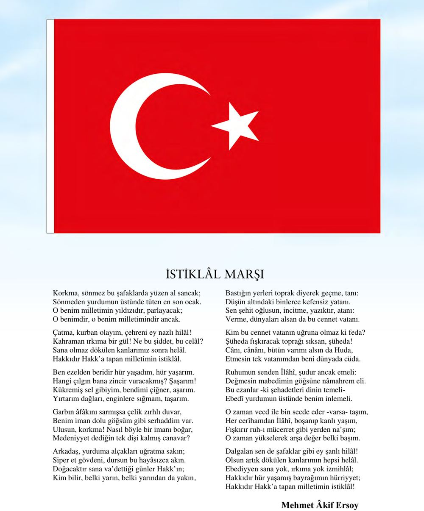

# İSTİKLÂL MARŞI

Korkma, sönmez bu şafaklarda yüzen al sancak;
Sönmeden yurdumun üstünde tüten en son ocak.
O benim milletimin yıldızıdır, parlayacak;
O benimdir, o benim milletimindir ancak.

Çatma, kurban olayım, çehreni ey nazlı hilâl!
Kahraman ırkıma bir gül! Ne bu şiddet, bu celâl?
Sana olmaz dökülen kanlarımız sonra helâl.
Hakkıdır Hakk'a tapan milletimin istiklâl.

Ben ezelden beridir hür yaşadım, hür yaşarım.
Hangi çılgın bana zincir vuracakmış? Şaşarım!
Kükremiş sel gibiyim, bendimi çiğner, aşarım.
Yırtarım dağları, enginlere sığmam, taşarım.

Garbın âfâkını sarmışsa çelik zırhlı duvar,
Benim iman dolu göğsüm gibi serhaddim var.
Ulusun, korkma! Nasıl böyle bir imanı boğar,
Medeniyet dediğin tek dişi kalmış canavar?

Arkadaş, yurduma alçakları uğratma sakın;
Siper et gövdeni, dursun bu hayâsızca akın.
Doğacaktır sana va'dettiği günler Hakk'ın;
Kim bilir, belki yarın, belki yarından da yakın

Bastığın yerleri toprak diyerek geçme, tanı:
Düşün altındaki binlerce kefensiz yatanı.
Sen şehit oğlusun, incitme, yazıktır, atanı:
Verme, dünyaları alsan da bu cennet vatanı.

Kim bu cennet vatanın uğruna olmaz ki feda?
Şüheda fışkıracak toprağı sıksan, şüheda!
Cânı, cânânı, bütün varımı alsın da Huda,
Etmesin tek vatanımdan beni dünyada cüda.

Ruhumun senden İlâhî, şudur ancak emeli:
Değmesin mabedimin göğsüne nâmahrem eli.
Bu ezanlar -ki şehadetleri dinin temeli-
Ebedî yurdumun üstünde benim inlemeli.

O zaman vecd ile bin secde eder -varsa- taşım,
Her cerîhamdan İlâhî, boşanıp kanlı yaşım,
Fışkırır ruh-ı mücerret gibi yerden na'şım;
O zaman yükselerek arşa değer belki başım.

Dalgalan sen de şafaklar gibi ey şanlı hilâl!
Olsun artık dökülen kanlarımın hepsi helâl.
Ebediyyen sana yok, ırkıma yok izmihlâl;
Hakkıdır hür yaşamış bayrağımın hürriyyet;
Hakkıdır Hakk'a tapan milletimin istiklâl!

Mehmet Âkif Ersoy

<!-- sayfa 3 -->

GENÇLİĞE HİTABE

Ey Türk gençliği! Birinci vazifen, Türk istiklâlini, Türk Cumhuriyetini, ilelebet muhafaza ve müdafaa etmektir.

Mevcudiyetinin ve istikbalinin yegâne temeli budur. Bu temel, senin en kıymetli hazinendir. İstikbalde dahi, seni bu hazineden mahrum etmek isteyecek dâhilî ve hâricî bedhahların olacaktır. Bir gün, istiklâl ve cumhuriyeti müdafaa mecburiyetine düşersen, vazifeye atılmak için, içinde bulunacağın vaziyetin imkân ve şeraitini düşünmeyeceksin! Bu imkân ve şerait, çok namüsait bir mahiyette tezahür edebilir. İstiklâl ve cumhuriyetine kastedecek düşmanlar, bütün dünyada emsali görülmemiş bir galibiyetin mümessili olabilirler. Cebren ve hile ile aziz vatanın bütün kaleleri zapt edilmiş, bütün tersanelerine girilmiş, bütün orduları dağıtılmış ve memleketin her köşesi bilfiil işgal edilmiş olabilir. Bütün bu şeraitten daha elîm ve daha vahim olmak üzere, memleketin dâhilinde iktidara sahip olanlar gaflet ve dalâlet ve hattâ hıyanet içinde bulunabilirler. Hattâ bu iktidar sahipleri şahsî menfaatlerini, müstevlîlerin siyasî emelleriyle tevhit edebilirler. Millet, fakr u zaruret içinde harap ve bîtap düşmüş olabilir.

Ey Türk istikbalinin evladı! İşte, bu ahval ve şerait içinde dahi vazifen, Türk istiklâl ve cumhuriyetini kurtarmaktır. Muhtaç olduğun kudret, damarlarındaki asil kanda mevcuttur.

Mustafa Kemal Atatürk

<!-- sayfa 4 -->

MUSTAFA KEMAL ATATÜRK

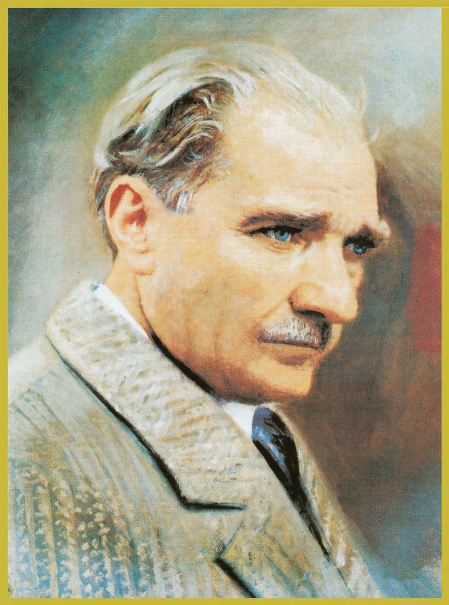
<!-- yer tutucu bulunamadı: sayfa sonuna eklendi -->

<!-- sayfa 5 -->

Verdiğiniz metin katmanı boş olduğu için (`<<< >>>` arası boş) dönüştürülecek bir içerik bulunmamaktadır. Lütfen metin katmanını içeren içeriği paylaşın, böylece kurallara uygun şekilde Markdown formatına çevirebilirim.

<!-- sayfa 6 -->

Kitabın dijital kopyasında “İçindekiler” sayfasında başlıklar üzerine tıklayarak ilgili sayfalara, iç sayfalarda da ünite isimleri üzerine tıklayarak “İçindekiler” sayfasına ulaşabilirsiniz.

# Kitabın Tanıtımı 8

## 1. Ünite Çocukluk Yıllarında Peygamberimiz 10

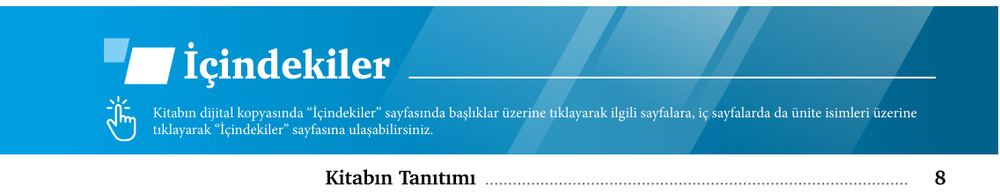

1.1. Peygamberimizin Doğduğu Çevre 12
1.2. Peygamberimizin Doğumu 20
1.3. Peygamberimizin Çocukluğu 22
Ölçme ve Değerlendirme Soruları 36
Sonnot 41

## 2. Ünite Peygamberimizin Çevresindeki Çocuklar 42

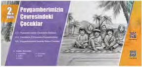

2.1. Peygamberimizin Çocuklarla İletişimi 44
2.2. Çocukların Dünyasında Peygamberimiz 51
2.3. Peygamberimizin Yanında Yetişen Çocuklar 56
Ölçme ve Değerlendirme Soruları 66
Sonnot 71

## 3. Ünite Rehberim Peygamberim 72

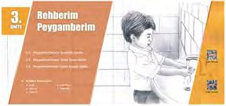

3.1. Peygamberimizin Temizlik Adabı 74
3.2. Peygamberimizin Yeme İçme Adabı 84
3.3. Peygamberimizin Giyim Kuşam Adabı 89
Ölçme ve Değerlendirme Soruları 96
Sonnot 101

## 4. Ünite Aile Hayatında Peygamberimiz 102

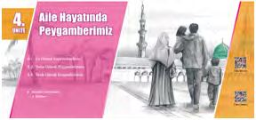

4.1. Eş Olarak Peygamberimiz 109
4.2. Baba Olarak Peygamberimiz 113
4.3. Dede Olarak Peygamberimiz 119
Ölçme ve Değerlendirme Soruları 128
Sonnot 133

Sözlük 134
Kaynakça 139
Cevap Anahtarı Karekodu 141
Görsel ve Genel Ağ Kaynakçası Karekodu 141
Türkiye’nin Mülki İdare Bölümleri ile Kara ve Deniz Komşuları Haritası 142
Türk Dünyası Haritası 143

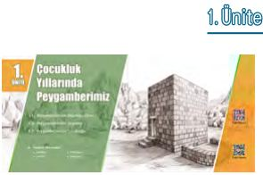
<!-- yer tutucu bulunamadı: sayfa sonuna eklendi -->

<!-- sayfa 7 -->

Kitap ünitelerden oluşmaktadır. Her ünite başında ünite kapak sayfası yer almaktadır.

Ünite kapaklarında ünite adı, ünite alt konu başlıkları, öğrenilecek kavramlar, öğrenciden beklenen öğrenme çıktıları, ünite sonunda öğrenciden yapması gereken görev ya da sorumluluklar hakkında bilgi verilmiştir. Ayrıca ünite ile ilgili hazırlanan sunum ve diğer e-içeriklere ulaşmak amacıyla karekodlar yerleştirilmiştir.

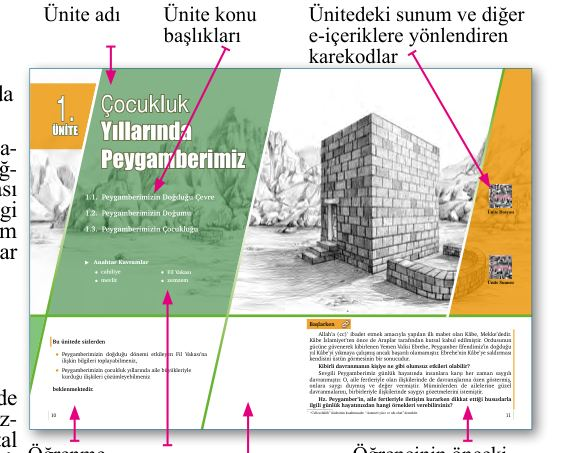

Kitaba ait e-içeriklere, kitap genelinde kullanılan tüm karekodlar akıllı cihazlarla okutularak ya da kitabın dijital kopyalarında karekod üzerine tıklanarak ulaşılabilmektedir.

Desimal sistemle gösterilen ünite konu başlığı

Derse hazırlık ve ön değerlendirme yapılan “Konuya Başlarken” alanı

Ünite alt konu başlığı

Öğrencilere yol göstermek, ek bilgiler vermek, önemli görülen kelime, kavram veya tanımları açıklamak için kullanılan metin alanlarıdır. Ok uçları, ilgili satırı işaret eder.

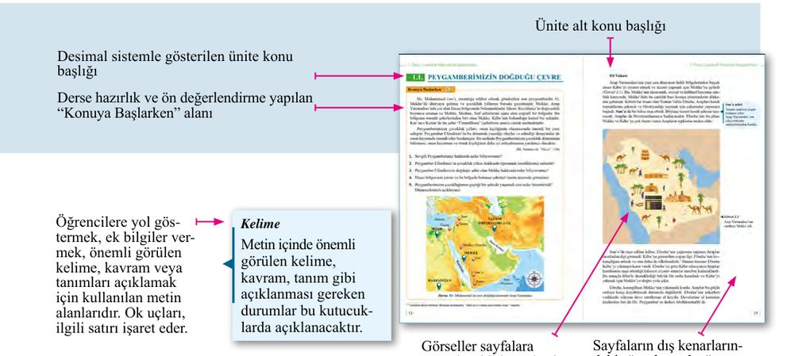

Öğrenci, araştırma yapmaya yönlendirildiğinde metin alanının altı renkli alan ile ana metinden ayrıştırılacaktır.

Öğrencileri araştırma yapmaya yönlendiren veya öğrencilere verilen görevleri açıklayan metin alanlarıdır.

Kelime
Metin içinde önemli görülen kelime, kavram, tanım gibi açıklanması gereken durumlar bu kutucuklarda açıklanacaktır.

Sayfaların dış kenarlarındaki sütunlar; tek sütun ölçülerindeki görselleri yerleştirmek, görsel açıklamalarını yazmak ve öğrencilerin kendi çalışma notlarını yazabilmelerini sağlamak için tasarlanmıştır.

Görseller sayfalara orantılı şekilde yerleştirilmiştir. Görsel açıklamaları, ayrıştırıcı yazım karakteri ve büyüklükle verilmiştir. Açıklama ile görsel bağlantısında algıyı kolaylaştırmak için açıklamanın ait olduğu görsel, ok işareti ile gösterilmiştir.

---

# 1. ÜNİTE
## Çocukluk Yıllarında Peygamberimiz

### Ünite konu başlıkları
1.1. Peygamberimizin Doğduğu Çevre
1.2. Peygamberimizin Doğumu
1.3. Peygamberimizin Çocukluğu

► **Anahtar Kavramlar**
● cahiliye
● mevlit
● Fil Vakası
● zemzem

**Başlarken**
Allah’a (cc)* ibadet etmek amacıyla yapılan ilk mabet olan Kâbe, Mekke’dedir. Kâbe İslamiyet’ten önce de Araplar tarafından kutsal kabul edilmiştir. Ordusunun gücüne güvenerek kibirlenen Yemen Valisi Ebrehe, Peygamber Efendimiz’in doğduğu yıl Kâbe’yi yıkmaya çalışmış ancak başarılı olamamıştır. Ebrehe’nin Kâbe’ye saldırması kendisini üstün görmesinin bir sonucudur.

Kibirli davranmanın kişiye ne gibi olumsuz etkileri olabilir?

Sevgili Peygamberimiz günlük hayatında insanlara karşı her zaman saygılı davranmıştır. O, aile fertleriyle olan ilişkilerinde de davranışlarına özen göstermiş, onlara saygı duymuş ve değer vermiştir. Müminlerden de ailelerine güzel davranmalarını, birbirleriyle ilişkilerinde saygıyı gözetmelerini istemiştir.

Hz. Peygamber’in, aile fertleriyle iletişim kurarken dikkat ettiği hususlarla ilgili günlük hayatınızdan hangi örnekleri verebilirsiniz?

* “Cellecelalüh” ifadesinin kısaltmasıdır. “Azameti yüce ve ulu olan” demektir.

**Ünite Sunusu**
**Ünite Dosyası**

**Bu ünitede sizlerden**
● Peygamberimizin doğduğu dönemi etkileyen Fil Vakası’na ilişkin bilgileri toplayabilmeniz,
● Peygamberimizin çocukluk yıllarında aile büyükleriyle kurduğu ilişkileri çözümleyebilmeniz beklenmektedir.

**Kelime**
Metin içinde önemli görülen kelime, kavram, tanım gibi açıklanması gereken durumlar bu kutucuklarda açıklanacaktır.

<!-- sayfa 8 -->

Kitap geleneğinde Etkinlik, Okuma Parçası, Önemli Özellik vb. çalışmalara ünitede içinde sıra numarası verilmiştir. Çalışmanın başladığı yer $\blacktriangleright$ sembolü ile, bittiği yer ise $\blacksquare$ sembolü ile gösterilmiştir.

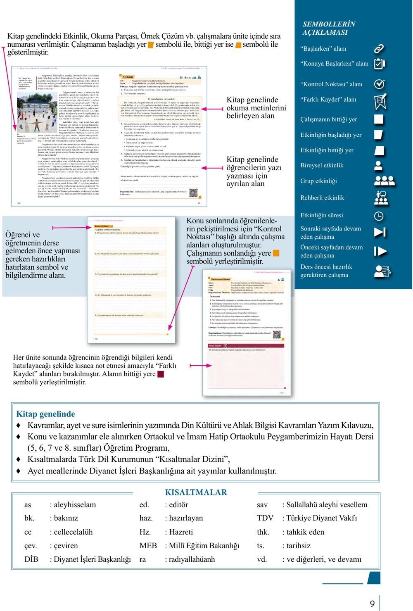 Kitap genelinde okuma metinlerini belirleyen alan

 Kitap genelinde öğrencilerin yazı yazması için ayrılan alan

 Konu sonlarında öğrenilenlerin pekiştirilmesi için “Kontrol Noktası” başlığı altında çalışma alanları oluşturulmuştur. Çalışmanın sonlandığı yere $\blacksquare$ sembolü yerleştirilmiştir.

 Öğrenci ve öğretmenin derse gelmeden önce yapması gereken hazırlıkları hatırlatan sembol ve bilgilendirme alanı.

Her ünite sonunda öğrencinin öğrendiği bilgileri kendi hatırlayacağı şekilde kısaca not etmesi amacıyla “Farklı Kaydet” alanları bırakılmıştır. Alanın bittiği yere $\blacksquare$ sembolü yerleştirilmiştir.

# Kitap genelinde
* Kavramlar, ayet ve sure isimlerinin yazımında Din Kültürü ve Ahlak Bilgisi Kavramları Yazım Kılavuzu,
* Konu ve kazanımlar ele alınırken Ortaokul ve İmam Hatip Ortaokulu Peygamberimizin Hayatı Dersi (5, 6, 7 ve 8. sınıflar) Öğretim Programı,
* Kısaltmalarda Türk Dil Kurumunun “Kısaltmalar Dizini”,
* Ayet meallerinde Diyanet İşleri Başkanlığına ait yayınlar kullanılmıştır.

# KISALTMALAR

| | | | | |
| :--- | :--- | :--- | :--- | :--- |
| as | : aleyhisselam | ed. | : editör | sav | : Sallallahü aleyhi vesellem |
| bk. | : bakınız | haz. | : hazırlayan | TDV | : Türkiye Diyanet Vakfı |
| cc | : cellecelalüh | Hz. | : Hazreti | thk. | : tahkik eden |
| çev. | : çeviren | MEB | : Millî Eğitim Bakanlığı | ts. | : tarihsiz |
| DİB | : Diyanet İşleri Başkanlığı | ra | : radıyallahüanh | vd. | : ve diğerleri, ve devamı |

---

48
49

## 2. Ünite / Peygamberimizin Çevresindeki Çocuklar

Hz. Ümame’nin yerinde olsaydınız neler hissederdiniz? Duygularınızı arkadaşlarınızla paylaşınız.

Peygamber Efendimizin yaşadığı dönemde erkek çocuklarına daha fazla değer verilirdi. Buna rağmen Peygamberimiz, kız ve erkek çocuklar arasında ayrım yapmazdı. Bir gün kendisine hediye edilen bir kolyeyi ev halkına gösterdikten sonra “Bunu içinizden bana en sevimli olana vereceğim.” demiş ve kolyeyi Hz. Zeyneb’in kızı Ümame’nin (ra) boynuna takmıştı.$^{13}$ <!-- KONTROL: Marker'da karşılığı yok, uydurma olabilir -->

Peygamberimiz anne ve babalardan kız çocuklarına güzel davranmalarını isterdi. Bu konuda “Kim üç kız çocuğunun geçimini üstlenir, onları terbiye edip evlendirir ve onlara güzel davranırsa ona cennet vardır.”$^{14}$ <!-- KONTROL: Marker'da karşılığı yok, uydurma olabilir --> buyurmuştur. Müslümanlara kız ve erkek çocuklar arasında ayrım yapmamalarını, onlara karşı adil olmalarını öğütlerdi  Görsel 2.3. Oğlu gelince kucağına alıp seven, kızı geldiğinde ise ilgisiz şekilde yanına oturtan adamı bu davranışı nedeniyle kınamıştı.$^{15}$ <!-- KONTROL: Marker'da karşılığı yok, uydurma olabilir -->

Sahabiden Beşir (ra) isimli biri oğlu Numan’a (ra) malının bir kısmını bağışlamış, kızına ise bir şey vermemişti. Daha sonra bu durumu Peygamber Efendimize sormuştu. Peygamberimiz de “Yaptığın bu işe beni şahit tutma. Çünkü ben adaletsizliğe şahit olmam.” diyerek onu uyarmıştı. Ardından da “Allah’tan korkunuz, çocuklarınız arasında adaletli olun.”$^{16}$ <!-- KONTROL: Marker'da karşılığı yok, uydurma olabilir --> diyerek tüm Müslümanlara uyarıda bulunmuştu.

Peygamberimizin çocukların arasına karışıp onlarla şakalaştığı ve oyun oynadığı olurdu. O, inancına bakmaksızın tüm çocuklara sevgisini gösterirdi. Örneğin Medine’de yaşayan Yahudi bir ailenin çocuğu hastalanınca onu ziyarete gitmiş, çocuğa İslam’ı anlatmış ve onu Müslüman olmaya davet etmişti.$^{17}$ <!-- KONTROL: Marker'da karşılığı yok, uydurma olabilir -->

Peygamberimiz, Yüce Allah’ın, maddi kaygılardan dolayı çocuklara zarar vermeyi yasakladığını anne ve babalara her zaman hatırlatırdı.$^{18}$ <!-- KONTROL: Marker'da karşılığı yok, uydurma olabilir --> “Allah’ım, ben iki zayıfın-yetimin ve kadının-hakkına el uzatılmasını yasaklıyorum.”$^{19}$ <!-- KONTROL: Marker'da karşılığı yok, uydurma olabilir --> buyurarak yetimlerin korunmasını isterdi. İşaret parmağıyla orta parmağının arasını hafifçe açıp ashabına göstererek “Ben ve yetime kol kanat geren kimse cennette böyle yan yana olacağız.”$^{20}$ <!-- KONTROL: Marker'da karşılığı yok, uydurma olabilir --> buyurmuştu.

Peygamberimiz çocukların mescide gelmelerine, yaşlılarla birlikte sohbet meclislerinde bulunmalarına izin verirdi. Bir gün arkadaşlarıyla sohbet ederken kendisine içecek ikram edildi. O, içecekten arkadaşlarına da vermek istedi. Sağ tarafında oturan küçük çocuğa dönerek “Bu içeceği ikrama yaşlılardan başlamama izin verir misin?” diye sordu. Çocuk da “Ya Resulullah! Senden gelen nasibim için kimseyi kendime tercih etmem.” cevabını verdi. Bunun üzerine Peygamberimiz, ikrama küçük çocuktan başladı.$^{21}$ <!-- KONTROL: Marker'da karşılığı yok, uydurma olabilir -->

 Görsel 2.3 Peygamberimiz çocuklara güzel davranılmasını istemiştir.

**Yönerge:** Aşağıdaki uygulama adımlarını takip ederek etkinliği gerçekleştiriniz.

1. Üye sayısı eşit gruplar oluşturunuz ve her grup için bir sözcü seçiniz.
2. Verilen metni okuyunuz.

### 1. Etkinlik
**Adı:** Peygamberimizin Çocuklarla İletişimi
**Amaç:** Peygamberimizin çocuklarla kurduğu iletişimi sentezleyebilme
**Değerlendirme:** Yandaki karekodu kullanarak Grup Değerlendirme Formu’nu doldurunuz.

3. Peygamberimizin çocuklarla kurduğu iletişime dair bilgileri öğretmen rehberliğinde güvenilir kaynaklardan (https://hadislerleislam.diyanet.gov.tr/, Diyanet İşleri Başkanlığı Yayınları vb.) araştırınız.
4. Aşağıdaki konulardan birini seçerek Peygamberimizin çocuklarla kurduğu iletişimi örneklerle açıklayınız.
* Çocuklara sevgi, şefkat ve merhamet göstermek
* Örnek olmak ve değer vermek
* Yaşlarına uygun görev ve sorumluluk vermek
* İletişimde yapıcı, adaletli ve tutarlı olmak
5. Seçtiğiniz konuyla ilgili hazırladığınız örnekleri grup sözcüsü aracılığıyla sınıfla paylaşınız ve bu örneklerin günlük hayatınıza nasıl yansıyabileceği üzerine arkadaşlarınızla konuşunuz.
6. Sınıftaki paylaşımlardan ve öğrendiklerinizden yola çıkarak aşağıdaki cümleleri kendi ifadelerinizle tamamlayınız.

**Peygamberimiz ve Çocuklar**
Hz. Abdullah, Peygamberimizin amcasının oğlu ve eşinin de yeğeniydi. Teyzesinin evinde kaldığı bir gece Peygamberimizin abdest alışını izledi. Peygamberimiz abdest alırken suyu azar azar kullanıyordu. Hz. Abdullah da Peygamberimizin ardından onun aldığı gibi abdest aldı. Peygamberimiz namaz kılarken bazen çocuklar ön...

<!-- sayfa 9 -->

# 1. ÜNİTE

# Çocukluk Yıllarında Peygamberimiz

1.1. Peygamberimizin Doğduğu Çevre
1.2. Peygamberimizin Doğumu
1.3. Peygamberimizin Çocukluğu

► Anahtar Kavramlar
* cahiliye
* mevlît
* Fil Vakası
* zemzem

---

**Bu ünitede sizlerden**

* Peygamberimizin doğduğu dönemi etkileyen Fil Vakası’na ilişkin bilgileri toplayabilmeniz,
* Peygamberimizin çocukluk yıllarında aile büyükleriyle kurduğu ilişkileri çözümleyebilmeniz

**beklenmektedir.**

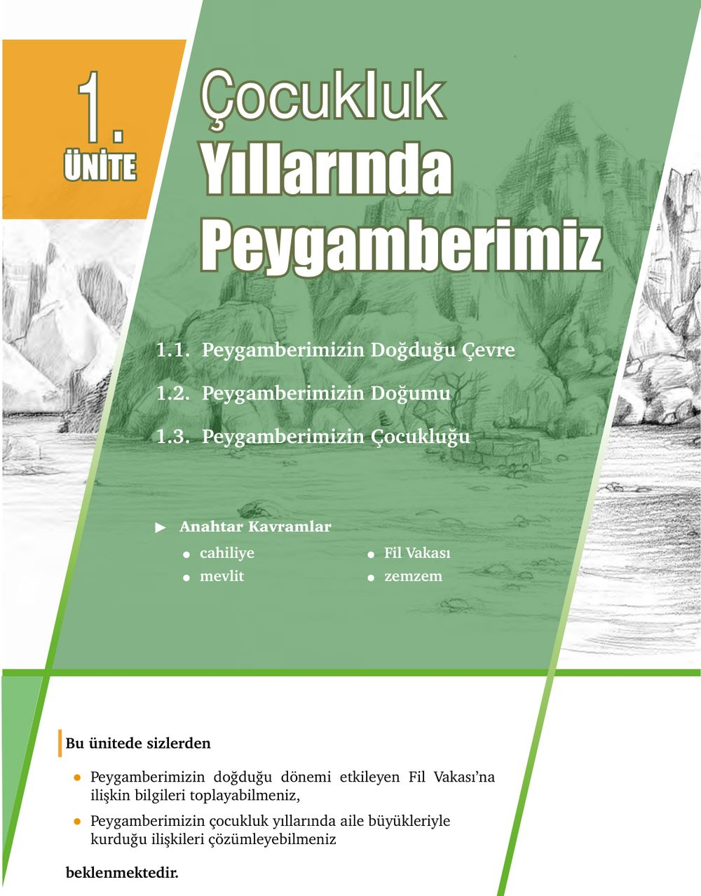
<!-- yer tutucu bulunamadı: sayfa sonuna eklendi -->

<!-- sayfa 10 -->

![Kâbe çizimi]

[QR Kod]
Ünite Dosyası

[QR Kod]
Ünite Sunusu

---

## Başlarken 🔗

Allah’a (cc)* ibadet etmek amacıyla yapılan ilk mabet olan Kâbe, Mekke’dedir. Kâbe İslamiyet’ten önce de Araplar tarafından kutsal kabul edilmiştir. Ordusunun gücüne güvenerek kibirlenen Yemen Valisi Ebrehe, Peygamber Efendimiz’in doğduğu yıl Kâbe’yi yıkmaya çalışmış ancak başarılı olamamıştır. Ebrehe’nin Kâbe’ye saldırması kendisini üstün görmesinin bir sonucudur.

**Kibirli davranmanın kişiye ne gibi olumsuz etkileri olabilir?**

Sevgili Peygamberimiz günlük hayatında insanlara karşı her zaman saygılı davranmıştır. O, aile fertleriyle olan ilişkilerinde de davranışlarına özen göstermiş, onlara saygı duymuş ve değer vermiştir. Müminlerden de ailelerine güzel davranmalarını, birbirleriyle ilişkilerinde saygıyı gözetmelerini istemiştir.

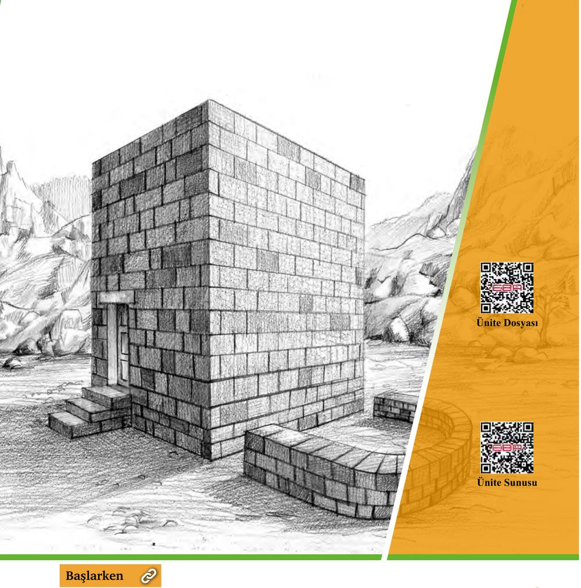

<!-- sayfa 11 -->

# 1.1. PEYGAMBERİMİZİN DOĞDUĞU ÇEVRE

## Konuya Başlarken 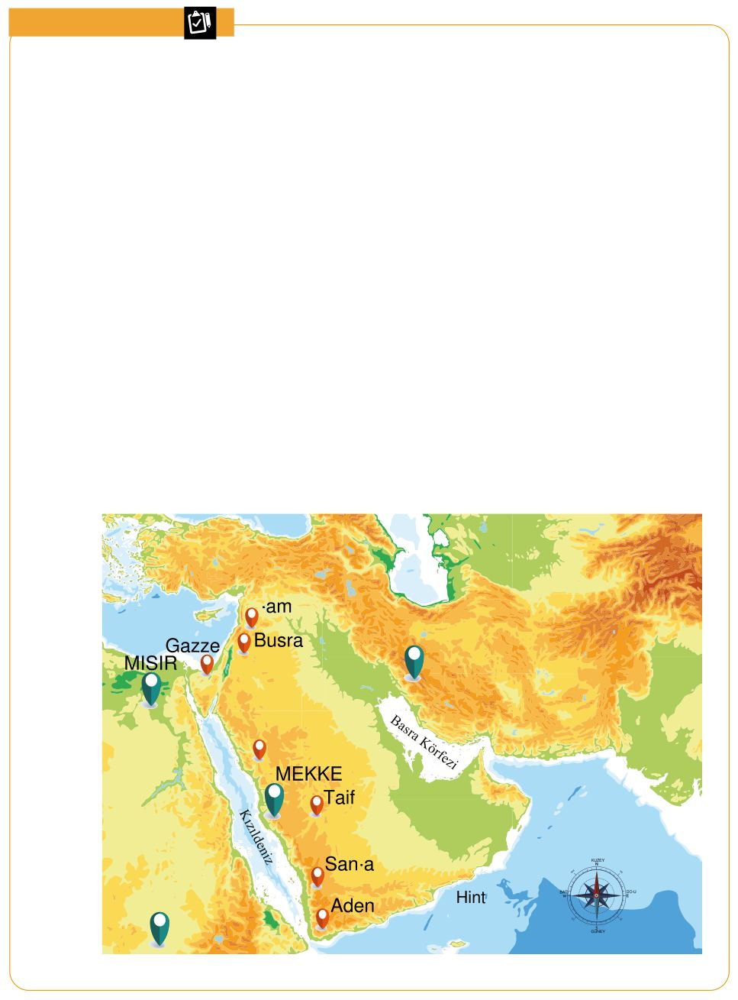

Hz. Muhammed (sav), insanlığa rehber olarak gönderilen son peygamberdir. O, Mekke’de dünyaya gelmiş ve çocukluk yıllarını burada geçirmiştir. Mekke, Arap Yarımadası’nda yer alan Hicaz bölgesinde bulunmaktadır. Hicaz; Kızıldeniz’in doğu sahili boyunca uzanan ve Mekke, Medine, Taif şehirlerini içine alan coğrafi bir bölgedir. Bu bölgenin önemli şehirlerinden biri olan Mekke, Kâbe’nin bulunduğu kutsal bir şehirdir. Kur’an-ı Kerim’de bu şehir “Ümmülkura” (şehirlerin anası) olarak anılmaktadır.

Peygamberimizin çocukluk yılları, onun kişiliğinin oluşmasında önemli bir yere sahiptir. Peygamber Efendimiz’in bu dönemde yaşadığı olaylar ve edindiği deneyimler de onun hayatında önemli izler bırakmıştır. Bu nedenle Peygamberimizin çocukluk döneminin bilinmesi, onun hayatının ve örnek kişiliğinin daha iyi anlaşılmasına yardımcı olacaktır.

(bk. Serinsu vd., “Hicaz”, 136)

1. Sevgili Peygamberimiz hakkında neler biliyorsunuz?
2. Peygamber Efendimiz’in çocukluk yılları hakkında öğrenmek istedikleriniz nelerdir?
3. Peygamber Efendimizin doğduğu şehir olan Mekke hakkında neler biliyorsunuz?
4. Hicaz bölgesinin yerini ve bu bölgede bulunan şehirleri harita üzerinde gösteriniz.
5. Peygamberimizin çocukluğunun geçtiği bir şehirde yaşamak size neler hissettirirdi? Düşüncelerinizi açıklayınız.

*Harita 1.1: Hz. Muhammed’in (sav) doğduğu dönemde Arap Yarımadası*

<!-- sayfa 12 -->

# Fil Vakası

Arap Yarımadası’nın yanı sıra dünyanın farklı bölgelerinden birçok insan Kâbe’yi ziyaret etmek ve ticaret yapmak için Mekke’ye gelirdi (*Görsel 1.1*). Bu, Mekke’nin ekonomik, sosyal ve kültürel hayatına canlılık katıyordu. Mekke’deki bu canlılık bazı komşu yönetimlerin dikkatini çekmişti. Kibirli bir insan olan Yemen Valisi Ebrehe, Arapları kendi topraklarına çekmek ve Hristiyanlığı yaymak için çalışmalar yapmaya başladı. San’a’da bir kilise inşa ettirdi. Böylece ticaret kendi şehrine taşınacak, Araplar da Hristiyanlaşmaya başlayacaktı. Ebrehe’nin bu planı Mekke ve Kâbe’ye çok önem veren Arapların tepkisine neden oldu.$^1$ <!-- KONTROL: Marker'da karşılığı yok, uydurma olabilir -->

> **San’a şehri**
> Yemen sınırları içinde bulunan şehir, Arap Yarımadası’nın eski yerleşim merkezlerinden biridir.

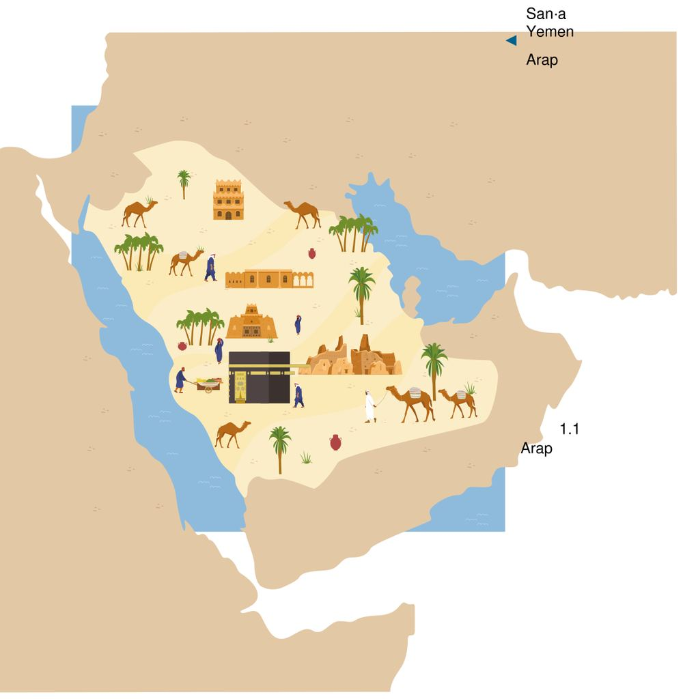

> **Görsel 1.1**
> Arap Yarımadası’nın merkezi Mekke’ydi.

San’a’da inşa edilen kilise, Ebrehe’nin çağrısına rağmen Araplar tarafından ilgi görmedi. Kâbe’ye gösterilen yoğun ilgi, Ebrehe’nin kıskançlığını artırdı ve onu daha da öfkelendirdi.$^2$ <!-- KONTROL: Marker'da karşılığı yok, uydurma olabilir --> Bunun üzerine Ebrehe Kâbe’yi yıkmaya karar verdi. Ebrehe’ye göre Kâbe olmayınca Araplar kendisinin inşa ettirdiği kiliseyi ziyaret etmeye mecbur kalacaklardı. Bu amaçla fillerle desteklediği büyük bir ordu hazırladı ve Kâbe’yi yıkmak için Mekke’ye doğru yola çıktı.

Ebrehe, karargâhını Mekke’nin yakınında kurdu. Araplar bu güçlü orduya karşı koyabilecek durumda değillerdi. Ebrehe’nin askerleri vadilerde otlayan deve sürülerine el koydu. Develerine el konulan

<!-- sayfa 13 -->

# Ebrehe Kâbe’ye Saldırıyor

Ebrehe, Kureyş kabilesinin ve Mekke’nin lideri Abdülmuttalib’e elçi gönderdi. Ona Kâbe’yi yıkmak için geldiğini bildirdi. Bunun üzerine Abdülmuttalib Ebrehe’nin yanına gitti. Ebrehe onun, Kâbe’yi yıkmaması için kendisine ricada bulunacağını düşünüyordu. Ancak Abdülmuttalib, Ebrehe’den yalnızca develerini geri istedi. Ebrehe, Abdülmuttalib’in develeri istemesine şaşırdı ve onu bu konuda eleştirdi. Onun develerin derdinde olduğunu söyleyerek bu durumu kendisine yakıştıramadığını dile getirdi. Bunun üzerine Abdülmuttalib, develerin sahibi olduğu için onları istediğini söyledi. Kâbe’nin sahibinin Allah (cc) olduğunu ve O’nun Kâbe’yi koruyacağını belirtti. Abdülmuttalib’in bu sözleri üzerine Ebrehe Mekkelilerin bütün mallarını geri verdi.$^3$ <!-- KONTROL: Marker'da karşılığı yok, uydurma olabilir -->

Ebrehe, kibirlenerek ordusunun karşısında hiçbir güç duramayacağını Abdülmuttalib’e söyledi. Ertesi gün, askerlerine Mekke’yi kuşatmaları emrini verdi. Ordudaki filler askerlerin tüm çabasına rağmen Kâbe yönüne hareket etmedi. Bir süre sonra gökyüzünde sürü hâlinde ebabil kuşları belirdi. Kuşlar gagalarında taşıdıkları balçıktan pişirilmiş taşları Ebrehe’nin ordusunun üzerine bırakmaya başladı. Ebrehe’nin asla yenilmez dediği ordu, ebabil kuşlarının attığı taşlarla yenildi$^4$ <!-- KONTROL: Marker'da karşılığı yok, uydurma olabilir --> (Görsel 1.2).

İslam tarihinde Ebrehe’nin bu saldırısı Fil Vakası olarak isimlendirilir. Vakanın gerçekleştiği yıl da Fil Yılı olarak anılır.$^5$ <!-- KONTROL: Marker'da karşılığı yok, uydurma olabilir --> Fil suresinde, Ebrehe’nin ordusunun başına gelen felaketin büyüklüğünden ve Ebrehe’nin Kâbe’yi yıkma planlarının boşa çıkarıldığından bahsedilmektedir.

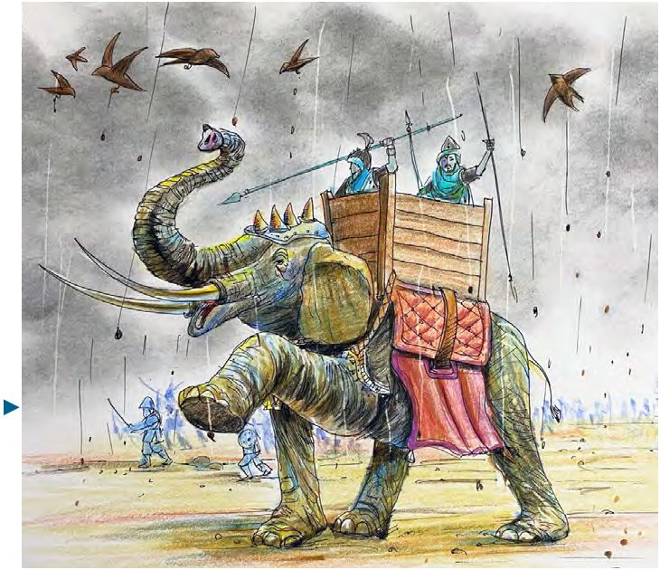

**Görsel 1.2**
Fil Vakası, ismini Ebrehe’nin ordusundaki fillerden almıştır (Temsilî).

> **kabile**
> “Aynı soya mensup aileler topluluğu, boy, aşiret.”
> *(Güncel Türkçe Sözlük, “kabile”)*

<!-- sayfa 14 -->

# 1. Etkinlik

**35 dk.** 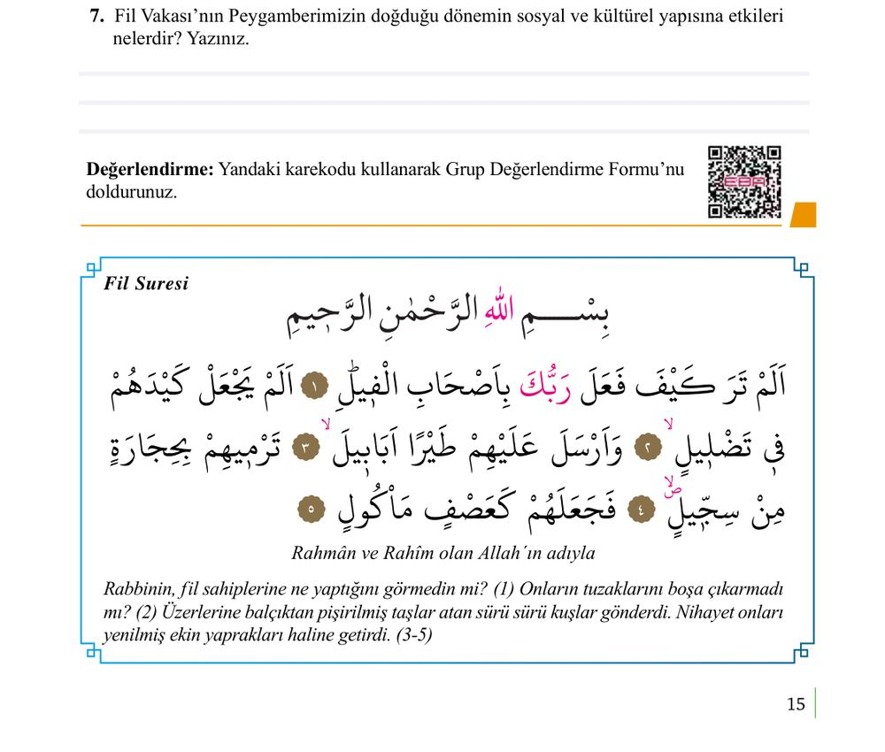

**Adı:** Fil Vakası’nı Keşfet!
**Amaç:** Fil Vakası hakkında bilgi toplayabilme

**Yönerge:** Aşağıdaki uygulama adımlarını takip ederek etkinliği gerçekleştiriniz.
1. Üye sayısı eşit gruplar oluşturunuz.
2. Grupça bir sözcü belirleyiniz.
3. Güvenilir kaynaklardan (Diyanet İşleri Başkanlığı tarafından yayımlanan kitaplar, edu.tr, gov.tr uzantılı genel ağ kaynakları) Fil Vakası’yla ilgili bilgileri toplayarak inceleyiniz.
4. Topladığınız bilgileri öğretmen rehberliğinde doğrulayarak özetleyiniz.
5. Özetinizi bilgi kitapçığı şeklinde düzenleyiniz.

**Not:** Bu kitapçıkta Fil Vakası’nın ne olduğu, neden önemli olduğu ve Peygamberimizin doğduğu dönemdeki toplumsal ve coğrafi şartların bu olayı nasıl etkilediği gibi soruların cevapları yer almalıdır.

6. Hazırladığınız bilgi kitapçığının sunumunu sınıfta yapınız.
7. Fil Vakası’nın Peygamberimizin doğduğu dönemin sosyal ve kültürel yapısına etkileri nelerdir? Yazınız.

___________________________________________________________________________
___________________________________________________________________________
___________________________________________________________________________

**Değerlendirme:** Yandaki karekodu kullanarak Grup Değerlendirme Formu’nu doldurunuz. 

---

### Fil Suresi

بِسْمِ اللّٰهِ الرَّحْمٰنِ الرَّح۪يمِ

اَلَمْ تَرَ كَيْفَ فَعَلَ رَبُّكَ بِاَصْحَابِ الْف۪يلِۜ ﴿١﴾ اَلَمْ يَجْعَلْ كَيْدَهُمْ ف۪ي تَضْل۪يلٍۙ ﴿٢﴾ وَاَرْسَلَ عَلَيْهِمْ طَيْرًا اَبَاب۪يلَۙ ﴿٣﴾ تَرْم۪يهِمْ بِحِجَارَةٍ مِنْ سِج۪يلٍۙ ﴿٤﴾ فَجَعَلَهُمْ كَعَصْفٍ مَأْكُولٍ ﴿٥﴾

*Rahmân ve Rahîm olan Allah’ın adıyla*

Rabbinin, fil sahiplerine ne yaptığını görmedin mi? (1) Onların tuzaklarını boşa çıkarmadı mı? (2) Üzerlerine balçıktan pişirilmiş taşlar atan sürü sürü kuşlar gönderdi. Nihayet onları yenilmiş ekin yaprakları haline getirdi. (3-5)

<!-- sayfa 15 -->

# Peygamberimizin Doğduğu Çevrenin Özellikleri

Hz. Muhammed’in (sav) peygamberliğinden önce, insanların yaşadıkları ve özünde, putlara tapma, soyla övünme, hukuksuzluk, kibir ve zayıfları ezme gibi olumsuzlukları barındıran sosyal ve kültürel ortama **cahiliye** denir.$^6$ <!-- KONTROL: Marker'da karşılığı yok, uydurma olabilir --> Cahiliye Dönemi’nde şiddet, yağmacılık ve kan davaları sıklıkla yaşanırdı. Adaletsizlik yaygındı ve kadınlara değer verilmezdi. Peygamberimiz böyle bir anlayışın hâkim olduğu toplumda doğup büyüdü. Onu anlamak için bu toplumun sosyal ve dinî yapısını bilmek önemlidir.

## Sosyal Yapı

İslamiyet’ten önce Araplar kabileler hâlinde yaşardı. Her kabilenin kendine göre kuralları mevcuttu. Cahiliye Dönemi’nde her kabile, kendi üyelerini -haksız olsalar bile- soy üstünlüğü anlayışıyla korurdu. Toplum hürler, **Mevali** ve kölelerden oluşurdu. Güçlüler zayıfları ezerdi. Erkekler ve kadınlar arasında da eşitsizlik vardı. Arap Yarımadası’nda, göçebeler (bedeviler) ve yerleşik yaşam sürenler (hadariler) olmak üzere iki farklı toplumsal grup mevcuttu.$^7$ <!-- KONTROL: Marker'da karşılığı yok, uydurma olabilir -->

> **Mevali**
> “Özgür bırakılmış köleler.”
> (Güncel Türkçe Sözlük, “mevali”)

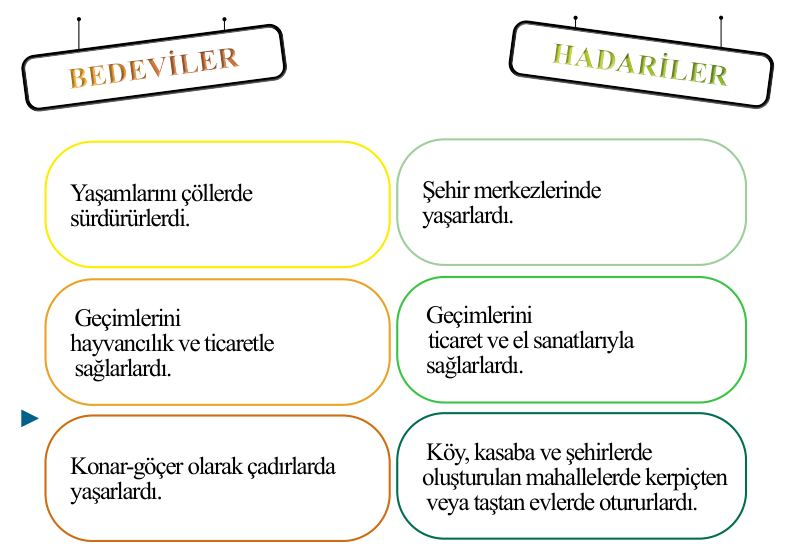
**Bilgi Görseli 1.1**
Bedeviler ve hadariler arasındaki genel farklar

| BEDEVİLER | HADARİLER |
| :--- | :--- |
| Yaşamlarını çöllerde sürdürürlerdi. | Şehir merkezlerinde yaşarlardı. |
| Geçimlerini hayvancılık ve ticaretle sağlarlardı. | Geçimlerini ticaret ve el sanatlarıyla sağlarlardı. |
| Konar-göçer olarak çadırlarda yaşarlardı. | Köy, kasaba ve şehirlerde oluşturulan mahallelerde kerpiçten veya taştan evlerde otururlardı. |

Kabileler arasında soy üstünlüğü, yağma, kan davası ve sınır anlaşmazlıklarından dolayı savaşlar olurdu. Yılın dört ayında kabilelerin birbirleriyle savaşması yasaktı. Savaşmanın yasak olduğu “muharrem, recep, zilkade, zilhicce” aylarına haram aylar denirdi. Büyük **panayırlar** bu aylarda kurulurdu. Panayırlara Arap Yarımadası’nın farklı yerlerinden tüccarlar, kabile reisleri, şairler ve hatipler gelirdi. Farklı dinlere mensup birçok insanın da ziyaret ettiği panayırlar Mekke’nin ekonomik, sosyal ve...

> **panayır**
> “Belli zamanlarda ve genellikle küçük yerleşim birimlerinde kurulan, sergi niteliği de taşıyan büyük pazar.”
> (Güncel Türkçe Sözlük,

<!-- sayfa 16 -->

# Dinî Yapı

Arap Yarımadası, İslamiyet’ten önce farklı dinlerin ve inanış şekillerinin etkisi altındaydı. En yaygın inanç biçimi ise şirkti. Mekkeliler kendi yaptıkları putlara taparlardı. Putların Allah (cc) ile insanlar arasında aracı olduğuna inanırlardı.$^8$ <!-- KONTROL: Marker'da karşılığı yok, uydurma olabilir --> Kâbe içerisinde her kabilenin ayrı bir putu vardı. Putları ziyarete gelenlerle canlılık kazanan Mekke, hem ticaretin hem de putperestliğin merkezi hâline gelmişti.$^9$ <!-- KONTROL: Marker'da karşılığı yok, uydurma olabilir -->

Putların her gün ziyaret edilmesi Mekke’yi önemli bir dinî ve ticari merkez hâline getirmiştir.

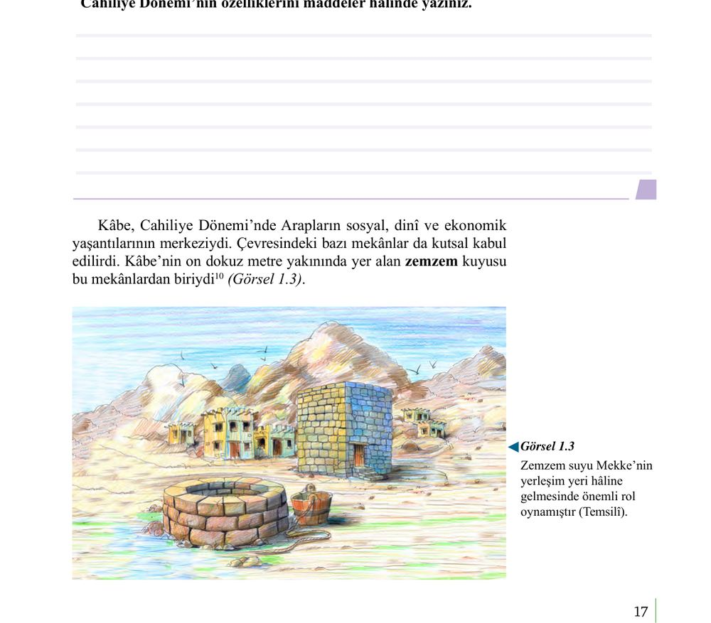

Hanifler Allah’ın (cc) varlığına ve birliğine inanıyorlardı. Ancak toplumun büyük kısmı tevhidden uzaklaşmış, putperestlik ve kabile çatışmaları yüzünden ahlaki çöküntü yaşıyordu. Bu durum Cahiliye Dönemi’nin en önemli sebeplerindendi.

## Yazalım

**Cahiliye Dönemi’nin özelliklerini maddeler hâlinde yazınız.**

__________________________________________________________________________
__________________________________________________________________________
__________________________________________________________________________
__________________________________________________________________________
__________________________________________________________________________

Kâbe, Cahiliye Dönemi’nde Arapların sosyal, dinî ve ekonomik yaşantılarının merkeziydi. Çevresindeki bazı mekânlar da kutsal kabul edilirdi. Kâbe’nin on dokuz metre yakınında yer alan **zemzem** kuyusu bu mekânlardan biriydi$^{10}$ <!-- KONTROL: Marker'da karşılığı yok, uydurma olabilir --> (*Görsel 1.3*).

**Görsel 1.3**
Zemzem suyu Mekke’nin yerleşim yeri hâline gelmesinde önemli rol oynamıştır (Temsilî).

<!-- sayfa 17 -->

# Okuma Metni

**Zemzem Kuyusu adlı metni okuyunuz.**

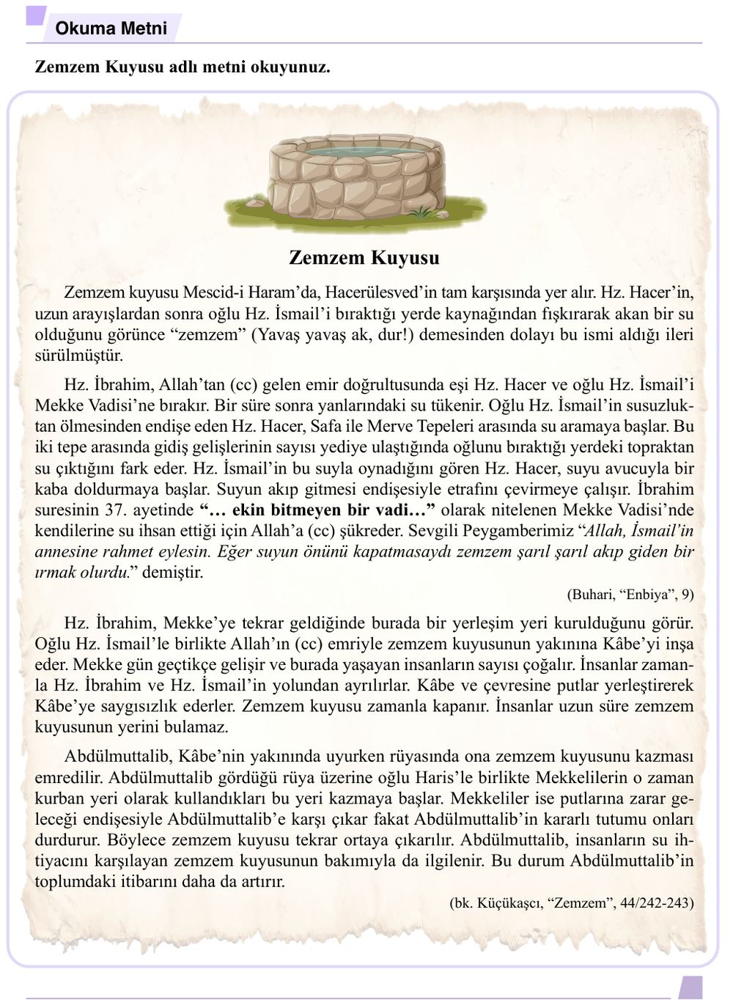

## Zemzem Kuyusu

Zemzem kuyusu Mescid-i Haram’da, Hacerülesved’in tam karşısında yer alır. Hz. Hacer’in, uzun arayışlardan sonra oğlu Hz. İsmail’i bıraktığı yerde kaynağından fışkırarak akan bir su olduğunu görünce “zemzem” (Yavaş yavaş ak, dur!) demesinden dolayı bu ismi aldığı ileri sürülmüştür.

Hz. İbrahim, Allah’tan (cc) gelen emir doğrultusunda eşi Hz. Hacer ve oğlu Hz. İsmail’i Mekke Vadisi’ne bırakır. Bir süre sonra yanlarındaki su tükenir. Oğlu Hz. İsmail’in susuzluktan ölmesinden endişe eden Hz. Hacer, Safa ile Merve Tepeleri arasında su aramaya başlar. Bu iki tepe arasında gidiş gelişlerinin sayısı yediye ulaştığında oğlunu bıraktığı yerdeki topraktan su çıktığını fark eder. Hz. İsmail’in bu suyla oynadığını gören Hz. Hacer, suyu avucuyla bir kaba doldurmaya başlar. Suyun akıp gitmesi endişesiyle etrafını çevirmeye çalışır. İbrahim suresinin 37. ayetinde “… ekin bitmeyen bir vadi…” olarak nitelenen Mekke Vadisi’nde kendilerine su ihsan ettiği için Allah’a (cc) şükreder. Sevgili Peygamberimiz “Allah, İsmail’in annesine rahmet eylesin. Eğer suyun önünü kapatmasaydı zemzem şarıl şarıl akıp giden bir ırmak olurdu.” demiştir.

(Buhari, “Enbiya”, 9)

Hz. İbrahim, Mekke’ye tekrar geldiğinde burada bir yerleşim yeri kurulduğunu görür. Oğlu Hz. İsmail’le birlikte Allah’ın (cc) emriyle zemzem kuyusunun yakınına Kâbe’yi inşa eder. Mekke gün geçtikçe gelişir ve burada yaşayan insanların sayısı çoğalır. İnsanlar zamanla Hz. İbrahim ve Hz. İsmail’in yolundan ayrılırlar. Kâbe ve çevresine putlar yerleştirerek Kâbe’ye saygısızlık ederler. Zemzem kuyusu zamanla kapanır. İnsanlar uzun süre zemzem kuyusunun yerini bulamaz.

Abdülmuttalib, Kâbe’nin yakınında uyurken rüyasında ona zemzem kuyusunu kazması emredilir. Abdülmuttalib gördüğü rüya üzerine oğlu Haris’le birlikte Mekkelilerin o zaman kurban yeri olarak kullandıkları bu yeri kazmaya başlar. Mekkeliler ise putlarına zarar geleceği endişesiyle Abdülmuttalib’e karşı çıkar fakat Abdülmuttalib’in kararlı tutumu onları durdurur. Böylece zemzem kuyusu tekrar ortaya çıkarılır. Abdülmuttalib, insanların su ihtiyacını karşılayan zemzem kuyusunun bakımıyla da ilgilenir. Bu durum Abdülmuttalib’in toplumdaki itibarını daha da artırır.

(bk. Küçükaşcı, “Zemzem”, 44/242-243)

<!-- sayfa 18 -->

Kontrol Noktası ✅
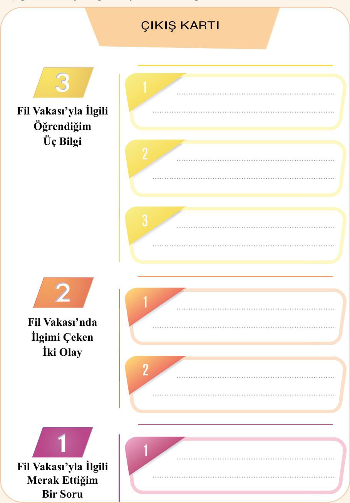

Aşağıdaki kartı, yönergelerde yazan ifadelere göre doldurunuz.

| ÇIKIŞ KARTI |
| :--- |
| **3**   Fil Vakası’yla İlgili Öğrendiğim Üç Bilgi | 1. ..................................................................................   ............................................................................................    2. ..................................................................................   ............................................................................................    3. ..................................................................................   ............................................................................................ |
| **2**   Fil Vakası’nda İlgimi Çeken İki Olay | 1. ..................................................................................   ............................................................................................    2. ..................................................................................   ............................................................................................ |
| **1**   Fil Vakası’yla İlgili Merak Ettiğim Bir Soru | 1. ..................................................................................   ............................................................................................ |

<!-- sayfa 19 -->

# 1.2. PEYGAMBERİMİZİN DOĞUMU

### Konuya Başlarken 📖

1. Peygamberimizin doğduğu dönemde yaşananlar hakkında neler biliyorsunuz?
2. Peygamberimizin ailesinden kimleri biliyorsunuz?

---

### 2. Etkinlik 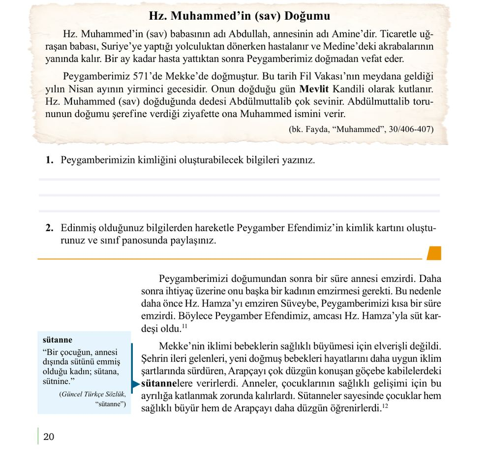
🕒 30 dk. 👤 👥

| Adı | Peygamberimizi Ne Kadar Tanıyorum? |
| :--- | :--- |
| **Amaç** | Peygamberimizin doğumu ve ailesi hakkında bilgi toplayabilme |

**Yönerge:** Aşağıdaki metni okuyunuz ve metinden hareketle etkinliği tamamlayınız.

#### Hz. Muhammed’in (sav) Doğumu

Hz. Muhammed’in (sav) babasının adı Abdullah, annesinin adı Amine’dir. Ticaretle uğraşan babası, Suriye’ye yaptığı yolculuktan dönerken hastalanır ve Medine’deki akrabalarının yanında kalır. Bir ay kadar hasta yattıktan sonra Peygamberimiz doğmadan vefat eder.

Peygamberimiz 571’de Mekke’de doğmuştur. Bu tarih Fil Vakası’nın meydana geldiği yılın Nisan ayının yirminci gecesidir. Onun doğduğu gün **Mevlit Kandili** olarak kutlanır. Hz. Muhammed (sav) doğduğunda dedesi Abdülmuttalib çok sevinir. Abdülmuttalib torununun doğumu şerefine verdiği ziyafette ona Muhammed ismini verir.

(bk. Fayda, “Muhammed”, 30/406-407)

1. Peygamberimizin kimliğini oluşturabilecek bilgileri yazınız.
__________________________________________________________________________
__________________________________________________________________________

2. Edinmiş olduğunuz bilgilerden hareketle Peygamber Efendimiz’in kimlik kartını oluşturunuz ve sınıf panosunda paylaşınız.
__________________________________________________________________________
__________________________________________________________________________

---

**sütanne**
“Bir çocuğun, annesi dışında sütünü emmiş olduğu kadın; sütana, sütnine.”
*(Güncel Türkçe Sözlük, “sütanne”)*

Peygamberimizi doğumundan sonra bir süre annesi emzirdi. Daha sonra ihtiyaç üzerine onu başka bir kadının emzirmesi gerekti. Bu nedenle daha önce Hz. Hamza’yı emziren Süveybe, Peygamberimizi kısa bir süre emzirdi. Böylece Peygamber Efendimiz, amcası Hz. Hamza’yla süt kardeşi oldu.$^{11}$ <!-- KONTROL: Marker'da karşılığı yok, uydurma olabilir -->

Mekke’nin iklimi bebeklerin sağlıklı büyümesi için elverişli değildi. Şehrin ileri gelenleri, yeni doğmuş bebekleri hayatlarını daha uygun iklim şartlarında sürdüren, Arapçayı çok düzgün konuşan göçebe kabilelerdeki **sütannelere** verirlerdi. Anneler, çocuklarının sağlıklı gelişimi için bu ayrılığa katlanmak zorunda kalırlardı. Sütanneler sayesinde çocuklar hem...

<!-- sayfa 20 -->

Taif yakınlarında göçebe olarak yaşayan Sadoğulları kabilesinin kadınlarından bir kısmı Peygamberimizin doğumundan sonra Mekke’ye gelmişti. Sütannelik, göçebe kadınlar için bir gelir kapısıydı. Bu yüzden emzirecekleri çocukları zengin ailelerden seçmeye özen gösteriyorlardı.

Peygamberimizin yetim olması, dedesi Abdülmuttalib’in de maddi durumunun iyi olmaması sebebiyle onu kimse almak istemedi. Halime Hatun ve ailesi de başta onu almaya pek yanaşmadı. Halime Hatun, eli boş dönmek istemediğinden Peygamberimize sütannelik yapmayı kabul etti. Peygamberimizi yanına alıp eşiyle birlikte yaşadıkları yere döndü. Böylece Peygamberimizin çocukluğunun ilk iki yılı Sadoğulları yurdunda geçti. Geleneğe göre sütannelik iki yıl sürerdi. İki yılın sonunda Halime Hatun, Peygamberimizi annesine getirdi ancak ondan da ayrı kalmak istemiyordu. Annesi Amine de yayla havasının, oğlunun sağlıklı gelişimine faydalı olduğunu düşündü. Onun bir süre daha sütannesi Halime Hatun’la kalmasını uygun gördü. Bu kararı almasının diğer nedeni Mekke’deki salgın hastalıklardı.$^{13}$ <!-- KONTROL: Marker'da karşılığı yok, uydurma olabilir -->

Bilgi Görseli 1.2
Peygamberimizin isimleri

# Kontrol Noktası ✅

Aşağıdaki kutucuklarda bazı ifadeler verilmiştir. Soruları kutucuklardaki harfleri kullanarak cevaplayınız. Aynı kutucuğu birden fazla soru için kullanabilirsiniz.

| a | b | c | ç |
| :---: | :---: | :---: | :---: |
| Mevlit Kandili | 571 | Halime Hatun | Abdullah |

| d | e | f | g |
| :---: | :---: | :---: | :---: |
| Mekke | Sadoğulları yurdu | Abdülmuttalib | Hz. Amine |

| ğ | h | ı | i |
| :---: | :---: | :---: | :---: |
| 610 | Medine | Taif | Zemzem |

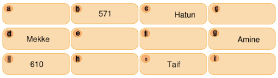

1. Peygamberimiz kaç yılında, nerede doğmuştur?
..........................................................................................................................................

2. Peygamberimiz sütannesiyle nerede yaşamıştır?
..........................................................................................................................................

3. Peygamberimizin doğumunun kutlandığı güne ne ad verilir?
..........................................................................................................................................

4. Peygamberimizin dedesi, babası, annesi ve sütannesinin adı nedir? Sırasıyla yazınız.
..........................................................................................................................................

<!-- sayfa 21 -->

# 1.3. PEYGAMBERİMİZİN ÇOCUKLUĞU

## Konuya Başlarken 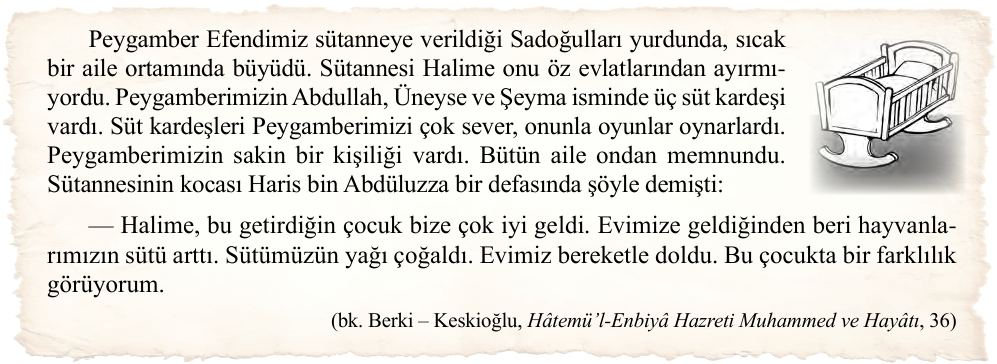

1. Peygamberimizin çocukluğu hakkında neler biliyorsunuz?
2. Peygamberimizin çocukluğunda yaşamış olduğu olaylardan bildikleriniz nelerdir? Anlatınız.

---

## 3. Etkinlik

| | |
| :--- | :--- |
| **Adı** | Peygamber Efendimiz’in Çocukluğunu Öğreniyorum |
| **Amaç** | Peygamberimizin çocukluk döneminde yaşadığı bir olayla ilgili duygu ve düşünceleri ifade edebilme |

**Süre:** 30 dk. 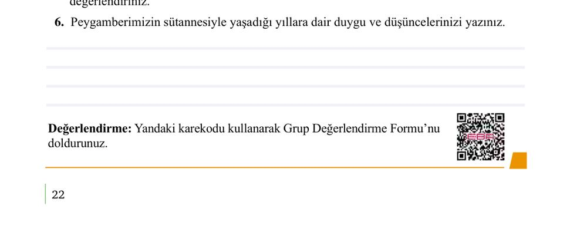

**Yönerge:** Aşağıdaki metni okuyunuz. Uygulama adımlarını takip ederek etkinliği gerçekleştiriniz.

> Peygamber Efendimiz sütanneye verildiği Sadoğulları yurdunda, sıcak bir aile ortamında büyüdü. Sütannesi Halime onu öz evlatlarından ayırmıyordu. Peygamberimizin Abdullah, Üneyse ve Şeyma isimde üç süt kardeşi vardı. Süt kardeşleri Peygamberimizi çok sever, onunla oyunlar oynarlardı. Peygamberimizin sakin bir kişiliği vardı. Bütün aile ondan memnundu. Sütannesinin kocası Haris bin Abdüluzza bir defasında şöyle demişti:
> — Halime, bu getirdiğin çocuk bize çok iyi geldi. Evimize geldiğinden beri hayvanlarımızın sütü arttı. Sütümüzün yağı çoğaldı. Evimiz bereketle doldu. Bu çocukta bir farklılık görüyorum.
>
> (bk. Berki – Keskioğlu, *Hâtemü’l-Enbiyâ Hazreti Muhammed ve Hayâtı*, 36)

1. Üye sayısı eşit gruplar oluşturunuz.
2. Okuduğunuz metinden peygamberimizin çocukluğuyla ilgili çıkarımlar yapınız.
3. Çıkarımlarınızı grupça değerlendirip düşüncelerinizi belirtiniz.
4. Grupça belirlediğiniz ortak çıkarımı tahtaya yazınız.
5. Tahtaya yazılan düşüncelerin, insanların hangi yönüyle ilgili olduğunu sınıfta değerlendiriniz.
6. Peygamberimizin sütannesiyle yaşadığı yıllara dair duygu ve düşüncelerinizi yazınız.

__________________________________________________________________
__________________________________________________________________
__________________________________________________________________

**Değerlendirme:** Yandaki karekodu kullanarak Grup Değerlendirme Formu’nu doldurunuz.

<!-- sayfa 22 -->

Peygamberimiz dört yaşına kadar Sadoğulları yurdunda, sütannesinin yanında yaşadı. Dört yaşına geldiğinde sütannesi onu Mekke’ye getirip annesine teslim etti. Altı yaşındayken annesi ve onun yardımcısı Ümmü Eymen’le birlikte o zamanlar ismi Yesrib olan Medine’ye gitti. Sevgili Peygamberimiz orada akrabalarını ve babasının kabrini ziyaret etti. Bu ziyaretlerin ardından Mekke’ye dönerlerken Peygamber Efendimiz’in annesi Amine hastalandı ve Ebva köyünde vefat etti. Bunun üzerine Ümmü Eymen, Peygamberimizi dedesinin yanına götürdü.

Peygamberimiz, annesinin vefatından sonra dedesi Abdülmuttalib’le yaşamaya başladı. Dedesi Peygamberimize büyük bir sevgi ve şefkat gösterir, onun yanından ayırmazdı. Kureyş kabilesinin lideri Abdülmuttalib’in Kâbe’de kendisine ait bir köşesi ve minderi vardı. Buraya ondan başkası oturamazdı. Herkes ona saygı gösterirdi. O, mindere sadece Peygamber Efendimiz’in oturmasına izin verirdi. Peygamberimiz sekiz yaşındayken dedesi Abdülmuttalib vefat etti. Dedesi, ölmeden önce Peygamberimizi amcası Ebu Talib’e emanet etti.$^{14}$ <!-- KONTROL: Marker'da karşılığı yok, uydurma olabilir -->

| | Hz. Peygamber’in, annesiyle birlikte Medine’ye gitmesinin sebeplerini sınıfta arkadaşlarınızla konuşunuz. |
|---|---|

# Okuyalım

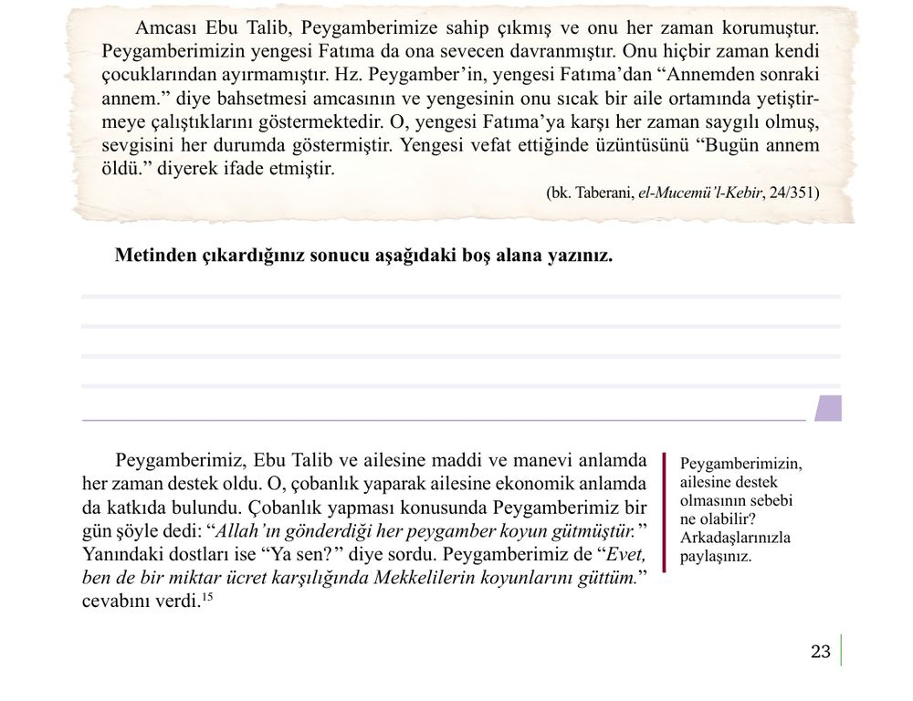

**Aşağıdaki metni okuyunuz. Metinden yararlanarak Hz. Peygamber’in yengesine verdiği değerin sebebini arkadaşlarınızla konuşunuz.**

> Amcası Ebu Talib, Peygamberimize sahip çıkmış ve onu her zaman korumuştur. Peygamberimizin yengesi Fatıma da ona sevecen davranmıştır. Onu hiçbir zaman kendi çocuklarından ayırmamıştır. Hz. Peygamber’in, yengesi Fatıma’dan “Annemden sonraki annem.” diye bahsetmesi amcasının ve yengesinin onu sıcak bir aile ortamında yetiştirmeye çalıştıklarını göstermektedir. O, yengesi Fatıma’ya karşı her zaman saygılı olmuş, sevgisini her durumda göstermiştir. Yengesi vefat ettiğinde üzüntüsünü “Bugün annem öldü.” diyerek ifade etmiştir.
>
> (bk. Taberani, *el-Mucemü’l-Kebir*, 24/351)

**Metinden çıkardığınız sonucu aşağıdaki boş alana yazınız.**

__________________________________________________________________________
__________________________________________________________________________
__________________________________________________________________________

| | Peygamberimizin, ailesine destek olmasının sebebi ne olabilir? Arkadaşlarınızla paylaşınız. |
|---|---|

Peygamberimiz, Ebu Talib ve ailesine maddi ve manevi anlamda her zaman destek oldu. O, çobanlık yaparak ailesine ekonomik anlamda da katkıda bulundu. Çobanlık yapması konusunda Peygamberimiz bir gün şöyle dedi: “Allah’ın gönderdiği her peygamber koyun gütmüştür.” Yanındaki dostları ise “Ya sen?” diye sordu. Peygamberimiz de “Evet, ben de bir miktar ücret karşılığında Mekkelilerin koyunlarını güttüm.”

<!-- sayfa 23 -->

Mekke’nin iklimi tarıma elverişli değildi. Bundan dolayı Mekkeliler daha çok ticaretle uğraşır, çocuklarını da küçük yaşlardan itibaren ticarete alıştırırlardı. Ebu Talib de ticaret yapardı. Ticaret için yolculuğa çıktığında Peygamber Efendimiz’i de yanında götürürdü. Bir yaz günü Şam’a yapılacak ticaret yolculuğuna Hz. Muhammed (sav) de katılmak istedi. Amcası onun bu isteğini geri çevirmeyerek onu kervana dâhil etti. Bu yolculuk esnasında Peygamberimiz on iki yaşındaydı.

Ticaret kervanı Şam’ın yakınlarında Busra denilen mevkide konaklamaktaydı.$^{16}$ <!-- KONTROL: Marker'da karşılığı yok, uydurma olabilir --> Bu esnada küçük bir bulut kervanın üstünde duruyor, kervanda belli bir noktayı gölgelendiriyordu. Bunu gören Bahira adında bir rahip, Ebu Talib ve beraberindekileri yemeğe davet etti. Ebu Talib yemeğe giderken Peygamberimize kervanın başında bekleme sorumluluğunu verdi. Peygamberimizin kervanın başında beklediğini gören rahip onun da yemeğe katılmasını istedi. Yemek sırasında Bahira, Peygamberimize bazı sorular sordu. Amcası Ebu Talib’e yeğeninin beklenen peygamber olabileceğini ve çok iyi korunması gerektiğini söyledi. Bu konuşmalardan sonra Ebu Talib, Şam’a yapacağı yolculuktan vazgeçerek Mekke’ye geri döndü (*Görsel 1.4*).$^{17}$ <!-- KONTROL: Marker'da karşılığı yok, uydurma olabilir -->

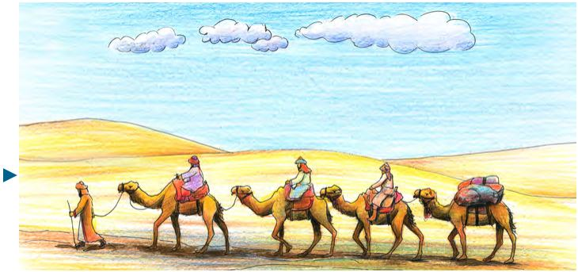

**Görsel 1.4**
Peygamberimizin, amcası Ebu Talib'le Şam'a yaptığı ticaret yolculuğu (Temsilî).

---

**Kontrol Noktası** ✅

**Aşağıdaki soruların cevaplarını boş bırakılan alanlara yazınız.**

| Rahip Bahira, Ebu Talib'e yeğeninin beklenen peygamber olabileceğini söyleyince Ebu Talib ne yapmıştır? |
| :--- |
| ........................................................................................................................................... ........................................................................................................................................... ...................................................................................................................................... |

| Peygamberimizin Şam'a yaptığı yolculukta yaşadıkları hakkında duygu ve düşünceleriniz nelerdir? |
| :--- |
| ........................................................................................................................................... ........................................................................................................................................... ...................................................................................................................................... |

<!-- sayfa 24 -->

# 4. Etkinlik ⏱️ 30 dk. 👤 👥

**Adı:** Sorumluluğumu Biliyorum, Aileme Yardım Ediyorum
**Amaç:** Sorumluluk üstlenebilme ve aile işlerine yardımcı olabilme

**Yönerge:** Metni okuyunuz ve tabloyu doldurunuz.

Hz. Muhammed (sav) ticaret yolculuklarında olduğu gibi günlük yaşantısında da bir takım sorumluluklar almıştır. O, ailesine günlük işlerde daima yardımcı olmuş, üzerine düşen her görevi yerine getirmiştir.

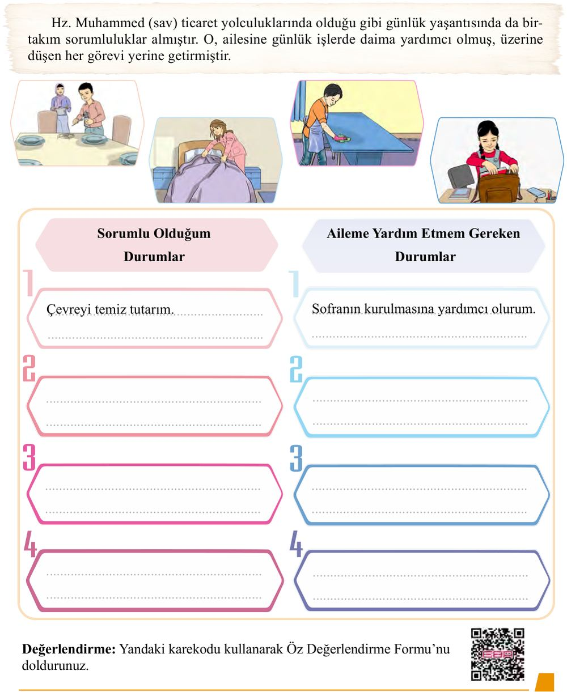

| Sorumlu Olduğum Durumlar | Aileme Yardım Etmem Gereken Durumlar |
| :--- | :--- |
| 1. Çevreyi temiz tutarım. | 1. Sofranın kurulmasına yardımcı olurum. |
| 2. | 2. |
| 3. | 3. |
| 4. | 4. |

**Değerlendirme:** Yandaki karekodu kullanarak Öz Değerlendirme Formu’nu doldurunuz.

<!-- sayfa 25 -->

Hz. Muhammed (sav) davranışlarına her yerde dikkat ederdi. Aile büyükleriyle iletişiminde özenli ve uyumlu davranırdı. Her konuda büyüklerine danışır, onların düşüncelerine saygı gösterirdi. Sevgili Peygamberimiz, ailesine ve büyüklerine yardımcı olur; onların yaşadığı sıkıntıları kendisi de hissederdi.

> ### Bir Hadis
> Abdullah bin Abbas’tan (ra)*** nakledildiğine göre Hz. Peygamber şöyle buyurmuştur:
>
> “خَيْرُكُمْ خَيْرُكُمْ لِأَهْلِهِ، وَأَنَا خَيْرُكُمْ لِأَهْلِي”
>
> “Sizin en hayırlınız, ailesine karşı en hayırlı olandır. Ben de aileme karşı en hayırlı olanınızım.”
>
> (İbni Mace, “Nikâh”, 50)

Ailenize hangi işlerde, nasıl yardımcı olabileceğinizi arkadaşlarınızla konuşunuz.

İslamiyet, toplumdaki düzenin sağlanması için aile kurumuna çok önem verir. Bu önem doğrultusunda her bireyin, toplumda olduğu gibi aile içerisinde de sorumlulukları vardır (**Görsel 1.5**). Ev işlerinde aile bireylerine yardımcı olmak bu sorumluluklara örnek gösterilebilir. Bu sorumlulukların en önemlilerinden biri ise anne ve babaya karşı görevlerdir. Yüce Allah, anne ve babaya iyi davranılması gerektiğini şöyle bildirmiştir: **“Rabbin sadece kendisine kulluk etmeni ve anne babana iyi davranmanı emretti. Onlardan biri veya ikisi senin yanında yaşlanırsa onlara ‘öf!’ bile deme! Onları azarlama! İkisine de gönül alıcı güzel sözler söyle.”**$^{18}$ <!-- KONTROL: Marker'da karşılığı yok, uydurma olabilir -->

*** “Radıyallahüanh” ifadesinin kısaltmasıdır. “Allah (cc) ondan razı olsun.” anlamına gelen dua sözüdür.

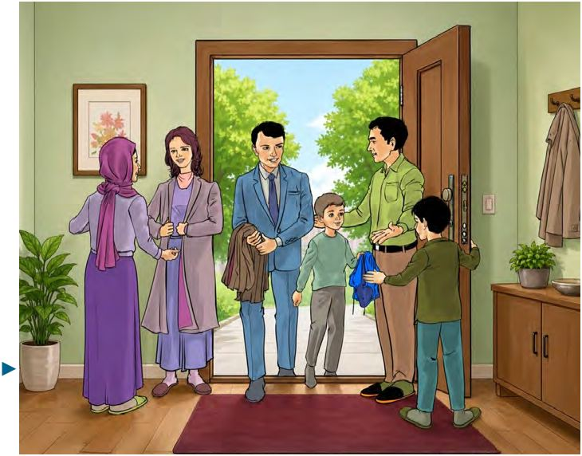

**Görsel 1.5**
Misafiri güzel karşılamak aile içi sorumluluklarımızdandır

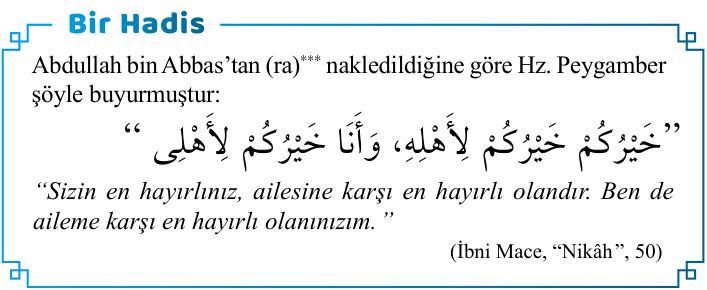
<!-- yer tutucu bulunamadı: sayfa sonuna eklendi -->

<!-- sayfa 26 -->

# 5. Etkinlik

| | | ⏱️ 30 dk. 👤 👥 |
| :--- | :--- | :--- |
| **Adı** | Öğrenme Günlüğü | |
| **Amaç** | Hz. Peygamber’in aile büyükleriyle iletişiminin örneklerini ve bu örnekler arasındaki ilişkiyi çözümleyebilme | |

**Yönerge:** “Öğrenme Günlüğü”ndeki boş bırakılan alanları doldurunuz.

* Hz. Peygamber’in aile büyüklerine karşı davranışlarına dair önceden bildiklerim
____________________________________________________________________________________________________
____________________________________________________________________________________________________
____________________________________________________________________________________________________

* Hz. Peygamber’in aile büyüklerine karşı davranışlarına dair yeni öğrendiklerim
____________________________________________________________________________________________________
____________________________________________________________________________________________________
____________________________________________________________________________________________________

* Hz. Peygamber’in aile büyüklerine karşı davranışlarından yola çıkarak aileme karşı yapmam gerekenler
____________________________________________________________________________________________________
____________________________________________________________________________________________________
____________________________________________________________________________________________________

**Değerlendirme:** Yandaki karekodu kullanarak Öz Değerlendirme Formu’nu doldurunuz.

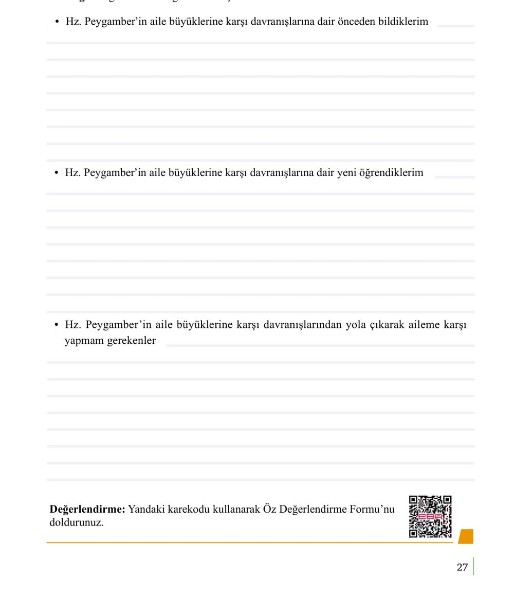

<!-- sayfa 27 -->

# Tarih Şeridi

Hz. Peygamber’in çocukluk yıllarıyla ilgili bildiklerinizi, aşağıdaki tarih şeridine örnekteki gibi yazınız.

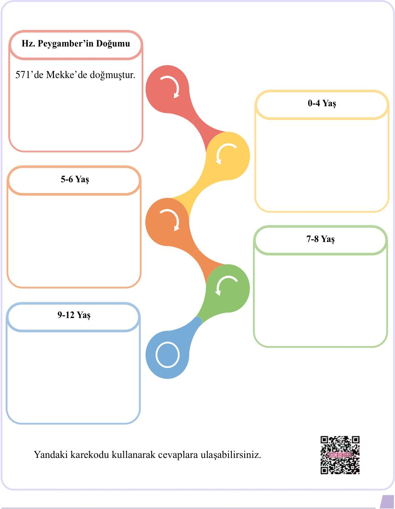

| Hz. Peygamber’in Doğumu | 0-4 Yaş |
| :--- | :--- |
| 571’de Mekke’de doğmuştur. | |

| 5-6 Yaş | 7-8 Yaş |
| :--- | :--- |
| | |

| 9-12 Yaş | |
| :--- | :--- |
| | |

Yandaki karekodu kullanarak cevaplara ulaşabilirsiniz.

<!-- sayfa 28 -->

# Yazalım

**Peygamberimizin çocukluk yıllarında yaşadığı bölgeyi harita üzerinde inceleyiniz.**

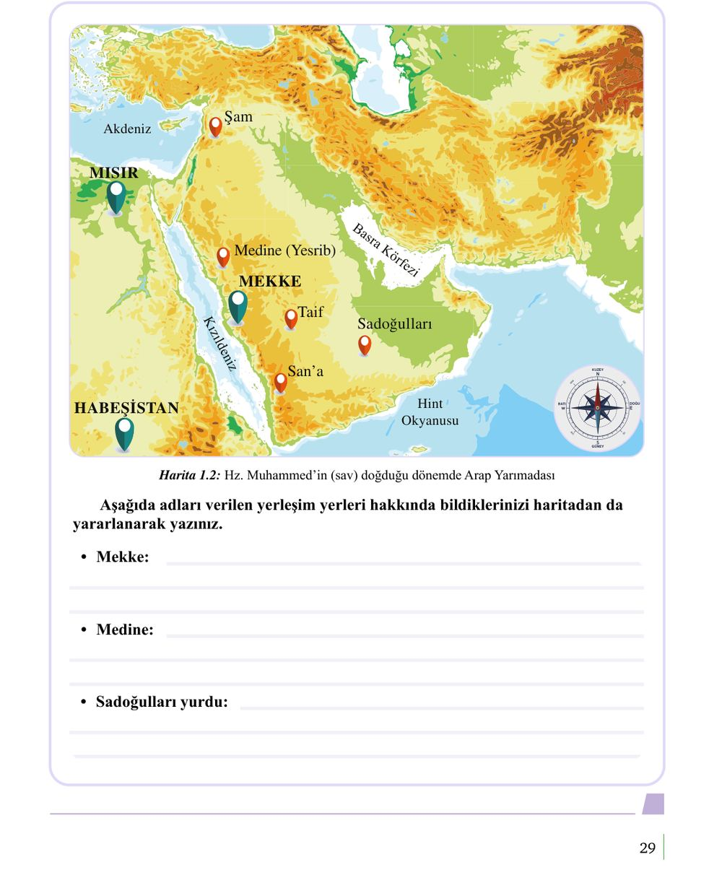

*Harita 1.2: Hz. Muhammed'in (sav) doğduğu dönemde Arap Yarımadası*

**Aşağıda adları verilen yerleşim yerleri hakkında bildiklerinizi haritadan da yararlanarak yazınız.**

* **Mekke:** __________________________________________________________________________
_____________________________________________________________________________________

* **Medine:** _________________________________________________________________________
_____________________________________________________________________________________

* **Sadoğulları yurdu:** _______________________________________________________________
_____________________________________________________________________________________

<!-- sayfa 29 -->

Peygamberimiz çocukluğunda çevresi tarafından takdir edilen bir kişiliğe sahipti. İnsanlar, küçük yaşta olmasına rağmen ona saygı gösterir; onun sözüne değer verirlerdi. O, çocukluğunda da sade bir hayat yaşamıştı. Hiçbir zaman cahiliye âdetlerine uymamış, yanlış davranışları benimsememişti. Ahlaki özellikleriyle göze çarpan üstün bir kişiliğe sahipti. Üstün ahlakının gereği olarak iyiyi, güzeli, doğruyu insanlara anlatırdı. Peygamberimizin ahlakının yüceliği Kur’an-ı Kerim’de **“Sen elbette yüce bir ahlâk üzeresin.”**$^{19}$ <!-- KONTROL: Marker'da karşılığı yok, uydurma olabilir --> ayetiyle ifade edilmektedir *(Görsel 1.6)*.

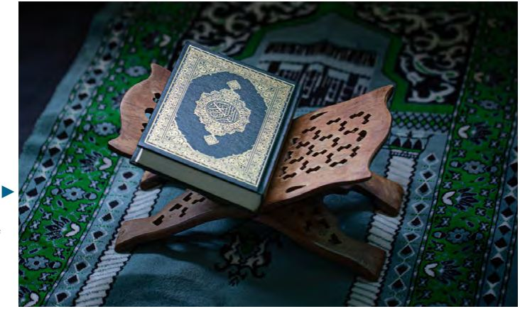

**Görsel 1.6**
Peygamber Efendimiz’in ahlakı, Kur’an-ı Kerim’de müminlere tavsiye edilen ahlakı yansıtmaktadır.

> **metanet**
> “Felaket, hastalık, ölüm gibi acı olaylar karşısında dayanıklı olma, isyankârlıktan, taşkınca söz ve davranışlardan sakınma.”
>
> *(Güncel Türkçe Sözlük, “metanet”)*

Peygamberimiz zamanını iyi değerlendirir, boş geçirmezdi. Dürüst ve güvenilir bir kişiliğe sahipti, verdiği sözü mutlaka yerine getirirdi. İnsanlar arasında hakkı gözetir, adil kararlar alırdı. Onları ekonomik ya da sosyal konumlarına göre ayırmaz, herkese eşit davranırdı. İnsanlara ve hayvanlara karşı daima merhametliydi. Yaşadığı sıkıntılar karşısında metanetini korurdu. İnsanlara karşı vefalıydı. Bakımını üstlenen amcasına yaptığı yardımlar, yengesinin sağlığında ve vefatından sonra sergilediği tutum ve davranışlar da vefasının bir örneğiydi.

| | | |
| :--- | :---: | ---: |
| Merhametli | 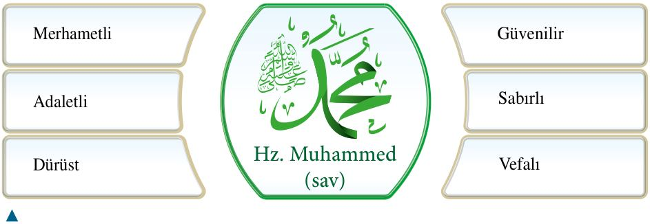 | Güvenilir |
| Adaletli | | Sabırlı |
| Dürüst | | Vefalı |

<!-- sayfa 30 -->

# 6. Etkinlik ⏱️ 25 dk. 👤 👥

**Adı:** Çocukluğunda Peygamberimiz
**Amaç:** Peygamberimizin çocukluk dönemindeki ahlaki özelliklerini yorumlama ve öz değerlendirme yapabilme

**Yönerge:** Aşağıdaki tabloda Peygamberimizin çocukluk dönemindeki ahlaki özellikleri verilmiştir. Bu özellikleri kendi tutumlarınızla karşılaştırmak için uygun bölümü örnekteki gibi işaretleyiniz.

| Çocukluğunda Peygamberimiz | Uyguluyorum | Uygulayacağım |
| :--- | :---: | :---: |
| Sıkıntılara karşı sabır göstermiştir. | ✓ | |
| İnsanlara şefkatli davranmıştır. | | |
| Zorda kalan insanlara yardımcı olmuştur. | | |
| Kötü davranışlardan uzak durmuştur. | | |
| Vefalı bir insan olmuştur. | | |
| Verdiği sözleri tutmuştur. | | |
| Hakkı gözetmiş, adil davranmıştır. | | |
| Doğayı korumuş, hayvanlara karşı merhametli olmuştur. | | |

**Değerlendirme:** Yandaki karekodu kullanarak Öz Değerlendirme Formu’nu doldurunuz. 

<!-- yer tutucu bulunamadı: sayfa sonuna eklendi -->

<!-- sayfa 31 -->

**Kontrol Noktası** ✅

Aşağıdaki bilgi kartlarında Peygamberimizin hayatında etkisi olan kişi ve yerlerle ilgili bazı başlıklar verilmiştir. Bu başlıklarla ilgili bildiklerinizi boş bırakılan yerlere yazınız.

| Hz. Amine | Abdullah |
| :--- | :--- |
| ................................................... ................................................... ................................................... ................................................... ................................................... ................................................... | ................................................... ................................................... ................................................... ................................................... ................................................... ................................................... |

| Halime Hatun | Ebu Talib |
| :--- | :--- |
| ................................................... ................................................... ................................................... ................................................... ................................................... ................................................... | ................................................... ................................................... ................................................... ................................................... ................................

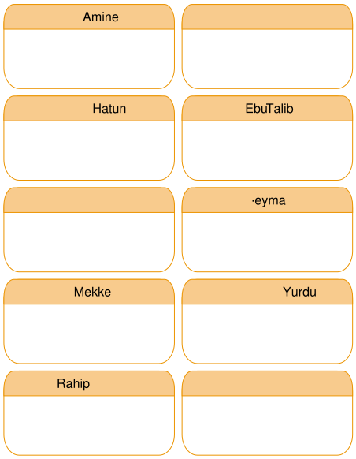
<!-- yer tutucu bulunamadı: sayfa sonuna eklendi -->

<!-- sayfa 32 -->

# Performans Görevi

| | |
| :--- | :--- |
| **Görev** | Hz. Peygamber’in çocukluk yıllarıyla ilgili tarih şeridi hazırlama |
| **Amaç** | Hz. Peygamber’in çocukluk yıllarındaki önemli olayları öğrenme ve sıralayabilme |
| **Süre** | Hazırlık: 1 hafta / Sınıf İçi: 1 ders saati |
| **Ürün** | Tarih şeridi |
| **Değerlendirme Ölçütleri** | Bilgi toplama, ilişki kurma |

**Yönerge:** Aşağıdaki uygulama adımlarını takip ederek görevi tamamlayınız.

1. Peygamberimizin doğumu ve çocukluk yılları hakkında öğretmen rehberliğinde güvenilir kaynaklardan (Diyanet İşleri Başkanlığı tarafından yayımlanan kitaplar, edu.tr, gov.tr uzantılı genel ağ kaynakları) bilgi toplayınız.
2. Edindiğiniz bilgilerden faydalanarak bir tarih şeridi oluşturunuz.
3. Tarih şeridinde yer alan olayları özetleyiniz.
4. Hazırladığınız tarih şeridinin sunumunu sınıfta yapınız.

**Not:** Tarih şeridini öğretmen rehberliğinde sınıfta veya okulda sergileyebilirsiniz.

**Değerlendirme:** Yapılan çalışma, yanda karekodla verilen Dereceli Puanlama Anahtarı’yla değerlendirilecektir. 

---

## Farklı Kaydet 

Bu ünitede öğrendiğiniz bilgileri aşağıdaki alana kısaca not edebilirsiniz.

<!-- sayfa 33 -->

# PEYGAMBERİMİZİN

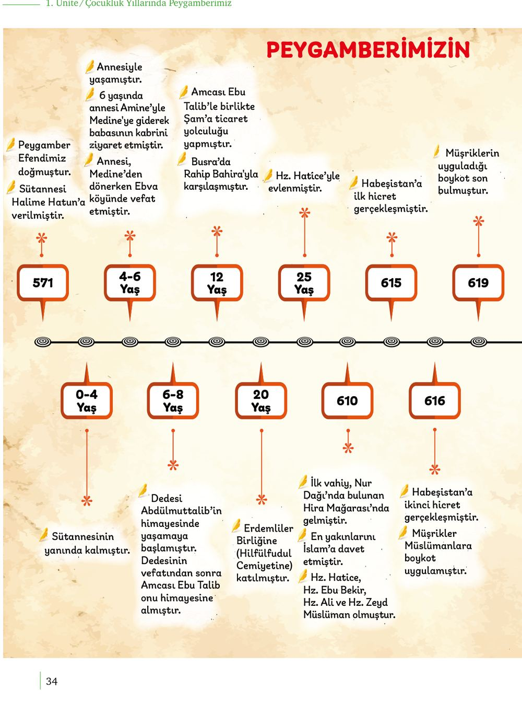

571

Peygamber Efendimiz doğmuştur.

Sütannesi Halime Hatun’a verilmiştir.

0-4 Yaş

Sütannesinin yanında kalmıştır.

4-6 Yaş

Annesiyle yaşamıştır.

6 yaşında annesi Amine’yle Medine'ye giderek babasının kabrini ziyaret etmiştir.

Annesi, Medine’den dönerken Ebva köyünde vefat etmiştir.

6-8 Yaş

Dedesi Abdülmuttalib’in himayesinde yaşamaya başlamıştır.

Dedesinin vefatından sonra Amcası Ebu Talib onu himayesine almıştır.

12 Yaş

Amcası Ebu Talib’le birlikte Şam’a ticaret yolculuğu yapmıştır.

Busra’da Rahip Bahira'yla karşılaşmıştır.

20 Yaş

Erdemliler Birliğine (Hilfülfudul Cemiyetine) katılmıştır.

25 Yaş

Hz. Hatice’yle evlenmiştir.

610

İlk vahiy, Nur Dağı’nda bulunan Hira Mağarası’nda gelmiştir.

En yakınlarını İslam’a davet etmiştir.

Hz. Hatice, Hz. Ebu Bekir, Hz. Ali ve Hz. Zeyd Müslüman olmuştur.

615

Habeşistan’a ilk hicret gerçekleşmiştir.

616

Habeşistan’a ikinci hicret gerçekleşmiştir.

Müşrikler Müslümanlara boykot uygulamıştır.

619

Müşriklerin uyguladığı boykot son bulmuştur.

<!-- sayfa 34 -->

# HAYATI

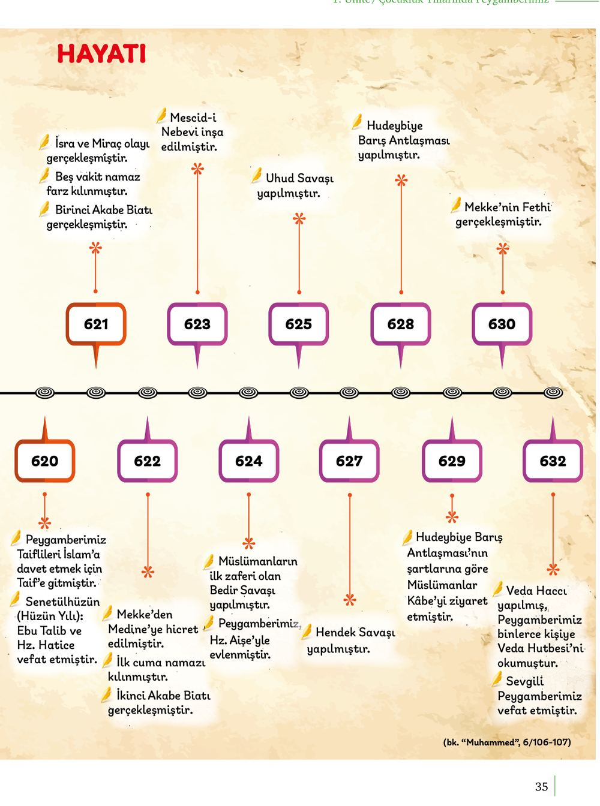

* İsra ve Miraç olayı gerçekleşmiştir.
* Beş vakit namaz farz kılınmıştır.
* Birinci Akabe Biatı gerçekleşmiştir.

**621**

---

* Mescid-i Nebevi inşa edilmiştir.

**623**

---

* Uhud Savaşı yapılmıştır.

**625**

---

* Hudeybiye Barış Antlaşması yapılmıştır.

**628**

---

* Mekke’nin Fethi gerçekleşmiştir.

**630**

---

* Peygamberimiz Taiflileri İslam’a davet etmek için Taif’e gitmiştir.
* Senetülhüzün (Hüzün Yılı): Ebu Talib ve Hz. Hatice vefat etmiştir.

**620**

---

* Mekke’den Medine’ye hicret edilmiştir.
* İlk cuma namazı kılınmıştır.
* İkinci Akabe Biatı gerçekleşmiştir.

**622**

---

* Müslümanların ilk zaferi olan Bedir Savaşı yapılmıştır.
* Peygamberimiz, Hz. Aişe’yle evlenmiştir.

**624**

---

* Hendek Savaşı yapılmıştır.

**627**

---

* Hudeybiye Barış Antlaşması’nın şartlarına göre Müslümanlar Kâbe’yi ziyaret etmiştir.

**629**

---

* Veda Haccı yapılmış, Peygamberimiz binlerce kişiye Veda Hutbesi’ni okumuştur.
* Sevgili Peygamberimiz vefat etmiştir.

**632**

(bk. “Muhammed”, 6/106-107)

<!-- sayfa 35 -->

# Ölçme ve Değerlendirme Soruları

Aşağıdaki cümlelerin doğruluğu (D) veya yanlışlığına (Y) göre okları takip ediniz ve ulaştığınız çıkışı işaretleyiniz.

1.

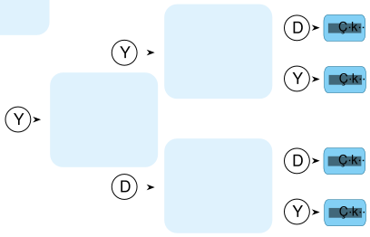
Fil Vakası Peygamber Efendimiz doğmadan kısa bir süre önce gerçekleşmiştir.
$\rightarrow$ D $\rightarrow$ Peygamber Efendimiz’e Muhammed ismini babası vermiştir.
$\rightarrow$ Y $\rightarrow$ Hz. Peygamber 571’de Mekke’de doğmuştur.
$\rightarrow$ D $\rightarrow$ 1. Çıkış
$\rightarrow$ Y $\rightarrow$ 2. Çıkış

$\rightarrow$ D $\rightarrow$ Hz. Muhammed’in (sav) Sadoğulları yurdunda Halime Hatun emzirmiştir.
$\rightarrow$ D $\rightarrow$ 3. Çıkış
$\rightarrow$ Y $\rightarrow$ 4. Çıkış

$\rightarrow$ Y $\rightarrow$ Hz. Muhammed (sav) dört yaşındayken annesi vefat etmiştir.
$\rightarrow$ Y $\rightarrow$ 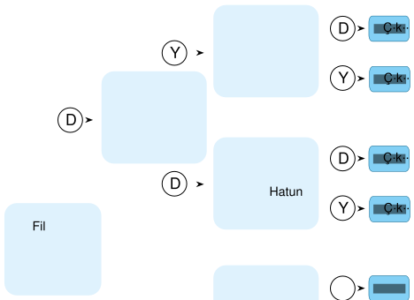 Peygamber Efendimiz’in bakımını annesinin vefatından sonra dedesi üstlenmiştir.
$\rightarrow$ D $\rightarrow$ 5. Çıkış
$\rightarrow$ Y $\rightarrow$ 6. Çıkış

$\rightarrow$ Y $\rightarrow$ Peygamber Efendimiz çocukluğunda çevresine karşı çekingen bir tavır sergilemiştir.
$\rightarrow$ D $\rightarrow$ 7. Çıkış
$\rightarrow$ Y $\rightarrow$ 8. Çıkış

<!-- yer tutucu bulunamadı: sayfa sonuna eklendi -->

<!-- sayfa 36 -->

Aşağıdaki cümlelerde noktalı yerleri uygun sözcüklerle tamamlayınız.

| çobanlık | Mekke | Şam |
| :--- | :--- | :--- |
| | Ebu Talib | San'a | Yesrib |

2. Hz. Muhammed (sav), amcasına destek olmak için ................................ yapmıştır.

3. Peygamberimiz annesiyle birlikte eski ismi ................................ olan Medine şehrine gitmiştir.

4. Dedesinin vefatından sonra Peygamberimize amcası ................................ bakmıştır.

5. Peygamberimiz ilk ticaret yolculuğunu ................................ şehrine yapmıştır.

6. Ebrehe ................................ şehrine insanları çekebilmek için kilise inşa etmiştir.

Aşağıdaki tabloda “Akrabalık Derecesi” sütununda sorular, “İsimler” sütununda Peygamberimizin yakınlarının isimleri verilmiştir. Soruları, cevabı olan isimlerle eşleştirerek “isimlere ait harfi” noktalı yerlere yazınız.

| Akrabalık Derecesi | | İsimler |
| :--- | :--- | :--- |
| 7. Babasının adı nedir? | ........ | a Abdullah |
| 8. Annesinin adı nedir? | ........ | b Abdülmuttalib |
| 9. Dedesinin adı nedir? | ........ | c Ebu Talib |
| 10. Sütannesinin adı nedir? | ........ | ç Halime Hatun |
| 11. Süt kardeşinin adı nedir? | ........ | d Amine |
| | | e Şeyma |

<!-- yer tutucu bulunamadı: sayfa sonuna eklendi -->

<!-- yer tutucu bulunamadı: sayfa sonuna eklendi -->

<!-- yer tutucu bulunamadı: sayfa sonuna eklendi -->

<!-- sayfa 37 -->

Aşağıdaki soruları kutucuklarda yer alan kelime ve kelime gruplarından yararlanarak cevaplayınız. Soruları kutucuklardaki harfleri kullanarak cevaplayınız (Aynı harfi birden fazla soru için kullanabilirsiniz).

| | | |
| :---: | :---: | :---: |
| **a** Ebu Talib | **b** Fil Yılı | **c** Fatıma |
| **ç** Haris bin Abdüluzza | **d** Çobanlık | **e** Ümmü Eymen |
| **f** Busra | **g** Ebrehe | **ğ** Süveybe |
| **h** Ebva köyü | **ı** Üneyse | **i** Abdülmuttalib |

12. Peygamberimizin annesinin vefat ettiği yer neresidir?
..........................................................................................................................................

13. Peygamberimizi süt anneye verilmeden önce kısa bir süre emziren kimdir?
..........................................................................................................................................

14. Fil Vakası olarak adlandırılan olayda Kâbe’ye saldıran ordunun komutanı kimdir?
..........................................................................................................................................

15. Annesinin vefatından sonra Peygamber Efendimiz’i dedesine götüren kişi kimdir?
..........................................................................................................................................

16. Peygamberimize sütannelik yapan Halime Hatun’un eşi kimdir?
..........................................................................................................................................

17. Fil Vakası yaşandığı zaman Kureyş kabilesinin ve Mekke’nin lideri kimdi?
..........................................................................................................................................

18. Sevgili Peygamberimizin “Annemden sonraki annem.” dediği kişi kimdir?
..........................................................................................................................................

19. Şam yolculuğu sırasında Peygamber Efendimiz nerede konaklamıştır?
..........................................................................................................................................

20. Fil Vakası’nın gerçekleştiği yıl, İslam tarihinde hangi isimle anılmaktadır?
..........................................................................................................................................

21. Peygamber Efendimiz çocukluk yıllarında ailesine destek olmak için hangi işle uğraşmıştır?
..........................................................................................................................................

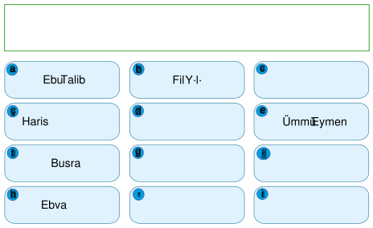
<!-- yer tutucu bulunamadı: sayfa sonuna eklendi -->

<!-- sayfa 38 -->

22-24. soruları aşağıdaki metinden hareketle cevaplayınız.

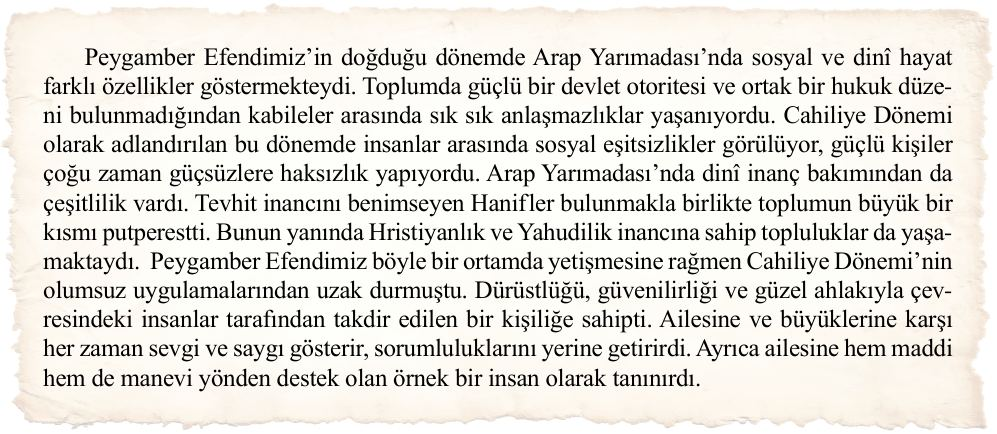

Peygamber Efendimiz’in doğduğu dönemde Arap Yarımadası’nda sosyal ve dinî hayat farklı özellikler göstermekteydi. Toplumda güçlü bir devlet otoritesi ve ortak bir hukuk düzeni bulunmadığından kabileler arasında sık sık anlaşmazlıklar yaşanıyordu. Cahiliye Dönemi olarak adlandırılan bu dönemde insanlar arasında sosyal eşitsizlikler görülüyor, güçlü kişiler çoğu zaman güçsüzlere haksızlık yapıyordu. Arap Yarımadası’nda dinî inanç bakımından da çeşitlilik vardı. Tevhit inancını benimseyen Hanifler bulunmakla birlikte toplumun büyük bir kısmı putperestti. Bunun yanında Hristiyanlık ve Yahudilik inancına sahip topluluklar da yaşamaktaydı. Peygamber Efendimiz böyle bir ortamda yetişmesine rağmen Cahiliye Dönemi’nin olumsuz uygulamalarından uzak durmuştu. Dürüstlüğü, güvenilirliği ve güzel ahlakıyla çevresindeki insanlar tarafından takdir edilen bir kişiliğe sahipti. Ailesine ve büyüklerine karşı her zaman sevgi ve saygı gösterir, sorumluluklarını yerine getirirdi. Ayrıca ailesine hem maddi hem de manevi yönden destek olan örnek bir insan olarak tanınırdı.

**22. Cahiliye Dönemi’nin topluma olan etkisini yazınız.**
.......................................................................................................................................
.......................................................................................................................................
.......................................................................................................................................
.......................................................................................................................................
.......................................................................................................................................

**23. Arap Yarımadası’nın sosyal ve dinî yapısının özelliklerini yazınız.**
.......................................................................................................................................
................................................................................................

<!-- yer tutucu bulunamadı: sayfa sonuna eklendi -->

<!-- sayfa 39 -->

# Aşağıdaki çoktan seçmeli soruları okuyarak doğru seçeneği işaretleyiniz.

**25.** Peygamber Efendimiz doğmadan önce ................................ Vakası gerçekleşmiştir. Yemen Valisi ............................., ordusuyla Kâbe’ye saldırmıştır. Peygamberimizin dedesi ............................. Kâbe’yi Allah’ın (cc) koruyacağını ifade etmiştir. Kâbe’ye yapılan saldırı sonucunda Yemen Valisi başarılı olamamıştır. Bu olay Kur’an-ı Kerim’de anlatılmıştır.

**Bu metinde boş bırakılan yerlere aşağıdakilerin hangisinde verilen sözcükler sırasıyla getirilmelidir?**

A) Fil-Abdülmuttalib-Ebrehe
B) Fil-Ebrehe-Abdülmuttalib
C) Ebrehe-Abdülmuttalib-Fil
D) Ebrehe-Fil-Abdülmuttalib

**26.** I. Cahiliye Dönemi’nin alışkanlıklarından her zaman uzak durmuştur.
II. Davranışlarıyla çevresindeki insanlara örnek olmuştur.
III. Ailesine maddi ve manevi anlamda her zaman destek olmuştur.
IV. Hayatının her döneminde çevresindekilere vefalı davranmıştır.

**Numaralanmış bilgilerden hangileri Peygamberimiz ile ilgilidir?**

A) I ve II
B) I ve III
C) III ve IV
D) I, II, III ve IV

**27.** Hz. Muhammed (sav) dört yaşındayken sütannesi Halime Hatun, onu annesi Hz. Amine’nin yanına getirmiştir. Peygamber Efendimiz bu yaştan sonra annesi Hz. Amine’yle yaşamaya başlamıştır. O, altı yaşındayken annesi ve dadısıyla birlikte yolculuğa çıkmıştır. Bu yolculukta Medine’deki akrabalarını ve babasının kabrini ziyaret etmiştir. Medine’den dönerken yolda annesi hastalanarak vefat etmiştir. Babası, kendisi doğmadan vefat eden Peygamberimiz annesini altı yaşındayken kaybetmiştir.

**Bu metinden Hz. Muhammed (sav) ile ilgili aşağıdakilerden hangisine ulaşılamaz?**

A) Dört yaşındayken sütannesinden ayrıldığına
B) Annesiyle akraba ziyareti yaptığına
C) Hz. Amine’nin, Medine’den dönünce vefat ettiğine
D) Anne ve babasını küçük yaşta kaybettiğine

Üniteyle ilgili daha fazla soruya yandaki karekod üzerinden ulaşabilirsiniz.

<!-- yer tutucu bulunamadı: sayfa sonuna eklendi -->

<!-- sayfa 40 -->

# Sonnot

¹ bk. Yücel, *Peygamberimizin Hayatı*, 17.
² bk. Fayda, “Fil Vakası”, 13/70.
³ bk. Yücel, *Peygamberimizin Hayatı*, 17.
⁴ bk. Karaman vd., *Kur’an Yolu*, 5/688.
⁵ bk. Karaman vd., *Kur’an Yolu*, 5/690.
⁶ bk. Serinsu vd., “cahiliyye”, 44.
⁷ bk. Sarıçam, *Hz. Muhammed ve Evrensel Mesajı*, 35-40.
⁸ bk. Karaman vd., *Kur’an Yolu*, 3/91.
⁹ Berki – Keskioğlu, *Hâtemü’l-Enbiyâ Hazreti Muhammed ve Hayâtı*, 20.
¹⁰ Küçükaşcı, “Zemzem”, 44/242-243.
¹¹ Hamidullah, *İslâm Peygamberi*, 1/39.
¹² bk. Hamidullah, *İslâm Peygamberi*, 1/41.
¹³ bk. Sarıçam, *Hz. Muhammed ve Evrensel Mesajı*, 62.
¹⁴ bk. Sarıçam, *Hz. Muhammed ve Evrensel Mesajı*, 64-66.
¹⁵ bk. Buhari, “İcare”, 2.
¹⁶ Yücel, *Peygamberimizin Hayatı*, 31.
¹⁷ bk. Fığlalı, “Ebû Tâlib”, 10/237.
¹⁸ İsra suresi 23. ayet.
¹⁹ Kalem suresi 4. ayet.

<!-- sayfa 41 -->

# 2. ÜNİTE
# Peygamberimizin Çevresindeki Çocuklar

2.1. Peygamberimizin Çocuklarla İletişimi
2.2. Çocukların Dünyasında Peygamberimiz
2.3. Peygamberimizin Yanında Yetişen Çocuklar

► Anahtar Kavramlar
* Asrısaadet
* şefkat
* yetim
* merhamet
* tevazu

**Bu ünitede sizlerden**

* Peygamberimizin çocuklarla iletişimini sentezleyebilmeniz,
* Asrısaadet’teki çocukların Peygamberimize olan sevgisini çözümleyebilmeniz,
* Peygamberimizin rehberliğinin yanında yetişen çocuklar üzerindeki etkisini idrak edebilmeniz

**beklenmektedir.**

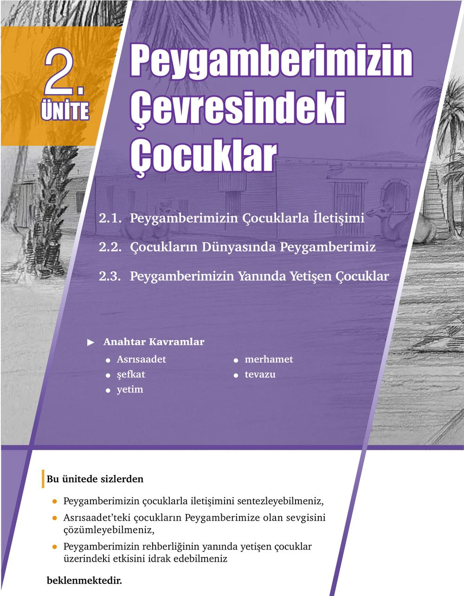
<!-- yer tutucu bulunamadı: sayfa sonuna eklendi -->

<!-- sayfa 42 -->

![Ünite Dosyası QR Kodu]
Ünite Dosyası

![Ünite Sunusu QR Kodu]
Ünite Sunusu

# Başlarken 🔗

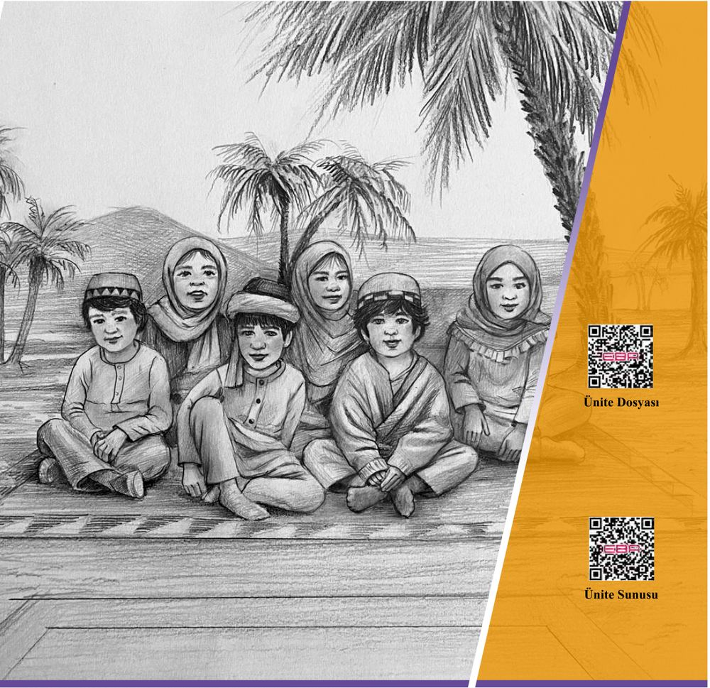

Âlemlere rahmet olarak gönderilen Peygamberimiz, insanlar arasında ahlakı en güzel olan kişiydi. O, insanlara güzel sözler söyler, akrabalarına yardım eder, kimsesizleri korurdu. Çocukları çok sever, onlarla oyunlar oynardı. Bir çocuk gördüğü zaman neşelenir, onun yanına uğrar, selam vererek ona ilgi gösterirdi. Çocuklar da Hz. Peygamber’i çok severdi. Bazen mescitte Peygamberimizle namaz kılar, onun sohbetine katılırlardı. Hz. Muhammed’e (sav) yakın olmak çocukları mutlu ederdi.

1. Çocuklar Peygamberimizi hangi özelliklerinden dolayı sevmiş olabilir?
2. Peygamberimizin davranışlarından hangilerini örnek alıyorsunuz?

<!-- sayfa 43 -->

# 2.1. PEYGAMBERİMİZİN ÇOCUKLARLA İLETİŞİMİ

**Konuya Başlarken** 📖

Hz. Muhammed (sav) çevresindeki çocuklarla ilgilenir, her fırsatta onlara sevgi gösterirdi, merhametliydi. Onun çocuklarla sevgi, şefkat ve merhamet temelinde kurduğu iletişim çocuklardan da karşılık görürdü. Peygamberimizin çocuklarla iletişim kurarken takındığı tavır Müslümanlar için önemli bir örnektir.

1. Yetişkin insanlar çocuklarla iletişimde nelere dikkat etmelidir? Düşüncelerinizi söyleyiniz.
2. Peygamberimizin çocuklarla iletişimi hakkında merak ettikleriniz nelerdir?

Şefkat, merhamet, güven gibi bazı duygular insanlar arası iletişimi olumlu yönde etkiler. Bu duygular insanlar arasındaki sevgiyi artırır, insanları birbirine yakınlaştırır. İnsan sevdiği, güvendiği, kendisine yakın hissettiği kişilerle bir arada olmak ister. Peygamberimizin çocuklarla kurduğu iletişimde bu duygu ve değerlerin önemli bir yeri vardır.

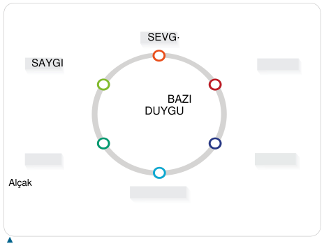

**SEVGİ**
İnsanı bir şeye veya bir kimseye karşı yakın ilgi ve bağlılık göstermeye yönelten duygu; muhabbet.

**SAYGI**
Bir kimseye, bir şeye karşı dikkatli, özenli, ölçülü davranmaya sebep olan sevgi duygusu; hürmet.

**ŞEFKAT**
Koruma ve esirgeme duygusuyla karışık olan sevgi, sevecenlik.

**ADALET**
Hak ve hukuka uygun davranma, hakkı gözetme, herkese kendi hakkı olanı verme.

**MERHAMET**
Bir insanı başka insanlar ve diğer canlıların sıkıntıları karşısında duyarlı olmaya ve yardım etmeye sevk eden acıma duygusu.

**TEVAZU**
Alçak gönüllülük, alçak gönüllü olma durumu.

**İLETİŞİMDE ETKİLİ BAZI DUYGU VE DEĞERLER¹**

<!-- sayfa 44 -->

Peygamberimiz çocuklara karşı her zaman merhametliydi. Çocuklarla oyunlar oynar, onlara şefkatle yaklaşırdı. Kendi sohbet meclisinde çocukların da bulunmasına izin verir,$^2$ <!-- KONTROL: Marker'da karşılığı yok, uydurma olabilir --> kimi zaman onlara mescidinde bir saf oluşturacak kadar yer ayırırdı.$^3$ <!-- KONTROL: Marker'da karşılığı yok, uydurma olabilir --> Yolculuktan döndüğünde kendisini karşılayanlar arasında bulunan çocuklara ilgi gösterir, onlardan bazılarını bineğine alır, şehre çocuklarla beraber girerdi.$^4$ <!-- KONTROL: Marker'da karşılığı yok, uydurma olabilir -->

Peygamberimiz tevazu sahibi bir insandı. O kibirlenmez, başkalarını küçük görmezdi. Çocuklara karşı merhametliydi. Bir hadisinde şöyle buyurdu: “Rahman, merhametlilere merhamet eder. Siz yeryüzündekilere merhamet edin ki gökyüzündekiler de size merhamet etsin.”$^5$ <!-- KONTROL: Marker'da karşılığı yok, uydurma olabilir --> Peygamberimiz zaman zaman çocuklara nasihatte bulunurdu. Bir gün bineğinin arkasında yolculuk eden Abdullah bin Abbas’a (ra) “... Bir şey isteyeceğinde Allah’tan iste. Yardım dileyeceğinde Allah’tan yardım dile!..”$^6$ <!-- KONTROL: Marker'da karşılığı yok, uydurma olabilir --> öğüdünü vermişti.

Çocuklar Peygamberimiz için neşe kaynağıydı. Peygamberimize yakın olmak onları mutlu ederdi. Bu nedenle çocuklar onun mescidini ve mescidin çevresini toplanma yeri olarak belirlemişlerdi.

Peygamberimizin yaşamı çocuklarla kurduğu güzel iletişim örnekleriyle doluydu. Bu örnekler sadece onun evine yakın olanlarla sınırlı değildi. Görüştüğü her çocuk onun bu ilgisinden etkilenir, ondan birçok şey öğrenirdi.

Peygamberimiz çocuklara karşı anlayışlıydı. Hurma düşürmek için ağaca taş atarken yakalanan Rafi isimli bir çocuk ona getirilmişti. Peygamberimiz çocuğu cezalandırma yoluna gitmemiş, ona tatlı bir dille bu davranışının sebebini sormuştu. “Yemek için!” cevabını alınca “Hurmaları taşlama da altına düşenlerden ye!” diyerek ona nasihatte bulunmuştu$^7$ <!-- KONTROL: Marker'da karşılığı yok, uydurma olabilir --> (Görsel 2.1). Peygamberimizin sevgi dolu yaklaşımı çocuğu mutlu etmiş, onun yanlış davranışını fark etmesini sağlamıştı. Çocuk bir daha buna benzer bir hatayı tekrarlamamıştı.

Peygamberimiz bir gün Numan (ra) isimli bir çocuğa, annesine götürmesi için bir salkım üzüm vermişti. Çocuk eve giderken üzümün tamamını yemişti. Daha sonra Peygamberimiz Numan’ı (ra) gördüğünde ona “Üzümü annene ulaştırdın mı?” diye sormuştu. Numan (ra) “Hayır!” cevabını verince ona anlayışla davranmış, annesine karşı vefalı olması gerektiğini hatırlatmıştı.$^8$ <!-- KONTROL: Marker'da karşılığı yok, uydurma olabilir -->

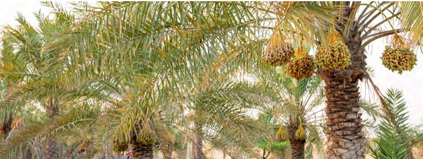

| tevazu |
| :--- |
| İnsanın, kendisinin de yaratılmış olduğunu bilerek insanlara karşı büyüklük taslamaması, alçak gönüllü ve yumuşak huylu olması.    (Serinsu vd., “tevazu”, 364) |

> Çocuklar Peygamberimizin mescidini neden toplanma yeri olarak belirlemiş olabilir?

**Görsel 2.1**
Peygamberimiz ağaçlara zarar verilmemesini istemiştir...

<!-- sayfa 45 -->

# Okuyalım

Aşağıdaki metni okuyunuz. Soruları metinden hareketle cevaplayınız.

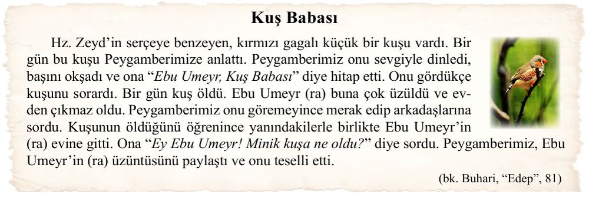

## Kuş Babası

Hz. Zeyd’in serçeye benzeyen, kırmızı gagalı küçük bir kuş u vardı. Bir gün bu kuşu Peygamberimize anlattı. Peygamberimiz onu sevgiyle dinledi, başını okşadı ve ona “Ebu Umeyr, Kuş Babası” diye hitap etti. Onu gördükçe kuşunu sorardı. Bir gün kuş öldü. Ebu Umeyr (ra) buna çok üzüldü ve evden çıkmaz oldu. Peygamberimiz onu göremeyince merak edip arkadaşlarına sordu. Kuşunun öldüğünü öğrenince yanındakilerle birlikte Ebu Umeyr’in (ra) evine gitti. Ona “Ey Ebu Umeyr! Minik kuşa ne oldu?” diye sordu. Peygamberimiz, Ebu Umeyr’in (ra) üzüntüsünü paylaştı ve onu teselli etti.

(bk. Buhari, “Edep”, 81)

1. Peygamberimizin Hz. Zeyd’i teselli etmek için onun evine gitmesi hakkında ne düşünüyorsunuz?
2. Peygamberimizin bu davranışını düşünerek arkadaşlarınıza nasıl davranmanız gerektiğini açıklayınız.
3. Peygamberimizin Ebu Umeyr’e (ra) karşı davranışında hangi değerler öne çıkmaktadır?
4. Arkadaşınız üzgün olduğunda nasıl davranırsınız? Söyleyiniz.

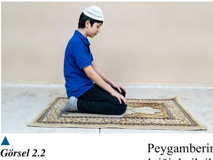

**Görsel 2.2**
Peygamberimiz çocuklara namazın öğretilmesini emretmiştir.

Peygamber Efendimiz çocukların ihtiyaçlarını gözetir, ahlaki gelişimlerini her fırsatta desteklerdi. Huzuruna getirilen çocuklara seviyelerine göre kelimeitevhidi ve bazı kısa ayetleri öğretirdi. Anne ve babalara “Sağını solundan ayırabilen yaşa geldiği zaman çocuğa namaz kılmasını emredin.”⁹ buyurarak çocuklara namazı öğretmeleri gerektiğini söylerdi (Görsel 2.2).

Peygamberimiz, çocuklara toplum içerisinde nasıl davranılması gerektiğiyle ilgili tavsiyelerde bulunurdu. Sofra adabıyla ilgili olarak Ömer bin Seleme’ye (ra) yemeğini yerken besmele çekmesini, sağ eliyle önünden yemesini tavsiye etmişti.¹⁰ Namaz sırasında sağa sola bakan bir çocuğu ise “Yavrucuğum! Namazda yüzünü sağa sola çevirip bakma.”¹¹ diyerek uyarmıştı.

Peygamberimiz çocuklara günlük hayatta yapabilecekleri görevler verir, onların öz güvenlerinin pekişmesini sağlardı. Mekke’deyken Hz. Ali’ye, ev işlerine yardımcı olmak ve akrabaları yemeğe davet etmek gibi sorumluluklar vermişti. Medine’de hizmetinde bulunan Hz. Enes bin Malik’e de yapabileceği görevler vermiş, Mekke’de ezan okuma isteğinde bulunan Hz. Ebu Mahzure’nin bu isteğini kabul etmişti.¹² İbadetleri doğru ve güzel yapmaları konusunda çocukları teşvik etmişti. Çocuklar da Hz. Peygamber’in tavsiyelerine uymuş ve bunları yaşamışlardır.

<!-- sayfa 46 -->

Peygamberimiz, Müslümanlardan çocuklarına güzel terbiye vermelerini, onlara karşı hoşgörülü olmalarını, sevgi, şefkat ve merhametle davranmalarını istemiştir. O, çocukların incinmesine razı olmamış, namaz kıldırırken ağlayan bir çocuk sesi işittiğinde namazı kısa tutmuştur. Merhamet ve saygı prensibini de şu hadisiyle ifade etmiştir:

# Bir Hadis
> “لَيْسَ مِنَّا مَنْ لَمْ يَرْحَمْ صَغِيرَنَا وَلَمْ يَعْرِفْ شَرَفَ كَبِيرِنَا”
>
> “Küçüğümüze merhamet etmeyen ve büyüğümüzün saygınlığını kabul etmeyen bizden değildir.”
>
> (Tirmizi, “Birr”, 15)

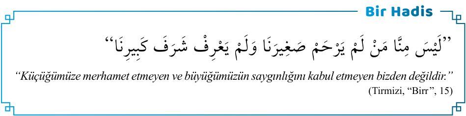

## Okuyalım

**Aşağıdaki metni okuyunuz. Soruları metinden hareketle cevaplayınız.**

### Küçük Müezzin

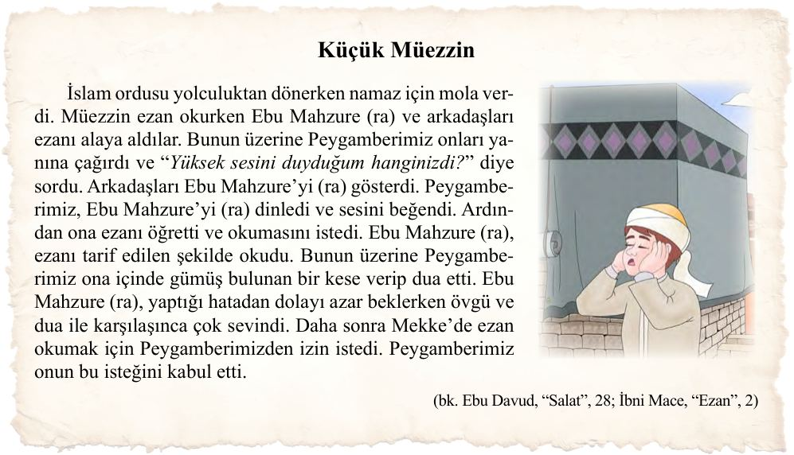

İslam ordusu yolculuktan dönerken namaz için mola verdi. Müezzin ezan okurken Ebu Mahzure (ra) ve arkadaşları ezanı alaya aldılar. Bunun üzerine Peygamberimiz onları yanına çağırdı ve “Yüksek sesini duyduğum hanginizdi?” diye sordu. Arkadaşları Ebu Mahzure’yi (ra) gösterdi. Peygamberimiz, Ebu Mahzure’yi (ra) dinledi ve sesini beğendi. Ardından ona ezanı öğretti ve okumasını istedi. Ebu Mahzure (ra), ezanı tarif edilen şekilde okudu. Bunun üzerine Peygamberimiz ona içinde gümüş bulunan bir kese verip dua etti. Ebu Mahzure (ra), yaptığı hatadan dolayı azar beklerken övgü ve dua ile karşılaşınca çok sevindi. Daha sonra Mekke’de ezan okumak için Peygamberimizden izin istedi. Peygamberimiz onun bu isteğini kabul etti.

(bk. Ebu Davud, “Salat”, 28; İbni Mace, “Ezan”, 2)

1. Peygamberimizin Ebu Mahzure’ye (ra) yaklaşımını çocukların yeteneklerine verdiği önem açısından değerlendiriniz.
2. Peygamberimizin çocukların ilgi ve yeteneklerine göre verdiği görevlerden bildiklerinizi anlatınız.
3. Üstlenilen bir görevi yerine getirmenin önemini açıklayınız.
4. Ebu Mahzure’nin (ra) yerinde siz olsaydınız neler hissederdiniz? Duygularınızı ifade ediniz.

<!-- sayfa 47 -->

Hz. Ümame’nin yerinde olsaydınız neler hissederdiniz? Duygularınızı arkadaşlarınızla paylaşınız.

Peygamber Efendimizin yaşadığı dönemde erkek çocuklarına daha fazla değer verilirdi. Buna rağmen Peygamberimiz, kız ve erkek çocukları arasında ayrım yapmazdı. Bir gün kendisine hediye edilen bir kolyeyi ev halkına gösterdikten sonra “Bunu içinizden bana en sevimli olana vereceğim.” demiş ve kolyeyi Hz. Zeyneb’in kızı Ümame’nin (ra) boynuna takmıştı.$^{13}$ <!-- KONTROL: Marker'da karşılığı yok, uydurma olabilir -->

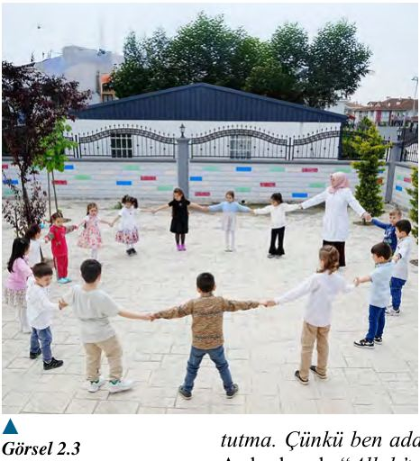

Peygamberimiz anne ve babalardan kız çocuklarına güzel davranmalarını isterdi. Bu konuda “Kim üç kız çocuğunun geçimini üstlenir, onları terbiye edip evlendirir ve onlara güzel davranırsa ona cennet vardır.”$^{14}$ <!-- KONTROL: Marker'da karşılığı yok, uydurma olabilir --> buyurmuştur. Müslümanlara kız ve erkek çocukları arasında ayrım yapmamalarını, onlara karşı adil olmalarını öğütlerdi (Görsel 2.3). Oğlu gelince kucağına alıp seven, kızı geldiğinde ise ilgisiz şekilde yanına oturtan adamı bu davranışı nedeniyle kınamıştı.$^{15}$ <!-- KONTROL: Marker'da karşılığı yok, uydurma olabilir -->

Sahabiden Beşir (ra) isimli biri oğlu Numan’a (ra) malının bir kısmını bağışlamış, kızına ise bir şey vermemişti. Daha sonra bu durumu Peygamber Efendimize sormuştu. Peygamberimiz de “Yaptığın bu işe beni şahit tutma. Çünkü ben adaletsizliğe şahit olmam.” diyerek onu uyarmıştı. Ardından da “Allah’tan korkunuz, çocuklarınız arasında adaletli olunuz.”$^{16}$ <!-- KONTROL: Marker'da karşılığı yok, uydurma olabilir --> diyerek tüm Müslümanlara uyarıda bulunmuştu.

Peygamberimizin çocukların arasına karışıp onlarla şakalaştığı ve oyun oynadığı olurdu. O, inancına bakmaksızın tüm çocuklara sevgisini gösterirdi. Örneğin Medine’de yaşayan Yahudi bir ailenin çocuğu hastalanınca onu ziyarete gitmiş, çocuğa İslam’ı anlatmış ve onu Müslüman olmaya davet etmişti.$^{17}$ <!-- KONTROL: Marker'da karşılığı yok, uydurma olabilir -->

Peygamberimiz, Yüce Allah’ın, maddi kaygılardan dolayı çocuklara zarar vermeyi yasakladığını anne ve babalara her zaman hatırlatırdı.$^{18}$ <!-- KONTROL: Marker'da karşılığı yok, uydurma olabilir --> “Allah’ım, ben iki zayıfın-yetimin ve kadının-hakkına el uzatılmasını yasaklıyorum.”$^{19}$ <!-- KONTROL: Marker'da karşılığı yok, uydurma olabilir --> buyurarak yetimlerin korunmasını isterdi. İşaret parmağıyla orta parmağının arasını hafifçe açıp ashabına göstererek “Ben ve yetime kol kanat geren kimse cennette böyle yan yana olacağız.”$^{20}$ <!-- KONTROL: Marker'da karşılığı yok, uydurma olabilir --> buyurmuştu.

Peygamberimiz çocukların mescide gelmelerine, yaşlılarla birlikte sohbet meclislerinde bulunmalarına izin verirdi. Bir gün arkadaşlarıyla sohbet ederken kendisine içecek ikram edildi. O, içecekten arkadaşlarına da vermek istedi. Sağ tarafında oturan küçük çocuğa dönerek “Bu içeceği ikrama yaşlılardan başlamama izin verir misin?” diye sordu. Çocuk da “Ya Resulullah! Senden gelen nasibim için kimseyi kendime tercih etmem.” cevabını verdi. Bunun üzerine Peygamberimiz, ikrama...

Görsel 2.3
Peygamberimiz çocuklara güzel davranılmasını istemiştir.

<!-- sayfa 48 -->

# 1. Etkinlik

| | | |
| :--- | :--- | :--- |
| **Adı** | Peygamberimizin Çocuklarla İletişimi | |
| **Amaç** | Peygamberimizin çocuklarla kurduğu iletişimi sentezleyebilme | |

**Yönerge:** Aşağıdaki uygulama adımlarını takip ederek etkinliği gerçekleştiriniz.

1. Üye sayısı eşit gruplar oluşturunuz ve her grup için bir sözcü seçiniz.
2. Verilen metni okuyunuz.

> ### Peygamberimiz ve Çocuklar
> Hz. Abdullah, Peygamberimizin amcasının oğlu ve eşinin de yeğeniydi. Teyzesinin evinde kaldığı bir gece Peygamberimizin abdest alışını izledi. Peygamberimiz abdest alırken suyu azar azar kullanıyordu. Hz. Abdullah da Peygamberimizin ardından onun aldığı gibi abdest aldı. Peygamberimiz namaz kılarken bazen çocuklar önünden geçer hatta dizlerine dokunurlardı. O ise namazını bozmadan devam ederdi. Kendisine mevsimin ilk meyvesi sunulunca bereket duası yapar ve onu orada bulunan en küçük çocuğa ikram ederdi.
>
> (bk. İbni Mace, “Taharet”, 48; Nesai, “Kıble”, 7; Buhari, “Ezan”, 65)

3. Peygamberimizin çocuklarla kurduğu iletişime dair bilgileri öğretmen rehberliğinde güvenilir kaynaklardan (https://hadislerleislam.diyanet.gov.tr/, Diyanet İşleri Başkanlığı Yayınları vb.) araştırınız.
4. Aşağıdaki konulardan birini seçerek Peygamberimizin çocuklarla kurduğu iletişimi örneklerle açıklayınız.
    * Çocuklara sevgi, şefkat ve merhamet göstermek
    * Örnek olmak ve değer vermek
    * Yaşlarına uygun görev ve sorumluluk vermek
    * İletişimde yapıcı, adaletli ve tutarlı olmak
5. Seçtiğiniz konuyla ilgili hazırladığınız örnekleri grup sözcüsü aracılığıyla sınıfla paylaşınız ve bu örneklerin günlük hayatınıza nasıl yansıyabileceği üzerine arkadaşlarınızla konuşunuz. 
6. Sınıftaki paylaşımlardan ve öğrendiklerinizden yola çıkarak aşağıdaki cümleleri kendi ifadelerinizle tamamlayınız.

Üstlendiğim görevleri yerine getiririm çünkü ________________________________________________________________________________________________________________________________________________________________________________________________________________________________________________________________________________________________

Akranlarımla ve kendimden küçük çocuklarla iletişim kurarken yapıcı, adaletli ve öngörülebilir olurum çünkü ________________________________________________________________________________________________________________________________________________________________________________________________________________________________________________________________________________________________

**Değerlendirme:** Yandaki karekodu kullanarak Grup Değerlendirme Formu’nu doldurunuz.

<!-- sayfa 49 -->

# Yazalım

Peygamberimizin çocuklarla kurduğu iletişimi günümüze nasıl yansıtabileceğimizi konu alan bir hikâye yazınız. Hikâyeler yandaki karekodda verilen dereceleme ölçeğiyle değerlendirilecektir.

## Kontrol Noktası

**Aşağıdaki soruların cevaplarını boş bırakılan alanlara yazınız.**

1. Peygamberimizin çocuklara sevgi, şefkat ve merhametini gösteren bir örnek yazınız.
__________________________________________________________________________
__________________________________________________________________________

2. Peygamberimizin güven kazandıran davranışlarından bir tanesini anlatınız.
__________________________________________________________________________
__________________________________________________________________________

3. Peygamberimizin çocuklara müsamahasını gösteren bir örnek veriniz.
__________________________________________________________________________
__________________________________________________________________________

<!-- sayfa 50 -->

# 2.2. ÇOCUKLARIN DÜNYASINDA PEYGAMBERİMİZ

**Konuya Başlarken** 

Peygamberimiz her fırsatta çocuklarla ilgilenir, onlara sevgisini gösterirdi. Hz. Üsame bin Zeyd, Peygamberimizle yaşadığı bir anısını şöyle anlatırdı:

“Resulullah beni alır, bir dizine oturtur, torunu Hasan bin Ali’yi de öbür dizine oturturdu. Sonra bizi bağrına basıp şöyle derdi: *Allah’ım, bu ikisine merhamet et! Ben de onlara merhamet ediyorum!*”

(Buhari, “Edep”, 22)

1. Değer verdiğiniz birine sevginizi nasıl gösterirsiniz?
2. Çocuk sahabilerin Peygamberimizle iletişimi hakkında bildikleriniz nelerdir?
3. Çocukların Peygamberimizle kurduğu iletişimde merak ettikleriniz nelerdir?
4. Aşağıdaki hadisi okuyunuz.

> Hz. Hüseyin anlatıyor:
> — Babam Hz. Ali’ye Allah Resulü’nün dost ve arkadaşlarıyla ilişkilerini sordum.
> O da şöyle cevap verdi:
> — Allah Resulü her zaman güler yüzlü, yumuşak huylu ve nazikti. Asla kötü huylu, katı kalpli, bağırıp çağıran, çirkin sözlü, kusur bulan ve cimri bir kimse değildi. Hoşlanmadığı şeylerden yüz çevirir, kendisinden beklentisi olan kimseleri hayal kırıklığına uğratmaz ve onların isteklerini boşa çıkarmazdı...
> (Tirmizi, “Şemail”, 160)

5. Hz. Ali’nin Peygamberimizi anlatırken söyledikleriyle ona duyduğu sevgi arasında nasıl bir ilişki vardır? Düşüncelerinizi ifade ediniz.
6. Aşağıdaki cümleyi tamamlayınız.

Peygamberimizi seviyorum çünkü __________________________________________________________________
_________________________________________________________________________________________________
_________________________________________________________________________________________________

<!-- sayfa 51 -->

Peygamberimize sevgimizi ifade etmek için ismini işittiğimizde salavat getiririz. “aleyhi’s-salatü ve’s-selam” veya “sallallahü aleyhi ve sellem” deriz. (bk. Sertoğlu, “Salâtüselâm”, 36/23-24)

Hz. Muhammed’in (sav) peygamberlik görevini yaptığı ve varlığıyla şereflendirdiği devre Asrısaadet (Mutluluk Asrı) denir. Bu devirde Kur’an-ı Kerim indirilmiş, bütün insanlığa rahmet ve örnek olarak gönderilen Hz. Muhammed (sav) sahabilerini yetiştirmiş ve İslam en güzel bir şekilde yaşanmıştır.$^{22}$ <!-- KONTROL: Marker'da karşılığı yok, uydurma olabilir --> Asrısaadet’te yaşayan çocuklar Peygamberimizi çok severlerdi. Ona yakın olabilmek için çaba gösterirler, onun mescidini ve mescidin çevresini çocuk sesleriyle doldururlardı. Sevgilerinin bir göstergesi olarak Peygamberimize “Anam babam sana feda olsun, ya Resulullah!” derlerdi.

Peygamberimiz, özellikle yetim ve korunmaya muhtaç olan çocuklarla yakından ilgilenirdi. Yetim, babası vefat etmiş, hayata babasız devam eden çocuk demektir.$^{23}$ <!-- KONTROL: Marker'da karşılığı yok, uydurma olabilir --> Kendisi de bir yetim olarak büyüyen Peygamberimiz, bu durumdaki çocuklardan şefkat ve merhametini hiç eksik etmezdi. Onun yetimlere gösterdiği merhametin en güzel örneklerinden biri de Beşir (ra) adlı çocukla yaşadığı olaydır.

Beşir’in (ra) babası Uhud’da şehit olmuştu. Allah Resulü onu ağlarken görünce yanına geldi ve “Ağlama!” diyerek teselli etti. Daha sonra ona “Ben senin baban olayım. Eşim Aişe de senin annen olsun, istemez misin?” diye sordu. Beşir düşünmeden “Evet, çok isterim.” dedi. Allah Resulü, sevgi ve merhametle Beşir’in (ra) saçlarını okşadı, onu kucakladı, bağrına bastı.$^{24}$ <!-- KONTROL: Marker'da karşılığı yok, uydurma olabilir -->

Beşir’in (ra) yerinde olsaydınız neler hissederdiniz? Duygularınızı arkadaşlarınızla paylaşınız.

Hz. Cafer, Mute’de şehit olunca Abdullah bin Cafer (ra) ve kardeşleri yetim kalmıştı. Peygamberimiz, Hz. Cafer’in ailesine yemek götürülmesini emretti. Daha sonra da yanlarına gelip onların hâl ve hatırını sordu. Hz. Cafer’in eşi, çocuklarının geleceği için endişeleniyordu. Bunu gören Peygamberimiz, onların velisinin kendisi olduğunu söyledi ve anneyi teselli etti.$^{25}$ <!-- KONTROL: Marker'da karşılığı yok, uydurma olabilir --> Babası Uhud’da şehit olan Muhammed bin Abdullah (ra) da Peygamberimizden şefkat ve merhamet gören yetimlerdendi. Büyüdüğünde sıkıntı çekmemesi için Peygamberimiz ona birtakım mallar hediye etti.$^{26}$ <!-- KONTROL: Marker'da karşılığı yok, uydurma olabilir -->

Yüce Allah müminler için “Onlar, kendileri (yemek) istedikleri hâlde yiyeceği yoksuyla, yetime ve esire ikram ederler.”$^{27}$ <!-- KONTROL: Marker'da karşılığı yok, uydurma olabilir --> buyurmuştur. Peygamberimiz de Müslümanların evleri arasındaki en hayırlı evin, içinde kendisine iyi davranılan bir yetimin bulunduğu ev olduğunu bildirmiştir. Yetimi koruyan kişinin cennette kendisine yakın olacağını, yetimin sorumluluğunu almanın kişiye cenneti kazandıracak amellerden biri olduğunu söylemiştir. O, kalbinin katılığından şikâyet eden bir adama “Yetimin başını okşa, karnını doyur.”$^{28}$ <!-- KONTROL: Marker'da karşılığı yok, uydurma olabilir --> tavsiyesinde bulunmuştur. Ev işleri için kendisinden yardımcı isteyen kızı Hz. Fatıma’ya “Bedir’in yetimleri sizden daha önceliklidir.”$^{29}$ <!-- KONTROL: Marker'da karşılığı yok, uydurma olabilir --> diyerek yetimlere verdiği önemi...

Görsel 2.4
İslam çocukların korunmasını ister.

<!-- sayfa 52 -->

# Okuyalım

Aşağıdaki metni okuyunuz. Soruları metinden hareketle cevaplayınız.

## Hz. Hamza’nın Yetim Kızı

Peygamberimiz ve sahabiler, 629’da Kâbe’yi ziyarete gitmişlerdi. Kâbe’yi son kez tavaf ettikten sonra Medine’ye geri dönüyorlardı. Kalabalığın arasından bir kız çocuğunun sesi duyuldu:
— Amca! Beni bırakma!

Adı Ümame olan bu küçük çocuk Hz. Hamza’nın kızıydı. Hz. Hamza, Medine’ye hicret ederken ailesini götürememiş, daha sonra da onları Medine’ye götürme imkânı olmamıştı. Hz. Ümame’nin babası Hz. Hamza, Uhud Savaşı’nda şehit düşünce o da annesiyle birlikte Mekke’de yaşamak zorunda kalmıştı. Sevgili Peygamberimiz, amcası Hz. Hamza’nın küçük kızını görünce Hz. Ali’ye seslendi:
— Onu yanına al.

Hz. Ümame böylece Medine’ye getirildi. Üç sahabi Hz. Ümame’nin velayeti için kendi aralarında şöyle konuştular:

Hz. Cafer:
— O, benim amcamın kızıdır. Teyzesi de benim eşimdir.

Hz. Ali:
— O, Medine’ye benimle beraber gelmiştir. Eşim Fatıma, Allah Resulü’nün kızıdır.

Hz. Zeyd bin Harise:
— Medine’ye hicret edince Allah Resulü beni Hz. Hamza’yla kardeş kılmıştı. Bu nedenle onun sorumluluğu bende olmalıdır.

Üç sahabi, durumu Peygamberimize anlattılar. Peygamberimiz *“Ben teyzesiyle beraber olabilmesi için onun velayetini Cafer’e verdim. Teyze anne yarısı gibidir.”* buyurdu.

(Ebu Davud, “Talak”, 34-35)

1. Metinde ismi geçen sahabilerin yetimi korumak için istekli olmalarının sebebi ne olabilir? 

2. Peygamberimizin yetimlerle ilgili hadisleri, Müslümanlara hangi sorumlulukları yüklemektedir? Örneklerle açıklayınız. 

**Aşağıdaki ifadeye uygun örnekleri maddeler hâlinde yazınız.**

Yetim ve korunmaya muhtaç çocuklar için yapabileceklerim
___________________________________________________________________________
___________________________________________________________________________
___________________________________________________________________________

<!-- sayfa 53 -->

Çocuk sahabiler ve yetimler, Peygamberimizin kendilerine olan ilgisinden memnunlardı. Onlar, Peygamberimize olan sevgi ve özlemlerini her durumda dile getirirler, yaşamlarını onun tavsiyeleri doğrultusunda sürdürmeye çalışırlardı (Görsel 2.5). İbadetlerini Peygamberimizden öğrendikleri şekilde yerine getirir, büyüklere saygı, küçüklere sevgi gösterir, ihtiyaç sahiplerine yardım ederlerdi. Doğruluk ve dürüstlükten ayrılmazlar, cömert davranırlardı.

**Görsel 2.5**
Müslümanlar, Peygamberimizin sözlerini ve davranışlarını örnek alarak onun gibi yaşamaya çalışırlar.

Peygamberimizi kendilerine örnek alan günümüz çocukları da bu değerleri yaşamaya çalışırlar. Yalnızca saygılı ve dürüst bireyler olmakla kalmaz, aynı zamanda sorumluluk sahibi olmayı da öğrenirler. Çevrelerine karşı duyarlıdırlar; bir ağacı, bir hayvanı, temiz bir sokağı Hz Peygamber’in “merhamet” mirasının bir parçası görürler. Aile içindeki sorumluluklarını sevginin ve dayanışmanın bir ifadesi olarak yerine getirirler.

## 2. Etkinlik 🕒 35 dk. 

| Adı | Çocukların Gözünde Peygamberimiz |
| :--- | :--- |
| **Amaç** | Asrısaadet’teki çocukların Peygamberimize olan sevgisini çözümleyebilme |

**Yönerge:** Aşağıdaki uygulama adımlarını takip ederek etkinliği gerçekleştiriniz.

1. Üye sayısı eşit gruplar oluşturunuz.
2. Grupça, Asrısaadet’teki çocukların Peygamberimize olan sevgisine ilişkin unsurların neler olabileceğini tartışarak belirleyiniz.
3. Belirlediğiniz unsurları yazınız.
___________________________________________________________________________
___________________________________________________________________________
___________________________________________________________________________

4. Bu unsurlar ile Asrısaadet’teki çocukların Peygamberimize olan sevgisi arasında ilişki kurunuz.
5. Öğretmen rehberliğinde ilişkilendirdiğiniz unsurları arkadaşlarınızla paylaşınız.
6. Asrısaadet’teki çocukların Peygamberimize olan sevgisiyle ilgili değerlendirmelerinizi yazınız.
___________________________________________________________________________
___________________________________________________________________________
___________________________________________________________________________

**Değerlendirme:** Yandaki karekodu kullanarak Grup Değerlendirme Formu’nu doldurunuz.

<!-- sayfa 54 -->

**Kontrol Noktası** ✅

**Bilgi kartlarındaki konularla ilgili bilgilerinizi boşluklara yazınız.**

| Çocuk sahabilerin Peygamberimizi görünce hissettikleri |
| :--- |
| |
| |
| |

| Çocuk sahabilerin Peygamberimizle ilgili sözleri ve anıları |
| :--- |
| |
| |
| |

| Peygamberimizin yetim ve korunmaya muhtaç çocuklara karşı davranışı |
| :--- |
| |
| |
| |

**Peygamberimize sevgi duyan çocukların davranışlarından yola çıkarak size ilgi gösteren büyüklerinize nasıl davranmanız gerektiğini yazınız.**

| |
| :--- |
| |
| |
| |
| |
| |
| |
| |

<!-- yer tutucu bulunamadı: sayfa sonuna eklendi -->

<!-- sayfa 55 -->

# 2.3. PEYGAMBERİMİZİN YANINDA YETİŞEN ÇOCUKLAR

**Konuya Başlarken** 

Asrısaadet’te yaşayan çocuklardan bazıları Peygamberimizin yanında yetişmiş, onunla aynı evi paylaşmış ve onun gözetiminde büyümüştü. Bu durum onların Peygamberimizle daha fazla zaman geçirmelerini sağlamıştı.

1. Peygamberimizin yanında yetişen çocuklardan bildikleriniz kimlerdir?
2. Peygamberimizin yanında yetişen çocuklar hakkında merak ettikleriniz nelerdir?
3. Peygamberimizin yanında yetişen çocuk sahabilerle kurduğu iletişimi öğrenmenin ne gibi faydaları olabilir? Düşüncelerinizi ifade ediniz.

Peygamber Efendimiz, çocuklarla iletişim kurarken daima sevgi, merhamet, şefkat, sabır ve anlayışla hareket etmiştir. Onlara her zaman nazik davranmıştır.$^{30}$ <!-- KONTROL: Marker'da karşılığı yok, uydurma olabilir --> Yanında yetişen çocuklara değer vermiş, duygularını önemsemiş, ilgi ve ihtiyaçlarını gözetmiş, oyunlarına eşlik etmiştir. Her çocuğu bir birey olarak görmüş, onlar için rehber, dost ve güvenilir bir arkadaş olmuştur. Peygamber Efendimiz, yanında yetişen çocukların hem dinî eğitimlerine hem de kişilik gelişimlerine önem vermiştir. Onlara sorumluluklar vererek kendilerine güven duymalarını sağlamış, başarılarını ise ödüllendirmiştir (*Görsel 2.6*). Peygamberimizin bu örnek davranışları tüm Müslümanlar için bir model olmuştur. Çocukluğu Peygamberimizin yanında geçen Hz. Ali, Hz. Zeyd bin Harise ve Hz. Enes bin Malik gibi çocuk sahabiler, onunla ilgili birçok güzel anıyı Müslümanlara aktarmışlardır.

**Görsel 2.6**
Çocuklara sorumluluk verilmesi onların kişisel gelişimini olumlu yönde destekler.

<!-- sayfa 56 -->

# Hz. Ali

Hz. Ali, Peygamberimizin yanında yetişen ilk çocuktur. Babası, Peygamberimizin amcası Ebu Talib’dir. Ebu Talib, Peygamberimizin dedesi Abdülmuttalib’in vefatından sonra Kureyş kabilesinin kollarından biri olan Haşimoğulları sülalesinin başına geçti. O, Mekke’nin sözü dinlenen liderlerinden biriydi. Kâbe’ye gelen hacıların su ve yiyecek ihtiyacını karşılama görevini yürütüyordu. Ekonomik durumu kötüleşince ailesinin geçimini sağlamakta zorlanmaya başladı. Peygamberimiz de bu durumu diğer amcası Hz. Abbas’la konuştu ve birlikte Ebu Talib’e yardım etme kararı aldılar.

| | |
| :--- | :--- |
| **Adı:** Ali | |
| **Anne adı:** Fatıma | |
| **Baba adı:** Ebu Talib | |
| **Kabilesi:** Kureyş (Haşimoğlu sülalesi) | |
| **Doğum yeri:** Mekke | |
| **Doğum tarihi:** M 600 | |
| **Ölüm tarihi:** H 40 / M 661 | |
| **Ölüm yeri:** Kufe | |

Bu düşüncelerini Ebu Talib’e ilettiklerinde o da memnuniyetle kabul etti. Böylece Hz. Abbas Ebu Talib’in oğullarından Hz. Cafer’i Peygamberimiz ise Hz. Ali’yi himayesine aldı. O zaman beş yaşında olan Hz. Ali, Hicret’e kadar Peygamberimizle yaşadı. Müslüman olduğunda on yaşındaydı. Hz. Ali, bir akşam Peygamberimizi ve eşi Hz. Hatice’yi ibadet ederken gördü. Onlara “Ne yapıyorsunuz?” diye sordu. Bunun üzerine Peygamberimiz, Allah’ın (cc) kendisini peygamberlikle görevlendirdiğini söyledi ve Hz. Ali’ye kelimeişehadet getirmesini teklif etti. Hz. Ali, bunun önemli bir karar olduğunu, bu konuyu babasına danışması gerektiğini belirtti. O sırada Peygamberimiz henüz tebliğe başlamamıştı. Bu nedenle Hz. Ali’den durumu şimdilik babasına bildirmemesini istedi. Sabah olduğunda Hz. Ali Peygamberimizin kapısına geldi. “Ya Muhammed! Akşam söylediklerin neydi? Bana anlat.” dedi. Bunun üzerine Peygamberimiz ona İslam’ı anlattı ve Müslüman olmasını teklif etti. Hz. Ali kelimeişehadet getirerek kendi tercihiyle Allah’a (cc) iman etti. O böylece ilk Müslüman çocuk oldu.

Peygamberimiz bir gün İslam’ı anlatmak için akrabalarına davet verdi. Bu davette yaptığı konuşmada Allah’ın (cc), kendisini peygamberlikle görevlendirdiğini söyledi. Akrabalarından bu görevinde kendisine yardımcı olmalarını istedi. Onlar bu teklifi reddedince Hz. Ali ayağa kalkarak şöyle dedi: “Buradakilerin en küçüğü benim ama ben sana yardımcı olurum.” Peygamberimiz, Hz. Ali’nin bu tutumuna çok sevindi.$^{31}$ <!-- KONTROL: Marker'da karşılığı yok, uydurma olabilir -->

Peygamberimiz, müşriklerin engellemelerine rağmen İslam’ı anlatmaya devam etti. Müslümanların sayısı çoğaldıkça müşriklerin baskısı arttı. Bunun üzerine Müslümanlar dinlerini rahat bir şekilde yaşayabilecekleri bir yurt aramaya başladılar. İlk olarak bir grup Müslüman, Habeşistan’a gitti. Müşriklerin Müslümanlara baskıları devam ediyordu. Peygamberimiz bir grup Medineli ile görüştü, onlara İslam’ı anlattı. İslamı kabul eden Medineliler Hz. Muhammed’i (sav) ve Müslümanları şehirlerine davet ettiler. 622 yılında Medine’ye hicret başladı (Görsel 2.7). Mekke’de az sayıda Müslüman kaldı. Müşrikler Peygamberimize suikast planladılar. Bunu

***

**Hicret**
Hz. Peygamber’in ve sahabilerinin İslam’ı gereği gibi yaşamak, diğer insanlara Allah’ın (cc) emirlerini duyurmak ve müşriklerin işkencelerinden kurtulmak amacıyla Mekke’den Medine’ye M 622 tarihinde yapmış oldukları göç.
(Serinsu vd., “hicret”, 136)

***

**Görsel 2.7**
Peygamberimiz ve Müslümanlar 622’de Mekke’den Medine’ye hicret etmişlerdir (Temsilî).

<!-- sayfa 57 -->

Peygamberimiz müşrikleri oyalamak için Hz. Ali’ye yatağına yatmasını söyledi. Hz. Ali de Peygamberimizin hırkasını giydi ve onun yatağına yattı. Yatakta Hz. Ali’yi gören müşrikler çok şaşırdı. Hz. Peygamber’in yerini öğrenmek için ona eziyet eden müşrikler amaçlarına ulaşamadılar. Sonunda onu serbest bıraktılar. Bir süre sonra Hz. Ali de Medine’ye hicret etti.

Mekkeli müşrikler Hicret’ten sonra da Müslümanlara düşmanlık etmeye devam ettiler. Müslümanlarla Bedir, Uhud ve Hendek Savaşlarını yaptılar. Bu savaşların hepsinde Peygamberimizin yanında olan Hz. Ali, savaşlarda büyük kahramanlıklar gösterdi.

Hz. Ali, Hicret’in ikinci yılında Peygamberimizin kızı Hz. Fatıma’yla evlendi. Hz. Ebu Bekir, Hz. Ömer ve Hz. Osman’dan sonra halife oldu. Hicri 40 / Miladi 661 yılında Kufe’de şehit edildi$^{32}$ <!-- KONTROL: Marker'da karşılığı yok, uydurma olabilir --> (Görsel 2.8).

**Görsel 2.8**
Ayasofya-i Kebîr Câmi-i Şerîfi’nde yer alan “Ali radıyallahüanh” yazılı levha

---

### Bir Hadis

Peygamberimiz çıktığı bir sefer esnasında Hz. Ali’ye şöyle demiştir:

“... فَتَحُقُّ وَأَوْلَىٰ بِمُوسَىٰ مِنْكُمْ ...”

“... Musa için Harun ne ise benim için sen de o olmak istemez misin?..”

(Ahmed bin Hanbel, el-Müsned, 1/171)

---

### Sıra Sizde ✔️

Hz. Ali’yle ilgili **5N1K** sorularını cevaplayınız.

1️⃣ **Ne** | 2️⃣ **Nerede** | 3️⃣ **Ne Zaman** | 4️⃣ **Niçin** | 5️⃣ **Nasıl** | 6️⃣ **Kim**

✔️ Peygamberimize iman eden ilk Müslüman çocuk **kim**dir?
.............................................................................................................................................

✔️ Hz. Ali beş yaşından itibaren **nerede** yaşamaya başlamıştır?
.............................................................................................................................................

✔️ Hz. Ali **nasıl** Müslüman olmuştur?
.............................................................................................................................................

✔️ Hz. Ali **ne zaman** hicret etmiştir?
.............................................................................................................................................

✔️ Hz. Ali **niçin** Peygamberimizin himayesinde yaşamıştır?
.............................................................................................................................................

✔️ Peygamberimiz hicret yolculuğuna başlarken Hz. Ali **ne** yapmıştır?
.............................................................................................................................................

<!-- sayfa 58 -->

# Hz. Zeyd bin Harise

Peygamberimizin yanında yetişen çocuk sahabilerden biri de Zeyd bin Harise’ydi (ra). O, aslen Yemenliydi. Annesiyle birlikte akraba ziyareti için gittiği bir köye yapılan baskında esir düşmüştü. Mekkeli bir tüccara köle olarak satıldı. Onu satın alan kişi Hz. Hatice’nin yeğeni Hakim bin Hizam’dı. Hakim onu Mekke’ye götürdü ve halası Hz. Hatice’ye hediye etti. Hz. Hatice de onu eşi Hz. Muhammed’e (sav) verdi.$^{33}$ <!-- KONTROL: Marker'da karşılığı yok, uydurma olabilir --> Hz. Zeyd böylece Peygamberimizin evinde ve onun gözetiminde büyüyen çocuklardan biri oldu.

Hz. Zeyd’in ailesi oğullarını aramaktaydı. Babası, onun Mekke’ye götürüldüğünü öğrenince bu şehre geldi. Hz. Zeyd’in Peygamberimizin yanında olduğunu öğrenince ona şöyle dedi: “Oğlumuz Zeyd’in (ra) başına bir iş gelmiştir. O şimdi senin yanındadır. Onu bize ver. Biz de sana gücümüz ölçüsünde karşılığını verelim.” Peygamberimiz, Hz. Zeyd’in babasına şöyle cevap verdi: “Onu sizinle görüştürürüm ancak benimle kalmak isterse ona müsaade ediniz.” Hz. Zeyd, babasıyla görüştü. Babasının da onayını alarak Peygamber Efendimiz’in yanında kalmayı tercih etti. Hz. Zeyd’in bu kararında Peygamberimizin ona olan sevgisi etkiliydi. Hz. Zeyd de Peygamberimizi çok severdi. Hz. Zeyd’in bu tercihine sevinen Peygamberimiz onu hürriyetine kavuşturdu. Bununla birlikte Hz. Zeyd’i evlat edindiğini Mekkelilere duyurdu.$^{34}$ <!-- KONTROL: Marker'da karşılığı yok, uydurma olabilir --> O, köle iken Hz. Peygamber tarafından hürriyetine kavuşturulmuş Müslümanların ilki oldu.

Hz. Zeyd, hürriyetine kavuştuktan sonra Peygamberimizin yanında yaşamaya devam etti. O, Peygamberimize vahyin geldiğini işittiği an koşarak Peygamberimizin yanına geldi ve ona iman etti. Hz. Zeyd, İslam davasında her zaman Peygamberimizin yanındaydı. Peygamberimiz Taiflileri İslam’a davet etmek için Taif’e gittiğinde yanında Hz. Zeyd vardı. Taifliler, Peygamberimizin onları İslam’a davetini kabul etmeyip ona kötü davrandılar. Bir grup insan, taş atarak Hz. Peygamber’i ve yanında bulunan Hz. Zeyd’i şehirden çıkarmak istedi. Hz. Zeyd, atılan taşların Peygamberimize değmemesi için bedenini siper etti (*Görsel 2.9*).

**Adı:** Zeyd bin Harise
**Anne adı:** Suda
**Baba adı:** Harise
**Kabilesi:** Kelb
**Doğum yeri:** Yemen
**Doğum tarihi:** M 581
**Ölüm tarihi:** H 8 / M 629
**Ölüm yeri:** Mute

**Görsel 2.9**
Taif’ten çıkarılan Peygamber Efendimiz ve Hz. Zeyd, Taif çıkışındaki bir bağda dinlenmişlerdir (Temsilî).

<!-- sayfa 59 -->

Hz. Zeyd başta Bedir, Uhud ve Hendek Savaşları olmak üzere pek çok savaşa katıldı. Bedir’deki zaferin müjdesini Medine’ye o ulaştırdı. Ordu komutanlığı görevinde bulundu. O, Kur’an-ı Kerim’de adı geçen tek sahabidir.$^{35}$ <!-- KONTROL: Marker'da karşılığı yok, uydurma olabilir --> Peygamberimizin müşriklerle yaptığı mücadelede yanında yer aldı ve İslam’ın yayılması için gayret gösterdi. İslam ordusu Mute Savaşı için yola çıkarken Peygamberimiz, sancağı ona verdi ve şöyle dedi: “Eğer Zeyd şehit olursa sancağı Cafer bin Ebu Talib alsın, o da şehit düşerse Abdullah bin Revaha alsın.”

Peygamberimiz daha sonra bu savaşı ashabına şöyle anlatmıştır:

> ### Bir Hadis
> “أَخَذَ الرَّايَةَ زَيْدٌ فَأُصِيبَ ، ثُمَّ أَخَذَهَا جَعْفَرٌ فَأُصِيبَ ، ثُمَّ أَخَذَهَا عَبْدُ اللَّهِ بْنُ رَوَاحَةَ فَأُصِيبَ ...”
>
> “Sancağı Zeyd aldı, vuruldu. Sonra Cafer aldı, vuruldu. Sonra Abdullah bin Revaha aldı, vuruldu...”
>
> (Buhari, “Cihat”, 183)

Hz. Zeyd, Peygamber Efendimiz’in çok sevdiği sahabilerden biridir. Hicri 8 / Miladi 629 yılında Mute’de şehit olmuştur.

---

### Sıra Sizde ✅

Hz. Zeyd’le ilgili **5N1K** sorularını cevaplayınız.

1. **Ne** | 2. **Nerede** | 3. **Ne Zaman** | 4. **Niçin** | 5. **Nasıl** | 6. **Kim**

✔ Köle iken hürriyetine kavuşturulmuş ilk Müslüman **kimdir**?
.............................................................................................................................................

✔ Hz. Zeyd **ne zaman** Müslüman olmuştur?
.............................................................................................................................................

✔ Hz. Zeyd Mekke’ye **nasıl** gelmiştir?
.............................................................................................................................................

✔ Ailesi onu götürmek istediğinde Hz. Zeyd **ne** yapmıştır?
.............................................................................................................................................

✔ Peygamberimiz Hz. Zeyd’i **niçin** evlat edinmiştir?
.............................................................................................................................................

✔ Hz. Zeyd **nerede** vefat etmiştir?
.............................................................................................................................................

<!-- sayfa 60 -->

# Hz. Enes bin Malik

Enes bin Malik (ra), Peygamberimizin yakın çevresinde büyüyen çocuklardan biriydi. Hazreç kabilesinin Neccaroğulları sülalesinden olan Enes bin Malik (ra), Hicret’ten on yıl önce Medine’de doğdu. Babasının adı Malik bin Nadr’dı. Hz. Enes bin Malik, “hâdimü’n-nebi” (Peygamber’in küçük hizmetkârı) olarak anılırdı.$^{36}$ <!-- KONTROL: Marker'da karşılığı yok, uydurma olabilir -->

> **Adı:** Enes bin Malik
> **Anne adı:** Ümmü Süleym
> **Baba adı:** Malik bin Nadr
> **Kabilesi:** Hazreç (Neccaroğulları sülalesi)
> **Doğum yeri:** Medine
> **Doğum tarihi:** M 612
> **Ölüm tarihi:** H 93 / M 712
> **Ölüm yeri:** Basra

Peygamberimiz Medine’ye hicret ettiğinde Hz. Enes on yaşındaydı. Peygamberimizin Medine’ye gelişini diğer çocuklar gibi neşeyle “Muhammed geldi, Muhammed geldi!” diyerek karşıladı.

Peygamberimizin Medine’ye gelişiyle insanlar onu ziyaret etmeye başladı. Hz. Enes’in annesi Ümmü Süleym (ra) de oğlunun elinden tutarak Peygamberimizi ziyaret etti. Hz. Enes’in iyi bir çocuk olduğunu söyleyerek yetiştirilmesi için Peygamberimize verdi. “Ya Resulullah! Bu, oğlum Enesçiktir. Onu sana hizmet etsin diye getirdim.” dedi. Peygamberimiz, Hz. Enes’in annesinin isteğini kırmayarak onu yanına aldı. Ümmü Süleym (ra), oğlu için Peygamberimizden dua istedi. Peygamberimiz, Hz. Enes için şöyle dua etti: *“Allah’ım, bu yavruya bolca mal ve evlat nasip et. Verdiğin nimetlerin, kendisi için bereket dolu olmasını ihsan buyur.”*$^{37}$ <!-- KONTROL: Marker'da karşılığı yok, uydurma olabilir -->

> **Görsel 2.10**
> Peygamberimiz çocuklara karşı anlayışla davranılmasını istemiştir (Temsilî).

Hz. Enes, Peygamberimize on yıl hizmet etti. Bu hizmeti süresince Peygamberimizin, kendisine nasıl davrandığını şu sözlerle anlatırdı: “Allah Resulü, insanlar içerisinde ahlakı en güzel olanıydı. Bir gün beni bir iş için gönderdi. Yola çıktım ancak sokakta oynayan çocukları görünce onlarla oyuna dalıp işimi unuttum. Bir de baktım ki Allah Resulü arkamdan gelerek başımı tutmuş gülümseyerek duruyordu. Bana ‘Enesçik, sana emrettiğim yere git; haydi!’ dedi. ‘Hemen gidiyorum ya Resulullah!’ dedim.$^{38}$ <!-- KONTROL: Marker'da karşılığı yok, uydurma olabilir --> Allah’a yemin olsun ki ben kendisine on yıl hizmet ettim. Yaptığım bir işten dolayı ‘Niye böyle yaptın?’, yapmadığım bir işten dolayı da ‘Niçin böyle yapmadın?’ dediğini

<!-- sayfa 61 -->

Peygamberimiz Hz. Enes’i çok severdi. Ona “Oğulcuğum!” diye seslenir, bazen “iki kulaklı” derdi.$^{40}$ <!-- KONTROL: Marker'da karşılığı yok, uydurma olabilir --> Peygamberimiz bir gün Hz. Enes’e bir görev verdi ve “Bu sırdır.” dedi. O akşam annesi Ümmü Süleym (ra) “Bugün Allah Resulü için ne iş yaptın?” diye kendisine sordu. Hz. Enes de “Anneciğim! Bu, Resulullah’ın sırrıdır; söyleyemem.” diye cevap verdi. Ümmü Süleym (ra) oğlunun bu duyarlı davranışını destekleyerek Peygamber Efendimiz’in sırrını saklamasını söyledi.$^{41}$ <!-- KONTROL: Marker'da karşılığı yok, uydurma olabilir --> Bundan dolayı Hz. Enes, Peygamberimizin küçük sırdaşı olarak da anıldı.

Peygamberimizden dua alan Hz. Enes uzun bir ömür yaşadı. Onun evlatları ve malları çoğaldı. O, en çok hadis rivayet eden ve en uzun yaşayan sahabilerden biriydi. Hicri 93 / Miladi 712’de Basra’da vefat etti.$^{42}$ <!-- KONTROL: Marker'da karşılığı yok, uydurma olabilir -->

## Bir Hadis

Peygamberimiz Hz. Enes için şöyle dua etmiştir:

“اللَّهُمَّ أَكْثِرْ مَالَهُ وَوَلَدَهُ ، وَبَارِكْ لَهُ فِيمَا أَعْطَيْتَهُ“

“Allah’ım, (bu yavruya) bolca mal ve evlât nasip et. Verdiğin (nimetler)in kendisi için bereket dolu olmasını ihsan buyur.”

(Buhari, “Deavât”, 47)

### Sıra Sizde

Hz. Enes’le ilgili **5N1K** sorularını cevaplayınız.

1. **Ne**
2. **Nerede**
3. **Ne Zaman**
4. **Niçin**
5. **Nasıl**
6. **Kim**

✓ “Peygamber’in küçük hizmetkârı” olarak bilinen sahabi **kim**dir?
.............................................................................................................................................
✓ Peygamberimiz Hz. Enes’le **nerede** tanışmıştır?
.............................................................................................................................................
✓ Hz. Enes, Peygamberimize **ne zaman** hizmet etmeye başlamıştır?
.............................................................................................................................................
✓ Hz. Enes, verilen işi unutup oyuna dalınca Peygamberimiz **ne** yapmıştır?
.............................................................................................................................................
✓ Peygamberimiz Hz. Enes’e **nasıl** seslenmiştir?
.............................................................................................................................................
✓ Hz. Enes **niçin** Peygamberimizin küçük sırdaşı olarak anılmıştır?
.............................................................................................................................................

<!-- yer tutucu bulunamadı: sayfa sonuna eklendi -->

<!-- sayfa 62 -->

Peygamber Efendimiz, hayatı boyunca çocuklara büyük bir sevgi, merhamet ve nezaket göstermiştir. Onlara her zaman sevecen ve anlayışlı davranmıştır. Peygamberimiz yalnızca kendi evlatları ve torunlarına değil, yanında yetişen tüm çocuklara da aynı sevgi ve şefkati göstermiştir. O, çocuklara isimleriyle hitap etmiştir. Karşılaştığında selam vermiş ve konuşurlarken yüzlerine bakarak onları dikkatle dinlemiştir. Bu davranışlarıyla onlara önem verdiğini göstermiş, kendilerini değerli hissetmelerini sağlamıştır. Ayrıca yanında yetişen çocuklara yaşlarına uygun sorumluluklar vererek kişilik gelişimlerine katkıda bulunmuş, bir hata yaptıklarında ise sevgiyle doğruyu göstermiştir. Peygamberimizin sabırlı, merhametli ve nazik yaklaşımı, tüm Müslümanlar için aile hayatında ve çocuk eğitiminde örnek alınacak en güzel modeldir.

> Peygamberimize olan sevgi ve sadakatinizi ifade eden örnek bir davranışınızı arkadaşlarınızla paylaşınız.

---

### 3. Etkinlik 🕒 35 dk. 👤 👥

| Adı | Peygamberimizin Rehberliğini İdrak Etme |
| :--- | :--- |
| **Amaç** | Peygamberimizin rehberliğinin, onun yanında yetişen çocuklar üzerindeki etkisini idrak edebilme |

**Yönerge:** Aşağıdaki uygulama adımlarını takip ederek etkinliği gerçekleştiriniz.

1. Peygamberimizin yanında yetişen sahabilerin hayat hikâyelerini düşününüz.
2. Peygamberimizin yanında yetişen sahabilerin önemli özelliklerinden hatırladıklarınızı ve çıkarımlarınızı yazınız.

Hz. Ali: __________________________________________________________________________
__________________________________________________________________________________

Hz. Zeyd bin Harise: _______________________________________________________________
__________________________________________________________________________________

Hz. Enes bin Malik: ________________________________________________________________
__________________________________________________________________________________

3. Peygamberimizin yanında yetişmeleri, bu sahabilerin kişiliklerini nasıl etkilemiş olabilir? Çıkarımlarınızı yazınız.
__________________________________________________________________________________
__________________________________________________________________________________
__________________________________________________________________________________

4. Çıkarımlarınızdan hareketle Peygamberimizi örnek almanın önemini değerlendiriniz.
__________________________________________________________________________________
__________________________________________________________________________________
__________________________________________________________________________________

<!-- yer tutucu bulunamadı: sayfa sonuna eklendi -->

<!-- sayfa 63 -->

5. Peygamberimizin rehberliğinin, yanında yetişen çocuklar üzerindeki etkisiyle ilgili aşağıdaki çıkış kartını doldurunuz.

| ÇIKIŞ KARTI |
| :--- |
| **3**   Öğrendiğim   Üç Bilgi | 1. ........................................................................................................................................   2. ........................................................................................................................................   3. ........................................................................................................................................ |
| **2**   İlgimi Çeken   İki Konu | 1. ........................................................................................................................................   2. ........................................................................................................................................ |
| **1**   Sormak İstediğim   Bir Soru | 1. ........................................................................................................................................ |

**Değerlendirme:** Yandaki karekodu kullanarak Öz Değerlendirme Formu’nu doldurunuz.

<!-- yer tutucu bulunamadı: sayfa sonuna eklendi -->

<!-- sayfa 64 -->

# Kontrol Noktası 

Aşağıda isimleri verilen sahabilerin Peygamberimizle iletişimlerine ve onu rehber edindikleri konulara örnekler yazınız.

| Sahabiler | Örnekler |
| :--- | :--- |
| Hz. Ali | ........................................................................................................ ........................................................................................................ ........................................................................................................ |
| Hz. Zeyd bin Harise | ........................................................................................................ ........................................................................................................ ........................................................................................................ |
| Hz. Enes bin Malik | ........................................................................................................ ........................................................................................................ ........................................................................................................ |

# Performans Görevi

| Görev | Mektup Yazma |
| :--- | :--- |
| **Amaç** | Asrısaadet’te yaşamış bir çocuğun dilinden Peygamberimize sevgisini ifade edebilme |
| **Süre** | Hazırlık: 1 hafta / Sınıf İçi: 1 ders saati |
| **Ürün** | Mektup |
| **Değerlendirme Ölçütleri** | İçerik, dilin doğru kullanımı ve amaca uygunluk |

**Yönerge:** Asrısaadet’te yaşamış bir çocuğun dilinden Peygamberimize sevgisini anlatan bir mektup yazınız. Mektubunuzun amaca ve içeriğe uygun olmasına, dil ve anlatımına özen gösteriniz. Yazdığınız mektupları sınıf panosunda sergileyiniz.

**Değerlendirme:** Yazılan mektuplar, yanda karekodla verilen Dereceli Puanlama Anahtarı ve Öz Değerlendirme Formu’yla değerlendirilecektir.  

# Farklı Kaydet 

Bu ünitede öğrendiğiniz bilgileri aşağıdaki alana kısaca not edebilirsiniz.

<!-- sayfa 65 -->

# Ölçme ve Değerlendirme Soruları

Aşağıdaki cümlelerin doğruluğu (D) veya yanlışlığına (Y) göre okları takip ediniz ve ulaştığınız çıkışı işaretleyiniz.

1.

 $\xrightarrow{D}$ <!-- KONTROL: Marker'da karşılığı yok, uydurma olabilir -->  $\xrightarrow{D}$ <!-- KONTROL: Marker'da karşılığı yok, uydurma olabilir --> Peygamberimiz çocukların ilgi ve yeteneklerini dikkate alarak onlara sorumluluk vermiştir. $\xrightarrow{Y}$ <!-- KONTROL: Marker'da karşılığı yok, uydurma olabilir --> Hz. Muhammed (sav) çocukların sohbet meclislerine katılmalarını yasaklamıştır. $\xrightarrow{D}$ <!-- KONTROL: Marker'da karşılığı yok, uydurma olabilir --> 1. Çıkış
                                                                                                                                                                                                                                                                                                                            $\xrightarrow{Y}$ <!-- KONTROL: Marker'da karşılığı yok, uydurma olabilir --> 2. Çıkış

                                                                                                                                                                                                                                                                                                                            Peygamberimiz çocukların ilgi ve yeteneklerini dikkate alarak onlara sorumluluk vermiştir. $\xrightarrow{D}$ <!-- KONTROL: Marker'da karşılığı yok, uydurma olabilir --> Hz. Muhammed (sav) anne babalardan kız ve erkek çocukları arasında adaletli davranmalarını istemiştir. $\xrightarrow{D}$ <!-- KONTROL: Marker'da karşılığı yok, uydurma olabilir --> 3. Çıkış

<!-- yer tutucu bulunamadı: sayfa sonuna eklendi -->

<!-- sayfa 66 -->

# Aşağıdaki cümlelerde noktalı yerleri verilen sözcüklerden uygun olanlarıyla tamamlayınız.

| güzel ahlak | merhamet | Müslüman |
| :---: | :---: | :---: |
| sevgi | terbiye | tevazu |

2. Çocuk yaşta ................................ olan Hz. Ali, Peygamberimizin amcası Ebu Talib’in oğludur. 

3. “Küçüğümüze ................................ etmeyen ve büyüğümüzün saygınlığını kabul etmeyen bizden değildir.” (Tirmizi, “Birr”, 15)

4. Peygamberimizin kişilik özelliklerinden olan ................................; alçak gönüllü olma, kibirlenmeme, yumuşak huylu ve mütevazı olma demektir.

5. Peygamberimiz çocuklara karşı her zaman ................................ şefkat ve merhametle yaklaşmıştır.

6. Çocuklarına ................................ vermek, anne babanın sorumluluklarından biridir. 

# Aşağıdaki tabloda Hz. Peygamber’in çevresindeki çocuklarla ilgili tanıtıcı bilgiler verilmiştir. Bu bilgileri ilgili olduğu isimle eşleştirmek için isme ait harfi noktalı alana yazınız.

| Bilgiler | İsimler |
| :--- | :--- |
| 7. Hicret sırasında Peygamberimizin hırkasını giyerek onun yatağında yatmıştır.   ........ | **a** Hz. Ali   **b** Hz. Ebu Umeyr   **c** Hz. Enes bin Malik   **ç** Hz. Rafi   **d** Hz. Ebu Mahzure   **e** Hz. Zeyd bin Harise |
| 8. Hz. Muhammed (sav), Mekke’de ezan okuması için ona izin vermiştir.   ........ | |
| 9. Peygamberimize on yıl hizmet ettiği için Hz. Peygamber’in küçük hizmetkârı olarak da isimlendirilmiştir.   ........ | |
| 10. Taif’te Peygamberimize atılan taşlar ona değmesin diye bedenini siper etmiştir.   ........ | |
| 11. Peygamberimiz, serçesinin ölümü üzerine onu ziyaret ederek teselli etmiştir.   ........ | |

<!-- yer tutucu bulunamadı: sayfa sonuna eklendi -->

<!-- sayfa 67 -->

Aşağıdaki kutucuklarda Peygamberimiz döneminde yaşamış bazı sahabilerin isimleri verilmiştir. Soruları kutucuklardaki harfleri kullanarak cevaplayınız (Aynı harfi birden fazla soru için kullanabilirsiniz.).

| | | |
| :---: | :---: | :---: |
| **a** Hz. Ali | **b** Hz. Rafi | **c** Hz. Zeyd bin Harise |
| **ç** Hz. Ebu Mahzure | **d** Hz. Ömer | **e** Hz. Hatice |
| **f** Hz. Enes bin Malik | **g** Hz. Osman | **ğ** Hz. Ebu Bekir |
| **h** Hz. Abbas | **ı** Hz. Numan | **i** Hz. Ebu Umeyr |

12. Peygamber Efendimiz zamanında yaşamış çocuk sahabiler hangileridir?
..........................................................................................................................................

13. Peygamberimizin çevresinde onunla birlikte yaşamış çocuk sahabiler hangileridir?
..........................................................................................................................................

14. Beş yaşından itibaren Peygamberimizin himayesinde büyüyen çocuk sahabi hangisidir?
..........................................................................................................................................

15. Peygamberimiz tarafından hürriyetine kavuşturulan çocuk sahabi hangisidir?
..........................................................................................................................................

16. Peygamberimiz Medine’ye geldiğinde annesiyle onu ziyaret eden çocuk sahabi hangisidir?
..........................................................................................................................................

17. Ağaçlara taş attığı için Peygamberimizin huzuruna götürülen çocuk sahabi hangisidir?
..........................................................................................................................................

18. Peygamberimizin, annesine götürmesi için verdiği üzümü yiyen çocuk sahabi hangisidir ?
..........................................................................................................................................

19. İslam’ı çocuk yaşta kabul eden ve daha sonra dördüncü halife olan sahabi hangisidir?
..........................................................................................................................................

20. Peygamberimizin, kendisine verdiği sırrı saklayan çocuk sahabi hangisidir?
..........................................................................................................................................

21. Taif yolculuğunda Peygamberimizin yanında bulunan sahabi hangisidir?
..........................................................................................................................................

22. Peygamberimizin amcasının oğlu olan sahabi hangisidir?
..........................................................................................................................................

<!-- sayfa 68 -->

23-25. soruları aşağıdaki metinden hareketle cevaplayınız.

Peygamber Efendimiz, çevresindeki bütün çocukları çok sevmiş ve bu sevgisini onların dünyasına girip sözlü veya fiili olarak ortaya koymuştur. Bu anlamda, yolda rastladığı çocuklara selam verip hâl hatırlarını sormuş, onlarla oyun oynamış, şakalaşmış, eğlenmiş ve tüm imkânlarını paylaşmıştır. Onların sevinçlerine, kederlerine ortak olmuştur. Hastalık gibi özel durumlarında ziyaretlerine gidip her zaman onların yanında olduğunu hissettirmiştir. Daima şefkat ve muhabbetle davranan merhamet peygamberinden gördükleri bu asil muameleye çocuklar da kayıtsız kalmamışlardır.

Peygamberimizin yaşamı insani değerlere sahip gönüllerde sevgi tomurcukları yeşertir ve yüzlerde gülücükler oluşturur. O bir hadisinde “Küçüklerimizi sevmeyen, büyüklerimizi saymayan bizden değildir.” buyurmuştur. (Tirmizi, “Birr”, 15) Hz. Peygamber, söylediklerini yaşamında uygulamış ve insanlara öğretmiştir.

(Genel ağdan alınmıştır.)

**23. Peygamberimizin çocuklarla iletişiminin temelini neler oluşturmaktadır?**
.......................................................................................................................................
.......................................................................................................................................
.......................................................................................................................................
.......................................................................................................................................

**24. Küçüklere sevgi, büyüklere saygı niçin önemlidir?**
.......................................................................................................................................
.......................................................................................................................................

<!-- sayfa 69 -->

# Aşağıdaki çoktan seçmeli soruları okuyarak soruların doğru cevabını işaretleyiniz.

**26.** *Peygamberimiz çocukları çok sever, onlarla yetişkinlerle olduğu gibi sohbet eder, selamlaşırdı. Peygamberimize on yıl hizmet eden Enes bin Malik (ra), Hz. Peygamber’in bu süre zarfında bir defa bile kendisini azarlamadığını, “Neden yaptın?” veya “Neden yapmadın?” şeklinde sorguya çekmediğini söylemiştir.*

**Bu metinden Peygamberimizle ilgili aşağıdaki yargılardan hangisi çıkarılamaz?**

A) Çocuklara sevgiyle yaklaşmıştır.
B) Çocuklara değer vermiştir.
C) Hata yapan çocukları cezalandırmıştır.
D) Çocuklara karşı hoşgörülü olmuştur.

**27.** I. Çocuklara sevgi, şefkat ve merhametle yaklaşmıştır.
II. Çocuklara ilgi ve yeteneklerine göre sorumluluk vermiştir.
III. Çocuklar arasında adaletli olunmasını istemiştir.
IV. Çocuklarla oyun oynamış, onlara değer vermiştir.
V. Yetim ve korunmaya muhtaç çocukları korumuştur.

**Numaralanmış cümlelerden hangileri Peygamberimizin çocuklara yaklaşımıyla ilgilidir?**

A) I ve II
B) III ve IV
C) II, III, IV ve V
D) I, II, III, IV ve V

**28.** *Babası Uhud Savaşı’nda şehit olan Beşir’i (ra), Peygamber Efendimiz “Ben senin baban olayım, Aişe de annen olsun istemez misin?” diyerek teselli etmiş ve onu evine götürüp gönlünü almıştır..*

**Bu metinde anlatılan olay, Peygamberimizin çocuklarla iletişiminin hangi yönüne örnektir?**

A) Çocuklara karşı hoşgörüsüne
B) Yetim çocuklara verdiği öneme
C) Çocukları terbiyeli yetiştirmesine
D) Çocuklara sorumluluklar vermesine

Üniteyle ilgili daha fazla soruya yandaki karekod üzerinden ulaşabilirsiniz. 

<!-- yer tutucu bulunamadı: sayfa sonuna eklendi -->

<!-- sayfa 70 -->

# Sonnot

1 Güncel Türkçe Sözlük, “adalet”; “merhamet”; “saygı”; “sevgi”; “şefkat”; “tevazu”.
2 bk. Müslim, “Hac”, 474.
3 bk. Ebu Davud, “Salat”, 96.
4 bk. Buhari, “Libas”, 99.
5 Tirmizi, “Birr”, 16.
6 bk. Tirmizi, “Sıfatü’l-Kıyâme”, 59.
7 bk. Ebu Davud, “Cihat”, 85.
8 bk. İbni Mace, “Etıme”, 61.
9 bk. Ebu Davud, “Salat”, 26.
10 bk. Buhari, “Etıme”, 2.
11 bk. Tirmizi, “Cuma”, 60.
12 bk. Müslim, “Fezail”, 54.
13 bk. Ahmed bin Hanbel, el-Müsned, 6/101.
14 Ebu Davud, “Edep”, 120-121.
15 bk. Ebu Davud, “Büyû (İcare)”, 83.
16 Müslim, “Hibe”, 13.
17 bk. Buhari, “Cenaiz”, 79.
18 bk. İsra suresi 31. ayet.
19 İbni Mace, “Edep”, 6.
20 Buhari, “Talak”, 25.
21 bk. Müslim, “Eşribe”, 127.
22 Serinsu vd., “Asrısaadet”, 25.
23 Güncel Türkçe Sözlük, “yetim”
24 bk. Özafşar vd., Hadislerle İslâm, 4/292; İbni Hacer, İsâbe, 1/302.
25 bk. Nesai, “Zinet”, 57.
26 bk. Kara - Kara, Çocuk Sahabiler, 300.
27 İnsan suresi 8. ayet.
28 Ahmed bin Hanbel, el-Müsned, 2/387.
29 Ebu Davud, “Harac”, 19-20.
30 bk. Buhari, “Edep”, 18.
31 bk. Köksal, Hz. Muhammed ve İslamiyet, 1/160.
32 bk. Fığlalı, “Ali”, 2/371-374.
33 bk. Erul, “Zeyd b. Harise”, 44/319.
34 bk. Köksal, Hz. Muhammed ve İslamiyet, 1/1-159.
35 bk. Ahzab suresi 37. ayet.
36 bk. Keskin, “Hz. Peygamber’in Hizmetkârı Genç Sahabi Enes b. Malik”, 104.
37 bk. Buhari, “Deavât”, 47.
38 Müslim, “Fezail”, 54.
39 Buhari, “Vesâyâ”, 25.
40 Ebu Davud, “Edep”, 84.
41 bk. Müslim, “Fezailü’s-Sahabe”, 145/146.
42 bk. Keskin, “Hz. Peygamber’in Hizmetkârı Genç Sahabi Enes b. Malik”, 109.

<!-- sayfa 71 -->

# 3. ÜNİTE
# Rehberim Peygamberim

3.1. Peygamberimizin Temizlik Adabı
3.2. Peygamberimizin Yeme İçme Adabı
3.3. Peygamberimizin Giyim Kuşam Adabı

► Anahtar Kavramlarr
* israf
* taharet
* tesettür
* mütevazı
* temizlik

Bu ünitede sizlerden
* Peygamberimizin temizliğe verdiği önemi müşahede edebilmeniz,
* Peygamberimizin yeme içme ve giyim kuşam konularındaki davranış ve tavsiyelerini anlayabilmeniz

beklenmektedir.

<!-- yer tutucu bulunamadı: sayfa sonuna eklendi -->

<!-- sayfa 72 -->

# Başlarken 🔗

Peygamberimiz insanlara müjdeleyici ve uyarıcı olarak gönderilmiştir (bk. Sebe suresi 28. ayet). İnsanlarla her zaman güzel konuşmuş ve onlara yardımcı olmuştur. O, sadece sözleriyle değil yaşantısıyla da güzel bir örnektir. Onun örnekliği Ahzab suresinin 21. ayetinde şöyle vurgulanmıştır: “Andolsun, Allah’ın Resûlinde sizin için; Allah’a ve ahiret gününe kavuşmayı uman, Allah’ı çok zikreden kimseler için güzel bir örnek vardır.” Peygamberimiz dinî konularda olduğu kadar temizlik, kişisel bakım, yeme içme, giyim gibi konularda da insanlar için en güzel örnektir.

1. Temizlik, beslenme ve giyim konularında bireysel ve toplumsal kurallardan hangilerini biliyorsunuz?
2. Peygamberimizin günlük yaşamında temizlik, beslenme ve giyim konusunda

Ünite Dosyası
Ünite Sunusu

<!-- yer tutucu bulunamadı: sayfa sonuna eklendi -->

<!-- sayfa 73 -->

# 3.1. PEYGAMBERİMİZİN TEMİZLİK ADABI

## Konuya Başlarken 📖

Temizlik insan sağlığı için önemlidir. Temiz olmak, bireyin hem sağlığını korur hem de sosyal ilişkilerini olumlu etkiler. Hz. Peygamber Müslümanlardan temizliğe önem vermelerini istemiştir. O, temizliğe çok önem vermiş, temizliği “imanın yarısı” olarak ifade etmiştir.

(bk. Müslim, “Taharet”, 1)

1. Çevrenizde temizliğe önem veren insanların bulunmasının size kazandırdıkları nelerdir?
2. “Temizlik imanın yarısıdır.” hadisişerifinden ne anlıyorsunuz? Arkadaşlarınızla paylaşınız.

Temizlik kelimesi sözlükte “temiz olma durumu, arılık, paklık”¹ anlamlarına gelmektedir. Bireyin hem kirlerden arınması hem de mikroplardan ve hastalıklardan korunması açısından büyük önem taşır. Bazı ibadetlerin şartı olmasının yanı sıra günlük hayatın da vazgeçilmez unsurlarından biridir. Bu nedenle İslami kaynaklarda temizlik kavramını karşılayan pek çok farklı terim kullanılmıştır. Bu kavramlardan biri olan **taharet**, kelime anlamı olarak temizliği ve temiz olma durumunu ifade eder. Terim olarak ise “dinen pis kabul edilen şeyleri suyla yıkama veya temizleyici olan başka şeylerle temizleme”² demektir. Vücudu, giyecekleri ve ibadet edilecek yeri ibadete engel olan kirlerden ve pisliklerden arındırmak da taharet olarak isimlendirilir.

> **adap**
> İzlenmesi gereken usuller, yollar, prensipler. En iyi hâl ve hareketler, ölçülü davranışlar, kişiler arasındaki iyi ilişkileri düzenleyen kurallar, uyulması gereken görgü kuralları.
> (bk. Serinsu vd., “adap”, 4)

İslam temizliğe önem verir. İnsanların temizlik konusunda hassas olmalarını ister. Yüce Allah, Peygamberimize Kur’an-ı Kerim’de şöyle buyurur: “Ey örtüsüne bürünen! Kalk ve uyar! Sadece rabbinin büyüklüğünü dile getir. Elbiseni tertemiz tut. Her türlü pislikten uzak dur.”³

Peygamberimiz, hayatı boyunca temizliğe dikkat etmesiyle bilinmiştir. Temizlik hakkındaki görüşleri ve temiz olmak için gösterdiği davranışlar onun temizlik adabını yansıtır. O, bir hadisinde “*Allah temizdir, temiz olan şeyleri sever.*”⁴ diyerek temizliğin önemini vurgulamış, uygulamalarıyla da insanlara örnek olmuştur.

Temizlik, maddi ve manevi olmak üzere ikiye ayrılır. Maddi temizlik, görünen kirlerden arınmayı, manevi temizlik ise insanın iç dünyasını arındırmasını ifade eder.

**Bilgi Görseli 3.1**
Temizlik çeşitleri

Maddi $\longleftarrow$ Temizlik $\longrightarrow$ Manevi

<!-- sayfa 74 -->

# Maddi Temizlik

Maddi temizlik; beden, kıyafet ve çevre temizliğidir.$^5$ <!-- KONTROL: Marker'da karşılığı yok, uydurma olabilir --> Bu temizlik genellikle su ve sabun gibi temizlik malzemeleriyle yapılır. Beden sağlığını korumak için temizlik kurallarına dikkat etmek gerekir. Hz. Peygamber, beden sağlığının korunması için maddi temizliğe önem vermiştir. Bir kişinin sağlığı bozulduğunda sadece kendisinin değil çevresindeki insanların da hayatı olumsuz etkilenebilir.

## Beden Temizliği

Beden temizliği, vücudun kir, mikrop ve kötü kokulardan arındırılmasını ifade eder. Bu temizlik, kişisel bakım ve hijyenin temel unsurlarından biridir. Kişisel bakım, bireylerin hayatını sağlıklı bir şekilde sürdürebilmesini sağlayan vücut, kıyafet gibi temizlik kurallarının bütünüdür. Hijyen ise insan sağlığına zarar verecek ortamlardan korunmak için yapılacak uygulamalar ve alınan temizlik önlemlerinin tümünü ifade eder.$^6$ <!-- KONTROL: Marker'da karşılığı yok, uydurma olabilir --> Beden temizliği kişinin kendi sağlığı kadar çevresinde bulunanlar için de önemlidir. Ayrıca bazı ibadetlerin yapılabilmesi için de gereklidir. Örneğin namaz ibadeti öncesinde abdest alarak bedenin belli bölgeleri temizlenmelidir.

İslam’a göre bütün vücudun yıkanması, beden temizliği için yapılan uygulamalardandır. Niyet edilerek ve belirli bir düzen içerisinde gerçekleştirilen bu uygulamaya gusül abdesti denir. Gusül abdesti (boy abdesti), Peygamber Efendimiz’in de çok önem verdiği bir uygulamadır. O, beden temizliğinin ihtiyaç hâlinde, belli aralıklarla ve özenle yapılmasını tavsiye etmiştir. Hz. Muhammed (sav) bir hadisinde bu ihtiyacı şöyle vurgulamıştır: “Her yedi günde bir saçını ve bedenini yıkayarak banyo yapması, Allah’ın bütün Müslümanlar üzerindeki bir hakkıdır.”$^7$ <!-- KONTROL: Marker'da karşılığı yok, uydurma olabilir -->

Beden temizliğinin en önemli unsurlarından biri ağız ve diş temizliğidir. Peygamberimiz, misvak kullanmanın bütün peygamberlerin ortak uygulamalarından biri olduğunu belirtmiştir.$^8$ <!-- KONTROL: Marker'da karşılığı yok, uydurma olabilir --> Misvak kullanmayla ilgili şöyle söylemiştir: “Ümmetime sıkıntı verecek olmasaydım, onlara her namaz vaktinde misvak kullanmalarını emrederdim.”$^9$ <!-- KONTROL: Marker'da karşılığı yok, uydurma olabilir -->

Ağız ve diş temizliği bireyin sağlığı kadar toplum yaşantısı için de önemlidir. İnsanlar çevresindekileri rahatsız etmemek için bu konuya özen göstermelidir. Örneğin Peygamber Efendimiz diş temizliğine dikkat etmeyen bir kişiyi bu konuda hassas olması için uyarmıştır.$^{10}$ <!-- KONTROL: Marker'da karşılığı yok, uydurma olabilir --> Hz. Aişe’ye Peygamberimizin eve girdiğinde ilk ne yaptığı sorul-

<!-- sayfa 75 -->

Hz. Peygamber bir hadisinde “*Misvak ağzı temizler, (ağzı temizlemek de) Allah’ı hoşnut eder.*”$^{12}$ <!-- KONTROL: Marker'da karşılığı yok, uydurma olabilir --> demiştir (Görsel 3.1). Peygamberimiz vefatından önce hasta yatağında bile dişlerini temizlemiş,$^{13}$ <!-- KONTROL: Marker'da karşılığı yok, uydurma olabilir --> bu davranışıyla ağız ve diş temizliğinin önemini vurgulamıştır.

Peygamberimizin yaşadığı toplumda ağız ve diş temizliği için erak ağacının dallarından yapılan misvak kullanılmıştır.$^{14}$ <!-- KONTROL: Marker'da karşılığı yok, uydurma olabilir --> Günümüzde ağız ve diş temizliği için diş fırçası ve macun da kullanılmaktadır. Bu konuda önemli olan Peygamberimizin ağız ve diş temizliği konusundaki tavsiyelerinin yerine getirilmesidir.

Beden temizliği, insanın dış görünümüne özen göstermesi bakımından da önemlidir. Örneğin saç bakımı bunlardan biridir (Görsel 3.2). Hz. Peygamber “Saçı olan ona iyi baksın, özen göstersin.”$^{15}$ <!-- KONTROL: Marker'da karşılığı yok, uydurma olabilir --> hadisiyle Müslümanlardan saç temizliği ve bakımına hassasiyet göstermesini istemiştir.

**Görsel 3.1**
Ağız ve diş temizliği kişisel temizlik ve sağlığın korunması için önemlidir.

**Görsel 3.2**
Saç bakımı, beden temizliği açısından önemlidir.

Peygamberimiz her yıl ramazan ayının son günlerinde ibadet için mescidin bir köşesine çekilmiş ve belirli bir süre orada kalmıştır. Sadece ibadetle meşgul olduğu bu dönemde bile saç temizliği ve bakımına dikkat etmiştir.$^{16}$ <!-- KONTROL: Marker'da karşılığı yok, uydurma olabilir --> Bir gün mescitte otururken içeri gelmek isteyen saçı, sakalı dağınık bir kişiden saçını düzeltip gelmesini istemiştir. O kişi de Peygamberimizin uyarısından sonra saçını ve sakalını düzeltmiş, mescide öyle gelmiştir. Peygamberimiz orada bulunanlara böylesinin daha iyi olduğunu vurgulamış, çevresindekileri de saç temizliği konusunda uyarmıştır.$^{17}$ <!-- KONTROL: Marker'da karşılığı yok, uydurma olabilir -->

Peygamberimiz, bir cuma günü hurmalıkta çalıştıktan sonra mescide toz toprak içinde ve terli bir şekilde gelen sahabileri temizliğe dikkat etmeleri konusunda uyarmıştır.$^{18}$ <!-- KONTROL: Marker'da karşılığı yok, uydurma olabilir --> O, bireyin ve toplumun sağlığını koru-

<!-- sayfa 76 -->

# Okuyalım

Aşağıdaki metni okuyunuz. Soruları metinden hareketle cevaplayınız.

## Peygamberimiz ve Temizlik

Sevgili Peygamberimiz, Müslümanların bir araya gelmesini ve birlikte ibadet etmesini çok önemsemiştir. Cuma namazları başta olmak üzere diğer vakitlerde de birlikte ibadet etmeyi teşvik etmiştir. Ancak Müslümanların mescide gelirken dikkat etmesini istediği bazı kurallar da koymuştur. Peygamberimiz, Müslümanlardan ağız ve diş temizliğine dikkat etmelerini istemiştir. Onların soğan, sarımsak gibi yiyecekler yiyerek mescide gelmelerini uygun bulmamıştır.

(bk. Özafşar vd., Hadislerle İslâm, 2/195)

Peygamberimiz, Müslümanların kişisel temizliğe dikkat etmelerini istemiştir. O, bir hadisinde tırnak temizliğine değinmiş, tırnakların temizlenmesi gerektiğini vurgulamıştır. Tırnaktaki kirler temas yoluyla başta ağız olmak üzere birçok noktaya bulaşarak hastalık üretebilir ve kişinin sağlığını tehdit edebilir. Bu durum hem kişinin hem de toplumun sağlığını tehlikeye atabilir.

(bk. Özafşar vd., Hadislerle İslâm, 7/466)

1. Sizi kişisel temizlik kurallarını uygulamaya yönelten faktörler nelerdir? Arkadaşlarınızla konuşunuz.

2. Metinde vurgulanan kişisel temizlik kurallarını günlük yaşamda ne kadar uyguluyorsunuz? Arkadaşlarınızla konuşunuz.

3. Metinde vurgulanan kişisel temizlik kurallarını uyguladığınızda kendinizi toplum içerisinde nasıl hissediyorsunuz? Düşüncelerinizi aşağıda boş bırakılan alana yazınız.

__________________________________________________________________________________________

<!-- sayfa 77 -->

# 1. Etkinlik

| | 🕒 35 dk. | 👥 🏫 |
| :--- | :--- | :--- |
| **Adı** | Temizliği Öğreniyorum | |
| **Amaç** | Temizlik adabını öğrenebilme | |

**Yönerge:** Aşağıdaki uygulama adımlarını takip ederek etkinliği gerçekleştiriniz.

1. Sağlık Bakanlığının hazırlamış olduğu “Doğru Yöntemle El Yıkama” videosunu yanda verilen karekoddan izleyiniz. 
2. Videoda izlediğiniz el yıkama yöntemiyle kendi el yıkama şeklinizi karşılaştırınız.
3. Tırnak, ağız, diş bakımı ve temizliğini konu alan kısa canlandırmalar yapınız.
4. Kişisel temizlik insanlar için neden önemlidir? Düşüncelerinizi arkadaşlarınızla paylaşınız.

**Değerlendirme:** Karekoddaki Öz Değerlendirme Formu’nu doldurunuz. 

***

## Elbise Temizliği

Elbise temizliği, kıyafetlerin temiz ve hijyenik kalmasını sağlamak amacıyla yapılan bakım işlemidir. Sağlık açısından büyük önem taşır. Temiz elbiseler bakteri, mikrop ve parazitlerin çoğalmasını önler. Kirli kıyafetler ise cilt hastalıklarına, alerjilere ve enfeksiyonlara yol açabilir. Ayrıca elbise temizliği İslam’ın önem verdiği konular arasında yer alır. Bu konu Peygamber Efendimiz’e “... Oku!” emrinden sonra gelen ilk ayetlerde vurgulanmıştır.$^{19}$ <!-- KONTROL: Marker'da karşılığı yok, uydurma olabilir --> Elbise temizliği, namaz ibadetinin şartlarından biridir. Hem bireysel hem de toplu yapılan ibadetlerde elbise temizliğine dikkat edilmesi gerekir. Örneğin cuma günleri camiye temiz elbiselerle gitmek Peygamberimizin tavsiyelerindendir. Hz. Peygamber, cuma günü yıkanıp temiz ve güzel elbiseler giyerek camiye gelen, namazı edep ve saygıyla bekleyen ve hutbeyi dikkatle dinleyen kimselerin o cuma ile önceki cuma arasındaki kusurlarının bağışlanacağını belirtmiştir.$^{20}$ <!-- KONTROL: Marker'da karşılığı yok, uydurma olabilir -->

Hz. Peygamber, kıyafetlerini temiz tutma konusunda dikkatli davranmış ve çevresindekileri de uyarmıştır. Bir gün, üzerinde kirli elbiseler bulunan bir kişiye elbise temizliğine özen göstermenin önemini şöyle vurgulamıştır: “*Allah sana mal mülk ihsan etmişse, Allah’ın nimetinin ve ikramının eseri, üzerinde (kılık kıyafetinde) görünsün.*”$^{21}$ <!-- KONTROL: Marker'da karşılığı yok, uydurma olabilir --> O, Müslümanların imkânlar ölçüsünde temiz ve düzenli giyinmelerini istemiştir.

## Çevre Temizliği

İnsanın çevresinde gördüğü tüm güzellikler, Yüce Allah’ın insana lütfettiği nimetlerdendir. Bu nimetler, insanların faydalanabilmesi için belirli bir denge üzerine yaratılmıştır. Doğadaki dengeyi korumak her bireyin sorumluluğudur. Çevre temizliği de bu sorumluluklar arasında...

<!-- sayfa 78 -->

Çevre temizliği, ortak yaşam alanlarının ve kaynakların kirletilmeden korunması ve sürdürülebilir şekilde kullanılmasıdır. Bu durum hem insan sağlığı hem de doğanın dengesi açısından büyük önem taşır. Çevre temizliği, doğanın düzeninin sağlanmasına ve böylece tüm canlıların sağlığının korunmasına katkı sağlar. Çevre temizliğinin ihmal edilmesi diğer canlıların zarar görmesine, havanın kirlenmesine ve su kaynaklarının tükenmesine yol açar. Bu olumsuzluklardan tüm canlılar ve gelecek nesiller etkilenir. Doğayı ve çevreyi korumak, onu gelecek kuşaklara temiz, yaşanabilir bir şekilde bırakmak çevrenin devamlılığı açısından büyük önem taşır. Sürdürülebilir bir çevre için insanlara düşen sorumluluklar arasında; kaynakları etkili ve verimli kullanmak, geri dönüştürülebilir eşyaları ayırmak, ağaç dikmek gibi tutum ve davranışlar bulunur. Müslüman, yaşadığı çevreyi temiz tutmalı, diğer canlıları ve kendisinden sonraki nesilleri düşünerek hareket etmelidir. Peygamber Efendimiz doğanın korunmasına büyük önem vermiş, toprağın işlenmesini teşvik ederek şöyle buyurmuştur: “Kimin tarlası varsa onu eksin. Kendisi ekmezse onu (din) kardeşine ektirsin.”$^{22}$ <!-- KONTROL: Marker'da karşılığı yok, uydurma olabilir --> Müslümanlar Hz. Peygamber’in öneri ve uygulamalarını dikkate alarak yaşadıkları çevreye duyarlı olmalı; odalarının, evlerinin, sınıflarının, okullarının temizliğine özen göstermelidir. Sokaklarının, mahallelerinin ve şehirlerinin temizliği için de üzerine düşeni yapmalıdırlar (Görsel 3.3). Peygamber Efendimiz Müslümanlara, yaşadıkları çevreyi temiz tutmalarını tavsiye etmiş ve şöyle buyumuştur: “Evlerinizin önünü ve civarını temiz tutunuz.”$^{23}$ <!-- KONTROL: Marker'da karşılığı yok, uydurma olabilir -->

Çevreyi temiz tutmak diğer canlıların sağlığı için de önemlidir. Yaşadığımız çevrede başka canlıların var olduğunu bilmek ve buna uygun davranmak gerekir. Müslümanlar için çevreyi temiz tutmak aynı zamanda bir ibadettir. Peygamberimiz “Rahatsız edici bir şeyi yoldan kaldırmak sadakadır.”$^{24}$ <!-- KONTROL: Marker'da karşılığı yok, uydurma olabilir --> diyerek çevre temizliğine dikkat çekmiştir. Ayrıca çevre temizliği, Müslümanların ibadetlerini yerine getirebilmeleri için de gereklidir. Örneğin namaz ibadetinin şartlarından biri,

---

> Çevremizi korumak ve gelecek nesillere temiz bırakmak için neler yapabiliriz? Arkadaşlarınızla konuşunuz.

**Görsel 3.3**
Müslüman, çevre temizliği konusunda sorumlu davranır.

<!-- sayfa 79 -->

# Konuşalım

**Görseldeki öğrencilerin temizlikle ilgili düşüncelerini okuyunuz ve soruları cevaplayınız.**

1. Öğrencilerin temizlikle ilgili görüşlerini değerlendiriniz.
2. Temizlikle ilgili bildiğiniz diğer kavramları arkadaşlarınızla paylaşınız.

## 2. Etkinlik

| Adı | Temizliğin Önemini Öğreniyorum |
| :--- | :--- |
| **Amaç** | Peygamberimizin temizliğe verdiği önemi müşahede edebilme |

**Yönerge:** Aşağıdaki uygulama adımlarını takip ederek etkinliği gerçekleştiriniz.

1. Üye sayısı eşit gruplar oluşturunuz ve grupça bir sözcü belirleyiniz.
2. Peygamberimizin temizliğe verdiği önem hakkında neleri merak ediyorsunuz? Yazınız.

---

3. Yazdığınız cümleleri grup arkadaşlarınızla paylaşarak temizlikle ilgili sorular belirleyiniz.
4. Belirlediğiniz soruları Peygamberimizin davranışlarından örnekler vererek cevaplayınız.
5. Verdiğiniz örnekleri toplum sağlığına etkileri açısından tartışınız.
6. Tartışma sonunda grup arkadaşlarınızla ortak görüşünüzü belirleyiniz.
7. Ortak görüşlerinizi grup sözcünüz aracılığıyla sınıf arkadaşlarınızla paylaşınız.

**Değerlendirme:** Yandaki karekodu kullanarak Grup Değerlendirme Formu’nu doldurunuz.

<!-- sayfa 80 -->

# Okuyalım

Aşağıdaki metni okuyunuz. Soruları metinden hareketle cevaplayınız.

## Hz. Muhammed’in (sav) Temizlik Adabı

Hz. Peygamber temizliğe çok önem vermiş, bu konuda Müslümanlara örnek olmuştur. Sadece bedenin değil elbiselerin, çevrenin ve ruhun temiz tutulmasını istemiştir. Camiye giderken ve insanların arasına çıkarken temiz giyinmiş, güzel kokular sürmüştür. İnsanların rahatsız olabileceği kokulardan uzak durmuş, Müslümanlara da bu konuda hassas davranmalarını tavsiye etmiştir. Beden temizliğini her zaman önermiştir. Hz. Peygamber’in bu tutumu sayesinde temizlik, Müslümanların hayatında önemli bir değer hâline gelmiştir

[bk. Kahraman, “Temizlik (İslâm’da)”]

1. Hz. Peygamber’in temizlik konusundaki tutum ve davranışları nelerdir?
2. Hz. Peygamber’in temizlik konusundaki örnekliği Müslümanların günlük yaşamını nasıl etkilemiştir?

___________________________________________________________________________
___________________________________________________________________________
___________________________________________________________________________
___________________________________________________________________________

## Manevi Temizlik

İslam’da insanın maddi kirlerden arınması kadar manevi kirlerden temizlenmesi de önemsenmiştir. İnsanlardan kalplerini ve zihinlerini kötü düşünce ve duygulardan korumaları istenmiştir. Kur’an-ı Kerim’de bu konu şöyle vurgulanmıştır: “Nefse ve onu düzgün bir biçimde şekillendirip ona kötülük duygusunu ve takvasını (kötülükten sakınma yeteneğini) ilham edene andolsun ki, nefsini arındıran, kurtuluşa ermiştir. Onu kötülüklere gömüp kirleten kimse de ziyana uğramıştır.”$^{25}$ <!-- KONTROL: Marker'da karşılığı yok, uydurma olabilir -->

Kur’an-ı Kerim’de tövbe etmek, temizlenmek övülmüş; maddi ve manevi temizliğe özen gösterilmesi teşvik edilmiştir. Manevi temizlik; kalbi kötülüklerden arındırmak, olumsuz duygu ve düşüncelerden uzak durmak, günah ve hatalardan sakınmaktır.$^{26}$ <!-- KONTROL: Marker'da karşılığı yok, uydurma olabilir --> Kişinin düşünce dünyasının kötü niyetlerden arınması da bu temizliğin bir parçasıdır. Bu anlayışla hareket eden bir Müslüman, niyetini ve zihniyetini daima temiz tutarak

<!-- sayfa 81 -->

İbadet için vücudu temizlemek, İslam’ın temizliğe verdiği önemin göstergesidir. Abdest sayesinde vücudun en çok kullanılan el, yüz ve ayak bölgeleri temizlenir. Abdest, insanı görünen kirlerden arındırarak maddi; ibadete hazırlayarak da manevi olarak temizler. Abdest alırken temizlenmesi istenen yerler, Kur’an-ı Kerim’de şöyle tarif edilmiştir: **“Ey iman edenler! Namaz kılmaya kalkacağınız zaman yüzlerinizi, dirseklere kadar ellerinizi yıkayın; başlarınızı meshedin, ayaklarınızı da topuk kemiklerine kadar (yıkayın)...”**$^{27}$ <!-- KONTROL: Marker'da karşılığı yok, uydurma olabilir --> (Görsel 3.4).

**Görsel 3.4**
Namaz ibadetinden önce abdest alınarak beden temizlenir.

Peygamber Efendimiz namaz ibadeti için alınan abdesti anahtara benzeterek “*Cennetin anahtarı namaz, namazın anahtarı ise abdesttir.*”$^{28}$ <!-- KONTROL: Marker'da karşılığı yok, uydurma olabilir --> buyurmuştur. Müslüman, namaz için abdest alarak bedenini temizlediği gibi namaz kılacağı yeri ve elbisesini de temizleyerek namaza hazırlanır. Sonrasında ibadet ederek Allah’a (cc) dua eder. Böylece hem maddi hem de manevi olarak temizlenmiş olur.

Manevi temizliğin yolu günahlardan kaçınmak ve işlenen günahlardan tövbe etmektir. Buna dikkat eden insanlar için Allah (cc), Kur’an-ı Kerim’de şöyle buyurmuştur: “**... Şüphesiz Allah çok tövbe edenleri sever, çok temizlenenleri sever.**”$^{29}$ <!-- KONTROL: Marker'da karşılığı yok, uydurma olabilir --> Kulun tövbe edip Allah’a (cc) dönmesi, bir silginin kalemle yazılanı silmesi gibi onun önceki günah ve hatalarını siler. Peygamberimiz bir hadisinde, tövbe edenlerin kalplerinin arınacağını, tövbe etmeyenlerin kalplerinin ise kararacağını vurgulamıştır.$^{30}$ <!-- KONTROL: Marker'da karşılığı yok, uydurma olabilir --> Başka bir hadisinde ise kulun samimi bir şekilde

<!-- sayfa 82 -->

# Bir Hadis

“ التَّائِبُ مِنَ الذَّنْبِ كَمَنْ لَا ذَنْبَ لَهُ ”
“Günahtan tevbe eden, hiç günahı olmayan kimse gibidir.”
(İbni Mace, “Züht”, 30)

---

### 3. Etkinlik 
**Süre:** 35 dk.  
**Katılımcı Sayısı:** 

| | |
| :--- | :--- |
| **Adı** | Peygamberimi Örnek Alıyorum, Çevremi Temiz Tutuyorum |
| **Amaç** | Çevreyi temiz tutma bilincini geliştirebilme |

**Yönerge:** Aşağıdaki uygulama adımlarını takip ederek etkinliği gerçekleştiriniz.

1. Üye sayısı eşit gruplar oluşturunuz.
2. Grupça bir sözcü belirleyiniz.
3. Peygamberimizin temizliğe verdiği önemden hareketle okulunuzdaki ortak kullanım alanları için temizlik kuralları oluşturunuz.
4. Oluşturulan kurallar hakkında grup temsilcileri aracılığıyla diğer arkadaşlarınızın görüş ve önerilerini alınız.
5. Değerlendirmeleriniz sonucunda ortak karar alarak belirlediğiniz kuralları içeren bir afiş çalışması yapınız.
6. Hazırlanan afişleri arkadaşlarınızla değerlendiriniz.
7. Süreç sonunda hazırladığınız afişleri öğretmen rehberliğinde okulun uygun yerlerinde sergileyiniz.

**Değerlendirme:** Yandaki karekodu kullanarak Grup Değerlendirme Formu’nu doldurunuz. 

---

### Kontrol Noktası 

**Aşağıdaki uygulama adımlarını gerçekleştiriniz.**

1. Yanda karekodla verilen videoyu izleyiniz. 
2. Videoda geçen hadisi söyleyiniz.
3. Abdest alırken yıkadığınız bölgelerden birinin temizliği hakkında bir hadis söyleyiniz ve arkadaşlarınızla bu hadis üzerine konuşunuz. 
4. Abdest alınırken yıkanan bölgeleri aşağıdaki alana yazınız.

| |
| :--- |
| |
| |
| |
| |
| |

<!-- sayfa 83 -->

# 3.2. PEYGAMBERİMİZİN YEME İÇME ADABI

## Konuya Başlarken 

Beslenme, her insan için temel bir ihtiyaçtır. Yeme içme günlük hayatın önemli bir parçasıdır. Bu nedenle beslenme konusunda bazı ilke ve kurallar belirlenmiştir. Bu kurallar yeme içme adabı olarak adlandırılır. Yeme içme adabı insanların yiyip içerken dikkat etmeleri gereken tutum ve davranışları ifade eder. Bu davranışlar aynı zamanda sofra adabı olarak da bilinir. İnsanlar gün içinde farklı zamanlarda aileleri, arkadaşları, tanıdıkları ya da tanımadıkları kişilerle aynı sofrayı paylaşabilir. Böyle anlarda yeme içme adabına özen göstermek insan ilişkileri açısından büyük önem taşır. Bu özen kişinin hem kendisine hem de çevresindekilere duyduğu saygının bir göstergesidir. Saygılı davranmak, insanların birbirleriyle daha sağlıklı ve uyumlu ilişkiler kurmasını sağlar.

1. Yeme içme adabı konusunda günlük yaşamınızda dikkat ettiğiniz kurallar nelerdir?
2. Peygamberimizin yeme içme konusundaki tutum ve davranışları neler olabilir?

## 4. Etkinlik

| Adı | Yeme İçme İlkeleri |
| :--- | :--- |
| **Amaç** | Yeme içme konusundaki ilkeleri ifade edebilme |

**35 dk.** 

**Yönerge:** Aşağıdaki uygulama adımlarını takip ederek etkinliği gerçekleştiriniz.

1. Üye sayısı eşit gruplar oluşturunuz.
2. Grupça bir sözcü belirleyiniz.
3. Yeme içme konusundaki ilkelerden bildiklerinizi nedenleriyle birlikte grup arkadaşlarınızla konuşunuz.
4. Bu konuşmaları belirli bir sürede gerçekleştiriniz.
5. Belirlediğiniz ilkeleri birbirleriyle ilişkilendiriniz.
6. Düzenlenen bilgileri grup sözcüleriniz aracılığıyla öğretmen rehberliğinde paylaşınız.

**Değerlendirme:** Yandaki karekodu kullanarak Grup Değerlendirme Formu’nu doldurunuz.

***

Hz. Peygamber’in yeme içme konusunda belirlediği ilkeler neler olabilir? Arkadaşlarınızla konuşunuz.

Peygamberimiz, günlük hayatını vahyin rehberliğinde ve yaşadığı dönemin şartlarına uygun biçimde düzenlemiştir. Onun hayatı, her yönüyle olduğu gibi yeme içme adabı açısından da Müslümanlara örnek olmuştur. Hz. Peygamber bu konuda önemli ilkeler belirlemiş; Müslümanlar da onun örnekliğini esas alarak tutum ve davranışlarını şekillendirmiştir.

İslam, helal ve temiz olanın yenmesine önem verir. Bir yiyeceğin helal olması öncelikle onun bir emek veya bedelle kazanılmış olmasına bağlıdır. Ayrıca sahibi tarafından ikram edilen, hakkında herhangi bir...

<!-- sayfa 84 -->

# 5. Etkinlik
🕒 35 dk. 👥 📋

| Adı | Temiz ve Helal Yeme |
| :--- | :--- |
| **Amaç** | İslam’ın temiz ve helal olanı yemeye verdiği önemi ifade edebilme |

**Yönerge:** Aşağıdaki uygulama adımlarını takip ederek etkinliği gerçekleştiriniz.

1. Üye sayısı eşit gruplar oluşturunuz.
2. Grupça bir sözcü belirleyiniz.
3. Yanda karekodla verilen videoyu izleyiniz.

4. Öğretmen rehberliğinde izlediğiniz videoyla ilgili aşağıdaki sorulardan birini seçerek bu soru üzerine grup arkadaşlarınızla konuşunuz.
    a) Yiyeceklerin helal ve temiz olması için nelere dikkat edilmesi gerekir?
    b) Tüketilmesi yasaklanan yiyeceklerin helal ve temiz sayılmama nedenleri nelerdir?
    c) İslam’ın sağlıklı beslenme konusundaki hassasiyeti size neler düşündürmektedir?
5. Konuşma sırasında aşağıdaki kurallara dikkat ediniz.
    * Grup üyeleri, arkadaşlarını etkin bir şekilde dinlemeli.
    * Her üye konu ve sorular hakkında duygu ve düşüncelerini ifade etmeli.
    * Bütün üyeler sözlü ve sözsüz (jest ve mimik) olarak etkileşim sağlamalı.
    * Grup üyeleri konuşmaları sırasında Türkçeyi doğru ve etkin kullanmalı.
    * Sağlıklı bir iletişim ve zaman yönetimi için tüm üyeler iletişimi engelleyecek tutum ve davranışlardan kaçınmalı.
6. Ulaştığınız ortak görüşleri grup sözcüsü aracılığıyla açıklayınız.
7. İslam’ın temiz ve helal olanı yemeye verdiği öneme dair öğrendiklerinizi, grubunuzun ortak görüşleriyle birlikte söyleyiniz.

**Değerlendirme:** Yandaki karekodu kullanarak Grup Değerlendirme Formu’nu doldurunuz.

***

Peygamber Efendimiz’in yeme içme adabına dair tavsiyelerinden biri, yemeğin bereketi için yemekten önce ve sonra ellerin yıkanmasıdır.$^{32}$ <!-- KONTROL: Marker'da karşılığı yok, uydurma olabilir --> Bu tavsiyeye uymak aynı sofrada bulunan insanların birbirlerinin temizliğinden emin olmalarını sağlar. Başka bir hadisinde ise yemeğin bereketinin besmele çekmekte olduğunu söylemiştir.$^{33}$ <!-- KONTROL: Marker'da karşılığı yok, uydurma olabilir --> Hz. Peygamber, Allah’ın (cc) verdiği nimetlere “Elhamdülillah” diyerek şükretmeyi öğütlemiştir.$^{34}$ <!-- KONTROL: Marker'da karşılığı yok, uydurma olabilir -->

Peygamberimiz, suyun üç defada içilmesini tavsiye etmiştir.$^{35}$ <!-- KONTROL: Marker'da karşılığı yok, uydurma olabilir --> İnsanların suyu bu şekilde içmesi besinlerin sindirimini kolaylaştırmaktadır. Ayrıca Peygamberimiz ortak kullanılan su kabının içine üflenmemesi...$^{36}$ <!-- KONTROL: Marker'da karşılığı yok, uydurma olabilir -->

| | |
| :--- | :--- |
| Besmele, “Bismillahir-rahmanirrahîm” ifadesine verilen addır. Bir Müslümanın yemeğe besmeleyle başlaması, yemeğin sonunda ise şükretmesi sünnettir. | |

<!-- sayfa 85 -->

Hz. Peygamber ikram edilen hurma kabını inceleyerek içinde kurt olup olmadığını kontrol etmiştir.$^{37}$ <!-- KONTROL: Marker'da karşılığı yok, uydurma olabilir --> Onun bu öneri ve davranışları yiyecek ve içeceklerin temizliğine verdiği önemi gösterir. Bunlara uyulduğunda hem kendimizin hem de çevremizde bulunanların sağlığı korunmuş olur.

**Görsel 3.5**
Peygamberimiz, sağ elle yiyip içmeyi önermiştir.

Peygamberimiz yiyip içerken her zaman sağ elini kullanmış ve Müslümanlara da bunu önermiştir$^{38}$ <!-- KONTROL: Marker'da karşılığı yok, uydurma olabilir --> (*Görsel 3.5*). O, kişinin ortak kaptan yemek yerken tabağın kendi önüne gelen kısmından yemesini istemiştir.$^{39}$ <!-- KONTROL: Marker'da karşılığı yok, uydurma olabilir --> Bu yaklaşım sofradaki diğer insanlara saygının bir gereğidir. Hz. Peygamber, su içmeden önce su kabının içinin kontrol edilmesini tavsiye etmiştir. Bunun nedeni toz, toprak gibi maddelerin uzun süre açık kalan su kaplarının içini kirletebilecek olmasıdır. Peygamberimiz, su içilmediği zamanlarda kapların ağzının kapatılmasını önermiştir.$^{40}$ <!-- KONTROL: Marker'da karşılığı yok, uydurma olabilir --> Peygamberimizin bu tavsiyesini uygulamak, temiz ve sağlıklı su içmek açısından önemlidir.

Peygamberimiz kendisine ikram edilen hiçbir yemeği eleştirmemiştir.$^{41}$ <!-- KONTROL: Marker'da karşılığı yok, uydurma olabilir --> O, sofra sahiplerine karşı nazik ve saygılı davranmıştır. Yemeğin israf edilmemesini istemiş, tabakta küçük bir lokmanın bile bırakılmaması gerektiğini söylemiştir.$^{42}$ <!-- KONTROL: Marker'da karşılığı yok, uydurma olabilir --> **İsraf** kelimesi sözlükte “saçıp savurmak, harcamalarda orta yoldan sapmak, ölçüyü aşmak ve aşırılık yapmak suretiyle sahip olduğu nimetleri gereksiz yere tüketme”$^{43}$ <!-- KONTROL: Marker'da karşılığı yok, uydurma olabilir --> anlamına gelir. Nimetleri gereksiz kullanmak, suyu boşa akıtmak ve tabağa yenmeyecek kadar fazla yemek alarak onu çöpe atmak israftır. Yüce Allah, Kur’an-ı Kerim’de israf konusunda Müslümanları şöyle uyarmıştır: “... Bunlar meyve verince meyvelerinden yiyin. Hasat günü de hakkını (öşürünü) verin, fakat israf etmeyin. Çünkü O, israf edenleri sevmez.”$^{44}$ <!-- KONTROL: Marker'da karşılığı yok, uydurma olabilir --> Hz. Peygamber israftan kaçınmış, Müslümanların da israftan kaçınmasını onlara tavsiye etmiştir. Peygamberimizin israf konusundaki bu duyarlılığı, sofra adabına da yansımıştır. O, sade bir yer sofrasında, tevazuyla diz üstü oturarak yemek yemiş, sofraya yayılarak oturmamıştır.$^{45}$ <!-- KONTROL: Marker'da karşılığı yok, uydurma olabilir --> Kendisine neden böyle oturduğunu soran birisine “Allah beni kerim...

Lokantalarda artan yemekleri israf etmemek için neler yapılabilir? Arkadaşlarınızla tartışınız.

<!-- sayfa 86 -->

Hz. Peygamber, yemeğini bitiren kişilerin sofradakiler yemeye devam ettikçe sofrada kalmasını uygun görmüştür.$^{47}$ <!-- KONTROL: Marker'da karşılığı yok, uydurma olabilir --> O, bu önerisiyle henüz yemeğini bitirmemiş ve doymamış kişilerin utanarak sofradan kalkmasına engel olmuştur.

Peygamber Efendimiz, yeme içme adabında helal ve temiz olanı tercih etmenin önemini sık sık vurgulamıştır (*Görsel 3.6*). O, insanların geçimlerini sağlarken Allah’ın (cc) koyduğu kurallara uymalarını ve bu konuda titizlik göstermelerini istemiştir. Her insanın rızkının Allah (cc) tarafından verildiğini dile getirmiş, bu nedenle onu helal yollar dışında aramanın uygun olmadığını söylemiştir.$^{48}$ <!-- KONTROL: Marker'da karşılığı yok, uydurma olabilir --> Helal gıdayla beslenmenin önemini ise şu sözüyle dile getirmiştir: *“İnsanın yediği şeylerin en güzeli, kendi kazancından olandır...”*$^{49}$ <!-- KONTROL: Marker'da karşılığı yok, uydurma olabilir --> Ayrıca beslenmede dengeye dikkat edilmesini öğütlemiş, aşırı yemekten sakınılmasını istemiştir. Yemek sırasında midenin bir kısmının boş bırakılması gerektiğini ise şöyle ifade etmiştir: *“... Eğer mutlaka dolduracaksa (midesinin) üçte birini yemeğe, üçte birini içeceğe ayırsın ve diğer üçte birini de nefes alıp vermek için boş bıraksın.”*$^{50}$ <!-- KONTROL: Marker'da karşılığı yok, uydurma olabilir -->

**Görsel 3.6**
Besinlerin temiz olması İslam inancı ve sağlık açısından önemlidir.

Hz. Peygamber ayakta bir şeyler yiyip içmeyi uygun bulmamıştır.$^{51}$ <!-- KONTROL: Marker'da karşılığı yok, uydurma olabilir --> Onun bu ve benzeri tavsiyelerini dikkate alan Müslümanlar, sofrada yemeğe büyüklerden sonra başlamak, lokmalarını iyice çiğneyerek yutmak gibi görgü kurallarına uyarlar. Hz. Peygamber’in davranışlarını örnek almak ve tavsiyelerini günlük hayatta uygulamak, kişinin çevresiyle olan ilişkilerini olumlu yönde etkiler. Ayrıca onun öğütleri,

<!-- sayfa 87 -->

# 6. Etkinlik

| Adı | Öğreniyorum |
| :--- | :--- |
| **Amaç** | Peygamberimizin yeme içme adabını ifade edebilme |

**Yönerge:** Aşağıdaki uygulama adımlarını takip ederek etkinliği gerçekleştiriniz.

1. Üye sayısı eşit gruplar oluşturunuz.
2. Grupça bir sözcü belirleyiniz.
3. Grup olarak Peygamberimizin yeme içme adabına dair uyan ve uymayan davranış ifadeleri yazınız.
4. “Doğru” ve “Yanlış” yazan iki büyük kâğıt hazırlayarak sınıfın sağ ve sol köşelerine asınız.
5. Hazırladığınız ifadeleri grup sözcüleri aracılığıyla sınıf arkadaşlarınıza sorunuz.
6. Cümlelerde ifade edilen davranışlar Peygamberimizin yeme içme adabına uygunsa “Doğru” yazan köşeye, uygun değilse “Yanlış” yazan köşeye gidiniz.
7. Yanlış değerlendirmeleri olan arkadaşlarınız varsa onlara grup sözcüleri aracılığıyla saygı ve nezaketle doğru bilgiyi açıklayınız.
8. Doğru köşeye giden grupları alkışlayarak en fazla doğru cevap veren grubu belirleyiniz.

**Değerlendirme:** Bu etkinlikten yaptığınız çıkarımı kendi cümlelerinizle yazınız.

__________________________________________________________________________
__________________________________________________________________________
__________________________________________________________________________
__________________________________________________________________________
__________________________________________________________________________

## Kontrol Noktası ✅

**Aşağıdaki bilgi kartlarına çevrenizde gözlemlediğiniz yeme içme adabıyla ilgili tutum ve davranışları yazınız.**

| ? OLUMLU | ? OLUMSUZ |
| :--- | :--- |
| ............................................................ | ............................................................ |
| ............................................................ | ............................................................ |
| ............................................................ | ............................................................ |
| ............................................................ | ............................................................ |
| ............................................................ | ............................................................ |
| ............................................................ | ............................................................

<!-- yer tutucu bulunamadı: sayfa sonuna eklendi -->

<!-- sayfa 88 -->

# 3.3. PEYGAMBERİMİZİN GİYİM KUŞAM ADABI

**Konuya Başlarken** 

Giyinmek insanın temel ihtiyaçlarından biridir. Bireyler, yaşadıkları coğrafya ve ait oldukları kültüre göre farklı giyim tercihlerine sahiptir. Örneğin sıcak iklimlerde yaşayanların giyim tarzıyla soğuk bölgelerde yaşayanlarınki birbirinden farklılık gösterir. Giyim biçimleri çeşitlilik gösterse de giyinme ihtiyacı tüm insanlar için ortaktır.

1. **Peygamberimiz zamanındaki giyim kuşam hakkında neler biliyorsunuz?**
2. **Günlük yaşamınızda kıyafet seçerken nelere dikkat edersiniz?**

Giyim kuşam adabı Peygamberimizin önem verdiği konulardandır. O, bu konuda bazı temel ilkeler belirlemiştir. Peygamber Efendimiz tutum ve davranışlarıyla olduğu gibi giyimiyle de insanlara örnek olmuştur. Onun sade giyimi mütevazı kişiliğinin bir yansımasıdır. Mütevazı kelimesi sözlükte “alçak gönüllü, gösterişsiz”$^{52}$ <!-- KONTROL: Marker'da karşılığı yok, uydurma olabilir --> anlamlarına gelir. Bu özellik, onun giyim tercihlerini belirlemiş; sadelik ve ölçülülük konusunda insanlara örnek olmasını sağlamıştır. 

Hz. Muhammed’in (sav) giyim kuşam adabında üç temel ilke öne çıkmıştır. Bunlar temiz, sade ve ölçülü giyinmektir.

Temiz $\longleftarrow$ **Peygamberimizin Giyim Kuşam Adabı** $\longrightarrow$ Ölçülü
$\downarrow$
Sade

**Bilgi Görseli 3.3**
Peygamberimizin giyim kuşam adabının üç temel ilkesi

Peygamberimiz sade giyinmeyi tavsiye etmiştir. O, bir hadisinde “... Sadelik imandandır.”$^{53}$ <!-- KONTROL: Marker'da karşılığı yok, uydurma olabilir --> diyerek müminlerin sadeliği tercih etmesini önermiştir. Abartılı ve gösterişli giyinmeyi uygun bulmamıştır.$^{54}$ <!-- KONTROL: Marker'da karşılığı yok, uydurma olabilir --> Böyle giyinmeyi kibir olarak görmüş ve şöyle demiştir: “Yüce Allah, kibrinden dolayı elbisesini yerde sürükleyen kimseye (rahmet nazarıyla) bakmaz.”$^{55}$ <!-- KONTROL: Marker'da karşılığı yok, uydurma olabilir -->

Peygamber Efendimiz, giyim kuşamda gösteriş ve abartıyı hoş karşılamamıştır. İmkânı olduğu hâlde eski püskü giyinmeyi ve dağınık olmayı da uygun görmemiştir. Bir gün varlıklı bir sahabiyi dağınık ve eski giysiler içinde görünce ona “Senin hiç malın mülkün yok mu?” diye sormuştu. Sahabi de ona çok sayıda hayvana hatta hizmetçilere sahip olduğunu söylemişti. Bunun üzerine Hz. Peygamber “Allah sana mal vermişse bu malın varlığı üzerine yansımalı.”$^{56}$ <!-- KONTROL: Marker'da karşılığı yok, uydurma olabilir --> demişti. Ona göre kişinin sahip olduğu imkânlar, temiz ve düzenli bir dış görünüşle uyumlu olmalıydı. Bu nedenle doğal, sade ve temiz elbiseler tercih etmiştir; çevresindekilere

<!-- sayfa 89 -->

# 7. Etkinlik
🕒 35 dk. 👥 🎭

| Adı | Peygamberimizin Giyim Kuşam Adabı |
| :--- | :--- |
| **Amaç** | Peygamberimizin giyim kuşam konusundaki davranış ve tavsiyelerini anlayabilme |

**Yönerge:** Aşağıdaki uygulama adımlarını takip ederek etkinliği gerçekleştiriniz.

1. Üye sayısı eşit gruplar oluşturunuz.
2. Grup olarak Peygamberimizin giyim kuşam adabıyla ilgili kısa bir senaryo yazınız. (Senaryonuzu yazarken marka ısrarcılığı ve israf gibi olumsuz davranışları göz önünde bulundurunuz. Peygamberimizin giyim konusundaki mütevazılığını dikkate alınız.)

__________________________________________________________________________
__________________________________________________________________________
__________________________________________________________________________
__________________________________________________________________________
__________________________________________________________________________
__________________________________________________________________________
__________________________________________________________________________
__________________________________________________________________________
__________________________________________________________________________
__________________________________________________________________________
__________________________________________________________________________
__________________________________________________________________________
________________________________

<!-- yer tutucu bulunamadı: sayfa sonuna eklendi -->

<!-- sayfa 90 -->

# Okuyalım

Aşağıdaki metni okuyunuz. Soruları metinden hareketle cevaplayınız.

> ## Hanginiz Muhammed?
>
> Hz. Peygamber; giyim kuşamında, insanlarla iletişiminde mütevazı bir insandı. Bu durum onunla yeni tanışan kişileri kimi zaman şaşırtırdı. Ebu Rimse (ra) isimli bir sahabi Peygamberimizle ilk karşılaşmasını şöyle anlatmıştır: “Babamla birlikte Resulullah’ın yanına gittik. Onu gördüğümde babam, ‘Bu kimdir, biliyor musun?’ dedi. ‘Hayır.’ dedim. ‘Bu, Allah’ın (cc) elçisi Muhammed’dir (sav).’ dedi. Babamın bu sözü üzerine şaşırıp öylece kalakaldım. Çünkü ben Allah’ın (cc) elçisini insanlara benzemeyen, farklı biri olarak hayal ederdim. Oysa onun saçları uzun ve kınalıydı, üzerinde de iki yeşil cübbe vardı.”
>
> Peygamberimiz, insanlarla arasına mesafe koymamış, onlarla yakın ilişkiler kurmuştu. Bir gün kendisiyle konuşmaya gelen bir kişinin titrediğini görünce şöyle demişti: “Korkma! Ben bir kral değilim. Ben sadece (güneşte) kurutulmuş et yiyen bir kadının oğluyum.”
>
> Dımam bin Salebe (ra) isimli sahabi, Medine’ye geldiğinde mescitte arkadaşlarıyla oturan Hz. Peygamber’i tanıyamamış ve “Hanginiz Muhammed?” diye sormak zorunda kalmıştı.
>
> (bk. Özafşar vd., Hadislerle İslâm, 6/279)

1. Peygamberimizin sade giyimi ve mütevazı davranışları hakkında neler söyleyebilirsiniz? 

2. Peygamberimizin bu davranışlarını insanlar üzerindeki etkisi bakımından yorumlayınız. 

3. Giyim kuşamda sadeliğin ve mütevazı yaşamın insana katkıları hakkındaki düşüncelerinizi aşağıdaki boş alana yazınız.

---
---
---
---
---

<!-- sayfa 91 -->

Giyim kuşam adabı, insanların elbiseleri ve dış görünüşleriyle ilgili ölçülerini belirler. Giyinme aynı zamanda insanların ısınma ve örtünme ihtiyaçlarını karşılar. Bunun yanında insanlar giyimi, güzel görünmenin bir aracı olarak da değerlendirir. Kur’an-ı Kerim’de elbise hem süs hem de örtünme aracı olarak tanımlanmış ve şöyle buyurulmuştur: “Ey Âdem oğulları! Size mahrem yerlerinizi örtecek giysi, süsleneceğiniz elbise yarattık...”$^{59}$ <!-- KONTROL: Marker'da karşılığı yok, uydurma olabilir -->

İslam’da örtünme konusunu ifade eden kavramlardan biri de tesettürdür. Tesettür kelimesi sözlükte “kadın ve erkeklerin dinen örtülmesi gereken yerleri kapatması”$^{60}$ <!-- KONTROL: Marker'da karşılığı yok, uydurma olabilir --> anlamına gelir. Tesettür, giyim kuşamda ölçülü olmayı gerektirir. Bu ölçülülük, giyim kuşamda temizlik, sadelik ve düzenli bir görünümü de beraberinde getirir. Tesettürün özünde, kişinin Rabb’ine karşı sorumluluğunu yerine getirmesi vardır. Allah’ın (cc) emri olduğu için örtünen bir insan, bu bilinçle toplum içinde ölçülü ve dengeli bir tutum ortaya koyar.

> **itidal**
> Yeme içme, giyim kuşam konusunda dengeli ve ölçülü olma, israftan ve cimrilikten kaçınma anlamına gelir.
> (bk. Serinsu vd., “itidal”, 185)

Peygamber Efendimiz’i örnek alan Müslümanlar giyim kuşamda sadeliği tercih ederek itidalli davranmalıdır. Elbise seçerken öncelikle ihtiyacını belirlemeli; kendisine yakışan, sade ve bütçesine uygun olan elbiseyi tercih etmelidir. Giyim kuşam harcamalarında bilinçli davranmalıdır. İhtiyacından fazla ürün satın almamalı, alışverişte marka ısrarcılığından ve israftan kaçınmalıdır (*Görsel 3.6*). Bu konuda Allah (cc) Kur’an-ı Kerim’de şöyle buyurmuştur: “Ey Ademoğulları! Her mescitde ziynetini takının (güzel ve temiz giyinin). Yiyin için fakat israf etmeyin. Çünkü O, israf edenleri sevmez.”$^{61}$ <!-- KONTROL: Marker'da karşılığı yok, uydurma olabilir -->

**Görsel 3.7**
İslam’a göre ihtiyaçtan fazla ürün almak israftır.

Müslümanlar tasarruf konusunda da Peygamberimizi örnek almalıdır. Sadece alışveriş yaparken değil zamanı değerlendirirken, yer altı ve yer üstü kaynaklarını kullanırken de israftan sakınmalıdır. Kaynakları amacına uygun ve özenli kullanmalıdır. Peygamber Efendimiz “Tutumlu davranmak yaşamın, güzel ahlâk da dinin yarısıdır.”$^{62}$ <!-- KONTROL: Marker'da karşılığı yok, uydurma olabilir --> diyerek tutumlu

<!-- sayfa 92 -->

# Okuyalım

Aşağıdaki metni okuyunuz. Soruları metinden hareketle cevaplayınız.

## Tasarruf Etmek

Sevgili Peygamberimiz, insanları kaynakların tasarruflu kullanımı konusunda uyarmış, abdest alırken bile suyun israf edilmemesini istemiştir. Sad bin Ebu Vakkas’ın (ra) abdest alırken suyu fazla kullandığını görünce onu uyarmış ve şöyle demiştir: “… Akan bir nehir kenarında olsan bile (haddinden fazla tüketirsen abdestte de israf olur)!” (İbni Mace, “Taharet”, 48) Hz. Peygamber’in Sad bin Ebu Vakkas’a (ra) yaptığı uyarı, israftan kaçınma konusunda gösterilmesi gereken hassasiyetin anlaşılması açısından önemlidir.

Peygamberimiz Müslümanların yeme içme ve giyim kuşam harcamalarında da tasarruf etmelerini istemiştir. Gereğinden fazla tüketilen her şeyin israf olduğunu belirtmiştir. O, yeme içme konusunda şöyle buyurmuştur: “İnsan, midesinden daha kötü bir kap doldurmamıştır. Halbuki birkaç lokma insanın belini doğrultmaya yeter. Eğer mutlaka bu miktarı geçecekse, midesinin üçte biri yemeğe, üçte biri içeceğe ve diğer üçte biri de (boş kalarak) nefes alıp vermeye ayrılmış olsun.” (Tirmizi, “Züht”, 47)

1. Peygamberimizin yeme içme hakkındaki tavsiyelerini insan sağlığına etkileri açısından değerlendiriniz.
2. Peygamberimizin israf konusundaki uyarılarının göz ardı edilmesi birey ve toplum açısından ne tür sonuçlar doğurur?
3. Tasarruf etmenin birey ve topluma etkilerini gerekçeleriyle açıklayınız.

---

4. Yeme içme ve giyim kuşam harcamalarında tasarruflu davranmaya yönelik günlük yaşamınızdan örnekler veriniz.

---

5. Yeme içme ve giyim kuşamda israfın önlenmesi için bireylerin alabileceği önlemleri yazınız.

<!-- sayfa 93 -->

# Kontrol Noktası 

Aşağıdaki bilgi kartlarında verilen konularla ilgili öğrendiklerinizi boş alanlara yazınız.

| İslam’ın temiz ve helal olanın yenmesinde önem verdiği noktalar |
| :--- |
| ........................................................................................................................................... ............................................................................................................................................ ...........................................................................................................................................  |

| Peygamber Efendimiz’in yeme içme adabı |
| :--- |
| ........................................................................................................................................... ............................................................................................................................................ ...........................................................................................................................................  |

| Yeme içme adabına özen göstermenin insan ilişkilerine etkisi |
| :--- |
| ........................................................................................................................................... ............................................................................................................................................ ...........................................................................................................................................  |

| Tasarruf etmek ve ihtiyacından fazlasını harcamamak |
| :--- |
| ........................................................................................................................................... ............................................................................................................................................ ................................................................................................................................

<!-- sayfa 94 -->

# Performans Görevi

| Görev | Kitapçık Hazırlama |
| :--- | :--- |
| **Amaç** | Peygamberimizin temizlik, yeme içme ve giyim kuşam konularında Müslümanlara rehberlik edecek özelliklerini yapılandırabilme |
| **Süre** | Hazırlık: 1 hafta / Sınıf İçi: 1 ders saati |
| **Ürün** | El kitapçığı |
| **Değerlendirme Ölçütleri** | İçerik, dilin doğru kullanımı ve amaca uygunluk |

**Yönerge:** Aşağıdaki uygulama adımlarını takip ederek görevi tamamlayınız.

1. Peygamberimizin temizlik, yeme içme ve giyim kuşam konularındaki örnek davranışları hakkında öğretmen rehberliğinde güvenilir kaynaklardan (Diyanet İşleri Başkanlığı tarafından yayımlanan kitaplar, edu.tr, gov.tr uzantılı genel ağ kaynakları) bilgi toplayınız.
2. Edindiğiniz bilgilerden dil ve anlatım kurallarına özen göstererek amaca ve içeriğe uygun bir kitapçık hazırlayınız.
3. Kitapçıkta yer alan bilgiler hakkında kısa bir değerlendirme yazınız.
4. Hazırlamış olduğunuz kitapçığın sunumunu sınıfta yapınız.

**Değerlendirme:** Hazırladığınız el kitapçığı yanda karekodla verilen Dereceli Puanlama Anahtarı ve Öz Değerlendirme Formu’yla değerlendirilecektir. 

***

## Farklı Kaydet 

Bu ünitede öğrendiğiniz bilgileri aşağıdaki alana kısaca not edebilirsiniz.

<!-- sayfa 95 -->

# Ölçme ve Değerlendirme Soruları

Aşağıdaki cümlelerin doğruluğu (D) veya yanlışlığına (Y) göre okları takip ediniz ve ulaştığınız çıkışı işaretleyiniz.

1.

 $\rightarrow$ D $\rightarrow$  $\rightarrow$ D $\rightarrow$ Manevi temizlik; su, sabun gibi temizlik maddeleriyle yapılır. $\rightarrow$ D $\rightarrow$ 1. Çıkış
                                                                                                   $\rightarrow$ Y $\rightarrow$ 2. Çıkış

                                                                   $\rightarrow$ Y $\rightarrow$ Namaz için abdest almak taharet olarak isimlendirilir. $\rightarrow$ D $\rightarrow$ 3. Çıkış
                                                                                                   $\rightarrow$ Y $\rightarrow$ 4. Çıkış

 $\rightarrow$ Y $\rightarrow$ Maddi temizliğin yollarından biri de kişinin günahlarına tövbe etmesidir. $\rightarrow$ D $\rightarrow$  $\rightarrow$ D $\rightarrow$ 5. Çıkış
                                                                                                   $\rightarrow$ Y $\rightarrow$ 6. Çıkış

                                                                                                   $\rightarrow$ Y $\rightarrow$ Kişinin günahlarından tövbe etmesi maddi temizliktir. $\rightarrow$ D $\rightarrow$ 7. Çıkış
                                                                                                                                                         $\rightarrow$ Y $\rightarrow$ 8. Çıkış

<!-- sayfa 96 -->

# Aşağıdaki cümlelerde noktalı yerleri uygun sözcüklerle tamamlayınız.

| israf | itidal | mütevazı |
| :---: | :---: | :---: |
| taharet | tasarruf | tesettür |

2. Hz. Peygamber savurganlık ve cimrilikten kaçınmış, ................................ etmesiyle herkese örnek olmuştur. 

3. Müslüman erkek ve kadınların giyimleri Kur’an-ı Kerim’de süs ve ................................ açısından ele alınmıştır.

4. Peygamberimiz yeme içme ve giyim kuşam konusunda ................................ olmayı tercih etmiştir.

5. Müslümanlara, kendilerine verilen nimetlerden faydalanmaları ancak ................................ etmekten sakınmaları önerilmiştir.

6. İbadetten önce, vücudu, elbiseleri ve ibadet edilecek yeri kirden arındırmak anlamına gelen ................................ İslami kaynaklarda temizlik yerine kullanılır. 

# Aşağıdaki tabloda bazı kelime ve kelime gruplarıyla ilgili açıklayıcı bilgiler verilmiştir. Bu açıklamaları ilgili oldukları kelime veya kelime grubuyla eşleştirerek doğru olan harfi noktalı alana yazınız.

| Açıklamalar | | Kelime ve Kelime Grupları |
| :--- | :---: | :--- |
| 7. Bazı ibadetleri yapabilmek için gerekli olan temizliktir. | ........ | a Abdest |
| 8. Kişinin günahlardan temizlenmesidir. | ........ | b Giyim kuşam adabı  |
| 9. Hz. Peygamber’in temizlik konusundaki ilke, görüş ve uygulamalarına denir. | ........ | c İtidal |
| 10. Hz. Peygamber’in yeme içme konusundaki temel ilkelerinin genel adıdır. | ........ | ç Manevi temizlik |
| 11. Hz. Peygamber’in giyinme konusundaki temel ilkelerine verilen addır. | ........ | d Temizlik adabı |
| | | e Yeme içme adabı |

<!-- sayfa 97 -->

Aşağıdaki kutucuklarda bazı ifadeler verilmiştir. Soruları kutucuklardaki harfleri kullanarak cevaplayınız (Aynı harfi birden fazla soru için kullanabilirsiniz.).

| | | |
| :---: | :---: | :---: |
| **a** Banyo yapmak | **b** Tövbe etmek | **c** Abdest almak |
| **ç** Diş fırçalamak | **d** Tırnak bakımı yapmak | **e** Yemekten önce elleri yıkamak |
| **f** Yiyecekleri yıkamak | **g** Helal yiyecekler yemek | **ğ** Olumsuz duygu ve düşüncelerden arınmak |
| **h** Çöpleri çöp kutusuna atmak | **ı** Evimizi ve okulumuzu temiz tutmak | **i** Kıyafetlerimizin temiz olmasına özen göstermek |

12. Maddi temizlikle ilgili olan ifadeler hangileridir?
..........................................................................................................................................

13. Manevi temizlikle ilgili olan ifadeler hangileridir?
..........................................................................................................................................

14. Kişisel bakım ve hijyenle ilgili olan ifadeler hangileridir?
..........................................................................................................................................

15. Beden temizliğiyle ilgili olan ifadeler hangileridir?
..........................................................................................................................................

16. Elbise temizliğiyle ilgili olan ifadeler hangileridir?
..........................................................................................................................................

17. Çevre temizliğiyle ilgili olan ifadeler hangileridir?
..........................................................................................................................................

18. Hem maddi hem manevi temizlik kapsamında değerlendirilen ifadeler hangileridir?
..........................................................................................................................................

19. Toplum sağlığıyla ilgili olan ifadeler hangileridir?
..........................................................................................................................................

20. Yeme içme adabıyla ilgili olan ifadeler hangileridir?
..........................................................................................................................................

21. Kişinin güzel görünmesini sağlayan unsurlar hangileridir?
..........................................................................................................................................

22. Peygamberimizin misvak kullanarak yaptığı temizlik hangisidir?
..........................................................................................................................................

<!-- yer tutucu bulunamadı: sayfa sonuna eklendi -->

<!-- sayfa 98 -->

# 23-25. soruları aşağıdaki metinden hareketle cevaplayınız.

Temizlik, bazı ibadetleri yerine getirmenin ön şartıdır. Peygamber Efendimiz de temizliğe önem vermiş, Müslümanlardan bu konuda hassas olmalarını istemiştir.

Temizlik, kişinin maddi ve manevi kirlerden arınması demektir. Maddi temizlik su, sabun gibi temizlik malzemeleriyle yapılır. Manevi temizlik ise kişinin duygu ve düşüncelerini kötülüklerden arındırmasıyla mümkündür. Kişinin pişmanlıkla yaptığı tövbeler manevi temizliği sağlar.

Peygamberimizi örnek alan Müslümanlar hijyen kurallarına dikkat etmeli, temiz ve helal yiyecekler yemeli, giyim kuşamda israftan kaçınmalıdır.

**23. Temizliğin ibadet açısından önemini açıklayınız.**
.......................................................................................................................................
.......................................................................................................................................
.......................................................................................................................................
.......................................................................................................................................

**24. Temizliğin yeme içme adabı açısından önemi nedir?**
.......................................................................................................................................
.......................................................................................................................................

<!-- sayfa 99 -->

# Aşağıdaki çoktan seçmeli soruları okuyarak doğru seçeneği işaretleyiniz.

**26.** Hz. Muhammed (sav) şöyle demiştir: “*Müslümanlara ağır gelmesinden (meşakkat) endişe etmeseydim onlara her namaz vaktinde dişlerini misvakla temizlemelerini emrederdim.*” (Müslim, “Taharet”, 42)

**Bu hadiste vurgulanan ana düşünce aşağıdakilerden hangisidir?**

A) Peygamberimiz diş temizliğine önem vermiştir.
B) Diş temizliği sadece misvakla yapılmalıdır.
C) Dişleri temizlemek Müslümanlar için çok zordur.
D) Diş temizliği için namaz vakitleri beklenmelidir.

**27.** Aslı, Hatice, Mustafa, Recep ve Zehra arkadaşlarıyla Peygamberimizin yeme içme konusundaki davranış ve tavsiyeleri hakkında aralarında konuşmuşlardır. Her biri Hz. Peygamber’in farklı bir davranış ve tavsiyesini söylemiştir.

- **Aslı** : Peygamberimiz yemekten önce ve sonra ellerini yıkamıştır.
- **Hatice** : Müslümanlara yemekten önce besmele çekmeyi önermiştir.
- **Mustafa** : Yemeklerden sonra “Elhamdülillah” demiştir.
- **Recep** : Sağ eliyle ve tabağın kendi önünde duran bölümünden yemiştir.
- **Zehra** : Ayakta yiyip içmeyi uygun görmemiştir.

**Buna göre arkadaşların hangilerinin söyledikleri Hz. Muhammed’in (sav) yeme içme konusundaki davranış ve tavsiyelerindendir?**

A) Aslı ve Hatice
B) Mustafa ve Recep
C) Aslı, Hatice, Mustafa ve Recep
D) Aslı, Hatice, Mustafa, Recep ve Zehra

**28.** “Kişinin işlediği günahlar samimi bir şekilde yapılan tövbelerle temizlenir.” **cümlesi aşağıdakilerden hangisine örnektir?**

A) Çevre temizliğine
B) Manevi temizliğe
C) Beden temizliğine
D) Elbise temizliğine

Üniteyle ilgili daha fazla soruya yandaki karekod üzerinden ulaşabilirsiniz.

<!-- sayfa 100 -->

# Sonnot

1 Güncel Türkçe Sözlük, “temizlik”.
2 Serinsu vd., “taharet”, 346.
3 Müddessir suresi 1-5. ayetler.
4 Tirmizi, “Edep”, 41.
5 bk. Aydın, Dinim İslam Temel Bilgiler, 39-40.
6 Güncel Türkçe Sözlük, “hijyen”.
7 Müslim, “Cuma”, 9.
8 bk. Tirmizi, “Nikâh”, 1.
9 Ebu Davud, “Taharet”, 25.
10 bk. Ahmed bin Hanbel, el-Müsned, 3/444.
11 bk. Müslim, “Taharet”, 43; Ebu Davud, “Taharet”, 27.
12 Nesai, “Taharet”, 5.
13 bk. Buhari, “Meğazi”, 84.
14 bk. Baytop, “Misvak”, 30/190-191.
15 Ebu Davud, “Tereccül”, 3.
16 bk. İmam Malik, “İtikâf”, 1.
17 bk. İmam Malik, “Şar”, 2.
18 bk. Buhari, “Büyü”, 15.
19 bk. Müddessir suresi 4. ayet.
20 bk. Ebu Davud, “Taharet”, 127.
21 Ebu Davud, “Libas”, 14.
22 Müslim, “Büyü”, 88.
23 Tirmizi, “Edep”, 41.
24 Buhari, “Cihat”, 128.
25 Şems suresi 7-10. ayetler.
26 bk. Aydın, Dinim İslam Temel Bilgiler, 40.
27 Maide suresi 6. ayet.
28 Tirmizi, “Taharet”, 1.
29 Bakara suresi 222. ayet.
30 bk. Tirmizi, “Tefsiru’l-Kur’an”, 83.
31 bk. İbni Mace, “Züht”, 30.
32 bk. Ebu Davud, “Etıme”, 11.
33 bk. Ebu Davud, “Etıme”, 14.
34 bk. İbni Mace, “Edep”, 55.
35 bk. Tirmizi, “Eşribe”, 13.
36 bk. Tirmizi, “Eşribe”, 15.
37 bk. Ebu Davud, “Etıme”, 42.
38 bk. Müslim, “Eşribe”, 105.
39 bk. Buhari, “Etıme”, 2.
40 bk. Müslim, “Eşribe”, 94.
41 bk. Buhari, “Etıme”, 21.
42 bk. Müslim, “Eşribe”, 136.
43 Serinsu vd., “israf”, 178-179.
44 Enam suresi 141. ayet.
45 bk. Buhari, “Etıme”, 13.
46 Ebu Davud, “Etıme”, 17.
47 bk. İbni Mace, “Etıme”, 21.
48 bk. İbni Mace, “Ticaret”, 2.
49 Nesai, “Büyü”, 1.
50 Tirmizi, “Züht”, 47.
51 bk. Müslim, “Eşribe”, 113.
52 Güncel Türkçe Sözlük, “mütevazı”.
53 Ebu Davud, “Tereccül”, 1.
54 bk. Buhari, “Libas”, 1.
55 Müslim, “Libas ve Zinet”, 42.
56 Ahmed bin Hanbel, el-Müsned, 3/474.
57 İbni Mace, Libâs, 23.
58 Serinsu vd., “infak”, 170.
59 Araf suresi 26. ayet.
60 Serinsu vd., “tesettür”, 363.
61 Araf suresi 31. ayet.
62 Süyuti, Cem’ul-Cevâmi, 3/560.

<!-- sayfa 101 -->

# 4. ÜNİTE
# Aile Hayatında Peygamberimiz

4.1. Eş Olarak Peygamberimiz
4.2. Baba Olarak Peygamberimiz
4.3. Dede Olarak Peygamberimiz

► Anahtar Kavramlar
● Ehlibeyt

---

**Bu ünitede sizlerden**

● Peygamberimizin aile hayatını örnek almanın önemine dair analitik düşünebilmeyi **öğrenmeniz beklenmektedir.**

<!-- yer tutucu bulunamadı: sayfa sonuna eklendi -->

<!-- sayfa 102 -->

# Başlarken 🔗

Hz. Muhammed (sav) birçok sözünde ailenin önemine değinmiş, aileyi bir huzur yeri olarak tanımlamıştır. Aile fertlerine her zaman sevgiyle yaklaşmış, onlarla güzel vakit geçirmeye özen göstermiştir. Çocuklarına değer vermiş, onların iyi birer insan olarak yetişmeleri için gayret etmiştir. Torunlarını sırtında taşımış ve onlarla oyunlar oynamıştır.

1. Peygamberimizin aile içi iletişimde dikkat ettiği hususlar neler olabilir?
2. Aile içi iletişiminizde etkili olan hususlar nelerdir?
3. Peygamberimizin aile içi iletişimi ile sizin aile içi iletişiminiz arasındaki benzerlik ve farklılıklar neler olabilir?

Ünite Sunusu
Ünite Dosyası

<!-- sayfa 103 -->

# 4. AİLE HAYATINDA PEYGAMBERİMİZ

**Konuya Başlarken** 📝

Hz. Muhammed (sav), peygamberlik görevini büyük bir sorumlulukla yerine getirirdi. Bununla birlikte eşine, çocuklarına, torunlarına karşı da görev ve sorumluluklarını ihmal etmezdi.

1. Peygamberimizin ailesi hakkında bildikleriniz nelerdir?
2. Peygamberimizin aile içindeki tutum ve davranışları hakkında neler biliyorsunuz?
3. Peygamberimizin aile içindeki tutum ve davranışları hakkında neleri bilmek istersiniz?

> Müslümanlar Bedir Savaşı’ndan büyük bir zaferle çıkınca Hz. Ebu Bekir, müşrik esirlerin fidye karşılığında serbest bırakılmasını teklif etti. Bu teklif Resulullah’a da uygun geldi. Kararı duyan Mekkeliler esirlerini kurtarmak için fidye göndermeye başladılar. Gönderilen fidyelerin arasındaki bir gerdanlık Resulullah’ın dikkatini çekti. Bu, hiç şüphesiz eşi Hz. Hatice’nin gerdanlığıydı. Onu gönderen ise kızı Hz. Zeyneb idi. Hz. Muhammed’e (sav) peygamberlik verilmeden önce Hz. Zeyneb, Ebülas bin Rebi’yle evlenmişti. Hz. Hatice düğün günü boynundaki gerdanlığı çıkarıp kızına hediye etmişti.
>
> Hz. Zeyneb ile Ebülas bin Rebi arasında güçlü bir sevgi bağı vardı. Resulullah’a peygamberlik verildiğinde ona ilk inananlardan biri Hz. Zeyneb oldu. Fakat Ebülas bin Rebi hâlâ Müslüman olmamıştı. Bedir Savaşı’nda müşrik saflarında yer alan Ebülas bin Rebi savaşın sonunda Müslümanlara esir düştü. Hz. Zeyneb, eşini kurtarmak için kendisine hediye edilen gerdanlığı fidye olarak gönderdi. Gerdanlığın fidye olarak gönderilmesi, Hz. Zeyneb’in Ebülas bin Rebi’ye duyduğu sevginin bir işaretiydi. Yıllar önce Hz. Hatice’nin, kızına hediye ettiği gerdanlığı gören Peygamberimiz çok duygulandı ve...
> (bk. Özafşar vd., *Hadislerle İslâm*, 3/75-76)

Aşağıdaki soruları metne göre cevaplayınız.

4. Metinde anlatılan olayın devamında neler yaşanmış olabilir? Nedenleriyle açıklayınız.

5. Metnin tamamını okumak için yandaki karekodu okutunuz.
6. Metindeki olayın devamıyla 4. soruya verdiğiniz cevap arasındaki benzerlik ve farklılıklar nelerdir? Belirtiniz.
7. Aşağıdaki paragrafta yer alan boşlukları metinden yararlanarak doldurunuz.

   Peygamberimiz, aile bireylerine .................................................................................................................. davranmıştır. Onlara ............................................................................................................................ vermiştir.

<!-- sayfa 104 -->

“(Ey Muhammed!) Seni ancak âlemlere rahmet olarak gönderdik.”
(Enbiya suresi 107. ayet)

Bu ayette verilmek istenen mesaj ne olabilir? Arkadaşlarınızla konuşunuz.

Aile, bireyin yaşamında belirleyici bir rol oynar. Özellikle çocukluk döneminde aile içinde kazanılan deneyimler, bireyin tüm hayatına yön verir (Görsel 4.1). Aile, çocuklara sevgi ve güven ortamı sunarak onların kişilik gelişimini destekler. İlk eğitim yeri olarak aile, bireylere doğruyu ve yanlışı ayırt etme becerisi kazandırır. Bu sayede çocuklar, ileriki yaşamlarında toplumla daha uyumlu bireyler hâline gelir. Aile aynı zamanda toplumsal hayatın temelidir. Sağlıklı bir aileye sahip olmak, birey ve toplumun huzuru açısından büyük önem taşır. Toplumdaki adalet ve dayanışma güçlü aile bağlarıyla desteklenir. Ahlaki değerlerin ve kültürel mirasın yeni nesillere aktarılmasında aile önemli rol üstlenir. Kur’an-ı Kerim’de “… güzel bir örnek…”$^1$ <!-- KONTROL: Marker'da karşılığı yok, uydurma olabilir --> olarak tanımlanan Peygamberimiz, aile hayatıyla da Müslümanlara rehber olmuştur.

Görsel 4.1
Ailedeki sevgi ortamı çocukları olumlu etkiler.

Hz. Muhammed’in (sav) aile hayatı sevgi, saygı, güven, adalet, merhamet, şefkat, vefa gibi temel değerler üzerine kuruluydu. Peygamberimiz bu değerleri aile fertleriyle ilişkilerine yansıtmış, onlara her koşulda zaman ayırarak sevgisini açıkça göstermiştir. Örnek bir eş, adil bir baba ve şefkatli bir dede olarak Peygamberimiz aile içindeki her rolün en güzel örneğini sergilemiştir.

Peygamberimizin aile fertlerine Ehlibeyt denir. Ehlibeyt kelimesi sözlükte “ev halkı” anlamına gelir.$^2$ <!-- KONTROL: Marker'da karşılığı yok, uydurma olabilir --> Peygamberimizin Ehlibeyt’inden Ahzab suresinin 33. ayetinde şöyle bahsedilir: “… Ey Peygamberin ev halkı! Allah sizden ancak günah kirini gidermek ve sizi tertemiz yapmak istiyor.” Bu ayet indirildikten sonra Peygamber Efendimiz, kızı Hz. Fatıma’yı, torunları Hz. Hasan ile Hz. Hüseyin’i yanına çağırmış; onları ve Hz. Ali’yi bir araya getirmiştir. Ardından “Allah’ım, işte bunlar benim ehlibeytimdir.. Onların kirini gider ve onları tertemiz yap!”$^3$ <!-- KONTROL: Marker'da karşılığı yok, uydurma olabilir --> diye

<!-- sayfa 105 -->

Peygamberimiz, Ehlibeyt’ine büyük değer vermiş ve ümmetine de onlara saygı göstermelerini öğretmiştir. Ehlibeyt’i, onun sözlerine ve davranışlarına yakından şahit oldukları için, sünnetinin yaşatılması ve sonraki nesillere aktarılmasında önemli bir görev üstlenmişlerdir. O, ailesine olan sevgisini “Sizi nimetleriyle donattığı için Allah’ı seviniz, Allah’ı sevdiğiniz için beni, benden dolayı da Ehlibeyt’imi seviniz.”$^4$ <!-- KONTROL: Marker'da karşılığı yok, uydurma olabilir --> sözüyle ifade etmiştir. Müslümanlar Peygamberimizi sevip saydığı gibi onun Ehlibeyt’ine de hürmet etmiştir.

> Peygamberimizin bizlere öğrettiği “Salli ve Barik” dualarında Ehlibeyt’e de dua edilmesi istenir.
> (bk. Müslim, “Salat”, 65)

---

# Salli ve Barik Duaları

“اللَّهُمَّ صَلِّ عَلَى مُحَمَّدٍ وَعَلَى آلِ مُحَمَّدٍ كَمَا صَلَّيْتَ عَلَى إِبْرَاهِيمَ وَعَلَى آلِ إِبْرَاهِيمَ إِنَّكَ حَمِيدٌ مَجِيدٌ”

**Anlamı:** “Allah’ım, Hz. İbrahim’e ve ailesine rahmet ettiğin gibi Hz. Muhammed ve ailesine de rahmet eyle. Şüphesiz sen övgüye en layık ve şanı en yüce olansın.”

“اللَّهُمَّ بَارِكْ عَلَى مُحَمَّدٍ وَعَلَى آلِ مُحَمَّدٍ كَمَا بَارَكْتَ عَلَى إِبْرَاهِيمَ وَعَلَى آلِ إِبْرَاهِيمَ إِنَّكَ حَمِيدٌ مَجِيدٌ”

**Anlamı:** “Allah’ım, Hz. İbrahim ve ailesini mübarek kıldığın gibi Hz. Muhammed ve ailesini de mübarek kıl. Şüphesiz sen övgüye en layık ve şanı en yüce olansın.”

---

Peygamberimizin aile hayatı, Kur’an-ı Kerim’de yer alan ahlaki ilkelerin günlük yaşamdaki somut karşılığıdır. Kur’an-ı Kerim’de, aile yaşamının sevgi, saygı ve anlayış temelleri üzerine kurulması gerektiği vurgulanır.$^5$ <!-- KONTROL: Marker'da karşılığı yok, uydurma olabilir --> Ayrıca anne ve babaların en önemli sorumluluklarından birinin çocuklarını eğitmek olduğu belirtilirken,$^6$ <!-- KONTROL: Marker'da karşılığı yok, uydurma olabilir --> çocukların da anne babalarına karşı iyi davranmaları emredilir. Peygamberimiz, bu ilkelere uygun yaşayarak Müslümanlara örnek olmuştur. Eşler arasındaki sevgi ve saygının önemini davranışlarıyla göstermiş; çocuklarına ve torunlarına güzel isimler vererek onları doğruya yönlendirmiştir. Hz. Aişe’nin “Allah’ın Resulü’nün ahlakı Kur’an’dı.”$^7$ <!-- KONTROL: Marker'da karşılığı yok, uydurma olabilir --> sözü, onun hayatının Kur’an ahlakının canlı bir yansıması olduğunu ortaya koymaktadır. Bu yönüyle Peygamberimiz, Kur’an-ı Kerim’deki ahlaki ilkeleri yaşayarak göstermiş ve tüm Müslümanlar için en güzel rehber...

> “Rabbin, sadece kendisine kulluk etmenizi, ana-babanıza da iyi davranmanızı kesin bir şekilde emretti...”
> (İsra suresi 23. ayet)

<!-- sayfa 106 -->

# 1. Etkinlik

**20 dk.**

**Adı:** Eşleştirelim
**Amaç:** Peygamberimizin aile hayatındaki tutum ve davranışlarıyla Kur’an-ı Kerim’deki ahlaki ilkeler arasında ilişki kurabilme

**Yönerge:** Peygamberimizin aile hayatıyla ilgili verilen örnekleri uygun ayetlerle eşleştiriniz. Bir örneği birden fazla ayetle eşleştirebilirsiniz.

| Hz. Muhammed’in (sav) aile hayatından bazı örnekler | Kur’an-ı Kerim’den bazı ayetler |
| :--- | :--- |
| **1**   Peygamberimiz gece ibadeti için “Ey Aişe, bu gece Rabbime ibadet için bana izin verir misin?” diyerek eşinden izin isterdi.   (İbni Hibban, Sahih-i İbni Hibban, 2/386) | **a**   “... Onlar (eşleriniz) sizin için birer elbise, siz de onlar için birer elbisesiniz...”   (Bakara suresi 187. ayet) |
| **2**   Hz. Peygamber komşusunun yemeğe davetini ancak eşi de davet edildiğinde kabul ederdi.   (bk. Müslim, “Eşribe”, 139) | **b**   “Ey iman edenler! Kadınlara zorla mirasçı olmanız size helal değildir...”   (Nisa suresi 19. ayet) |
| **3**   Hz. Ali, Hz. Fatıma ile evlenme isteğini Peygamber Efendimiz’e ilettiğinde, Peygamberimiz bu konuda kızının görüşünü almıştı.   (bk. İbni Sad, Tabakat, 8/19-20) | **c**   “... Onlarla (eşlerinizle) iyi geçinin...”   (Nisa suresi 19. ayet) |
| **4**   Peygamberimiz, torunu Ümame’yi zaman zaman omuzlarında gezdirir, bazen o omuzlarında iken namaz kılardı.   (bk. Ebu Davud, “Salat”, 165) | **ç**   “... Ana babaya, akrabaya, yetimlere, yoksullara, yakın komşuya, uzak komşuya, yanınızdaki arkadaşa, yolcuya, elinizin altındakilere iyilik edin...”   (Nisa suresi 36. ayet) |
| **5**   Evinin ve ailesinin işlerini kendi görür, bu konuda kimsenin yardımını kabul etmezdi. Kendisine ikram edilen yemekte kusur aramaz; hoşuna giderse yer, gitmezse yemezdi.   (bk. “Muhammed”, 6/128) | **d**   “... İyilik ve takva (Allah’a karşı gelmekten sakınma) üzere yardımlaşın...”   (Maide suresi 2. ayet) |
| | **e**   “Mü’min erkekler ve mü’min kadınlar birbirlerinin dostlarıdır. İyiliği emreder, kötülükten alıkoyarlar...”   (Tevbe suresi 71. ayet) |
| | **f**   “... Onların işleri, aralarında danışma iledir...”   (Şûra suresi 38. ayet) |
| | **g**   “Mallarınız ve çocuklarınız ancak birer imtihandır; Allah katında ise büyük bir mükafat vardır.”   (Tegabün suresi 15. ayet) |

**Değerlendirme:** Peygamberimizin aile hayatıyla Kur’an-ı Kerim’deki ahlaki ilkeler arasındaki ilişkiyi açıklayınız.

<!-- yer tutucu bulunamadı: sayfa sonuna eklendi -->

<!-- sayfa 107 -->

Hz. Muhammed’in (sav) aile hayatında sevgi, saygı, adalet, sorumluluk, sabır, merhamet, şefkat gibi pek çok erdem öne çıkmaktadır. O, bu erdemlerin önemini hem sözleriyle vurgulamış hem de davranışlarıyla en güzel şekilde örneklendirmiştir. Ailesine daima sevgiyle yaklaşmış, onları sevdiğini sık sık dile getirmiştir. Eşi Hz. Hatice’ye beslediği derin sevgiyi “... Bana onun sevgisi bahşedildi.”$^8$ <!-- KONTROL: Marker'da karşılığı yok, uydurma olabilir --> sözüyle ifade etmiştir. Birlikte geçirdikleri zaman boyunca, eşinin hem sevinçli hem de hüzünlü anlarında yanında olmuş; ona destek vermiştir. Böylece aile içindeki birlik ve beraberliğin en güzel örneklerini sergilemiştir.

**Görsel 4.2**
Aile fertleri arasındaki sevgi ve bağlılık, aileyi bir arada tutar.

Peygamberimizin çocukları ve torunlarıyla ilişkisi sevgi temeli üzerine kurulmuştur (*Görsel 4.2*). Kızı Hz. Fatıma yanına geldiğinde büyük bir sevinç duyan Peygamberimiz, onu ayakta karşılamış, elinden tutmuş, yanaklarından öpmüş, yanına ya da kendi yerine oturtmuştur. Hz. Fatıma da babasının bu sevgi dolu davranışlarını örnek almış; Peygamberimiz onun evine geldiğinde kendisini aynı şekilde karşılamıştır.$^9$ <!-- KONTROL: Marker'da karşılığı yok, uydurma olabilir --> Ailesinin diğer fertlerine karşı da aynı sevgi dolu yaklaşımı sergileyen Peygamberimiz, torunlarını her zaman kucaklamış, öpmüş ve sevgisini göstermiştir.$^{10}$ <!-- KONTROL: Marker'da karşılığı yok, uydurma olabilir --> Hatta kendisine verilen bir hediyeyi torunu Ümame’ye vererek onu sevindirdiği de olmuştur.$^{11}$ <!-- KONTROL: Marker'da karşılığı yok, uydurma olabilir -->

Hz. Muhammed (sav), aile bireylerine her zaman merhamet ve şefkatle davranmıştır. Şefkat kelimesi sözlükte sevecenlik ve koruyarak sevmek demektir.$^{12}$ <!-- KONTROL: Marker'da karşılığı yok, uydurma olabilir --> Peygamberimizin şefkatli söz ve davranışlarını gören aile fertleri de bu güzel örnekten derinden etkilenmiş ve hayatlarını ona göre şekillendirmiştir. Onun şefkatinin en güzel örnekleri, torunlarıyla olan ilişkisinde görülür. Örneğin namaz kılarken sırtına çıkan torunlarına asla kızmamış, onlara her daim nazik bir tavırla yaklaşmıştır. Hatta bazen onları kucağına alarak hutbe okuduğu da olmuştur.$^{13}$ <!-- KONTROL: Marker'da karşılığı yok, uydurma olabilir -->

Peygamberimizin aile içi ilişkilerinde öne çıkan bir diğer erdem ise istişaredir. Hudeybiye Antlaşması’nın bazı maddeleri Müslümanların aleyhine gibi göründüğünde, eşi Hz. Ümmü Seleme ile istişarede bulunmuştur. Hz. Ümmü Seleme, Peygamberimize kimseye bir şey söylemeden tıraş olup kurbanını kesmesini önerdi. Onun önerisi üzerine Hz. Peygamber tıraş olup kurban keserek sahabilere örnek olmuştur.$^{14}$ <!-- KONTROL: Marker'da karşılığı yok, uydurma olabilir -->

Hz. Peygamber aile fertlerinin ihtiyaçları, eğitim ve terbiyeleriyle bizzat ilgilenmiştir. Onlara adaletli davranmış, aile içinde iş birliği yap-

> **istişare**
> Görüş alışverişinde bulunma, birinden fikir alma, birine danışma.
> (bk. Serinsu vd., “istişare”, 184)

<!-- sayfa 108 -->

# 4.1. EŞ OLARAK PEYGAMBERİMİZ

## Konuya Başlarken

Peygamber Efendimiz aile bireyleriyle ilgilenir, onlara zaman ayırırdı. Eşi Hz. Aişe, Peygamberimizle ilgili bir hatırasını şöyle anlatmıştır: Bir yolculuk sırasında Resulullah ile yarış yaptık ve ben daha hızlı koşarak onu geçtim. Bir süre sonra bir yarış daha yaptık. Biraz kilo almıştım, bu sefer o beni geçti. Bunun üzerine...
(bk. Ebu Davud, “Cihat”, 61)

Aşağıdaki soruları metne göre cevaplayınız.

1. Metinde anlatılan olayın devamında neler yaşanmış olabilir? Nedenleriyle açıklayınız?
2. Metnin tamamını okumak için yandaki karekodu okutunuz.
3. Metindeki olayın devamıyla 1. soruya verdiğiniz cevap arasındaki benzerlik ve farklılıklar nelerdir? Belirtiniz.
4. Aşağıdaki paragrafta yer alan boşlukları metinden yararlanarak doldurunuz.
Peygamberimiz, eşine .................................................................................. ayırmıştır.
Ona ........................................................................................................... göstermiştir.

Aile, insanın kendisini güvende hissettiği ve huzur içinde yaşadığı en temel sosyal yapıdır. Bu huzur ortamının oluşması, eşlerin ve diğer aile fertlerinin birbirlerine sevgi, saygı, merhamet, güven ve hoşgörüyle yaklaşmalarıyla mümkündür. Yüce Allah, Rum suresi 21. ayette şöyle buyurmuştur: **“Kendileri ile huzur bulasınız diye sizin için türünüzden eşler yaratması ve aranızda bir sevgi ve merhamet var etmesi de onun (varlığının ve kudretinin) delillerindendir...”** Bu ayet, evliliğin eşler arasında sevgi, merhamet ve şefkatin hâkim olduğu bir birliktelik olduğunu vurgulamaktadır. Peygamber Efendimiz de evliliğe ve aile birliğine büyük önem vermiştir. Bu anlayışla kurulan yuvalar, sevgi ve güven içinde mutlu bir hayatın temelini oluşturur (**Görsel 4.3**).

**Görsel 4.3**
Evlilik nikahla başlar ve nikah ailenin temelini oluşturur.

<!-- sayfa 109 -->

Peygamberimizin ilk vahyin heyecanını eşi Hz. Hatice’yle paylaşmasını aile içi iletişim açısından yorumlayınız.

Peygamber Efendimiz yirmi beş yaşında iken Hz. Hatice’yle evlendi. Hz. Hatice; zengin, akıllı, zeki ve güzel bir kadındı. Mekke’de “temiz kadın” anlamına gelen “tahire” ismiyle anılırdı. Hz. Hatice, vefat edinceye kadar Peygamberimizin hayat arkadaşı oldu.$^{15}$ <!-- KONTROL: Marker'da karşılığı yok, uydurma olabilir --> Peygamberimiz, Hz. Hatice’yi “(Kendi döneminin) en hayırlı kadını Meryem’dir. Hatice de (kendi döneminin) en hayırlı kadınıdır.”$^{16}$ <!-- KONTROL: Marker'da karşılığı yok, uydurma olabilir --> sözleriyle överdi.

Hz. Muhammed (sav), eşine daima değer verir, onun fikirlerini önemserdi. Allah’tan (cc) aldığı ilk vahyin heyecanını da Hz. Hatice’yle paylaşan Peygamberimiz bu önemli haberi ilk ona anlattı. O da kendisini olgunlukla karşıladı ve tereddüt etmeden iman etti. Bunun üzerine Hz. Hatice “Allah seni kesinlikle utandırmaz. Çünkü sen, akrabalık bağlarını sıkı tutar, doğru söz söyler, bakıma muhtaç kimselere yardım eder, elinde avucunda ne varsa yoksullara verir, misafiri ağırlar ve haksızlığa uğrayanlara destek olursun.”$^{17}$ <!-- KONTROL: Marker'da karşılığı yok, uydurma olabilir --> diyerek Hz. Peygamber’in yanında oldu. Hz. Hatice’nin, eşine duyduğu güven ve verdiği destek Peygamberimizin aile hayatını yansıtan en güzel örneklerden biridir.

# Okuyalım

Aşağıdaki metni okuyunuz. Soruları metinden hareketle cevaplayınız.

Peygamber Efendimiz, ilk sütannesi Süveybe’ye derin bir sevgi beslerdi. Süveybe de onu çok sever, sık sık ziyaret ederdi. Her ziyaretinde Peygamberimiz ona ikramda bulunur, gönlünü hoş ederdi. Hz. Hatice’yle evlendikten sonra, o da Süveybe’ye büyük saygı gösterdi ve ikramda bulunmayı sürdürdü.

Peygamberimizin hayatında sevgi, saygı ve vefa daima önemli bir yer tutmuştur. Bu erdemler, hem ailesine hem de çevresindekilere karşı sergilediği tutum ve davranışlarda açıkça görülür. Bir gün yaşlı bir kadın Peygamberimizin yanına geldi. Hz. Peygamber ona adını sordu. Kadın da “Cessâme el-Müzenî” diye cevap verdi. Bu isim “çirkin” anlamına geldiği için Peygamberimiz, onu incitmeden ve gönlünü alarak şöyle dedi: “Hayır, senin adın ‘Cessâme’ değil, ‘Hassâne el-Müzenî’dir.” Ardından onun hâlini hatırını sordu, güzel sözlerle gönlünü hoş etti. Yaşlı kadın ayrıldıktan sonra orada bulunanlar “Bu yaşlı hanım kimdi, ya Resulullah?” diye sordular. Peygamberimiz şöyle buyurdu: “Hatice’nin arkadaşı olup onun sağlığında bize gelip giderdi. Kuşkusuz ahde güzel bir şekilde vefa göstermek imandandır.”
(bk. Özafşar vd., Hadislerle İslâm, 3/228)

1. Hz. Hatice’nin Süveybe’ye saygı göstermesinin nedeni ne olabilir?
2. Peygamberimizin Hz. Hatice’nin arkadaşına gösterdiği ilginin nedeni ne olabilir?
3. Peygamberimiz ve Hz. Hatice’nin davranışlarını karşılıklı sevgi ve saygı bakımından yorumlayınız.
4. Hz. Hatice ve Peygamberimizin birbirlerine yaklaşımlarını kısaca yazınız.

<!-- sayfa 110 -->

Peygamberimizin Hz. Hatice’ye olan sevgi ve vefası ömür boyu devam etti. Yirmi beş yıl kadar süren mutlu bir evlilik hayatları oldu. Hz. Hatice’nin vefatından sonra bile Peygamberimiz, sevgili eşinin hayat arkadaşlığını asla unutmadı ve onu en güzel sözlerle andı: “Yüce Allah bana Hz. Hatice’den daha hayırlı bir eş vermemiştir. Bütün insanlar bana inanmazken o bana inandı. Herkes beni yalanlarken o doğruladı. İnsanlar (yardımlarını) benden esirgediklerinde o bana malıyla destek oldu...”$^{18}$ <!-- KONTROL: Marker'da karşılığı yok, uydurma olabilir -->

Peygamber Efendimiz vefasının bir örneği olarak Hz. Hatice’nin arkadaşlarına hediye gönderdi, onlara ikramda bulundu.$^{19}$ <!-- KONTROL: Marker'da karşılığı yok, uydurma olabilir --> Yıllar sonra Hz. Hatice’nin kız kardeşi Hâle, Peygamberimizi ziyarete gelmişti. Hâle’nin sesinin Hz. Hatice’ye benzerliği karşısında Peygamberimiz bir an ürpermiş, onu sevinç ve heyecanla karşılamıştı.$^{20}$ <!-- KONTROL: Marker'da karşılığı yok, uydurma olabilir -->

> **vefa**
> Sevgiyi sürdürme, sevgi ve dostluk bağlılığı.
> (bk. Güncel Türkçe Sözlük, “vefa”)

> Ailenizde gözlemlediğiniz vefa örneklerini arkadaşlarınızla paylaşınız.

# Bir Hadis

> “خَيْرُكُمْ خَيْرُكُمْ لِأَهْلِهِ، وَأَنَا خَيْرُكُمْ لِأَهْلِي...”
>
> “Sizin en hayırlınız, ailesine karşı en iyi olanınızdır!.. Ben de aileme karşı en iyi olanınızım!..”
>
> (Tirmizi, “Menakıp”, 63)

Peygamberimiz, Hz. Hatice’nin vefatından sonra Hz. Aişe’yle evlendi. Hz. Aişe İslamiyet’e ilk inananlardan Hz. Ebu Bekir’in kızıdır. O, Peygamberimizle dokuz yıl süren bir evlilik hayatı yaşadı.$^{21}$ <!-- KONTROL: Marker'da karşılığı yok, uydurma olabilir --> Hz. Aişe zeki, anlayışlı, kabiliyetli, hitabeti ve hafızası güçlü bir kadındı. Peygamber Efendimiz ona sevgi ve samimiyetle yaklaşırdı. Hz. Aişe’nin iyi özelliklerini takdir eder, ona güzel sözler söylerdi. Hz. Aişe’ye sevgisini ona “Uveyş (Ayşecik)” diye hitap ederek gösterirdi. Yüzünün pembemsi rengi sebebiyle “Hümeyra” dediği de olurdu.$^{22}$ <!-- KONTROL: Marker'da karşılığı yok, uydurma olabilir -->

Peygamberimiz, Hz. Aişe’yi çok severdi. Amr bin As (ra) bir gün Peygamberimize “Sana insanların en sevimlisi kimdir?” diye sordu. Peygamberimiz de ona “Aişe” cevabını verdi.$^{23}$ <!-- KONTROL: Marker'da karşılığı yok, uydurma olabilir --> O, Hz. Aişe’nin isteklerini **nezaketle** karşılar, Müslümanlara da aile fertlerine karşı nazik olmayı öğütlerdi (Görsel 4.4).

> **nezaket**
> Başkalarına karşı saygılı ve kibar davranma; nazik olma durumu.
> (bk. Güncel Türkçe Sözlük, “nezaket”)

**Görsel 4.4**
Nezaket, kişinin tavırlarına incelik katar.

<!-- sayfa 111 -->

Hz. Muhammed (sav) eşinin haklarını gözetirdi. Eşinin kendi üzerinde hakkı olduğunu bilen Peygamberimiz ona zaman ayırırdı. Bir gün Hz. Aişe mescitte kılıç kalkan gösterisi yapan Habeşli bir grubu seyretmek istedi. Peygamberimiz eşinin bu isteğini geri çevirmedi. Hz. Aişe sıkılana kadar gösteriyi onunla birlikte izledi.$^{24}$ <!-- KONTROL: Marker'da karşılığı yok, uydurma olabilir -->

# Bir Hadis

> “إِنَّ أَكْمَلَ الْمُؤْمِنِينَ إِيمَانًا أَحْسَنُهُمْ خُلُقًا وَأَلْطَفُهُمْ بِأَهْلِهِ”
>
> “Müminlerin iman bakımından en mükemmel olanı ahlâkı düzgün olan ve aile fertlerine yumuşak davranan kişilerdir.”
>
> (Ahmed bin Hanbel, *el-Müsned*, 6/100)

Peygamberimiz “... Bilin ki, sizin hanımlarınız üzerinde hakkınız olduğu gibi, hanımlarınızın da sizin üzerinizde hakları vardır...” demiştir. (Tirmizi, “Radâ”, 11)

Peygamber Efendimiz eşine her zaman yardımcı olur, ailesinin ihtiyaçlarını gözetir ve aile bireylerine destek olurdu. Hz. Aişe, Peygamberimizin evde ne yaptığını soran sahabiye “Allah Resulü ailesinin işiyle ilgilenirdi yani ailesinin hizmetinde bulunurdu. Namaz vakti gelince de namaza çıkardı.”$^{25}$ <!-- KONTROL: Marker'da karşılığı yok, uydurma olabilir --> cevabını vermişti. Peygamber Efendimiz’in evdeki hayatını merak eden başka bir sahabiye ise “O, herkes gibi bir insandı. Elbisesini temizler, koyununu sağar ve kendi ihtiyaçlarını kendisi görürdü.”$^{26}$ <!-- KONTROL: Marker'da karşılığı yok, uydurma olabilir --> demişti.

## Kontrol Noktası ✅

| Ehlibeyt | sevgi | sorumluluk | aile |
| :---: | :---: | :---: | :---: |

**Yukarıda verilen kelimeleri kullanarak “Peygamberimiz nasıl bir eşti?” sorusuna cevap olacak bir paragraf yazınız. Yazdığınız metni sınıf arkadaşlarınızla paylaşınız.**

<!-- sayfa 112 -->

# 4.2. BABA OLARAK PEYGAMBERİMİZ

## Konuya Başlarken 

Çocuklar, aile hayatının vazgeçilmez bir parçasıdır. Evi neşeyle doldurur, aileye canlılık katarlar. Onların varlığı, anne ve babaya çeşitli sorumluluklar yükler. Bu sorumluluklar doğrultusunda aile, çocukların eğitimi ve hayata hazırlanması süreçlerinde önemli görevler üstlenir. Peygamber Efendimiz de çocuklara nasıl yaklaşılması gerektiği konusunda söz ve davranışlarıyla Müslümanlara rehberlik etmiştir.

1. Anne babaların çocuklarına karşı sorumlulukları neler olabilir?
2. Peygamberimizin çocuklarına karşı tutum ve davranışları hakkında bildikleriniz nelerdir?
3. Peygamberimizin çocuklarına karşı tutum ve davranışları hakkında merak ettikleriniz nelerdir?

> Hz. Peygamber Bedir Savaşı için hazırlık yaparken kızı Rukıyye (ra) hastalandı. Bunun üzerine Allah Resulü, damadı Hz. Osman’a eşinin yanında kalmasını söyledi. Hz. Osman bu sebeple Bedir Savaşı’na katılamadı. Hicret’ten on yedi ay sonra, Hz. Peygamber Bedir’den henüz dönmeden Hz. Rukıyye vefat etti. Zeyd bin Harise (ra) Bedir zaferinin müjdesini Medine’ye ulaştırdığında Rukıyye’nin (ra) defin işlemleri tamamlanmıştı. Hz. Muhammed (sav) Medine’ye varınca onun kabrini ziyaret etti. Kadınların da toplandığı mezarlıkta duygulu anlar yaşandı. Hz. Ömer ağlayan kadınlara öfkelendi. Fakat Peygamberimiz “*Bırak onları Ömer, ağlasınlar.*” buyurdu. Orada ağlayanlardan biri de Hz. Fatıma’ydı. Kızının ağladığını gören Peygamberimiz...
>
> (bk. Özafşar vd., Hadislerle İslâm, 6/383)

Aşağıdaki soruları metne göre cevaplayınız.

4. Metinde anlatılan olayın devamında neler yaşanmış olabilir? Nedenleriyle açıklayınız.
5. Metnin tamamını okumak için yandaki karekodu okutunuz.
6. Metindeki olayın devamıyla 4. soruya verdiğiniz cevap arasındaki benzerlik ve farklılıklar nelerdir? Belirtiniz.
7. Aşağıdaki paragrafta yer alan boşlukları metinden yararlanarak doldurunuz.
   Peygamberimiz çocuklarına ............................................................ yaklaşmıştır.
   Onlara ........................................................................................... göstermiştir.
8. Peygamberimizin çocuklarına yaklaşımıyla ilgili duygu ve düşüncelerinizi ifade ediniz.

<!-- sayfa 113 -->

Yüce Allah, Kur’an-ı Kerim’de çocukların “... dünya hayatının süsü...”$^{27}$ <!-- KONTROL: Marker'da karşılığı yok, uydurma olabilir --> olduklarını bildirir. Furkan suresi 74. ayette ise müminlerin ettikleri dualar şöyle aktarılır: “... Ey Rabbimiz! Eşlerimizi ve çocuklarımızı bize göz aydınlığı kıl ve bizi Allah’a karşı gelmekten sakınanlara önder eyle...” Hz. Muhammed (sav) çocuklara her zaman sevgi ve şefkatle yaklaşır, güzel sözler söylerdi. Kendi hayatında da bunları uygulayarak Müslümanlara örnek olurdu. Anne ve babalara, çocuklarına iyi davranmaları konusunda öğütler verirdi (*Görsel 4.5*).

**Görsel 4.5**
Çocuklara sevgi ve şefkatle yaklaşmak onların gelişimine katkı sağlar.

---

# Bir Hadis

“مَا نَحَلَ وَالِدٌ وَلَدًا مِنْ نَحْلٍ أَفْضَلَ مِنْ أَدَبٍ حَسَنٍ”

“Hiçbir anne baba, çocuğuna güzel terbiyeden daha kıymetli bir bağışta bulunmamıştır.”

(Tirmizi, “Birr”, 33)

---

 Peygamber Efendimiz’in Hz. Hatice’yle evliliğinden kısa bir süre sonra bir oğulları oldu. Hz. Muhammed (sav), ona “dağıtan”, “iyilik olsun diye sadaka dağıtan” anlamına gelen Kasım adını verdi.$^{28}$ <!-- KONTROL: Marker'da karşılığı yok, uydurma olabilir --> O, ilk çocuğunun adı Kasım olduğu için “Ebülkasım” künyesiyle anıldı. Kasım’dan sonra sırasıyla Zeyneb, Rukıyye, Ümmü Gülsüm, Fatıma ve Abdullah adlı çocukları doğdu. Peygamberimizin Medine’ye hicret ettikten sonra evlendiği Mariye’den (ra) İbrahim adında bir oğlu oldu. Peygamberimizin Hz. Hatice’den altı, Mariye’den (ra) de bir olmak üzere toplam yedi çocuğu oldu. Hz. Fatıma dışındaki bütün çocukları Peygamberimizden önce vefat etti. Peygamberimizin soyu,

> **Ebülkasım**
> Peygamberimizin yaşadığı dönemde insanlar ilk çocuğunun adıyla anılırdı. Bu sebeple Hz. Peygamber’e, Ebülkasım denmiştir.
>
> (bk. “Kâsım”, 5/65)

<!-- sayfa 114 -->

# Hz. Muhammed’in (sav) Çocukları

### Kasım
1. Hz. Peygamber’in ilk çocuğudur. Hz. Muhammed’e (sav) peygamberlik gelmeden on üç yıl kadar önce Mekke’de dünyaya geldi. Çocuk yaşta vefat etti.

### Zeyneb
2. Hz. Peygamber’in en büyük kızıdır. Hicret’ten yirmi üç yıl önce (M 599-600) Mekke’de dünyaya geldi. İlk Müslümanlar arasında yer aldı. Ebülas bin Rebi’yle evlendi. 629’da vefat etti.

### Rukıyye
3. Hz. Peygamber’in ikinci kızıdır. 602’de Mekke’de doğdu. İlk Müslümanlar arasında yer aldı. Hz. Osman’la evlendi. Önce Habeşistan’a ardından Medine’ye hicret etti. 624’te vefat etti.

### Ümmü Gülsüm
4. Hz. Peygamber’in üçüncü kızıdır. Mekke’de doğdu. İlk Müslümanlar arasında yer aldı. Hz. Rukıyye’nin vefatından sonra Hz. Osman’la evlendi. 630’da Medine’de vefat etti.

### Fatıma
5. Hz. Peygamber’in en küçük kızıdır. Hz. Ali’yle evlendi. Peygamberimizin vefatından yaklaşık altı ay sonra Medine’de vefat etti.

### Abdullah
6. Hz. Peygamber’in Hz. Hatice’den doğan son çocuğudur. Hz. Muhammed’e (sav) peygamberlik geldikten sonra Mekke’de doğdu. Küçük yaşta vefat etti.

### İbrahim
7. Hz. Peygamber’in son çocuğudur. Peygamberimiz Medine’ye hicret ettikten sonra dünyaya geldi. Henüz bebekken vefat etti.

Bilgi Görseli 4.1

<!-- yer tutucu bulunamadı: sayfa sonuna eklendi -->

<!-- sayfa 115 -->

Peygamberimizin adaletiyle ilgili bildiğiniz söz ve davranışları arkadaşlarınızla paylaşınız.

Peygamberimizin ailesinde kendi evlatları dışında başka çocuklar da vardı. Amcası Ebu Talib’in geçim yükünü hafifletmek için yanına aldığı Hz. Ali bunlardan biriydi. Hz. Ali beş yaşından itibaren Peygamberimizle yaşamaya başladı ve ömrü boyunca onun yanından ayrılmadı. Zeyd bin Harise (ra) ile Enes bin Malik (ra) Peygamberimizin yanında yetişen diğer iki önemli isimdir.

Peygamberimiz çocukları arasında adaleti gözetirdi. Kız-erkek, büyük-küçük ayrımı yapmaksızın onlara değer verirdi. Müslümanlara da çocukları arasında ayrım yapmamayı öğütlerdi (Görsel 4.6). O, kız çocuğu sahibi olmanın utanılacak bir durum olarak görüldüğü, kadınlara değer verilmediği bir toplumda yaşadı. Ancak Cahiliye Dönemi’nin yanlış tutum ve davranışlarını hiçbir zaman benimsemedi.

**Görsel 4.6**
İslam, çocuk haklarını güvence altına alır.

Peygamberimiz çocuklarına beslediği sevgiyi her fırsatta gösterirdi. En küçük çocuğu İbrahim’in (ra) doğum haberini aldığında çok sevinmişti. Bu müjdeli haberi getiren Ebu Rafi’ye hediye vermiş “Bu gece bir oğlum oldu. Ona atam İbrahim’in ismini verdim.”$^{30}$ <!-- KONTROL: Marker'da karşılığı yok, uydurma olabilir --> diyerek mutluluğunu onunla paylaşmıştı. İbrahim’in (ra) bakımı ve yetiştirilmesiyle ilgilenmiş, sütannesine bir hurmalık tahsis etmişti. İbrahim’in (ra) sütannesi Medine’nin merkezine uzak mahallelerinden birinde oturuyordu. Kocası demircilik yapardı. Hz. Peygamber, her gün çocuğunu görmek için oraya gider, İbrahim’i (ra) kucağına alır, öper okşardı. Sonra da Medine’ye geri dönerdi.$^{31}$ <!-- KONTROL: Marker'da karşılığı yok, uydurma olabilir -->

Peygamberimizin aile hayatında mutluluk ve sevinç kadar hüzün dolu anlar da oldu. O, çocuklarını son yolculuklarına en güzel şekilde uğurladı. Oğlu Kasım vefat ettiğinde Hz. Hatice’yle birlikte büyük bir

<!-- sayfa 116 -->

hüzünlenmiş, dilinden onun sabrını gösteren şu sözler dökülmüştü: “Gözümüzden yaş aksa, kalbimiz hüzün dolu olsa da dilimizden Allah’ın rızasına aykırı bir şey çıkmaz.”$^{32}$ <!-- KONTROL: Marker'da karşılığı yok, uydurma olabilir -->

Peygamberimiz, Hicret’in ikinci yılında kızı Hz. Fatıma’yı Hz. Ali’yle evlendirdi. Böylece çok sevdiği kızıyla Hz. Ali bir yuva kurdu. Evliliklerinden sonra da Peygamberimiz, Hz. Fatıma’yla damadı Hz. Ali’nin her zaman yanında oldu. İhtiyaç duyduklarında onlara rehberlik etti ve destek verdi. Aralarında anlaşmazlık yaşandığında ise ara buluculuk yaparak mutluluklarını korumaya çalıştı.

| 2. Etkinlik | ⏱️ 15 dk. | 👤 👥 |
| :--- | :--- | :--- |
| **Adı** | Kalk Ebû Türâb! | |
| **Amaç** | Peygamberimizin aile hayatına dair analitik düşünebilme | |

**Yönerge:** Aşağıdaki metni okuyunuz ve soruları metne göre cevaplayınız.

> Allah Resulü, kızı Hz. Fatıma’nın evine geldi. Ali’yi aradı gözleri... Peygamberimiz, yanlış giden bir şeyler olduğunu hissetmişti. “Amcanın oğlu nerede?” diye sordu. Hz. Fatıma’yla eşi tartışmışlardı. Oysa Hz. Ali eşini çok severdi.
>
> Hz. Fatıma, babasının sorusuna “Aramızda bir şey var. Bana kızdı, çıkıp gitti...” diye cevap verdi. Hz. Muhammed (sav), Hz. Ali’yi arattı. O da üzülmüş olmalıydı. Mescidin yakınlarında gördüğü kişilere Hz. Ali’nin nerede olduğunu sordu. Onlar da “Ali mescitte, mescidin bir köşesinde uzanmış uyuyor.” dediler. Peygamber Efendimiz mescide vardığında Hz. Ali’nin üstündeki giysinin sırtından kaydığını ve sırtının toz toprak içinde olduğunu gördü. Peygamberimiz ona yaklaştı, Hz. Ali’nin üzerindeki toprağı silkeledi. Ona “Kalk Ebû türâb! (toprağın babası)” diye seslendi. O günden sonra Hz. Ali bu lakapla anıldı. Peygamberimiz sevgi ve şefkat eliyle Hz. Fatıma’yla Hz. Ali arasındaki huzursuzluğu sona erdirdi. Taraf olmadan onları barıştırdı, incitmeden birleştirdi. Küslüğün üstünü sevgiyle örttü, bir anlık öfkeden doğan kırgınlığı merhametle sildi. Hz. Ali ve Hz. Fatıma’ya bir aile olduklarını yeniden hatırlattı.
>
> (bk. Özafşar vd., Hadislerle İslâm, 3/365-366) 

1. Peygamberimizin Hz. Ali’yi görmek için onun yanına gitmesi hakkında neler söyleyebilirsiniz? 

2. Peygamberimizin Hz. Fatıma’yla Hz. Ali’ye yaklaşımını ailesine verdiği değer bakımından yorumlayınız.

**Değerlendirme:** Peygamberimizin Hz. Ali’ye gösterdiği şefkatli yaklaşımın, bir insan üzgün olduğunda ona nasıl davranılması gerektiği konusundaki örnekliğini kısaca açıklayınız.

<!-- sayfa 117 -->

Hz. Fatıma, Peygamberimizin terbiyesi altında yetişti. Hz. Aişe onun için şöyle derdi. “Resulullah’a tavır, hâl ve davranış bakımından Fatıma’dan daha fazla benzeyen birini görmedim...”$^{33}$ <!-- KONTROL: Marker'da karşılığı yok, uydurma olabilir --> Peygamberimiz yolculuğa çıkarken aile fertlerinden Hz. Fatıma’yla en son vedalaşır, seferden dönünce de ilk olarak onunla görüşürdü.$^{34}$ <!-- KONTROL: Marker'da karşılığı yok, uydurma olabilir --> “Fatıma benim bir parçamdır, onu sevindiren beni sevindirmiş, onu üzen beni üzmüş olur.”$^{35}$ <!-- KONTROL: Marker'da karşılığı yok, uydurma olabilir --> diyerek ona sevgisini her fırsatta dile getirirdi (Görsel 4.7).

Peygamberimiz çocuklarına karşı sevgi ve şefkat doluydu. Onların da babalarına olan güven ve bağlılık duyguları çok kuvvetliydi. Kızları Zeyneb (ra), Rukıyye (ra) ve Ümmü Gülsüm (ra) ilk Müslümanlardı. Bir gün Peygamberimiz Mekke’de İslam’ı tebliğ ederken müşriklerin saldırısına ve hakaretlerine maruz kaldı. En büyük kızı Hz. Zeyneb hemen onun yanına gitti ve yüzünü yıkadı. Hz. Peygamber kendisine “Babamı zor duruma düşürecekler diye korkma, düşüremezler!”$^{36}$ <!-- KONTROL: Marker'da karşılığı yok, uydurma olabilir --> dedi. Hz. Fatıma bazı savaşlarda Peygamberimizin yanındaydı. Uhud Savaşı’nda on kadınla birlikte gazilere yiyecek ve su taşıdı, yaralıları tedavi etti. Savaşta babasının yaralandığını duyan Hz. Fatıma onun durumunu merak ederek yanına gitti. Peygamberimizi görünce hemen boynuna sarıldı,$^{37}$ <!-- KONTROL: Marker'da karşılığı yok, uydurma olabilir --> sonra da onun yaralarını sardı.$^{38}$ <!-- KONTROL: Marker'da karşılığı yok, uydurma olabilir -->

**Görsel 4.7**
“Fatıma” (ra) yazılı hat örneği

---

**Kontrol Noktası** ✅

**Aşağıdaki metinlerde boş bırakılan yerlere doğru isimleri yazınız.**

| ? | ? | ? |
| :--- | :--- | :--- |
| Peygamber Efendimiz, Hz. Hatice’yle evlendikten kısa bir süre sonra ilk çocukları    .......................................    dünyaya gelmiştir. | Peygamber Efendimiz’in en küçük kızı olan    .......................................    Hz. Ali’yle evlenmiştir. Peygamberimizin soyu bu evlilikten doğan torunlarından devam etmiştir. | Peygamber Efendimiz’in en küçük oğlu    .......................................    Mariye’den (ra) doğan tek çocuğudur. |

<!-- sayfa 118 -->

# 4.3. DEDE OLARAK PEYGAMBERİMİZ

## Konuya Başlarken 📖

Aile hayatında dede, büyükanne gibi kişilerin önemli bir yeri vardır. Onlar ailenin yaşça büyük ve en tecrübeli üyeleri olarak genç nesillere yol gösterirler. Hayat boyu elde ettikleri bilgi ve deneyimleri küçüklerle paylaşarak özellikle çocukların gelişimine katkı sağlar. Aile içinde karşılıklı sevgi ve saygının pekiştirilmesinde önemli bir rol oynarlar.

1. **Aile büyükleriyle iletişim kurarken nelere dikkat etmek gerekir? Örneklerle açıklayınız.**
2. **Peygamberimizin aile büyüklerine ve küçüklere karşı davranışları hakkında bildikleriniz nelerdir?**
3. **Peygamberimizin aile büyüklerine ve küçüklere karşı davranışları hakkında bilmek istedikleriniz nelerdir?**

> Aralarında bir yaş olan iki çocuk Medine Mescidi’ne (Mescid-i Nebevi) girdiklerinde herkes hutbeyi dinlemekteydi. Kırmızı gömlek giymiş çocuklar acemi adımlarla yürürken sendeleseler de minberdeki dedelerine ulaşmakta kararlı görünüyorlardı. Hz. Muhammed’in (sav), torunlarına karşı sevgisi öylesine yoğundu ki Hz. Hasan ve Hz. Hüseyin’i görmezden gelemedi. Konuşmasını keserek cemaatin hayret dolu bakışları arasında üç basamaklı minberden indi ve...
> (bk. Tirmizi, “Menakıp”, 30)

Aşağıdaki soruları metne göre cevaplayınız.

4. **Anlatılan olayın devamında neler yaşanmış olabilir? Nedenleriyle açıklayınız.**
5. **Metnin tamamını okumak için yandaki karekodu okutunuz.**
   
6. **Metindeki olayın devamıyla 4. soruya verdiğiniz cevap arasındaki benzerlik ve farklılıklar nelerdir? Belirtiniz.**
7. **Aşağıdaki paragrafta yer alan boşlukları uygun kelimelerle doldurunuz.**
   Peygamberimiz torunlarına .................................................................................. davranmıştır. Onlara ........................................................................................................................ söylemiştir.
8. **Peygamberimizin torunlarına yaklaşımıyla ilgili duygu ve düşüncelerinizi yazınız.**

__________________________________________________________________________________________
__________________________________________________________________________________________
__________________________________________________________________________________________
__________________________________________________________________________________________

<!-- sayfa 119 -->

Yüce Allah, Kur’an-ı Kerim’de aile büyükleriyle kurulacak saygılı ve şefkatli iletişimin önemine dikkat çeker. Özellikle yaşlılık dönemlerinde anne babaya iyi davranılmasını, incitici söz ve davranışlardan kaçınılmasını öğütler.$^{39}$ <!-- KONTROL: Marker'da karşılığı yok, uydurma olabilir --> Evladın yetişmesinde emeği bulunan anne ve babanın, yaşlılık dönemlerinde her türlü incitici tavırdan korunmasını ve onlar için hayır duada bulunmak gerektiğini şu ayetle ifade eder: “... Rabbim! Küçüklüğümde onlar beni nasıl yetiştirmişlerse, şimdi de sen onlara (öyle) rahmet et!..”$^{40}$ <!-- KONTROL: Marker'da karşılığı yok, uydurma olabilir --> Peygamber Efendimiz de küçüklere merhamet edip büyüklere saygı gösterilmesini öğütlemiştir.$^{41}$ <!-- KONTROL: Marker'da karşılığı yok, uydurma olabilir -->

Hz. Muhammed (sav), peygamberliğinin ilk yıllarında dede olmanın sevincini yaşadı. Büyük kızı Hz. Zeyneb’den iki, Hz. Rukıyye’den bir ve Hz. Fatıma’dan beş olmak üzere toplam sekiz torunu oldu.$^{42}$ <!-- KONTROL: Marker'da karşılığı yok, uydurma olabilir -->

# Hz. Muhammed'in (sav) Torunları

| 1. Ali | 3. Abdullah | 6. Muhassin |
| :--- | :--- | :--- |
| Hz. Zeyneb’in Ebülas bin Rebi’yle evliliğinden dünyaya geldi. | Hz. Rukıyye’nin Hz. Osman’la evliliğinden dünyaya geldi.    3.   Hicret’ten iki yıl önce doğdu.   Ona Peygamberimizin babasının adı verildi. | Hz. Fatıma’nın Hz. Ali’yle evliliğinden dünyaya geldi. |

| 2. Ümame | 4. Hasan | 7. Zeyneb |
| :--- | :--- | :--- |
| Hz. Zeyneb’in Ebülas bin Rebi’yle evliliğinden dünyaya geldi.    2.   Hicret’ten sonra doğdu.   Peygamberimizin ilk kız torunudur. | Hz. Fatıma’nın Hz. Ali’yle evliliğinden dünyaya geldi.    4.   625’te doğdu. | Hz. Fatıma’nın Hz. Ali’yle evliliğinden dünyaya geldi. |

| 5. Hüseyin | 8. Ümmü Gülsüm |
| :--- | :--- |
| Hz. Fatıma’nın Hz. Ali’yle evliliğinden dünyaya geldi.    5.   626’da Medine’de doğdu. | Hz. Fatıma’nın Hz. Ali’yle evliliğinden dünyaya geldi. |

Bilgi Görseli 4.2

<!-- sayfa 120 -->

Peygamberimizin soyu, torunları Hz. Hasan ve Hz. Hüseyin üzerinden devam eder. Bu soydan gelenler için saygı ifadesi olarak “seyit” ve “şerif” ünvanları kullanılır. Seyit kelimesi sözlükte “efendi, reis, ileri gelen, başkan, önder” gibi anlamlara gelir. Hz. Hüseyin’in soyundan gelenler için kullanılır.$^{43}$ <!-- KONTROL: Marker'da karşılığı yok, uydurma olabilir --> Şerif ise “şerefli, asaletli, saygın, onurlu, yüce” demektir. Hz. Hasan’ın soyundan gelenlere duyulan saygıyı göstermek için söylenir.$^{44}$ <!-- KONTROL: Marker'da karşılığı yok, uydurma olabilir -->

Hz. Muhammed (sav), torunlarına olan sevgisini her fırsatta gösterirdi. Bir dede olarak onlarla şakalaşır, oyunlar oynar, vakit geçirirdi. Müslümanlara, aile büyüklerinin çocuklara davranışları konusunda örnek olurdu (). Torunlarını sırtında taşımaktan çekinmez, namaz esnasında onların oyunlarına engel olmazdı. Namazda secde hâlindeyken torunlarının sırtından inmelerini sabırla bekler, onlar inene kadar secde süresini uzatırdı.$^{45}$ <!-- KONTROL: Marker'da karşılığı yok, uydurma olabilir -->

Görsel 4.8
Aile büyüklerinin çocuklara sevgiyle yaklaşması huzurlu bir aile ortamı oluşturur.

---

### 3. Etkinlik 🕒 15 dk. 👤 👥

| Adı | Peygamberimizin Torunlarıyla İlişkisi |
| :--- | :--- |
| **Amaç** | Peygamberimizin aile hayatını örnek almanın önemine dair analitik düşünebilme |

**Yönerge:** Aşağıdaki metni okuyunuz ve soruları cevaplayınız.

> Peygamberimiz bir gün Hz. Hasan ve Hz. Hüseyin’i iki omzuna oturtmuştu. Bu esnada bir grup sahabi içeri girmiş ve Peygamberimizi bu hâlde görmüşlerdi.
> — Atınız ne kadar güzelmiş! diye şaka yapmaktan kendilerini alamamışlardı. Bunun üzerine Hz. Peygamber:
> — Onlar da ne iyi binicidirler! diye şakaya karşılık vermişti.
> (İbni Ebu Şeybe, *Musannef*, 23)

1. Peygamberimizin Hz. Hasan ve Hz. Hüseyin’e yaklaşımını ve sahabilere verdiği cevabı torunlarıyla iletişimi açısından yorumlayınız.
2. Bu olayda Peygamberimizin hangi özelliği ön plana çıkmaktadır? Arkadaşlarınızla konuşunuz.

**Değerlendirme:** Bu metne göre Peygamberimizin torunlarıyla ilişkisine dair aşağıdaki ifadelerden hangileri doğrudur? İşaretleyiniz.

◯ Torunlarıyla oyun oynardı.
◯ Onlarla zaman geçirmekten keyif alırdı.
◯ Eğlenceli ve sevgi dolu bir dedeydi.
◯ Sevgisini onlarla yalnızken gösterirdi.

<!-- sayfa 121 -->

Peygamberimizin, torunlarına ad vermedeki hassasiyetinin nedenleri neler olabilir? Arkadaşlarınızla konuşunuz.

Peygamberimizin torunları Hz. Hasan ve Hz. Hüseyin, bebeklik ve çocukluk dönemlerini dedeleriyle birlikte geçirmişlerdi. Peygamberimiz onlar doğduğunda çok sevinmiş, torunlarını görmek için eve gelmişti. Çocuklarına “savaş” anlamına gelen “Harb” ismini koymak isteyen Hz. Ali’ye engel olmuş ve onlara “iyilik ve güzellik” anlamındaki Hasan ve Hüseyin adlarını vermişti.$^{46}$ <!-- KONTROL: Marker'da karşılığı yok, uydurma olabilir --> Peygamberimiz, torunları için akika kurbanı kesmişti.$^{47}$ <!-- KONTROL: Marker'da karşılığı yok, uydurma olabilir --> Kızı Hz. Fatıma’dan onların başını tıraş etmesini ve saçlarının ağırlığınca gümüşü sadaka olarak vermesini istemişti.$^{48}$ <!-- KONTROL: Marker'da karşılığı yok, uydurma olabilir -->

Peygamberimiz Hz. Hasan ve Hz. Hüseyin için “... cennet gençlerinin iki efendisi...”$^{49}$ <!-- KONTROL: Marker'da karşılığı yok, uydurma olabilir --> demişti. Onları çok sevmiş ve sevgisini şöyle dile getirmişti: “Onları seven beni sevmiş demektir.”$^{50}$ <!-- KONTROL: Marker'da karşılığı yok, uydurma olabilir --> Onlar için “Allah’ım! Ben onları seviyorum, sen de onları sev.”$^{51}$ <!-- KONTROL: Marker'da karşılığı yok, uydurma olabilir --> şeklinde dua etmişti (Görsel 4.9).

**Görsel 4.9**
Kazasker Mustafa İzzet Efendi’ye ait Hasan ve Hüseyin (soldan sağa) yazılı levhalar, Ayasofya-i Kebîr Câmi-i Şerîfi

Peygamberimizin torunlarına gösterdiği şefkat ve merhamet karşısında hissettiklerinizi arkadaşlarınızla paylaşınız.

Peygamberimiz torunlarına her zaman şefkat ve merhametle davranırdı. Peygamber Efendimiz her ne sebeple olursa olsun torunlarının incitilmelerine göz yummaz, onları korurdu. Bir gün Hz. Hasan’ı kucağına alıp severken Hz. Hasan dedesinin kucağını ıslatmıştı. Bunun üzerine sütannesi Ümmülfazl, Hz. Hasan’a kızmıştı. Peygamberimiz “Allah seni ıslah etsin! Oğlumun canını acıttın!” diyerek ona tepki göstermişti.$^{52}$ <!-- KONTROL: Marker'da karşılığı yok, uydurma olabilir -->

Peygamberimiz, kızı Hz. Fatıma’yı evinde sık sık ziyaret eder, torunlarını kucaklayıp, öperek severdi.$^{53}$ <!-- KONTROL: Marker'da karşılığı yok, uydurma olabilir --> Hz. Hasan ve Hz. Hüseyin’e duyduğu muhabbeti “Onlar benim dünyada (öpüp kokladığım) iki reyhanımdır.”$^{54}$ <!-- KONTROL: Marker'da karşılığı yok, uydurma olabilir --> sözüyle ifade ederdi (Görsel 4.10).

**Görsel 4.10**
Reyhan, yaprakları güzel kokulu bir süs bitkisidir.

<!-- sayfa 122 -->

# 4. Etkinlik  🕒 20 dk. 👤 👥

| Adı | Peygamberimizin Örnekliği |
| :--- | :--- |
| **Amaç** | Peygamberimizin aile hayatının Müslümanlar açısından önemine dair çıkarım yapabilme |

**Yönerge:** Aşağıdaki metni okuyunuz ve soruları öğretmen rehberliğinde cevaplayınız.

> Ebu Hüreyre şöyle anlattı:
> Resulullah, torunu Hz. Hasan’ı öptü. O sırada yanında Akra bin Habis (ra) oturmaktaydı.
> Akra bin Habis (ra) şöyle dedi:
> — Ya Resulullah! Benim on çocuğum var ama hiçbirini sizin gibi öpmüş değilim.
> Bunun üzerine Resulullah ona baktı ve ardından şöyle buyurdu:
> — *Merhamet etmeyene merhamet edilmez!*
>
> (Buhari, “Edep”, 18)

1. Akra bin Habis (ra), Peygamberimizin torununa olan yakınlığına neden şaşırmış olabilir?
2. Akra bin Habis’in (ra) Peygamberimize söylediği sözden ne anlıyorsunuz?
3. Peygamberimiz, Akra bin Habis’e (ra) verdiği cevapla neyi vurgulamıştır?
4. Peygamberimiz bu olayda torununa beslediği sevgiyi nasıl ifade etmektedir?
5. Bu olay Peygamberimizin aile hayatındaki hangi duyguların önemini göstermektedir?
6. Bu olaya göre aile içinde sevgi nasıl ifade edilmelidir?
7. Peygamberimizin aile hayatını örnek alan bir kimsenin çocuklarına ve torunlarına nasıl davranması beklenir?
8. Peygamberimizin torunlarına yaklaşımına dair duygu ve düşünceleriniz nelerdir? 

**Değerlendirme:** Bu etkinlikte Peygamberimizle ilgili

* Öğrendiğim **3** bilgi
___________________________________________________________________________
___________________________________________________________________________
___________________________________________________________________________

* İlgimi çeken **2** olay
___________________________________________________________________________
___________________________________________________________________________

* Merak ettiğim **1** soru
___________________________________________________________________________

<!-- sayfa 123 -->

# Bir Hadis

Peygamberimiz vitir namazında okuması için Hz. Hasan’a şu duayı öğretmiştir:

“... وَبَارِكْ لِي فِيمَا أَعْطَيْتَ وَقِنِي شَرَّ مَا قَضَيْتَ فَإِنَّكَ تَقْضِي وَلَا يُقْضَى عَلَيْكَ...”

“... (Allah’ım!) Bana verdiğin nimetleri bereketlendir. Gerçekleşmesine karar verdiğin şeylerin kötülüğünden beni koru. Çünkü sen karar verirsin ve senin kararın üzerine kimse söz söyleyemez...”

(Tirmizi, “Vitr”, 10)

Peygamberimiz aile bireylerine karşı ilgi ve alakasında samimiydi. Onların eğitimiyle ilgilenir, sevgisini söz ve davranışlarıyla gösterirdi. Çocuklarına ve torunlarına güzel isimler koyar, onları iyi ve güzele yönlendirirdi. Peygamberimiz bunları çocuğun aile büyükleri üzerindeki hakları olarak görürdü. Çocukların hakları olduğu gibi aile içinde birtakım görev ve sorumluluklarının da bulunduğunu ifade ederdi. Kendisini dünyaya getiren, şefkatle besleyip büyüten anne babasına karşı daima saygılı olmaları gerektiğini söylerdi. Peygamberimizin bu tutum ve davranışları aile içinde herkesin kendisini değerli hissetmesini sağlardı.

---

## 5. Etkinlik
| | | |
| :--- | :--- | :--- |
| **Adı** | Peygamberimizin İzinde | ⏱️ 20 dk. 👤 👥 |
| **Amaç** | Peygamberimizin aile hayatını örnek almanın önemine dair analitik düşünebilme | |

**Yönerge:** Aşağıdaki uygulama adımlarını takip ederek etkinliği gerçekleştiriniz. Öğretmen rehberliğinde beyin fırtınası tekniğini uygulayınız.

Aile bireylerinin sergilediği tutum ve davranışlar, aile mutluluğunu etkiler. Hz. Muhammed (sav) aile fertlerinin görüşlerine değer vermiş, zaman zaman onlarla fikir alışverişi yapmıştır. O bize aile içinde iletişimin ne kadar önemli olduğunu öğretmiştir.

**Soru:** Ailede huzur ve mutluluğun olması için aile üyelerinin birbirine nasıl davranması gerekir?

1. Sorunun cevabına yönelik düşüncelerinizi söz hakkı alarak ifade ediniz.
2. Soruya verilen cevapları tahtaya yazınız.
3. Öğretmeninizin rehberliğinde tahtaya yazılan cevapların doğruluğunu değerlendiriniz. Yanlış olan cevapları tahtadan siliniz.

**Değerlendirme:** Aşağıdaki cümleyi, gerçekleştirdiğiniz beyin fırtınasının sonucundan hareketle uygun ifadelerle tamamlayınız.

Peygamber Efendimiz’in aile hayatı göstermektedir ki huzurlu ve mutlu bir aile hayatı için
..........................................................................................................................................................
.......................................................................................................................................................... gereklidir.

<!-- yer tutucu bulunamadı: sayfa sonuna eklendi -->

<!-- sayfa 124 -->

# 6. Etkinlik

| | ⏱️ 25 dk. | 👤 👥 |
| :--- | :--- | :--- |
| **Adı** | Peygamberimizin Aile Hayatından Ne Öğreniyorum? | |
| **Amaç** | Peygamberimizin aile hayatını örnek almanın önemine dair analitik düşünebilme | |

**Yönerge:** Aşağıdaki metni okuyunuz ve soruları öğretmen rehberliğinde cevaplayınız.

Hz. Muhammed (sav) aile hayatıyla insanlığa örnek olmuştur. Onun örnek almamız gereken davranışlarından bazıları şu şekildedir:

* Aile fertlerine nazik davranmak
* Aile fertleri arasında adaletli davranmak
* Aile fertleriyle güzel konuşmak
* Aile fertlerine karşı samimi olmak
* Aile fertleriyle vakit geçirmekten mutluluk duymak

1. Peygamberimizin aile hayatını örnek aldığınızda kendi hayatınızda neleri değiştirirdiniz?
__________________________________________________________________________
__________________________________________________________________________

2. Hz. Muhammed'in (sav) Müslümanlara örnek olmasının nedenleri nelerdir?
__________________________________________________________________________
__________________________________________________________________________

3. Peygamberimizin aile hayatını örnek almak neden gereklidir?
__________________________________________________________________________
__________________________________________________________________________

4. Bulduğunuz nedenler üzerine tartışınız. Görüşlerinizi gerekçeleriyle yazınız.
__________________________________________________________________________
__________________________________________________________________________

**Değerlendirme:** Yandaki karekodu kullanarak Öz Değerlendirme Formu'nu doldurunuz.

<!-- sayfa 125 -->

# Kontrol Noktası ✅

**Aşağıdaki soruları cevaplayınız.**

1. Peygamberimiz aile bireyleriyle iletişim kurarken hangi ilkelere dikkat ederdi?
__________________________________________________________________________
__________________________________________________________________________
__________________________________________________________________________
__________________________________________________________________________

2. Hz. Peygamber’in eşlerine karşı tutum ve davranışlarını bir örnekle açıklayınız.
__________________________________________________________________________
__________________________________________________________________________
__________________________________________________________________________
__________________________________________________________________________

3. Peygamberimiz çocuklarına duyduğu sevgiyi hangi davranışlarıyla gösterirdi?
__________________________________________________________________________
__________________________________________________________________________
__________________________________________________________________________
__________________________________________________________________________

4. Hz. Muhammed’in (sav) torunlarıyla ilişkisini bir örnekle açıklayınız.
__________________________________________________________________________
__________________________________________________________________________
__________________________________________________________________________
________________________________

<!-- yer tutucu bulunamadı: sayfa sonuna eklendi -->

<!-- sayfa 126 -->

# Performans Görevi

| | |
| :--- | :--- |
| **Görev** | Fotoğraflar Yardımıyla Aile Hikâyesi Oluşturma |
| **Amaç** | Fotoğraflarla aile hikâyesi oluşturabilme |
| **Süre** | Hazırlık: 1 hafta / Sınıf İçi: 1 ders saati |
| **Ürün** | Fotoğraflarla aile hikâyesi |
| **Değerlendirme Ölçütleri** | İlişki kurma, fotoğraf seçimi, hikâye akışı, sunum, özgünlük ve düzen |

### Ön Hazırlık

1. Aile fertlerinizle görüşünüz ve onlardan ailenize ait eski fotoğrafları isteyiniz.
2. Topladığınız fotoğrafların nerede ve ne zaman çekildiği, fotoğrafta kimlerin olduğu gibi detayları aile fertlerinizden öğreniniz.
3. Topladığınız bilgi ve fotoğrafları sınıflandırınız.
4. Aile hikâyenizde kullanacağınız fotoğrafları belirleyiniz.
5. Fotoğrafları bir hikâye akışı oluşturacak şekilde sıralayınız.
6. Aile hikâyeniz için bir format (poster, kitap gibi) belirleyiniz.
7. Bu formata göre fotoğraflarla aile hikayenizi oluşturunuz.

**Yönerge:** Hazırladığınız çalışmayı sınıfta paylaşınız. Çalışmanızı sınıf panosunda sergileyiniz.

**Değerlendirme:** Hazırladığınız aile hikâyesi yanda karekodla verilen Dereceli Puanlama Anahtarı’yla değerlendirilecektir.  

---

## Farklı Kaydet

Bu ünitede öğrendiğiniz bilgileri aşağıdaki alana kısaca not edebilirsiniz.

<!-- sayfa 127 -->

# Ölçme ve Değerlendirme Soruları

> Aşağıdaki cümlelerin doğruluğu (D) veya yanlışlığına (Y) göre okları takip ediniz ve ulaştığınız çıkışı işaretleyiniz.

1.

 $\xrightarrow{D}$ <!-- KONTROL: Marker'da karşılığı yok, uydurma olabilir -->  $\xrightarrow{Y}$ <!-- KONTROL: Marker'da karşılığı yok, uydurma olabilir --> Hz. Muhammed (sav), çocuklarına olan sevgisini her fırsatta göstermiştir. $\xrightarrow{D}$ <!-- KONTROL: Marker'da karşılığı yok, uydurma olabilir --> 1. Çıkış
                                                                                                   $\xrightarrow{Y}$ <!-- KONTROL: Marker'da karşılığı yok, uydurma olabilir --> 2. Çıkış

 $\xrightarrow{D}$ <!-- KONTROL: Marker'da karşılığı yok, uydurma olabilir -->  $\xrightarrow{D}$ <!-- KONTROL: Marker'da karşılığı yok, uydurma olabilir --> Hz. Peygamber'in soyu, oğlu Hz. İbrahim'den devam etmiştir. $\xrightarrow{D}$ <!-- KONTROL: Marker'da karşılığı yok, uydurma olabilir --> 3. Çıkış
                                                                                                   $\xrightarrow{Y}$ <!-- KONTROL: Marker'da karşılığı yok, uydurma olabilir --> 4. Çıkış

 $\xrightarrow{Y}$ <!-- KONTROL: Marker'da karşılığı yok, uydurma olabilir --> Peygamber Efendimiz'in Hz. Hatice'yle evliliği otuz yıl sürmüştür. $\xrightarrow{Y}$ <!-- KONTROL: Marker'da karşılığı yok, uydurma olabilir -->  $\xrightarrow{D}$ <!-- KONTROL: Marker'da karşılığı yok, uydurma olabilir --> 5. Çıkış
                                                                                                   $\xrightarrow{Y}$ <!-- KONTROL: Marker'da karşılığı yok, uydurma olabilir --> 6. Çıkış

 $\xrightarrow{Y}$ <!-- KONTROL: Marker'da karşılığı yok, uydurma olabilir --> Peygamber Efendimiz'in Hz. Hatice'yle evliliği otuz yıl sürmüştür. $\xrightarrow{D}$ <!-- KONTROL: Marker'da karşılığı yok, uydurma olabilir --> Hz. Muhammed'in (sav) tüm torunları Hz. Fatıma'yla Hz. Ali'nin evliliklerinden dünyaya gelmiştir. $\xrightarrow{D}$ <!-- KONTROL: Marker'da karşılığı yok, uydurma olabilir --> 7. Çıkış
                                                                                                   $\xrightarrow{Y}$ <!-- KONTROL: Marker'da karşılığı yok, uydurma olabilir --> 8. Çıkış

<!-- sayfa 128 -->

# Aşağıdaki cümlelerde noktalı yerleri uygun sözcüklerle tamamlayınız.

| Ehlibeyt | sevgi | seyit |
| :---: | :---: | :---: |
| sorumluluk | şefkat | şerif |

2. Hz. Peygamber çocuklarına karşı ................................ dolu bir baba olmuştur.

3. Peygamberimiz aile bireylerine ................................ bilinciyle yaklaşmıştır.

4. Peygamber Efendimiz’in ailesi ve soyuna ................................ denmiştir.

5. Hz. Muhammed (sav), torunlarına ................................ ve merhametle yaklaşmıştır.

6. Hz. Hüseyin’in soyundan gelenler için ................................ ünvanı kullanılmıştır.

# Aşağıdaki tabloda Hz. Peygamber’in aile bireyleriyle ilgili tanıtıcı bilgiler verilmiştir. Bu bilgileri ilgili olduğu isimle eşleştirmek için isme ait harfi noktalı alana yazınız.

| Bilgiler | İsimler |
| :--- | :--- |
| 7. Peygamberimizin ilk eşi ve altı çocuğunun annesidir. ........ | a Fatıma (ra) |
| 8. Hz. Muhammed’in (sav) soyunu devam ettiren çocuğudur. ........ | b Hasan (ra) |
| 9. Medine’ye hicretten sonra dünyaya gelen çocuğudur. ........ | c Hatice (ra) |
| 10. Soyundan gelenler için şerif ünvanı kullanılan torunudur. ........ | ç Hüseyin (ra) |
| 11. Hz. Hatice’yle evliliğinden doğan ilk kızıdır. ........ | d İbrahim (ra) |
| | e Zeyneb (ra) |

<!-- yer tutucu bulunamadı: sayfa sonuna eklendi -->

<!-- yer tutucu bulunamadı: sayfa sonuna eklendi -->

<!-- yer tutucu bulunamadı: sayfa sonuna eklendi -->

<!-- sayfa 129 -->

> Aşağıdaki kutucuklarda Peygamberimiz döneminde yaşamış bazı isimler verilmiştir. Soruları kutucuklardaki harfleri kullanarak cevaplayınız (Aynı harfi birden fazla soru için kullanabilirsiniz.).

| | | |
| :---: | :---: | :---: |
| **a** Hasan (ra) | **b** Zeyd (ra) | **c** Fatıma (ra) |
| **ç** Hatice (ra) | **d** Zeyneb (ra) | **e** Ümame (ra) |
| **f** Kasım (ra) | **g** Rukıyye (ra) | **ğ** Zübeyr (ra) |
| **h** Enes (ra) | **ı** Hüseyin (ra) | **i** İbrahim (ra) |

12. Peygamber Efendimiz’in aile fertleri hangileridir?
..........................................................................................................................................

13. Hz. Peygamber’in çocukları hangileridir?
..........................................................................................................................................

14. Peygamberimizin ilk çocuğu hangisidir?
..........................................................................................................................................

15. Hz. Muhammed’in (sav) kızları hangileridir?
..........................................................................................................................................

16. Peygamberimizin Hz. Ali’yle evlenen kızı hangisidir?
..........................................................................................................................................

17. Peygamberimizin son çocuğu hangisidir?
..........................................................................................................................................

18. Hz. Muhammed’in (sav) torunları hangileridir?
..........................................................................................................................................

19. Hz. Peygamber’in “... iki reyhanımdır.” ifadesini kullandığı torunları hangileridir?
..........................................................................................................................................

<!-- yer tutucu bulunamadı: sayfa sonuna eklendi -->

<!-- yer tutucu bulunamadı: sayfa sonuna eklendi -->

<!-- sayfa 130 -->

20-22. soruları aşağıdaki metinden hareketle cevaplayınız.

> Kur’an-ı Kerim’deki birçok ayette Hz. Peygamber’in örnekliğine işaret edilmektedir. Müslümanlar için en güzel örnek olan Peygamber Efendimiz’in rol modelliği Müslümanların hayatının her alanını kapsamaktadır. Bu sebeple onun etrafında yaşayan Müslümanlar, Hz. Muhammed’in (sav) hayatını bütün ayrıntılarıyla öğrenmeye ve örnek almaya çalışmıştır. Hz. Peygamber’in ahlakını en güzel şekilde yaşamaya çalışmışlar, sonraki nesillere de aktarmışlardır. Onların aktardıkları sayesinde günümüzde Peygamberimiz hakkında pek çok bilgiye sahip olunmuştur.
>
> Hz. Muhammed (sav), sadece peygamberliğiyle değil aile hayatıyla da toplumun bir parçasıdır. Hz. Peygamber, hayatının her alanında sistemli ve disiplinli olmuştur. Onun evlilik hayatı da Müslümanlar için örnektir. Peygamberimiz ailesiyle sevgi dolu, mutlu ve huzurlu bir hayat yaşamıştır. O, aile bireylerine değer vermiş, onlara sevgisini göstermiş ve güzel sözler söylemiştir. Eş, baba ve dede olarak Müslümanlara en güzel şekilde örnek olan Hz. Peygamber, Müslümanların aile hayatında örnek teşkil etmektedir.

20. Peygamberimiz, Müslümanlara hangi konularda örnek olmuştur?
.......................................................................................................................................
.......................................................................................................................................
.......................................................................................................................................
.......................................................................................................................................

21. Peygamberimizin aile hayatının Müslümanlar için önemi nedir?
.......................................................................................................................................
.......................................................................................................................................
.......................................................................................................................................
................................................................................

<!-- yer tutucu bulunamadı: sayfa sonuna eklendi -->

<!-- sayfa 131 -->

# Aşağıdaki çoktan seçmeli soruları okuyarak doğru seçeneği işaretleyiniz.

**23.** Peygamberimiz Hz. Muhammed’i (sav) çok sevdiğim için onun hayatı hakkında araştırma yapıyorum. Araştırma yaparken onun, aile bireylerine çok önem verdiğini fark ettim. Bir arkadaşım, Hz. Peygamber’in aile hayatımızda bize örneklik teşkil edecek birçok söz ve davranışı olduğunu söyledi. Bu nedenle...

**Bu metnin sonuna düşüncenin akışına göre aşağıdakilerden hangisi getirilemez?**

A) Hz. Peygamber’in aile hayatını ayrıntılarıyla öğrenmeye karar verdim.
B) Peygamber Efendimiz’i çok sevdiğimi aileme anlattım.
C) Hz. Muhammed’in (sav) aile hayatı hakkında öğretmenime sorular sordum.
D) Peygamberimizin aile hayatına dair kitaplar okumaya başladım.

**24.** I. Aile fertleriyle iletişime önem vermiştir.
II. Ev işlerinde eşine yardım etmiştir.
III. Çocukları ve torunları arasında ayrım yapmamıştır.
IV. Ailesine karşı yumuşak huylu ve nazik davranmıştır.

**Numaralanmış bilgilerden hangileri Peygamberimizin aile hayatıyla ilgilidir?**

A) Yalnız I
B) II ve IV
C) II, III ve IV
D) I, II, III ve IV

**25.** Bir gün Müslümanlar umre yapmak için Mekke’ye doğru yola çıktı. Bunu duyan müşrikler onların Mekke’ye girmelerine izin vermedi. Bu olayın sonucunda Müslümanlarla müşrikler arasında Hudeybiye Antlaşması imzalandı. Antlaşmaya göre Müslümanların umre yapmadan Medine’ye geri dönmeleri gerekiyordu. Sahabiler antlaşmaya uymak istemediler. Peygamberimiz bu durumu eşi Ümmü Seleme’ye anlatmış ve ona danışmıştı. Ümmü Seleme’nin önerisiyle kurbanını kesti, tıraş oldu ve ihramdan çıktı. Bunu gören sahabiler onun yaptıklarını yaptı ve gerginlik sona erdi.

**Metinde Hz. Muhammed’in (sav) hangi yönü vurgulanmaktadır?**

A) Aile bireylerinin görüşlerine önem verdiği
B) Merhametli ve affedici olduğu
C) Aile bireylerine karşı mesafeli olduğu
D) Ailesiyle hoşça vakit geçirdiği

Üniteyle ilgili daha fazla soruya yandaki karekod üzerinden ulaşabilirsiniz.

<!-- sayfa 132 -->

# Sonnot

¹ Ahzab suresi 21. ayet.
² bk. “Ehlibeyt”, 2/405.
³ Tirmizi, “Tefsiru’l-Kur’an”, 33.
⁴ Tirmizi, “Menakıp”, 3.
⁵ bk. Bakara suresi 187. ayet; Rum suresi 21. ayet.
⁶ bk. Taha suresi 132. ayet; Meryem suresi 55. ayet.
⁷ Müslim, “Müsaifirin”, 139.
⁸ Müslim, “Fezailü’s-Sahabe”, 75.
⁹ bk. Ebu Davud, “Edep”, 143-144.
¹⁰ bk. Buhari, “Büyü”, 49.
¹¹ bk. Ebu Davud, “Hatem”, 8.
¹² bk. Güncel Türkçe Sözlük, “şefkat”.
¹³ Ebu Davud, “Salat”, 225, 227.
¹⁴ bk. Buhari, “Şurut”, 15.
¹⁵ Müslim, “Fezailü’s-Sahabe”, 77.
¹⁶ Buhari, “Menakıbü’l-Ensar”, 20.
¹⁷ Buhari, “Bedü’l-Vahiy”, 1.
¹⁸ Ahmed bin Hanbel, *el-Müsned*, 6/118.
¹⁹ Buhari, “Edep”, 23.
²⁰ bk. Buhari, “Menakıbü’l-Ensar”, 20.
²¹ Buhari, “Nikâh”, 39.
²² bk. “Âişe”, 1/185.
²³ Müslim, “Fezailü’s-Sahabe”, 8.
²⁴ Buhari, “Cihat”, 81.
²⁵ Buhari, “Ezan”, 44.
²⁶ Ahmed bin Hanbel, *el-Müsned*, 6/256.
²⁷ Kehf suresi 46. ayet.
²⁸ bk. Hamidullah, *İslâm Peygamberi*, 1/64.
²⁹ bk. “Muhammed”, 6/123.
³⁰ Müslim, “Fezail”, 62.
³¹ bk. Buhari, “Edep”, 18.
³² Buhari, “Cenaiz”, 44; Müslim, “Fezail”, 62.
³³ Ebu Davud, “Edep”, 143-144.
³⁴ Ebu Davud, “Tereccül”, 21; “Fâtıma”, 2/550.
³⁵ Buhari, “Fezailü Ashabi’n-Nebi”, 12, 29; “Fâtıma”, 2/551.
³⁶ Taberani, *el-Mucemü’l-Kebir*, 3/268; 20/342.
³⁷ İbni Hacer, *Fethu’l-Bari*, 7/373.
³⁸ Buhari, “Cihat”, 80; Müslim, “Cihat ve Siyer”, 101.
³⁹ bk. İsra suresi 23-24. ayetler.
⁴⁰ İsra suresi 24. ayet.
⁴¹ bk. Tirmizi, “Birr”, 15.
⁴² bk. “Fâtıma”, 2/549; “Muhammed”, 6/125.
⁴³ Serinsu vd., “seyit”, 329.
⁴⁴ Serinsu vd., “şerif”, 340.
⁴⁵ bk. “Hasan”, 3/378.
⁴⁶ Müslim, “Cihat ve Siyer”, 89; Ebu Davud, “Edep”, 62.
⁴⁷ bk. Darimi, “Edahi”, 9.
⁴⁸ İmam Malik, “Akika”, 1.
⁴⁹ bk. Tirmizi, “Menakıp”, 30.
⁵⁰ Ahmed bin Hanbel, *el-Müsned*, 2/531.
⁵¹ Tirmizi, “Menakıp”, 30.
⁵² Ahmed bin Hanbel, *el-Müsned*, 6/340.
⁵³ bk. Buhari, “Büyü”, 49.
⁵⁴ Buhari, “Fezailü Ashabi’n-Nebi”, 22.

Sonnot

<!-- sayfa 133 -->

# Sözlük

## A

**abdest:** İslam dinine göre namaz kılmak, Kur’an okumak, Kâbe’yi tavaf etmek gibi ibadetleri yerine getirebilmek için niyet ederek el, ağız, burun, yüz, kol ve ayakları yıkamak; baş, kulaklar ve boynun iki yanını meshetmek yoluyla arınma.

**adap:** 1. İzlenmesi gereken usuller, yollar, prensipler. 2. En iyi hâl ve hareketler, ölçülü davranışlar, kişiler arasındaki iyi ilişkileri düzenleyen kurallar, uyulması gereken görgü kuralları.

**akademisyen:** Yükseköğretim kurumlarında eğitim, öğretim faaliyetlerini yürüten kimse; öğretim elemanı.

**akika:** Yeni doğan çocuk nedeniyle Allah’a (cc) şükür olarak doğumunun yedinci gününde kesilen kurban.

**amel:** 1. Yapılan iş, eylem, fiil. 2. Çalışma, didinme, davranış, uygulama. 3. Bir kural veya dinî emrin yerine getirilmesi.

**ara buluculuk:** Bir anlaşmazlıkta tarafları uzlaştırma işi.

## B

**bereket:** Alışılandan veya beklenilenden fazla olma durumu, bolluk.

## C - Ç

**cemaat:** Namaz kılmak için bir araya gelen ve imama uyan topluluk.

## D

**defin:** İslam inancına göre bir insanlık borcu ve saygı ifadesi olarak ölü yıkanıp kefenlenir, cenaze namazı kılınır, kabre götürülür, sağ yanı üzerine ve yüzü kıbleye dönük biçimde gömülür.

## E - F

**eski püskü:** Çok eski, iyice eski.

**fidye:** Tutsak edilen veya rehin alınan bir kimsenin serbest bırakılması için istenen para.

## G - Ğ

**gelenek:** Bir toplumda, bir toplulukta eskiden kalmış olmaları dolayısıyla saygın tutulup kuşaktan kuşağa iletilen, yaptırım gücü olan kültürel kalıntılar, alışkanlıklar, bilgi ve davranışlar.

**göçebe:** Değişik şartlara bağlı olarak belli bir yöre içinde çadır, hayvan ve öteki araçlarla yer değiştiren, yerleşik olmayan (kimse veya topluluk); göçer, göçkün.

**gösteriş:** Başkalarını aldatmak, şaşırtmak, korkutmak veya kendini beğendirmek için birinin yaptığı abartılı davranış.

**günah:** Dinî bakımdan suç sayılan iş veya davranış.

## H

**hacı:** İslam’ın beş şartından biri olan, Müslümanlarca zilhicce ayında Mekke’de yapılan Kâbe’yi ziyaret ve tavaf ibadetini yerine getiren kişi.

**hadis:** Hz. Muhammed’in (sav) sözleri; hadisişerif.

**hâl:** Bir olay, bir durum karşısında kişinin takındığı davranış.

<!-- sayfa 134 -->

# Sözlük

**Hanif:** 1. Doğruya ve hakka bağlanan, gerçeğe dönen. 2. Müslüman, Allah’ı (cc) birleyen, tevhit ehli.

**hassas:** Duyum ve duyguları algılayan, duyarlı.

**hatır:** Birine karşı duyulan saygı, sevgi.

**hatip:** Konuşmacı.

**helal:** Dinin kurallarına aykırı olmayan, dinî bakımdan yasaklanmamış olan, haram karşıtı.

**hicrî:** Tarih başı olarak hicreti kabul eden.

**hicrî takvim:** Hicreti başlangıç olarak alan takvim.

**hurmalık:** Hurma ağacı çok olan yer.

**hutbe:** Cuma namazından önce ve bayram namazından sonra hatibin minberde yaptığı öğüt niteliğindeki konuşma.

## I - İ

**ıslah etmek:** İyi bir duruma getirmek, iyileştirmek, düzeltmek.

**ihram:** Hacca giden Müslüman erkeklerin dikişsiz, beyaz bir örtü ve omuza atılan bir havludan, kadınların ise bolca bir elbiseden ibaret olan kıyafetleri.

**ikram:** Bir şeyi armağan olarak verme, sunma; sunulan şey.

## J - K - L

**Kâbe:** Mekke’de bulunan, Müslümanlarca kıble olarak kabul edilen, hac ve umre ibadeti yapılırken tavaf edilen kutsal yer.

**kabir:** Ölen bir kimsenin toprağa gömüldüğü yer, mezar.

**karargâh:** Ordunun uzun bir süre veya geçici olarak konakladığı yer.

**kervan:** Uzak yerlere yolcu ve ticaret eşyası taşıyan yük hayvanı katarı.

**kese:** Cepte taşınan, içine para vb. konulan, kumaştan veya örgüden küçük torba.

**kibir:** 1. Kendini başkalarından üstün tutma; gurur. 2. Büyüklenme.

**kutsal:** Güçlü bir dinî saygı uyandıran veya uyandırması gereken; kutsi, mukaddes, mübarek.

**kültür:** Tarihsel, toplumsal gelişme süreci içinde yaratılan bütün maddi ve manevi değerler ile bunları yaratmada, sonraki nesillere iletmede kullanılan, insanın doğal ve toplumsal çevresine egemenliğinin ölçüsünü gösteren araçların bütünü.

## M

**mescit:** İçerisinde beş vakit namaz, cuma ve bayram namazlarının kılındığı Müslümanların ibadet yeri, cami, namazgâh.

**mevali:** Özgür bırakılmış köleler.

**minber:** Camilerde hutbe okunan merdivenli, yüksekçe yer.

**misvak:** 1. Kuzey Afrika, İran ve Hindistan’da yetişen dikensiz küçük bir ağaç. 2. Bu ağacın, ucu dövülüp fırça durumuna getirilen ve diş temizliğinde kullanılan çubuğu.

<!-- sayfa 135 -->

# Sözlük

**muhabbet:** İnsanı bir şeye veya bir kimseye karşı yakın ilgi ve bağlılık göstermeye yönelten duygu.

**mübarek:** 1. Kutsal. 2. Uğurlu. 3. Beğenilen, sevilen kimse veya şeyler için söylenen bir söz.

**müezzin:** Namaz vakitlerini bildirmek için ezan okuyan din görevlisi.

**mümin:** 1. İnanan, iman eden, gönülden bağlanan, güven veren, güvene kavuşturan kimse. 2. Allah (cc) katından peygamberleri aracılığı ile gelen her şeyi, tereddütsüz olarak doğrulayan ve kabul eden kişi.

**müşrik:** 1. Allah’a (cc) ortak, yardımcı ve eş koşan kimse. 2. Allah’a (cc) inandığını söylediği hâlde birçok tabiat olayının yaratılmasını ve idaresini Allah’ın (cc) dışında birtakım güçlere bağlayan ve bu güçleri kutsallaştırarak Allah’a (cc) ortak koşan kimse.

## N

**nasip:** 1. Birinin payına düşen şey. 2. Bir kimsenin elde edebildiği, sahip olabildiği şey; kısmet.

**nefis:** 1. Arzu, istek. 2. Kötü huy ve çirkin davranışların kaynağı.

**nimet:** 1. İyilik, lütuf, ihsan. 2. Yaşamak için gerekli olan her şey.

## O - Ö

**öğüt:** Bir kimseye yapması veya yapmaması gereken şeyler için söylenen söz; nasihat.

## P

**peygamber:** Allah’ın (cc), buyruklarını insanlara iletmek için elçi olarak görevlendirdiği kimse; elçi.

**pis:** Kirli, kendisinde pislik olan veya pislenmiş olan; beğenilmeyecek durumda olan.

**poster:** Duvara asılan büyük boy resim.

**put:** Bazı ilkel toplumlarda doğaüstü güç ve etkisi olduğuna inanılan canlı veya cansız nesne; tapıncak.

## R

**rahmet:** Bütün varlıkların iyiliğini arzu edip onlara her türlü yardımda bulunma isteği.

**resul:** Allah (cc) tarafından kendisine yeni bir kitap verilen, insanları hak dine çağırmakla, dinî ve toplumsal hayatı Allah’ın (cc) emirlerine göre düzenlemekle görevli olan peygamber, nebi, Allah (cc) elçisi.

**rızık:** Allah’ın (cc) bütün yarattıklarına verdiği nimet; doygu.

**rivayet:** Nakletme, nakil, haber verme, haber, anlatma. 2. Hz. Peygamber’in söz, onay ve eylemlerinin yazılı veya sözlü olarak sonraki nesillere metin ve senetleriyle aktarılması.

## S

**saf:** Cemaatle namaz kılan müminlerin imamın arkasında kıbleye paralel olarak yaptıkları düzgün sıralardan her biri.

<!-- sayfa 136 -->

# Sözlük

**sahabe:** 1. Arkadaş, dost, veli. 2. Hz. Peygamber zamanında yaşamış, Müslüman olarak Hz. Peygamber’i çok kısa bir süre olsa da görmüş, onun sohbetinde bulunmuş ve yine Müslüman olarak ölmüş kimse. Arapçada, sahabi kelimesinin çoğulu sahabedir.

**sancak:** Çoğunlukla askerî birliklere verilen yazı işlemeli, kenarları saçaklı ve gönderli bayrak.

**senaryo:** Tiyatro oyunu, piyes, film, dizi film vb. eserlerin sahnelerini ve akışını gösteren yazılı metin; herhangi bir konuda düşünülüp tasarlanan olaylar dizisi.

**sendelemek:** Dengesi bozularak düşecek gibi olmak, adımlarını şaşırmak.

**sır:** Varlığı veya bazı yönleri açığa vurulmak istenmeyen, gizli kalan, gizli tutulan şey.

**siper etmek:** Bir şey veya bir kimse için kendini tehlikeye atmak, kendini veya bir şeyi korumak amacıyla bir başka şeyi siper olarak kullanmak.

**sohbet:** İki veya daha fazla kişi arasında dostça, arkadaşça yapılan konuşma; söyleşi.

**soy:** Bir atadan gelen kimselerin topluluğu.

**sürü:** Birlikte yaşayan hayvan topluluğu.

## Ş

**şan:** Herkesçe bilinme, tanınma durumu.

**şehit:** Allah’ın (cc) dininin tüm insanlığa ulaştırılması ve bu esnada ortaya çıkan engelleri kaldırırken Allah (cc) yolunda ölen veya öldürülen Müslüman.

## T

**tasavvur etmek:** zihinde canlandırmak, göz önüne getirmek.

**tavaf:** İslam dininde hac ve umre sırasında Kâbe’nin çevresini yedi kez dönme.

**tavsiye:** Öğütleme, öğüt verme, yol gösterme. Bir şeyin, bir kimsenin iyi, işe yarar olduğunu ilgili kişiye söyleme.

**tövbe:** İşlediği bir günah veya suçtan pişman olarak bir daha yapmamaya karar verme.

## U - Ü

**umre:** Hac dönemi dışında Kâbe’yi ve Mekke’nin diğer kutsal yerlerini ziyaret etme.

**unsur:** Bir bütünü oluşturan, bütünden ayrıştırıldığında da kendi başına anlam taşıyan parça.

## V

**vaaz:** Cami, mescit vb. yerlerde vaizlerin yaptığı, genellikle öğüt niteliği taşıyan dinî konuşma.

**vadi:** İki dağ arasındaki çukurca arazi veya geçit.

<!-- sayfa 137 -->

# Sözlük

## Y
**yoksul:** Geçinmekte çok sıkıntı çeken, geçimini güçlükle sağlayan (kimse, toplum, ülke); varlıksız, fakir, fukara.

## Z
**zarif:** Hoşa gider bir biçimde konuşan ve davranan.

<!-- sayfa 138 -->

# Kaynakça

“Âişe”. *Temel İslam Ansiklopedisi*. ed. Tuncay Başoğlu. 1/184-190. İstanbul: TDV İslam Araştırmaları Merkezi, 2020.

Ahmed bin Hanbel. *el-Müsned*. Ürdün: Beytü’l-Efkari’d-Düveliyye, 2005.

Aydın, Muhammet Şevki (ed.). *Dinim İslam Temel Bilgiler*. Ankara: Diyanet İşleri Başkanlığı Yayınları, 2. Basım, 2015.

Baytop, Turhan. “Misvak”. *Türkiye Diyanet Vakfı İslâm Ansiklopedisi*. 30/190-191. Ankara: TDV Yayınları, 2020.

Berki, Ali Himmet - Keskioğlu, Osman. *Hâtemü’l-Enbiyâ Hazreti Muhammed ve Hayâtı*. Ankara: Diyanet İşleri Başkanlığı Yayınları, 27. Basım, 2013.

Buhari, Muhammed bin İsmail. “Sahih-i Buhari”. *el-Kütübü’s-Sitte*. haz. Salih bin Abdülaziz. 1-631. Arabistan: Darüsselam, 2000.

Darimi, Abdurrahman bin Fadl. “Sünen-i Darimi”. *el-Kütübü’s-Sitte*. haz. Salih bin Abdülaziz. Arabistan: Darüsselam, 2000.

Ebu Davud, Eşas bin İshak Ezdi. “Sünen-i Ebu Davud”. *el-Kütübü’s-Sitte*. haz. Salih bin Abdülaziz. 1223-1608. Arabistan: Darüsselam, 2000.

“Ehlibeyt”. *Temel İslam Ansiklopedisi*. ed. Tuncay Başoğlu. 2/405-409. İstanbul: TDV İslam Araştırmaları Merkezi, 2020.

Erul, Bünyamin. “Zeyd b. Hârise”. *Türkiye Diyanet Vakfı İslâm Ansiklopedisi*. 44/319-320. İstanbul: TDV Yayınları, 2013.

“Fâtıma”. *Temel İslam Ansiklopedisi*. ed. Tuncay Başoğlu. 2/549-551. İstanbul: TDV İslam Araştırmaları Merkezi, 2020.

Fayda, Mustafa. “Fil Vakası”. *Türkiye Diyanet Vakfı İslâm Ansiklopedisi*. 13/70-71. İstanbul: TDV Yayınları, 2013.

Fayda, Mustafa vd.. “Muhammed”. *Türkiye Diyanet Vakfı İslâm Ansiklopedisi*. 30/406-479. Ankara: TDV Yayınları, 2020.

Fığlalı, Ethem Ruhi. “Ali”. *Türkiye Diyanet Vakfı İslâm Ansiklopedisi*. 2/371-374. İstanbul: TDV Yayınları, 1989.

Fığlalı, Ethem Ruhi. “Ebû Tâlib”. *Türkiye Diyanet Vakfı İslâm Ansiklopedisi*. 10/237-238. İstanbul: TDV Yayınları, 1994.

*Güncel Türkçe Sözlük*. Erişim 23 Mart 2026 . http://sozluk.gov.tr

Hamidullah, Muhammed. *İslâm Peygamberi*. çev. Salih Tuğ. 2 cilt. Ankara: İmaj, 2003.

“Hasan”. *Temel İslam Ansiklopedisi*. ed. Tuncay Başoğlu. 3/378-380. İstanbul: TDV İslam Araştırmaları Merkezi, 2020.

İbni Ebu Şeybe, Muhammed bin İbrahim. *el-Musannef*. thk. Habiburrahman Azami. Beyrut: el-Mektebü’l-İslami, 1983.

<!-- sayfa 139 -->

# Kaynakça

İbni Hacer, Ahmed bin Ali Askalani. *el-İsabe fi Temyizi’s-Sahabe*. thk. Ali Muhammed Bicavi. Beyrut: Darülciyl, 1412.

İbni Hacer, Ahmed bin Ali Askalani. *Fethu’l-Bari*. thk. İvezullah bin Muhammed. Demam: Darü İbnü’l-Cevziyye, 1422.

İbni Hibban, Hibban bin Ahmed Temimi. *Sahih-i İbn Hibban*. thk. Şuayb Arnavut. b.y.: Müessesetü’r-Risale, ts.

İbni Mace, Muhammed bin Yezid Rebei Kazvini. “Sünen-i İbni Mace”. *el-Kütübü’s-Sitte*. haz. Salih bin Abdülaziz. 2477-2741. Arabistan: Darüsselam, 2000.

İbni Sad, Sad bin Meni Zühri. *et-Tabakatü’l-Kübra*. Beyrut: Darü Sadır, ts.

İmam Malik. “el-Muvatta”. *el-Kütübü’s-Sitte*. haz. Salih bin Abdülaziz. Arabistan: Darüsselam, 2000.

İmam Malik. *el-Muvatta*. Kahire: Vizaretü’l-Evkaf, 1994.

Kara, Hilal - Kara, Abdullah. *Çocuk Sahabiler*. İstanbul: Nesil Yayınları, 2008.

Karaman, Hayreddin vd. *Kur’an Yolu Türkçe Meâl ve Tefsir*. 5 Cilt. Ankara: Diyanet İşleri Başkanlığı Yayınları, 2020.

“Kâsım”. *Temel İslam Ansiklopedisi*. ed. Tuncay Başoğlu. 5/65-66. İstanbul: TDV İslam Araştırmaları Merkezi, 2020.

Keskin, Yusuf Ziya. “Hz. Peygamber’in Hizmetkârı Genç Sahabi Enes b. Malik”. *1. Şanlıurfa Uluslararası Mevlid-i Nebi Sempozyumu*. ed. M. Cüneyt Gökçe - Ömer Sabuncu. 104-114. Şanlıurfa, 2018.

Köksal, M. Âsım. *Hz. Muhammed ve İslamiyet*. 8 Cilt. İstanbul: Kampanya Kitapları, 2015.

Küçükaşcı, Mustafa Sabri. “Hicaz”. *Türkiye Diyanet Vakfı İslâm Ansiklopedisi*. 17/432-437. İstanbul: TDV Yayınları, 1998.

Küçükaşcı, Mustafa Sabri. “Zemzem”. *Türkiye Diyanet Vakfı İslâm Ansiklopedisi*. 44/242-246. İstanbul: TDV Yayınları, 2013.

Mertoğlu, M. Suat. “Selâtüselam”. *Türkiye Diyanet Vakfı İslâm Ansiklopedisi*. 36/23-24. İstanbul: TDV Yayınları, 2009.

MEB, Millî Eğitim Bakanlığı. *Ortaokul ve İmam Hatip Ortaokulu Peygamberimizin Hayatı Dersi Öğretim Programı (5, 6, 7 ve 8. Sınıflar)*. Ankara: Talim ve Terbiye Kurulu, 2026. https://mufredat.meb.gov.tr/ProgramDetay.aspx?PID=2151.

MEB, Millî Eğitim Bakanlığı. *Türkiye Yüzyılı Maarif Modeli Öğretim Programları Ortak Metni 2025*. Ankara: Talim ve Terbiye Kurulu, 2025. https://mufredat.meb.gov.tr/ProgramDetay.aspx?PID=19454.

“Muhammed”. *Temel İslam Ansiklopedisi*. ed. Tuncay Başoğlu. 6/105-134. İstanbul: TDV İslam Araştırmaları Merkezi, 2020.

<!-- sayfa 140 -->

# Kaynakça

Müslim. “Sahih-i Müslim”. *el-Kütübü’s-Sitte*. haz. Salih bin Abdülaziz. 673-1202. Arabistan: Darüsselam, 2000.

Nesai, Ali bin Şuayb. “Sünen-i Nesai”. *el-Kütübü’s-Sitte*. haz. Salih bin Abdülaziz. 2087-2453. Arabistan: Darüsselam, 2000.

Özafşar, Mehmet Emin vd. (ed.). *Hadislerle İslâm*. 7 Cilt. Ankara: Diyanet İşleri Başkanlığı Yayınları, 2019.

Sarıçam, İbrahim. *Hz. Muhammed ve Evrensel Mesajı*. Ankara: Diyanet İşleri Başkanlığı Yayınları, 5. Basım, 2007.

Serinsu, Ahmet Nedim vd. *Dinî Terimler Sözlüğü*. ed. Ahmet Nedim Serinsu. Ankara: Millî Eğitim Bakanlığı Yayınları, 2009.

Süyuti, Abdurrahman bin Ebu Bekir. *Cem’ul-cevâmi*. b.y.: Darüssaade, 2005.

Taberani, Ahmed bin Eyyüb Lahmi. *el-Mucemü’l-Kebir*. thk. Hamdi Abdülmecid Selefi. b.y.: Darü İhyai’t-Türasi’l-Arabi, 2002.

Tirmizi, İsa bin Sevre Sülemi. “Sünen-i Tirmizi”. *el-Kütübü’s-Sitte*. haz. Salih bin Abdülaziz. 1629-2061. Arabistan: Darüsselam, 2000.

Yücel, İrfan. *Peygamberimizin Hayatı*. Ankara: Diyanet İşleri Başkanlığı Yayınları, 2013.

Kaynakça, İsnad sonnot yazım kuralları ve kaynak gösterme biçimine göre düzenlenmiştir. Karekoddan yararlanarak İsnad Atıf Sistemi Kılavuzu’na ulaşabilirsiniz.  

***

## CEVAP ANAHTARI 

## GÖRSEL VE GENEL AĞ KAYNAKÇASI 

<!-- sayfa 141 -->

50°D
45°D
40°D
35°D
30°D
25°D

HAZAR DENİZİ
RUSYA FEDERASYONU
UKRAYNA
KARADENİZ
GÜRCİSTAN
ERMENİSTAN
AZERBAYCAN
NAHÇIVAN Ö.C. (AZERBAYCAN)
İRAN
IRAK
SURİYE
LÜBNAN
Şam
Beyrut
Güney Kıbrıs Rum Yönetimi
Kuzey Kıbrıs Türk Cumhuriyeti
Lefkoşa
Erenköy
Akdeniz
Mısır
Libya
Filistin
Gazze Şeridi
Batı Şeria
İsrail
Tel Aviv
Kudüs
Doğu
Bulgaristan
Yunanistan
Romanya
Bükreş
Sofya
Ege Denizi
Atina
Marmara Denizi
İstanbul
Tekirdağ
Kırklareli
Edirne
Çanakkale
Balıkesir
İzmir
Aydın
Muğla
Denizli
Antalya
Burdur
Isparta
Konya
Karaman
Mersin
Adana
Hatay
Gaziantep
Şanlıurfa
Mardin
Batman
Siirt
Şırnak
Hakkâri
Van
Ağrı
Iğdır
Kars
Ardahan
Artvin
Rize
Trabzon
Giresun
Ordu
Samsun
Sinop
Kastamonu
Zonguldak
Bartın
Karabük
Bolu
Düzce
Sakarya
Kocaeli
Yalova
Bursa
Bilecik
Eskişehir
Ankara
Çankırı
Kırıkkale
Kırşehir
Nevşehir
Aksaray
Niğde
Kayseri
Sivas
Tokat
Amasya
Çorum
Yozgat
Kütahya
Afyonkarahisar
Uşak
Manisa
Denizli
Muğla
Aydın
İzmir
Balıkesir
Çanakkale
Edirne
Kırklareli
Tekirdağ
İstanbul
Kocaeli
Sakarya
Bursa
Bilecik
Eskişehir
Ankara
Konya
Karaman
Mersin
Adana
Osmaniye
Hatay
Gaziantep
Kahramanmaraş
Osmaniye
Kilis
Şanlıurfa
Diyarbakır
Mardin
Batman
Siirt
Şırnak
Hakkâri
Van
Bitlis
Ağrı
Iğdır
Kars
Ardahan
Artvin
Rize
Trabzon
Giresun
Ordu
Samsun
Sinop
Kastamonu
Zonguldak
Bartın
Karabük
Bolu
Düzce
Sakarya
Kocaeli
İstanbul
Tekirdağ
Kırklareli
Edirne
Çanakkale
Balıkesir
İzmir
Aydın
Muğla
Denizli
Antalya
Burdur
Isparta
Konya
Karaman
Niğde
Nevşehir
Aksaray
Kırşehir
Ankara
Kırıkkale
Çankırı
Çorum
Amasya
Tokat
Sivas
Yozgat
Kayseri
Niğde
Aksaray
Kırşehir
Ankara
Kırıkkale
Çankırı
Çorum
Amasya
Tokat
Sivas
Yozgat
Kayseri
Niğde
Aksaray
Kırşehir
Ankara
Kırıkkale
Çankırı
Çorum
Amasya
Tokat
Sivas
Yozgat
Kayseri
Niğde
Aksaray
Kırşehir
Ankara
Kırıkkale
Çankırı
Çorum
Amasya
Tokat
Sivas
Yozgat
Kayseri
Niğde
Aksaray
Kırşehir
Ankara
Kırıkkale
Çankırı
Çorum
Amasya
Tokat
Sivas
Yozgat
Kayseri
Niğde
Aksaray
Kırşehir
Ankara
Kırıkkale
Çankırı
Çorum
Amasya
Tokat
Sivas
Yozgat
Kayseri
Niğde
Aksaray
Kırşehir
Ankara
Kırıkkale
Çankırı
Çorum
Amasya
Tokat
Sivas
Yozgat
Kayseri
Niğde
Aksaray
Kırşehir
Ankara
Kırıkkale
Çankırı
Çorum
Amasya
Tokat
Sivas
Yozgat
Kayseri
Niğde
Aksaray
Kırşehir
Ankara
Kırıkkale
Çankırı
Çorum

<!-- yer tutucu bulunamadı: sayfa sonuna eklendi -->

<!-- sayfa 142 -->

# TÜRK DÜNYASI HARİTASI

**Lejant:**
* Bağımsız Türk Devletleri
* Türk Cumhuriyetleri, Türk Bölgeleri
* Türk Toplulukları

**Ölçek:**
0 - 250 - 500 - 1.000 - 1.500 - 2.000 km

---

### TÜRK CUMHURİYETLERİ, TÜRK BÖLGELERİ
1. GAGAVUZ YERİ
2. KARAÇAY-ÇERKESYA
3. KABARDİN-BALKARYA C.
4. DAĞISTAN C.
5. ÇUVAŞİSTAN C.
6. TATARİSTAN C.
7. BAŞKURT C.
8. KARAKALPAKİSTAN C.
9. ALTAY C.
10. HAKASYA C.

### TÜRK TOPLULUKLARI
**Avrupa'daki Türkler**
a. Kosova Türkleri
b. Yunanistan Türkleri
c. Bulgaristan Türkleri
d. Romanya Türkleri
e. Suriye Türkmenleri
f. Irak Türkmenleri
g. İran Türkleri
h. Afganistan Türkmenleri
ı. Pakistan Türkmenleri
j. Hindistan Türkmenleri
k. Çin H. C. Türkleri
l. Moğolistan Türkleri
m. Rusya Federasyonu Türkleri

---

### ÜLKE KISALTMALARI
ARN: ARNAVUTLUK
BEL: BELÇİKA
BH: BOSNA-HERSEK
GKY: GÜNEY KIBRIS RUM YÖNETİMİ
HRV: HIRVATİSTAN
İSV: İSVİÇRE
KAR: KARADAĞ
KKTC: KUZEY KIBRIS TÜRK CUMHURİYETİ
KMKD: KUZEY MAKEDONYA
KRD: KOSOVA
KSV: KSV
LİH: LİHTENŞTAYN
SRB: SIRBİSTAN

---

**Koordinatlar ve Coğrafi İsimler (Harita Üzerinden):**
* **Boylamlar:** $180^\circ$ <!-- KONTROL: Marker'da karşılığı yok, uydurma olabilir -->, $170^\circ\text{D}$ <!-- KONTROL: Marker'da karşılığı yok, uydurma olabilir -->, $160^\circ\text{D}$ <!-- KONTROL: Marker'da karşılığı yok, uydurma olabilir -->, $150^\circ\text{D}$ <!-- KONTROL: Marker'da karşılığı yok, uydurma olabilir -->, $140^\circ\text{D}$ <!-- KONTROL: Marker'da karşılığı yok, uydurma olabilir -->, $130^\circ\text{D}$ <!-- KONTROL: Marker'da karşılığı yok, uydurma olabilir -->, $120^\circ\text{D}$ <!-- KONTROL: Marker'da karşılığı yok, uydurma olabilir -->, $110^\circ\text{D}$ <!-- KONTROL: Marker'da karşılığı yok, uydurma olabilir -->, $100^\circ\text{D}$ <!-- KONTROL: Marker'da karşılığı yok, uydurma olabilir -->, $90^\circ\text{D}$ <!-- KONTROL: Marker'da karşılığı yok, uydurma olabilir -->, $80^\circ\text{D}$ <!-- KONTROL: Marker'da karşılığı yok, uydurma olabilir -->, $70^\circ\text{D}$ <!-- KONTROL: Marker'da karşılığı yok, uydurma olabilir -->, $60^\circ\text{D}$ <!-- KONTROL: Marker'da karşılığı yok, uydurma olabilir -->, $50^\circ\text{D}$ <!-- KONTROL: Marker'da karşılığı yok, uydurma olabilir -->, $40^\circ\text{D}$ <!-- KONTROL: Marker'da karşılığı yok, uydurma olabilir -->, $30^\circ\text{D}$ <!-- KONTROL: Marker'da karşılığı yok, uydurma olabilir -->, $20^\circ\text{D}$ <!-- KONTROL: Marker'da karşılığı yok, uydurma olabilir -->, $10^\circ\text{D}$ <!-- KONTROL: Marker'da karşılığı yok, uydurma olabilir -->, $0^\circ$ <!-- KONTROL: Marker'da karşılığı yok, uydurma olabilir -->
* **Enlemler:** $30^\circ\text{B}$ <!-- KONTROL: Marker'da karşılığı yok, uydurma olabilir -->, $20^\circ\text{B}$ <!-- KONTROL: Marker'da karşılığı yok, uydurma olabilir -->, $10^\circ\text{B}$ <!-- KONTROL: Marker'da karşılığı yok, uydurma olabilir -->, $0^\circ$ <!-- KONTROL: Marker'da karşılığı yok, uydurma olabilir -->, $10^\circ\text{K}$ <!-- KONTROL: Marker'da karşılığı yok, uydurma olabilir -->, $20^\circ\text{K}$ <!-- KONTROL: Marker'da karşılığı yok, uydurma olabilir -->, $30^\circ\text{K}$ <!-- KONTROL: Marker'da karşılığı yok, uydurma olabilir -->

**Denizler ve Okyanuslar:**
Bering Denizi, Ohotsk Denizi, Doğu Çin Denizi, Güney Çin Denizi, Japon Denizi, Doğu Denizi, Sarı Deniz, Pasifik Okyanusu (görselde belirtilen bölgeler), Kuzey Denizi, Barents Denizi, Norveç Denizi, İzlanda, Baltık Denizi, Adriyatik Denizi, Tiren Denizi, Akdeniz, Ege Denizi, Karadeniz, Azak Denizi, Hazar Denizi, Umman Denizi, Kızıldeniz, Hint Okyanusu.

**Önemli Şehirler ve Bölgeler:**
Moskova, Kiev, Ankara, İstanbul, Bakü, Taşkent, Astana, Bişkek, Aşkabat, Ulanbator, Pekin, Yeni Delhi, İslamabad, Kâbil, Tahran, Bağdat, Şam, Kahire, Riyad, Muskat, Doha, Kuveyt, Amman, Sofya, Bükreş, Varşova, Berlin, Paris, Londra, Brüksel, Madrid, Lizbon, Atina.

**Nehirler ve Göller:**
Volga N., Ural N., Obi N., Yenisey N., Lena N., Amur N., İrtiş N., Sırderya N., Nil N., Fırat N., Dicle N., Tuna N., Don N., Baykal G., Aral G., Balkaş G., Issık G.
