# Sosyal Bilgiler 5.Sınıf Ders Kitabı (1.Kitap)

<!-- sayfa 0 -->

ORTAOKUL VE İMAM HATİP ORTAOKULU

# SOSYAL BİLGİLER

## 5. SINIF

# DERS KİTABI

### Yazarlar
Cemal Gökhan OL
Faruk Gökalp YILMAZ
Hilal DEMİREZER
Mehtap POLAT
Murat AKPINAR
Ömer EVİN
Turan Sinan ÇELEBİ
Yasemin YABANSU

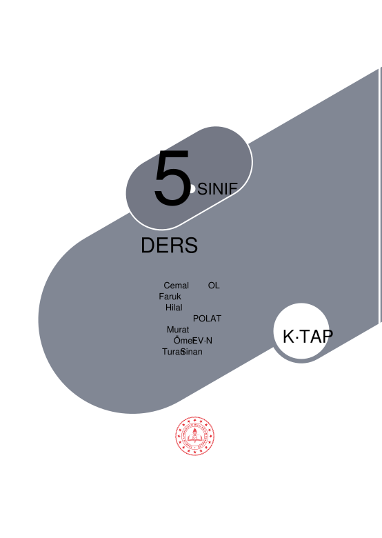 1. KİTAP

DEVLET KİTAPLARI
Kitabın Basıldığı Matbaa Adı, 2026

<!-- sayfa 1 -->

MİLLÎ EĞİTİM BAKANLIĞI YAYINLARI ................................................................. : 2022
DERS KİTAPLARI DİZİSİ ...................................................................................... : 9601

Her hakkı saklıdır ve Millî Eğitim Bakanlığına aittir. Kitabın metin, soru ve şekilleri kısmen de olsa hiçbir surette alınıp yayımlanamaz.

*Editör*
Doç. Dr. Fatma TORUN
Doç. Dr. İbrahim TURAN
Dr. Öğr. Üyesi Hamide KILIÇ

*Dil Uzmanı*
Yaşar KAYA

*Görsel Tasarımcı*
Hakan ÖRS
Halil SEYDİOĞLU

*Çoklu Ortam Tasarımcısı*
Bünyamin TELLİ
Engin KARADOĞAN
Ercan YANDIMOĞLU
Kübra SELEK

*Program Geliştirme Uzmanı*
Dr. Öğr. Üyesi Süleyman ARSLANTAŞ

*Ölçme ve Değerlendirme Uzmanı*
Dr. Öğr. Üyesi Alperen YANDI

*Rehberlik Uzmanı*
Saliha GÜN

*Baskı*
**Baskı Matbaanın Adı ve Ticaret Unvanı**
**Tel: (0000) 000 00 00**

**ISBN 978-975-11-8011-7**

Millî Eğitim Bakanlığı, Talim ve Terbiye Kurulu Başkanlığının 17.07.2024 tarih ve 110460159 sayılı yazısı ile eğitim aracı olarak kabul edilmiştir.

Kurulca bu kitabın kabul edilmiş olması ders kitabından yayınevi ve yazarın

<!-- sayfa 2 -->

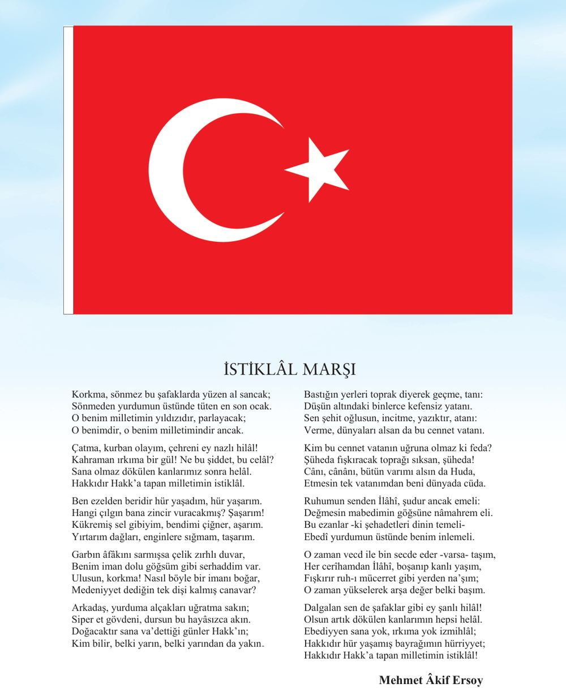

# İSTİKLÂL MARŞI

Korkma, sönmez bu ufaklarda yüzen al sancak;
Sönmeden yurdumun üstünde tüten en son ocak.
O benim milletimin yıldızıdır, parlayacak;
O benimdir, o benim milletimindir ancak.

Çatma, kurban olayım, çehreni ey nazlı hilâl!
Kahraman Türkime bir gül! Ne bu şiddet, bu celâl?
Sana olmaz dökülen kanlarımız sonra helâl.
Hakkıdır Hakk'a tapan milletimin istiklâl.

Ben ezelden beridir hür yaşadım, hür yaşarım.
Hangi çılgın bana zincir vuracakmış? Şaşarım!
Kükremiş sel gibiyim, bendimi çiğner, aşarım.
Yırtarım dağları, enginlere sığmam, taşarım.

Garbın âfâkını sarmışsa çelik zırhlı duvar,
Benim iman dolu göğsüm gibi serhaddim var.
Ulusun, korkma! Nasıl böyle bir imanı boğar,
Medeniyet dediğin tek dişi kalmış canavar?

Arkadaş, yurduma alçakları uğratma sakın;
Siper et gövdeni, dursun bu hayâsızca akın.
Doğacaktır sana va'dettiği günler Hakk'ın;
Kim bilir, belki yarın, belki yarından da yakın.

Bastığın yerleri toprak diyerek geçme, tanı:
Düşün altındaki binlerce kefensiz yatanı.
Sen şehit oğlusun, incitme, yazıktır, atanı:
Verme, dünyaları alsan da bu cennet vatanı.

Kim bu cennet vatanın uğruna olmaz ki feda?
Şüheda fışkıracak toprağı sıksan, şüheda!
Cânı, cânânı, bütün varımı alsan da Huda,
Etmesin tek vatanımdan beni dünyada cüda.

Ruhumun senden ilâhî, şudur ancak emeli:
Değmesin mabedimin göğsüne nâmahrem eli.
Bu ezanlar -ki şehadetleri dinin temeli-
Ebedî yurdumun üstünde benim inlemeli.

O zaman vecd ile bin secde eder -varsa- taşim,
Her cerîhamdan ilâhî, boşanıp kanlı yaşım,
Fışkırır ruh-ı mücerret gibi yerden na'im;
O zaman yükselerek arşa değer belki başım.

Dalgalan sen de ufaklar gibi ey kanlı hilâl!
Olsun artık dökülen kanlarımın hepsi helâl.
Ebediyyen sana yok, Türkime yok izmihlâl;
Hakkıdır hür yaşamış bayrağımın hürriyyet;
Hakkıdır Hakk'a tapan milletimin istiklâl!

Mehmet Âkif Ersoy

<!-- sayfa 3 -->

GENÇLİĞE HİTABE

Ey Türk gençliği! Birinci vazifen, Türk istiklâlini, Türk Cumhuriyetini, ilelebet muhafaza ve müdafaa etmektir.

Mevcudiyetinin ve istikbalinin yegâne temeli budur. Bu temel, senin en kıymetli hazinendir. İstikbalde dahi, seni bu hazineden mahrum etmek isteyecek dâhilî ve hâricî bedhahların olacaktır. Bir gün, istiklâl ve cumhuriyeti müdafaa mecburiyetine düşersen, vazifeye atılmak için, içinde bulunacağın vaziyetin imkân ve şeraitini düşünmeyeceksin! Bu imkân ve şerait, çok namüsait bir mahiyette tezahür edebilir. İstiklâl ve cumhuriyetine kastedecek düşmanlar, bütün dünyada emsali görülmemiş bir galibiyetin mümessili olabilirler. Cebren ve hile ile aziz vatanın bütün kaleleri zapt edilmiş, bütün tersanelerine girilmiş, bütün orduları dağıtılmış ve memleketin her köşesi bilfiil işgal edilmiş olabilir. Bütün bu şeraitten daha elîm ve daha vahim olmak üzere, memleketin dâhilinde iktidara sahip olanlar gaflet ve dalâlet ve hattâ hıyanet içinde bulunabilirler. Hattâ bu iktidar sahipleri şahsî menfaatlerini, müstevlîlerin siyasi emelleriyle tevhit edebilirler. Millet, fakr u zaruret içinde harap ve bîtap düşmüş olabilir.

Ey Türk istikbalinin evlâdı! İşte, bu ahval ve şerait içinde dahi vazifen, Türk istiklâl ve cumhuriyetini kurtarmaktır. Muhtaç olduğun kudret, damarlarındaki asil kanda mevcuttur.

Mustafa Kemal Atatürk


<!-- yer tutucu bulunamadı: sayfa sonuna eklendi -->

<!-- sayfa 4 -->

MUSTAFA KEMAL ATATÜRK

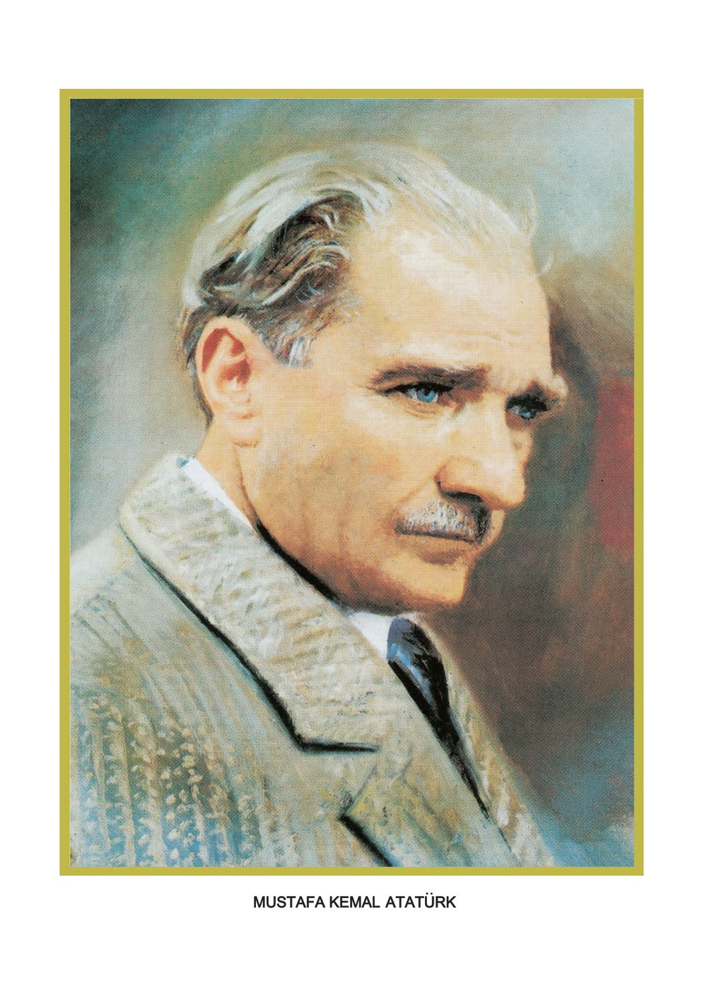
<!-- yer tutucu bulunamadı: sayfa sonuna eklendi -->

<!-- sayfa 5 -->

Henüz bir görsel veya metin katmanı paylaşmadınız. Lütfen dönüştürülmesini istediğiniz matematik ders kitabı sayfasının görüntüsünü ve varsa PDF metin katmanını gönderin.

Verileri paylaştığınızda, talimatlarınıza harfiyen uyarak şu formatta çıktı üreteceğim:

```markdown
# [Başlık]

[Metin içeriği]

$$[Matematiksel Formül]$$
<!-- KONTROL: Marker'da karşılığı yok, uydurma olabilir -->


[Devam eden metin...]
```

**Lütfen görseli ve metni iletin.**

<!-- sayfa 6 -->

# İÇİNDEKİLER

KİTABIMIZI TANIYALIM ........................................................................................................ 8

## BİRLİKTE YAŞAMAK
GRUPLAR VE ROLLERİMİZ ................................................................................................ 12
KÜLTÜREL ZENGİNLİKLERİN BİRLİKTE YAŞAMAYA KATKISI ..................................... 20
YARDIMLAŞMA VE DAYANIŞMADA BERABERİZ .......................................................... 34
1. ÖĞRENME ALANI ÖRNEK SORULAR ............................................................................ 45

## EVİMİZ DÜNYA
İLİMİZİN GÖRECELİ KONUMU ......................................................................................... 50
DOĞAL VE BEŞERÎ ÇEVREMİZDEKİ DEĞİŞİM .............................................................. 58
İLİMİZDE YAŞANABİLECEK AFETLER VE ETKİLERİ ................................................... 70
ÜLKEMİZE KOMŞU DEVLETLER ...................................................................................... 82
2. ÖĞRENME ALANI ÖRNEK SORULAR ............................................................................ 93

## ORTAK MİRASIMIZ
ORTAK KÜLTÜREL MİRASIMIZ ....................................................................................... 100
ANADOLU'NUN İLK YERLEŞİM YERLERİNDE YAŞAM ............................................... 110
MEZOPOTAMYA VE ANADOLU MEDENİYETLERİNİN ORTAK KÜLTÜREL MİRASA KATKILARI .................................................................................................................... 128
3. ÖĞRENME ALANI ÖRNEK SORULAR .......................................................................... 145

SÖZLÜK ............................................................................................................................... 150
KAYNAKÇA ........................................................................................................................ 151
ÖĞRENME ALANI ÖRNEK SORULARIN CEVAP ANAHTARLARI ................................. 152
GÖRSEL VE GENEL AĞ KAYNAKÇASI .......................................................................... 152
TÜRKİYE'NİN MÜLKİ İDARE BÖLÜMLERİ İLE ............................................................. 152

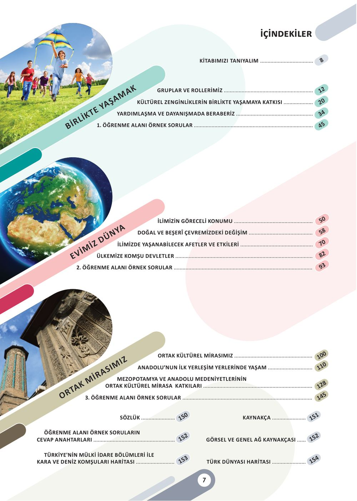
<!-- yer tutucu bulunamadı: sayfa sonuna eklendi -->

<!-- sayfa 7 -->

# KİTABIMIZI TANIYALIM
Bu kitap öğrenme alanlarından oluşmaktadır.
Her öğrenme alanı, o alana özgü bilgilerin yer aldığı bir kapak sayfası ile başlamaktadır.

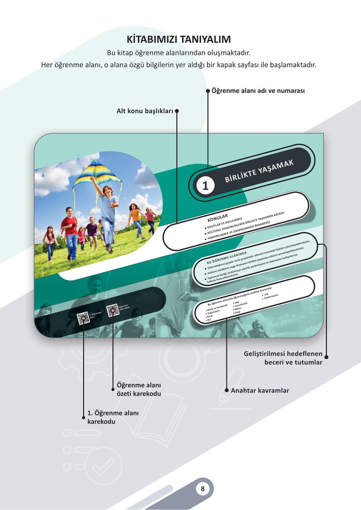

# 1 BİRLİKTE YAŞAMAK

## KONULAR
* GRUPLAR VE ROLLERİMİZ
* KÜLTÜREL ZENGİNLİKLERİN BİRLİKTE YAŞAMAYA KATKISI
* YARDIMLAŞMA VE DAYANIŞMADA BERABERİZ

## BU ÖĞRENME ALANINDA
* Dâhil olduğunuz gruplar ve bu gruplardaki rolleriniz arasındaki ilişkileri çözümleyebileceksiniz.
* Kültürel özelliklere saygı duymanın birlikte yaşamaya etkisini yorumlayabileceksiniz.
* Toplumsal birliği sürdürmeye yönelik yardımlaşma ve dayanışma faaliyetlerine katkıda bulunabileceksiniz.

## Bu öğrenme alanında öğreneceğiniz anahtar kavramlar
* Birlik ve beraberlik
* Dayanışma
* Grup
* Rol
* Hak
* Sorumluluk
* Kültür
* Saygı
* STK
* Yardımlaşma

---

**Öğrenme alanı adı ve numarası**
**Alt konu başlıkları**
**Geliştirilmesi hedeflenen beceri ve tutumlar**
**Anahtar kavramlar**
**Öğrenme alanı özeti karekodu**
**1. Öğrenme alanı karekodu**

<!-- sayfa 8 -->

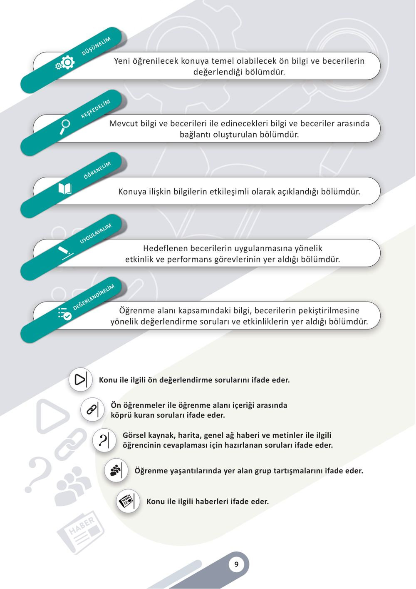 DÜŞÜNELİM
Yeni öğrenilecek konuya temel olabilecek ön bilgi ve becerilerin değerlendildiği bölümdür.

 KEŞFEDELİM
Mevcut bilgi ve becerileri ile edinecekleri bilgi ve beceriler arasında bağlantı oluşturulan bölümdür.

 ÖĞRENELİM
Konuya ilişkin bilgilerin etkileşimli olarak açıklandığı bölümdür.

 UYGULAYALIM
Hedeflenen becerilerin uygulanmasına yönelik etkinlik ve performans görevlerinin yer aldığı bölümdür.

 DEĞERLENDİRELİM
Öğrenme alanı kapsamındaki bilgi, becerilerin pekiştirilmesine yönelik değerlendirme soruları ve etkinliklerin yer aldığı bölümdür.

 Konu ile ilgili ön değerlendirme sorularını ifade eder.

 Ön öğrenmeler ile öğrenme alanı içeriği arasında köprü kuran soruları ifade eder.

 Görsel kaynak, harita, genel ağ haberi ve metinler ile ilgili öğrencinin cevaplaması için hazırlanan soruları ifade eder.

 Öğrenme yaşantılarında yer alan grup tartışmalarını ifade eder.

 Konu ile ilgili haberleri ifade eder.

<!-- sayfa 9 -->

# 1. Öğrenme alanı

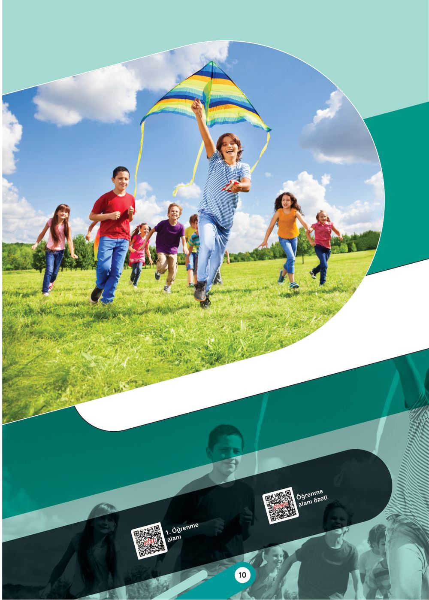 1. Öğrenme alanı

 Öğrenme alanı özeti

<!-- sayfa 10 -->

# 1 BİRLİKTE YAŞAMAK

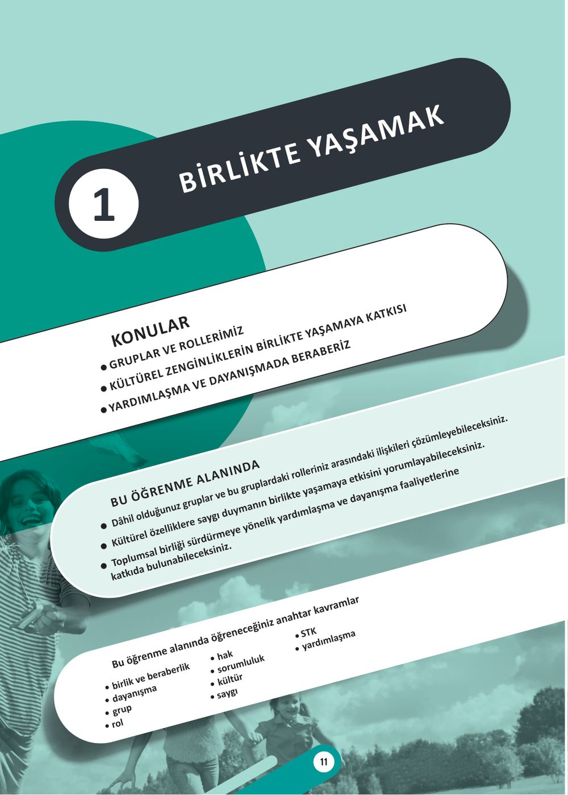

## KONULAR
* GRUPLAR VE ROLLERİMİZ
* KÜLTÜREL ZENGİNLİKLERİN BİRLİKTE YAŞAMAYA KATKISI
* YARDIMLAŞMA VE DAYANIŞMADA BERABERİZ

## BU ÖĞRENME ALANINDA
* Dâhil olduğunuz gruplar ve bu gruplardaki rolleriniz arasındaki ilişkileri çözümleyebileceksiniz.
* Kültürel özelliklere saygı duymanın birlikte yaşamaya etkisini yorumlayabileceksiniz.
* Toplumsal birliği sürdürmeye yönelik yardımlaşma ve dayanışma faaliyetlerine katkıda bulunabileceksiniz.

## Bu öğrenme alanında öğreneceğiniz anahtar kavramlar
* birlik ve beraberlik
* dayanışma
* grup
* rol
* hak
* sorumluluk
* kültür
* saygı
* STK
* yardımlaşma

<!-- sayfa 11 -->

# GRUPLAR VE ROLLERİMİZ

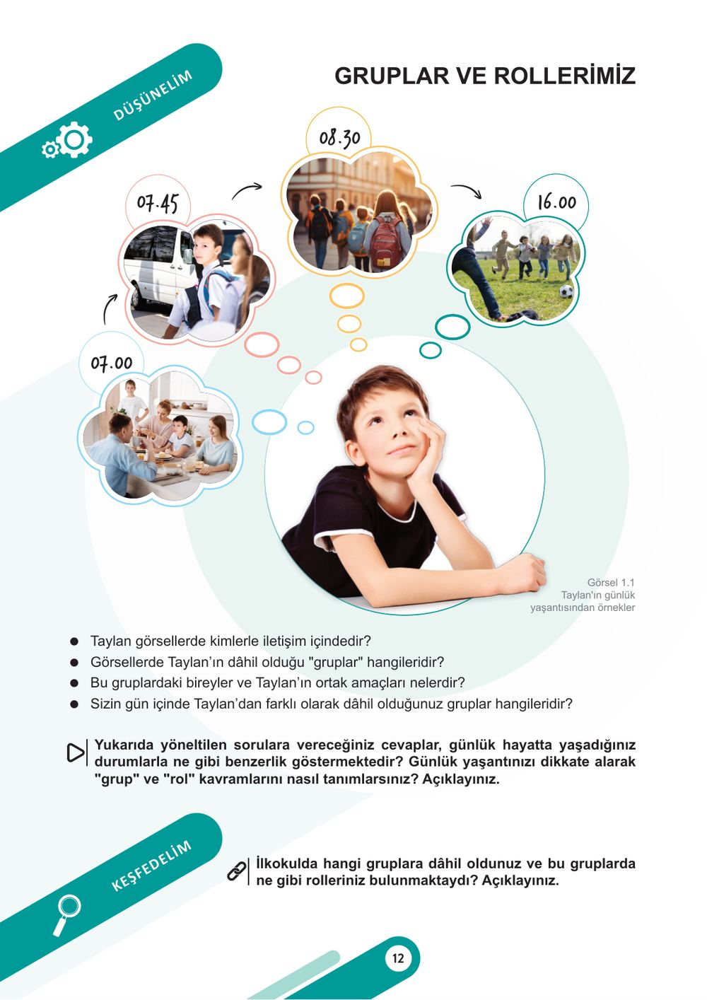

* Taylan görsellerde kimlerle iletişim içindedir?
* Görsellerde Taylan’ın dâhil olduğu "gruplar" hangileridir?
* Bu gruplardaki bireyler ve Taylan’ın ortak amaçları nelerdir?
* Sizin gün içinde Taylan’dan farklı olarak dâhil olduğunuz gruplar hangileridir?

> Yukarıda yöneltilen sorulara vereceğiniz cevaplar, günlük hayatta yaşadığınız durumlarla ne gibi benzerlik göstermektedir? Günlük yaşantınızı dikkate alarak "grup" ve "rol" kavramlarını nasıl tanımlarsınız? Açıklayınız.

Görsel 1.1
Taylan'ın günlük yaşantısından örnekler

## KEŞFEDELİM

📎 İlkokulda hangi gruplara dâhil oldunuz ve bu gruplarda ne gibi rolleriniz bulunmaktaydı? Açıklayınız.

<!-- sayfa 12 -->

# ÖĞRENELİM

**Verilen yönergeye göre etkinliği yapınız.**

* Öğretmeninizin rehberliğinde tüm öğrencilerin katılımıyla beş veya altı grup oluşturunuz.
* Grup içinde beyin fırtınası yaparak yakın çevrenizde, okulunuzda ve sınıfınızda dâhil olduğunuz grupları belirleyiniz. Ardından bu grupları ve gruplardaki rollerinizi verilen tabloda listeleyiniz.
* Listede yer alan gruplardaki rolleriniz ile bu rollerin getirdiği hak ve sorumluluklarınızı ekip içinde tartışınız.
* Dâhil olduğunuz gruplardaki rollerinize ilişkin hak ve sorumluluklarınızın benzerlik ve farklılıklarını karşılaştırma tablosuna yazınız.

| | Dâhil Olduğunuz Gruplar | Gruplardaki Rolleriniz |
| :--- | :--- | :--- |
| Yakın çevrenizde | | |
| Okulunuzda | | |
| Sınıfınızda | | |

2 | Ortaokul öğrencisi olarak dâhil olduğunuz gruplarda ne gibi değişimler oldu? Bu gruplardaki yeni rolleriniz neler olabilir? Yukarıda oluşturduğunuz gruplarda rollerinizin getirdiği hak ve sorumlulukları tartışarak aşağıdaki ilgili alanlara yazınız.

| Rollerimizin Getirdiği Benzer Haklar | Rollerimizin Getirdiği Farklı Haklar |
| :--- | :--- |
| | |
| **Rollerimizin Getirdiği Benzer Sorumluluklar** | **Rollerimizin Getirdiği Farklı Sorumluluklar** |
| | |

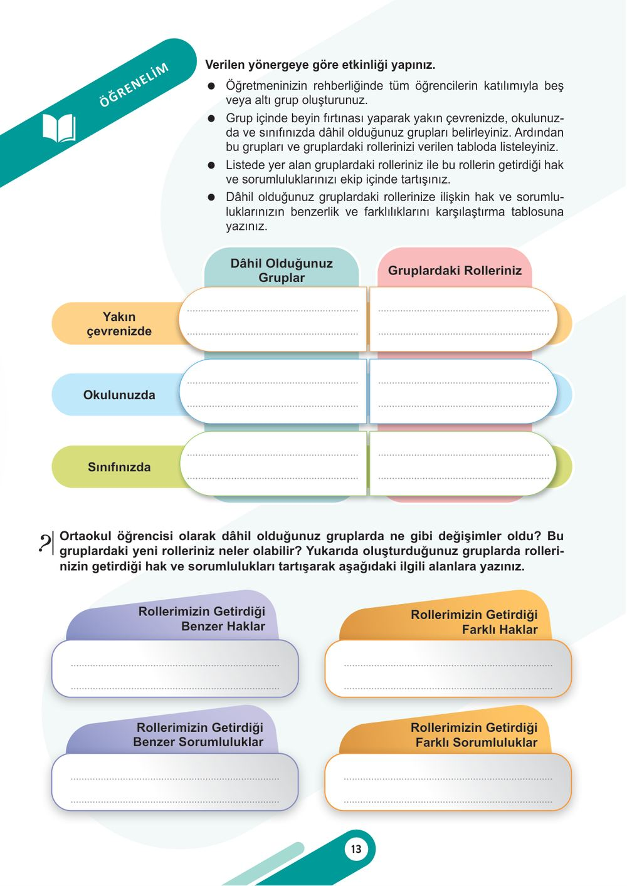
<!-- yer tutucu bulunamadı: sayfa sonuna eklendi -->

<!-- sayfa 13 -->

Toplum içinde ortak hedef ve değerleri olan insanlar grupları meydana getirir. Aile, akrabalar ve okul toplumdaki gruplara birer örnektir (Görsel 1.2, Görsel 1.3). Toplum, gruplar arasındaki uyum ve grupların birbirine desteği ile varlığını devam ettirebilir. Ayrıca bu gruplarda yer alan üyeler tecrübe, beceri ve farklı bakış açıları ile gruba değer katarken grubun diğer üyelerinin gelişimine de katkıda bulunur.

Dâhil olduğumuz gruplarda birtakım rollere sahip oluruz. Örneğin aile içinde çocuk, okulda öğrenci, sınıfta sınıf başkanı ve hentbol takımında kaleci rolünde olabiliriz. Birden çok grupta yer aldığımız için aynı anda birden fazla role de sahip oluruz. Dâhil olduğumuz gruplara ve üstlendiğimiz rollere göre çeşitli haklar elde eder ve sorumluluklar üstleniriz. Bu durumla ilgili verilen tabloyu tamamlayınız.

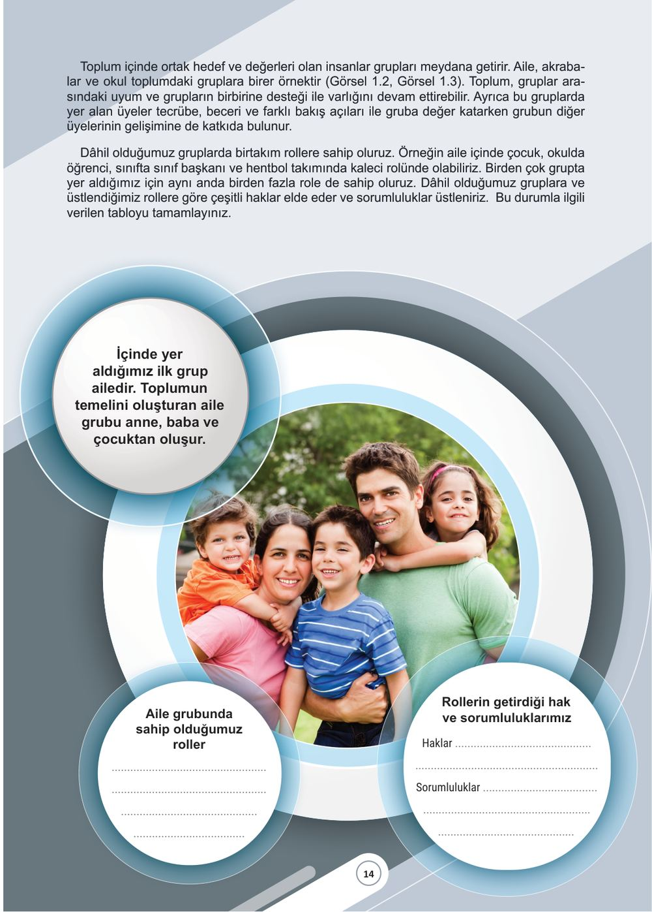

İçinde yer aldığımız ilk grup ailedir. Toplumun temelini oluşturan aile grubu anne, baba ve çocuktan oluşur.

Aile grubunda sahip olduğumuz roller
..................................................
..................................................
............................................

Rollerin getirdiği hak ve sorumluluklarımız
Haklar ............................................
...........................................................
Sorumluluklar .....................................
......................................................

<!-- sayfa 14 -->

# Toplumsal hayatımızı oluşturan diğer bir grup da arkadaş grubudur. Arkadaşlarımızla oyun oynar, ders çalışır, sanat ve spor etkinliklerine katılırız. Böylelikle nitelikli ve eğlenceli vakit geçiririz.

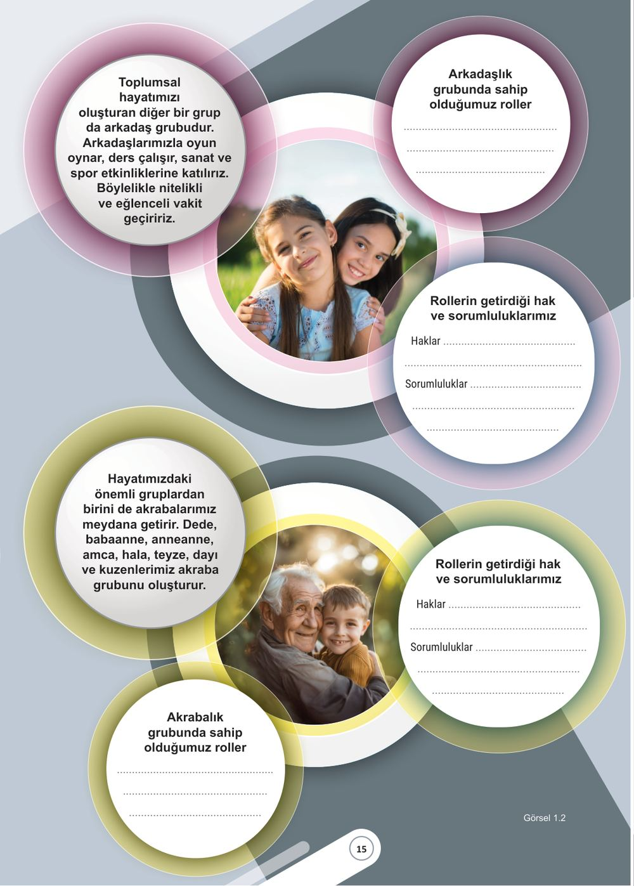

# Arkadaşlık grubunda sahip olduğumuz roller
...................................................
.................................................
...........................................

# Rollerin getirdiği hak ve sorumluluklarımız
Haklar ............................................
...........................................................
Sorumluluklar .....................................
......................................................
............................................

# Hayatımızdaki önemli gruplardan birini de akrabalarımız meydana getirir. Dede, babaanne, anneanne, amca, hala, teyze, dayı ve kuzenlerimiz akraba grubunu oluşturur.


# Akrabalık grubunda sahip olduğumuz roller
....................................................
................................................
............................................

<!-- sayfa 15 -->

Toplumsal hayatımızın önemli bir bölümü okulda geçmektedir. Okulda eğitim öğretim görür, arkadaşlarımızla ve öğretmenlerimizle güzel vakit geçirir, müzik ve resim kulüpleri gibi kulüplerde yer alırız.

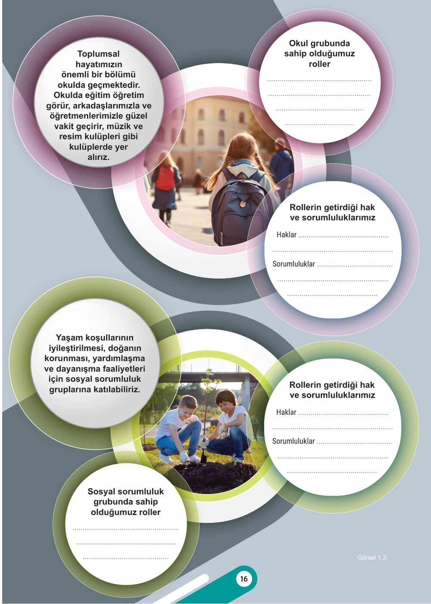

Okul grubunda sahip olduğumuz roller
...................................................
..................................................
...........................................
..................................

Rollerin getirdiği hak ve sorumluluklarımız
Haklar ............................................
...........................................................
Sorumluluklar .....................................
......................................................
............................................

Yaşam koşullarının iyileştirilmesi, doğanın korunması, yardımlaşma ve dayanışma faaliyetleri için sosyal sorumluluk gruplarına katılabiliriz.


Sosyal sorumluluk grubunda sahip olduğumuz roller
....................................................
.................................................

<!-- sayfa 16 -->

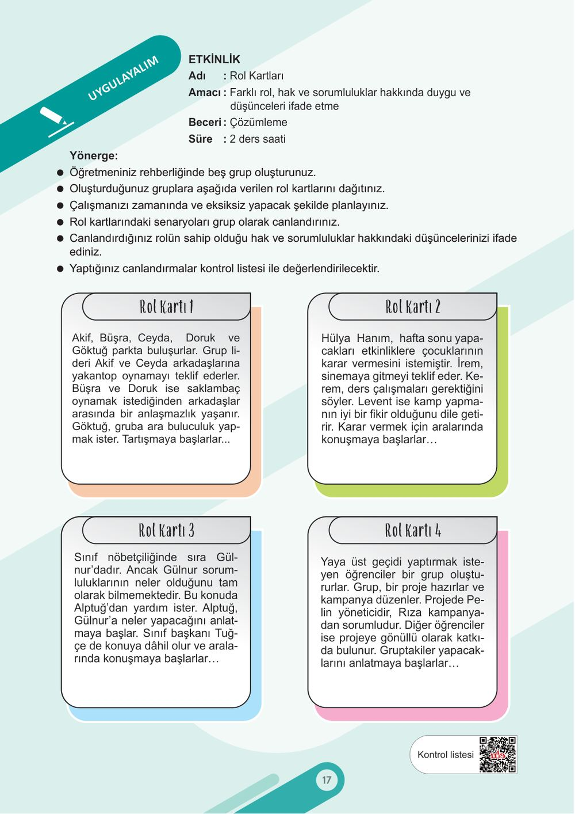

# ETKİNLİK
**Adı :** Rol Kartları  
**Amacı :** Farklı rol, hak ve sorumluluklar hakkında duygu ve düşünceleri ifade etme  
**Beceri :** Çözümleme  
**Süre :** 2 ders saati

## Yönerge:
* Öğretmeniniz rehberliğinde beş grup oluşturunuz.
* Oluşturduğunuz gruplara aşağıda verilen rol kartlarını dağıtınız.
* Çalışmanızı zamanında ve eksiksiz yapacak şekilde planlayınız.
* Rol kartlarındaki senaryoları grup olarak canlandırınız.
* Canlandırdığınız rolün sahip olduğu hak ve sorumluluklar hakkındaki düşüncelerinizi ifade ediniz.
* Yaptığınız canlandırmalar kontrol listesi ile değerlendirilecektir.

| Rol Kartı 1 | Rol Kartı 2 |
| :--- | :--- |
| Akif, Büşra, Ceyda, Doruk ve Göktuğ parkta buluşurlar. Grup lideri Akif ve Ceyda arkadaşlarına yakantop oynamayı teklif ederler. Büşra ve Doruk ise saklambaç oynamak istediğinden arkadaşlar arasında bir anlaşmazlık yaşanır. Göktuğ, gruba ara buluculuk yapmak ister. Tartışmaya başlarlar... | Hülya Hanım, hafta sonu yapacakları etkinliklere çocuklarının karar vermesini istemiştir. İrem, sinemaya gitmeyi teklif eder. Kerem, ders çalışmaları gerektiğini söyler. Levent ise kamp yapmanın iyi bir fikir olduğunu dile getirir. Karar vermek için aralarında konuşmaya başlarlar… |

| Rol Kartı 3 | Rol Kartı 4 |
| :--- | :--- |
| Sınıf nöbetçiliğinde sıra Gülnur’dadır. Ancak Gülnur sorumluluklarının neler olduğunu tam olarak bilmemektedir. Bu konuda Alptuğ’dan yardım ister. Alptuğ, Gülnur’a neler yapacağını anlatmaya başlar. Sınıf başkanı Tuğçe de konuya dâhil olur ve aralarında konuşmaya başlarlar… | Yaya üst geçidi yaptırmak isteyen öğrenciler bir grup oluştururlar. Grup, bir proje hazırlar ve kampanya düzenler. Projede Pelin yöneticidir, Rıza kampanyadan sorumludur. Diğer öğrenciler ise projeye gönüllü olarak katkıda bulunur. Gruptakiler yapacaklarını anlatmaya başlarlar… |

<!-- sayfa 17 -->

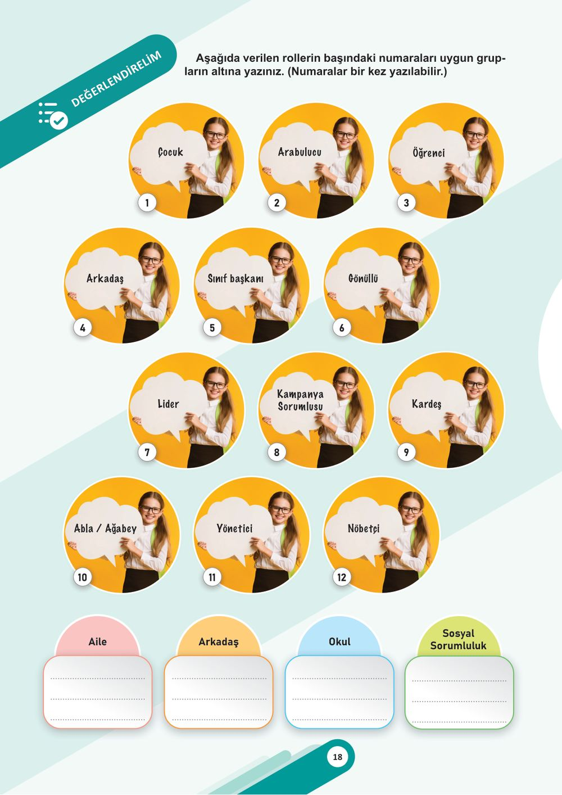

# DEĞERLENDİRELİM

Aşağıda verilen rollerin başındaki numaraları uygun grupların altına yazınız. (Numaralar bir kez yazılabilir.)

1. Çocuk
2. Arabulucu
3. Öğrenci
4. Arkadaş
5. Sınıf başkanı
6. Gönüllü
7. Lider
8. Kampanya Sorumlusu
9. Kardeş
10. Abla / Ağabey
11. Yönetici
12. Nöbetçi

| Aile | Arkadaş | Okul | Sosyal Sorumluluk |
| :--- | :--- | :--- | :--- |
| | | | |

<!-- sayfa 18 -->

Aşağıda rollerimiz ile rollerimize ilişkin hak ve sorumluluklarımızın bir kısmı numaralandırılarak verilmiştir. Soruları okuyunuz; ilgili rol, hak ve sorumluluklarımızın numaralarını cevap alanlarına yazınız (Bir numarayı birden fazla cevap alanına yazabilirsiniz.).

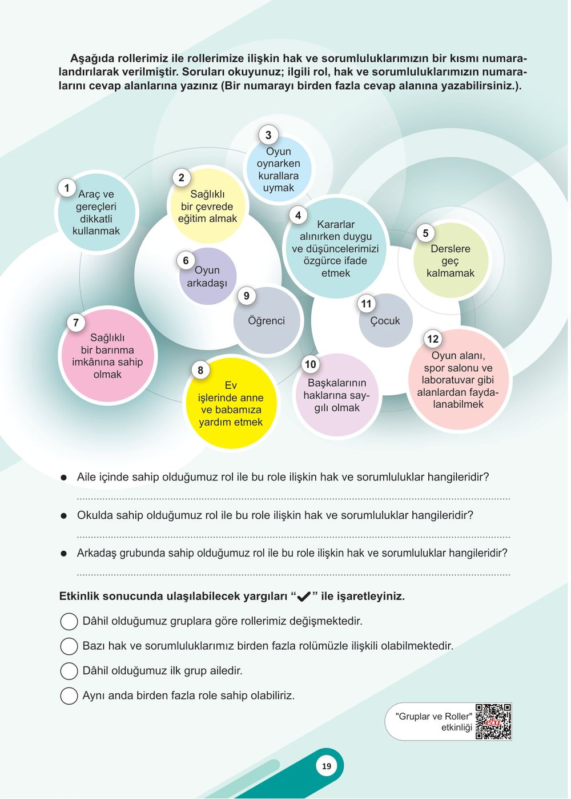

* Aile içinde sahip olduğumuz rol ile bu role ilişkin hak ve sorumluluklar hangileridir?
.........................................................................................................................................................

* Okulda sahip olduğumuz rol ile bu role ilişkin hak ve sorumluluklar hangileridir?
.........................................................................................................................................................

* Arkadaş grubunda sahip olduğumuz rol ile bu role ilişkin hak ve sorumluluklar hangileridir?
.........................................................................................................................................................

**Etkinlik sonucunda ulaşılabilecek yargıları “ $\checkmark$ ” ile işaretleyiniz.**

$\bigcirc$ Dâhil olduğumuz gruplara göre rollerimiz değişmektedir.
$\bigcirc$ Bazı hak ve sorumluluklarımız birden fazla rolümüzle ilişkili olabilmektedir.
$\bigcirc$ Dâhil olduğumuz ilk grup ailedir.
$\bigcirc$ Aynı anda birden fazla role sahip olabiliriz.

"Gruplar ve Roller" etkinliği

<!-- sayfa 19 -->

# KÜLTÜREL ZENGİNLİKLERİN BİRLİKTE YAŞAMAYA KATKISI

Kültür, bir milletin tarih boyunca meydana getirdiği maddi ve manevi değerlerinin bütünüdür. Toplum içinde dayanışma, birlik ve beraberliğin sağlanmasında önemli bir yer tutar. Kültür, bir toplumu millet yapan ve diğer milletlerden ayıran önemli özelliklerdir. Bu yönüyle Türk kültürü, Türk milletinin hayat tarzını yansıtır.

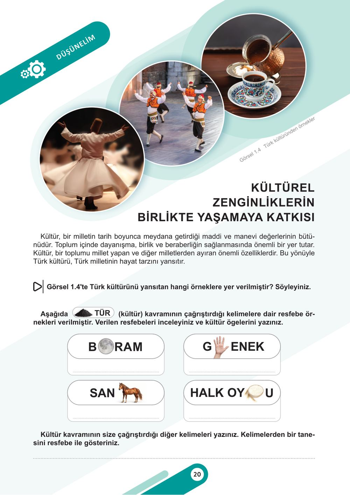 Görsel 1.4 Türk kültüründen örnekler

> **DÜŞÜNELİM**
> 
> Görsel 1.4'te Türk kültürünü yansıtan hangi örneklere yer verilmiştir? Söyleyiniz.

Aşağıda  TÜR (kültür) kavramının çağrıştırdığı kelimelere dair resfebe örnekleri verilmiştir. Verilen resfebeleri inceleyiniz ve kültür ögelerini yazınız.

| | |
| :--- | :--- |
| B 🌑 RAM <br> ____________________ | G 🖐️ ENEK <br> ____________________ |
| SAN 🐎 <br> ____________________ | HALK OY 🌕 U <br> ____________________ |

Kültür kavramının size çağrıştırdığı diğer kelimeleri yazınız. Kelimelerden bir tanesini resfebe ile gösteriniz.

<!-- sayfa 20 -->

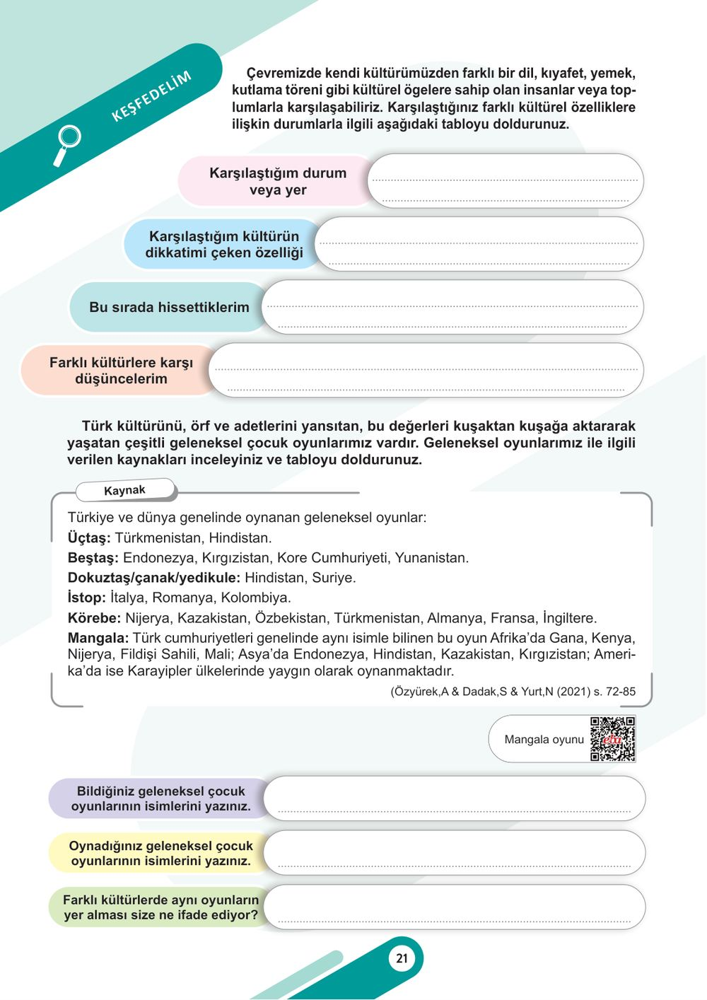

Çevremizde kendi kültürümüzden farklı bir dil, kıyafet, yemek, kutlama töreni gibi kültürel ögelere sahip olan insanlar veya toplumlarla karşılaşabiliriz. Karşılaştığınız farklı kültürel özelliklere ilişkin durumlarla ilgili aşağıdaki tabloyu doldurunuz.

| | |
| :--- | :--- |
| Karşılaştığım durum veya yer | |
| Karşılaştığım kültürün dikkatimi çeken özelliği | |
| Bu sırada hissettiklerim | |
| Farklı kültürlere karşı düşüncelerim | |

Türk kültürünü, örf ve adetlerini yansıtan, bu değerleri kuşaktan kuşağa aktararak yaşatan çeşitli geleneksel çocuk oyunlarımız vardır. Geleneksel oyunlarımız ile ilgili verilen kaynakları inceleyiniz ve tabloyu doldurunuz.

**Kaynak**
Türkiye ve dünya genelinde oynanan geleneksel oyunlar:
**Üçtaş:** Türkmenistan, Hindistan.
**Beştaş:** Endonezya, Kırgızistan, Kore Cumhuriyeti, Yunanistan.
**Dokuztaş/çanak/yedikule:** Hindistan, Suriye.
**İstop:** İtalya, Romanya, Kolombiya.
**Körebe:** Nijerya, Kazakistan, Özbekistan, Türkmenistan, Almanya, Fransa, İngiltere.
**Mangala:** Türk cumhuriyetleri genelinde aynı isimle bilinen bu oyun Afrika’da Gana, Kenya, Nijerya, Fildişi Sahili, Mali; Asya’da Endonezya, Hindistan, Kazakistan, Kırgızistan; Amerika’da ise Karayipler ülkelerinde yaygın olarak oynanmaktadır.
(Özyürek, A & Dadak, S & Yurt, N (2021) s. 72-85)


| | |
| :--- | :--- |
| Bildiğiniz geleneksel çocuk oyunlarının isimlerini yazınız. | |
| Oynadığınız geleneksel çocuk oyunlarının isimlerini yazınız. | |
| Farklı kültürlerde aynı oyunların ... | |

<!-- sayfa 21 -->

# ÖĞRENELİM

Metin, görsel ve dijital kaynakları inceleyiniz ve soruları cevaplayınız.

“23 Nisan Ulusal Egemenlik ve Çocuk Bayramı” Mustafa Kemal Atatürk tarafından Türk çocuklarına hediye edilmiştir. Günümüzde düzenlenen 23 Nisan şenliklerine yabancı ülke çocukları da misafir olarak katılmaktadır (Görsel 1.5). Çocuklara bayram hediye eden ve bu bayramı bütün dünya ile paylaşan ilk ve tek ülke Türkiye’dir.

TRT Uluslararası 23 Nisan Çocuk Şenliği’ne katılan çocukların videolarını izleyiniz, ülke ve kültürlerini tanıttıkları konuşma metinlerini okuyunuz ve sayfa 26'da yer alan tabloyu doldurunuz.

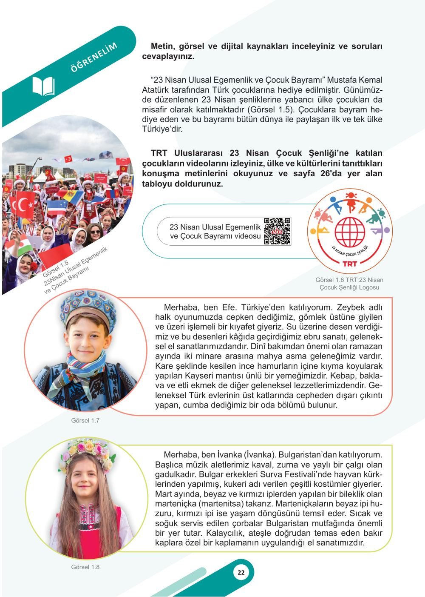
Görsel 1.5
23 Nisan Ulusal Egemenlik
ve Çocuk Bayramı


23 Nisan Ulusal Egemenlik
ve Çocuk Bayramı videosu


Görsel 1.6 TRT 23 Nisan
Çocuk Şenliği Logosu


Görsel 1.7

Merhaba, ben Efe. Türkiye’den katılıyorum. Zeybek adlı halk oyunumuzda cepken dediğimiz, gömlek üstüne giyilen ve üzeri işlemeli bir kıyafet giyeriz. Su üzerine desen verdiğimiz ve bu desenleri kâğıda geçirdiğimiz ebru sanatı, geleneksel el sanatlarımızdandır. Dinî bakımdan önemi olan ramazan ayında iki minare arasına mahya asma geleneğimiz vardır. Kare şeklinde kesilen ince hamurların içine kıyma koyularak yapılan Kayseri mantısı ünlü bir yemeğimizdir. Kebap, baklava ve etli ekmek de diğer geleneksel lezzetlerimizdendir. Geleneksel Türk evlerinin üst katlarında cepheden dışarı çıkıntı yapan, cumba dediğimiz bir oda bölümü bulunur.


Merhaba, ben İvanka (İvanka). Bulgaristan’dan katılıyorum. Başlıca müzik aletlerimiz kaval, zurna ve yaylı bir çalgı olan gadulkadır. Bulgar erkekleri Surva Festivali’nde hayvan kürklerinden yapılmış, kukeri adı verilen çeşitli kostümler giyerler. Mart ayında, beyaz ve kırmızı iplerden yapılan bir bileklik olan marteniçka (martenitsa) takarız. Marteniçkaların beyaz ipi huzuru, kırmızı ipi ise yaşam döngüsünü temsil eder. Sıcak ve soğuk servis edilen çorbalar Bulgaristan mutfağında önemli bir yer tutar. Kalaycılık, ateşle doğrudan temas eden bakır kaplara özel bir kaplamanın uygulandığı el sanatımızdır.

<!-- sayfa 22 -->

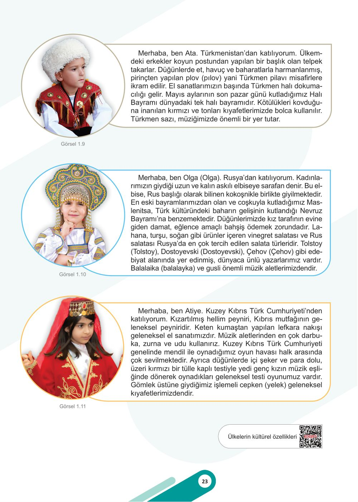

Merhaba, ben Ata. Türkmenistan’dan katılıyorum. Ülkemdeki erkekler koyun postundan yapılan bir başlık olan telpek takarlar. Düğünlerde et, havuç ve baharatlarla harmanlanmış, pirinçten yapılan plov (pılov) yani Türkmen pilavı misafirlere ikram edilir. El sanatlarımızın başında Türkmen halı dokumacılığı gelir. Mayıs aylarının son pazar günü kutladığımız Halı Bayramı dünyadaki tek halı bayramıdır. Kötülükleri kovduğuna inanılan kırmızı ve tonları kıyafetlerimizde bolca kullanılır. Türkmen sazı, müziğimizde önemli bir yer tutar.

Görsel 1.9


Merhaba, ben Olga (Olga). Rusya’dan katılıyorum. Kadınlarımızın giydiği uzun ve kalın askılı elbiseye sarafan denir. Bu elbise, Rus başlığı olarak bilinen kokoşnikle birlikte giyilmektedir. En eski bayramlarımızdan olan ve coşkuyla kutladığımız Maslenitsa, Türk kültüründeki baharın gelişinin kutlandığı Nevruz Bayramı’na benzemektedir. Düğünlerimizde kız tarafının evine giden damat, eğlence amaçlı bahşiş ödemek zorundadır. Lahana, turşu, soğan gibi ürünler içeren vinegret salatası ve Rus salatası Rusya’da en çok tercih edilen salata türleridir. Tolstoy (Tolstoy), Dostoyevski (Dostoyevski), Çehov (Çehov) gibi edebiyat alanında yer edinmiş, dünyaca ünlü yazarlarımız vardır. Balalaika (balalayka) ve gusli önemli müzik aletlerimizdendir.

Görsel 1.10


Merhaba, ben Atiye. Kuzey Kıbrıs Türk Cumhuriyeti’nden katılıyorum. Kızartılmış hellim peyniri, Kıbrıs mutfağının geleneksel peyniridir. Keten kumaştan yapılan lefkara nakışı geleneksel el sanatımızdır. Müzik aletlerinden en çok darbuka, zurna ve udu kullanırız. Kuzey Kıbrıs Türk Cumhuriyeti genelinde mendil ile oynadığımız oyun havası halk arasında çok sevilmektedir. Ayrıca düğünlerde içi şeker ve para dolu, üzeri kırmızı bir tülle kaplı testiyle yedi genç kızın müzik eşliğinde dönerek oynadıkları geleneksel testi oyunumuz vardır. Gömlek üstüne giydiğimiz işlemeli cepken (yelek) geleneksel kıyafetlerimizdendir.

Görsel 1.11

Ülkelerin kültürel özellikleri

<!-- sayfa 23 -->

Kuzey Kıbrıs Türk Cumhuriyeti (KKTC), Türk dünyasının önemli bir parçasını oluşturur. KKTC bayrağının ortasındaki ay yıldız Türklüğü, üstteki kırmızı şerit Türkiye’ye, alttaki kırmızı şerit KKTC’yi simgelemektedir (Görsel 1.12).

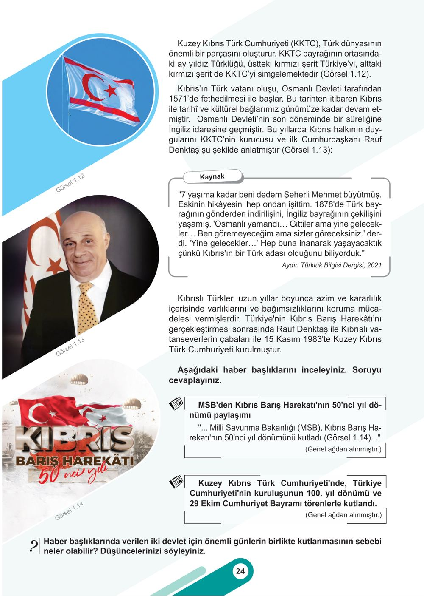

Kıbrıs'ın Türk vatanı oluşu, Osmanlı Devleti tarafından 1571'de fethedilmesi ile başlar. Bu tarihten itibaren Kıbrıs ile tarihî ve kültürel bağlarımız günümüze kadar devam etmiştir. Osmanlı Devleti'nin son döneminde bir süreliğine İngiliz idaresine geçmiştir. Bu yıllarda Kıbrıs halkının duygularını KKTC'nin kurucusu ve ilk Cumhurbaşkanı Rauf Denktaş şu şekilde anlatmıştır (Görsel 1.13):


> Kaynak
> 
> "7 yaşıma kadar beni dedem Şeherli Mehmet büyütmüş. Eskinin hikâyesini hep ondan işittim. 1878'de Türk bayrağının gönderden indirilişini, İngiliz bayrağının çekilişini yaşamış. 'Osmanlı yamandı... Gittiler ama yine gelecekler... Ben göremeyeceğim ama sizler göreceksiniz.' derdi. 'Yine gelecekler...' Hep buna inanarak yaşayacaktık çünkü Kıbrıs'ın bir Türk adası olduğunu biliyorduk."
> 
> *Aydın Türklük Bilgisi Dergisi, 2021*

Kıbrıslı Türkler, uzun yıllar boyunca azim ve kararlılık içerisinde varlıklarını ve bağımsızlıklarını koruma mücadelesi vermişlerdir. Türkiye'nin Kıbrıs Barış Harekâtı'nı gerçekleştirmesi sonrasında Rauf Denktaş ile Kıbrıslı vatanseverlerin çabaları ile 15 Kasım 1983'te Kuzey Kıbrıs Türk Cumhuriyeti kurulmuştur.

**Aşağıdaki haber başlıklarını inceleyiniz. Soruyu cevaplayınız.**


**MSB'den Kıbrıs Barış Harekatı'nın 50'nci yıl dönümü paylaşımı**
"... Milli Savunma Bakanlığı (MSB), Kıbrıs Barış Harekatı'nın 50'nci yıl dönümünü kutladı (Görsel 1.14)..."
(Genel ağdan alınmıştır.)


Kuzey Kıbrıs Türk Cumhuriyeti'nde, Türkiye Cumhuriyeti'nin kuruluşunun 100. yıl dönümü ve 29 Ekim Cumhuriyet Bayramı törenlerle kutlandı.
(Genel ağdan alınmıştır.)

**Haber başlıklarında verilen iki devlet için önemli günlerin birlikte kutlanmasının sebebi**

<!-- sayfa 24 -->

Kıbrıs Türkleri Anadolu’dan adaya göç ederlerken kültür, sosyal yaşam ve inançlarını birlikte getirmişler ve zaman içinde ada kültürüyle bunları harmanlayıp gelecek nesillere aktarmışlardır. Bu yüzden ülkemiz ve Kuzey Kıbrıs Türk kültürü arasında benzer birçok kültürel unsur bulunmaktadır. KKTC ile ülkemiz arasındaki kültürel özelliklerin benzerliğine ilişkin bazı örnekler verilmiştir.

KKTC mutfağında bulunan tarhana çorbası, humus, ızgara hellim peyniri, kabak çiçeği dolması ve enginar dolması Türk yemekleriyle ortaktır. Kahvenin yeri ise Kuzey Kıbrıs Türk Cumhuriyeti’nin kültüründe vazgeçilmezdir (Görsel 1.15). Türk kahvesi, evde her öğünden sonra tüketilirken misafirliklerde de mutlaka ikram edilir. Kahve, yanında su ve turunç macunu veya ceviz macunu ile ikram edilmektedir.

[[SEKIL:1.15]]

Aydın, Muğla gibi Ege illerimizde oldukça yaygın bir halk oyunu olan zeybek, Kuzey Kıbrıs Türk Cumhuriyeti’nde de keyifle oynanan halk oyunlarından biridir. Kuzey Kıbrıs Türk Cumhuriyeti zeybeği de Anadolu zeybeği gibi tek başına veya daha fazla oyuncuyla daire şeklinde oynanabilir.

Kuzey Kıbrıs Türklerinin geçmişinde ve Anadolu'da yaygın olan zembil; hasırdan örülmüş, kulplu torba ve sepetlere denir. Ahşap baskı, ebru (Görsel 1.16) ve el dokuması kilimler kültürümüzün benzerlik gösterdiği diğer geleneksel el sanatlarındandır.

[[SEKIL:1.16]]

Kuzey Kıbrıs Türkleri; bel etrafına sarılan, ipek kumaştan veya koyun yününden yapılan ve kök boyalarla boyanmış kuşak takarlar (Görsel 1.17). Bu kuşağa halk dilinde tarabulus kuşağı denmektedir. Sebebi ise kuşakların o zamanlar Osmanlı hâkimiyetinde olan Trablusgarp’ta dokunup Kıbrıs’a gelmesidir. Anadolu’daki bazı köylerde ve folklor kıyafetlerinde bu kuşağa rastlamak mümkündür.

[[SEKIL:1.17]]

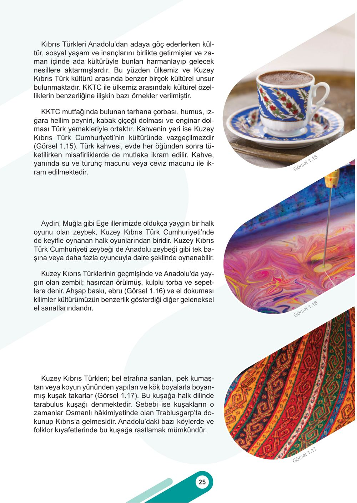
<!-- yer tutucu bulunamadı: sayfa sonuna eklendi -->

<!-- sayfa 25 -->

İncelediğiniz video, görseller ile konuşma metinlerine göre kültürümüze ve farklı ülke kültürlerine ait sanat, müzik, yemek, giyim-kuşam, kutlama, gelenek ve görenek-lere ait örnekleri sınıflandırma tablosuna yazınız.

| Kültürümüzden Örnekler | Kültürel Özellik | Farklı Ülke Kültürlerinden Örnekler |
| :---: | :---: | :---: |
| | Sanat | |
| | Yemek | |
| | Giyim-Kuşam | |
| | Kutlama | |
| | Müzik | |
| | Gelenek ve görenekler | |

?| Kültürel mirasımızı tanımak ve bunların gelecek nesillere aktarılmasını sağlamak neden önemlidir? Tartışınız.

Ülkemizin kültürel özelliklerini, KKTC’nin ve farklı ülkelerin kültürel özellikleri ile karşılaştırarak benzerlik ve farklılıklarını yazınız.

| Benzerlikler | Farklılıklar |
| :---: | :---: |
| | |

| Verilen bilgilerden yola çıkarak ülkemiz ile KKTC arasındaki tarihî ve kültürel bağları

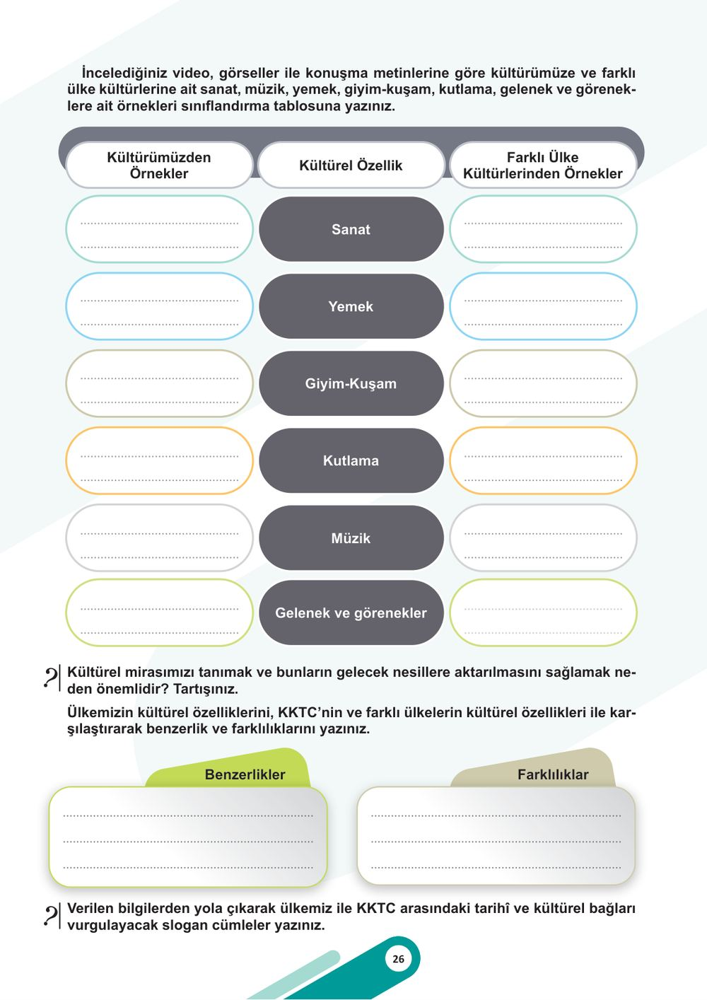
<!-- yer tutucu bulunamadı: sayfa sonuna eklendi -->

<!-- sayfa 26 -->

# Haber kaynaklarını okuyunuz ve soruyu cevaplayınız.

**A**
" **Hollandalı turist Kuşadası'ndan 27 yıldır kopamıyor**
"...Hollanda'da yaşayan yazılım mühendisi Jan Linskens (Jan Linkins) (Görsel 1.18), 1996 yılında tatil için geldiği Aydın'ın Kuşadası ilçesinde yüzmeyi öğrendi. İlçenin doğası ve denizine hayran kalan Linskens, ertesi yıl tekrar geldiğinde su altının güzelliklerini görebilmek için tüplü dalış eğitimi almaya başladı. Eğitimlerini tamamlayarak 1998 yılında ilk dalışını yapan Linskens, 25 yıldır dalış yapmak ve arkadaşlarıyla bir araya gelmek için tatillerini Kuşadası'nda geçiriyor. Türkiye'ye gelmeden önce yüzme bilmiyorken şimdi profesyonel dalgıç olmasının kendisini de şaşırttığını aktaran Linskens, "Türkiye'deki su altı habitatı güzel, aynı zamanda güzel arkadaşlıklar, güzel yemekler, güzel konaklama yerleri buna benzer nedenlerden dolayı Kuşadası'na devamlı gelip gitmeye başladım." dedi..."
(Genel ağdan alınmıştır.)"

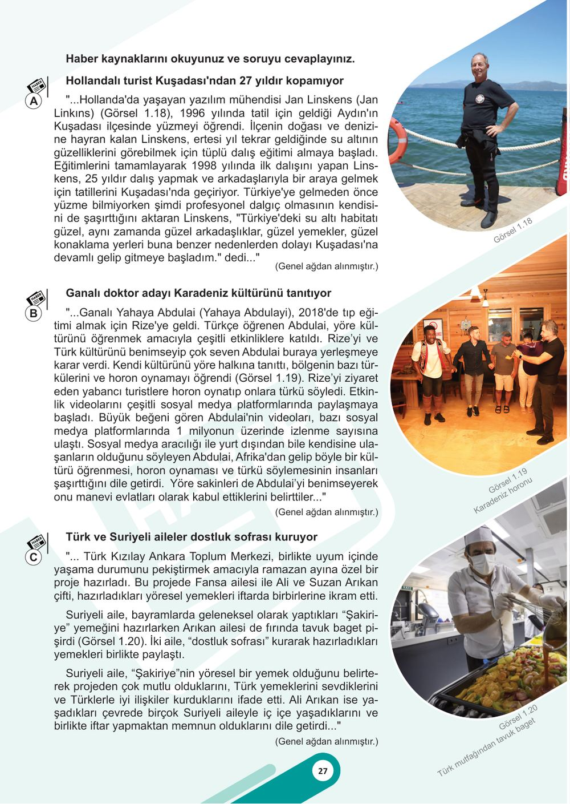
Görsel 1.18

**B**
" **Ganalı doktor adayı Karadeniz kültürünü tanıtıyor**
"...Ganalı Yahaya Abdulai (Yahaya Abdulayi), 2018'de tıp eğitimi almak için Rize'ye geldi. Türkçe öğrenen Abdulai, yöre kültürünü öğrenmek amacıyla çeşitli etkinliklere katıldı. Rize'yi ve Türk kültürünü benimseyip çok seven Abdulai buraya yerleşmeye karar verdi. Kendi kültürünü yöre halkına tanıttı, bölgenin bazı türkülerini ve horon oynamayı öğrendi (Görsel 1.19). Rize'yi ziyaret eden yabancı turistlere horon oynatıp onlara türkü söyledi. Etkinlik videolarını çeşitli sosyal medya platformlarında paylaşmaya başladı. Büyük beğeni gören Abdulai'nin videoları, bazı sosyal medya platformlarında 1 milyonun üzerinde izlenme sayısına ulaştı. Sosyal medya aracılığı ile yurt dışından bile kendisine ulaşanların olduğunu söyleyen Abdulai, Afrika'dan gelip böyle bir kültürü öğrenmesi, horon oynaması ve türkü söylemesinin insanları şaşırttığını dile getirdi. Yöre sakinleri de Abdulai'yi benimseyerek onu manevi evlatları olarak kabul ettiklerini belirttiler..."
(Genel ağdan alınmıştır.)"


Görsel 1.19
Karadeniz horonu

**C**
" **Türk ve Suriyeli aileler dostluk sofrası kuruyor**
"... Türk Kızılay Ankara Toplum Merkezi, birlikte uyum içinde yaşama durumunu pekiştirmek amacıyla ramazan ayına özel bir proje hazırladı. Bu projede Fansa ailesi ile Ali ve Suzan Arıkan çifti, hazırladıkları yöresel yemekleri iftarda birbirlerine ikram etti.
Suriyeli aile, bayramlarda geleneksel olarak yaptıkları “Şakiriye” yemeğini hazırlarken Arıkan ailesi de fırında tavuk baget pişirdi (Görsel 1.20). İki aile, “dostluk sofrası” kurarak hazırladıkları yemekleri birlikte paylaştı.
Suriyeli aile, “Şakiriye”nin yöresel bir yemek olduğunu belirterek projeden çok mutlu olduklarını, Türk yemeklerini sevdiklerini ve Türklerle iyi ilişkiler kurduklarını ifade etti. Ali Arıkan ise yaşadıkları çevrede birçok Suriyeli aileyle iç içe yaşadıklarını ve birlikte iftar yapmaktan memnun olduklarını dile getirdi...""


Görsel 1.20
tavuk baget

<!-- sayfa 27 -->

# ANADOLU AJANSI
GÜNDEM DÜNYA EKONOMİ SPOR ANALİZ KÜLTÜR VİDEO

## Döner, Almanya’da en çok tercih edilen yiyeceklerden oldu
Almanya'da fast food (fest fut) olarak anılan ve hazır yiyecek kategorisinde bulunan döner, ülkenin meşhur köri soslu sosisi currywurstü (körivörst) geride bırakarak en popüler yemek hâline geldi.
(Genel ağdan alınmıştır.)

1961-1973 yılları arasında Almanya’dan gelen işçi talebi üzerine ülkemizden Almanya’ya birçok insanımız çalışmak için gitmiştir. Bu durum iki ülke arasındaki ilişkilerin gelişmesini sağlamış, kültürlerin uyum içinde yaşamasına ortam hazırlamıştır. "Türkler tarafından getirilen yiyecek" olarak ün yapan döner, Almanların damak tadı ve tüketim alışkanlıklarında yer edinmiştir. Almanya’nın birçok şehrinde döner lokantaları açılmıştır.

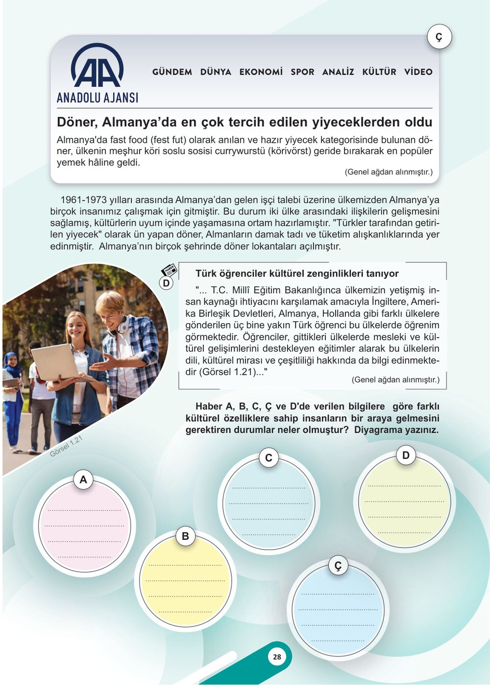
**Türk öğrenciler kültürel zenginlikleri tanıyor**
"... T.C. Millî Eğitim Bakanlığınca ülkemizin yetişmiş insan kaynağı ihtiyacını karşılamak amacıyla İngiltere, Amerika Birleşik Devletleri, Almanya, Hollanda gibi farklı ülkelere gönderilen üç bine yakın Türk öğrenci bu ülkelerde öğrenim görmektedir. Öğrenciler, gittikleri ülkelerde mesleki ve kültürel gelişimlerini destekleyen eğitimler alarak bu ülkelerin dili, kültürel mirası ve çeşitliliği hakkında da bilgi edinmektedir (Görsel 1.21)..."
(Genel ağdan alınmıştır.)

**Haber A, B, C, Ç ve D'de verilen bilgilere göre farklı kültürel özelliklere sahip insanların bir araya gelmesini gerektiren durumlar neler olmuştur? Diyagrama yazınız.**

A
B
C
Ç
D

<!-- sayfa 28 -->

Ülkemize yurt dışından eğitim veya turizm amaçlı birçok misafir gelmektedir (Görsel 1.22). Bizler, kültürümüzün önemli bir değeri olan Türk misafirperverliği gereği ülkemize gelen misafirleri dil, din, renk ayrımı yapmadan saygı ve sevgiyle karşılarız. Misafirperverliğimizden ve kültürel saygımızdan etkilenen bu misafirlerin bir kısmı ülkemize yerleşmeyi tercih etmektedir. Bu durum ülkeler arası etkileşimi artırır. Milletler arasındaki ön yargıları ortadan kaldırarak bir arada mutlu ve huzurlu bir şekilde yaşamamız için ortam sağlar. Aşağıda karekod ile verilen içerikte bu duruma örnekler yer almaktadır.

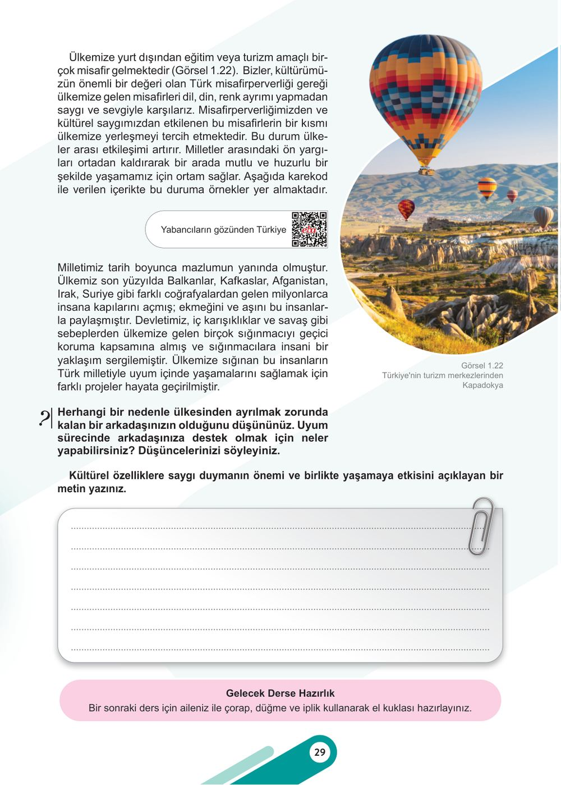
Yabancıların gözünden Türkiye [Karekod]

Milletimiz tarih boyunca mazlumun yanında olmuştur. Ülkemiz son yüzyılda Balkanlar, Kafkaslar, Afganistan, Irak, Suriye gibi farklı coğrafyalardan gelen milyonlarca insana kapılarını açmış; ekmeğini ve aşını bu insanlarla paylaşmıştır. Devletimiz, iç karışıklıklar ve savaş gibi sebeplerden ülkemize gelen birçok sığınmacıyı geçici koruma kapsamına almış ve sığınmacılara insani bir yaklaşım sergilemiştir. Ülkemize sığınan bu insanların Türk milletiyle uyum içinde yaşamalarını sağlamak için farklı projeler hayata geçirilmiştir.


Görsel 1.22
Türkiye'nin turizm merkezlerinden Kapadokya

2. Herhangi bir nedenle ülkesinden ayrılmak zorunda kalan bir arkadaşınızın olduğunu düşününüz. Uyum sürecinde arkadaşınıza destek olmak için neler yapabilirsiniz? Düşüncelerinizi söyleyiniz.

Kültürel özelliklere saygı duymanın önemi ve birlikte yaşamaya etkisini açıklayan bir metin yazınız.

[Boş yazı alanı]

### Gelecek Derse Hazırlık
Bir sonraki ders için aileniz ile çorap, düğme ve iplik kullanarak el kuklası hazırlayınız.

<!-- sayfa 29 -->

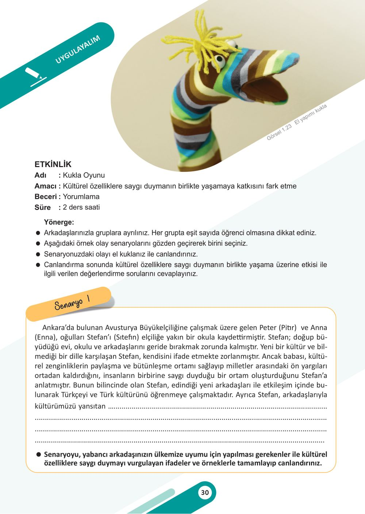

# UYGULAYALIM

## ETKİNLİK
**Adı** : Kukla Oyunu  
**Amacı** : Kültürel özelliklere saygı duymanın birlikte yaşamaya katkısını fark etme  
**Beceri** : Yorumlama  
**Süre** : 2 ders saati

**Yönerge:**
* Arkadaşlarınızla gruplara ayrılınız. Her grupta eşit sayıda öğrenci olmasına dikkat ediniz.
* Aşağıdaki örnek olay senaryolarını gözden geçirerek birini seçiniz.
* Senaryonuzdaki olayı el kuklanız ile canlandırınız.
* Canlandırma sonunda kültürel özelliklere saygı duymanın birlikte yaşama üzerine etkisi ile ilgili verilen değerlendirme sorularını cevaplayınız.

[[SEKIL:1.23]] El yapımı kukla

### Senaryo 1

Ankara’da bulunan Avusturya Büyükelçiliğine çalışmak üzere gelen Peter (Pitır) ve Anna (Enna), oğulları Stefan’ı (Sıtefın) elçiliğe yakın bir okula kaydettirmiştir. Stefan; doğup büyüdüğü evi, okulu ve arkadaşlarını geride bırakmak zorunda kalmıştır. Yeni bir kültür ve bilmediği bir dille karşılaşan Stefan, kendisini ifade etmekte zorlanmıştır. Ancak babası, kültürel zenginliklerin paylaşma ve bütünleşme ortamı sağlayıp milletler arasındaki ön yargıları ortadan kaldırdığını, insanların birbirine saygı duyduğu bir ortam oluşturduğunu Stefan’a anlatmıştır. Bunun bilincinde olan Stefan, edindiği yeni arkadaşları ile etkileşim içinde bulunarak Türkçeyi ve Türk kültürünü öğrenmeye çalışmaktadır. Ayrıca Stefan, arkadaşlarıyla kültürümüzü yansıtan .................................................................................................................................................................................................................................................................................................................................................................................................................................................................................................................................................................................................................................

<!-- sayfa 30 -->

# Senaryo 2

İstanbul doğumlu yetenekli bir sporcu, küçük yaşta başladığı futbol kariyerine yeni bir sayfa ekleyerek İspanya’nın büyük bir futbol takımına transfer oldu. Genç yetenek, bu transfer ile Türkiye'den yurt dışına giden en genç sporculardan biri oldu. Yabancı olduğu bir kültür ve ülkede futbolun sosyal hayata uyum sağlamasına katkıda bulunduğunu dile getiren genç futbolcu, İspanya futboluna renk kattı. Genç sporcu futbol sayesinde farklı ülkelerden sporcuların bir araya geldiğini, kaynaştığını söyledi. Bir Türk olarak İspanya’da top koşturan futbolcu hem İspanya hem de Türk kültürünün temsilcisi oldu. Futbolun saygı, nezaket, anlayış gibi olumlu duyguları geliştirdiğini ve ön yargıları da ortadan kaldırdığını söyleyen futbolcu, futbol sayesinde paylaşımcılığın .............................................................
.................................................................................................................................................
.................................................................................................................................................
................................................................................................................................................
................................................................................................................................................

● **Senaryoyu, gittiğiniz ülkedeki insanlarla uyum içinde yaşama kültürü oluşturmaya katkıda bulunacak ifadeler ve örneklerle tamamlayıp canlandırınız.**

# Senaryo 3

Güney Kore’de yaşarken daha önce de Türkiye’ye turist olarak gelen Jae (Ce) ailesi Mersin’e yerleşmeye karar verdi. Yerleşme kararı alırken gördükleri doğal güzelliklerin yanı sıra insanların gösterdiği ilgi ve sevgiyi de dikkate aldıklarını belirten Jae ailesi, çiftçilikle uğraşmaya karar verdi. Daha önce farklı ülkelerde de yaşayan aile, Türk kültürüne alışmakta zorluk yaşamadıklarını ifade etti. Büyüklere gösterilen saygı, dayanışma duygusu gibi ortak kültürel özelliklerimiz var. Tabii ki farklılıklar da var ancak ..................................................
................................................................................................................................................
................................................................................................................................

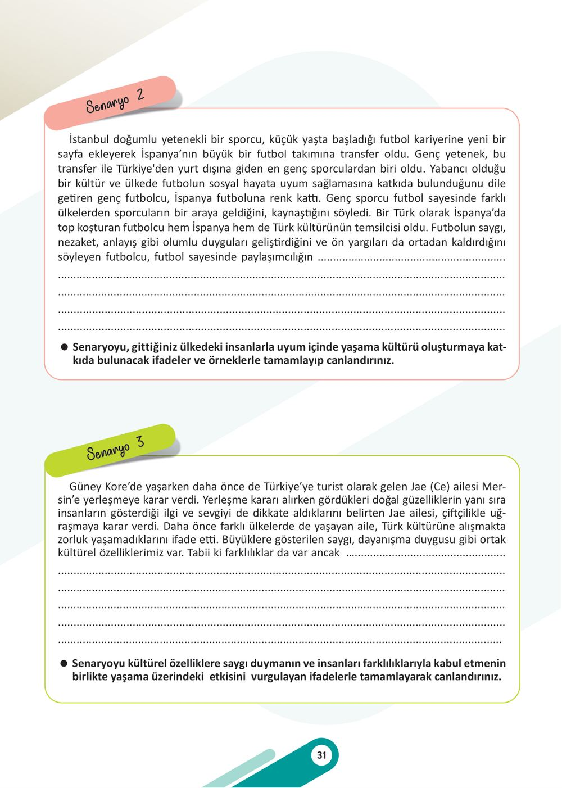
<!-- yer tutucu bulunamadı: sayfa sonuna eklendi -->

<!-- sayfa 31 -->

# DEĞERLENDİRELİM

Aşağıdaki bulmacayı çözünüz.

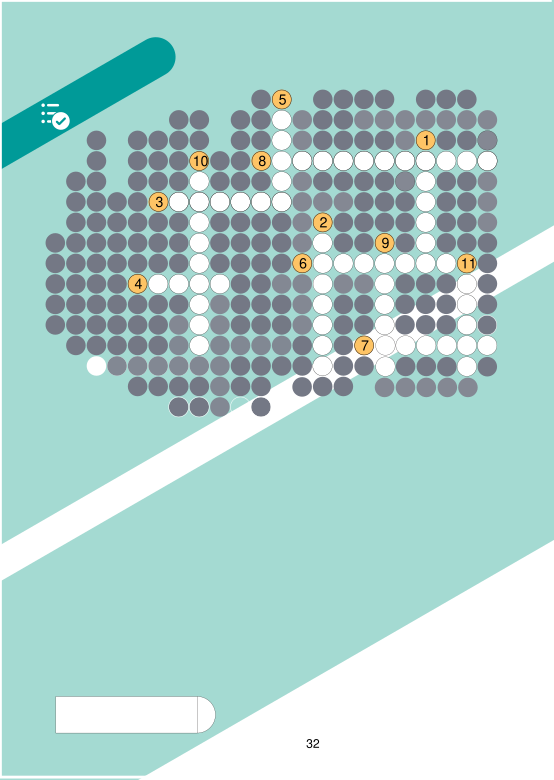

1. Birçok ögeden oluşan toplum fertlerini birbirine yakınlaştırarak toplum fertlerinin dayanışma içinde olmalarını sağlayan değerler bütünüdür.
2. Kırk sekiz taş ile oynanan geleneksel bir zekâ oyunudur.
3. Hem ülkemizde hem de KKTC'de giyilen, kolları uzun yırtmaçlı, bir tür kısa ve yakasız kıyafettir.
4. Su üzerindeki desenlerin kâğıda aktarılmasına dayanan geleneksel el sanatımızdır.
5. Karadeniz kültüründe kemençe ile oynanan bir halk oyunudur.
6. 23 Nisan Ulusal Egemenlik ve Çocuk Bayramı'nı çocuklara armağan eden ve dünya barışına katkıda bulunan liderdir.
7. Aydın, Muğla gibi Ege illerimize özgü bir halk oyunudur.
8. KKTC'nin kurucusu ve ilk cumhurbaşkanıdır.
9. Dinlenme, görme, tanıma vb. amaçlarla yapılan ve milletlerin uyum içinde yaşamasına hizmet eden ekonomik faaliyet alanıdır.
10. Kültürel zenginliklerin kültürümüz ile bazı yönlerden kesişmesi, emsal olma durumudur.
11. Almanya'ya Türkler tarafından tanıtılan ve bir demire geçirilmiş etlerin döndürülerek pişirilmesiyle yapılan bir tür kebaptır.

<!-- sayfa 32 -->

# Aşağıdaki metinleri okuyunuz ve soruları cevaplayınız.

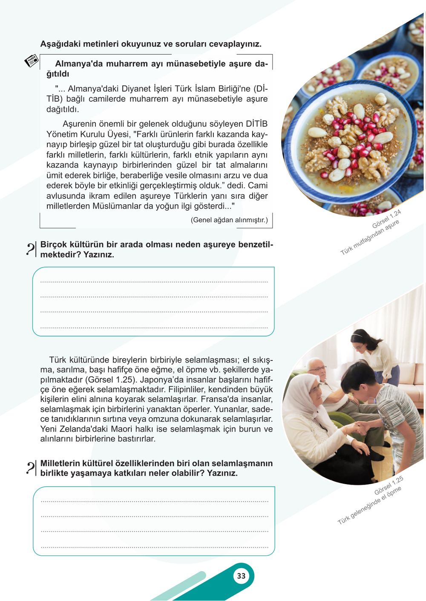

**Almanya'da muharrem ayı münasebetiyle aşure dağıtıldı**

"... Almanya'daki Diyanet İşleri Türk İslam Birliği'ne (DİTİB) bağlı camilerde muharrem ayı münasebetiyle aşure dağıtıldı.

Aşurenin önemli bir gelenek olduğunu söyleyen DİTİB Yönetim Kurulu Üyesi, "Farklı ürünlerin farklı kazanda kaynayıp birleşip güzel bir tat oluşturduğu gibi burada özellikle farklı milletlerin, farklı kültürlerin, farklı etnik yapıların aynı kazanda kaynayıp birbirlerinden güzel bir tat almalarını ümit ederek birliğe, beraberliğe vesile olmasını arzu ve dua ederek böyle bir etkinliği gerçekleştirmiş olduk.” dedi. Cami avlusunda ikram edilen aşureye Türklerin yanı sıra diğer milletlerden Müslümanlar da yoğun ilgi gösterdi..."

(Genel ağdan alınmıştır.)

? **Birçok kültürün bir arada olması neden aşureye benzetilmektedir? Yazınız.**

[ ]

[[SEKIL:1.24]]
Türk mutfağından aşure

Türk kültüründe bireylerin birbirleriyle selamlaşması; el sıkışma, sarılma, başı hafifçe öne eğme, el öpme vb. şekillerde yapılmaktadır (Görsel 1.25). Japonya'da insanlar başlarını hafifçe öne eğerek selamlaşmaktadır. Filipinliler, kendinden büyük kişilerin elini alnına koyarak selamlaşırlar. Fransa'da insanlar, selamlaşmak için birbirlerini yanaktan öperler. Yunanlar, sadece tanıdıklarının sırtına veya omzuna dokunarak selamlaşırlar. Yeni Zelanda'daki Maori halkı ise selamlaşmak için burun ve alınlarını birbirlerine bastırırlar.

? **Milletlerin kültürel özelliklerinden biri olan selamlaşmanın birlikte yaşamaya katkıları neler olabilir? Yazınız.**

[ ]

[[SEKIL:1.25]]
Türk geleneğinde el öpme

<!-- sayfa 33 -->

# DÜŞÜNELİM

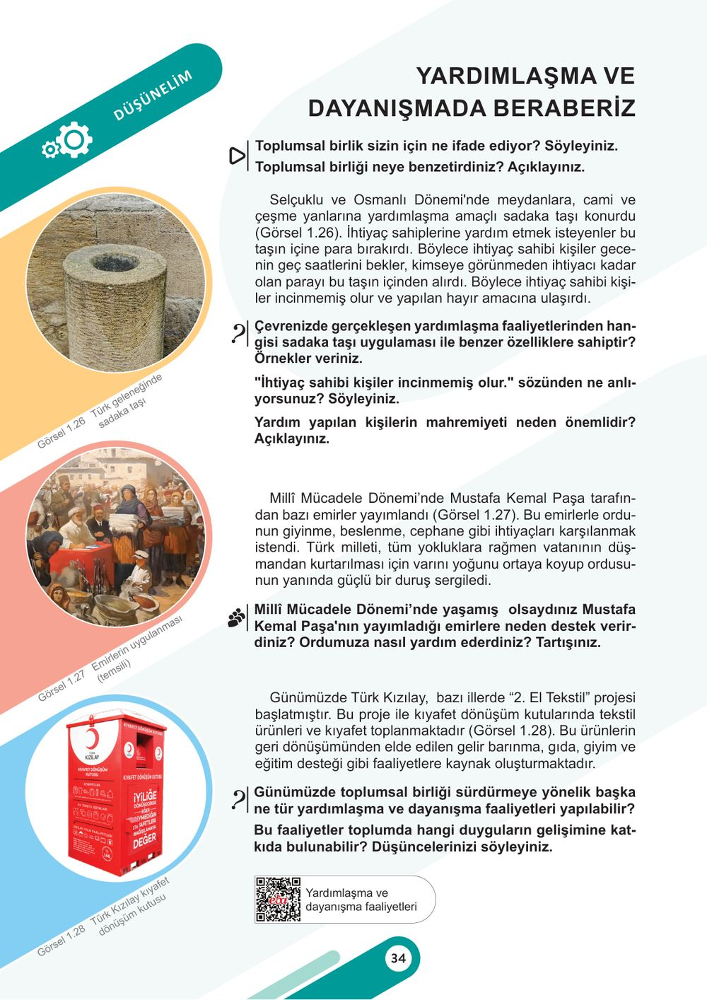 Görsel 1.26 Türk geleneğinde sadaka taşı

$\triangleright$ Toplumsal birlik sizin için ne ifade ediyor? Söyleyiniz.
Toplumsal birliği neye benzetirdiniz? Açıklayınız.

Selçuklu ve Osmanlı Dönemi'nde meydanlara, cami ve çeşme yanlarına yardımlaşma amaçlı sadaka taşı konurdu (Görsel 1.26). İhtiyaç sahiplerine yardım etmek isteyenler bu taşın içine para bırakırdı. Böylece ihtiyaç sahibi kişiler gecenin geç saatlerini bekler, kimseye görünmeden ihtiyacı kadar olan parayı bu taşın içinden alırdı. Böylece ihtiyaç sahibi kişiler incinmemiş olur ve yapılan hayır amacına ulaşırdı.

$?$ Çevrenizde gerçekleşen yardımlaşma faaliyetlerinden hangisi sadaka taşı uygulaması ile benzer özelliklere sahiptir? Örnekler veriniz.

"İhtiyaç sahibi kişiler incinmemiş olur." sözünden ne anlıyorsunuz? Söyleyiniz.

Yardım yapılan kişilerin mahremiyeti neden önemlidir? Açıklayınız.

 Görsel 1.27 Emirlerin uygulanması (temsili)

Millî Mücadele Dönemi'nde Mustafa Kemal Paşa tarafından bazı emirler yayımlandı (Görsel 1.27). Bu emirlerle ordunun giyinme, beslenme, cephane gibi ihtiyaçları karşılanmak istendi. Türk milleti, tüm yokluklara rağmen vatanının düşmandan kurtarılması için varını yoğunu ortaya koyup ordusunun yanında güçlü bir duruş sergiledi.

$\text{\small\faUsers}$ Millî Mücadele Dönemi'nde yaşamış olsaydınız Mustafa Kemal Paşa'nın yayımladığı emirlere neden destek verirdiniz? Ordumuza nasıl yardım ederdiniz? Tartışınız.

 Kızılay kıyafet kutusu

Günümüzde Türk Kızılay, bazı illerde "2. El Tekstil" projesi başlatmıştır. Bu proje ile kıyafet dönüşüm kutularında tekstil ürünleri ve kıyafet toplanmaktadır (Görsel 1.28). Bu ürünlerin geri dönüşümünden elde edilen gelir barınma, gıda, giyim ve eğitim desteği gibi faaliyetlere kaynak oluşturmaktadır.

$?$ Günümüzde toplumsal birliği sürdürmeye yönelik başka ne tür yardımlaşma ve dayanışma faaliyetleri yapılabilir?
Bu faaliyetler toplumda hangi duyguların gelişimine katkıda bulunabilir? Düşüncelerinizi söyleyiniz.

---
 Yardımlaşma ve dayanışma faaliyetleri

<!-- sayfa 34 -->

# TÜRKİYE CUMHURİYETİ AİLE VE SOSYAL HİZMETLER BAKANLIĞI

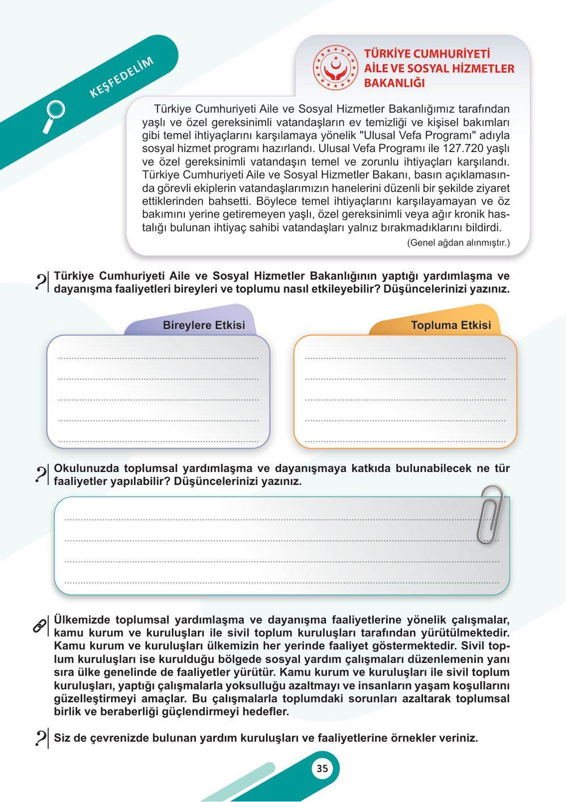

Türkiye Cumhuriyeti Aile ve Sosyal Hizmetler Bakanlığımız tarafından yaşlı ve özel gereksinimli vatandaşların ev temizliği ve kişisel bakımları gibi temel ihtiyaçlarını karşılamaya yönelik "Ulusal Vefa Programı" adıyla sosyal hizmet programı hazırlandı. Ulusal Vefa Programı ile 127.720 yaşlı ve özel gereksinimli vatandaşın temel ve zorunlu ihtiyaçları karşılandı. Türkiye Cumhuriyeti Aile ve Sosyal Hizmetler Bakanı, basın açıklamasında görevli ekiplerin vatandaşlarımızın hanelerini düzenli bir şekilde ziyaret ettiklerinden bahsetti. Böylece temel ihtiyaçlarını karşılayamayan ve öz bakımını yerine getiremeyen yaşlı, özel gereksinimli veya ağır kronik hastalığı bulunan ihtiyaç sahibi vatandaşları yalnız bırakmadıklarını bildirdi.
(Genel ağdan alınmıştır.)

? Türkiye Cumhuriyeti Aile ve Sosyal Hizmetler Bakanlığının yaptığı yardımlaşma ve dayanışma faaliyetleri bireyleri ve toplumu nasıl etkileyebilir? Düşüncelerinizi yazınız.

| Bireylere Etkisi | Topluma Etkisi |
| :--- | :--- |
| | |

? Okulunuzda toplumsal yardımlaşma ve dayanışmaya katkıda bulunabilecek ne tür faaliyetler yapılabilir? Düşüncelerinizi yazınız.


Ülkemizde toplumsal yardımlaşma ve dayanışma faaliyetlerine yönelik çalışmalar, kamu kurum ve kuruluşları ile sivil toplum kuruluşları tarafından yürütülmektedir. Kamu kurum ve kuruluşları ülkemizin her yerinde faaliyet göstermektedir. Sivil toplum kuruluşları ise kurulduğu bölgede sosyal yardım çalışmaları düzenlemenin yanı sıra ülke genelinde de faaliyetler yürütür. Kamu kurum ve kuruluşları ile sivil toplum kuruluşları, yaptığı çalışmalarla yoksulluğu azaltmayı ve insanların yaşam koşullarını güzelleştirmeyi amaçlar. Bu çalışmalarla toplumdaki sorunları azaltarak toplumsal birlik ve beraberliği güçlendirmeyi hedefler.

<!-- sayfa 35 -->

# ÖĞRENELİM

Aşağıda sosyal sorumluluk projesine örnek verilmiştir. Örnek projeyi okuyunuz ve siz de benzer bir proje hazırlayınız.

Türk toplumunun önemli özelliklerinden biri yardımlaşma ve dayanışmaya önem vermesidir. İyi ve kötü günlerde birlik ve beraberlik içinde hareket etmesidir. Milletimiz sevinçleri paylaşarak çoğaltmış, hüzünleri omuz omuza vererek azaltmıştır. Geçmişten günümüze bunun birçok örneği bulunmaktadır. Asrın felaketi olarak adlandırılan 6 Şubat 2023’te Kahramanmaraş merkezli ve birçok ilimizi etkileyen deprem milletçe yaşadığımız büyük felaketlerdendir. Bu felaket karşısında halkımız tek yürek olup depremzedelerin yaralarını sarmaya çalışmış, maddi ve manevi yardımlar yaparak depremzedelere her türlü desteği sağlamaya gayret etmiştir (Görsel 1.29). Bu doğrultuda Uğur Öğretmen’in sosyal bilgiler dersinde öğrencileriyle yaptıkları yardımlaşma ve dayanışma çalışmasını inceleyelim.

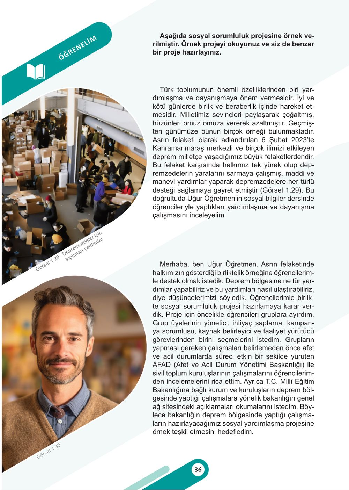 Görsel 1.29 Depremzedeler için toplanan yardımlar

Merhaba, ben Uğur Öğretmen. Asrın felaketinde halkımızın gösterdiği birliktelik örneğine öğrencilerimle destek olmak istedik. Deprem bölgesine ne tür yardımlar yapabiliriz ve bu yardımları nasıl ulaştırabiliriz, diye düşüncelerimizi söyledik. Öğrencilerimle birlikte sosyal sorumluluk projesi hazırlamaya karar verdik. Proje için öncelikle öğrencileri gruplara ayırdım. Grup üyelerinin yönetici, ihtiyaç saptama, kampanya sorumlusu, kaynak belirleyici ve faaliyet yürütücü görevlerinden birini seçmelerini istedim. Grupların yapması gereken çalışmaları belirlemeden önce afet ve acil durumlarda süreci etkin bir şekilde yürüten AFAD (Afet ve Acil Durum Yönetimi Başkanlığı) ile sivil toplum kuruluşlarının çalışmalarını incelemelerini rica ettim. Ayrıca T.C. Millî Eğitim Bakanlığına bağlı kurum ve kuruluşların deprem bölgesinde yaptığı çalışmalara yönelik bakanlığın genel ağ sitesindeki açıklamaları okumalarını istedim. Böylece bakanlığın deprem bölgesinde yaptığı çalışmaların hazırlayacağımız sosyal yardımlaşma projesine örnek teşkil etmesini hedefledim.

30

<!-- sayfa 36 -->

# T.C. MİLLÎ EĞİTİM BAKANLIĞI | TÜRKİYE YÜZYILI 100. TÜRKİYE CUMHURİYETİNİN YÜZÜNCÜ YILI

T.C. Millî Eğitim Bakanlığı, depremin ilk gününden itibaren depremzedelerin yanında yer aldı. Okullar, pansiyonlar, öğretmenevleri ve uygulama otelleri vatandaşlarımızın barınma ihtiyacını karşılamak için hizmete açıldı. Bakanlığımızın arama kurtarma birimi olan MEB AKUB ekibinde görevli öğretmenler, arama kurtarma çalışmalarına destek verdi. Meslek liseleri, halk eğitim merkezleri ve olgunlaşma enstitülerimizde çadır, uyku tulumu ve battaniye üretilerek bölgeye ulaştırıldı. Ayrıca meslek liselerinde üretilen soba, yatak, atkı ve bereler vatandaşlarımıza ulaştırılmak üzere bölgeye sevk edildi.
(Genel ağdan alınmıştır.)

T.C. Millî Eğitim Bakanlığının genel ağ sitesindeki açıklamalardan deprem bölgesine yönelik bakanlığın yaptığı çalışmaları öğrendik. Biz de deprem bölgesine nasıl bir sosyal sorumluluk projesi yapabileceğimize yönelik fikir yürütmeye başladık.

**Sosyal sorumluluk projesine yönelik fikirlerinizi örnekteki gibi tabloya yazınız. Fikirlerinizin güçlü ve zayıf yönlerini belirleyiniz.**

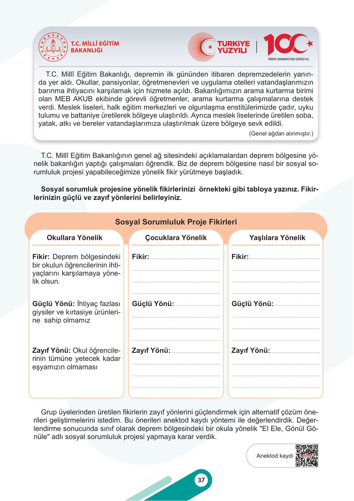

### Sosyal Sorumluluk Proje Fikirleri

| Okullara Yönelik | Çocuklara Yönelik | Yaşlılara Yönelik |
| :--- | :--- | :--- |
| **Fikir:** Deprem bölgesindeki bir okulun öğrencilerinin ihtiyaçlarını karşılamaya yönelik olsun. | **Fikir:**<br>..................................................<br>..................................................<br>..................................................<br> | **Fikir:**<br>..................................................<br>..................................................<br>..................................................<br> |
| **Güçlü Yönü:** İhtiyaç fazlası giysiler ve kırtasiye ürünlerine sahip olmamız | **Güçlü Yönü:**<br>..................................................<br>..................................................<br>..................................................<br> | **Güçlü Yönü:**<br>..................................................<br>..................................................<br>..................................................<br> |
| **Zayıf Yönü:** Okul öğrencilerinin tümüne yetecek kadar eşyamızın olmaması | **Zayıf Yönü:**<br>..................................................<br>..................................................<br>..................................................<br> | **Zayıf Yönü:**<br>..................................................<br>..................................................<br>..................................................<br> |

Grup üyelerinden üretilen fikirlerin zayıf yönlerini güçlendirmek için alternatif çözüm önerileri geliştirmelerini istedim. Bu önerileri anekdot kaydı yöntemi ile değerlendirdik. Değerlendirme sonucunda sınıf olarak deprem bölgesindeki bir okula yönelik "El Ele, Gönül Gönüle" adlı sosyal sorumluluk projesi yapmaya karar verdik.


<!-- sayfa 37 -->

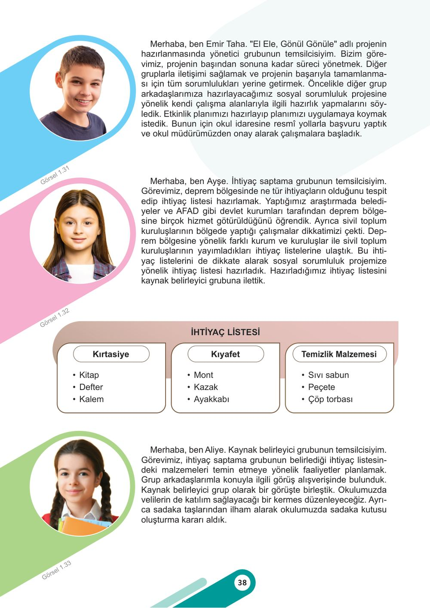 Merhaba, ben Emir Taha. "El Ele, Gönül Gönüle" adlı projenin hazırlanmasında yönetici grubunun temsilcisiyim. Bizim görevimiz, projenin başından sonuna kadar süreci yönetmek. Diğer gruplarla iletişimi sağlamak ve projenin başarıyla tamamlanması için tüm sorumlulukları yerine getirmek. Öncelikle diğer grup arkadaşlarımıza hazırlayacağımız sosyal sorumluluk projesine yönelik kendi çalışma alanlarıyla ilgili hazırlık yapmalarını söyledik. Etkinlik planımızı hazırlayıp planımızı uygulamaya koymak istedik. Bunun için okul idaresine resmî yollarla başvuru yaptık ve okul müdürümüzden onay alarak çalışmalara başladık.

 Merhaba, ben Ayşe. İhtiyaç saptama grubunun temsilcisiyim. Görevimiz, deprem bölgesinde ne tür ihtiyaçların olduğunu tespit edip ihtiyaç listesi hazırlamak. Yaptığımız araştırmada belediyeler ve AFAD gibi devlet kurumları tarafından deprem bölgesine birçok hizmet götürüldüğünü öğrendik. Ayrıca sivil toplum kuruluşlarının bölgede yaptığı çalışmalar dikkatimizi çekti. Deprem bölgesine yönelik farklı kurum ve kuruluşlar ile sivil toplum kuruluşlarının yayımladıkları ihtiyaç listelerine ulaştık. Bu ihtiyaç listelerini de dikkate alarak sosyal sorumluluk projemize yönelik ihtiyaç listesi hazırladık. Hazırladığımız ihtiyaç listesini kaynak belirleyici grubuna ilettik.

### İHTİYAÇ LİSTESİ

| Kırtasiye | Kıyafet | Temizlik Malzemesi |
| :--- | :--- | :--- |
| • Kitap<br>• Defter<br>• Kalem | • Mont<br>• Kazak<br>• Ayakkabı | • Sıvı sabun<br>• Peçete<br>• Çöp torbası |

 Merhaba, ben Aliye. Kaynak belirleyici grubunun temsilcisiyim. Görevimiz, ihtiyaç saptama grubunun belirlediği ihtiyaç listesindeki malzemeleri temin etmeye yönelik faaliyetler planlamak. Grup arkadaşlarımla konuyla ilgili görüş alışverişinde bulunduk. Kaynak belirleyici grup olarak bir görüşte birleştik. Okulumuzda velilerin de katılım sağlayacağı bir kermes düzenleyeceğiz. Ayrıca sadaka taşlarından ilham alarak okulumuzda sadaka kutusu oluşturma kararı aldık.

<!-- sayfa 38 -->

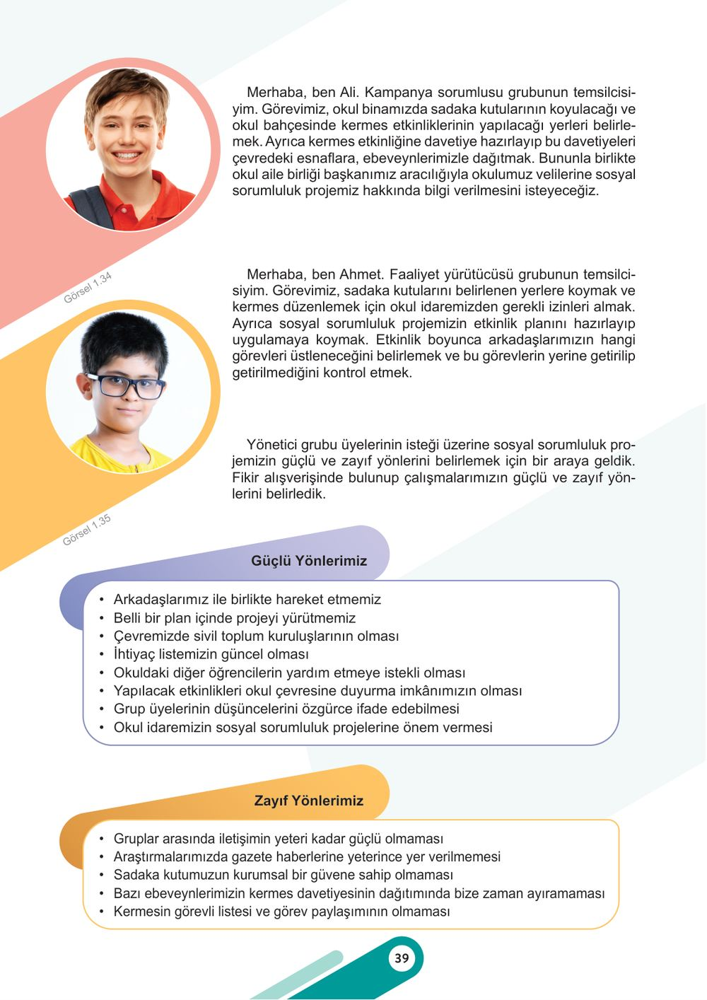 Görsel 1.34

Merhaba, ben Ali. Kampanya sorumlusu grubunun temsilcisiyim. Görevimiz, okul binamızda sadaka kutularının koyulacağı ve okul bahçesinde kermes etkinliklerinin yapılacağı yerleri belirlemek. Ayrıca kermes etkinliğine davetiye hazırlayıp bu davetiyeleri çevredeki esnaflara, ebeveynlerimizle dağıtmak. Bununla birlikte okul aile birliği başkanımız aracılığıyla okulumuz velilerine sosyal sorumluluk projemiz hakkında bilgi verilmesini isteyeceğiz.

 Görsel 1.35

Merhaba, ben Ahmet. Faaliyet yürütücüsü grubunun temsilcisiyim. Görevimiz, sadaka kutularını belirlenen yerlere koymak ve kermes düzenlemek için okul idaremizden gerekli izinleri almak. Ayrıca sosyal sorumluluk projemizin etkinlik planını hazırlayıp uygulamaya koymak. Etkinlik boyunca arkadaşlarımızın hangi görevleri üstleneceğini belirlemek ve bu görevlerin yerine getirilip getirilmediğini kontrol etmek.

Yönetici grubu üyelerinin isteği üzerine sosyal sorumluluk projemizin güçlü ve zayıf yönlerini belirlemek için bir araya geldik. Fikir alışverişinde bulunup çalışmalarımızın güçlü ve zayıf yönlerini belirledik.

### Güçlü Yönlerimiz

* Arkadaşlarımız ile birlikte hareket etmemiz
* Belli bir plan içinde projeyi yürütmemiz
* Çevremizde sivil toplum kuruluşlarının olması
* İhtiyaç listemizin güncel olması
* Okuldaki diğer öğrencilerin yardım etmeye istekli olması
* Yapılacak etkinlikleri okul çevresine duyurma imkânımızın olması
* Grup üyelerinin düşüncelerini özgürce ifade edebilmesi
* Okul idaremizin sosyal sorumluluk projelerine önem vermesi

### Zayıf Yönlerimiz

* Gruplar arasında iletişimin yeteri kadar güçlü olmaması
* Araştırmalarımızda gazete haberlerine yeterince yer verilmemesi
* Sadaka kutumuzun kurumsal bir güvene sahip olmaması
* Bazı ebeveynlerimizin kermes davetiyesinin dağıtımında bize zaman ayıramaması
* Kermesin görevli listesi ve görev paylaşımının olmaması

<!-- sayfa 39 -->

Gruplarla yaptığımız fikir alışverişi sonrasında zayıf yönlerimizi güçlendirmek için kararlar aldık. Grup içinde iletişimi güçlendirmek adına ebeveynlerimizin izniyle elektronik posta (e-posta) adresi açtık. Basında yer alan yardım haberlerinde çanta ve boya kalemlerine de ihtiyaç olduğunu öğrendik. İhtiyaç listesine bu malzemeleri de ekledik. Sadaka kutumuza kurumsal bir güven kazandırmak için Türk Kızılayı ile iletişime geçmeye karar verdik. Okulda düzenleyeceğimiz kermes için okul idaresine dilekçe ile başvurup okul idaresinden izin aldık. Kermes davetiyelerini dağıtmak üzere arkadaşlarımızdan ebeveynleri gündüz çalışanların yerine öğretmenlerimizden yardım isteme kararı aldık. Kermesin görevli listesini ve görev paylaşımını önceden belirledik. Bir taraftan etkinlik planımızı hazırlarken diğer taraftan da yapacağımız faaliyetlerle ilgili yasal izin işlemlerimizi başlatma kararı aldık. Türk Kızılaya dilekçe vererek okulumuza bağış kutusu koymalarını istedik.

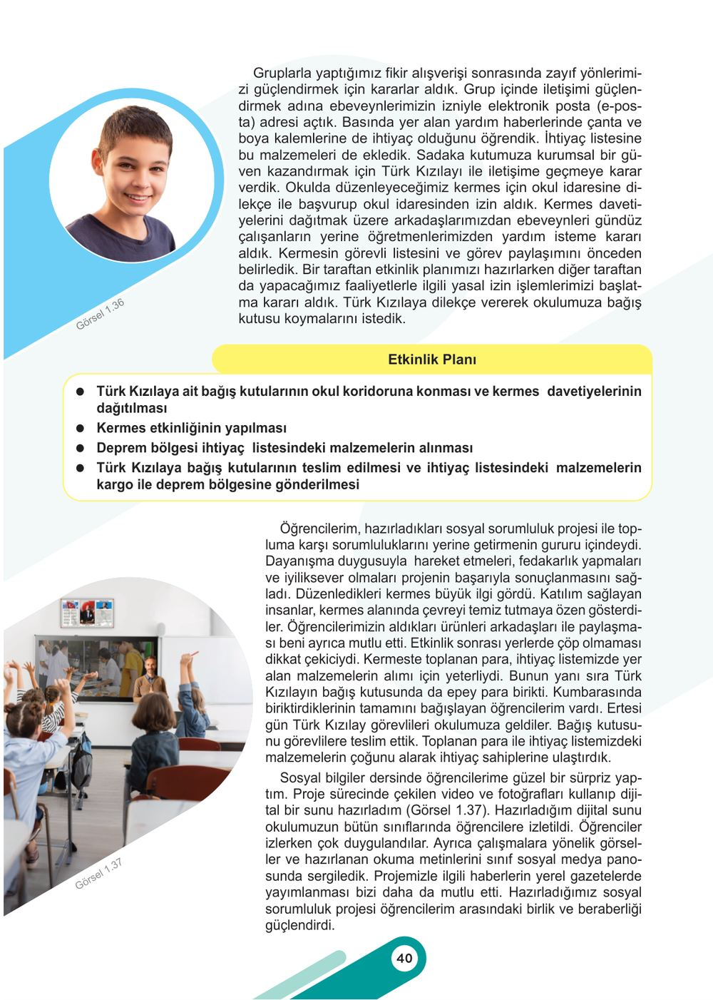

# Etkinlik Planı

* Türk Kızılayına ait bağış kutularının okul koridoruna konması ve kermes davetiyelerinin dağıtılması
* Kermes etkinliğinin yapılması
* Deprem bölgesi ihtiyaç listesindeki malzemelerin alınması
* Türk Kızılayına bağış kutularının teslim edilmesi ve ihtiyaç listesindeki malzemelerin kargo ile deprem bölgesine gönderilmesi

Öğrencilerim, hazırladıkları sosyal sorumluluk projesi ile topluma karşı sorumluluklarını yerine getirmenin gururu içindeydi. Dayanışma duygusuyla hareket etmeleri, fedakarlık yapmaları ve iyiliksever olmaları projenin başarıyla sonuçlanmasını sağladı. Düzenledikleri kermes büyük ilgi gördü. Katılım sağlayan insanlar, kermes alanında çevreyi temiz tutmaya özen gösterdiler. Öğrencilerimizin aldıkları ürünleri arkadaşları ile paylaşması beni ayrıca mutlu etti. Etkinlik sonrası yerlerde çöp olmaması dikkat çekiciydi. Kermeste toplanan para, ihtiyaç listemizde yer alan malzemelerin alımı için yeterliydi. Bunun yanı sıra Türk Kızılayın bağış kutusunda da epey para birikti. Kumbarasında biriktirdiklerinin tamamını bağışlayan öğrencilerim vardı. Ertesi gün Türk Kızılay görevlileri okulumuza geldiler. Bağış kutusunu görevlilere teslim ettik. Toplanan para ile ihtiyaç listemizdeki malzemelerin çoğunu alarak ihtiyaç sahiplerine ulaştırdık.

Sosyal bilgiler dersinde öğrencilerime güzel bir sürpriz yaptım. Proje sürecinde çekilen video ve fotoğrafları kullanıp dijital bir sunu hazırladım (Görsel 1.37). Hazırladığım dijital sunu okulumuzun bütün sınıflarında öğrencilere izletildi. Öğrenciler izlerken çok duygulandılar. Ayrıca çalışmalara yönelik görseller ve hazırlanan okuma metinlerini sınıf sosyal medya panosunda sergiledik. Projemizle ilgili haberlerin yerel gazetelerde yayımlanması bizi daha da mutlu etti. Hazırladığımız sosyal sorumluluk projesi öğrencilerim arasındaki birlik ve beraberliği

<!-- sayfa 40 -->

# UYGULAYALIM

**PERFORMANS GÖREVİ**
**Adı:** Sosyal Sorumluluk Projesi
**Amacı:** Sosyal sorumluluk proje fikirleri üretme
**Beceri:** Sosyal katılım
**Süre:** 2 ders saati
**Malzemeler:** Broşür ve dijital tanıtım materyalleri.

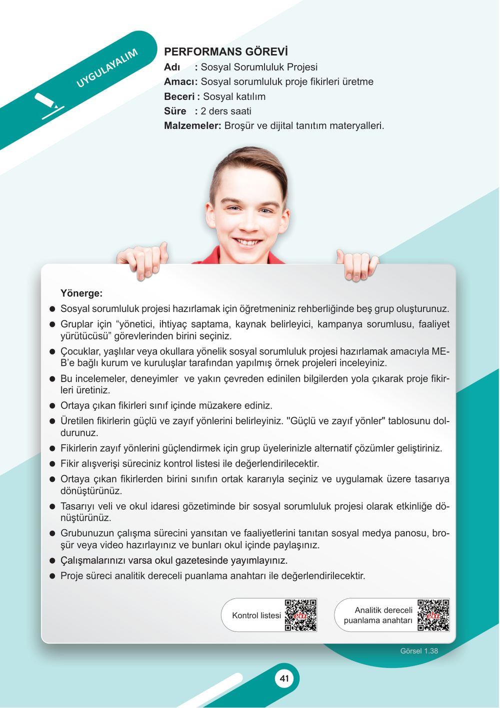

**Yönerge:**
* Sosyal sorumluluk projesi hazırlamak için öğretmeniniz rehberliğinde beş grup oluşturunuz.
* Gruplar için “yönetici, ihtiyaç saptama, kaynak belirleyici, kampanya sorumlusu, faaliyet yürütücüsü” görevlerinden birini seçiniz.
* Çocuklar, yaşlılar veya okullara yönelik sosyal sorumluluk projesi hazırlamak amacıyla MEB’e bağlı kurum ve kuruluşlar tarafından yapılmış örnek projeleri inceleyiniz.
* Bu incelemeler, deneyimler ve yakın çevreden edinilen bilgilerden yola çıkarak proje fikirleri üretiniz.
* Ortaya çıkan fikirleri sınıf içinde müzakere ediniz.
* Üretilen fikirlerin güçlü ve zayıf yönlerini belirleyiniz. "Güçlü ve zayıf yönler" tablosunu doldurunuz.
* Fikirlerin zayıf yönlerini güçlendirmek için grup üyelerinizle alternatif çözümler geliştiriniz.
* Fikir alışverişi süreciniz kontrol listesi ile değerlendirilecektir.
* Ortaya çıkan fikirlerden birini sınıfın ortak kararıyla seçiniz ve uygulamak üzere tasarıya dönüştürünüz.
* Tasarıyı veli ve okul idaresi gözetiminde bir sosyal sorumluluk projesi olarak etkinliğe dönüştürünüz.
* Grubunuzun çalışma sürecini yansıtan ve faaliyetlerini tanıtan sosyal medya panosu, broşür veya video hazırlayınız ve bunları okul içinde paylaşınız.
* Çalışmalarınızı varsa okul gazetesinde yayımlayınız.
* Proje süreci analitik dereceli puanlama anahtarı ile değerlendirilecektir.

| Kontrol listesi | Analitik dereceli puanlama anahtarı |
| :---: | :---: |
|  |  |

<!-- sayfa 41 -->

**DEĞERLENDİRELİM**

Bilgi şemasındaki örneği inceleyiniz ve cevaplarınızı ilgili alanlara yazınız.

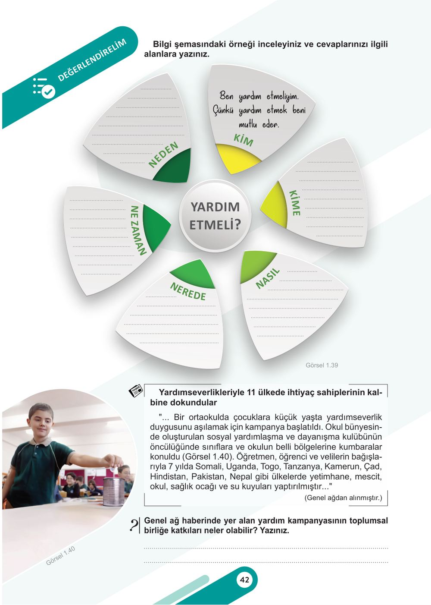

Görsel 1.39

(Şema içeriği:)
Merkez: YARDIM ETMELİ?
KİM: Ben yardım etmeliyim. Çünkü yardım etmek beni mutlu eder.
KİME:
NASIL:
NEREDE:
NE ZAMAN:
NEDEN:

---

**Yardımseverlikleriyle 11 ülkede ihtiyaç sahiplerinin kalbine dokundular**

"... Bir ortaokulda çocuklara küçük yaşta yardımseverlik duygusunu aşılamak için kampanya başlatıldı. Okul bünyesinde oluşturulan sosyal yardımlaşma ve dayanışma kulübünün öncülüğünde sınıflara ve okulun belli bölgelerine kumbaralar konuldu (Görsel 1.40). Öğretmen, öğrenci ve velilerin bağışlarıyla 7 yılda Somali, Uganda, Togo, Tanzanya, Kamerun, Çad, Hindistan, Pakistan, Nepal gibi ülkelerde yetimhane, mescit, okul, sağlık ocağı ve su kuyuları yaptırılmıştır..."
(Genel ağdan alınmıştır.)

---

? Genel ağ haberinde yer alan yardım kampanyasının toplumsal birliğe katkıları neler olabilir? Yazınız.

<!-- sayfa 42 -->

# 1. ÖĞRENME ALANI - DEĞERLER

**Meslek lisesi öğrencileri projeleri ile yardıma koşuyor**

"... Meslek lisesi öğrencileri, toplumsal birliğin oluşmasında yardımlaşma ve dayanışma konusunda farkındalık oluşturmak için yalnız yaşayan, ev işlerini yapamayan vatandaşların yardımına koşuyorlar. Ayrıca köy okullarına kütüphaneler kuruyorlar. Öğrenciler, hem mesleki deneyim kazanıyor hem de ülke ekonomisine katkıda bulunuyorlar. Yardıma gittikleri evlerde bozuk fırın, televizyon, buzdolabı, mobilya gibi eşyaların tamirini yapıyorlar. Ayrıca okullarda üretilen masa, sandalye, atkı, bere gibi ürünleri ihtiyacı olanlara hediye ediyorlar. Özel bakım ihtiyacı olan bireylere tekerlekli sandalye, protez, solunum cihazı gibi araçlar temin etmeye çalışıyorlar. Proje kapsamında bu faaliyetlerin yanı sıra on dört okula kurulan sanayi tipi fırında üretilen ramazan pideleri yüz bin ihtiyaç sahibi eve dağıtılıyor..."
(Genel ağdan alınmıştır.)

**Verilen haberlere göre projede görev alan meslek lisesi öğrencilerinde hangi değerlerin gelişebileceğini şemadaki ilgili yerlere yazınız.**

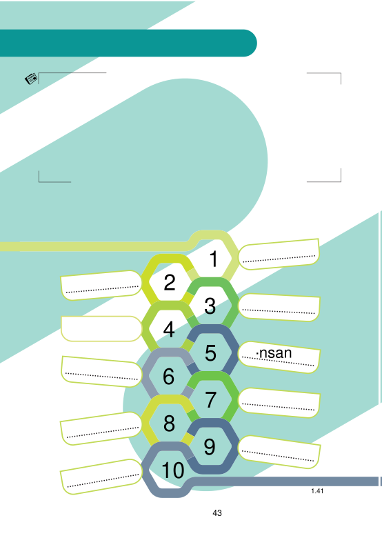

<!-- sayfa 43 -->

Aşağıdaki tabloda değerler numaralandırılarak verilmiştir. Verilen soruları tablodaki değer numaralarını kullanarak ilgili alana cevaplayınız (Bir numarayı birden fazla cevap alanında kullanabilirsiniz.).

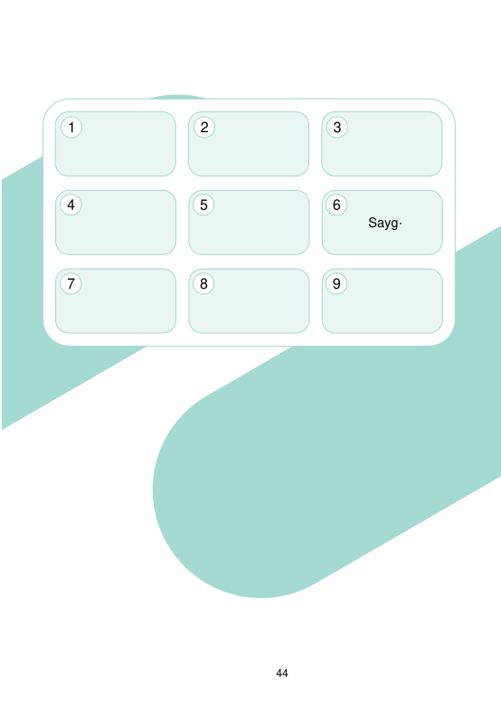

* "Her grubun kendine ait birtakım kuralları vardır. Bu kurallara uymak grup için çok önemlidir. Grubun her üyesi bu kurallara uymalıdır."

**Yukarıdaki metinde hangi değerlere vurgu yapılmıştır?**

....................................................................................................................................

* "Ülkemize yurt dışından eğitim veya turizm amaçlı birçok misafir gelmektedir. Bizler, Türk misafirperverliği gereği bu misafirlere dil, din, renk ayrımı yapmayız. Kültürel zenginliklere hep olumlu yaklaşırız."

* "Asrın felaketi olarak adlandırılan 6 Şubat 2023’te Kahramanmaraş merkezli ve birçok ilimizi etkileyen deprem milletçe yaşadığımız büyük felaketlerdendir. Bu felaket karşısında halkımız tek yürek olup depremzedelerin yaralarını sarmaya çalışmış, maddi ve manevi yardımlar yaparak depremzedelere her türlü desteği sağlamaya gayret etmiştir."

....................................................................................................................................
....................................................................................................................................

<!-- sayfa 44 -->

# 1. ÖĞRENME ALANI - ÖRNEK SORULAR

Örneklerden hareketle diyagramdaki cümlelere yönelik uygun kelimeler yazınız.

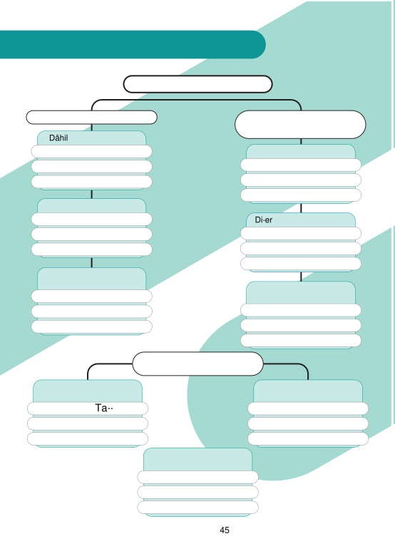

# BİRLİKTE YAŞAMAK

## GRUPLAR VE ROLLERİMİZ

* Dâhil olduğumuz gruplardır.
  * Aile, ........................................
  * ........................................
  * ........................................

* Gruplardaki rollerimizdir.
  * ........................................
  * ........................................
  * ........................................

* Rollerimizin getirdiği hak ve sorumluluklardır.
  * ........................................
  * ........................................
  * ........................................

## KÜLTÜREL ZENGİNLİKLERİN BİRLİKTE YAŞAMAYA KATKISI

* Kültürümüzden örneklerdir.
  * Zeybek oyunu, ........................................
  * ........................................
  * ........................................

* Diğer kültürlerden örneklerdir.
  * ........................................
  * ........................................
  * ........................................

* Farklı kültürlerin bir araya gelmesini sağlayan durumlardır.
  * Turizm, ........................................
  * ........................................
  * ........................................

## YARDIMLAŞMA VE DAYANIŞMADA BERABERİZ

* Geçmişimizden yardımlaşma dayanışma örnekleridir.
  * Sadaka Taşı, ........................................
  * ........................................

* Yardımlaşma dayanışma faaliyeti yapan kurumlardır.
  * ........................................
  * ........................................
  * ........................................

* Yardımlaşma dayanışma faaliyetlerinin topluma katkılarıdır.
  * ........................................
  * ........................................
  * ........................................

<!-- sayfa 45 -->

1. Merhaba arkadaşlar, ben Eren. Bugün tarifi imkânsız tecrübelerim oldu. Sevinç ve heyecanı bir arada yaşadım. Evet, bugün orkestramızla ilk konserimizi verdik. Tam bir yıl önce müzik kulübüne başlamıştım. Gitarın tellerine ilk dokunduğumda da bugünkü gibi heyecanlıydım. Kısa zamanda çok yol katettiğimi söyleyebilirim. Gitar öğretmenimin ilk gün söyledikleri dün gibi aklımda. “Kulübümüzde kalıcı olmak ve iyi bir gitarist olmak istiyorsan devamsızlığa dikkat etmeli, bol egzersiz yapmalı ve kulüp arkadaşlarınla uyum içinde olmalısın.” demişti. Kulübün kurallarına harfiyen uyduğumu söyleyebilirim. Kulübümüzdeki derslerimiz çok verimli geçiyordu. Öğretmenimiz fikirlerimize saygı duyuyor, çalmak istediğimiz şarkıları belirlememize yardımcı oluyordu. Bu süreçte ailemin desteğini de göz ardı edemem. Annem ve babam hem okulumu hem de kulüp çalışmalarımı aksatmamam konusunda bana çok yardımcı oldular. Evde egzersiz yapabilmem için bana imkân sağladılar. Ben de bu süreçte evdeki sorumluluklarımı elbette aksatmadım. Erken uyumaya özen gösterdim, ders tekrarlarımı yaptım, düzenli beslenmeye dikkat ettim ve egzersizlerden sonra odamı düzenledim.

**Buna göre aşağıdakilerden hangisi Eren'in dâhil olduğu gruplar ve bu gruplardaki rollerinden biri değildir?**

A) Aile-çocuk                                     B) Okul-öğrenci
C) Müzik kulübü-gitarist                           D) Orkestra-şef

2. **Eren'in dâhil olduğu gruplardaki rollerine ait hak ve sorumlulukları nelerdir? Yazınız.**

__________________________________________________________________________________________
__________________________________________________________________________________________
__________________________________________________________________________________________
__________________________________________________________________________________________

3. Balkanların Osmanlı hâkimiyetine girmesi ile buradaki halklarla bütünleşme sağlanarak geniş bir kültürel etkileşimin temelleri atılmıştır. Tarihsel bağlarla gelişen Türkiye ve Kuzey Makedonya arasındaki bu kültürel etkileşim, iki toplumun birbirine saygı duymasına ve birlikte, uyum içinde yaşamasına ortam hazırlamıştır. Türk kültürünün izleri, günümüzde Kuzey Makedonya'da mutfak ve sosyal yaşam gibi birçok alanda görülmektedir. Örneğin ana malzemesi yoğurt ve un olan tarhana, Kuzey Makedonya'da çokça tüketilen çorba türlerindendir. Türkçede kullanılan baldız (baldaza) ve evlat (evlatçe) kelimeleri Kuzey Makedonya'yla kültürel etkileşimin dile yansımalarıdır.

**Buna göre aşağıdakilerden hangisine ulaşılamaz?**

A) Türk kültürü, Kuzey Makedonya kültürünü her alanda etkilemiştir.
B) Türk kültürünün izleri, Kuzey Makedonya'da mutfak ve sosyal yaşam üzerinde etkili olmuştur.
C) Tarihsel bağlar; kültürler arasında birlik ve beraberlik ortamının oluşmasını sağlamıştır.
D) Kültürel zenginliklerin paylaşılması, toplumların uyum içinde yaşamasına hizmet etmiştir.

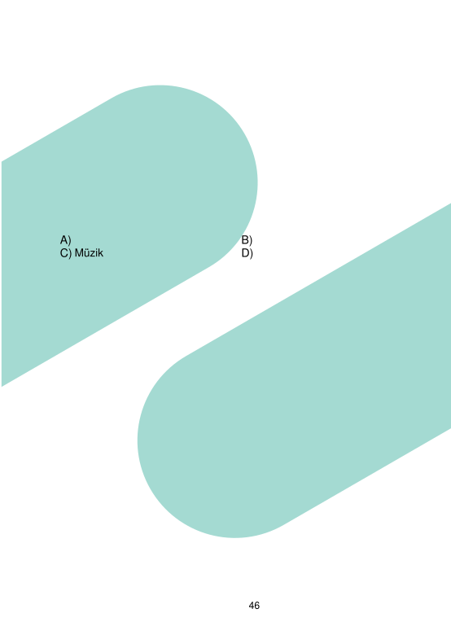
<!-- yer tutucu bulunamadı: sayfa sonuna eklendi -->

<!-- sayfa 46 -->

4. Yağlı güreş, cirit, okçuluk gibi geleneksel sporların sergilendiği; dünyanın en geniş kapsamlı, en büyük katılımlı festivali olan Etnospor Kültür Festivali’nin açılışı ülkemizde gerçekleştirildi. Geleneksel sporların birleştirici gücü, birlik ve kardeşlik bağlarımızı pekiştirerek toplumların birbirine daha da yakınlaşmasını sağlamaktadır. Bu vesileyle yirmi altı ülkeden, binden fazla katılımcıyla gerçekleştirilen festival; kültürler arasında birlik, beraberlik, saygı, dayanışma, barış ve huzur gibi insan hayatını değerli kılan unsurlara katkıda bulunmaktadır. Dünyaya ümit aşılamak ve yaşadığımız coğrafyalarda huzuru hâkim kılabilmek için birlikte hareket etmemiz gerekmektedir. Etnospor Kültür Festivali, barışın evrensel dili olan sporla ayrılıkları ortadan kaldırmakta, birlikte var olma bilincini geliştirmektedir.
(Genel ağdan alınmıştır.)

**Genel ağ haberine göre ülkemizde düzenlenen Etnospor Kültür Festivali’nin kültürel özelliklere saygı duyma ve birlikte yaşam kültürü oluşturmaya katkısı nedir? Yazınız.**

__________________________________________________________________________________________
__________________________________________________________________________________________

5. Yaşadığımız ilin şehir merkezine uzak bir mahallesindeki çocuklara yönelik sosyal sorumluluk projesi hazırlamaya arkadaşlarımla karar verdik. Mahallenin muhtarıyla görüş alışverişinde bulunduk. Mahalledeki çocukların temel ihtiyaçlarına yönelik T.C. Aile ve Sosyal Hizmetler Bakanlığı, belediye ve sivil toplum kuruluşlarının çeşitli hizmetler sunduğunu öğrendik. Mahallede yaşayan çocukların hikâye kitaplarına ulaşmakta zorluk çekebileceği için bu ihtiyaca yönelik sosyal sorumluluk projesi hazırlamanın daha faydalı olacağını düşündük. Sosyal sorumluluk projemize “Okuduğum Hikâye Kitabını Bağışlıyorum” ismini verdik. Önceden okuduğumuz hikâye kitaplarını toplamaya yönelik okulumuzda kampanya düzenledik. Ayrıca belediyemizden sosyal sorumluluk projemize destek vermesini istedik. Belediye, projemize destek amacıyla birçok hikâye kitabı temin etti. Proje kapsamında toplanan hikâye kitaplarını mahalledeki çocuklara ulaştırdık.

**Sosyal sorumluluk projesi hazırlanmasında öğrencilerin çalışmalarıyla ilgili**

I. Yardımlaşma ve dayanışma faaliyetlerine yönelik fikir ürettikleri
II. Sosyal sorumluluk projesine yönelik görev paylaşımı yaptıkları
III. Toplumsal birliğe katkıda bulunmaya yönelik fikirleri uygulamaya koydukları

**ifadelerinden hangilerine ulaşılabilir?**

**A)** I ve II
**B)** I ve III
**C)** II ve III
**D)** I, II ve III


| Daha fazla örnek soru | Kavram oyunu |
| :---: | :---: |

<!-- sayfa 47 -->

2. Öğrenme alanı

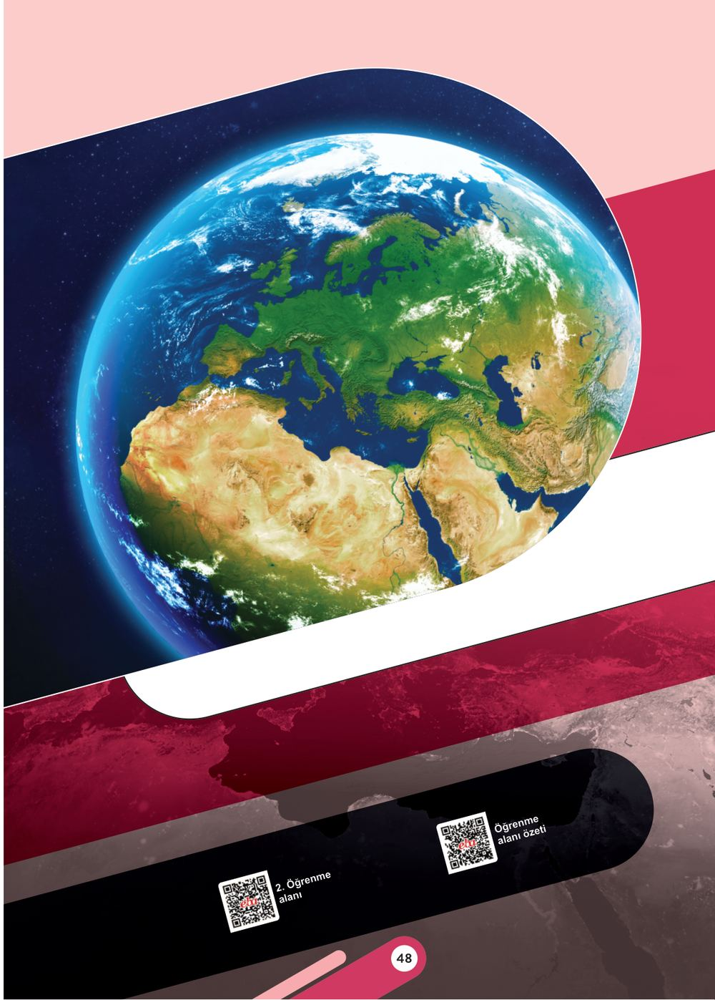

 Öğrenme alanı özeti

<!-- sayfa 48 -->

# EVİMİZ DÜNYA

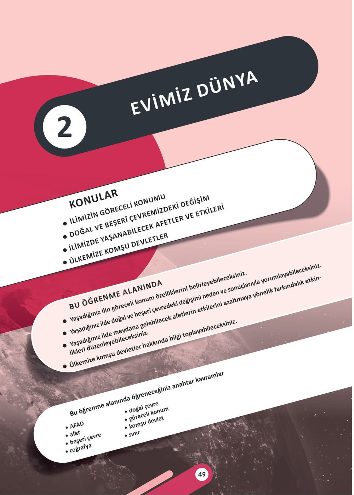

## KONULAR
* İLİMİZİN GÖRECELİ KONUMU
* DOĞAL VE BEŞERÎ ÇEVREMİZDEKİ DEĞİŞİM
* İLİMİZDE YAŞANABİLECEK AFETLER VE ETKİLERİ
* ÜLKEMİZE KOMŞU DEVLETLER

## BU ÖĞRENME ALANINDA
* Yaşadığınız ilin göreceli konum özelliklerini belirleyebileceksiniz.
* Yaşadığınız ilde doğal ve beşerî çevredeki değişimi neden ve sonuçlarıyla yorumlayabileceksiniz.
* Yaşadığınız ilde meydana gelebilecek afetlerin etkilerini azaltmaya yönelik farkındalık etkinlikleri düzenleyebileceksiniz.
* Ülkemize komşu devletler hakkında bilgi toplayabileceksiniz.

### Bu öğrenme alanında öğreneceğiniz anahtar kavramlar
* AFAD
* afet
* beşerî çevre
* coğrafya
* doğal çevre
* göreceli konum
* komşu devlet
* sınır

<!-- sayfa 49 -->

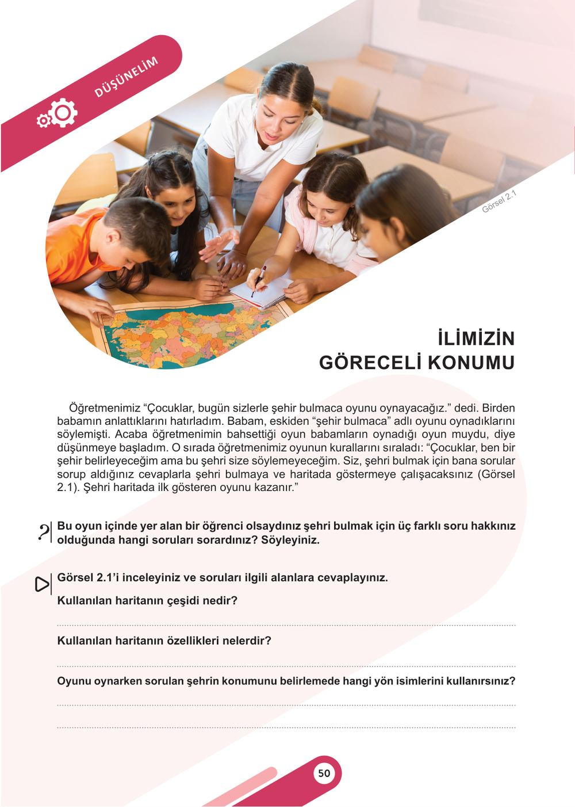

# DÜŞÜNELİM

## İLİMİZİN GÖRECELİ KONUMU

Öğretmenimiz “Çocuklar, bugün sizlerle şehir bulmaca oyunu oynayacağız.” dedi. Birden babamın anlattıklarını hatırladım. Babam, eskiden “şehir bulmaca” adlı oyunu oynadıklarını söylemişti. Acaba öğretmenimin bahsettiği oyun babamların oynadığı oyun muydu, diye düşünmeye başladım. O sırada öğretmenimiz oyunun kurallarını sıraladı: “Çocuklar, ben bir şehir belirleyeceğim ama bu şehri size söylemeyeceğim. Siz, şehri bulmak için bana sorular sorup aldığınız cevaplarla şehri bulmaya ve haritada göstermeye çalışacaksınız (Görsel 2.1). Şehri haritada ilk gösteren oyunu kazanır.”

? | Bu oyun içinde yer alan bir öğrenci olsaydınız şehri bulmak için üç farklı soru hakkınız olduğunda hangi soruları sorardınız? Söyleyiniz.

▷ | Görsel 2.1’i inceleyiniz ve soruları ilgili alanlara cevaplayınız.

Kullanılan haritanın çeşidi nedir?
____________________________________________________________________________________________________

Kullanılan haritanın özellikleri nelerdir?
____________________________________________________________________________________________________

Oyunu oynarken sorulan şehrin konumunu belirlemede hangi yön isimlerini kullanırsınız?
____________________________________________________________________________________________________

<!-- sayfa 50 -->

# KEŞFEDELİM

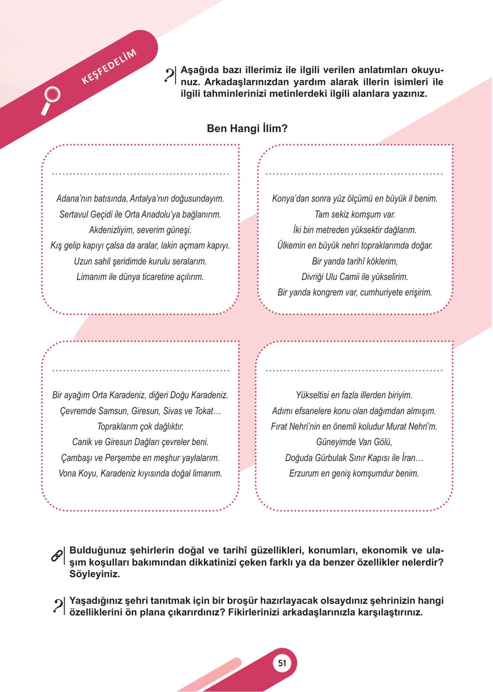 Aşağıda bazı illerimiz ile ilgili verilen anlatımları okuyunuz. Arkadaşlarınızdan yardım alarak illerin isimleri ile ilgili tahminlerinizi metinlerdeki ilgili alanlara yazınız.

## Ben Hangi İlim?

| | |
| :--- | :--- |
| ............................................................<br><br>Adana'nın batısında, Antalya'nın doğusundayım.<br>Sertavul Geçidi ile Orta Anadolu'ya bağlanırım.<br>Akdenizliyim, severim güneşi.<br>Kış gelip kapıyı çalsa da aralar, lakin açmam kapıyı.<br>Uzun sahil şeridimde kurulu seralarım.<br>Limanım ile dünya ticaretine açılırım. | ............................................................<br><br>Konya'dan sonra yüz ölçümü en büyük il benim.<br>Tam sekiz komşum var.<br>İki bin metreden yüksektir dağlarım.<br>Ülkemin en büyük nehri topraklarımda doğar.<br>Bir yanda tarihî köklerim,<br>Divriği Ulu Camii ile yükselirim.<br>Bir yanda kongrem var, cumhuriyete erişim. |
| ............................................................<br><br>Bir ayağım Orta Karadeniz, diğeri Doğu Karadeniz.<br>Çevremde Samsun, Giresun, Sivas ve Tokat...<br>Topraklarım çok dağlıktır.<br>Canik ve Giresun Dağları çevreler beni.<br>Çambaşı ve Perşembe en meşhur yaylalarım.<br>Vona Koyu, Karadeniz kıyısında doğal limanım. | ............................................................<br><br>Yükseltisi en fazla illerden biriyim.<br>Adımı efsanelere konu olan dağımdan almışım.<br>Fırat Nehri'nin en önemli koludur Murat Nehri'm.<br>Güneyimde Van Gölü,<br>Doğuda Gürbulak Sınır Kapısı ile İran...<br>Erzurum en geniş komşumdur benim. |

 Bulduğunuz şehirlerin doğal ve tarihî güzellikleri, konumları, ekonomik ve ulaşım koşulları bakımından dikkatinizi çeken farklı ya da benzer özellikler nelerdir? Söyleyiniz.

 Yaşadığınız şehri tanıtmak için bir broşür hazırlayacak olsaydınız şehrinizin hangi özelliklerini ön plana çıkarırdınız? Fikirlerinizi arkadaşlarınızla karşılaştırınız.

<!-- sayfa 51 -->

# ÖĞRENELİM

**Göreceli konum ile ilgili tanımları okuyunuz ve bu tanımlara uygun örnekler veriniz.**

Günlük hayatımızda farkında olmadan göreceli konumu kullanırız. Adres soran birine adres ile ilgili yön, mesafe ve çevresindeki önemli binaları söyleyerek yardımcı olabiliriz. Arkadaşımızla buluşmak için “Valilik binası karşısında, Millet Parkı’nın yanındaki Halk Kütüphanesinde seni bekliyor olacağım (Görsel 2.2).” dediğimizde bulunduğumuz yerin göreceli konumunu ifade etmiş oluruz.

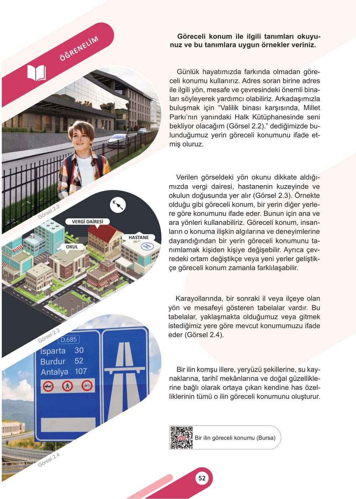

Verilen görseldeki yön okunu dikkate aldığımızda vergi dairesi, hastanenin kuzeyinde ve okulun doğusunda yer alır (Görsel 2.3). Örnekte olduğu gibi göreceli konum, bir yerin diğer yerlere göre konumunu ifade eder. Bunun için ana ve ara yönleri kullanabiliriz. Göreceli konum, insanların o konuma ilişkin algılarına ve deneyimlerine dayandığından bir yerin göreceli konumunu tanımlamak kişiden kişiye değişebilir. Ayrıca çevredeki ortam değiştikçe veya yeni yerler geliştikçe göreceli konum zamanla farklılaşabilir.


Karayollarında, bir sonraki il veya ilçeye olan yön ve mesafeyi gösteren tabelalar vardır. Bu tabelalar, yaklaşmakta olduğumuz veya gitmek istediğimiz yere göre mevcut konumumuzu ifade eder (Görsel 2.4).

Bir ilin komşu illere, yeryüzü şekillerine, su kaynaklarına, tarihî mekânlarına ve doğal güzelliklerine bağlı olarak ortaya çıkan kendine has özelliklerinin tümü o ilin göreceli konumunu oluşturur.


Bir ilin göreceli konumu (Bursa)

<!-- sayfa 52 -->

**Yaşadığınız il harita üzerinde bulup boyayınız. İliniz ile kara sınırı olan komşu illeri de harita üzerinde belirleyip isimlerini ilgili yere yazınız.**

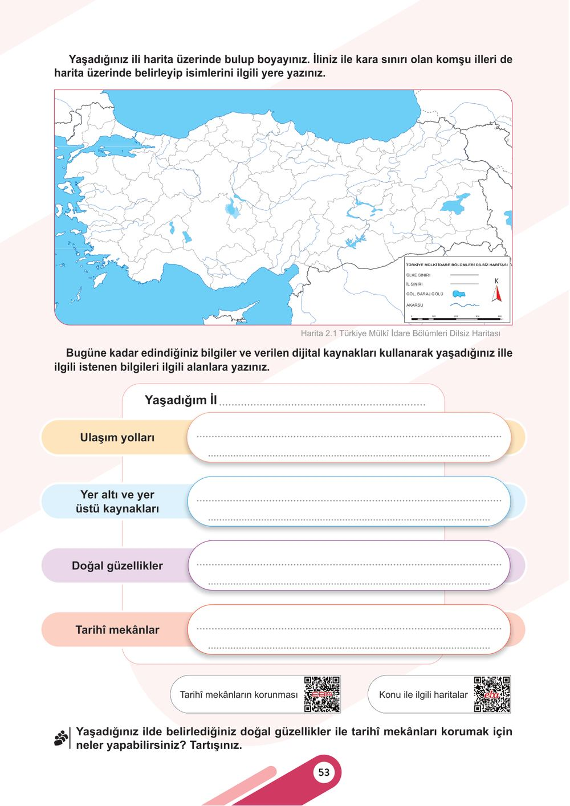: Harita 2.1 Türkiye Mülkî İdare Bölümleri Dilsiz Haritası

**Bugüne kadar edindiğiniz bilgiler ve verilen dijital kaynakları kullanarak yaşadığınız ille ilgili istenen bilgileri ilgili alanlara yazınız.**

Yaşadığım İl ..................................................................................................

| | |
| :--- | :--- |
| **Ulaşım yolları** | ................................................................................................... |
| **Yer altı ve yer üstü kaynakları** | ................................................................................................... |
| **Doğal güzellikler** | ................................................................................................... |
| **Tarihî mekânlar** | ................................................................................................... |

| Tarihî mekânların korunması [QR KOD] | Konu ile ilgili haritalar [QR KOD] |
| :--- | :--- |

Yaşadığınız ilde belirlediğiniz doğal güzellikler ile tarihî mekânları korumak için

<!-- sayfa 53 -->

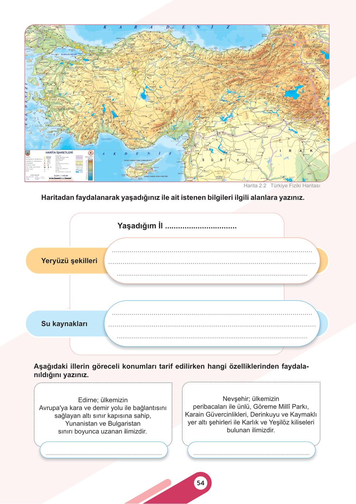

Haritadan faydalanarak yaşadığınız ile ait istenen bilgileri ilgili alanlara yazınız.

# Yaşadığım İl ............................................

| | |
| :--- | :--- |
| **Yeryüzü şekilleri** | |
| **Su kaynakları** | |

<br>

Aşağıdaki illerin göreceli konumları tarif edilirken hangi özelliklerinden faydalanıldığını yazınız.

| Edirne; ülkemizin Avrupa'ya kara ve demir yolu ile bağlantısını sağlayan altı sınır kapısına sahip, Yunanistan ve Bulgaristan sınırı boyunca uzanan ilimizdir. | |
| :--- | :--- |
| | |

| Nevşehir; ülkemizin peribacaları ile ünlü, Göreme Millî Parkı, Karain Güvercinlikleri, Derinkuyu ve Kaymaklı yer altı şehirleri ile Karlık ve Yeşilöz kiliseleri bulunan ilimizdir. | |
| :--- | :--- |
| | |

<!-- sayfa 54 -->

# Aşağıda verilen haritalardan faydalanarak Kars ilimizin göreceli konumları ile ilgili bilgileri boş bırakılan yerlere yazınız.

Kars,


Harita 2.3 Kars Mülkî İdare İl Haritası

Kars,


Harita 2.4 Kars Fiziki İl Haritası

<!-- sayfa 55 -->

# UYGULAYALIM

## ETKİNLİK
**Adı :** Yaşadığım İlin Göreceli Konumu  
**Amacı :** Yaşadığınız ilin göreceli konumunu açıklayabilme  
**Beceri :** Mekânsal düşünme  
**Süre :** 2 ders saati  
**Malzemeler :** Karton, kalem, makas.

**Yönerge:**
* İliniz hakkında topladığınız bilgileri kullanarak yaşadığınız ilin göreceli konumu ile ilgili aşağıdaki "Hazırlanacak Bilgi Kartları"nda istenenlere göre dört adet bilgi kartı hazırlayınız.
* Bilgi kartlarında estetik unsurlar göz önünde bulundurarak ilinizin göreceli konum özelliklerine ait görsellere yer veriniz.
* Hazırladığınız bilgi kartlarını kullanarak sınıf arkadaşlarınıza sözlü bir sunum yapınız.
* Bilgi kartları bütüncül dereceli puanlama anahtarı ile değerlendirilecektir.

---

| Bilgi Kartı 1 | Bilgi Kartı 2 |
| :--- | :--- |
| Komşu illere göre göreceli konumu | Su kaynaklarına göre göreceli konumu |
|  |  |

| Bilgi Kartı 3 | Bilgi Kartı 4 |
| :--- | :--- |
| Yeryüzü şekillerine göre göreceli konumu | Tarihî mekanlar ve doğal güzelliklere göre göreceli konumu |
|  |  |

---
 Bütüncül dereceli  
 "Göreceli Konuma Göre

<!-- sayfa 56 -->

# DEĞERLENDİRELİM

**Verilen yönergeye göre etkinliği yapınız.**

* Öğretmeninizin rehberliğinde dört grup ve dört istasyon oluşturunuz (öykü, şiir, slogan ve resim istasyonu). Her istasyonda beyaz bir fon kartonu bulundurunuz (fon kartonu yerine çizgisiz kağıt da kullanabilirsiniz).
* Yaşadığınız ilin göreceli konumunu öykü, şiir, slogan ve resimle örnekler vererek anlatınız. Anlatımlarınız gözlem formu veya kontrol listesi ile değerlendirilecektir.
* Bir istasyonda beş dakika çalıştıktan sonra saat yönünde ilerleyerek bir sonraki istasyona geçiniz. Geldiğiniz istasyonda yarım kalan çalışmaya devam ediniz.
* Dördüncü istasyona geldiğinizde sürenin sonuna kadar çalışmayı tamamlayınız.
* Süre tamamlandığında ortaya çıkan çalışmalarınızı sınıf tahtasına asınız. Çalışmaların sonuçlarını sınıfça tartışınız.
* Belirlediğiniz göreceli konum özelliklerinin ilinize ne gibi etkileri olduğunu tartışınız ve aşağıdaki tabloya yazınız.


| Öykü İstasyonu | Şiir İstasyonu | Slogan İstasyonu | Resim İstasyonu |
| :---: | :---: | :---: | :---: |


(Boş tablo alanı)

---

**Malzemeler**
* Beyaz fon kartonu (4 adet)
* Boya kalemleri
* Bant

Gözlem formu 

**Gelecek Derse Hazırlık**
Yaşadığınız ile ait hem yeni hem de eski; fotoğraf, resim, gazete, hava fotoğrafları, şehir haritaları veya şehir planlarından birini bulup sınıfınıza getiriniz. Yaşadığınız ilde geçmişten günümüze doğal ve beşerî çevrede yaşanan değişim hakkında aile büyüklerinizden bilgi alınız.

<!-- sayfa 57 -->

# DÜŞÜNELİM


# DOĞAL VE BEŞERÎ ÇEVREMİZDEKİ DEĞİŞİM

**Metni okuyunuz ve soruları cevaplayınız.**

Yemekten sonra babam ile balkonda çay keyfi yapıyorduk. Evimiz şehri tepeden gören bir konumdaydı. Çok güzel bir manzaramız vardı. Karşıda masmavi bir göl, gölün ardında başı dumanlı sıradağlar, tarihî köprü ve cami, yüksek katlı binalar, ilkbaharın gelmesi ile dağlardaki karların eriyip çaylardan göle karışması… Böyle bir manzarayı arasanız da bulamazsınız. Doğa ile iç içe girmiş bir şehir. Bir taraftan manzarayı seyrediyor bir taraftan da babamla sohbet ediyorduk (Görsel 2.5).

– Baba, manzaraya bakarken aklıma bazı şeyler geldi. Bunları sana sormak istiyorum. Sen çocukken bu şehir nasıldı? Değişen şeyler oldu mu?

– Tabii oğlum. Değişmez mi? Birçok şey değişti diyebilirim.

– Neler değişti baba? Biraz anlatır mısın?

– Ben çok mutlu bir çocukluk geçirdim. Mahallemizde tek katlı, bahçeli, küçük evler vardı. Evimizin etrafındaki boş alanlar oyun alanlarımızdı. Bizim tablet, telefon gibi eşyalarımız yoktu. Saklambaç, futbol gibi oyunlarla çok eğlenirdik. Görüyorsun ki şimdi yüksek katlı, site şeklinde evler var. Sitelerin bahçelerinde çocuk oyun parkları olsa da çocuklar birlikte pek vakit geçirmiyor. Günümüzde çocuklar ve büyükler için spor salonları yapıldı. Çocuklar, bizim gibi boş alanlarda veya sokakta oynamıyor. Spor salonlarında spor yapabiliyor veya mahallelerdeki parklarda çeşitli oyuncaklarla keyifli vakit geçirebiliyorlar.

Görsel 2.5

<!-- sayfa 58 -->

– Baba, dedemle neler yapardınız?

– Deden hafta sonu beni göl kenarına götürürdü. Kıyıda balık tutardık. Gölde yaklaşık yirmi çeşit balık vardı. Şimdi ise üç çeşit balık kaldı. İnsanlar kayıklarla karşı tarafa geçerdi. Tarihî taş köprüden geçmek çok hoşuma giderdi. Gölün seviyesi o kadar yüksekti ki su köprüyü aşmasın diye köprüye kum torbaları dizilmişti. Yine de köprüye vuran dalga bizi biraz ıslatırdı. Bu duruma çok mutlu olurdum. Yakın zamanda yeni köprü yapıp tarihî köprüyü araç trafiğine kapattılar. Göldeki su seviyesi epey düşmüş durumda. Haberlerde duyduğumuz küresel ısınma, iklim değişikliği, kuraklık… Sanırım bizim göl de bunlardan etkilendi.

– O zaman da şehir böyle kalabalık mıydı baba?

– Hayır oğlum. O zaman insanlar tarım ve hayvancılıkla uğraşıyor ve köylerde yaşıyorlardı. Sanayi alanları sınırlı, fabrikalar azdı. Şehir daha dar bir alana yerleşmişti. Şimdi ise tarım ve hayvancılıkla uğraşanlar azaldı, fabrikalar çoğaldı. Böylece köylerden şehrimize göçler arttı. Şehrimizin nüfusu hızla çoğaldı. Şehir büyük bir alana yayıldı. Konut, hastane, okul gibi birçok alanda ihtiyaçlar arttı. Eskiden mahalle bakkallarından ve esnaflarından alışverişimizi yapardık. Şimdi ise büyük alışveriş merkezleri var. Bizim zamanımızda bu kadar araba yoktu. Yollar az ve dardı. Araba sayısı arttıkça yollar genişledi ve çoğaldı. Şehrimize ilk trafik lambasının kurulduğu zamanı hatırlıyorum. Çok sevinmiştim. Ancak trafiğin, araç gürültüsünün ve egzoz dumanlarının bu kadar çoğalacağını hiç düşünmemiştim.

– Baba, gölün sağ tarafında kocaman bir cami görünüyor. Orası yeni mi yapıldı?

– Hayır Alper. Orası tarihî bir cami. Yaklaşık sekiz asırdır dimdik ayakta. Şimdiki camilerden çok farklı bir mimarisi var. Dikkatlice bakarsan caminin etrafında tek katlı evler ve dar sokaklar göreceksin. İşte, orası şehrimizin eski yerleşim alanı. Ama etrafa şöyle bir bakarsan evlerin ne kadar yükseldiğini, caddelerin ne kadar genişlediğini hemen fark edebilirsin.

– Evet babacığım. Zaman içinde birçok şey değişmiş görünüyor. Anlaşılan bu değişimin bize kazandırdıkları olduğu gibi bizden aldıkları da var. Bundan sonra da bu değişim devam edecek gibi görünüyor.

*(Bu metin, kitap yazarları tarafından bu kitap için yazılmıştır.)*

 Metinde doğal ve beşerî çevre unsurlarından hangilerine yer verilmiştir?

 Yaşadığınız yerde bulunan doğal çevre unsurları nelerdir? Örnekler veriniz.
___________________________________________________________________________
___________________________________________________________________________
___________________________________________________________________________

<!-- sayfa 59 -->


# KEŞFEDELİM

Yaşadığınız çevrenin geçmişi hakkında aile büyükleri- nizden edindiğiniz veriler ile bugünkü gözlemlerinizden ulaştığınız sonuçları ilgili alanlara yazınız.

## YAŞADIĞIM ÇEVRE HAKKINDA

### Aile Büyüklerinden Öğrendiklerim
(Boş alan)

### Gözlemlerim
(Boş alan)

---

? Yaşadığınız çevrede meydana gelen değişimlerin sebepleri neler olabilir? Söyleyiniz.
Aile büyüklerinizin anlattıkları ve kendi gözlemlerinizden yararlanarak yaşadığınız çevrede geçmişe kıyasla yaşanan değişimleri belirleyiniz. Bu değişimleri ilgili alana yazınız.

## YAŞADIĞIM ÇEVREDE

 (Görsel 2.6 - Dağlık ve nehirli doğal manzara)
Görsel 2.6
### Doğal Çevre Değişimleri
(Boş alan)

 (Görsel 2.7 - Şehir manzarası, binalar ve yollar)
Görsel 2.7
### Beşerî Çevre Değişimleri
(Boş alan)

<!-- sayfa 60 -->

# ÖĞRENELİM

Dağ, ova, vadi, akarsu, göl, deniz, şelale, orman gibi varlıklar hem insanların hem de diğer canlıların yaşamı için oldukça önemlidir. Bu varlıklar insan ve hayvanların oksijen, su, gıda gibi ihtiyaçlarını karşılayan çok önemli kaynaklardır ve aynı zamanda doğal çevremizi oluşturur (Görsel 2.8).

 Görsel 2.8

Yerleşik hayata geçen ilk insanlar, yerleşim yerlerini temel ihtiyaçlarını karşılayabilecekleri yerlere kurmuşlardır. Örneğin insanlar su ve gıda ihtiyaçlarını karşılayabilmek için yerleşim yerlerini akarsu, göl kenarlarına ve verimli tarım arazilerine kurmuşlardır. Bu durum günümüzde de devam etmektedir. Günümüzdeki birçok yerleşim yeri akarsu, göl, deniz kenarı ya da verimli tarım arazilerinin yakınında bulunmaktadır. Bazı yerleşim yerleri de deprem riski sebebiyle zemini daha sağlam olan dağlık alanlara kurulmaktadır. Doğal çevre; küresel ısınma, teknolojik gelişmeler, nüfus artışı, beşerî çevrenin genişlemesi, doğal kaynakların bilinçsizce tüketilmesi, çevre kirliliği gibi sebeplerle zaman içinde değişikliğe uğrayabilmektedir.

**? Yaşadığınız ilin yerleşim yeri olmasında hangi doğal unsurlar etkili olmuştur? Örnekler veriniz.**

Yaşam alanlarımızda ev, apartman, sokak, park, yol, köprü, hastane, okul, market gibi birçok yapı bulunmaktadır. Bunlar bizim barınma, ulaşım, sağlık, eğitim, alışveriş, dinlenme, eğlenme gibi ihtiyaçlarımızı karşılamak için yapılmıştır. Aynı zamanda bu amaçlarla yapılmış medrese, bedesten, şifahane, türbe gibi tarihî varlıklara da çevremizde rastlayabiliriz. Yaşadığımız yerlerde inşa edilen bu eski ve yeni yapıların tamamı beşerî çevremizi oluşturur (Görsel 2.9). Özellikle çevremizdeki tarihî varlıkları korumak hepimizin görevidir.

 Görsel 2.9

Tarihteki ilk yerleşim yerlerinde insanlar yaşam alanlarına genellikle ev ve ibadethaneler yapmışlardır. Zamanla insan nüfusunun artması, ihtiyaçların çeşitlenmesi, teknolojinin gelişmesi, doğa kaynaklı afetler, iklim olayları, kaynakların bilinçsizce tüketilmesi, çevre kirliliği, ormanların yok edilmesi gibi sebeplerle doğal ve beşerî çevrede bazı değişimler olmuştur. Bu değişim günümüze kadar devam etmiştir, bundan sonra da devam edecektir.

<!-- sayfa 61 -->

**Yaşadığınız ile ait eski ve yeni resim, fotoğraf, gazete haberi, hava fotoğrafı, şehir haritası veya şehir planlarından getirebildiklerinizi aşağıdaki alana yapıştırınız.**


Görsel 2.10

? Getirmiş olduğunuz resim, fotoğraf,gazete haberi, hava fotoğrafı, şehir haritası veya şehir planlarını arkadaşlarınızla inceleyiniz. Yukarıdaki alana yapıştırdığınız görselleri ve aile büyükleriniz ile yaptığınız sözlü tarih görüşmelerinden edindiğiniz bilgileri göz önünde bulundurarak inceleyiniz. İlinizin doğal ve beşerî çevresinde geçmişten günümüze yaşanan değişime neden olan unsurlar nelerdir? Yazınız.


<!-- sayfa 62 -->

# Aşağıda Konya’nın doğal ve beşerî çevresine ait farklı zamanlardan görseller yer almaktadır. Görselleri inceleyiniz ve etkinliği yapınız.


Meke Gölü 2003
Görsel 2.11

Meke Gölü 2024
Görsel 2.12

Alaaddin Caddesi 1940
Görsel 2.13

Alaaddin Caddesi 2020
Görsel 2.14

? Görselleri karşılaştırdığınızda doğal ve beşerî çevrede değişen ve değişmeyen unsurlar nelerdir?

👥 Yaşadığınız ile ait getirmiş olduğunuz eski ve yeni resim, gazete, hava fotoğraflarını inceleyiniz (öğretmeniniz rehberliğinde etkileşimli tahtayı kullanarak da görsellere erişebilirsiniz) veya aile büyüklerinizden ilinizin geçmişi hakkında edindiğiniz bilgileri düşününüz. Aşağıdaki soruları sınıfta tartışınız ve tabloyu doldurunuz.

| Doğal ve beşerî çevrenizde değişen unsurlar nelerdir? | Doğal ve beşerî çevrenizde değişmeyen unsurlar nelerdir? |
| :--- | :--- |
| | |
| | |
| | |
| | |
| | |
| | |
| | |
| | |

<!-- sayfa 63 -->

Aşağıda verilen bilgi görselini inceleyiniz ve soruları cevaplayınız.

# BATMAN'DA BÜYÜK DEĞİŞİM
Bölgede petrol bulunmasıyla kaderi değişen Batman, gerçekleştirilen yatırımlarla her alanda gelişim sağladı.


Görsel 2.15

* **1946**
  17 Ocak'ta 1361 m'de petrol bulundu.
* **1948**
  8 Mart'ta petrol çıkarılmaya başlandı.
* **1955**
  Türkiye'nin ilk petrol rafinerisi Batman Rafinerisi kuruldu.
* **1957**
  Batman ilçe oldu.
* **1990**
  Batman il oldu.
* **2007**
  Batman Üniversitesi kuruldu.
* **2020**
  Ilısu Barajı hizmete açıldı.
* **2021**
  Hasankeyf-2 Köprüsü hizmete açıldı.
* **2024**
  Yeni sanayi tesisleri kuruldu.

? Batman'da petrolün bulunması ildeki hangi unsurları etkilemiş olabilir?
Son yirmi yılda Batman'ın doğal ve beşerî çevresinde ne gibi değişimler yaşanmıştır?
Batman'a yeni baraj ve köprü yapılması ilde hangi imkânların gelişmesine katkıda bulunmuş olabilir?
Batman'da sanayi tesisleri ve üniversitenin kurulması doğal ve beşerî çevre unsurla-

<!-- sayfa 64 -->

Doğal ve beşerî çevremizde yaşanan değişimler yaşadığımız ili birçok açıdan etkileyebilir. Örneğin çevremizdeki bir akarsuyun üzerine yapılan baraj, kurak topraklara sulama imkânı oluşturup tarım alanlarının genişlemesini sağlayabilirken ormanlık alanların sular altında kalmasına da sebep olabilir. Yaşadığımız ile yapılan fabrikalar, ilin göç almasını sağlayıp nüfusunu artırabilir. Nüfusun artmasıyla çevremizdeki bina sayısı artar ve yerleşim alanı genişler (Görsel 2.16). Yapılan yeni yollar ve caddeler, ulaşım imkânlarını geliştirip çeşitlendirir.


Görsel 2.16

👣 **Yaşadığınız ile ait eski ve yeni resim, gazete, hava fotoğraflarından aşağıda verilen unsurları inceleyiniz. Yaptığınız incelemeler ve aile büyüklerinizden edindiğiniz bilgiler doğrultusunda ilinizde yaşanan değişimin aşağıdaki unsurlara etkisini sınıfta tartışınız ve örnekler yazınız.**

| Su Kaynakları | Bitki Örtüsü | Arazi Kullanımı |
| :--- | :--- | :--- |
| ........................<br>........................<br>........................<br>........................<br>........................ | ........................<br>........................<br>........................<br>........................<br>........................ | ........................<br>........................<br>........................<br>........................<br>........................<br>........................ |

| Yerleşim Alanları | Ulaşım Sistemleri | Nüfus |
| :--- | :--- | :--- |
| ........................<br>........................<br>........................<br>........................<br>........................ | ........................<br>........................<br>........................<br>........................<br>........................<br>........................ | ........................<br>........................<br>........................<br>........................<br>........................ |

<!-- sayfa 65 -->

**Aşağıdaki haberleri okuyunuz ve soruları cevaplayınız.**

| HABER |
| :--- |
| **Toz fırtınalarının en önemli nedeni bitki örtüsünün tahrip olması** |
| "... İstanbul Üniversitesinden yapılan açıklamada özellikle ülkemizin iç kesimleri ve güneydoğusunda bitki örtüsünün tahrip edilmesiyle erozyonun arttığına, bunun sonucunda da toz fırtınalarının yaşandığına dikkat çekildi. Açıklamada toz fırtınalarının günlük yaşamı olumsuz etkilediği, sağlık sorunlarını tetiklediği ve tarım alanlarına zarar verdiği belirtildi..." |
| (Genel ağdan alınmıştır.) |

| HABER |
| :--- |
| **Kuruyan sulak alanlar Türkiye'nin su varlığını ve su canlılarını tehdit ediyor** |
| "... Uzmanlar, geçtiğimiz yüzyılda Türkiye'nin sulak alanlarının yüzde kırkını kaybettiğini, bu durumun su canlılığı çeşitliliğini azalttığını dile getirdi. Sulak alanların azalmasının aynı zamanda tarımı ve içme suyu imkânlarını da olumsuz etkilediği ifade edildi. Uzmanlar, ayrıca su kaynaklarımızın kirlilik tehdidi ile karşı karşıya olduğu konusunda uyarılarda bulundu..." |
| (Genel ağdan alınmıştır.) |

**2? Bitki örtüsü ve su kaynaklarında yaşanan değişim ülkemizi nasıl etkilemiştir?**
**Yaşadığınız ilde bitki örtüsünde ve su kaynaklarında yaşanan değişimin ne gibi etkileri vardır? Örnekler veriniz.**

Görüldüğü üzere çevremizde meydana gelen değişimler bazen olumsuz sonuçlar ortaya çıkarabilmektedir. Yaşanan değişim doğal çevremiz gibi beşerî çevremizi de etkileyebilir. Tarihî mekân, yapı, yol, köprü, sosyal tesisler gibi beşerî çevre unsurları zarar görebilir. Doğal ve beşerî çevre unsurlarımız gelecek nesillere bırakacağımız önemli miraslardır. Bu sebeple ülkemizde doğal ve beşerî çevrenin korunması ve sürdürülebilir çevre bilincinin oluşturulması için projeler geliştirilmektedir. Bu projeler yetkili birimler ve sivil toplum kuruluşları tarafından hazırlanıp uygulanmaktadır. Aşağıda bu projelere örnekler verilmiştir. Örnekleri inceleyiniz ve soruyu cevaplayınız.

T.C. Milli Eğitim Bakanlığı (MEB), çevre ve sürdürülebilirlik faaliyetlerinin uygulanması hedefiyle "Yeşil Vatan-Benim Okulum Geleceğe Çare" etkinliklerini hayata geçirdi. Bu çerçevede, öğrencilerin çevreye duyarlı ve sorumluluk sahibi bireyler olarak yetişmeleri esas alınarak "Yeşil Vatan'ı korumak, vatanı korumaktır!" anlayışı tüm etkinliklere yansıtılmaktadır (Görsel 2.17).


Görsel 2.17

Mustafa Kemal Atatürk’ün Trabzon ziyaretlerinde konakladığı Atatürk Köşkü’ndeki yıpranmalar nedeniyle T.C. Kültür ve Turizm Bakanlığınca restorasyon projesi başlatıldı. Çalışma boyunca ziyarete kapatılan köşk, projenin tamamlanmasıyla cumhuriyetimizin 100. yılında kapılarını ziyaretçilerine yeniden açtı (Görsel 2.18).


Görsel 2.18

**2? Doğal ve beşerî çevrenin korunmasında ve sürdürülebilir çevre bilincinin oluşmasında sizlere**

<!-- sayfa 66 -->

# UYGULAYALIM

## ETKİNLİK
**Adı :** Yaşadığım İldeki Değişim  
**Amacı :** Yaşadığınız ildeki doğal ve beşerî çevrede meydana gelen değişimin etkilerini sorgulama  
**Beceri :** Değişim ve sürekliliği algılama  
**Süre :** 2 ders saati

**Yönerge:**
* Öğretmeniniz rehberliğinde altı grup oluşturunuz.
* Her grup için bir şapka rengi belirleyiniz.
* Grubunuzdan birini sözcü olarak seçiniz.
* Altı şapkalı düşünme tekniğinde her rengin farklı bir düşünceyi temsil ettiğini unutmayınız.
* Öğretmeninizin belirleyeceği sırayla her bir şapkanın bakış açısıyla düşüncelerinizi paylaşınız.
* Tartışma sırası size geldiğinde, o anki şapkanın temsil ettiği düşünce tarzını kullanarak görüşünüzü sözcünüz aracılığıyla açıklayınız.
* Öğretmeninizin “Yaşadığınız ildeki doğal ve beşerî çevrede meydana gelen değişimin ilinize etkileri neler olabilir?” sorusunun cevabını tartışınız.
* Tüm şapkaların bakış açıları paylaşıldıktan sonra, grubunuzun konuyla ilgili ulaştığı ortak değerlendirmeyi sözcünüz aracılığıyla sınıfa sununuz.


| Şapka | Özellik |
| :--- | :--- |
| Sarı Şapka | Faydalı ve olumlu düşünme ile ilgilidir. |
| Mavi Şapka | Olayları özetleyici, birleştirici ve toparlayıcıdır. |
| Beyaz Şapka | Tarafsızdır, bilimsel ve net bilgiler verir. |
| Siyah Şapka | Karamsardır, olumsuz yönlere odaklanır. |
| Kırmızı Şapka | Olaylara duygusal bakış açısıyla yaklaşır. |
| Yeşil Şapka | Geleceğe yönelik fikir üretmeye önem verir. |

<!-- sayfa 67 -->

# DEĞERLENDİRELİM

? Aşağıdaki haberi okuyunuz, görseli inceleyiniz ve soruları cevaplayınız.


Görsel 2.20

> **Yusufeli Barajı nedeniyle yerleşim yerleri değişen köylüler yeni yuvalarına alıştı**
>
> "... Artvin'in Yusufeli ilçesinde Çoruh Nehri üzerine Yusufeli Barajı’nın inşa edilmesiyle Yeniköy, Tekkale, Irmakyanı, Çeltikdüzü, Çevreli, İşhan ve Meşecik köyleri sular altında kalmıştı. Bu köylerin sakinleri, yaklaşık bir yıl önce taşındıkları yeni yerleşim yerlerindeki hayatlarına alıştı. Modern villa şeklinde inşa edilen yeni evler, eski yerleşim yerlerini geride bırakırken hüzünlenen köy sakinlerini mutlu etti. Yeni yapılan yedi köyde toplamda beş yüz yedi konutun yanı sıra bazı iş yerleri, oyun parkları ve sosyal yaşam alanları da yer aldı (Görsel 2.20)...."
>
> (Genel ağdan alınmıştır.)

? Yusufeli Barajı'nın yapılma sebepleri neler olabilir? Yazınız.
..............................................................................................................................
..............................................................................................................................

? Yusufeli Barajı'nın yapılması ile doğal ve beşerî çevre unsurlarından hangilerinde değişim yaşanmıştır? Yazınız.
..............................................................................................................................
..............................................................................................................................

? Barajın yapımı doğal ve beşerî çevre unsurlarından su kaynakları, bitki örtüsü, yerleşim alanları ve nüfusu nasıl etkilemiş olabilir? Yazınız.
..............................................................................................................................
................................................................................................................

<!-- sayfa 68 -->

**Yaşadığınız ile ait eski ve yeni resim, gazete, hava fotoğraflarını inceleyiniz veya aile büyüklerinizden ilinizin geçmişi hakkında edindiğiniz bilgileri düşününüz. Buna göre geçmişten günümüze ilinizin doğal ve beşerî çevresinde yaşanan değişimin sebep ve sonuçlarını tartışınız. Aşağıdaki balık kılçığını tamamlayınız. Hazırladığınız balık kılçığı diyagramları dereceli puanlama anahtarı ile değerlendirilecektir.**


(Balık kılçığı diyagramı içeriği:)
- Yaşadığınız İlde
    - Doğal çevrenizde yaşanan değişimin sebepleri
    - Doğal çevrenizde yaşanan değişimin sonuçları
    - Beşerî çevrenizde yaşanan değişimin sebepleri
    - Beşerî çevrenizde yaşanan değişimin sonuçları

Görsel 2.21

Dereceli puanlama anahtarı [QR Kod]

<!-- sayfa 69 -->

# İLİMİZDE YAŞANABİLECEK AFETLER VE ETKİLERİ

DÜŞÜNELİM


METEOROLOJİYE GÖRE 
İLİMİZDE YARIN SAĞANAK 
YAĞIŞ BEKLENMEKTEDİR. 
YAŞANABİLECEK
.........................................
GİBİ OLUMSUZLUKLARA 
KARŞI
TEDBİRLİ OLUNUZ.

Görsel 2.22

▷ Ailenizden birine AFAD’dan (Afet ve Acil Durum Yönetimi Başkanlığı) görseldeki gibi bir uyarı mesajı gelseydi neler yapardınız? Yazınız.
............................................................................
............................................................................
............................................................................
............................................................................
............................................................................
............................................................................
............................................................................
............................................................................
............................................................................
............................................................................
............................................................................
............................................................................

? Gelen mesajda boş bırakılan yerde neler yazıyor olabilir? Sınıfta tartışınız.

? Görselde anlatılmak istenilen nedir? Düşüncelerinizi yazınız (Görsel 2.23).


............................................................................
............................................................................
................................................

<!-- sayfa 70 -->

# KEŞFEDELİM

 Tarihimizdeki büyük ve yıkıcı depremlerden biri 17 Ağustos 1999'da gerçekleşti. Binlerce can kaybı yaşanan bu depremden sonra bilim insanları “Deprem değil, ihmal öldürür.” açıklamasında bulundular.

 “Deprem değil, ihmal öldürür.” sözü ile bilim insanları neye dikkat çekmek istemişlerdir?

 Yaşadığınız ilde gerçekleşme riski olan afetler nelerdir? Bu afetlerin etkilerini azaltmak amacıyla bireysel ve toplumsal olarak neler yapılabilir? Sınıfta tartışınız ve alınabilecek önlemleri ilgili alanlara yazınız.

| Bireysel Önlemler | ..................................................................................................... ..................................................................................................... ..................................................................................................... ..................................................................................................... ..................................................................................................... |
| :--- | :--- |
| **Toplumsal Önlemler** | ..................................................................................................... ..................................................................................................... ..................................................................................................... .................................................

<!-- sayfa 71 -->

# ÖĞRENELİM


Görsel 2.24

Dünyada her gün birçok doğa olayı gerçekleşir. Rüzgâr eser, şimşek çakar, yağmur yağar, deniz dalgalanır, kar yağar, fırtına olur, sel olur, çığ düşer, toprak kayar, kaya düşer, deprem olur (Görsel 2.24). Doğa olayları yaşamımızın bir parçasıdır ve yaşamın devamı için birçok doğa olayına ihtiyaç duyarız. Örneğin yağmur tarıma katkıda bulunur, canlıların su ihtiyacını karşılar. Rüzgâr, bitkilerin çoğalmasında önemli bir yere sahiptir. Kar yağışı göllerin, barajların dolmasını sağlar; yer altı sularını artırır.

Doğa olaylarının şiddetinin fazla olması ya da doğa olaylarına karşı yeterince tedbirin alınmaması afet riskini ortaya çıkarabilmektedir. Afetler; insanlar için maddi ve manevi kayıplara neden olan, yaşamı olumsuz etkileyen, doğa veya insan kaynaklı olaylardır.

Ülkemizde afete dönüşebilen birçok doğa olayı gerçekleşmektedir. Bunların bir kısmı yeryüzü hareketlerine bağlı olarak ortaya çıkar. Deprem ve kaya düşmesi bunlara örnektir (Görsel 2.25). Hava durumu ve iklim kaynaklı ortaya çıkan doğa olayları da görülür. Şiddetli yağış, fırtına, dolu, don, kar ve kuraklık ülkemizde afete dönüşebilen doğa olaylarına örnekler arasında yer alır. Çölleşme, erozyon ve obruk oluşumunda ise iklim ve yeryüzü hareketlerinin yanında insan faaliyetleri de etkilidir.


Görsel 2.24
25

<!-- sayfa 72 -->

# Aşağıdaki haritalar ile AFAD İl Afet Risk Azaltma Planları'nı inceleyiniz ve soruları cevaplayınız.


## TÜRKİYE DEPREM TEHLİKE HARİTASI


**AÇIKLAMALAR**

| DÜŞÜK TEHLİKE | EN BÜYÜK YER İVMESİ ($g$) | YÜKSEK TEHLİKE |
| :--- | :---: | ---: |
| | $0,0$ <!-- KONTROL: Marker'da karşılığı yok, uydurma olabilir --> $0,1$ <!-- KONTROL: Marker'da karşılığı yok, uydurma olabilir --> $0,2$ <!-- KONTROL: Marker'da karşılığı yok, uydurma olabilir --> $0,3$ <!-- KONTROL: Marker'da karşılığı yok, uydurma olabilir --> $0,4$ <!-- KONTROL: Marker'da karşılığı yok, uydurma olabilir --> $0,5$ <!-- KONTROL: Marker'da karşılığı yok, uydurma olabilir --> | |

50 YILDA AŞILMA OLASILIĞI %10 (TEKRARLANMA PERİYODU 475 YIL)

Harita 2.5 Türkiye Deprem Tehlike Haritası

## TÜRKİYE ÇÖLLEŞME HASSASİYET HARİTASI


| K | Düşük Çölleşme Riski | Yüksek Çölleşme Riski |
| :--- | :---: | ---: |

Harita 2.6 Türkiye Çölleşme Hassasiyet Haritası

2. Verilen haritalara göre yaşadığınız ilde görülme riski fazla olan afetler nelerdir?
Bu afetlerin ortaya çıkmasında etkili olan doğa olayları nelerdir?

<!-- sayfa 73 -->

**Verilen bilgiler doğrultusunda görselleri ve açıklaması yapılan doğa olaylarını örnekte olduğu gibi tamamlayınız.**


Deprem, yer kabuğunun derin katmanlarının kırılıp yer değiştir-mesi ile oluşan sarsıntılardır (Görsel 2.26). Ülkemizin büyük bir kısmı birinci derece deprem kuşağında yer aldığı için ülkemizde en fazla can ve mal kaybına neden olan afet depremdir.

Risk: *Deprem kuşağı veya fay hatlarının üzerine yerleşim yerleri yapmak, depreme dayanıksız yaşam alanları, köprüler inşa etmek, evdeki kitaplık, saat, çerçeve gibi eşyaları sabitlememek*

Afet: *Deprem nedeniyle binalar ile köprülerin yıkılması, can ve mal kayıplarının olması, evdeki eşyaların zarar görmesi, ulaşım ve iletişim sorunlarının yaşanması*


Erozyon, toprağın üst tarafındaki verimli kısmın su ve rüzgâr etkisiy-le taşındığı bir afettir (Görsel 2.27). Erozyonun şiddetini artıran en önemli etken toprağı koruyan bitki örtüsünün yok edilmesidir. Bu ba-kımdan bitki örtüsünün cılız olduğu yerlerde erozyon riski yüksektir.

Risk: .............................................................................................................
......................................................................................................................
......................................................................................................................

Afet: .............................................................................................................
......................................................................................................................
......................................................................................................................


Orman yangını, doğal ya da insani sebeplerle ortaya çıkarak ağaçların ve bitki örtüsünün kısmen veya tamamen yanmasıdır (Görsel 2.28). Ülkemizde yaz aylarının çok sıcak geçtiği yerlerde orman yangınlarının görülme ihtimali yüksektir.

Risk: .............................................................................................................
......................................................................................................................
................

<!-- sayfa 74 -->

Heyelan (toprak kayması) ya da kaya düşmesi, eğim ve yağışın fazla olduğu dik yamaçlarda toprağın veya kayaçların aşağı doğru hareket etmesi sonucu meydana gelir (Görsel 2.29).

 Görsel 2.29

Risk: .............................................................................................................
..................................................................................................................
...............................................................................................................
..............................................................................................................
................................................................................................................
.................................................................................................................

Afet: .............................................................................................................
..................................................................................................................
...............................................................................................................
..............................................................................................................

Sel; aşırı yağışlar veya karın hızla erimesi sonucu ani, büyük ve düzensiz su akıntılarının meydana gelmesidir (Görsel 2.30).

 Görsel 2.30

Risk: .............................................................................................................
..................................................................................................................
................

<!-- sayfa 75 -->


Obruk, erozyon ve kuraklığın artması gibi doğal sebepler yanında madencilik ve aşırı sulama gibi insan faaliyetleri sonucu da oluşabilir (Görsel 2.32). Toprağın çökmesi ile oluşan obrukların artması özellikle yaylacılık faaliyetlerine ve tarım yapılan alanlara zarar vermektedir.

Risk: .............................................................................................................
......................................................................................................................
......................................................................................................................

Afet: .............................................................................................................
......................................................................................................................
......................................................................................................................


Hortum, ani hava değişimlerine bağlı olarak oluşan şiddetli rüzgârlardır (Görsel 2.33). Kara veya deniz üzerinde oluşabilen hortum, kendi ekseni etrafında ve yüksek hızla dönerek yıkıcı bir güce ulaşabilir.

Risk: .............................................................................................................
......................................................................................................................
................................

<!-- sayfa 76 -->

Ülkemizde meydana gelebilecek afetlere karşı bireysel ve toplumsal bazı tedbirlerin alınması gerekmektedir. Afetlerin ülkemizin bir gerçeği olduğunun kabul edilmesi, toplumsal bilinç oluşturulması, birlik ve beraberliğe önem verilmesi toplumsal olarak alınacak tedbirlerin başında gelmektedir. Bireysel olarak alabileceğimiz tedbirlerden bazıları ise şunlardır.

* **Afet Öncesinde**
    * Afetler konusunda okulda verilen eğitimlere önem vermeliyiz.
    * Afetler ve alınabilecek tedbirler hakkında araştırma yapmalıyız.
    * Afet anında ve sonrasında yapılması gerekenleri planlamalıyız.

* **Afet Sırasında**
    * Mümkün olduğunca panik yapmadan hareket etmeliyiz.
    * Tehlike oluşturacak alanlardan uzak durmalıyız.
    * Daha önce belirlenen güvenlik tedbirlerini uygulamaya çalışmalıyız.

* **Afet Sonrasında**
    * Önceden belirlediğimiz güvenli alanlara geçmeliyiz.
    * Acil bir durum olmadıkça iletişim araçlarını kullanmamalıyız.
    * Afetle mücadele eden ekiplerle uyum içinde hareket etmeliyiz.
    * Yetkililerin uyarılarını dikkate almalıyız.

Aşağıda Burcu ve arkadaşlarının hazırladığı afetlere yönelik deney etkinliği verilmiştir. Metni okuyunuz ve siz de bu etkinliği örnek alarak “UYGULAYALIM” bölümünde ilinizde meydana gelebilecek afetlerin etkilerini azaltmaya yönelik bir etkinlik hazırlayınız.

Merhaba Arkadaşlar, ben Burcu. Bugün sınıfımızdan dört arkadaş bir araya gelerek ilimizde meydana gelebilecek bir afetin etkilerini azaltmaya yönelik etkinlik hazırlamaya karar verdik. Bu etkinliğin hazırlıklarını ve uygulamasını anlatacağım.

Öncelikle grup olarak toplandık ve etkinliğini yapacağımız afeti belirledik. Yaşadığımız ilde kurak bir iklim olmasına rağmen ilkbahar ayları yağışlı geçmektedir ve ilimizin bitki örtüsü cılızdır. Bu sebeple erozyon görülme riski fazladır. Biz de erozyon öncesi çevrede alınabilecek tedbirlere ve erozyonun etkilerini azaltmaya yönelik bir deney etkinliği hazırlamayı uygun bulduk. Erozyon hakkında bilgi toplamaya başladık ve bir hafta sonra bir araya gelmeye karar verdik.

Yaptığımız ikinci toplantıda planı hazırlayıp grup içinde görev dağılımını gerçekleştirdik. Buna göre Adem ve Ceren bir hafta içinde deney malzemelerini temin edecekti. Bir hafta sonra deneyi sınıfta gerçekleştirecektik. Ben deneyi yapıp sunarken Batuhan da


Görsel 2.34

<!-- sayfa 77 -->

Hazırladığımız etkinlik planını öğretmenimize incelettik. Öğretmenimizin uyarılarına göre plana son hâlini verdik. İsterseniz etkinlik planını bir de siz inceleyin.

# ETKİNLİK PLANI

| | |
| :--- | :--- |
| Etkinliğin Adı | Toprağımıza Sahip Çıkıyoruz |
| Hedef Kitlesi | Sınıf arkadaşlarımız ve öğretmenimiz |
| Amacı | Erozyona karşı farkındalık oluşturma |
| Etkinlik İçin Ayrılacak Süre | İki hafta |
| Kullanılacak Araç ve Gereçler | Toprak, altı adet pet şişe, kuru yaprak, su, çimen, ip, eldiven ve makas. |
| Yapılacak Yer | Sınıf ortamı |

| Etkinliğin Aşamaları (Gerçekleştirilen her aşamadan sonra “✔️” işareti atılacaktır.) | |
| :--- | :--- |
| | Afet hakkında bilgi toplanması ○ |
| | Etkinlik planının hazırlanması ○ |
| | Görev dağılımının yapılması ○ |
| | Planın öğretmenimize inceletilip öğretmenimizden dönüt alınması ○ |
| | Malzemelerin temin edilmesi ○ |
| | Sınıfta deneyin yapılması ve video kaydının alınması ○ |
| | Sınıf arkadaşlarımız ve öğretmenimizin etkinliği değerlendirmesi ○ |
| | Yapılan değerlendirmelere göre etkinliğin düzenlenmesi ○ |

| Beklenen Sonuç | Bitki örtüsünün erozyonu ne kadar önlediğini ve tedbir alınmazsa erozyonun ne kadar etkili olduğunu yapılacak deney ile ortaya koymak <br> Bu konuda arkadaşlarımızın bilinçlenmesine katkıda bulunmak ve farkındalık oluşturmak |
| :--- | :--- |
| Değerlendirme | Sınıf arkadaşlarımız ve öğretmenimizin yaptığı değerlendirmeler buraya yazılacaktır. |


<!-- yer tutucu bulunamadı: sayfa sonuna eklendi -->

<!-- sayfa 78 -->

 Burcu ve arkadaşlarının yaptığı deneyin videosu

Deney etkinliğini yapacağımız gün Adem ve Ceren malzemeleri sınıfa getirdiler (Görsel 2.36). Malzemelerin deneye hazırlanmasında bana yardım ettiler. Pet şişeleri kesmek için makas kullanırken çok dikkatli olduk.

 Görsel 2.36

Gövdesini yarıdan açtığımız pet şişelere toprak ekledik. Sonra şişenin birine kuru yaprak, diğerine de çimen yerleştirdik. Alt kısmını kestiğimiz şişeleri hazırladığımız şişelerin ağız kısmına ip ile bağladık (Görsel 2.37). Artık deneyimiz için her şey hazırdı.

 Görsel 2.37

Pet şişeleri eğim verdiğimiz bir masanın üzerine koydum ve üstlerine yeteri kadar su döktüm. Deneyimizin sonunda sadece toprak bulunan şişeden akan su kahverengi, yüzeyinde yaprak bulunan şişeden akan su açık kahverengi oldu. Üzerinde çimen bulunan şişeden akan su ise berrak bir görünüme sahipti (Görsel 2.38). Bunun nedenlerini sınıfça tartıştık. Sonuçta ilk şişeden akan suyun fazlaca toprak taşıdığına, yapraklı şişede toprak taşınmasının daha az olduğuna karar verdik. Çimenli şişeden akan su ise çok az toprak taşımıştı.

 Görsel 2.38

Topladığımız bilgilere göre erozyon, toprağın verimli olarak bilinen üst kısmının rüzgâr ya da su ile taşınmasıdır. Bitki örtüsü ne kadar cılız ise erozyon o derece kuvvetli olur. Nitekim yaptığımız deney bu bilgiyi ispatlar niteliktedir. Bu sebeple tarım topraklarını boş bırakmak, engebeli arazilere ağaç dikmemek, ormanları ve bitki örtüsünü tahrip etmek erozyonu artırır. Bunun yanında ağaçlandırma çalışmaları yapmak, ormanları ve bitki örtüsünü korumak erozyonla mücadelede en etkili yollardır.

Deney etkinliğimizi öğretmenimiz ve arkadaşlarımız çok beğendiler. Bir arkadaşımız çimen eklenen şişe yerine çim ekilmiş ve yeşermiş bir şişe kullanmanın daha iyi olacağını söyledi. Diğer arkadaşlarımız ve öğretmenlerimiz de arkadaşımızın fikrine katıldılar. Biz de hazırladığımız pet şişelerden birinin içine çim ekmeye karar verdik ancak çimin yeşermesi için bir süre beklememiz gerekecekti. Bir arkadaşımız da video kaydını okulun genel ağ sitesinde yayınlayabileceğimizi söyledi. Öğretmenimizden bu konuda yardım istedik. Öğretmenimiz, okul idaresinin kabul etmesi hâlinde videoyu siteye koyabileceğimizi söyledi.

<!-- sayfa 79 -->

# UYGULAYALIM

**PERFORMANS GÖREVİ**
**Adı :** Afetlere Hazır mıyız?
**Amacı :** Yaşadığınız ilde meydana gelebilecek afetlerin etkilerini azaltmaya yönelik etkinlik oluşturma
**Beceri :** Sosyal katılım
**Süre :** 2 ders saati

**Yönerge:**
* Öğretmeniniz rehberliğinde altı grup oluşturunuz.
* Yaşadığınız ilde meydana gelebilecek iki afet belirleyiniz.
* Afet bilincine sahip olmanın afetlerin etkilerini azaltmadaki rolünü göz önünde bulundurarak bir etkinlik hazırlayınız.
* Etkinlikleri afet öncesinde evde, okulda ve çevrede alınacak tedbirler olacak şekilde gruplara dağıtınız.


| ................................................ AFETİ | | ................................................ AFETİ |
| :--- | :--- | :--- |
| **1. GRUP** | Afet öncesi evde alınması gereken tedbirlere yönelik etkinlik hazırlayacaktır. | **4. GRUP** | Afet öncesi evde alınması gereken tedbirlere yönelik etkinlik hazırlayacaktır. |
| **2. GRUP** | Afet öncesi okulda yapılması gerekenlere yönelik etkinlik hazırlayacaktır. | **5. GRUP** | Afet öncesi okulda yapılması gerekenlere yönelik etkinlik hazırlayacaktır. |
| **3. GRUP** | Afet öncesi çevrede yapılması gerekenlere yönelik etkinlik hazırlayacaktır. | **6. GRUP** | Afet öncesi çevrede yapılması gerekenlere yönelik etkinlik hazırlayacaktır. |

* Belirlediğiniz etkinlikler için bir plan hazırlayınız ve grup içinde görev dağılımı yapınız.
* Gerekli hazırlıkları yaptıktan sonra etkinliklerinizi sunum, resim, afiş, poster olarak sınıf ortamı, çevrim içi ortamlar, okul panoları, okul bahçesi veya koridorunda paylaşınız.
* Alınacak tedbirleri belirlerken bilgi kirliliğini önlemek ve güvenilir bilgilere ulaşmak için T.C. İçişleri Bakanlığı, AFAD ve Türk Kızılay genel ağ adresinden faydalanabilirsiniz.
* Yaptığınız etkinlikleri öğretmeniniz ve diğer öğrencilerin değerlendirmesini sağlayınız.
* Yapılan değerlendirmelere göre grubunuzun etkinliklerini geliştiriniz.
* Hazırladığınız etkinlikler bütüncül dereceli puanlama anahtarı ile değerlendirilecektir.

<!-- sayfa 80 -->

# DEĞERLENDİRELİM

Yaşadığınız ilde meydana gelebilecek bir afet belirleyiniz ve aşağıda verilen tabloyu tamamlayınız.

........................................................................................ AFETİ

| | |
| :--- | :--- |
| Afetin ortaya çıkmasının sebepleri | ........................................................................................<br><br>........................................................................................<br><br>........................................................................................ |
| Afetin oluşmasına etki eden doğa kaynaklı olay/olaylar | ........................................................................................<br><br>........................................................................................<br><br>........................................................................................ |
| Afetin ortaya çıkaracağı etkiler | ........................................................................................<br><br>........................................................................................<br><br>........................................................................................ |
| Afetin etkilerini önlemeye yönelik alınan tedbirler | ........................................................................................<br><br>........................................................................................<br><br>........................................................................................ |
| Afetin etkilerini önlemek için tedbir alan kuruluşlar | ........................................................................................<br><br>........................................................................................<br><br>................................................................................


<!-- yer tutucu bulunamadı: sayfa sonuna eklendi -->

<!-- sayfa 81 -->


# DÜŞÜNELİM

**Metni okuyunuz ve soruları cevaplayınız.**

Vatan topraklarının işgal edilmesi üzerine, düşmanlara karşı Millî Mücadele'yi başlattığımız yıllardı. Genel Kurmay Başkanı İsmet Paşa, cephedeki askerlerin moralini yükseltip millî duygularını güçlendirecek bir ulusal marşın hazırlanmasını istiyordu. Bunun üzerine dönemin Millî Eğitim Bakanlığı milletimizin başlattığı mücadeleyi dile getirecek, bu kutsal savaşta gösterilen kahramanlıkları destanlaştıracak bir marş yazılması için yarışma düzenledi. Yarışmayı kazanacak kişiye büyük bir para ödülü verileceği ilan edildi. Yarışmaya 724 şiir katıldı. Yapılan değerlendirmede bu şiirlerin milletin düşünce ve hislerini dile getirecek özelliklere sahip olmadığı görüldü. Mehmet Âkif (Görsel 2.39), millî marşın parayla yazılamayacağını belirterek yarışmaya katılmamıştı. Dönemin Millî Eğitim Bakanı Hamdullah Suphi, Balıkesir Milletvekili Hasan Basri'den Âkif'i marşı yazmaya ikna etmesini rica etti. Mehmet Âkif, para karşılığı olmaksızın marşı yazmayı kabul etti. Vatan şairimiz Mehmet Âkif, Millî Mücadele'nin ümit ve iman duygularını, heyecanını en güzel şekilde yansıtan İstiklâl Marşı'nı 17 Şubat 1921'de Ankara'da yazmıştı. 1 Mart 1921'de TBMM toplantısının ikinci oturumunda Balıkesir Milletvekili Hasan Basri Bey marşın Hamdullah Suphi tarafından okunması için teklif verdi. Teklifin kabul edilmesi üzerine Hamdullah Suphi kürsüye gelerek marşı okumaya başladı:

“Korkma, sönmez bu şafaklarda yüzen al sancak;
Sönmeden yurdumun üstünde tüten en son ocak.”

Marş o kadar beğenildi ki milletvekilleri tarafından ayakta alkışlandı. TBMM'nin 12 Mart 1921 tarihli oturumunda millî şair Mehmet Âkif'in bu şiiri İstiklâl Marşı olarak resmen kabul edildi. İstiklâl Marşı; o günden sonra resmî törenlerde, okullarda ve daha birçok yerde aynı heyecanla okunmaktadır. Ay yıldızlı bayrağımız vatan semalarında dalgalandıkça İstiklâl Marşı'mız da okunmaya devam edecektir.

Mehmet Âkif, İstiklâl Marşı'nın yazıldığı günleri şöyle anlatmaktadır: “O günler, ne samimi ne heyecanlı günlerdi. O şiir, milletin o günkü heyecanının ifadesidir. Binbir facia karşısında bunalan milletimizin ıstıraplar içinde kurtuluş dakikalarını beklediği bir zamanda yazılan o marş, o günlerin kıymetli bir hatırasıdır. O şiir bir daha yazılamaz. Bunu yazabilmek için o günleri görmek, yaşamak lazım. O şiir benim değil milletimindir. Benim millete karşı en büyük hediyem budur.” Ayrıca yeni bir İstiklâl Marşı yazılmasından söz edenlere Âkif “Allah, bir daha bu millete İstiklâl Marşı yazdırmasın!” cevabını vermiştir.

(Genel ağdan alınmıştır.)

**?** Ulusal bir marş yazımına ihtiyaç duyulmasının nedeni nedir?
**?** İstiklâl Marşı'nı okuduğunuzda neler hissediyorsunuz?

---

# ÜLKEMİZE KOMŞU DEVLETLER

<!-- sayfa 82 -->

# KEŞFEDELİM


Görsel 2.40

Örnek olayın videosu [QR Kod]

**Örnek olayı okuyunuz ve soruları cevaplayınız.**

Mustafa Kemal Atatürk, bayrak konusunda çok duyarlı bir komutan ve devlet adamı idi. İzmir’in kurtuluşu sonrası 10 Eylül 1922’de İzmir’e ulaştığında İzmirlilerin bir sürprizi ile karşılaştı. Karşıyaka’da kendisi için bir ev ve bu eve ulaşması için çiçek buketi gibi görünen bir de otomobil hazırlanmıştı. Karşıyaka’ya yolculuk başlamış, İzmir’in işgali sonrası Kral Konstantin’in de konakladığı Beyaz Köşk’e doğru yola çıkılmıştı. Konvoy, Köşk’ün önünde durdu. Mustafa Kemal otomobilden indi. Köşk’ün merdivenlerinden çıktı ve birden durdu. Biraz önce gülücükler dağıtan Mustafa Kemal sert bir tavırla sordu:
– Bu nedir?
Orta yaşlı bir kadın cevap verdi:
– Yunan bayrağı Paşa’m! Bu eve yerleşen Yunan Kralı Konstantin; buraya ilk geldiğinde, bu taşlığa serilen Türk bayrağını çiğneyerek geçmişti.
– Hata etmiş. Ben bu hatayı tekrar edemem. Bayrak milletin şerefidir. Ne olursa olsun, yerlere serilmez ve çiğnenmez. Kaldırınız!
Yunan bayrağı yerden kaldırıldı ve Gazi Paşa Köşk’e girdi (Görsel 2.40). Mustafa Kemal’in bu davranışı dünyanın birçok yerinde baş haber oldu.
(Genel ağdan alınmıştır.)

🔗 Yukarıda verilen örnek olayda vurgusu yapılan bağımsızlık sembolü nedir? Söyleyiniz. Mustafa Kemal'in bu konudaki davranışı hakkında neler söyleyebilirsiniz?

2. Örnek olaydan hareketle bayrak bir millet için ne ifade etmektedir? Düşüncelerinizi...

<!-- sayfa 83 -->

# ÖĞRENELİM

Ülkemizle kara sınırı olan komşu devletler ile ilgili araştırmanızda ulaştığınız yazılı, görsel veya dijital kaynaklarınızı yazınız.

..........................................................................................................................................
..........................................................................................................................................
..........................................................................................................................................

**Devletin**
Adı: ...................................................................
Başkenti: ..........................................................
Yönetim Şekli: .................................................

 Karadeniz
Marmara Denizi
Ege Denizi
Akdeniz


TÜRKİYE'NİN KARA SINIRI KOMŞULARI DİLSİZ HARİTASI
ÜLKE SINIRI
ÖZERK BÖLGE SINIRI
İL SINIRI
GÖL, BARAJ GÖLÜ

0
100
200
300
50
km

Harita 2.7 Türkiye'nin kara sınırı komşuları dilsiz haritası

**Devletin**
Adı: Türkiye
Başkenti: Ankara

<!-- sayfa 84 -->

# Ulaştığınız kaynaklardan kara sınırımız olan komşu devletler ile ilgili verilen bilgi kartlarını doldurunuz.


Devletin
Adı: ...................................................................
Başkenti: ..........................................................
Yönetim Şekli: .................................................

Devletin
Adı: ..............................
......................................
Başkenti: .....................
......................................
Yönetim Şekli: ............
......................................
......................................

<!-- sayfa 85 -->

Ulaştığınız kaynaklardan kara sınırımız olan komşu devletlerin bağımsızlık sembolleri ile ilgili verilen bilgi kartlarını doldurunuz. Bilgi kartlarındaki "Devletin Bayrağı" bölümlerine ilgili bayrak numarasını yazınız.


Görsel 2.41

| 1 | 2 | 3 | 4 |
| :---: | :---: | :---: | :---: |
|  |  |  |  |
| 5 | 6 | 7 | 8 |
|  |  |  |  |

Karadeniz

Devletin
Bayrağı: $\bigcirc$
Para Birimi: .......................
Resmî Dili: ........................

Marmara Denizi

Ege Denizi

Akdeniz


TÜRKİYE'NİN KARA SINIRI KOMŞULARI DİLSİZ HARİTASI
ÜLKE SINIRI ———
ÖZERK BÖLGE SINIRI - - -
İL SINIRI ···········
GÖL, BARAJ GÖLÜ

0
100
200
300
50 km

Harita 2.8 Türkiye'nin kara sınırı komşuları dilsiz haritası

| Bayrağımız | Para Birimimiz | Resmi Dilimiz |
| :---: | :---: | :---: |
|  |  | Türkçe |

<!-- sayfa 86 -->

Aynı para birimini birden fazla ülke için kullanabilirsiniz.


Görsel 2.42

Lira
Avro
Riyal
Dinar
Dram
Lari
Manat

Devletin
Bayrağı: ○
Para Birimi: .......................
Resmî Dili: ........................

<!-- sayfa 87 -->

# Bilgi Kutusu
Kara sınırımız olan komşu devletlerden Yunanistan, Bulgaristan, Suriye ve Gürcistan ile deniz sınırımız da bulunmaktadır.

Bir ülkenin sınırlarını ve sınır komşularını tanımak, bireyin yaşadığı ülkeyi daha iyi anlamasını sağlar. Ülke sınırları, bir devletin egemenlik alanını belirler ve bağımsızlığının göstergesidir; sınır komşuları ise ülkeler arasındaki ekonomik, kültürel ve siyasi ilişkilerin kurulmasında önemli rol oynar.

**Ülkemize kara sınırı olan komşu devletler ile ilgili edindiğiniz bilgileri aşağıda verilen dijital kaynaklar ile karşılaştırarak bu bilgilerin doğruluğunu kontrol ediniz. Bu süreçte öğretmeninizden yardım alabilirsiniz.**

 Komşu devletler hakkındaki kaynak 2
 Komşu devletler hakkındaki kaynak 1

**Ulaştığınız kaynaklardaki bilgiler ile yukarıda ilgi çekici ya da farklı bulduğunuz bilgileri tabloya yazınız.**

| Nahçıvan – Azerbaycan | Bulgaristan |
| :--- | :--- |
| ............................................................<br>............................................................<br>............................................................ | ............................................................<br>............................................................<br>............................................................ |

| Ermenistan | Gürcistan |
| :--- | :--- |
| ............................................................<br>............................................................<br>............................................................ | ............................................................<br>............................................................<br>............................................................ |

| Irak | İran |
| :--- | :--- |
| ............................................................<br>............................................................<br>............................................................ | ............................................................

<!-- sayfa 88 -->

# UYGULAYALIM

# PERFORMANS GÖREVİ
**Adı** : Kara Sınırı Komşularımızı Tanıtıyorum
**Amacı** : Ülkemize komşu devletlerle ilgili kaynaklardan bilgi toplama, bilgileri kaydetme ve sunma
**Beceri** : Bilgi toplama
**Süre** : 2 ders saati

**Yönerge:**
* Öğretmeniniz rehberliğinde sekiz grup oluşturunuz.
* Gruplarınıza ülkemizin kara sınırı olan komşu devletlerden birini tanıtma görevini veriniz.
* İlk olarak grubunuzla örnekte olduğu gibi tanıtım afişi hazırlayınız. Afişinizde tanıtılan devletin başkenti, bayrağı, dili, para birimi ve ülkemize göre konumuna yer verip görsellerle afişinizi destekleyiniz.
* Hazırladığınız tanıtım afişlerini ülkelerin millî marşlarını da kullanarak sununuz.
* Hazırladığınız tanıtım afişleri bütüncül dereceli puanlama anahtarı ile değerlendirilecektir.


NAHÇIVAN ÖZERK CUMHURİYETİ
# AZERBAYCAN

**Başkenti**
Bakü

**Yönetim Şekli**
Cumhuriyet

**Nüfusu**
$10.224.900$ <!-- KONTROL: Marker'da karşılığı yok, uydurma olabilir --> ($2025$ <!-- KONTROL: Marker'da karşılığı yok, uydurma olabilir -->)

**Resmî Dili**
Azerbaycan Türkçesi

**Para Birimi**
Manat

Görsel 2.43

<!-- sayfa 89 -->

# DEĞERLENDİRELİM

? Haritayı inceleyiniz ve ülkemize kara sınırı olan komşu devletler ile ilgili soruları cevaplayınız.


Harita 2.9 Türkiye'nin kara sınırı komşuları dilsiz haritası

**Batıda kara sınırımız olan komşu devlet hangisidir?**
...................................................................................................................................................................

**Doğuda kara sınırımız olan komşu devletler hangileridir?**
...................................................................................................................................................................

**Güneyde kara sınırımız olan komşu devletler hangileridir?**
...................................................................................................................................................................

**Kuzeybatıda kara sınırımız olan komşu devlet hangisidir?**
...................................................................................................................................................................

**Kuzeydoğuda kara sınırımız olan komşu devlet hangisidir?**
...................................................................................................................................................................

**Karadeniz'e kıyısı olan komşu devletler hangileridir?**
...................................................................................................................................................................

**Ülkemizin sınırlarını ve sınır komşularını tanımak neden önemlidir? Açıklayınız.**
...................................................................................................................................................................
...................................................................................................................................................................
...................................................................................................................................................................

<!-- sayfa 90 -->

 En çok merak ettiğiniz veya gitmek istediğiniz kara sınırımız olan komşu ülke hakkında araştırma yapınız. Araştırmanızdan hareketle aşağıdaki tabloyu doldurunuz. Araştırdığınız ülkenin ilginizi çeken yönlerini ve önemli özelliklerini ilgili alana yazınız.

# Araştırmamda Kullandığım Kaynaklar

| Yazılı Kaynaklar | Görsel Kaynaklar | Dijital Kaynaklar |
| :--- | :--- | :--- |
| .................... | .................... | .................... |
| .................... | .................... | .................... |
| .................... | .................... | .................... |
| .................... | .................... | .................... |
| .................... | .................... | .................... |
| .................... | .................... | .................... |
| .................... | .................... | .................... |
| .................... | .................... | .................... |
| .................... | .................... | .................... |
| .................... | .................... | .................... |

# Araştırdığım Ülkenin

| İlgimi Çeken Yönleri | Önemli Özellikleri |
| :--- | :--- |
| .................... | .................... |
| .................... | .................... |
| .................... | .................... |
| .................... | .................... |
| .................... | .................... |
| .................... | .................... |
| .................... | .................... |
| .................... | .................... |
| .................... | .................... |
| .................... | .................... |
| .................... | .................... |
| .................... | .................... |
| .................... | .................... |
| .................... | .................... |
| .................... | .................... |
| .................... | .................... |
| .................... | .................... |
| .................... | .................... |
| .................... | .................... |
| .................... | .................

<!-- sayfa 91 -->

# 2. ÖĞRENME ALANI - DEĞERLER

Aşağıdaki tabloda değerler numaralandırılarak verilmiştir. Verilen soruları tablodaki değer numaralarını kullanarak ilgili alana cevaplayınız (Bir numarayı birden fazla cevap alanında kullanabilirsiniz.).


* "T.C. Millî Eğitim Bakanlığı ve TEMA iş birliği ile “Su Kardeşliği” projesi hazırlanmıştır. Bu proje kapsamında çocuklara yönelik su varlığının yaşam için önemi, su kirliliği, su tasarrufu, suyun sürdürülebilirliği ve su ayak izi konularında hazırlanan eğitim etkinlikleri gerçekleştirilmektedir."
**Yukarıdaki metinde hangi değerlere vurgu yapılmıştır?**

....................................................................................................................................

* "Doğal ve beşerî çevre unsurlarımız, gelecek nesillere bırakacağımız önemli miraslardır. Bu sebeple ülkemizde doğal ve beşerî çevrenin korunması ve sürdürülebilir çevre bilincinin oluşturulması için projeler geliştirilmektedir. Bu projeler yetkili birimler ve sivil toplum kuruluşları tarafından hazırlanıp uygulanmaktadır."
**Yukarıdaki metinde hangi değerlere vurgu yapılmıştır?**

* "Ahmet, mahallesinde yer alan tarihî çeşmeyi çok sevmektedir. Bu çeşmeden ne zaman su içse çeşmenin yapımına katkısı olan insanlar aklına gelmektedir. Ahmet, eşsiz güzelliğe sahip bu çeşmenin kültürel bir miras olduğunu düşünmektedir. Bu yüzden tarihî çeşmeyi korumaya yönelik düzenlenen bütün faaliyetlere katılmaya çalışmaktadır."
**Yukarıdaki metinde hangi değerlere vurgu yapılmıştır?**

<!-- sayfa 92 -->

# 2. ÖĞRENME ALANI - ÖRNEK SORULAR

Örneklerden hareketle diyagramdaki cümlelere yönelik uygun kelimeler yazınız.


| EVİMİZ DÜNYA |
| :--- |

| İLİMİZİN GÖRECELİ KONUMU | | ÜLKEMİZE KOMŞU DEVLETLER |
| :--- | :--- | :--- |
| Göreceli konumu belirlerken kullanılan bilgilerdir. <br> Komşu iller <br> ........................................ <br> ........................................ | | Ülkemize kara sınırı olan devletlerdir. <br> Azerbaycan, ........................................ <br> ........................................ <br> ........................................ |
| Yaşadığımız ilin göreceli konum özellikleridir. <br> ........................................ <br> ........................................ <br> ........................................ <br> ........................................ <br> ........................................ <br> ........................................ | | Ülkelerin bağımsızlık sembolleridir. <br> Bayrak, ........................................ <br> ........................................ <br> ........................................ |

| İLİMİZDE YAŞANABİLECEK AFETLER VE ETKİLERİ | | DOĞAL VE BEŞERÎ ÇEVREMİZDEKİ DEĞİŞİM |
| :--- | :--- | :--- |
| Meydana gelebilecek afetlerdir. <br> ........................................ <br> ........................................ <br> ........................................ <br> ........................................ | | Yaşadığımız ildeki doğal ve beşerî çevreyi oluşturan unsurlardır. <br> ........................................ <br> ........................................ <br> ........................................ |
| Afetlerin etkilerine karşı tedbir alan kurum ve kuruluşlardır. <br> Afad <br> ........................................ <br> ........................................ | | Değişimin sebepleridir. <br> ........................................ <br> ........................................ <br> ........................................ |
| Afetlerin etkilerine karşı bireysel olarak alabileceğimiz tedbirlerdir. <br> ........................................ <br> ........................................ <br> ........................................ <br> ........................................ | | Değişimin sonuçlarıdır. <br> ........................................ <br> ........................................ <br> ........................................ |

<!-- sayfa 93 -->

Aşağıdaki 1 ve 2. soruları verilen haritaya göre cevaplayınız.

1. Türkiye mülki idare bölümleri haritası üzerinde ülkemiz illerinin göreceli konum özellikleri ile ilgili verilen bilgiler doğrultusunda soruları ilgili alana cevaplayınız.


a. Asya ve Avrupa kıtalarında toprağı bulunan illeri yazınız.
...........................................................................................................................................

b. İki farklı ülke ile sınırı olan illerimizi yazınız.
...........................................................................................................................................

c. Ülkemizin en büyük gölüne kıyısı olan illerimizi yazınız.
...........................................................................................................................................

ç. Komşu ülkelerle sınırı olan illerimizi yazınız.
...........................................................................................................................................

d. Sivas iline komşu olan illerimizi yazınız.
...........................................................................................................................................

2. Çanakkale'de yaşayan bir kişi, yaşadığı ilin göreceli konum özelliklerini belirlerken aşağıdakilerden hangisine haritadan **ulaşamaz**?

A) Üç farklı ile komşudur.
B) İki farklı denize kıyısı vardır.
C) Anadolu'nun doğusunda yer alır.

<!-- sayfa 94 -->

Aşağıdaki 3 ve 4. soruları metne göre cevaplayınız.

3. Merhaba arkadaşlar, eskiden ilimiz bu kadar kalabalık ve büyük değildi. Bundan yıllar önce ilimizde çay üretilmeye başlandı. Daha önce ekip biçemediğimiz yamaçlar çay tarlalarına dönüştü ve çayın işlenmesi için büyük fabrikalar kuruldu. Fabrikaların enerji ihtiyacını karşılamak için akarsularımıza barajlar yapıldı. Çay tarımında ve fabrikalarında iş gücüne ihtiyaç duyuldu ve bu sebeple ilimize başka illerden göç edenler oldu. İlimizin nüfusu, ilimizdeki konut sayısı hızla arttı ve yerleşim alanı genişledi. Artan ihtiyaçları karşılamak için okullar, hastaneler ve alışveriş merkezleri yapıldı.


Görsel 2.44
Sadi Öğretmen

a. **Sadi Öğretmen'in yaşadığı ilde doğal ve beşerî çevrenin değişimine neden olan unsurlar nelerdir?**

.............................................................................................................................
.............................................................................................................................
.............................................................................................................................

b. **Sadi Öğretmen'in yaşadığı ilde doğal ve beşerî çevrenin değişiminden etkilenen unsurlar nelerdir?**

c. **Sadi Öğretmen'in yaşadığı ilde doğal ve beşerî çevrede meydana gelen değişimin etkileri nelerdir?**

.............................................................................................................................
................................................................................................

<!-- sayfa 95 -->

5. **Aşağıda doğa kaynaklı afetlerden bazılarına ilişkin görseller ve bilgiler verilmiştir. Öncelikle görselin ve verilen bilgilerin hangi afete ait olduğunu ilgili alana yazınız. Afetle ilgili verilen bilgilerin afet öncesi, sırası ve sonrası alınacak tedbirlerden hangilerine ait olduğunu “$\checkmark$” ile işaretleyiniz.**


Görsel 2.45

Bitki örtüsü cılız ve kurak yerler ile özellikle eğimli ara-
zileri ağaçlandırmak bu afetin oluşumunu engellemek için
önemlidir (Görsel 2.45). Bitki ve ağaçlar, kökleri sayesin-
de toprağın suyla taşınmasını engellemektedir. Böylece
afetin şiddeti azalmakta veya afetin önüne geçilebilmek-
tedir. Ayrıca afet farkındalık eğitimlerine katılmak ve çev-
remizdekileri bu konuda bilinçlendirmek afetin etkisinin
azalmasına katkıda bulunacaktır.

**Doğa kaynaklı afetin adı:** ................................................................

( ) Afet öncesi tedbirler ( ) Afet sırasında tedbirler ( ) Afet sonrası tedbirler


Görsel 2.46

Kar yağışlı yamaçlardaki bitki örtüsünü koruyup buraya-
ları ağaçlandırmak bu afetin etkisini azaltabileceği gibi mey-
dana gelmesini de engelleyebilmektedir (Görsel 2.46).
Ayrıca afet riski taşıyan bölgeler, yerleşim yeri olarak se-
çilmemelidir. Bunun yanı sıra kar yağışının yoğun olduğu
yerlerde hava ve yol durumu raporları takip edilmelidir.
Afetten etkilenen kişiler, afet sonrasında doğrudan yük-
sek sıcaklıkta bir ortama girmemelidir.


Görsel 2.47

Dere ve akarsu yataklarında yapılaşmayı önlemek, bu
afetin etkisini azaltabileceği gibi meydana gelmesini de
engelleyebilmektedir (Görsel 2.47). Afet ortaya çıktığında
olabildiğince yüksek yerlere çıkmaya gayret etmek önem-
lidir. Mümkünse afet bölgesi hemen terk edilerek güvenli
bölgelere gidilmeli ancak asla sudan karşıya geçilmemeli-
dir. Afete neden olan suların temas ettiği yiyecekler yenme-
meli ve bu sulara temas eden eşyalar çok iyi yıkanmalıdır.

<!-- sayfa 96 -->

6. **Samet ve Sena 5. sınıf öğrencisidir. Sosyal Bilgiler öğretmeni, Samet ve Sena'ya bir araştırma ödevi verir. Bu ödevi birlikte hazırlamak için bir araya gelen Samet ve Sena arasında geçen diyalog aşağıda verilmiştir. Diyaloğu okuyunuz ve soruları cevaplayınız.**

**Samet:** Merhaba Sena. Öğretmenimizin verdiği ödevle ilgili plan yapmamız gerekiyor.
**Sena:** Merhaba Samet. İstersen kütüphaneye gidip planımızı orada yapabiliriz.
*(Birlikte kütüphaneye giderler ve grup çalışma odasında çalışmaya başlarlar.)*
**Samet:** Ülkemize kara sınırı olan komşu devletlerin hangileri olduğunu ve bu devletlerin ülkemize göre konumlarını, başkentlerini, bağımsızlık sembollerini ve bunlarla ilgili görselleri araştırmamız gerekiyor. Nereden başlayacağız bilmiyorum.
**Sena:** Öncelikle bilgi toplayacağımız kaynakları belirlememiz gerekiyor. Kitap, dergi ve görsel kaynaklar bulmalıyız. Sonra da bulduğumuz kaynaklardan istenen bilgileri araştırabiliriz.
**Samet:** Haklısın. Bilgileri karşılaştırıp doğruluğundan emin olmak için olabildiğince çok kaynak bulmalıyız.
*(Samet ve Sena konularıyla ilgili kaynakları kütüphaneden bulur ve çalışma odasına dönerler.)*
**Sena:** Gerekli olan bilgilerin birçoğunu bulduk. Şimdi kaynakları karşılaştıralım.
*(Samet ve Sena kaynakları karşılaştırarak bilgilerin güvenirliğini sağlarlar.)*
**Samet:** Şimdi bu bilgileri not edelim. Daha sonra eksik kısımlar için genel ağdan faydalanalım.
**Sena:** Tamam Samet. Batı ve güney sınır komşularımız olan devletleri ben not ediyorum. Doğu sınır komşularımız olan devletleri de sen not edebilir misin?
**Samet:** Tabii ki. Haydi, başlayalım!
*(Samet ve Sena buldukları bilgileri defterlerine not ederler. Eksik kalan kısımları da genel ağdan bularak tamamlarlar. Ödevlerinin sonuna kaynakçalarını da yazarlar.)*

a. **Samet ve Sena ödevleriyle ilgili bilgi toplarken sırasıyla neler yapmışlardır?**
.............................................................................................................................
.............................................................................................................................

b. **Sena'nın bilgilerini not ettiği güney kara sınır komşularımız hangileridir?**
.............................................................................................................................
.............................................................................................................................

c. **Samet'in bilgilerini not ettiği kara sınır komşularımız hangileridir?**
.............................................................................................................................
.............................................................................................................................

ç. **Samet ve Sena, bilgilerin güvenirliğini sağlamak için ne yapmıştır?**
.............................................................................................................................
.............................................................................................................................
.............................................................................................................................
.............................................................................................................................
................................................................................................................


<!-- yer tutucu bulunamadı: sayfa sonuna eklendi -->

<!-- sayfa 97 -->

# 3. Öğrenme alanı


 Öğrenme alanı özeti

<!-- sayfa 98 -->

# 3 ORTAK MİRASIMIZ

## KONULAR
* ORTAK MİRAS ÖGELERİMİZ
* ANADOLU’NUN İLK YERLEŞİM YERLERİNDE SOSYAL HAYAT
* MEZOPOTAMYA VE ANADOLU MEDENİYETLERİNİN ORTAK KÜLTÜREL MİRASA KATKILARI

## BU ÖĞRENME ALANINDA
* Yaşadığınız ildeki ortak mirasın önemine dair çıkarım yaparak hazırladığınız ürünü paylaşabileceksiniz.
* Anadolu'daki ilk yerleşimleri kuran toplumların sosyal hayatlarına yönelik çıkarım ve bakış açısı geliştirebileceksiniz.
* Mezopotamya ve Anadolu medeniyetlerinin ortak mirasa katkılarını karşılaştırabileceksiniz.

Bu öğrenme alanında öğreneceğiniz anahtar kavramlar
* avcı-toplayıcı toplum
* milat
* medeniyet
* ortak miras
* UNESCO
* yerleşik hayat


<!-- yer tutucu bulunamadı: sayfa sonuna eklendi -->

<!-- sayfa 99 -->

# DÜŞÜNELİM


Görsel 3.1

## ORTAK MİRAS ÖGELERİMİZ

> **Örnek Olay**
>
> Kaya ailesi yemek sonrası sohbet ediyordu. Herkes gün içinde neler yaptığını anlatıyordu. Sıra Alp’a gelince “Bugün sosyal bilgiler dersinde öğretmenimiz ortak miras ögelerinden bahsetti. Ortak miras yönünden ülkemizin ne kadar zengin olduğunu öğrendik.” dedi. Bunun üzerine anne “Biraz bekleyin, size bir sürprizim var.” diyerek diğer odaya gitti ve kısa süre sonra elinde bir madalya ile döndü. Anne “Çocuklar, elimde gördüğünüz dedemin istiklal madalyası (Görsel 3.1). Bu madalya ailemizin ortak mirasıdır. Bu madalyayı dedeme Millî Mücadele’ye katıldığı için vermişler. Madalya bana babamdan kaldı. Ben de ona gözüm gibi bakıyorum ve onu size ailemizin en kıymetli hazinesi olarak miras bırakacağım.”
>
> *(Bu metin, kitap yazarları tarafından bu kitap için yazılmıştır.)*

? Anne, istiklal madalyasını neden ailenin ortak mirası olarak görmektedir? Söyleyiniz.
Sizin de aile büyüklerinizden miras kalan veya uzun zamandır sakladığınız eşyalar var mı? Bu eşyalar sizin için ne ifade ediyor? Söyleyiniz.
Kültür deyince aklınıza neler geliyor? Açıklayınız.

▷ Aile büyüklerimizin miras bıraktığı, bizim ve ailemiz için değerli eşyalar olduğu gibi toplumların geçmişten miras aldığı ve geleceğe miras bırakmak istediği eserler vardır. Bu eserler, toplumlar için ortak miras özelliği taşır. Sizce ortak miras olarak tanımlanan bu eserler neler olabilir? Düşüncelerinizi söyleyiniz.

<!-- sayfa 100 -->

# KEŞFEDELİM

Tarihî varlıklar, geçmiş uygarlıklardan günümüze kadar ulaşan; din, bilim, düşünce, sanat, edebiyat, mimari gibi alanlarda ortaya konmuştur. Tarihî varlıklar, doğal varlıkların aksine insanlar tarafından yapılmıştır. Tarihî varlıklar; tarihî mekânlar, tarihî eserler olarak gruplandırılır. Tarihî mekân, ve eserler genellikle bir arada bulunsa da özellikleri bakımından birbirinden ayırt edilebilir.

 Görsel 3.2

> **Bilgi Kutusu 1**
>
> Geçmişte yaşamış insanlara ait kalıntıların ve izlerin bulunduğu alanları tarihî mekân olarak adlandırabiliriz. Bu alanlar çoğunlukla eski yerleşim yerleridir. İbadet merkezleri, savaş alanları gibi yerler tarihî mekânlar arasında yer alır. Örneğin İstanbul'da bulunan Tarihî Yarımada önemli tarihî mekânlardandır (Görsel 3.2).

 Görsel 3.3

> **Bilgi Kutusu 2**
>
> Tarihî eserler ait oldukları dönemin toplumsal ve kültürel yaşamı hakkında bilgiler veren, geçmişe ışık tutan yapı veya eserlerdir. Örneğin Topkapı Sarayı'nda (Görsel 3.3) sergilenen Kaşıkçı Elması (Görsel 3.3), Şanlıurfa Arkeoloji Müzesi'nde sergilenen Göbeklitepe T Formlu Taşlar ise tarihî eser örnekleridir.

 Görsel 3.4

Arkadaşlarınızla küçük bir yarışma yapınız. Bunun için aşağıdaki tabloyu doldurunuz. Kimin daha çok doğru cevap yazdığını karşılaştırınız.

| İlimizdeki Tarihî Mekânlar | İlimizde Sergilenen Tarihî Eserler |
| :--- | :--- |
| | |
| | |
| | |
| | |

<!-- sayfa 101 -->

# ÖĞRENELİM

 Görsel 3.5

UNESCO [Yunesko (Birleşmiş Milletler Eğitim, Bilim ve Kültür Kurumu)], dünya genelinde farklı kültürlere ait birçok kültürel miras ögesi belirleyerek bu ögeleri insanlığın ortak mirası görmekte ve bunların korunması için çalışmalar yürütmektedir (Görsel 3.5). Korunması gereken kültürel miras ögelerini hazırladığı ve belirli aralıklarla güncellediği Dünya Mirası Listesi’nde yayımlamaktadır. Türkiye, UNESCO’ya 20 Mayıs 1946’da katılmıştır.

UNESCO, kültürel mirası somut olan ve olmayan olarak sınıflandırmaktadır. UNESCO Dünya Mirası Listesi’nde yer alan ögelere önümüzdeki yıllarda yeni ögeler eklenmesi beklenmektedir.

> ### Bilgi Kutusu
> #### UNESCO Ortak Miras Listesi’ne alınma kriterleri
> * İnsanlık tarihinde önemli bir aşamayı veya aşamaları gösteren bir öge olmalıdır.
> * Yaşayan ya da ortadan yok olmuş bir kültürel geleneğe veya bir medeniyete yönelik tanıklık üstlenmelidir.
> * Bir zaman zarfı içinde veya dünyanın bir kültürel alanında, mimarlık ya da teknoloji, anıtsal sanatlar, şehir planlama alanlarındaki gelişmeler ile ilgili insani değerler arasında önemli bir alışverişi sergilemelidir.
> * Evrensel öneme sahip olaylar veya yaşayan gelenekler, fikirler, inançlar, sanatsal ve edebî eserler ile doğrudan veya somut bir biçimde ilgili olmalıdır.
> * Herhangi bir özelliğiyle dikkat çeken, kitleleri etkileme gücü olan, farklı bir doğal güzelliğe ve estetik öneme sahip alanları içermelidir.
>
> Genel ağdan alınmıştır.

<!-- sayfa 102 -->

# UNESCO Dünya Mirası Listesi’nde yer alan somut ve somut olmayan kültürel miras ögelerini inceleyiniz.

**Bosna Hersek Tarihî Mostar Şehri Eski Köprü Alanı**, Mostar şehrini ve birçok kültürel değerin bir arada yaşamasını temsil eder. Mostar Köprüsü, yaşanan felaketlerin ve bunlar karşısında insan dayanışmasının barışçıl ve güçlü birlikteliğinin izlerini taşımaktadır (Görsel 3.6).

 Görsel 3.6

Azerbaycan’daki **pehlevanlık kültürü**, güreş gibi oyun ve sporlar ile bireysel performansları içerir (Görsel 3.7). Pehlevanlar, özel aletler kullanır. Hakemler tarafından yönetilen müsabakalar, müzik veya hızlı çalan davullar eşliğinde yapılır. Popüler kültür, halk etkinlikleri ve açık hava kutlamalarının ayrılmaz bir parçası olan pehlevanlık, Azerbaycan’daki topluluklara güçlü bir kimlik duygusu sağlar. Pehlevanlar, uzun yıllar boyunca kararlılığın sembolü olmuş, sosyal uyumu teşvik etmiş ve yerel topluluklara ortak kimlik duygusu sağlamıştır.

 Görsel 3.7

**Ceviche** (sevice), limonla marine edilmiş bir Peru yemeğidir. Acı biber ve tuzla tatlandırılmış, yerel olarak yetiştirilen ürünlerle harmanlanmış, çiğ balıkla hazırlanan geleneksel bir yemektir (Görsel 3.8). Günlük olarak tüketilen bu yemek, şölenlerde de tercih edilmektedir. Bu yemeğin hazırlanması ve tüketimi, balık avından malzemelerin yetiştirilmesine ve yemeğin hazırlanmasına kadar her aşamada belli uygulamalar ve bilgiler gerektirir. Tarifler, bölgeler arasında farklılık gösterdiği için aynı zamanda bölgesel kültürel kimliği de güçlendirir.

 Görsel 3.8

? | Örneklerde verilen kültürel miras ögeleri UNESCO tarafından neden Dünya Mirası Listesi’ne alınmış olabilir? Düşüncelerinizi söyleyiniz.
| :--- |
| İncelediğiniz ögelere benzeyen Türk kültürel miras ögeleri hangileridir? Örnekler yazınız. |


<!-- sayfa 103 -->

UNESCO’nun Somut Kültürel Miras Listesi ve Somut Olmayan Kültürel Miras Listesi’nde Türkiye’den birçok kültürel öge bulunmaktadır. UNESCO, T.C. Kültür ve Turizm Bakanlığı-nın da girişimleriyle ülkemizden 21 somut, 30 somut olmayan ögeyi belirleyip bu kültürel miras ögelerini koruma altına almıştır. Önümüzdeki yıllarda bu sayının artması beklenmektedir. Ülkemizin somut ve somut olmayan kültürel miras ögelerine ait yazılı, görsel ve dijital kaynakları inceleyerek soruları cevaplayınız.


Adıyaman ili Kahta ilçesi sınırları içinde bulunan, yüksekliği $10\text{ m}$’yi bulan büyüleyici heykelleri, metrelerce uzunluktaki kitabeleriyle Kommagene Krallığı’nın kutsal alanı olarak nitelendirilen Nemrut Dağı’nda görkemli bir anıt mezar ve mezar odasının üzerinde kırma taşlardan oluşan bir tümülüs vardır (Görsel 3.9). Eşi benzerine rastlanmayan devasa heykellerin yapımında son derece gelişmiş bir teknoloji kullanılmıştır. Kullanılan taş bloklardan bazılarının tahmini ağırlığı $9$ tona ulaşmaktadır.

Görsel 3.9


**Göreme Millî Parkı ve Kapadokya’nın Kayalık Alanları;** Peri bacaları Nevşehir (Görsel 3.10), Ürgüp ve Avanos şehirleri; Karain, Karlık, Yeşilöz, Kaymaklı, Derinkuyu ve Soğanlı yer altı şehirlerinden oluşan tarihî yerleşim yerleri ve kaya yapılarını kapsamaktadır. Tamamen erozyonla yontulmuş muhteşem bir manzaraya sahip olan Göreme Vadisi ve çevresinde Bizans sanatının örneklerini taşıyan, kayaya oyulmuş kutsal alanlar bulunmaktadır.

Görsel 3.10


**Kimliğin, misafirperverliğin ve sosyal etkileşimin sembolü olan çay kültürü** (Görsel 3.11), Azerbaycan ve Türkiye’de önemli bir kültürel faaliyettir. Birkaç çeşit çay demleme tekniği bulunmaktadır. İki ülkede de siyah çay hasat edilir ve tüketilir. Cam, porselen, gümüş gibi malzemelerden yapılmış; armut biçimli fincanlarda, taze demlenmiş ve sıcak olarak servis edilir. Çayın yanında genellikle tatlı, şeker, limon dilimi, reçel ve kuru meyve ikram edilir. Çay kültürü, toplumun her kesimi için günlük yaşamın önemli bir parçasıdır ve güçlü bir kültürel kimlik duygusu sağlar.

<!-- sayfa 104 -->

Denizli sınırlarındaki Çaldağı'nın eteklerinden gelen ve yoğun kalsiyum içeren suların oluşturduğu görkemli beyaz kayaç yapısıyla dikkat çeken **Pamukkale Travertenleri**; görsel zenginliğin yanı sıra kalp rahatsızlıkları, romatizma, sindirim, solunum, dolaşım ve deri rahatsızlıklarına iyi gelmektedir (Görsel 3.12). Ayrıca aynı bölgede yer alan Hierapolis (Hiyerapolis) arkeolojik kenti, Antik Çağlar'dan bugüne kadar ulaşan en çarpıcı merkezlerden biridir. Eski kaynaklara göre metal ve taş işlemeciliği, dokuma kumaşları ile ünlü olan kent, Büyük Konstantin (Konstantin) Dönemin'de Frigya (Firigya) bölgesinin başkentliğini yapmıştır.

 Görsel 3.12

Türkiye'nin en büyük doğal mağaralarından **Karain Mağarası**; yalnızca Anadolu değil, tüm dünya tarihi açısından önemli bir arkeolojik alandır (Görsel 3.13). Günümüzden tam 500 bin yıl önce yaşamış; avcı ve toplayıcı yaşam sürdüren ve basit el aletleri üretimi gerçekleştiren insanın ilk atalarına ait izler, burada keşfedilmiştir. Tarihî önemi yanında oluşumları yüz binlerce yıl alan sarkıt ve dikitleriyle de dikkat çeken mağarada; günümüzde Anadolu'da görülmeyen gergedan, fil, su aygırı gibi hayvan kalıntıları keşfedilmiştir. Bu yönüyle insanlık tarihinin yanı sıra Anadolu'nun doğal tarihini de aydınlatır.

 Görsel 3.13

| UNESCO Dünya Mirası Listesi'nde yer alan ülkemize ait kültürel ögelerimiz | [QR KOD] |
| :--- | :--- |

? Ülkemizden örnekleri verilen somut ve somut olmayan kültürel miras ögelerinin özellikleri nelerdir? Örneklerdeki kültürel ögeler UNESCO tarafından neden seçilmiş olabilir? Düşüncelerinizi söyleyiniz.

> **Bilgi Kutusu**
> Ortak kültürel miras ögelerini korumak, yaşatmak ve gelecek nesillere aktarmak tüm insanların sorumluluğudur. Bu amaçla UNESCO, Dünya Kültürel ve Doğal Mirasın Korunmasına Dair Sözleşme'yi 1972'de yayımlamıştır. Türkiye, sözleşmeyi 16 Mart 1983'te imzalamıştır.

👣 Kaynaklardan yararlanarak ortak kültürel miras ögelerinin önemine dair düşüncelerinizi büyük grup tartışması ile sözlü olarak ifade ediniz.

<!-- sayfa 105 -->

UNESCO, Dünya Mirası Listesi’nde yer alan ögelerin bakım ve onarımı için bir bütçe oluşturup bu ögeleri takibe almaktadır. Ülkemizdeki kültürel miras ögelerinin korunmasında ise T.C. Kültür ve Turizm Bakanlığına bağlı Vakıflar Genel Müdürlüğü ile Kültür Varlıkları ve Müzeler Genel Müdürlüğü sorumludur. Bunların yanı sıra valilikler, yerel yönetimler ve sivil toplum kuruluşları da bu konuda bazı görev ve sorumluluklara sahiptir. Dünyanın farklı yerleri ile ülkemizde bulunan kültürel miras ögelerinin korunması, bakım ve onarımının yapılması için yürütülen çalışmalardan bazıları şunlardır.


Görsel 3.14 Beyşehir Eşrefoğlu Camii

> **UNESCO listesine eklenen ahşap direkli camilere bilimsel koruma**
>
> "... Kültür Varlıkları ve Müzeler Genel Müdürü 'UNESCO tarihinde ilk defa bir seri adaylık olarak Osmanlı ve Selçuklu eseri, ahşap direkli camilerimiz listeye girdi (Görsel 3.14). Bu dosya bizim için oldukça özeldi. Beş camimiz, birbirine yakın dönem özellikleri gösteren benzer sistemlerle yapılmış.' dedi. Ahşap direkli ve kirişli camilerin korunmasıyla ilgili 'Ahşap olduğu için öncelikle nem ve böceklenme en büyük sorunlardan biri. Bilim komisyonumuzun tavsiye kararları neticesinde ne zaman, hangi adımların atılacağı planlanıyor ve bu plan dâhilinde hareket ediliyor.' ifadelerini kullandı..."
>
> (Genel ağdan alınmıştır.)


Görsel 3.15

> "... Kuş dili olarak da bilinen ve UNESCO Acil Korumaya Gerektiren Somut Olmayan Kültürel Miras Listesi’ne alınan ıslık dilinin korunması, yaşatılması ve gelecek nesillere aktarılması için sürdürülen çalışmalar ile ölü diller arasına girmesi önlendi (Görsel 3.15). Halk Eğitimi Merkezi tarafından açılan kurslarla yediden yetmişe bu dili öğrenenlerin sayısı arttı. Çeşitli etkinliklerle dilin tanıtımı yapıldı ve bu sayede Türkiye’nin dünya genelinde tanınırlığına katkıda bulundu..."
>
> (Genel ağdan alınmıştır.)


> "... Türkiye Selçuklu Devleti zamanında gözlemevi olarak kurulan, günümüzde cami olarak hizmet veren sekiz yüz yıllık Kırşehir Cacabey Medresesi’nde kapsamlı bir restorasyon çalışması başlatıldı (Görsel 3.16). Yapıdaki yıpranmalar ve bozulmalar nedeniyle restorasyon kararı alındığını ifade eden Kırşehir Valiliğince 'Çalışma neticelendiğinde bu eserin gelecek nesillere daha sağlıklı bir şekilde aktarılmasının da yolu açılacak.' açıklaması yapıldı..."
>
> (Genel ağdan alınmıştır.)

<!-- sayfa 106 -->

"... Paris'te çıkan yangında büyük hasar gören **Notre Dame (Notır Dam) Katedrali**, 2010'da oluşturulan üç boyutlu dijital kopyası sayesinde bire bir restore edilebilecek (Görsel 3.17). UNESCO; Dünya Mirası Listesi'nde yer alan, yangında büyük hasar gören, tarihî yapı Notre Dame Katedrali'nin onarılması için destek vereceğini açıkladı..."
(Genel ağdan alınmıştır.)


? UNESCO kültürel mirası koruma konusunda nasıl bir rol üstlenmiştir? Söyleyiniz.

Kültürel ögelerin UNESCO tarafından koruma altına alınması neden önemlidir? Açıklayınız.

? Somut ve somut olmayan kültürel ögelerin korunmasında ve yaşatılmasında bizlere düşen görev ve sorumluluklar neler olabilir? Yapabileceklerinizi ve düşüncelerinizi yazınız.

[Not defteri alanı]

<!-- sayfa 107 -->

# UYGULAYALIM

**PERFORMANS GÖREVİ**
**Adı :** UNESCO Dünya Mirası Listesi’nde Olmasını İstediğim Ortak Miras Ögeleri
**Amacı :** Çevrenizdeki ortak miras ögelerini fark etme ve bu ögelerin korunmasına yönelik fikirler üretmenizi sağlama
**Beceri :** Kanıta dayalı sorgulama ve araştırma
**Süre :** 2 ders saati

**Yönerge:**
* Yaşadığınız ilde bulunan ve ortak miras kapsamında değerlendirilebilecek somut ve somut olmayan kültürel ögelerden UNESCO Dünya Mirası Listesi’ne girmesini istediğiniz ögeleri gerekçeleriyle yazınız.
* Belirlediğiniz somut ve somut olmayan ortak miras ögelerinin önemine ilişkin afiş, poster veya broşür hazırlayınız.
* Hazırladığınız ürünleri sınıf panosunda sergileyiniz.
* Hazırladığınız ürünler bütüncül dereceli puanlama anahtarı ile değerlendirilecektir.

| Yaşadığım ilde yer alan ortak miras ögesi | Seçtiğim ögenin UNESCO Dünya Mirası Listesi’ne alınmasını isterim çünkü… |
| :--- | :--- |
| --------------------------------------- | ---------------------------------------------------------------------- |
| (.......................................) | (....................................................................................) |
| (.......................................) | (....................................................................................) |
| (.......................................) | (....................................................................................) |
| (.......................................) | (....................................................................................) |
| (.......................................) | (....................................................................................) |

 Bütüncül dereceli puanlama anahtarı

<!-- sayfa 108 -->

# DEĞERLENDİRELİM

**A. Aşağıdaki örnekleri uygun kavramla ilişkilendiriniz ve boşluğa " ✔ " işareti koyunuz (Tarihî varlıkların her biri için yalnızca bir kategoriyi seçiniz.).**

| | Tarihî Mekân | Tarihî Eser |
| :--- | :---: | :---: |
| Efes Antik Kenti | ○ | ○ |
| Pazırık halısı | ○ | ○ |
| Süleymaniye Camii | ○ | ○ |
| Çanakkale Şehitliği | ○ | ○ |
| İshak Paşa Sarayı | ○ | ○ |
| Selçuklu parası | ○ | ○ |
| Çatalhöyük yerleşim yeri | ○ | ○ |
| Sümela Manastırı | ○ | ○ |

**B. Aşağıdaki soruların cevaplarını ilgili alana yazınız.**

Yaşadığınız ilde belirlediğiniz kültürel miras alanını kimler ziyaret etmektedir?
.........................................................................................................................................
.........................................................................................................................................

Ziyaretçiler, kültürel miras alanlarında nasıl davranmalı ve hangi davranışlardan kaçınmalıdır?
.........................................................................................................................................
.........................................................................................................................................

Sizce ortak kültürel miras ögelerini korumak için ne gibi kurallar olmalıdır?
.........................................................................................................................................
................................................................................................


<!-- yer tutucu bulunamadı: sayfa sonuna eklendi -->

<!-- sayfa 109 -->


DÜŞÜNELİM

Görsel 3.18

Görsel 3.19

# ANADOLU’NUN İLK YERLEŞİM YERLERİNDE SOSYAL HAYAT

▶ Anadolu’da ilk yerleşim yerlerini kuran toplumların görsellerde yer alan tarihî eserleri ve mekânları hangi amaçlarla kullanmış olabilirler? Söyleyiniz.

Bu görsellerdeki tarihî eserler ve mekânlar nasıl gün yüzüne çıkarılmış ve günümüze kadar ulaşmıştır? Düşüncelerinizi söyleyiniz.

? Çatalhöyük’teki bir evde bulunan duvar resmi, dünyanın ilk haritası kabul edilmiştir. Bu haritada neler tasvir edilmiştir? Düşüncelerinizi söyleyiniz.


<!-- sayfa 110 -->

# KEŞFEDELİM

Anadolu’daki ilk yerleşim yerlerinden bazılarını gösteren harita ile görselleri inceleyiniz ve soruları cevaplayınız.


Görsel 3.21

🔗 Geçmişte yaşayan insanlar, yaşam alanlarını tercih ederken hangi özelliklerin olmasına dikkat etmişlerdir?
.........................................................................................................................................
.........................................................................................................................................

Anadolu’nun ilk yerleşim yerlerini temsil eden görsellerdeki farklılıkları yazınız.
.........................................................................................................................................
.........................................................................................................................................

👥 İnsanların günümüzde yerleşim alanlarını tercih etme nedenleriyle Anadolu’daki ilk...

<!-- sayfa 111 -->

# ÖĞRENELİM


Görsellerdeki haberleşme araçlarını geçmişten günümüze doğru sıralayınız.
.........................................................................................................................................

## Okuma Metni

Birçok medeniyet, tarih boyunca çeşitli amaçlarla kullanılmak üzere ay veya güneş yılına göre takvim yapmıştır. Günümüzde kullandığımız miladi takvim, başlangıç olarak Hz. İsa’nın doğumunu almıştır. Hz. İsa’nın doğduğu güne milat denir. Hz. İsa’nın doğumundan önce tarihler milattan önce, doğumundan sonraki tarihler ise milattan sonra olarak tanımlanmıştır. Tarih şeritlerinde yaşanan olayın tarihi, milattan sonra ise tarihi ifade eden sayı günümüze doğru büyür ancak milattan önce ise sayı günümüzden uzaklaştıkça büyümektedir. Örneğin Göbeklitepe MÖ $10000$ yıllarında inşa edilmiştir. $2000$’li yıllarda olduğumuz düşünüldüğünde Göbeklitepe’nin günümüzden $12.000$ yıl önce kullanıldığı söylenebilir. Anadolu’daki ilk yerleşimler Çayönü (MÖ $8200$), Çatalhöyük (MÖ $7500$) ve Hacılar'dır (MÖ $7000$).

Aşağıdaki metni okuyunuz ve metindeki bilgilerden hareketle tarih şeridinin üst kısmına ilgili yerleşim yerinin adını, alt kısmına da tarihlerini yazınız.


<!-- sayfa 112 -->


Görsel 3.23 Karain Mağarası Antalya

İnsanlar, üretim yapmaya başlamadan önce avcı ve toplayıcı olarak yaşamışlardır. Beslenme ihtiyaçlarını karşılamak için çevrelerindeki hazır bitkileri, meyveleri toplamışlar; avlanmışlar ve doğal kaynaklardan yararlanmışlardır. Yiyecek ve su ihtiyaçlarını karşılamak için elverişli ve güvenli yerlere sürekli göç etmişlerdir. Göçebe yaşayan insanlar, barınmak ve korunmak için mağaralara yerleşmişlerdir. Gaziantep’teki Şarklı Keper Mağarası, avcı ve toplayıcı insanların yaşadığı dönemde kullanılmıştır. Mağarada yapılan bilimsel kazılarda çakmak taşından aletler bulunmuştur. Bu kalıntılara dayanarak Şarklı Keper Mağarası’nın MÖ 600 000 yıllarında kullanıldığı düşünülmektedir. Ayrıca Anadolu’daki Yarımburgaz (İstanbul), Beldibi ve Karain (Antalya) gibi mağaralar bu dönemde insanlar tarafından kullanılmıştır.


Görsel 3.24

İnsanlar, bu dönemde çeşitli amaçlarla kullanmak üzere çoğunlukla basit taş aletler, çakmak taşının yontulmasıyla biçimlendirilmiş baltalar, kesiciler, deliciler ve kazıyıcılar yapmışlardır (Görsel 3.24, 3.25).


Görsel 3.25

? Anadolu’nun avcı ve toplayıcı insanlar tarafından yerleşim yeri olarak tercih edilmesinin nedenleri neler olabilir? Yazınız.

1. ...............................................................................
2. ...............................................................................
3. ...............................................................................

👥 İnsanlar bu aletleri hangi amaçlarla yapmış olabilir? Tartışınız.

İnsanların, MÖ 10 000 yıllarında yerleşik yaşama geçerek tarımsal üretime başladığı kabul edilmektedir. Yerleşik yaşamla beraber başlangıçta birkaç kulübeden oluşan birimler, giderek sayıları artan yapılarla köy boyutlarına ulaşmıştır. Kimileri de nüfus artışına bağlı olarak günümüz kasabaları ölçülerine erişmiştir. Malzeme ve planlarda zaman içinde değişiklik olmuş, binalara yeni gereksinimleri karşılayacak ekler yapılmıştır. Bu yerleşimlerde konutlar belli bir planlamaya göre konumlandırılırken sosyal veya dinî

<!-- sayfa 113 -->


Görsel 3.26 Göbeklitepe Şanlıurfa


Görsel 3.27 Hayvan Figürlü Dikili Taş Göbeklitepe

***

**Kaynak 1**

Göbeklitepe; Şanlıurfa’nın 20 km kuzeydoğusundaki Örencik köyü yakınlarında, yaklaşık 300 m çapında, 15 m yüksekliğinde ve geniş görüş alanına hâkim bir konumda yer almaktadır. Günümüzden yaklaşık 12 bin yıl önce avcı ve toplayıcı yaşam tarzı süren insanlar tarafından inşa edilen Göbeklitepe, tarihte bilinen ilk inanç merkezidir.

kulturportali.gov.tr.

***

**Kaynak 2**

Göbeklitepe’den çıkarılan aslan, boğa, tilki, turna, yılan, insan tasvirli ve özel figürlerin olduğu dikili taşlar 4-6 m yüksekliğinde ve 10-14 ton ağırlığındadır. Bu dikilitaşlar, Göbeklitepe’nin yaklaşık 500 m kuzeyinde bulunan taş ocağından “T” şekli verilerek tek parça hâlinde tapınak alanına getirilmiştir.

kulturportali.gov.tr.

***

**Kaynak 3**

Göbeklitepe’de insanlar yaşam sürmemiştir. Başka yerlerde yaşayarak Göbeklitepe’yi ziyaret için gelmişlerdir. Göbeklitepe’ye 50-200 km mesafede yaşayan insanlar, yılın belirli bir döneminde kısa süreli olarak buraya gelmiş, tapınma eylemi bitinceye kadar burada kalmış ve yaşadıkları yerlere dönmüşlerdir.

Tok, G. & Yıldız, S. Bilim ve Teknik. (2006). s. 72-73

***

Göbeklitepe’nin keşfi insanların yerleşik hayata geçmesinden önce de din ve inançların var olduğunu ortaya koymuştur. Göbeklitepe’nin tepe oluşumunda tapınak katmanlarının yanı sıra doldurma toprak yığınları etkili olmuştur. Çembersel anıtsal yapılar, MÖ 8000 civarında bilinemeyen bir sebeple terk edilmiştir. Göbeklitepe’yi yapan insanlar; içinde her büyüklükte taş, alet parçaları, hayvan kemikleri olan toprakla bu alanı doldurup bilinçli ve hızlı bir şekilde burayı kapatmışlardır.


Göbeklitepe belgeseli

<!-- sayfa 114 -->

İncelediğiniz kaynaklara göre soruları cevaplayınız.

**Kaynak 1:** Günümüzde Göbeklitepe’ye benzer inanç merkezleri var mıdır? Yazınız.

..........................................................................................................................................
..........................................................................................................................................

**Kaynak 2:** Göbeklitepe’deki kazılarda ortaya çıkan "T" şekli verilmiş taşlardan o dönemde yaşamış insanların hangi becerilerinin geliştiğini söyleyebilirsiniz? Yazınız.

? Göbeklitepe’nin gün yüzüne çıkmasında hangi bilim dalı daha fazla yardımcı olur? Söyleyiniz.

> **Bilgi Kutusu**
> Anadolu’daki ilk yerleşim yerleri başta olmak üzere birçok tarihî mekân ve eser toprak altından gün yüzüne çıkarılmıştır. Tarihî yerlerde bilimsel kazılar yaparak, bu eserlerin zarar görmeden gün yüzüne çıkarılmasını sağlayan bilim dalına arkeoloji denir. Kazı konusunda uzmanlaşmış kişilere ise arkeolog denmektedir.


Göbeklitepe'den Karahantepe'ye Neolitik tarih Şanlıurfa'da yeniden yazılıyor

Kültür ve Turizm Bakan Yardımcısı, Taş Tepeler Projesi'nin “dünyanın en büyük arkeoloji projesi” olduğunu belirterek, “Dünyanın her yerinden arkeologlarımız orada çalışıyor.” dedi. Bakan Yardımcısı, Bölgede birçok höyükte kazı çalışmaları sürerken Japon bilim insanlarının da kazılara katılacağı ifade edildi. Göbeklitepe ve Karahantepe kazılarının insanlığın tarıma geçiş süreci, sosyal yapıları ve inanç sistemlerine ilişkin önemli bilgiler sunduğunu belirten Bakan Yardımcısı, Neolitik Dönem ile ilgili yanlış bilinen veya doğrulanmamış pek çok bilginin yeniden değerlendirilmesine katkı sağladığını ifade etti.

(Genel ağdan alınmıştır.)

? Arkeolojik araştırmalar insanlık tarihinin öğrenilmesine nasıl katkı sağlamaktadır? Tartışınız.

Höyük; tarih boyunca türlü nedenlerle yerleşme bölgelerinde, yıkıntıların üst üste birikmesiyle oluşan ve çoğu kez içinde yapı kalıntılarının gömülü bulunduğu yapay tepedir (Görsel 3.28). Yapılan arkeolojik kazılar sonucunda höyüklerde üst üste kaç yerleşim katmanı (yerleşim yeri) olduğunu, katmanlardaki yerleşmenin kaç yıl sürdüğünü ve katmanların günümüzden kaç yıl önce kurulduğunu öğrenebiliriz. Höyüklerde yapılan arkeolojik kazılarla elde edilen bilgiler sayesinde geçmişte yaşamış insanların, toplumların, medeniyetlerin kültürel mirasa katkılarını da öğreniriz. Ülkemizde birçok höyük bulunmaktadır. Bu höyüklerden bazıları

 Görsel 3.29
 Görsel 3.30

<!-- sayfa 115 -->

# ÇAYÖNÜ


Çayönü yerleşimi Diyarbakır sınırları içinde, Ergani ilçesinin 7 km kadar güneybatısında bulunan bir yerleşme yeridir. Dicle nehrinin bir kolu olan Boğazçay’ın kuzey kesimindedir. Çayönü yerleşmesinin olduğu Ergani Ovası’nın neolitik dönem öncesinde de avcı toplayıcı kavimler için son derece müsait bir bölge olduğu tespit edilmiştir. Çünkü burada o dönemde geniş meşe ormanları yer aldığı için yabani sığır, koyun ve keçinin yaşadığı, yabani bitkiler, yaşam kaynakları açısından son derece elverişli olduğu düşünülmektedir.


Çayönü’nün bulunduğu coğrafya, yerleşim için elverişli özellikler taşımaktadır. Yerleşmenin Boğazçay’a yakın olması, insanların su ihtiyacını karşılamasını kolaylaştırmıştır. Ergani Ovası çevresindeki meşe ormanları, yabani bitkiler ve yabani hayvanlar da beslenme ve günlük yaşam için önemli imkânlar sunmuştur.


Bununla birlikte Çayönü’nde yaşamın bazı güçlükleri de olmuştur. Neolitik Çağ’da insanlar henüz üretime dayalı yaşamı yeni yeni öğrenmektedir. Bu nedenle tarım ve hayvancılık bugünkü kadar gelişmiş değildir. Kuraklık, aşırı yağış, sel, yabani hayvanlar veya besin kaynaklarının azalması günlük yaşamı zorlaştırmış olabilir. Ayrıca yerleşik yaşama geçmek, insanların ev yapma, yiyecek depolama, güvenliği sağlama ve topluluk içinde düzen kurma gibi yeni sorunlarla karşılaşmasına neden olmuştur.

<!-- sayfa 116 -->


Kaynak 4
Çayönü’nde yaşayan insanlar, ilk barınma alanla-
rını yuvarlak planlı basit kulübelerden yapmışlardır. 
Doğal ve beşerî etkenlerden dolayı zamanla ızgara 
planlı, kanallı, taş döşemeli, hücre planlı ve geniş 
odalı yapılar gibi birbirinden farklı mimari tasarımda 
binalar inşa etmişlerdir. Hücre planlı yapıların inşa 
edildiği dönemde bodrum katı gibi olan bu hücrele-
ri kiler veya depo olarak kullanmışlardır. Asıl yaşam 
alanını bunun üzerine ikinci bir kat gibi yapmışlar ve 
bu kata dıştan bir taş merdivenle ulaşmışlardır. Üstü 
düz çatı ile örtülen yapıları kerpiçten yapmışlardır. 
Sevin, V. (2003). s. 23-28


Kaynak 5
Çayönü’nde yaşayan insanlar; yabani buğday, 
mercimek, çayır bezelyesi, baklagiller ve yağ yönün-
den zengin olan menengiç gibi ürünleri yetiştirmiş-
lerdir. Yetiştirdikleri tarım ürünlerini hasat edebilmek 
için geyik gibi hayvanların boynuzlarından orak sap-
ları yapmışlardır. Bir boynuz orağının sapında bit-
kisel liflerden örülmüş bir sargının izlerine rastlanıl-
mıştır. Ayrıca yanmış taban parçalarının bazılarının 
üzerinde hasır izleri görülmüştür. Bu kalıntılar, Çayö-
nü’nde yaşayan insanların bitkilerden yiyecek olarak 
yararlanmalarının yanı sıra lifli olanlarından da örgü 
örmede faydalandıklarını göstermektedir.
Özdoğan, A.(1994). s.20-23


Kaynak 6
Çayönü’nde obsidiyen (doğal cam), deniz kabuğu 
kalıntıları, işlenmiş ve işlenmemiş bakır külçeleri bu-
lunmuştur. Bakır önce ısıtılıp, dövülerek levha hâline 
getirilmiş; sonra bakırdan bız, iğne, boncuk gibi alet-
ler elde edilmiştir.
ktb.gov.tr

<!-- sayfa 117 -->

# ÇATALHÖYÜK

 “Dünyanın eski Neolitik yerleşim merkezlerinden olan Çatalhöyük, yaklaşık 9000 yıl önce kurulmuştur. İlk tarım toplulukları arasında sayılan bu kent, geniş bir alanda yer almaktadır. Konya-Çumra’nın 12 km. kuzeyinde bulunan Çatalhöyük, yörenin Neolitik Çağ’dan itibaren yerleşime uygun olduğunu göstermektedir. Çarşamba Çayı ve Eski Konya Gölü kenarındadır. Göllerin kuruması ile ortaya çıkan verimli topraklarda tarımla uğraşan topluluklar, yüksek bir kültür düzeyine ulaşmışlardır.

 Çatalhöyük, Neolitik Çağ’da kurulmuş önemli bir yerleşim yeridir. Bu dönemin insanlara sunduğu en önemli imkânlardan biri, yerleşik yaşama geçilmesidir. İnsanlar aynı yerde uzun süre yaşayarak evler kurmuş, yiyeceklerini depolamış, günlük eşyalarını üretmiş ve topluluk hâlinde yaşamayı öğrenmiştir. Çatalhöyük’ün kaynaklar bakımından zengin ovalar ve sulak alanlar çevresinde kurulması da insanların tarım, hayvancılık ve doğal kaynaklardan yararlanmasını kolaylaştırmıştır.

 Bununla birlikte Neolitik Çağ’da yaşamın bazı güçlükleri de vardır. Kalabalık nüfus, kaynakların daha hızlı tüketilmesine yol açmış olabilir. İklim değişiklikleri, su kaynakları ve tarım alanları üzerinde etkili olmuş olabilir. Ayrıca yerleşmenin uzun süre kullanıldıktan sonra terk edilmesi, insanların zamanla yeni yaşam alanları aramak zorunda kaldığını düşündürmektedir.

<!-- sayfa 118 -->


Kaynak 7
> Çatalhöyük’te yaşayan insanlar evlerini kerpiçten yapmışlardır. Birbiriyle iç içe olan bu evlerin arasında sokak yoktur ve insanlar çatıların üzerinde yürümüşlerdir. Evlerine çatılardaki deliklerden içeri uzanan tahta bir merdivenle girmişlerdir. Çatılardaki bu delikler hem pencere hem kapı hem de baca işlevi görmüştür. Odaların içinde masa, divan veya yatak olarak kullanılan, duvarların ön kısımlarında yüksekliği $10\text{-}30\text{ cm}$ <!-- KONTROL: Marker'da karşılığı yok, uydurma olabilir --> arasında değişen toprak yükseltisi ve dörtgen ocak bulunmaktadır. Duvarlar sıvalıdır ve sıva üzeri beyaza boyandıktan sonra sarı, kırmızı ve siyah tonlarda resimler yapılmıştır. Bunların yanında rölyef (kabartma) hâlinde insan ve hayvan figürleri de görülmektedir.
>
> Özer, Z. & Zülâl, A. Bilim Çocuk. Haziran. (2004). s.14-15

Kaynak 8
> Çatalhöyük’te yaşayan insanlar; yabani buğday, ekmeklik buğday, arpa, baklagiller ve mercimek gibi ürünleri ekip, hasat ederek tarımsal üretim yapmışlardır. Sığırı evcilleştirmiş; koyun, keçi gibi hayvanlardan faydalanmış ve balıkçılık yapmışlardır.
>
> Erdoğan, H.A. (2019). s.95-96

Kaynak 9
> O dönemde Çatakhöyük’te yaşayan insanlar, Hasan Dağı’ndan obsidiyen ve tuz yataklarından tuz çıkarmışlardır. Bunları hem kendi ihtiyaçları için kullanmışlar hem de satmışlardır. Çıkardıkları obsidiyen taşından ok ve mızrak uçları, ayna gibi eşyalar yapmışlardır.
>
> konya.ktb.gov.tr

Çatalhöyük’te. İnsanlar verimli topraklarda tahıl yetiştirmiş, buğdayı samandan ayırmak için harman savurma tekniğini kullanmışlardır. Koyun ve keçileri yerleşmenin yakınındaki yüksek alanlarda otlatmışlardır. Çevredeki sulak alanlar, kuşlar, kuş yumurtaları ve yabani hayvanlar da insanların beslenmesine katkı sağlamıştır. Bunun yanında Çatalhöyük’te yaşayanlar kemik, kil ve pişmiş topraktan çeşitli aletler ve günlük eşyalar üretmişlerdir. Uzak bölgelerle yapılan değiş tokuş ise Çatalhöyük insanlarının yalnızca kendi çevresinden değil, başka yerlerden gelen malzemelerden de yararlandığını göstermektedir.

<!-- sayfa 119 -->

# HACILAR


Hacılar, Burdur'un 26 km. güneybatısında, Hacılar Köyü'nün ise yaklaşık 1,5 km. kadar batısında yer almaktadır. Yerleşme, deniz seviyesinden 940 m., Burdur Gölü seviyesinden ise, 100 m. yukarıda kalan dağlık arazilerin arasındaki bir vadinin içinde konumlanmaktadır.

### Kaynak 10

(...) Bölgenin MÖ. 10'lerde otlak, söz konusu kültürlerin ortaya çıktığı 7. binin ortalarında ise çam, meşe, ve ardıç ormanlarıyla çevrili olduğu belirtilmektedir. Hacılar'ın yakın çevresinde meşe, çam, fıstık, ardıç, elma ve badem ağaçlarının bulunduğu belirtilmektedir. (...) Günümüzde Antalya düzlüğünün tarım açısından oldukça zengin olmasına karşın 10. bin yıl önce bölgede geniş alanlarda tarım yapmanın mümkün olmadığı bu nedenle ilk tarımcı toplulukların daha kuzey ve kuzeybatıda yayla koşullarında tarım yapmış oldukları düşünülmektedir. Hacılar'da bulunan odun kömürleri bu savı destekler niteliktedir. Yerleşmede yüksek oranda ekmeklik buğday, mercimek, arpa gibi türlerin tarımı yapılmaktadır. (....)

Şahin, H., Konyar, E. ve Ergin, G. (Ed.). (2011).s. 79-80

### Kaynak 11

VII.-VI. Tabakalarda sadece sıvalı tabanlar olmasına karşılık, V. Tabakadan başlayarak duvarları kerpiçle örülmüş yapı kalıntıları ortaya çıkmaktadır, yapıların tabanları sıvalı ve kiminde kırmızı boyanmıştır. (...) Bu planda, odanın kapısı uzun duvarın ortasında yer almakta, kapının karşısındaki duvara bitişik bir fırın bulunmaktadır. (...) Ocaklar dörtgendir, bunlardan başka ateş kutuları hemen her yapıda karşımıza çıkar. Evlerde yatma ve oturma platformları, görece daha hafif malzeme ile yapılmış paravanalar vardır. (...) VI. tabakada, asıl konutun dışında daha küçük boyutlu ve görece hafif malzemeden yapılmış hücrelere rastlanmıştır. Bunlar, Mellaart'a göre mutfak ve diğer işler için yapılmış olabileceği gibi, nüfusun artması ile birlikte daha kalabalık ailelerin gereksinimlerine cevap vermek üzere inşa edilmiş de olabilirler. (...)

Umurtak (2020) s. 110

<!-- sayfa 120 -->

Hacılar’da yiyeceklerin hazırlanması, pişirilmesi ve saklanması için mutfak bölümleri, fırınlar, ocaklar, tahıl ambarı ve çanak çömlekler kullanılmıştır. Çanak, kase ve çömlekler; yiyecekleri hazırlama, pişirme, sunma ve depolama işlevi görmüş olmalıdır. “Tahıl ambarı” ifadesi, Hacılar’da tahıl ürünlerinin saklandığını göstermesi bakımından özellikle önemlidir.


> Kaynak 12
> VI. tabaka depolarında bol miktarda bitki kalıntısı bulunmuştur. Bu dönemde tarımın genelleştiği anlaşılır. Buğday, arpa, mercimek, bezelye ve burçak her evde vardır. Boynuz ve çakmak taşı kombine edilerek hazırlanan oraklar, tarımda kullanılıyordu. Tahılların, hafif fırınlandıktan sonra, depolarda saklandığı anlaşılmıştır.
> Umurtak, (2020), s. 110

> Kaynak 13
> Hacılarda yaşayan insanlar çömlekçi atölyelerinde oval ağızlı kâseler, küre gövdeli çömlekler, iri vazolar, dikdörtgen çanaklar, küpler, testiler ve değişik kap formlarının yanı sıra taş, kemik ve az sayıda bakır eşya da yapmışlardır.
> Yıldız, S. (2019). s. 85-104

Anadolu'nun ilk yerleşim yerleri [QR KOD]
Anadolunun ilk yerleşim yerleri sanal müzesi [QR KOD]

# Duyarlı vatandaşın CİMER’e başvurusu ile Mardin’deki höyük koruma altına alındı

Mardin’deki Hayırlı Höyüğü, bir vatandaşın Cumhurbaşkanlığı İletişim Merkezine (CİMER) yaptığı başvuru üzerine "1. derece arkeolojik sit alanı" ilan edildi.

Bu kapsamda, bölgede sadece bilimsel çalışmalara izin verilecek, yapılaşma söz konusu olamayacak.

(Genel ağdan alınmıştır.)

| Vatandaşın CİMER'e başvurusunun somut kültürel mirasın

<!-- sayfa 121 -->

# UYGULAYALIM

**ETKİNLİK**
**Adı:** Anadolu’nun İlk Yerleşimlerinde Sosyal Hayat
**Amacı:** Anadolu’nun ilk yerleşim yerlerinde yaşayan toplumların yaşamlarını şekillendiren unsurları fark etme
**Beceri:** Tarihsel empati
**Süre:** 2 ders saati

**Yönerge:**
* Çayönü, Çatalhöyük ve Hacılar’da yaşamış insanların sosyal hayatlarına ilişkin yazılı ve görsel kaynakları inceleyiniz.
* Uygulama adımlarındaki etkinlikleri verilen yönergelere göre yapınız.


**ADIM 1**

Anadolu’nun ilk yerleşim yerlerinde yaşayan insanların sosyal hayatlarını şekillendiren unsurlardan barınma, beslenme ve temel geçim faaliyetlerini belirleyiniz ve ifadelerinizi ilgili alanlara yazınız.

| | |
| :--- | :--- |
| **Barınma** | |
| **Beslenme** | |
| **Temel Geçim Faaliyetleri** | |

2. Çayönü, Çatalhöyük ve Hacılar’da yaşamış insanların sosyal hayatı nasıldı? Edindiğiniz bilgileri dikkate alarak açıklayınız.

<!-- sayfa 122 -->


ADIM 2

Çayönü, Çatalhöyük ve Hacılar toplumlarının yaşadığı dönemin/mekânın özellikleri ile sosyal hayatları (barınma, beslenme, geçim) arasındaki ilişkiyi analiz ediniz. Elde ettiğiniz verileri sınıflandırma tablosundaki ilgili alanlara yazınız.

| | Dönemin ve mekânın özellikleri | Sosyal hayat özellikleri |
| :--- | :--- | :--- |
| **Çayönü** | | |
| **Çatalhöyük** | | |
| **Hacılar** | | |

<!-- sayfa 123 -->


ADIM 3

Anadolu’da kurulan ilk yerleşmelerde yaşayan toplumların beslenme, barınma ve temel geçim faaliyetlerine ilişkin özellikleri inceleyiniz. Bu özellikleri günümüz insanlarının yaşamındaki benzer unsurlarla karşılaştırınız. Belirlediğiniz benzerlik ve farklılıkları karşılaştırma tablosundaki ilgili alanlara yazınız.

| | Benzerlikler | Farklılıklar |
| :--- | :--- | :--- |
| **Barınma** | | |
| **Beslenme** | | |
| **Temel Geçim Faaliyetleri** | | |

<!-- sayfa 124 -->


**ADIM 4**

Yapılan analiz ve karşılaştırmalardan hareketle Anadolu’da kurulan ilk yerleşmelerde yaşayan toplumların beslenme, barınma ve temel geçim faaliyetlerini dönemin imkân ve koşullarını dikkate alarak açıklayınız.

Dönemin imkân ve koşullarına ilişkin yapılan açıklamaları dikkate alarak Anadolu’daki ilk yerleşmelerde yaşayan toplumların beslenme, barınma ve temel geçim faaliyetlerini etkileyen olumlu ve olumsuz durumlar hakkındaki görüşlerinizi fikir taraması tekniğiyle sözlü olarak ifade ediniz.

**ADIM 5**

**Yönerge:**
* Öğretmeninizin rehberliğinde sınıf mevcuduna uygun gruplar oluşturunuz.
* Grubunuzla, Çayönü, Çatalhöyük ve Hacılar’da yaşamış toplumların beslenme, barınma ve temel geçim faaliyetlerini etkileyen olumsuz durumları belirleyiniz.
* Gruplarda, bu toplumların yaşadıkları olumsuz durumlardan korunmak için neler yapmış olabileceklerine ilişkin görüşlerinizi bir kâğıda yazınız.
* Kâğıdı grup içerisindeki başka bir arkadaşınıza veriniz. Kâğıdı alan grup arkadaşınızın yazılan görüşü geliştirmesini veya yeni bir görüş eklemesini isteyiniz.
* Grup içerisindeki tüm arkadaşlarınızın görüşlerini ifade etmesini sağlayınız.
* Çalışma sonunda ortaya çıkan görüşleri sınıfla paylaşınız.

| | Beslenme, Barınma ve Temel Geçim Faaliyetlerini Etkileyen Olumsuz Durumlar | Bu Durumlardan Korunmak İçin Neler Yapmış Olabilirler? |
| :--- | :--- | :--- |
| **Çayönü** | <br><br><br><br><br> | <br><br><br><br><br> |
| **Çayönü** | <br><br><br><br><br> | <br><br><br><br><br> |
| **Çayönü** | <br><br><br><br><br> | <br><br><br><br><br> |

<!-- sayfa 125 -->


# ADIM 6

**Verilen yönergeye göre etkinliği yapınız.**

* Öğretmeninizin rehberliğinde bir daire oluşturunuz. Konuşma sırasının kimde olduğunu belirtecek bir nesne seçiniz.
* Nesneyi elinde bulunduran öğrenciye “Anadolu’daki yerleşim yerlerinden birinde tarihin ilgili döneminde yaşayan bir karakter (çocuk, avcı, toplayıcı, tarımla uğraşan biri vb.) olduğunuzu hayal ediniz. Nasıl bir yaşantınız olurdu?” sorusunu yöneltiniz.
* Edindiğiniz bilgilere göre görüşlerinizi ifade ediniz.
* Etkinliğin sonunda Çayönü, Çatalhöyük veya Hacılar yerleşim yerlerindeki sosyal yaşamın nasıl olduğunu aşağıdaki sayfaya yazınız veya resmini çiziniz.
* Hazırladığınız ürün dereceli puanlama anahtarı ile değerlendirilecektir.


---
 Bütüncül dereceli

<!-- sayfa 126 -->

# DEĞERLENDİRELİM

Anadolu’daki ilk yerleşim yerlerine ait bazı kavramlar numaralandırılarak aşağıda verilmiştir. Soruları okuyarak ilgili kavramın numarasını cevap alanlarına yazınız. (Bir numarayı birden fazla cevap alanına yazabilirsiniz.)


* Tarih boyunca türlü nedenlerle yıkılan yerleşme bölgelerinde yıkıntıların üst üste birikmesiyle oluşan yapay tepedir.
.........................................................................................................................................................................

* Şanlıurfa'da bulunan ve tarihte bilinen ilk inanç merkezidir.
.........................................................................................................................................................................

* Çayönü, Çatalhöyük ve Hacılar'da yaşayan insanların temel geçim kaynağıdır.
.........................................................................................................................................................................

* Etrafı savunma duvarları ile çevrili, Anadolu'nun ilk yerleşim yeridir.
.........................................................................................................................................................................

* Hz. İsa'nın doğduğu gündür.
.........................................................................................................................................................................

* Geçmişte yaşamış uygarlıklara ait her türlü kalıntıyı kazı yaparak gün yüzüne çıkaran ve bunları inceleyen bilim dalıdır.
.........................................................................................................................................................................

* Anadolu'da yerleşik yaşama geçen insanların tarım ürünlerini biçmek için kullandıkları araçlardan biridir.
.........................................................................................................................................................................

<!-- sayfa 127 -->

# MEZOPOTAMYA VE ANADOLU MEDENİYETLERİNİN ORTAK KÜLTÜREL MİRASA KATKILARI


### Tavşanlı'da 4.000 yıllık nohut ve ekmek kalıntıları gün yüzüne çıkarıldı
T.C. Kültür ve Turizm Bakanlığının desteklediği arkeolojik kazılarda, Anadolu'nun binlerce yıllık sofra kültürünü belgeleyen yeni buluntular ortaya çıkarıldı. Tavşanlı Höyük ekip üyesi Dr. Doğa Karakaya tarafından yapılan mikroskobik incelemelerde Tavşanlı'daki baklagil buluntularının Anadolu'nun erken dönem tarım kültürüne ait olduğu belirlendi.
(Genel ağdan alınmıştır.)

> [!NOTE]
> Yapılan bilimsel çalışmaların o dönemi anlamamıza ne gibi katkıları bulunmaktadır?

### Şanlıurfa Karahantepe'de ilk mutfak kültürünün izlerine rastlandı
Karahantepe'de 11.500-12.000 yıl önce insanların bir araya gelerek yemek yapma ve yemek yeme kültürüne sahip olduğunu laboratuvar raporlarınca kanıtlandı. Anadolu Gastronomi Vakfı Mütevelli Heyeti Başkanı "O gün burada ocak yapılması, buğdayın öğütülmesi, ekmeğin yapılması, kap kacağın yapılması kısaca 12.000 yıldır kesintisizliğin başladığı noktada bulunmak eşsiz bir deneyim." dedi.
(Genel ağdan alınmıştır.)

> [!IMPORTANT]
> Genel ağ haberinde yemek kültürü için söylenen “12. 000 yıldır kesintisiz” ifadesi ile ne anlatılmak istenmektedir?

### Diyarbakır'da "Kral Yolu" rotaları tanıtıldı
Karacadağ Kalkınma Ajansı ve GAP Bölge Kalkınma İdaresi Başkanlığı iş birliğiyle hayata geçirilen "Diyarbakır Kral Yolu Rotası Oluşturma Projesi" kapsamında, tarihî güzergâhın kent sınırlarında kalan yaklaşık 351 kilometrelik kısmı turizme kazandırılacak.
(Genel ağdan alınmıştır.)

> [!QUESTION]
> Kral Yolu güzergâhının turizme kazandırılmasının Diyarbakır’ın ekonomisine katkıları neler olabilir?


### Karun Hazineleri yeni müzesinde
Uşak'ın Güre köyü yakınlarındaki Toptepe, İkiztepe ve Aktepe tümülüslerinden tarihî eser kaçakçıları tarafından yurt dışına kaçırılan, New York'taki Metropolitan Müzesinde 1985'te sergilenmeye başlanan 432 parçalık Karun Hazineleri koleksiyonu, hukuk mücadelesinin ardından 1993'te Türkiye'ye getirildi.
(Genel ağdan alınmıştır.)

> [!QUESTION]
> Kral Yolu güzergâhının turizme kazandırılmasının Diyarbakır'ın ekonomisine katkıları neler olabilir?

<!-- sayfa 128 -->

# KEŞFEDELİM

🔗 Görsel 3.34'te verilen icat nedir? Günümüzde hangi alanlarda kullanılıyor? Yazınız.


Görsel 3.34

❓ Görsel 3.35'te verilen icat nedir? Bu icat olmasaydı hayatımız nasıl olurdu?


Görsel 3.35

❓ Görsel 3.36'da verilen icat nedir? Bu icadın olmadığı bir hayatta ihtiyaçlarımızı nasıl giderirdik?


<!-- sayfa 129 -->

# MEZOPOTAMYA MEDENİYETLERİ

ÖĞRENELİM

Anadolu’nun güneyinde yer alan Fırat ve Dicle nehirleri arasında kalan bölgeye Mezopotamya denir. Uygun iklim koşullarına ve verimli topraklara sahip olan bu coğrafyaya “Mümbit (Bereketli) Hilal” denmiştir. Mezopotamya, tarih boyunca pek çok medeniyete ev sahipliği yapmıştır. Sümerler, Babilliler ve Asurlular bu medeniyetlerden bazılarıdır. Bu medeniyetler; bilim, sanat, eğitim gibi alanlarda buluş, eser ve faaliyetleri ile ortak mirasa birçok katkıda bulunmuşlardır.

: Mezopotamya Medeniyetleri Tarih Şeridi grafiği

## Mezopotamya Medeniyetleri Tarih Şeridi

| MÖ | | MS |
| :--- | :---: | ---: |
| 4000 | 3000 | 2000 | 1000 | 0 | 1000 | 2000 |

- Yazının İcadı: 3200
- Sümerler: 4000 - 3000 arası
- Babilliler: 2000 - 1000 arası
- Asurlular: 1000 - 0 arası

---

# SÜMERLER

**Sümerler ile ilgili verilen kaynakları inceleyiniz ve soruları cevaplayınız.**

Bilinen en eski Mezopotamya medeniyeti olan Sümerlerin ülkesinde Ur, Uruk, Nippur gibi önemli şehirler yer almıştır (Harita 3.2). “Site” adı verilen bu şehir devletlerini kendi kralları yönetmiş ve şehirlerin etrafı surlarla çevrilmiştir.

: Sümerler bölgesini ve şehirlerini gösteren harita

**SÜMERLER**

KARADENİZ
Kızılırmak
HAZAR DENİZİ
Dicle
Fırat
Nippur
Urug
Ur
BASRA KÖRFEZİ
AKDENİZ
KIZILDENİZ
Nil

**SÜMERLER**
(Harita lejantı ve ölçek bilgileri)
K
Sümerler
0 200 400 600 km

<!-- sayfa 130 -->

# Kaynak 1

Mezopotamya’da ekonomik hayatın temeli tarımdır. Sümerler, kuraklık ihtimaline karşı ürünün depolanması ve dağıtılması amacıyla tapınaklarını depo olarak da kullanmışlardır. Bu ürünleri kayıt altına almak için kullanılan semboller sayesinde çivi yazısını icat etmişlerdir (MÖ 3200). Sümerler tarafından kullanılan çivi yazısı, dünya tarihindeki ilk yazı olarak bilinmektedir. Yazının icadı ile tarihî çağlar başlamıştır. Çivi yazılı kil tabletler de kitabın ilk örneklerini oluşturmuştur (Görsel 3.37).


Görsel 3.37

Kınal, F. (1969). s.1-16

# Kaynak 2

Depo kaydında kullanılan çivi yazılı tabletler, alışverişlerinde makbuz işlevi de görmüştür. Çivi yazılı bu tabletler, ilerleyen zamanlarda birçok dinî ve edebî metni üzerinde taşıyan kitaplar hâline gelmiştir. Örneğin Gılgamış Destanı, kil tabletlere yazılmış edebî eserlerden biridir. Kil tabletler, ayrıca krallığa ait ferman, antlaşma veya kanunlar için de kullanılmıştır. Sümer Kralı Urukagina’nın MÖ 2375'te hazırlattığı kanunlar, tarihte bilinen ilk yazılı kanunlar olmuş ve tabletleri günümüze kadar ulaşmıştır. Bu tabletlerin bir kısmı Fransa’da bulunan Louvre (Luva) Müzesinde sergilenmektedir (Görsel 3.38).


Görsel 3.38

Tunçel, O. (2020). s.305-321

# Kaynak 3

Matematik alanında önemli gelişmeler kaydeden Sümerler, altmışlık sayı sistemini bulup kullanmışlardır. Bu dönemden günümüze kalan tabletlerde tarihteki ilk çarpım işlemlerine rastlanmıştır. Üçgenin ve dikdörtgenin alanları, küpün hacmi ve bir çemberin $360$ derece olduğu ilk kez Sümerler tarafından hesaplanmıştır (Görsel 3.39).


Görsel 3.39

Kara, K. (2017) s.16-20

? Kaynaklara göre Sümerlerin çivi yazısı ve kil tabletleri hangi amaçlarla kullandığını ve ortak mirasa hangi katkılarda bulunduğunu açıklayınız.

## Bilgi Kutusu

Tekerleğin ilk olarak MÖ 5000'lerde Mezopotamya'da bulunduğu sanılmaktadır. Ancak o dönemde tekerleğin seramik kap yapmak için seramikçi çarkı olarak kullanıldığı kabul edilmektedir. Bilinen ilk tekerlek kalıntılarına Ur şehrinde rastlanmıştır. Sümerler, tekerleğin icadıyla arabalar yapmaya başlamış ve hayvanlarla çektikleri arabaları hem yük taşımada

<!-- sayfa 131 -->

Sümerlerin şehir merkezlerinde “ziggurat” adı verilen yapılar bulunmaktadır (Görsel 3.40). Genellikle yedi katlı olarak inşa edilen bu yapılar, birer tapınak olarak bilinse de farklı amaçlarla da kullanılmıştır. Zigguratların özellikleri ve kullanım amaçları aşağıdaki bilgi görselinde verilmiştir. Bilgi görselini inceleyiniz ve soruyu cevaplayınız.

**Kaynak 4**

> En üst katlar rasathane (gözlemevi) olarak kullanılmıştır. Bu sayede Sümerli gök bilimciler takımyıldızın haritasını oluşturmuş, bazı gezegenleri belirlemişlerdir. Ayrıca Ay’ın hareketlerini gözlemleyip ay yılı esaslı takvimi yapmışlardır. Bu takvim, tarihte bilinen ilk takvim olmuştur. Bunun yanı sıra günlük zaman dilimlerini saniye, dakika ve saat olacak şekilde belirlemişlerdir.

> Ara katlarda yöneticilerin yanı sıra okul ve tapınak bulunmaktadır. Kral, şehri buradan yönetmiştir. Eğitimde çivi yazılı kil tabletler kullandıkları için okullarına “tablet evi” demişlerdir. Böylece yazıyı icat etmekle kalmamış, yazının öğretilmesi ve yayılması için de çalışmışlardır.


> Zigguratlar aynı zamanda arşiv ve kütüphane işlevi de görmüştür. Halkın kültürel varlığını yansıtan en değerli metinler buralarda saklanmıştır. Kâtiplerin kopya ettiği eski eserler ve kitaplar ile zengin bir kütüphane oluşturulmuştur.

> Sümerler, zigguratların alt katlarını kıtlık tehlikesine karşı tahıl ambarı olarak kullanmışlardır. Buralarda tahılın yanı sıra zor zamanlarda kullanılmak üzere değerli madenler ve eşyalar da depolanmıştır. Tapınaklar, zor zamanlarda yoksullara ambarlarını açarak bir sosyal güvenlik hizmeti de sunmuştur.

Görsel 3.40
Kara, K. (2017). s.16-20, Yıldırım, R. (2011). s.91

? **Bilgi görselinde verilenlere göre zigguratların kullanımı Sümerlerin ortak mirasa hangi katkıları yapmasını sağlamıştır? Yazınız.**

......................................................................................................................................................
......................................................................................................................................................
......................................................................................................................................................

[QR Kod] Sümerler hakkında

<!-- sayfa 132 -->

# BABİLLİLER

**Babilliler ile ilgili verilen kaynakları inceleyiniz ve soruyu cevaplayınız.**

Mezopotamya’da kurulan önemli medeniyetlerden biri de Babillilerdir. Babilliler, Sümerlerden farklı olarak tek merkezden yönetilmişlerdir. Devletin başkenti Babil’dir. Babilliler, zaman içinde sınırlarını genişleterek Mezopotamya dışındaki coğrafyalara da hâkim olmuşlardır (Harita 3.3).


Harita 3.3

Babilliler, mimaride ileri gitmiş bir medeniyettir. Başkent Babil’de inşa edilen Marduk Zigguratı, İştar Kapısı ve dünyanın yedi harikasından biri kabul edilen Babil Asma Bahçeleri’ni yapmışlardır. Babillilerden günümüze ulaşan eserler, UNESCO tarafından Dünya Mirası Listesi’ne alınmıştır. Yunanlı bilim insanları matematik, geometri, astronomi bilgilerinin temelini Marduk Zigguratı’nda bulunan çivi yazılı tabletlerden almışlardır.

Babil hükümdarlarından biri olan Hammurabi, toplumsal hayatı düzenlemek için “Hammurabi Kanunları” olarak bilinen yazılı kanunlar hazırlatmıştır. Bu kanunlar, Sümer Kanunları’nın yeniden düzenlenmesi sonucunda “kısas esasına” göre yapılmıştır. Aşağıda bu kanunlardan örnek maddeler de verilmiştir.

> **Kaynak 5**
> ### Hammurabi Kanunları’ndan Örnekler
> * Bir kişi, bir başkasını ölüm cezası gerektirecek bir suçla itham edip suçunu kanıtlayamazsa suçlayan kişi ölüm cezasına çarptırılır.
> * Hırsızlık yapan bir kişi yakalanırsa o kişi ölüme mahkûm edilir.
> * Bir kişi, toplumda kendisiyle aynı seviyedeki bir kişinin dişine zarar verirse zarar verenin dişi çekilir.
>
> 
> Görsel 3.41

**2? Hammurabi kanunları ile günümüzdeki kanunlar arasında ne gibi benzerlikler ve farklılıklar bulunmaktadır? Beyin fırtınası yaparak belirleyiniz.**

<!-- sayfa 133 -->

# ASURLULAR

**Asurlular ile ilgili verilen kaynakları inceleyiniz ve soruyu cevaplayınız.**

Mezopotamya, Mısır ve Anadolu’nun güneyine hâkim olan Asurluların başkenti Ninova’dır. Sanata önem veren Asurlular, saray ve tapınak duvarlarını av ve savaş tasvirleri ile süslemislerdir. Ayrıca haberleşmeyi sağlamak için posta teşkilatı oluşturmuşlar ve su ihtiyaçlarını karşılamak için barajlar yapmışlardır (Harita 3.4).

Ticarette gelişmiş bir medeniyet olan Asurlular, Anadolu’daki medeniyetlerle ticaret yaparak burada çok sayıda ticaret kolonisi kurmuşlardır. Asurlular, bu ticari faaliyetler ile çivi yazısını Anadolu’ya tanıtmışlardır.

: Harita 3.4 - Asurluların sınırlarını, Kültepe, Ninova, Fırat, Dicle nehirlerini, Akdeniz, Hazar Denizi, Basra Körfezi ve Kızıldeniz'i gösteren harita.

**Kaynak 6**

Anadolu’daki en önemli ticaret merkezi Kültepe (Kayseri) olmuştur. Asurlu tüccarlar, burada evleri ve dükkânları içine alan büyük bir karum (pazar yeri) kurmuşlardır. Kültepe’de yapılan kazılarda Asurlu tüccarların ticari yazışmalarını belgeleyen 20 binin üzerinde çivi yazılı tablet bulunmuştur. Bu tabletler, Anadolu’da bilinen ilk yazılı tablet örnekleridir.

Yıldırım, R. (2011). s. 78-79

**Kaynak 7**

Dünyanın en eski kütüphanelerinden biri, MÖ 7. yüzyılda Asurların başkenti Ninova’da kurulan Asurbanipal Kütüphanesi olmuştur. Bilim ve kültüre önem veren Asurbanipal, binlerce eseri kurduğu bu kütüphanede toplamıştır.

bilimgenc.tubitak.gov.tr

---

**? Kültepe’de bulunan tabletler ile Ninova’daki Asurbanipal Kütüphanesinin Anadolu tarihine ve ortak mirasa katkıları neler olmuştur? Yazınız.**

__________________________________________________________________________________________________
__________________________________________________________________________________________________
__________________________________________________________________________________________________
__________________________________________________________________________________________________

<!-- sayfa 134 -->

# ANADOLU MEDENİYETLERİ

Anadolu Yarımadası, geçmişten günümüze önemini korumuş bir coğrafyadır. Anadolu’da tarih boyunca birçok medeniyet kurulmuştur. Hititler, Lidyalılar ve İyonyalılar bu medeniyetlerin ilk örneklerindendir. Bu medeniyetler, icatları ve eserleri ile ortak mirasa katkıda bulunmuşlardır. Mezopotamya medeniyetleri gibi bu medeniyetler de milattan önce kurulmuş ve varlıklarını bir süre devam ettirmişlerdir. Günümüzde ülkemiz topraklarının büyük bir kısmı Anadolu’da bulunmaktadır.

: Anadolu Medeniyetleri Tarih Şeridi grafiği

## HİTİTLER

Hititler ile ilgili verilen kaynakları inceleyiniz ve soruyu cevaplayınız.

Anadolu’daki ilk medeniyetlerden biri olan Hititlerin başkenti günümüzde Boğazköy (Çorum) yakınlarında bulunan Hattuşa’dır. Hititler, Anadolu’nun büyük bir kısmına hâkim olmuş; sınırlarını Mezopotamya’nın kuzeyi ve Suriye’ye kadar genişletmişlerdir (Harita 3.5).

: Harita 3.5 Eski Çağ Anadolu Medeniyet Havzaları haritası

<!-- sayfa 135 -->

Hititlere ait en önemli bilgilere Hattuşa’daki kalıntılardan ulaşılmaktadır. Şehirdeki Aslanlı Kapı, Kral Kapı, Yazılıkaya Açık Hava Tapınağı gibi mimari eserler günümüze ulaşan önemli kalıntılar arasında yer almıştır. Hattuşa, 1986’da UNESCO tarafından Dünya Mirası Listesi’ne alınmıştır.

Hattuşa’da yapılan kazılarda sayıları 30 bini bulan çivi yazılı tablete ulaşılmıştır. Tarihî belge niteliğindeki bu tabletlerden Hititlerin yanı sıra diğer Anadolu medeniyetleri ve bazı Mezopotamya medeniyetlerine ait bilgilere de ulaşılmaktadır. Hattuşa’daki bu tabletler 2001’de UNESCO Dünya Belleği Listesi’ne dâhil edilmiştir.

Hititlerde krallar yıl boyunca yaşanan olayları tanrılarına hesap vermek amacıyla kral yıllıklarına yazdırmışlardır. Önemli olayların olduğu gibi yazıldığı kral yıllıkları, tarafsız tarihçiliğin başlangıcı olarak kabul edilmektedir. Kraliçelerine “tavananna” adını veren Hititler, soylulardan oluşan bir “Pankuş Meclisi” kurmuşlardır.

> Kaynak 8
>
> Hititler, diğer medeniyetlerle olan ilişkilerini ve imzaladıkları belgeleri kayıt altına almıştır. Kadeş Antlaşması da bu belgelerden biridir. Mısırlar ile Hititler arasında yapılan bu antlaşmanın bir nüshası Boğazköy kazılarında bulunmuş olup günümüzde İstanbul Arkeoloji Müzesinde sergilenmektedir (Görsel 3.42). Kadeş Antlaşması, tarihteki ilk uluslararası barış antlaşması olarak kabul edilmektedir. Modern diplomasinin temeli olan antlaşmanın bir nüshası da günümüzde New York’taki Birleşmiş Milletler Binası’nda sergilenmektedir.
>
> 
> Görsel 3.42
> ktb.gov.tr

? Hititler'in tarafsız tarih yazıcılığını başlatmalarının ortak mirasa katkıları neler olmuştur? Söyleyiniz.

> “Bir vatanın sahibi olmanın yolu; o topraklarda yaşanmış tarihî olayları bilmek, doğmuş uygarlıkları tanıma ve sahip olmaktan geçer.”
>
> Mustafa Kemal Atatürk
> ataturkansiklopedisi.gov.tr

👥 Mustafa Kemal Atatürk’ün sözünden yola çıkarak sahip olduğumuz kültürel varlıkları korumak ve gelecek nesillere aktarmak için neler yapılabilir? Tartışınız.

# LİDYALILAR

Lidyalılar ile ilgili verilen kaynakları inceleyiniz ve soruları cevaplayınız.


Lidyalılar, Gediz ve Büyük Menderes ırmakları arasında kurulmuştur (Harita 3.6).

Günümüzde Manisa sınırları içinde bulunan Sardes, Lidyalıların başkentidir (Harita 3.6). Lidyalılar, konumu ve doğal zenginlikleri ile Anadolu’nun önemli medeniyetlerinden biri olmuştur. Daha çok ticaretle uğraşan bu medeniyet, Efes’ten başlayıp Mezopotamya’ya...

<!-- sayfa 136 -->

Lidyalılar, sınırları içinde ticaret yapan tüccarların mallarını korumak için devlet güvencesi vermiştir. Böylece tarihte ilk kez sigortacılığı başlatmışlardır. Lidyalılar, parayı icat eden medeniyettir. Paranın icadı ile ticarette değiş tokuş usulü yerine daha çok parayı kullanan Lidyalılar, tarihte önemli bir yere sahiptir.


Lidyalılar hakkında daha fazla bilgi

? Karekodda yer alan bilgilere göre Lidyalıların ortak mirasa katkıları nelerdir? Yazınız.
Lidyalıların parayı kullanması ve Kral Yolu’nun medeniyetlere katkısı nelerdir? Yazınız.

![Boş yazı alanı]

---

# İYONYALILAR

İyonyalılar ile ilgili verilen kaynakları inceleyiniz ve soruları cevaplayınız.

Harita 3.7


İyonyalılar, Yunanistan’dan göç edenler tarafından kurulmuş bir medeniyettir. İyonyalılar şehir devletleri hâlinde yaşamış ve özgür düşünceye önem vermişlerdir. Bu durum İyonyalıların bilim ve sanatta gelişerek şehirlerini kültür ve medeniyet merkezi hâline getirmesini sağlamıştır. İyonyalarda birçok bilim insanı yetişmiştir. Bu bilim insanlarından Hipokrat (tıp), Heredot (tarih), Pisagor (matematik) ilk akla gelenlerdir. Artemis Tapınağı ve Efes Antik Kenti İyonyalılardan günümüze ulaşan en önemli eserlerdir.

Deniz ticaretinde ileri giden İyonyalılar, Akdeniz ve Karadeniz’de koloniler kurmuşlardır (Harita 3.7).


Efes Müzesi İzmir


İyonyalılar hakkında daha fazla bilgi

? Karekodda yer alan bilgilere göre İyonyalılar ortak mirasa diğer Anadolu medeniyetlerinden farklı olarak nasıl bir katkıda bulunmuşlardır? Yazınız.

![Boş yazı alanı]

<!-- sayfa 137 -->

# UYGULAYALIM

**ETKİNLİK**
**Adı :** Nesi Var?
**Amacı :** Mezopotamya ve Anadolu medeniyetlerinin ortak mirasa katkılarını belirleme
**Beceri :** Karşılaştırma
**Süre :** 2 ders saati

**Yönerge:**
* Seçtiğiniz bir arkadaşınızı sınıfın dışına çıkarınız.
* Öğretmeninizin rehberliğinde Mezopotamya ve Anadolu medeniyetlerinin ortak mirasa katkılarına yönelik bir kavram belirleyiniz.
* Dışarı çıkardığınız arkadaşınızı sınıfa alınız.
* Sınıfa alınan arkadaşınızın sınıfa yönelttiği “Nesi var?” sorusuna cevap veriniz.
* Arkadaşınızın üç defa “Nesi var?” sorusunu sorma hakkı vardır. Arkadaşınızın bildiği kavramı tablodaki ilgili alana yazınız. Arkadaşınız üç hakkında da kavramı bulamazsa başka bir arkadaşınızı dışarı çıkarıp yeni bir kavram belirleyiniz.
* Bulduğunuz kavramları kültür, hukuk, bilim ve ekonomi başlıkları altında gruplayarak ilgili yere yazınız.


**Belirlenen Kavram: ziggurat**

| Nesi Var? | Yedi katı var. |
| :--- | :--- |
| **Nesi Var?** | İçinde okulu var. |
| **Nesi Var?** | Son katında rasathane var. |

**MEZOPOTAMYA MEDENİYETLERİ**

| Nesi Var? | SÜMERLER |
| :--- | :--- |
| | ziggurat |
| | .................... |
| | .................... |
| | .................... |

| Nesi Var? | BABİLLİLER |
| :--- | :--- |
| | ziggurat |
| | .................... |
| | .................... |
| | .................... |

| Nesi Var? | ASURLULAR |
| :--- | :--- |
| | ziggurat |
| | .................... |
| | .................... |
| | .................... |

<!-- sayfa 138 -->

Belirlenen Kavram: para

Nesi Var? Maddi değeri var.
Nesi Var? Üstünde baskısı var.
Nesi Var? Ticarette etkisi var.

# ANADOLU MEDENİYETLERİ

| Nesi Var? HİTİTLER | Nesi Var? LİDYALILAR | Nesi Var? İYONYALILAR |
| :--- | :--- | :--- |
| | para | |

# MEDENİYETLERİN ORTAK MİRASA KATKILARI

| KÜLTÜR | HUKUK | BİLİM | EKONOMİ |
| :--- | :--- | :--- | :--- |
| | | | para |


<!-- yer tutucu bulunamadı: sayfa sonuna eklendi -->

<!-- sayfa 139 -->

# ETKİNLİK
**Adı** : Beyin Eseri  
**Amacı** : Mezopotamya ve Anadolu medeniyetlerinin ortak mirasa katkılarının benzerlik ve farklılıklarını fark etme  
**Beceri**: Karşılaştırma  
**Süre** : 2 ders saati

**Yönerge:**
* Öğretmeniniz rehberliğinde altı grup oluşturunuz. Her öğrenciye üç adet boş kâğıt veriniz.
* Verilen kâğıtlara “Nesi Var?” etkinliğinde belirlediğiniz bilgilerden faydalanarak “Mezopotamya ve Anadolu medeniyetlerinin bilim, kültür, ekonomi ve hukuk alanında ortak mirasa katkıları” hakkındaki görüşlerinizi yazınız.
* Görüşlerinizi yazdığınız kâğıtları öğretmen masası üzerine ters çevirip koyunuz.
* Sınıftaki her öğrencinin bir kâğıdı seçip sınıfa okumasını ve herkesin göreceği şekilde öğretmen masasının üstüne tekrar koymasını sağlayınız.
* Tüm görüşler okunduktan sonra benzer görüşleri gruplandırarak beş dakika değerlendirme yapınız ve değerlendirme sonucuna göre verilen zihin haritasını doldurunuz.
* Mezopotamya ve Anadolu'nun neden medeniyetlerin beşiği olduğuna dair sebepleri tartışınız ve sınıfça değerlendiriniz.
* Etkinlik süreci gözlem formu ile değerlendirilecektir.

 Kontrol listesi

---

| KÜLTÜR | HUKUK |
| :--- | :--- |
| **Benzerlikler** | **Benzerlikler** |
| (boş alan) | (boş alan) |
| **Farklılıklar** | **Farklılıklar** |
| (boş alan) | (boş alan) |

<!-- sayfa 140 -->

# Medeniyetlerin Beşiği Mezopotamya ve Anadolu’nun Ortak Mirasa Katkıları


## BİLİM

### Benzerlikler
__________________________________________________________________
__________________________________________________________________
__________________________________________________________________

### Farklılıklar
__________________________________________________________________
__________________________________________________________________
__________________________________________________________________

## EKONOMİ

<!-- sayfa 141 -->

# DEĞERLENDİRELİM

Şemadaki cümlelerden bazıları doğru, bazıları yanlıştır. En üstteki cümleden başlayıp, verdiğiniz cevapları takip ederek doğru çıkışa ulaşınız.


* İlk yazılı kanunları Sümerler yapmışlardır.
    * D
        * Tarihte bilinen ilk kütüphaneyi Babilliler yapmışlardır.
            * Y
                * İyonyalılardaki özgür düşünce sayesinde birçok bilim insanı yetişmiştir.
                    * D $\rightarrow$ 3. ÇIKIŞ
                    * Y $\rightarrow$ 4. ÇIKIŞ
                * Babilliler, tarihte bilinen ilk yazılı anayasa olan Hammurabi Kanunları’nı yapmışlardır.
                    * D
                        * 1. ÇIKIŞ
                    * Y
                        * 2. ÇIKIŞ
            * D
                * Babilliler, tarihte bilinen ilk yazılı anayasa olan Hammurabi Kanunları’nı yapmışlardır.
                    * D
                        * 3. ÇIKIŞ
                    * Y
                        * 4. ÇIKIŞ
    * Y
        * Hititler, kral yıllıkları ile tarih yazıcılığını başlatmışlardır.
            * D
                * Lidyalılar parayı icat etmişlerdir.
                    * D $\rightarrow$ 5. ÇIKIŞ
                    * Y $\rightarrow$ 6. ÇIKIŞ
            * Y
                * Asurlular kurdukları ticaret kolonileri sayesinde çivi yazısını Anadolu'ya getirmişlerdir.
                    * D $\rightarrow$ 7. ÇIKIŞ
                    * Y $\rightarrow$ 8. ÇIKIŞ

<!-- sayfa 142 -->

**Verilen tarih şeritlerini inceleyiniz ve soruları cevaplayınız.**


**Mezopotamya Medeniyetleri Tarih Şeridi**

| | MÖ | MS |
| :--- | :---: | :---: |
| | $\leftarrow$ | $\rightarrow$ |
| | 0 | |
| | 1000 | 1000 |
| | 2000 | 2000 |
| | 3000 | |
| | 4000 | |

* Yazının İcadı: 3200
* Sümerler
* Babilliler
* Asurlular


**Anadolu Medeniyetleri Tarih Şeridi**

* Yazının İcadı: 3200
* Hititler
* Lidyalılar
* İyonyalılar

Mezopotamya’da ilk kurulan devlet hangisidir? ..................................................

Aynı dönemlerde yaşayan devletler hangileridir? ..................................................

Anadolu’da ilk kurulan devlet hangisidir? ..................................................

En uzun süre yaşayan devlet hangisidir? ..................................................

Mezopotamya’da en son yıkılan devlet hangisidir? ..................................................

Anadolu’da en son yıkılan devlet hangisidir? ..................................................

MÖ 2000 yılından önce kurulan devletler hangileridir? ..................................................

<!-- sayfa 143 -->

# 3. ÖĞRENME ALANI - DEĞERLER

Aşağıdaki tabloda değerler numaralandırılarak verilmiştir. Verilen soruları tablodaki değer numaralarını kullanarak ilgili alana cevaplayınız (Bir numarayı birden fazla cevap alanında kullanabilirsiniz.).


*   **1** Çalışkanlık
*   **2** Duyarlılık
*   **3** Sorumluluk
*   **4** Mahremiyet
*   **5** Yardımseverlik
*   **6** Saygı
*   **7** Tasarruf
*   **8** Özgürlük
*   **9** Adalet

---

* "Ortak kültürel miras ögelerini korumak, yaşatmak ve gelecek nesillere aktarmak tüm insanların sorumluluğudur. Bu amaçla UNESCO, Dünya Kültürel ve Doğal Mirasın Korunmasına Dair Sözleşme’yi 1972’de yayımlamıştır. Türkiye, sözleşmeyi 16 Mart 1983’te imzalamıştır."

**Yukarıdaki metinde hangi değerlere vurgu yapılmıştır?**

....................................................................................................................................

* "Mardin’deki Hayırlı Höyüğü, bir vatandaşın Cumhurbaşkanlığı İletişim Merkezi’ne (CİMER) yaptığı başvuru üzerine "1. derece arkeolojik sit alanı" ilan edildi. Bu kapsamda bölgede sadece bilimsel çalışmalara izin verilecek, yapılaşma söz konusu olamayacak."

* "Hititlere ait en önemli bilgilere Hattuşa’daki kalıntılardan ulaşılmaktadır. Şehirdeki Aslanlı Kapı, Kral Kapı, Yazılıkaya Açık Hava Tapınağı gibi mimari eserler günümüze ulaşan önemli kalıntılar arasında yer almıştır. Hattuşa, 1986’da UNESCO tarafından Dünya Mirası Listesi’ne alınmıştır."

<!-- sayfa 144 -->

# 3. ÖĞRENME ALANI - ÖRNEK SORULAR

Örneklerden hareketle diyagramdaki cümlelere yönelik uygun kelimeler yazınız.


**ORTAK MİRASIMIZ**

* **ORTAK KÜLTÜREL MİRASIMIZ**
    * UNESCO'nun Dünya Mirası Listesi'nde yer alan ve Türkiye'de bulunan varlıklardır.
        * Truva Arkeolojik Alanı ............................
        * ........................................................
        * ........................................................
        * ........................................................
    * Yaşadığım ilde bulunan kültürel miras ögeleridir.
        * ........................................................
        * ........................................................
        * ........................................................

* **ANADOLU'NUN İLK YERLEŞİM YERLERİNDE YAŞAM**
    * Anadolu'da ilk yerleşim yerlerinde beslenmeye örnektir.
        * ........................................................
        * ........................................................
        * ........................................................
    * Anadolu'da kurulmuş ilk yerleşmelerdir.
        * ........................................................ Çatalhöyük ............................
        * ........................................................
        * ........................................................

* **MEZOPOTAMYA VE ANADOLU MEDENİYETLERİNİN ORTAK KÜLTÜREL MİRASA KATKILARI**
    * Anadolu medeniyetleridir.
        * ........................................................
        * ........................................................
        * ........................................................
    * Mezopotamya medeniyetleridir.
        * ........................................................
        * ........................................................
        * ........................................................

<!-- sayfa 145 -->

1. Ali, yaşadığı ilde bulunan bazı doğal varlık ve tarihî eserlerin fotoğraflarını çekmiştir. Bu fotoğraflardaki doğal varlık ve tarihî eserlerin UNESCO Dünya Mirası Listesi'nde yer alması için gerekli kurumlara başvuru yapmak istemektedir.

> Doğal varlık veya tarihî eserlerin UNESCO Dünya Mirası Listesi'ne alınma koşullarından bazıları şunlardır:
> * İnsanlık tarihinde önemli bir aşamayı veya aşamaları gösteren bir yapı tipi olmalıdır.
> * Yaşayan ya da ortadan yok olmuş bir kültürel geleneğe veya bir medeniyete yönelik tanıklık üstlenmelidir.
> * Bir zaman zarfı içinde veya dünyanın bir kültürel alanında, mimarlık veya teknoloji, anıtsal sanatlar, şehir planlama alanlarındaki gelişmeler ile ilgili insani değerler arasında önemli bir alışverişi sergilemelidir.

Buna göre Ali'nin çektiği fotoğraflardan hangisi yukarıda verilen UNESCO'nun Dünya Mirası Listesi'ne alınma koşullarını sağlamaktadır?

A)


B)


C)


D)


2.

| Asurlular | İyonyalılar |
| :--- | :--- |
| Asurlular, Anadolu'da ticaret merkezleri kurmuşlardır. Ticaretlerinde çivi yazılı tabletleri kullanan Asurlular, Anadolu'ya çivi yazısını getirmiş ve tarihte bilinen ilk kütüphaneyi kurmuşlardır. | Deniz ticareti ile uğraşan İyonyalılar, deniz kıyılarında ticaret merkezleri kurmuşlardır. Bu medeniyette özgür düşünce gelişmiştir. Bu sayede tıp alanında Hipokrat, matematikte Pisagor ve Thales (Tales), tarihte Herodot gibi bilim insanları yetişmiştir. |

Asurlular ve İyonyalıların ortak mirasa katkılarını yazınız.
.....................................................................................................................................
.....................................................................................................................................
.....................................................................................................................................

<!-- sayfa 146 -->

3. **Çatalhöyük'te yaşayan toplumun sosyal yaşantısını açıklayan kaynak bilgiden yola çıkarak istenenleri ilgili alanlara yazınız.**

> Bundan 9 500 yıl önce Çatalhöyük sakinleri; tahıl öğütmek, ekmek pişirmek, kumaş ve sepet dokumak, obsidiyenden alet ve silah yapmak gibi işlerle uğraşmışlardır. Bu tür etkinliklerin çoğu evlerin çatısında gerçekleştirilmiştir. Kerpiçten yaptıkları evlerine kapıdan değil, çatılardaki deliklerden girmişlerdir. Evlerin arasında sokaklar yoktur ve insanlar çatıdan çatıya dolaşmışlardır.
>
> Çatalhöyük'te yaşayan insanlar; evlerini dikdörtgen biçimde, genelde bir ana oda ve iki yan odadan oluşacak şekilde yapmışlardır. Ana oda yemek pişirme, yeme, uyuma ve çeşitli etkinlikler için kullanılırken yan odalar ise depo olarak kullanılmıştır. Yan odalara ancak sürünerek geçilebilen açıklıklardan girmişlerdir. Ana odadaki duvarların önüne, "seki" adı verilen sedir benzeri oturma alanları yapmışlardır. Sekilerin üzerinde oturmuş ve uyumuşlardır. Sekileri de tıpkı duvarlar gibi kireçle sıvamış ve üstlerine hasır veya kilim örtmüşlerdir. Çatalhöyüklüler, ölülerini bu sekilerin altına gömmüşlerdir. Evlerde dinî içerikli resim, heykel, hayvan başı ve boynuzunun yoğun olarak kullanıldığı kutsal odalar bulunmaktadır.
>
> Balıkçılıkla uğraşan Çatalhöyüklüler; koyun, keçi ve köpeği evcilleştirip buğday, arpa, tahıl türleri, bakliyat gibi ürünlerin de tarımını yapmışlardır.
>
> Çatalhöyük çevresinde bolca bulunan obsidiyenden birçok araç, gereç ve eşya yapmışlardır. Çatalhöyük halkı obsidiyeni ticaret aracı olarak da kullanmıştır.

**Çatalhöyük'te yaşayan toplumun sosyal hayatıyla ilgili,**

**a. Beslenmeye yönelik faaliyetleri nelerdir?**
.....................................................................................................................................
.....................................................................................................................................

**b. Barınmaya yönelik faaliyetleri nelerdir?**
.....................................................................................................................................
.....................................................................................................................................

**c. Temel geçim faaliyetleri nelerdir?**
.....................................................................................................................................
................................................


<!-- yer tutucu bulunamadı: sayfa sonuna eklendi -->

<!-- sayfa 147 -->

Aşağıdaki metinleri okuyunuz ve soruları cevaplayınız.


Zigguratlar tahıl deposu olarak kullanılmıştır. Sümerler, depolara gelen ürünleri kayıt altına almak için kullandıkları işaretleri zamanla geliştirerek çivi yazısını icat etmişlerdir. Yazının icadıyla tarihî devirler başlamıştır.

Zigguratların son katı rasathane (gözlemevi) olarak kullanılmıştır. Sümerler, Ay'ın hareketlerini gözlemleyerek dünyanın bilinen ilk ay takvimini yapmışlardır.

Zigguratların orta katları tapınak ve okul olarak değerlendirilmiştir. Sümerler; matematik, geometri, tıp gibi bilimlerle de ilgilenmişlerdir.

Görsel 3.45
Sümer Zigguratı

Anadolu, tarih boyunca birçok uygarlığa ev sahipliği yapmıştır. Bu uygarlıklardan biri de başkenti Çorum yakınlarındaki Hattuşa (Boğazköy) olan Hititlerdir. Hititler, hiyeroglif ve çivi yazısı kullanmışlardır. Hitit kralları, yıl boyunca yaptıklarını kral yıllıklarına yazdırmışlardır. Bu yıllıklar, tarih yazıcılığının başlangıcı kabul edilmektedir. Anadolu'daki ilk yazılı kanun örneklerine Hattuşa'daki kil tabletlerde rastlanmıştır. Hititler, Mısırlılarla yapmış oldukları savaş sonucunda tarihin ilk yazılı antlaşması olan Kadeş Antlaşması'nı imzalamışlardır.


Görsel 3.46 Kadeş Antlaşması

5. Verilen bilgilerde Sümerler ve Hititlerin ortak mirasa katkıda bulunduğu alanlardan hangisine **değinilmemiştir**?

A) Kültür
B) Hukuk
C) Bilim
D) Ekonomi

6. Hititlerle ilgili verilen bilgilere göre aşağıdakilerden hangisine **ulaşılamaz**?

A) Yazılı eserler bırakmışlardır.
B) Ülke yönetimini tek bir merkezde toplamışlardır.
C) Farklı bir medeniyetle askerî mücadeleye girmişlerdir.
D) Yazının Mısır coğrafyasında yayılmasına katkıda bulunmuşlardır.

<!-- sayfa 148 -->

**7.** Aşağıdaki metinleri okuyunuz ve soruyu cevaplayınız.

Japonya’da bulunan Hiroşima Barış Anıtı (Görsel 3.47), 6 Ağustos 1945’te atom bombasının patladığı alanda ayakta kalan tek yapıdır. Somut olan kültürel mirası temsil eden harap betonarme yapı, gelecek nesillere aktarılması gerekli görülerek koruma altına alınmıştır. Hiroşima Barış Anıtı, dünya barışının keskin ve güçlü bir sembolüdür.


*Görsel 3.47*

Dabkeh (Dabki), Filistin’de geleneksel nefesli çalgılar ve halk müziği eşliğinde oynanan geleneksel halk oyunudur. (Görsel 3.48). Sosyal bir aktivite olan dabkeh; festivaller, kutlamalar, düğün, mezuniyet gibi etkinliklerde gerçekleştirilir. Filistinlilerin çoğu dabkeh dansını bilir ve sevinçlerini aileleri, arkadaşları ve komşularıyla bu dans yaparak paylaşırlar. Eşlik eden şarkıların sözleri yerel lehçelerdedir ve cesaret, güç, sevgi gibi duyguları ifade eder. Dabkeh, kültürel kimliği ifade etmenin, çeşitli kutlamaların ve sosyal bağları kuvvetlendirmenin bir yoludur.


*Görsel 3.48*

Safranbolu evleri (Görsel 3.49); yüzlerce yıllık bir süreçte oluşan, Türk kent kültürünün günümüzde yaşanmasına katkıda bulunan önemli değerlerimizdendir. İlçe merkezinde yaklaşık iki bin geleneksel Türk evi bulunmaktadır. Safranbolu evleri, Türk gelenekleri ve yaşam tarzı hakkında bilgi vermektedir. Ayrıca üstün sanat zevki ve incelikli ahşap işçilikleriyle de yüzyıllara meydan okumaktadır.


*Görsel 3.49*

**Yukarıda verilen somut ve somut olmayan kültürel miras ögelerinden hareketle ortak kültürel mirasın önemini açıklayınız.**

__________________________________________________________________
__________________________________________________________________
__________________________________________________________________
__________________________________________________________________
__________________________________________________________________
__________________________________________________________________

<!-- sayfa 149 -->

# SÖZLÜK


## A-B
**afet:** Çeşitli doğa olaylarının sebep olduğu yıkım.
**anıt:** Önemi ve değeri çok olan eser veya kişi; abide.
**bedesten:** Kumaş, mücevher vb. değerli eşyaların alınıp satıldığı kapalı çarşı.
**beşerî:** İnsanoğlu ile ilgili.
**bız:** Sivriltilmiş, ileri doğru çıkmış ya da doğal olarak sivri olan uçlu, kemik ya da boynuz parçalarıdır.

## C-Ç
**cılız:** Gelişememiş, ufak kalmış (bitki, ağaç).
**çömlek:** Toprak yapılmış araç gereç.

## D-E-F
**dikili taş:** Önemli bir olayın durumu veya bir zaferin anısı için dikilmiş tek parça yüksek taş.
**ebeveyn:** Çocukların sorumluluğunu taşıyan anne ve baba.
**facia:** Çok üzüntü veren, acıklı olay.
**fast food:** Kısa sürede hazırlanan ve yenen hafif yiyecek.

## G-H-I-İ
**gelenek:** Bir toplumda, eskiden kalmış olmaları dolayısıyla saygın tutulup kuşaktan kuşağa iletilen, yaptırım gücü olan kültürel kalıntılar, alışkanlıklar, bilgi, töre ve davranışlar.
**görenek:** Bir şeyi eskiden beri görüldüğü gibi yapma alışkanlığı.
**habitat:** Bitkinin doğal olarak yetiştiği yer, yurt.
**hasat:** Ürün kaldırma, ekin biçme işi.
**istiklal:** Bir milletin bağımsız olma durumu.

## J-K-L
**kamu:** Halk hizmeti gören devlet organlarının tümü.
**kitabe:** Bir kimse veya bir olayın anısını yaşatmak için bir şey üzerine kazılan yazı.

## M-N
**mahremiyet:** Gizli olma durumu.
**medeniyet:** Bir ülkenin, bir toplumun, maddi ve manevi varlıklarının, fikir, sanat çalışmalarıyla ilgili niteliklerinin tümü.
**medrese:** İslâm tarihinde eğitim ve öğretim kurumlarının genel adı.
**millî:** Milletle ilgili; ulusal.
**mülki:** Ülke yönetimine ilişkin.
**müzakere:** Bir konuyla ilgili fikir alışverişinde bulunma.

## O-Ö
**ön yargı:** Bir kimse veya bir şeyle ilgili olarak belirli şart, olay ve görüntülere dayanarak önceden edinilmiş olumlu veya olumsuz yargı; peşin yargı, peşin fikir, peşin hüküm.

## P
**plato:** Akarsular tarafından parçalanmış yüksek ve geniş düzlük.

## R-S-Ş
**restorasyon:** Tarihî yapıların harap olan bölümlerinin daha fazla tahrip olmasını önlemek için aslına uygun biçimde yenilemek amacıyla yapılan çalışma, yenileme.
**risk analizi:** İnsan sağlığı ve çevreye zarar verebilecek durumlarda olası tehlikeleri belirleyebilme.
**sadaka:** Karşılık beklemeden ihtiyaç sahiplerine, fakirlere verilen para, mal vb.
**sera:** Sebze ve meyvelerin yetiştirildiği ve hava şartlarına karşı korunduğu cam ve naylonla kaplı yer.
**şifahane:** Hem kimsesizlerin ücretsiz olarak tedavi edildiği; hem de hekimlerin yetiştirildiği tıp eğitimine hizmet eden kuruluş, hastane.

## T-U-Ü
**tadilat:** Amaca uygun biçime getirmek için yapılan değiştirme; tadil.
**tasvir:** Bir şeyin veya kimsenin resmini yapma, betimleme.
**tekstil:** Hayvansal, bitkisel veya kimyasal lifli ürünlerin kullanıma hazır hale gelene kadar geçirdiği sürecin tamamına verilen ad, dokumacılık.
**tümülüs:** Kral, kral ailesi ve soylular için inşa edilen mezar odasını örten yapay tepedir.
**ülke:** Bir devletin egemenliği altında bulunan toprakların tümü; diyar, memleket, mülk.

## V-Y-Z
**vefa:** Sevgiyi sürdürme, sevgi, dostluk bağlılığı.
**yarımada:** Bir tarafı ana karaya bağlı, diğer üç tarafı su ile çevrili kara parçası.
**yöre:** Bir bölgenin belli bir yer ve çevresini kapsayan sınırlı bölümü.
**zeybek:** Ege yöresine özgü bir müzik veya oyun

<!-- sayfa 150 -->

# KAYNAKÇA

Afet Yönetimi Kapsamında 2019 Yılına Bakış ve Doğa Kaynaklı Olay İstatistikleri. (2020). Ankara: T.C. İçişleri Bakanlığı Afet ve Acil Durum Yönetimi Başkanlığı.

AKAR, M. (2021). Ekselansları Merhum Rauf R. Denktaş’ın “Karkot Deresi” Adlı Eserinde Geçen Kıbrıs Türk Halk Bilimi ile İlgili Unsurlar. *Aydın Türklük Bilgisi*, 7(2), 167-194.

AKENGİN, H., DÖLEK, İ., ÖZDEMİR, Y. (2021). *Türkiye’nin Fiziki Coğrafyası*. Ankara: Pegem Akademi Yayıncılık.

AKPINAR, M., CANTÜRK, A. (2021). Sosyal Bilgiler Öğretmen Adaylarının Kültürel Farklılık, Kültürlerarası Duyarlılık Algıları ve Kültürlerarası Eğitime Yönelik Görüşleri. *Atatürk Üniversitesi Kazım Karabekir Eğitim Fakültesi Dergisi*, (42), 444-470.

AKSEKİ, H., MEŞHUR, M. Ç. (2013). Kentsel Yayılma Sonucu Yapılaşmaya Açılan Verimli Tarım Alanları: Konya Kenti Deneyimleri. *Megaron Journal*, 8(3), 165-174.

AKTAŞ, Ö., İSAYEV, H. (2021). Rusya Tarihi Ders Kitaplarında Toplumsal Yaşam. *Gazi Üniversitesi Gazi Eğitim Fakültesi Dergisi*, 41(3), 2095-2126.

ALBALIYEV, Ş. (2011). Azerbaycan’da Düğün Adetlerine Dair. *Motif Akademi Halkbilimi Dergisi, Azerbaycan Özel Sayısı*, (I), 60-66.

ALTAŞ, N. T. (Ed.). (2017). *Coğrafya Bilim Alanları Sözlüğü*. Ankara: Pegem Akademi Yayıncılık.

AND, M. (2014). *Başlangıcından 1983’e Türk Tiyatro Tarihi*. İstanbul: İletişim Yayınları.

ASATEKİN, N. G. (2004). *Kültür ve Doğa Varlıklarımız Neyi, Niçin, Nasıl Korumalıyız?*. Ankara: Kültür Varlıkları ve Müzeler Genel Müdürlüğü Yayınları.

ATALAY, İ., MORTAN, K. (2003). *Resimli ve Haritalı Türkiye Bölgesel Coğrafyası*. İstanbul: İnkılap Yayınları.

AVCI, C. (2021). Marteniçka: Bulgaristan’dan Türkiye’ye Bir Nevruz Geleneğinin Göçü. *Rumeli’de Dil ve Edebiyat Araştırmaları Dergisi*, 22, 495-509.

AVCI, M. C. (2019). *Dünyanın İlk Anıtsal İnanç Merkezi: Göbekli Tepe* (Yayınlanmamış Yüksek Lisans Tezi). Harran Üniversitesi Sosyal Bilimler Enstitüsü, Şanlıurfa.

BAKIR, B. (2021). *Türkiye’nin Hortum Klimatolojisi ve Etkili Olan Yüksek Atmosfer Koşullarının İncelenmesi* (Yayınlanmamış Yüksek Lisans Tezi). İstanbul Üniversitesi Sosyal Bilimler Enstitüsü, İstanbul.

BALCI, A. (2012). Türkiye’nin Coğrafi Konum Özelliklerini Tasvire Dayalı Etkinliklerle Öğretmeye Yönelik Nitel Bir Araştırma. *Marmara Coğrafya Dergisi*, (26), 215-258.

BULUT ATAK, Z. (2019). *Sosyal Bilgiler Öğretmen Adaylarının Alternatif Öğretim Teknikleri Hakkındaki Görüşleri* (Yayımlanmamış yüksek lisans tezi). Kastamonu Üniversitesi Sosyal Bilimler Enstitüsü, Kastamonu.

CALALZADE, N., TEZCAN, H. (2021). Azerbaycan’da Düğün Geleneği ve Gelinlik Modası. *International Social Sciences Studies Journal*, 7(86), 3373-3383.

CANTEKİN ELYAĞUTU, D., ELYAĞUTU, A. A. (2021). Türkiye’de Uygulanan Kafkas Halk Danslarının “Eski ve Yeni Danslar” Tanımlamasıyla Yeniden Tespit Edilmesi (Kars ve Iğdır Örneği). *Avrasya Bilimler Akademisi/Avrasya Çalışmaları*, (14), 19-31.

CEYLAN, T. (2011). Toplumsal Sistem Analizinde Toplumsal Statü ve Rol. *Atatürk Üniversitesi Sosyal Bilimler Enstitüsü Dergisi*, 15 (1), 89-104.

ÇAKMAK, Ö. (2019). *5. Sınıf Düzeyinde Hazırlanan Değer Eğitimi Etkinliklerinin Uygulanabilirliği ve Başarısı Üzerine Bir Durum Çalışması* (Yayımlanmamış yüksek lisans tezi). Sakarya Üniversitesi Eğitim Bilimleri Enstitüsü, Sakarya.

Çatalhöyük. (2016). Konya: T.C. Konya Valiliği Kültür ve Turizm Müdürlüğü Yayınları.

DEMİR, M. (2012). Gündelik Yaşamda Selamlaşma ve Yemek Görgü Kurallarının Toplumlardaki Farklılaşması. *Cyprus Internationel Univercity Folklor/Edebiyat*. (18), 70.

DEMİRAĞ, H., KAKIŞIM, C. (2018). Almanya’daki Türklerin Göç ve Entegrasyon Süreci: Birinci ve Üçüncü Kuşak Karşılaştırması. *Sosyal Siyaset Konferansları Dergisi*, (75), 123–152.

DİLSİZ, B. (2010). *Türkiye’de Gastronomi ve Turizm (İstanbul Örneği)* (Yayınlanmamış Yüksek Lisans Tezi). İstanbul Üniversitesi Sosyal Bilimler Enstitüsü, İstanbul.

DOĞANAY, H. (1994). *Türkiye Beşerî Coğrafyası*. Ankara: Gazi Büro Kitabevi.

DOĞANAY, H. (2002). *Ekonomik Coğrafya 1 Doğal Kaynaklar*. Erzurum: Aktif Yayınevi.

DOĞANAY, H. (2011). *Genel ve Fiziki Coğrafya*. Ankara: Pegem Akademi Yayıncılık.


<!-- yer tutucu bulunamadı: sayfa sonuna eklendi -->

<!-- sayfa 151 -->

EFE, A. (2008). Dünyaya Gülmek: Minyatürlerle Nasreddin Hoca Fıkraları. Konya: Akşehir Belediyesi Kültür Yayınları.
EKREM, N. H. (2012). Dunhuang Müzik Notaları. Modern Türklük Araştırmaları Dergisi, (9), 101-159.
ERDOĞAN, H. A. (2019). Konya'daki arkeolojik kültür varlıklarının turizme kazandırılması (Yayınlanmamış Doktora Tezi). Selçuk Üniversitesi Sosyal Bilimler Enstitüsü, Konya.
GÖĞEBAKAN, Y. (2015). Dünya Üzerindeki Kültürel Varlıkların Turizme ve Ekonomiye Katkısı. Sanat ve Tasarım Dergisi, 5(2), 48-71.
GÜLMEZ DİNÇ, O. (2019). Çivi Yazılı Belgeler Işığında Babil Diplomatik İlişkileri (Yayınlanmamış Yüksek Lisans Tezi). Pamukkale Üniversitesi Sosyal Bilimler Enstitüsü, Denizli.
GÜLÜM, B. (2012). Farklılıklara Saygı Değerinin Ortaokul Öğrencilerine Kazandırılmasında Görsel Sanatlar Eğitiminin Etkisi (Yayınlanmamış Doktora Tezi). Ondokuz Mayıs Üniversitesi Lisansüstü Eğitim Enstitüsü, Samsun.
KARA, K. (2017). Sümerler. Bilim Çocuk Dergisi, (240), 16-20.
KINAL, F. (1969). Çivi Yazısının Doğuşu ve Gelişmesi. Tarih Araştırmaları Dergisi, (12), 1-15.
KOCATÜRK, U. (1999). Atatürk’ün Fikir ve Düşünceleri. Ankara: Atatürk Araştırma Merkezi.
MELLAART, J. (1970). Excavations at Hacilar (1). Edinburgh: Aberdeen University Press.
Millî Eğitim Bakanlığı, (2024). Türkiye Yüzyılı Maarif Modeli Ortak Metin. Ankara.
Millî Eğitim Bakanlığı, (2024). Türkiye Yüzyılı Maarif Modeli Sosyal Bilgiler Dersi Öğretim Programı (4, 5, 6, ve 7. Sınıflar). Ankara.
ORAL, M. (2019). Hitit Kralı I. Hattuşili’nin Akkadça-Hititçe İkidilli Yıllıklarının (CTH 4) Akkadça ve Hititçe Versiyonlarının Karşılaştırmalı Filolojik Değerlendirmesi (Yayınlanmamış Yüksek Lisans Tezi). İstanbul Üniversitesi Sosyal Bilimler Enstitüsü, İstanbul.
ÖZCAN, E.S. (2014). Göbekli Tepe. Bilim ve Teknik Dergisi, (560), 30-39.
ÖZDEMİR, M. (2017). Neolitik dönem Anadolu mimarisinden bir kesit: Çayönü. Tarih ve Gelecek Dergisi, 3(3), 249-266.
ÖZDOĞAN, A. (1994). Çayönü Yerleşmesinin Çanak Çömleksiz Neolitikteki Yeri (Yayınlanmamış Doktora Tezi). İstanbul Üniversitesi Sosyal Bilimler Enstitüsü, İstanbul.
ÖZER, Z., ZÜLÂL, A. (2004). Yeni Taş Çağı’na Açılan Pencere Çatalhöyük. Bilim Çocuk Dergisi, (78), 12-17.
ÖZTÜRK, C. (Ed.). (2011). Sosyal Bilgiler Öğretimi Demokratik Vatandaşlık Eğitimi. Ankara: Pegem Akademi Yayıncılık.
ÖZTÜRK, C. (Ed.). (2016). Farklı Ülkelerin Sosyal Bilgiler Öğretim Programları. Ankara: Pegem Akademi Yayıncılık.
ÖZYÜREK, A., DAKAK, S., YURT, N. (2021). Altı Kıtada Oynanan Çocuk Oyunları ve Türkiye’de Oynanan Oyunlarla Benzerliği. Unika Sağlık Bilimleri Dergisi, 1(2), 72-85.
SAFRAN, M. (Ed.). (2015). Sosyal Bilgiler Öğretimi. Ankara: Pegem Akademi Yayıncılık.
SEVİN, V. (2003). Anadolu Arkeolojisi. İstanbul: Der Yayınları.
SUĞUR, N. (2019). İnsan ve Toplum. Eskişehir: Anadolu Üniversitesi Yayınları.
Şahin, H., Konyar, E. ve Ergin, G. (Ed.). (2011). Anadolu'da uygarlığın doğuşu ve Avrupa'ya yayılımı: Türkiye'de Neolitik Dönem. İstanbul: Arkeoloji ve Sanat Yayınları.
ŞAHİN, C., DOĞANAY, H. (2000). Türkiye Coğrafyası. Ankara: Gündüz Eğitim ve Yayıncılık.
ŞEN, M. (2012). İlk Çağ Anadolu Medeniyetlerinde Ekonomik Hayatın Gelişim Süreçleri (Yayınlanmamış Yüksek Lisans Tezi). Niğde Üniversitesi Sosyal Bilimler Enstitüsü, Niğde.
ŞEYİHOĞLU, A., Uzunöz, A. (2012). Coğrafya Öğretiminde Çoklu Zekâ. Ankara: Anı Yayıncılık.
TOK, G., YILDIZ, S. (2006). Uygarlığın Şafağında Anadolu. Bilim ve Teknik Dergisi, (465), 70-74.
TOKCAN, H. (Ed.). (2015). Sosyal Bilgilerde Kavram Öğretimi. Ankara: Pegem Akademi Yayıncılık.
TUNA, C. (2000). Mağaradan Kente Anadolu'nun Eski Yerleşim Yerleri (Cilt 1). İstanbul: İletişim Yayınları.
TUNÇEL, O. Kitabın İlk Formu: Eski Mezopotamya’nın Kil Tabletleri. Sanat ve Tasarım Dergisi, Haziran 2020, (25), 305-321.
Umurtak, G. (2020). Hacılar. İçinde, Asırlık çınar: Anadolu Medeniyetleri Müzesi 100 yaşında (ss. 107-116). Ankara: Anadolu Medeniyetleri Müzesi Yayını.
WILLIAMS, R. (1993). Kültür. Ankara: İmge Kitabevi Yayınları.
YARDIMCI, R., ÇIVGIN, İ. (2011). İlkçağ Tarihi. İstanbul: Maya Akademi Yayınları.
YILDIRIM, R. (2011). Eskiçağ Tarih ve Uygarlıkları (Uygarlık Tarihine Giriş). İzmir: Saray Matbaacılık.
YILDIZ, S. (2019). Anadolu ve Tarih Öncesi Çağlar. Ankara: İksad Yayınevi.
YÜCEL AVŞAR, Ö., SEÇİM, Y. (2020). Suriye Göçmenlerinin Mutfak Kültürü Uyum Süreci; Konya Örneği. Journal of Recreation and Tourism Research. 7 (2), 209-221.

Bu kitapta APA 6 atıf sistemi kullanılmıştır.


<!-- yer tutucu bulunamadı: sayfa sonuna eklendi -->

<!-- sayfa 152 -->

Adana
Adıyaman
Afyonkarahisar
Ağrı
Amasya
Ankara
Antalya
Artvin
Aydın
Balıkesir
Balıkesir
Bandırma
Bartın
Batman
Bayburt
Bilecik
Bingöl
Bitlis
Bolu
Burdur
Bursa
Çanakkale
Çankırı
Çorum
Denizli
Diyarbakır
Düzce
Edirne
Elazığ
Erzincan
Erzurum
Eskişehir
Gaziantep
Giresun
Gümüşhane
Hakkari
Hatay
Isparta
İstanbul
İzmir
Kars
Kastamonu
Kayseri
Kırklareli
Kırşehir
Kırıkkale
Kilis
Konya
Kütahya
Malatya
Manisa
Kahramanmaraş
Mardin
Muğla
Muş
Nevşehir
Niğde
Ordu
Rize
Sakarya
Samsun
Siirt
Sinop
Sivas
Şanlıurfa
Şırnak
Tekirdağ
Tokat
Trabzon
Tunceli
Uşak
Van
Yozgat
Zonguldak
Aksaray
Bayburt
Karaman
Kırıkkale
Batman
Şırnak
Bartın
Ardahan
Iğdır
Yalova
Karabük
Kilis
Osmaniye
Düzce
Kızılırmak N.
Kura N.
Aras N.
Fırat N.
EGE DENİZİ
K A R A D E N İ Z
A K D E N İ Z
Tiflis
Erivan
Lefkoşa
G Ü R C İ S T A N
ERMENİSTAN
NAHÇIVAN Ö.C.
(AZERBAYCAN)
İ R İ A
I R A K
LÜBNAN
B U L G A R İ S T A N
Y U N A N İ S T A N
Erenköy
GÜNEY KIBRIS RUM YÖNETİMİ
KUZEY KIBRIS TÜRK CUMHURİYETİ
Fırat N.
Merç N.
Aras N.
Van Gölü
Gediz N.
Sakarya N.
Kızılırmak N.
Dicle N.
S U R İ Y E
As N.
ACARA Ö.C.
Sofya
Bükreş
R O M A N Y A
Beyrut
Şam
Doğu Kudüs
FİLİSTİN
Tel Aviv
İSRAİL
M I S I R
L İ B Y A
FİLİSTİN
AZERBAYCAN
Bağdat
Atina
Tuna N.
Tuz Gölü
Urumiye Gölü
Gazze Şeridi
Batı Şeria
MARMARA DENİZİ
HAZAR DENİZİ
Gökçeada
Ceyhan N.
Nil N.
Süveyş K.
Dicle N.
Kura N.
Çoruh N.
Yeşilırmak N.
Büyük Menderes N.
Bakırçay N.
Küçük Menderes N.
Seyhan N.
Göksu N.
50°
48°
46°
44°
42°
40°
38°
36°
34°
32°
30°
28°
26°
24°
22°
44
42
40
38
36
34
32

TÜRKİYE'NİN MÜLKİ İDARE BÖLÜMLERİ İLE KARA VE DENİZ KOMŞULARI HARİTASI
0
100
200
300
400
50
Km
BAŞKENT
İL MERKEZİ
Elazığ
GÖL
AKARSU
ÜLKE SINIRI
ÖZERK BÖLGE SINIRI
Ankara
Bozcaada

<!-- sayfa 153 -->

: TÜRK DÜNYASI HARİTASI

**Lejant:**
- Bağımsız Türk Devletleri (Turuncu)
- Türk Cumhuriyetleri, Türk Bölgeleri (Açık Turuncu)
- Türk Toplulukları (Sarı)

**Ölçek:**
0 250 500 1.000 1.500 2.000 km

**Koordinatlar:**
Boylam: $180^\circ$ <!-- KONTROL: Marker'da karşılığı yok, uydurma olabilir -->, $170^\circ\text{D}$ <!-- KONTROL: Marker'da karşılığı yok, uydurma olabilir -->, $160^\circ\text{D}$ <!-- KONTROL: Marker'da karşılığı yok, uydurma olabilir -->, $150^\circ\text{D}$ <!-- KONTROL: Marker'da karşılığı yok, uydurma olabilir -->, $140^\circ\text{D}$ <!-- KONTROL: Marker'da karşılığı yok, uydurma olabilir -->, $130^\circ\text{D}$ <!-- KONTROL: Marker'da karşılığı yok, uydurma olabilir -->, $120^\circ\text{D}$ <!-- KONTROL: Marker'da karşılığı yok, uydurma olabilir -->, $110^\circ\text{D}$ <!-- KONTROL: Marker'da karşılığı yok, uydurma olabilir -->, $100^\circ\text{D}$ <!-- KONTROL: Marker'da karşılığı yok, uydurma olabilir -->, $90^\circ\text{D}$ <!-- KONTROL: Marker'da karşılığı yok, uydurma olabilir -->, $80^\circ\text{D}$ <!-- KONTROL: Marker'da karşılığı yok, uydurma olabilir -->, $70^\circ\text{D}$ <!-- KONTROL: Marker'da karşılığı yok, uydurma olabilir -->, $60^\circ\text{D}$ <!-- KONTROL: Marker'da karşılığı yok, uydurma olabilir -->, $50^\circ\text{D}$ <!-- KONTROL: Marker'da karşılığı yok, uydurma olabilir -->, $40^\circ\text{D}$ <!-- KONTROL: Marker'da karşılığı yok, uydurma olabilir -->, $30^\circ\text{D}$ <!-- KONTROL: Marker'da karşılığı yok, uydurma olabilir -->, $20^\circ\text{D}$ <!-- KONTROL: Marker'da karşılığı yok, uydurma olabilir -->, $10^\circ\text{D}$ <!-- KONTROL: Marker'da karşılığı yok, uydurma olabilir -->, $0^\circ$ <!-- KONTROL: Marker'da karşılığı yok, uydurma olabilir -->
Enlem: $50^\circ\text{K}$ <!-- KONTROL: Marker'da karşılığı yok, uydurma olabilir -->, $40^\circ\text{K}$ <!-- KONTROL: Marker'da karşılığı yok, uydurma olabilir -->, $30^\circ\text{K}$ <!-- KONTROL: Marker'da karşılığı yok, uydurma olabilir -->, $20^\circ\text{K}$ <!-- KONTROL: Marker'da karşılığı yok, uydurma olabilir -->, $10^\circ\text{K}$ <!-- KONTROL: Marker'da karşılığı yok, uydurma olabilir -->, $0^\circ$ <!-- KONTROL: Marker'da karşılığı yok, uydurma olabilir -->, $10^\circ\text{G}$ <!-- KONTROL: Marker'da karşılığı yok, uydurma olabilir -->, $20^\circ\text{G}$ <!-- KONTROL: Marker'da karşılığı yok, uydurma olabilir -->, $30^\circ\text{G}$ <!-- KONTROL: Marker'da karşılığı yok, uydurma olabilir -->, $40^\circ\text{G}$ <!-- KONTROL: Marker'da karşılığı yok, uydurma olabilir -->

---

### ÜLKE KISALTMALARI
| Kısaltma | Ülke Adı |
| :--- | :--- |
| ARN | ARNAVUTLUK |
| BEL | BELÇİKA |
| BH | BOSNA - HERSEK |
| BUL | BULGARİSTAN |
| ÇİN | ÇİN HALK CUMHURİYETİ |
| GKRY | GÜNEY KIBRIS RUM YÖNETİMİ |
| HRV | HIRVATİSTAN |
| İS | İSPANYA |
| İSV | İSVİÇRE |
| KRD | KARADAĞ |
| KSV | KOSOVA |
| KKTC | KUZEY KIBRIS TÜRK CUMHURİYETİ |
| KMKD | KUZEY MAKEDONYA |
| LİH | LİHTENŞTAYN |
| SRB | SIRBİSTAN |

---

### TÜRK CUMHURİYETLERİ, TÜRK BÖLGELERİ
1. GAGAVUZ YERİ
2. KARAÇAY-ÇERKESYA
3. KABARDİN-BALKARYA C.
4. DAĞISTAN C.
5. ÇUVAŞİSTAN C.
6. TATARİSTAN C.
7. BAŞKURT C.
8. KARAKALPAKİSTAN C.
9. ALTAY C.
10. HAKASYA C.

---

### TÜRK TOPLULUKLARI
**a. Avrupa'daki Türkler**
- b. Kosova Türkleri
- c. Yunanistan Türkleri
- ç. Bulgaristan Türkleri
- d. Romanya Türkleri

**e. Diğer Bölgeler**
- e. Suriye Türkmenleri
- f. Irak Türkmenleri
- g. İran Türkleri
- ğ. Afganistan Türkmenleri
- h. Pakistan Türkmenleri
- ı. Hindistan Türkmenleri
- i. Çin H. C. Türkleri
- j. Moğolistan Türkleri
- k. Rusya Federasyonu Türkleri
