# Türkçe 1.Sınıf Ders Kitabı (1.Kitap)

<!-- sayfa 0 -->

# İLKOKUL
# TÜRKÇE
## 1. SINIF DERS KİTABI

# 1. KİTAP
## Yazarlar

Ali TÜRKOĞLU | İsmail ERDOĞAN
Bahattin ERKUŞ | Kamil YEŞİLOVA
Betül BELEN | Orhan ÇETİN
Burcu KIRTIL | Selçin ATLI
Emine Huma KARADAYI | Semih KIYICI
Esen ŞAHİN | Tuğba ZENGİN
Filiz ALTUNKESER | Zeynep DEMİREL
Hicret ÖZDEMİR

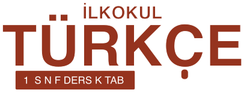
<!-- yer tutucu bulunamadı: sayfa sonuna eklendi -->

<!-- yer tutucu bulunamadı: sayfa sonuna eklendi -->

<!-- sayfa 1 -->

MİLLÎ EĞİTİM BAKANLIĞI YAYINLARI NO ..................................................................................................................: 2018
DERS KİTAPLARI DİZİSİ NO ........................................................................................................................................: 9597

Her hakkı saklıdır ve Millî Eğitim Bakanlığına aittir. Kitabın metin, soru ve şekilleri kısmen de olsa hiçbir surette alınıp yayımlanamaz.

Editör
Prof. Dr. Emre ÜNAL
Prof. Dr. Hüseyin ANILAN
Prof. Dr. İbrahim COŞKUN
Prof. Dr. Sabri SİDEKLİ
Dr. Öğr. Üyesi Murat TEMUR

Dil Uzmanı
Abdullah TAŞPINAR
Eyyup DİKOĞLU
Hatice OCAK

Görsel Tasarımcı
Ahmet CAN – Aslı DAL – Atila ÇAM – Cihan Arif YİĞİT
Dilek KORKMAZ – Mehmet Azzem AKGÖZ – Merve Gül KARACA
Mesut ÖZKAN – Seyfullah YİĞİT – Ümit ŞENER

Çoklu Ortam Tasarımcısı
Başak DOĞAN GÜNGÖRALP – Canan Özlem CANER – Cem SAVAŞ – Dr. Dilek ÇAPAR
Eda ÖZKAN AKAR – Enver ÜLKER – Erdem TOPUZOĞLU – Esra ESEN KANAN
Fatma GENÇ – Gazanfer DİKER – Harun KARABULUT – Hatice YILDIRIM IŞIK
Olcay DOĞAN – Onur GÖNÜLLÜ – Osman ÇELİK – Senem ERSİN GENÇ
Ümit ARSLAN – Vedat Ersin CEVİZ – Zekican YARDIMCI

Program Geliştirme Uzmanı
Fırat KILAVUZ
Mehmet EROĞLU

Ölçme ve Değerlendirme Uzmanı
Erdem BODUROĞLU
Mustafa GÖKCAN

Rehberlik Uzmanı
Metin ÇELİK
Recep ERDEM

978-975-11-8007-0

Millî Eğitim Bakanlığı, Talim ve Terbiye Kurulu Başkanlığının 17.07.2024 tarih ve 110460159 sayılı yazısı ile eğitim aracı olarak kabul edilmiştir.

<!-- sayfa 2 -->

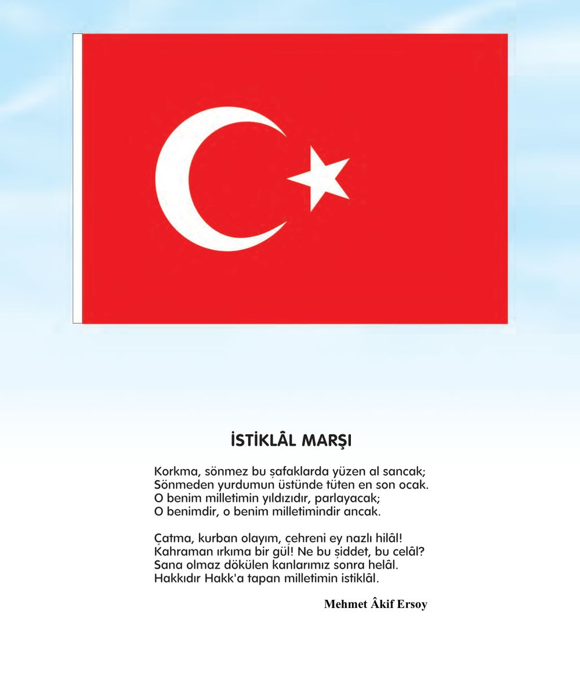

# İSTİKLÂL MARŞI

Korkma, sönmez bu şafaklarda yüzen al sancak;
Sönmeden yurdumun üstünde tüten en son ocak.
O benim milletimin yıldızıdır, parlayacak;
O benimdir, o benim milletimindir ancak.

Çatma, kurban olayım, çehreni ey nazlı hilâl!
Kahraman ırkıma bir gül! Ne bu şiddet, bu celâl?
Sana olmaz dökülen kanlarımız sonra helâl.
Hakkıdır Hakk'a tapan milletimin istiklâl.

**Mehmet Âkif Ersoy**

<!-- sayfa 3 -->

# ANDIMIZ

Türküm, doğruyum, çalışkanım.

İlkem küçüklerimi korumak, büyüklerimi saymak; yurdumu, milletimi özümden çok sevmektir.
Ülküm yükselmek, ileri gitmektir.

Ey Büyük Atatürk!

Açtığın yolda, gösterdiğin hedefe durmadan yürüyeceğime ant içerim.

Varlığım Türk varlığına armağan olsun.

Ne mutlu Türküm diyene!

<!-- sayfa 4 -->

MUSTAFA KEMAL ATATÜRK

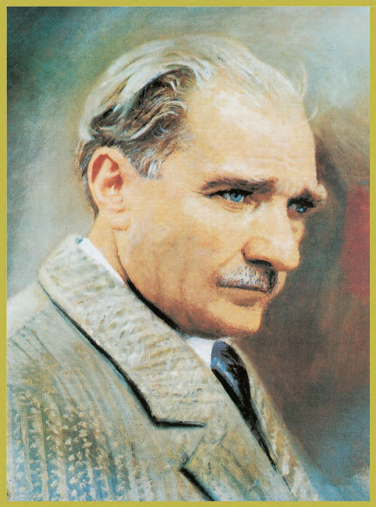
<!-- yer tutucu bulunamadı: sayfa sonuna eklendi -->

<!-- sayfa 5 -->

Verdiğiniz mesajda PDF metin katmanı boş görünüyor (`<<< >>>` arası boş). Lütfen dönüştürülmesini istediğiniz metni veya görseli paylaşın, böylece talimatlarınıza uygun şekilde Markdown formatına çevirebilirim.

<!-- sayfa 6 -->

# İÇİNDEKİLER

Kitabımızı Tanıyalım........................................................................................................................8
Hazırlanalım......................................................................................................................................11

### 5. TEMA | Yeteneklerimizi Keşfediyoruz | 23

Çocuk Kalbim (Dinleme metni)........................................................................................26
Herkes Bir Şeyi İyi Yapar .....................................................................................................36
Düş Gezgini...........................................................................................................................46
Uçurtma Nasıl Uçar ...............................................................................................................56
Şirin’in Kuş Resimleri Sergisi...............................................................................................68
Öğrendim Anladım Pekiştiriyorum...............................................................................................77

### 6. TEMA | Minik Kâşifler | 85

Aslan: Bisiklet Festivali (Dinleme metni)........................................................................88
Astronot.....................................................................................................................................98
Büyüleyici Büyüteç.........................................................................................................108
TEKNOFEST’e Gidiyoruz...................................................................................................122
Gökyüzü Okulu........................................................................................................................136
Öğrendim Anladım Pekiştiriyorum...............................................................................................145
Sözlük...........................................................................................................................................151
Kaynakça......................................................................................................................................153
Cevap Anahtarı................................................................................................................................154
Türkiye’nin Mülki İdare Bölümleri ile Kara ve Deniz Komşuları Haritası.......................................................................................................................................................157
Türk Dünyası Haritası................................................................................................................158

<!-- sayfa 7 -->

# KİTABIMIZI TANIYALIM

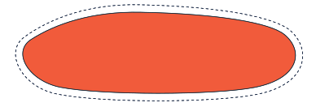
Tema numarası

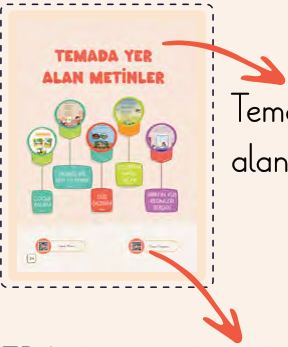
Tema adı

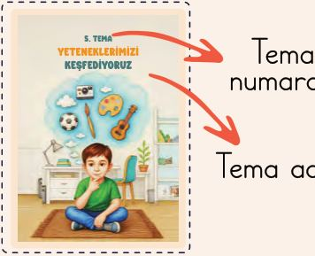
Temada yer alan metinler

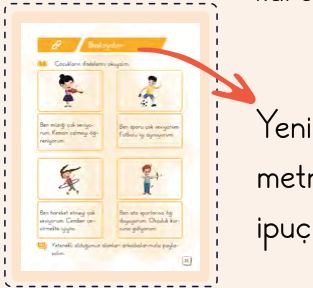
EBA’da yer alan elektronik içeriklere (E-içerik) yönlendiren karekodlar

Yeni başlayacağımız metnin içeriğiyle ilgili ipuçları veren etkinlikler

<!-- sayfa 8 -->

# KİTABIMIZI TANIYALIM

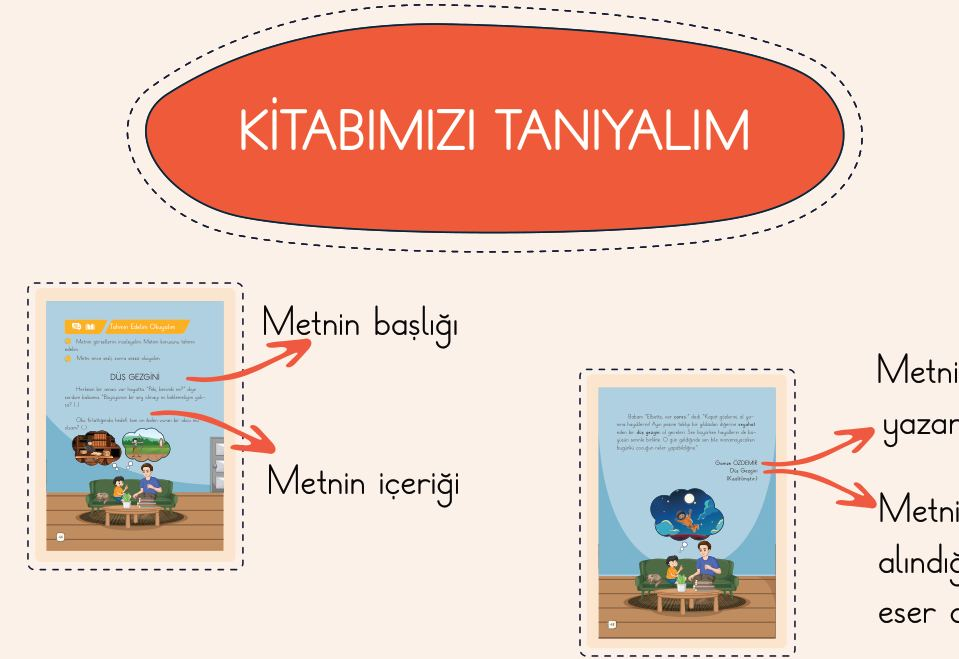 Metnin başlığı
 Metnin içeriği
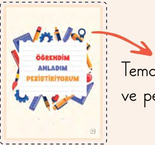 Metnin yazarı
 Metnin alındığı eser adı

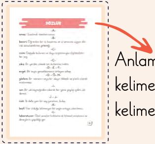 Tema içeriğine uygun etkinlikler ve performans görevleri

 Anlamını bilmediğimiz kelimeler ve bu kelimelerin anlamları

<!-- sayfa 9 -->

# KİTABIMIZI TANIYALIM

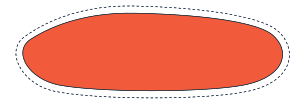 **Konuşma Sembolü:** Bu sembolü gördüğümüzde nezaket kurallarına, jest ve mimiklerimize dikkat ederek kendimizi sözlü ifade edelim.

 **İşaretleme Sembolü:** Bu sembolü gördüğümüzde verilen yönergeye uygun işaretleme yapalım.

 **Yazma Sembolü:** Bu sembolü gördüğümüzde yazım ve noktalama kurallarını uygulayarak yazma çalışmaları yapalım.

 **Dinleme Sembolü:** Bu sembolü gördüğümüzde metni dikkatli bir şekilde dinleyelim.

 **İzleme Sembolü:** Bu sembolü gördüğümüzde metni dikkatli bir şekilde izleyelim.

 **Boyama Sembolü:** Bu sembolü gördüğümüzde verilen yönlendirmelere uygun şekilde çizelim ve boyayalım.

 **Okuma Sembolü:** Bu sembolü gördüğümüzde metni noktalama işaretlerine, vurgu ve tonlamaya dikkat ederek sesli ve/veya sessiz okuyalım.

 **Metin Öncesi Etkinlik Sembolü:** Bu sembolü gördüğümüzde metne başlamadan önce verilen etkinlikleri yaparak metne hazırlanalım.

<!-- sayfa 10 -->

# HAZIRLANALIM

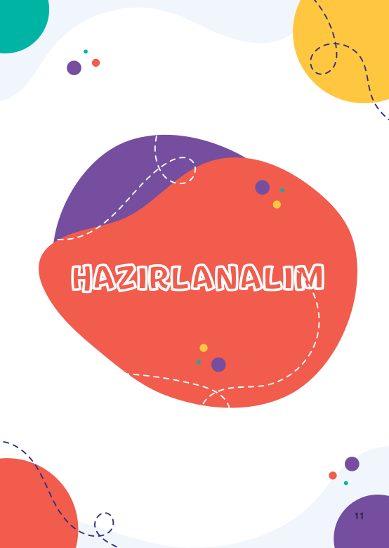
<!-- yer tutucu bulunamadı: sayfa sonuna eklendi -->

<!-- sayfa 11 -->

# LABİRENT

 Buket çiftlikteki kuzuyu beslemek istiyor. Kuzuya ot götürmesi için Buket’e yardım edelim.

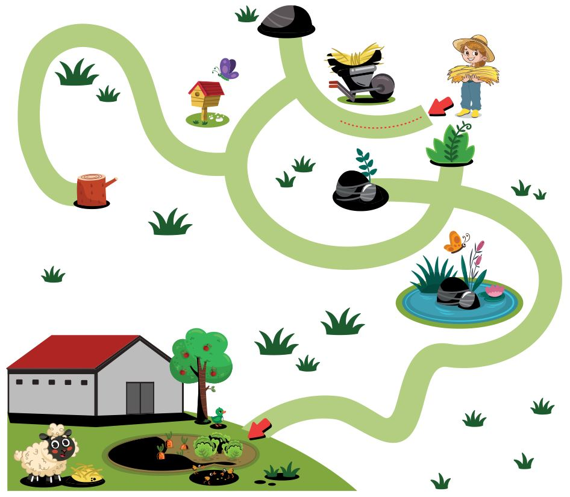

 Ara tatilde neler yaptığımızı arkadaşlarımızla paylaşalım.

 Türkçe Sineması 1

<!-- sayfa 12 -->

# BOYAYALIM

Sözcükler renklerle eşleştirilmiştir.

| | | | |
| :--- | :--- | :--- | :--- |
| Kedi | [Kahverengi] | Güneş | [Sarı] |
| Bulut | [Açık Mavi] | Oyun | [Yeşil] |

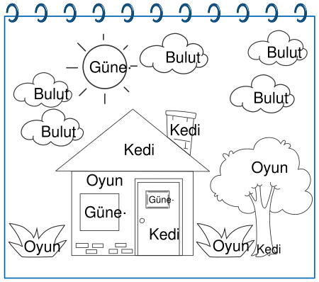

Sözcüklerin yazılı olduğu varlıkları eşleştirildiği renklere boyayalım.

(Resim içeriği)
Güneş, Bulut, Bulut, Bulut, Bulut, Kedi, Kedi, Kedi, Oyun, Güneş, Güneş, Oyun, Oyun, Oyun, Kedi, Kedi

<!-- sayfa 13 -->

# SAKLI NESNELERİ BULALIM

▶ Verilen görseli dikkatlice inceleyelim.
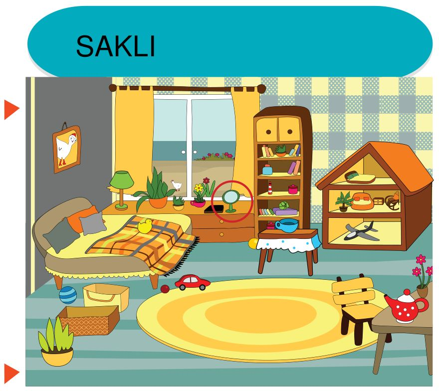

▶ Verilen görselleri örnekteki gibi yuvarlak içine alalım ve boyayalım. Nesnelerin adını yazalım.
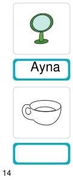

| 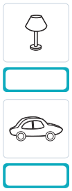 | 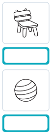 | 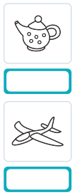 |  |
| :---: | :---: | :---: | :---: |
| Ayna | ........................... | ........................... | ........................... |

|  |  |  |  |
| :---: | :---: | :---: | :---: |
| ........................... | ........................... | ........................... | ........................... |

<!-- sayfa 14 -->

# EŞLEŞTİRELİM YAZALIM

▶ Hayvanları gölgeleriyle örnekteki gibi eşleştirelim.
▶ Hayvanların adlarını yazalım.

 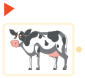 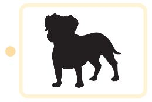  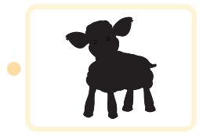
 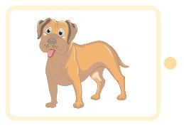 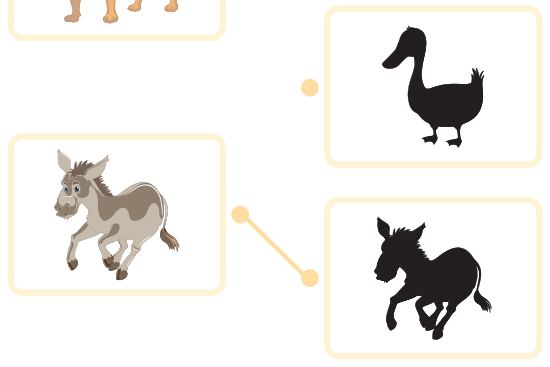 
 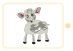 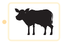
 

 Türkçe Sineması 2

<!-- sayfa 15 -->

# BELİRLEYELİM YAZALIM

 Verilen harflerle başlayan varlıkların adlarını örnekteki gibi yazalım.

| Harf | İsim | Resim | Harf | İsim | Resim |
| :--- | :--- | :--- | :--- | :--- | :--- |
| b | balon |  | m | ............................. | 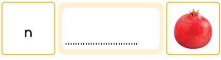 |
| c | ............................. |  | n | ............................. |  |
| ç | ............................. | 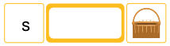 | t | ............................. |  |
| d | ............................. | 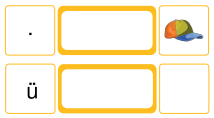 | s | ............................. | 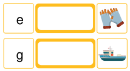 |
| e | ............................. |  | ş | ............................. |  |
| g | ............................. |  | ü | ............................. |  |

 Türkçe Sineması 3

<!-- sayfa 16 -->

# OKUYALIM RENKLENDİRELİM

▶ Verilen bilgileri kullanarak görseli renklendirelim.
● Çocuğun saçları sarıdır.
● Pantolonu laciverttir.
● Beş tane turuncu balonu vardır.
● İki tane mor balonu vardır.
● Çiçekler pembedir.
▶ Görselin geri kalan kısmını istediğimiz renklerle boyayalım.

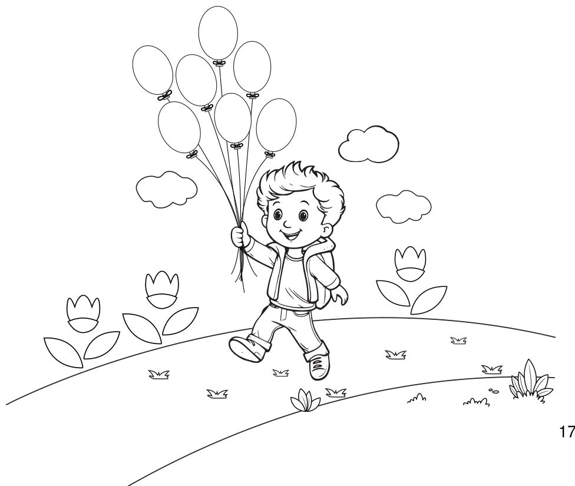

<!-- sayfa 17 -->

# TAMAMLAYALIM KONUŞALIM

 Verilen yapbozu tamamlamak için kitabın sonunda bulunan Ek-1’den yararlanalım.

| | | |
|---|---|---|
| | | |
| | | |
| | | |

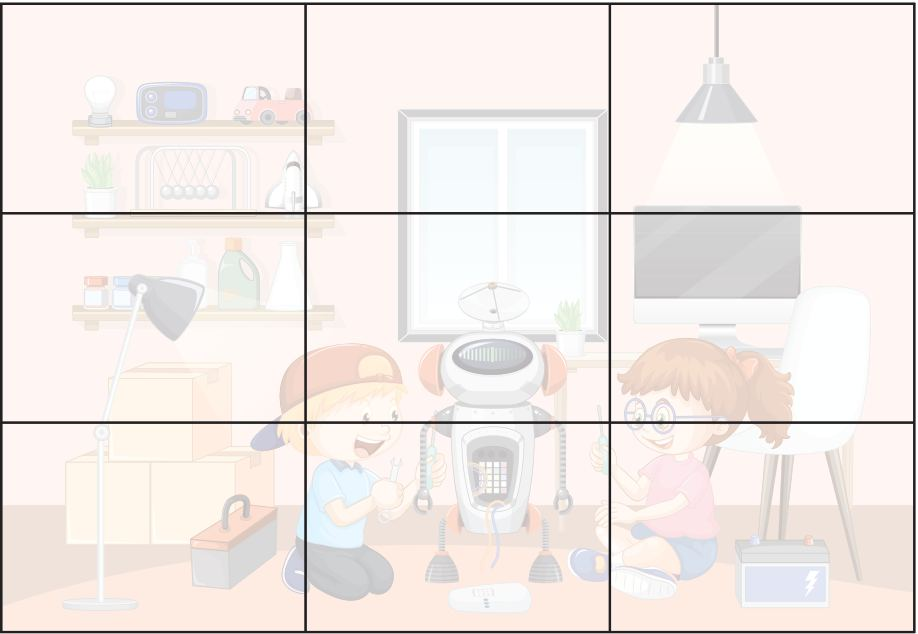 Tamamladığımız yapbozda çocuklar ne yapıyor? Arkadaşlarımızla paylaşalım.

 Türkçe Sineması 4

<!-- sayfa 18 -->

# OKUYALIM CEVAPLAYALIM

 Metinleri okuyalım. Soruları metinlere göre cevaplayalım.

 1.  Teyzesi, Melis’e mor benekli bir toka hediye etti. Melis sarı saçlarını örüp mor benekli tokasını taktı.

● Melis’e kim toka hediye etti?

● Melis’in tokasının benekleri ne renkti?
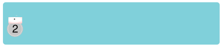

 2. 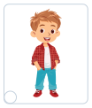 Sevim, kardeşi Kenan’a kırmızı bir balon almış. Balon Kenan’ın gözlüğüyle aynı renkmiş. Kenan buna çok sevinmiş.

● Sevim, Kenan’a ne aldı?

● Verilen görsellerden hangisi Kenan’a aittir? İşaretleyelim.
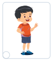 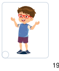

<!-- sayfa 19 -->

# EŞLEŞTİRELİM

 Verilen görselleri uygun cümlelerle eşleştirelim.

 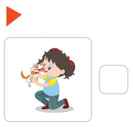 1. Yaren voleybol oynuyor.
 []

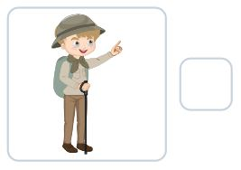  2. Serkan karate yapıyor.
 []

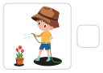  3. Hakan izcilik kulübüne katıldı.
 []

 4. Ebru bisiklet sürüyor.
 []

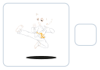  5. Gizem köpeğini seviyor.
 []

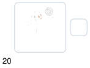 6. Mehmet çiçek suluyor.
 []

<!-- sayfa 20 -->

# TAMAMLAYALIM KONUŞALIM

 Verilen yapbozu tamamlamak için kitabın sonunda bulunan Ek-1’den yararlanalım.

| | | |
|---|---|---|
| | | |
| | | |
| | | |

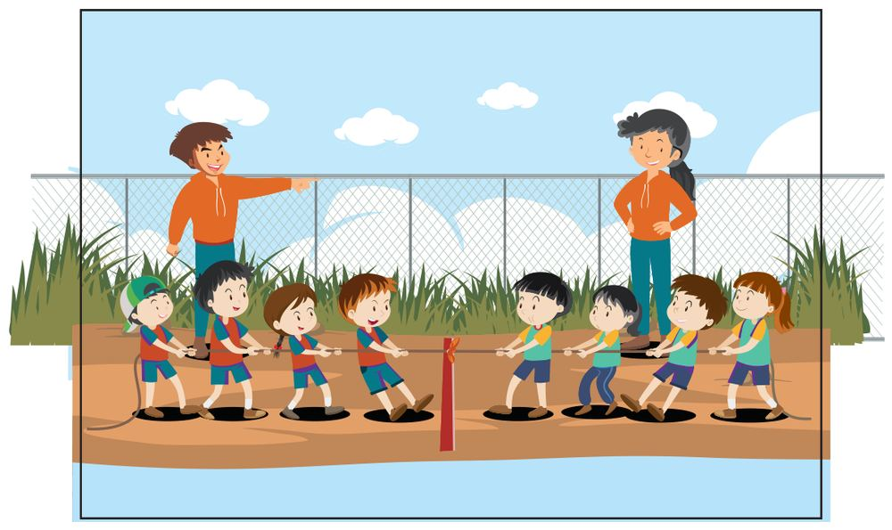 Tamamladığımız yapboz hangi ders ile ilgilidir? Bu derste hangi etkinlikleri yaparız? Anlatalım.

Türkçe Sineması 5

<!-- sayfa 21 -->

# TEKERLEME ZAMANI

 Verilen tekerlemeyi okuyalım.

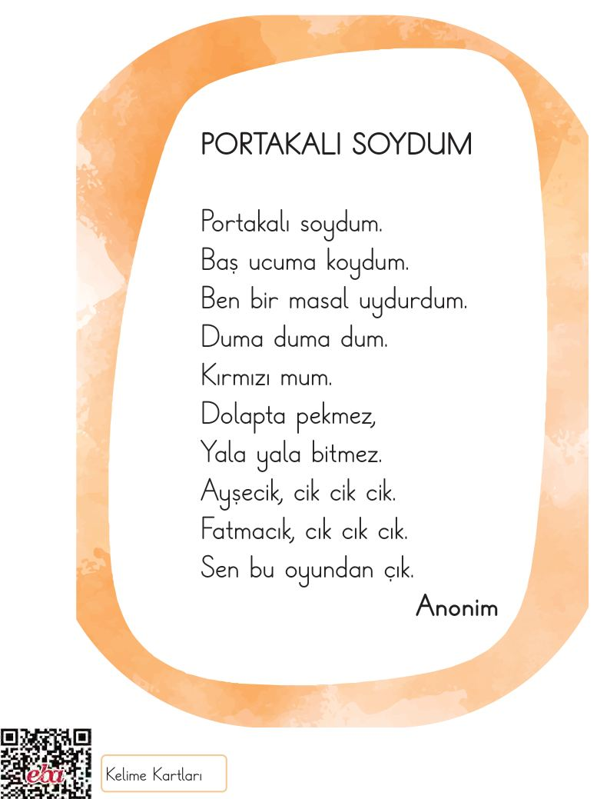
## PORTAKALI SOYDUM

Portakalı soydum.
Baş ucuma koydum.
Ben bir masal uydurdum.
Duma duma dum.
Kırmızı mum.
Dolapta pekmez,
Yala yala bitmez.
Ayşecik, cik cik cik.
Fatmacık, cık cık cık.
Sen bu oyundan çık.

*Anonim*

Kelime Kartları

<!-- sayfa 22 -->

# 5. TEMA
# YETENEKLERİMİZİ
# KEŞFEDİYORUZ

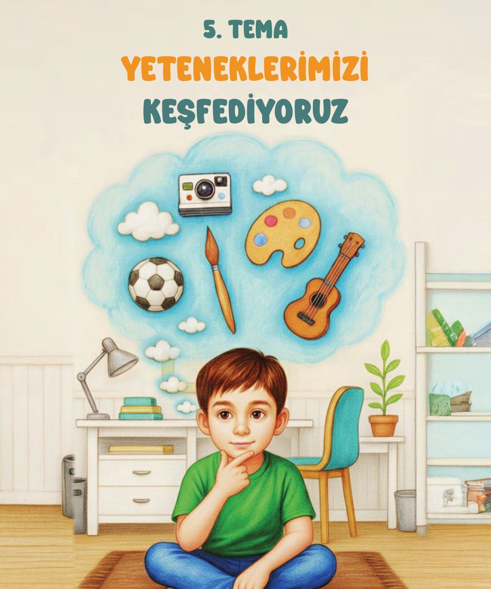

<!-- sayfa 23 -->

# TEMADA YER ALAN METİNLER

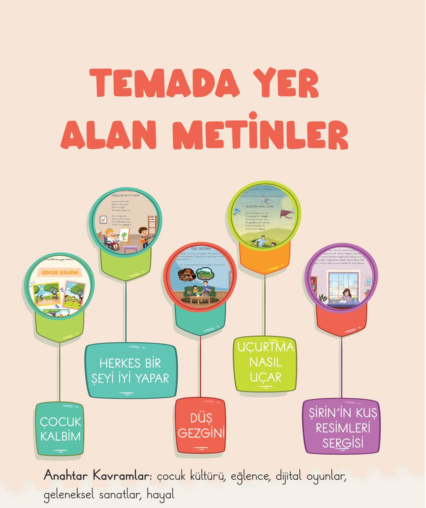

ÇOCUK KALBİM

HERKES BİR ŞEYİ İYİ YAPAR

DÜŞ GEZGİNİ

UÇURTMA NASIL UÇAR

ŞİRİN'İN KUŞ RESİMLERİ SERGİSİ

Anahtar Kavramlar: çocuk kültürü, eğlence, dijital oyunlar, geleneksel sanatlar, hayal

Tema Alanı

Tema Tanıtımı

<!-- sayfa 24 -->

# Başlayalım

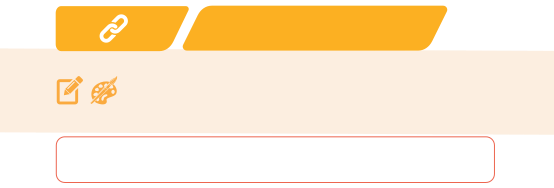 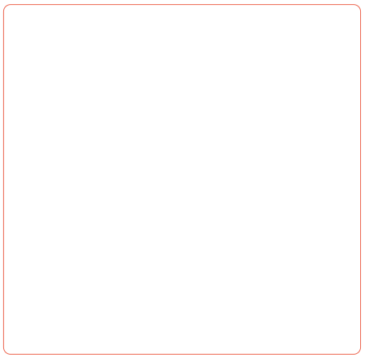 En çok sevdiğimiz oyunun adını yazalım ve resmini çizelim.

...................................................................................................................................................................................

| |
| :--- |
| |
| |
| |
| |
| |
| |
| |
| |
| |
| |
| |
| |
| |
| |
| |
| |
| |
| |
| |
| |
| |
| |
| |
| |
| |
| |
| |
| |
| |
| |
| |
| |
| |
| |
| |
| |
| |
| |
| |
| |
| |
| |
| |
| |
| |
| |
| |
| |
| |
| |
| |
| |
| |
| |
| |
| |
| |
| |
| |
| |
| |
| |
| |
| |
| |
| |
| |
| |
| |
| |
| |
| |
| |
| |
| |
| |
| |
| |
| |
| |
| |
| |
| |
| |
| |
| |
| |
| |
| |
| |
| |
| |
| |
| |
| |
| |
| |
| |
| |
| |
| |
| |
| |
| |
| |
| |
| |
| |
| |
| |
| |
| |
| |
| |
| |
| |
| |
| |
| |
| |
| |
| |
| |
| |
| |
| |
| |
| |
| |
| |
| |
| |
| |
| |
| |
| |
| |
| |
| |
| |
| |
| |
| |
| |
| |
| |
| |
| |
| |
| |
| |
| |
| |
| |
| |
| |
| |
| |
| |
| |
| |
| |
| |
| |
| |
| |
| |
| |
| |
| |
| |
| |
| |
| |
| |
| |
| |
| |
| |
| |
| |
| |
| |
| |
| |
| |
| |
| |
| |
| |
| |
| |
| |
| |
| |
| |
| |
| |
| |
| |
| |
| |
| |
| |
| |
| |
| |
| |
| |
| |
| |
| |
| |
| |
| |
| |
| |
| |
| |
| |
| |
| |
| |
| |
| |
| |
| |
| |
| |
| |
| |
| |
| |
| |
| |
| |
| |
| |
| |
| |
| |
| |
| |
| |
| |
| |
| |
| |
| |
| |
| |
| |
| |
| |
| |
| |
| |
| |
| |
| |
| |
| |
| |
| |
| |
| |
| |
| |
| |
| |
| |
| |
| |
| |
| |
| |
| |
| |
| |
| |
| |
| |
| |
| |
| |
| |
| |
| |
| |
| |
| |
| |
| |
| |
| |
| |
| |
| |
| |
| |
| |
|

<!-- sayfa 25 -->

# Dinleyelim

Metni, dinleme kurallarına uygun olarak dinleyelim.

## ÇOCUK KALBİM

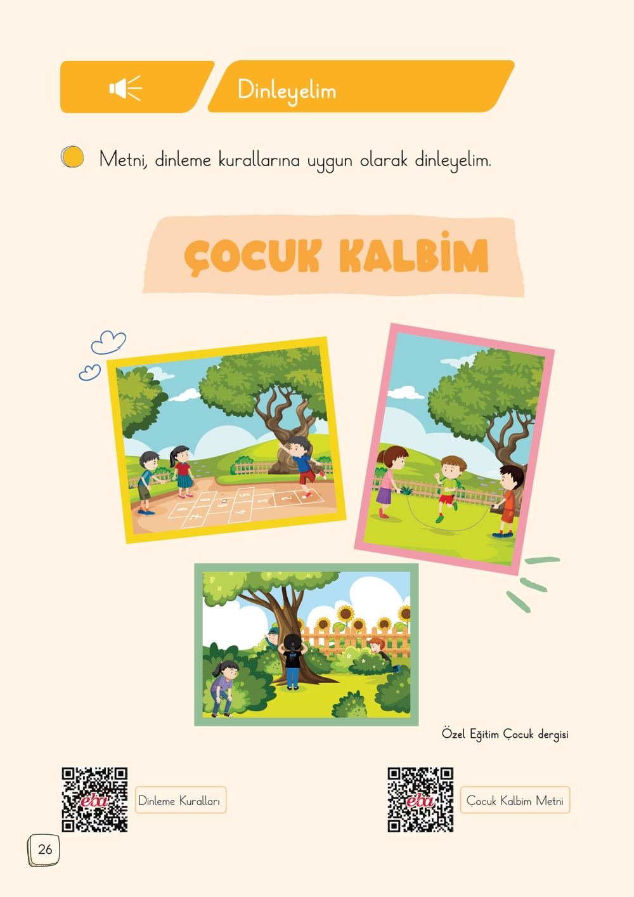

Özel Eğitim Çocuk dergisi

[QR Kod] Dinleme Kuralları
[QR Kod] Çocuk Kalbim Metni

<!-- sayfa 26 -->

# Kendimizi Değerlendirelim

Verilen dinleme kurallarına göre kendimizi değerlendirelim. Metni dinlerken uyguladığımız kuralları işaretleyelim.

☐ Metni dikkatle dinledim.
☐ Metni uygun oturuş pozisyonunda dinledim.
☐ Metni sessizce dinledim.

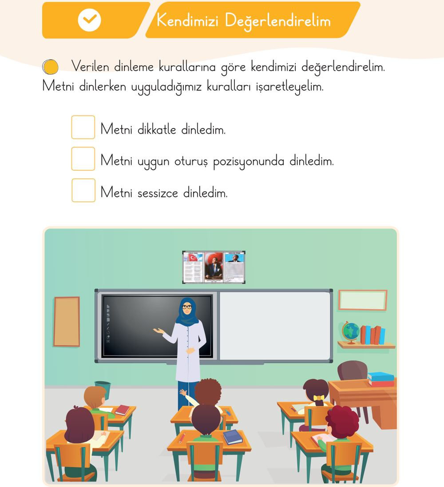

: İşaretlemediğimiz dinleme kurallarını nasıl düzelteceğimizle ilgili öğretmenimizden yardım alalım.

<!-- sayfa 27 -->

# İşaretleyelim Yazalım

Metinle ilgili görselleri işaretleyelim.

1. 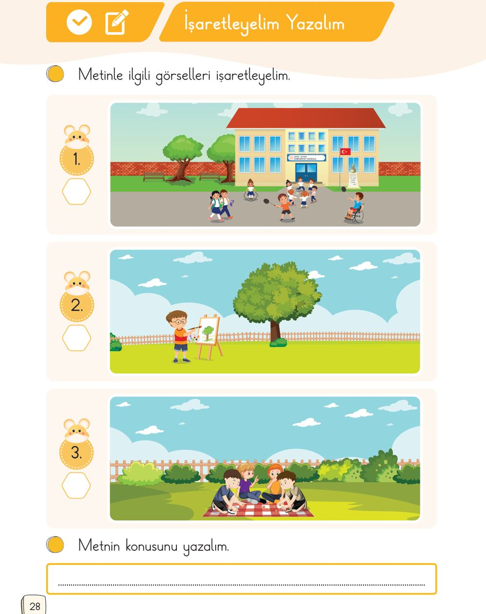
2. 
3. 

Metnin konusunu yazalım.
__________________________________________________________________

<!-- sayfa 28 -->

# Yazalım Anlatalım

Metinde geçen oyunların adlarını görsellerin altına yazalım.
Bu oyunlardan birinin kurallarını anlatalım.

1.
................................................................................

2.
................................................................................

3.
................................................................................

4.
................................................................................

................................................................................
................................................................................
................................................................................
................................................................................

<!-- sayfa 29 -->

# Okuyalım Yazalım

Verilen tekerlemeyi okuyalım ve yazalım.

**KÖREBE**
Oyunun adı körebe!
Şule olsun ebe.
Gözlerini kapatsın,
Sobelemeye başlasın.
Ebeleyince Şirin'i
Oyun yeniden başlasın.
*Bu kitap için yazılmıştır.*

...................................................................................................
...............................................................................................................................................................................
...............................................................................................................................................................................
...............................................................................................................................................................................
...............................................................................................................................................................................
...............................................................................................................................................................................
...............................................................................................................................................................................
...............................................................................................................................................................................

<!-- sayfa 30 -->

# Yazalım

 Verilen sözcüklerden örnekteki gibi anlamlı ve kurallı cümle- ler yazalım. Oluşturduğumuz cümlelerle körebe oyununun kural- larına ulaşalım.

## Kural 1

| belirlenir | arasından | ebe | oyuncular |
| :--- | :--- | :--- | :--- |

Ebe, oyuncular arasından belirlenir.

## Kural 2

| gözleri | ebenin | mendille | bağlanır |
| :--- | :--- | :--- | :--- |

________________________________________________________________________________

## Kural 3

| oyuncuları | çalışır | yakalamaya | ebe |
| :--- | :--- | :--- | :--- |

## Kural 4

| yakalanan | olur | ebe | kişi |
| :--- | :--- | :--- | :--- |

<!-- sayfa 31 -->

# Bulalım Yazalım

Çocukların en sevdiği oyunlarla ilgili açıklamalarını okuyalım. Bu oyunların adlarını bulalım ve yazalım.

köşe kapmaca | seksek | yakantop | saklambaç

1.  Benim en sevdiğim oyun, tek ayak üstünde zıplanarak oynanan bir oyundur.

2.  Benim en sevdiğim oyunda bir kişi ebe olur. Diğer oyuncular saklanır.

3.  Benim en sevdiğim oyunda yeni canlar kazanılabilir. Oyundan çıkan arkadaşlar bu canlarla oyuna tekrar alınabilir.

<!-- sayfa 32 -->

# Yazalım Sayalım

🟡 Görsellerdeki varlıkların adlarını, sözcüklerin kaç harf ve heceden oluştuğunu örnekteki gibi yazalım.

1. 
   Kelebek
   Harf sayısı: 7
   Hece sayısı: 3

2. 
   ....................................................
   Harf sayısı: ....................................
   Hece sayısı: ....................................

3. 
   ....................................................
   Harf sayısı: ....................................
   Hece sayısı: ....................................

4. 
   ....................................................
   Harf sayısı: ....................................
   Hece sayısı: ....................................

<!-- sayfa 33 -->

# Okuyalım Seçelim

 Verilen şiiri noktalama işaretlerine dikkat ederek okuyalım.
Şiirde geçen iki heceli sözcükleri yuvarlak içine alalım.

## İSTOP

Binip kartondan roketime,
Dünyayı takarım peşime.
Oynarım güneşle körebe,
Yıldızlarla sobelemece,
Bulutlarla saklambaç,
Gezegenlerle yakartop.
Şşştt, sessiz olun!
Yakaladım işte!
İstop!..

Eda ÖZCAN
Hayal Kavanozundaki Şiirler

<!-- sayfa 34 -->

# Başlayalım

📖 Çocukların ifadelerini okuyalım.

Ben müziği çok seviyorum. Keman çalmayı öğreniyorum.

Ben sporu çok seviyorum. Futbolu iyi oynuyorum.

Ben hareket etmeyi çok seviyorum. Çember çevirmekte iyiyim.

Ben ata sporlarına ilgi duyuyorum. Okçuluk kursuna gidiyorum.

💬 Yetenekli olduğumuz alanları arkadaşlarımızla paylaşalım.

<!-- sayfa 35 -->

# Tahmin Edelim Okuyalım

* Şiirin başlığını ve görsellerini inceleyelim. Şiirin konusunu tahmin edelim. Tahminlerimizi arkadaşlarımızla paylaşalım.
* Şiiri noktalama işaretlerine dikkat ederek okuyalım.

## HERKES BİR ŞEYİ İYİ YAPAR

İnsanlar farklı farklı,
Birbirine benzemez.
Birinin sevdiğini
Bir başkası beğenmez.

Kimi müziği sever,
Güzel şarkılar söyler.
Kimi *enstrüman* çalar,
Yükselir hoş *nağmeler*.

<!-- sayfa 36 -->

Kimisi resim yapar,
**Fırçası** elindedir.
Duygu ve düşünceyi
Renklerle dillendirir.
(...)

Önce kendini tanı,
Sen ne yapabilirsin?
**Başarını** gördükçe
Kendine güvenirsin.

Özden AKKOL
Çocuk Şiirleri
(Kısaltılmıştır.)

<!-- yer tutucu bulunamadı: sayfa sonuna eklendi -->

<!-- sayfa 37 -->

# Bulalım Karar Verelim

 Koyu yazılmış sözcüklere dikkat ederek şiiri tekrar okuyalım. Verilen anlamın hangi sözcüğe ait olduğunu belirleyerek örnekteki gibi eşleştirelim.

 1. Bir işte istenilen sonuca ulaşma.

 2. Müzik yapmaya yarayan araç.

 3. Güzel ve uyumlu ses.

enstrüman
[ ]

nağme
[ ]

başarı
1

fırça
[ ]

 Eşleşmeyen sözcüğün anlamını TDK (Türk Dil Kurumu) Güncel Türkçe Sözlükten bulalım ve yazalım.

[...............................]
........................................................................................................................
........................................................................................................................

<!-- sayfa 38 -->

# Bulalım İşaretleyelim

 Şiirle ilgili görselleri işaretleyelim. Görsellerde anlatılanlar hakkında arkadaşlarımızla konuşalım.

| | |
| :--- | :--- |
|  1.  |  |
|  2.  |  |
|  3.  |  |
|  4.  |  |
|  5.  |  |
|  6.  |  |

<!-- sayfa 39 -->

# Seçelim Yazalım

🟡 Okuduğumuz şiirin başlığı nedir? Uygun yere yazalım.
Şiirimizi uygun sözcüklerle örnekteki gibi tamamlayalım.

...............................................................

Kimi müziği sever,
Güzel şarkılar söyler.
Kimi enstrüman çalar,
Yükselir .............................. nağmeler.

Kimisi .............................. yapar,
.............................. elindedir.
Duygu ve ..............................
Renklerle dillendirir.
Özden AKKOL

| hoş | fırçası | başa |
| :---: | :---: | :---: |
| resim | şarkılar | düşünceyi |

<!-- sayfa 40 -->

# Kendimizi Tanıyalım

İstenilen bilgileri yazalım.

Adım:

Yaşım:

Boyum:

Kilom:

En sevdiğim spor:

En sevdiğim renk:

En sevdiğim hayvan:

En sevdiğim oyun:

En sevdiğim şarkı:

En sevdiğim kitap:

En sevdiğim yemek:

<!-- sayfa 41 -->

# Bulalım İşaretleyelim

Görsellerle ilgili olan cümleleri işaretleyelim.

- [ ] Ezgi kitap okuyor.
- [ ] Ezgi oyun oynuyor.
- [x] Ezgi fotoğraf çekiyor.

- [ ] Ali iyi satranç oynar.
- [x] Ali halk oyunu oynar.
- [ ] Ali futbol oynamayı sever.

- [x] Selin keman çalar.
- [ ] Selin resim yapar.
- [ ] Selin yazı yazar.

<!-- sayfa 42 -->

# Yazalım

   Verilen her görsel bir sözcükle eşleşmektedir. Görsel ve sözcük eşleştirmelerine göre örnekteki gibi cümleler yazalım.

 Ayşe  resim  Ela
 yaptı  odasını  topladı

 Hasan  çiçek

1.
 Ayşe  çiçek  topladı
Ayşe çiçek topladı.
..............................................................................................................................................................

2.
 ............................  ............................  ............................
..............................................................................................................................................................

3.
 ............................  ............................  ............................
..............................................................................................................................................................

<!-- sayfa 43 -->

# Okuyalım Yazalım

Şiiri önce sesli, sonra sessiz okuyalım. Şiirdeki çocukların adlarını görsellerinin altına yazalım.

## FARKLILIKLARIMIZ

Biz üç arkadaşız,
Birbirimizden farklıyız.
Eren'in şarkıları neşeli,
Güneş'in resimleri renkli renkli,
Kemal doğada bir gözlemci.
Yeteneklerimiz çeşitli,
Hayatımız birlikte daha keyifli.

*Bu kitap için yazılmıştır.*

.............................................

<!-- sayfa 44 -->

# Başlayalım

Bilmeceleri okuyalım. Bilmeceleri cevaplarıyla örnekteki gibi eşleştirelim.

1.
Gökyüzünde kuş gibi uçarım.
Taşıtımın kanatları çeliktendir.
Bazen yolcu bazen yük taşırım.
Bil bakalım, ben kimim?

 2 

2.
Bir elimde fırçam,
Önümdedir boyam,
Renkleri karıştırırım.
Bil bakalım, ben kimim?

3.
Beyaz önlük giyerim,
Hastaları tedavi ederim,
Hastanedir iş yerim.
Bil bakalım, ben kimim?

4.
Ülkemizi korurum,
Güvenliğimizi sağlarım.
Bil bakalım, ben kimim?

<!-- sayfa 45 -->

# Tahmin Edelim Okuyalım

* Metnin görsellerini inceleyelim. Metnin konusunu tahmin edelim.
* Metni önce sesli, sonra sessiz okuyalım.

## DÜŞ GEZGİNİ

Herkesin bir amacı var hayatta. “Peki, benimki ne?” diye sordum babama. “Büyüyünce bir şey olmayı mı beklemeliyim yoksa? (...)

Oku fırlattığımda hedefi tam on ikiden vuran bir okçu mu olsam? (...)

<!-- sayfa 46 -->

Güneş doğarken erkenden uyansam, kuşların cıvıltılarıyla beraber kocaman çalışma masama otursam... Benim gibi küçük çocuklar için hikâyeler yazan bir yazar mı olsam? (...)

Bahçemizde sapsarı laleler, beyaz zambaklar ve kiraz ağaçları olsa... Tohumlar ekip onları büyüten bahçıvan mı olsam acaba? (...)

Keşfedilmemiş müthiş şeyler tasarlasam... Bizi geçmişe ve geleceğe götürecek zaman makinesini icat eden bir mucit mi olsam? (...)

Bir kuş bilimci belki... Belki de oyuncak tamircisi... Ya da hepsini şimdiden olmanın yok mu bir çaresi?”

<!-- sayfa 47 -->

Babam “Elbette, var çaresi.” dedi. “Kapat gözlerini, al yanına hayallerini! Ayın peşine takılıp bir yıldızdan diğerine seyahat eden bir düş gezgini ol geceleri. Sen büyürken hayallerin de büyüsün seninle birlikte. O gün geldiğinde sen bile inanamayacaksın bugünkü çocuğun neler yapabildiğine.”

Gamze ÖZDEMİR
Düş Gezgini
(Kısaltılmıştır.)

<!-- sayfa 48 -->

# Bulalım Karar Verelim

 Koyu yazılmış sözcüklere dikkat ederek metni tekrar okuya- lım. Verilen anlamın hangi sözcüğe ait olduğunu belirleyerek ör- nekteki gibi eşleştirelim.

| | | |
| :--- | :--- | :--- |
|  1. | Bir işin önündeki engeli kaldır- mak için yapılması gerekenler. | düş |
| | | $\hexagon$ |
| | | |
| | | gezgin |
| | | $\hexagon$ |
|  2. | Gezmek, tanımak, görmek amacıyla geziye çıkan kişi. | seyahat |
| | | $\hexagon$ |
| | | |
|  3. | Bir yerden bir yere gidiş veya geliş, yolculuk. | çare |
| | | $\pentagon$ 1 |

 Eşleşmeyen sözcüğün anlamını TDK (Türk Dil Kurumu) Gün- cel Türkçe Sözlükten bulalım ve yazalım.

| ............................... | ........................................................................................................................ ........................................................................................................................ ........................................................................................................................ |
| :--- | :--- |

<!-- sayfa 49 -->

# Bulalım İşaretleyelim

Metnin konusunu ifade eden görseli işaretleyelim.

1.

2.

3.

<!-- sayfa 50 -->

# Yazalım Anlatalım

 “Düş Gezgini” metninde çocuğun kurduğu hayalleri örnek-
teki gibi numaralandırarak sıralayalım. Görselleri anlatan birer 
cümle yazalım.

| | | |
| :--- | :--- | :--- |
| .... |  | ................................................................................................ ................................................................................................ ................................................................................................ ................................................................................................ |
| 1. |  | Çocuk, yazar olmayı hayal etti......................................................................................... ................................................................................................ |
| .... |  | ................................................................................................ ................................................................................................ ................................................................................................ ................................................................................................ |
| .... |  | ................................................................................................ ................................................................................................ ................................................................................................ ................................................................................................ |

<!-- sayfa 51 -->

# Yazalım

Verilen sözcüklerle örnekteki gibi anlamlı ve kurallı cümleler yazalım.

1.

olmaktır | hayalim | doktor
Hayalim doktor olmaktır.

2.

öykü | istiyor | Ayşe | yazmak
...............................................................................................................................................................................

3.

şakalarıyla | Mehmet | güldürür | herkesi
...............................................................................................................................................................................

4.

seviyor | resim | Gökhan | yapmayı | çok
...............................................................................................................................................................................

<!-- sayfa 52 -->

# Okuyalım Seçelim

Şiiri okuyalım. Şiirde geçen tek heceli sözcükleri yuvarlak içine alalım.

## EN BÜYÜK HAZİNE

Çocuğum ben,
Merak eder gözlerim,
Dokunmak ister ellerim,
Yorulmak bilmez bedenim.
Çocuğum ben,
Dünyalar kadardır hayallerim,
Neşe doludur kalbim,
Aslında ben büyük bir hazineyim.

Eda ÖZCAN
Hayal Kavanozundaki Şiirler

<!-- yer tutucu bulunamadı: sayfa sonuna eklendi -->

<!-- sayfa 53 -->

# Anlatalım

  En sevdiğimiz hayvanın özellikleri ve yaşadığı ortam ile ilgili bilgi toplayalım. Daha sonra bu hayvanla ilgili görseller bularak aşağıya yapıştıralım. Görsellerin etrafını süsleyelim. Öğrendiklerimizi arkadaşlarımıza anlatalım.

<!-- sayfa 54 -->

# Başlayalım

 Görseli inceleyelim. Açık havada yapmaktan hoşlandığımız etkinlikler nelerdir? Arkadaşlarımızla paylaşalım.

<!-- sayfa 55 -->

# Tahmin Edelim Okuyalım

* Şiirin başlığını ve görsellerini inceleyelim. Şiirin konusunu tahmin edelim.
* Şiiri noktalama işaretlerine dikkat ederek okuyalım.

## UÇURTMA NASIL UÇAR

Bunu bilmeyecek ne var!
Çıkmayagörsün rüzgâr,
Uçurtmam dünden hazır.
Bir yumak ip de cebimde,
Küçük kız kardeşimle
Koşarız karşı tepeye.

<!-- sayfa 56 -->

Kardeşim *özenle* tutar
Rüzgâra karşı uzaktan.
Sonra “Bırak!” derim ona,
Havalanır uçurtmam.
Koşarım önce şöyle bir,
Asıl *ustalık* bendedir.
Salarım, salarım ipini;
Uçurtmam göklere yükselir.
(...)

Ayla ÇINAROĞLU
Şiir Gemisi
(Kısaltılmıştır.)

<!-- sayfa 57 -->

# Bulalım Karar Verelim

 Koyu yazılmış sözcüklere dikkat ederek şiiri tekrar okuyalım. Verilen anlamın hangi sözcüğe ait olduğunu belirleyerek örnekteki gibi eşleştirelim.

| | | |
| :--- | :--- | :--- |
|  1. | Bir işi iyi bilme. | yumak   ⬡ |
| | | tepe   ⬡ |
| | | ustalık   1 |
|  2. | Bir işin elinden geldiğince iyi olması için gösterilen çaba. | özen   ⬡ |
| | | |
|  3. | Yüksekliği fazla olmayan, yanları yatık yer biçimi. | |

 Eşleşmeyen sözcüğün anlamını TDK (Türk Dil Kurumu) Güncel Türkçe Sözlükten bulalım ve yazalım.

| ............................... | ........................................................................................................................   ........................................................................................................................   ........................................................................................................................ |
| :--- | :--- |

<!-- sayfa 58 -->

# Bulalım İşaretleyelim

 Şiirin konusunu anlatan görseli işaretleyelim.

1. 
2. 
3. 

<!-- sayfa 59 -->

# Seçelim Yazalım

🟡 Okuduğumuz şiirin başlığı nedir? Başlığı uygun yere yazalım.
Şiirimizi uygun sözcüklerle tamamlayalım.

...........................................................................

Bunu bilmeyecek ne var!
Çıkmayagörsün rüzgâr,
Uçurtmam ........................................ hazır.
Bir ........................................ ip de cebimde,
Küçük kız kardeşimle
Koşarız ........................................ tepeye.

Ayla ÇINAROĞLU

| yumak | karşı |
| :---: | :---: |

| ✅ bilmeyecek | uçurtma | dünden |
| :---: | :---: | :---: |

<!-- yer tutucu bulunamadı: sayfa sonuna eklendi -->

<!-- yer tutucu bulunamadı: sayfa sonuna eklendi -->

<!-- yer tutucu bulunamadı: sayfa sonuna eklendi -->

<!-- yer tutucu bulunamadı: sayfa sonuna eklendi -->

<!-- yer tutucu bulunamadı: sayfa sonuna eklendi -->

<!-- yer tutucu bulunamadı: sayfa sonuna eklendi -->

<!-- sayfa 60 -->

# Yazalım Sayalım

Verilen sözcükleri hecelerine ayıralım. Sözcüklerin hece sayılarını örnekteki gibi yazalım.

| Sözcükler | Heceler | Hece Sayısı |
| :--- | :--- | :--- |
| tepe | te–pe | 2 |
| uçurtma | | |
| gök | | |
| hava | | |
| küçük | | |
| kardeş | | |
| yumak | | |
| dün | | |
| çocuk | | |
| usta | | |

Bil Kazan

<!-- sayfa 61 -->

# Okuyalım Çizelim

🟡 Verilen açıklamaları okuyalım. Açıklamalarda anlatılan uçurtmaları çizelim.

| Benim uçurtmam turuncu balık şeklinde. Uçurtmam gökyüzünde uçarken denizde yüzen bir balığı hatırlatıyor. |
| :--- |
|  |

| Uçurtmam mor renklidir. Onu beyaz papatyalarla süsledim. |
| :--- |
|  |

<!-- sayfa 62 -->

# Konuşalım Çizelim

Soruları cevaplayalım.

1.  Bir uçurtmanız olsa nerede ve kiminle uçurmak isterdiniz? Neden?

2.  Hayalinizdeki uçurtmanın ne renk ve şekilde olmasını isterdiniz? Çiziniz ve boyayınız.

<!-- sayfa 63 -->

# Anlatalım

Verilen görselleri inceleyelim. Ailemizle yapmaktan hoşlandığımız bir etkinliği anlatalım.

<!-- sayfa 64 -->

# Yazalım

 Verilen sözcüklerle örnekteki gibi anlamlı ve kurallı cümleler yazalım.

1.  katıldı | şenliğine | tiyatro | Özlem
 Özlem tiyatro şenliğine katıldı.

2. Merve | okumakta | şiir | iyidir
 ...............................................................................................................................................................................

3. düzenli | yapar | dedem | spor
 ...............................................................................................................................................................................

4. güreşçidir | Hasan | iyi | çok
...............................................................................................................................................................................

<!-- sayfa 65 -->

# Seçelim Yazalım

🟡 Verilen görsellerden birini seçelim. Seçtiğimiz görselle ilgili bir metin yazalım.

...................................................................................................
...............................................................................................................................................................................
..............................................................................................................................................................................
...............................................................................................................................................................................
...............................................................................................................................................................................
...............................................................................................................................................................................
..............................................................................................................................................................................
...............................................................................................................................................................................

<!-- sayfa 66 -->

# Başlayalım

 Verilen görselleri inceleyelim. Görseller hakkında konuşalım.

 Yapmaktan hoşlandığımız bir etkinliğin resmini çizelim ve boyayalım. Bu etkinliği arkadaşlarımıza anlatalım.

<!-- sayfa 67 -->

# Tahmin Edelim Okuyalım

* Metnin başlığını ve görsellerini inceleyelim.
* Metnin konusunu tahmin edelim ve tahminlerimizi arkadaşlarımızla paylaşalım.
* Metni noktalama işaretlerine dikkat ederek okuyalım.

## ŞİRİN’İN KUŞ RESİMLERİ SERGİSİ

Şirin, resim yapmaya hazırdı. Fırçasını kaptaki suya birkaç kez daldırdı. Sulu boyasındaki renklere göz gezdirdi. İçlerinden en sevdiği rengi seçti. Tam da resmine başlayacakken fırçanın ucundan tupturuncu bir damla kâğıdına damlayıverdi. Şirin, bu turuncu damlanın kâğıdında bıraktığı turuncu lekeye bir süre baktı. Lekeyi biraz inceledi. Sonra aklına nefis bir fikir geldi. Turuncu leke turuncu benekli bir kuşa dönüşecekti!

<!-- sayfa 68 -->

Şirin, başka bir kuş resmi daha yapmak için yeni bir resim kâğıdı aldı. Aslında küçük bir gaga yapmak isterken nasıl olduysa kocaman bir gaga yaptı. Bildiği en büyük gagalı kuşu düşündü. En sevdiği kitabın kahramanını nasıl da unutmuştu! (...)

Şirin, gün boyunca, birbirinden farklı bir sürü kuş resmi yaptı. Artık, kuş resimleri sergisini açmaya hazırdı!

Meraklı Minik dergisi
(Kısaltılmıştır.)

<!-- sayfa 69 -->

# İşaretleyelim Yazalım

Metinle ilgili görselleri işaretleyelim.

1. 
2. 
3. 
4. 

# Yazalım Karşılaştıralım

Metnin konusunu yazalım.

Metni dinlemeden önce yaptığımız konu tahmini doğru mu?

Evet  Hayır 

 Konuşma Kuralları

<!-- sayfa 70 -->

# Anlatalım

 “Şirin’in Kuş Resimleri Sergisi” metnini anlatalım.

# Kendimizi Değerlendirelim

 Konuşmamızı tabloda verilen ölçütlere göre değerlendirelim.

| ÖLÇÜTLER | Evet | Hayır |
| :--- | :---: | :---: |
| Konuşmamda sözcükleri yerinde ve anlamına uygun kullandım. | | |
| Konuşmam sırasında dinleyiciler ile göz teması kurdum. | | |
| Konuşmalarımı anlaşılabilir bir hızla yaptım. | | |

 “Hayır” cevabını işaretlediğimiz konuşma kurallarını düzeltmek için neler yapabileceğimizle ilgili öğretmenimizden yardım alalım.

<!-- sayfa 71 -->

# Yazalım

Verilen harflerden örnekteki gibi sözcükler oluşturalım.

1. 
k ş u ........................................ kuş

2. 
r n e k ........................................

3. 
a g g a ........................................

4. 
ı f r ç a ........................................

5. 
r s e g i ........................................

6. 
r s e i m ........................................

<!-- sayfa 72 -->

# Yazalım Bulalım

Görsellerin adlarını altlarına örnekteki gibi yazalım. Bu sözcükleri bulmacada bulalım ve boyayalım.

1.

BOYA

2.

K.......................

3.

F.......................

4.

G.......................

5.

K.......................

6.

A.......................

| K | İ | T | A | P | Ğ | K | I | O |
|---|---|---|---|---|---|---|---|---|
| Ç | R | T | G | Ö | Z | L | Ü | K |
| Ğ | K | U | Ş | A | E | F | Ş | T |
| C | L | Ç | B | O | Y | A | E | Y |
| Ş | Ğ | K | G | F | I | R | Ç | A |
| A | R | A | B | A | C | U | Ğ | T |
| K | Ş | G | T | E | R | Z | B | C |

<!-- sayfa 73 -->

# Eşleştirelim

Ahmet, Hümeyra, Melek, Hüseyin ve İnci, öğretmenleriyle izci kampına gittiler. Öğretmenleri yürüyüş sırasında öğrencilerin fotoğrafını çekti.

Verilen ifadelerle fotoğraftaki çocukları örnekteki gibi eşleştirelim.

1. Melek gözlük kullanır.
2. Ahmet grubun lideridir.
3. Hümeyra’nın elinde yol haritası var.
4. Hüseyin, öğretmenine el sallıyor.
5. İnci siyah saçlıdır.
6. Elif çadır kuruyor.

<!-- sayfa 74 -->

# Sayalım Boyayalım

 Verilen sözcüklerin her birinin kaç defa yazıldığını bulalım. Sözcüklerin sayısı kadar kutuyu örnekteki gibi boyayalım.

araştırma | merak | çocuk✔️ | keşif
fikir | keşif | buluş | keşif | fikir
merak | çocuk✔️ | merak | buluş
keşif | fikir | keşif | fikir
fikir | çocuk✔️ | buluş | fikir | çocuk✔️

| | | | | | |
| :--- | :--- | :--- | :--- | :--- | :--- |
| | | | | | |
| | | | | | |
| | | ████ | | | |
| | | ████ | | | |
| | | ████ | | | |
| araştırma | buluş | çocuk | fikir | keşif | merak |
| ............ | ............ | 4 | ............ | ............ | ............ |

<!-- sayfa 75 -->

# Okuyalım Yazalım

Şiiri okuyalım ve yazalım.

### ÇOCUĞUN DÜNYASI

Ben küçük bir çocuğum,
Hayallerle doluyum.
Bembeyaz sayfalara
Hayallerimi çizerim.
Rengârenk boyalarla
Resimlerimi süslerim.
Bu kitap için yazılmıştır.

...................................................................................................
...............................................................................................................................................................................
...............................................................................................................................................................................
...............................................................................................................................................................................
...............................................................................................................................................................................
...............................................................................................................................................................................

<!-- sayfa 76 -->

# ÖĞRENDİM
# ANLADIM
# PEKİŞTİRİYORUM

<!-- yer tutucu bulunamadı: sayfa sonuna eklendi -->

<!-- sayfa 77 -->

# PEKİŞTİRİYORUM

1. Verilen ifadelere göre görsellerdeki çocukların adlarını belirleyelim ve yazalım.

* Emel şarkı söylemeyi sever.
* Melis bisiklet sürmeyi sever.
* Kenan resim yapmayı sever.
* Sinem jimnastik yapmayı sever.
* Mert tenis oynamayı sever.
* Soner eğitici dijital oyunları sever.

(Görseller ve altındaki boşluklar)
[Görsel: Şarkı söyleyen çocuk]
...................................................

[Görsel: Resim yapan çocuk]
...................................................

[Görsel: Jimnastik yapan çocuk]
...................................................

[Görsel: Tenis oynayan çocuk]
...................................................

[Görsel: Bisiklet süren çocuk]
...................................................

<!-- sayfa 78 -->

 Ceren’in yaptıklarını anlatan görselleri örnekteki gibi sıralayalım.

 Görsellerle ilgili örnekteki gibi cümleler yazalım.

1. Ceren sabah saat sekizde uyandı. 

<!-- sayfa 79 -->

 Bir sınıftaki öğrencilere en sevdikleri spor dalları sorul-
muştur. Her öğrencinin verdiği cevaba göre bir kutu
boyanmıştır.

3.

| | |
| :--- | :--- |
| Futbol | 🟦 🟦 🟦 🟦 🟦 🟦 🟦 □ |
| Basketbol | 🟥 🟥 🟥 🟥 🟥 🟥 □ □ |
| Okçuluk | 🟧 🟧 🟧 □ □ □ □ |
| Voleybol | 🟨 🟨 🟨 🟨 □ □ □ |
| Jimnastik | 🍊 🍊 🍊 🍊 🍊 🍊 🍊 |
| Yüzme | 🟪 🟪 🟪 🟪 🟪 🟪 □ |

 Spor dallarını seven öğrenci sayılarını belirleyerek örnekteki
gibi yazalım.

| | |
| :--- | :--- |
| Futbol | 7 |
| Basketbol | |
| Okçuluk | |
| Voleybol | |
| Jimnastik | |
| Yüzme | |

<!-- yer tutucu bulunamadı: sayfa sonuna eklendi -->

<!-- sayfa 80 -->

 Verilen metinleri okuyalım. Metinlerin konusunu bulalım ve yazalım.

4.

Berkay, okulunun voleybol takımında oynuyordu. O hafta önemli bir maçları vardı. Berkay maça çok iyi hazırlandı. Maçta çok iyi oynadı. Berkay’ın takımı maçı kazandı.

...............................................................................................................................................................................

Güne elimizi yüzümüzü yıkayarak başlayalım. Her yemekten önce ve sonra ellerimizi yıkayalım. Diş temizliğimize özen gösterelim. Banyo yapmanın önemini de unutmayalım. Sağlıklı olmak için temizliğe dikkat edelim.

Kendimi Değerlendiriyorum

<!-- sayfa 81 -->

# PERFORMANS GÖREVİM
## KENDİMİ KEŞFEDİYORUM

 En sevdiğimiz hikâye kitabı ile ilgili istenen bilgileri yazalım.

| | |
| :--- | :--- |
| Kitabın Adı: | ........................................................................................ |
| Sayfa Sayısı: | ........................................................................................ |
| Yazarı: | ........................................................................................ |

 Kitabımızda anlatılan hikâyenin resmini çizelim.

| |
| :--- |
| |
| |
| |
| |
| |
| |
| |

<!-- sayfa 82 -->

 En sevdiğimiz şarkının adını yazalım.

┌──────────────────────────────────────────────────────────────────────────────────────────┐
│ .......................................................................................... │
└──────────────────────────────────────────────────────────────────────────────────────────┘

 Şarkımızın sözlerini yazalım.

┌──────────────────────────────────────────────────────────────────────────────────────────┐
│ .......................................................................................... │
│                                                                                          │
│ .......................................................................................... │
│                                                                                          │
│ .......................................................................................... │
│                                                                                          │
│ .......................................................................................... │
│                                                                                          │
│ .......................................................................................... │
│                                                                                          │
│ .................................................................................

<!-- sayfa 83 -->

 En sevdiğimiz spor dalı ile ilgili istenen bilgileri yazalım.

Spor Dalının Adı: ........................................................................................................................

Oyuncu Sayısı: ...............................................................................................................................

Araç Gereçler: ............................................................................................................................

Kuralları: ...............................................................................................................................................
...........................................................................................................................................................................
...........................................................................................................................................................................
...........................................................................................................................................................................
...........................................................................................................................................................................
...........................................................................................................................................................................
............................................................................................................................................................................
...........................................................................................................................................................................
................................

<!-- yer tutucu bulunamadı: sayfa sonuna eklendi -->

<!-- yer tutucu bulunamadı: sayfa sonuna eklendi -->

<!-- sayfa 84 -->

# 6. TEMA
# MİNİK KÂŞİFLER

<!-- sayfa 85 -->

# TEMADA YER ALAN METİNLER

* ASLAN: BİSİKLET FESTİVALİ
* ASTRONOT
* BÜYÜLEYİCİ BÜYÜTEÇ
* TEKNOFEST'E GİDİYORUZ
* GÖKYÜZÜ OKULU

Anahtar Kavramlar: araştırma, bilim, kâşif, keşif, merak, sorgulama, teknoloji, yapay zekâ

 Tema Alanı
 Tema Tanıtımı

<!-- sayfa 86 -->

# Başlayalım

Hayatımızı kolaylaştırmak için bir alet tasarlayalım. Tasar-ladığımız aletin resmini çizelim ve boyayalım.

: Uygun zamanda söz alarak resmini çizdiğimiz aletin özellik-

<!-- sayfa 87 -->

# Tahmin Edelim İzleyelim

* Verilen görselleri inceleyelim. Görsellerden hareketle izleyeceğimiz metnin konusunu tahmin edelim.
* Metni izleme kurallarına uygun olarak izleyelim.

: ASLAN: BİSİKLET FESTİVALİ yazılı turuncu bant ve altında dört adet animasyon görseli.

TRT Çocuk

 İzleme Kuralları
 Aslan: Bisiklet Festivali Metni

<!-- sayfa 88 -->

# Kendimizi Değerlendirelim

* Verilen izleme kurallarına göre kendimizi değerlendirelim.
* Uyguladığımız kuralları işaretleyelim.

 Metni dikkatle izledim.
 Metni uygun oturuş pozisyonunda izledim.
 Metni sessizce izledim.
 İzleme esnasında konuşmak için uygun zamanda söz aldım.

 İşaretlemediğimiz izleme kurallarını nasıl düzelteceğimizle ilgili öğretmenimizden yardım alalım.

# Yazalım Karşılaştıralım

* Metnin konusunu yazalım.

...............................................................................................................................................................................

* Metni izlemeden önce yaptığımız konu tahmini doğru mu?

Evet  Hayır 

<!-- sayfa 89 -->

# Seçelim Yazalım

Cümlelerde boş bırakılan yerleri metne göre uygun sözcüklerle tamamlayalım.

 sepeti
 alet çantası
 kırmızı
 yarışı
 tek tekerlekli
 uçurtma
birlikte

1.  Aslan o gün yolda .................................... kırmızı .................................... bir bisiklet gördü.
2.  Aslan, dedesinden .................................................................... istedi.
3. Mehmet .................................................................... bisiklet tasarladı.
4.  Zeynep'in bisikletinin .................................................................... vardı.
5.  Mehmet bisiklete .................................................................... bağlamayı önerdi.
6. Aslan ve arkadaşları .................................................................... çalışmaya karar verdiler.

<!-- sayfa 90 -->

# Sınıflandıralım

İzlediğimiz metindeki çocukların tasarladıkları bisikletlerin özelliklerini yazalım.

| tek tekerlekli | pembe | direksiyonsuz |
| :---: | :---: | :---: |
| mavi koltuklu | çiçekli | iki tekerlekli |
| üç tekerlekli | kırmızı | uzun gövdeli |

| Aslan'ın bisikleti | ...................................................................................................................................... ...................................................................................................................................... ...................................................................................................................................... |
| :--- | :--- |

| Mehmet'in bisikleti | ...................................................................................................................................... ...................................................................................................................................... ...................................................................................................................................... |
| :--- | :--- |

| Zeynep'in bisikleti | ...................................................................................................................................... ...................................................................................................................................... ...................................................................................................................................... |
| :--- | :--- |

<!-- sayfa 91 -->

# Cevaplayalım

Soruları cevaplayalım.

1.
Siz bu yarışmaya tek başınıza katılmak ister miydiniz?

2.
Siz bu yarışmada ödülün ne olmasını isterdiniz? Neden?

3.
Siz çocukların yaptığı bisikletlerden hangisini kullanmak isterdiniz? Neden?

4.
Sizce üç arkadaşın birlikte tasarladığı bisikletle yarışı kazanmalarının sebebi nedir?

<!-- sayfa 92 -->

# Tasarlayalım

* Bisiklet şenliğine katıldığımızı hayal edelim.
* Bu şenlik için tasarlayacağımız bisikletin özelliklerini yazalım.

**Bisikletimin Özellikleri:**
..............................................................................................................................................................................
.............................................................................................................................................................................
..............................................................................................................................................................................

* Tasarladığımız bisikletin resmini çizelim ve boyayalım.

<!-- sayfa 93 -->

# Bulalım Yazalım

Verilen adımları takip ederek tabloda ilerleyelim. Her adımda ulaştığımız sözcüğü yuvarlak içine alalım. Bu sözcüklerle anlamlı bir cümle oluşturalım.

1. Yıldızlı kutudan sonra ok yönünde iki kutu ilerle. $\rightarrow \rightarrow$
2. Ok yönünde üç kutu ilerle. $\downarrow \downarrow \downarrow$
3. Ok yönünde iki kutu ilerle. $\leftarrow \leftarrow$
4. Ok yönünde bir kutu ilerle. $\uparrow$

| | | | |
| :---: | :---: | :---: | :---: |
| ⭐ | keşif | çocuklar | araştırma |
| icat | deney | mucit | uzay |
| öğrenir | dünya | teknoloji | iletişim |
| ederek | çalışmak | merak | astronot |
| inceleme | bilgisayar | öğrenme | bilim |

Oluşan cümleyi yazalım:
...............................................................................................................................................................................

<!-- sayfa 94 -->

# Seçelim Yazalım

Verilen şiiri uygun sözcüklerle tamamlayalım.

| vakit | doğru | uzay |
| :---: | :---: | :---: |
| faydalanırız | ayırmamalı | |

## TEKNOLOJİYİ SEVERİM

Teknoloji güzel şey,
............................................ kullanılmalı.
Bütün zamanımızı
Ona ............................................

Aşırıya kaçmazsak
Ondan ............................................
Öğrenir, eğleniriz.
Hoş ............................................ geçiririz.

Özden AKKOL
Çocuk Şiirleri

<!-- sayfa 95 -->

# Düzeltelim Yazalım

 Sözcükleri bitişik olarak verilen cümleleri sözcükler arasında uygun boşluklar bırakarak örnekteki gibi yazalım.

1.
 Salıgünügökyüzübilimşenliğivar.
 Salı günü gökyüzü bilim şenliği var.

2.
Gamzeileşenliğekatılacağız.
 .............................................................................................................................................................

3.
Mehmetşenliğekatılacakmı?
 .............................................................................................................................................................

4.
Şenlikteyenibilgileröğreneceğiz.
 .............................................................................................................................................................

5.
Yenibilgileröğrenmeyiseviyorum.
.............................................................................................................................................................

<!-- sayfa 96 -->

 Başlayalım

 Verilen görselleri inceleyelim. Görsellerdeki meslekler hakkında konuşalım.

doktor

terzi

çiftçi

mühendis

<!-- sayfa 97 -->

# Okuyalım

Şiiri uygun bir hızda ve anlaşılır biçimde okuyalım.

## ASTRONOT

Hangimiz istemeyiz
Kuş olup kanatlanmak,
Aya kadar tırmanıp
Yıldızlarla oynamak?

Ben de sizin kadarken
Düşten düşe gezerdim.
Ayın gülen yüzünü
Öpüp okşar, severdim.

<!-- sayfa 98 -->

Herkes bir **rüya** sandı
Ay dedeyle oyunu.
**Bilginler** çok çalıştı,
Açtı **uzay** yolunu.

Özel giysilerimi
Geçirince üstüme
Binerim **mekiğime**,
Çıkarım gökyüzüne.

Nur İÇÖZÜ
En Güzel Kimin İşi?

<!-- yer tutucu bulunamadı: sayfa sonuna eklendi -->

<!-- sayfa 99 -->

# Bulalım Karar Verelim

 Koyu yazılmış sözcüklere dikkat ederek şiiri tekrar okuyalım. Verilen anlamın hangi sözcüğe ait olduğunu belirleyerek örnekteki gibi eşleştirelim.

1.  Uyurken zihinde beliren olaylar.

2. Uzaya gitmek için yapılmış araç.

3. Gök cisimleri de dâhil olmak üzere bütün varlıkların içinde bulunduğu sonsuz boşluk.

| | |
| :--- | :--- |
| bilgin | |
| uzay | |
| mekik | |
| **rüya** | **1** |

 Eşleşmeyen sözcüğün anlamını TDK (Türk Dil Kurumu) Güncel Türkçe Sözlükten bulalım ve yazalım.

...............................
........................................................................................................................
........................................................................................................................

<!-- sayfa 100 -->

# Bulalım İşaretleyelim

Şiirin konusunu anlatan görseli işaretleyelim.

# Anlayalım Yazalım

 Verilen soruları şiire göre cevaplayalım.

1.  Şair, aya kadar tırmanıp ne yapmak istedi?
 ..........................................................................................................................................................

2.  Bilginler, uzay yolunu nasıl açtı?
 ..........................................................................................................................................................

3.  Astronotlar uzayda ne giydi?
 ..........................................................................................................................................................

<!-- sayfa 101 -->

# Yazalım

🔵 Verilen görselleri inceleyelim. Görsellerden hareketle bir metin yazalım.

.........................................................................
................................................................................................................................................................................
................................................................................................................................................................................
................................................................................................................................................................................
................................................................................................................................................................................
................................................................................................................................................................................

<!-- sayfa 102 -->

# Seçelim Tamamlayalım

🔵 Cümleleri görselleri verilen sözcüklerle örnekteki gibi tamamlayalım.

| | | |
| :---: | :---: | :---: |
|  |  ✅ |  |
|  |  |  |

1.  Gökyüzüne baktığında parlak bir ............ay........... gördü.
2.  Uzayı merak ettiği için ............................ olmak istiyordu.
3.  Uzaya gitmek için kullanılan araca ............................ denir.
4.  Bir mühendis, şarjı bitmeyen ............................ icat etti.
5.  Yazın ............................ ışınları bizi daha çok ısıtır.

<!-- yer tutucu bulunamadı: sayfa sonuna eklendi -->

<!-- sayfa 103 -->

# Yazalım

“Astronot” şiirinin verilen bölümünü sözcükler arasında uygun boşluklar bırakarak yazalım.

ASTRONOT
Hangimizistemeyiz
Kuşolupkanatlanmak,
Ayakadartırmanıp
Yıldızlarlaoynamak?

..............................................................................
........................................................................................................................
........................................................................................................................
........................................................................................................................

<!-- sayfa 104 -->

# Bulalım Yazalım

🔵 Tablodaki heceler sembollerle eşleştirilmiştir. Verilen sem- bollerden örnekteki gibi sözcükler oluşturalım.

| | |
| :---: | :---: |
|  | bil |
|  | de |
|  | bi |
|  | bu |
|  | göz |
|  | lim |
|  | luş |
|  | ney |
|  | lem |
|  | gi |
|  | gin |

| | |
| :---: | :---: |
|  |  |
| ...........................bilgi........................... | |

| | |
| :---: | :---: |
|  |  |
| ....................................................... | |

| | |
| :---: | :---: |
|  |  |
| ....................................................... | |

| | |
| :---: | :---: |
|  |  |
| ....................................................... | |

| | |
| :---: | :---: |
|  |  |
| ....................................................... | |

| | |
| :---: | :---: |
|  |  |
| ....................................................... | |

<!-- sayfa 105 -->

# Bulalım Çizelim

Verilen bilmecelerin cevaplarını eksik bırakılan harfleri tamamlayarak yazalım. Bilmecenin cevabının resmini çizelim.

1. 
Gündüzleri saklanır,
Akşamları ortaya çıkarım.
Güneş beni sobeleyemez,
Ay ile ortaklık yaparım.

[ ][I][L][ ][ ][ ]

2. 
Ninem sesimi özlemiş,
Tuşlarına basıvermiş.
“Alo!” deyince bana
Uzağı yakın etmiş.

[T][ ][L][ ][ ][ ][ ]

3. 
Bazen tavandan sarkar,
Bazen baş ucumdan bakar.
Basınca düğmesine
Bizlere ışık saçar.

[ ][ ][M][B][ ]

<!-- sayfa 106 -->

# Başlayalım

Melek ve Mert’in konuşmalarını okuyalım. Mert ne cevap vermiş olabilir? Tahmin edelim ve yazalım.

| Mert, bu karınca-nın resmini çizmek istiyorum. Onu daha büyük görmek için ne kullanabili-rim? | Melek, bunun için kullanabileceğin bazı aletler var. Örneğin ........................................................................................................................................................... |
| :--- | :--- |

<!-- sayfa 107 -->

# Okuyalım

Metni noktalama işaretlerine dikkat ederek okuyalım.

## BÜYÜLEYİCİ BÜYÜTEÇ

Orhan ile Türkan araştırmayı çok seven iki kardeşti. Çocuklar okul ihtiyaçlarıyla birlikte bir de büyüteç almak istiyorlardı. Her hafta sonu, evlerine hastanede **laborant** olarak çalışan Nurcan teyzeleri gelirdi. Nurcan Hanım’ın işi gereği günü hep **mikroskopla** geçiyordu. Yeğenleri konuşurken bir büyüteç almak istediklerini duydu. Bir sonraki gelişinde onlara bir büyüteç getirdi. (...)

<!-- sayfa 108 -->

Çocukların keyfine diyecek yoktu. Orhan bahçede elindeki büyüteçle dolaşırken kırmızı üzerine siyah benekli bir uçuş böceği gördü. Büyüteci sevimli minik böceğin üzerine doğru **usulca** yaklaştırdı. “Vay canına, böceğin ayrıntıları ne güzel görünüyor!” diye mırıldandı. Türkan da merakla böceğe **mercekle** bakmak istedi. Bir anda minik böcek kanatlanıp uçuverdi. Türkan üzüntüyle “Tüh, kaçırdık!” dedi.

<!-- sayfa 109 -->

Bahçenin kenarında birbirinden güzel karahindiba bitkisi vardı. Türkan, karahindiba tohumlarını taşıyan beyaz tüylere üflemeye bayılıyordu. Hafif rüzgârda bile uçup dağılabilen karahindibalardan birine üfledi. Havada dans edercesine uçuşan tüylerden birini yakalayıp mercekle incelemek istedi. Tüycüğün ayrıntıları büyüteçle büyüleyici görünüyordu. Çocuklar ilginç görüntüleri izlemeye doyamıyordu.

Çocukların akıllarına bir dizi düşünce gelmişti. (...)
“Kim bilir, büyüteçle bile göremediğimiz daha nice güzellikler vardır!”

Diyanet Çocuk dergisi
(Kısaltılmıştır.)

<!-- sayfa 110 -->

# Bulalım Karar Verelim

 Koyu yazılmış sözcüklere dikkat ederek metni tekrar okuya-lım. Verilen anlamın hangi sözcüğe ait olduğunu belirleyerek ör-nekteki gibi eşleştirelim.

 1. Oldukça yavaş bir biçimde.

2. Laboratuvar araştırmalarında çalışan yardımcı kişi.

3. Çıplak gözle görülmeyenleri büyüterek belirgin hâle getirme-ye yarayan alet.

laborant
mikroskop
ayrıntı
usulca
1

 Eşleşmeyen sözcüğün anlamını TDK (Türk Dil Kurumu) Gün-cel Türkçe Sözlükten bulalım ve yazalım.

...............................
........................................................................................................................
........................................................................................................................

<!-- sayfa 111 -->

# Yazalım

 Anlamını öğrendiğimiz sözcüklerle birer cümle yazalım.

| | |
| :--- | :--- |
| laborant |  ............................................................................................................................. ............................................................................................................................. |

| | |
| :--- | :--- |
| mikroskop |  ............................................................................................................................. ............................................................................................................................. |

| | |
| :--- | :--- |
| usulca |  ............................................................................................................................. ............................................................................................................................. |

# Yazalım

 Metnin konusunu yazalım.

...............................................................................................................................................................................................

<!-- sayfa 112 -->

 Bulalım İşaretleyelim

Metin ile ilgili soruların doğru cevaplarını takip edelim.
Ulaştığımız büyüteci yuvarlak içine alalım.

Çocuklar ne almak istiyor?

büyüteç $\rightarrow$ Orhan büyüteçle ne inceledi? $\rightarrow$ uçuş böceği 
                                            $\rightarrow$ karınca 

mikroskop $\rightarrow$ Çocuklara kim büyüteç aldı? $\rightarrow$ Nurcan teyze 
                                             $\rightarrow$ Hasan dede 

<!-- sayfa 113 -->

# Yazalım Konuşalım

 Bir büyütecimiz olsa hangi varlığı incelerdik? İnceleyeceğimiz varlığın adını ve özelliklerini yazalım. Arkadaşlarımızla paylaşalım.

 Adı:
[                                                                                                    ]
[ ......................................................................................................... ]

 Özellikleri:
[ ......................................................................................................... ]
[ ......................................................................................................... ]
[ ......................................................................................................... ]
[ ......................................................................................................... ]
[ ......................................................................................................... ]
[ ......................................................................................................... ]
[ ......................................................................................................... ]
[ ......................................................................................................... ]
[ ......................................................................................................... ]
[ ......................................................................................................... ]
[ .................

<!-- sayfa 114 -->

# Okuyalım Seçelim

 “Büyüleyici Büyüteç” metninde ünlem işaretinin kullanıldığı cümlelerin altını çizelim.

# İşaretleyelim Yazalım

 Ünlem işaretinin doğru kullanıldığı cümleleri işaretleyelim.

☐ Yaşasın, dedemler geliyor!

☐ Masadaki kitaplarını topladın mı!

☐ Eyvah, okula geç kalacağım!

☐ Babamla kütüphaneye gideceğiz!

☐ Oooo, ne kadar güzel bir resim!

☐ Vah vah, yavru kedicik acıkmış!

 Ünlem işaretinin yanlış kullanıldığı cümleleri düzeltelim ve yeniden yazalım.

...............................................................................................................................................................................
...............................................................................................................................................................................

<!-- sayfa 115 -->

# Bulalım Yazalım

 Verilen görsellerin adlarının ilk harflerini sırasıyla yazalım. Örnekteki gibi sözcükler oluşturalım.

$\rightarrow$ .........................................ay.........................................

$\rightarrow$ .......................................................................................

$\rightarrow$ .......................................................................................

$\rightarrow$ .......................................................................................

$\rightarrow$ .......................................................................................

<!-- sayfa 116 -->

# Anlayalım Yazalım

🔵 Görselleri verilen çocukların yaptıklarıyla ilgili örnekteki gibi bir cümle yazalım.

1. 
    Nevra ................................................................................................

2. 
    Rabia ................................................................................................

3. 
    ................................................................................................

🔵 Gölgeleri verilen çocukların adlarını yazalım.

 |  | 
---|---|---
.................................................. | Kerem | ..................................................

<!-- sayfa 117 -->

# Bulalım Yazalım

 Ahmet, Betül, Burçin ve Mesut yaşadıkları illerin adları ile ilgili bilgiler verdi. Bu bilgilere göre çocukların verilen illerden hangisinde yaşadıklarını bulalım.

MALATYA – GAZİANTEP
ÇANAKKALE – UŞAK – ADANA

1.
 Burçin
................................................
Benim yaşadığım ilin isminde 9 harf bulunur.

2.
 Mesut
................................................
Benim yaşadığım ilin ismi 2 heceden oluşur.

3.
 Betül
................................................
Benim yaşadığım ilin ismi “P” harfi ile biter.

4.
 Ahmet
................................................
Benim yaşadığım ilin ismi 7 harften oluşur.

<!-- sayfa 118 -->

# Okuyalım Yazalım

Verilen şiiri okuyalım ve yazalım.

## BÜYÜTEÇ

Merak edersen eğer
Canlıları ve doğayı
Al eline bir büyüteç,
Gör yakından onları.

Doğadaki güzellikler
Şaşırtacak seni de.
Al eline bir büyüteç,
Keşfet dünyayı sen de.
Bu kitap için yazılmıştır.

.....................................
.........................................................
.........................................................
.........................................................
.........................................................
........................................................
.........................................................
.........................................................
........................................................

<!-- sayfa 119 -->

# Başlayalım

Verilen adımları uygulayarak kâğıttan bir uçak yapalım.

1. Kâğıdımızı ortadan ikiye katlayalım.

2. Katladıktan sonra kâğıdın üst kısmından iki kulakçığı üçgen şeklinde içeriye doğru katlayalım.

3. Şimdi de kulakçık kısımlarını içeriye doğru tekrar katlayalım.

<!-- sayfa 120 -->

4. Kâğıdımızı tam ortadan geriye doğru katlayalım.

5. Kâğıdımızın yan kısımlarını katlayarak uçağımızın kanatlarını yapalım.

6. Uçağımızın kanatlarını elimizle düzelttikten sonra uçağımızı uçuralım.

<!-- sayfa 121 -->

# Tahmin Edelim Okuyalım

* Metnin başlığını ve görsellerini inceleyelim. Metnin konusunu tahmin edelim.
* Metni uygun bir hızda ve anlaşılır biçimde okuyalım.

## TEKNOFEST'E GİDİYORUZ

Yiğit, ablasının arkadaşları evlerine geldiğinde çok mutlu olurdu. İşte, yine öyle bir gündü! Yiğit'in ablası Yağmur ve arkadaşları masanın etrafında toplanmış çalışmaya dalmışlardı bile. Çünkü onlar insansız hava aracı tasarlıyorlardı. Hem de TEKNOFEST adlı havacılık, uzay ve teknoloji festivaline katılmak için!..

<!-- sayfa 122 -->

İnsansız hava aracı da ne?

İçinde insan bulunmadan da uçabilen araçlar Yiğitçiğim.

İnsansız hava araçlarının öyle çok görevi var ki!.. Bazen uzak mesafelere yük taşırlar, bazen bilimsel araştırmalar için uçarlar, bazen de arama ve kurtarma çalışmalarına katılırlar.

<!-- sayfa 123 -->

Yiğit, ablası ve arkadaşları çalışırken yanlarında durup on-
lara yardım etti. Hatta ablası gibi bir hava aracı tasarımcısı ol-
manın hayalini kurdu. O gece Yiğit rüyasında kendi tasarladığı bir 
hava aracının **pilotu** olduğunu gördü.
(...)

Meraklı Minik dergisi
(Kısaltılmıştır.)

<!-- sayfa 124 -->

# Bulalım Karar Verelim

 Koyu yazılmış sözcüklere dikkat ederek metni tekrar okuya-lım. Verilen anlamın hangi sözcüğe ait olduğunu belirleyerek ör-nekteki gibi eşleştirelim.

1. Belli bir amaç için düzenlenen şenlik. $\rightarrow$ festival (1)
2. Bir hava taşıtını kullanan kişi.
3. İki nokta arasındaki uzaklık.

| | |
| :--- | :--- |
| görev | pilot |
| mesafe | |

 Eşleşmeyen sözcüğün anlamını TDK (Türk Dil Kurumu) Gün-cel Türkçe Sözlükten bulalım ve yazalım.

...............................
........................................................................................................................
........................................................................................................................

Anlam Rüzgârı

<!-- sayfa 125 -->

# Yazalım

Anlamını öğrendiğimiz sözcüklerle birer cümle yazalım.

| | |
| :--- | :--- |
| pilot |  |
| mesafe |  |
| festival |  |

# Yazalım Karşılaştıralım

Metnin konusunu yazalım.

Metni okumadan önce yaptığımız konu tahmini doğru mu?

E  H 

<!-- sayfa 126 -->

# Seçelim Yazalım

 Cümlelerde boş bırakılan yerleri metne göre uygun sözcüklerle tamamlayalım.

bilimsel | arama | hava
pist | insan | TEKNOFEST

1. TEKNOFEST; ...................................... havacılık, uzay ve teknoloji festivalidir.

2. İnsansız hava araçları içinde ...................................... olmadan uçabilen araçlardır.

3. Yiğit rüyasında ...................................... aracının pilotu olduğunu gördü.

4. İnsansız hava araçları, ...................................... araştırmalar için uçarlar.

5. İnsansız hava araçları ...................................... ve kurtarma çalışmalarına katılır.

<!-- sayfa 127 -->

# Yazalım Çizelim

 İnsansız uçabilen bir araç tasarladığımızı hayal edelim. Tasarladığımız aracın özelliklerini yazalım. Aracın resmini çizelim ve boyayalım.

 Aracımın Özellikleri: ...................................................................................................................
...............................................................................................................................................................................
...............................................................................................................................................................................
...............................................................................................................................................................................

Aracımın Resmi:

 Nesneleri Tanıtalım

<!-- sayfa 128 -->

# Bulalım Eşleştirelim

TEKNOFEST’e katılan üç takım tasarladıkları yapay zekâ destekli araçlar ile ilgili bilgiler vermiştir. Görsellerden yararlanarak verilen bilgilerle takımların adlarını eşleştirelim ve yazalım.

Aracımız hem havada hem karada gidebilen bir ulaşım aracıdır.

Aracımız bilmediğimiz bir dilde konuşan insanların söylediklerini kendi dilimizde duymamızı sağlar.

Aracımız insanlara ev işlerinde yardım etmesi için tasarlanmıştır.

1. 
İcat Çıkaranlar

2. Bilim Sevenler

3. Hayvan Dostları

4. Tekno Çocuklar

<!-- sayfa 129 -->

# Tamamlayalım

Eksik bırakılan cümleleri görsellerden yararlanarak örnekteki gibi tamamlayalım.

 Esra, Eyüp ve Berk yarışmaya katılmak için bisiklet ............................ tasarlıyor.

 .......................................................................................................................
....................................................................................................................... topluyor.

 .......................................................................................................................
....................................................................................................................... izliyor.

 .......................................................................................................................
....................................................................................................................... inceliyor.

<!-- sayfa 130 -->

# Bulalım Çizelim

 Verilen bilmecelerin cevaplarını eksik bırakılan harfleri tamamlayarak bulalım. Bilmecenin cevabının görselini çizelim ve boyayalım.

---

1.
Yolcuları taşımak için
Gökyüzünde süzülürüm.
Kanatlarım var ama
Ben bir kuş değilim.

[ ][ ][ ][K]

---

2.
Tuşuna basarsan kumandanın
Bilgi ve eğlence sunarım.
Camım vardır ama
Ben bir pencere değilim.

[T][ ][L][ ][V][ ][ ][ ][ ][ ]

---

3.
İçim buz gibidir benim.
Yiyecekleri taze tutarım.
Elektrik kullanırım ama
Ben bir klima değilim.

[ ][ ][ ][D][ ][L][ ][ ][ ]

<!-- sayfa 131 -->

# Karşılaştıralım Yazalım

🔵 Verilen iki görsel arasındaki altı farkı bulalım ve örnekteki gibi yazalım.

1. Merdiven
2. ............................................................
3. ............................................................
4. ............................................................
5. ............................................................
6. ............................................................

<!-- yer tutucu bulunamadı: sayfa sonuna eklendi -->

<!-- yer tutucu bulunamadı: sayfa sonuna eklendi -->

<!-- yer tutucu bulunamadı: sayfa sonuna eklendi -->

<!-- yer tutucu bulunamadı: sayfa sonuna eklendi -->

<!-- yer tutucu bulunamadı: sayfa sonuna eklendi -->

<!-- sayfa 132 -->

# Seçelim Okuyalım

Verilen robot görsellerini inceleyelim. İlgimizi çeken robotun açıklamalarını okuyalım.

1.

**Hayvansever Robot**
Benim işim evinizdeki evcil hayvanları beslemektir. Evcil hayvanınızın acıktığı saatlerde, tüketebilecekleri kadar mamayı mama kaplarına koyarım.

2.

**Balık Robot**
Merhaba, beni balığa benzetmiş olabilirsiniz. Oysa ben denizde yaşayan bir balık değilim. Denizlerin derin yerlerini araştıran bir robotum.

3.

**Kurtarıcı Robot**
Ben bir arama kurtarma robotuyum. Afetlerde yardıma ihtiyacı olan canlıları kurtarmak için çalışırım.

<!-- sayfa 133 -->

# Eşleştirelim Yazalım

Verilen cümleler ile uygun görselleri eşleştirelim. Örnekteki gibi cümleleri tamamlayalım.

a.  *Kürşat* ................ uçurtma uçuruyor.
b.  ................................ ile ................................ ip atlıyor.
c.  ................................ salıncakta sallanıyor.
ç.  ................................ babası ile fidan dikiyor.
d.  ................................ kitap okuyor.

1.  Kemal
2.  Hatice
3.  Defne
4.  Utku
5.  Kürşat
6.  Emel-Şirin

<!-- sayfa 134 -->

# Başlayalım

Verilen görsel parçalara ayrılmış ve her parça bir harfle eşleştirilmiştir.

Parçaların eşleştirildiği harfleri bularak örnekteki gibi yazalım.

Bulduğumuz sözcüğü noktalı yere yazalım. Soruyu cevapla-yalım.

........................................................................... hakkında neleri merak edersiniz?
Arkadaşlarınızla paylaşınız.

<!-- sayfa 135 -->

# Tahmin Edelim Okuyalım

* Metnin başlığını ve görsellerini inceleyelim. Metnin konusunu tahmin edelim.
* Metni önce sesli, sonra sessiz okuyalım.

## GÖKYÜZÜ OKULU

(...)

Bir akşam evde ailecek sohbet ederken Abdullah Bey “Çocuklar, gökyüzü okulu varmış, gitmek ister misiniz?” diye sor-du. Çocuklardan önce Zeliha Hanım hayret etmişti. “Nasıl yani? Gökyüzünün okulu mu olur?” diye sordu. Ali ve Ömer de “Baba, okulun adı mı gökyüzü yoksa gökyüzü mü öğretiliyor?” diye so-rarak söze katıldılar. Babaları bunun üzerine “Durun, anlatayım.” diyerek bildiklerini paylaştı.

<!-- sayfa 136 -->

Meğer Abdullah Bey’in “okul” dediği akşamları bir iki saat süren bir etkinlikmiş. Belediyenin çatısında açık havada, akşam karanlığında düzenleniyormuş. **Uzmanlar** gökyüzünü anlatıyorlarmış. Haziranda başlamış, havalar soğuyunca sona erecekmiş. İlk ve ortaokul öğrencileri katılabiliyormuş sadece.

Anlatılanları dinleyen Ömer “Ben gitmek isterim.” dedi. Ali ise isteksizdi. (...) Abdullah Bey bunun üzerine “Söylemediklerim var.” dedi. Çocukların ikisi birden “Başka ne var?” diye sorunca babaları sözüne devam ederek “**Teleskop** ile gökyüzünü inceletiyorlarmış. Ayrıca gökyüzü ile ilgili bir **masal** anlatıyorlarmış. Bir de ay çöreği **ikramı** varmış.” dedi.

<!-- sayfa 137 -->

Ali teleskobu duyunca “İşte, şimdi giderim.” dedi. Ali teleskopları çok merak ediyordu. “Param olunca kocaman bir teleskop alacağım.” derdi hep. Nerede bir teleskop görse ilgilenir, incelerdi. (...) Resim dersinde bile sık sık teleskop ve benzeri aletler çizerdi.

Ali ve Ömer sonraki gün belediyeye giderek etkinliğe kaydoldular. İkisi de gökyüzünün derinliklerine teleskopla yapacakları esrarengiz yolculuğa hazırdılar.

Minika Go dergisi
(Kısaltılmıştır.)

<!-- sayfa 138 -->

# Bulalım Karar Verelim

Koyu yazılmış sözcüklere dikkat ederek metni tekrar okuyalım. Bu sözcükleri örnekteki gibi anlamları ile eşleştirelim.

1. Misafirlere sunulan yiyecek ve içecekler.
   

2. Bir işte bilgisi ve becerisi çok olan kişi.

3. Gizli yönleri bulunan olay ya da durum.

- uzman
- ikram
- teleskop
- esrarengiz

Eşleşmeyen sözcüğün anlamını TDK (Türk Dil Kurumu) Güncel Türkçe Sözlükten bulalım ve yazalım.

...............................
........................................................................................................................
........................................................................................................................

<!-- sayfa 139 -->

# Bulalım İşaretleyelim

Soruları metne göre cevaplayalım.

1.  Ali’nin ilgisini çeken teknolojik alet hangisidir? İşaretle-yelim.

2.  Gökyüzü okulunda gerçekleştirilen etkinlikleri işaretle-yelim.

- [ ] Teleskopla gökyüzünü inceleme
- [ ] Gökyüzü ile ilgili resim çizme
- [ ] Gökyüzü ile ilgili masal anlatma
- [ ] Ay çöreği ikramı

<!-- sayfa 140 -->

# Yazalım

🔵 Verilen davetiyeyi okuyalım.

> Sevgili Çocuklar,
> Salı günü saat 10’da okulumuzda gerçekleştireceğimiz masal anlatma etkinliğine hepiniz davetlisiniz.
> Gökyüzü Okulu Müdürlüğü

🔵 Sınıfımızda bir resim sergisi düzenleyeceğimizi hayal edelim. Bu sergi için bir davetiye hazırlayalım.

| ........................................................................... |
| :--- |
| .................................................................................................................................................... |
| ...................................................................................................................................................... |
| ....................................................................................................................................................... |
| ....................................................................................................................................................... |
| ....................................................................................................................................................... |
| ....................................................................................................................................................... |
| .................................................................................................................................................

<!-- sayfa 141 -->

# Dinleyelim Yazalım

🔵 Verilen cümlelerin üzerini kapatalım. Öğretmenimizin okuyacağı bu cümleleri bakmadan yazalım.

 1. Sınıfça bilim merkezine gittik.
 2. Fuarda robotları inceledim.
 3. Bu yıl bilim şenliğine katılacağım.
 4. Uzay hakkında araştırma yaptım.

 1. ........................................................................................................................................................
 2. ........................................................................................................................................................
 3. ........................................................................................................................................................
 4. ........................................................................................................................................................

<!-- sayfa 142 -->

# Yazalım

Satır sonuna sığmayan sözcükleri doğru heceden bölerek örnekteki gibi yazalım.

| mucit | keşif | yıldız |
| :---: | :---: | :---: |
|  |  |  |

| bilgi | dünya | araştırma |
| :---: | :---: | :---: |
|  |  |  |

| teleskop | gökyüzü | güneş |
| :---: | :---: | :---: |
|  |  |  |

<!-- yer tutucu bulunamadı: sayfa sonuna eklendi -->

<!-- sayfa 143 -->

 Verilen renkler ile aynı renkte olan üç varlık ismini örnekteki gibi yazalım. Seçtiğimiz bir varlığın görselini çizelim ve boyayalım.

1.

1. Çilek
2. Elma
3. Uğur böceği

2.

1. .............................................
2. .............................................
3. .............................................

3.

1. .............................................
2. .............................................
3. .............................................

4.

1. .............................................
2. .............................................
3. .............................................

<!-- sayfa 144 -->

# ÖĞRENDİM ANLADIM PEKİŞTİRİYORUM

<!-- yer tutucu bulunamadı: sayfa sonuna eklendi -->

<!-- sayfa 145 -->

# PEKİŞTİRİYORUM

1.

| a | b | e | f | g |
|---|---|---|---|---|
| ı | i | k | l | m |
| ö | r | ş | t | z |

Harfleri eşleştirildikleri renklere göre bulmacaya örnekteki gibi yazalım.

| b | i | l | i | m | | | | | |
|---|---|---|---|---|---|---|---|---|---|
| | | | | | | | | | |
| | | | | | | | | | |
| | | | | | | | | | |
| | | | | | | | | | |

Oluşan sözcükleri yazalım.

............................................................    ............................................................

............................................................

<!-- sayfa 146 -->

 Sedef ve Yiğit tasarım yarışması için bir araba tasarlamıştır.

 Benim tasarladığım araç bir yolcu taşıyabilir. Üç tane tekerleği var. Aracım elektrik ile çalışır ve sadece yük taşımada kullanılır.

 Benim tasarladığım araç dört yolcu taşıyabilir. Dört tane tekerleği var. Aracım elektrik ile çalışır. Aracım seyahat etmek için kullanılır.

 Sedef ve Yiğit'in arabalarının özelliklerini işaretleyelim.

| | Sedef'in Arabası | Yiğit'in Arabası |
| :--- | :---: | :---: |
| Yük taşımak için kullanılır. | | |
| Dört tekerleklidir. | | |
| Elektrikle çalışır. | | |
| Üç tekerleklidir. | | |
| Bir tane yolcu taşır. | | |

<!-- sayfa 147 -->

 3. Sözcükler farklı hayvan görselleriyle eşleştirilmiştir.

| | robot | tasarladı | istiyor |
|---|---|---|---|
| | Kerem | giysisi | Begüm |
| | astronot | çocuk | olmak |

 Hayvan görsellerinin eşleştiği sözcüklerle cümleler yazalım.

🐯 🐻 🦁
 ..............................................................................................................................................................................

🦌 🦒 🐿️ 🐂
 ..............................................................................................................................................................................

🐘 🦒 🐒 🦁
 ..............................................................................................................................................................................

 Kendimi Değerlendiriyorum

<!-- sayfa 148 -->

# PERFORMANS GÖREVİM
## ARAŞTIRMA GÜNLÜĞÜM

### 1. Araştırmam

Bilim insanları canlıları taklit ederek teknolojik aletler geliştirir. Örneğin helikopterleri yusufçuk böceklerini gözlemleyerek tasarlamışlardır.

Canlılar taklit edilerek tasarlanmış araçlar hakkında araştırma yapalım. Bulduğumuz araçların adını yazalım.

..............................................................................................................................................................................
..............................................................................................................................................................................
..............................................................................................................................................................................
..............................................................................................................................................................................
..............................................................................................................................................................................
..............................................................................................................................................................................

<!-- sayfa 149 -->

# 2. Araştırmam

Uzay yolculuğu yapan astronotlarla ilgili haberleri araştıralım. Bize ilginç gelen bir haberin görselini sayfamıza yapıştıralım. Haberi arkadaşlarımızla paylaşalım.

<!-- sayfa 150 -->

# SÖZLÜK

-A-
**amaç:** Ulaşılmak istenilen sonuç.

-B-
**beceri:** Öğrenilen bir işi başarma ve işi amacına uygun olarak sonuçlandırma yeteneği.

-C-Ç-
**cisim:** Doğada bulunan ve duyu organlarıyla algılanabilen her şey.

-D- -E - F-
**engel:** Bir şeyin gerçekleşmesini önleyen sebep.

-G - Ğ- H-
**gözlem:** Bir nesnenin veya bir olayın dikkatli ve planlı olarak incelenmesi.

-I-
**ışın:** Bir ışık kaynağından çıkarak her yöne yayılıp giden ışık demeti.

-İ - J-
**icat:** İlk defa yeni bir şey yaratma, buluş.

-K-
**keşif:** Var olduğu bilinmeyen bir şeyin ortaya çıkarılması.

-L-
**laboratuvar:** Özel araçlar kullanılarak bilimsel araştırma ve deneylerin yapıldığı yer.

<!-- sayfa 151 -->

-M-

**masal:** Olağanüstü olayların anlatıldığı metin türü.
**mucit:** Yeni bir buluş ortaya koyan kimse.

-N-

**neşe:** Mutlu olmaktan doğan ve dışa vurulan sevinç.

-O – Ö

**ortaklık:** İki ya da daha çok kişinin bir iş yapmak için birleşmeleri.

-P – R-

**pist:** Bir havaalanında uçakların kalkıp indiği yer.

-S-

**sergilemek:** Bir şeyi göstermek, tanıtmak amacıyla herkesin görebileceği bir yere yerleştirmek.

-Ş-

**şenlik:** Belli günlerde yapılan, coşku veren eğlendirici gösterilerin tümü, bayram.

-T – U-

**tedavi:** Çeşitli yöntemlerle hastalığı iyileştirme.
**tasarım:** Ortaya konulacak bir ürünün ilk çizimi.

-Ü – V

**üst:** Bir şeyin yukarı, göğe doğru olan tarafı.

-Y–Z-

**yetenek:** Bir kimsenin bir şeyi anlama ve yapabilme özelliği.

<!-- sayfa 152 -->

# KAYNAKÇA

Akkol, Ö. (2019). *Herkes bir şeyi iyi yapar: Değerler ve karakter eğitimini destekleyen çocuk şiirleri* (1. baskı, s. 34) içinde. Pötikare Yayıncılık.

Akkol, Ö. (2019). *Teknolojiyi severim: Değerler ve karakter eğitimini destekleyen çocuk şiirleri* (1. baskı, s. 69) içinde. Pötikare Yayıncılık.

Aksoy, H. B. (2021). Çocuk kalbim. *Özel Eğitim Çocuk Dergisi*, (3), 59.

Çınaroğlu, A. (2019). *Uçurtma nasıl uçar: Şiir gemisi* (16. baskı, s. 52–53) içinde. Tudem Yayınları.

Erdoğan, E. (2017). Gökyüzü okulu. *Minika Go Dergisi*, (10), 37.

Ertarakçı, N. ve Özcan, E. (2022). *En büyük hazine: Hayal kavanozundaki şiirler* (1. baskı, s. 29) içinde. Tunç Yayıncılık.

Ertarakçı, N. ve Özcan, E. (2022). *İstop: Hayal kavanozundaki şiirler* (11. baskı, s. 35) içinde. Tunç Yayıncılık.

İçözü, N. (2013). *Astronot: En güzel kimin işi?* (2. Baskı, s. 18) içinde. Altın Kitaplar Yayınevi.

Millî Eğitim Bakanlığı. Talim ve Terbiye Kurulu (2024). *Türkçe Dersi Öğretim Programı* (1, 2, 3 ve 4. Sınıflar).

Millî Eğitim Bakanlığı. Talim ve Terbiye Kurulu (2024). *Türkiye Yüzyılı Maarif Modeli Öğretim Programları Ortak Metni*.

Özdemir, G. (2020). *Düş gezgini* (1. baskı). Nito Kitap.

Pembegül, B. N. (2018). Şirin’in kuş resimleri sergisi. *Meraklı Minik Dergisi*, (133), 2–5.

TDK (2021). *Türkçe sözlük*. Türk Dil Kurumu Yayınları.

TDK (2021). *Yazım kılavuzu*. Türk Dil Kurumu Yayınları.

Yeğenoğlu, F. N. (2021). Teknofest’e gidiyoruz. *Meraklı Minik Dergisi*, (177), 2–6.

<!-- yer tutucu bulunamadı: sayfa sonuna eklendi -->

<!-- sayfa 153 -->

Yıldırım, H. (2023). Büyüleyici büyüteç. Diyanet Çocuk Dergisi, (514), 34–35.

# CEVAP ANAHTARI

Cevap Anahtarı

# GÖRSEL VE GENEL AĞ KAYNAKÇASI

Görsel ve Genel Ağ Kaynakçası

<!-- sayfa 154 -->

Ek-1

Ek-2

<!-- sayfa 155 -->

Verdiğiniz mesajda PDF metin katmanı boş görünüyor (`<<< >>>` arası boş). Lütfen dönüştürülmesini istediğiniz metni veya görseli paylaşın, böylece kurallara uygun şekilde Markdown formatına çevirebilirim.

<!-- sayfa 156 -->

50°D
45°D
40°D
35°D
30°D
25°D

40°K
35°K

ROMANYA
Bükreş
Sofya
UKRAYNA
RUSYA FEDERASYONU
KARADENİZ
BULGARİSTAN
YUNANİSTAN
Atina
EGE DENİZİ
Marmara Denizi
İstanbul
Tekirdağ
Kırklareli
Edirne
Çanakkale
Balıkesir
Bursa
Bilecik
Sakarya
Kocaeli
Yalova
Bolu
Zonguldak
Bartın
Kastamonu
Sinop
Çorum
Amasya
Samsun
Ordu
Giresun
Trabzon
Rize
Artvin
Gümüşhane
Bayburt
Erzincan
Erzurum
Kars
Ardahan
Iğdır
Ağrı
Van
Bitlis
Muş
Siirt
Batman
Diyarbakır
Mardin
Şırnak
Hakkâri
Van Gölü
Aras N.
Kura N.
Çoruh N.
Ermenistan
Erivan
Tiflis
Gürcistan
Azerbaycan
Nahçıvan Ö.C. (Azerbaycan)
İran
Urumiye Gölü
Tuz Gölü
Irak
Bağdat
Suriye
Şam
Lübnan
Beyrut
Kuzey Kıbrıs Türk Cumhuriyeti
Lefkoşa
Güney Kıbrıs Rum Yönetimi
Akdeniz
Mısır
Nil N.
Süveyş K.
Libya
Filistin
Gazze Şeridi
Batı Şeria
Kudüs
Tel Aviv
İsrail
Hazar Denizi

TÜRKİYE'NİN MÜLKİ İDARE BÖLÜMLERİ İLE KARA VE DENİZ KOMŞULARI HARİTASI

BAŞKENT
• Ankara
İL MERKEZİ
• Elâzığ
GÖL
• Van Gölü
• Tuz Gölü
• Urumiye Gölü
AKARSU
• Kızılırmak N.
• Sakarya N.
• Yeşilırmak N.
• Çoruh N.
• Aras N.
• Fırat N.
• Dicle N.
• Seyhan N.
• Ceyhan N.
• Göksu N.
• Büyük Menderes N.
• Küçük Menderes N.
• Bakırçay N.
• Gediz N.
• Asi N.
• Meriç N.
ÜLKE SINIRI
ÖZERK BÖLGE SINIRI

0 50 100 200 300 400 km

Harita Genel Müdürlüğü tarafından üretilmiştir.

<!-- sayfa 157 -->

# TÜRK DÜNYASI HARİTASI

**Lejant:**
* Bağımsız Türk Devletleri (Turuncu)
* Türk Cumhuriyetleri, Türk Bölgeleri (Açık Turuncu)
* Türk Toplulukları (Sarı)

**TÜRK CUMHURİYETLERİ, TÜRK BÖLGELERİ**
1. GAGAVUZ YERİ
2. KARAÇAY-ÇERKESYA
3. KABARDİN-BALKARYA C.
4. DAĞISTAN C.
5. ÇUVAŞİSTAN C.
6. TATARİSTAN C.
7. BAŞKURT C.
8. KARAKALPAKİSTAN C.
9. ALTAY C.
10. HAKASYA C.

**TÜRK TOPLULUKLARI**
**Avrupa'daki Türkler**
a. Kosova Türkleri
b. Yunanistan Türkleri
c. Bulgaristan Türkleri
d. Romanya Türkleri
e. Suriye Türkmenleri
f. Irak Türkmenleri
g. İran Türkleri
h. Afganistan Türkmenleri
ı. Pakistan Türkmenleri
j. Hindistan Türkmenleri
k. Çin H. C. Türkleri
l. Moğolistan Türkleri
m. Rusya Federasyonu Türkleri

**ÜLKE KISALTMALARI**
ARN: ARNAVUTLUK
BEL: BELÇİKA
BH: BOSNA - HERSEK
GKRY: GÜNEY KIBRIS RUM YÖNETİMİ
HRV: HIRVATİSTAN
KRD: KARADAĞ
KSV: KOSOVA
KKTC: KUZEY KIBRIS TÜRK CUMHURİYETİ
KMKD: KUZEY MAKEDONYA
LİH: LİHtenştayn
İSV: İSVİÇRE
SRB: SIRBİSTAN

**Koordinatlar ve Ölçek:**
$180^\circ$ <!-- KONTROL: Marker'da karşılığı yok, uydurma olabilir --> | $170^\circ\text{D}$ <!-- KONTROL: Marker'da karşılığı yok, uydurma olabilir --> | $160^\circ\text{D}$ <!-- KONTROL: Marker'da karşılığı yok, uydurma olabilir --> | $150^\circ\text{D}$ <!-- KONTROL: Marker'da karşılığı yok, uydurma olabilir --> | $140^\circ\text{D}$ <!-- KONTROL: Marker'da karşılığı yok, uydurma olabilir --> | $130^\circ\text{D}$ <!-- KONTROL: Marker'da karşılığı yok, uydurma olabilir --> | $120^\circ\text{D}$ <!-- KONTROL: Marker'da karşılığı yok, uydurma olabilir --> | $110^\circ\text{D}$ <!-- KONTROL: Marker'da karşılığı yok, uydurma olabilir --> | $100^\circ\text{D}$ <!-- KONTROL: Marker'da karşılığı yok, uydurma olabilir --> | $90^\circ\text{D}$ <!-- KONTROL: Marker'da karşılığı yok, uydurma olabilir --> | $80^\circ\text{D}$ <!-- KONTROL: Marker'da karşılığı yok, uydurma olabilir --> | $70^\circ\text{D}$ <!-- KONTROL: Marker'da karşılığı yok, uydurma olabilir --> | $60^\circ\text{D}$ <!-- KONTROL: Marker'da karşılığı yok, uydurma olabilir --> | $50^\circ\text{D}$ <!-- KONTROL: Marker'da karşılığı yok, uydurma olabilir --> | $40^\circ\text{D}$ <!-- KONTROL: Marker'da karşılığı yok, uydurma olabilir --> | $30^\circ\text{D}$ <!-- KONTROL: Marker'da karşılığı yok, uydurma olabilir --> | $20^\circ\text{D}$ <!-- KONTROL: Marker'da karşılığı yok, uydurma olabilir --> | $10^\circ\text{D}$ <!-- KONTROL: Marker'da karşılığı yok, uydurma olabilir --> | $0^\circ$ <!-- KONTROL: Marker'da karşılığı yok, uydurma olabilir --> | $10^\circ\text{B}$ <!-- KONTROL: Marker'da karşılığı yok, uydurma olabilir --> | $20^\circ\text{B}$ <!-- KONTROL: Marker'da karşılığı yok, uydurma olabilir --> | $30^\circ\text{B}$ <!-- KONTROL: Marker'da karşılığı yok, uydurma olabilir -->

$50^\circ\text{K}$ <!-- KONTROL: Marker'da karşılığı yok, uydurma olabilir --> | $40^\circ\text{K}$ <!-- KONTROL: Marker'da karşılığı yok, uydurma olabilir --> | $30^\circ\text{K}$ <!-- KONTROL: Marker'da karşılığı yok, uydurma olabilir --> | $20^\circ\text{K}$ <!-- KONTROL: Marker'da karşılığı yok, uydurma olabilir --> | $10^\circ\text{K}$ <!-- KONTROL: Marker'da karşılığı yok, uydurma olabilir -->

**Ölçek:**
$0 \quad 500 \quad 1.000 \quad 1.500 \quad 2.000 \quad \text{km}$ <!-- KONTROL: Marker'da karşılığı yok, uydurma olabilir -->
$0 \quad 250$ <!-- KONTROL: Marker'da karşılığı yok, uydurma olabilir -->
