# Türkçe 1.Sınıf Ders Kitabı (2.Kitap)

<!-- sayfa 0 -->

.. İLKOKUL
# TÜRKÇE
## 1. SINIF DERS KİTABI

# 2. KİTAP

## Yazarlar

Ali TÜRKOĞLU | İsmail ERDOĞAN
--- | ---
Bahattin ERKUŞ | Kamil YEŞİLOVA
Betül BELEN | Orhan ÇETİN
Burcu KIRTIL | Selçin ATLI
Emine Huma KARADAYI | Semih KIYICI
Esen ŞAHİN | Tuğba ZENGİN
Filiz ALTUNKESER | Zeynep DEMİREL
Hicret ÖZDEMİR | 

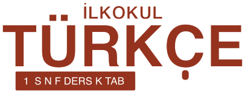

<!-- sayfa 1 -->

MİLLÎ EĞİTİM BAKANLIĞI YAYINLARI NO ..................................................................................................................: 2018
DERS KİTAPLARI DİZİSİ NO ........................................................................................................................................: 9597

Her hakkı saklıdır ve Millî Eğitim Bakanlığına aittir. Kitabın metin, soru ve şekilleri kısmen de olsa hiçbir surette alınıp yayımlanamaz.

Editör
Prof. Dr. Emre ÜNAL
Prof. Dr. Hüseyin ANILAN
Prof. Dr. İbrahim COŞKUN
Prof. Dr. Sabri SİDEKLİ
Dr. Öğr. Üyesi Murat TEMUR

Dil Uzmanı
Abdullah TAŞPINAR
Eyyup DİKOĞLU
Hatice OCAK

Görsel Tasarımcı
Ahmet CAN – Aslı DAL – Atila ÇAM – Cihan Arif YİĞİT
Dilek KORKMAZ – Mehmet Azzem AKGÖZ – Merve Gül KARACA
Mesut ÖZKAN – Seyfullah YİĞİT – Ümit ŞENER

Çoklu Ortam Tasarımcısı
Başak DOĞAN GÜNGÖRALP – Canan Özlem CANER – Cem SAVAŞ – Dr. Dilek ÇAPAR
Eda ÖZKAN AKAR – Enver ÜLKER – Erdem TOPUZOĞLU – Esra ESEN KANAN
Fatma GENÇ – Gazanfer DİKER – Harun KARABULUT – Hatice YILDIRIM IŞIK
Olcay DOĞAN – Onur GÖNÜLLÜ – Osman ÇELİK – Senem ERSİN GENÇ
Ümit ARSLAN – Vedat Ersin CEVİZ – Zekican YARDIMCI

Program Geliştirme Uzmanı
Fırat KILAVUZ
Mehmet EROĞLU

Ölçme ve Değerlendirme Uzmanı
Erdem BODUROĞLU
Mustafa GÖKCAN

Rehberlik Uzmanı
Metin ÇELİK
Recep ERDEM

978-975-11-8007-0

Millî Eğitim Bakanlığı, Talim ve Terbiye Kurulu Başkanlığının 17.07.2024 tarih ve 110460159 sayılı yazısı ile eğitim aracı olarak kabul edilmiştir.

<!-- sayfa 2 -->

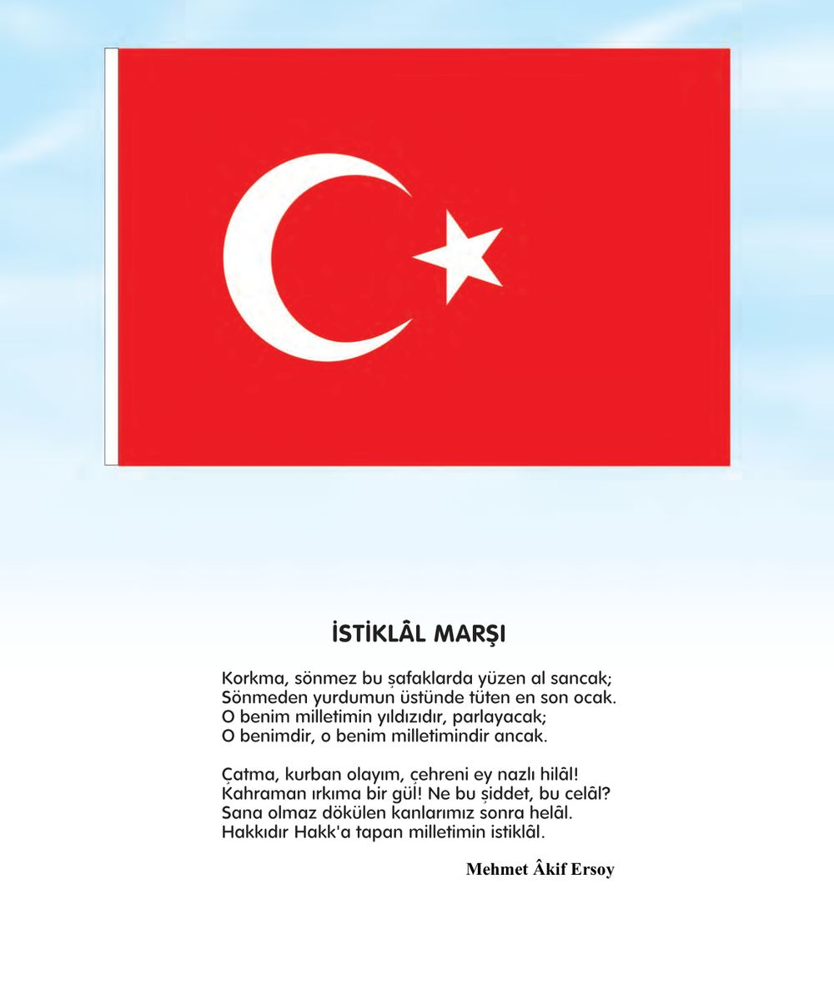

# İSTİKLÂL MARŞI

Korkma, sönmez bu şafaklarda yüzen al sancak;
Sönmeden yurdumun üstünde tüten en son ocak.
O benim milletimin yıldızıdır, parlayacak;
O benimdir, o benim milletimindir ancak.

Çatma, kurban olayım, çehreni ey nazlı hilâl!
Kahraman ırkıma bir gül! Ne bu şiddet, bu celâl?
Sana olmaz dökülen kanlarımız sonra helâl.
Hakkıdır Hakk'a tapan milletimin istiklâl.

**Mehmet Âkif Ersoy**

<!-- sayfa 3 -->

# ANDIMIZ

Türküm, doğruyum, çalışkanım.

İlkem küçüklerimi korumak, büyüklerimi saymak; yurdumu, milletimi özümden çok sevmektir.
Ülküm yükselmek, ileri gitmektir.

Ey Büyük Atatürk!

Açtığın yolda, gösterdiğin hedefe durmadan yürüyeceğime ant içerim.

Varlığım Türk varlığına armağan olsun.

Ne mutlu Türküm diyene!

<!-- sayfa 4 -->

MUSTAFA KEMAL ATATÜRK

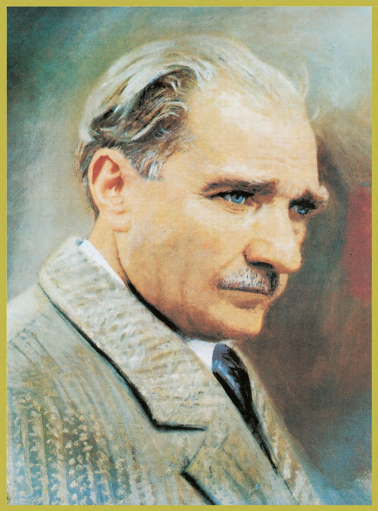
<!-- yer tutucu bulunamadı: sayfa sonuna eklendi -->

<!-- sayfa 5 -->

Verdiğiniz mesajda PDF metin katmanı kısmı boş (`<<< >>>`) görünüyor. Sayfayı Markdown formatına çevirebilmem için lütfen metin katmanını bu işaretlerin arasına yapıştırın veya ilgili görseli paylaşın.

Metni paylaştığınızda tüm kurallara (LaTeX kullanımı, başlık düzeni, şekil belirteçleri vb.) uyarak çeviriyi hemen gerçekleştirebilirim.

<!-- sayfa 6 -->

# İÇİNDEKİLER

Kitabımızı Tanıyalım................................................................................................................................8

## 7. TEMA | Atalarımızın İzleri | 11

Aybek: Cirit (Dinleme metni)..........................................................................................................14
Bayrak....................................................................................................................................................24
Babamın Oyuncak Sandığı..............................................................................................................34
Bayramlaşma.......................................................................................................................................46
23 Nisan................................................................................................................................................58
Öğrendim Anladım Pekiştiriyorum..................................................................................................69

## 8. TEMA | Sorumluluklarımızın Farkındayız | 77

Tavuk Dedektifi Bilge (Dinleme metni).......................................................................................80
Sorumluluklarım..................................................................................................................................92
Haklarımız...........................................................................................................................................102
Çalışkanların Güneşi Hep Parlar..................................................................................................112
Piknik Yeri............................................................................................................................................126
Öğrendim Anladım Pekiştiriyorum................................................................................................137
Pekiştirelim..........................................................................................................................................145
Sözlük.....................................................................................................................................................158
Kaynakça.............................................................................................................................................160
Cevap Anahtarı..................................................................................................................................161
Türkiye’nin Mülki İdare Bölümleri ile Kara ve Deniz Komşuları Haritası...................................167

<!-- sayfa 7 -->

# KİTABIMIZI TANIYALIM

![Tema sayfası örneği]
* Tema numarası
* Tema adı

![Metinler sayfası örneği]
* Temada yer alan metinler

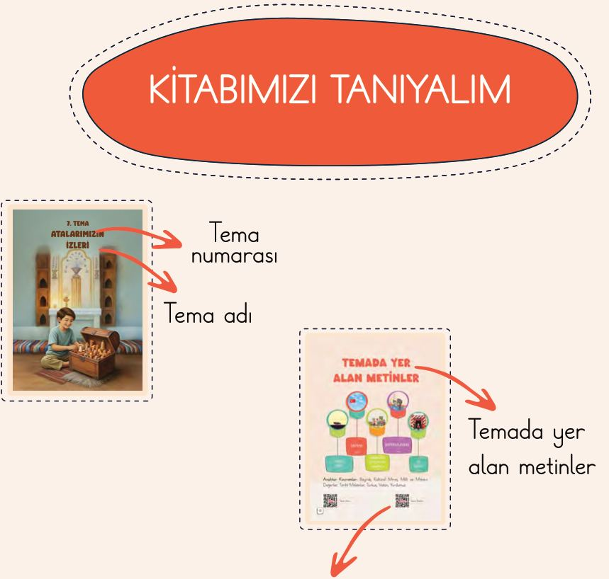
EBA’da yer alan elektronik içeriklere (E-içerik) yönlendiren karekodlar

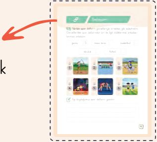
Yeni başlayacağımız metnin içeriğine yönelik yaptığımız etkinlikler

<!-- sayfa 8 -->

# KİTABIMIZI TANIYALIM

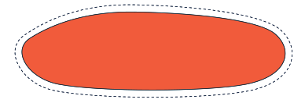
Metnin başlığı

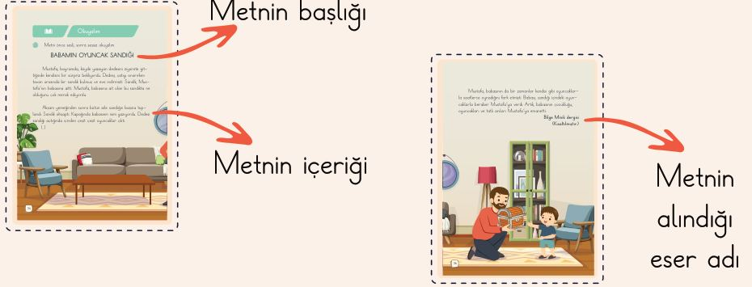
Metnin içeriği

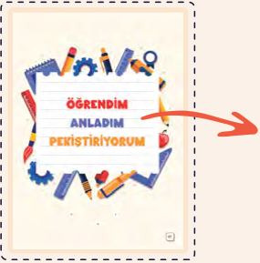
Metnin alındığı eser adı

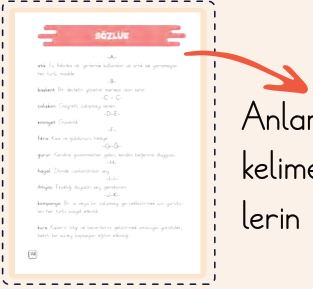
Tema içeriğine uygun etkinlikler ve performans görevleri

Anlamını bilmediğimiz kelimeler ve bu kelime-lerin anlamları

<!-- sayfa 9 -->

# KİTABIMIZI TANIYALIM

💬 **Konuşma Sembolü:** Bu sembolü gördüğümüzde nezaket kurallarına, jest ve mimiklerimize dikkat ederek kendimizi sözlü ifade edelim.

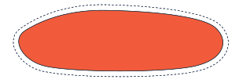 ✅ **İşaretleme Sembolü:** Bu sembolü gördüğümüzde verilen yönergeye uygun işaretleme yapalım.

📝 **Yazma Sembolü:** Bu sembolü gördüğümüzde yazım ve noktalama kurallarını uygulayarak yazma çalışmaları yapalım.

🔊 **Dinleme Sembolü:** Bu sembolü gördüğümüzde metni dikkatli bir şekilde dinleyelim.

📱 **İzleme Sembolü:** Bu sembolü gördüğümüzde metni dikkatli bir şekilde izleyelim.

🎨 **Boyama Sembolü:** Bu sembolü gördüğümüzde verilen yönlendirmelere uygun şekilde çizelim ve boyayalım.

📖 **Okuma Sembolü:** Bu sembolü gördüğümüzde metni noktalama işaretlerine, vurgu ve tonlamaya dikkat ederek sesli ve/veya sessiz okuyalım.

🔗 **Metin Öncesi Etkinlik Sembolü:** Bu sembolü gördüğümüzde metne başlamadan önce verilen etkinlikleri yaparak metne hazırlanalım.

<!-- sayfa 10 -->

# 7. TEMA
# ATALARIMIZIN İZLERİ

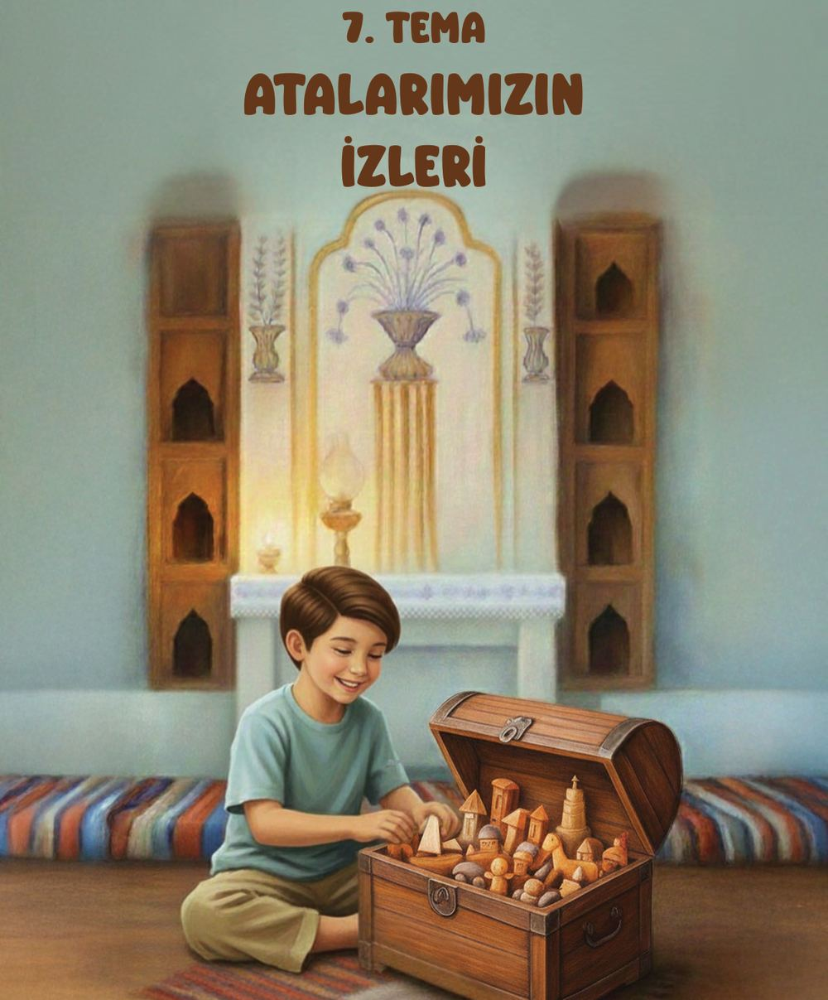

<!-- sayfa 11 -->

# TEMADA YER ALAN METİNLER

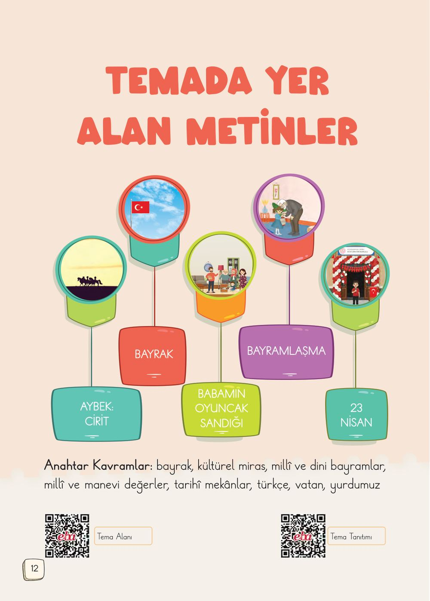

- AYBEK: CİRİT
- BAYRAK
- BABAMIN OYUNCAK SANDIĞI
- BAYRAMLAŞMA
- 23 NİSAN

Anahtar Kavramlar: bayrak, kültürel miras, millî ve dini bayramlar, millî ve manevi değerler, tarihî mekânlar, türkçe, vatan, yurdumuz

 Tema Alanı
 Tema Tanıtımı

<!-- sayfa 12 -->

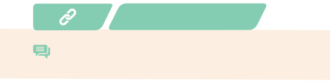
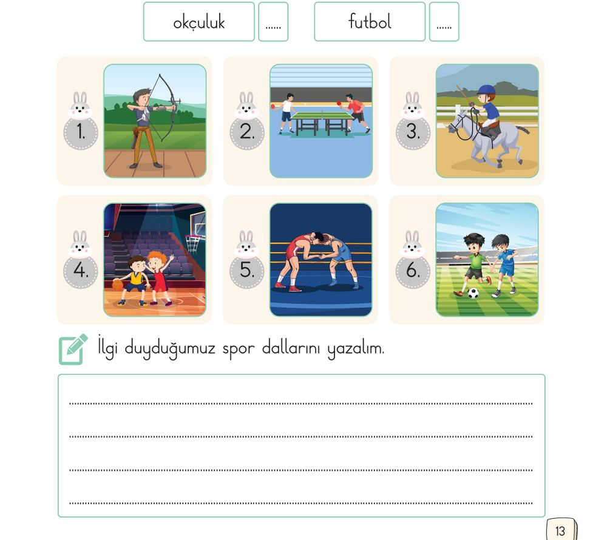

Verilen spor dallarını görselleriyle örnekteki gibi eşleştirelim. Görsellerdeki spor dallarından biri ile ilgili bildiklerimizi arkadaşlarımıza anlatalım.

| | | | | | |
| :--- | :--- | :--- | :--- | :--- | :--- |
| güreş | 5 | masa tenisi | ...... | basketbol | ...... |
| okçuluk | ...... | futbol | ...... | | |

1. 
2. 
3. 
4. 
5. 
6. 

İlgi duyduğumuz spor dallarını yazalım.

.................................................................................................................................................................................
.................................................................................................................................................................................
.................................................................................................................................................................................
.................................................................................................................................................................................

<!-- sayfa 13 -->

# Tahmin Edelim İzleyelim

* Metnin görsellerini inceleyelim. Metindeki olaylar hakkında tahminde bulunalım.
* Metni, izleme kurallarına uygun olarak izleyelim.

## AYBEK: CİRİT

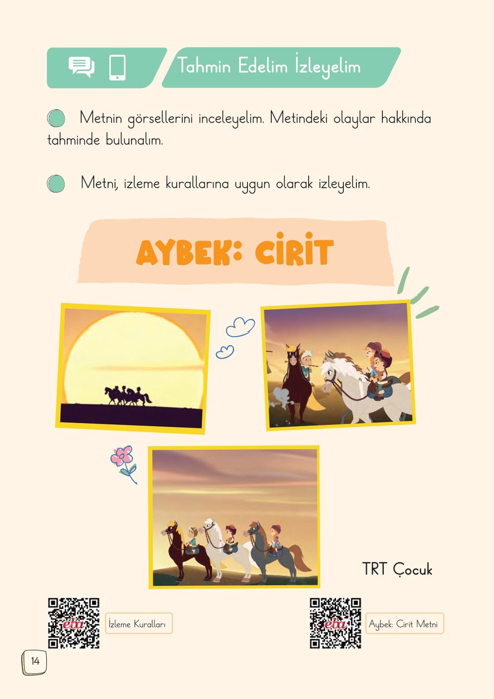

TRT Çocuk

 İzleme Kuralları
 Aybek: Cirit Metni

<!-- sayfa 14 -->

# Kendimizi Değerlendirelim

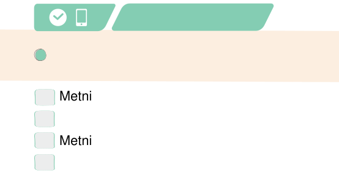 Verilen izleme kurallarına göre kendimizi değerlendirelim. Uyduğumuz kuralları işaretleyelim.

- [ ] Metni dikkatle izledim.
- [ ] Metni uygun oturuş pozisyonunda izledim.
- [ ] Metni sessizce izledim.
- [ ] İzleme esnasında konuşmak için uygun zamanda söz aldım.

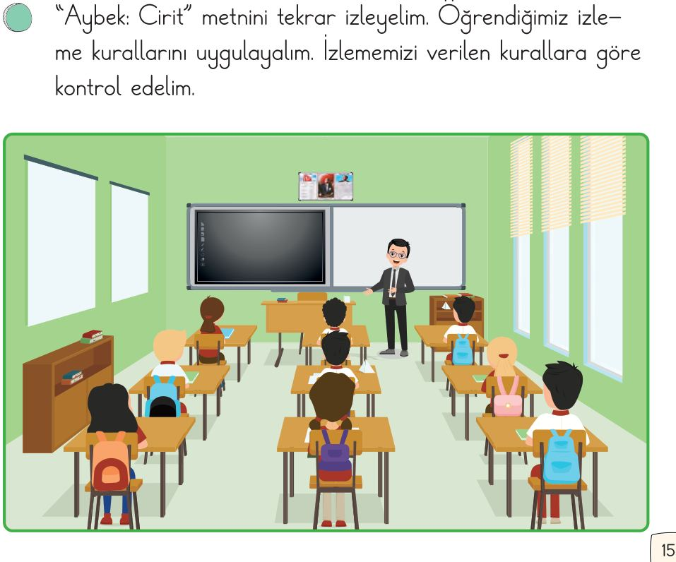 “Aybek: Cirit” metnini tekrar izleyelim. Öğrendiğimiz izleme kurallarını uygulayalım. İzlememizi verilen kurallara göre kontrol edelim.

<!-- sayfa 15 -->

# Bulalım Karar Verelim

🟢 Verilen sözcüklerin anlamlarını TDK (Türk Dil Kurumu) Güncel Türkçe Sözlük’ten bulalım ve yazalım.

| cirit |
| :--- |
| ............................................................................................................................................................................... |

| hakem |
| :--- |
| ............................................................................................................................................................................... |

| hedef |
| :--- |
| ............................................................................................................................................................................... |

🟢 Anlamını bulduğumuz sözcüklerle birer cümle yazalım.

| ............................................................................................................................................................................... |
| :--- |

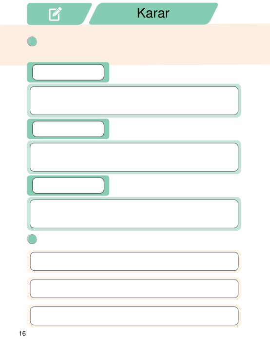
<!-- yer tutucu bulunamadı: sayfa sonuna eklendi -->

<!-- sayfa 16 -->

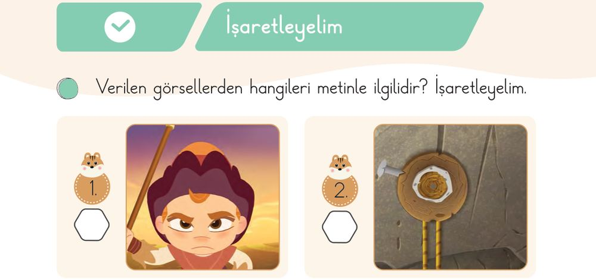
# İşaretleyelim

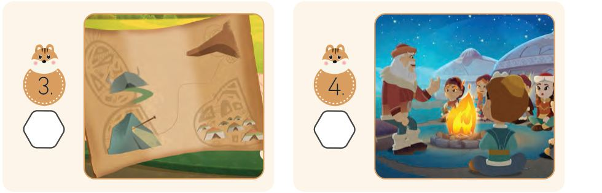
Verilen görsellerden hangileri metinle ilgilidir? İşaretleyelim.

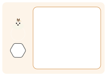
1. 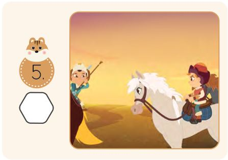
2. 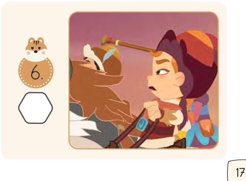
3. 
4. 
5. 
6. 

<!-- sayfa 17 -->

# Yazalım Karşılaştıralım

* Metnin konusunu yazalım.

...............................................................................................................................................................................

* Metni okumadan önce yaptığımız konu tahmini doğru mu?

Evet [ ] Hayır [ ]

# Cevaplayalım

* Soruları cevaplayalım.

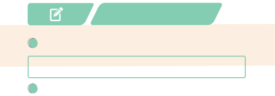
1. Metinde Kaycı Dede’nin anlattığı Sancar Bey nasıl bir cirit oyuncusudur?

2. Metinde Talay’ın ciridi atmayarak rakibini bağışlamasını doğru buluyor musunuz? Neden?

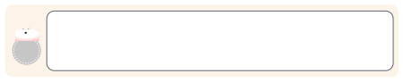
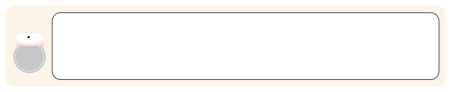
3. Metindeki kahramanların bindikleri atların fiziksel özellikleri nelerdir? Bu özellikleri karşılaştıralım ve arkadaşlarımıza anlatalım.

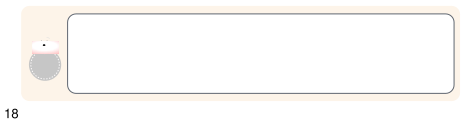

<!-- sayfa 18 -->

# Yazalım

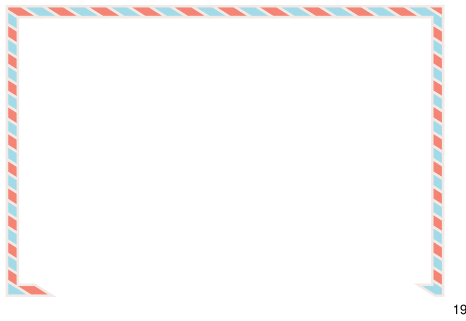 İpek’in mektubunu okuyalım.

> Sevgili Ayşe,
> Benim adım İpek. Kuzey Kıbrıs Türk Cumhuriyeti’nde yaşıyorum. Hürriyet İlkokulunda okuyorum. Öğretmenimiz bir araştırma ödevi verdi. Benim konum geleneksel Türk spor dallarından “cirit oyunu”. Bu oyun hakkında bildiklerini bana göndereceğin mektupta yazar mısın? Cevabını bekliyorum. Sevgilerle...
>
> İpek

 “Aybek: Cirit” metninden öğrendiğimiz bilgilerden yararlanarak mektubu cevaplayalım.

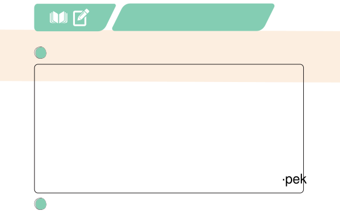
........................................................................................................................................................................
........................................................................................................................................................................
........................................................................................................................................................................
........................................................................................................................................................................
........................................................................................................................................................................
........................................................................................................................................................................
........................................................................................................................................................................
........................................................................................................................................................................

<!-- sayfa 19 -->

# Araştıralım Anlatalım

Büyüklerimizden çocukken oynadıkları oyunlar hakkında bilgi alalım. Bu oyunlardan birini arkadaşlarımıza tanıtalım.

## Oyunun Adı ve Kuralları:
............................................................................................................................................................................
............................................................................................................................................................................
............................................................................................................................................................................
............................................................................................................................................................................
............................................................................................................................................................................

## Oyunun Görseli:
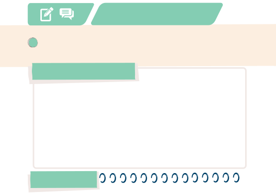

 Konuşma Kuralları

<!-- sayfa 20 -->

# Kendimizi Değerlendirelim

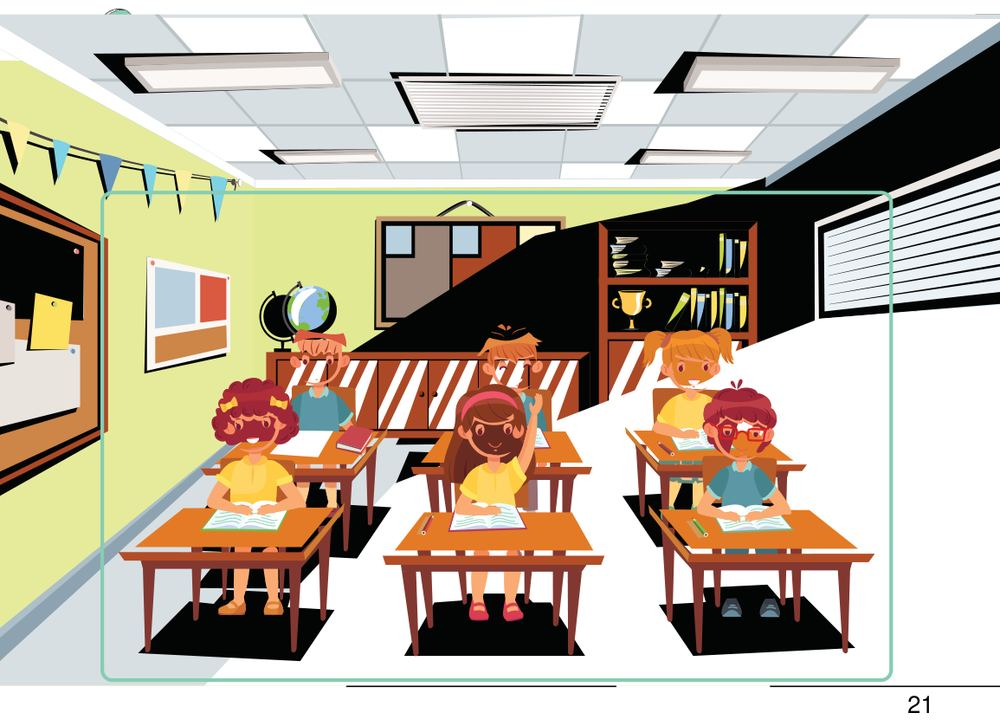 Konuşmamızı verilen kurallara göre değerlendirelim. Uyguladığımız kuralları işaretleyelim.

- [ ] Konuşmama selamlama ifadesiyle başladım.
- [ ] Konuşmamı beden dilimi kullanarak destekledim.
- [ ] Konuşmamda ses tonumu doğru kullandım.
- [ ] Konuşmamı anlaşılabilir bir hızda yaptım.

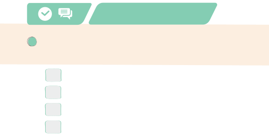 En sevdiğimiz oyun hakkında bir konuşma yapalım. Öğrendiğimiz konuşma kurallarını uygulayalım. Yaptığımız konuşmayı verilen kurallara göre kontrol edelim.

<!-- sayfa 21 -->

# Okuyalım İşaretleyelim

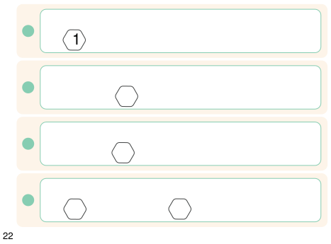 Büyük harflerin yazımıyla ilgili verilen kuralları okuyalım.

## KURALLAR

1. Cümleler büyük harfle başlar.
2. Özel adlar büyük harfle başlar.

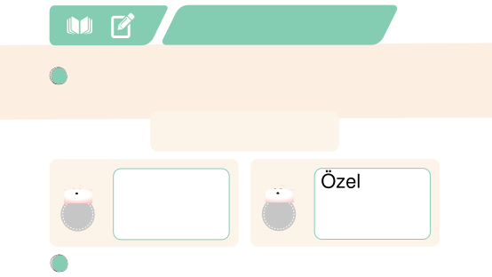 Verilen cümlelerde altı çizili sözcükler hangi kurala göre yazılmıştır? Örnekteki gibi eşleştirelim.

* _Ninemin_ yaptığı tarhana çorbasını çok severim.
  ( 1 )

* Arkadaşım _Melis_ okçuluk kursuna gidiyor.
  ( )

* Bayramda _Van_'dan halamlar geldi.
  ( )

* _Törende_ bayrağımızı _Ahmet_ taşıdı.
  ( ) ( )

<!-- sayfa 22 -->

# Başlayalım

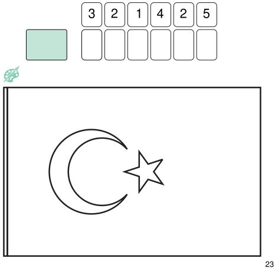 Harflerle eşleştirilen rakamları kullanarak şifrelenmiş sözcü-
ğü bulalım.

| y | a | b | r | k |
|---|---|---|---|---|
| 1 | 2 | 3 | 4 | 5 |

| 3 | 2 | 1 | 4 | 2 | 5 |
|---|---|---|---|---|---|
| ...... | ...... | ...... | ...... | ...... | ...... |

**Sözcük:**

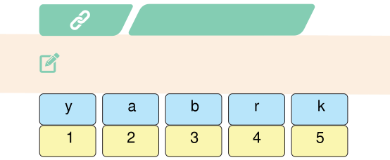 Bayrağımızı boyayalım.

<!-- sayfa 23 -->

# Okuyalım

Şiiri noktalama işaretlerine dikkat ederek okuyalım.

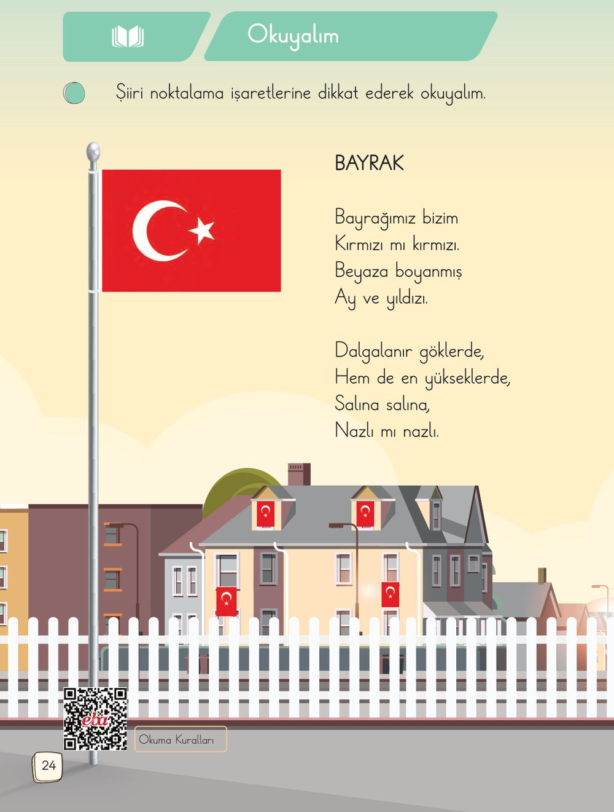

## BAYRAK

Bayrağımız bizim
Kırmızı mı kırmızı.
Beyaza boyanmış
Ay ve yıldızı.

Dalgalanır göklerde,
Hem de en yükseklerde,
Salına salına,
Nazlı mı nazlı.

<!-- sayfa 24 -->

Ben, ona bakarken
Ve onu selamlarken
Türk olmaktan
Gurur duyarım.

Bayrağımın altında
Özgürce ve kardeşçe
Sonsuza dek
Mutlu yaşarım.

Adalet SÜER
Sevgi Çiçeklerim

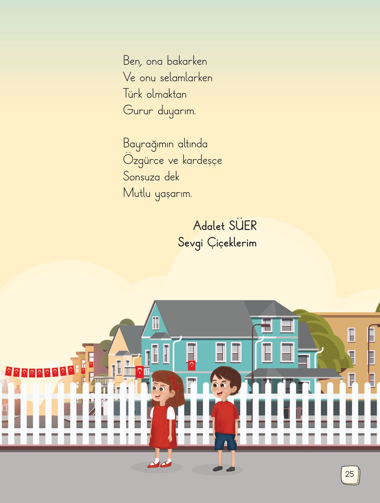

<!-- sayfa 25 -->

# Kendimizi Değerlendirelim

Okumamızı verilen kurallara göre değerlendirelim. Uyguladığımız kuralları işaretleyelim.

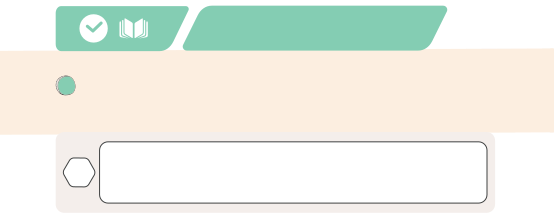 Masamı okuma yapmaya uygun hâle getirdim.

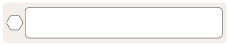 Okuma yaptığım ortamın yeterince aydınlık olmasına dikkat ettim.

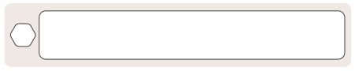 Oturuş pozisyonumun okumaya uygun olmasına dikkat ettim.

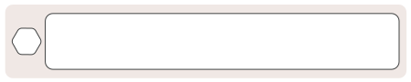 Metni noktalama işaretlerine dikkat ederek okudum.

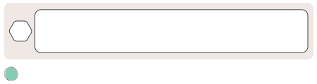 Metni uygun bir hızda okudum.

“Bayrak” metnini tekrar okuyalım. Öğrendiğimiz okuma kurallarını okumamızda uygulayalım. Okumamızı verilen kurallara

<!-- sayfa 26 -->

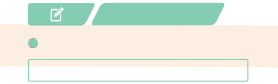
# Yazalım

Metnin konusunu yazalım.

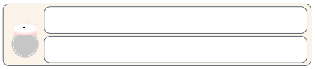
..........................................................................................................................................................

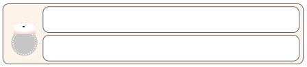
# Cevaplayalım Yazalım

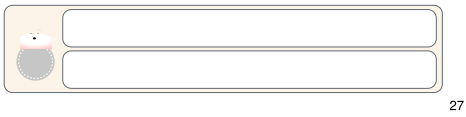
Soruları şiire göre cevaplayalım.

| | |
| :--- | :--- |
|  1. | Bayrağımızda yer alan renkler nelerdir?   .......................................................................................................................................................... |

| | |
| :--- | :--- |
|  2. | Bayrağımız göklerde nasıl dalgalanır?   .......................................................................................................................................................... |

| | |
| :--- | :--- |
|  3. | Bayrağımızın altında nasıl yaşanır?   .......................................................................................................................................................... |

<!-- sayfa 27 -->

# Konuşalım

* Okulumuzda bayrak törenleri hangi günlerde yapılır?
* Verilen görseli inceleyelim.

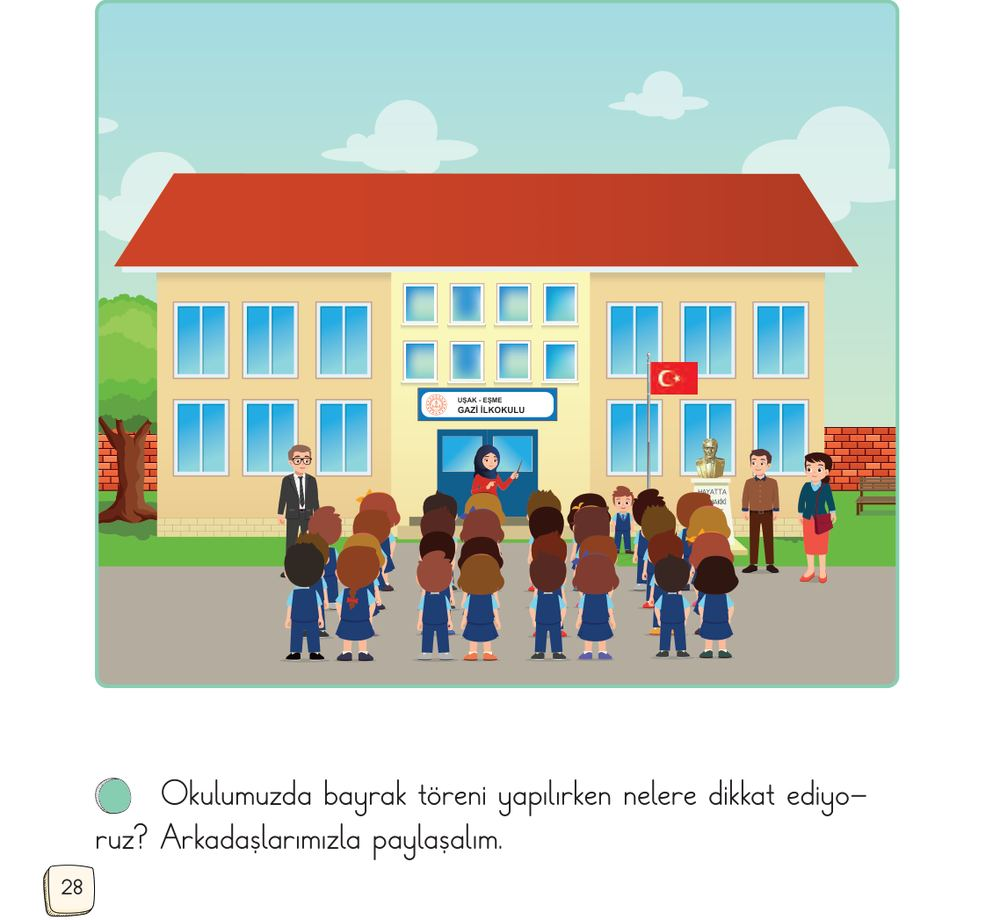

* Okulumuzda bayrak töreni yapılırken nelere dikkat ediyo-ruz? Arkadaşlarımızla paylaşalım.

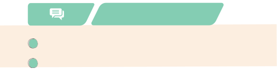
<!-- yer tutucu bulunamadı: sayfa sonuna eklendi -->

<!-- sayfa 28 -->

# Okuyalım Yazalım

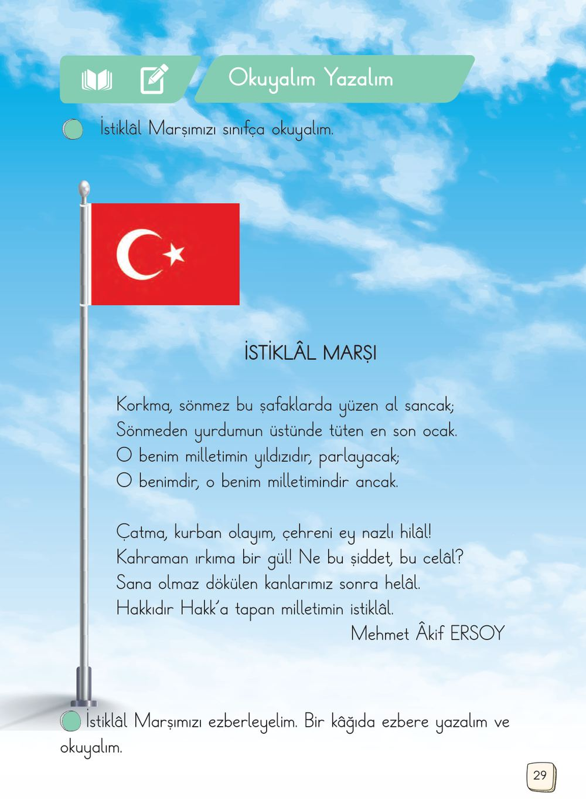 İstiklâl Marşımızı sınıfça okuyalım.

# İSTİKLÂL MARŞI

Korkma, sönmez bu şafaklarda yüzen al sancak;
Sönmeden yurdumun üstünde tüten en son ocak.
O benim milletimin yıldızıdır, parlayacak;
O benimdir, o benim milletimindir ancak.

Çatma, kurban olayım, çehreni ey nazlı hilâl!
Kahraman ırkıma bir gül! Ne bu şiddet, bu celâl?
Sana olmaz dökülen kanlarımız sonra helâl.
Hakkıdır Hakk’a tapan milletimin istiklâl.

Mehmet Âkif ERSOY

 İstiklâl Marşımızı ezberleyelim. Bir kâğıda ezbere yazalım ve okuyalım.

<!-- sayfa 29 -->

# Bulalım Yazalım

Görseli verilen varlığın adını yazalım. Sözcüklerin son harfleriyle örnekteki gibi sözcükler yazalım.

↓
| bayrak | | |
↓
| kalem | | |
↓
| | | |
↓
| | | |
↓
| | | |

<!-- sayfa 30 -->

 Seçelim Yazalım

 Verilen cümlelerde yay ayraç ( ) içine uygun noktalama işaretlerini yazalım.

 .
 ,
 !
 ?

1.  Anıtkabir’i ziyaret ettin mi( )
2.  “Atatürk” adlı şiirimi okudum( )
3.  Sınıfı süslemek için bayrak( ) balon ve çiçek aldım.
4.  “Karagöz ve Hacivat” tiyatrosuna gittik( )
5. Tebrikler, İstiklâl Marşı’nı çok güzel okudun( )

<!-- sayfa 31 -->

# Tamamlayalım

Eksik bırakılan cümleleri uygun sözcüklerle örnekteki gibi tamamlayalım.

ay ve yıldız | Atatürk | bayraklarla
---|---|---
bağımsızlık | İstiklâl Marşı | vatan

 1. Bayrağımız bağımsızlık sembolüdür.

 2. ....................................................... okunurken bayrağa bakarız.

 3. Türk bayrağında ....................................................... vardır.

 4. Millî bayramlarda her yer .................................................... süslenir.

 5. ....................................................... 23 Nisan'ı çocuklara bayram olarak armağan etmiştir.

<!-- yer tutucu bulunamadı: sayfa sonuna eklendi -->

<!-- sayfa 32 -->

# Başlayalım

Ceren büyüdüğünde anılarını hatırlamak için bazı eşyalarını bir kutuya sakladı. Ceren’in anı kutusuna koyduğu eşyaları inceleyelim.

Çocukluk fotoğrafı 
Babaannesinin ördüğü beresi 
Anneannesinin hediye ettiği patiği 
Günlüğü ve kalemi 
Oyuncak bebeği 

Bir anı kutusu hazırlasaydın hangi eşyalarını saklardın?
..............................................................................................................................................................................
..............................................................................................................................................................................
..............................................................................................................................................................................
..............................................................................................................................................................................

<!-- yer tutucu bulunamadı: sayfa sonuna eklendi -->

<!-- sayfa 33 -->

# Okuyalım

Metni önce sesli, sonra sessiz okuyalım.

## BABAMIN OYUNCAK SANDIĞI

Mustafa; bayramda, köyde yaşayan dedesini ziyarete gittiğinde kendisini bir sürpriz bekliyordu. Dedesi, çatıyı onarırken tavan arasında bir sandık bulmuş ve eve indirmişti. Sandık, Mustafa’nın babasına aitti. Mustafa, babasına ait olan bu sandıkta ne olduğunu çok merak ediyordu.

Akşam yemeğinden sonra bütün aile sandığın başına toplandı. Sandık ahşaptı. Kapağında babasının ismi yazıyordu. Dedesi sandığı açtığında içinden çeşit çeşit oyuncaklar çıktı.
(...)

<!-- sayfa 34 -->

Mustafa çok şaşırmıştı. Babası oyuncakların her birinin hikâyesi olduğunu söyleyince şaşkınlığı daha da arttı. Tahta arabayı amcası, mukavva uçağı arkadaşı yapmıştı. Cam bilyelerin her biri ise çocukluk arkadaşlarını ve eski mahallesini hatırlatıyordu. Babası iyi bir bilye oyuncusuydu. Önce mahallesindeki, sonra köydeki pek çok arkadaşını yenmişti. Babası bilyelere baktıkça gözlerinde anılar canlanıyordu.

<!-- sayfa 35 -->

Mustafa, babasının da bir zamanlar kendisi gibi oyuncaklar-
la saatlerce oynadığını fark etmişti. Babası, sandığı içindeki oyun-
caklarla beraber Mustafa’ya verdi. Artık, babasının çocukluğu, 
oyuncakları ve tatlı anıları Mustafa’ya emanetti.

**Bilge Minik dergisi**
**(Kısaltılmıştır.)**

<!-- sayfa 36 -->

# Bulalım Karar Verelim

● Verilen sözcüklerin anlamlarını TDK (Türk Dil Kurumu) Güncel Türkçe Sözlük’ten bulalım ve yazalım.

| emanet |
| :--- |
| ............................................................................................................................................................................... |

| sandık |
| :--- |
| ............................................................................................................................................................................... |

| sürpriz |
| :--- |
| ............................................................................................................................................................................... |

● Anlamını bulduğumuz sözcüklerle birer cümle yazalım.

| ............................................................................................................................................................................... |
| :--- |

<!-- yer tutucu bulunamadı: sayfa sonuna eklendi -->

<!-- sayfa 37 -->

# Sıralayalım

Verilen cümleleri okuyalım. Cümleleri “Babamın Oyuncak Sandığı” metnine göre örnekteki gibi sıralayalım.

 Babası, sandıktaki oyuncaklarla olan anılarını Mustafa’ya anlattı.

 Babası oyuncak sandığını Mustafa’ya emanet etti.

 Akşam yemeğinden sonra ailece sandığı açıp incelediler.

 1 Dedesi tavan arasında eski bir sandık buldu.

<!-- sayfa 38 -->

# Belirleyelim

 Verilen görsellerden hangileri metindeki oyuncaklar arasındadır? Yuvarlak içine alalım.

<!-- sayfa 39 -->

Soru cümlelerine getirilen “mı/mi” ekleri sözcükten ayrı ya-
zılır. Verilen örneği inceleyelim. Cümleleri örnekteki gibi tamamla-
yalım.

1.  Dedem sandık buldu mu?
| | buldu mu? | ✅ |
|---|---|---|
| | buldumu? | ⚪ |

2.  Sandığı birlikte ......................................
| | açalım mı? | ⚪ |
|---|---|---|
| | açalımmi? | ⚪ |

3.  Sandığın kapağı ......................................
| | ahşap mı? | ⚪ |
|---|---|---|
| | ahşapmı? | ⚪ |

4.  Baba, anılarını ......................................
| | anlatır mısın? | ⚪ |
|---|---|---|
| | anlatırmısın? | ⚪ |

<!-- yer tutucu bulunamadı: sayfa sonuna eklendi -->

<!-- sayfa 40 -->

# Okuyalım Eşleştirelim

 Verilen görselleri inceleyelim.

|  |  |  |
| :---: | :---: | :---: |
| Feyza | Hasan | Esma |

 Çocukların konuşma metinlerini okuyalım. Görsellerdeki çocukların adlarını uygun yerlere yazalım.

1. 
Benim adım .......................... En sevdiğim oyuncağım tahta arabam. Tahta arabamı bana dayım yaptı. Ben de arabayı boyarken ona yardım ettim. Arabamı elimle sürerken gitmek istediğim yerleri hayal ederim.

2. 
Benim adım .......................... Kumandalı robotumla oynamayı çok severim. Pilini takıp düğmesine basarım. Robotum benimle konuşmaya başlar. Kumandasıyla robotumu dans ettirirken çok eğlenirim.

<!-- sayfa 41 -->

# Belirleyelim Yazalım

Verilen cümleleri okuyalım. Cümlelerde altı çizili ifadeler nelere benzetilmiştir? Örnekteki gibi yazalım.

1. 
   <u>Defne’nin gözleri</u> gökyüzü gibi maviydi.
   Cevap: Gökyüzü

2. 
   <u>Babam</u> karınca gibi çalışkandır.
   Cevap: 

3. 
   <u>Oyuncak arabam</u> elma gibi kırmızıydı.
   Cevap: 

4. 
   <u>Ayça’nın saçları</u> altın gibi sarıydı.
   Cevap: 

# Yazalım Konuşalım

Biz de benzetme cümleleri yazalım. Yazdığımız cümleleri ar-

<!-- sayfa 42 -->

# Karşılaştıralım Yazalım

Cümleleri örnekteki gibi “büyüktür/küçüktür” sözcükleriyle tamamlayalım.

* Karpuz, çilekten büyüktür.
* Portakal, çilekten ..........................................
* Çilek ve portakal, karpuzdan ..........................................
* Karpuz ve portakal, çilekten ..........................................
* Portakal, karpuzdan .......................................... 

 Görselleri verilen hayvanları hızları yönünden karşılaştıra- lım. Karşılaştırmalarımızı arkadaşlarımızla paylaşalım.

 

<!-- sayfa 43 -->

# Okuyalım Boyayalım

 Verilen şiiri okuyalım.

> ### KUMBARAM
> Babam harçlık verir bana,
> Harcarım ihtiyaçlarıma.
> Paralarım artınca
> Atarım kumbarama.
> Paralarım birikir,
> Kumbaramı açınca
> Beni hep sevindirir.
> *Bu kitap için yazılmıştır.*

 Kumbarada neden para biriktiririz? Anlatalım.

 Verilen kumbarayı istediğimiz gibi süsleyelim.

<!-- sayfa 44 -->

# Başlayalım

Bayramlaşma ile ilgili verilen görseller hakkında konuşalım.

Görsellerde verilenler dışında bayramlarda neler yaparız? Yazalım.

..................................................................................................................................................................................
..................................................................................................................................................................................
..................................................................................................................................................................................
..................................................................................................................................................................................

<!-- sayfa 45 -->

# Tahmin Edelim Okuyalım

* Metnin başlığını ve görsellerini inceleyelim. Metnin konusunu tahmin edelim.
* Metni önce sesli, sonra sessiz okuyalım.

## BAYRAMLAŞMA

Mine yeni elbiselerini giydi. Saçlarına o gün daha da özen-di. Mine’nin yeni ayakkabıları pırıl pırıl parlıyordu. Üstelik kırmızı fiyonkluydu.

Babası ve annesi erkenden kalkmıştı. Kahvaltı masası hazırdı. Ailece kahvaltı ettiler. Babası “Sırayla büyüklerimizi ziyaret ede-lim. Bu güzel bayram gününde onları sevindirelim.” dedi.

<!-- sayfa 46 -->

Bayram ziyaretine ailenin en büyüklerinden başladılar. Ailenin en büyükleri Mine’nin anneannesi ve dedesiydi. Onların ellerini öptüler. “Bayramınız kutlu olsun!” dediler.

Dedesi, Mine’ye pembe bir mendil verdi. “İçinde bayram harçlığı var Mine, istediğini al kendine!” dedi.

Anneannesi tatlı yapmıştı. “Bayramda tatlı yiyelim, tatlı konuşalım.” dedi. Mine’ye tatlısını verirken “Dişlerini fırçalamayı unutma!” diye de tembihledi.

Mine ve ailesi o gün akrabalarına bayram ziyaretine gittiler. Akşama doğru eve geldiler. Uzaktakilere de telefon ettiler. Telefonda iyi bayramlar dilediler.

<!-- sayfa 47 -->

Babası o gün Mine’ye biraz bayramdan söz etti: “Mineci-
ğim, bayramlar bizleri bir araya getirir. Küçükler büyükleri ziya-
ret eder. Komşular birbirine gider. Uzaktakilerle de telefonlaşırız. 
Uzaktaki arkadaşlarımıza, yakınlarımıza bayram kartı atarız.”

Mine o gün bir bayram kartı hazırladı. Kartını uzaktaki ha-
lasına postaladı. “Bayramınız kutlu olsun, iyi bayramlar!..” dedi. 
Halasından da Mine’ye bir bayram kartı geldi. Halası bir de 
bayram hediyesi göndermişti. Bu, çok güzel bir hikâye kitabıydı. 
Mine çok mutlu oldu. Hemen kitabı incelemeye koyuldu.
                                            Koray AVCI ÇAKMAN
                                                Bayramlaşma

<!-- sayfa 48 -->

# Sınıflandıralım

Metinle ilgili görsellerin numarasını turuncu kutuya, metinle ilgili olmayan görsellerin numarasını yeşil kutuya yazalım.

1. 
2. 
3. 
4. 
5. 
6. 
7. 
8. 
9. 

...................................................................................
...................................................................................
...................................................................................
...................................................................................
...................................................................................
...................................................................................

...................................................................................
...................................................................................
...................................................................................
...................................................................................
...................................................................................
...................................................................................

 Sınıflandırma Yapalım

<!-- sayfa 49 -->

  Sıralayalım

 Verilen cümleleri “Bayramlaşma” metnindeki oluş sırasına göre sıralayalım. Tablodaki çiçekleri örnekteki gibi oluş sırasına göre boyayalım.

| | | |
| :--- | :--- | :--- |
|  |  | Mine halasının gönderdiği hediyeyi açtı. |
|  |  | Anneannesinin ve dedesinin ellerini öptü. |
|  |  | Anneannesinin yaptığı tatlıyı yediler. |
| 1 |  | Mine yeni elbiselerini giydi. |
|  |     | Ailece kahvaltı ettiler. |

| 1 | 2 | 3 | 4 | 5 |
| :---: | :---: | :---: | :---: | :---: |
|  |  |  |  |  |

<!-- sayfa 50 -->

# Tamamlayalım Yazalım

🟢 “Bayramlaşma” metninde geçen sözcüklerin eksik bırakılan harflerini görsellerden yararlanarak tamamlayalım.

|  |  |
| :---: | :---: |
| k....rm.....z..... f....y....nk | t....le.....o..... |

|  |  |
| :---: | :---: |
| ba....ra.... k....rt.... | h....di....e |

🟢 Tamamladığımız sözcükleri kullanarak birer cümle yazalım.

...................................................................................................................................................................................

<!-- sayfa 51 -->

# Tamamlayalım

Rabia’nın dayısıyla yaptığı konuşmayı tamamlayalım.

Bayramın kutlu olsun dayıcığım! 

Teşekkür ederim Rabia. 
..................................................................................................

..................................................................................................................................................
dayıcığım? 

İyiyim. Sen nasılsın Rabiacığım?

..................................................................................................................................................
.................................................................................................................................................. 

..................................................................................................................................................
.................................................................................................................................................. 

<!-- yer tutucu bulunamadı: sayfa sonuna eklendi -->

<!-- sayfa 52 -->

# Yazalım

 “Bayram Günü” metnini okuyalım. Metindeki yazım ve noktalama hatalarını düzelterek metni yeniden yazalım.

**BAYRAM GÜNÜ**

kemal o gün heyecanla yataktan fırladı Elini ve yüzünü yıkadı! bayramlıklarını giydi? Kahvaltı sofrasında annesi, kemal’e bayramınönemini anlattı. Bayramda dedesini, ninesini! halasını ve tüm komşularını ziyaret edeceklerini söyledi

Bu kitap için yazılmıştır.

...........................................................................
..................................................................................................................................................................................
..................................................................................................................................................................................
..................................................................................................................................................................................
..................................................................................................................................................................................
..................................................................................................................................................................................
..................................................................................................................................................................................

 Düzenlediğimiz metni kontrol edelim.

 Yazma Kuralları

<!-- sayfa 53 -->

# Kendimizi Değerlendirelim

 Yazımızı verilen kurallara göre değerlendirelim. Uyguladığımız kuralları işaretleyelim.

 ◯ Yazma düzenine dikkat ettim.

 ◯ Harfler ve sözcükler arasında uygun boşluklar bıraktım.

 ◯ Noktalama işaretlerini uygun yerlerde kullandım.

 ◯ Cümlelere büyük harfle başladım.

 ◯ Özel adları yazarken büyük harfle başladım.

 ◯ Yazımı bitirdikten sonra tekrar okuyarak gördüğüm yazım ve noktalama hatalarını düzelttim.

 Bayramda misafirlerimiz geldiğinde yaptıklarımız hakkında kısa bir metin yazalım. Öğrendiğimiz yazım kurallarını uygulayalım. Yazdıklarımızı verilen kurallara göre kontrol edelim.

<!-- sayfa 54 -->

 Konuşalım Yazalım

   Bayramda bir akrabamızla telefonda konuştuğumuzu düşünelim. Konuşmamızda aşağıdaki ifadelere yer verelim. Hazırladığımız konuşmayı bir arkadaşımızla canlandıralım.

| Bayramın kutlu olsun. | Teşekkür ederim. | Ellerinden öperim. |
| :--- | :--- | :--- |
| Rica ederim. | Hoşça kal. | Nasılsın? |
| Merhaba! | Alo!.. | İyi günler. |

      Konuşmaya başlarken ve konuşmayı bitirirken hangi ifadeleri kullandığımızı yazalım.

| Konuşmaya Başlarken: | Konuşmayı Bitirirken: |
| :--- | :--- |
|  .............................................................................. |  .............................................................................. |
| .............................................................................. | .............................................................................. |
| .............................................................................. | .............................................................................. |
| .............................................................................. | .............................................................................. |
| .............................................................................. | .............................................................................. |
| .............................................................................. | .............................................................................. |

<!-- sayfa 55 -->

# Şifreyi Bulalım

 Aşağıda verilen harfler sembollerle eşleştirilmiştir.

| R | A | L | Z | İ | M | Ü | B | G | D | Y | E |
|---|---|---|---|---|---|---|---|---|---|---|---|
| ![flower1] | ![flower2] | ![flower3] | ![flower4] | ![flower5] | ![flower6] | ![flower7] | ![flower8] | ![flower9] | ![flower10] | ![flower11] | ![flower12] |

  Sembollere karşılık gelen harfleri kullanarak şifreyi çözelim. Oluşan cümleyi yazalım.

| | | | | | | | | | |
|---|---|---|---|---|---|---|---|---|---|
| ![flower8] | ![flower2] | ![flower3] | ![flower1] | ![flower6] | ![flower7] | ![flower2] | ![flower1] |

| | | | | | | | |
|---|---|---|---|---|---|---|---|
| ![flower9] | ![flower12] | ![flower4] | ![flower12] | ![flower7] | ![flower5] | ![flower1] |

...................................................................................................................................................................................

<!-- sayfa 56 -->

# Başlayalım

* Papatyanın üzerinde yazan sözcükleri okuyalım. Bu sözcükler bize hangi bayramı hatırlatıyor? Anlatalım.
* Papatyayı boyayalım.

: neşe, bayram, çocuk, balon, bayrak, kutlama sözcüklerinin bir papatya şekli içinde Mustafa Kemal Atatürk'ün fotoğrafı etrafında yer aldığı görsel.

<!-- sayfa 57 -->

# Okuyalım

Şiiri noktalama işaretlerine dikkat ederek okuyalım.

## 23 NİSAN

Baharla geldi bayram,
Her tarafta *şenlik* var.
Dal dal çiçekler açtı,
Donandı bütün kırlar.

Çocuk cıvıltıları
Dağı taşı sarıyor;
Kuşlar, böcekler bile
Bayrama katılıyor.

<!-- sayfa 58 -->

Neşeliyiz, mutluyuz;
Bugün 23 Nisan.
Bugün, kutlu günümüz;
Atatürk’ten armağan.

Bugün toplandı Meclis,
Bugün vardı karara.
Ulus egemenliği
Bugün doğdu yurduma.

M. Güner DEMİRAY
Kuşları Düşünmek

<!-- sayfa 59 -->

# Bulalım Karar Verelim

🟢 Verilen sözcüklerin anlamlarını TDK (Türk Dil Kurumu) Güncel Türkçe Sözlük’ten bulalım ve yazalım.

| armağan |
| :--- |
| ............................................................................................................................................................................... |

| şenlik |
| :--- |
| ............................................................................................................................................................................... |

| ulus |
| :--- |
| ............................................................................................................................................................................... |

🟢 Anlamını bulduğumuz sözcüklerle birer cümle yazalım.

| ............................................................................................................................................................................... |
| :--- |

<!-- yer tutucu bulunamadı: sayfa sonuna eklendi -->

<!-- sayfa 60 -->

  Bulalım Yazalım

 Harfleri karışık verilen sözcükleri örnekteki gibi bularak bulmacaya yerleştirelim. Renklerle eşleştirilmiş harfleri şifredeki yerlerine yazalım ve saklı sözcüğü bulalım.

| Karışık Harfler | Bulmaca Kutucukları |
| :--- | :--- |
| NSANİ |  N  İ  S  A  N |
| UKTLU |  □ □  □ □ □ |
| MTULU |  □ □  □ □ □ |
| GÜBUN |  □ □ □  □ □ |
| LİŞENK |  □ □ □ □ □ □ □ |
| AMAĞRAN |  □  □ □ □ □ □ □ |

 □ □ □ □ □ □ □

| Şifre: | □ □ □ □ □ □ □ |
| :--- | :--- |
|  | A □ □ □ □ □ □ |

<!-- sayfa 61 -->

# Bulalım Boyayalım

 Verilen görselleri inceleyelim. 23 Nisan Ulusal Egemenlik ve Çocuk Bayramı ile ilgili görselleri işaretleyelim.

| | |
| :---: | :---: |
|  |  |
| [ ] | [ ] |
|  |  |
| [ ] | [ ] |
|  |  |
| [ ] | [ ] |

<!-- sayfa 62 -->

# Yazalım

Atatürk ile aynı dönemde yaşadığımızı hayal edelim. Bizle-re Ulusal Egemenlik ve Çocuk Bayramı’nı hediye eden Atatürk’e neler söylemek istersiniz? Yazalım.

..................................................................................................................................................................................
..................................................................................................................................................................................
..................................................................................................................................................................................
..................................................................................................................................................................................
..................................................................................................................................................................................
..................................................................................................................................................................................
..................................................................................................................................................................................
..................................................................................................................................................................................

<!-- sayfa 63 -->

# Okuyalım Yazalım

“Bayram Töreni” metninde bazı sözcükler görsellerle ifade edilmiştir. Metni okuyalım ve örnekteki gibi yazalım.

## BAYRAM TÖRENİ

Çiğdem sabah  sekizde kalktı. Çok heyecanlıydı. Bugün törende şiir okuyacaktı. Kırmızı  ve beyaz gömlek giydi. Okula gitti.  bahçesinde sıra oldular. İstiklâl Marşı’nı okudular.  gösterisi yaptılar. Çiğdem, şiirini okudu.  uçurdular.

Bu kitap için yazılmıştır.

## BAYRAM TÖRENİ

Çiğdem sabah saat sekizde kalktı.
..................................................................................................................................................................................
..................................................................................................................................................................................
..................................................................................................................................................................................
..................................................................................................................................................................................
..................................................................................................................................................................................
................................................................................................................................................................................

<!-- yer tutucu bulunamadı: sayfa sonuna eklendi -->

<!-- sayfa 64 -->

# Yazalım Çizelim

 Çeşitli çocuk şarkıları dinleyelim. Dinlediğimiz şarkılardan 23 Nisan ile ilgili olan bir şarkının sözlerini yazalım. Yazımızı süsleye-lim.

....................................................................................................................................
....................................................................................................................................
....................................................................................................................................
....................................................................................................................................
....................................................................................................................................
....................................................................................................................................
....................................................................................................................................
....................................................................................................................................
....................................................................................................................................
....................................................................................................................................
................................

<!-- yer tutucu bulunamadı: sayfa sonuna eklendi -->

<!-- sayfa 65 -->

# Kendimizi Değerlendirelim

 Konuşmamızı verilen kurallara göre değerlendirelim.

 Konuşmama selamlama ve hitap ifadeleriyle başladım.

 Konuşmam esnasında beden dilini kullandım.

 Konuşmamı mimiklerimle destekledim.

 Konuşmamı yaparken görsellerden yararlandım.

 Bayram kutlamaları ile ilgili bir konuşma yapalım. Öğrendiğimiz konuşma kurallarını konuşmamızda uygulayalım. Yaptığımız konuşmayı verilen kurallara göre kontrol edelim.

# Dinleyelim Cevaplayalım

 “23 Nisan Kutlamaları” metnini dinleyelim. Dinlediğimiz metnin öncesini tahmin edelim ve tahminimizi yazalım.

..................................................................................................................................................................................
..................................................................................................................................................................................

 Metnin öncesini dinleyerek tahminimizi kontrol edelim.

<!-- sayfa 66 -->

 
# Paylaşalım Yazalım

 Sınıf arkadaşlarımızla gruplar oluşturalım. 23 Nisan gösterisi için etkinlik önerileri düşünelim. Arkadaşlarımızın önerilerini yazalım.

|  Arkadaşımın Adı |  Etkinlik Önerisi |
| :--- | :--- |
|  |  |
| | |
| | |
| | |
| | |

 
# Araştıralım Paylaşalım

   23 Nisan konulu şiirler araştıralım. Beğendiğimiz bir şiiri

<!-- sayfa 67 -->

# Sınıflandıralım

 23 Nisan kutlamalarında her şube için bir kıyafet rengi belirlenmiştir.

| | |
| :--- | :--- |
| 1/A Sınıfı |  |
| 1/B Sınıfı |  |
| 1/C Sınıfı |  |

 Görselleri inceleyelim. Kıyafetlerine göre öğrencilerin hangi şubede olduklarını söyleyelim.

| Elif | Kaan | Taner |
| :---: | :---: | :---: |
|  |  |  |

| Şenay | Zehra | Tarık |
| :---: | :---: | :---: |
|  |  |  |

<!-- sayfa 68 -->

# ÖĞRENDİM
# ANLADIM
# PEKİŞTİRİYORUM

<!-- yer tutucu bulunamadı: sayfa sonuna eklendi -->

<!-- sayfa 69 -->

# PEKİŞTİRİYORUM

1. Verilen cümleleri uygun noktalama işaretleriyle tamamlayalım.

Harika( ) bayrak şiirini çok güzel okudun( )

Topaç çevirmeyi biliyor musun( )

Yaşasın, bayramda dedemlere gideceğiz( )

Tatilde Afyon( ) Manisa ve Denizli’yi gezdik( )

Rize( )ye amcamlar da gelecek mi( )

Kırkpınar Yağlı Güreş Festivali için Edirne( )ye gittik( )

Azerbaycan ve Türkmenistan( )ın dili Türkçedir( )

Kayseri( )nin yağlaması( ) mantısı ve pastırması meşhurdur( )

<!-- sayfa 70 -->

2. Harfleri karışık olarak verilen sözcükleri bulalım ve yazalım.

GZÜEL  $\rightarrow$ 1. ...................................................................
AVTAMIN     $\rightarrow$ 2. ................................................................
TYÜRİKE   $\rightarrow$ 3. .................................................................

Sözcükleri sırasıyla yazalım ve okuyalım.
.............................................................................................................................................................................

LKÜEMİ  $\rightarrow$ 1. ...................................................................
ÇKO     $\rightarrow$ 2. ................................................................................
SVEİYORUM    $\rightarrow$ 3. ...................................................................................

<!-- sayfa 71 -->

Verilen cümleleri sözcüklerin doğru yazılmış şekilleriyle tamamlayalım. Tamamlamak için kullandığımız sözcüğün yazılı olduğu kutuyu boyayalım.

3.

1. Başkentimiz .................................................. .
   - Ankara’dır
   - ankaradır

2. Atatürk ............................................ doğdu.
   - selânikte
   - Selânik’te

3. Benim adım .................................................. .
   - Fikret
   - fikret

4. ..................................... ablam 12 yaşında.
   - Aysu
   - aysu

5. .......................... oynamayı çok severim. 
   - zeybek
   - Zeybek

 
Kendimi Değerlendiriyorum

<!-- sayfa 72 -->

# PERFORMANS GÖREVİM
## KÜLTÜRÜMÜZÜ TANIYALIM

 İstenilen bilgileri yazalım. Arkadaşlarımızla yazdıklarımızı karşılaştıralım.

 Şehrim: .......................................................................................................................................................

 Şehrimin Ünlü Yemekleri: ......................................................................................................
..............................................................................................................................................................................

 Şehrime Ait Türküler: ................................................................................................................
..............................................................................................................................................................................

 Şehrimde Oynanan Halk Oyunları: ........................................................................
..............................................................................................................................................................................

 Şehrimdeki Müzeler: ..................................................................................................................
..............................................................................................................................................................................

Şehrimde Gezilecek Yerler: ...............................................................................................................
..............................................................................................................................................................................

<!-- yer tutucu bulunamadı: sayfa sonuna eklendi -->

<!-- sayfa 73 -->

Çocuklar, benim adım Nasrettin Hoca. Yıllar önce yaşamama rağmen komik fıkralarımı hâlâ duyarsınız. Sizleri hem güldürür hem düşündürürüm.

<!-- sayfa 74 -->

 Nasrettin Hoca fıkralarını araştıralım. Beğendiğimiz bir fık-
rayı yazalım ve arkadaşlarımızla paylaşalım.
......................................................................................
..............................................................................................................................
..............................................................................................................................
..............................................................................................................................
..............................................................................................................................
..............................................................................................................................
..............................................................................................................................
..............................................................................................................................
..............................................................................................................................
..............................................................................................................................
..............................................................................................................................
..............................................................................................................................
................................................................................................

<!-- sayfa 75 -->

Verilen yönergeleri uygulayarak tahta bebek yapalım.

## Gerekli Malzemeler

* Tahta kaşık
* Renkli ipler
* Kumaş parçaları  
* Yapıştırıcı
* Keçeli kalem
* Süslemek için çeşitli malzemeler

## Yapılışı

Tahta kaşığımızın tümsek kısmını bebeğimizin başı olarak dü- şünelim. Renkli iplerden istediğimiz boyda saç yapalım. Kumaş parçalarından bebeğimize kıyafet tasarlayalım. Bebeğimizin yüzü- nü ve gözlerini elimizdeki malzemelerle tamamlayalım. 

Performans Görevim
Derecelendirilmiş Ölçme Anahtarı 

<!-- sayfa 76 -->

# 8. TEMA
# SORUMLULUKLARIMIZIN
# FARKINDAYIZ

<!-- sayfa 77 -->

# TEMADA YER ALAN METİNLER

TAVUK DEDEKTİFİ BİLGE
ÇOCUK HAKLARIM
SORUMLULUKLARIM
ÇALIŞKANLARIN GÜNEŞİ HEP PARLAR
PİKNİK YERİ

(Görsel içerisindeki küçük yazı: Sağlıklı Yaşam Hakkı)

Anahtar Kavramlar: demokrasi, dijital gizlilik, hakkaniyet, ifade özgürlüğü, mahremiyet, temel hak ve özgürlükler

 Tema Alanı
 Tema Tanıtımı

<!-- sayfa 78 -->

Başlayalım

Metni okuyalım.

# LOKUM

Uraz parkta oynuyordu. Parkta yaralı bir kedi buldu. Kediyi eve getirdi. Ailesi ile birlikte kediyi veterinere götürdü. Kedi tedavi edildi. Onu sokağa bırakmaya kıyamadılar ve eve götürdüler. Uraz ve ailesi kediyi çok sevdi. Kedi çok sevimli olduğu için adını “Lokum” koydular. Lokum artık evin bir üyesiydi. Bakımını Uraz üstlendi. Lokum ve Uraz çok iyi dost oldular.

Bu kitap için yazılmıştır.

<!-- sayfa 79 -->

# Tahmin Edelim İzleyelim

* Metnin görsellerini inceleyelim. Metindeki olaylar hakkında tahminde bulunalım.
* Metni, izleme kurallarına uygun olarak izleyelim.

## TAVUK DEDEKTİFİ BİLGE

Araştırmacı Çocuk dergisi

 (QR Kod - İzleme Kuralları)
 (QR Kod - Tavuk Dedektifi Bilge Metni)

<!-- sayfa 80 -->

# Kendimizi Değerlendirelim

 Verilen izleme kurallarına göre kendimizi değerlendirelim. Uyguladığımız kuralları işaretleyelim.

-  Metni dikkatle izledim.
- Metni uygun oturuş pozisyonunda izledim.
- Metni sessizce izledim.
- İzleme esnasında konuşmak için uygun zamanda söz aldım.

 “Tavuk Dedektifi Bilge” metnini tekrar izleyelim. Öğrendiğimiz izleme kurallarını uygulayalım. İzlememizi verilen kurallara göre kontrol edelim.

<!-- sayfa 81 -->

# Bulalım Karar Verelim

🔴 Verilen sözcüklerin anlamlarını TDK (Türk Dil Kurumu) Güncel Türkçe Sözlük’ten bulalım ve yazalım.

avlu
...............................................................................................................................................................................
...............................................................................................................................................................................

dedektif
...............................................................................................................................................................................
...............................................................................................................................................................................

hasat
...............................................................................................................................................................................
...............................................................................................................................................................................

🔴 Anlamını bulduğumuz sözcüklerle birer cümle yazalım.

...............................................................................................................................................................................
...............................................................................................................................................................................
................................................................................................................................

<!-- yer tutucu bulunamadı: sayfa sonuna eklendi -->

<!-- sayfa 82 -->

# Cevaplayalım Yazalım

Soruları metne göre cevaplayalım.

1.  Bilge'nin köydeki sorumluluğu nedir?
 ..........................................................................................................................................................

2.  Bilge gece uykusundan neden uyandı?
 ..........................................................................................................................................................

3.  Bilge sabah kümese gittiğinde ne gördü?
..........................................................................................................................................................

4. Bilge, tavukları nerede buldu?
..........................................................................................................................................................

5. Bilge'ye göre tavuklar dışarı nasıl çıktı?
..........................................................................................................................................................

<!-- sayfa 83 -->

# Bulalım İşaretleyelim

Metinde yer alan hayvanların görsellerini işaretleyelim.

# Yazalım Karşılaştıralım

Metnin konusunu yazalım.

...............................................................................................................................................................................

Metni okumadan önce yaptığımız konu tahmini doğru mu?

Evet  Hayır 

<!-- sayfa 84 -->

# Yazalım

Metinde bahsedilen köpek ve tavuğun özelliklerini örnekteki gibi uygun alanlara yazalım.

1.  İki ayaklıdır.
2.  Dört ayaklıdır.
3.  Kanadı vardır.
4.  Kuyruğu vardır.
5.  Beyazdır.
6.  Kahverengidir.
7.  Bahçede yaşıyor.

İki ayaklıdır.
.............................................................................
.............................................................................
.............................................................................
.............................................................................
.............................................................................
.............................................................................

.............................................................................
.............................................................................
.............................................................................
.............................................................................
.............................................................................
.............................................................................

<!-- sayfa 85 -->

# Konuşalım

Bilge’nin tavukları ararken kağıda aldığı notları inceleyelim.

* Bilge’nin tavukları ararken kullandığı yolu doğru buluyor musunuz? Açıklayınız.
* Bilge’nin yerinde siz olsaydınız tavukları bulmak için nasıl bir...

<!-- sayfa 86 -->

# İnceleyelim Konuşalım

* Görselleri inceleyelim. Görsellerle ilgili açıklamaları okuyalım.

Bilge, tavukların nerede olabileceğini düşünüyor.

Bilge’nin anneannesi kapının nasıl açık kalmış olabileceğini düşünüyor.

* Verilen görseller açıklamalarda yazan durumları tam olarak ifade ediyor mu? Arkadaşlarımızla paylaşalım.

<!-- sayfa 87 -->

# Yazalım Tamamlayalım

Verilen cümleleri görseldeki varlıkların adlarını yazarak ör-
nekteki gibi tamamlayalım. Arkadaşlarımızla paylaşalım.

Bilge, karınca gibi çalışkandır. 

Amcamın ...................................... gibi bir kalbi vardır. 

Bilgisayarım .................................. gibi tıkır tıkır çalışıyor. 

Öğretmenimin sözleri ...................................... gibi tatlıydı. 

Sınıfımız ...................................... gibi ısınmış. 

Okul çantam bugün ...................................... gibi hafif. 

<!-- sayfa 88 -->

# Belirleyelim Yazalım

 Her satırda verilen sözcükleri kullanarak anlamlı ve kurallı cümleler yazalım. Cümle içinde kullanılmayan sözcüğü örnekteki gibi sarıya boyayalım.

| bitirdim | bugünkü | <mark>elma</mark> | ödevimi |
| :---: | :---: | :---: | :---: |

| parka | kitap | annemle | gittik |
| :---: | :---: | :---: | :---: |

 | oyun | abimle | oynadık | saat |
| :---: | :---: | :---: | :---: |

 | eğlenceli | kukla | geçirdik | vakit |
| :---: | :---: | :---: | :---: |

  Oluşturduğumuz cümleleri sırasıyla yazalım. Ortaya çıkan metni okuyalım.

| Bugünkü ödevimi bitirdim. |
| :--- |
| ................................................................................................................................................................ |
| ................................................................................................................................................................ |
| ................................................................................................................................................................ |
| ................................................................................................................................................................ |

<!-- yer tutucu bulunamadı: sayfa sonuna eklendi -->

<!-- sayfa 89 -->

# Yazalım

Verilen görselleri anlatan birer cümle yazalım.

 ...................................................................................................
...................................................................................................
...................................................................................................

 ...................................................................................................
...................................................................................................
...................................................................................................

 ...................................................................................................
...................................................................................................
...................................................................................................

 ...................................................................................................
...................................................................................................
...................................................................................................

KÂĞIT
METAL
PLASTİK

Sevimli Dost

<!-- sayfa 90 -->

Başlayalım

Sorumluluklarımızın neler olduğunu düşünelim. Sorumluluklarımızı örnekteki gibi uygun yerlere yazalım.

| Kendime Karşı Sorumluluklarım | Aileme Karşı Sorumluluklarım |
| :--- | :--- |
| Yatmadan önce dişlerimi fırçalarım.   ...........................................................   ...........................................................   ...........................................................   ........................................................... |    ...........................................................   ...........................................................   ...........................................................   ........................................................... |

| Arkadaşlarıma Karşı Sorumluluklarım | Çevreme Karşı Sorumluluklarım |
| :--- | :--- |
|    ...........................................................   ...........................................................   ...........................................................   ........................................................... |    ...........................................................   ...........................................................   ...........................................................   ........................................................... |

<!-- sayfa 91 -->

# Tahmin Edelim Okuyalım

* Şiirin başlığını ve görsellerini inceleyelim. Şiirin konusunu tahmin edelim.
* Şiiri vurgu ve tonlamalara dikkat ederek okuyalım.

## SORUMLULUKLARIM

Sorumluluklarım var
Önce kendime karşı.
Sağlıklı olmalıyım,
İyi yaşamalıyım.

<!-- sayfa 92 -->

Hep kendimi düşünmem.
Annem, babam, kardeşim,
Oyun arkadaşlarım...
Onlar benim canlarım.
(...)

Ailede mutluluk
Sorumluluk istiyor.
Sevgi, saygı olmalı;
İşler paylaşılmalı.

Özden AKKOL
Çocuk Şiirleri
(Kısaltılmıştır.)

<!-- sayfa 93 -->

# Anlayalım Cevaplayalım

Soruları şiire göre cevaplayalım.

1. Çocuğun kendine karşı sorumlulukları nelerdir?
..........................................................................................................................................................

2. Çocuk kendinden başka kimleri düşünüyor?
..........................................................................................................................................................

3. Ailede mutlu olmak için neler gerekir?
..........................................................................................................................................................

# Yazalım Çizelim

 Ailemizle mutlu olduğumuz bir anımızı yazalım. Bu anımızın resimini yapalım ve sınıf panosunda sergileyelim.

..........................................................................................................................................................
..........................................................................................................................................................
..........................................................................................................................................................
..........................................................................................................................................................

<!-- sayfa 94 -->

# Tamamlayalım

“Sorumluluklarım” şiirinin verilen bölümünü uygun sözcükler-
le tamamlayalım.

| kardeşim | canlarım | sağlıklı |
| :---: | :---: | :---: |
| **oyun** | **sorumluluklarım** | **mutluluk** |

## SORUMLULUKLARIM

.................................................... var
Önce kendime karşı.
.................................................... olmalıyım,
İyi yaşamalıyım.

Hep kendimi düşünmem.
Annem, babam,....................................................,
.................................................... arkadaşlarım...
Onlar benim ....................................................

Özden AKKOL

<!-- sayfa 95 -->

# Bulalım Yazalım

 Verilen yönergeleri takip ederek ulaştığımız heceleri yuvarlak içine alalım.

1.  $\because$ sembolünden sonra ok yönünde üç kutu ilerleyelim. $\downarrow\downarrow\downarrow$

2.  Ulaştığımız kutudan ok yönünde iki kutu ilerleyelim. $\rightarrow\rightarrow$

3.  Ulaştığımız kutudan ok yönünde üç kutu ilerleyelim. $\rightarrow\uparrow\uparrow$

4.  Ulaştığımız kutudan ok yönünde üç kutu ilerleyelim. $\leftarrow\leftarrow\downarrow$

| $\because$ | ol | la | ser |
| :---: | :---: | :---: | :---: |
| pay | rı | ku | lu |
| ker | luk | sev | gi |
| so | lek | rum | mız |

 Yuvarlak içine aldığımız heceleri sırasıyla yazarak sözcüğü oluşturalım.

Sözcük: .....................................................................................................

<!-- sayfa 96 -->

# Yazalım

Görselleri ifade eden sözcüklerle birer cümle yazalım.

 1. paylaşmak .............................................
 Boyalarımı arkadaşımla paylaşırım.

 2. saygı .............................................
 .............................................................................................

 3. dostluk .............................................
 ....................................................................................................................

 3. dostluk .............................................
 ....................................................................................................................

 4. yardımlaşma .............................................
 ....................................................................................................................

<!-- sayfa 97 -->

# Okuyalım Konuşalım

 Ali Öğretmen öğrencilerine “Evdeki sorumluluklarınız nelerdir?” sorusunu sormuştur. Bu soruya Ahmet ve Nur’un verdiği cevapları okuyalım. Düşüncelerimizi paylaşalım.

Kömür, evimizin kedisidir. Kömür’ün mamasını vermek benim sorumluluğumdadır. Onu besleyince çok mutlu olurum.

Bizim evimizde de çok güzel çiçeklerimiz var. O çiçekleri sulamak benim sorumluluğumdadır. Çiçeklerin büyüdüğünü görmek beni çok mutlu eder.

 Evdeki sorumluluklarımızı arkadaşlarımızla paylaşalım.

<!-- sayfa 98 -->

# İşaretleyelim

 Tabloda bazı sorumluluklarımız verilmiştir. Bu sorumluluklarımızdan yerine getirdiklerimiz için “Evet”, getirmediklerimiz için “Hayır” kutusunu işaretleyelim.

| | EVET | HAYIR |
| :--- | :---: | :---: |
| Sabah yatağımı toplarım. | | |
| Kıyafetlerimi kendim giyerim. | | |
| Sabah ve akşam dişlerimi fırçalarım. | | |
| Okul çantamı hazırlarım. | | |
| Ev işlerine yardım ederim. | | |
| Okula vaktinde giderim. | | |
| Sınıf eşyalarını özenli kullanırım. | | |
| Her gün kitap okurum. | | |

 Tabloda “Hayır” kutusunu işaretlediğimiz sorumluluklar hak-

<!-- sayfa 99 -->

# Bulalım Boyayalım

Verilen cümleleri örnekteki gibi tamamlayarak çıkışa ulaşalım.
Ulaştığımız çıkışta bulunan kareyi boyayalım.

**Başla**

| | | |
| :--- | :---: | :--- |
| Ders zili çaldı   mı? $\rightarrow$ **mı** | Pikniğe   gidelim ......? | **mısın** | Teneffüs zili   çaldı ......? |
| | **mi** | | **mu** |
| **mu** | | | |
| Geziye katıl-   dın ......? | **mi** | Kitabını   okudun ......? | **mu** | Çiçekleri su-   ladın ......? |
| | **mi** | | **mu** |
| **mu** | | | |
| Selim okula   geldi ......? | **mi** | Cevapların   doğru ......? | **misin** | Boya kalemini   verir ......? |
| | **mu** | | **mı** |
| **mu** | **mu** | **mu** |
| 3. Çıkış | 2. Çıkış | 1. Çıkış |
| [ ] | [ ] | [ ] |

<!-- yer tutucu bulunamadı: sayfa sonuna eklendi -->

<!-- sayfa 100 -->

# Başlayalım

Verilen görselleri inceleyelim. Görsellerdeki çocuklar ne yapmaktadır? Arkadaşlarımızla paylaşalım.

<!-- sayfa 101 -->

# Okuyalım

Metni noktalama işaretlerine dikkat ederek okuyalım.

# HAKLARIMIZ

Yaşama Hakkı

En temel hakkımız yaşama hakkıdır. Her birimiz farklıyız, özeliz ve biriciğiz. Varlığımızla dünyaya renk katarız.

Sağlıklı Yaşam Hakkı

Büyüklerimiz bizim sağlıklı gelişimimizden sorumludur. Çünkü sağlıklı yaşamak bizim hakkımızdır.

<!-- sayfa 102 -->

# Düşüncelerini Açıklama Hakkı

Bizi ilgilendiren konularda düşüncemizi söyleme hakkımız vardır. Ailemizle yapacağımız etkinliğe karar verirken fikrimizi söyleyebiliriz. Okuyacağımız kitabı kendimiz seçebiliriz.

# Eğitim Hakkı

Eğitim almak en önemli haklarımızdan biridir. Okula gitmek, yeni şeyler öğrenmek bizi hayata hazırlar.

# Oyun Hakkı

Oyun oynamak en doğal hakkımızdır. Oyun oynarken hem eğlenir hem gelişiriz. Büyüklerimiz bize oyun zamanı ve oyun alanı sağlamalıdır.

Bu kitap için yazılmıştır.

<!-- sayfa 103 -->

# İşaretleyelim

Verilen cümlelerden metinle ilgili olanları işaretleyelim.

- [ ] Eğitim almak en önemli haklarımızdan biridir.
- [ ] Arkadaşımın eşyalarını izinsiz kullanabilirim.
- [ ] En temel hakkımız yaşama hakkıdır.
- [ ] Oyun oynamak en doğal hakkımızdır.
- [ ] Kantinde sıra beklemeden en öne geçerim.
- [ ] Bizi ilgilendiren tüm konularda düşüncemizi söyleme hakkımız vardır.

<!-- yer tutucu bulunamadı: sayfa sonuna eklendi -->

<!-- sayfa 104 -->

# Eşleştirelim

Cümleleri okuyalım. Verilen çocuk hakları ile örnekteki gibi eşleştirelim.

(3) Akşam ne yiyeceğimize birlikte karar verdik.

(....) Annesi, Kaan'ı hastaneye götürdü.

(....) Oya bu sene birinci sınıfa başladı.

(....) Oyun oynamak için parka giderim.

1. Oyun Hakkı

2. Sağlıklı Yaşam Hakkı

3. Düşüncelerini Açıklama Hakkı

4. Eğitim Hakkı

5. Yaşama Hakkı

<!-- sayfa 105 -->

# Yazalım Anlatalım

Balonların üzerinde yazan çocuk haklarını okuyalım. Boş balona olmasını istediğimiz bir çocuk hakkı yazalım.

* Sağlıklı Yaşam Hakkı
* Düşüncelerini Açıklama Hakkı
* Eğitim Hakkı
* Yaşama Hakkı
* .........................
  .........................
* Oyun Hakkı

Balona yazdığımız çocuk hakkına neden ihtiyaç duyduğumuzu arkadaşlarımıza anlatalım.

<!-- sayfa 106 -->

# Bulalım Tamamlayalım

Verilen cümleleri uygun sözcüklerle örnekteki gibi tamamlayalım.

 1. Başarılı olmak için düzenli ............................ çalışırım.

 2. Dolabımı her zaman ........................................ tutarım.

 3. Ödevlerimi ................................................... bitiririm.

 4. Oyunlarda ................................................... uyarım.

 5. Her gün ..................................................... okurum.

 6. Aileme ev işlerinde .......................................... ederim.

| yardım | kitap | düzenli | kurallara |
| :---: | :---: | :---: | :---: |

| sorumluluk | zamanında | çalışırım ✔️ |
| :---: | :---: | :---: |

<!-- sayfa 107 -->

# Düzeltelim Yazalım

 Verilen cümlelerde özel adlar hatalı yazılmıştır. Hataları bulalım ve cümleleri örnekteki gibi doğru şekilde yazalım.

1. 
özlem her sabah kahvaltısını yapar.
Özlem her sabah kahvaltısını yapar.
..........................................................................................................................................................

2.
asel planlı çalıştığı için başarılı oldu.
..........................................................................................................................................................

3.
ali ve yusuf antrenmanlara düzenli gider.
..........................................................................................................................................................

4.
Kübra, ulubatlı hasan ilkokulunda okuyor.
..........................................................................................................................................................

5.
kenan, okul servisine vaktinde biner.
..........................................................................................................................................................

<!-- sayfa 108 -->

# Belirleyelim İşaretleyelim

Verilen cümlelerde eksik bırakılan noktalama işaretlerini kullanalım ve işaretleyelim.

| | . | ? | ! |
| :--- | :---: | :---: | :---: |
| Harikasın( ) Ödevini zamanında bitirdin. | | | |
| Lütfen, bana kalemini verir misin( ) | | | |
| Çevremizi temiz tutalım( ) | | | |
| Hey( ) Bakar mısın? | | | |
| Akşamları saat kaçta uyursun( ) | | | |
| Çantamı akşamdan hazırladım( ) | | | |
| Tüh( ) Kedicik dışarda kaldı. | | | |

Noktalama işaretlerini kaç kez kullandığımızı yazalım.

| | | |
| :---: | :---: | :---: |
| . | $\rightarrow$ | ...... |
| ? | $\rightarrow$ | ...... |
| ! | $\rightarrow$ | ...... |

Gezegende İşaretler

<!-- sayfa 109 -->

# Yazalım

 Çocuk haklarını öğrendik. Okulumuzda çocuk haklarının eşit ve özgür biçimde kullanılmasına yönelik neler yapılmasını isteriz? İsteklerimizi bir mektup yazarak anlatalım. Mektubumuzu yazarken yazım kurallarına ve noktalama işaretlerine dikkat edelim.

 Sevgili Büyüklerim,

...................................................................................................................................................................
..................................................................................................................................................................................
..................................................................................................................................................................................
..................................................................................................................................................................................
..................................................................................................................................................................................
..................................................................................................................................................................................
................................................................................................................................................................................

<!-- sayfa 110 -->

 Başlayalım

  Sorumluluklarla ilgili verilen cümleleri okuyalım. Doğru davranışların başındaki kutuları boyayalım.

| | | |
| :--- | :--- | :--- |
| ke | Akşamları geç yatarım. | |
| ça | Sofra kurulurken aileme yardım ederim. |  |
| lar | Günümü planlamaya ihtiyaç duymam. |   |
| lış | Uyandığımda yatağımı toplarım. |   |
| iş | Oyunum bitince oyuncaklarımı toplamam. |   |
| kan | Ödevlerimi zamanında yaparım. |   |

   Boyadığımız kutulardaki heceleri sırasıyla yazarak şifreli sözcüğü bulalım. Bu sözcükle bir cümle yazalım.

**Sözcük:** [ ........ ] [ ........ ] [ ........ ]

**Cümle:** 
...............................................................................................................................................
...............................................................................................................................................

<!-- sayfa 111 -->

# Okuyalım

Metni önce sesli, sonra sessiz okuyalım.

## ÇALIŞKANLARIN GÜNEŞİ HEP PARLAR

Günlerden pazardı, hava kapalıydı, üstüne üstlük yağmur da yağıyordu. Canım sıkkın bir şekilde bütün gün yatacağımı sanıyorsanız elbette, yanılıyorsunuz! Benim içimde her sabah doğan bir **güneş** var. Onun verdiği enerji ile her gün evde veya okulda birçok şey yaparım. **Çalışkanlığımla** güneşimi hep parlatırım.

Okuma Kuralları

<!-- sayfa 112 -->

Bu sabah da hemen elime kâğıt, kalemimi aldım; programımı yaptım:

* Kahvaltı masasını toplamak,
* Dolabımı düzenlemek,
* **Kitap** okumak,
* Anneme **yardım** etmek,
* **Ödevlerimi** bitirmek.

Günümü planladığım şekilde tamamladım ve mutlu bir şekilde yatağıma yattım. Yine görevlerimi yaptığım, güneşimi parlattığım bir gün oldu.

Güvenilir Çocuk dergisi

<!-- sayfa 113 -->

# Kendimizi Değerlendirelim

 Okumamızı verilen kurallara göre değerlendirelim. Uygula- dığımız kuralları işaretleyelim.

-  Sıramı okuma yapmaya uygun hâle getirdim.
-  Okuma yaptığım ortamın yeterince aydınlatılmış olması- na dikkat ettim.
-  Oturuş pozisyonumun okumaya uygun olmasına dikkat ettim.
-  Metni noktalama işaretlerine dikkat ederek okudum.
- Metni uygun bir hızda okudum.

 “Çalışkanların Güneşi Hep Parlar” metnini tekrar okuyalım. Öğrendiğimiz okuma kurallarını okumamızda uygulayalım. Oku-

<!-- sayfa 114 -->

# Bulalım İşaretleyelim

 Metindeki çocuğun programında yer alan ifadeler için yeşil kutuyu işaretleyelim. Çocuğun programında yer almayan ifadeler için kırmızı kutuyu işaretleyelim.

* Arkadaşlarımla parkta oynamak
* Ödevlerimi bitirmek
* Kitap okumak
* Dolabımı düzenlemek
* Dedemleri ziyaret etmek
* Anneme yardım etmek

<!-- sayfa 115 -->

# Belirleyelim Boyayalım

Metin ile ilgili soruların doğru cevaplarını takip edelim.
Ulaştığımız yağmur damlasını boyayalım.

Metindeki çocuk hangi gününü planladı?

pazar $\rightarrow$ Olayın geçtiği gün hava nasıldı? $\rightarrow$ yağmurlu $\rightarrow$ 
                                              $\rightarrow$ güneşli $\rightarrow$ 

salı $\rightarrow$ Metindeki çocuk, programını ne zaman yaptı? $\rightarrow$ akşam $\rightarrow$ 
                                                            $\rightarrow$ sabah $\rightarrow$ 

: "yağmurlu" metninin altında bulunan ilk yağmur damlası.
: "güneşli" metninin altında bulunan ikinci yağmur damlası.
: "akşam" metninin altında bulunan üçüncü yağmur damlası.
: "sabah" metninin altında bulunan dördüncü yağmur damlası.

<!-- sayfa 116 -->

# Yazalım

Metindeki koyu renkli sözcükleri örnekteki gibi yazalım. Bu sözcükleri cümle içinde kullanalım.

caliskan
..........................................................................................................................................................................

..........................................................................................................................................................................

<!-- sayfa 117 -->

# Anlatalım

Pınar’ın bir gününü anlatan görseller verilmiştir. Görsellerden yararlanarak Pınar’ın bir gününü anlatalım.

1.

2.

3.

4.

5.

6.

<!-- sayfa 118 -->

# Yazalım

Pınar’ın bir gününü anlatan görsellere uygun cümleler yazalım.

1. ...........................................................................................................................................................

2. ...........................................................................................................................................................

3. ...........................................................................................................................................................

4. ...........................................................................................................................................................

5. ...........................................................................................................................................................

6. ...........................................................................................................................................................

<!-- sayfa 119 -->

# Yazalım

Karışık olarak verilen sözcüklerden anlamlı ve kurallı cümle-
ler oluşturup yazalım.

1. okul – korumalıyız – araç ve gereçlerini

2. gelmeliyiz – okula – zamanında

3. temiz – sınıfımızı – tutmalıyız

4. alarak – konuşmalıyız – derste – söz

Dönme Dolap

<!-- sayfa 120 -->

# Yazalım

 Verilen sözcükleri kullanarak bir metin yazalım. Metnimizi oluştururken yazım kurallarına ve noktalama işaretlerine dikkat edelim.

| ilkbahar | ağaç | çiçek |
| :---: | :---: | :---: |
| | köpek | kuş |

.......................................................................................................
..................................................................................................................................................................................
..................................................................................................................................................................................
..................................................................................................................................................................................
..................................................................................................................................................................................
..................................................................................................................................................................................
..................................................................................................................................................................................
..................................................................................................................................................................................
................................................................................................................................................

<!-- yer tutucu bulunamadı: sayfa sonuna eklendi -->

<!-- yer tutucu bulunamadı: sayfa sonuna eklendi -->

<!-- sayfa 121 -->

# Kendimizi Değerlendirelim

 Yazımızı verilen kurallara göre değerlendirelim. Uyguladığı- mız kuralları işaretleyelim.

-  Sayfa düzenine dikkat ettim.
-  Harfler, sözcükler ve cümleler arasında uygun boşluklar bıraktım.
-  Noktalama işaretlerini uygun yerlerde kullandım.
-  Cümlelere büyük harfle başladım.
-  Özel adları yazarken büyük harfle başladım.
-  Yazdığım metni kontrol ederek yazıdaki hatalarımı dü- zelttim.

 Evdeki sorumluluklarımız hakkında kısa bir metin yazalım. Öğrendiğimiz yazım kurallarını yazımızda uygulayalım. Yazdıkları-

<!-- sayfa 122 -->

# Okuyalım Boyayalım

Bahçedeki çiçekleri sulamak Tuğrul’un sorumluluğundadır. Tuğrul’un resmini belirtilen ifadelere göre tamamlayalım.

* Bulutları ve su damlacıklarını maviye boyayalım.
* Çiçeklerin yapraklarını yeşile boyayalım. 
* Tuğrul’un pantolonunu kahverengiye boyayalım.
* Tuğrul’un arkasına bir ağaç çizelim.
* Resme bir güneş çizelim ve güneşi sarıya boyayalım.
* Tuğrul’un saçını sarıya boyayalım.
* Resmin geri kalanını istediğimiz renklerle boyayalım. 

<!-- sayfa 123 -->

# Okuyalım Yazalım

 Şiiri okuyalım.

## SORUMLULUKLARIM

Her sabah tam vaktinde
Okuluma giderim.
Sınıfıma girince
“Günaydın arkadaşlar!” derim.

Dersime hazırlanmak,
Kitabımı çıkarmak...
Bunlar benim görevim.
Hemen yapar, geçerim.

Öğretmenim gelince
Dikkatlice dinlerim.
Sorumlu öğrenciyim,
Tüm dersleri severim.

Bu kitap için yazılmıştır.

 Okuldaki sorumluluklarımızı yazalım.

..................................................................................................................................................................................
..................................................................................................................................................................................
..................................................................................................................................................................................
..................................................................................................................................................................................

<!-- sayfa 124 -->

 Başlayalım

    Görselleri verilen atıkları uygun yerlere yazarak örnekteki gibi sınıflandıralım. Sınıflandırdığımız atıkların adlarını arkadaşlarımızla paylaşalım.

| PLASTİK | METAL | KÂĞIT |
| :---: | :---: | :---: |
| poşet | ............................... | ............................... |
| ............................... | ............................... | ............................... |

<!-- sayfa 125 -->

# Okuyalım

Metni noktalama işaretlerine dikkat ederek okuyalım.

## PİKNİK YERİ

(Yıl sonu yaklaşmıştı. Ulaşcan’ın öğretmeni bir gezi düzenle- yecekti. Nereye gideceklerine sınıfça karar verdiler. Herkes açıkça fikrini söyledi. Ulaşcan’ın önerisi kabul edildi. Öğretmen, veliler ve öğrenciler görev paylaşımı yaptı. Her şey hazırdı. Piknik alanına doğru yola çıktılar...)

Otobüs, gezi yerine ulaştı. Otobüsten indiler. Her yer çöp içindeydi. Öğretmen, çocukları topladı; saydı. Bir kişi eksikti. Ol- mayan Ulaşcan idi.

<!-- sayfa 126 -->

Ulaşcan bir ağacın altına oturmuş ağlıyordu.
Öğretmen, Ulaşcan’ın yanına gitti:

– Neden ağlıyorsun Ulaşcan, diye sordu.

– Öğretmenim, geçen yıl burası çok temizdi. Çok kötü kir-
letmişler, dedi.

Öğretmen, Ulaşcan’a hak verdi. Başını okşadı. Öğrencilere 
çevre temizliği yapacaklarını söyledi. Hepsi eline birer çöp po-
şeti aldı. (...) Piknik alanını temizlediler. Çevrede çöp kutusu yoktu. 
Çöpleri paketlediler. Otobüsün bagajına koydular.

<!-- sayfa 127 -->

Çocuklar oyuna daldı. Etler pişti. Anneler kocaman bir sofra hazırladılar. Yemek neşe içinde yendi. Kendi çöplerini de topladılar. Yakındaki parkı gezdiler. Zaman çok çabuk geçmişti. Toplandılar.

Öğretmen, çocukları saydı. Hepsi tamamdı. Otobüse bindiler. Neşe içinde evlerine döndüler.

Fikret BAL
Çevreciler
(Kısaltılmıştır.)

<!-- sayfa 128 -->

# Cevaplayalım Yazalım

Soruları metne göre cevaplayalım.

1. 
Öğrenciler geziye gidecekleri yere nasıl karar verdi?
..........................................................................................................................................................

2. 
Ulaşcan’ın ağlamasının sebebi neydi?
..........................................................................................................................................................

3. 
Öğrenciler topladıkları çöpleri ne yaptı?
..........................................................................................................................................................

# Yazalım

Metnin konusunu yazalım.
...............................................................................................................................................................................

<!-- sayfa 129 -->

# Bulalım Boyayalım

Verilen soruların cevaplarını bulmacada bulalım ve boyaya-
lım.

1. Geziyi düzenleyen kimdir?
2. Gezi önerisi kabul edilen öğrencinin adı nedir?
3. Kabul edilen gezi önerisi nedir?
4. Geziye gitmek için kullanılan ulaşım aracının adı nedir?
5. Sofrayı hazırlayanlar kimlerdir?

| F | A | O | T | O | B | Ü | S | R | Y |
|---|---|---|---|---|---|---|---|---|---|
| M | D | E | U | L | A | Ş | C | A | N |
| İ | A | N | N | E | L | E | R | K | T |
| Ö | Ğ | R | E | T | M | E | N | H | B |
| G | Z | P | İ | K | N | İ | K | Ş | C |

<!-- sayfa 130 -->

# Konuşalım Yazalım

 Metindeki piknik yerinde olduğumuzu düşünelim. Piknik alanı-nın her zaman temiz kalabilmesi için neler yapabiliriz?

..................................................................................................................................................................................
..................................................................................................................................................................................
..................................................................................................................................................................................
..................................................................................................................................................................................
..................................................................................................................................................................................
..................................................................................................................................................................................

 Piknik alanının temiz kalabilmesi için sınıfça önerilerde bulu-nalım. Verilen önerilerden katıldıklarımızı yazalım.

..................................................................................................................................................................................
................................

<!-- sayfa 131 -->

# Okuyalım

Mektubu okuyalım.

> ## DÜNYA’DAN MEKTUP VAR
>
> Sevgili Çocuklar,
> Sizlere beni rahatsız eden birkaç konudan bahsetmek istiyorum. Bugünlerde kendimi biraz yorgun hissediyorum. Çünkü insanların dikkatsizliği yüzünden havam kirlenmeye başladı. Bırakılan atıklar beni hızla kirletiyor. Bu da üzerimde yaşayan canlılara zarar veriyor. Ben temiz bir Dünya olmak istiyorum. Benim temiz kalabilmem için sizlere büyük görevler düşüyor.
>
> Neler yapabileceğinizi düşünüp fikirlerinizi benimle paylaşırsanız çok sevinirim. Hoşça kalın!..
>
> *Bu kitap için yazılmıştır.*

# Yazalım

 Dünya’nın mektubuna cevap yazalım. Mektubumuzu sınıf panosunda sergileyelim.

<!-- sayfa 132 -->

# Yazalım

Verilen sözcükleri kullanarak örnekteki gibi anlamlı ve kurallı cümleler yazalım.

| sıraya | kantinde | girmeliyiz |
| :--- | :--- | :--- |
| 1. Kantinde sıraya girmeliyiz. | | |

| paylaşırım | oyuncaklarımı | kardeşimle |
| :--- | :--- | :--- |
| 2. | | |

| yapar | ablam | zamanında | ödevlerini |
| :--- | :--- | :--- | :--- |
| 3. | | | |

| bugün | seçtik | başkanımızı | sınıf |
| :--- | :--- | :--- | :--- |
| 4. | | | |

| mamasını | kedisinin | Yeşim | hazırladı |
| :--- | :--- | :--- | :--- |
| 5. | | | |

<!-- sayfa 133 -->

# Okuyalım Konuşalım

Metni okuyalım.

## TİYATRO OYUNU

Ahsen, sınıf arkadaşları ile birlikte tiyatro etkinliğine katıldı. Sınıf arkadaşlarından Mert, tekerlekli sandalye kullanıyordu. Ahsen, tiyatro salonuna rahatça girebilmesi için Mert’e yardımcı oldu. Sandalyeyi iterek onu salona götürdü. Tiyatro oyununu birlikte izlediler. Keyifli vakit geçirdiler.

Bu kitap için yazılmıştır.

Ahsen’in davranışları hakkındaki düşüncelerimizi paylaşalım. Benzer durumlarda nasıl davrandığımızı anlatalım.

Konuşma Kuralları

<!-- sayfa 134 -->

# Kendimizi Değerlendirelim

 Konuşmamızı verilen kurallara göre değerlendirelim. Uyguladığımız kuralları işaretleyelim.

- [ ] Konuşmaya selamlama ve hitap ifadeleriyle başladım.
- [ ] Konuşma esnasında beden dilimi doğru kullandım.
- [ ] Konuşmayı mimiklerimle destekledim.
- [ ] Konuşmayı işitilebilir bir ses tonuyla yaptım.
- [ ] Konuşmada sözcükleri yerinde ve anlamına uygun kullandım.

 Yardımseverlikle ilgili duyduğumuz veya yaşadığımız bir olayı arkadaşlarımızla paylaşalım. Öğrendiğimiz konuşma kurallarını uygulayalım. Yaptığımız konuşmayı verilen davranışlara göre kontrol edelim.

# Dinleyelim Cevaplayalım

 “Ahmet’in Üzüntüsü” metnini dinleyelim. Dinlediğimiz metnin öncesiyle ilgili soruyu cevaplayalım. Tahminimizi defterimize yazalım. Metnin devamını dinleyerek tahminimizi kontrol edelim.

[QR Kod]
Ahmet'in Üzüntüsü Metni

<!-- sayfa 135 -->

# Bulalım Yazalım

 Verilen cümlelerde boş bırakılan yerlere gelmesi gereken noktalama işaretlerini belirleyelim. Noktalama işaretlerinin adını örnekteki gibi yazalım.

| Cümleler | Noktalama İşareti |
| :--- | :--- |
| Portakal(,) elma ve kiraz aldık. | Virgül |
| Eyvah, evde şeker kalmamış( ) | |
| Yarın Ankara( )ya gideceğiz. | |
| Genel ağda kişisel bilgilerimi paylaşmam( ) | |
| İbrahim Çallı ünlü bir ressamdır( ) | |
| Bugün kitap( ) defter ve kalem aldık. | |
| Lütfen kapıyı çalmadan odama girmeyin( ) | |
| Vay, bu gece yıldızlar çok parlak( ) | |
| Biten pilleri atık pil kutusuna attın mı( ) | |
| Ali( )nin bahçesindeki çiçekler çok güzeldi. | |

<!-- sayfa 136 -->

# ÖĞRENDİM
# ANLADIM
# PEKİŞTİRİYORUM

<!-- yer tutucu bulunamadı: sayfa sonuna eklendi -->

<!-- sayfa 137 -->

# PEKİŞTİRİYORUM

1. ● Metni okuyalım.

## ÖDÜNÇ KİTAP

Banu kitapları çok seven bir öğrenciydi. Sınıf kitaplığı ile ilgilenmek için Kütüphanecilik Kulübünü seçti. Banu’nun görevi kitapları düzenlemek ve ödünç verilen kitapların takibini yapmaktı. Banu kitapların takibi için bir liste oluşturdu. Listeyi kontrol etti. Arda’nın aldığı kitabı teslim etmediğini fark etti.

Bu kitap için yazılmıştır.

● Metinle ilgili soruları cevaplayalım. Arkadaşlarımızla paylaşalım.

1. Arda’nın kitabı zamanında teslim etmesi neden önemlidir?

2. Banu, Arda’nın davranışı karşısında ne yapabilir?

<!-- sayfa 138 -->

 Verilen sözcüklerin son harfiyle örnekteki gibi sözcükler yazalım.

2.

| özgür | $\Rightarrow$ | resim ................ | $\Rightarrow$ | makine ................ | $\Rightarrow$ | ekmek ................ |
| :--- | :---: | :--- | :---: | :--- | :---: | :--- |

| eğitim | $\Rightarrow$ | ............................ | $\Rightarrow$ | ............................ | $\Rightarrow$ | ............................ |
| :--- | :---: | :--- | :---: | :--- | :---: | :--- |

| sağlık | $\Rightarrow$ | ............................ | $\Rightarrow$ | ............................ | $\Rightarrow$ | ............................ |
| :--- | :---: | :--- | :---: | :--- | :---: | :--- |

| oyun | $\Rightarrow$ | ............................ | $\Rightarrow$ | ............................ | $\Rightarrow$ | ............................ |
| :--- | :---: | :--- | :---: | :--- | :---: | :--- |

| saygı | $\Rightarrow$ | ............................ | $\Rightarrow$ | ............................ | $\Rightarrow$ | ............................ |
| :--- | :---: | :--- | :---: | :--- | :---: | :--- |

| çalışkan | $\Rightarrow$ | ............................ | $\Rightarrow$ | ............................ | $\Rightarrow$ | ............................ |
| :--- | :---: | :--- | :---: | :--- | :---: | :--- |

<!-- yer tutucu bulunamadı: sayfa sonuna eklendi -->

<!-- yer tutucu bulunamadı: sayfa sonuna eklendi -->

<!-- yer tutucu bulunamadı: sayfa sonuna eklendi -->

<!-- yer tutucu bulunamadı: sayfa sonuna eklendi -->

<!-- yer tutucu bulunamadı: sayfa sonuna eklendi -->

<!-- sayfa 139 -->

 3. Soru işaretinin doğru kullanıldığı cümleleri örnekteki gibi işaretleyelim.

| | |
| :---: | :--- |
|  | Bugün çiçekleri sular mısın? |
|  | Kantinde sıra bekledin mi? |
|  | Ahmet arkadaşlarına selam verdi? |
|  | Odamı her gün toplarım? |
|  | Ödevini ne zaman bitirdin? |
|  | Sedat çok kitap okur? |
|  | Emniyet kemerini taktın mı? |
| | Trafik kurallarına uyarım? |

<!-- sayfa 140 -->

4. Verilen metni inceleyelim. Yazım ve noktalama hatalarını düzelterek metni yeniden yazalım.

# ASLI VE KENAN’IN MÜZE GEZİSİ

aslı ve kenan ikikardeşti! babaları onları 
müzeye götürdü. Aslı ve kenan gezi
sırasında sessiz olmayaözen
gösterdiler. tarihî eserlere
dokun madan tüm eserleri incelediler. Annesi 
müze çıkışı kurallara uydukları için Aslı ve Kenan ı tebrik etti?

 Bu kitap için yazılmıştır.

...............................................................................................
..................................................................................................................................................................................
..................................................................................................................................................................................
..................................................................................................................................................................................
..................................................................................................................................................................................
..................................................................................................................................................................................
..................................................................................................................................................................................
..................................................................................................................................................................................
................................................................................................................................................................................

<!-- yer tutucu bulunamadı: sayfa sonuna eklendi -->

<!-- sayfa 141 -->

# PERFORMANS GÖREVİM
## SORUMLULUKLARIMI BİLİYORUM

 “Kitabım Değerli” etkinliğini sınıfça uygulayalım. Sınıf kitaplığından ilgimizi çeken bir hikâye kitabı seçelim. Beş gün boyunca kitaba zarar vermeden eve götürüp getirelim. Kitabımızı aldığımız şekilde sınıf kitaplığına bırakalım.

 Bu görevi başarıyla tamamlayarak sayfa yüz altmış dörtte-ki (164) belgeyi almaya hak kazanalım. Belgemizi öğretmenimize imzalatarak saklayalım.

<!-- sayfa 142 -->

 “Kitabım Değerli” etkinliği için sınıf kitaplığından aldığımız kitapla ilgili verilen etkinlikleri evimizde ailemizle yapalım.

| | |
| :--- | :--- |
| 1. Gün | Kitabı ailemize okuyalım. Kitap hakkındaki duygu ve düşüncelerimizi paylaşalım. |
| 2. Gün | Kitapta anlatılan hikâyenin resmini yapalım. |
| 3. Gün | Kitapta yer alan kahramanları anlatan bir afiş hazırlayalım. |
| 4. Gün | Kitabımızda yaşanan olayı ailemizle canlandıralım. |
| 5. Gün | Önceki günlerde hazırladığımız afiş ve resmi sınıfımıza getirelim. Bunlardan faydalanarak hikâyemizi sınıf arkadaşlarımıza anlatalım. |

<!-- sayfa 143 -->

● Yaşadığımız mahallenin ağaçlandırılması için bir kampanya planlayalım. Bu kampanya için yapabileceğimiz işleri ve yardım alabileceğimiz kişileri yazalım.

|  Yapabileceğimiz İşler |  Yardım Alabileceğimiz Kişiler |
| :--- | :--- |
| | |
| | |
| | |
| | |
| | |
| | |

● Kampanyamız için bir afiş hazırlayalım. Afişimizi arkadaşlarımıza anlatalım. Hazırladığımız afişi sınıf panosunda sergileyelim.

<!-- sayfa 144 -->

# PEKİŞTİRELİM

<!-- yer tutucu bulunamadı: sayfa sonuna eklendi -->

<!-- sayfa 145 -->

# BELİRLEYELİM

 Verilen sözcüklerin kaç harf ve heceden oluştuğunu bulup yazalım.

|  | | | |  | | |
| :--- | :--- | :--- | :--- | :--- | :--- | :--- |
| **Sözcük** | **Harf sayısı** | **Hece sayısı** | | **Sözcük** | **Harf sayısı** | **Hece sayısı** |
| araştırma | | | | mucit | | |
| Elif | | | | keşif | | |
| kahraman | | | | yurt | | |
| gelecek | | | | saat | | |
| spor | | | | domates | | |
| saklambaç | | | | vatan | | |
| saygı | | | | arkadaş | | |
| Anıtkabir | | | | kırtasiye | | |
| adalet | | | | bayram | | |
| uçurtma | | | | İstanbul | | |

<!-- sayfa 146 -->

# DOĞRUSUNU YAZALIM

 Verilen metni okuyalım. Metindeki yazım ve noktalama hatalarını düzelterek metni yeniden yazalım.

**YAZ geliyor**

yaz yaklaşıyordu? havalar iyice, ısınmaya başlamıştı. kelebekler kozalarından çıkmış rengârenk çiçeklerin etrafında uçuşuyordu? ağaçlar yemyeşil yapraklarını giyinmişti! Peki çalışkan arılar nereye gitmişlerdi. hepsi topladıkları polenleri kovanlarına taşımışlardı! Kovanda leziz ballarını üretiyorlardı, İşte yaz böyle neşe ve coşkuyla geliyordu?

 Bu kitap için yazılmıştır.

...............................................................................................
..................................................................................................................................................................................
..................................................................................................................................................................................
..................................................................................................................................................................................
..................................................................................................................................................................................
..................................................................................................................................................................................
................................................................................................................

<!-- sayfa 147 -->

# OKUYALIM

▶ Verilen şiiri okuyalım.

## KELEBEK

Mini mini kelebek
Kozasından çıkıyor.
Rengârenk kanatlarını
Neşeyle açıyor.

Arılarla dost olup
Çiçek çiçek geziyor.
Papatyalar gibi
Baharı müjdeliyor.

Renk renk benekler
Gökyüzünü süslüyor.
Çocuklar neşe ile
Peşinden koşturuyor.

Bu kitap için yazılmıştır.

<!-- sayfa 148 -->

# CÜMLE TAMAMLAYALIM

 Verilen sözcüklerle noktalama işaretlerine uygun cümleler yazalım.

1.  Bu sabah ......................................................................................................................... .
2.  Ne zaman .................................................................................................................... ?
3.  Dikkat, ................................................................................................................................. !
4.  Okulumu ........................................................................................................................... .
5.  Kime .................................................................................................................................... ?
6.  Öğretmenim ................................................................................................................ .
7.  Yaşasın, .............................................................................................................................. !

<!-- sayfa 149 -->

# BULALIM

 Bulmacada gizlenmiş sözcükleri bulalım ve boyayalım.

| DÜRÜST | KARARLI | BİLGİLİ | SAYGILI |
| :---: | :---: | :---: | :---: |
| ÇALIŞKAN | NEŞELİ | PLANLI | ADİL |
| CESUR | MERAKLI | | |

| K | D | Ü | R | Ü | S | T | A | J | I |
| :---: | :---: | :---: | :---: | :---: | :---: | :---: | :---: | :---: | :---: |
| A | C | E | S | U | R | P | Ğ | Ü | T |
| A | D | İ | L | Ü | T | K | I | N | D |
| F | V | U | S | A | Y | G | I | L | I |
| Ç | A | L | I | Ş | K | A | N | T | J |
| R | U | N | K | N | E | Ş | E | L | İ |
| I | M | E | R | A | K | L | I | S | S |
| V | B | Z | B | İ | L | G | İ | L | İ |
| K | A | R | A | R | L | I | O | P | U |
| D | T | P | L | A | N | L | I | F | Y |

<!-- sayfa 150 -->

# CÜMLE OLUŞTURALIM

 Karışık olarak verilen sözcüklerden anlamlı ve kurallı cümle-
ler yazalım.

| sıra | binerken | olduk | otobüse |
| :--- | :--- | :--- | :--- |

..................................................................................................................................................................................

| bahçemize | bugün | diktik | çiçek |
| :--- | :--- | :--- | :--- |

..................................................................................................................................................................................

| kanat | kuşlar | gökyüzünde | çırpıyor |
| :--- | :--- | :--- | :--- |

..................................................................................................................................................................................

| kitabımı | koydum | ve | defterimi | çantama |
| :--- | :--- | :--- | :--- | :--- |

..................................................................................................................................................................................

| Sedef | çok | bir | öğrencidir | çalışkan |
| :--- | :--- | :--- | :--- | :--- |

..................................................................................................................................................................................

<!-- sayfa 151 -->

# YAZALIM

 Satır sonunda hecelerine yanlış ayrılan sözcükleri inceleyelim. Sözcükleri satır sonunda hecelerinden doğru ayırarak yazalım.

| | | |
| :--- | :---: | :--- |
|  ...................................Ank- ara |  $\rightarrow$ |  .................................................. .................................................. |
|  .................................bilgis- ayar |  $\rightarrow$ |  .................................................. .................................................. |
|  ....................................öğr- etmen |  $\rightarrow$ | .................................................. .................................................. |
|  ..............................arkad- aş |  $\rightarrow$ | .................................................. .................................................. |
|  ..............................başar- ılı |  $\rightarrow$ | .................................................. .................................................. |
|  .....................................kita- plık | $\rightarrow$ | .................................................. .................................................. |

<!-- sayfa 152 -->

# ÇİZELİM

▶ Görseldeki çocuk ve annesi pencereden bakarken ne görmüş olabilir? Düşünelim ve çizelim.

<!-- sayfa 153 -->

# BOYAYALIM

Hakan kitaplığındaki bazı kitapları okula götürecek. Verilen ifadelere göre bu kitapları bulalım ve boyayalım.

* Tren ile uçağın arasındaki kitaplardan en üsttekini sarıya boyayalım.
* Pembe arabaya en yakın kitabı maviye boyayalım.
* Saatin yanındaki kitaplardan en alttakini pembeye boyayalım.
* Çerçeveye en yakın kitabı kahverengiye boyayalım.

<!-- sayfa 154 -->

# BİLMECE ZAMANI

 Verilen bilmecelerin cevaplarını bulalım ve yazalım.

| | |
| :--- | :--- |
| Benim adım iki hece. Çalışırım gündüz gece.  .......................................................... | Havalarda dolaştırır. Yolcuları ulaştırır.  .......................................................... |
| Bilgi verir herkese. En güzel dosttur bize.  .......................................................... | Demir üstünde teker. Dünyayı gezer.  .......................................................... |
| Çocukların yuvası, Bilgi doludur orası.  .......................................................... | Ayakları su içer. Üstünden gelen geçer.  .......................................................... |

| | | | |
| :---: | :---: | :---: | :---: |
| saat | uçak | mavi | köprü |
| bayrak | kitap | okul | araba |

<!-- sayfa 155 -->

# TAMAMLAYALIM

 Verilen yapbozu tamamlamak için sayfa yüz altmış ikideki (162) Ek-1’i kullanalım. Kestiğimiz parçaları yapıştırarak yapbozu tamamlayalım.

| | | |
|---|---|---|
| | | |
| | | |
| | | BANDIRMA |

 Tamamladığımız yapbozdaki vapurun adını aşağıya yazalım ve cümleyi tamamlayalım.

> Atatürk 19 Mayıs’ta ......................................................... Vapuru ile Samsun’a geldi. Millî Mücadele’yi başlattı.

<!-- sayfa 156 -->

# TAMAMLAYALIM KONUŞALIM

▶ Verilen yapbozu tamamlamak için sayfa yüz altmış ikideki (162) Ek-2’yi kullanalım. Kestiğimiz parçaları yapıştırarak yapbozu tamamlayalım.

▶ Tamamladığımız yapbozdaki görsel ne anlatmaktadır? Çevremizle ilgili hangi sorumlulukları alabiliriz? Arkadaşlarımızla

<!-- sayfa 157 -->

# SÖZLÜK

## -A-

**atık:** Ev, fabrika vb. yerlerde kullanılan ve artık işe yaramayan her türlü madde.

## -B-

**başkent:** Bir devletin yönetim merkezi olan şehir.

## -C - Ç-

**çalışkan:** Gayretli, çalışmayı seven.

## -D-E-

**emniyet kemeri:** Araçlarda yolculuk sırasında kişilerin güvenlik için bellerine taktıkları kemer.

## -F-

**fıkra:** Kısa ve güldürücü hikâye.

## -G-Ğ-

**gurur:** Kendine güvenmekten gelen, kendini beğenme duygusu.

## -H-

**hayal:** Zihinde canlandırılan şey.

## -I-İ-

**ihtiyaç:** Eksikliği duyulan şey, gereksinim.

## -J-K-

**kampanya:** Bir işi veya bir çalışmayı gerçekleştirmek için yürütülen her türlü sosyal etkinlik.

**kurs:** Kişilerin bilgi ve becerilerini geliştirmek amacıyla yürütülen, belirli bir süreyi kapsayan eğitim etkinliği.

<!-- sayfa 158 -->

-L – M-
**meşhur:** Herkes tarafından bilinen, ünlü.

-N-
**not:** Bir şeyi hatırlamak için yazılan kısa yazı.

-O – Ö-
**özgür:** Kendi istediği gibi hareket etme, davranma, karar verme gücü olan.

-P-
**plan:** Bir işin istenilen şekilde sonuçlanması için yapılan tasarı.

-R-
**rahatsız:** Rahatı olmayan, tedirgin, huzursuz.

-S-
**sağlık:** Kişinin bedensel ve ruhsal yönden iyi olma durumu.

**saygı:** Bir kimseye veya bir şeye karşı dikkatli, özenli davranmaya sebep olan sevgi duygusu.

-Ş-
**şenlik:** Belli günlerde yapılan, coşku veren eğlendirici gösterilerin tümü; bayram.

-T-
**tedavi:** Çeşitli yöntemlerle hastalığı iyileştirme.

-U – Ü-
**ürün:** Doğadan elde edilen, üretilen yararlı şey; mahsul.
**üstüne üstlük:** Fazla olarak, ayrıca.

-V – Y– Z-

<!-- sayfa 159 -->

# KAYNAKÇA

Akkol, Ö. (2019). *Sorumluluklarım: Değerler ve karakter eğitimini destekleyen çocuk şiirleri* (1. baskı, s. 31) içinde. Pötikare Yayıncılık.

Aygün, M. H. (2023). Babamın oyuncak sandığı. *Bilge Minik*, (80), 4–7.

Bal, F. (2007). *Ela ile Ata el ele 9-Çevreciler* (1. baskı). Morpa Kültür Yayınları.

Çakman, K. A. (2013). *Bayramlaşma*. Düşler Yayıncılık.

Demiray, M. G. (2009). *23 Nisan: Kuşları düşünmek (Çocuk şiirleri)* (1. baskı, s. 26) içinde. Koza Yayıncılık.

Günana, A. (2023). Çalışkanların güneşi hep parlar. *Güvenilir İnsan Yetiştirme Vakfı Çocuk Eğitim ve Gelişim Dergisi*, (102), 25.

Millî Eğitim Bakanlığı. Talim ve Terbiye Kurulu (2024). *Türkçe Dersi Öğretim Programı (1, 2, 3 ve 4. Sınıflar)*.

Millî Eğitim Bakanlığı. Talim ve Terbiye Kurulu (2024). *Türkiye Yüzyılı Maarif Modeli Öğretim Programları Ortak Metni*.

Süer, A. (2018). *Bayrak: Sevgi çiçeklerim* (1. baskı, s. 26) içinde. Berikan Yayıncılık.

TDK (2021). *Türkçe sözlük*. Türk Dil Kurumu Yayınları.

TDK (2021). *Yazım kılavuzu*. Türk Dil Kurumu Yayınları.

Uslu, K. (2023). Tavuk dedektifi bilge. *Araştırmacı Çocuk Dergisi*, (54), 4–7.

Bu kaynakça APA Stili 7. Sürümüne göre hazırlanmıştır.

<!-- sayfa 160 -->

# CEVAP ANAHTARI

Cevap Anahtarı

# GÖRSEL VE GENEL AĞ KAYNAKÇASI

Görsel ve Genel Ağ Kaynakçası

<!-- sayfa 161 -->

Verdiğiniz mesajda PDF metin katmanı boş görünüyor (`<<< >>>` arası boş). Lütfen dönüştürülmesini istediğiniz metni veya görseli paylaşın. Metni paylaştığınızda kurallara uygun şekilde Markdown formatına çevirebilirim.

<!-- sayfa 162 -->

Ek–1

Ek–2

<!-- sayfa 163 -->

Verdiğiniz mesajda PDF metin katmanı boş (`<<< >>>`) görünüyor. Sayfaya ait metin içeriği veya görseli paylaşmadığınız için herhangi bir çeviri yapamıyorum.

Lütfen dönüştürülmesini istediğiniz **sayfanın görüntüsünü** veya **metin içeriğini** paylaşın, ardından kurallarınıza sadık kalarak işlemi gerçekleştireyim.

<!-- sayfa 164 -->

KİTABIM DEĞERLİ ETKİNLİĞİ

# SORUMLULUK BELGESİ

...........................................................................................
isimli öğrenciyim. Sınıf kitaplığından aldığım kitabı bir hafta boyunca 
her gün eve götürdüm ve okudum. Kitaba zarar vermeden teslim 
ederek bu belgeyi almaya hak kazandım.

<!-- sayfa 165 -->

Verdiğiniz metin katmanı boş olduğu için (`<<< >>>` arası boş) dönüştürülecek herhangi bir içerik bulunmamaktadır. Lütfen metin katmanını içeren içeriği paylaşın, böylece kurallarınıza uygun şekilde Markdown formatına çevirebilirim.

<!-- sayfa 166 -->

50°D
45°D
40°D
35°D
30°D
25°D

40°K
35°K

ROMANYA
Bükreş
Sofya
UKRAYNA
RUSYA FEDERASYONU
HAZAR DENİZİ
AZERBAYCAN
ERMENİSTAN
GÜRCİSTAN
APAR. Ö.C.
Tiflis
Erivan
NAHÇIVAN Ö.C. (AZERBAYCAN)
İRAN
Urumiye Gölü
Van Gölü
Hakkâri
Siirt
Batman
Mardin
Şırnak
Diyarbakır
Bingöl
Muş
Bitlis
Van
Ağrı
Kars
Iğdır
Ardahan
Artvin
Rize
Trabzon
Giresun
Ordu
Samsun
Sinop
Kastamonu
Bartın
Zonguldak
Karabük
Bolu
Düzce
Sakarya
Kocaeli
İstanbul
Tekirdağ
Kırklareli
Edirne
Bulgaristan
Yunanistan
Atina
Ege Denizi
Marmara Denizi
Çanakkale
Balıkesir
Bursa
Bilecik
Yalova
Kütahya
Manisa
İzmir
Aydın
Denizli
Muğla
Antalya
Isparta
Burdur
Afyonkarahisar
Uşak
Kütahya
Eskişehir
Ankara
Çankırı
Kırıkkale
Kırşehir
Nevşehir
Aksaray
Konya
Karaman
Niğde
Kayseri
Sivas
Yozgat
Tokat
Amasya
Çorum
Çanakkale
Marmara Denizi
Kızılırmak N.
Sakarya N.
Gediz N.
Büyük Menderes N.
Küçük Menderes N.
Bakırçay N.
Seyhan N.
Ceyhan N.
Göksu N.
Asi N.
Fırat N.
Dicle N.
Aras N.
Kura N.
Çoruh N.
Yeşilırmak N.
Meriç N.
Tuna N.
Nil N.
Süveyş K.
Akdeniz
Kuzey Kıbrıs Türk Cumhuriyeti
Lefkoşa
Güney Kıbrıs Rum Yönetimi
Lübnan
Beyrut
Şam
İsrail
Kudüs
Batı Şeria
Gazze Şeridi
Filistin
Tel Aviv
Mısır
Libya

| TÜRKİYE'NİN MÜLKİ İDARE BÖLÜMLERİ İLE KARA VE DENİZ KOMŞULARI HARİTASI |
| :--- |
| BASKENT • Ankara |
| İL MERKEZİ • Elâzığ |
| GÖL |
| AKARSU |
| ÜLKE SINIRI |
| ÖZERK BÖLGE SINIRI |
| 0 50 100 200 300 400 km |
| Harita Genel Müdürlüğü tarafından üretilmiştir. |

<!-- sayfa 167 -->

# TÜRK DÜNYASI HARİTASI

**Lejant:**
* **Bağımsız Türk Devletleri** (Turuncu renk)
* **Türk Cumhuriyetleri, Türk Bölgeleri** (Açık turuncu/sarı renk)
* **Türk Toplulukları** (Sarı renk)

**TÜRK CUMHURİYETLERİ, TÜRK BÖLGELERİ**
1. GAGAVUZ YERİ
2. KARAÇAY-ÇERKESYA
3. KABARDİN-BALKARYA C.
4. DAĞISTAN C.
5. ÇUVAŞİSTAN C.
6. TATARİSTAN C.
7. BAŞKURT C.
8. KARAKALPAKİSTAN C.
9. ALTAY C.
10. HAKASYA C.

**TÜRK TOPLULUKLARI**
**Avrupa'daki Türkler**
a. Kosova Türkleri
b. Yunanistan Türkleri
c. Bulgaristan Türkleri
d. Romanya Türkleri
e. Suriye Türkmenleri
f. Irak Türkmenleri
g. İran Türkleri
h. Afganistan Türkmenleri
ı. Pakistan Türkmenleri
j. Hindistan Türkmenleri
k. Çin H. C. Türkleri
l. Moğolistan Türkleri
m. Rusya Federasyonu Türkleri

**ÜLKE KISALTMALARI**
ARN: ARNAVUTLUK
BEL: BELÇİKA
BH: BOSNA - HERSEK
GKRY: GÜNEY KIBRIS RUM YÖNETİMİ
HRV: HIRVATİSTAN
KRD: KARADAĞ
KSV: KOSOVA
KMKD: KUZEY MAKEDONYA
KKTC: KUZEY KIBRIS TÜRK CUMHURİYETİ
LİH: LİH-TENŞTAYN
İSV: İSVİÇRE
SRB: SIRBİSTAN

**Koordinat Sistemi ve Ölçek:**
$180^\circ$ <!-- KONTROL: Marker'da karşılığı yok, uydurma olabilir --> | $170^\circ\text{D}$ <!-- KONTROL: Marker'da karşılığı yok, uydurma olabilir --> | $160^\circ\text{D}$ <!-- KONTROL: Marker'da karşılığı yok, uydurma olabilir --> | $150^\circ\text{D}$ <!-- KONTROL: Marker'da karşılığı yok, uydurma olabilir --> | $140^\circ\text{D}$ <!-- KONTROL: Marker'da karşılığı yok, uydurma olabilir --> | $130^\circ\text{D}$ <!-- KONTROL: Marker'da karşılığı yok, uydurma olabilir --> | $120^\circ\text{D}$ <!-- KONTROL: Marker'da karşılığı yok, uydurma olabilir --> | $110^\circ\text{D}$ <!-- KONTROL: Marker'da karşılığı yok, uydurma olabilir --> | $100^\circ\text{D}$ <!-- KONTROL: Marker'da karşılığı yok, uydurma olabilir --> | $90^\circ\text{D}$ <!-- KONTROL: Marker'da karşılığı yok, uydurma olabilir --> | $80^\circ\text{D}$ <!-- KONTROL: Marker'da karşılığı yok, uydurma olabilir --> | $70^\circ\text{D}$ <!-- KONTROL: Marker'da karşılığı yok, uydurma olabilir --> | $60^\circ\text{D}$ <!-- KONTROL: Marker'da karşılığı yok, uydurma olabilir --> | $50^\circ\text{D}$ <!-- KONTROL: Marker'da karşılığı yok, uydurma olabilir --> | $40^\circ\text{D}$ <!-- KONTROL: Marker'da karşılığı yok, uydurma olabilir --> | $30^\circ\text{D}$ <!-- KONTROL: Marker'da karşılığı yok, uydurma olabilir --> | $20^\circ\text{D}$ <!-- KONTROL: Marker'da karşılığı yok, uydurma olabilir --> | $10^\circ\text{D}$ <!-- KONTROL: Marker'da karşılığı yok, uydurma olabilir --> | $0^\circ$ <!-- KONTROL: Marker'da karşılığı yok, uydurma olabilir --> | $10^\circ\text{B}$ <!-- KONTROL: Marker'da karşılığı yok, uydurma olabilir --> | $20^\circ\text{B}$ <!-- KONTROL: Marker'da karşılığı yok, uydurma olabilir --> | $30^\circ\text{B}$ <!-- KONTROL: Marker'da karşılığı yok, uydurma olabilir --> | $40^\circ\text{K}$ <!-- KONTROL: Marker'da karşılığı yok, uydurma olabilir --> | $50^\circ\text{K}$ <!-- KONTROL: Marker'da karşılığı yok, uydurma olabilir -->

**Ölçek:**
$0 \quad 250 \quad 500 \quad 1.000 \quad 1.500 \quad 2.000 \quad \text{km}$ <!-- KONTROL: Marker'da karşılığı yok, uydurma olabilir -->
