# Türkçe 1.Sınıf İlk Okuma Yazma Kitabı (2.Kitap)

<!-- sayfa 0 -->

T.C. MİLLÎ EĞİTİM BAKANLIĞI | İLKOKUL | DERS KİTABI

# TÜRKÇE
## 1. SINIF
# İLK OKUMA YAZMA KİTABI

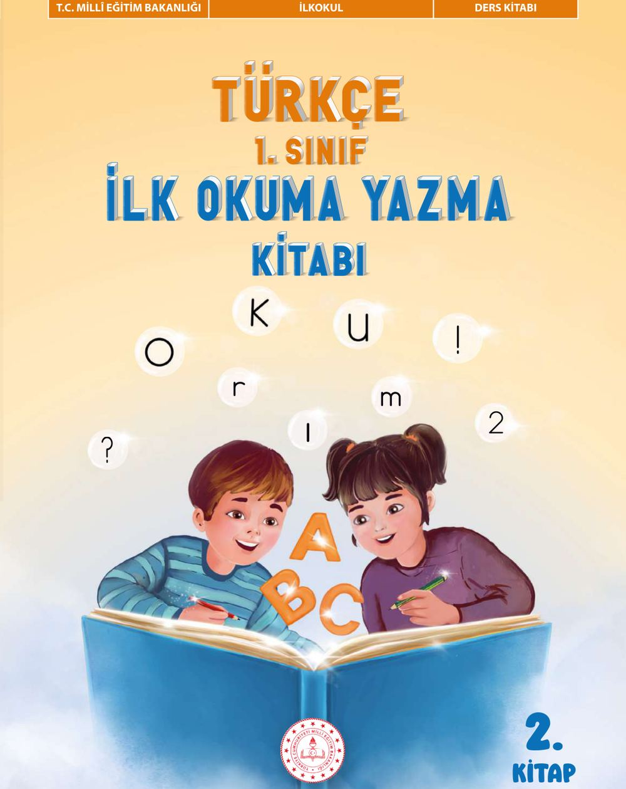

2.

<!-- sayfa 1 -->

Verdiğiniz mesajda PDF metin katmanı boş görünüyor (`<<< >>>` arası boş). Lütfen dönüştürülmesini istediğiniz metni veya görseli paylaşın, böylece kurallara uygun şekilde Markdown formatına çevirebilirim.

<!-- sayfa 2 -->

# İLKOKUL
# TÜRKÇE
# 1. SINIF
# İLK OKUMA YAZMA KİTABI

## 2. KİTAP
### Yazarlar

Ali TÜRKOĞLU | İsmail ERDOĞAN
--- | ---
Bahattin ERKUŞ | Kamil YEŞİLOVA
Betül BELEN | Orhan ÇETİN
Burcu KIRTIL | Selçin ATLI
Emine Huma KARADAYI | Semih KIYICI
Esen ŞAHİN | Tuğba ZENGİN
Filiz ALTUNKESER | Zeynep DEMİREL
Hicret ÖZDEMİR | 

<!-- sayfa 3 -->

MİLLÎ EĞİTİM BAKANLIĞI YAYINLARI NO ............................................................................: 2017
DERS KİTAPLARI DİZİSİ NO ............................................................................................................................: 9596
Her hakkı saklıdır ve Millî Eğitim Bakanlığına aittir. Kitabın metin, soru ve şekilleri kısmen de olsa hiçbir surette alınıp yayımlanamaz.

**Editör**
Prof. Dr. Emre ÜNAL
Prof. Dr. Hüseyin ANILAN
Prof. Dr. İbrahim COŞKUN
Prof. Dr. Sabri SİDEKLİ
Dr. Öğr. Üyesi Murat TEMUR

**Dil Uzmanı**
Abdullah TAŞPINAR
Eyyup DİKOĞLU
Hatice OCAK

**Görsel Tasarımcı**
Ahmet CAN | Mehmet Azzem AKGÖZ
Aslı DAL | Merve Gül KARACA
Atila ÇAM | Mesut ÖZKAN
Cihan Arif YİĞİT | Seyfullah YİĞİT
Dilek KORKMAZ | Ümit ŞENER

**Çoklu Ortam Tasarımcısı**
Dr. Dilek ÇAPAR | Erdem TOPUZOĞLU
Başak DOĞAN GÜNGÖRALP | Esra ESEN KANAN
Cem SAVAŞ | Harun KARABULUT
Eda ÖZKAN AKAR | Hatice YILDIRIM IŞIK
Enver ÜLKER | Onur GÖNÜLLÜ

**Program Geliştirme Uzmanı**
Doc. Dr. Mehmet EROĞLU
Fırat KILAVUZ

**Ölçme ve Değerlendirme Uzmanı**
Dr. Öğr. Üyesi Erdem BODUROĞLU
Mustafa GÖKCAN

**Rehberlik Uzmanı**
Metin ÇELİK
Recep ERDEM

ISBN 978-975-11-7994-4

Millî Eğitim Bakanlığı, Talim ve Terbiye Kurulu Başkanlığının 17.07.2024 tarih ve 110460159 sayılı yazısı ile eğitim aracı olarak kabul edilmiştir.

<!-- yer tutucu bulunamadı: sayfa sonuna eklendi -->

<!-- sayfa 4 -->

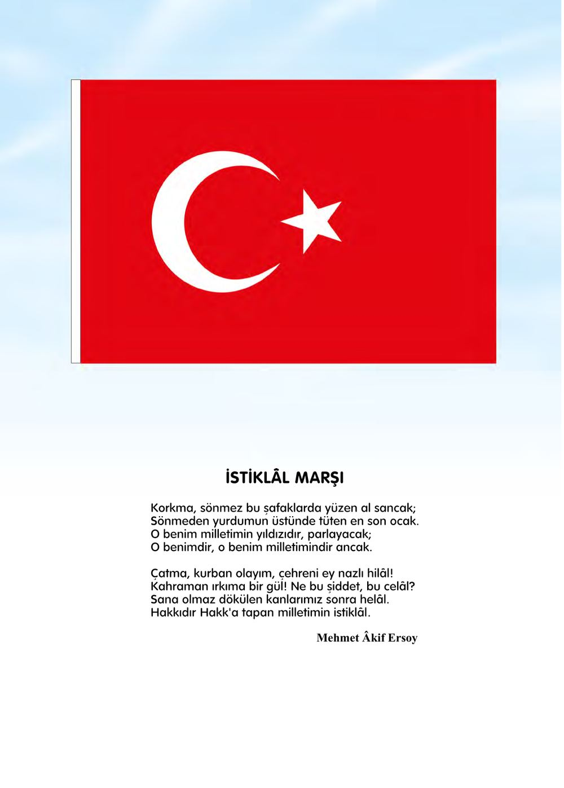

# İSTİKLÂL MARŞI

Korkma, sönmez bu şafaklarda yüzen al sancak;
Sönmeden yurdumun üstünde tüten en son ocak.
O benim milletimin yıldızıdır, parlayacak;
O benimdir, o benim milletimindir ancak.

Çatma, kurban olayım, cehren ey nazlı hilâl!
Kahraman ırkıma bir gül! Ne bu şiddet, bu celâl?
Sana olmaz dökülen kanlarımız sonra helâl.
Hakkıdır Hakk'a tapan milletimin istiklâl.

Mehmet Âkif Ersoy

<!-- sayfa 5 -->

ANDIMIZ

Türküm, doğruyum, çalışkanım.

İlkem küçüklerimi korumak, büyüklerimi saymak; yurdumu, milletimi özümden çok sevmektir.
Ülküm yükselmek, ileri gitmektir.

Ey Büyük Atatürk!

Açtığın yolda, gösterdiğin hedefe durmadan yürüyeceğime ant içerim.

Varlığım Türk varlığına armağan olsun.

Ne mutlu Türküm diyene!

<!-- yer tutucu bulunamadı: sayfa sonuna eklendi -->

<!-- sayfa 6 -->

MUSTAFA KEMAL ATATÜRK

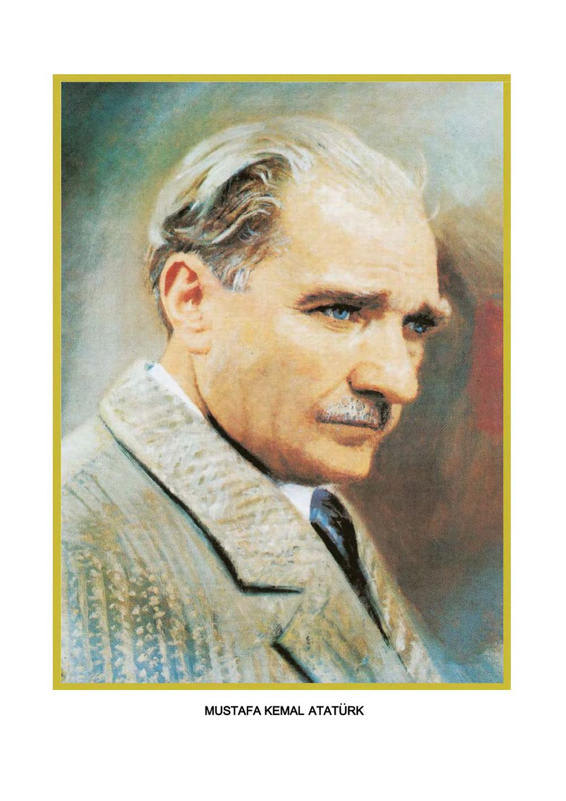
<!-- yer tutucu bulunamadı: sayfa sonuna eklendi -->

<!-- sayfa 7 -->

Verdiğiniz mesajda herhangi bir metin veya görsel bulunmamaktadır. Lütfen dönüştürülmesini istediğiniz PDF metin katmanını `<<< >>>` işaretleri arasına ekleyin ve ilgili görseli paylaşın. Verileri sağladığınızda talimatlarınıza uygun şekilde Markdown formatına çevirebilirim.

<!-- yer tutucu bulunamadı: sayfa sonuna eklendi -->

<!-- sayfa 8 -->

# İÇİNDEKİLER

## 3. TEMA: ÇEVREMİZDEKİ YAŞAM

Cesur Portakal (Dinleme metni)............................................................ 13
ü sesi.................................................................................................... 14
s sesi.................................................................................................... 26
Kış Geldi (Dinleme metni)................................................................... 41
ö sesi.................................................................................................... 42
y sesi.................................................................................................... 54
d sesi.................................................................................................... 68
z sesi.................................................................................................... 80

## 4. TEMA: YOL ARKADAŞIMIZ KİTAPLAR

En Değerli Hazine (Dinleme metni)...................................................... 97
ç sesi.................................................................................................... 98
b sesi .................................................................................................. 110
g sesi................................................................................................... 122
Ege ile Gaga Güzel Bir Kitap (İzleme metni)........................................ 135
c sesi.................................................................................................... 136
ş sesi.................................................................................................... 146
Bibliyo Fil (Dinleme metni)................................................................... 157

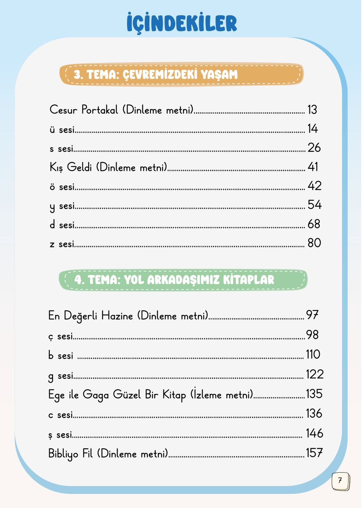
<!-- yer tutucu bulunamadı: sayfa sonuna eklendi -->

<!-- sayfa 9 -->

p sesi...................................................................................................................... 158
h sesi...................................................................................................................... 170
Okuyorum (Dinleme metni)................................................................... 181
v sesi  .................................................................................................................. 182
ğ sesi...................................................................................................................... 194
f sesi....................................................................................................................... 206
j sesi........................................................................................................................ 216
Kaynakça............................................................................................................. 231
Görsel ve Görsel Ağ Kaynakçası................................................... 231
Türkiye'nin Mülki İdare Bölümleri ile Kara ve Deniz 
Komşuları Haritası...................................................................................... 232
Türk Dünyası Haritası............................................................................... 233

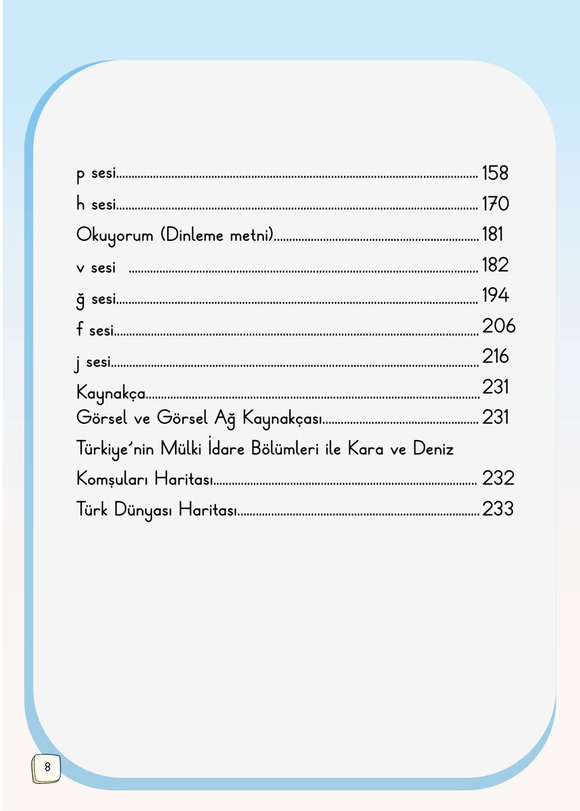
<!-- yer tutucu bulunamadı: sayfa sonuna eklendi -->

<!-- sayfa 10 -->

# KİTABIMIZI TANIYALIM

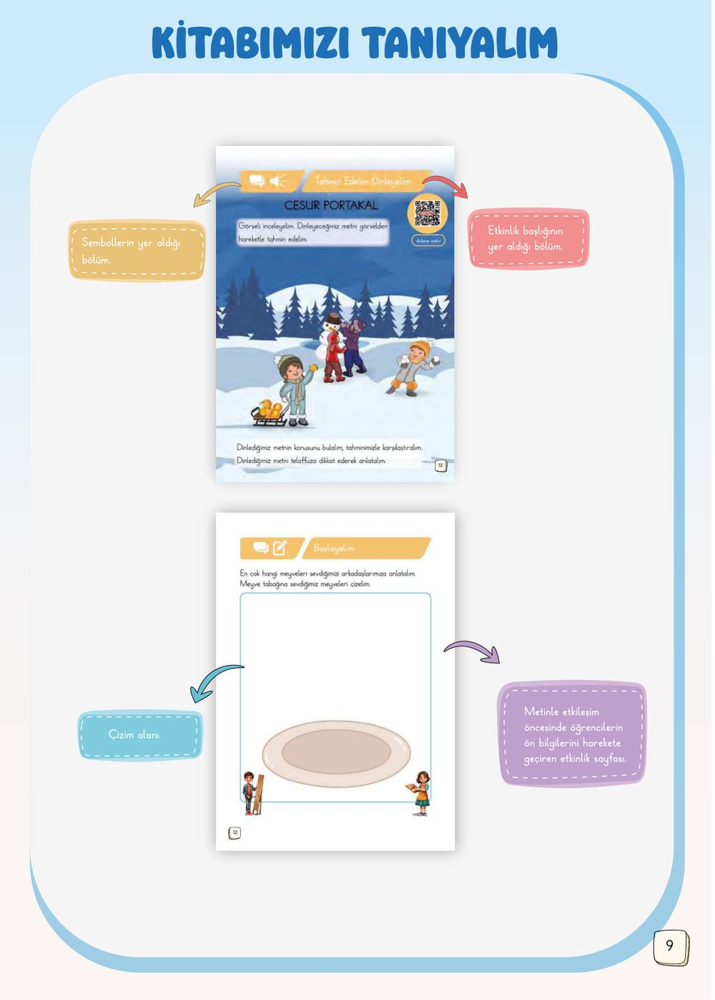 Sembollerin yer aldığı bölüm.

 Etkinlik başlığının yer aldığı bölüm.

 Çizim alanı.

 Metinle etkileşim öncesinde öğrencilerin ön bilgilerini harekete geçiren etkinlik sayfası.

<!-- sayfa 11 -->

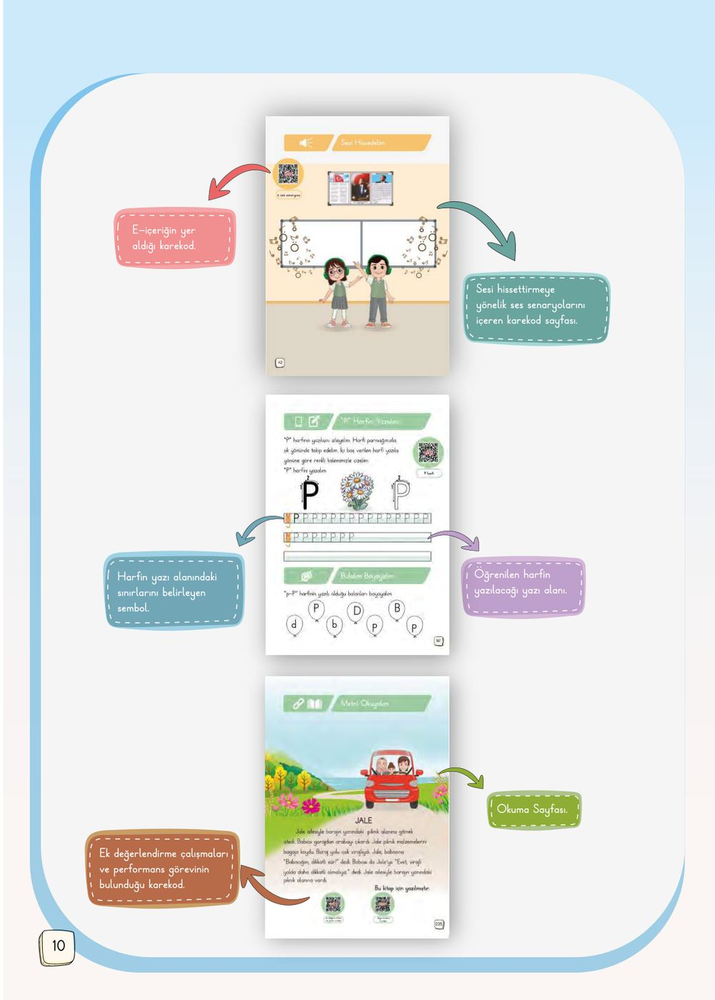

[[SEKIL:

<!-- sayfa 12 -->

# SEMBOLLER

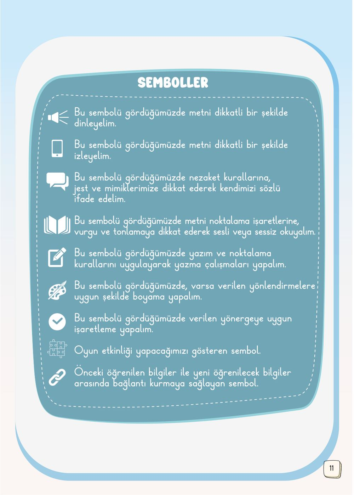 Bu sembolü gördüğümüzde metni dikkatli bir şekilde dinleyelim.
 Bu sembolü gördüğümüzde metni dikkatli bir şekilde izleyelim.
 Bu sembolü gördüğümüzde nezaket kurallarına, jest ve mimiklerimize dikkat ederek kendimizi sözlü ifade edelim.
 Bu sembolü gördüğümüzde metni noktalama işaretlerine, vurgu ve tonlamaya dikkat ederek sesli veya sessiz okuyalım.
 Bu sembolü gördüğümüzde yazım ve noktalama kurallarını uygulayarak yazma çalışmaları yapalım.
 Bu sembolü gördüğümüzde, varsa verilen yönlendirmelere uygun şekilde boyama yapalım.
 Bu sembolü gördüğümüzde verilen yönergeye uygun işaretleme yapalım.
 Oyun etkinliği yapacağımızı gösteren sembol.
 Önceki öğrenilen bilgiler ile yeni öğrenilecek bilgiler arasında bağlantı kurmaya sağlayan sembol.

<!-- sayfa 13 -->

# Başlayalım

En çok hangi meyveleri sevdiğimizi arkadaşlarımıza anlatalım. 
Meyve tabağına sevdiğimiz meyveleri çizelim.

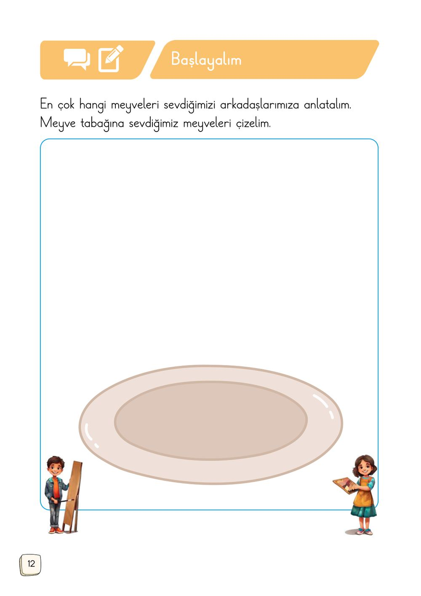

<!-- sayfa 14 -->

# Tahmin Edelim Dinleyelim

## CESUR PORTAKAL

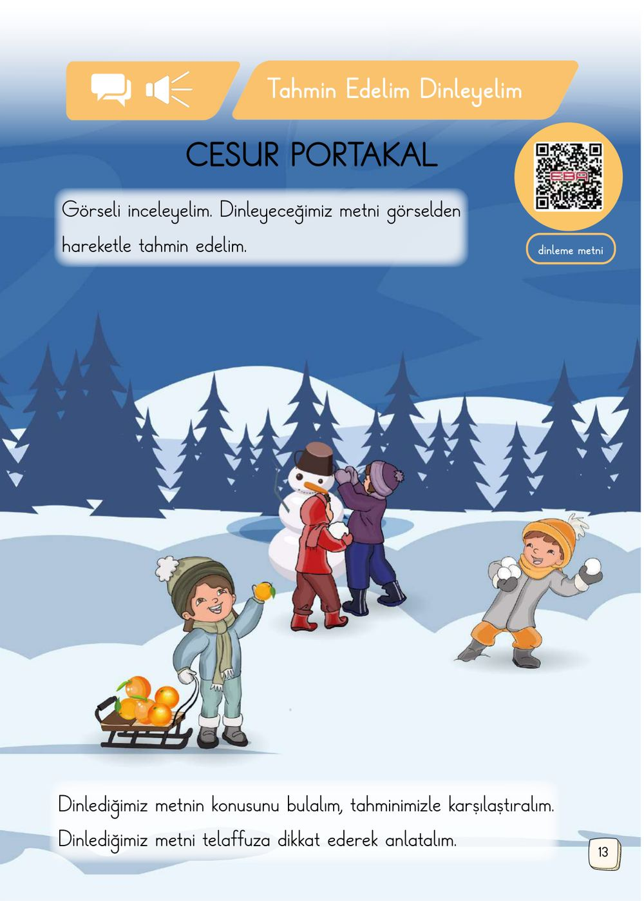: Görselde karlı bir ortamda çocuklar, bir kardan adam ve portakalların olduğu bir sahne yer almaktadır.

Görseli inceleyelim. Dinleyeceğimiz metni görselden hareketle tahmin edelim.

dinleme metni

Dinlediğimiz metnin konusunu bulalım, tahminimizle karşılaştıralım.

<!-- sayfa 15 -->

# Sesi Hissedelim

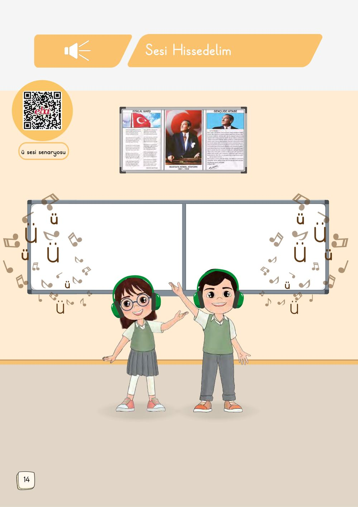

ü sesi senaryosu

<!-- sayfa 16 -->

# Söyleyelim İşaretleyelim

Görseldeki varlıkların adını söyleyelim. Adında “ü-Ü” sesi bulunan varlıkları örnekteki gibi işaretleyelim.

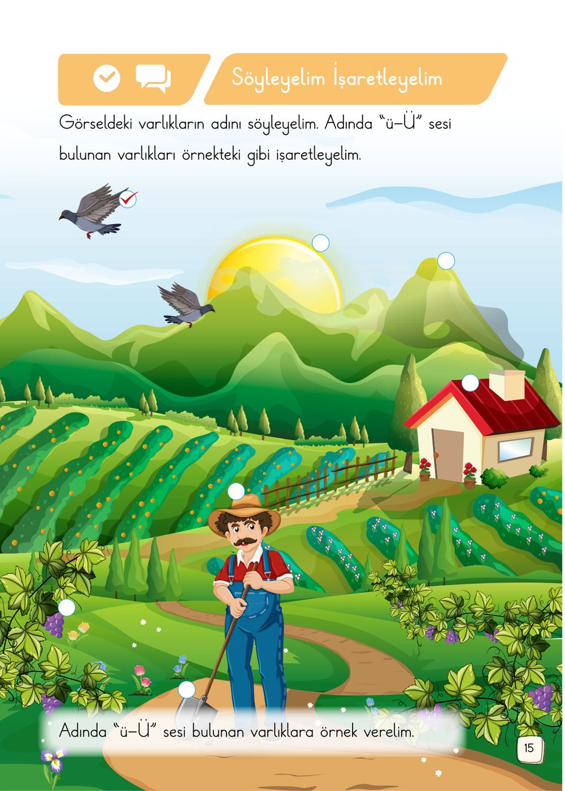

<!-- sayfa 17 -->

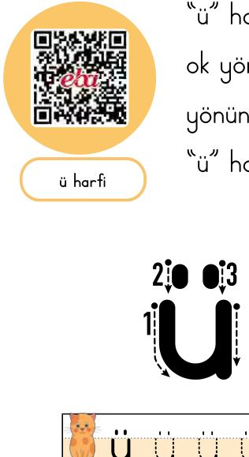

# “ü” Harfini Yazalım

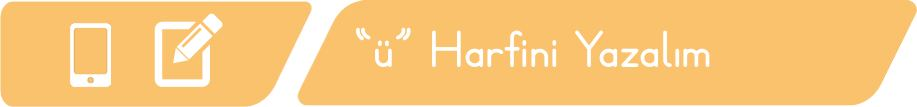

“ü” harfinin yazılışını izleyelim. Harfi parmağımızla ok yönünde takip edelim. İçi boş verilen harfi yazılış yönüne göre renkli kalemimizle çizelim.
“ü” harfini yazalım.

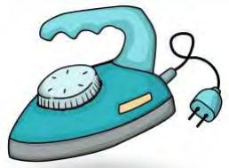
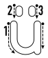

ü ü ü ü ü ü ü ü ü ü ü ü ü ü ü ü
ü ü ü ü ü ü ü ü ü ü ü ü 
 ü ü ü ü ü ü   
 ü ü ü ü 
 ü ü
 ü

<!-- sayfa 18 -->

# “Ü” Harfini Yazalım

“Ü” harfinin yazılışını izleyelim. Harfi parmağımızla ok yönünde takip edelim. İçi boş verilen harfi yazılış yönüne göre renkli kalemimizle çizelim.
“Ü” harfini yazalım.

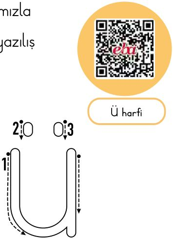

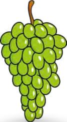

ü ü ü ü ü ü ü ü ü ü ü ü
ü ü ü ü ü ü ü ü
ü ü ü ü ü ü
ü ü ü ü
ü ü
ü

<!-- sayfa 19 -->

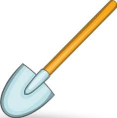

Bulalım Boyayalım

“ü-Ü” harfinin yazılı olduğu balonları boyayalım.

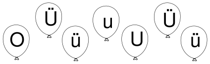

<!-- sayfa 20 -->

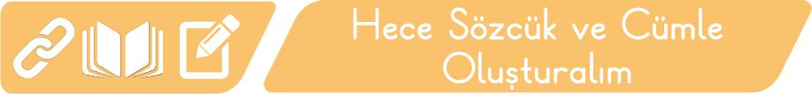 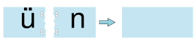 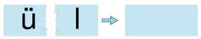 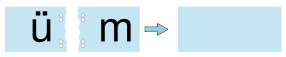 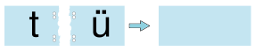 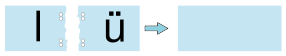 # Hece Sözcük ve Cümle Oluşturalım

ü + n $\rightarrow$ ün
ün ün

ü + l $\rightarrow$ ül
ül ül

ü + m $\rightarrow$ üm
üm üm

t + ü $\rightarrow$ tü
tü tü

l + ü $\rightarrow$ lü
lü lü

<!-- sayfa 21 -->

ün lü $\rightarrow$ ünlü
ünlü ünlü
__________________________________________________________________

ü tü $\rightarrow$ ütü 
ütü ütü
__________________________________________________________________

tü l $\rightarrow$ tül
tül tül
__________________________________________________________________

ü mit $\rightarrow$ Ümit 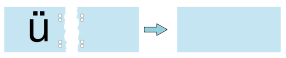
Ümit Ümit
__________________________________________________________________

Ümit tülü tak.
__________________________________________________________________

__________________________________________________________________

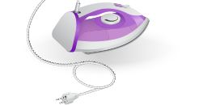  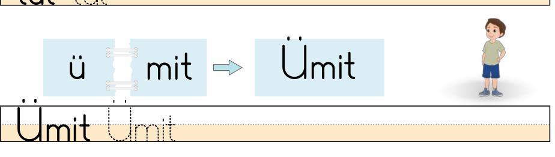 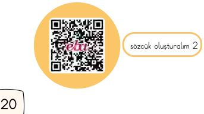 sözcük oluşturalım 2

<!-- sayfa 22 -->

tü + nel $\rightarrow$ tünel 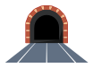
tünel tünel

ül + ke $\rightarrow$ ülke
ülke ülke

ül + kü $\rightarrow$ Ülkü 
Ülkü Ülkü

a + ta + türk $\rightarrow$ Atatürk 
Atatürk Atatürk

Ülkü Atatürk’ü tanı. 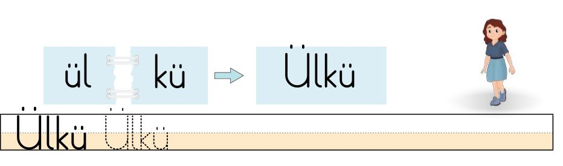

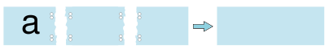

<!-- sayfa 23 -->

Ümran ütü al.
__________________________________________________________________
__________________________________________________________________

Ünal tül ütülü mü?
__________________________________________________________________
__________________________________________________________________

Ümit tülü katla.
__________________________________________________________________
__________________________________________________________________

Mete Atatürk’ü anla.
__________________________________________________________________
__________________________________________________________________

Ülkü, Ünal’a ülkeni anlat.
__________________________________________________________________
__________________________________________________________________

<!-- sayfa 24 -->

# Yazalım Okuyalım

 Ünal o tünel.
Ünal o tünel.

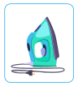 Ümran .................................................. al.
..................................................................

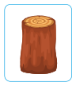 Ali o ...................................................
..................................................................

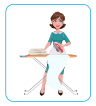 Anne .................................................. ütüle.
..................................................................

<!-- yer tutucu bulunamadı: sayfa sonuna eklendi -->

<!-- sayfa 25 -->

# Bulalım Yazalım

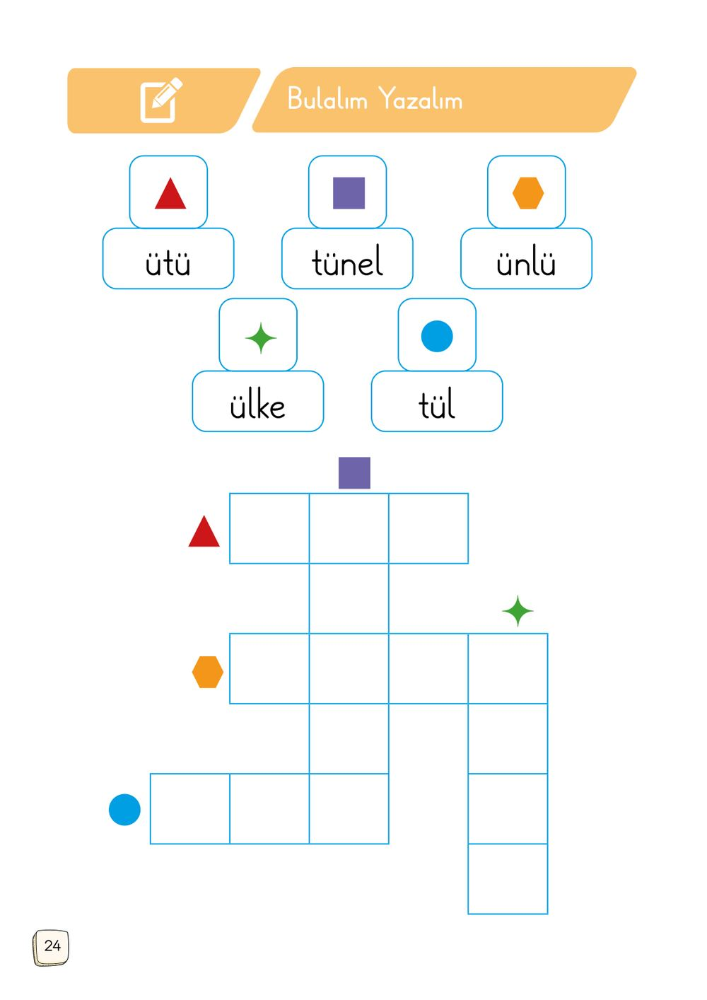
 ütü
 tünel
 ünlü
 ülke
 tül

<!-- sayfa 26 -->

# Okuyalım Yazalım

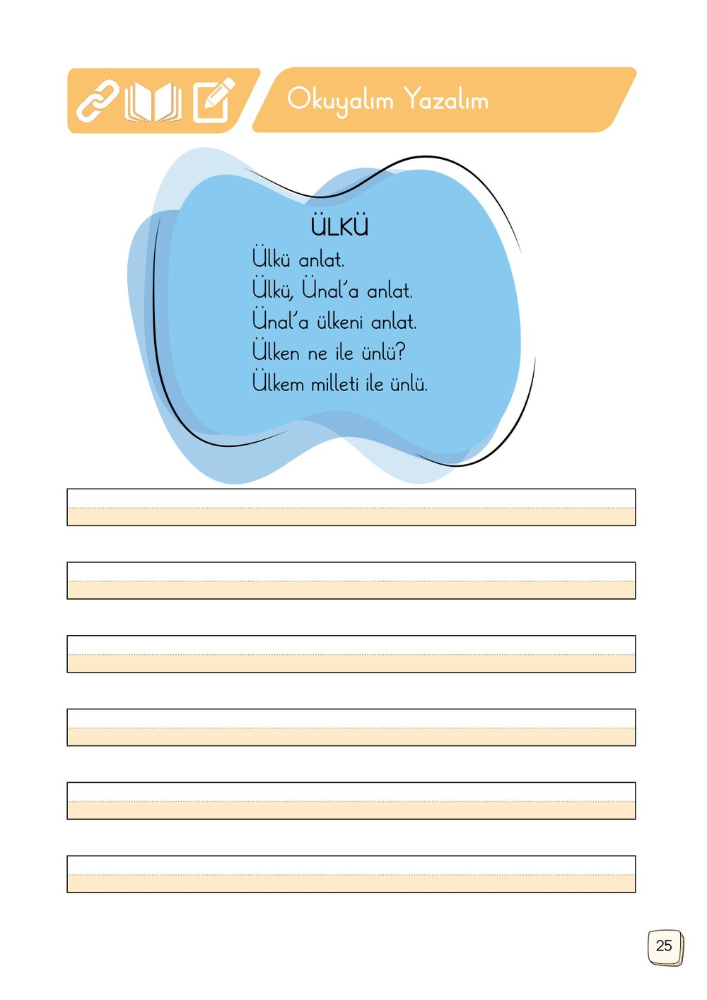
**ÜLKÜ**
Ülkü anlat.
Ülkü, Ünal’a anlat.
Ünal’a ülkeni anlat.
Ülken ne ile ünlü?
Ülkem milleti ile ünlü.

__________________________________________________________________
__________________________________________________________________

<!-- sayfa 27 -->

# Sesi Hissedelim

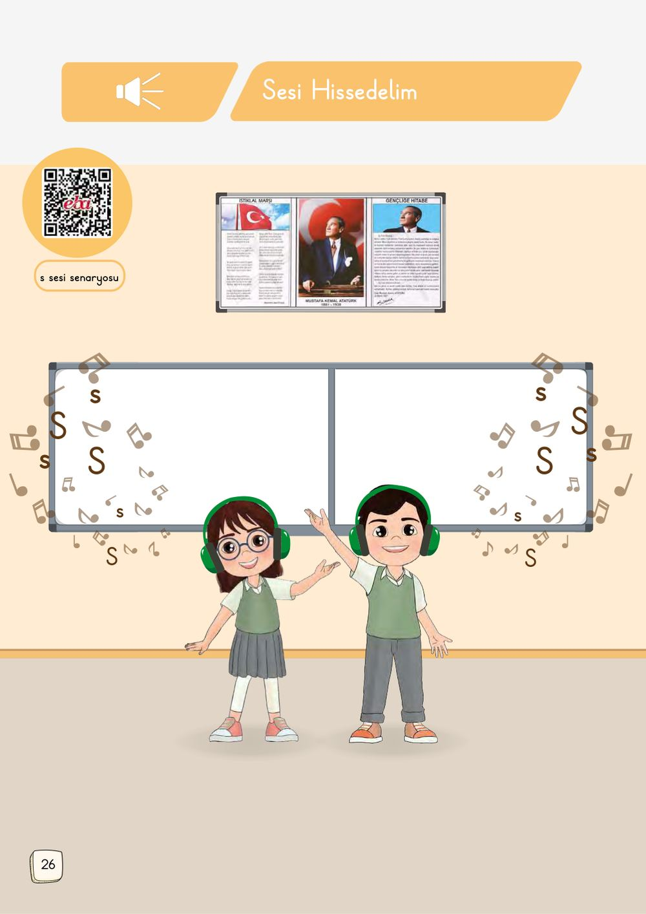

s sesi senaryosu

s
s
sS
S
S
s
s
sS
S
S

<!-- sayfa 28 -->

# Söyleyelim İşaretleyelim

Görseldeki varlıkların adını söyleyelim. Adında “s-S” sesi bulunan varlıkları örnekteki gibi işaretleyelim.

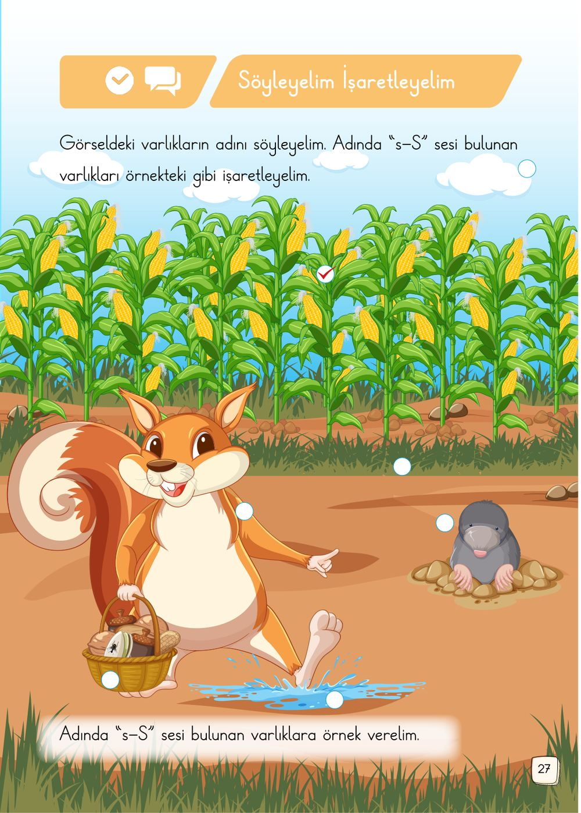

Adında “s-S” sesi bulunan varlıklara örnek verelim.

<!-- sayfa 29 -->

# “s” Harfini Yazalım

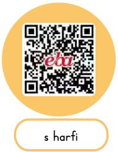

“s” harfinin yazılışını izleyelim. Harfi parmağımızla ok yönünde takip edelim. İçi boş verilen harfi yazılış yönüne göre renkli kalemimizle çizelim.
“s” harfini yazalım.

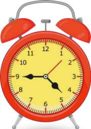

| s | s s s s s s s s s s s s s s s s s s s |
|---|---|
| | s s s s s s s s s s s s |
| | s s s s s s |
| | s s s s |
| | s s |
| | s |

<!-- sayfa 30 -->

# “S” Harfini Yazalım

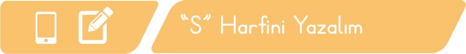

“S” harfinin yazılışını izleyelim. Harfi parmağımızla ok yönünde takip edelim. İçi boş verilen harfi yazılış yönüne göre renkli kalemimizle çizelim.
“S” harfini yazalım.

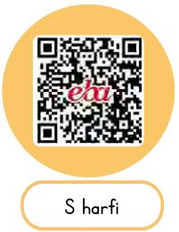
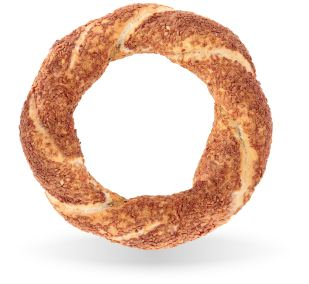
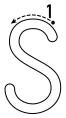

| S | S S S S S S S S S S S S S S |
|---|---|
|  | S S S S S S S S S S |
|  | S S S S S S |
| | S S S S |
| | S S |
| | S |

<!-- sayfa 31 -->

ş 1
S

s S s S s S s S s S s S s S s S s S
s S

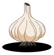

Bulalım Boyayalım

“s-S” harfinin yazılı olduğu balonları boyayalım.

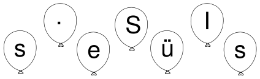

<!-- sayfa 32 -->

 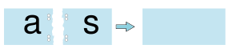 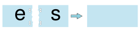   
# Hece Sözcük ve Cümle Oluşturalım

a s $\rightarrow$ as
as as

e s $\rightarrow$ es
es es

i s $\rightarrow$ is
is is

s a $\rightarrow$ sa
sa sa

s e $\rightarrow$ se
se se

<!-- sayfa 33 -->

 s i $\rightarrow$ si
si si

 s o $\rightarrow$ so
so so

 s u $\rightarrow$ su
su su

 s ı $\rightarrow$ sı
sı sı

 s ü $\rightarrow$ sü
sü sü

<!-- sayfa 34 -->

sü + t $\rightarrow$ süt 
süt süt

as + kı $\rightarrow$ askı 
askı askı

sa + at $\rightarrow$ saat 
saat saat

su + na $\rightarrow$ Suna 
Suna Suna

Suna saat taktı. 

<!-- sayfa 35 -->

so + ru $\Rightarrow$ soru
soru soru
__________________________________________________________________

su + lu $\Rightarrow$ sulu
sulu sulu
__________________________________________________________________

es + ma $\Rightarrow$ Esma 
Esma Esma
__________________________________________________________________

Esma sulu elma al. 
__________________________________________________________________

__________________________________________________________________

Ülkü soru sor. 
__________________________________________________________________

 sözcük oluşturalım 3

<!-- sayfa 36 -->

si + mit $\rightarrow$ simit 
simit simit

si + nan $\rightarrow$ Sinan 
Sinan Sinan

Sinan iki simit al.
_______________________________________________________

Selim sarı saatini taksın.
_______________________________________________________

Esma, Ünal'a masal anlatsın.
_______________________________________________________

<!-- sayfa 37 -->

   Yazalım Okuyalım

[sıra]

[]

[]

[]

[]

[]

[]

[]

[]

<!-- sayfa 38 -->

# Yazalım Okuyalım

 Suna masal anlatsın.
....................

 Esma sulu ......... tattı.
....................

 Suat eline ......... al.
....................

 Sinan susamlı ......... al.
....................

 Suna ......... taktı.
....................

<!-- sayfa 39 -->

# Yazalım Okuyalım

sa | ma | sal
---|---|---
sa | ma | lık | ta
mı | su | si | rı | es
la | kes | sam | sır | mit
ta | sa | ne | rım | sak

mısır mısır

| | |
|---|---|
| | |
| | |
| | |
| | |

<!-- yer tutucu bulunamadı: sayfa sonuna eklendi -->

<!-- sayfa 40 -->

# MASAL
Suna masal okusun.
Suna, Sinan’a masal okusun.
Suna aslanlı masalı okusun.
Masalı sesli sesli okusun.
Sinan aslanlı masalı anlatsın.

---
___________________________________________________________________________
___________________________________________________________________________

___________________________________________________________________________
___________________________________________________________________________

<!-- sayfa 41 -->

# Başlayalım

Kış mevsimi denilince aklımıza neler geliyor? Çizelim.
Arkadaşlarımıza anlatalım.

<!-- sayfa 42 -->

# Tahmin Edelim Dinleyelim

## KIŞ GELDİ

: Görseli inceleyelim. Dinleyeceğimiz metni görselden hareketle tahmin edelim.

dinleme metni

Dinlediğimiz metnin konusunu bulalım, tahminimizle karşılaştıralım.
Dinlediğimiz metni telaffuza dikkat ederek anlatalım.

<!-- sayfa 43 -->

# Sesi Hissedelim

ö sesi senaryosu

<!-- sayfa 44 -->

# Söyleyelim İşaretleyelim

Görseldeki varlıkların adını söyleyelim. Adında “ö-Ö” sesi bulunan varlıkları örnekteki gibi işaretleyelim.

Adında “ö-Ö” sesi bulunan varlıklara örnek verelim.

<!-- sayfa 45 -->

# “ö” Harfini Yazalım

“ö” harfinin yazılışını izleyelim. Harfi parmağımızla ok yönünde takip edelim. İçi boş verilen harfi yazılış yönüne göre renkli kalemimizle çizelim.
“ö” harfini yazalım.

<!-- sayfa 46 -->

# “Ö” Harfini Yazalım

“Ö” harfinin yazılışını izleyelim. Harfi parmağımızla ok yönünde takip edelim. İçi boş verilen harfi yazılış yönüne göre renkli kalemimizle çizelim.
“Ö” harfini yazalım.

<!-- sayfa 47 -->

“ö-Ö” harfinin yazılı olduğu balonları boyayalım.

<!-- sayfa 48 -->

      Hece Sözcük ve Cümle Oluşturalım

ö + n $\rightarrow$ ön
ön ön

ö + t $\rightarrow$ öt
öt öt

ö + r $\rightarrow$ ör
ör ör

t + ö $\rightarrow$ tö
tö tö

k + ö $\rightarrow$ kö
kö kö

<!-- sayfa 49 -->

ör nek $\Rightarrow$ örnek
örnek örnek

ön lem $\Rightarrow$ önlem
önlem önlem

kö mür $\Rightarrow$ kömür 
kömür kömür

tö ren $\Rightarrow$ tören
tören tören

ö nal $\Rightarrow$ Önal 
Önal Önal 

<!-- yer tutucu bulunamadı: sayfa sonuna eklendi -->

<!-- yer tutucu bulunamadı: sayfa sonuna eklendi -->

<!-- yer tutucu bulunamadı: sayfa sonuna eklendi -->

<!-- yer tutucu bulunamadı: sayfa sonuna eklendi -->

<!-- sayfa 50 -->

ön lük $\rightarrow$ önlük 
önlük önlük

ö mer $\rightarrow$ Ömer 
Ömer Ömer

Ömer önlük taktı.

ö nem li $\rightarrow$ önemli 
önemli önemli

Melike o konu önemli. 

dinleyelim bulalım 1

<!-- sayfa 51 -->

Önal örtü ört.
__________________________________________________________________
__________________________________________________________________

Ömer törene katıl.
__________________________________________________________________
__________________________________________________________________

Suna önlemini al.
__________________________________________________________________
__________________________________________________________________

Öner öteki kalemi al.
__________________________________________________________________
__________________________________________________________________

Murat, Atatürk’ü örnek al.
__________________________________________________________________
__________________________________________________________________

<!-- sayfa 52 -->

# Yazalım Okuyalım

Ömer okumak önemli.
Ömer okumak önemli.

Ali iki ton .................... sattı.
........................................

Esma .................... taktı.
........................................

Önal .................... ört.
........................................

<!-- sayfa 53 -->

| O | K | K | Ö | K | U |
|---|---|---|---|---|---|
| M | A | Ö | R | T | Ü |
| K | Ö | N | L | Ü | K |
| Ö | K | Ö | M | Ü | R |
| Ö | R | N | E | K | N |
| E | T | Ö | R | E | N |
| Ö | N | L | E | M | M |
| L | İ | Ö | M | Ü | R |

| KÖK | ÖRTÜ | KÖMÜR |
|---|---|---|
| ÖNLÜK | ÖNLEM | TÖREN |
| ÖMÜR | ÖRNEK |

<!-- sayfa 54 -->

# Okuyalım Yazalım

**ÖMER**
Ömer masal oku.
Oku Ömer oku.
Ömer okumak önemli.
Ömer anlamak önemli.
Ömer masal oku, anla.

___________________________________________________________________________
___________________________________________________________________________

<!-- sayfa 55 -->

# Sesi Hissedelim

y sesi senaryosu

y
y
yY
Y
Y
y
y
yY
Y
Y

<!-- sayfa 56 -->

# Söyleyelim İşaretleyelim

Görseldeki varlıkların adını söyleyelim. Adında “y-Y” sesi bulunan varlıkları örnekteki gibi işaretleyelim.

Adında “y-Y” sesi bulunan varlıklara örnek verelim.

<!-- sayfa 57 -->

# “y” Harfini Yazalım

“y” harfinin yazılışını izleyelim. Harfi parmağımızla ok yönünde takip edelim. İçi boş verilen harfi yazılış yönüne göre renkli kalemimizle çizelim.
“y” harfini yazalım.

y y y y y y y y y y y y y y y y y

y y y y y y y y y y y y y

y y y y y y
y y y y
y y
y

<!-- sayfa 58 -->

# “Y” Harfini Yazalım

“Y” harfinin yazılışını izleyelim. Harfi parmağımızla ok yönünde takip edelim. İçi boş verilen harfi yazılış yönüne göre renkli kalemimizle çizelim.
“Y” harfini yazalım.

Y Y Y Y Y Y Y Y Y Y Y Y Y

Y Y Y Y Y Y Y Y Y Y

Y Y Y Y Y Y

Y Y Y Y

Y Y

Y

<!-- sayfa 59 -->

y Y

Bulalım Boyayalım

“y-Y” harfinin yazılı olduğu balonları boyayalım.

<!-- sayfa 60 -->

      # Hece Sözcük ve Cümle Oluşturalım

a + y $\rightarrow$ ay
ay ay

ö + y $\rightarrow$ öy
öy öy

y + a $\rightarrow$ ya
ya ya

y + e $\rightarrow$ ye
ye ye

y + i $\rightarrow$ yi
yi yi

<!-- sayfa 61 -->

 $\rightarrow$ yo
yo yo

 $\rightarrow$ yu
yu yu

 $\rightarrow$ yı
yı yı

 $\rightarrow$ yü
yü yü

 $\rightarrow$ yö
yö yö

<!-- sayfa 62 -->

yö + n $\rightarrow$ yön
yön yön

sa + y $\rightarrow$ say
say say

sa + yı $\rightarrow$ sayı
sayı sayı

öy + kü $\rightarrow$ Öykü

Öykü Öykü

Öykü sayı say.

<!-- yer tutucu bulunamadı: sayfa sonuna eklendi -->

<!-- yer tutucu bulunamadı: sayfa sonuna eklendi -->

<!-- yer tutucu bulunamadı: sayfa sonuna eklendi -->

<!-- yer tutucu bulunamadı: sayfa sonuna eklendi -->

<!-- sayfa 63 -->

yo + l $\rightarrow$ yol
yol yol

oy + na $\rightarrow$ oyna
oyna oyna

o + ya $\rightarrow$ Oya 
Oya Oya

o + yun $\rightarrow$ oyun
oyun oyun

Oya oyun oyna.

__________________________________________________________________

<!-- yer tutucu bulunamadı: sayfa sonuna eklendi -->

<!-- yer tutucu bulunamadı: sayfa sonuna eklendi -->

<!-- yer tutucu bulunamadı: sayfa sonuna eklendi -->

<!-- yer tutucu bulunamadı: sayfa sonuna eklendi -->

<!-- sayfa 64 -->

ye + mek $\rightarrow$ yemek

yemek yemek

ay + la $\rightarrow$ Ayla 

Ayla Ayla

Ayla yemek ye.

__________________________________________________________________

Mete sayı say.

Suna öykü oku.

<!-- yer tutucu bulunamadı: sayfa sonuna eklendi -->

<!-- sayfa 65 -->

    Yazalım Okuyalım

Ay

<!-- sayfa 66 -->

# Yazalım Okuyalım

  Akın koyuna ot at.

 Koray sarı ......................... sür.

 Simay ......................... senin mi?

 Aylin ......................... ye.

 Yaman ......................... ile kay.

....................
..................
....................
....................

cümle oluşturalım

<!-- sayfa 67 -->

# Bulalım Boyayalım Yazalım

| YA | KAM | TAK | AY |
| :---: | :---: | :---: | :---: |
| A | YA | YON | NA |
| YE | KA | LEK | YI |

YAKA
____________________  ____________________
____________________  ____________________
____________________  ____________________

<!-- sayfa 68 -->

# Okuyalım Yazalım

## OYA İLE AYLA

Ayla un al.
Ayla maya al.
Oya una maya kat.
Oya ekmek mayala.
Oya, Ayla ile ekmek ye.

__________________________________________________________________
__________________________________________________________________

<!-- sayfa 69 -->

# Sesi Hissedelim

d sesi senaryosu

d
d
d
D
D
D
d
d
d
D
D
D

<!-- sayfa 70 -->

# Söyleyelim İşaretleyelim

Görseldeki varlıkların adını söyleyelim. Adında “d-D” sesi bulunan varlıkları örnekteki gibi işaretleyelim.

<!-- sayfa 71 -->

# “d” Harfini Yazalım

“d” harfinin yazılışını izleyelim. Harfi parmağımızla ok yönünde takip edelim. İçi boş verilen harfi yazılış yönüne göre renkli kalemimizle çizelim.
“d” harfini yazalım.

d d d d d d d d d d d d d d d
d d d d d d d d d d d d
d d d d d d
d d d d
d d
d

<!-- sayfa 72 -->

# “D” Harfini Yazalım

“D” harfinin yazılışını izleyelim. Harfi parmağımızla ok yönünde takip edelim. İçi boş verilen harfi yazılış yönüne göre renkli kalemimizle çizelim.

“D” harfini yazalım.

<!-- sayfa 73 -->

Bulalım Boyayalım

“d-D” harfinin yazılı olduğu balonları boyayalım.

<!-- sayfa 74 -->

     
# Hece Sözcük ve Cümle Oluşturalım

a d $\rightarrow$ ad
ad ad

d a $\rightarrow$ da
da da

d e $\rightarrow$ de
de de

d i $\rightarrow$ di
di di

d ö $\rightarrow$ dö
dö dö

<!-- sayfa 75 -->

da + l $\rightarrow$ dal
dal dal

di + k $\rightarrow$ dik
dik dik

du + r $\rightarrow$ dur
dur dur

dö + n $\rightarrow$ dön
dön dön

du + t $\rightarrow$ dut
dut dut 

<!-- yer tutucu bulunamadı: sayfa sonuna eklendi -->

<!-- yer tutucu bulunamadı: sayfa sonuna eklendi -->

<!-- yer tutucu bulunamadı: sayfa sonuna eklendi -->

<!-- yer tutucu bulunamadı: sayfa sonuna eklendi -->

<!-- yer tutucu bulunamadı: sayfa sonuna eklendi -->

<!-- sayfa 76 -->

ke di $\rightarrow$ kedi 
kedi kedi __________________________________________________________

de re $\rightarrow$ dere
dere dere __________________________________________________________

de de $\rightarrow$ dede 
dede dede __________________________________________________________

dö ner $\rightarrow$ döner 
döner döner ________________________________________________________

Dedem döner yedi.
____________________________________________________________________

____________________________________________________________________

<!-- sayfa 77 -->

dör + t $\rightarrow$ dört

dört dört

di + lek $\rightarrow$ Dilek

Dilek Dilek

Dilek dört ekmek aldı.

Arda ellerini yıkadı.

Eda oyun oynadı.

<!-- yer tutucu bulunamadı: sayfa sonuna eklendi -->

<!-- sayfa 78 -->

 Yazalım Okuyalım

| | | |
| :---: | :---: | :---: |
|  |  |  |
| döner | | |
|  |  |  |
| | | |
|  |  |  |
| | | |

 dinleyelim bulalım 2 

<!-- sayfa 79 -->

# Oluşturalım Yazalım

Dedem odun kırdı.
____________________

Eda ............................ oldu.
____________________

................. daldan atladı.
____________________

Arda .................... öttürdü.
____________________

Derya ................................. yedi.
____________________

Arda .................... öttürdü.
____________________

<!-- sayfa 80 -->

# Okuyalım Yazalım

## KEDİ

Minik kedinin adı ne?
Kedinin adı Duman.
Dilek, Duman’a mama aldı.
Onun karnını doyurdu.
Duman mutlu oldu.

__________________________________________________________________

<!-- sayfa 81 -->

# Sesi Hissedelim

z sesi senaryosu

<!-- sayfa 82 -->

# Söyleyelim İşaretleyelim

Görseldeki varlıkların adını söyleyelim. Adında “z-Z” sesi bulunan varlıkları örnekteki gibi işaretleyelim.

Adında “z-Z” sesi bulunan varlıklara örnek verelim.

<!-- sayfa 83 -->

# “z” Harfini Yazalım

“z” harfinin yazılışını izleyelim. Harfi parmağımızla ok yönünde takip edelim. İçi boş verilen harfi yazılış yönüne göre renkli kalemimizle çizelim.
“z” harfini yazalım.

z z z z z z z z z z z z z z z z
z z z z z z z z z z
z z z z z z
z z z z
z z
z

<!-- sayfa 84 -->

# “Z” Harfini Yazalım

“Z” harfinin yazılışını izleyelim. Harfi parmağımızla ok yönünde takip edelim. İçi boş verilen harfi yazılış yönüne göre renkli kalemimizle çizelim.

“Z” harfini yazalım.

Z Z Z Z Z Z Z Z Z Z Z Z Z Z
Z Z Z Z Z Z Z Z Z
Z Z Z Z Z Z
Z Z Z Z
Z Z
Z

<!-- sayfa 85 -->

z Z

z Z

Bulalım Boyayalım

“z-Z” harfinin yazılı olduğu balonları boyayalım.

<!-- sayfa 86 -->

   Hece Sözcük ve Cümle Oluşturalım

a z $\rightarrow$ az
az az

e z $\rightarrow$ ez
ez ez

z a $\rightarrow$ za
za za

z e $\rightarrow$ ze
ze ze

z i $\rightarrow$ zi
zi zi

<!-- yer tutucu bulunamadı: sayfa sonuna eklendi -->

<!-- yer tutucu bulunamadı: sayfa sonuna eklendi -->

<!-- yer tutucu bulunamadı: sayfa sonuna eklendi -->

<!-- sayfa 87 -->

z + ü $\rightarrow$ zü
zü zü __________________________________________________________________

zü + m $\rightarrow$ züm
züm züm _______________________________________________________________

ü + züm $\rightarrow$ üzüm 
üzüm üzüm ______________________________________________________________

az + ra $\rightarrow$ Azra 
Azra Azra ______________________________________________________________

Azra üzüm yıkıyor.
________________________________________________________________________

<!-- yer tutucu bulunamadı: sayfa sonuna eklendi -->

<!-- yer tutucu bulunamadı: sayfa sonuna eklendi -->

<!-- yer tutucu bulunamadı: sayfa sonuna eklendi -->

<!-- sayfa 88 -->

tu + z $\rightarrow$ tuz
tuz tuz

mu + z $\rightarrow$ muz 
muz muz

ya + zı $\rightarrow$ yazı
yazı yazı

ze + ki $\rightarrow$ Zeki 
Zeki Zeki

Zeki yazı yazıyor.
__________________________________________________________________

<!-- yer tutucu bulunamadı: sayfa sonuna eklendi -->

<!-- yer tutucu bulunamadı: sayfa sonuna eklendi -->

<!-- yer tutucu bulunamadı: sayfa sonuna eklendi -->

<!-- yer tutucu bulunamadı: sayfa sonuna eklendi -->

<!-- sayfa 89 -->

ka + zak $\rightarrow$ kazak 
kazak kazak

tey + ze $\rightarrow$ teyze
teyze teyze

Teyzem kazak örüyor.
_______________________________________________________

Azra yüzük takıyor.
_______________________________________________________

Mirza taze ekmek aldı.
_______________________________________________________

<!-- yer tutucu bulunamadı: sayfa sonuna eklendi -->

<!-- yer tutucu bulunamadı: sayfa sonuna eklendi -->

<!-- sayfa 90 -->

     Yazalım Okuyalım

zeytin

sözcük oluşturalım 4

<!-- sayfa 91 -->

# Yazalım Okuyalım

 Azra kazak örüyor.
__________________________
__________________________

 Zeki ........................ yiyor.
__________________________
__________________________

 Ziya ........................ yazıyor.
__________________________
__________________________

 İzzet ........................ yiyor.
__________________________
__________________________

 Ozan ........................ yıkıyor.
__________________________
__________________________

<!-- sayfa 92 -->

# Yazalım Okuyalım

Zeki yazı yazıyor.

| alıyor | yazıyor |
| :---: | :---: |
| ☐ | ☑ |

Nazlı üzümlü kek ........................

| yedi | okudu |
| :---: | :---: |
| ☐ | ☐ |

Teyzem yüzük ........................

| taktı | söyledi |
| :---: | :---: |
| ☐ | ☐ |

Azra müzik ........................

| aldı | dinledi |
| :---: | :---: |
| ☐ | ☐ |

<!-- sayfa 93 -->

# Okuyalım Yazalım

## ÜZÜM

Teyzem üzüm istedi.
Ziya, teyzeme üzüm aldı.
Sekiz salkım üzüm aldı.
Üzümleri temiz su ile yıkadı.
Teyzem üzümleri iki iki yedi.

<!-- sayfa 94 -->

# 4. TEMA
# YOL ARKADAŞIM KİTAPLAR

<!-- sayfa 95 -->

# Bu temada

* ç-Ç, b-B, g-G, c-C, ş-Ş, p-P, h-H, v-V, ğ-Ğ, f-F, j-J
    * Seslerini hissedeceğiz.
    * Seslerini ayırt edeceğiz ve tanıyacağız.
    * Harflerini okuyacağız ve yazacağız.
    * Harflerinden hece, sözcük, cümle ve metin oluşturacağız.
* Dinleme metinleri ile ilgili etkinlikler yapacağız.

## Anahtar Kavramlar

* ana duygu
* kitap
* olay
* ana fikir
* kitap sevgisi
* şiir
* hikâye
* kahraman

<!-- sayfa 96 -->

# NELER 
# DİNLEYECEĞİZ/İZLEYECEĞİZ?

 En Değerli Hazine

 Ege ile Gaga Güzel Bir Kitap

 Bibliyo Fil

 Okuyorum

<!-- sayfa 97 -->

# Başlayalım

Görseli inceleyelim. Gördüklerimizi anlatalım.

<!-- sayfa 98 -->

# Tahmin Edelim Dinleyelim

## EN DEĞERLİ HAZİNE

: Görseli inceleyelim. Dinleyeceğimiz metni görselden hareketle tahmin edelim.

dinleme metni

Dinlediğimiz metnin konusunu bulalım, tahminimizle karşılaştıralım.
Dinlediğimiz metni telaffuza dikkat ederek anlatalım.

<!-- sayfa 99 -->

# Sesi Hissedelim

ç sesi senaryosu

<!-- sayfa 100 -->

# İşaretleyelim Çizelim

Adında “ç-Ç” sesi bulunan varlıkları örnekteki gibi işaretleyelim.

Dinlediğimiz “ç-Ç” sesinin içinde geçtiği varlıklar hakkında konuşalım.
Bu varlıkları çizelim, boyayalım.

<!-- sayfa 101 -->

# “ç” Harfini Yazalım

“ç” harfinin yazılışını izleyelim. Harfi parmağımızla ok yönünde takip edelim. İçi boş verilen harfi yazılış yönüne göre renkli kalemimizle çizelim.
“ç” harfini yazalım.

ç ç ç ç ç ç ç ç ç ç ç ç ç ç ç ç ç
ç ç ç ç ç ç ç ç ç ç 
 ç ç ç ç ç ç
 ç ç ç ç
 ç ç
 ç

<!-- sayfa 102 -->

# “Ç” Harfini Yazalım

“Ç” harfinin yazılışını izleyelim. Harfi parmağımızla ok yönünde takip edelim. İçi boş verilen harfi yazılış yönüne göre renkli kalemimizle çizelim.
“Ç” harfini yazalım.

| | | |
|---|---|---|
| 1 $\downarrow$ | | 1 $\rightarrow$ |
| $\text{Ç}$ <!-- KONTROL: Marker'da karşılığı yok, uydurma olabilir --> |  | $\text{C}$ |
| 2 $\downarrow$ | | 2 $\downarrow$ |

 C C C C C C C C C C C
 C C C C C C C

---

# Bulalım Boyayalım

“ç-Ç” harfinin yazılı olduğu balonları boyayalım.

<!-- sayfa 103 -->

      Hece Sözcük ve Cümle Oluşturalım

a ç $\rightarrow$ aç
aç aç

u ç $\rightarrow$ uç
uç uç

ç a $\rightarrow$ ça
ça ça

ç e $\rightarrow$ çe
çe çe

ç i $\rightarrow$ çi
çi çi

<!-- sayfa 104 -->

ç a + y $\rightarrow$ çay
çay çay

ç i + m $\rightarrow$ çim
çim çim

ç i + z $\rightarrow$ çiz
çiz çiz

Eda resim çizdi.

Annem çay içti.

<!-- sayfa 105 -->

ma + ç $\rightarrow$ maç
maç maç

sa + ç $\rightarrow$ saç
saç saç

ta + ç $\rightarrow$ taç
taç taç

ay + ça $\rightarrow$ Ayça

Ayça Ayça

Ayça saçına taç taktı.

<!-- yer tutucu bulunamadı: sayfa sonuna eklendi -->

<!-- yer tutucu bulunamadı: sayfa sonuna eklendi -->

<!-- yer tutucu bulunamadı: sayfa sonuna eklendi -->

<!-- yer tutucu bulunamadı: sayfa sonuna eklendi -->

<!-- sayfa 106 -->

çi + lek $\rightarrow$ çilek 
çilek çilek __________________________________________________________

çi + çek $\rightarrow$ çiçek 
çiçek çiçek __________________________________________________________

re + çel $\rightarrow$ reçel _________________________________________________
reçel reçel ___________________________________________________________

çe + tin $\rightarrow$ Çetin 
Çetin Çetin ___________________________________________________________

Çetin çilek reçeli yedi. _________________________________________________
________________________________________________________________________

<!-- yer tutucu bulunamadı: sayfa sonuna eklendi -->

<!-- yer tutucu bulunamadı: sayfa sonuna eklendi -->

<!-- yer tutucu bulunamadı: sayfa sonuna eklendi -->

<!-- sayfa 107 -->

Ayça zil çaldı.
__________________________________________________________________
__________________________________________________________________

Çetin çekirdek çitledi.
__________________________________________________________________
__________________________________________________________________

Doktor reçete yazdı.
__________________________________________________________________
__________________________________________________________________

Ziya çizmeni kim aldı?
__________________________________________________________________
__________________________________________________________________

Zeki, annesine çiçek aldı.
__________________________________________________________________
__________________________________________________________________

<!-- sayfa 108 -->

  Yazalım Okuyalım

1 reçete
2 _i_ek
3 ser__e
4 sütla__

1  Doktor reçete yazdı.
____________________________________

2  Çınar saksıya ....................... ekti.
____________________________________

3  Minik ................... uçtu. 
____________________________________

4  Zeki ................... yedi.
____________________________________

<!-- sayfa 109 -->

# Okuyalım Yazalım

**AYÇA**
Ayça çantasını açtı.
Renkli kalemlerini çıkardı.
Ayça uçak, çiçek çizdi.
Ayça çok mutlu oldu.
Kalemlerini çantasına koydu.

__________________________________________________________________
__________________________________________________________________

<!-- sayfa 110 -->

# Metni Okuyalım

## UÇURTMA

Ayça, Azra ile Çetin annelerinden izin aldılar. Çayırda oyun oynadılar. Renk renk uçurtmalarını çayırda uçurdular. Azra’nın uçurtması yükselmedi. Ayça ile Çetin Azra’ya yardım etti. En sonunda Azra’nın uçurtması uçtu. Üçü de çok mutlu oldu.

*Bu kitap için yazılmıştır.*

<!-- sayfa 111 -->

# Sesi Hissedelim

b
b
b
B
B
B
b
b
b
B
B
B

b sesi senaryosu

<!-- sayfa 112 -->

# İşaretleyelim Çizelim

Adında “b–B” sesi bulunan varlıkları örnekteki gibi işaretleyelim.

Dinlediğimiz “b–B” sesinin içinde geçtiği varlıklar hakkında konuşalım.
Bu varlıkları çizelim, boyayalım.

<!-- sayfa 113 -->

# “b” Harfini Yazalım

“b” harfinin yazılışını izleyelim. Harfi parmağımızla ok yönünde takip edelim. İçi boş verilen harfi yazılış yönüne göre renkli kalemimizle çizelim.
“b” harfini yazalım.

b b b b b b b b b b b b b b b
b b b b b b b b 
 b b b b b b
 b b b b
 b b 
 b

<!-- sayfa 114 -->

# “B” Harfini Yazalım

 

“B” harfinin yazılışını izleyelim. Harfi parmağımızla ok yönünde takip edelim. İçi boş verilen harfi yazılış yönüne göre renkli kalemimizle çizelim.
“B” harfini yazalım.

  

B B B B B B B B B B B B B B

B B B B B B B

## Bulalım Boyayalım

“b–B” harfinin yazılı olduğu balonları boyayalım.

 

<!-- sayfa 115 -->

      Hece Sözcük ve Cümle Oluşturalım

a + b $\rightarrow$ ab
ab ab

e + b $\rightarrow$ eb
eb eb

b + a $\rightarrow$ ba
ba ba

b + e $\rightarrow$ be
be be

b + i $\rightarrow$ bi
bi bi

<!-- sayfa 116 -->

bi + r $\rightarrow$ bir
bir bir

b + u $\rightarrow$ bu
bu bu

b + ö $\rightarrow$ bö
bö bö

bö + rek $\rightarrow$ börek
börek börek

Sabri börek yedi.

<!-- yer tutucu bulunamadı: sayfa sonuna eklendi -->

<!-- yer tutucu bulunamadı: sayfa sonuna eklendi -->

<!-- yer tutucu bulunamadı: sayfa sonuna eklendi -->

<!-- sayfa 117 -->

bay $\rightarrow$ bayrak  

bayrak bayrak

ab $\rightarrow$ abla

abla abla

eb $\rightarrow$ Ebru 

Ebru Ebru

Ebru, abla oldu.
__________________________________________________________________
__________________________________________________________________

Okula bayrak astık.
__________________________________________________________________
__________________________________________________________________

<!-- yer tutucu bulunamadı: sayfa sonuna eklendi -->

<!-- yer tutucu bulunamadı: sayfa sonuna eklendi -->

<!-- sayfa 118 -->

bu + rak $\rightarrow$ Burak 
Burak Burak

ba + lık $\rightarrow$ balık 
balık balık

ba + ba $\rightarrow$ baba
baba baba

Babam balık tuttu. 

Burak resmini boyadı. 

<!-- sayfa 119 -->

Aybüke türkü söyledi.
__________________________________________________________________
__________________________________________________________________

Ebrar beresini taktı.
__________________________________________________________________
__________________________________________________________________

Banu balık aldı.
__________________________________________________________________
__________________________________________________________________

Buse balonla oynadı.
__________________________________________________________________
__________________________________________________________________

Bülent arabaya bindi.
__________________________________________________________________
__________________________________________________________________

<!-- sayfa 120 -->

     Yazalım Okuyalım

Ebru  otobüse bindi.
Burak bayrak besledi.
Babam börek boyadı.
Banu balık yedi.

 
Ebru bayrak boyadı.     
__________________________________________________________________
__________________________________________________________________
__________________________________________________________________
__________________________________________________________________

<!-- sayfa 121 -->

# Okuyalım Yazalım

## BAYRAK
Aybüke bu bayrak bizim.
Al bayrak milletimin.
Bayrak daima yükselsin.
Bayrak, Türk milletinin onuru.
Birlikte onu koruyalım.

__________________________________________________________________
__________________________________________________________________

<!-- sayfa 122 -->

Metni Okuyalım

# BAYRAM

Ebru ile Burak bakkaldan bayrak, balon aldılar. Okulu bayraklarla süslemeye yardım ettiler. Sonra okuldaki törene katıldılar. Bol bol bayrak salladılar. Bayramı okulda kutladılar.

*Bu kitap için yazılmıştır.*

<!-- sayfa 123 -->

# Sesi Hissedelim

g sesi senaryosu

g
g
g
G
G
G
g
g
gG
G
G

<!-- sayfa 124 -->

# İşaretleyelim Çizelim

Adında “g-G” sesi bulunan varlıkları örnekteki gibi işaretleyelim.

Dinlediğimiz “g-G” sesinin içinde geçtiği varlıklar hakkında konuşalım.
Bu varlıkları çizelim, boyayalım.

<!-- sayfa 125 -->

# “g” Harfini Yazalım

“g” harfinin yazılışını izleyelim. Harfi parmağımızla ok yönünde takip edelim. İçi boş verilen harfi yazılış yönüne göre renkli kalemimizle çizelim.
“g” harfini yazalım.

g g g g g g g g g g g g g g
g g g g g g g g 
g g g g g g
g g g g
g g
g

<!-- sayfa 126 -->

# “G” Harfini Yazalım

“G” harfinin yazılışını izleyelim. Harfi parmağımızla ok yönünde takip edelim. İçi boş verilen harfi yazılış yönüne göre renkli kalemimizle çizelim.
“G” harfini yazalım.

# Bulalım Boyayalım

“g-G” harfinin yazılı olduğu balonları boyayalım.

    

<!-- sayfa 127 -->

     
# Hece Sözcük ve Cümle Oluşturalım

g + a $\rightarrow$ ga
ga ga

g + e $\rightarrow$ ge
ge ge

g + i $\rightarrow$ gi
gi gi

g + ü $\rightarrow$ gü
gü gü

g + ö $\rightarrow$ gö
gö gö

<!-- sayfa 128 -->

gü + l $\rightarrow$ gül 
gül gül

gö + z $\rightarrow$ göz
göz göz

göz + lük $\rightarrow$ gözlük 
gözlük gözlük

ga + ye $\rightarrow$ Gaye 
Gaye Gaye

Gaye gözlük taktı.   

<!-- sayfa 129 -->

ga + zoz $\rightarrow$ gazoz
gazoz gazoz

gi + tar $\rightarrow$ gitar 
gitar gitar

bil + ge $\rightarrow$ Bilge 
Bilge Bilge

Bilge gitar çalıyor. 

Mete gazoz içti.

<!-- sayfa 130 -->

der gi $\rightarrow$ dergi
dergi dergi

gam ze $\rightarrow$ Gamze 
Gamze Gamze

Gamze dergi okuyor. 

gü nay dın $\rightarrow$ günaydın
günaydın günaydın 

ga ze te $\rightarrow$ gazete
gazete gazete  

<!-- sayfa 131 -->

Gaye üçgen çizdi.
__________________________________________________________________
__________________________________________________________________

Dalda karga gördüm.
__________________________________________________________________
__________________________________________________________________

Annem gömlek ütüledi.
__________________________________________________________________
__________________________________________________________________

Gökçe geziye gitti.
__________________________________________________________________
__________________________________________________________________

Gamze çantasına silgi koydu.
__________________________________________________________________
__________________________________________________________________

<!-- sayfa 132 -->

# Yazalım Okuyalım

tar gi
Gaye gitar çalıyor.
____________________

lük göz
Banu ..................... nerede?
____________________

gi der
Gökçe ..................... aldı.
____________________

zoz ga
Görkem ..................... içti.
____________________

ze ga
Dedem ..................... okuyor.
____________________

te
____________________

<!-- sayfa 133 -->

# DERGİ

Gaye yengem, dergisini aldı.
Sallanan sandalyesine oturdu.
Gözüne gözlük taktı.
Dergiyi dikkatle okudu.
Günü çok güzel geçti.

___________________________________________________________________________

<!-- sayfa 134 -->

# Metni Okuyalım

## GÖZLÜK

Giray bir gün eline gazete aldı. Gazeteyi okumak istedi. Yazıları iyi göremedi. Babasına “Yazıları göremiyorum.” dedi. Babası, Giray’ı göz doktoruna götürdü. Doktor, Giray’ı muayene etti. Giray’ın gözlük takması gerekiyordu. Babasıyla gözlükçüden gözlük aldılar. Artık çok güzel görüyordu. Bol bol dergi, gazete okudu.

<!-- sayfa 135 -->

Kitap sevgisini anlatan bir resim çizelim. Arkadaşlarımıza anlatalım.

![Çizim alanı]

<!-- sayfa 136 -->

# Tahmin Edelim İzleyelim

# EGE İLE GAGA GÜZEL BİR KİTAP

Görselleri inceleyelim. İzleyeceğimiz metni görselden hareketle tahmin edelim.

İzlediğimiz metnin konusunu bulalım, tahminimizle karşılaştıralım.
İzlediğimiz metni telaffuza dikkat ederek anlatalım.

<!-- sayfa 137 -->

# Sesi Hissedelim

c sesi senaryosu

c
C
c
C
c
C
c
C
c
C
c
C
c
C
c
C
c
C
c
C
c
C
c
C
c
C
c
C
c
C
c
C
c
C
c
C
c
C
c
C
c
C
c
C
c
C
c
C
c
C
c
C
c
C
c
C
c
C
c
C
c
C
c
C
c
C
c
C
c
C
c
C
c
C
c
C
c
C
c
C
c
C
c
C
c
C
c
C
c
C
c
C
c
C
c
C
c
C
c
C
c
C
c
C
c
C
c
C
c
C
c
C
c
C
c
C
c
C
c
C
c
C
c
C
c
C
c
C
c
C
c
C
c
C
c
C
c
C
c
C
c
C
c
C
c
C
c
C
c
C
c
C
c
C
c
C
c
C
c
C
c
C
c
C
c
C
c
C
c
C
c
C
c
C
c
C
c
C
c
C
c
C
c
C
c
C
c
C
c
C
c
C
c
C
c
C
c
C
c
C
c
C
c
C
c
C
c
C
c
C
c
C
c
C
c
C
c
C
c
C
c
C
c
C
c
C
c
C
c
C
c
C
c
C
c
C
c
C
c
C
c
C
c
C
c
C
c
C
c
C
c
C
c
C
c
C
c
C
c
C
c
C
c
C
c
C
c
C
c
C
c
C
c
C
c
C
c
C
c
C
c
C
c
C
c
C
c
C
c
C
c
C
c
C
c
C
c
C
c
C
c
C
c
C
c
C
c
C
c
C
c
C
c
C
c
C
c
C
c
C
c
C
c
C
c
C
c
C
c
C
c
C
c
C
c
C
c
C
c
C
c
C
c
C
c
C
c
C
c
C
c
C
c
C
c
C
c
C
c
C
c
C
c
C
c
C
c
C
c
C
c
C
c
C
c
C
c
C
c
C
c
C
c
C
c
C
c
C
c
C
c
C
c
C
c
C
c
C
c
C
c
C
c
C
c
C
c
C
c
C
c
C
c
C
c
C
c
C
c
C
c
C
c
C
c
C
c
C
c
C
c
C
c
C
c
C
c
C
c
C
c
C
c
C
c
C
c
C
c
C
c
C
c
C
c
C
c
C
c
C
c
C
c
C
c
C
c
C
c
C
c
C
c
C
c
C
c
C
c
C
c
C
c
C
c
C
c
C
c
C
c
C
c
C
c
C
c
C
c
C
c
C
c
C
c
C
c
C
c
C
c
C
c
C
c
C
c
C
c
C
c
C
c
C
c
C
c
C
c
C
c
C
c
C
c
C
c
C
c
C
c
C
c
C
c
C
c
C
c
C
c
C
c
C
c
C
c
C
c
C
c
C
c
C
c
C
c
C
c
C
c
C
c
C
c
C
c
C
c
C
c
C
c
C
c
C
c
C
c
C
c
C
c
C
c
C
c
C
c
C
c
C
c
C
c
C
c
C
c
C
c
C
c
C
c
C
c
C
c
C
c
C
c
C
c
C
c
C
c
C
c
C
c
C
c
C
c
C
c
C
c
C
c
C
c
C
c
C
c
C
c
C
c
C
c
C
c
C
c
C
c
C
c
C
c
C
c
C
c
C
c
C
c
C
c
C
c
C
c
C
c
C
c
C
c
C
c
C
c
C
c
C
c
C
c
C
c
C
c
C
c
C
c
C
c
C
c
C
c
C
c
C
c
C
c
C
c
C
c
C
c
C
c
C

<!-- sayfa 138 -->

# İşaretleyelim Çizelim

Adında “c-C” sesi bulunan varlıkları örnekteki gibi işaretleyelim.

(Civciv resmi)
[x]

(İnek resmi)
[ ]

(Karınca resmi)
[ ]

(Tencere resmi)
[ ]

(Örümcek resmi)
[ ]

(Ördek resmi)
[ ]

(İncir resmi)
[ ]

(Solucan resmi)
[ ]

(Havuç resmi)
[ ]

Dinlediğimiz “c-C” sesinin içinde geçtiği varlıklar hakkında konuşalım.

Bu varlıkları çizelim, boyayalım.

(Boş kutu)

(Boş kutu)

<!-- sayfa 139 -->

# “c” Harfini Yazalım

“c” harfinin yazılışını izleyelim. Harfi parmağımızla ok yönünde takip edelim. İçi boş verilen harfi yazılış yönüne göre renkli kalemimizle çizelim.
“c” harfini yazalım.

c c c c c c c c c c c c c c c
c c c c c c c c 
 c c c c c c 
 c c c c
 c c
 c

<!-- sayfa 140 -->

# “C” Harfini Yazalım

“C” harfinin yazılışını izleyelim. Harfi parmağımızla ok yönünde takip edelim. İçi boş verilen harfi yazılış yönüne göre renkli kalemimizle çizelim.
“C” harfini yazalım.

C C C C C C C C C C C C
C C C C C C 

## Bulalım Boyayalım

“c-C” harfinin yazılı olduğu balonları boyayalım.

c
a
o
Ç
c
ç
C

<!-- sayfa 141 -->

     
# Hece Sözcük ve Cümle Oluşturalım

e c $\rightarrow$ ec
ec ec

c a $\rightarrow$ ca
ca ca

c e $\rightarrow$ ce
ce ce

c ü $\rightarrow$ cü
cü cü

ca m $\rightarrow$ cam
cam cam

<!-- sayfa 142 -->

cü + ce $\rightarrow$ cüce
cüce cüce

ba + ca $\rightarrow$ baca
baca baca

ge + ce $\rightarrow$ gece
gece gece

o + cak $\rightarrow$ ocak
ocak ocak

ca + n $\rightarrow$ Can 
Can Can

<!-- yer tutucu bulunamadı: sayfa sonuna eklendi -->

<!-- yer tutucu bulunamadı: sayfa sonuna eklendi -->

<!-- yer tutucu bulunamadı: sayfa sonuna eklendi -->

<!-- yer tutucu bulunamadı: sayfa sonuna eklendi -->

<!-- yer tutucu bulunamadı: sayfa sonuna eklendi -->

<!-- sayfa 143 -->

ec za ne $\rightarrow$ eczane
eczane eczane

ten ce re $\rightarrow$ tencere
tencere tencere

o yun cak $\rightarrow$ oyuncak
oyuncak oyuncak

bil me ce $\rightarrow$ bilmece
bilmece bilmece

nec met tin $\rightarrow$ Necmettin
Necmettin Necmettin

<!-- sayfa 144 -->

Necmettin unutulmayacak.
__________________________________________________________________
__________________________________________________________________

Amcam eczaneye gidecek.
__________________________________________________________________
__________________________________________________________________

Can salıncakta sallanacak.
__________________________________________________________________
__________________________________________________________________

Ali, Ece'ye bilmece soracak.
__________________________________________________________________
__________________________________________________________________

Canan yeni tencere alacak.
__________________________________________________________________
__________________________________________________________________

<!-- sayfa 145 -->

# Okuyalım Yazalım

## CİCİ BONCUK

Cici Boncuk uçtu.
Camın önüne kondu.
Cik cik diye öttü.
Mini mini minicik.
Cici Boncuk bir tanecik.

__________________________________________________________________

<!-- sayfa 146 -->

# Metni Okuyalım

## ECE İLE CEYDA

Ece ile Ceyda iki iyi dosttur. Onlar birlikte oyuncaklarıyla oynarlar. Oyun oynarken birbirlerine saygılı olurlar. Oyunları bitince oyuncakları çekmeceye kaldırırlar. Ece ile Ceyda birlikte oynamaktan çok mutlu olurlar.

<!-- sayfa 147 -->

# Sesi Hissedelim

ş sesi senaryosu

<!-- sayfa 148 -->

# İşaretleyelim Çizelim

Adında “ş-Ş” sesi bulunan varlıkları örnekteki gibi işaretleyelim.

Dinlediğimiz “ş-Ş” sesinin içinde geçtiği varlıklar hakkında konuşalım.

Bu varlıkları çizelim, boyayalım.

<!-- sayfa 149 -->

# “ş” Harfini Yazalım

“ş” harfinin yazılışını izleyelim. Harfi parmağımızla ok yönünde takip edelim. İçi boş verilen harfi yazılış yönüne göre renkli kalemimizle çizelim.
“ş” harfini yazalım.

<!-- sayfa 150 -->

# “Ş” Harfini Yazalım

  

“Ş” harfinin yazılışını izleyelim. Harfi parmağımızla ok yönünde takip edelim. İçi boş verilen harfi yazılış yönüne göre renkli kalemimizle çizelim.
Ş” harfini yazalım.

## Bulalım Boyayalım

“ş-Ş” harfinin yazılı olduğu balonları boyayalım.

<!-- sayfa 151 -->

     
# Hece Sözcük ve Cümle Oluşturalım

a + ş $\rightarrow$ aş
aş aş

e + ş $\rightarrow$ eş
eş eş

i + ş $\rightarrow$ iş
iş iş

ş + a $\rightarrow$ şa
şa şa

ş + e $\rightarrow$ şe
şe şe

<!-- sayfa 152 -->

ş + i $\rightarrow$ şi

ş i $\rightarrow$ şi

ş i
ş i

ş + ı $\rightarrow$ şı

ş ı $\rightarrow$ şı

ş ı
ş ı

ş + u $\rightarrow$ şu

ş u $\rightarrow$ şu

ş u
ş u

ta + ş $\rightarrow$ taş
taş taş

be + ş $\rightarrow$ beş
beş beş

<!-- sayfa 153 -->

şar + kı $\rightarrow$ şarkı
şarkı şarkı

şu + le $\rightarrow$ Şule
Şule Şule

Şule şarkı söylemiş.

ar + ka + daş $\rightarrow$ arkadaş
arkadaş arkadaş

şem + si + ye $\rightarrow$ şemsiye
şemsiye şemsiye

<!-- yer tutucu bulunamadı: sayfa sonuna eklendi -->

<!-- yer tutucu bulunamadı: sayfa sonuna eklendi -->

<!-- sayfa 154 -->

Şenay’la arkadaş olduk.
__________________________________________________________________
__________________________________________________________________

Akşam komşu gelecekmiş.
__________________________________________________________________
__________________________________________________________________

Dedem çarşıdan yemiş almış.
__________________________________________________________________
__________________________________________________________________

Şermin, başkan seçildi.
__________________________________________________________________
__________________________________________________________________

Rüzgârda şemsiyem kırıldı.
__________________________________________________________________
__________________________________________________________________

<!-- sayfa 155 -->

 Okuyalım Yazalım

# ŞENAY
Şenay Kıbrıs türküsü söyledi.
Arkadaşları türküyü dinledi.
Türküye eşlik ettiler.
Şenay’ın sesi mükemmeldi.
Arkadaşları Şenay’ı alkışladı.

__________________________________________________________________
__________________________________________________________________

<!-- sayfa 156 -->

# Metni Okuyalım

## ŞENAY İLE ŞEYMA

Kış yaklaşıyordu. Şenay ile Şeyma anneleriyle çarşıya gittiler. Kendilerine kışlık elbise baktılar. Annesi çeşit çeşit kazakları inceledi. Kendisine gri kazak aldı. Şeyma’ya bere, Şenay’a ise kaban aldı. Aldıkları giysiler onlara çok yakıştı.

<!-- sayfa 157 -->

# Başlayalım

Görseli boyayalım. Gördüklerimizi anlatalım.

<!-- sayfa 158 -->

# Tahmin Edelim Dinleyelim

## BİBLİYO FİL

: Görseli inceleyelim. Dinleyeceğimiz metni görselden hareketle tahmin edelim.

dinleme metni

Dinlediğimiz metnin konusunu bulalım, tahminimizle karşılaştıralım.

<!-- sayfa 159 -->

# Sesi Hissedelim

p
p
pP
P
P
p
pP
P
P

p sesi senaryosu

<!-- sayfa 160 -->

# İşaretleyelim Çizelim

Adında “p–P” sesi bulunan varlıkları örnekteki gibi işaretleyelim.

Dinlediğimiz “p–P” sesinin içinde geçtiği varlıklar hakkında konuşalım.
Bu varlıkları çizelim, boyayalım.

<!-- sayfa 161 -->

# “p” Harfini Yazalım

“p” harfinin yazılışını izleyelim. Harfi parmağımızla ok yönünde takip edelim. İçi boş verilen harfi yazılış yönüne göre renkli kalemimizle çizelim.
“p” harfini yazalım.

p p p p p p p p p p p p p p p
p p p p p p p
p p p p p p
p p p p
p p
p

<!-- sayfa 162 -->

# “P” Harfini Yazalım

 

“P” harfinin yazılışını izleyelim. Harfi parmağımızla ok yönünde takip edelim. İçi boş verilen harfi yazılış yönüne göre renkli kalemimizle çizelim.

“P” harfini yazalım.

 

P P P P P P P P P P P P P P P

P P P P P P P

## Bulalım Boyayalım

“p–P” harfinin yazılı olduğu balonları boyayalım.

   

<!-- sayfa 163 -->

      Hece ve Sözcük Oluşturalım

i + p $\rightarrow$ ip
ip ip

p + a $\rightarrow$ pa
pa pa

p + e $\rightarrow$ pe
pe pe

p + u $\rightarrow$ pu
pu pu

p + ı $\rightarrow$ pı
pı pı

<!-- sayfa 164 -->

pi + l $\rightarrow$ pil 
pil pil

to + p $\rightarrow$ top 
top top

ip + lik $\rightarrow$ iplik 
iplik iplik

pi + de $\rightarrow$ pide 
pide pide

Peyami pide yedi. 

<!-- sayfa 165 -->

pa + ten $\rightarrow$ paten 

paten paten
__________________________________________________________

Şenay paten sürdü.
__________________________________________________________
__________________________________________________________

kü + pe $\rightarrow$ küpe 

küpe küpe
__________________________________________________________

pe + lin $\rightarrow$ Pelin 

Pelin Pelin
__________________________________________________________

Pelin küpe taktı. 
__________________________________________________________
__________________________________________________________

<!-- sayfa 166 -->

pa + s $\rightarrow$ pas
pas pas

pas + ta $\rightarrow$ pasta 
pasta pasta

pı + nar $\rightarrow$ Pınar 
Pınar Pınar

Pınar pasta yaptı. 

Serap ip atladı.

<!-- sayfa 167 -->

por $\leftrightarrow$ ta $\leftrightarrow$ kal $\rightarrow$ portakal

pı $\leftrightarrow$ ra $\leftrightarrow$ sa $\rightarrow$ pırasa

Pazardan pırasa aldık.

İpek portakal suyu içti.

Polat atık pil topladı.

<!-- sayfa 168 -->

Bulmacada gizlenen sözcükleri örnekteki gibi bulalım, boyayalım.

| P | A | Z | A | R | T | E | S | İ | A |
|---|---|---|---|---|---|---|---|---|---|
| P | S | Ç | A | R | Ş | A | M | B | A |
| A | A | E | T | B | Ş | N | L | K | T |
| Z | L | P | E | R | Ş | E | M | B | E |
| A | I | İ | İ | R | C | U | M | A | S |
| R | C | U | M | A | R | T | E | S | İ |

<!-- sayfa 169 -->

# Okuyalım Yazalım

## PÜSKÜL
Köpek Püskül bir parkta
Zıp zıp zıplıyor.
Pamuk gibi patileriyle
Pıtı pıtı yürüyor.
Parkta oyun oynuyor.

__________________________________________________________________
__________________________________________________________________

<!-- sayfa 170 -->

# PERŞEMBE PAZARI

Perşembe günü annemle pazara gittik. Kardeşim Pelin de bizimle geldi. Pazardan patates, ıspanak, pırasa, portakal aldık. Aldıklarımızı sepete koyduk. Pelin’e de renkli topaç aldık. Dönüşte komşumuz Pınar teyzeyle karşılaştık. Pınar teyze sepeti taşımamıza yardım etti. Pınar teyzeye teşekkür ettik.

<!-- sayfa 171 -->

# Sesi Hissedelim

h
h
h
H
H
H
h
h
h
H
H
H

h sesi senaryosu

<!-- sayfa 172 -->

# İşaretleyelim Çizelim

Adında “h-H” sesi bulunan varlıkları örnekteki gibi işaretleyelim.

Dinlediğimiz “h-H” sesinin içinde geçtiği varlıklar hakkında konuşalım.
Bu varlıkları çizelim, boyayalım.

<!-- sayfa 173 -->

# “h” Harfini Yazalım

“h” harfinin yazılışını izleyelim. Harfi parmağımızla ok yönünde takip edelim. İçi boş verilen harfi yazılış yönüne göre renkli kalemimizle çizelim.
“h” harfini yazalım.

h h h h h h h h h h h h h h h
h h h h h h h h 
h h h h h h 
h h h h
h h
h

<!-- sayfa 174 -->

# “H” Harfini Yazalım

“H” harfinin yazılışını izleyelim. Harfi parmağımızla ok yönünde takip edelim. İçi boş verilen harfi yazılış yönüne göre renkli kalemimizle çizelim.
“H” harfini yazalım.

## Bulalım Boyayalım

“h-H” harfinin yazılı olduğu balonları boyayalım.

   

<!-- sayfa 175 -->

      Hece Sözcük ve Cümle Oluşturalım

a + h $\rightarrow$ ah
ah ah

e + h $\rightarrow$ eh
eh eh

i + h $\rightarrow$ ih
ih ih

h + a $\rightarrow$ ha
ha ha

h + e $\rightarrow$ he
he he

<!-- sayfa 176 -->

h + i $\rightarrow$ hi
hi hi

h + o $\rightarrow$ ho
ho ho

h + ı $\rightarrow$ hı
hı hı

ha + lı $\rightarrow$ halı 
halı halı

ha + la $\rightarrow$ hala
hala hala

<!-- yer tutucu bulunamadı: sayfa sonuna eklendi -->

<!-- yer tutucu bulunamadı: sayfa sonuna eklendi -->

<!-- yer tutucu bulunamadı: sayfa sonuna eklendi -->

<!-- yer tutucu bulunamadı: sayfa sonuna eklendi -->

<!-- sayfa 177 -->

hır + ka $\rightarrow$ hırka 
hırka hırka

hül + ya $\rightarrow$ Hülya 
Hülya Hülya

Hülya hırka örmüş. 

ab + dul + lah $\rightarrow$ Abdullah 
Abdullah Abdullah

ıh + la + mur $\rightarrow$ ıhlamur 
ıhlamur ıhlamur 

<!-- sayfa 178 -->

he + di + ye $\rightarrow$ hediye

hediye hediye

Halama hediye aldık.
__________________________________________________________________
__________________________________________________________________

Abdullah ıhlamur içti.
__________________________________________________________________
__________________________________________________________________

Ahmet'in kızı hakim oldu.
__________________________________________________________________
__________________________________________________________________

Hacer teyzem halıları süpürdü.
__________________________________________________________________
__________________________________________________________________

<!-- yer tutucu bulunamadı: sayfa sonuna eklendi -->

<!-- sayfa 179 -->

 Okuyalım Yazalım

# İLKBAHAR
İlkbahar geldi.
Ihlamurlar açtı.
Her yere hoş kokular yayıldı.
Kuşlar, böcekler neşeyle dolaştı.
İçimiz huzurla doldu.

<!-- sayfa 180 -->

# Metni Okuyalım

## HASAN

Hasan, sabah uyandı. Bugün halasıyla parka gidecekti. Parkta hoplayıp zıplayacak, oyunlar oynayacaktı. Parka gitmek istiyordu ancak kendini hâlsiz hissediyordu. Annesi onu hastaneye götürdü. Hastanedeki hekim, Hasan’ı muayene etti. Hasan’a reçete yazdı. Babası Ahmet Bey, reçetedeki ilaçları eczaneden aldı. Hasan ilaçlarını kullandı. Yemeklerini de düzenli olarak yedi. Hasan çabucak iyileşti.

<!-- sayfa 181 -->

# Başlayalım

Görseli inceleyelim. Gördüklerimizi anlatalım.

<!-- sayfa 182 -->

# Tahmin Edelim Dinleyelim

 OKUYORUM

Görseli inceleyelim. Dinleyeceğimiz metni görselden hareketle tahmin edelim.

dinleme metni

Dinlediğimiz metnin konusunu bulalım, tahminimizle karşılaştıralım.
Dinlediğimiz metni telaffuza dikkat ederek anlatalım.

<!-- sayfa 183 -->

# Sesi Hissedelim

v sesi senaryosu

<!-- sayfa 184 -->

# İşaretleyelim Çizelim

Adında “v-V” sesi bulunan varlıkları örnekteki gibi işaretleyelim.

Dinlediğimiz “v-V” sesinin içinde geçtiği varlıklar hakkında konuşalım.

Bu varlıkları çizelim, boyayalım.

<!-- sayfa 185 -->

# “v” Harfini Yazalım

“v” harfinin yazılışını izleyelim. Harfi parmağımızla ok yönünde takip edelim. İçi boş verilen harfi yazılış yönüne göre renkli kalemimizle çizelim.
“v” harfini yazalım.

v v v v v v v v v v v v v v v v

v v v v v v v v v v v

v v v v v v

v v v v

v v

v

<!-- sayfa 186 -->

# “V” Harfini Yazalım

“V” harfinin yazılışını izleyelim. Harfi parmağımızla ok yönünde takip edelim. İçi boş verilen harfi yazılış yönüne göre renkli kalemimizle çizelim.
“V” harfini yazalım.

## Bulalım Boyayalım

“v–V” harfinin yazılı olduğu balonları boyayalım.

   

<!-- sayfa 187 -->

      Hece Sözcük ve Cümle Oluşturalım

a + v $\rightarrow$ av
av av

e + v $\rightarrow$ ev
ev ev

v + a $\rightarrow$ va
va va

v + e $\rightarrow$ ve
ve ve

v + i $\rightarrow$ vi
vi vi

<!-- sayfa 188 -->

v + u $\rightarrow$ vu
vu vu

v + o $\rightarrow$ vo
vo vo

ha + va $\rightarrow$ hava
hava hava

ha + vuz $\rightarrow$ havuz
havuz havuz

ko + va $\rightarrow$ kova
kova kova 

<!-- yer tutucu bulunamadı: sayfa sonuna eklendi -->

<!-- yer tutucu bulunamadı: sayfa sonuna eklendi -->

<!-- yer tutucu bulunamadı: sayfa sonuna eklendi -->

<!-- yer tutucu bulunamadı: sayfa sonuna eklendi -->

<!-- yer tutucu bulunamadı: sayfa sonuna eklendi -->

<!-- sayfa 189 -->

Sevinç, acı, korku, şaşma gibi duyguları içeren cümlelerin sonuna ünlem işareti (!) konur.

İyi ki varsın Eren!
__________________________________________________________________
__________________________________________________________________

ay + va $\rightarrow$ ayva 
ayva ayva
__________________________________________________________________

ma + nav $\rightarrow$ manav 
manav manav
__________________________________________________________________

Manavdan ayva aldık.
__________________________________________________________________

 

<!-- sayfa 190 -->

viş + ne $\rightarrow$ vişne
vişne vişne

Veli vişne suyu içti.

el + di + ven $\rightarrow$ eldiven
eldiven eldiven

vo + ley + bol $\rightarrow$ voleybol
voleybol voleybol

a + vu + kat $\rightarrow$ avukat
avukat avukat

<!-- sayfa 191 -->

Vildan avukat oldu.
__________________________________________________________________
__________________________________________________________________

Veli eldivenini giydi.
__________________________________________________________________
__________________________________________________________________

Bahçede voleybol oynadık.
__________________________________________________________________
__________________________________________________________________

Sevgi havuzda yüzdü.
__________________________________________________________________
__________________________________________________________________

Vatanımızı çok sevmeliyiz.
__________________________________________________________________
__________________________________________________________________

<!-- sayfa 192 -->

# Bulalım Yazalım

Görsellerin adlarını bulmacada uygun yerlere yazalım, okuyalım.
Renkli kutularda yazan anahtar sözcüğü bulalım, yazalım ve okuyalım.

<!-- sayfa 193 -->

# Okuyalım Yazalım

VATAN
Bu vatan bizim.
Hepimizin.
Bu vatan bizim.
Çok sevelim.
Vatan sevgisi ile büyüyelim.

___________________________________________________________________________
___________________________________________________________________________

<!-- sayfa 194 -->

# Metni Okuyalım

## MEYVELER

Güzel güzel yiyelim
Kavun, ayva, kiviyi.
Mevsiminde tüketmeli
Tüm meyveleri.

Meyve yiyen çocuklar,
Güçlü kuvvetli olurlar.
Hastalıklardan korunup,
Neşeyle koşup oynarlar.

Bu kitap için yazılmıştır.

bilelim bulalım

<!-- sayfa 195 -->

# Sesi Hissedelim

ğ sesi senaryosu

<!-- sayfa 196 -->

# İşaretleyelim Çizelim

Adında “ğ-Ğ” sesi bulunan varlıkları örnekteki gibi işaretleyelim.

Dinlediğimiz “ğ-Ğ” sesinin içinde geçtiği varlıklar hakkında konuşalım. 

Bu varlıkları çizelim, boyayalım.

<!-- sayfa 197 -->

# “ğ” Harfini Yazalım

“ğ” harfinin yazılışını izleyelim. Harfi parmağımızla ok yönünde takip edelim. İçi boş verilen harfi yazılış yönüne göre renkli kalemimizle çizelim.
“ğ” harfini yazalım.

ğ ğ ğ ğ ğ ğ ğ ğ ğ ğ ğ ğ ğ ğ ğ
ğ ğ ğ ğ ğ ğ ğ ğ
ğ ğ ğ ğ ğ ğ
ğ ğ ğ ğ
ğ ğ
ğ

<!-- sayfa 198 -->

# “Ğ” Harfini Yazalım

 

“Ğ” harfinin yazılışını izleyelim. Harfi parmağımızla ok yönünde takip edelim. İçi boş verilen harfi yazılış yönüne göre renkli kalemimizle çizelim.
“Ğ” harfini yazalım.

## Bulalım Boyayalım

“ğ-Ğ” harfinin yazılı olduğu balonları boyayalım.

        

<!-- sayfa 199 -->

    Hece Sözcük ve Cümle Oluşturalım

a + ğ $\rightarrow$ ağ
ağ ağ

ö + ğ $\rightarrow$ öğ
öğ öğ

ğ + a $\rightarrow$ ğa
ğa ğa

ğa + ç $\rightarrow$ ğaç
ğaç ğaç

a + ğaç $\rightarrow$ ağaç
  
ağaç ağaç

<!-- sayfa 200 -->

ğü + n $\rightarrow$ ğün
ğün ğün

dü + ğün $\rightarrow$ düğün
düğün düğün

ğı + z $\rightarrow$ ğız
ğız ğız

ya + ğız $\rightarrow$ Yağız 
Yağız Yağız

Yağız düğünde oynadı. 

<!-- yer tutucu bulunamadı: sayfa sonuna eklendi -->

<!-- yer tutucu bulunamadı: sayfa sonuna eklendi -->

<!-- sayfa 201 -->

da $\rightarrow$ ğ $\rightarrow$ dağ
dağ dağ

ba $\rightarrow$ ğ $\rightarrow$ bağ
bağ bağ

ya $\rightarrow$ ğ $\rightarrow$ yağ
yağ yağ

yağ $\rightarrow$ mur $\rightarrow$ yağmur
yağmur yağmur

Bugün hava yağmurlu.

<!-- sayfa 202 -->

po ğaç a $\rightarrow$ poğaça
poğaça poğaça

kur ba ğa $\rightarrow$ kurbağa

kurbağa kurbağa 

öğ ret men $\rightarrow$ öğretmen

öğretmen öğretmen

Aybüke, öğretmen oldu.
__________________________________________________________________

Yağmur ağaçları suladı.
__________________________________________________________________

<!-- sayfa 203 -->

Dedemin bağına gittik.
__________________________________________________________________
__________________________________________________________________

Yemekte yoğurt yedim.
__________________________________________________________________
__________________________________________________________________

Annem poğaça pişirdi.
__________________________________________________________________
__________________________________________________________________

Derede kurbağa gördük.
__________________________________________________________________
__________________________________________________________________

Necmettin mesleğini sever.
__________________________________________________________________
__________________________________________________________________

<!-- sayfa 204 -->

     Yazalım Okuyalım

 Annem  poğaça  yedi.

 Tuğba  soğan  atladı.

 Buğra  Uludağ’a doğradı.

Kurbağa dereye gitti.

__________________________________________________________________

<!-- sayfa 205 -->

# Okuyalım Yazalım

**YAĞMUR**
Yağmur yağacak.
Dağa, bağa yağacak.
Bağda üzümler olacak.
Yağmur doğaya can verecek.
Her yer bereketlenecek.

__________________________________________________________________

<!-- sayfa 206 -->

# Metni Okuyalım

## PİKNİĞE GİDİYORUZ

Çiğdem Öğretmen, öğrencileriyle pikniğe gitti. Çiğdem Öğretmen ve öğrenciler göl kenarındaki meşe ağaçlarının olduğu yeri gezdiler. Manzara çok güzeldi. Dağlardaki ağaçları, gölün kenarındaki kurbağayı incelediler. Doğayla iç içe olmak çok eğlenceliydi

<!-- sayfa 207 -->

# Sesi Hissedelim

f sesi senaryosu

f
f
f
F
F
F
f
f
f
F
F
F

<!-- sayfa 208 -->

# İşaretleyelim Çizelim

Adında “f–F” sesi bulunan varlıkları örnekteki gibi işaretleyelim.

Dinlediğimiz “f–F” sesinin içinde geçtiği varlıklar hakkında konuşalım.

Bu varlıkları çizelim, boyayalım.

<!-- sayfa 209 -->

# “f” Harfini Yazalım

“f” harfinin yazılışını izleyelim. Harfi parmağımızla ok yönünde takip edelim. İçi boş verilen harfi yazılış yönüne göre renkli kalemimizle çizelim.
“f” harfini yazalım.

f f f f f f f f f f f f
f f f f f f f f f f f
f f f f f f
f f f f
f f
f

<!-- sayfa 210 -->

# “F” Harfini Yazalım

“F” harfinin yazılışını izleyelim. Harfi parmağımızla ok yönünde takip edelim. İçi boş verilen harfi yazılış yönüne göre renkli kalemimizle çizelim.
“F” harfini yazalım.

# Bulalım Boyayalım

“f-F” harfinin yazılı olduğu balonları boyayalım.

<!-- sayfa 211 -->

      Hece Sözcük ve Cümle Oluşturalım

a $\rightarrow$ af
af af

o $\rightarrow$ of
of of

f $\rightarrow$ fa
fa fa

f $\rightarrow$ fe
fe fe

f $\rightarrow$ fi
fi fi

<!-- sayfa 212 -->

fa + re $\rightarrow$ fare 
fare fare

ka + fa $\rightarrow$ kafa
kafa kafa

fi + dan $\rightarrow$ fidan 
fidan fidan

e + fe $\rightarrow$ Efe 
Efe Efe

Efe fidan dikti. 

<!-- sayfa 213 -->

köf te $\rightarrow$ köfte 
köfte köfte

fat ma $\rightarrow$ Fatma 
Fatma Fatma

Fatma köfte pişirdi. 

def ter $\rightarrow$ defter 
defter defter

fa sul ye $\rightarrow$ fasulye 
fasulye fasulye 

<!-- sayfa 214 -->

Fatih fasulye topladı.
__________________________________________________________________
__________________________________________________________________

Faruk telefon etti.
__________________________________________________________________
__________________________________________________________________

Akif futbol maçı izledi.
__________________________________________________________________
__________________________________________________________________

Defterimi çantama koydum.
__________________________________________________________________
__________________________________________________________________

Polis Fethi vatanını çok sever.
__________________________________________________________________
__________________________________________________________________

<!-- sayfa 215 -->

# Okuyalım Yazalım

FARE FİFO
Mutfakta gezinirim.
Fır fır dönerim.
Fındık, fıstık severim.
Bana Fare Fifo derler.
Peyniri afiyetle yerim.

__________________________________________________________________
__________________________________________________________________

<!-- sayfa 216 -->

Metni Okuyalım

# FATMA

Fatma fırına gitti. Fırıncıya “Lütfen iki ekmek verir misiniz?” dedi. Fırıncı, Fatma’ya iki ekmek verdi. Fatma, fırıncıya teşekkür etti. Fırıncı da Fatma’ya “Afiyet olsun.” dedi.

Fatma eve geldi. Mutfaktan nefis kokular geliyordu. Fatma fırına baktı. Fırında köfte pişiyordu. Tencerede taze fasulye vardı. Fatma masayı hazırladı. Bir tabak taze fasulye ve köfte yedi. Fatma, annesine “Ellerine sağlık anneciğim.” dedi. Annesi “Afiyet olsun kızım” dedi.

<!-- sayfa 217 -->

# Sesi Hissedelim

j
j
j
J
J
J
j
j
j
J
J
J

j sesi senaryosu

<!-- sayfa 218 -->

# İşaretleyelim Çizelim

Adında “j-J” sesi bulunan varlıkları örnekteki gibi işaretleyelim.

Dinlediğimiz “j-J” sesinin içinde geçtiği varlıklar hakkında konuşalım. 

Bu varlıkları çizelim, boyayalım.

<!-- sayfa 219 -->

# “j” Harfini Yazalım

“j” harfinin yazılışını izleyelim. Harfi parmağımızla ok yönünde takip edelim. İçi boş verilen harfi yazılış yönüne göre renkli kalemimizle çizelim.
“j” harfini yazalım.

j j j j j j j j j j j j j j j
j j j j j j j j j j j j
j j j j j j
j j j j
j j
j
j

<!-- sayfa 220 -->

# “J” Harfini Yazalım

“J” harfinin yazılışını izleyelim. Harfi parmağımızla ok yönünde takip edelim. İçi boş verilen harfi yazılış yönüne göre renkli kalemimizle çizelim.
“J” harfini yazalım.

J J J J J J J J  J J J J J J J
J J J J J J J J  

# Bulalım Boyayalım

“j-J” harfinin yazılı olduğu balonları boyayalım.

   

<!-- sayfa 221 -->

      Hece Sözcük ve Cümle Oluşturalım

a j $\rightarrow$ aj
aj aj __________________________________________________________________

j a $\rightarrow$ ja
ja ja __________________________________________________________________

j e $\rightarrow$ je
je je __________________________________________________________________

j u $\rightarrow$ ju
ju ju __________________________________________________________________

j ü $\rightarrow$ jü
jü jü __________________________________________________________________

<!-- sayfa 222 -->

je ton $\rightarrow$ jeton
jeton jeton

jü ri $\rightarrow$ jüri
jüri jüri

ba raj $\rightarrow$ baraj
baraj baraj

ga raj $\rightarrow$ garaj
garaj garaj

Arabayı garaja koyduk.

<!-- sayfa 223 -->

ja le $\rightarrow$ Jale
Jale Jale

ju do $\rightarrow$ judo
judo judo

Jale judo öğrendi.

me saj $\rightarrow$ mesaj
mesaj mesaj

loj man $\rightarrow$ lojman
lojman lojman

 

heceden sözcüğe 2

<!-- sayfa 224 -->

pi ja ma $\rightarrow$ pijama
pijama pijama

jü li de $\rightarrow$ Jülide
Jülide Jülide

Jülide renkli pijama aldı.
__________________________________________________________________

Müjde, okumayı öğrendi.
__________________________________________________________________

Ajda, öğretmenine mesaj attı.
__________________________________________________________________

okuyorum buluyorum 

<!-- yer tutucu bulunamadı: sayfa sonuna eklendi -->

<!-- yer tutucu bulunamadı: sayfa sonuna eklendi -->

<!-- sayfa 225 -->

# Okuyalım Yazalım

## PİJAMA

Jale, Ajda’ya pijama aldı.
Ajda’ya hediyesini verdi.
Ajda pijamasını çok beğendi.
Ajda pijamasını giydi.
Yeni pijamasıyla uyudu.

__________________________________________________________________

 alfabe kitaplığım

<!-- sayfa 226 -->

# Metni Okuyalım

## JALE

Jale ailesiyle barajın yanındaki piknik alanına gitmek istedi. Babası garajdan arabayı çıkardı. Jale piknik malzemelerini bagaja koydu. Baraj yolu çok virajlıydı. Jale, babasına “Babacığım, dikkatli sür!” dedi. Babası da Jale’ye “Evet, virajlı yolda daha dikkatli olmalıyız.” dedi. Jale ailesiyle barajın yanındaki piknik alanına vardı.

**Bu kitap için yazılmıştır.**

<!-- sayfa 227 -->

# YAZALIM

Alfabemizdeki harfleri kuralına uygun olarak boş satırlara sırasıyla yazalım, okuyalım.

a b c ç d e f g ğ h ı i j k l m n o
ö p r s ş t u ü v y z
____________________________________
____________________________________
____________________________________
____________________________________
A B C Ç D E F G Ğ H I İ J K
L M N O Ö P R S Ş T U Ü V
Y Z
____________________________________
____________________________________
____________________________________
____________________________________
____________________________________

<!-- sayfa 228 -->

a b c ç d e f g ğ h ı i j k l m n o
ö p r s ş t u ü v y z

A B C Ç D E F G Ğ H I İ J K
L M N O Ö P R S Ş T U Ü V
Y Z

1 2 3 4 5 6 7 8 9 0

<!-- sayfa 229 -->

Verdiğiniz mesajda PDF metin katmanı boş (`<<< >>>`) görünüyor. Sayfayı Markdown formatına çevirebilmem için lütfen ilgili görseli veya metin katmanını paylaşın. Metni paylaştığınızda kurallara tam uyarak çeviriyi gerçekleştireceğim.

<!-- sayfa 230 -->

# OKUMA BELGESİ

Sevgili Öğrencim,

...............................................

Çok çalışarak okuma yazmayı öğrendin.
Bu okuma belgesini almaya hak kazandın.
Seni kutlar, başarılarının devamını dilerim.

Tarih                                            Sınıf Öğretmeni

<!-- yer tutucu bulunamadı: sayfa sonuna eklendi -->

<!-- sayfa 231 -->

Verdiğiniz mesajda herhangi bir metin veya görsel içeriği bulunmamaktadır. Lütfen dönüştürülmesini istediğiniz metni `<<< >>>` işaretleri arasına ekleyin veya ilgili görseli paylaşın. İçeriği paylaştığınızda kurallara uygun şekilde Markdown formatına çevirebilirim.

<!-- sayfa 232 -->

# KAYNAKÇA

Akkol, Ö. (2019). *Kış geldi. Çocuk şiirleri içinde*. Ankara: Pötikare Yayıncılık.

Dinçer, E. (2012). *En değerli hazine*. Ankara: Koza Yayın A.ş.

Kaya, V. H. (2019). *Bibliyo fil*. İstanbul: Timaş Çocuk.

Millî Eğitim Bakanlığı. Talim ve Terbiye Kurulu (2024). *Türkçe Dersi Öğretim Programı (1, 2, 3 ve 4. Sınıflar)*. Ankara.

Millî Eğitim Bakanlığı. Talim ve Terbiye Kurulu (2024). *Türkiye Yüzyılı Maarif Modeli Öğretim Programları Ortak Metni*. Ankara.

Ömeroğlu, H. (2020). *Cesur portakal*. Ankara: Tarım ve Orman Bakanlığı.

Taşçı, M. *Okuyorum. Şapidik ile Şupidik okuyor içinde*. İstanbul: Kırmızı Beyaz Yayıncılık.

APA 6 Kaynakça gösterim ilkesine göre yazılmıştır.

## GÖRSEL VE GENEL AĞ KAYNAKÇASI

Görsel ve genel ağ kaynakçası için karekodu okutunuz.

<!-- sayfa 233 -->

50°D 45°D 40°D 35°D 30°D 25°D
40°K 35°K

| ROMANYA | UKRAYNA | RUSYA FEDERASYONU |
| :--- | :--- | :--- |
| Bükreş | | |
| | | HAZAR DENİZİ |
| BULGARİSTAN | GÜRCİSTAN | AZERBAYCAN |
| Sofya | Tiflis | |
| | | ERMENİSTAN |
| | | Erivan |
| | | NAHÇIVAN Ö.C. (AZERBAYCAN) |
| YUNANİSTAN | | İRAN |
| Atina | | |
| | | |
| | | |
| | | |
| | | |
| | | |
| | | |
| | | |
| | | |
| | | |
| | | |
| | | |
| | | |
| | | |
| | | |
| | | |
| | | |
| | | |
| | | |
| | | |
| | | |
| | | |
| | | |
| | | |
| | | |
| | | |
| | | |
| | | |
| | | |
| | | |
| | | |
| | | |
| | | |
| | | |
| | | |
| | | |
| | | |
| | | |
| | | |
| | | |
| | | |
| | | |
| | | |
| | | |
| | | |
| | | |
| | | |
| | | |
| | | |
| | | |
| | | |
| | | |
| | | |
| | | |
| | | |
| | | |
| | | |
| | | |
| | | |
| | | |
| | | |
| | | |
| | | |
| | | |
| | | |
| | | |
| | | |
| | | |
| | | |
| | | |
| | | |
| | | |
| | | |
| | | |
| | | |
| | | |
| | | |
| | | |
| | | |
| | | |
| | | |
| | | |
| | | |
| | | |
| | | |
| | | |
| | | |
| | | |
| | | |
| | | |
| | | |
| | | |
| | | |
| | | |
| | | |
| | | |
| | | |
| | | |
| | | |
| | | |
| | | |
| | | |
| | | |
| | | |
| | | |
| | | |
| | | |
| | | |
| | | |
| | | |
| | | |
| | | |
| | | |
| | | |
| | | |
| | | |
| | | |
| | | |
| | | |
| | | |
| | | |
| | | |
| | | |
| | | |
| | | |
| | | |
| | | |
| | | |
| | | |
| | | |
| | | |
| | | |
| | | |
| | | |
| | | |
| | | |
| | | |
| | | |
| | | |
| | | |
| | | |
| | | |
| | | |
| | | |
| | | |
| | | |
| | | |
| | | |
| |

<!-- yer tutucu bulunamadı: sayfa sonuna eklendi -->

<!-- sayfa 234 -->

<!-- yer tutucu bulunamadı: sayfa sonuna eklendi -->

<!-- sayfa 235 -->

Verdiğiniz metin katmanı boş olduğu için (`<<< >>>` arası boş) dönüştürülecek herhangi bir içerik bulunmamaktadır. Lütfen metin katmanını içeren içeriği paylaşın, böylece talimatlarınıza uygun şekilde Markdown formatına çevirebilirim.
