# Türkçe 2.Sınıf Ders Kitabı (1.Kitap)

<!-- sayfa 0 -->

# İLKOKUL
# TÜRKÇE
# 2. SINIF
# DERS
# KİTABI

## 1. KİTAP

### Yazarlar
Ayça ÇETİNTÜRK
Fatma KARAFİLİK
Hicret ÖZDEMİR
İsmail ERDOĞAN
Rabia YİĞİT

<!-- yer tutucu bulunamadı: sayfa sonuna eklendi -->

<!-- sayfa 1 -->

MİLLÎ EĞİTİM BAKANLIĞI YAYINLARI NO ..............................................................................: 10259
DERS KİTAPLARI DİZİSİ NO ..............................................................................................................................: 2264

Her hakkı saklıdır ve Millî Eğitim Bakanlığına aittir. Kitabın metin, soru ve şekilleri kısmen de olsa hiçbir surette alınıp yayımlanamaz.

Editör
Prof. Dr. Emre ÜNAL
Prof. Dr. İbrahim COŞKUN
Dr. Öğr. Üyesi Murat TEMUR

Dil Uzmanı
Ömer ADIYAMAN

Görsel Tasarımcı
Burak Can YİĞİT
Cihan Arif YİĞİT
Oral EROL

Çoklu Ortam Tasarımcısı
Canan Özlem CANER | Osman ÇELİK
Gazanfer DİKER | Ümit ARSLAN
Mehmet AYKAYA | Zekican YARDIMCI
Olcay DOĞAN

Program Geliştirme Uzmanı
Doç. Dr. Mehmet EROĞLU

Ölçme ve Değerlendirme Uzmanı
Dr. Erdem BODUROĞLU

Rehberlik Uzmanı
Selçuk COŞKUN

ISBN 978-975-11-8778-9

Millî Eğitim Bakanlığı, Talim ve Terbiye Kurulu Başkanlığının 5.05.2025 tarih ve 131715185 sayılı yazısı ile eğitim aracı olarak kabul edilmiştir.
Kurulca bu kitabın kabul edilmiş olması eğitim aracından yayınevi ve yazarın/yazarların sorumluluğunu kaldırmaz.

<!-- yer tutucu bulunamadı: sayfa sonuna eklendi -->

<!-- sayfa 2 -->

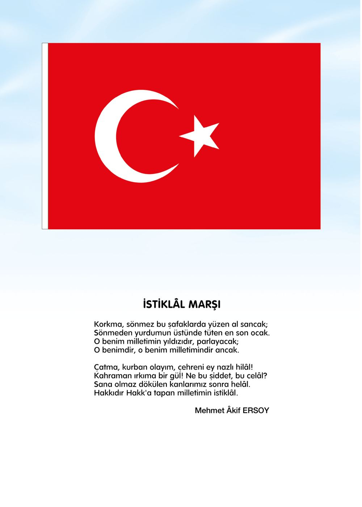

# İSTİKLÂL MARŞI

Korkma, sönmez bu şafaklarda yüzen al sancak;
Sönmeden yurdumun üstünde tüten en son ocak.
O benim milletimin yıldızıdır, parlayacak;
O benimdir, o benim milletimindir ancak.

Catma, kurban olayım, çehreni ey nazlı hilâl!
Kahraman ırkıma bir gül! Ne bu şiddet, bu celâl?
Sana olmaz dökülen kanlarımız sonra helâl.
Hakkıdır Hakk'a tapan milletimin istiklâl.

Mehmet Âkif ERSOY

<!-- sayfa 3 -->

ANDIMIZ

Türküm, doğruyum, çalışkanım.

İlkem küçüklerimi korumak, büyüklerimi saymak; yurdumu, milletimi özümden çok sevmektir.
Ülküm yükselmek, ileri gitmektir.

Ey Büyük Atatürk!

Açtığın yolda, gösterdiğin hedefe durmadan yürüyeceğime ant içerim.

Varlığım Türk varlığına armağan olsun.

Ne mutlu Türküm diyene!

<!-- yer tutucu bulunamadı: sayfa sonuna eklendi -->

<!-- sayfa 4 -->

MUSTAFA KEMAL ATATÜRK

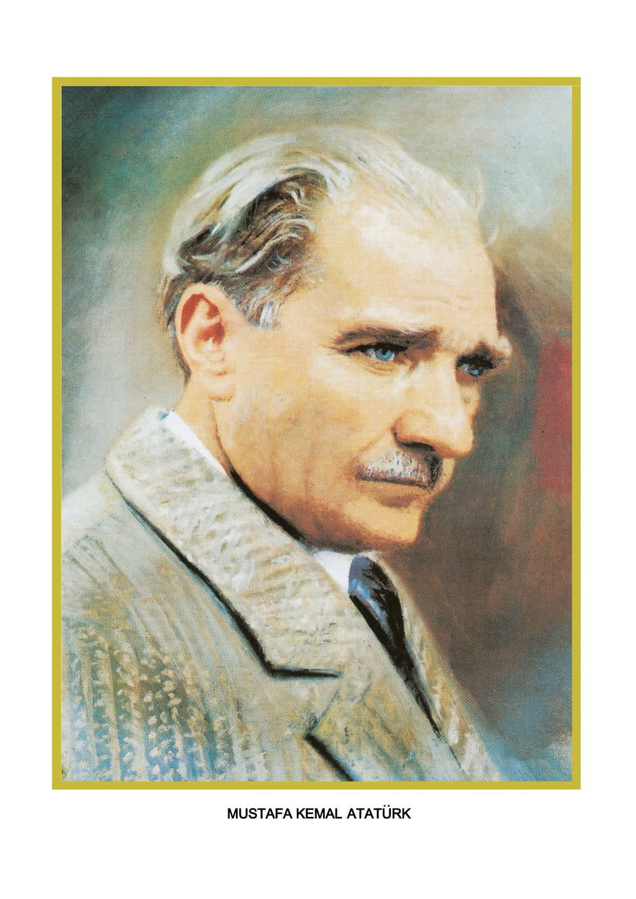
<!-- yer tutucu bulunamadı: sayfa sonuna eklendi -->

<!-- sayfa 5 -->

Henüz bir görsel veya metin katmanı sağlamadınız. Lütfen dönüştürülmesini istediğiniz matematik ders kitabı sayfasının görüntüsünü veya metin katmanını paylaşın. Paylaştığınız anda talimatlarınıza harfiyen uyarak Markdown formatında çevirisini yapacağım.

<!-- yer tutucu bulunamadı: sayfa sonuna eklendi -->

<!-- sayfa 6 -->

# İÇİNDEKİLER

## 1. TEMA: DEĞERLERİMİZLE VARIZ
Ön Değerlendirme Çalışması ...................................................... 18
İyilik Yap İyilik Bul ........................................................................ 20
Büyüklerim ....................................................................................... 28
Nihan’ın Kardeşi ............................................................................ 34
Güvercin Tini ................................................................................. 42
Horozun Sorumluluğu ................................................................ 48
Kendimizi Değerlendirelim ........................................................ 54

## 2. TEMA: ATATÜRK ve ÇOCUK
Ön Değerlendirme Çalışması ....................................................... 58
Pırıl Cumhuriyet Bayramı Şarkısı .............................................. 60
Minik Ali ve Zafer Bayramı ........................................................ 66
Öğretmen Olun! ............................................................................ 72
Çanakkale ........................................................................................ 80
Atatürk’ün Çocuk Sevgisi ........................................................... 86
Kendimizi Değerlendirelim .......................................................... 92

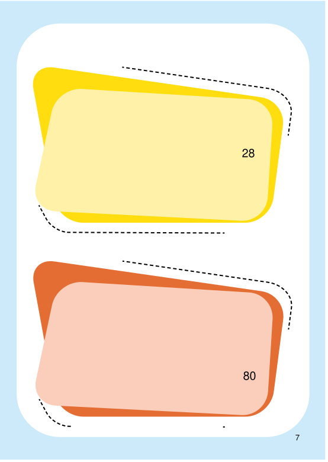
<!-- yer tutucu bulunamadı: sayfa sonuna eklendi -->

<!-- sayfa 7 -->

# 3. TEMA: DOĞADA NELER OLUYOR?

Ön Değerlendirme Çalışması ............................................................. 96
Sürpriz Ağacı ........................................................................................ 98
Çiçekli Çaydanlık ................................................................................ 104
Sıfır Atık Günlüğü .............................................................................. 112
Ben Sağlıklı Çocuğum ....................................................................... 118
Doğal Afetler ........................................................................................ 124
Kendimizi Değerlendirelim ............................................................... 130

# 4. TEMA: OKUMA SERÜVENİMİZ

Ön Değerlendirme Çalışması ........................................................... 134
Kelimelerin Masalı ............................................................................ 136
Kitap Okumayı Seviyorum ............................................................. 142
Cumhurbaşkanlığı Millet Kütüphanesi .......................................... 150
Kitaptaki Dünya ................................................................................. 158
Dil Mirası Koruyucusu ...................................................................... 164
Kendimizi Değerlendirelim ............................................................... 170

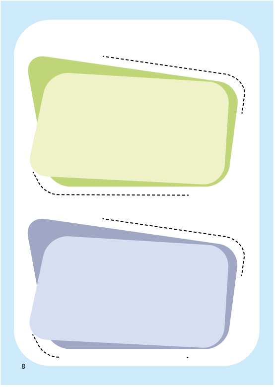
<!-- yer tutucu bulunamadı: sayfa sonuna eklendi -->

<!-- sayfa 8 -->

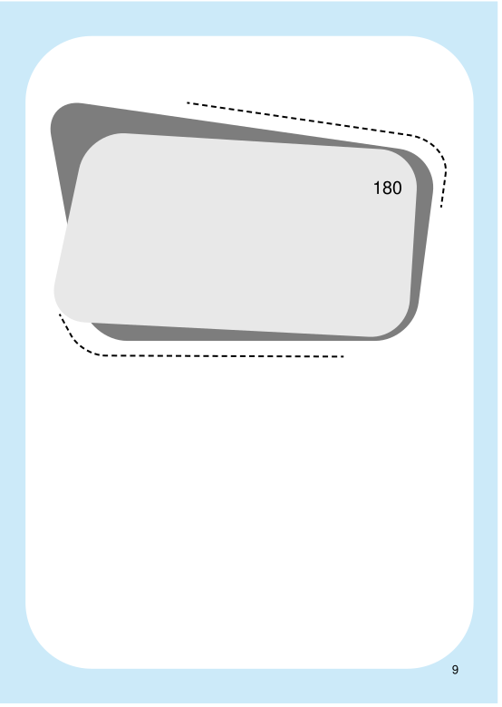
Kaynakça................................................................................................................... 180
Cevap Anahtarı ............................................................................................. 181
Türkiye’nin Mülki İdare Bölümleri ile Kara ve 
Deniz Komşuları Haritası .................................................................... 182
Türk Dünyası Haritası ............................................................................. 183

<!-- sayfa 9 -->

# KİTABIMIZI TANIYALIM

## SEMBOLLER

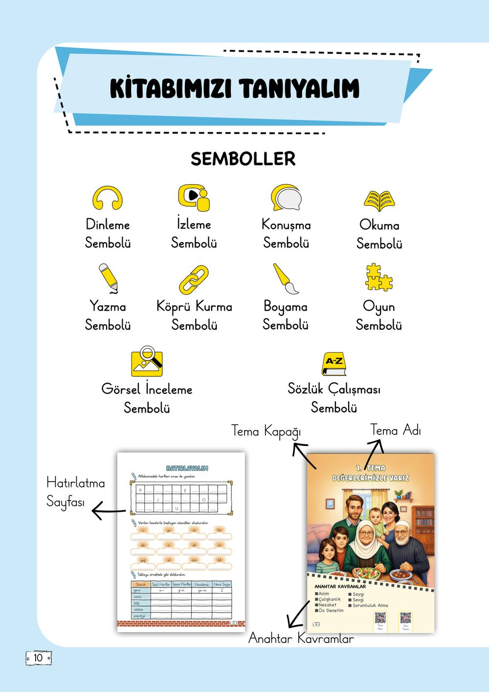
Dinleme Sembolü

İzleme Sembolü

Konuşma Sembolü

Okuma Sembolü

Yazma Sembolü

Köprü Kurma Sembolü

Boyama Sembolü

Oyun Sembolü

Görsel İnceleme Sembolü

Sözlük Çalışması Sembolü

---

 Hatırlatma Sayfası

 Tema Kapağı

 Tema Adı

<!-- sayfa 10 -->

# Köprü Kurma Etkinliklerinin Bulunduğu Sayfa

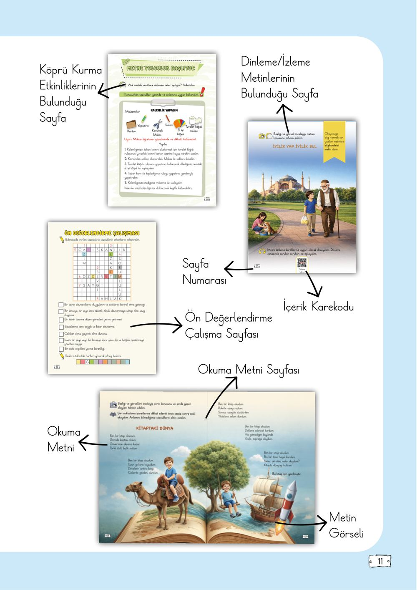

# Dinleme/İzleme Metinlerinin Bulunduğu Sayfa

# Ön Değerlendirme Çalışma Sayfası

# Okuma Metni Sayfası

<!-- sayfa 11 -->

# Sözlük Çalışması Sayfası
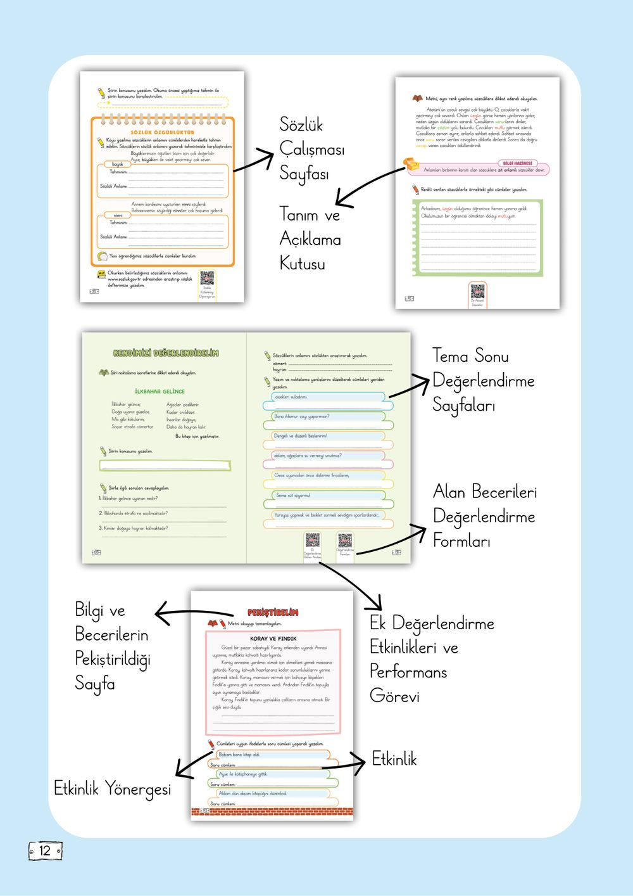: Sözlük Çalışması Sayfası metninin yanında/yakınında

## Tanım ve Açıklama Kutusu
: Tanım ve Açıklama Kutusu metninin yanında/yakınında

# Tema Sonu Değerlendirme Sayfaları
: Tema Sonu Değerlendirme Sayfaları metninin yanında/yakınında

# Alan Becerileri Değerlendirme Formları
: Alan Becerileri Değerlendirme Formları metninin yanında/yakınında

# Bilgi ve Becerilerin Pekiştirildiği Sayfa
: Bilgi ve Becerilerin Pekiştirildiği Sayfa metninin yanında/yakınında

# Ek Değerlendirme Etkinlikleri ve Performans Görevi
: Ek Değerlendirme Etkinlikleri ve Performans Görevi metninin yanında/yakınında

# Etkinlik Yönergesi
: Etkinlik Yönergesi metninin yanında/yakınında

# Etkinlik
: Etkinlik metninin yanında/yakınında

<!-- sayfa 12 -->

# HATIRLAYALIM

✏️ Alfabemizdeki harfleri sırası ile yazalım.

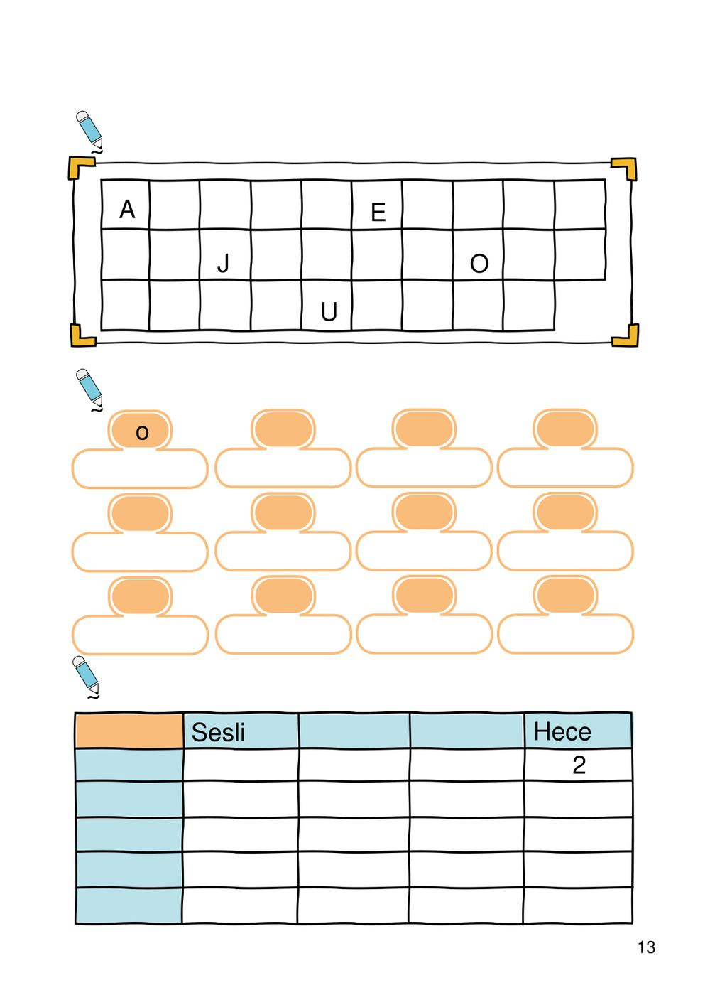

✏️ Verilen hecelerle başlayan sözcükler oluşturalım.

| o | ya | se | be |
| :---: | :---: | :---: | :---: |
| (...........) | (...........) | (...........) | (...........) |

| dö | çi | ak | ün |
| :---: | :---: | :---: | :---: |
| (...........) | (...........) | (...........) | (...........) |

| yağ | sil | çan | bil |
| :---: | :---: | :---: | :---: |
| (...........) | (...........) | (...........) | (...........) |

✏️ Tabloyu örnekteki gibi dolduralım.

| Sözcük | Sesli Harfler | Sessiz Harfler | Hecelenişi | Hece Sayısı |
| :--- | :--- | :--- | :--- | :--- |
| gemi | e-i | g-m | ge-mi | 2 |
| çanta | ............ | ............ | ............ | ............ |
| kalp | ............ | ............ | ............ | ............ |
| otobüs | ............ | ............ | ............ | ............ |
| papatya | ............ | ............ | ............ | ............ |

<!-- sayfa 13 -->

Metni okuyalım. Soruların cevaplarını metne göre yazalım.

Teneffüs zili çalmıştı. Hamza beslenme çantasından ayranı ve annesinin yaptığı börekleri çıkardı. Tam yiyecekti ki Beril’in üzgün olduğunu fark etti. Hamza sebebini sorduğunda Beril beslenme çantasını evde unuttuğunu söyledi. Hamza da Beril’e “Üzülme, benim beslenme çantamdaki yiyecekler ikimize de yeter.” dedi. Beslenmesini arkadaşı ile paylaştı. Beril çok mutlu oldu.

1. Hamza’nın beslenme çantasında neler vardı?
...................................................................................................................................................................................................

2. Beril neden üzgündü?
...................................................................................................................................................................................................

3. Hamza Beril’e ne söyledi?
...................................................................................................................................................................................................

Görseli inceleyelim. Görselden hareketle soruları cevaplayalım.

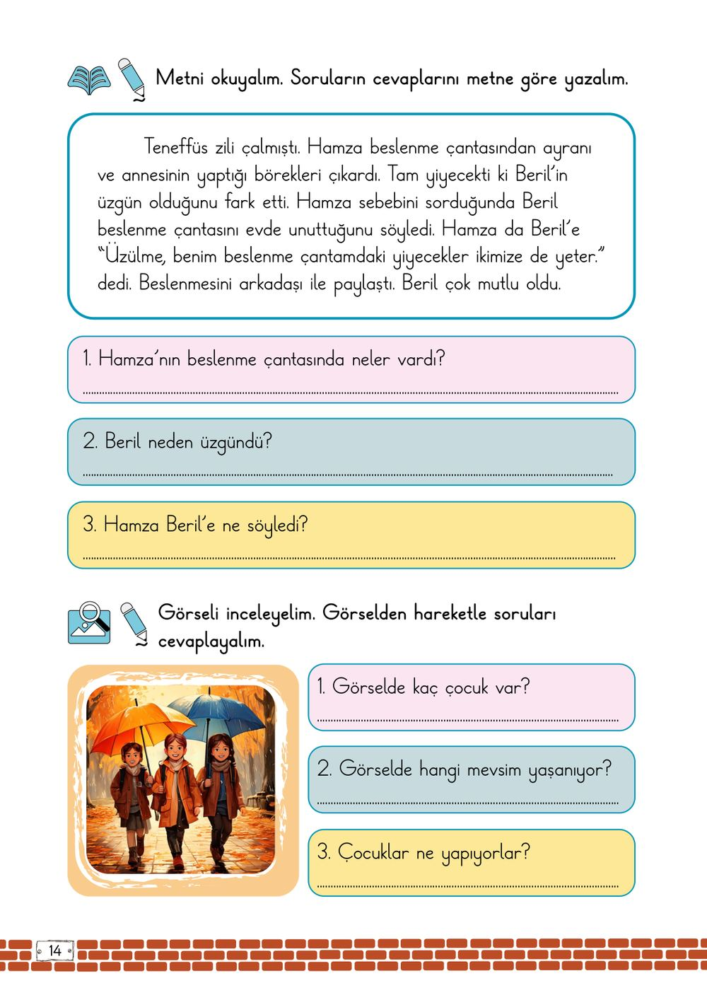

1. Görselde kaç çocuk var?
..............................................................................................................

2. Görselde hangi mevsim yaşanıyor?
..............................................................................................................

3. Çocuklar ne yapıyorlar?
..............................................................................................................

<!-- sayfa 14 -->

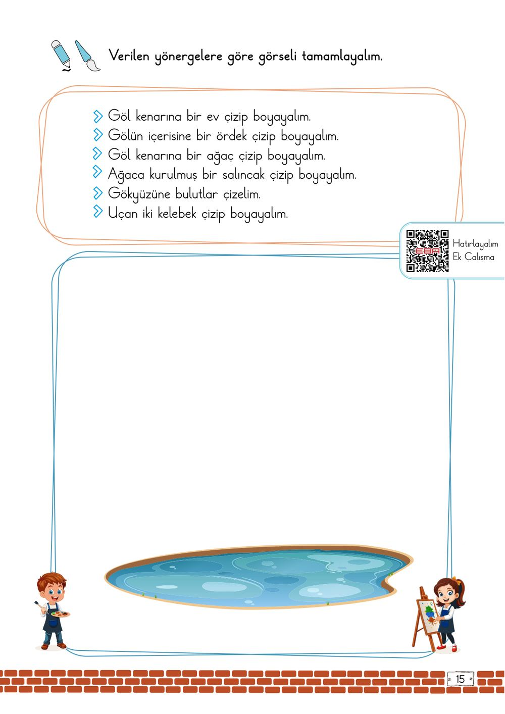 Verilen yönergelere göre görseli tamamlayalım.

> Göl kenarına bir ev çizip boyayalım.
> Gölün içerisine bir ördek çizip boyayalım.
> Göl kenarına bir ağaç çizip boyayalım.
> Ağaca kurulmuş bir salıncak çizip boyayalım.
> Gökyüzüne bulutlar çizelim.
> Uçan iki kelebek çizip boyayalım.

 Hatırlayalım
Ek Çalışma

<!-- sayfa 15 -->

# 1. TEMA
# DEĞERLERİMİZLE VARIZ

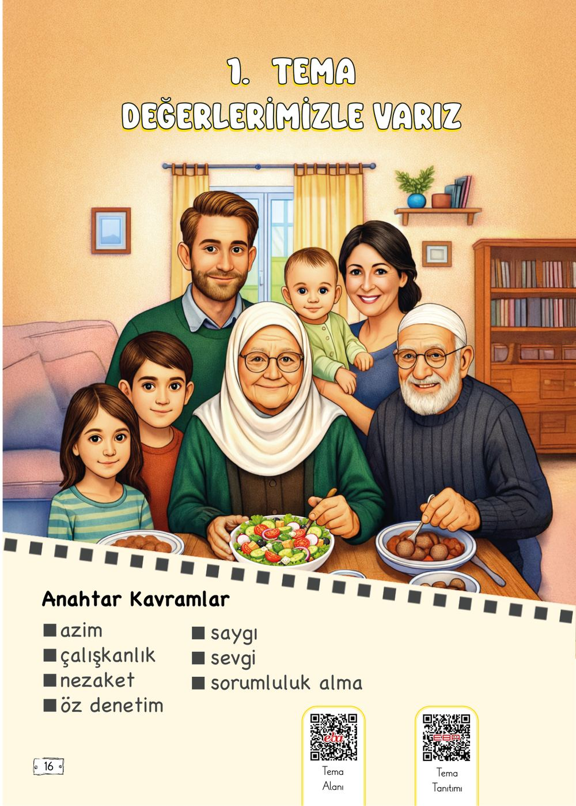: Bir aile tablosu; büyükanne, büyükbaba, anne, baba, bebek ve iki çocuk yemek masası etrafında bir arada bulunmaktadır.

## Anahtar Kavramlar

* azim
* çalışkanlık
* nezaket
* öz denetim
* saygı
* sevgi
* sorumluluk alma

<!-- sayfa 16 -->

# TEMADAKİ METİNLER

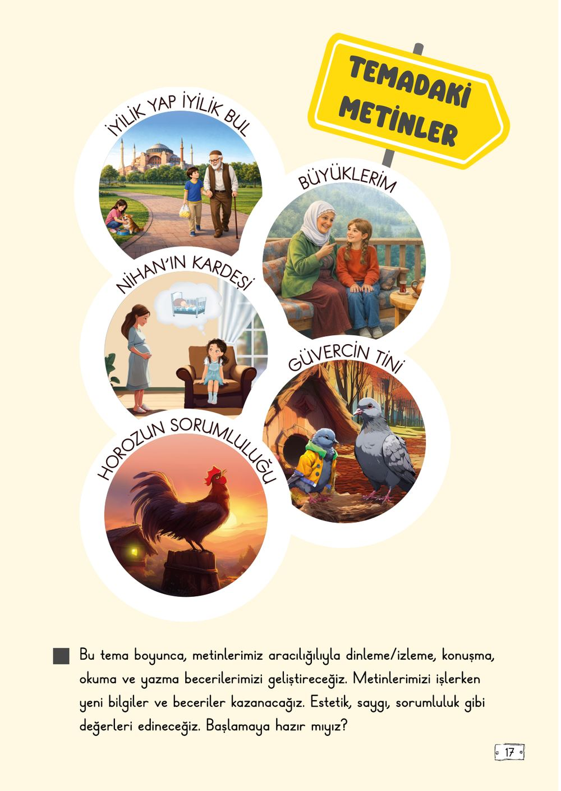

* İYİLİK YAP İYİLİK BUL
* BÜYÜKLERİM
* NİHAN'IN KARDEŞİ
* GÜVERCİN TİNİ
* HOROZUN SORUMLULUĞU

■ Bu tema boyunca, metinlerimiz aracılığıyla dinleme/izleme, konuşma, okuma ve yazma becerilerimizi geliştireceğiz. Metinlerimizi işlerken yeni bilgiler ve beceriler kazanacağız. Estetik, saygı, sorumluluk gibi

<!-- sayfa 17 -->

# ON DEĞERLENDİRME ÇALIŞMASI

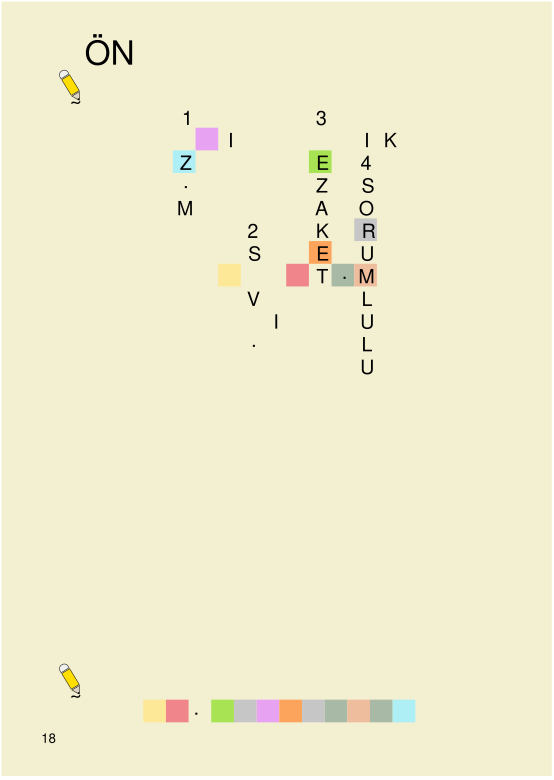 Bulmacada verilen sözcüklerle sözcüklerin anlamlarını eşleştirelim.

| | | | 1 | | | | 3 | | | | | |
|---|---|---|---|---|---|---|---|---|---|---|---|---|
| 5 | Ç | A | L | I | Ş | K | A | N | L | I | K | |
| | | | Z | | | | | E | | 4 | | |
| | | | İ | | | | | Z | | S | | |
| | | | M | | | | | A | | O | | |
| | | | | | 2 | | | K | | R | | |
| | | | | | S | | | E | | U | | |
| | 6 | Ö | Z | D | E | N | E | T | İ | M | | |
| | | | | | V | | | | | L | | |
| | 7 | S | A | Y | G | I | | | | U | | |
| | | | | | İ | | | | | L | | |
| | | | | | | | | | | U | | |
| | | | | | 8 | A | H | L | A | K | | |

| ☐ | Bir kişinin davranışlarını, duygularını ve isteklerini kontrol etme yeteneği. |
|---|---|
| ☐ | Bir kimseye, bir şeye karşı dikkatli, ölçülü davranmaya sebep olan sevgi duygusu. |
| ☐ | Bir kişinin üzerine düşen görevleri yerine getirmesi. |
| ☐ | Başkalarına karşı saygılı ve kibar davranma. |
| ☐ | Çalışkan olma, gayretli olma durumu. |
| ☐ | İnsanı bir şeye veya bir kimseye karşı yakın ilgi ve bağlılık göstermeye yönelten duygu. |
| ☐ | Bir işteki engelleri yenme kararlılığı. |

 Renkli kutulardaki harfleri yazarak şifreyi bulalım.

<!-- sayfa 18 -->

# METNE YOLCULUK BAŞLIYOR

Kimlere “iyi insan” denir? Çevremizdeki iyi insanlara örnekler verelim. Yapabileceğimiz iyilikleri kavram haritasına yazalım.

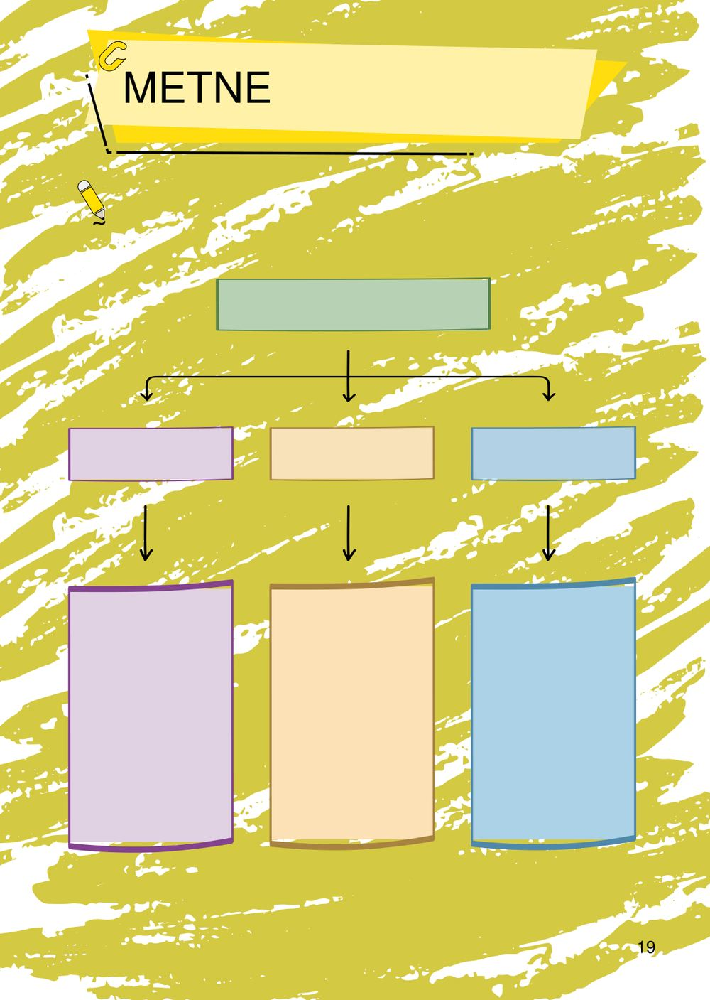

## YAPABİLECEĞİMİZ İYİLİKLER

| İnsanlarla İlgili | Hayvanlarla İlgili | Bitkilerle İlgili |
| :--- | :--- | :--- |
| .................................................... .................................................... .................................................... .................................................... .................................................... .................................................... .................................................... .................................................... .................................................... .................................................... .................................................... .................................................... .................................................... .................................................... .................................................... .................................................... .................................................... | .................................................... .................................................... .................................................... .................................................... ................................

<!-- sayfa 19 -->

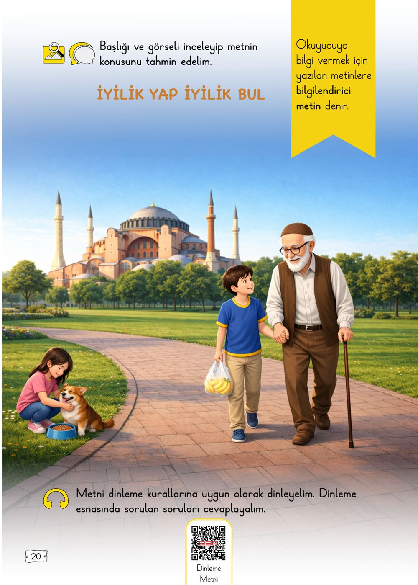 Başlığı ve görseli inceleyip metnin konusunu tahmin edelim.

# İYİLİK YAP İYİLİK BUL

 Okuyucuya bilgi vermek için yazılan metinlere bilgilendirici metin denir.

 Metni dinleme kurallarına uygun olarak dinleyelim. Dinleme esnasında sorulan soruları cevaplayalım.

<!-- sayfa 20 -->

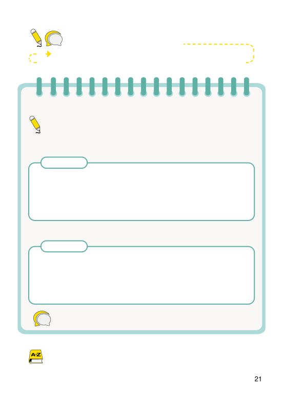 Metnin konusunu yazalım. Dinleme öncesi yaptığımız tahmin ile metnin konusunu karşılaştıralım.
....................................................................................................................................................

# SÖZLÜK ÖZGÜRLÜKTÜR

 Koyu yazılmış sözcüklerin anlamını cümlelerden hareketle tahmin edelim. Sözcüklerin sözlük anlamını yazarak tahminimizle karşılaştıralım.

Dedem buğday **tohumlarını** tarlaya serpti.
Saksıya ektiğim **tohumlar** filizlenmiş.

**tohum**
Tahminim: ....................................................................................................................................................
......................................................................................................................................................
Sözlük Anlamı: ..........................................................................................................................................
......................................................................................................................................................

Köpek, **kaptaki** suyun hepsini içti.
Meyveleri renkli **kaplara** doldurdum.

**kap**
Tahminim: ....................................................................................................................................................
......................................................................................................................................................

<!-- sayfa 21 -->

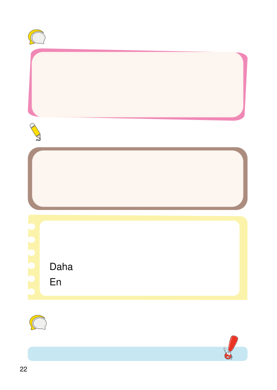 Dinlediğimiz metinle ilgili soruları cevaplayalım.

1. Güzel ahlaklı insanlar hangi alanda yarışırlar?
2. Metne göre iyilikler çoğalınca dünyada neler olur?
3. Ne yaparsak bütün dünyayı kucaklamış oluruz?
4. Kimler veya neler iyilik yapmamızı bekler?

 Metindeki olayları oluş sırasına göre verilen boşluklara yazalım.

* O da başkalarına iyilik yapar.
* Bir insan karşılıksız iyilik yapar.
* Dünya daha güzel olur.
* İyilik yapılan kişi mutlu olur.

Önce.................................................................................................................................................................
Sonra.................................................................................................................................................................
Daha sonra................................................................................................................................................
En sonunda..................................................................................................................................................

 Metinde iyilik yapan ve iyilik gören insanların duygularından söz ediliyor. Birine iyilik yaptığınızda veya size bir iyilik yapıldığında kendinizi nasıl hissedersiniz? Anlatalım.

<!-- sayfa 22 -->

Yusuf ödevini bitirdi. Annesi ve ablası akşam yemeği için sofrayı hazırlıyordu. Yusuf, sofranın hazırlanmasına yardım etmek yerine koşarak oyun oynuyordu. Bu arada masaya peçeteleri götüren ablasına çarptı. Peçeteler etrafa dağıldı.

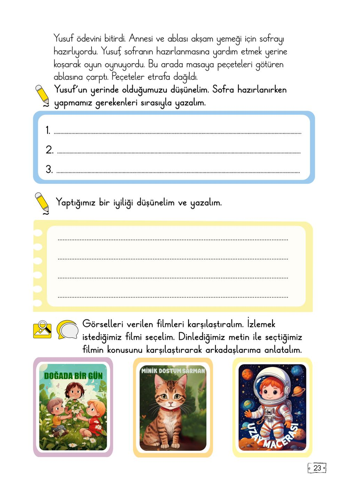 Yusuf'un yerinde olduğumuzu düşünelim. Sofra hazırlanırken yapmamız gerekenleri sırasıyla yazalım.

1. .......................................................................................................................................................................................
2. ....................................................................................................................................................................................
3. ....................................................................................................................................................................................

 Yaptığımız bir iyiliği düşünelim ve yazalım.

.......................................................................................................................................................................................
....................................................................................................................................................................................
....................................................................................................................................................................................
....................................................................................................................................................................................

 Görselleri verilen filmleri karşılaştıralım. İzlemek istediğimiz filmi seçelim. Dinlediğimiz metin ile seçtiğimiz filmin konusunu karşılaştırarak arkadaşlarıma anlatalım.

    

<!-- sayfa 23 -->

Metinlerde eksik bırakılan cümleleri görsellerden hareketle tamamlayalım.

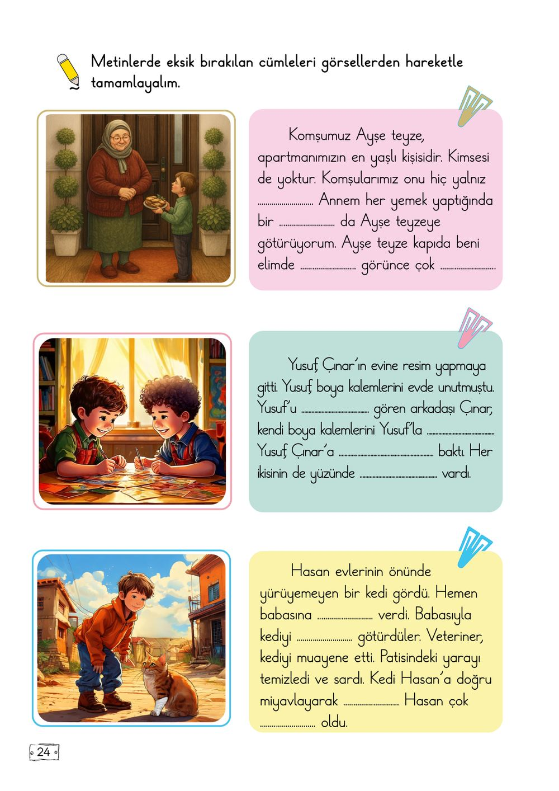

Komşumuz Ayşe teyze, apartmanımızın en yaşlı kişisidir. Kimsesi de yoktur. Komşularımız onu hiç yalnız ............................ Annem her yemek yaptığında bir ............................ da Ayşe teyzeye götürüyorum. Ayşe teyze kapıda beni elimde ............................ görünce çok ............................

Yusuf, Çınar’ın evine resim yapmaya gitti. Yusuf boya kalemlerini evde unutmuştu. Yusuf’u ........................ gören arkadaşı Çınar, kendi boya kalemlerini Yusuf’la ........................ Yusuf, Çınar’a ........................ baktı. Her ikisinin de yüzünde ........................... vardı.

Hasan evlerinin önünde yürüyemeyen bir kedi gördü. Hemen babasına ............................ verdi. Babasıyla kediyi ............................ götürdüler. Veteriner, kediyi muayene etti. Patisindeki yarayı temizledi ve sardı. Kedi Hasan’a doğru miyavlayarak ............................ Hasan çok ............................

<!-- sayfa 24 -->

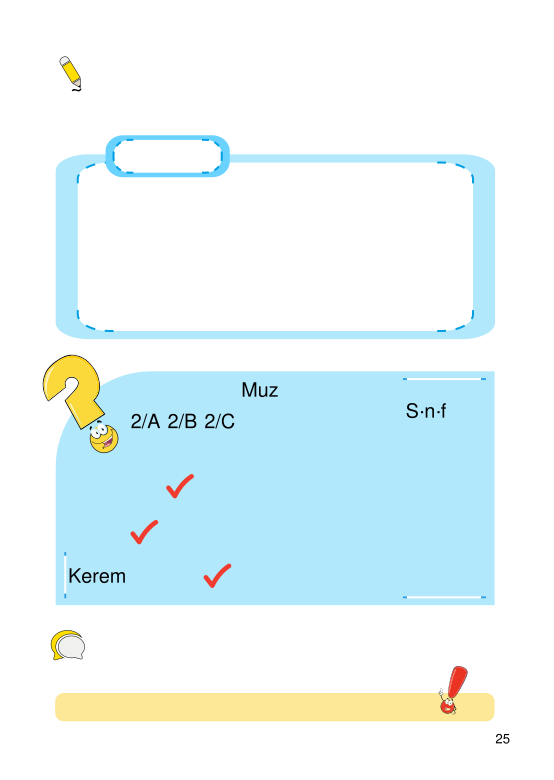 Meryem, Zeynep ve Kerem farklı sınıflarda olan üç arkadaştır. Her biri farklı bir iyilik yapmıştır. İpuçlarına göre tabloyu tamamlayarak kimin hangi iyiliği yaptığını bulalım.

# İPUÇLARI

1. Koridordaki muz kabuğunu çöpe atan öğrencinin adı M harfi ile başlamaktadır.
2. 2/C şubesine giden öğrenci kuşlara su vermiştir.
3. 2/B şubesine giden öğrenci iki eli de dolu olan arkadaşına sınıf kapısını açmıştır.

| | 2/A | 2/B | 2/C | Muz kabuğunu çöpe atmıştır. | Kuşlara su vermiştir. | Sınıf kapısını açmıştır. |
| :--- | :---: | :---: | :---: | :---: | :---: | :---: |
| Zeynep | | ✔ | | | | |
| Meryem | ✔ | | | | | |
| Kerem | | | ✔ | | | |

 Koridordaki muz kabuğu yerden alınıp çöpe atılmasaydı neler olabilirdi? Anlatalım.

Konuşurken anlamlı ve kurallı cümleler kuralım

<!-- sayfa 25 -->

# Metni okuyalım. Noktanın (.) kullanıldığı yerleri inceleyelim.

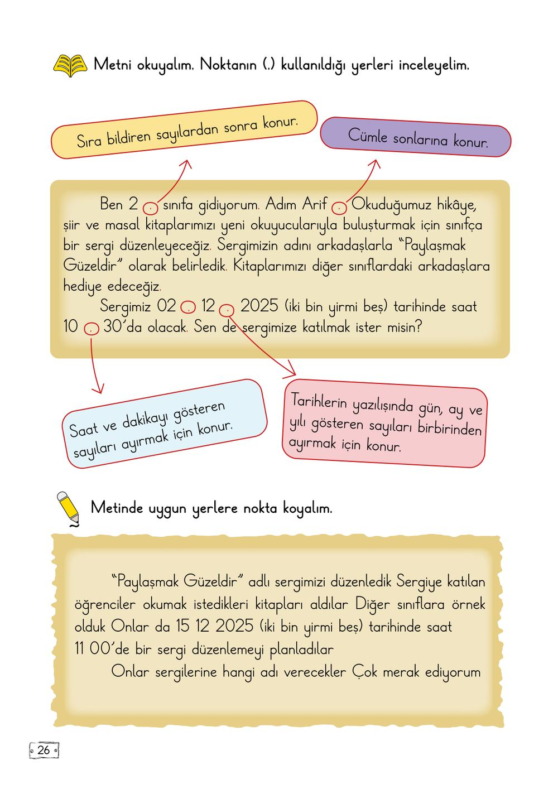

> Sıra bildiren sayılardan sonra konur.
> Cümle sonlarına konur.

Ben $2.$ sınıfa gidiyorum. Adım Arif. Okuduğumuz hikâye, şiir ve masal kitaplarımızı yeni okuyucularıyla buluşturmak için sınıfça bir sergi düzenleyeceğiz. Sergimizin adını arkadaşlarla “Paylaşmak Güzeldir” olarak belirledik. Kitaplarımızı diğer sınıflardaki arkadaşlara hediye edeceğiz.

Sergimiz $02.12.2025$ <!-- KONTROL: Marker'da karşılığı yok, uydurma olabilir --> (iki bin yirmi beş) tarihinde saat $10.30$ <!-- KONTROL: Marker'da karşılığı yok, uydurma olabilir -->’da olacak. Sen de sergimize katılmak ister misin?

> Saat ve dakikayı gösteren sayıları ayırmak için konur.
> Tarihlerin yazılışında gün, ay ve yılı gösteren sayıları birbirinden ayırmak için konur.

# Metinde uygun yerlere nokta koyalım.

“Paylaşmak Güzeldir” adlı sergimizi düzenledik Sergiye katılan öğrenciler okumak istedikleri kitapları aldılar Diğer sınıflara örnek olduk Onlar da $15.12.2025$ <!-- KONTROL: Marker'da karşılığı yok, uydurma olabilir --> (iki bin yirmi beş) tarihinde saat $11.00$ <!-- KONTROL: Marker'da karşılığı yok, uydurma olabilir -->’de bir sergi düzenlemeyi planladılar 

Onlar sergilerine hangi adı verecekler Çok merak ediyorum

<!-- sayfa 26 -->

# METNE YOLCULUK BAŞLIYOR

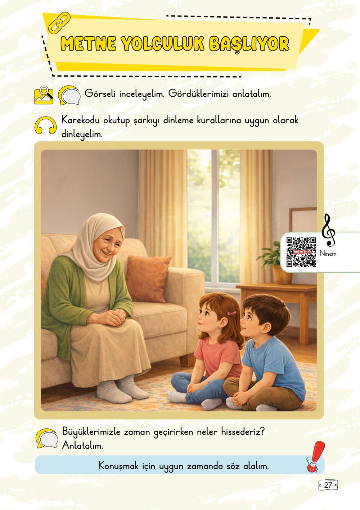 Görseli inceleyelim. Gördüklerimizi anlatalım.

 Karekodu okutup şarkıyı dinleme kurallarına uygun olarak dinleyelim.

 Büyüklerimizle zaman geçirirken neler hissederiz? Anlatalım.

 Konuşmak için uygun zamanda söz alalım.

<!-- sayfa 27 -->

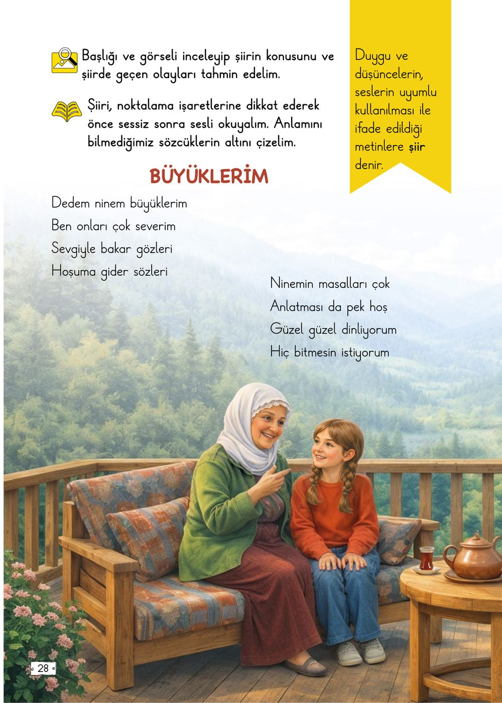 Başlığı ve görseli inceleyip şiirin konusunu ve şiirde geçen olayları tahmin edelim.

 Şiiri, noktalama işaretlerine dikkat ederek önce sessiz sonra sesli okuyalım. Anlamını bilmediğimiz sözcüklerin altını çizelim.

> Duygu ve düşüncelerin, seslerin uyumlu kullanılması ile ifade edildiği metinlere şiir denir.

# BÜYÜKLERİM

Dedem ninem büyüklerim
Ben onları çok severim
Sevgiyle bakar gözleri
Hoşuma gider sözleri

Ninemin masalları çok
Anlatması da pek hoş
Güzel güzel dinliyorum
Hiç bitmesin istiyorum

<!-- sayfa 28 -->

Dedem iyi bir arkadaş
Onunla her şeyi paylaş
Oyunuma katılıyor
Beni çok eğlendiriyor

Onları çok seviyorum
Sözlerini dinliyorum
Benden yardım isterlerse
Hemen koşup gidiyorum

İyi ki ninem dedem var
Beni sever kucaklarlar
Ninnileriyle uyurum
Yanlarında çok mutluyum

Özden AKKOL
Değerler ve Karakter Eğitimini
Destekleyen Çocuk Şiirleri

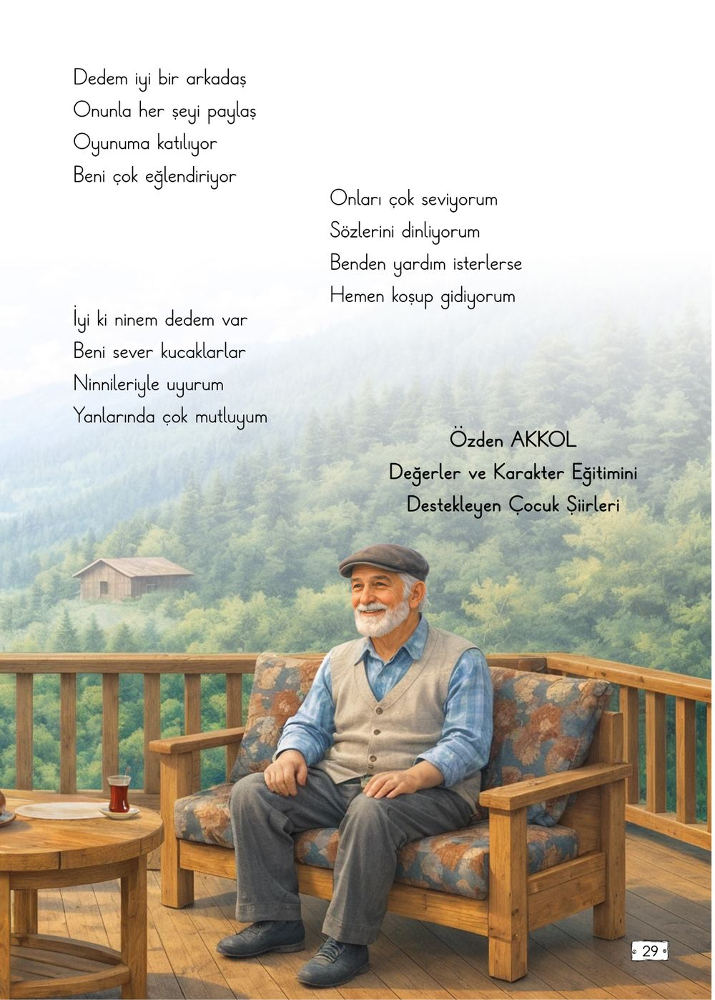

<!-- sayfa 29 -->

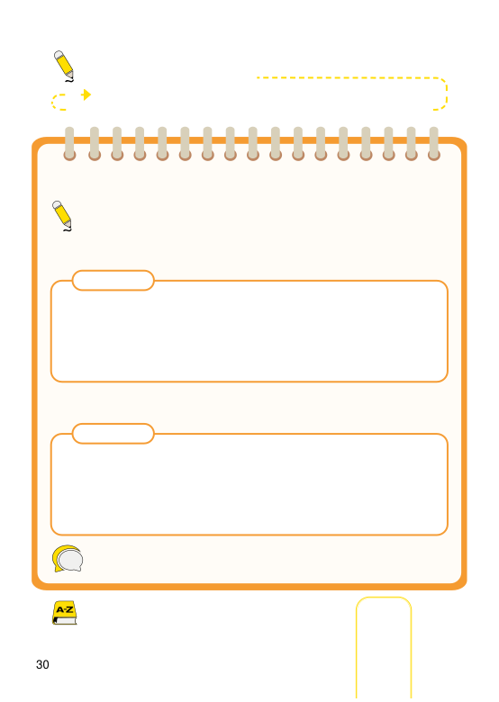 Şiirin konusunu yazalım. Okuma öncesi yaptığımız tahmin ile şiirin konusunu karşılaştıralım.

..............................................................................................................................................................................

# SÖZLÜK ÖZGÜRLÜKTÜR

 Koyu yazılmış sözcüklerin anlamını cümlelerden hareketle tahmin edelim. Sözcüklerin sözlük anlamını yazarak tahminimizle karşılaştıralım.

Büyüklerimizin öğütleri bizim için çok değerlidir.
Ayşe, büyükleri ile vakit geçirmeyi çok sever.

**büyük**
Tahminim: ....................................................................................................................................................
......................................................................................................................................................................
Sözlük Anlamı: ............................................................................................................................................
......................................................................................................................................................................

Annem kardeşimi uyuturken **ninni** söylerdi.
Babaannemin söylediği **ninniler** çok hoşuma giderdi.

**ninni**
Tahminim: ....................................................................................................................................................
......................................................................................................................................................................
Sözlük Anlamı: ............................................................................................................................................
................................................................................

<!-- sayfa 30 -->

# BİLGİ HAZİNESİ

Şiir yazanlara **şair** denir. Şiirin satırlarından her biri **dize** veya **mısra** olarak adlandırılır. Şiirlerin her dizesi büyük harfle başlar. Dört dizeden oluşan şiir bölümlerine **kıta** veya **dörtlük** adı verilir.

“Büyüklerim” şiirinin verilen kıtalarında eksik bırakılan dizeleri şiire bakarak tamamlayalım.

# BÜYÜKLERİMİZ $\longrightarrow$ Şiirin başlığı

Dedem ninem büyüklerim $\longrightarrow$ 1. dize
Ben onları çok severim $\longrightarrow$ 2. dize
Sevgiyle bakar gözleri $\longrightarrow$ 3. dize
.......................................................... $\longrightarrow$ 4. dize
$\underbrace{\text{..........................................................}}_{\text{1. Kıta}}$ <!-- KONTROL: Marker'da karşılığı yok, uydurma olabilir -->

..........................................................
Anlatması da pek hoş
Güzel güzel dinliyorum
Hiç bitmesin istiyorum
$\underbrace{\text{..........................................................}}_{\text{2. Kıta}}$ <!-- KONTROL: Marker'da karşılığı yok, uydurma olabilir -->

Dedem iyi bir arkadaş
Onunla her şeyi paylaş
..........................................................
Beni çok eğlendiriyor
$\underbrace{\text{..........................................................}}_{\text{3. Kıta}}$ <!-- KONTROL: Marker'da karşılığı yok, uydurma olabilir -->

Özden AKKOL $\longrightarrow$ Şair

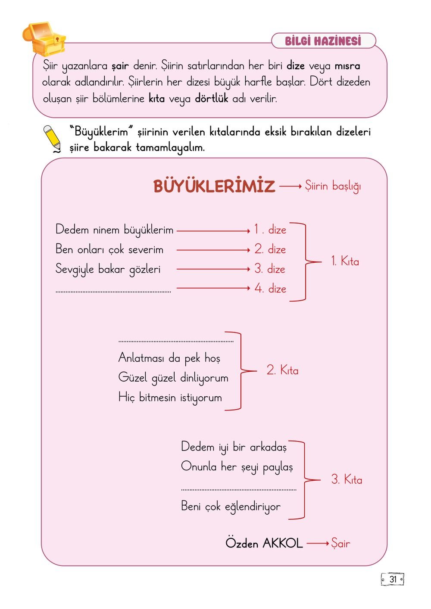
<!-- yer tutucu bulunamadı: sayfa sonuna eklendi -->

<!-- sayfa 31 -->

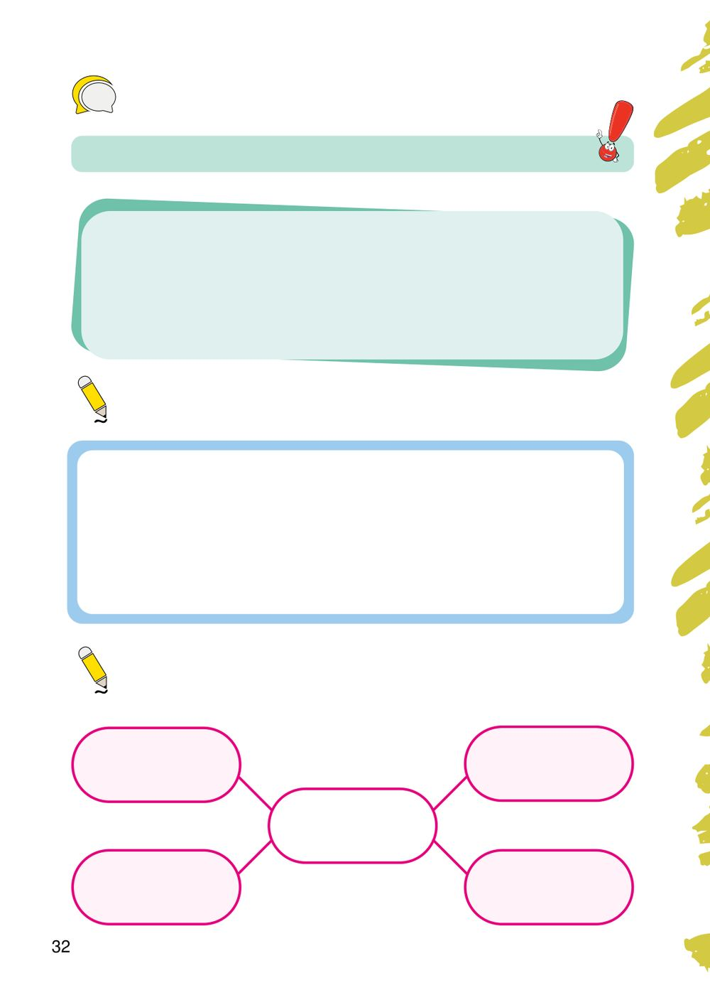 Şiirle ilgili soruları cevaplayalım.

İletişim sırasında uygun zamanda söz alalım.

1. Kimlerin sözleri çocuğun hoşuna gitmiş?
2. Çocuğa göre kim iyi bir arkadaşmış?
3. Çocuk kimlerin yanında mutluymuş?

 Şiirdeki çocukla benzer yönlerimizi yazalım.

........................................................................................................................................................................................
.......................................................................................................................................................................................
........................................................................................................................................................................................
........................................................................................................................................................................................
........................................................................................................................................................................................
....................
....................
....................
....................

 “Büyüklerimiz” deyince aklımıza gelenleri yazalım.

      ....................          ....................
             \                      /
              \                    /
               [ Büyüklerimiz ]
              /                    \
             /                      \
      ....................          ....................

<!-- sayfa 32 -->

# METNE YOLCULUK BAŞLIYOR

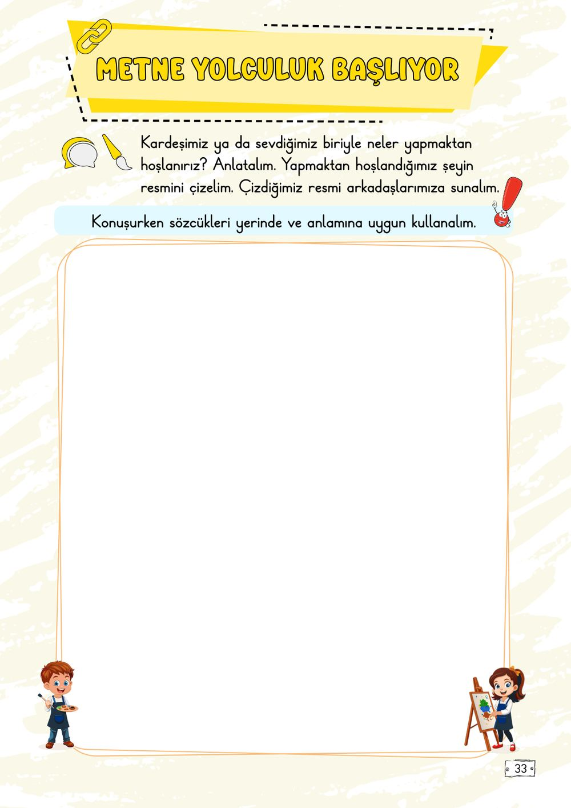 Kardeşimiz ya da sevdiğimiz biriyle neler yapmaktan hoşlanırız? Anlatalım. Yapmaktan hoşlandığımız şeyin resmini çizelim. Çizdiğimiz resmi arkadaşlarımıza sunalım.

Konuşurken sözcükleri yerinde ve anlamına uygun kullanalım.

<!-- sayfa 33 -->

 Başlığı ve görselleri inceleyip metnin konusunu ve metinde anlatılan olayları tahmin edelim.

 Metni, noktalama işaretlerine dikkat ederek önce sessiz sonra sesli okuyalım. Anlamını bilmediğimiz sözcüklerin altını çizelim.

> Yaşanmış ya da kurgulanmış olayları anlatan metinlere öyküleyici metin denir.

# NİHAN’IN KARDEŞİ

Annem bana “Yakında bir kardeşin olacak!” dediğinde çok şaşırdım. Bu haberi hiç beklemiyordum. Önce biraz heyecanlandım. Çünkü annem bana “Artık evde hep birlikte oyunlar oynayabileceğimiz yepyeni biri olacak.” dedi. Ama sonra düşündüm. Acaba insanın bir kardeşinin olması nasıl bir şeydir? (...)

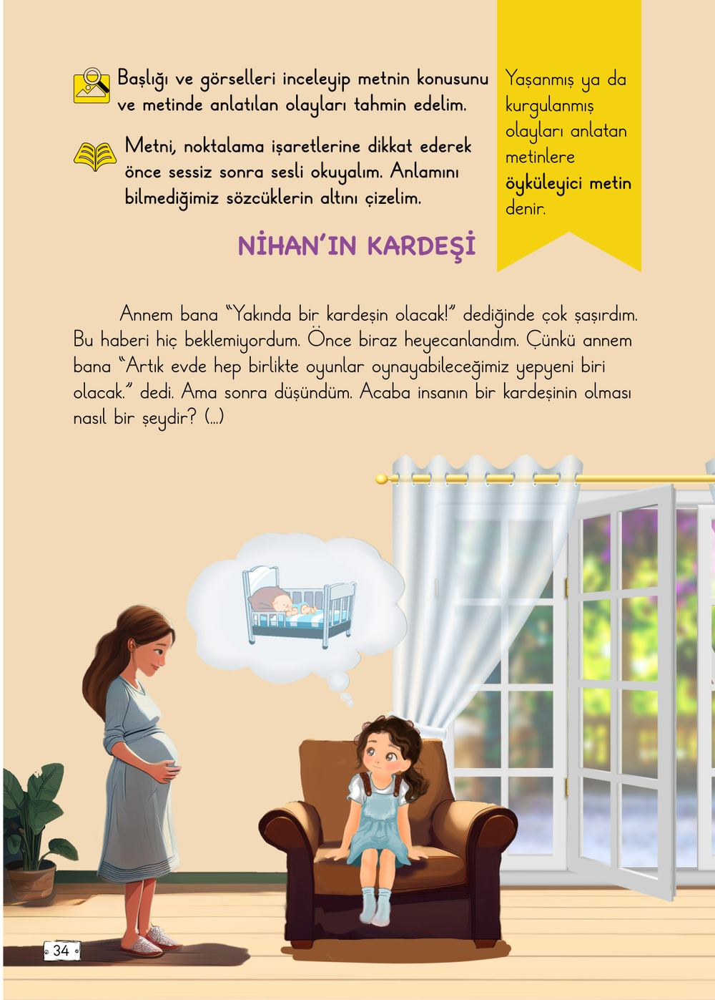

<!-- sayfa 34 -->

Sonunda beklenen gün geldi. Ben ninemle evde kalmıştım. Sonra annem kucağında bir bebekle eve geldi. Babam çok mutlu görünüyordu. İsmini Cihan koydular. Bence güzel bir isim ama benim adım da güzel, ne dersin?

(...) Hemen yanlarına gittim. Tam bu sırada Cihan, annemin kucağından elini bana doğru uzattı. Ben de onun minik elini tuttum. İçimi birden büyük bir sevinç kapladı. (...)

✏️ Nihan ne düşünmüş olabilir? Tahminimizi yazalım.

Tahminim: ....................................................................................................................................................................
................................................................................................................................................................................................

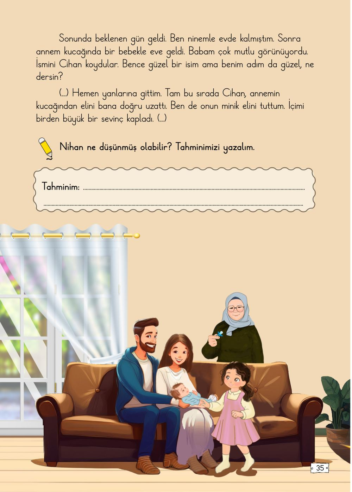

<!-- sayfa 35 -->

Ben de bir zamanlar bebektim. (...) Ne kendi başıma yemek yiyebiliyordum ne de tuvalete gidebiliyordum. Bunların hepsini annem ve babam yaptırıyordu. Şimdi küçük Cihan da kendi ihtiyaçlarını gideremiyor. Annem ve babamın bana baktıkları gibi ona da bakmalarından daha doğal ne olabilir ki? (...)

Kardeşim günün büyük bir bölümünde uyuyor. Ben, annem ve babam bu zamanlarda çok güzel oyunlar oynuyoruz. (...) İlk başta kardeşimi çok kıskanacağımı düşünmüştüm. Ama o doğduktan sonra bizim ev sanki daha da neşeli oldu. Kardeşimle oyunlar oynayacağım günleri iple çekiyorum. İnsanın kardeşinin olması gerçekten çok güzel bir duyguymuş!

**Sağlık Çocuk dergisi**
(Kısaltılmıştır.)

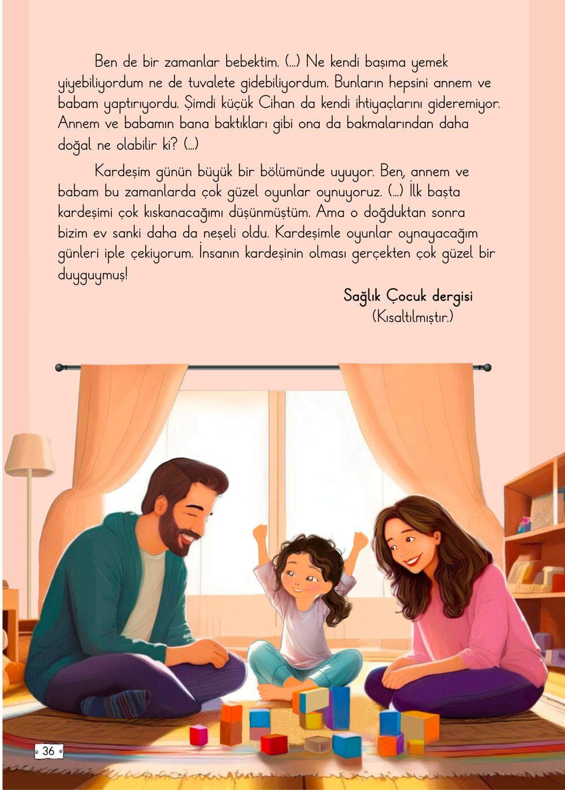

<!-- sayfa 36 -->

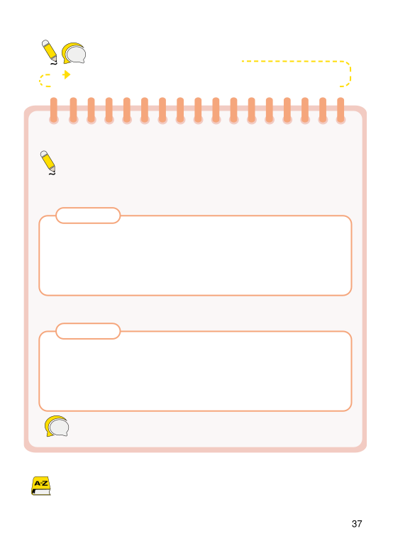 Metnin konusunu yazalım. Okuma öncesi yaptığımız tahmin ile metnin konusunu karşılaştıralım.
....................................................................................................................................................

# SÖZLÜK ÖZGÜRLÜKTÜR

 Koyu yazılmış sözcüklerin anlamını cümlelerden hareketle tahmin edelim. Sözcüklerin sözlük anlamını yazarak tahminimizle karşılaştıralım.

Bugün dedem geleceği için çok **sevinçliyim**.
Ayla, kaybolan kedisi bulununca **sevinçten** çığlık attı.

**sevinç**
Tahminim: ........................................................................................................................................
......................................................................................................................................................
Sözlük Anlamı: ................................................................................................................................
......................................................................................................................................................

Ablam, çok çalıştığı için **doğal** olarak başarılı oluyor.
Kardeşim üç aylık olduğu için oturamaması çok **doğal**.

**doğal**
Tahminim: ........................................................................................................................................
......................................................................................................................................................
Sözlük Anlamı: ................................................................................................................................
................................................................................

<!-- sayfa 37 -->

 Metindeki olayları oluş sırasına göre anlatalım.

# Konuşurken anlamlı ve kurallı cümleler kuralım.

 Eksik bırakılan cümleleri metne göre tamamlayalım.

> Nihan ....................................................................................... için çok şaşırdı.
> Cihan ........................................................................................ için ihtiyaçlarını annesi ve babası gideriyordu.
> Kardeşimin ....................................................................................... zaman içimi büyük bir sevinç kapladı.
> Annem ve babamla ....................................................................................... zaman oyun oynuyoruz.
> Kardeşim doğduktan sonra evimiz ...........................................................................
> İnsanın kardeşinin olması gerçekten ....................................... bir duyguymuş.

 Nihan’ın yerinde olduğumuzu düşünelim. Böyle bir durumda neler hissedeceğimizi ve nasıl davranacağımızı yazalım.

........................................................................................................................................
........................................................................................................................................
........................................................................................................................................
........................................................................................................................................
........................................................................................................................................
........................................................................................................................................
................................

<!-- sayfa 38 -->

📖 Mektubu okuyalım. Virgülün (,) kullanıldığı yerleri inceleyelim.

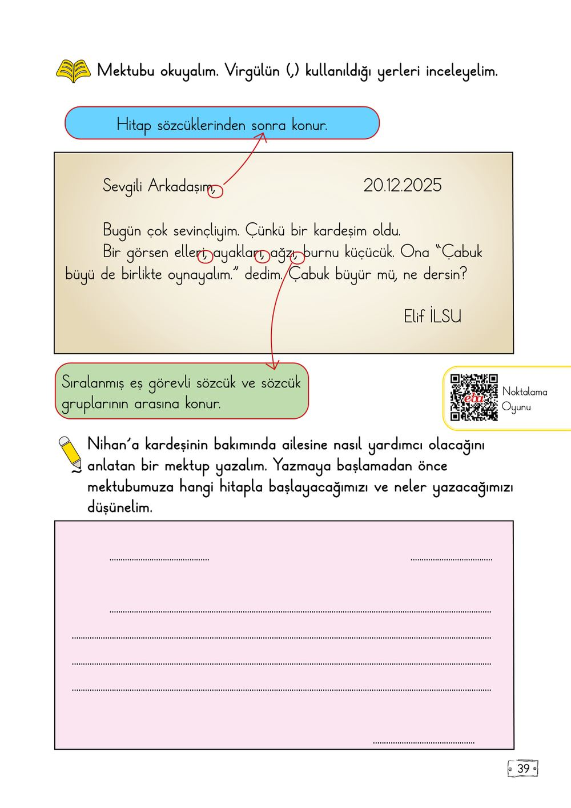
Hitap sözcüklerinden sonra konur.

> Sevgili Arkadaşım,                                     20.12.2025
>
> Bugün çok sevinçliyim. Çünkü bir kardeşim oldu.
> Bir görsen elleri, ayakları, ağzı, burnu küçücük. Ona “Çabuk büyü de birlikte oynayalım.” dedim. Çabuk büyür mü, ne dersin?
>
>                                                       Elif İLSU

Sıralanmış eş görevli sözcük ve sözcük gruplarının arasına konur.

[QR Kod] Noktalama Oyunu

✏️ Nihan’a kardeşinin bakımında ailesine nasıl yardımcı olacağını anlatan bir mektup yazalım. Yazmaya başlamadan önce mektubumuza hangi hitapla başlayacağımızı ve neler yazacağımızı düşünelim.

| ............................................. | ..................................... |
| :--- | :--- |
| | |
| ............................................................................................................................................................................ | |
| ............................................................................................................................................................................................. | |
| ............................................................................................................................................................................................. | |
| ............................................................................................................................................................................................. | |

<!-- sayfa 39 -->

 Cümlelerde parantez içlerine uygun noktalama işaretlerini koyarak cümleleri tekrar yazalım.

Çok çalıştım ve yarışmada 1( ) oldum( )
.......................................................................................................................................................................................................

Kardeşime biberon( ) patik ve tulum aldık( )
.......................................................................................................................................................................................................

Dersimiz saat 20( ) 15’te başlıyor( )
.......................................................................................................................................................................................................

Sınıfta Hale( ) Zeynep ve Mehmet var( )
.......................................................................................................................................................................................................

Sevgili Çocuklar( ) Türkçe kitaplarınızı açın( )
.......................................................................................................................................................................................................

Kerem( ) Ahsen ve Duru 4( ) sırada oturuyor( )
.......................................................................................................................................................................................................

Dayım 14( ) 30 trenine bilet almış( )
.......................................................................................................................................................................................................

Değerli Konuklar( ) hoş geldiniz( )
.......................................................................................................................................................................................................

<!-- sayfa 40 -->

# METNE YOLCULUK BAŞLIYOR

Nezaket örneği içeren ifadenin başındaki çiçeği boyayalım.

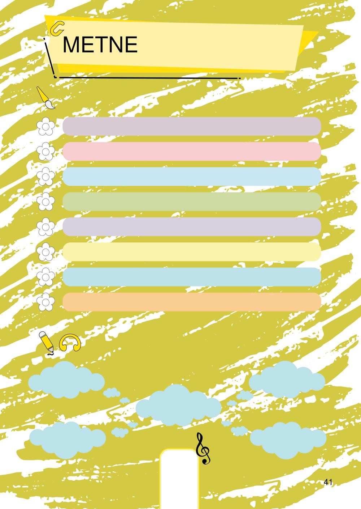 Kantinde başkasının önüne geçmeden sıra beklemek
 Sinirlendiğinde bağırmak
 Konuşan kişinin sözünü kesmek
 Birisi selam verdiğinde selamını almak
 Büyüklerle konuşurken onlara “sen” demek
 Hata yaptığında özür dilemek
 Teşekkür etmek
 Başkasının eşyasını izinsiz kullanmak

“Nezaket” deyince aklımıza gelen sözcükleri yazalım. Karekodu okutarak “Anahtar Sözcükler” şarkısını dinleyelim.

....................
....................
....................
....................

 Nezaket
....................
....................
....................
....................

<!-- sayfa 41 -->

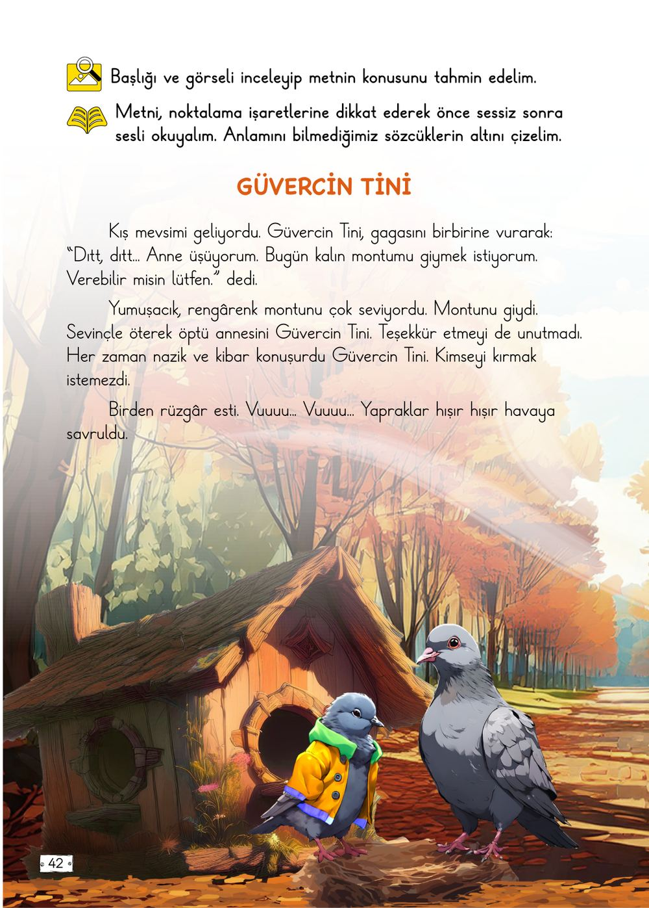 Başlığı ve görseli inceleyip metnin konusunu tahmin edelim.
 Metni, noktalama işaretlerine dikkat ederek önce sessiz sonra sesli okuyalım. Anlamını bilmediğimiz sözcüklerin altını çizelim.

# GÜVERCİN TİNİ

Kış mevsimi geliyordu. Güvercin Tini, gagasını birbirine vurarak: “Dıtt, dıtt... Anne üşüyorum. Bugün kalın montumu giymek istiyorum. Verebilir misin lütfen.” dedi.

Yumuşacık, rengârenk montunu çok seviyordu. Montunu giydi. Sevinçle öterek öptü annesini Güvercin Tini. Teşekkür etmeyi de unutmadı. Her zaman nazik ve kibar konuşurdu Güvercin Tini. Kimseyi kırmak istemezdi.

Birden rüzgâr esti. Vuuuu... Vuuuu... Yapraklar hışır hışır havaya savruldu.

<!-- sayfa 42 -->

O sırada yaprakların arasında gözlerini kapatmış, rüzgârın geçmesini bekleyen küçük serçeyi fark etti. Hemen yanına gitti.

Serçe küçüktü ama biraz kaba davranıyordu yardım elini uzatan Tini’ye.

Serçe, “Şu rüzgâra da bak hele. Nasıl da dağıttı ortalığı! Hey, güvercin! Bana montunu ver de biraz ısınayım.” dedi.

Güvercin Tini, “Üşüdüğün için montumu sana verebilirim küçük serçe. Ama bir şartım var. Kibarca istemelisin. Lütfen der misin?”

Küçük serçe, tatlı ve kibar sesiyle tıpkı yeni güneş açmış gibi ısıttı her yeri: “Kibar güvercin, bana montunu verir misin lütfen?”

Güvercin Tini: “Daha iyi bir fikrim var. Birlikte ısınabiliriz.” Montunun içine aldı serçeyi, birlikte ısındılar. Nezaket ısıtır içimizi.

*Yavru Kırlangıç dergisi*

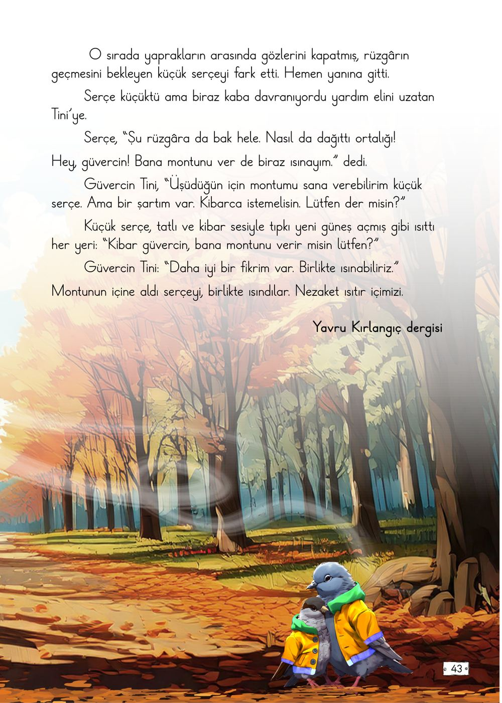

<!-- sayfa 43 -->

# SÖZLÜK ÖZGÜRLÜKTÜR

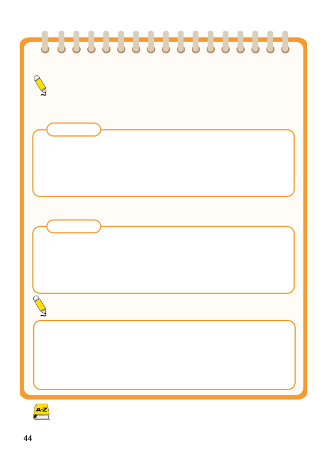 Koyu yazılmış sözcüklerin anlamını cümlelerden hareketle tahmin edelim. Sözcüklerin sözlük anlamını yazarak tahminimizle karşılaştıralım.

Hava soğuyunca okula giderken **montumu** giydim.
**Mont** beni rüzgârdan koruyor.

**mont**
Tahminim: ..................................................................................................................................
......................................................................................................................................................
Sözlük Anlamı: ............................................................................................................................
......................................................................................................................................................

Karga **gagası**ndaki peyniri düşürdü.
Kuşlar yiyecekleri **gagasıyla** yer.

**gaga**
Tahminim: ..................................................................................................................................
......................................................................................................................................................
Sözlük Anlamı: ............................................................................................................................
......................................................................................................................................................

 Yeni öğrendiğimiz sözcüklerle metin yazalım.

......................................................................................................................................................
................................................................................................................

<!-- sayfa 44 -->

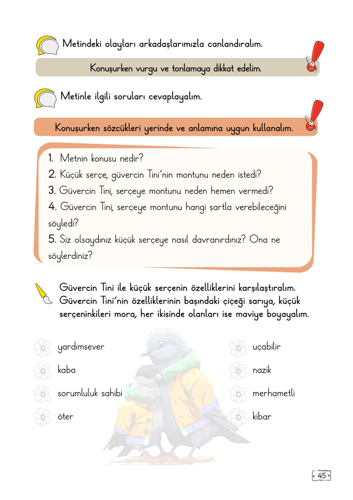 Metindeki olayları arkadaşlarımızla canlandıralım.

> Konuşurken vurgu ve tonlamaya dikkat edelim.

 Metinle ilgili soruları cevaplayalım.

> Konuşurken sözcükleri yerinde ve anlamına uygun kullanalım.

1. Metnin konusu nedir?
2. Küçük serçe, güvercin Tini’nin montunu neden istedi?
3. Güvercin Tini, serçeye montunu neden hemen vermedi?
4. Güvercin Tini, serçeye montunu hangi şartla verebileceğini söyledi?
5. Siz olsaydınız küçük serçeye nasıl davranırdınız? Ona ne söylerdiniz?

 Güvercin Tini ile küçük serçenin özelliklerini karşılaştıralım. Güvercin Tini’nin özelliklerinin başındaki çiçeği sarıya, küçük serçeninkileri mora, her ikisinde olanları ise maviye boyayalım.

* yardımsever
* kaba
* sorumluluk sahibi
* öter
* uçabilir
* nazik
* merhametli
* kibar

<!-- sayfa 45 -->

# Metindeki tırnak işareti (“ ”) içinde yazılmış cümleleri okuyalım. Cümleleri kimin söylediğini örnekteki gibi işaretleyelim.

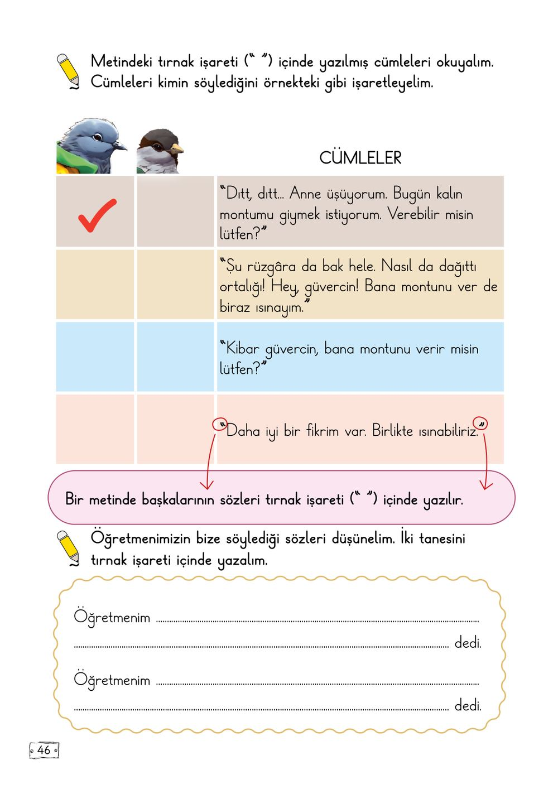

| | | CÜMLELER |
| :---: | :---: | :--- |
| ✅ | | “Dıtt, dıtt... Anne üşüyorum. Bugün kalın montumu giymek istiyorum. Verebilir misin lütfen?” |
| | | “Şu rüzgâra da bak hele. Nasıl da dağıttı ortalığı! Hey, güvercin! Bana montunu ver de biraz ısınayım.” |
| | | “Kibar güvercin, bana montunu verir misin lütfen?” |
| | | “Daha iyi bir fikrim var. Birlikte ısınabiliriz.” |

> Bir metinde başkalarının sözleri tırnak işareti (“ ”) içinde yazılır.

# Öğretmenimizin bize söylediği sözleri düşünelim. İki tanesini tırnak işareti içinde yazalım.

Öğretmenim .....................................................................................................................................................
............................................................................................................................................................................. dedi.

<!-- sayfa 46 -->

# METNE YOLCULUK BAŞLIYOR

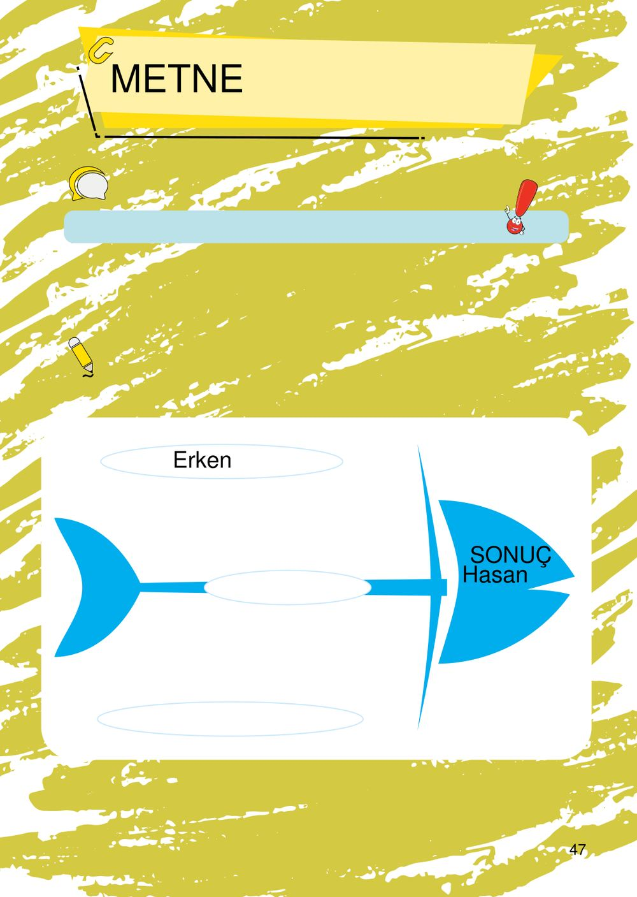

Okuldaki sorumluluklarımız nelerdir? Anlatalım.

Konuşurken anlamlı ve kurallı cümleler kuralım.

Hasan her sabah okula geç kalıyor. Hasan sınıfa girdiğinde Fatma Öğretmen çoktan derse başlamış oluyor.

Hasan neden her sabah okula geç kalıyor olabilir? Hasan’ın geç kalma nedenlerini sıra arkadaşımızla konuşup örnekteki gibi yazalım. Yazdıklarımızı arkadaşlarımıza sunalım.

Erken yatmıyor.
Tablet ile oynuyor.
Televizyon izliyor.

NEDENLER $\rightarrow$ SONUÇ Hasan okula geç kalıyor.

........................................................................................................
........................................................................................................

<!-- sayfa 47 -->

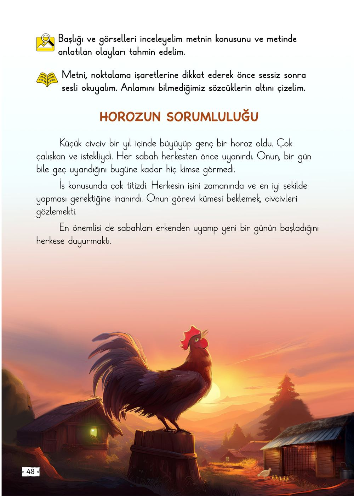 Başlığı ve görselleri inceleyelim metnin konusunu ve metinde anlatılan olayları tahmin edelim.

 Metni, noktalama işaretlerine dikkat ederek önce sessiz sonra sesli okuyalım. Anlamını bilmediğimiz sözcüklerin altını çizelim.

# HOROZUN SORUMLULUĞU

Küçük civciv bir yıl içinde büyüyüp genç bir horoz oldu. Çok çalışkan ve istekliydi. Her sabah herkesten önce uyanırdı. Onun, bir gün bile geç uyandığını bugüne kadar hiç kimse görmedi.

İş konusunda çok titizdi. Herkesin işini zamanında ve en iyi şekilde yapması gerektiğine inanırdı. Onun görevi kümesi beklemek, civcivleri gözlemekti.

En önemlisi de sabahları erkenden uyanıp yeni bir günün başladığını herkese duyurmaktı.

<!-- sayfa 48 -->

Her sabah güneş doğmadan uyanırdı. Kümesin biraz ilerisinde yüksekçe bir yere çıkar, avazı çıktığı kadar öterdi. (...) Bütün evlerin ışıkları yanınca görevini tamamlayıp kümese dönerdi. (...)

Yağmurlu bir günün sabahıydı. Bardaktan boşanırcasına yağmur yağıyordu. Şiddetli bir rüzgâr esiyordu. Horozumuz her zamanki gibi yine erkenden uyandı. Sabahın geldiğini duyurması gerekiyordu.

Daha kümesten çıkar çıkmaz sırılsıklam oldu. Şiddetli rüzgâr neredeyse genç horozu alıp götürecekti. Kümesin kapısından güçlükle tutunarak tekrar kümese girdi. Kümesin içinde birkaç dakika ne yapacağını düşündü.

Dışarıda şiddetli bir yağmur ve fırtına vardı. Ama görevini de yerine getirmeliydi. Zorluklar karşısında yılmamak gerekiyordu. (...) Yavaş ve dikkatli bir şekilde tekrar kümesten çıktı. (...)

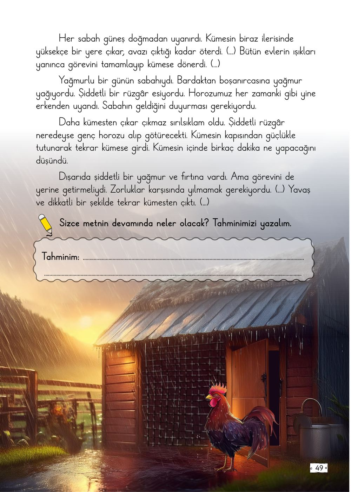 Sizce metnin devamında neler olacak? Tahminimizi yazalım.

Tahminim: ....................................................................................................................................................................
...............................................................................................................................................................................................

<!-- sayfa 49 -->

Biraz ilerideki kalın gövdeli ağacın yanına kadar güçlükle ilerledi. (...) Burada biraz soluklandı, nefesini topladı. Fazla oyalanmamalıydı. Tekrar harekete geçti. Binbir zorlukla her zamanki öttüğü yere ulaşmayı başardı. (...)

Bütün gücüyle yeniden ötmeye başladı. Öttü, öttü... Bir taraftan da evlerin pencerelerini kontrol ediyordu. Biraz sonra evlerden birinin penceresinden bir ışık göründü. Az sonra diğer evin penceresinden, biraz sonra da bir başka evin penceresinden...

Sonunda, en son evin penceresinden de ışık göründü. Büyük zorluklarla da olsa bugünkü görevini tamamlamış oldu. “Yılmadan mücadele edersem her zorluğu yenebilirmişim.” diye düşünerek kümesin yolunu tuttu.

**Mustafa SAĞLAM**
*Maceracı Hayvanlar Serisi*
*(Kısaltılmıştır.)*

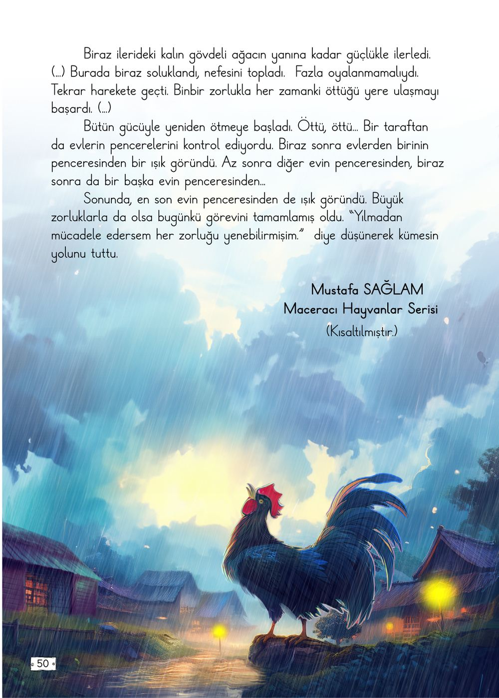

<!-- sayfa 50 -->

🎨 Horozun yaptıklarını ifade eden cümlelerin başındaki çiçekleri boyayalım.

🌸 Horoz, işini zamanında ve titizlikle yapar.
🌸 Horoz, görevini yapmak için her sabah erkenden uyanır.
🌸 Horoz, görevini tamamlamadan kümese döner.
🌸 Horoz, zorluklar karşısında mücadele eder.

🎨 Metnin konusunu işaretleyelim. Okuma öncesinde yaptığımız tahmin ile karşılaştıralım.

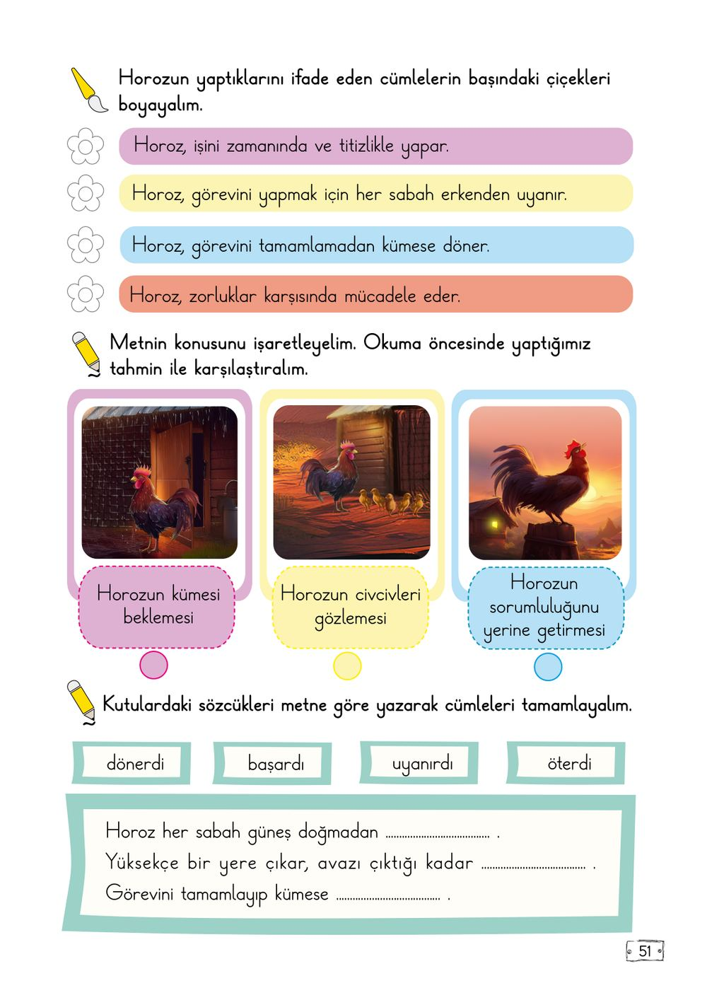
|  |  |  |
| :---: | :---: | :---: |
| Horozun kümesi beklemesi | Horozun civcivleri gözlemesi | Horozun sorumluluğunu yerine getirmesi |
| ◯ | ◯ | ◯ |

🎨 Kutulardaki sözcükleri metne göre yazarak cümleleri tamamlayalım.

| dönerdi | başardı | uyanırdı | öterdi |
| :---: | :---: | :---: | :---: |

> Horoz her sabah güneş doğmadan ...................................... .
> Yüksekçe bir yere çıkar, avazı çıktığı kadar ...................................... .
> Görevini tamamlayıp kümese ...................................... .

<!-- sayfa 51 -->

# SÖZLÜK ÖZGÜRLÜKTÜR

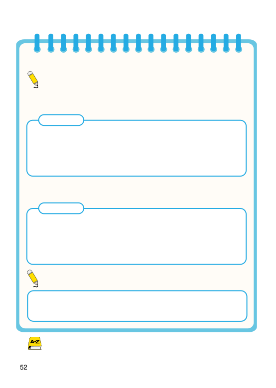 Koyu yazılmış sözcüklerin anlamını cümlelerden hareketle tahmin edelim. Sözcüklerin sözlük anlamını yazarak tahminimizle karşılaştıralım.

Tavuklar **kümeste** yumurtlamış.
Levent bahçeye **kümes** yaptı.

| kümes |
| :--- |
| Tahminim: ........................................................................................................................................ |
| |
| Sözlük Anlamı: ................................................................................................................................... |
| |
| .......................................................................................................................................................... |

Horoz, görevini yerine getirmek için **mücadele** etti.
Uçurtmasını bir saatlik **mücadeleden** sonra kurtardı.

| mücadele |
| :--- |
| Tahminim: ........................................................................................................................................ |
| |
| Sözlük Anlamı: ................................................................................................................................... |
| |
| .......................................................................................................................................................... |

 Yeni öğrendiğimiz sözcüklerle cümleler yazalım.

| kümes: ........................................................................................................................................... |
| :--- |
| mücadele: ....................................................................................................................................... |

 Okurken belirlediğimiz sözcüklerin anlamını www.sozluk.gov.tr adresinden araştırıp sözlük defterimize yazalım.

<!-- sayfa 52 -->

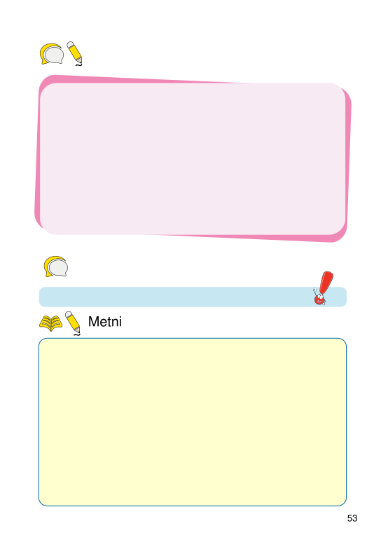 Metindeki olayları oluş sırasına göre anlatalım. Metinle ilgili soruların cevaplarını yazalım.

1. Horozun görevi neydi?
.....................................................................................................................................................................................................

2. Horoz, görevini yerine getirmek için ne yaptı?
.....................................................................................................................................................................................................

3. Horoz, zorluklarla nasıl mücadele etti?
.....................................................................................................................................................................................................

4. Horozun yerinde siz olsaydınız ne yapardınız?
.....................................................................................................................................................................................................

 Öğrenci olarak sorumluluklarımızı yerine getirmediğimizde neler olabilir? Anlatalım.

Konuşurken dinleyiciler ile göz teması kuralım.

 Metni okuyup tamamlayalım.

Burak ve İrem aynı sınıfa giden iki arkadaştır. Her ikisi de halk oyunları oynamak istiyordu. Bunun için kursa katıldılar. Kursun başlamasını sabırsızlıkla beklediler.

İlk çalışmanın sonunda Burak “Ben öğrenemeyeceğim.” dedi. İrem’e kursu bırakacağını söyledi. İrem ise “Halk oyunu oynamayı öğrenmek ve törenlerde oynamak istiyorum.” dedi.
....................................................................................................................................................................................................
....................................................................................................................................................................................................
....................................................................................................................................................................................................

<!-- sayfa 53 -->

# KENDİMİZİ DEĞERLENDİRELİM

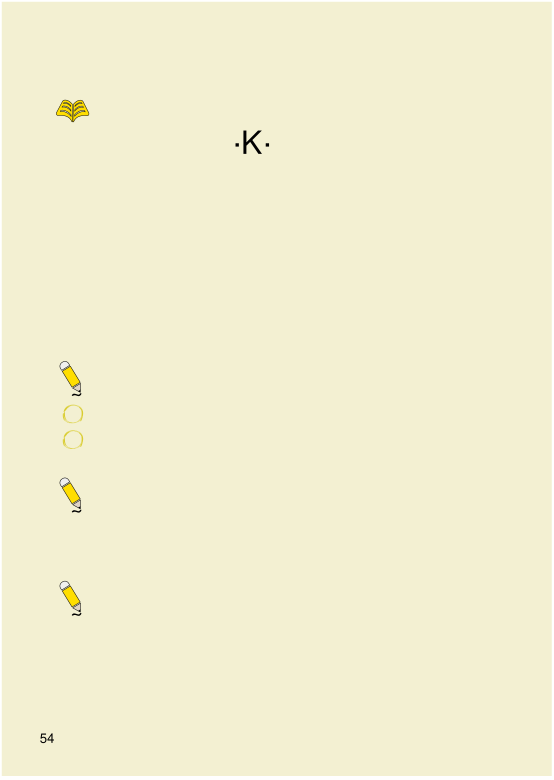 Metni noktalama işaretlerine dikkat ederek okuyalım.

## İKİ KARDEŞ

Bilge ve Reyyan iki kardeştir. Bilge altı, Reyyan ise sekiz yaşındadır. Bir gün dayıları onlara birer bisiklet getirdi. Bilge sarı, Reyyan da mavi bisikleti görünce çok mutlu oldu. İkisi de bisiklete binmeyi bilmiyordu. Heyecanla bisikletlerine binip sürmeye çalıştılar. Bisikleti sürmede ve dengede durmada zorlandılar. Düştüler, canları acıdı, kalktılar. Pes etmediler. Tekrar tekrar denediler. Azimle çalıştılar ve sonunda başardılar. Artık bisikleti sürüyor ve dengede duruyorlardı. Bilge ve Reyyan, bisiklet sürmeyi öğrendikleri için çok mutluydu.

Bu kitap için yazılmıştır.

 Metnin konusunu işaretleyelim.

◯ Bisiklete binmenin zorluğu
◯ Azimle çalışmanın önemi

 Sözcüklerin anlamını sözlükten araştırarak yazalım.

azim: ..............................................................................................................................
pes etmek: ..............................................................................................................................

 Metinle ilgili soruların cevaplarını yazalım.

1. Bilge ve Reyyan ne yapmada zorlanıyordu?
..........................................................................................................................................................

2. İki kardeş başarıya nasıl ulaştı?
..........................................................................................................................................................

<!-- sayfa 54 -->

# Metindeki olayları oluş sırasına göre yazalım.

1. ...............................................................................................................................................................................................
2. ...............................................................................................................................................................................................
3. ...............................................................................................................................................................................................

# Metni konuya uygun olarak tamamlayalım.

Kerem’in canı oyun oynamak istedi. Oyuncaklarını çıkarıp oynamaya başladı. Ödevlerini henüz yapmamıştı. Oyunum bitince yaparım, diye düşündü. Oyuna o kadar dalmıştı ki ancak uykusu gelince oyunu bıraktı. Oyuncaklarını da toplamadan yattı. Ertesi gün okula ödevini yapmadan gitti. İlk ders .................................................................................................................................................................................................................................................................................................................................................................................................................................................................................................................................................................................................................................................................................................

<!-- yer tutucu bulunamadı: sayfa sonuna eklendi -->

<!-- sayfa 55 -->

# 2. TEMA
# ATATÜRK VE ÇOCUK

**Anahtar Kavramlar**

* cesaret
* cumhuriyet
* İstiklâl Marşı
* kahramanlık
* Mustafa Kemal Atatürk
* millî egemenlik
* millî irade
* Millî Mücadele
* vatanseverlik

<!-- sayfa 56 -->

# TEMADAKİ METİNLER

* PIRIL CUMHURİYET BAYRAMI ŞARKISI
* MİNİK ALİ VE ZAFER BAYRAMI
* ÖĞRETMEN OLUN!
* ÇANAKKALE
* ATATÜRK'ÜN ÇOCUK SEVGİSİ

■ Bu tema boyunca, metinlerimiz aracılığıyla dinleme/izleme, konuşma, okuma ve yazma becerilerimizi geliştireceğiz. Metinlerimizi işlerken yeni bilgiler ve beceriler kazanacağız. Saygı, sorumluluk gibi değerleri...

<!-- sayfa 57 -->

# ÖN DEĞERLENDİRME ÇALIŞMASI

 Sözcüklerle anlamlarını eşleştirelim.

| | |
| :--- | :--- |
| cesaret | Güç veya tehlikeli bir işe girişirken kişinin kendinde bulduğu güven. |
| vatanseverlik | Savaşta veya tehlikeli bir durumda yararlık gösteren davranışlar. |
| cumhuriyet | Yurdunu, milletini büyük bir coşku ile sevmek. |
| kahramanlık | Bir topluluğu simgelemek için düzenlenmiş müzik veya şiir. |
| | Milletin, egemenliği kendi elinde tuttuğu yönetim biçimi. |

 Anlamı verilen sözcükleri kullanarak kısa bir metin yazalım.

...................................................................................................................................................................................
...................................................................................................................................................................................
...................................................................................................................................................................................
...................................................................................................................................................................................
...................................................................................................................................................................................
...................................................................................................................................................................................

<!-- sayfa 58 -->

# METNE YOLCULUK BAŞLIYOR

 Görseli inceleyelim. Neler görüyoruz? Görseldeki etkinlikleri ve bunların benzerlerini hangi günlerde yapıyoruz? Anlatalım.

> Konuşurken konuşma hızımızı ayarlayalım.

 Görseli boyayalım. Görseldeki gibi sınıfımızı süsleyelim.

<!-- sayfa 59 -->

 Görselleri inceleyip metnin konusunu tahmin edelim.

# PIRIL
## CUMHURİYET BAYRAMI ŞARKISI

 Metni dinleme kurallarına uygun olarak dinleyelim. Dinleme esnasında anlamını bilmediğimiz sözcükleri belirleyelim.

<!-- sayfa 60 -->

 Metnin konusunu yazalım. Dinleme öncesi yaptığımız tahmin ile metnin konusunu karşılaştıralım.
..............................................................................................................................................................

# SÖZLÜK ÖZGÜRLÜKTÜR

 Koyu yazılmış sözcüklerin anlamını cümlelerden hareketle tahmin edelim. Sözcüklerin sözlük anlamını yazarak tahminimizle karşılaştıralım.

*Şenlik yapılacak alan bayraklarla donatıldı.*
*Bayram günü ülkem şenlik alanı gibiydi.*

**şenlik**
Tahminim: ..........................................................................................................................................
...........................................................................................................................................................
Sözlük Anlamı: ...................................................................................................................................
...........................................................................................................................................................

*Vatanımız Türkiye’dir.*
*Hepimiz vatanımız için çok çalışmalıyız.*

**vatan**
Tahminim: ..........................................................................................................................................
................................................................................................................

<!-- sayfa 61 -->

✏️ Dinlediğimiz metinle ilgili soruların cevaplarını yazalım.

1. Cumhuriyet ne demektir?
..........................................................................................................................................................................................

2. Çocuklar neden neşelidir?
.........................................................................................................................................................................................

3. Şarkının sözleri hakkındaki düşünceleriniz nelerdir?
..........................................................................................................................................................................................    
..........................................................................................................................................................................................

📖 Metni okuyalım. Büyük harflerin kullanıldığı yerleri inceleyelim.

Arkadaşımız Yusuf kutlama programında aşağıdaki şiiri okuyacaktı:

“Yirmi Dokuz Ekim’de,
Cumhuriyet kuruldu. (...)”

Yusuf’un, şiirin dizelerini okumasıyla çok heyecanlandık. Ayrıca Azerbaycan’dan gelen kuzenim Sıla da bize eşlik etti. Sıla Azerbaycan’da sürekli Azerbaycan Türkçesi konuştuğu için bizi anlamakta hiç zorlanmadı.

<!-- sayfa 62 -->

 Büyük harflerin yazımıyla ilgili yapılan yanlışları düzelterek cümleleri yeniden yazalım.

kaymakam muhammed fatih safitürk, mardin’i çok sevdi.
.......................................................................................................................................................................................................

korkma! sönmez bu şafaklarda yüzen al sancak.
.......................................................................................................................................................................................................

Komşumuzun kızı kıbrıs’a eğitim almak için gitti.
.......................................................................................................................................................................................................

 Okulumuzdaki Cumhuriyet Bayramı kutlamaları ile Pırıl’ın okulundaki Cumhuriyet Bayramı kutlamalarını karşılaştıralım.

 İletişim sırasında uygun zamanda söz alalım.

 Metinde eksik bırakılan yerleri uygun sözcüklerle tamamlayalım.

bayraklarla | coşku | cumhuriyet | yönetim | bayram

29 Ekim 1923 (bin dokuz yüz yirmi üç) tarihinde ..................................................... ilan edilmiştir. Ülkemiz için en iyi ............................................. biçiminin cumhuriyet olduğuna inanılıyordu. Bu özel gün ülkemizde ................................................... ile kutlanır. Caddeler, sokaklar, evler ve okullar ............................................... süslenir.

<!-- sayfa 63 -->

 Görsel ve açıklamalara göre çocukların benzer ve farklı yönlerini anlatalım.

Merhaba ben Burak. En sevdiğim renk kırmızıdır. Resim yapmayı çok severim. En sevdiğim spor doğada yürüyüş yapmaktır. Bütün yemekleri severim ama annemin yaptığı pırasa yemeğinin yeri ayrıdır. Duygusal biriyim. En sevdiğim hayvan kedidir. En sevdiğim çiçek ise papatyadır.

Merhaba ben Cennet. En sevdiğim renk mavidir. Resim yapmayı çok severim. Hafta sonları ailemle bisiklet sürerim. Bütün yemekleri severim ama annemin yaptığı ıspanak yemeğinin yeri ayrıdır. En sevdiğim hayvan aslandır. Çünkü aslanlar çok güçlüdür. En sevdiğim çiçek ise menekşedir.

<!-- sayfa 64 -->

# METNE YOLCULUK BAŞLIYOR

Görseli inceleyelim. Gördüklerimizi anlatalım.

İletişim sırasında uygun zamanda söz alalım.

<!-- sayfa 65 -->

 Başlığı ve görseli inceleyip metnin konusunu ve metinde anlatılan olayları tahmin edelim.

 Metni, noktalama işaretlerine dikkat ederek önce sessiz sonra sesli okuyalım. Anlamını bilmediğimiz sözcüklerin altını çizelim.

# MİNİK ALİ VE ZAFER BAYRAMI

Bir sabah Minik Ali ve annesi odalarında kahvaltılarını yapıyorlardı. O esnada televizyonda bir haber başladı. Ekranda kırmızı beyaz bayraklar dalgalanıyor, insanlar marşlar söylüyordu.

Sunucu şöyle diyordu:

“Bugün 30 Ağustos Zafer Bayramı! Türk milletinin büyük zaferinin yıl dönümündeyiz!” Ali merakla televizyona baktı.

“Anne, bugün bayram mı?” diye sordu.

Annesi gülümsedi:

<!-- sayfa 66 -->

“Evet canım, bugün 30 Ağustos Zafer Bayramı. Atatürk ve askerlerimizin kazandığı büyük zaferin kutlandığı gün.” Minik Ali şaşırdı. “Zafer ne demek?” Annesi açıklamaya başladı: “Zafer, bir mücadeleyi kazanmak demek. Çok uzun zaman önce ülkemizi korumak için cesur askerler savaştı. Mustafa Kemal Atatürk ve arkadaşları 30 Ağustos’ta düşmanları yendi. Bu yüzden her yıl bu günü coşkuyla kutluyoruz.”

Minik Ali bir süre düşündü, sonra gülümsedi.

“O zaman bayrak asabilir miyiz anne?”

Annesi başını salladı:

“Elbette hadi birlikte asalım.”

Ali küçük bayrağını alıp pencereye astı. Sonra televizyona tekrar baktı ve Atatürk’ün resmini görünce el salladı.

“Teşekkür ederim Atatürk!” dedi gülerek.

Ve o gün Minik Ali hem mutlu oldu hem de Zafer Bayramı’nın ne anlama geldiğini öğrendi.

Değer Çocuk dergisi

<!-- sayfa 67 -->

 Metnin konusunu yazalım. Okuma öncesi yaptığımız tahmin ile metnin konusunu karşılaştıralım. ------------------------------------------------------------------------------------------------------------------------------------------------------------------------------------------------------------------------------------------------------------------------------------------------------------------------------------------------------------------------------------------------------------------------------------------------------------------------------------------------------------------------------------------------------------------------------------------------------------------------------------------------------------------------------------------------------------------------------------------------------------------------------------------------------------------------------------------------------------------------------------------------------------------------------------------------------------------------------------------------------------------------------------------------------------------------------------------------------------------------------------------------------------------------------------------------------------------------------------------------------------------------------------------------------------------------------------------------------------------------------------------------------------------------------------------------------------------------------------------------------------------------------------------------------------------------------------------------

<!-- sayfa 68 -->

 Metinle ilgili soruları cevaplayalım.

 Konuşurken dinleyiciler ile göz teması kuralım.

1. Minik Ali ve annesi ne yapıyordu?
2. Televizyonda neler gösteriliyordu?
3. Minik Ali’nin annesi, Zafer Bayramı’nı nasıl açıkladı?
4. Minik Ali ve annesi pencereye ne astı?

 Cümleleri okuyalım. Ünlem işaretinin (!) kullanıldığı yerleri inceleyelim.

Küçük Hanımlar, Küçük Beyler! $\rightarrow$ Hitap sözlerinden sonra kullanılır.

Millî takımımız şampiyon oldu. Yaşasın! $\rightarrow$ Sevinç, acı, korku, şaşırma gibi duyguları içeren cümlelerde kullanılır.

Dur yolcu! $\rightarrow$ Uyarı sözlerinden sonra kullanılır.
Bu bayrak yere inmez! $\rightarrow$ Uyarı sözlerinden sonra kullanılır.

<!-- sayfa 69 -->

 Metni, aynı renk yazılmış sözcüklere dikkat ederek okuyalım.

Atatürk’ün çocuk sevgisi çok büyüktü. O, çocuklarla vakit geçirmeyi çok severdi. Onları **üzgün** görse hemen yanlarına gider, neden üzgün olduklarını sorardı. Çocukların **sorunlarını** dinler, mutlaka bir **çözüm** yolu bulurdu. Çocukları **mutlu** görmek isterdi. Çocuklara zaman ayırır, onlarla sohbet ederdi. Sohbet sırasında önce **soru** sorar verilen cevapları dikkatle dinlerdi. Sonra da doğru **cevap** veren çocukları ödüllendirirdi.

**BİLGİ HAZİNESİ**
Anlamları birbirinin karşıtı olan sözcüklere **zıt anlamlı** sözcükler denir.

 Renkli verilen sözcüklerle örnekteki gibi cümleler yazalım.

Arkadaşım, **üzgün** olduğumu öğrenince hemen yanıma geldi.
Okulumuzun bir öğrencisi olmaktan dolayı **mutluyum**.
................................................................................................................................................
................................................................................................................................................
................................................................................................................................................
................................................................................................................................................
................................................................................................................................................
................................................................................................

<!-- sayfa 70 -->

# METNE YOLCULUK BAŞLIYOR

 Bilmecelerin cevaplarını yazalım. Gelecekte hangi mesleği seçmek isterdiniz? Nedenleriyle anlatalım.

Konuşurken uygun zamanda söz alalım.

| | |
| :--- | :--- |
| Hastalar koşar gelir. Burası hastanedir. Bembeyaz giyinirim. Bilin bakalım ben kimim? | Kavun, karpuz, çilek, muz, Biber, domates, patlıcan, Taptaze meyve, sebze Sunarım tezgahımda sizlere. |
| \_\_\_ T \_ R | \_ A \_ AV |
| Çocukları eğitirim. Okullardır benim yerim. Sabır ve sevgi ile Öğretmektir görevim. | Kuşları, ormanları, Hayallerimi resmederim. Fırça ve boyalarla Resmimi renklendiririm. |
| ÖĞ\_ \_ \_ M\_ \_ | R\_ \_ S \_ M |
| Taksiyle, otobüsle Yolcuları taşırım. Bıkmadan, yorulmadan Görevimi yaparım. | Suçluları yakalar, Güvenliği sağlarım. Yaz, kış demeden Her güçlüğü aşarım. |

<!-- sayfa 71 -->

 Başlığı ve görselleri inceleyip metnin konusunu ve metinde anlatılan olayları tahmin edelim.

 Metni, noktalama işaretlerine dikkat ederek önce sessiz sonra sesli okuyalım. Anlamını bilmediğimiz sözcüklerin altını çizelim.

# ÖĞRETMEN OLUN!

Gazi Mustafa Kemal, 22 Mart 1923’te (bin dokuz yüz yirmi üç) Konya’yı ziyaret eder. Halk onu selamlamak için istasyona gider.

Mahalle mektebinin hazırlık sınıfında okuyan yedi yaşındaki Sabiha da onlardan biridir. Gazi Mustafa Kemal istasyonda gördüğü bu minik kızın başını okşar ve “Oku, öğretmen ol!” der. Sabiha o gün, öğretmen olmayı her şeyden çok ister. Sabiha’nın Mustafa Kemal Atatürk’ü son görüşü ise Bursa’daki öğretmen okulunda eğitim alırken olur.

<!-- sayfa 72 -->

2 Şubat 1938 (bin dokuz yüz otuz sekiz) günü Bursa Merinos Fabrikası’nın açılışı için Mustafa Kemal Atatürk kente gelir. Açık bir araba içinde oturmuştur, elinde kahverengi şapkası vardır. Halkı selamlar. Bursa Öğretmen Okulunun önüne gelince arabası durur. Öğretmen çıkacak gençlerle konuşmak ister. Ancak, Sabiha ona, yedi yaşındayken “Öğretmen ol!” dediği çocuk olduğunu söyleyemeden Atatürk arabasına döner. Hasta olduğu için fazla kalamamıştır.

Sonrasında Sabiha ÖZAR, Cumhuriyet’in ilk öğretmenlerinden olmanın gururunu yaşayacak; öğrencilerini, iki çocuğunu ve torunlarını ülke sevgisiyle yetiştirecektir.

Mavisel YENER
Öğretmenim Atatürk

<!-- sayfa 73 -->

 Metnin konusunu yazalım. Okuma öncesi yaptığımız tahmin ile metnin konusunu karşılaştıralım.
................................................................................................................................................................................................................................................................................................................................................................................................................................................................................................................................................................................................................................................................................................................................................................................................................................................................................................................................................................................................................................................................................................................................................................................................................................................................................................................................................................................................................................................................................................................................................................................................

<!-- sayfa 74 -->

 Metinle ilgili soruları cevaplayalım.

# Konuşurken sözcükleri yerinde ve anlamına uygun kullanalım.

1. Mustafa Kemal Atatürk, Sabiha ile nerede karşılaşmıştır?
2. Mustafa Kemal Atatürk, Sabiha’ya ne söylemiştir?
3. Sabiha, Mustafa Kemal Atatürk’ü en son nerede görmüştür?
4. Sabiha öğrencilerini, çocuklarını ve torunlarını nasıl yetiştirmiştir?

## BİLGİ HAZİNESİ
Bir olayın hangi sebeple gerçekleştiğini bildiren cümlelere neden-sonuç cümleleri denir.

Metinden hareketle cümlelerde eksik bırakılan yerleri neden sonuç ilişkisi kurarak tamamlayalım.

> Bursa Merinos Fabrikası’nın açılışı için ...........................................................................
> Atatürk, hasta olduğu için ........................................................................
> Atatürk, Sabiha’ya “Oku, öğretmen ol!” dediği için ............................................................

Yaşantımızdan vereceğimiz örnekleri neden sonuç cümlesi olacak şekilde yazalım.

1. ........................................................................................................................................
2. ........................................................................................................................................
3. ........................................................................................................................................

<!-- sayfa 75 -->

Metinde koyu yazılmış sözcüklerin zıt anlamlılarını bulmacada bulup, işaretleyelim.

Merhaba Günlük,

Bugün askerlik görevini yapan ağabeyimi ziyaret için Kars’a geldik. Yolculuk **uzun** sürdü. Annem ve babam, ağabeyimi asker kıyafetleri ile görünce **çok mutlu** oldu. Ağabeyimin boynuna **sevinç** içinde sarıldım. Ağabeyim her zamanki gibi **sağlıklı** ve **güçlü** görünüyordu. **Birlikte güzel** bir yemek yedik. Ağabeyim bize günlerinin nasıl geçtiğini anlattı.

Babam “Askerlik Türk **gençliğinin** en önemli görevidir.” dedi. Gitme vakti gelmişti. Ağabeyimle vedalaştık. Bugünlük bu kadar günlüğüm, görüşmek üzere...

| K | Y | S | M | H | A | S | T | A |
|---|---|---|---|---|---|---|---|---|
| O | A | Z | C | Ü | Ö | B | M | Ç |
| Ö | Ş | P | R | Z | S | Ş | T | İ |
| K | L | Ç | T | G | D | E | B | R |
| I | I | Ü | Z | Ü | N | T | Ü | K |
| S | Ğ | U | V | N | Y | Z | L | İ |
| A | Y | R | I | İ | F | A | B | N |
| U | H | G | Ç | Z | A | Y | I | F |

<!-- sayfa 76 -->

# Metni okuyalım. Soru işaretinin (?) kullanıldığı yerleri inceleyelim.

Merhaba Selim. Nasılsın ?

Merhaba Sedef. Teşekkür ederim. İyiyim. Sen nasılsın ?

Ben de iyiyim. Teşekkür ederim Selim. İstiklâl Marşı’mızı ezberledin mi ?

Evet, ezberledim.

## BİLGİ HAZİNESİ

Soru anlamı içeren cümlelerin sonuna soru işareti (?) konur.

Metinde yay ayraç “( )” ile gösterilen yerlere uygun noktalama işaretlerini koyalım.

1. Erhan, doktor olmak istediğini söyledi( )
2. Heyecanla( )Evet( )( ) dedim.
3. Suat, hangi mesleği seçmek isterdin( )
4. Marketten ekmek( )mandalina( )pırasa aldım( )
5. Arkadaşlarımla saklambaç( )körebe( )mendil kapmaca oynadık.
6. Harika( )Dedemler akşam bize geliyor( )
7. Ayşegül okula geldi mi( )

<!-- sayfa 77 -->

Görselleri sıralayarak Sedef'in hafta sonunda bir gününü nasıl geçirdiğini anlatalım.

 Oyundan sonra masal kitabımı okurum.
 Sabah erken kalkarım.
 Kalkınca hemen kahvaltı yaparım.
 Kahvaltıdan sonra anneme yardım ederim.
 Anneme yardım ettikten sonra oyun oynarım.

<!-- sayfa 78 -->

# METNE YOLCULUK BAŞLIYOR

 “Çanakkale” adını duydunuz mu? “Çanakkale” hakkında neler biliyorsunuz? Anlatalım.

Konuşurken anlamlı ve kurallı cümleler kuralım.

Görseli boyayalım.

 Çanakkale Destanı Tanıtım Merkezi sanal gezisi için karekodu okutalım.

<!-- sayfa 79 -->

 Başlığı ve görseli inceleyelim. Şiirin konusunu ve şiirde anlatılan olayları tahmin edelim.

 Şiiri noktalama işaretlerine dikkat ederek önce sessiz sonra sesli okuyalım. Anlamını bilmediğimiz sözcüklerin altını çizelim.

# ÇANAKKALE

Yılmadan büyük ordular kurduk,
Şanlı sancağıma selam durduk,
Dediler ki düşmanlar geliyor,
Hemen Çanakkale’ye yürüdük.
(...)

Askerler sıra sıra yürüyor,
Süngüsü güneşte parıldıyor.
Zalim düşmanların gemileri,
Çanakkale’yi topla dövüyor.

Allah’a emanettir canımız,
Dönersek gaziliktir şanımız,
Ölürsek bu vatanın şehidi,
Çanakkale’ye feda kanımız.
(...)

Nusret DİNÇER
Şiirlerde Atatürk
(Kısaltılmıştır.)

<!-- sayfa 80 -->

 Şiirin konusunu yazalım. Okuma öncesi yaptığımız tahmin ile şiirin konusunu karşılaştıralım.

..............................................................................................................................................................................

# SÖZLÜK ÖZGÜRLÜKTÜR

 Koyu yazılmış sözcüklerin anlamını cümlelerden hareketle tahmin edelim. Sözcüklerin sözlük anlamını yazarak tahminimizle karşılaştıralım.

Şanlı **sancağıma** selam durduk.
Asker, **sancağı** en önde taşıyordu.

**sancak**
Tahminim: ........................................................................................................................................................
........................................................................................................................................................................
Sözlük Anlamı: ...................................................................................................................................................
........................................................................................................................................................................

Asker, tüfeğinin ucuna **süngüsünü** taktı.
Askerlerimiz **süngüleriyle** düşmana saldırdı.

**süngü**
Tahminim: ........................................................................................................................................................
........................................................................................................................................................................

<!-- sayfa 81 -->

 “Çanakkale” şiirinden hareketle Çanakkale Zaferi ile ilgili aklımıza gelen sözcükleri yazalım.

| | |
| :---: | :---: |
| | [...............................................] |
| [...............................................] | **ÇANAKKALE ZAFERİ** | [...............................................] |
| | [...............................................] |

 Sözcüklerden hareketle giriş bölümü verilen Çanakkale Zaferi ile ilgili metni ülkemize karşı yerine getirmemiz gereken sorumlulukları da anlatarak tamamlayalım.

| Çanakkale zaferi, askerlerimizin kazandığı büyük bir başarıdır. Askerlerimiz vatanımızı korumak için cesaretle topraklarımızı savunmuştur. ...............................................................................................................................................................
....................................................................................................................................................................................................
....................................................................................................................................................................................................
....................................................................................................................................................................................................
....................................................................................................................................................................................................
....................................................................................................................................................................................................
.................................................................................................................................................................................................... |
| :--- |

<!-- sayfa 82 -->

 Şiirle ilgili soruları cevaplayalım.

İletişim sırasında uygun zamanda söz alalım.

1. Ordular niçin Çanakkale’ye gitmiştir?
2. “Düşman gemileri Çanakkale’yi topla dövüyor.” sözü ile ne anlatılmak istenmiştir?

 Metni okuyalım. Büyük harflerin kullanıldığı yerleri inceleyelim.

> Sayın Velimiz,
> Okulumuzda yapılacak olan 18 Mart Çanakkale Şehitleri’ni Anma Programı’nı onurlandırmanızı dilerim.
> Adres: Burç İlkokulu Çamardı/Niğde
> Not: Program sonunda “Büyük Zafer” adlı kitap yazarı Demet Yiğit’in katılımıyla imza programı düzenlenecektir.

 Kurum, kuruluş ve kurul adlarının her sözcüğü büyük harfle başlar.

 Ulusal, resmî ve dinî bayramlarla anma ve kutlama günlerinin adları büyük harfle başlar.

 Yer adları (il ve ilçe), mahalle, cadde, sokak adlarında geçen sözcükler büyük harfle başlar.

 Kitap, dergi, gazete ve sanat eseri adları büyük harfle başlar.

<!-- sayfa 83 -->

 Cümlelerde büyük harflerin yazımıyla ilgili yanlışlıklar yapılmıştır. Yanlış yazılmış sözcüklerin altını çizip cümlelerin doğrusunu yazalım.

gecen yaz dedemle çanakkale’ye gittik.
.......................................................................................................................................................................................................

29 ekim cumhuriyet bayramı için şiir ezberliyorum.
.......................................................................................................................................................................................................

Atatürk’ün nutuk kitabını okumaya başladım.
.......................................................................................................................................................................................................

mehmet ile türkiye büyük millet meclisi’ne gittik.
.......................................................................................................................................................................................................

çanakkale’yi ziyaret için özbekistan’dan çok fazla turist geldi.
.......................................................................................................................................................................................................

 Yay ayraç ( ) içine yazılması gereken noktalama işaretlerini koyalım.

Sevgili Günlüğüm,

Yarın dedemle Çanakkale( )ye gideceğiz( ) Çok heyecanlıyım( ) Dedem millî değerlerimizden vatanseverliği böyle daha iyi öğreneceğimizi söyledi( ) Millî değerler ne demek( ) Sen de merak ettin değil mi( ) Senin için araştırdım( ) Millî değerler: Milletimizi bir arada tutan( ) birlikte huzurlu ve güven içinde yaşamamızı sağlayan değerlerdir( )

Sana anlatacağım çok şey var ama önce uyuyup dinlenmeliyim( )

Hoşça kal ( )

<!-- sayfa 84 -->

# METNE YOLCULUK BAŞLIYOR

 Görselleri inceleyelim, gördüklerimizi anlatalım.
Görsellerle ilgili bir sunum hazırlayalım.

Konuşurken vurgu ve tonlamaya dikkat edelim.

<!-- sayfa 85 -->

 Başlığı ve görseli inceleyip metnin konusunu ve metinde anlatılan olayları tahmin edelim.

 Metni, noktalama işaretlerine dikkat ederek önce sessiz sonra sesli okuyalım. Anlamını bilmediğimiz sözcüklerin altını çizelim.

# ATATÜRK’ÜN ÇOCUK SEVGİSİ

“Küçük hanımlar, küçük beyler; sizler hepiniz geleceğin bir gülü, bir yıldızı, birer mutluluk parıltısısınız. Memleketi asıl aydınlığa boğacak sizlersiniz. Kendinizin ne kadar önemli, kıymetli olduğunuzu düşünerek ona göre çalışınız.”

Mustafa Kemal Atatürk’ün çocuk sevgisi çok büyüktü. Cumhuriyet’i kurduktan sonra yaptığı yurt gezilerinde büyükleri dinlediği kadar, küçükleri de dinler; onların dertlerini, sorunlarını çözmeye ve isteklerini dinlemeye çalışırdı. Sürekli olarak okulları ziyaret eder, çocuklarla ilgilenirdi.

<!-- sayfa 86 -->

Onlara sorular sorar, doğru yanıtlayanları çeşitli şekillerde ödüllendirirdi. Bu büyük sevgi, o yıllarda yaşayan kişilerin anılarında sıkça yer almaktadır. Atatürk’ün çocuklarla arası çok iyiydi. Atatürk, geleceğimizin güvencesi olan çocukların en iyi şekilde yetiştirilmesi için büyük çaba gösterdi. Her fırsatta çocuklara olan güvenini dile getirdi. “Ben olsam da olmasam da beni takip edeceksiniz.” sözü, Atatürk’ün çocuklara duyduğu güvenin en güzel belirtisiydi. (...)

Atatürk her fırsatta “Bugünün küçükleri, yarının büyükleri.” diyerek, çocukların toplumların gelişimi için ne kadar önemli olduğunu belirtmiştir.

Bizler de; bugünün çocukları yarının büyükleri olarak Ata’mızın bu sevgisine layık olabilmek için çok çalışmalıyız.

*Jandarma Çocuk dergisi*
*(Kısaltılmıştır.)*

<!-- sayfa 87 -->

 Metnin konusunu yazalım. Okuma öncesi yaptığımız tahmin ile metnin konusunu karşılaştıralım.
....................................................................................................................................................

# SÖZLÜK ÖZGÜRLÜKTÜR

 Koyu yazılmış sözcüklerin anlamını cümlelerden hareketle tahmin edelim. Sözcüklerin sözlük anlamını yazarak tahminimizle karşılaştıralım.

Atatürk yaptığı **yurt** gezilerinde küçükleri de dinlerdi.
Bu **yurt** için atalarımız kahramanca savaştılar.

yurt
Tahminim: ....................................................................................................................................................
....................................................................................................................................................
Sözlük Anlamı: .............................................................................................................................................
....................................................................................................................................................

**Toplum** içinde uymamız gereken kurallar vardır.
Millî bayramlarımızı **toplum** olarak kutlarız.

toplum
Tahminim: ....................................................................................................................................................
................................................................

<!-- sayfa 88 -->

 Metinle ilgili soruları cevaplayalım.

> Konuşurken sözcükleri yerinde ve anlamına uygun kullanalım.

1. Mustafa Kemal Atatürk, çocuklarla vakit geçirirken neler yapardı?
2. Mustafa Kemal Atatürk, çocuklara önemli olduklarını ifade ederken ne derdi?

 Mustafa Kemal Atatürk’ün sınıfımıza geldiğini hayal edelim. Ona söylemek istediklerimizi selamlaşma ve hitap ifadeleri kullanarak anlatalım.

 Başlangıcı verilen metni okuyalım. Atatürk’ün çocuk sevgisini anlatan bir olayı örneklendirerek metni tamamlayalım.

Mustafa Kemal Atatürk çocukları çok severdi. Çocuklarla konuşur, onları dinler ve geleceği onlara emanet ederdi.
Örneğin; ..........................................................................................................................................................
......................................................................................................................................................................
......................................................................................................................................................................
......................................................................................................................................................................
......................................................................................................................................................................
................................................

<!-- sayfa 89 -->

 Mustafa Kemal Atatürk’ün çocukluk arkadaşı olduğumuzu hayal ederek eksik bırakılan yerleri tamamlayalım.

Mustafa Kemal Atatürk’le ................................................................. tanıştım.

Mustafa Kemal Atatürk’le.................................................................... oyununu oynadım.

Bir gün Selânik sokaklarında oynarken Mustafa Kemal Atatürk yanıma geldi ve dedi ki ............................................................................................................................................................
........................................................................................................................................................................................................

 Mustafa Kemal Atatürk ile oyun oynama hayalimizi çizelim.

| |
| :--- |
| |
| |
| |
| |
| |
| |
| |
| |
| |
| |
| |
| |
| |
| |
| |
| |
| |
| |
| |
| |
| |
| |
| |
| |
| |
| |
| |
| |
| |
| |
| |
| |
| |
| |
| |
| |
| |
| |
| |
| |
| |
| |
| |
| |
| |
| |
| |
| |
| |
| |
| |
| |
| |
| |
| |
| |
| |
| |
| |
| |
| |
| |
| |
| |
| |
| |
| |
| |
| |
| |
| |
| |
| |
| |
| |
| |
| |
| |
| |
| |
| |
| |
| |
| |
| |
| |
| |
| |
| |
| |
| |
| |
| |
| |
| |
| |
| |
| |
| |
| |
| |
| |
| |
| |
| |
| |
| |
| |
| |
| |
| |
| |
| |
| |
| |
| |
| |
| |
| |
| |
| |
| |
| |
| |
| |
| |
| |
| |
| |
| |
| |
| |
| |
| |
| |
| |
| |
| |
| |
| |
| |
| |
| |
| |
| |
| |
| |
| |
| |
| |
| |
| |
| |
| |
| |
| |
| |
| |

<!-- sayfa 90 -->

📖 Cümleleri okuyalım. İki noktanın (:) kullanıldığı yerleri inceleyelim.

 Kendisiyle ilgili örnek verilecek cümlenin sonuna konur.

Millî bayramlarımız :
29 Ekim Cumhuriyet Bayramı
23 Nisan Ulusal Egemenlik ve Çocuk Bayramı
19 Mayıs Atatürk'ü Anma ve Gençlik ve Spor Bayramı
30 Ağustos Zafer Bayramı

 Kendisiyle ilgili açıklama verilecek cümlenin sonuna konur.

Bayrağımızın renkleri : kırmızı ve beyaz.

 Sözcüklerin anlamları açıklanırken kullanılır.

ülke : Bir devletin egemenliği altında bulunan toprakların tümü.

✏️ Cümlelerde uygun yerlere iki nokta koyalım.

» Atatürk'ün kişilik özellikleri Çalışkan, okumayı seven, vatansever.
» bayram Millî veya dinî bakımdan önemi olan ve kutlanan günler.
» O, başarısının sırrını açıkladı Azim ve çok çalışmak.
» En sevdiğim renkler Kırmızı ve beyaz.

<!-- sayfa 91 -->

# KENDİMİZİ DEĞERLENDİRELİM

 Metni noktalama işaretlerine dikkat ederek okuyalım.

## ŞEKERCİ ÖKKEŞ

Millî Mücadele döneminde vatanımızın savunmasında çocuk kahramanlar rol aldı. Yeri geldi vatan savunmasında düşmana karşı geldiler. Yeri geldi askere yemek taşıdılar. Bu çocuk kahramanlardan birisi de Şekerci Ökkeş’ti. Kahramanmaraş’ın işgali sırasında kentin kalesine düşman bayrağı dikilmişti. Şekerci Ökkeş ve bölge halkı toplanıp kaleden bayrağı indirdi.

Şekerci Ökkeş, cesur bir çocuktu ve şekercilik yapardı. Vatan savunmasında farklı yerlerde yıllarca görev yaptı. Sonra memleketine döndü.

*Bu kitap için yazılmıştır.*

 Metnin konusunu yazalım.

____________________________________________________________________________________________________

 Sözcüklerin anlamını sözlükten araştırarak yazalım.

savunma: ...............................................................................................................................
kahraman: ..............................................................................................................................

 Metinle ilgili soruların cevaplarını yazalım.

1. Çocuk kahramanlar vatan savunmasında neler yaptılar?
......................................................................................................................................................

2. Şekerci Ökkeş, bölge halkı ile ne yaptı?
......................................................................................................................................................

<!-- sayfa 92 -->

# Büyük harflerin yazımı ile ilgili yapılan yanlışların altını çizelim. Yazım yanlışlarını düzelterek cümleleri tekrar yazalım.

: 24 kasım öğretmenler günü için kutlama programı yaptık.
.......................................................................................................................................................................................................

: murat, sivas’a giderken kedisi mırmır’ı bize bıraktı.
.......................................................................................................................................................................................................

: kuzenim mahmut türkiye’ye gelir gelmez anıtkabir’e gitti.
.......................................................................................................................................................................................................

# Cümlelerde ( ) içine uygun noktalama işaretlerini yazalım.

1. 29 Ekim’de hangi şiiri okuyacaksın( )
2. Yetişin( ) Filenin Sultanları’nın maçı başladı( )
3. Çanakkale Savaşı’nda askerlere şu yemekleri vermişler( ) yağlı buğday çorbası( ) üzüm hoşafı ve ekmek( )

# Zıt anlamlı sözcüklerin yazılı olduğu balonları bularak aynı renge boyayalım.

 acı
 ağır
 ileri
 yukarı
 boş
 düzenli
 aşağı
 geri
 tatlı
 dağınık
 hafif
 dolu
 beyaz

<!-- sayfa 93 -->

# 3. TEMA
# DOĞADA NELER OLUYOR?

## Anahtar Kavramlar
■ doğa
■ hayvan
■ iklim
■ orman sevgisi
■ tasarruf

<!-- sayfa 94 -->

# TEMADAKİ METİNLER

SÜPRİZ AĞACI
ÇİÇEKLİ ÇAYDANLIK
SIFIR ATIK GÜNLÜĞÜ
BEN SAĞLIKLI ÇOCUĞUM
DOĞAL AFETLER

■ Bu tema boyunca, metinlerimiz aracılığıyla dinleme/izleme, konuşma, okuma ve yazma becerilerimizi geliştireceğiz. Metinlerimizi işlerken yeni bilgiler ve beceriler kazanacağız. Estetik, saygı, sorumluluk gibi

<!-- sayfa 95 -->

# ÖN DEĞERLENDİRME ÇALIŞMASI

 Metinde eksik bırakılan yerleri tamamlayalım.

## TASARRUFLU OLALIM

Ilgın, para harcamayı seven bir çocuktu. Annesi bu durumun Ilgın’ı olumsuz etkileyeceğini düşündüğü için Ilgın’a bir kumbara aldı. Ilgın, bir gün okuldan eve döndüğünde annesi ona kumbarasını verdi. Annesi, “Ilgın, bu kumbara senin. İçine para biriktirip, istediğin bir şeyi alabilirsin.” dedi. Ilgın çok heyecanlandı. “Teşekkür ederim anne! ..........................................................................
..............................................................................................................................................................................................................
..........................................................................................................................................................................................................”

Ilgın, her gün annesinden aldığı harçlıkların bir kısmını kumbarasına atmaya başladı. Bazen canı kantinden bir şeyler almak isterdi ama Ilgın parasını biriktirmeyi seçti. “Biriktirdiğim parayla ...................................................................
...........................................................................................................................................................................................................
........................................................................................................................................................................................................” 
diye düşündü.

Haftalar geçti ve Ilgın’ın kumbarası tamamen doldu. Biriktirdiği para kar topu gibi büyüdü. Ilgın, annesiyle birlikte oyuncakçıya gitti. Orada istediği .................................................................................................................................................................
................................................................................................................................................................................................... ve 
annesine “Evet anne, para biriktirmek sabır gerektirir ama sonunda çok mutlu oldum.” dedi. Ilgın, tasarruf etmenin sabır ve kararlılık gerektirdiğini öğrendi.

*Bu kitap için yazılmıştır.*

 Metinde geçen “...kar topu gibi büyüdü...” ifadesinden ne anladığımızı anlatalım.

<!-- sayfa 96 -->

# METNE YOLCULUK BAŞLIYOR

Görsellerin çağrıştırdığı sözcükleri ilgili kutulara yazalım.
Yazdıklarımızı arkadaşlarımıza sunalım.

.................................................
.................................................
.................................................

Kutulardaki sözcüklerden hareketle sevdiğimiz mevsimi anlatan bir görsel çizip boyayalım. Bu mevsimi neden sevdiğimizi anlatalım.

.................................................
.................................................
.................................................
.................................................
.................................................
.................................................
.................................................
.................................................
.................................................

<!-- sayfa 97 -->

 Görseli inceleyip metnin konusunu tahmin edelim.

# SÜRPRİZ AĞACI

 Metni dinleme kurallarına uygun olarak dinleyelim. Dinleme esnasında anlamını bilmediğimiz sözcükleri belirleyelim.

<!-- sayfa 98 -->

 Metnin konusunu yazalım. Dinleme öncesi yaptığımız tahmin ile metnin konusunu karşılaştıralım.
....................................................................................................................................................

# SÖZLÜK ÖZGÜRLÜKTÜR

 Koyu yazılmış sözcüklerin anlamını cümlelerden hareketle tahmin edelim. Sözcüklerin sözlük anlamını yazarak tahminimizle karşılaştıralım.

Annem doğum günümde **sürpriz** yaptı.
İpek’in **sürprizi** beni çok şaşırttı.

**sürpriz**
Tahminim: ....................................................................................................................................................
......................................................................................................................................................
Sözlük Anlamı: ..........................................................................................................................................
......................................................................................................................................................

Bahçedeki kayısı ağacı çiçeklere **bürünmüş**.
Kardeşim battaniyesine **bürünmüş** uyuyordu.

**bürünmek**
Tahminim: ....................................................................................................................................................
......................................................................................................................................................
Sözlük Anlamı: ..........................................................................................................................................
................................................................................

<!-- sayfa 99 -->

 Dinlediğimiz metinle ilgili soruları cevaplayalım.

> Konuşurken dinleyicilerle göz teması kuralım.

1. Sürpriz Ağacı’nın en sevdiği mevsim hangisidir?
2. Sürpriz Ağacı’nın sürprizi nedir?
3. Sürpriz Ağacı’nın mandalina yerine hangi meyveyi vermesini isterdiniz? Neden?

 Metinde adı geçen meyveleri bulmacada bulup işaretleyelim.

| E | R | İ | K | A | İ | N | C | İ | R |
|---|---|---|---|---|---|---|---|---|---|
| K | A | F | İ | J | M | O | A | V | K |
| İ | U | B | V | K | H | E | L | M | A |
| R | S | Ü | İ | Ğ | U | İ | N | U | R |
| A | Y | V | A | C | R | U | K | Z | M |
| Z | M | Ö | B | Y | M | G | Y | L | U |
| D | P | O | R | T | A | K | A | L | T |
| R | C | Z | Ş | N | İ | N | Ç | H | Ç |
| K | E | S | T | A | N | E | B | D | İ |
| A | S | N | Ç | R | İ | A | O | C | E |

 Meyveleri renklerine göre kutulara yazalım.

| | | |
|---|---|---|
| | | |
| | | |
| | | |

<!-- sayfa 100 -->

 Koyu yazılmış sözcüklere dikkat ederek cümleleri okuyalım.

> Tüyleri **pamuk gibi** yumuşacıktı.
> **Kiraz gibi** kıpkırmızı yanakları vardı.
> Okulun bahçesinde **dev gibi** çınar ağacı vardı.
> Yengesi, Ayşe’yi **anne gibi** seviyordu.
> Nuri **karınca gibi** çalışkandı.
> Biberler **zehir gibi** acıydı.
> Onur’un saçları **altın gibi** sapsarıydı.

 Koyu yazılmış sözcükler cümlelere nasıl bir anlam katmıştır? Anlatalım.

# BİLGİ HAZİNESİ

Cümlelerdeki anlatımı güçlendirmek için iki varlık ya da durum arasında karşılaştırma yapılmasına **benzetme** denir.

Benzetmeler “gibi, kadar” sözcükleri kullanılarak yapılır.

Örnek: Bu kirazlar bal gibi tatlıymış.
   Benzeyen: Bu kirazlar
   Kendisine Benzetilen: Bal

<!-- sayfa 101 -->

 Metinde eksik bırakılan yerleri benzetme ifadeleri ile tamamlayalım.

# ÇALIŞKAN ÇİFTÇİLER

Okan .................................................... çalışkan bir çiftçiydi. Arkadaşı Mert de çalışkandı. İkisi de ilkbaharın gelmesini dört gözle bekliyordu. Çünkü ilkbaharda bahçelerini ekim yapmaya hazır hâle getiriyorlardı. Böylelikle bahçelerinden verim alabiliyorlardı. Okan bahçede çalışırken .................................................... hızlı hareket ederdi. Mert ise .................................................... yavaş hareket ederdi.

 Kutulardaki sözcüklerle anlamlı ve kurallı cümleler oluşturup yazalım.

| sonbaharda | bol | çiçek | yağar |
| :---: | :---: | :---: | :---: |
| ilkbaharda | mevsiminde | yapraklarını | meyve |
| yeriz | ağaçlar | kar | döker |
| kış | yazın | ağaçlar | açar |

...................................................................................................................................................................................
..................................................................................................................................................................................
..................................................................................................................................................................................
..................................................................................................................................................................................

<!-- sayfa 102 -->

# METNE YOLCULUK BAŞLIYOR

Atık madde denilince aklımıza neler geliyor? Anlatalım.

Konuşurken sözcükleri yerinde ve anlamına uygun kullanalım.

## KALEMLİK YAPALIM

### Malzemeler

 Karton
 Yapıştırıcı
 Korumalı Makas
 Kalem
 El işi kâğıdı
 Tuvalet kâğıdı rulosu

**Uyarı: Makası öğretmen gözetiminde ve dikkatli kullanalım!**

### Yapılışı

1. Kalemliğimizin taban kısmını oluşturmak için tuvalet kâğıdı rulosunun yuvarlak kısmını karton üzerine koyup etrafını çizelim.
2. Kartondan şablon oluşturalım. Makas ile şablonu keselim.
3. Tuvalet kâğıdı rulosunu yapıştırıcı kullanarak dilediğimiz renkteki el işi kâğıdı ile kaplayalım.
4. Taban kısmı ile kapladığımız ruloyu yapıştırıcı yardımıyla yapıştıralım.
5. Kalemliğimizi istediğimiz malzeme ile süsleyelim.

Kalemlerimizi kalemliğimize doldurarak keyifle kullanabiliriz.

<!-- sayfa 103 -->

 Başlığı ve görselleri inceleyip metnin konusunu tahmin edelim.

 Metni, noktalama işaretlerine dikkat ederek önce sessiz sonra sesli okuyalım. Anlamını bilmediğimiz sözcüklerin altını çizelim.

# ÇİÇEKLİ ÇAYDANLIK

(...)İpek annesinin sesiyle uyandı. Kahvaltı hazırdı ve İpek kahvaltı yapmaya bayılırdı. Reçelli ekmeğini yerken annesinin çok sevdiği çiçekli çaydanlığı kenara ayırdığını gördü. Annesi artık çaydanlığın içinin eskidiğini, kullanmayacağını söyleyince İpek'in aklına bir fikir geldi.

<!-- sayfa 104 -->

Çiçekli çaydanlığın içine renkli kalemlerini doldurdu. (...)İpek çaydanlığı uzun süre kullandı, kalemlerini toplamakta çaydanlık çok işe yaradı. Ama kalem sayısı artınca, çaydanlığa da sığmayınca bir fikir bulana kadar bahçedeki ağacın altına bıraktı.

Kasabanın yetenekli ressamı bir sabah oradan geçiyordu. Çaydanlığı görünce çok beğendi, İpek de çaydanlığı Çiğdem Hanım’a hediye etti. Ressam Çiğdem çaydanlığı renkli atölyesindeki merdivene bıraktı. Boy boy fırçalarını çaydanlığa doldurdu. Artık resim yaparken fırçalar ortadan kaybolmuyor, hepsi bir arada duruyordu. Çaydanlık aylarca merdivende durdu, atölyeye renk getirdi. Ama Ressam Çiğdem’in fırçaları arttıkça arttı. O da kendine yeni bir fırça kutusu aldı. Çaydanlığı da teşekkür ederek İpek’e verdi.

İpek çaydanlığı alıp kasabanın eskicisi Ali Dede’ye götürdü. Çaydanlık Ali Dede’nin dükkânında uzun süre bekledi. Çiçekleri güneşten renklerini kaybetti.

<!-- sayfa 105 -->

Perihan Teyze bir gün oradan geçerken çaydanlığı gördü. “Ben buna mis kokulu fesleğenler dikerim.” diyerek çaydanlığı aldı. Fesleğenler güneşi gördükçe büyüdü, her dokunanın eline mis gibi kokular süründü. Bir gün geldi ki fesleğenler çaydanlığa sığmadı. Perihan Teyze fesleğeni daha büyük bir saksıya aldı. Bizim çaydanlık boş kalınca üst kattaki pencerenin önüne bıraktı.

(...)Bir gün pazardan dönerken minik domates fideleri gördü. Birkaç tane alıp evin yolunu tuttu. Üst kata çıktı, pencereyi açıp çaydanlığı alacaktı. Çaydanlığı görünce çok şaşırdı. Bir sürü ot arasında üç küçük kuş yumurtası duruyordu. Perihan Teyze gülümsedi. “Çaydanlık en güzel misafirlerini buldu.” dedi.

Lokum Çocuk dergisi
(Kısaltılmıştır.)

<!-- sayfa 106 -->

Metnin konusunu yazalım. Okuma öncesi yaptığımız tahmin ile metnin konusunu karşılaştıralım.
..............................................................................................................................................................................

# SÖZLÜK ÖZGÜRLÜKTÜR
Görsellerden hareketle sözcüklerin anlamını tahmin edip sözlük anlamlarıyla eşleştirelim.

fide

atölye

fesleğen

Yaprakları güzel kokulu, süs bitkisi.

El ustalığı isteyen işlerin yapıldığı veya sanatla uğraşanların çalıştığı yer.

Tohumdan yetiştirilip başka yerlere dikilmek için hazırlanan bitki.

Esnafın perakende satış yaptığı, küçük el ustalarının çalıştıkları yer.

<!-- sayfa 107 -->

# SÖZLÜK ÖZGÜRLÜKTÜR

 Yeni öğrendiğimiz sözcüklerle cümleler yazalım.

fide: ............................................................................................................................................................
atölye: ............................................................................................................................................................
fesleğen: ............................................................................................................................................................

 Okurken belirlediğimiz sözcüklerin anlamını www.sozluk.gov.tr adresinden araştırıp sözlük defterimize yazalım.

 Metinle ilgili soruları cevaplayalım.

 Konuşurken konuşma hızımızı ayarlayalım.

1. İpek’in annesi çiçekli çaydanlığı niçin kenara ayırdı?
2. İpek, çiçekli çaydanlığı nasıl değerlendirdi?
3. Ressam Çiğdem çiçekli çaydanlığı hangi amaçla kullandı?
4. Perihan teyze çiçekli çaydanlığa ne dikti?
5. Çiçekli çaydanlığın en son misafirleri ne oldu?

<!-- sayfa 108 -->

Atıkları değerlendirmenin çevreye ne gibi yararları olabilir? Konuşmamızı hazırlayıp arkadaşlarımızla paylaşalım.

Konuşurken anlamlı ve kurallı cümleler kuralım. 

Konuşmamızı verilen kurallara göre değerlendirelim. Uyguladığımız kuralların başındaki daireyi boyayalım.

# KONTROL BENDE
○ Konuşmama başlamadan önce hazırlık yaptım.
○ Dinleyiciler ile göz teması kurdum.
○ Konuşmamda konuşma hızımı ayarladım.
○ Konuşmamda vurgu ve tonlamaya dikkat ettim.
○ Konuşmamda anlamlı ve kurallı cümleler kurdum.
○ Konuşmamda işitilebilir ses düzeyinde konuştum.

Bir sonraki konuşmamızı tüm kurallara uyarak yapalım. 

Cümleleri uygun benzetme ifadeleriyle tamamlayalım.

| büyülenmiş gibi | ayna gibi | dükkân gibi |
| :---: | :---: | :---: |
| yeni gibi | çöp gibi | |

Atıkların hepsini .................................. ................ atmamalıyız.
Eski çaydanlığı .................................. ................ parlattı.
Eski kıyafetini terzide .................................. ................ yaptırdı.
Plastik şişeden yaptığı kalemliği .................................. ................ izliyordu.

<!-- sayfa 109 -->

Cümleleri okuyalım. Koyu yazılmış ifadeler cümlelere nasıl bir anlam katmıştır? Açıklayalım.

> Kâğıtları geri dönüşüm kutusuna attı.
> Kâğıtları geri dönüşüm kutusuna attı **mı**?

> Çevreyi korumak için yerlere çöp atmamak yeterli.
> Çevreyi korumak için yerlere çöp atmamak yeterli **mi**?

> Evde atıkları ayrı ayrı topluyor.
> Evde atıkları ayrı ayrı topluyor **musun**?

# BİLGİ HAZİNESİ

“mı, mi, mu, mü” ekleri cümleye soru anlamı katar. Bu ekler, her zaman kendinden önceki sözcükten ayrı yazılır. Ayrıca bu ekler kendinden sonra gelen eklerle “mısın, misin, musun, müsün” şeklinde bitişik yazılır.

Cümleleri uygun ifadelerle tamamlayalım.

> Şişe kapaklarından abaküs yapar ................................. ?
>
> | müsün | mısın |

> Çiçekleri teneke kutuya dikelim ................................. ?
>
> | misin | mi |

> Atık pilleri, atık pil toplama kutusuna attın ................................. ?
>
> | mı | musun |

<!-- sayfa 110 -->

# METNE YOLCULUK BAŞLIYOR

 Haber metnini okuyalım.

***

# OKULUMUZDAN HABERLER
**13.11.2026**

## “MİNİK ELLER İŞ BAŞINDA!”
### OKULUMUZ 2-C SINIFININ LASTİK TEKERLEKLER PROJESİ

2-C Sınıf Başkanı Buse ÇALIŞKAN doğaya atılan lastik tekerleklerin toplanarak geri dönüşüme dahil edilmesi ile ilgili şunları söyledi:

 “Ayşe Öğretmenimiz, bizlere geri dönüşümü anlatmıştı. Öğretmenimiz çevremizi korumak adına yapılacak projeleri düşünmemizi istedi. Aklımıza mahallemizin boş alanlarında onlarca lastik tekerleğin doğaya bırakıldığı geldi. Bizler de lastik tekerleklerle neler yapabileceğimizi araştırdık. Önce lastik tekerlekleri boyadık. Ardından lastik tekerleklerin içerisine toprak doldurduk. İçerisine farklı renklerde çiçekler diktik. Hem okulumuz renklendi hem lastik tekerlekler değerlendi.”

**Buse ÇALIŞKAN**

***

Okulumuz ve doğa adına 2-C sınıfına ve Sınıf Öğretmenleri Ayşe YİĞİT' e teşekkür ederiz.

***

 Siz olsaydınız atık lastik tekerlekleri nasıl değerlendirirdiniz?
Anlatalım.

<!-- sayfa 111 -->

Başlığı ve görselleri inceleyip metnin konusunu ve metinde anlatılan olayları tahmin edelim.

Metni, noktalama işaretlerine dikkat ederek önce sessiz sonra sesli okuyalım. Anlamını bilmediğimiz sözcüklerin altını çizelim.

# SIFIR ATIK GÜNLÜĞÜ

Merhaba Günlüğüm,

(...) Öğretmenimiz, önemli olsun ya da olmasın mutlaka yazın diyor. Çünkü biz yazdıkça hem daha çok öğrenirmişiz hem de anılarımız hayatta kalırmış. Bunu ben de sordum: Anılar nasıl hayatta kalır diye?

Öğretmenimiz de:

“Unutulan her şey yok olur, yazılanlar ise hep canlı kalır.” dedi.

Evet, bence de bu, günlük tutmak için iyi bir neden. Yok olan demişken, bugün serviste gelirken Dünya’mızın da bir gün yok olacağı aklıma geldi. Sahi günlük, gerçekten Dünya’mız bir gün yok olacak mı? Doğru söylüyorsun, bu şekilde kirlenmeye devam ederse, sanırım daha da hızlı yok olacak. Kirlenmesini önlemek için aslında tüm dünyada ve ülkemizde birçok önlem alıyorlarmış. Mesela “Sıfır Atık” diye bir proje varmış.

<!-- sayfa 112 -->

“Sıfır Atık” ne mi demek?
Çok az atık çıkarmak demek. Çıkan o az atıkları da geri dönüşüme göndermek demek. Nasıl daha az atık çıkaracağımızı merak ettin değil mi? Onun da cevabını vereyim sana. Bak, mesela ben okulda hiç su almıyorum. Telaşlanma hemen, tabii ki su içiyorum. Sadece plastik şişe kullanmıyorum. Yanımda matara taşıyorum.

Böylece hem atık oluşturmuyorum hem de oluşan atığın doğada kalma riskini ortadan kaldırıyorum. Çünkü yanlışlıkla doğaya atılan bir pet şişe yüzlerce yıl toprağımızı zehirliyor, denizleri kirletiyor.

Ayrıca son zamanlarda kâğıtların arka taraflarını da kullanmaya başladım. Aslında bunu önce senin fark etmen gerekiyordu. Düşünsene herkes bunu yapmış olsaydı belki bugün bir kâğıt değil, yemyeşil bir ormanda kocaman bir ağaçtın. Hem arkadaşlarından da ayrı düşmezdin. Aslında bu konuda sana anlatacak çok şeyim var ama saat 10 olmuş, uyumam gerekiyor. Yarın görüşürüz.

Çevreci Çocuk dergisi
(Kısaltılmıştır.)

<!-- sayfa 113 -->

Metnin konusunu yazalım. Okuma öncesi yaptığımız tahmin ile metnin konusunu karşılaştıralım.
..............................................................................................................................................................................

# SÖZLÜK ÖZGÜRLÜKTÜR

Koyu yazılmış sözcüklerin anlamını cümlelerden hareketle tahmin edelim. Sözcüklerin sözlük anlamını yazarak tahminimizle karşılaştıralım.

Anılarımı yazdığım küçük bir defterim var.
Dedem askerlik **anılarını** anlatıyor.

**anı**
Tahminim: ........................................................................................................................................................
.......................................................................................................................................................................
Sözlük Anlamı: ................................................................................................................................................
.......................................................................................................................................................................

Atıkları özel olarak ayrılan kutulara koymalıyız.
Ne kadar az **atık** çıkarırsak doğayı o kadar koruruz.

**atık**
Tahminim: ........................................................................................................................................................
.......................................................................................................................................................................
Sözlük Anlamı: ................................................................................................................................................
................................................................................................................................

<!-- sayfa 114 -->

 Metinle ilgili soruları cevaplayalım.

> İletişim sırasında uygun zamanda söz alalım. 

1. “Sıfır Atık” ne anlama gelmektedir?
2. Çocuğun “Sıfır Atık” için yaptığı çalışmalar nelerdir?
3. Çocuğun “Sıfır Atık” için yaptığı çalışmalara katılıyor musunuz? Neden?

 Çevre ile ilgili sorunları düşünelim. Çevre, Şehircilik ve İklim Değişikliği Bakanlığına çevre sorunları ile ilgili bir e-posta yazalım.

| | |
| :--- | :--- |
| Alıcı | : cevrevesehircilikbakanligi@hs01.kep.tr |
| Gönderen | : ....................................................................................................................................................... |
| Konu | : ....................................................................................................................................................... |

.............................................................................................................................................................................................
.............................................................................................................................................................................................
.............................................................................................................................................................................................
.............................................................................................................................................................................................
.............................................................................................................................................................................................
................................................

<!-- sayfa 115 -->

Görselleri verilen atıkları sınıflandırarak hangi kutulara atılması gerektiğini anlatalım.

| CAM ATIK | KÂĞIT ATIK | PLASTİK ATIK | ORGANİK ATIK |
| :---: | :---: | :---: | :---: |
| ![cam atık kutusu] | ![kağıt atık kutusu] | ![plastik atık kutusu] | ![organik atık kutusu] |

<!-- sayfa 116 -->

# METNE YOLCULUK BAŞLIYOR

Sağlıklı olmak için neler yapılmalıdır? Anlatalım.

Konuşurken anlamlı ve kurallı cümleler kuralım.

 Sağlıkla ilgili doğru olan cümlelerin başındaki kutuları boyayalım. Boyadığımız kutulardaki heceleri sırasıyla yazıp şifreye ulaşalım.

| | Cümle |
| :--- | :--- |
| SAĞ | Sağlıklı olmamızda uyku etkilidir. |
| KA | Spor yapmak bizi boşa yorar. |
| LIK | Meyve ve sebze tüketilmelidir. |
| LI | Kişisel bakımımıza özen göstermeliyiz. |
| DA | Sadece hasta olunca doktora gideriz. |
| BES | Spor yapmak bize enerji verir ve büyümemizi destekler. |
| RA | Çok uyursak sağlıklı oluruz. |
| LE | Temiz havada oyun oynamak sağlıklı olmamızı sağlar. |
| PA | Her öğünde aynı yemekleri yemeliyiz. |
| NE | Dişlerimizi düzenli fırçalamalıyız. |
| ÇO | Tırnaklarımızı her gün kesmeliyiz. |
| LİM | Sağlıklı yiyecekler tüketmeliyiz. |

Ş İ F R E
[ ] [ ] [ ] [ ] [ ] [ ]

<!-- sayfa 117 -->

Başlığı ve görselleri inceleyelim. Şiirin konusunu ve şiirde anlatılan olayları tahmin edelim.

Şiiri noktalama işaretlerine dikkat ederek önce sessiz sonra sesli okuyalım. Anlamını bilmediğimiz sözcüklerin altını çizelim.

# BEN SAĞLIKLI ÇOCUĞUM

Akşam erken yatarım.
Sabah kolay kalkarım.
Penceremi açarak
Temiz hava alırım.

Her sabah süt içerim.
Bol meyve, sebze yerim.
Ben asla yemek seçmem.
Çok iyi beslenirim.

<!-- sayfa 118 -->

Temiz hava, oksijen
Canıma can katıyor.
Güneşli havalarda
Oyuna doyulmuyor.

Elim ağzıma gitmez.
Mikroplar hasta etmez.
Ben sağlıklı çocuğum.
Oyunum, neşem bitmez.

Özden AKKOL
Değerler ve Karakter Eğitimini
Destekleyen Çocuk Şiirleri

<!-- sayfa 119 -->

Şiirin konusunu yazalım. Okuma öncesi yaptığımız tahmin ile şiirin konusunu karşılaştıralım.
..............................................................................................................................................................................

# SÖZLÜK ÖZGÜRLÜKTÜR

Koyu yazılmış sözcüğün anlamını cümlelerden hareketle tahmin edelim. Sözcüğün sözlük anlamını yazarak tahminimizle karşılaştıralım.

Ahmet, dün gece ateşlendi ve çok hastalandı. Annesi Ahmet’i doktora götürdü. Doktor, Ahmet’i muayene etti. “*Mikroplar*, Ahmet’in vücudunu kendilerine ev yapmışlar. Onları kovalım. Ahmet de hemen iyileşsin.” dedi. Hemen gerekli ilaçları reçeteye yazdı. Ahmet’e hastalıkla mücadelede ilaçlarını vaktinde kullanmanın önemini anlattı.

mikrop
Tahminim: ....................................................................................................................................................
......................................................................................................................................................................
Sözlük Anlamı: ..................................................................................................................................................
......................................................................................................................................................................

Yeni öğrendiğimiz sözcükle cümle yazalım.

mikrop: ..............................................................................................................................................................

A-Z Okurken belirlediğimiz sözcüklerin anlamını www.sozluk.gov.tr

<!-- sayfa 120 -->

Şiirle ilgili soruları cevaplayalım.

> Konuşurken vurgu ve tonlamaya dikkat edelim.

1. Çocuğun sabah kolay kalkmasının nedeni nedir?
2. Çocuk her sabah ne içiyor?
3. Sağlıklı olmak için neler yapıyorsunuz?
4. Şiirde anlatılanlara katılıyor musunuz? Neden?

Taze sıkılmış portakal suyu hazırlayacağımızı düşünelim. Portakal suyunu hazırlama aşamalarını yazalım.

# PORTAKAL SUYU YAPALIM

## Malzemeler

 Portakal
 Narenciye sıkacağı
 Bardak

## Yapılışı

..................................................................................................................................................................................
..................................................................................................................................................................................
..................................................................................................................................................................................
..................................................................................................................................................................................
..................................................................................................................................................................................
..................................................................................................................................................................................
..................................................................................................................................................................................

<!-- sayfa 121 -->

T.C. SAĞLIK BAKANLIĞI
SAĞLIĞIN GELİŞTİRİLMESİ
GENEL MÜDÜRLÜĞÜ

1. Grup: Haşlanmış yumurta, ekmek arası peynir, ızgara köfte, haşlanmış tavuk, haşlanmış et.

2. Grup: Domates, salatalık, marul, havuç, mandalina, elma, üzüm, kiraz, erik.

Ara Öğün: Fındık, ceviz gibi kuruyemişler.

Yeterli ve dengeli besleniyorum.
Daha hızlı ve sağlıklı büyüyorum.

Verilen broşüre göre her gruptan besin seçelim, bir günlük besin planını yazalım. Besin planımızı arkadaşlarımıza sunalım. Küçük gruplar oluşturarak arkadaşlarımızın sunumlarıyla ilgili sorular hazırlayalım. Soruları arkadaşlarımıza soralım.

1. öğün : ..................................................................................................................
2. öğün : ..................................................................................................................
3. öğün : ..................................................................................................................

<!-- sayfa 122 -->

# METNE YOLCULUK BAŞLIYOR

Bulmacadaki kutuları sayılara karşılık gelen renklerle boyayalım.

| 1 | 2 | 3 |
| :---: | :---: | :---: |

 Ortaya çıkan sözcükler hakkında bildiklerimizi anlatalım.

Konuşurken sözcükleri yerinde ve anlamına uygun kullanalım.

<!-- sayfa 123 -->

🔍 Başlığı ve görselleri inceleyip metnin konusunu ve metinde anlatılan olayları tahmin edelim.

📖 Metni, noktalama işaretlerine dikkat ederek önce sessiz sonra sesli okuyalım. Anlamını bilmediğimiz sözcüklerin altını çizelim.

# DOĞAL AFETLER

Doğa olayları sonucunda ve kontrolümüz dışında gerçekleşen olaylara **doğal afetler** denir. Afetler; insanların, evlerin ve eşyaların zarar görebileceği olaylardır.

Deprem, sel, toprak kayması, orman yangını, çığ, fırtına, hortum gibi afetler ülkemizde görülen afetlerden bazılarıdır. İnsanların alacağı önlemler sayesinde afetlerin zararlarını azaltmak mümkündür.

Kat sayısı az ve sağlam binalar yapmalı ve eşyalar duvara sabitlenmelidir. Böylece depremin etkilerinden korunabiliriz. Çevre ağaçlandırılmalı, ormanlar korunmalı, evler ve yollar dere yatağından uzağa yapılmalıdır. Bu ve bunun gibi

<!-- sayfa 124 -->

Çığ ve toprak kaymasından korunmak için dik ve ağaç olmayan yamaçlar ağaçlandırılmalıdır. Fırtına ve hortumun zararlı etkilerinden korunmak için ise evler ve çatılar sağlam yapılmalıdır.

 JAK
(Jandarma Arama Kurtarma Timi)

 UMKE
(Ulusal Medikal Kurtarma Ekibi)

 Türk Kızılay

 AKUT
(Arama Kurtarma Derneği)

 AFAD
(Afet ve Acil Durum Yönetimi Başkanlığı)

Her an doğal afetlerin olabileceği unutulmamalıdır. Önlemler alınarak doğal afetlere karşı hazırlıklı olunmalıdır. Doğal afetlerde toplumsal dayanışmayı sağlamak ve insanlara yardım etmek amacıyla kurulan kurum ve kuruluşlar vardır. Bu kurum ve kuruluşlardan bazıları: AFAD, JAK, UMKE, Türk Kızılay ve AKUT’tur.

<!-- sayfa 125 -->

 Metnin konusunu yazalım. Okuma öncesi yaptığımız tahmin ile metnin konusunu karşılaştıralım.
..............................................................................................................................................................................

# SÖZLÜK ÖZGÜRLÜKTÜR

 Koyu yazılmış sözcüklerin anlamını cümlelerden hareketle tahmin edelim. Sözcüklerin sözlük anlamını yazarak tahminimizle karşılaştıralım.

Afette zarar gören insanlarla **dayanışma** içindeyiz. Toplumumuz insanlara **dayanışma** içinde yardımcı olur.

**dayanışma**
Tahminim: ...................................................................................................................................................
....................................................................................................................................................................
Sözlük Anlamı: ............................................................................................................................................
....................................................................................................................................................................

Dağın dik **yamaçlarında** tırmanış yapmak çok zordu. Dik **yamaçlardaki** dağ keçileri bize bakıyordu.

**yamaç**
Tahminim: ...................................................................................................................................................
....................................................................................................................................................................
Sözlük Anlamı: ............................................................................................................................................
....................................................................................................................................................................

 Yeni öğrendiğimiz sözcüklerle cümleler yazalım.

**dayanışma:** .............................................................................................................................................
**yamaç:** ...................................................................................................................................................

<!-- sayfa 126 -->

✏️ Metinle ilgili soruların cevaplarını yazalım.

1. Doğal afet nedir?
..........................................................................................................................................................................................
..........................................................................................................................................................................................

2. Ülkemizde sık meydana gelen doğal afetler nelerdir?
..........................................................................................................................................................................................
..........................................................................................................................................................................................

3. Doğal afetlerden sonra insanlara yardım etmek amacıyla kurulan kurum ve kuruluşlar nelerdir?
..........................................................................................................................................................................................
..........................................................................................................................................................................................

✏️ Metinden hareketle cümleleri uygun sözcüklerle tamamlayalım.

| az | ağaçlandırılmalıdır | uzağa |
| :---: | :---: | :---: |
| sağlam | duvara | fırtınanın |

Kat sayısı ........................................ ve ........................................ binalar yapılmalıdır.

Evler ve yollar dere yatağından ........................................ yapılmalıdır.

Dik ve ağaç olmayan yamaçlar ........................................ .

........................................ etkilerinden korunmak için çatılar sağlam yapılmalıdır.

<!-- yer tutucu bulunamadı: sayfa sonuna eklendi -->

<!-- sayfa 127 -->

Afet ve acil durum çantasında neler olmalıdır? Görsellerden yararlanarak anlatalım. Çantada olması gerekenlerin görsellerini çantayla eşleştirelim.

<!-- sayfa 128 -->

 Sözcüklerin numaralarını ilgili olduğu cümlelerin altına yazalım.

9 Sel
2 AKUT
11 Toprak kayması
10 Fırtına
5 Çığ
7 UMKE
1 AFAD
3 Doğal afet
12 JAK
8 Deprem
6 Hortum
4 Türk Kızılay

Doğa olayları sonucu ve kontrolümüz dışında gerçekleşen olaylardır.
........................................................................................................................................................................

Rüzgârın şiddetine göre adlandırılan doğal afetlerdir.
........................................................................................................................................................................

Dik yamaçlarda meydana gelen doğal afetlerdir.
........................................................................................................................................................................

Doğal afet sonrası insanlara yardım eden kurum ve kuruluşlardır.
........................................................................................................................................................................

<!-- sayfa 129 -->

# KENDİMİZİ DEĞERLENDİRELİM

 Şiiri noktalama işaretlerine dikkat ederek okuyalım.

## İLKBAHAR GELİNCE

İlkbahar gelince,
Doğa uyanır güzelce.
Mis gibi kokularını,
Saçar etrafa cömertçe.

Ağaçlar çiçeklenir.
Kuşlar cıvıldaşır.
İnsanlar doğaya,
Daha da hayran kalır.

*Bu kitap için yazılmıştır.*

 Şiirin konusunu yazalım.

......................................................................................................................................................................................................

 Şiirle ilgili soruların cevaplarını yazalım.

1. İlkbahar gelince uyanan nedir?
......................................................................................................................................................................................................

2. İlkbaharda etrafa ne saçılmaktadır?
......................................................................................................................................................................................................

3. Kimler doğaya hayran kalmaktadır?
......................................................................................................................................................................................................

<!-- sayfa 130 -->

 Sözcüklerin anlamını sözlükten araştırarak yazalım.
cömert: .....................................................................................................................................
hayran: .....................................................................................................................................

 Yazım ve noktalama yanlışlarını düzelterek cümleleri yeniden yazalım.

çiçekleri suladınmı.
........................................................................................................................................................................

Bana ıhlamur çayı yaparmısın?
........................................................................................................................................................................

Dengeli ve düzenli beslenirim!
........................................................................................................................................................................

ablam, ağaçlara su vermeyi unutmuş?
........................................................................................................................................................................

Gece uyumadan önce dişlerimi fırçalarım,
........................................................................................................................................................................

Sema süt içiyormu!
........................................................................................................................................................................

Yürüyüş yapmak ve bisiklet sürmek sevdiğim sporlardandır,
........................................................................................................................................................................

<!-- sayfa 131 -->

# 4. TEMA
# OKUMA SERÜVENİMİZ

## Anahtar Kavramlar

■ kitaplar
■ dil sevgisi
■ okuma sevgisi
■ bilgi okuryazarlığı
■ görsel okuryazarlık
■ okuma alışkanlığı

<!-- sayfa 132 -->

# TEMADAKİ METİNLER

KELİMELERİN MASALI
KİTAP OKUMAYI SEVİYORUM
CUMHURBAŞKANLIĞI MİLLET KÜTÜPHANESİ
KİTAPTAKİ DÜNYA
DİL MİRASI KORUYUCUSU

■ Bu tema boyunca, metinlerimiz aracılığıyla dinleme/izleme, konuşma, okuma ve yazma becerilerimizi geliştireceğiz. Metinlerimizi işlerken yeni bilgiler ve beceriler kazanacağız. Dostluk, saygı gibi değerleri...

<!-- sayfa 133 -->

# ÖN DEĞERLENDİRME ÇALIŞMASI

 Soruların cevaplarını yazalım.

1. Kitap okurken neler hissedersiniz?
..........................................................................................................................................................
..........................................................................................................................................................
..........................................................................................................................................................

2. Okuduğunuz bir kitapta hangi karakter olmak isterdiniz? Neden?
..........................................................................................................................................................
..........................................................................................................................................................
..........................................................................................................................................................

3. Hikâye, şiir ve masal gibi türlerden en çok hangisini okumak istersiniz?
..........................................................................................................................................................
..........................................................................................................................................................

4. Bir kitabı seçerken nelere dikkat edersiniz?
..........................................................................................................................................................
..........................................................................................................................................................
..........................................................................................................................................................

5. Kütüphanede nelere dikkat edersiniz?
..........................................................................................................................................................
..........................................................................................................................................................

<!-- sayfa 134 -->

# METNE YOLCULUK BAŞLIYOR

 Sözcüklerde eksik bırakılan harfleri örnekteki gibi tamamlayalım.

K İ T A P L A R | İ S ... E ... E N
| İ Y İ ... İ Ğ İ ... İ Z İ |
G ... B İ D İ R | D ... S T ... A R I ... I Z

 Tamamladığımız sözcüklerle anlamlı ve kurallı bir cümle yazalım.

__________________________________________________________________________________________

 Verilen sözcükleri de kullanarak kısa bir metin yazalım.

kitap | oyun | macera | hayal

__________________________________________________________________________________________
__________________________________________________________________________________________
__________________________________________________________________________________________
__________________________________________________________________________________________
__________________________________________________________________________________________
__________________________________________________________________________________________
__________________________________________________________________________________________

<!-- sayfa 135 -->

 Görseli inceleyip metnin konusunu tahmin edelim.

# KELİMELERİN MASALI

KİTAPLAR
İYİLİĞİMİZİ
İSTEYEN
DOSTLARIMIZ
GİBİDİR.

 Metni dinleme kurallarına uygun olarak dinleyelim.
Dinleme esnasında anlamını bilmediğimiz sözcükleri belirleyelim.

<!-- sayfa 136 -->

 Metnin konusunu yazalım. Dinleme öncesi yaptığımız tahmin ile metnin konusunu karşılaştıralım.
..............................................................................................................................................................................

# SÖZLÜK ÖZGÜRLÜKTÜR

 Koyu yazılmış sözcüklerin anlamını cümlelerden hareketle tahmin edelim. Sözcüklerin sözlük anlamını yazarak tahminimizle karşılaştıralım.

Güzel bir kitap **keşfettim**.
Babam gizli bir yer **keşfetti**.

**keşfetmek**
Tahminim: ..................................................................................................................................................
Sözlük Anlamı: ............................................................................................................................................
......................................................................................................................................................................

Sözcük **hazinemi** kitap okuyarak zenginleştirdim.
Kardeşimin en değerli **hazinesi** oyuncaklarıydı.

**hazine**
Tahminim: ..................................................................................................................................................
Sözlük Anlamı: ............................................................................................................................................
......................................................................................................................................................................

 Yeni öğrendiğimiz sözcüklerle cümleler yazalım.

keşfetmek: ...................................................................................................................................................
hazine: ........................................................................................................................................................

<!-- sayfa 137 -->

 Dinlerken belirlediğimiz sözcüklerin anlamını www.sozluk.gov.tr adresinden araştırıp sözlük defterimize yazalım.

 Dinleme sürecimizi değerlendirelim. Dinleme kurallarından uyguladıklarımızın başındaki daireyi boyayalım.

| KONTROL BENDE |
| :--- |
| ○ Sessiz bir şekilde dinledim. |
| ○ Uygun oturuş pozisyonunda dinledim. |
| ○ Dikkatlice dinledim. |

 Bir sonraki dinlememizi tüm kuralları uygulayarak yapalım.

 Metinle ilgili soruların cevaplarını yazalım.

1. Metindeki kızın neden kitap okumaya zamanı kalmıyormuş?
.....................................................................................................................................................................................................

2. Metindeki kız bulduğu harflerle nasıl bir oyun oynuyormuş?
.....................................................................................................................................................................................................

3. Metindeki kız bulduğu oyun sayesinde neyi keşfetmiş?
.....................................................................................................................................................................................................

<!-- sayfa 138 -->

 Harf ve sözcüklerle oynanabilecek bir oyun yazalım.

Oyunum: ......................................................................................................................................................................
.................................................................................................................................................................................................
.................................................................................................................................................................................................
.................................................................................................................................................................................................
.................................................................................................................................................................................................
.................................................................................................................................................................................................

 Yazdığımız oyunu arkadaşlarımıza anlatalım.

 Konuşurken dinleyiciler ile göz teması kuralım.

 Tablodaki harfleri kullanarak arkadaşlarımızla “İsim-Şehir” oyununu oynayalım.

| Harf | İsim | Şehir | Eşya | Hayvan | Bitki | Puan |
| :---: | :---: | :---: | :---: | :---: | :---: | :---: |
| D | Deniz | Düzce | defter | deve | domates | |
| H | | | | | | |
| R | | | | | | |
| İ | | | | | | |
| S | | | | | | |
| B | | | | | | |
| O | | | | | | |

<!-- sayfa 139 -->

 Metinden yola çıkarak soruları cevaplayalım.

İletişim sırasında uygun zamanda söz alalım.

“Kitapların dostluğu” ifadesinden ne anlıyorsunuz?

“Kitaplar, okuyanların iyiliğini ister.” cümlesine katılıyor musunuz? Neden?

“Kelimeler, keşfedilmeyi bekleyen gizli bir hazine gibiydi.” cümlesinden ne anlıyorsunuz?

 Okulunuzda kitap okumaya teşvik edecek ne tür ekinlikler yapılabilir? Arkadaşlarımızla düşünelim. Etkinlik önerilerimizi yazarak okul müdürümüzle paylaşalım.

1. ..................................................................................................................................................................................
   ...................................................................................................................................................................................
2. ................................................................................................................................................................................	
   ................................................................................................................................................................................
3. ................................................................................................................................................................................ 
   ................................................................................................................................................................................
4. ..............................................................................................................................................................................	
   ................................................................................................................................................................................

<!-- sayfa 140 -->

# METNE YOLCULUK BAŞLIYOR

 Bir kitap yazacak olsaydınız hangi konuda yazmak isterdiniz? Anlatalım.

Konuşurken konuşma hızımıza dikkat edelim.

 Kitabınızın kapağını nasıl tasarlardınız? Tasarımı yapalım, arkadaşlarımızla paylaşalım.

![Boş bir tasarım alanı]

<!-- sayfa 141 -->

 Başlığı ve görselleri inceleyip metnin konusunu ve metinde geçen olayları tahmin edelim.
 Metni, noktalama işaretlerine dikkat ederek önce sessiz sonra sesli okuyalım. Anlamını bilmediğimiz sözcüklerin altını çizelim.

# KİTAP OKUMAYI SEVİYORUM

Bugün en sevdiğim yazarın imza gününe gideceğim. O kadar heyecanlıyım ki!

Merhaba, adım Sevgi, sizin kitaplarınızı çok seviyorum ve sürekli okuyorum. Eminim, siz de çocukken çok kitap okuyordunuz. Yoksa bu güzel kitapları nasıl yazardınız?

Merhaba Sevgi, kitaplarımı sevmen beni çok mutlu etti.
(...)

Bir gün bir yakınımız bizde kitabını unutmuştu. Kitapta seksen günde dünyanın farklı ülkelerine seyahat eden bir gezginin maceraları anlatılıyordu. Bu kitap o kadar ilginçti ki elimden bırakamadım.

<!-- sayfa 142 -->

Sonra o yazarın ve farklı yazarların akılalmaz maceralar içeren kitaplarını aldık ve okumaya devam ettim.

Okuduğum her kitapla farklı bir dünyaya pencere açıyordum. Heyecanlanıyor, bazen üzülüyor ama çoğu kez de mutlu oluyordum.

Okudukça kelime hazinem gelişiyor, kendimi daha kolay ifade ediyordum.

Hem okulda da daha başarılı ve sevilen bir öğrenci olmuştum.

İşte böyle Sevgi, okuduğum kitaplar sizler için bu güzel kitapları da yazmamı sağladı. Okumayı hiç bırakma, kim bilir belki sen de büyüdüğünde bir yazar olursun.

Ben kitap okumayı çok seviyorum. Yanımda mutlaka bir kitap bulunduruyor ve her fırsatta okuyorum.

İleride bir yazar olur muyum bilmem ama

Aile Çocuk dergisi

<!-- sayfa 143 -->

 Metnin konusunu yazalım. Okuma öncesi yaptığımız tahmin ile metnin konusunu karşılaştıralım.
..............................................................................................................................................................................

# SÖZLÜK ÖZGÜRLÜKTÜR

 Koyu yazılmış sözcüklerin anlamını cümlelerden hareketle tahmin edelim. Sözcüklerin sözlük anlamını yazarak tahminimizle karşılaştıralım.

En sevdiğim **yazarın** imza gününe gittim.
Öğretmenimiz Türkçe kitabımızın **yazarıymış**.

**yazar**
Tahminim: ........................................................................................................................................
Sözlük Anlamı: ..................................................................................................................................
......................................................................................................................................................

Arkadaşlarımla **macera** dolu bir gün geçirdik.
Babam okul **maceralarını** anlatıyordu.

**macera**
Tahminim: ........................................................................................................................................
Sözlük Anlamı: ..................................................................................................................................
......................................................................................................................................................

 Yeni öğrendiğimiz sözcüklerle cümleler yazalım.

yazar: ....................................................................................................................................................
macera: ....................................................................................................................................................

<!-- sayfa 144 -->

 Okurken belirlediğimiz sözcüklerin anlamını www.sozluk.gov.tr adresinden araştırıp sözlük defterimize yazalım.

 Okuma sürecimizi değerlendirelim. Okuma kurallarından uyguladığımız kuralların başındaki daireyi boyayalım.

# KONTROL BENDE

- ○ Oturuş pozisyonumu okumaya uygun olarak ayarladım.
- ○ Metinle göz arasındaki mesafeye dikkat ederek okudum.
- ○ Metindeki sözcükleri doğru okudum.
- ○ Metni hecelemeden okudum.
- ○ Metni satır atlamadan okudum.
- ○ Metni uygun hızda okudum.
- ○ Noktalama işaretlerine dikkat ederek okudum.

 Bir sonraki okumamızda tüm kuralları uygulayalım.

 Ne tür kitaplardan hoşlanıyorsunuz? Kitap okumak bize neler kazandırır? Anlatalım.

 Konuşurken anlamlı ve kurallı cümleler kuralım.

<!-- sayfa 145 -->

 Metinle ilgili soruların cevaplarını yazalım.

1. Sevgi neden heyecanlıydı?
..................................................................................................................................................................................................

2. Unutulan kitapta neler anlatılıyordu?
..................................................................................................................................................................................................

3. Kitap okumak yazara nasıl bir katkı sağlamış?
..................................................................................................................................................................................................

4. Yazar, Sevgi’ye nasıl bir öneride bulundu?
..................................................................................................................................................................................................

5. En sevdiğiniz yazar kimdir? Yazarın hangi kitaplarını okudunuz?
..................................................................................................................................................................................................

 Arkadaşınıza en sevdiğiniz yazarın bir kitabını tavsiye edecek olsanız hangi kitabını tavsiye edersiniz? Nedenleriyle yazalım.

Okumanı istediğim kitabın adı:...............................................................................
Bu kitabı ............................................................................................................................................................
.......................................................................................................................................................................................
.......................................................................................................................................................................................
.......................................................................................................................................................................................
.......................................................................................................................................................................................
................................................................

<!-- sayfa 146 -->

![Kalem simgesi] Metinden alınan görselleri uygun cümlelerle eşleştirelim.

Yazarın akılalmaz maceralarını içeren kitaplarını aldık.

Kitaplar kendimi iyi hissetmemi sağlıyordu.

Merhaba Sevgi, kitaplarımı sevmen beni çok mutlu etti.

Kitap o kadar ilginçti ki elimden bırakamadım.

Okuduğum her kitapla farklı bir dünyaya pencere açıyordum.

![Konuşma balonu simgesi] Sizce görseller içerikleri yansıtıyor mu? Açıklayalım.

[[QR Kod]]

<!-- sayfa 147 -->

 Kitapların kapaklarını inceleyelim. Kitap adlarının yazılışına dikkat edelim.

Türkiye Büyük Millet Meclisi | TBMM | Çocuk Dergisi | ÇD
---|---|---|---
Kuzey Kıbrıs Türk Cumhuriyeti | KKTC | Güney | G

### BİLGİ HAZİNESİ
Kurum, kuruluş, ülke, kitap, dergi ve yön adlarının kısaltmaları her sözcüğün ilk harfinin büyük olarak yazılmasıyla yapılır.

 Altı çizili adların kısaltmalarını kullanarak cümleleri tekrar yazalım.

<u>Kuzey Kıbrıs Türk Cumhuriyeti</u> dayımın askerlik yaptığı yerdir.
..........................................................................................................................................................................

<u>Millî Eğitim Bakanlığı</u> ders kitaplarını öğrencilere ücretsiz olarak dağıtır.
..........................................................................................................................................................................

<u>Türk Hava Yolları</u> olumsuz hava şartları nedeniyle uçuşları ertelemiş.
..........................................................................................................................................................................

<!-- sayfa 148 -->

# METNE YOLCULUK BAŞLIYOR

Görsel nereye ait olabilir? Tahmin edelim.

Cumhurbaşkanlığı Millet Kütüphanesi sanal gezisi için karekodu okutalım.

 Sanal Gezi

Okuma yapacağımız ortamı değerlendirelim. Uygun olanların başındaki daireyi boyayalım.

### KONTROL BENDE

◯ Okumaya yapacağım ortam sessizdir.
◯ Okuma yapacağım ortamın ısısı uygundur.
◯ Ortamın aydınlatması uygundur.

Uygun olmayanları da uygun hâle getirerek okumamıza başlayalım.

<!-- sayfa 149 -->

![ikon: resim] Başlığı ve görselleri inceleyip metnin konusunu ve metinde geçen olayları tahmin edelim.

![ikon: kitap] Metni, noktalama işaretlerine dikkat ederek önce sessiz sonra sesli okuyalım. Anlamını bilmediğimiz sözcüklerin altını çizelim.

# CUMHURBAŞKANLIĞI MİLLET KÜTÜPHANESİ

Ankara’nın göbeğinde Türkiye’nin en büyük kütüphanesi olduğunu biliyor musunuz? Orayı tanıttıktan sonra kesinlikle gitmeye can atacaksınız! Ama önce kütüphaneler neden önemlidir, ondan bahsedeyim. (...)

Kitap okumak yeni şeyler öğrenmenize yardımcı olur ve sizi yerinizden bile kalkmadan inanılmaz maceralara götürür. Kütüphaneler ev ödevlerinizi yapmak veya ders çalışmak için harika yerlerdir. (...) Kütüphanelerle ilgili en iyi şeylerden biri herkese açık olmalarıdır. Kitap satın almak zorunda değilsiniz; onları ücretsiz olarak ödünç alabilirsiniz. Birçok kütüphanede bilgisayar ve internet erişimi vardır. Okul projeleri için araştırma yapmanız gerekiyorsa veya sadece eğitici oyunlar oynamak istiyorsanız kütüphanelere gidebilirsiniz. (...)

<!-- sayfa 150 -->

Cumhurbaşkanlığı Millet Kütüphanesi, Cumhurbaşkanlığı Külliyesi’nin içinde bulunuyor. Kütüphane çok geniş bir kaynak koleksiyonuna sahip, bu da okuyabileceğiniz ve öğrenebileceğiniz pek çok şey olduğu anlamına geliyor. (...) Kütüphaneye sürekli yeni kitaplar ve dergiler geliyor. Hatta Türkiye’den ve diğer ülkelerden önemli kişilerin özel koleksiyonları da bulunuyor.

Cumhurbaşkanlığı Millet Kütüphanesi dünyanın en iyi kütüphanelerinden biri olmayı hedefliyor. Devasa koleksiyonu ve modern hizmetleriyle şimdiden ülkemizin en büyük kütüphanesi ve her geçen gün daha da iyiye gidiyor.

**Öncü Çocuk dergisi**
*(Kısaltılmıştır.)*

<!-- sayfa 151 -->

 Metnin konusunu yazalım. Okuma öncesi yaptığımız tahmin ile metnin konusunu karşılaştıralım.
..............................................................................................................................................................................

# SÖZLÜK ÖZGÜRLÜKTÜR

 Koyu yazılmış sözcüklerin anlamını cümlelerden hareketle tahmin edelim. Sözcüklerin sözlük anlamını yazarak tahminimizle karşılaştıralım.

*Külliye’yi gezerken içinde pek çok bina gördüm.*
*Kerem’in babası Külliye’de çalışıyor.*

**külliye**
Tahminim: ....................................................................................................................................................
......................................................................................................................................................................
Sözlük Anlamı: ............................................................................................................................................
......................................................................................................................................................................

*Ömer oyuncak araba koleksiyonunu gösterdi.*
*Dedemin tespih koleksiyonu var.*

**koleksiyon**
Tahminim: ....................................................................................................................................................
................................................................................

<!-- sayfa 152 -->

 Metinle ilgili soruların cevaplarını yazalım.

1. Türkiye’nin en büyük kütüphanesi hangi şehirdedir?
.......................................................................................................................................................................................

2. Kitap okumanın bize katkıları nelerdir?
.......................................................................................................................................................................................

3. Kütüphaneler neden önemlidir?
......................................................................................................................................................................................

4. Cumhurbaşkanlığı Millet Kütüphanesinin hedefi nedir?
.......................................................................................................................................................................................

Mustafa araştırma yapmak için kütüphaneye gitti. Kütüphane görevlisi, kendisine kütüphaneye üye olması gerektiğini söyledi.

 Kütüphaneden yararlanabilmek için “Kütüphane Üye Kartı”nı dolduralım.

| KÜTÜPHANE ÜYE KARTI | |
| :--- | :--- |
| Adı-Soyadı : .................................................................... | |
| Doğum Tarihi : .................................................................... | |
| Okulu : .................................................................... | |
| Sınıfı : .................................................................... | |
| | |
| | |
| | |
| | |
| | |
| | |
| | |
| | |
| | |
| | |
| | |
| | |
| | |
| | |
| | |
| | |
| | |
| | |
| | |
| | |
| | |
| | |
| | |
| | |
| | |
| | |
| | |
| | |
| | |
| | |
| | |
| | |
| | |
| | |
| | |
| | |
| | |
| | |
| | |
| | |
| | |
| | |
| | |
| | |
| | |
| | |
| | |
| | |
| | |
| | |
| | |
| | |
| | |
| | |
| | |
| | |
| | |
| | |
| | |
| | |
| | |
| | |
| | |
| | |
| | |
| | |
| | |
| | |
| | |
| | |
| | |
| | |
| | |
| | |
| | |
| | |
| | |
| | |
| | |
| | |
| | |
| | |
| | |
| | |
| | |
| | |
| | |
| | |
| | |
| | |
| | |
| | |
| | |
| | |
| | |
| | |
| | |
| | |
| | |
| | |
| | |
| |

<!-- sayfa 153 -->

 Eksik bırakılan cümlelerde kütüphanede uymamız gereken kurallar verilmiştir. Cümleleri tamamlayalım ve kuralları okuyalım.

tüketilmemelidir
zarar
yüksek
kütüphaneden
zamanında
ödünç
sessize

Kütüphanelerde yiyecek ve içecek ......................................................

Kütüphanelerde cep telefonu ..................................................... alınmalıdır.

Salon ve koridorlarda .......................................... sesle konuşulmamalıdır.

Kütüphaneden alınan kitaplar .......................................... teslim edilmelidir.

Kütüphanedeki eşyalara ................................................................. verilmemelidir.

Kitaplar izin alınmadan ........................................................... çıkartılmamalıdır.

<!-- sayfa 154 -->

 Yarım bırakılan metni okuyalım ve metni tamamlayalım.

# GÜZEL BİR GÜN

Güzel bir pazar sabahıydı. İpek heyecanla yatağından fırladı. Hemen hazırlanmaya başladı. Bugün İpek’in Kayseri’deki arkadaşı Elif gelecekti. İpek, öğretmeninin verdiği araştırma ödevi için Elif’le kütüphaneye gidebileceğini düşündü. Bu düşünce İpek’i çok mutlu etmişti. Nihayet Elif geldi..........................................................................................................................................................................
.......................................................................................................................................................................................
.......................................................................................................................................................................................
.......................................................................................................................................................................................

 Yazma sürecimizi değerlendirelim. Yazma kurallarından uyguladığımız kuralların başındaki daireyi boyayalım.

# KONTROL BENDE

○ Sözcükleri doğru yazdım.
○ Sözcüklerin arasında uygun boşluk bıraktım.
○ Yazma düzenine dikkat ettim.
○ Büyük harfleri uygun yerde kullandım.
○ Yazma ortamını uygun hâle getirdim.

<!-- sayfa 155 -->

 En son okuduğumuz hikâye kitabı ile ilgili istenen bilgileri yazalım.

| | |
| :--- | :--- |
| Kitabın Adı | |
| Yazarı | |
| Sayfa Sayısı | |
| Konusu | |

 En son okuduğumuz hikâyedeki bir olayı yazalım. Bu olayı arkadaşlarımıza beden dilimizi kullanarak anlatalım.

> Konuşurken jest ve mimiklerimizi kullanalım. 

........................................................................................................................................................................................
........................................................................................................................................................................................
........................................................................................................................................................................................
........................................................................................................................................................................................
........................................................................................................................................................................................
........................................................................................................................................................................................
................................................................................

<!-- sayfa 156 -->

# METNE YOLCULUK BAŞLIYOR

 Kitapların kapaklarını inceleyelim. Kitaplardan hangisini okumak isterdiniz? Nedenleriyle anlatalım.

Konuşurken konuşma hızımızı ayarlayalım.

 ÜZAY YOLU
 ALİ'NİN KİTAP SEVGİSİ
 KÖYDEKİ EĞLENCEM
 DOSTUM PÜSKÜLLÜ
 AFACAN ÖMER
 KAPTANIN MACERALARI

<!-- sayfa 157 -->

 Başlığı ve görselleri inceleyip şiirin konusunu ve şiirde geçen olayları tahmin edelim.

 Şiiri noktalama işaretlerine dikkat ederek önce sessiz sonra sesli okuyalım. Anlamını bilmediğimiz sözcüklerin altını çizelim.

# KİTAPTAKİ DÜNYA

Ben bir kitap okudum.
Gemide kaptan oldum.
Güvertede akşama kadar
Türlü türlü balık tuttum.

Ben bir kitap okudum.
Uzun yollara koyuldum.
Develerin sırtına binip
Çöllerde gezdim, durdum.

<!-- sayfa 158 -->

Ben bir kitap okudum.
Roketle uzaya uçtum.
Sonsuz uzayda süzülürken
Yıldızlara selam durdum.

Ben bir kitap okudum.
Dallara salıncak kurdum.
Hiç gitmediğim köylerde
Yeşile, toprağa doydum.

Ben bir kitap okudum.
Bin bir tane hayal kurdum.
Neler gördüm, neler duydum?
Kitapta dünyayı buldum.

Bu kitap için yazılmıştır.

<!-- sayfa 159 -->

Şiirin konusunu yazalım. Okuma öncesi yaptığımız tahmin ile şiirin konusunu karşılaştıralım.
..............................................................................................................................................................................

# SÖZLÜK ÖZGÜRLÜKTÜR

 Görsellerden hareketle sözcüklerin anlamını tahmin edip uygun ifadelerle eşleştirelim.

 kaptan
 güverte

Gemi odalarının üstündeki alan.
Gemiyi yöneten kişi.
Mesleği araba kullanmak olan sürücü.

 Yeni öğrendiğimiz sözcüklerle cümleler yazalım.

kaptan: ..................................................................................................................................................
güverte: ...................................................................................................................................................

 Okurken belirlediğimiz sözcüklerin anlamını www.sozluk.gov.tr

<!-- sayfa 160 -->

 Metinle ilgili soruların cevaplarını yazalım.

1. Şair, kaptan olduğunda neler yapıyor?
.................................................................................................................................................

2. Şair, çöllerde ne ile geziyor?
.................................................................................................................................................

3. Şair, uzayda ne yapıyor?
.................................................................................................................................................

4. Şair, okuduğu kitaplarda nerelere gidiyor?
.................................................................................................................................................

5. Şair, okuduğu kitaplarda neyi buluyor?
.................................................................................................................................................

 “Kitaptaki Dünya” şiirine bir dörtlük de biz yazalım. Yazdığımız dörtlüğü arkadaşlarımızla paylaşalım.

Konuşurken vurgu ve tonlamaya dikkat edelim. 

.................................................................................................................................................
.................................................................................................................................................
.................................................................................................................................................
.................................................................................................................................................

<!-- sayfa 161 -->

✏️ Eksik bırakılan cümleleri uygun sözcüklerle tamamlayalım.

kitabımı | macera | şiir
gözlüğünü | kitaplarda | Zehra
kitaplık | kütüphaneye

Yusuf ...................................................... kitapları okuyor.

Dedem gazete okumak için ................................................. istedi.

Her hafta sonu .......................................................... giderim.

.................................................. kitabını bizde unutmuş.

Öğretmenimin okuduğu ................................ beni çok etkilemişti.

Hikâye ........................................................ bu hafta bitireceğim.

Okuduğum ................................ farklı dünyaları keşfediyorum.

<!-- yer tutucu bulunamadı: sayfa sonuna eklendi -->

<!-- sayfa 162 -->

# METNE YOLCULUK BAŞLIYOR

 Yönergeleri takip ederek oyunu oynayalım.

Konuşurken sözcükleri yerinde ve anlamına uygun kullanalım.

1. El ele tutuşarak çember oluşturunuz.
2. Bir arkadaşınızı seçiniz. Arkadaşınızdan bir sözcük söylemesini isteyiniz.
3. Sonraki arkadaşınızdan o sözcüğün son harfinden yeni bir sözcük türetmesini isteyiniz.
   Örnek: Kalem – masa
4. Sözcüğün son harfinden olduğu gibi son hecesinden de sözcük türetmesini isteyebilirsiniz.
   Örnek: Sarı – Rıza
5. Belirlenen sürede yeni sözcüğü söyleyemeyen arkadaşınıza sırasına geçmesini söyleyiniz.
6. Oyuna bir arkadaşınız kalıncaya kadar devam ediniz.
7. Kalan arkadaşınızdan söylediği sözcüğün çağrıştırdıkları ile ilgili konuşma yapmasını isteyiniz.

<!-- sayfa 163 -->

Başlığı ve görselleri inceleyip metnin konusunu ve metinde geçen olayları tahmin edelim.

Metni, noktalama işaretlerine dikkat ederek önce sessiz sonra sesli okuyalım. Anlamını bilmediğimiz sözcüklerin altını çizelim.

# DİL MİRASI KORUYUCUSU

Bahçede oynarken yoldan geçen birinin kullandığı bir kelime dikkatimi çekiyor. Top oynamayı aniden bırakıyorum. Sitenin küçük futbol sahasından hızla çıkıyorum. Telaşla ardı ardına zile basıyorum. Annem kapıyı açtığında gözlerindeki endişeyi okuyorum.

“Yeni bir kelime duydum. Unutmadan defterime yazmaya geldim!” diyorum. (...) “Oğlum, ne oldu?” diye soruyor annem. Belki de ilk kez işittiğim o yeni kelimeyi hatırlamakta zorlanıyorum. “Unuttum galiba...” derken aklıma geliyor: “seğirmek”

<!-- sayfa 164 -->

Koşuyorum, odama girip masamın üzerinde duran Kelime Toplayıcısı defterimi açıp yazıyorum: Seğirmek. Gözüm seğiriyor. Kelimeyi kullanan böyle söylemişti. Sözlüğümü açıyorum, kelimenin anlamını da defterime ekliyorum. Şimdi oyuna dönebilirim.

Evet, az çok anlamışsınızdır. Ben bir kelime tolayıcısıyım. Okuduğum, işittiğim tüm yeni kelimeleri topluyorum. Sonra kendi cümlelerimin içinde o kelimeleri kullanıyorum. (...) Oyuna döndüğümde arkadaşlarım beni iyi tanıdıkları için yine bir kelimenin peşine takıldığımı anlıyorlar. Sahada top koşturmaktan yorulmuşlar. (...)

Akşam oluyor. Evlerimize dağıldığımızda yeni kelimeleri defterime ekliyorum. (...) Sahi sözlükleri yazanlar yeni kelimeleri nasıl buluyorlar? Siz de benim gibi merak ediyor musunuz? Bunları düşünürken yorgunluktan uyuyakalıyorum.

<!-- sayfa 165 -->

Rüyamda ağaçların, evlerin, nehirlerin kelimelerden olduğunu görüyorum. Ağaçların dallarında harfler hışırdıyor, göllerde kelimeler zıplıyor. Bulutlar atasözlerine dönüşmüş. Sözlük, gökyüzü olmuş. Kelimeler, yıldızlar gibi parlıyor.

Annemin sesiyle uyandığımda bir an nerede olduğumu anlayamıyorum. Yemeğimi yer yemez rüyamı yazıyorum. Rüyam, yeni bir hikâyeye ilham oluyor: Kelime Toplayıcısı Geçmişten Günümüze Dil Mirasımızın Peşinde. Ana karakterim, Dil Mirası Koruyucusu, dünyanın tüm kütüphanelerini geziyor. Köyleri ziyaret edip gittiği yörelerin bilge insanlarıyla sohbet ediyor. Karakterimin bu yolculuğunda karşılaşacağı maceraları siz okurlarımla birlikte yazmayı hayal ediyorum.

**Özel Eğitim Çocuk dergisi**
*(Kısaltılmıştır.)*

<!-- sayfa 166 -->

 Metnin konusunu yazalım. Okuma öncesi yaptığımız tahmin ile metnin konusunu karşılaştıralım.
....................................................................................................................................................

# SÖZLÜK ÖZGÜRLÜKTÜR

 Koyu yazılmış sözcüklerin anlamını cümlelerden hareketle tahmin edelim. Sözcüklerin sözlük anlamını yazarak tahminimizle karşılaştıralım.

Beyza’nın gözü **seğiriyordu**.
Ablamın gerginlikten kasları **seğiriyor**.

**seğirmek**
Tahminim: ....................................................................................................................................................
......................................................................................................................................................
Sözlük Anlamı: ...........................................................................................................................................
......................................................................................................................................................

Yaprakların **hışırtısı** ile güne uyandım.
Poşetin **hışırtısı** çok rahatsız ediciydi.

**hışırdamak**
Tahminim: ....................................................................................................................................................
......................................................................................................................................................
Sözlük Anlamı: ...........................................................................................................................................
......................................................................................................................................................

Sözlerin bana **ilham** oldu.
Annemden **ilham** alıyorum.

**ilham**
Tahminim: ....................................................................................................................................................
......................................................................................................................................................
S

<!-- sayfa 167 -->

# SÖZLÜK ÖZGÜRLÜKTÜR

 Yeni öğrendiğimiz sözcükleri de kullanarak kısa bir metin yazalım.

__________________________________________________________________________________________
__________________________________________________________________________________________
__________________________________________________________________________________________
__________________________________________________________________________________________
__________________________________________________________________________________________
__________________________________________________________________________________________

 Okurken belirlediğimiz sözcüklerin anlamını www.sozluk.gov.tr adresinden araştırıp sözlük defterimize yazalım.

 Metinle ilgili soruların cevaplarını yazalım.

1. Çocuk eve neden telaşla gidiyor?
.......................................................................................................................................................................................

2. Çocuğun hatırlamakta zorluk çektiği kelime nedir?
.......................................................................................................................................................................................

3. Çocuğun masadaki defterinin adı nedir?
.......................................................................................................................................................................................

4. Çocuk rüyasında neler görüyor?
.......................................................................................................................................................................................

5. Çocuğun hikâyesindeki ana karakterin adı nedir?
.......................................................................................................................................................................................

<!-- sayfa 168 -->

Metin ile ilgili soruların doğru cevaplarını takip edelim.
Ulaştığımız mesleğin özelliklerini anlatalım.

Konuşurken beden dilimizi kullanalım. 

 Sessiz Sinema

Metindeki çocuk kimin sesi ile uyandı?
$\downarrow$
Annesinin $\rightarrow$ Uyanır uyanmaz ne yaptı? $\rightarrow$ Yemek yedi. $\rightarrow$ Öğretmen
$\downarrow$
Rüyasını yazdı. $\rightarrow$ Yazar

Kardeşinin $\rightarrow$ Hikâyede ana karakter kimdir? $\rightarrow$ Dil Mirası Koruyucusu $\rightarrow$ Doktor
$\downarrow$
Kendisi $\rightarrow$ Polis

<!-- sayfa 169 -->

# KENDİMİZİ DEĞERLENDİRELİM

 Metni noktalama işaretlerine dikkat ederek okuyalım.

## MİNİK DOSTUM

Okuldan eve heyecanla geldim. Okumaya yeni başladığım kitaptaki minik dostum Aycan’ın maceralarını merak ediyordum. En son ailesi ile tatile gideceklerdi. “Acaba gidebilecekler mi?”, “Nereye gidecekler?”, “Tatilde neler yapacaklar?”. Bu soruları düşündükçe daha da heyecanlanıyordum. Soruların cevabını bulmak için hemen okumaya başladım. O kadar dalmışım ki son satıra geldiğimde akşam olmuştu. Babam eve gelmişti. Aycan’ın maceralarını aileme anlattım.

Bir sonraki kitapta yeni dostlarımla yeni maceralara atılmak için sabırsızlanıyorum. Hoşça kal Aycan.

Bu kitap için yazılmıştır.

 Metnin konusunu yazalım.

____________________________________________________________________________________________________

 Sözcüklerin anlamını sözlükten araştırarak yazalım.

**minik:** .................................................................................................................................................

**macera:** .................................................................................................................................................

 Metinle ilgili soruların cevaplarını yazalım.

1. Çocuk eve niçin heyecanla gelmiş?
...........................................................................................................................................................................

2. Çocuğun okuduğu kitaptaki kahramanın adı neymiş?
...........................................................................................................................................................................

<!-- sayfa 170 -->

3. Çocuk hangi soruların cevabını merak ediyormuş?
..............................................................................................................................................................................................................

![Kalem simgesi] Harfleri karışık olarak verilen sözcükleri bulup yazalım.
Bulduğumuz sözcüklerle eksik cümleleri tamamlayalım.

ecmara
...................................

talpikık
...................................

iriş
...................................

ütpankühe
...................................

iptak
...................................

salam
...................................

işra
...................................

Yarın arkadaşımla ........................................................................ üye kartı çıkartacağız.

Bahçede bulduğum ......................................................................... Eren’inmiş.

Annem her akşam kardeşime .......................................................................... anlatır.

Babam bu ay odama .......................................................................... alacak.

Okuduğum her kitapta farklı .......................................................................... yaşıyorum.

Nazan’a okuması için bir .......................................................................... önerdim.

![Kalem simgesi] Verilen kısaltmaların açılımını yazalım.

TBMM
......................................................

THY
.....................................................

KKTC
......................................................

<!-- yer tutucu bulunamadı: sayfa sonuna eklendi -->

<!-- sayfa 171 -->

# PEKİŞTİRELİM

 Metni okuyup tamamlayalım.

> ### KORAY VE FINDIK
> 
> Güzel bir pazar sabahıydı. Koray erkenden uyandı. Annesi uyanmış, mutfakta kahvaltı hazırlıyordu.
> 
> Koray annesine yardımcı olmak için ekmekleri yemek masasına götürdü. Koray, kahvaltı hazırlanana kadar sorumluluklarını yerine getirmek istedi. Koray, mamasını vermek için bahçeye köpekleri Fındık’ın yanına gitti ve mamasını verdi. Ardından Fındık’ın topuyla oyun oynamaya başladılar.
> 
> Koray, Fındık’ın topunu yanlışlıkla çalıların arasına atmıştı. Bir çığlık sesi duydu.
> 
> ..................................................................................................................................................................
> ..................................................................................................................................................................
> ..................................................................................................................................................................

 Cümleleri uygun ifadelerle soru cümlesi yaparak yazalım.

Babam bana kitap aldı.
Soru cümlem: ...........................................................................................................................................................

Ayşe ile kütüphaneye gittik.
Soru cümlem: ...........................................................................................................................................................

Ablam dün akşam kitaplığını düzenledi.

<!-- sayfa 172 -->

Görsellerden hareketle sandviç yapımı aşamalarını sırasıyla yazalım.

1. .......................................................................................................................................................................
.............................................................................................................................................................................
2. ....................................................................................................................................................................
............................................................................................................................................................................
3. .....................................................................................................................................................................
.........................................................................................................................................................................
4. ....................................................................................................................................................................
...........................................................................................................................................................................

<!-- sayfa 173 -->

 Cümlelerdeki neden sonuç ilişkisini örnekteki gibi yazalım.

**Cümle:** Meyveyi yıkamadan yediğim için hasta oldum.

| Sonuç | Neden |
| :--- | :--- |
| Hasta olması | Meyveyi yıkamadan yemesi |

---

**Cümle:** Dengeli ve düzenli beslendiğim için sağlıklıyım.

| Neden | Sonuç |
| :--- | :--- |
| ............................................................ | ............................................................ |

---

**Cümle:** Dişlerimi fırçalamadığım için dişlerim çürüdü.

| Sonuç | Neden |
| :--- | :--- |
| ............................................................ | ............................................................ |

---

**Cümle:** Spor yaptığım için güçlüyüm.

---

**Cümle:** Akşam erken yattığım için sabah erken uyandım.

<!-- sayfa 174 -->

Cümlelerdeki hataları bulalım. Örnekteki gibi hataları işaretleyelim.

1
 Atatürk, 23 nisan ulusal egemenlik ve çocuk bayramı’nı çocuklara armağan etmiştir?

- Cümle büyük harfle başlamamıştır.
- Bayram adı yanlış yazılmıştır.
- Cümlenin sonuna yanlış işaret konulmuştur.
- Bayram adı doğru yazılmıştır.

2
 en çok merak ettiğim ülkelerin adları azerbaycan özbekistan ve mısırdır!

- Cümle büyük harfle başlamamıştır.
- Ülke adları büyük harf kuralına uygun yazılmamıştır.
- Cümlenin sonuna yanlış işaret konulmuştur.
- Cümlede noktalama işaretleri eksiktir.

3
 Selçuk mahallesi Başak Sokak hürriyet ilkokulu konya/ereğli adresine mektup gönderdik?

- Cümleye büyük harfle başlamamıştır.
- Mahalle, kurum, il/ilçe adı yanlış yazılmıştır.
- Cümlenin sonuna yanlış işaret konulmuştur.
- Sokak adı, büyük harf kuralına göre yazılmıştır.

<!-- sayfa 175 -->

 Cümlelerdeki kendisine benzeyen ve kendisine benzetilen nesneleri tabloya yazalım.

| Benzeyen | Cümleler | Benzetilen |
| :--- | :--- | :--- |
| ......................................... | Ülkemiz cennet gibi güzeldir. | ......................................... |
| ......................................... | Ahmet'in altın gibi kalbi vardır. | ......................................... |
| ......................................... | Selin arı gibi çalışkan bir öğrencidir. | ......................................... |
| ......................................... | Milletimiz vatanımızı aslanlar gibi savundu. | ......................................... |
| ......................................... | Özge melek gibi bir insandı. | ......................................... |

 Kısaltmalarla açılımlarını eşleştirelim.

| | |
| :--- | :--- |
| T.C. | Türkiye Cumhuriyeti Devlet Demiryolları |
| KD | Türkiye Cumhuriyeti |
| MEB | Kuzeydoğu |
| TCDD | |

<!-- sayfa 176 -->

 Çocuklar kütüphaneden kitap alırken kitapların adını söylemek yerine kitaplardaki etiketlerde yazan sözcüklerin zıt anlamlarını söylemiştir. Çocuklarla aldıkları kitapların etiketlerini eşleştirelim.

Ben üstünde “eski” yazan kitabı aldım.

YANLIŞ

Ben üstünde “ilk” yazan kitabı aldım.

UCUZ

Ben üstünde “pahalı” yazan kitabı aldım.

GEÇ

ÖN

Pekiştirelim
Ek Çalışma

SERT

Ben üstünde “yumuşak” yazan kitabı aldım.

YENİ

SON

KOLAY

<!-- sayfa 177 -->

# SÖZLÜK

## A

**ağaçlandırmak:** Bir yere fazlaca ağaç dikmek.
**akılalmaz:** İnanması zor olan, inanılmaz.

## B

**bardaktan boşanırcasına yağmak:** Yağmurun çok şiddetli yağması.

## C-Ç-D

**cumhuriyet:** Milletin, egemenliği kendi elinde tuttuğu yönetim biçimi.

## E

**editör:** Yazıları yeniden düzenleyerek yayıma hazırlayan kimse.
**emanet:** Birine geçici olarak bırakılan ve teslim alınan kişice korunması gereken eşya veya kimse.

## F

**feda:** Bir amaca ulaşmak için sahip olduğu imkânlardan vazgeçmek.

## G-Ğ

**gökyüzü:** Atmosferin gözle görünen bölümü; hava.

## H-I-İ

**hitap:** Bir kimseye karşı söylenen söz.

## J-K

**jandarma:** Yurt içinde güvenliği ve düzeni korumakla görevli, silahlı askerî kuvvet.

## L

**layık olmak:** Bir durumun ya da özelliğin bir kişiye uygun görülmesi.

## M

**macera:** Baştan geçen ilginç olay veya olaylar zinciri; serüven.
**mücadele:** Herhangi bir amaca erişmek, bir kuvvete karşı koyabilmek için bir kişi veya topluluğun güçlü, sürekli çabası.

<!-- yer tutucu bulunamadı: sayfa sonuna eklendi -->

<!-- sayfa 178 -->

# N–O–Ö
**nezaket:** Başkalarına karşı saygılı ve kibar davranma; naziklik.

# P–R
**planlı:** Belirli bir düzen içerisinde olan.
**proje:** Belirli bir konuda gerçekleştirilmesi veya yapılması düşülen iş.

# S
**sancak:** Çoğunlukla askerî birliklere verilen yazı işlemeli, kenarları saçaklı bayrak.
**sergi:** Halkın gezip görmesi, tanıması için uygun biçimde yerleştirilmiş ürünlerin, sanat eserlerinin tümü.
**soluklanmak:** Yoğun çalışma sırasında verilen dinlenme arası.
**sözünü kesmek:** Biri konuşurken söze karışıp onun konuşmasına fırsat vermemek.

# Ş–T–U–Ü
**şart:** Herhangi bir durumun gerçekleşmesinin başka bir sebebe bağlı olması.

# V
**vakit geçirmek:** Herhangi bir iş yaparak zaman harcamak.

# Y
**yardımsever:** Yoksullara, yardıma muhtaç olanlara iyilik ve yardım etmesini seven, hayırsever.

# Z
**zalim:** Davranışlarında merhametsiz olan kişi.

<!-- yer tutucu bulunamadı: sayfa sonuna eklendi -->

<!-- sayfa 179 -->

# KAYNAKÇA

Akkol, Ö. (2019). Ben Sağlıklı Çocuğum. *Çocuk Şiirleri*. Ankara: Pötikare Yayıncılık.

Akkol, Ö. (2019). Büyüklerim. *Çocuk Şiirleri*. Ankara: Pötikare Yayıncılık.

Çetinkale, E. (2024). Dil Mirası Koruyucusu. *Özel Eğitim Çocuk Dergisi*. Ankara: Özel Eğitim ve Rehberlik Hizmetleri Genel Müdürlüğü. Sayı: 11. s. 32–33.

*Çevre ve Çocuk Dergisi*. Sıfır Atık Günlüğü. Ankara. T.C. Çevre Şehircilik ve İklim Değişikliği Bakanlığı. Sayı: 6. s.10–11.

Dinçer, N. (1982). Çanakkale. *Şiirlerde Atatürk*. Antalya. Serik Matbaası.

Keleş, S. (2025). Minik Ali ve Zafer Bayramı. *Değer Çocuk Dergisi*. Ankara: Ceza ve Tevkifevleri Genel Müdürlüğü. Sayı: 25. s. 4.

*Jandarma Çocuk Dergisi* (2023). Atatürk’ün Çocuk Sevgisi. Ankara: Jandarma Genel Komutanlığı. Sayı: 15. s. 1.

Millî Eğitim Bakanlığı. Talim ve Terbiye Kurulu (2024). *Türkçe Dersi Öğretim Programı (1, 2, 3 ve 4. Sınıflar)*. Ankara.

Millî Eğitim Bakanlığı. Talim ve Terbiye Kurulu (2024). *Türkiye Yüzyılı Maarif Modeli Öğretim Programları Ortak Metni*. Ankara.

*Öncü Çocuk Dergisi* (2024). Cumhurbaşkanlığı Millet Kütüphanesi. Ankara: Türk Standartları Enstitüsü. s. 16–17.

Özen, D. (2023). Sürpriz Ağacı. *Minika Çocuk Dergisi*. İstanbul. Turkuvaz Haberleşme ve Yayıncılık Anonim Şirketi. Sayı: 83. s. 8–9.

Özgenç, D. (2023). Çiçekli Çaydanlık. *Lokum Çocuk ve Edebiyat Dergisi*. Ankara. Sayı: 29. s. 4–5.

<!-- yer tutucu bulunamadı: sayfa sonuna eklendi -->

<!-- sayfa 180 -->

Sağlam, M. (2021). *Horozun Sorumluluğu*. İstanbul: Selimer Yayınları.

*Sağlık Çocuk Dergisi* (2018). Nihan’ın Kardeşi. Ankara: T.C. Sağlık Bakanlığı. Sayı: 3. s. 52–53.

*Yavru Kırlangıç Dergisi* (2023). Güvercin Tini. İstanbul: Yeşilay. Sayı: 56. s. 4–7.

Yener, M. (2017). *Öğretmen Olun. Öğretmenin Atatürk*. Ankara. Bilgi Yayınevi.

Yöney, D. (2019). Kelimelerin Masalı. *Diyanet Çocuk Dergisi*. İzmir: T.C. Diyanet İşleri Başkanlığı. Sayı: 470. s. 18–19.

Zeybek, Ş. N. (2024). İyilik Yap, İyilik Bul. *Diyanet Çocuk Dergisi*. Ankara: T.C. Diyanet İşleri Başkanlığı. Sayı: 526. s. 4.

APA 6 Kaynakça gösterim ilkesine göre yazılmıştır.

# CEVAP ANAHTARI

# GÖRSEL VE GENEL AĞ KAYNAKÇASI

<!-- sayfa 181 -->

25°D 30°D 35°D 40°D 45°D 50°D
35°K 40°K

ROMANYA
UKRAYNA
RUSYA FEDERASYONU
BULGARİSTAN
YUNANİSTAN
GÜRCİSTAN
ERMENİSTAN
AZERBAYCAN
IRAN
IRAK
SURİYE
LÜBNAN
FİLİSTİN
İSRAİL
MISIR
LİBYA

KARADENİZ
HAZAR DENİZİ

EGE DENİZİ
AKDENİZ

Adana
Adıyaman
Afyonkarahisar
Ağrı
Amasya
Ankara
Antalya
Artvin
Aydın
Balıkesir
Bilecik
Bingöl
Bitlis
Bolu
Burdur
Bursa
Çanakkale
Çankırı
Çorum
Denizli
Diyarbakır
Edirne
Elâzığ
Erzincan
Erzurum
Eskişehir
Gaziantep
Giresun
Gümüşhane
Hakkâri
Hatay
Isparta
Mersin
İstanbul
İzmir
Kars
Kastamonu
Kayseri
Kırklareli
Kırşehir
Kocaeli
Konya
Kütahya
Malatya
Manisa
Kahramanmaraş
Mardin
Muğla
Muş
Nevşehir
Niğde
Ordu
Rize
Sakarya
Samsun
Siirt
Sinop
Sivas
Tekirdağ
Tokat
Trabzon
Tunceli
Şanlıurfa
Uşak
Van
Yozgat
Zonguldak
Aksaray
Bayburt
Karaman
Kırıkkale
Batman
Şırnak
Bartın
Ardahan
Iğdır
Yalova
Karabük
Kilis
Osmaniye
Düzce

Meriç N.
Kızılırmak N.
Sakarya N.
Gediz N.
Büyük Menderes N.
Bakırçay N.
Küçük Menderes N.
Fırat N.
Dicle N.
Aras N.
Kura N.
Çoruh N.
Yeşilırmak N.
Asi N.
Seyhan N.
Ceyhan N.
Göksu N.
Van Gölü
Tuz Gölü
Urumiye Gölü

Tiflis
Erivan
Lefkoşa
Nahçıvan Ö.C. (Azerbaycan)
Bağdat
Şam
Beyrut
Atina
Sofya
Bükreş
Tel Aviv
Kudüs
Gazze Şeridi
Batı Şeria

TÜRKİYE'NİN MÜLKİ İDARE BÖLÜMLERİ İLE KARA VE DENİZ KOMŞULARI HARİTASI

BAŞKENT
• Ankara
İL MERKEZİ
• Elâzığ
GÖL
ÜLKE SINIRI
ÖZERK BÖLGE SINIRI
AKARSU

0 50 100 200 300 400 km

Harita Genel Müdürlüğü tarafından üretilmiştir.

<!-- sayfa 182 -->

<!-- yer tutucu bulunamadı: sayfa sonuna eklendi -->
