# Türkçe 2.Sınıf Ders Kitabı (2.Kitap)

<!-- sayfa 0 -->

# İLKOKUL
# TÜRKÇE
# 2. SINIF
# DERS
# KİTABI

## 2. KİTAP

**Yazarlar**
Ayça ÇETİNTÜRK
Fatma KARAFİLİK
Hicret ÖZDEMİR
İsmail ERDOĞAN
Rabia YİĞİT

<!-- sayfa 1 -->

MİLLÎ EĞİTİM BAKANLIĞI YAYINLARI NO ............................................................................: 10259
DERS KİTAPLARI DİZİSİ NO ...............................................................................................................................: 2264
Her hakkı saklıdır ve Millî Eğitim Bakanlığına aittir. Kitabın metin, soru ve
şekilleri kısmen de olsa hiçbir surette alınıp yayımlanamaz.

Editör
Prof. Dr. Emre ÜNAL
Prof. Dr. İbrahim COŞKUN
Dr. Öğr. Üyesi Murat TEMUR

Dil Uzmanı
Ömer ADIYAMAN

Görsel Tasarımcı
Burak Can YİĞİT
Cihan Arif YİĞİT
Oral EROL

Çoklu Ortam Tasarımcısı
Canan Özlem CANER | Osman ÇELİK
Gazanfer DİKER | Ümit ARSLAN
Mehmet AYKAYA | Zekican YARDIMCI
Olcay DOĞAN

Program Geliştirme Uzmanı
Doç. Dr. Mehmet EROĞLU

Ölçme ve Değerlendirme Uzmanı
Dr. Erdem BODUROĞLU

Rehberlik Uzmanı
Selçuk COŞKUN

ISBN 978-975-11-8778-9

Millî Eğitim Bakanlığı, Talim ve Terbiye Kurulu Başkanlığının 5.05.2025 tarih ve 
131715185 sayılı yazısı ile eğitim aracı olarak kabul edilmiştir.
Kurulca bu kitabın kabul edilmiş olması eğitim aracından yayınevi ve yazarın/yazarların
sorumluluğunu kaldırmaz.

<!-- yer tutucu bulunamadı: sayfa sonuna eklendi -->

<!-- sayfa 2 -->

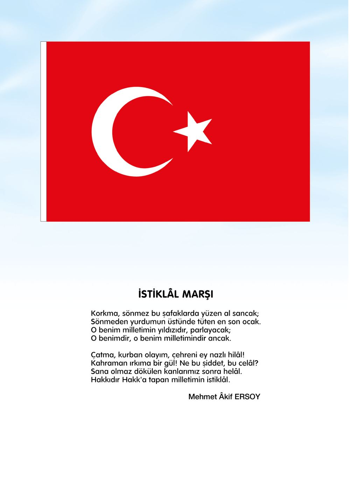

# İSTİKLÂL MARŞI

Korkma, sönmez bu şafaklarda yüzen al sancak;
Sönmeden yurdumun üstünde tüten en son ocak.
O benim milletimin yıldızıdır, parlayacak;
O benimdir, o benim milletimindir ancak.

Çatma, kurban olayım, çehreni ey nazlı hilâl!
Kahraman ırkıma bir gül! Ne bu şiddet, bu celâl?
Sana olmaz dökülen kanlarımız sonra helâl.
Hakkıdır Hakk'a tapan milletimin istiklâl.

Mehmet Âkif ERSOY

<!-- sayfa 3 -->

ANDIMIZ

Türküm, doğruyum, çalışkanım.

İlkem küçüklerimi korumak, büyüklerimi saymak; yurdumu, milletimi özümden çok sevmektir.
Ülküm yükselmek, ileri gitmektir.

Ey Büyük Atatürk!

Açtığın yolda, gösterdiğin hedefe durmadan yürüyeceğime ant içerim.

Varlığım Türk varlığına armağan olsun.

Ne mutlu Türküm diyene!

<!-- yer tutucu bulunamadı: sayfa sonuna eklendi -->

<!-- sayfa 4 -->

MUSTAFA KEMAL ATATÜRK

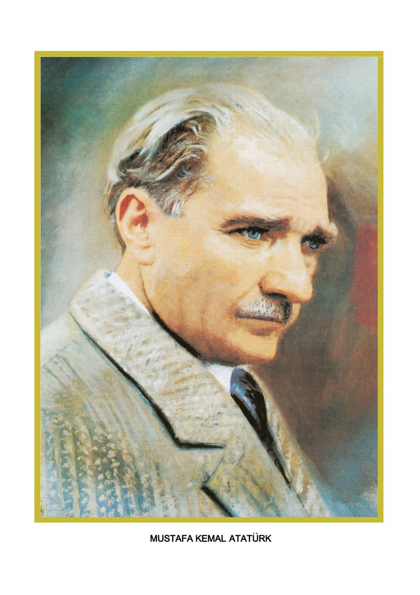
<!-- yer tutucu bulunamadı: sayfa sonuna eklendi -->

<!-- sayfa 5 -->

Henüz bir görsel veya metin katmanı sağlamadınız. Lütfen dönüştürülmesini istediğiniz matematik ders kitabı sayfasının görüntüsünü ve varsa metin katmanını paylaşın. Paylaştığınız anda talimatlarınıza harfiyen uyarak Markdown formatında çevirisini yapacağım.

<!-- yer tutucu bulunamadı: sayfa sonuna eklendi -->

<!-- sayfa 6 -->

# İÇİNDEKİLER

## 5. TEMA: YETENEKLERİMİZİ TANIYORUZ
Ön Değerlendirme Çalışması ..................................................... 18
Unutulan Oyunlar .................................................................................... 20
Türkülerin Babası Neşet Ertaş ................................................... 26
Şu Oyuna Bak! İşte Şapalak! ....................................................... 34
Lokum, Oyun ve Oyuncak Müzesinde ............................. 40
Meslekler ............................................................................................................. 48
Kendimizi Değerlendirelim ................................................................ 54

## 6. TEMA: MUCİT ÇOCUK
Ön Değerlendirme Çalışması ...................................................... 58
ASLAN-TEKNOFEST ....................................................................... 60
Çok Merak, Çok Eğlence ................................................................. 68
Meraklı, Cesur ve Maceracı Alper Gezeravcı ..... 74
Bilgi Çağı ............................................................................................................. 80
Neler Oluyor? .............................................................................................. 86
Kendimizi Değerlendirelim ................................................................. 92

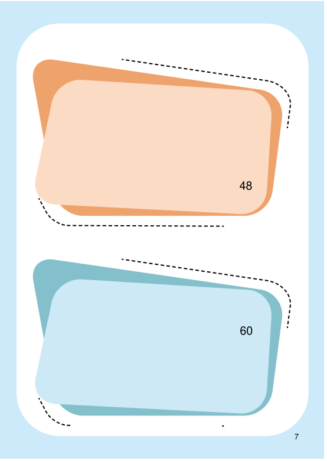
<!-- yer tutucu bulunamadı: sayfa sonuna eklendi -->

<!-- sayfa 7 -->

# 7. TEMA: KÜLTÜR HAZİNEMİZ
Ön Değerlendirme Çalışması ............................................................ 96
Nasreddin Hoca ................................................................................... 98
23 Nisan Ulusal Egemenlik ve Çocuk Bayramı .... 104
Anadolu ............................................................................................... 110
Bayrak Töreni ..................................................................................... 116
Bir Bayram Sürprizi .......................................................................... 124
Kendimizi Değerlendirelim .............................................................. 132

# 8. TEMA: HAKLARIMIZI BİLİYORUZ
Ön Değerlendirme Çalışması ........................................................ 136
Çocuklar Haklarıyla Var ................................................................... 138
Bir Dünya Bırakın ............................................................................. 144
Mırnav Dostları .................................................................................. 150
Kararla Gelen Başarı ........................................................................ 158
Yaz Tatilini Nasıl Değerlendirelim? ............................................. 166
Kendimizi Değerlendirelim .............................................................. 172

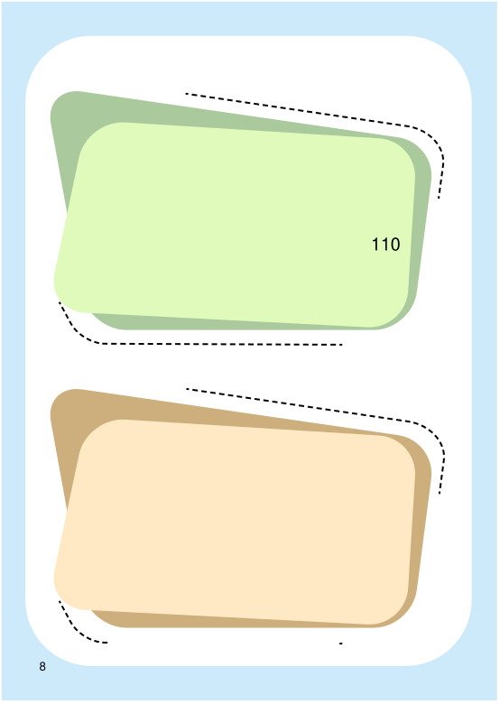
<!-- yer tutucu bulunamadı: sayfa sonuna eklendi -->

<!-- sayfa 8 -->

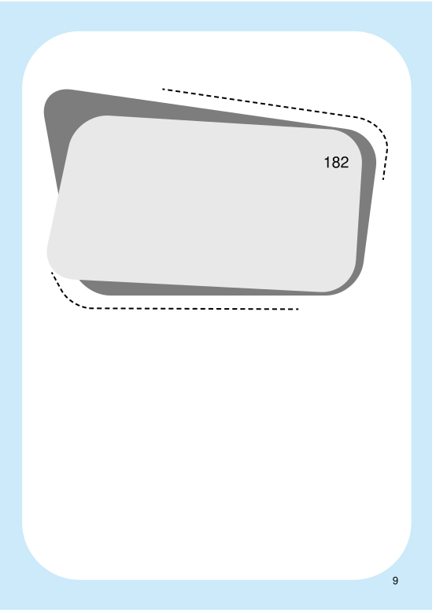
Kaynakça ................................................................................................................ 182
Cevap Anahtarı ............................................................................................. 183
Türkiye’nin Mülki İdare Bölümleri ile Kara ve 
Deniz Komşuları Haritası .................................................................... 184
Türk Dünyası Haritası ............................................................................. 185

<!-- sayfa 9 -->

# KİTABIMIZI TANIYALIM

## SEMBOLLER

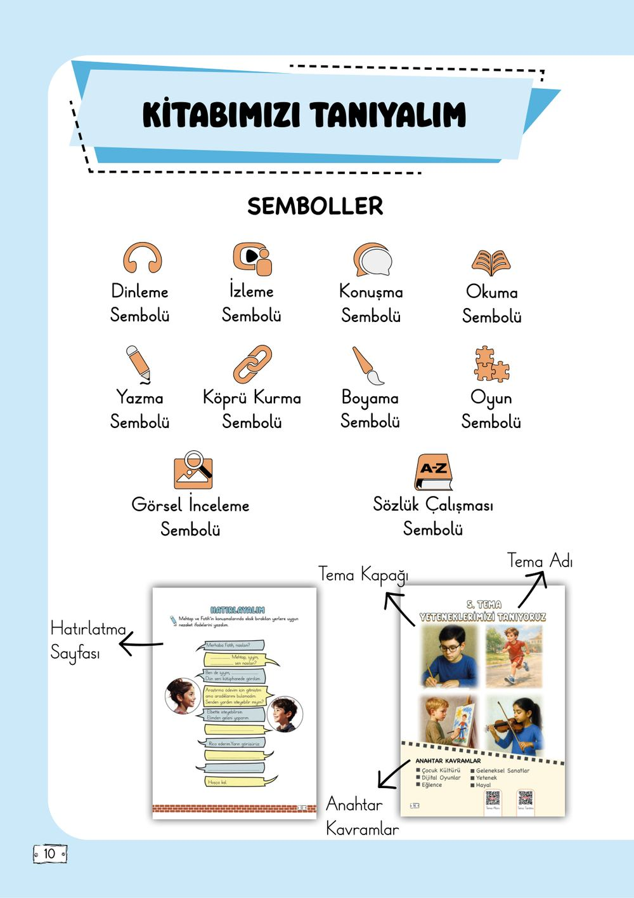
Dinleme Sembolü

İzleme Sembolü

Konuşma Sembolü

Okuma Sembolü

Yazma Sembolü

Köprü Kurma Sembolü

Boyama Sembolü

Oyun Sembolü

Görsel İnceleme Sembolü

Sözlük Çalışması Sembolü

---

 Hatırlatma Sayfası

 Tema Kapağı

 Tema Adı

 Anahtar

<!-- sayfa 10 -->

# Köprü Kurma Etkinliklerinin Bulunduğu Sayfa
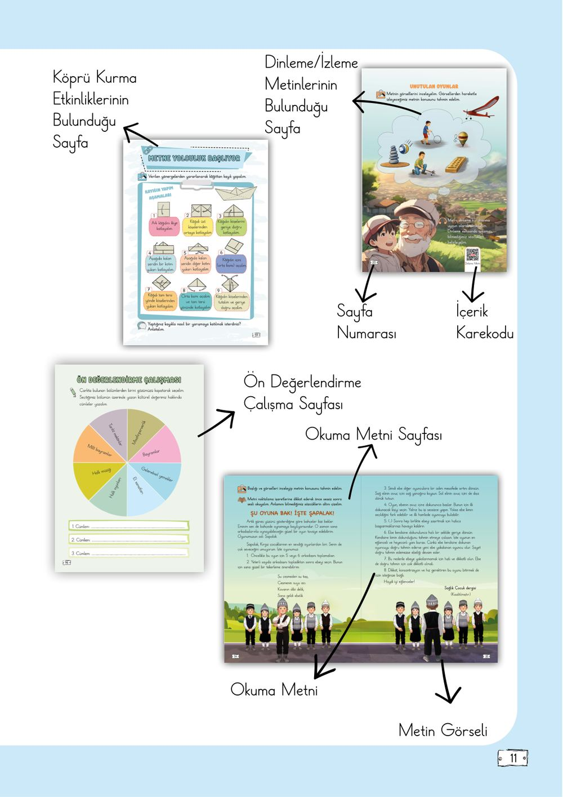

# Dinleme/İzleme Metinlerinin Bulunduğu Sayfa

* Sayfa Numarası
* İçerik Karekodu

# Ön Değerlendirme Çalışma Sayfası

# Okuma Metni Sayfası

* Okuma Metni

<!-- sayfa 11 -->

# Sözlük Çalışması Sayfası
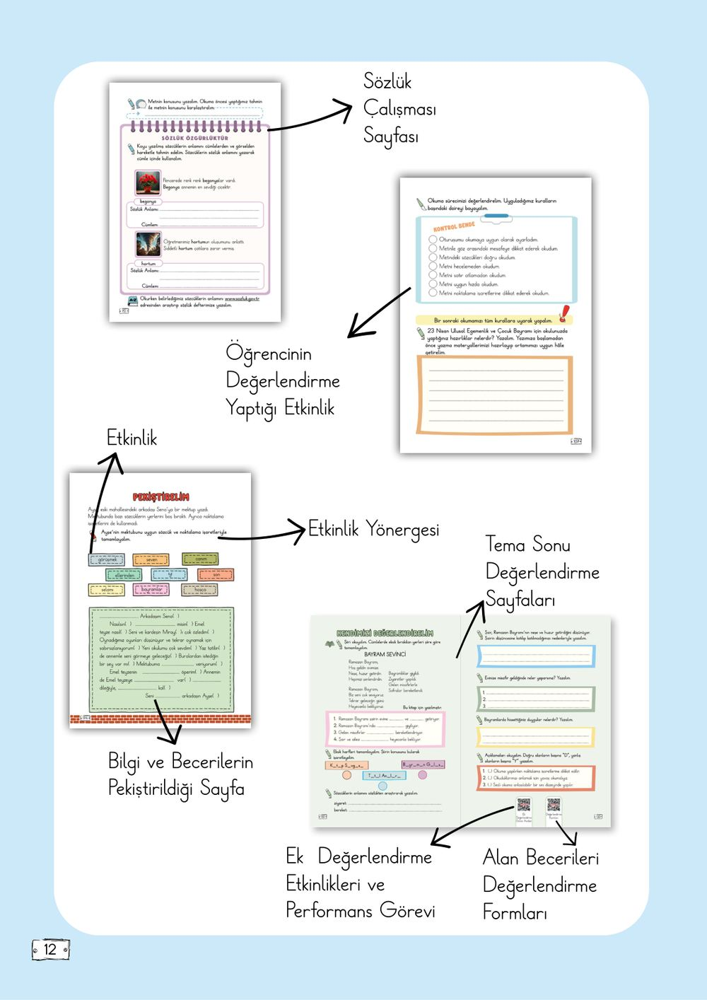: Metnin konusunu yazalım. Okuma öncesi tahmin etme metnini karşılaştıralım. .................................................................................................................................................................................................................................................................................................................................................................................................................................................................................................................................................................................................................................................................................................................................................................................................................................................................................................................................................................................................................................................................................................................................................................................................................................................................................................................................................................................................................................

<!-- sayfa 12 -->

# HATIRLAYALIM

Mehtap ve Fatih’in konuşmalarında eksik bırakılan yerlere uygun nezaket ifadelerini yazalım.

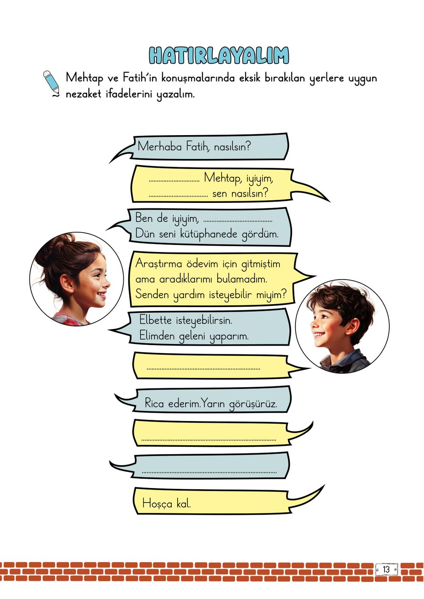

> Merhaba Fatih, nasılsın?

> ............................... Mehtap, iyiyim,
> .................................... sen nasılsın?

> Ben de iyiyim, ..........................................
> Dün seni kütüphanede gördüm.

> Araştırma ödevim için gitmiştim
> ama aradıklarımı bulamadım.
> Senden yardım isteyebilir miyim?

> Elbette isteyebilirsin.
> Elimden geleni yaparım.

> ...................................................................................

> Rica ederim. Yarın görüşürüz.

> ..................................................................................

> Hoşça kal.

<!-- sayfa 13 -->

✏️ Cümlelerde eksik bırakılan yerleri uygun soru ifadeleri ile tamamlayalım.

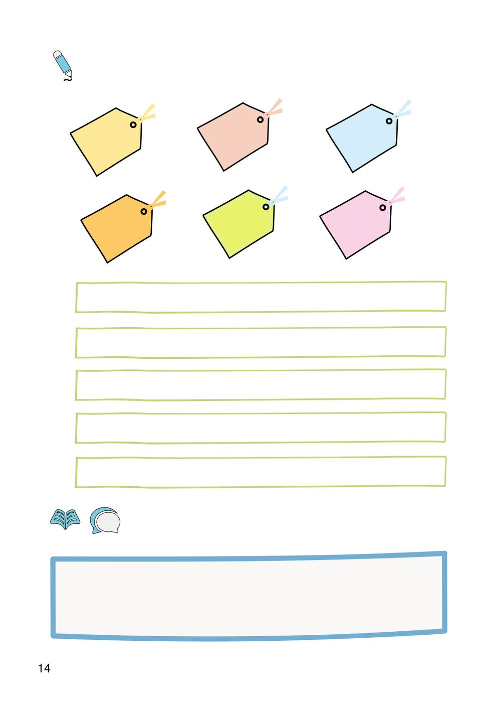

mu | müsün | mi
---|---|---
musun | mı | miyim

Ben, sana yardım edebilir ..............................?

Polis Şeyda Yılmaz'ı tanıyor ..............................?

Sana aldığım hediyeyi beğendin ..............................?

Kütüphaneden hikâye kitaplarını aldın ..............................?

Törende Arif Nihat Asya'nın şiirini okudun ..............................?

📖 💬 Metni okuyalım. Akif, görme engelli teyzeye nasıl bir yardımda bulunmuştur? Anlatalım.

> Akif, kaldırımda yürürken görme engelli bir teyze gördü. Teyze, caddede karşıdan karşıya geçmeye çalışıyor fakat zorlanıyordu. Akif, teyzeye yardım etmek istedi.

<!-- sayfa 14 -->

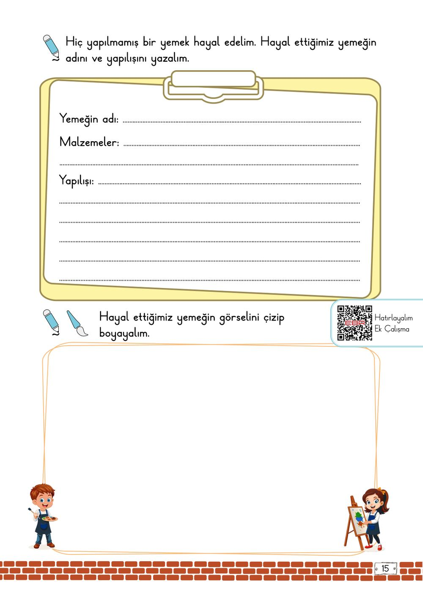 Hiç yapılmamış bir yemek hayal edelim. Hayal ettiğimiz yemeğin adını ve yapılışını yazalım.

# Yemeğin adı: .................................................................................................................................................
# Malzemeler: ................................................................................................................................................
......................................................................................................................................................................................
# Yapılışı: ................................................................................................................................................................
.......................................................................................................................................................................................
.......................................................................................................................................................................................
.......................................................................................................................................................................................
.......................................................................................................................................................................................
.......................................................................................................................................................................................
.......................................................................................................................................................................................

 Hayal ettiğimiz yemeğin görselini çizip boyayalım.

 Hatırlayalım Ek Çalışma

<!-- sayfa 15 -->

# 5. TEMA
# YETENEKLERİMİZİ TANIYORUZ

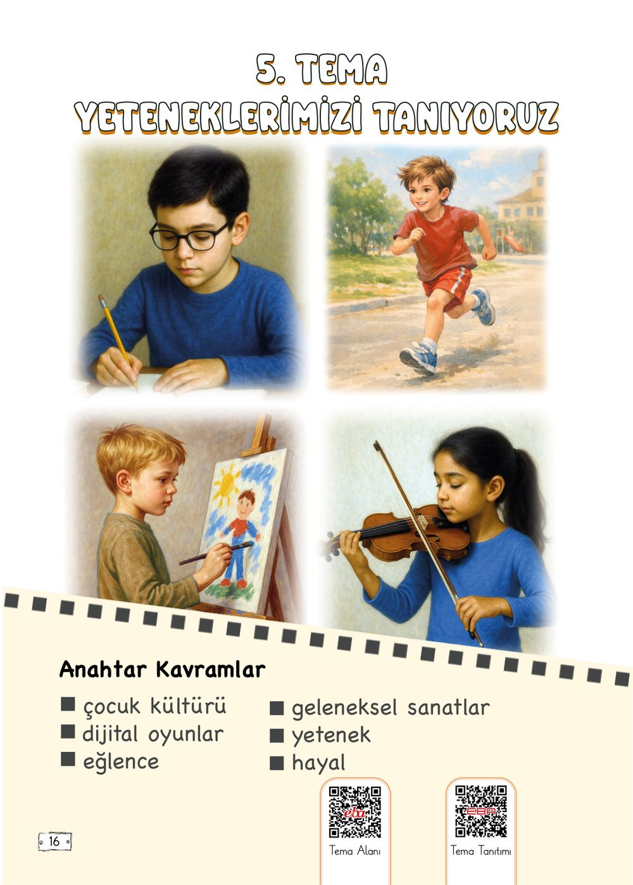

## Anahtar Kavramlar

* çocuk kültürü
* dijital oyunlar
* eğlence
* geleneksel sanatlar
* yetenek
* hayal

<!-- sayfa 16 -->

# TEMADAKİ METİNLER

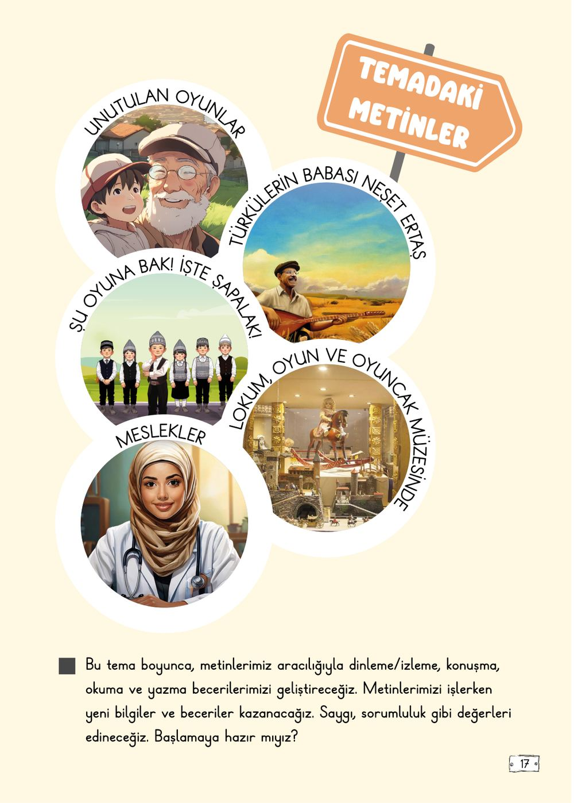

UNUTULAN OYUNLAR
TÜRKÜLERİN BABASI NEŞET ERTAŞ
ŞU OYUNA BAK! İŞTE ŞAPALAK!
LOKUM, OYUN VE OYUNCAK MÜZESİNDE
MESLEKLER

■ Bu tema boyunca, metinlerimiz aracılığıyla dinleme/izleme, konuşma, okuma ve yazma becerilerimizi geliştireceğiz. Metinlerimizi işlerken yeni bilgiler ve beceriler kazanacağız. Saygı, sorumluluk gibi değerleri...

<!-- sayfa 17 -->

# ÖN DEĞERLENDİRME ÇALIŞMASI

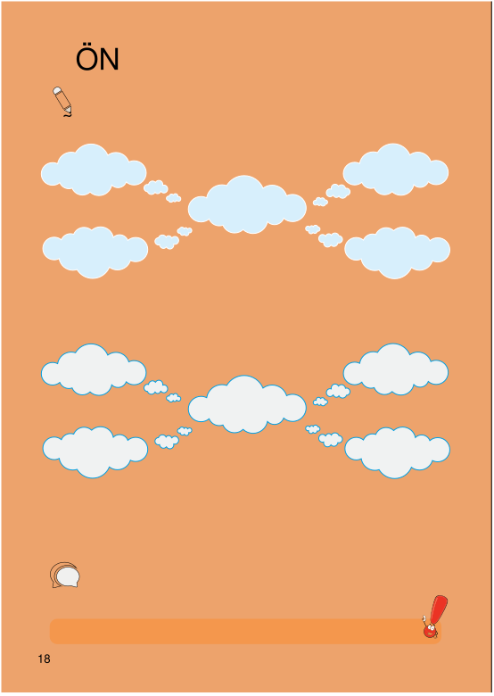 Verilen sözcüklerle ilgili aklımıza gelenleri yazalım.

![Bulut şeması: merkezde "çocuk" kelimesi ve ona bağlı dört boş bulut]
(çocuk)
....................
....................
....................
....................

![Bulut şeması: merkezde "eğlence" kelimesi ve ona bağlı dört boş bulut]
(eğlence)
....................
....................
....................
....................

 Yazdığımız sözcükleri kullanarak bir hayalimizi veya yeteneğimizi anlatalım.

Konuşmamızda beden dilini kullanalım.

<!-- sayfa 18 -->

# METNE YOLCULUK BAŞLIYOR

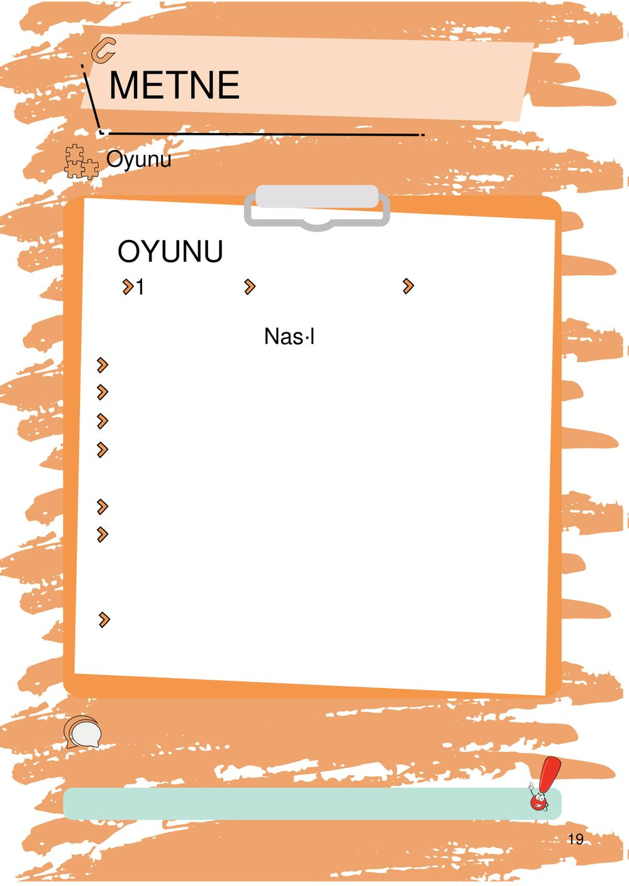 Oyunu arkadaşlarımızla oynayalım.

## DOKUZTAŞ OYUNU

### Malzemeler
* 1 adet top
* 9 adet yassı taş
* Tebeşir

### Nasıl Oynanır?
* Oyuncular iki gruba ayrılır.
* İçine taşların üst üste dizileceği bir çember çizilir.
* Çembere uygun mesafede bir çizgi çizilir.
* İlk gruptakiler sırayla çizgiden taşlara doğru topu atar. Amaç taşları yıkmaktır.
* Taşlar yıkılınca taşı yıkan gruptaki oyuncular kaçmaya başlar.
* Diğer gruptakiler, kaçan oyuncuları topla vurmaya çalışır. Onlar da vurulmadan yıkılan taşları tekrar üst üste dizmeye uğraşır.
* Taşları yıkma sırasının diğer gruba geçmesi için tüm oyuncuların vurulması gerekir.

 Dokuztaş oyunu, arkadaşlarınızla oynadığınız diğer oyunlara benziyor mu? Oyunu eğlenceli buldunuz mu? Oyun ile ilgili düşüncelerimizi anlatalım.

<!-- sayfa 19 -->

# UNUTULAN OYUNLAR

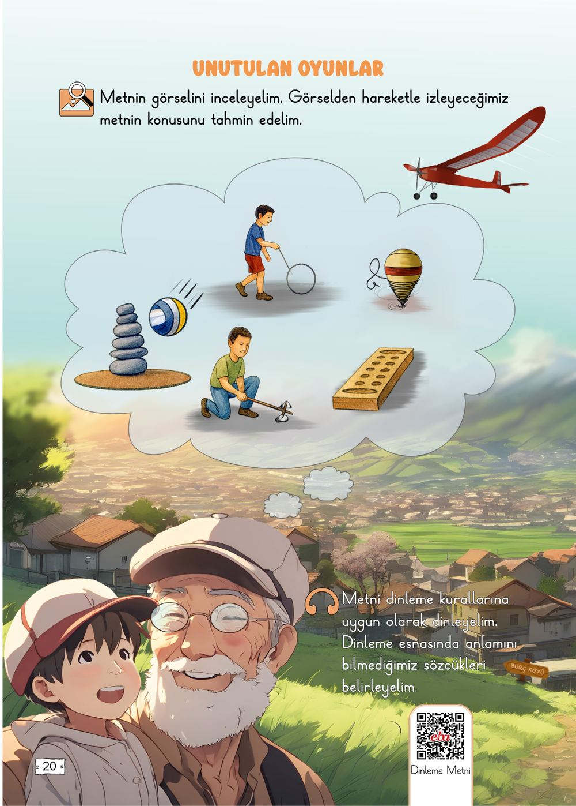 Metnin görselini inceleyelim. Görselden hareketle izleyeceğimiz metnin konusunu tahmin edelim.

 Metni dinleme kurallarına uygun olarak dinleyelim. Dinleme esnasında anlamını bilmediğimiz sözcükleri belirleyelim.

<!-- sayfa 20 -->

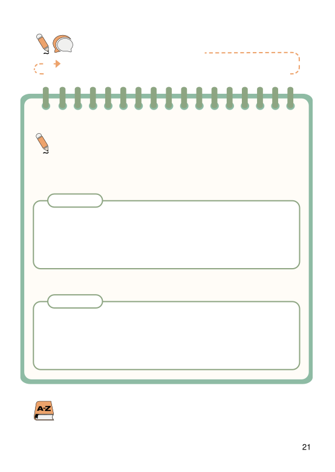 Metnin konusunu yazalım. Dinleme öncesi yaptığımız tahmin ile metnin konusunu karşılaştıralım.
......................................................................................................................................................

# SÖZLÜK ÖZGÜRLÜKTÜR

 Cümleleri okuyalım. Koyu yazılmış sözcüklerin anlamını sözlükten araştırıp yazalım. Yeni öğrendiğimiz sözcükleri cümle içinde kullanalım.

Kardeşimin yaptığı ev **maketini** çok beğendim.
Arkadaşımla kocaman bir gemi **maketi** yaptık.

**maket**
Sözlük Anlamı: ....................................................................................................................................................
......................................................................................................................................................
......................................................................................................................................................

Cümlem: ....................................................................................................................................................
......................................................................................................................................................
......................................................................................................................................................

Öğretmen olmak benim en büyük **hayalimdir**.
Hatice, yaz tatilini **hayal** ediyordu.

**hayal**
Sözlük Anlamı: ....................................................................................................................................................
................................................................................................................

<!-- sayfa 21 -->

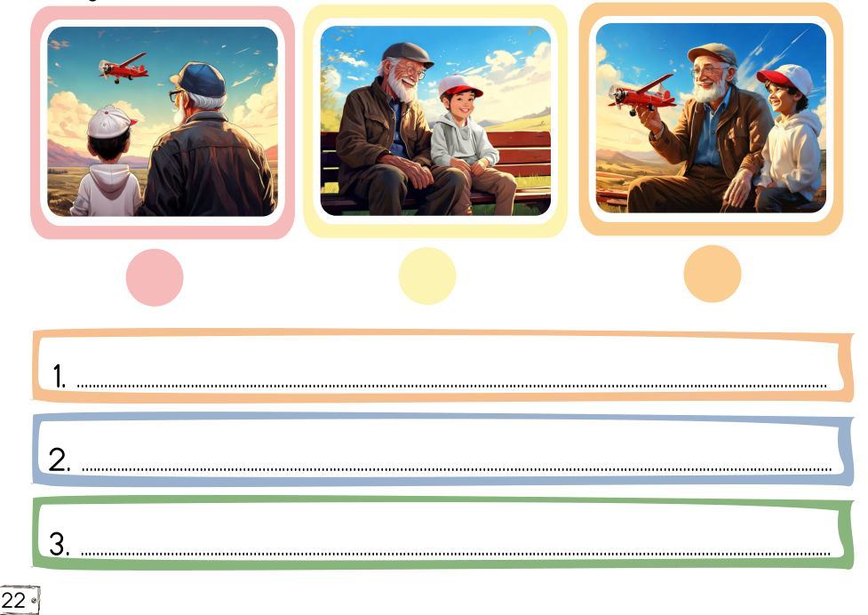

Dinlediğimiz metinle ilgili soruları cevaplayalım.

Konuşurken anlamlı ve kurallı cümleler kuralım.

1. Mete’nin yeni oyuncağı neydi?
2. Mete’nin oyuncağı dedesini neden şaşırttı?
3. Mete’nin dedesi çocukluğunda hangi oyunları oynuyordu?
4. Mete, dedesine nasıl bir söz verdi?
5. Büyüklerinizin çocukken oynadığı oyunlar Mete’nin dedesinin anlattığı oyunlara benziyor mu? Oyunların benzer ve farklı yönleri nelerdir?

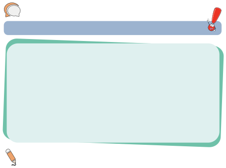

Dinlediğimiz metinle ilgili görselleri inceleyelim. Görselleri olayların oluş sırasına göre sıralayalım. Olayları sırasıyla yazalım.

1. ...............................................................................................................................................................................................
2. ...............................................................................................................................................................................................
3. ...............................................................................................................................................................................................

<!-- sayfa 22 -->

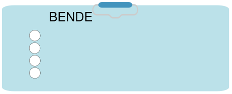 Bir büyüğümüze en sevdiğimiz oyunu tanıtan mektup yazalım. Yazımızda selamlaşma ve hitap ifadelerini kullanalım. Yazımıza başlamadan önce yazma ortamını değerlendirelim. Uygun olan ifadelerin başındaki daireyi boyayalım.

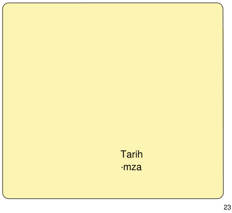
# KONTROL BENDE
* Ortamın aydınlatması yazmak için uygundur.
* Araç ve gereçlerim (kalem ve silgi) yazmak için hazırdır.
* Yazı yazma zemini uygundur.
* Ortamın ısısı yazmak için uygundur.

...............................................................................,

Merhaba. Size ....................................... oyununu tanıtacağım.
............................................................................................................................................................................
.............................................................................................................................................................................................
.............................................................................................................................................................................................
.............................................................................................................................................................................................
.............................................................................................................................................................................................
.............................................................................................................................................................................................

Tarih : _ . _ . 20_
İmza : ..........................................
Adı Soyadı : ..........................................

<!-- sayfa 23 -->

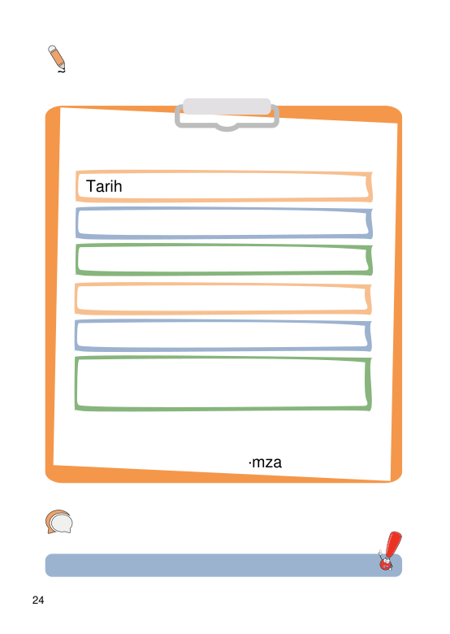 Aile büyüklerimizin geçmişte oynadıkları oyuncaklarla günümüzdeki oyuncakları karşılaştıran bir konuşma planlayalım.

# KONUŞMA PLANIM

| Tarih | : ............................................................................................... |
| :--- | :--- |
| **Konuşmacı** | : ............................................................................................... |
| **Konuşma Konusu** | : ............................................................................................... |
| **Dinleyiciler** | : ............................................................................................... |
| **Konuşma Süresi** | : ............................................................................................... |
| **Anahtar Sözcükler :** | .................................................................................................   ................................................................................................. |

**Adı Soyadı :** ................................................
**İmza :** ................................................

 Sınıf arkadaşlarımıza hazırladığımız plana uygun bir konuşma yapalım.

Konuşurken beden dilini kullanalım.

<!-- sayfa 24 -->

# METNE YOLCULUK BAŞLIYOR

Bir müzik aleti yapacak olsaydık hangi müzik aletini yapmak isterdik? Anlatalım. Aşağıdaki müzik aletini yapalım.

## MÜZİK ALETİ YAPALIM

### Malzemeler
* 1 adet kavanoz kapağı
* 1 adet dil çubuğu
* 4 adet minik lastik toka
* 1 adet renkli kâğıt
* Korumalı makas
* Yapıştırıcı

**Uyarı: Makası öğretmen gözetiminde ve dikkatli kullanalım!**

### Yapılışı
* Renkli kâğıtlardan kavanoz kapağı büyüklüğünde iki daire keselim.
* Kestiğimiz kâğıtları kapağın ön ve arka yüzeyine yapıştıralım.
* Dil çubuğunu süsleyerek yapıştırıcı ile kapağa yapıştıralım.
* Lastik tokaları kapağın ortasına gelecek şekilde yan yana takalım.
* Müzik aletimiz hazır.

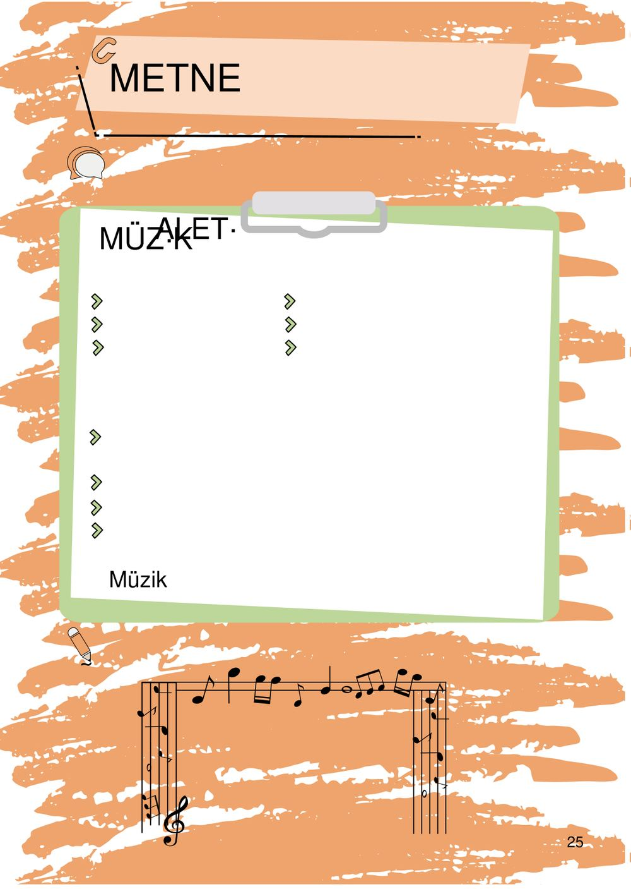

Dinlediğimiz bir şarkının en sevdiğimiz bölümünü yazalım.
.............................................................................................
.............................................................................................
.............................................................................................

<!-- sayfa 25 -->

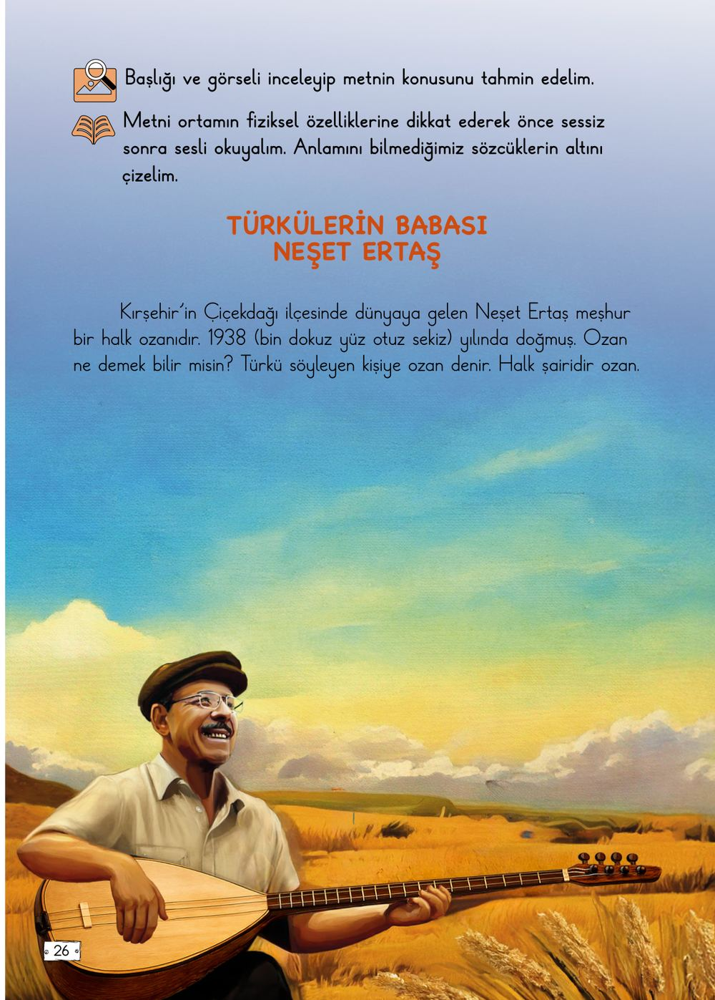 Başlığı ve görseli inceleyip metnin konusunu tahmin edelim.
 Metni ortamın fiziksel özelliklerine dikkat ederek önce sessiz sonra sesli okuyalım. Anlamını bilmediğimiz sözcüklerin altını çizelim.

# TÜRKÜLERİN BABASI NEŞET ERTAŞ

Kırşehir’in Çiçekdağı ilçesinde dünyaya gelen Neşet Ertaş meşhur bir halk ozanıdır. 1938 (bin dokuz yüz otuz sekiz) yılında doğmuş. Ozan ne demek bilir misin? Türkü söyleyen kişiye ozan denir. Halk şairidir ozan.

<!-- sayfa 26 -->

Neşet Ertaş müzik hayatına, saz çalan babasını dinleyerek başlamış. İlk çalgısını duyunca çok şaşıracaksın: Annesi Döne Hanım’ın çamaşır tokacına tel takarak yaptırdığı oyuncak sazı. Bu sazla başlamış ve babasından saz çalmayı öğrenmiş.

Küçüklükten itibaren o yörenin eğlencelerinde saz çalıp türkü söylemiş. (...) En değerli hazinelerimiz, türkülerimizi çok güzel seslendirmiş ve herkes çok sevmiş. Bu yüzden kendisine “Türkülerin Babası, Anadolu Efsanesi” gibi isimler verilmiş. (...)

Haydi, şimdi annene ya da babana sor Neşet Dede’yi! Mutlaka bilir ve ezberinde mutlaka bir türküsü vardır. İstersen sen anlat onlara Türkülerin Babası’ nı. Gözleri dolarak dinleyeceklerdir seni.

**Kardelen Çocuk dergisi**
*(Kısaltılmıştır.)*

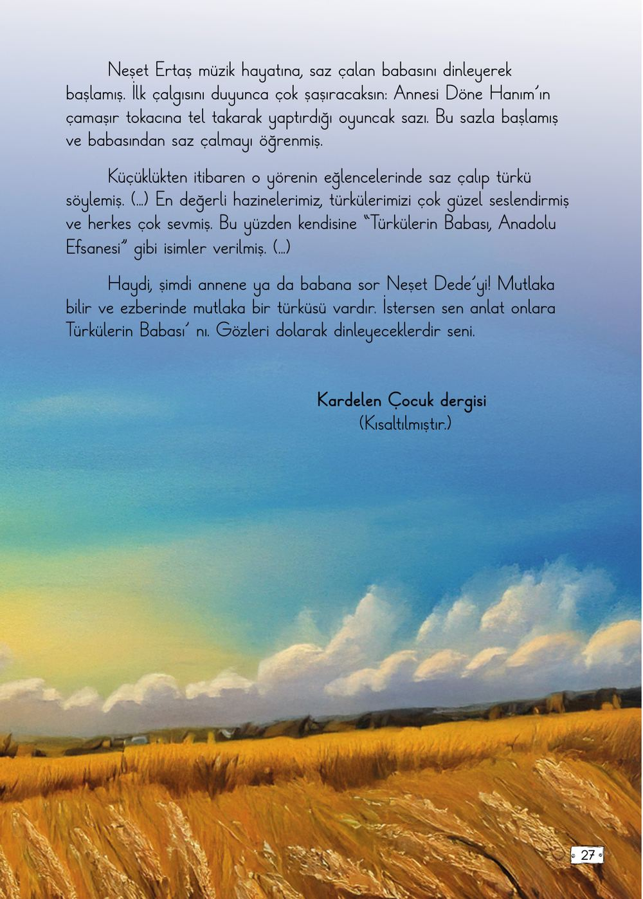
<!-- yer tutucu bulunamadı: sayfa sonuna eklendi -->

<!-- sayfa 27 -->

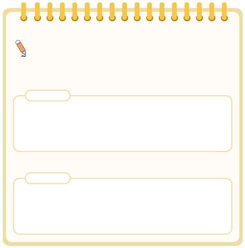 Metnin konusunu yazalım. Okuma öncesi yaptığımız tahmin ile metnin konusunu karşılaştıralım.
..............................................................................................................................................................................

# SÖZLÜK ÖZGÜRLÜKTÜR

Cümleleri okuyalım. Koyu yazılmış sözcüklerin anlamını sözlükten araştırıp yazalım. Yeni öğrendiğimiz sözcükleri cümle içinde kullanalım.

Derede **tokaç** ile çamaşır yıkadık.
Annem **tokaçtan** saz yaptı.

**tokaç**
Sözlük Anlamı: ..................................................................................................................................................
......................................................................................................................................................................
Cümlem: ........................................................................................................................................................
......................................................................................................................................................................

Seyit Onbaşı’nın gücü, herkesin anlattığı bir **efsaneydi**.
Arda Güler, **efsane** bir futbolcu olacak.

**efsane**
Sözlük Anlamı: ..................................................................................................................................................
......................................................................................................................................................................
Cümlem: ........................................................................................................................................................
................................................................................................................................................

<!-- sayfa 28 -->

💬 Metinle ilgili soruları cevaplayalım.

🟦 Konuşurken anlamlı ve kurallı cümleler kuralım. 🔴

1. Neşet Ertaş nerede dünyaya gelmiş?
2. Neşet Ertaş müzik hayatına nasıl başlamış?
3. Neşet Ertaş’a hangi isimler verilmiş?

💬 Neşet Ertaş’ı canlandıralım. Metindeki bilgilerden hareketle Neşet Ertaş’ın hayat hikâyesini anlatalım.

🟦 Konuşurken beden dilini kullanalım. 🔴

✏️ Cümlelerde eksik bırakılan sözcükleri metinden hareketle tamamlayalım.

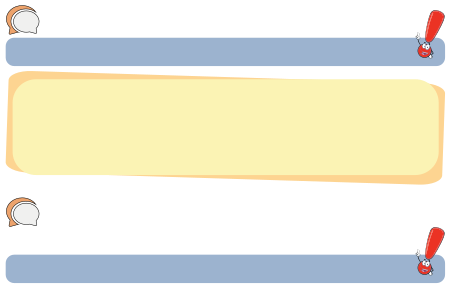
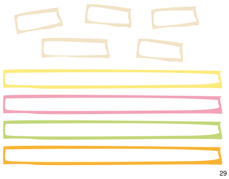

| meşhur | ozan | babasını |
| :---: | :---: | :---: |
| Türkülerin Babası | halk | |

🟨 Türkü söyleyen kişiye ..................................................... denir.

 pink Neşet Ertaş ..................................................... bir halk ozanıdır.

🟩 Neşet Ertaş müzik hayatına ..................................................... dinleyerek başlamış.

🟧 Kendisine .......................................................................... gibi isimler verilmiş.

<!-- sayfa 29 -->

Döne Hanım, Neşet Ertaş küçükken ona çamaşır tokacından saz yaptırmış.

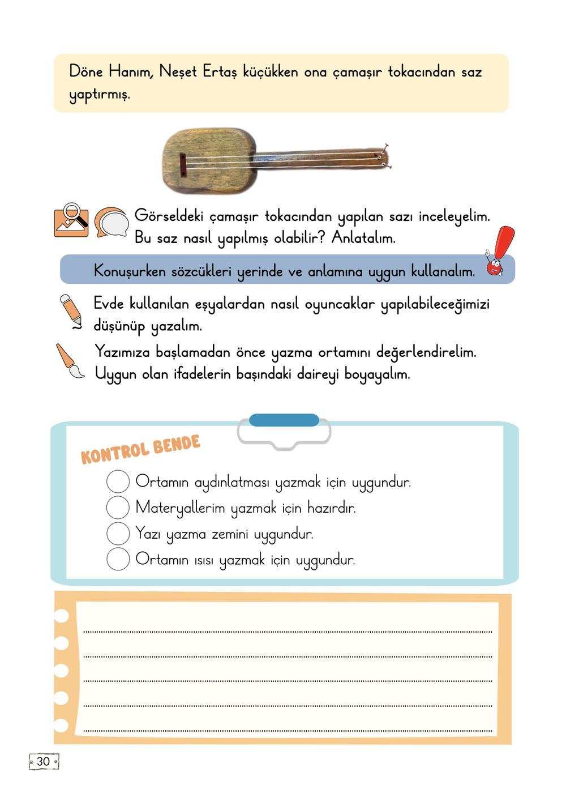

Görseldeki çamaşır tokacından yapılan sazı inceleyelim. Bu saz nasıl yapılmış olabilir? Anlatalım.

Konuşurken sözcükleri yerinde ve anlamına uygun kullanalım.

Evde kullanılan eşyalardan nasıl oyuncaklar yapabileceğimizi düşünüp yazalım.

Yazımıza başlamadan önce yazma ortamını değerlendirelim. Uygun olan ifadelerin başındaki daireyi boyayalım.

### KONTROL BENDE

*   Ortamın aydınlatması yazmak için uygundur.
*   Materyallerim yazmak için hazırdır.
*   Yazı yazma zemini uygundur.
*   Ortamın ısısı yazmak için uygundur.

..........................................................................................................................................................................................
..........................................................................................................................................................................................
..........................................................................................................................................................................................
..........................................................................................................................................................................................
..........................................................................................................................................................................................

<!-- sayfa 30 -->

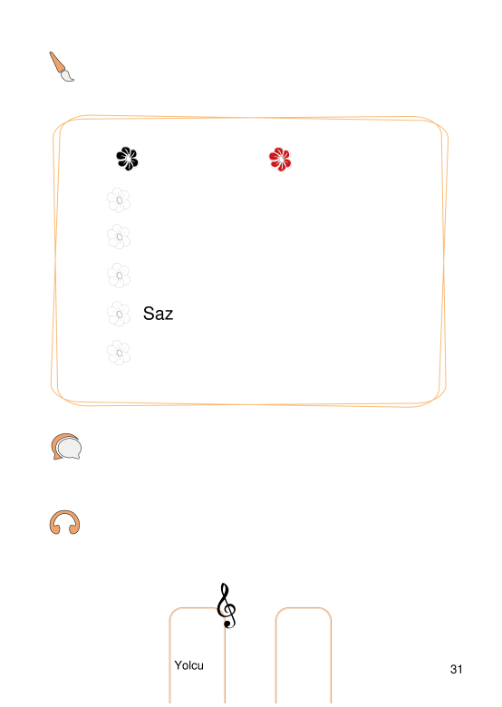 “Türkülerin Babası Neşet Ertaş” metnine göre Neşet Ertaş ve babasının benzer özelliklerini siyaha, farklı özelliklerini kırmızıya boyayalım.

| | |
| :--- | :--- |
|  Benzer özellikler |  Farklı özellikler |
|  “Türkülerin Babası” isminin verilmesi | |
|  Küçükken oyuncak saza sahip olmaları | |
|  Yörenin eğlencelerinde türkü söylemeleri | |
|  Saz çalmaları | |
|  Müzikle ilgilenmeleri | |

 Müzik alanında sevdiğimiz bir sanatçıyı düşünelim. Sevdiğimiz sanatçı ile Neşet Ertaş’ın benzer ve farklı yönlerini arkadaşlarımızla paylaşalım.

 Neşet Ertaş’ın türküsünden bir bölümü dinleme kurallarına uygun olarak dinleyelim. Türküyü dinlemek için karekodu okutalım.

<!-- sayfa 31 -->

 Metni noktalama işaretlerine dikkat ederek okuyalım.

> Elif keman çalmayı çok istiyordu. Annesi ona keman aldı ve Elif hemen derslere başladı. İlk başta notaları öğrenmek zor oldu ama Elif pes etmedi. Her gün çalıştı ve öğretmeninin tüm öğrettiklerini uyguladı.
>
> Bir gün bir müzik yarışması düzenlendi. Elif de bu yarışmaya katılmaya karar verdi. Yarışma günü geldiğinde Elif biraz heyecanlıydı ama kendine güveniyordu. Kemanını eline aldı ve öğrendiği en sevdiği parçayı çalmaya başladı. Salondakiler onu dikkatle dinledi ve sonunda büyük bir alkış koptu.
>
> Elif yarışmada birinci oldu ve herkes onu tebrik etti. Bu başarı onun yeteneğini ve azmin önemini gösterdi.

 Elif’in başarısı ile ilgili duygu ve düşüncelerimizi anlatan bir tebrik kartı yazalım. Tebrik kartında selamlaşma ve hitap ifadelerini kullanalım.

................................................................................................................................................................................
................................................................................................................................................................................
................................................................................................................................................................................
................................................................................................................................................................................
................................................................................................................................................................................
................................................................................................................................................................

<!-- sayfa 32 -->

# METNE YOLCULUK BAŞLIYOR

Bazı çocuk oyunu adları verilmiştir. Oyun adlarını okuyalım. Örnekteki gibi bulmacaya yerleştirelim.

| İP ATLAMA | MENDİL SAKLAMA | SAKLAMBAÇ |
| :---: | :---: | :---: |
| **BEŞTAŞ** | **KÖREBE** | **YEDİ TAŞ** |

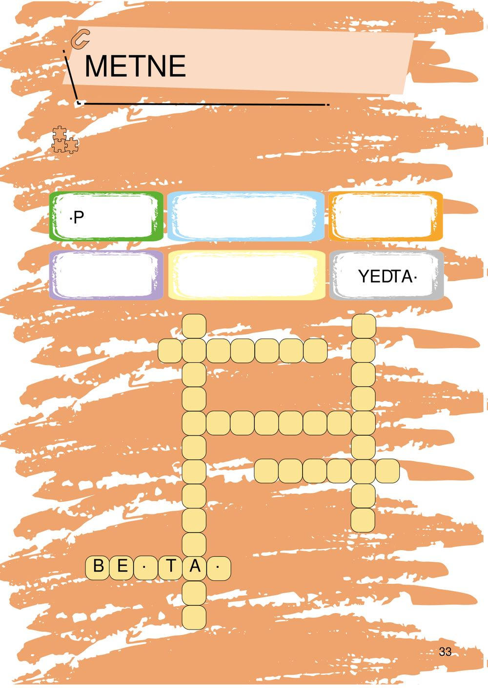

| B | E | Ş | T | A | Ş |
|---|---|---|---|---|---|

<!-- sayfa 33 -->

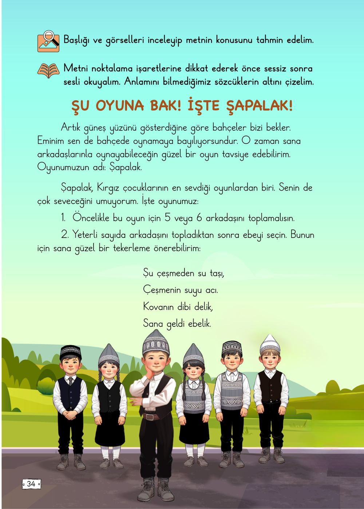 Başlığı ve görselleri inceleyip metnin konusunu tahmin edelim.

 Metni noktalama işaretlerine dikkat ederek önce sessiz sonra sesli okuyalım. Anlamını bilmediğimiz sözcüklerin altını çizelim.

# ŞU OYUNA BAK! İŞTE ŞAPALAK!

Artık güneş yüzünü gösterdiğine göre bahçeler bizi bekler. Eminim sen de bahçede oynamaya bayılıyorsundur. O zaman sana arkadaşlarınla oynayabileceğin güzel bir oyun tavsiye edebilirim. Oyunumuzun adı: Şapalak.

Şapalak, Kırgız çocuklarının en sevdiği oyunlardan biri. Senin de çok seveceğini umuyorum. İşte oyunumuz:

1. Öncelikle bu oyun için 5 veya 6 arkadaşını toplamalısın.
2. Yeterli sayıda arkadaşını topladıktan sonra ebeyi seçin. Bunun için sana güzel bir tekerleme önerebilirim:

> Şu çeşmeden su taşı,
> Çeşmenin suyu acı.
> Kovanın dibi delik,
> Sana geldi ebelik.

<!-- sayfa 34 -->

3. Şimdi ebe diğer oyunculara bir adım mesafede sırtını dönsün. Sağ elinin avuç içini sağ yanağına koysun. Sol elinin avuç içini de dışa dönük tutsun.

4. Oyun, ebenin avuç içine dokununca başlar. Bunun için ilk dokunacak kişiyi seçin. Yalnız bu işi sessizce yapın. Yoksa ebe kimin seçildiğini fark edebilir ve ilk hamlede oyuncuyu bulabilir.

5. (...) Sonra hep birlikte ebeyi şaşırtmak için hızlıca başparmaklarınızı havaya kaldırın.

6. Ebe kendisine dokunulunca hızlı bir şekilde geriye dönsün. Kendisine kimin dokunduğunu tahmin etmeye çalışsın. İşte oyunun en eğlenceli ve heyecanlı yanı burası. Çünkü ebe kendisine dokunan oyuncuyu doğru tahmin ederse yeni ebe yakalanan oyuncu olur. Şayet doğru tahmin edemezse ebeliği devam eder.

7. Bu nedenle ebeye yakalanmamak için hızlı ve dikkatli olun. Ebe de doğru tahmin için çok dikkatli olmalı.

8. Dikkat, konsantrasyon ve hız gerektiren bu oyunu bitirmek de sizin isteğinize bağlı.

Haydi iyi eğlenceler!

Sağlık Çocuk dergisi
(Kısaltılmıştır.)

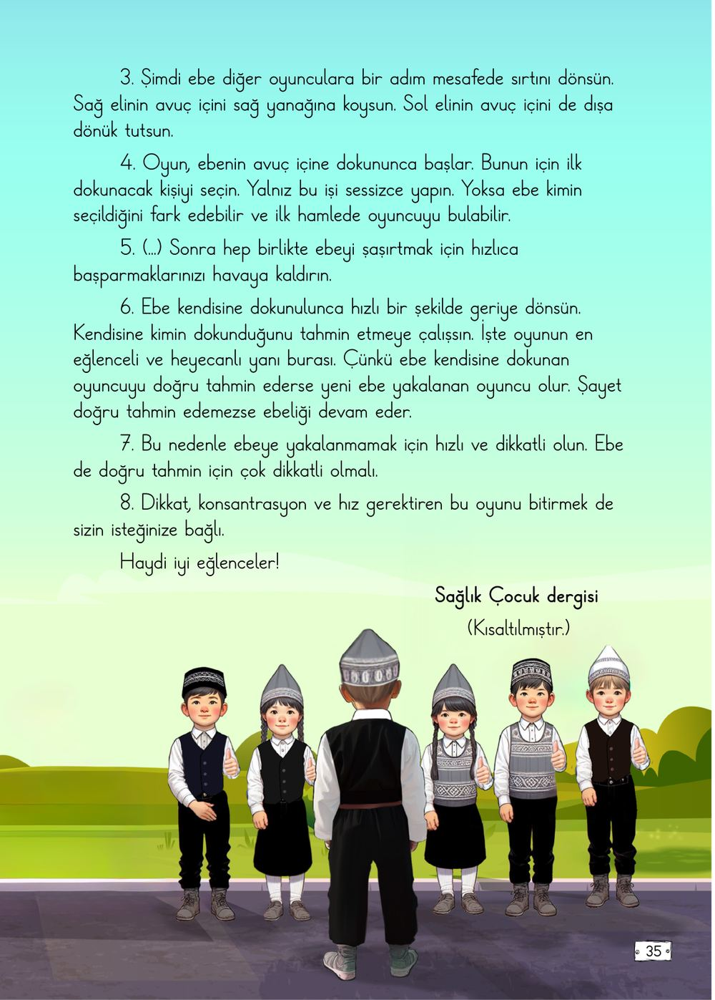

<!-- sayfa 35 -->

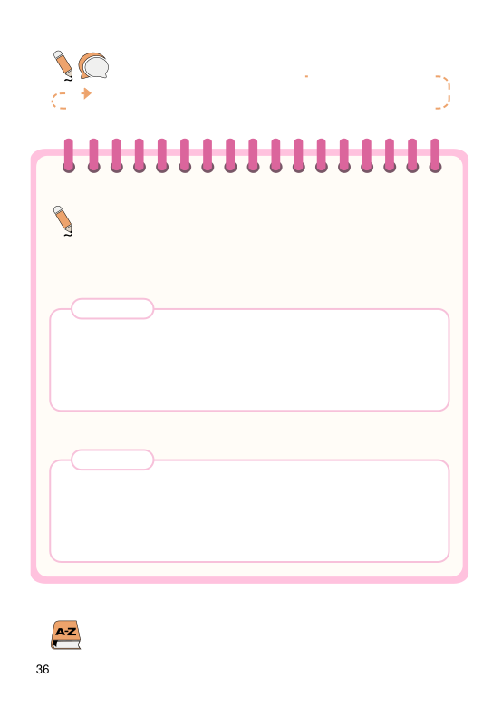 Metnin konusunu yazalım. Okuma öncesi yaptığımız tahmin ile metnin konusunu karşılaştıralım:
..............................................................................................................................................................................

# SÖZLÜK ÖZGÜRLÜKTÜR

 Cümleleri okuyalım. Koyu yazılmış sözcüklerin anlamını sözlükten araştırıp yazalım. Yeni öğrendiğimiz sözcükleri cümle içinde kullanalım.

Sinan’ın **hamlesi** ona satranç turnuvasını kazandırdı.
Kedi tek **hamlede** dolabın tepesine ulaştı.

hamle
Sözlük Anlamı: ....................................................................................................................................................
......................................................................................................................................................................
Cümlem: ............................................................................................................................................................
......................................................................................................................................................................

Ders çalışırken gürültüden **konsantrasyonum** bozuluyor.
Mete Gazoz’un **konsantrasyonu** mükemmeldi.

konsantrasyon
Sözlük Anlamı: ....................................................................................................................................................
................................................................................

<!-- sayfa 36 -->

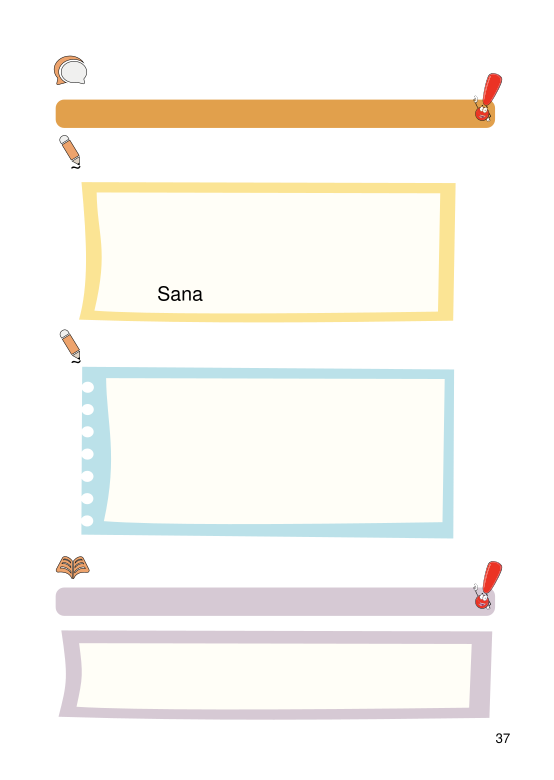 “Şapalak” oyununun nasıl oynandığını kendi ifadelerimizle anlatalım.

> Konuşurken anlamlı ve kurallı cümleler kuralım. 

 Metindeki tekerlemede eksik bırakılan sözcükleri kendi ifadelerimizle tamamlayalım.

| | |
| :--- | :--- |
| Şu çeşmeden | ............................................................... |
| Çeşmenin | ............................................................... |
| Kovanın | ............................................................... |
| Sana geldi | ............................................................... |

 Bildiğimiz bir tekerlemeyi yazalım.

| | |
| :--- | :--- |
| | ............................................................................................................ |
| | ............................................................................................................ |
| | ............................................................................................................ |
| | ............................................................................................................ |
| | ............................................................................................................ |

 Verilen tekerlemeyi okuyalım, arkadaşlarımızla paylaşalım.

> Konuşurken konuşma hızımızı ayarlayalım. 

| | |
| :--- | :--- |
| | Bu evi ne yapsak? Evi yıkıp yeniden yapsak da mı otursak yoksa yıkmasak onarsak da mı otursak? |

<!-- sayfa 37 -->

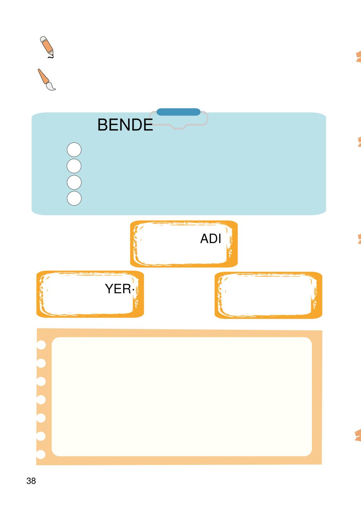 Yeni bir oyun kurgulayalım. Oyunumuzla ilgili istenen bilgileri yazalım.
 Yazımıza başlamadan önce yazma ortamını değerlendirelim. Uygun olan ifadelerin başındaki daireyi boyayalım.

# KONTROL BENDE

◯ Ortamın aydınlatması yazmak için uygundur.
◯ Materyallerim yazmak için hazırdır.
◯ Yazı yazma zemini uygundur.
◯ Ortamın ısısı yazmak için uygundur.

## OYUNUN ADI
..............................................

### OYUNUN YERİ
..............................................

### OYUNCU SAYISI
..............................................

## OYUNUN OYNANIŞI
........................................................................................................................................
........................................................................................................................................
........................................................................................................................................
........................................................................................................................................
........................................................................................................................................

<!-- sayfa 38 -->

# METNE YOLCULUK BAŞLIYOR

Geçmişte oynanan oyuncakların müzedeki görsellerini inceleyelim. Günümüzdeki oyuncaklarla bu oyuncakların benzerlik ve farklılıklarını anlatalım.

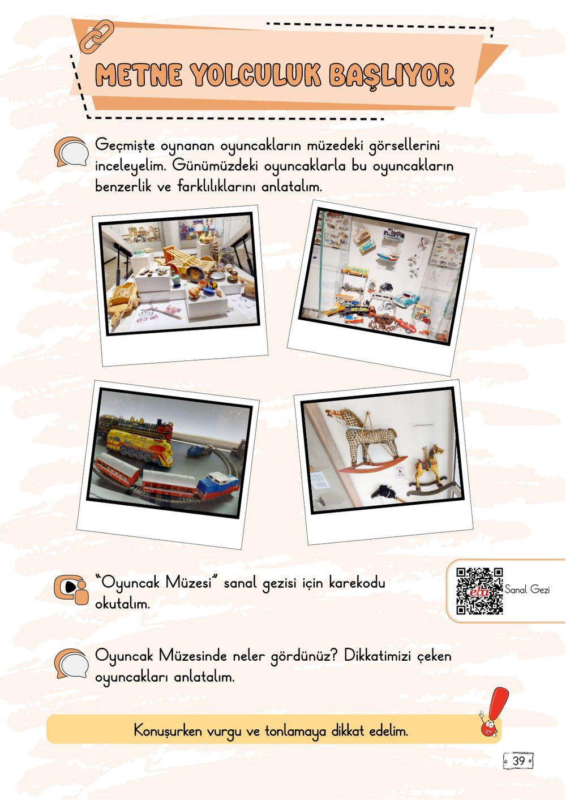

“Oyuncak Müzesi” sanal gezisi için karekodu okutalım.

 Sanal Gezi

Oyuncak Müzesinde neler gördünüz? Dikkatimizi çeken oyuncakları anlatalım.

Konuşurken vurgu ve tonlamaya dikkat edelim.

<!-- sayfa 39 -->

![icon] Başlığı ve görselleri inceleyip metnin konusunu ve metindeki olayları tahmin edelim.

![icon] Metni noktalama işaretlerine dikkat ederek önce sessiz sonra sesli okuyalım. Anlamını bilmediğimiz sözcüklerin altını çizelim.

# LOKUM, OYUN VE OYUNCAK MÜZESİNDE

Merhaba sevgili arkadaşım, bu ay Gaziantep Oyuncak Müzesini ziyaret ettim. Hadi gel, Oyun ve Oyuncak Müzesini hep beraber gezelim.

(...) Bu müzede el ve fabrika yapımı altı yüze yakın oyuncak bulunuyormuş.

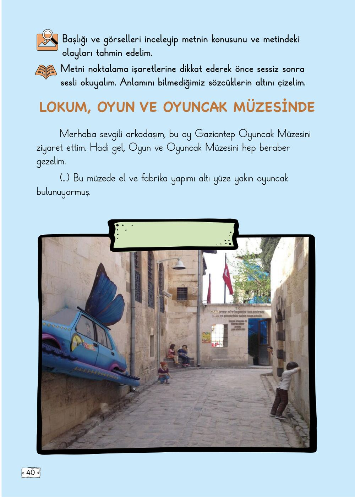

<!-- sayfa 40 -->

(...) Hiçbir çocuk oyuncaklara ve oyunlara dayanamaz biliyordum meğer yetişkinler de öyleymiş. Annem ve babam burayı benden daha çok sevdi. Hatta babam çok duygulandı, oyuncaklara bakıp bakıp “Ah benim gençliğim! Ne günlerdi, ne günler...” deyip durdu. “Lokum, bak biz küçükken...” diye başlayıp hiç bitmeyen sayısız cümle kurdu. (...)

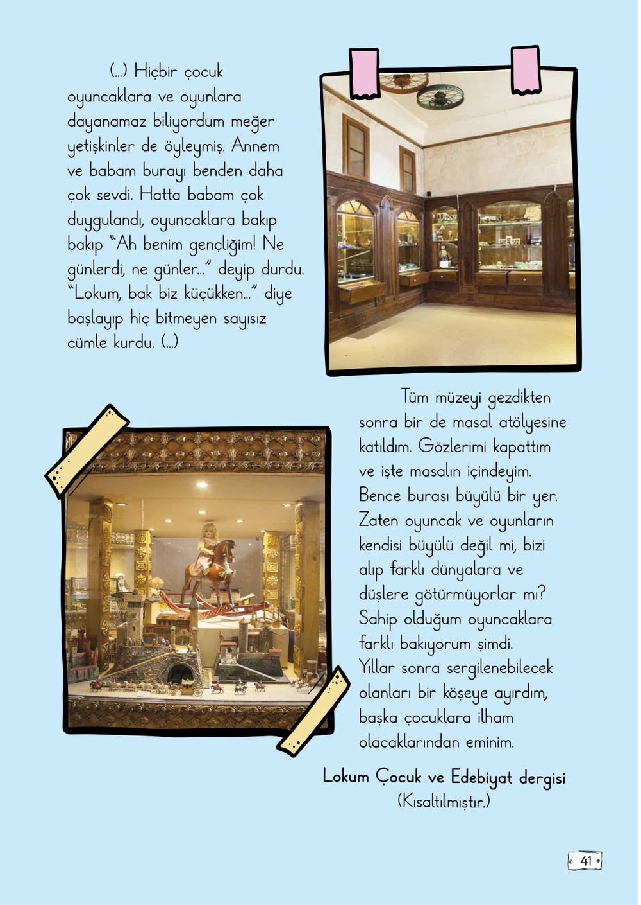

Tüm müzeyi gezdikten sonra bir de masal atölyesine katıldım. Gözlerimi kapattım ve işte masalın içindeyim. Bence burası büyülü bir yer. Zaten oyuncak ve oyunların kendisi büyülü değil mi, bizi alıp farklı dünyalara ve düşlere götürmüyorlar mı? Sahip olduğum oyuncaklara farklı bakıyorum şimdi. Yıllar sonra sergilenebilecek olanları bir köşeye ayırdım, başka çocuklara ilham olacaklarından eminim.

Lokum Çocuk ve Edebiyat dergisi
(Kısaltılmıştır.)

<!-- sayfa 41 -->

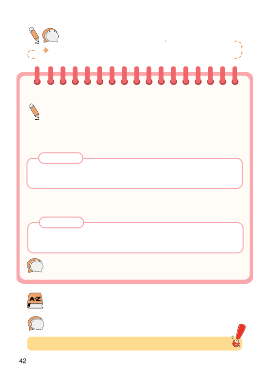 Metnin konusunu yazalım. Okuma öncesi yaptığımız tahmin ile metnin konusunu karşılaştıralım:
......................................................................................................................................................

# SÖZLÜK ÖZGÜRLÜKTÜR

 Cümleleri okuyalım. Koyu yazılmış sözcüklerin anlamını sözlükten araştırıp yazalım.

Bir müzede atalarımızın giydiği kıyafetleri görmüştüm.
Müzeleri gezmek tarihe yolculuk yapmak gibidir.

müze
Sözlük Anlamı: ....................................................................................................................................................
......................................................................................................................................................

Manzaradan ilham alarak resim çizdim.
Öğretmenimin anlattığı hikâye bana ilham verdi.

ilham
Sözlük Anlamı: ....................................................................................................................................................
......................................................................................................................................................

 Yeni öğrendiğimiz sözcüklerle cümleler kuralım.

 Okurken belirlediğimiz sözcüklerin anlamını www.sozluk.gov.tr adresinden araştırıp sözlük defterimize yazalım.

 Metni kendi ifadelerimizle anlatalım.

Konuşurken konuşma hızımıza dikkat edelim.

<!-- sayfa 42 -->

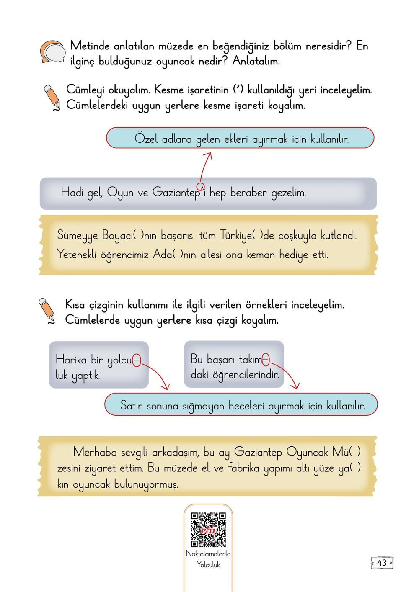 Metinde anlatılan müzede en beğendiğiniz bölüm neresidir? En ilginç bulduğunuz oyuncak nedir? Anlatalım.

 Cümleyi okuyalım. Kesme işaretinin (') kullanıldığı yeri inceleyelim. Cümlelerdeki uygun yerlere kesme işareti koyalım.

> Özel adlara gelen ekleri ayırmak için kullanılır.

Hadi gel, Oyun ve Gaziantep'i hep beraber gezelim.

Sümeyye Boyacı( )nın başarısı tüm Türkiye( )de coşkuyla kutlandı. Yetenekli öğrencimiz Ada( )nın ailesi ona keman hediye etti.

 Kısa çizginin kullanımı ile ilgili verilen örnekleri inceleyelim. Cümlelerde uygun yerlere kısa çizgi koyalım.

Harika bir yolcu-
luk yaptık.

Bu başarı takım-
daki öğrencilerindir.

> Satır sonuna sığmayan heceleri ayırmak için kullanılır.

Merhaba sevgili arkadaşım, bu ay Gaziantep Oyuncak Mü( )
zesini ziyaret ettim. Bu müzede el ve fabrika yapımı altı yüze ya( )
kın oyuncak bulunuyormuş.

<!-- sayfa 43 -->

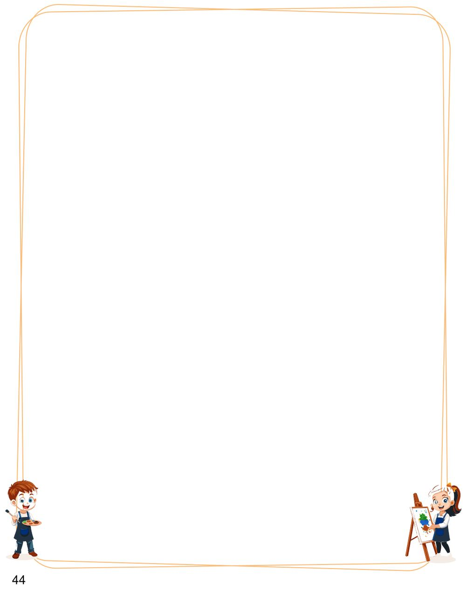 Bir müze tasarladığımızı ve bu müzede oyuncaklarınızı sergilediğimizi düşünelim. Tasarladığımız müzenin ve sergilediğimiz oyuncakların görselini çizip boyayalım.

<!-- sayfa 44 -->

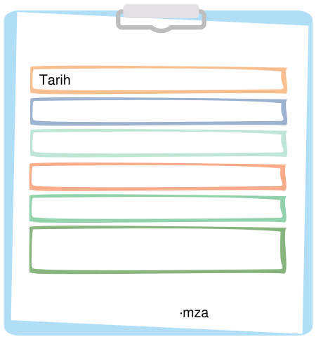 Çizdiğimiz müzeyi ve sergilediğimiz oyuncakları arkadaşlarımıza anlatmak için bir konuşma planı hazırlayalım.

---

# KONUŞMA PLANIM

**Tarih** : .................................................................................................

**Konuşmacı** : .................................................................................................

**Konuşma Konusu** : .................................................................................................

**Dinleyiciler** : .................................................................................................

**Konuşma Süresi** : .................................................................................................

**Anahtar Sözcükler:** .................................................................................................
.................................................................................................

**Adı Soyadı :** .................................................
**İmza :** .................................................

---

 Hazırladığımız plana uygun olarak konuşmamızı yapalım.

Konuşurken sözcükleri yerinde ve anlamına uygun kullanalım.

<!-- sayfa 45 -->

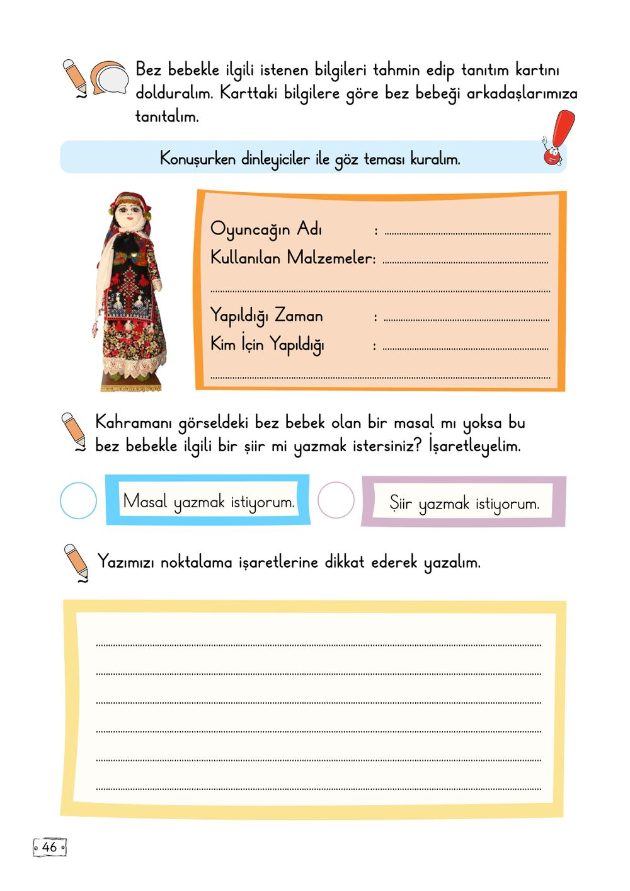 Bez bebekle ilgili istenen bilgileri tahmin edip tanıtım kartını dolduralım. Karttaki bilgilere göre bez bebeği arkadaşlarımıza tanıtalım.

> Konuşurken dinleyiciler ile göz teması kuralım. 

Oyuncağın Adı : ....................................................................
Kullanılan Malzemeler: ....................................................................
......................................................................................................................................................................................
Yapıldığı Zaman : ....................................................................
Kim İçin Yapıldığı : ....................................................................
......................................................................................................................................................................................

 Kahramanı görseldeki bez bebek olan bir masal mı yoksa bu bez bebekle ilgili bir şiir mi yazmak istersiniz? İşaretleyelim.

( ) Masal yazmak istiyorum. ( ) Şiir yazmak istiyorum.

 Yazımızı noktalama işaretlerine dikkat ederek yazalım.

......................................................................................................................................................................................
......................................................................................................................................................................................
......................................................................................................................................................................................
......................................................................................................................................................................................

<!-- sayfa 46 -->

# METNE YOLCULUK BAŞLIYOR

Yönergeyi uygulayarak röportaj yapalım.

## RÖPORTAJ YAPALIM

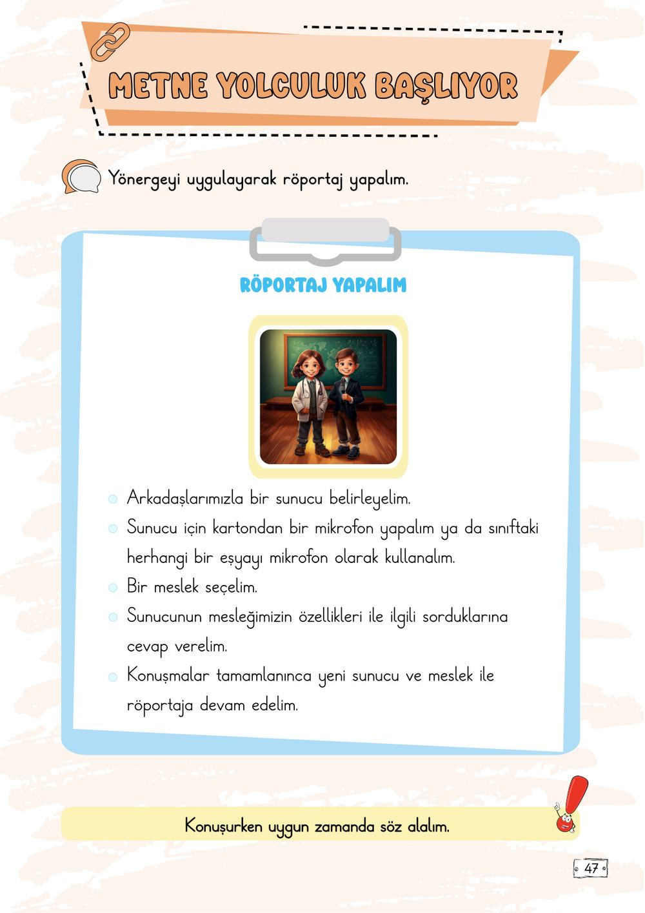

* Arkadaşlarımızla bir sunucu belirleyelim.
* Sunucu için kartondan bir mikrofon yapalım ya da sınıftaki herhangi bir eşyayı mikrofon olarak kullanalım.
* Bir meslek seçelim.
* Sunucunun mesleğimizin özellikleri ile ilgili sorduklarına cevap verelim.
* Konuşmalar tamamlanınca yeni sunucu ve meslek ile röportaja devam edelim.

Konuşurken uygun zamanda söz alalım.

<!-- sayfa 47 -->

🖼️ Başlığı ve görselleri inceleyip şiirin konusunu tahmin edelim.
📖 Şiiri noktalama işaretlerine dikkat ederek önce sessiz sonra sesli okuyalım. Anlamını bilmediğimiz sözcüklerin altını çizelim.

# MESLEKLER

Gördünüz ya çocuklar,
Çalışmanın sonu yok.
Mesleklerin sayısı,
İnsanlar kadar pek çok.

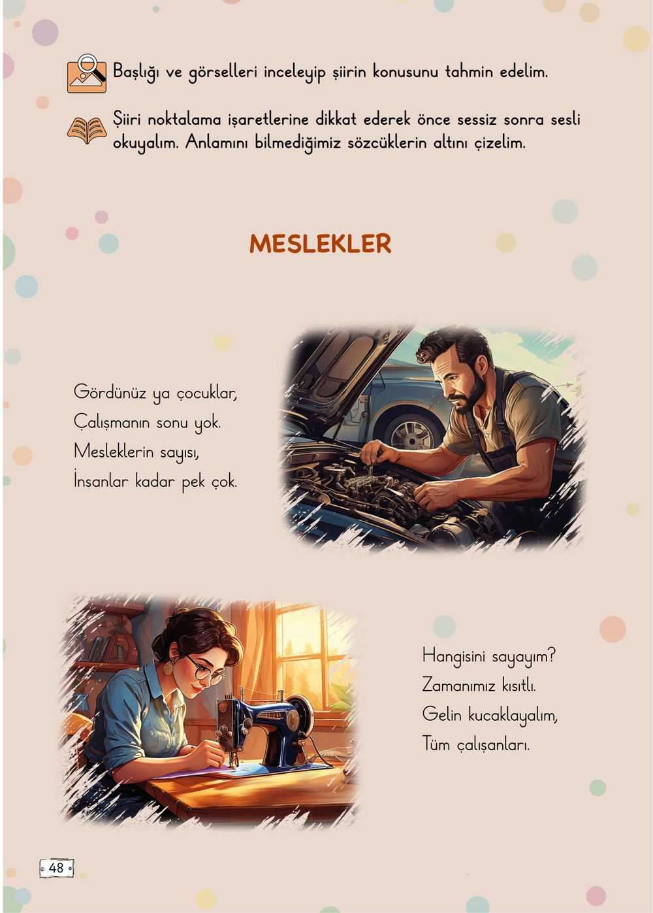

Hangisini sayayım?
Zamanımız kısıtlı.
Gelin kucaklayalım,
Tüm çalışanları.

<!-- sayfa 48 -->

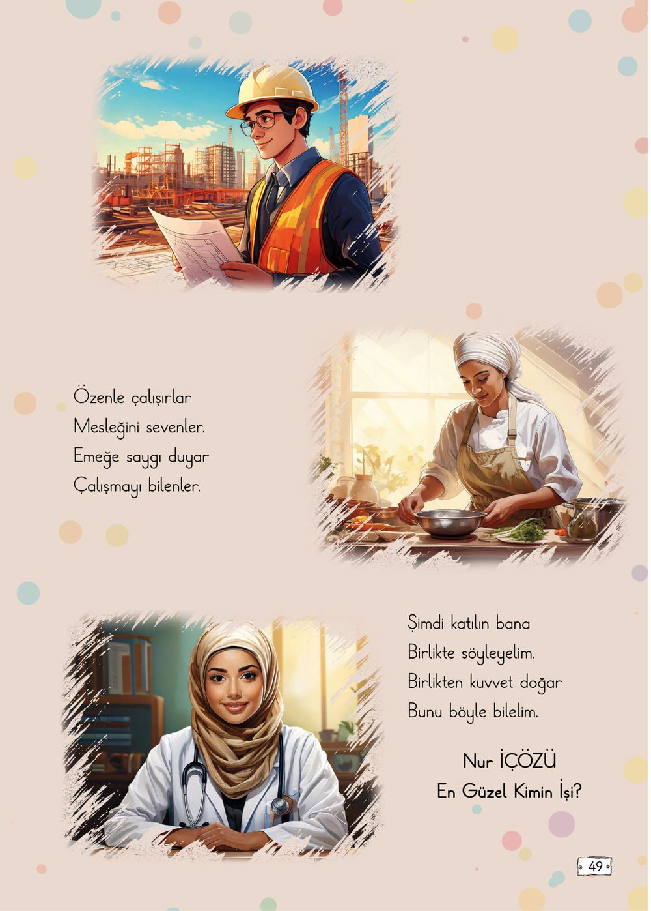

Özenle çalışırlar
Mesleğini sevenler.
Emeğe saygı duyar
Çalışmayı bilenler.

Şimdi katılın bana
Birlikte söyleyelim.
Birlikten kuvvet doğar
Bunu böyle bilelim.

Nur İÇÖZÜ
En Güzel Kimin İşi?

<!-- sayfa 49 -->

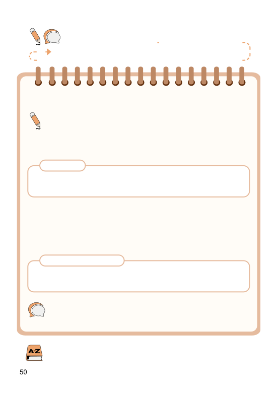 Şiirin konusunu yazalım. Okuma öncesi yaptığımız tahmin ile şiirin konusunu karşılaştıralım.
......................................................................................................................................................

# SÖZLÜK ÖZGÜRLÜKTÜR

 Cümleleri okuyalım. Koyu yazılmış sözcük ve sözcük grubunun anlamını sözlükten araştırıp yazalım.

Kıyafetlerimizin temiz olmasına **özen** göstermeliyiz.
Her sabah yatağını **özenle** topluyordu.

| özen |
| :--- |
| Sözlük Anlamı: .................................................................................................................................................... |
| ...................................................................................................................................................... |

Çanakkale’de genç, yaşlı herkes “*Birlikten kuvvet doğar.*” diyerek omuz omuza savaştı.
Takımca mücadele ederek maçı kazandık, çünkü biz biliyoruz ki “*Birlikten kuvvet doğar.*”

| Birlikten kuvvet doğar. |
| :--- |
| Sözlük Anlamı: .................................................................................................................................................... |
| ...................................................................................................................................................... |

 Yeni öğrendiğimiz sözcük ve sözcük grubuyla cümleler kuralım.

 Okurken belirlediğimiz sözcüklerin anlamını www.sozluk.gov.tr

<!-- sayfa 50 -->

 Şiirde meslekler ile ilgili ne anlatılıyor? Kendi ifadelerimizle anlatalım.

 “Meslekler” şiirinde eksik bırakılan yerleri şiire bakarak tamamlayalım.

Gördünüz ya çocuklar,
Çalışmanın sonu yok.
......................................................................
......................................................................

Hangisini sayayım?
......................................................................
Gelin kucaklayalım,
......................................................................
......................................................................
Mesleğini sevenler.
......................................................................
Çalışmayı bilenler.
......................................................................
......................................................................
Birlikten kuvvet doğar
Bunu böyle bilelim.

<!-- sayfa 51 -->

 Büyüyünce hangi mesleği yapmak istediğimizi nedenleriyle yazalım.

┌──────────────────────────────────────────────────────────────────────────┐
│                                                                          │
│      Ben büyüyünce ......................................... olmak istiyorum. │
│      Çünkü .............................................................. │
│      .................................................................... │
│      .................................................................... │
│      .................................................................... │
│      .................................................................... │
│      .................................................................... │
│      .................................................................... │
│                                                                          │
└──────────────────────────────────────────────────────────────────────────┘

 Yazdığımız mesleğin görselini çizip boyayalım. Mesleğimizi arkadaşlarımıza anlatalım.

┌──────────────────────────────────────────────────────────────────────────┐
│                                                                          │
│                                                                          │
│                                                                          │
│                                                                          │
│                                                                          │
│                                                                          │
│                                                                          │
│                                                                          │
│                                                                          │
│

<!-- sayfa 52 -->

 Şiirde geçen “emeğe saygı duymak” ve “özenle çalışmak” ifadelerinin ne anlama geldiğini arkadaşlarımızla tartışalım.

Konuşurken konuşma hızına dikkat edelim.

 Görselleri inceleyelim. İlgimizi en çok çeken bilmeceyi arkadaşlarımıza soralım.

Sınıfta ders anlatır, bilgi saçar.
Çocukları eğitir, onlara yol açar.
Kitaplar, defterler onun işi,
Bilin bakalım kim bu kişi?

Düşleri çizer, yapıları inşa eder.
Planlarını hep önceden yapar.
Binalar, köprüler onun işi,
Bilin bakalım kim bu kişi?

Hayvan dostlarımızı iyileştirir.
Onların bakımını üstlenir.
Kedi, köpek, koyun onun işi,
Bilin bakalım kim bu kişi?

Bahçedeki tüm bitkileri
Eker, biçer, büyütür.
Çiçeklerdir onun işi,
Bilin bakalım kim bu kişi?

<!-- sayfa 53 -->

# KENDİMİZİ DEĞERLENDİRELİM

 Metni noktalama işaretlerine dikkat ederek sessiz okuyalım.

## SANAT ÇALIŞMALARI

Nuray ve arkadaşları okulun sanat atölyesinde buluştu. Öğretmenleri, onlara farklı sanat malzemeleri verdi: boya kalemleri, fırçalar, renkli kâğıtlar ve **kil**. İlk olarak Nuray, bahçesi renkli çiçeklerle dolu kırmızı bir ev yaptı. Ali, deniz kenarında mavi bir ev yaptı. Emre ise orman içinde yeşil bir ev yaptı. Resimlerini boya kalemleri ve renkli kâğıtlar kullanarak süslediler. Sonra diğer öğrenciler kil ile heykel yapmaya başladılar. Can, kil ile minik bir kuş yaptı. Merve ise bir çiçek tarlası **tasarladı**. Murat, bir gitar yaptı. Fırçaları boyalara batırarak yaptıklarını süslediler. Gün boyunca bol bol güldüler. Sanatla dolu bir günün ardından herkes mutlu bir şekilde evine döndü. Ertesi gün yeniden buluşmak için sözleştiler.

 Metnin konusunu yazalım.

.....................................................................................................................................................................................................

 Metindeki koyu yazılmış sözcüklerin bulunduğu cümleleri tekrar okuyalım. Sözcüklerin anlamını sözlükten araştırarak yazalım. Yeni öğrendiğimiz sözcüklerle cümleler oluşturalım

**kil**

Sözlük Anlamı: .................................................................................................................................................................................................................................................................................................................................................................................................................................................................................................................................................................................................................................................................................................

<!-- sayfa 54 -->

 Metindeki çocukların yaptığı sanat çalışmalarını yazalım.

| | |
| :--- | :--- |
| Nuray $\rightarrow$ | ........................................................................................................................................ |
| Emre $\rightarrow$ | ........................................................................................................................................ |
| Can $\rightarrow$ | ........................................................................................................................................ |
| Merve $\rightarrow$ | ........................................................................................................................................ |
| Murat $\rightarrow$ | ........................................................................................................................................ |
| Ali $\rightarrow$ | ........................................................................................................................................ |

 Metindeki çocukların yaptığı sanat çalışmalarının benzerlik ve farklılıklarını yazalım.

**Benzerlikler**
..............................................................................................................................................................................................
..............................................................................................................................................................................................

**Farklılıklar**
..............................................................................................................................................................................................
..............................................................................................................................................................................................

 Metindeki çocuklar ertesi gün buluştuklarında hangi sanatsal çalışmaları yapmış olabilirler? Noktalama işaretlerine dikkat ederek yazalım.

..............................................................................................................................................................................................
................................................................................

<!-- sayfa 55 -->

# 6. TEMA
# MUCİT ÇOCUK

## Anahtar Kavramlar

* araştırma
* bilim
* kâşif
* keşif
* merak
* sorgulama
* teknoloji
* yapay zekâ

<!-- sayfa 56 -->

# TEMADAKİ METİNLER

 ASLAN-TEKNOFEST
 ÇOK MERAK, ÇOK EĞLENCE
 MERAKLI, CESUR VE MACERACI ALPER GEZERAVCI
 BİLGİ ÇAĞI
 NELER OLUYOR?

■ Bu tema boyunca, metinlerimiz aracılığıyla dinleme/izleme, konuşma, okuma ve yazma becerilerimizi geliştireceğiz. Metinlerimizi işlerken yeni bilgiler ve beceriler kazanacağız. Saygı, sorumluluk gibi değerleri...

<!-- sayfa 57 -->

# ÖN DEĞERLENDİRME ÇALIŞMASI

: Kareleri dolaşarak sözcükler oluşturalım.

* İstediğiniz bir kareden başlayabilirsiniz.
* Her adımda bulunduğunuz karenin komşusu olan (yatay, dikey, çapraz) bir kareye hareket edebilirsiniz.

| A | R | A | Ş |
|---|---|---|---|
| K | O | B | T |
| E | T | O | I |
| Z | A | M | R |

1. Sözcük: ............................................
2. Sözcük: ............................................
3. Sözcük: ............................................

: Bulduğumuz sözcükleri kullanarak kısa bir metin yazalım.

.......................................................................................................................................................................................
........................................................................................................................................................................................
........................................................................................................................................................................................
........................................................................................................................................................................................
........................................................................................................................................................................................
................................................

<!-- sayfa 58 -->

# METNE YOLCULUK BAŞLIYOR

Verilen yönergelerden yararlanarak kâğıttan kayık yapalım.

## KAYIĞIN YAPIM AŞAMALARI

1. A4 kâğıdını ikiye katlayalım.
2. Kâğıdı üst köşelerinden ortaya katlayalım.
3. Kâğıdın köşelerini geriye doğru katlayalım.
4. Aşağıda kalan şeridin bir katını yukarı katlayalım.
5. Aşağıda kalan şeridin diğer katını yukarı katlayalım.
6. Kâğıdın içini (orta kısmı) açalım.
7. Kâğıdı tam tersi yönde köşelerinden yukarı katlayalım.
8. Orta kısmı açalım ve tam tersi yönünde katlayalım.
9. Kâğıdın köşelerinden tutalım ve geriye doğru açalım.

Yaptığınız kayıkla nasıl bir yarışmaya katılmak isterdiniz?

<!-- sayfa 59 -->

# ASLAN-TEKNOFEST

 Görselleri inceleyip metnin konusunu tahmin edelim.

 Metni dinleme/izleme kurallarına uygun olarak izleyelim. İzleme esnasında anlamını bilmediğimiz sözcükleri belirleyelim.

<!-- sayfa 60 -->

Metnin konusunu yazalım. İzleme öncesi yaptığımız tahmin ile metnin konusunu karşılaştıralım.
..............................................................................................................................................................................

# SÖZLÜK ÖZGÜRLÜKTÜR

Görsellerden hareketle sözcüklerin ve sözcük grubunun anlamlarını tahmin edip sözcükleri anlamlarıyla eşleştirelim.

insansız hava aracı

batarya

atölye

Uzaktan kumanda ile veya kendiliğinden keşif ve gözetleme yapabilen insansız araç.

Gerekli donanımı yapılmış uygulama ve üretim yapılan ortam.

Bir hava taşıtını kullanmak ve yönetmekle görevli kimse.

Pillerin bir araya getirilmesiyle oluşturulan pil grupları.

<!-- sayfa 61 -->

# SÖZLÜK ÖZGÜRLÜKTÜR

 Yeni öğrendiğimiz sözcükler ve sözcük grubu ile cümleler yazalım.

> atölye: ...............................................................................................................................................................
> batarya: ...............................................................................................................................................................
> insansız hava aracı: ...............................................................................................................................................................

 İzlerken belirlediğimiz sözcüklerin anlamını www.sozluk.gov.tr adresinden araştırıp sözlük defterimize yazalım.

 İzlediğimiz metinle ilgili soruların cevaplarını yazalım.

1. TEKNOFEST katılımcılara hangi imkânları sağlamış?
   ................................................................................................................................................................................................
2. Yarışmaya başlarken kırmızı takımın aracı neden çalışmamış?
   ................................................................................................................................................................................................
3. Yarışma sonunda siyah takım, kırmızı takıma neler söylemiş?
   ................................................................................................................................................................................................
4. Kırmızı takım seneye hangi yarışmalara katılmayı düşünüyormuş?
   ................................................................................................................................................................................................
5. Sizce kırmızı takımın kazanmasının en önemli sebebi nedir?
   ................................................................................................................................................................................................

<!-- sayfa 62 -->

 İzlediğiniz metindeki takımlardan birinde olsaydınız nasıl davranırdınız? Yazalım.

Siyah takımda olsaydım:
.................................................................................................................................................................................................
.................................................................................................................................................................................................
.................................................................................................................................................................................................
.................................................................................................................................................................................................

Kırmızı takımda olsaydım:
.................................................................................................................................................................................................
.................................................................................................................................................................................................
.................................................................................................................................................................................................
........................................................................................................................................................................................

<!-- sayfa 63 -->

 Metindeki ifadeleri ilgili oldukları sahnelerin görselleri ile eşleştirelim.

1
Pilot kalkış için hazır!

2
Haydi, deneyelim artık meraktan bayılacağım!

3
Ustaca yarıştınız, tebrik ederim.

4
Eyvah, bataryayı takmayı unutmuşuz!

5
Tıpkı bir füze gibi yükü aldı.

<!-- sayfa 64 -->

 TEKNOFEST’e katılsaydınız hangi alanda yarışmak isterdiniz? İşaretleyelim.

○ Robot Yarışması
○ Roket Yarışması
○ Drone Yarışması
○ İHA Yarışması
○ Elektrikli Araç Yarışması

 İşaretlediğimiz yarışma türü ile ilgili bilgileri yazalım.

Yarışmak İstediğim Alan : ..................................................................................................
Tasarladığım Teknolojik Aletin Adı: ..................................................................................................
Teknolojik Aletin Özellikleri : ...................................................................................................
....................................................................................................................................................................................................

 Yarışma için tasarladığımız teknolojik aletin resmini çizelim ve boyayalım.

<!-- sayfa 65 -->

TEKNOFEST’e katılan takımlarla ilgili bilgiler verilmiştir. Her takım bir kategoride derece almıştır. Takımların hangi kategoride yarıştığını ve sıralamalarını ipuçlarından yararlanarak bulalım.

### İPUÇLARI

1. İkinci olan takımın isminde “r” harfi vardır.
2. Robot yarışmasına katılan takım birinci olamamıştır.
3. İkinci olan takım roket yarışmasına katılmıştır.
4. Mavi takım İHA yarışına katılmamıştır.
5. Siyah takım ikinci ve üçüncü olmamıştır.

| | İHA Yarışması | Robot Yarışması | Roket Yarışması | 1. Olan Takım | 2. Olan Takım | 3. Olan Takım |
| :--- | :---: | :---: | :---: | :---: | :---: | :---: |
| **Siyah Takım** | | | | | | |
| **Kırmızı Takım** | | | | | | |
| **Mavi Takım** | | | | | | |

Kırmızı takımda yarışmaya katılan kişi siz olsaydınız yarışma sonrasında siyah ve mavi takımdaki yarışmacılara neler söylemek isterdiniz? Anlatalım.

Konuşurken vurgu ve tonlamaya dikkat edelim.

<!-- sayfa 66 -->

# METNE YOLCULUK BAŞLIYOR

Karekodu okutup şarkıyı dinleme kurallarına uygun olarak dinleyelim. Şarkının sözlerini okuyarak şarkıya eşlik edelim. Şarkıdan anladıklarımızı arkadaşlarımızla paylaşalım.

## AKLIMDAKİLER

Dünya hep dönüyor da,
Neden başı dönmüyor?
Ağaçlar hep aynı yerde,
Hiç mi canı sıkılmıyor?

Filler hortumuyla,
Ormanı mı suluyor?
Çiçeklerin yaprağını,
Gece biri mi kapatıyor?

Hayvanlar konuşmadan,
Nasıl anlaşıyorlar?
Yağmurlar bulutlardan,
Tek tek mi düşüyorlar?

Dinozorlar yaşasaydı,
İnsanlar ne yapardı?
Kar beyaz olmasaydı,
Bilmem ne renk olurdu?

Güve halıyı yer mi?
Kurt kelebek olur mu?
Aklımda çok soru var.
Meraksız durulur mu?

Emel METİN
Biri Şiir mi Dedi?

 Akıldakiler

<!-- sayfa 67 -->

 Başlığı ve görselleri inceleyip metnin konusunu ve metinde geçen olayları tahmin edelim.

 Metni noktalama işaretlerine dikkat ederek önce sessiz sonra sesli okuyalım.

# ÇOK MERAK, ÇOK EĞLENCE

Bizim evin en meraklısı kim? Evimizin hallerinden söz edeyim. Siz karar verin. En küçük meraklımız kedimiz Şurup. Tüm kediler meraklıdır. Bizim Şurup bir başka. (...) Kuşlar Şurup'un özel ilgi alanı. Sabah aynı saatte pencerenin önüne geçiyor. Nasıl dikkat kesildiğini görseniz. Evdeki her ses, her koku bizim Şurup'un merakını tetikliyor. Ne olduğunu anlayana kadar araştırmaya devam ediyor. Tam bir bilim adamı gibi meraklı, araştırmacı, kararlı... Ve çok mutlu bir kedi.

<!-- sayfa 68 -->

Kardeşim Ayşe’nin de Şurup’tan farkı yok sayılır. Çiçek, böcek, kuş, kedi, köpek, gökyüzü, toprak... “Acaba bu begonyalar neden sarı değil de pembe?” “Bizim şehirde neden hiç hortum olmuyor?” “Kuşlar neden göç ediyor?” (...)

Ayşe’nin soruları, sağanak bir yağmur gibi. Hiç sonu gelmeyecek sanırsınız. Neyin nasıl olduğunu öğrenmeden edemiyormuş. Allah’tan benim gibi meraklı, bilgili bir ağabeyi var. Sorularının yanıtını biliyorsam anlayacağı şekilde anlatıyorum. Bilmiyorsam da birlikte kitapları karıştırıyoruz. İnternette araştırma yapıyoruz. Benim için de çok eğlenceli oluyor. Tabi sorulara yeni sorular eklediğinde sabırlı bir ağabey olmak için çaba sarf etmem gerekiyor. Ne yapalım? Ben de anneme, babama az soru sormadım. Hâlâ da sorularım bitmez. Onlar da sağ olsunlar, o an mümkün olmasa bile mutlaka bize yanıt verirler.(...)

**Mavi Kırlangıç dergisi**
*(Kısaltılmıştır.)*

<!-- sayfa 69 -->

Metnin konusunu yazalım. Okuma öncesi yaptığımız tahmin ile metnin konusunu karşılaştıralım.
..............................................................................................................................................................................

# SÖZLÜK ÖZGÜRLÜKTÜR

Koyu yazılmış sözcüklerin anlamını cümlelerden ve görselden hareketle tahmin edelim. Sözcüklerin sözlük anlamını yazarak cümle içinde kullanalım.

 Pencerede renk renk **begonyalar** vardı.
**Begonya** annemin en sevdiği çiçektir.

begonya
Sözlük Anlamı: ........................................................................................................................................
......................................................................................................................................................................
Cümlem: ...................................................................................................................................................

 Öğretmenimiz **hortumun** oluşumunu anlattı.
Şiddetli **hortum** çatılara zarar vermiş.

hortum
Sözlük Anlamı: ........................................................................................................................................
......................................................................................................................................................................
Cümlem: ...................................................................................................................................................

Okurken belirlediğimiz sözcüklerin anlamını www.sozluk.gov.tr

<!-- sayfa 70 -->

 Metinle ilgili soruların cevaplarını yazalım.

1. Evin en küçük meraklısı kimdir?
..................................................................................................................................................................................................

2. Şurup'un özellikleri nelerdir?
..................................................................................................................................................................................................

3. Ayşe'nin cevabını merak ettiği sorular nelerdir?
..................................................................................................................................................................................................

4. Ayşe, sorularının cevabını bulmak için hangi yolları deniyor?
..................................................................................................................................................................................................

 Sizce metindeki çocuk anne ve babasına hangi soruları sormuş olabilir? Anne ve babası metindeki çocuğun sorularına ne cevaplar vermiştir? Anlatalım.

 Konuşurken anlamlı ve kurallı cümleler kuralım.

 Sözcüklerin zıt anlamlarını karşılarındaki kutucuklara yazalım. Verilen zıt anlamlı sözcükleri kullanarak “merak” konusunda bir hikâye kurgulayıp arkadaşlarımızla paylaşalım.

| | | | |
| :--- | :--- | :--- | :--- |
| küçük | ................................ | soru | ................................ |
| ön | ................................ | az | ................................ |

<!-- sayfa 71 -->

# Verilen ipuçlarından yola çıkarak şehirleri bulalım.

Şanlıurfa | Adana | Konya | Eskişehir
Rize | Niğde

## TÜRKİYEM ŞİİRİ

Yemyeşil çay bahçeleri,
Deli akar dereleri,
Trabzon’dan az ötede,
Şehrin haritadaki yeri.
`_İ_E`

Köprübaşına oturur,
Seyhan’ı seyredersin.
Pamuğunun beyazında,
Kışlarını yaz edersin.
`_D_N_`

Adana’yla yarışır,
Kebabıyla ciğeri,
Kurutulup pul olur,
Yeşil kırmızı biberi.
`__N_I_____`

Tespihinde, küpesinde,
Pek bilinir lüle taşı,
Kırım ilinden gelmiştir,
Çi börek denen aşı.
`__K___H_R`

Bozkırın ortasında,
Sevgiye gider yolları,
Bütün ülkeyi doyurur,
Sanki bir buğday ambarı.
`_O____`

Emel SEZGİN
Sınıf Öğretmenlerinin
Türkçe Öğretim Becerilerinin

<!-- sayfa 72 -->

# METNE YOLCULUK BAŞLIYOR

Gazete haberini okuyalım. Haberden neler anladığımızı arkadaşlarımıza anlatalım.

İletişim sırasında uygun zamanda söz alalım.

# YURDUMUZDAN HABERLER
09.02.2024

**Millî Gururumuz Alper GEZERAVCI Tarihe Geçti!**
Uluslararası Uzay İstasyonu'na çıkan Türkiye'nin ilk astronotu Alper Gezeravcı, Dünya'ya döndü.

İSTİKBAL GÖKLERDEDİR!

<!-- sayfa 73 -->

🔍 Başlığı ve görseli inceleyip metnin konusunu ve metinde geçen bilgileri tahmin edelim.
📖 Metni noktalama işaretlerine dikkat ederek önce sessiz sonra sesli okuyalım.

# MERAKLI, CESUR VE MACERACI ALPER GEZERAVCI

Uzayla ilgili heyecan verici bir maceraya atılmaya hazır mısınız? Sıkı tutunun çünkü Türkiye’nin ilk astronotu Alper Gezeravcı ile tanışmak üzereyiz!

Bulutların üzerine çıktığınızı, etrafınızın parıldayan yıldızlar ve ışıldayan gezegenlerle çevrili olduğunu hayal edin. Alper Gezeravcı, Türkiye’nin ilk astronotu olarak tam da bunu deneyimledi. (...) 

<!-- sayfa 74 -->

Alper Gezeravcı, birçoğumuz gibi ülkemizde doğdu ve büyüdü. Küçük yaşlardan itibaren evrenin gizemlerini keşfetmeyi ve yıldızlara ulaşmayı hayal etti. Okulda özellikle fen ve matematik gibi derslere çok çalıştı, çünkü bunların astronot olmak için önemli olduğunu biliyordu. Büyüdüğünde ise onu gökyüzüne ulaştıracak bir meslek edinmeyi, pilot olmayı tercih etti. (...)

Astronot olmak sadece eğlence ve eşsiz deneyimlerden ibaret değil. Çok fazla cesaret, zekâ ve ekip çalışması gerektiriyor. (...) Kim bilir? Belki bir gün, evreni keşfedecek ve kendi tarihinizi yazacak bir sonraki astronot siz olursunuz!

*Öncü Çocuk dergisi*
*(Kısaltılmıştır.)*

<!-- sayfa 75 -->

<!-- yer tutucu bulunamadı: sayfa sonuna eklendi -->

<!-- sayfa 76 -->

# SÖZLÜK ÖZGÜRLÜKTÜR

*Uzayla ilgili araştırma yaptım.*
*Bilim adamları **uzaya** keşfe gidiyorlarmış.*

**uzay**
Sözlük Anlamı: ....................................................................................................................................................
..........................................................................................................................................................................
..........................................................................................................................................................................
Cümlem: ............................................................................................................................................................
..........................................................................................................................................................................

***

* Okurken belirlediğimiz sözcüklerin anlamını www.sozluk.gov.tr adresinden araştırıp sözlük defterimize yazalım.
* Metinle ilgili soruları cevaplayalım.

**Konuşurken konuşma hızımızı ayarlayalım.**

1. Türkiye´nin ilk astronotu kimdir?
2. Alper Gezeravcı özellikle hangi derslere çalıştı? Neden?
3. Alper Gezeravcı büyüdüğünde hangi mesleği tercih etti?
4. Metne göre astronot olmak için neler gerekiyor?

* Alper Gezeravcı ile kendimizin benzer ve farklı yönlerini yazalım.

| Benzerlikler | Farklılıklar |
| :--- | :--- |
| ........................................................................ | ........................................................................ |

<!-- sayfa 77 -->

 **Eksik bırakılan cümleleri uygun sözcüklerle tamamlayalım.**

| uzay | matematik | merak |
| :--- | :--- | :--- |
| Alper Gezeravcı | bilim | |
| yıldızların | araçlar | ödevini |

 

Buse uzayla ilgili her şeyi ..................................................... ediyor.

Türkiye’nin ilk astronotu ................................................................. ile tanıştım.

Anıl Berk, büyüyünce ..................................................... insanı olmak istiyor.

Acaba ..................................................... araçlarını kimler yapıyor?

Azra fen ve ..................................................... derslerinde çok başarılıdır.

Gezegenlerin ve ..................................................... ışıltısı göz kamaştırıyor.

Kardeşim öğretmeninin verdiği araştırma ..................................... yapıyor.

<!-- sayfa 78 -->

# METNE YOLCULUK BAŞLIYOR

 Ulaşım ve iletişim araçlarını inceleyelim.

1. Araba
2. Eski televizyon
3. Eski telefon
4. Akıllı telefon
5. Radyo
6. At arabası
7. Dizüstü bilgisayar
8. Modern televizyon
9. Mektup

Geçmişte ve günümüzde kullanılan ulaşım ve iletişim araçlarının numaralarını verilen alanlara yazalım.

| Geçmişte Sık Kullanılan Araçlar | Günümüzde Sık Kullanılan Araçlar |
| :--- | :--- |
| ................................................... | ................................................... |
| ................................................... | ................................................... |
| ................................................... | ................................................... |
| ................................................... | ................................................... |

 Benzeriz, Farklıyız!

<!-- sayfa 79 -->

🔍 Başlığı ve görseli inceleyip şiirin konusunu tahmin edelim.

📖 Şiiri noktalama işaretlerine dikkat ederek önce sessiz sonra sesli okuyalım.

# BİLGİ ÇAĞI

Dört bir yana yayıldı
İletişim kuşağı.
Göklerdeki uydular
Yakın eder uzağı.

Dünyamızı kapladı
Artık internet ağı.
Ekrandan hepimizi
Selamlar bilgi çağı.

<!-- sayfa 80 -->

Dünyanın her yerine
Bir anda gidiyoruz.
Bilim adamlarına
Teşekkür ediyoruz.
(...)

Gerçek rehber olarak
Bilgiyi seçmeliyiz,
Uygarlık yarışında
Herkesi geçmeliyiz.

Bestami YAZGAN
Çıtı Pıtı Kutu Kutu Şiirler
(Kısaltılmıştır.)

<!-- sayfa 81 -->

 Şiirin konusunu yazalım. Okuma öncesi yaptığımız tahmin ile şiirin konusunu karşılaştıralım.
..............................................................................................................................................................................

# SÖZLÜK ÖZGÜRLÜKTÜR

Görselden hareketle sözcüklerin anlamlarını tahmin edip sözlük anlamlarıyla eşleştirelim. Sözcüklerin sözlük anlamını yazarak cümle içerisinde kullanalım.

uydu

bilim adamı

Bilimsel çalışmalarla uğraşan kimse.

Güneş çevresinde dolanan gök cisimlerinin ortak adı.

Türlü amaçlarla yerden fırlatılan gökyüzünde gezen araç.

uydu
Sözlük Anlamı: ....................................................................................................................................................
......................................................................................................................................................
......................................................................................................................................................
Cümlem: ....................................................................................................................................................

bilim adamı
Sözlük Anlamı: ....................................................................................................................................................
......................................................................................................................................................
......................................................................................................................................................
Cümlem: ....................................................................................................................................................

A-Z Okurken belirlediğimiz sözcüklerin anlamını www.sozluk.gov.tr

<!-- sayfa 82 -->

 Şiir ile ilgili soruları cevaplayalım.

Konuşurken sözcükleri yerinde ve anlamına uygun kullanalım. 

1. Şaire göre uzağı yakın eden nedir?
2. Şaire göre dünyamızı kaplayan nedir?
3. Şaire göre hepimizi selamlayan nedir?
4. Şair kimlere teşekkür ediyor?
5. Şaire göre gerçek rehber olarak neyi seçmeliyiz?

 Eksik olan sözcükleri şiire göre tamamlayalım.

.........................................................

Dört bir yana yayıldı
.............................................. kuşağı.
Göklerdeki ..............................................
Yakın eder uzağı.

Gerçek .............................................. olarak
.............................................. seçmeliyiz,
.............................................. yarışında
Herkesi geçmeliyiz.

<!-- sayfa 83 -->

 Verilen yönergelere göre tablodaki şekillerden başlayarak ok yönünde ilerleyelim. Heceleri birleştirerek oluşan sözcüğü örnekteki gibi yazalım.

| Şekil | Yönerge | Sözcük |
| :---: | :--- | :--- |
| $\square$ | $1 \rightarrow 1 \downarrow 3 \rightarrow 1 \uparrow 2 \rightarrow 1 \downarrow 3 \rightarrow$ <!-- KONTROL: Marker'da karşılığı yok, uydurma olabilir --> | meraklı |
| $\bigcirc$ | $1 \rightarrow 2 \downarrow 4 \rightarrow 3 \uparrow 3 \rightarrow 2 \downarrow 1 \rightarrow$ <!-- KONTROL: Marker'da karşılığı yok, uydurma olabilir --> | .................... |
| $\hexagon$ | $1 \rightarrow 1 \downarrow 5 \rightarrow 2 \uparrow 2 \rightarrow 2 \downarrow 1 \rightarrow$ <!-- KONTROL: Marker'da karşılığı yok, uydurma olabilir --> | .................... |

| | | | | | | | |
| :---: | :---: | :---: | :---: | :---: | :---: | :---: | :---: |
| $\square$ | $\rightarrow$ | ka | | $\rightarrow$ | $\rightarrow$ | rak | hi | |
| | $\downarrow$ | | $\uparrow$ | | | $\downarrow$ | | |
| | $\rightarrow$ | $\rightarrow$ | $\rightarrow$ me | | $\rightarrow$ | $\rightarrow$ | $\rightarrow$ lı | |
| | | se | | tır | | ma | | |
| $\bigcirc$ | | ye | | | | | ret | |
| | | pa | | | Ta | | cı | |
| | a | | | raş | rar | | | |
| $\hexagon$ | | ak | | | | | | |
| | | | | | ka | | lı | |
| | | me | | | dö | | | |

 Bulduğumuz sözcüklerle anlamlı ve kurallı cümleler yazalım.

___________________________________________________________________________

<!-- sayfa 84 -->

# METNE YOLCULUK BAŞLIYOR

Bir robot tasarlamak isteseydiniz nasıl bir robot tasarlardınız? Robotumuzla ilgili istenen bilgileri yazalım ve robotun görselini çizelim. Robotumuzun bilgilerini ve görselini arkadaşlarımıza sunalım.

Adı : ..........................................................................................................................................
Çalışma Şekli : .........................................................................................................................................
Özellikleri : ..........................................................................................................................................
.......................................................................................................................................................................................
.......................................................................................................................................................................................

<!-- sayfa 85 -->

![icon] Başlığı ve görselleri inceleyip metnin konusunu ve metinde geçen olayları tahmin edelim.

![icon] Metni noktalama işaretlerine dikkat ederek önce sessiz sonra sesli okuyalım.

# NELER OLUYOR?

Sabah olmuştu. Yiğit uyandı, yüzünü yıkadı. Okul kıyafetlerini giydi. Mutfağa kahvaltı yapmaya gitti. Ama o da ne? Mutfakta bir robot kahvaltı hazırlıyordu. Robotun kafasında bir ekran vardı. Yiğit, ekranda annesinin yüzünü gördü. “Anne!” diye seslendi Yiğit. Robot, Yiğit’e döndü. “Uyandın mı oğlum? Ben bugün işe biraz erken geldim. Kahvaltını uzaktan hazırlıyorum.” dedi. (...) Yiğit biraz şaşırdı ve üzüldü. Yine de annesine teşekkür etti. Kahvaltısını hızlıca yaptı ve evden çıktı.

<!-- sayfa 86 -->

Kapının önünde okul servisi bekliyordu. Servisin içinde Şoför Mehmet amca yoktu. Yiğit servise bindi. Tam o anda servis birdenbire hareket etti. Yiğit çok korktu. Arkadaşlarına dönüp “Mehmet amca nerede? Bu servis nasıl kendi kendine hareket ediyor?” diye sordu. Arkadaşlarından biri ona “Artık araçları robotlar kullanıyor.” dedi. (...)

Yiğit okula bakıp “Oh be! Okul değişmemiş.” dedi. Ama böyle düşünmek için daha çok erkendi. Yiğit sınıfa girdi. Akıllı tahta açıktı. Öğretmenini ekranda gördü. Öğretmen “Günaydın çocuklar!” dedi. Ders başladı. (...) Sınıfta öğretmen olmayınca her şey çok sıkıcıydı. (...)

<!-- sayfa 87 -->

İçinden “Her şey keşke eskisi gibi olsa...” dedi. Annem bana eskisi gibi kendi elleriyle kahvaltı hazırlasa... Öğretmenimiz eskisi gibi her an yanımızda olsa... Bize yardım etse, sarılsa, “Aferin!” dese... diye düşündü.

Tam bunları düşünürken birdenbire annesinin sesini duydu. “Yiğit, oğlum! Haydi, uyan! Okula geç kalacaksın. Hem bak, sana çok güzel omlet yaptım.” Yiğit gözlerini açtı. “Her şey bir rüyaymış.” dedi. Koşarak mutfağa gitti. Annesine sarıldı. Afiyetle kahvaltısını yaptı. “Eline sağlık anneciğim!” dedi. (...)

**Merve BİÇER**
**Bizim Hikâyemiz Serisi**
*(Kısaltılmıştır.)*

<!-- sayfa 88 -->

Metnin konusunu yazalım. Okuma öncesi yaptığımız tahmin ile metnin konusunu karşılaştıralım.
......................................................................................................................................................

# SÖZLÜK ÖZGÜRLÜKTÜR

Koyu yazılmış sözcüklerin anlamını cümlelerden ve görselden hareketle tahmin edelim. Sözcüklerin sözlük anlamını yazarak cümle içerisinde kullanalım.

 Kardeşim, oyuncak **robotları** çok seviyor.
Artık, **robotlar** da insanlar gibi davranabiliyor.

**robot**
Sözlük Anlamı: ....................................................................................................................................................
......................................................................................................................................................
Cümlem: ....................................................................................................................................................

 **Ekrana** uzun süre bakmak zararlıymış.
Tabletin **ekranı** birden karardı.

**ekran**
Sözlük Anlamı: ....................................................................................................................................................
......................................................................................................................................................
Cümlem: ....................................................................................................................................................

A-Z Okurken belirlediğimiz sözcüklerin anlamını www.sozluk.gov.tr

<!-- sayfa 89 -->

 Metinle ilgili soruların cevaplarını yazalım.

1. Yiğit, kahvaltı yapmak için mutfağa gittiğinde ne gördü?
.........................................................................................................................................................................................

2. Yiğit, annesine seslendiğinde robot ne söyledi?
.........................................................................................................................................................................................

3. Yiğit, servise bindiğinde neden korktu?
.........................................................................................................................................................................................

4. Yiğit, öğretmenini göremeyince içinden neler düşündü?
.........................................................................................................................................................................

5. Her şeyin rüya olduğunu anlayan Yiğit ne yaptı?
.........................................................................................................................................................................

 Verilen cümleleri de kullanarak metni arkadaşlarımıza anlatalım.

 Konuşurken dinleyicilerle göz teması kuralım.

Yiğit biraz şaşırdı ve ...

Yiğit, arkadaşları ile ...

“Okul değişmemiş.” dedi ama ...

Koşarak annesine sarıldı çünkü ...

Yiğit ya da ...

<!-- sayfa 90 -->

 Robot ve insanların benzer ve farklı özellikleri nelerdir? Arkadaşlarımızla tartışarak yazalım.

### Benzerlikler
.......................................................................................................................................
.......................................................................................................................................
.......................................................................................................................................
.......................................................................................................................................

### Farklılıklar
.......................................................................................................................................
.......................................................................................................................................
.......................................................................................................................................
.......................................................................................................................................

 Bir sabah uyandığımızda Yiğit’in yaşadıklarını yaşasaydınız neler hissederdiniz? Düşüncelerimizi yazalım.

.......................................................................................................................................
.......................................................................................................................................
................

<!-- sayfa 91 -->

# KENDİMİZİ DEĞERLENDİRELİM

 Metni okuyalım. Eksik bırakılan metni tamamlayalım.

> ## MUCİT ÇOCUKLAR
>
> Bugün ağabeyimle yeni denemeler peşindeyiz. “Nasıl bir çalışma yapmalıyız?” diye düşünürken bahçedeki hortumları gördük. Babam bir şeyler yapmak istediğimizi anlamış olacak ki “İcat çıkartmayın!” diye sesleniyor bize. Güzel fikir, icat çıkartmak.
>
> Annem bahçedeki sebzeleri sularken çok zaman harcıyor ve yoruluyordu. Anneme yardımcı olmak için güzel bir fikir geldi aklıma. ....................................................................................................................................................................
> .........................................................................................................................................................................................
> .........................................................................................................................................................................................
> .........................................................................................................................................................................................
> .........................................................................................................................................................................................
> .................................................................................................................................................................................

<!-- sayfa 92 -->

 Metinle ilgili soruların cevaplarını yazalım.

1. Çocuk çalışmalarını kiminle yapıyormuş?
..........................................................................................

2. Babası çocuklara ne diye seslenmiş?
..........................................................................................

3. Metindeki çocuğun annesi neden yoruluyormuş?
..........................................................................................

 Sembollerle heceler eşleştirilmiştir. Verilen sembollerle oluşan sözcükleri yazalım.

| Şekil | Hece |
| :---: | :---: |
| ![şekil] | şin |
| ![şekil] | cit |
| ![şekil] | pe |
| ![şekil] | cat |
| ![şekil] | mu |
| ![şekil] | i |
| ![şekil] | ler |
| ![şekil] | de |

![şekil] ![şekil] ![şekil] ![şekil] ![şekil] ![şekil] ![şekil] ![şekil] ![şekil]

..........................................................................................

 “Mucit”, “icat”, “başarı” sözcüklerinden istediklerimizi kullanarak bir slogan yazalım.

........................................................................................................................................
........................................................................................................................................
........................................................................................................................................

<!-- sayfa 93 -->

# 7. TEMA
# KÜLTÜR HAZİNEMİZ

## Anahtar Kavramlar

* bayrak
* kültürel miras
* millî ve dini bayramlar
* millî ve manevi değerler
* tarihî mekânlar
* Türkçe
* vatan
* yurdumuz

<!-- sayfa 94 -->

# TEMADAKİ METİNLER

NASREDDİN HOCA
23 NİSAN ULUSAL EGEMENLİK VE ÇOCUK BAYRAMI
ANADOLU
BAYRAK TÖRENİ
BİR BAYRAM SÜRPRİZİ

■ Bu tema boyunca, metinlerimiz aracılığıyla dinleme/izleme, konuşma, okuma ve yazma becerilerimizi geliştireceğiz. Metinlerimizi işlerken yeni bilgiler ve beceriler kazanacağız. Estetik, saygı gibi değerleri...

<!-- sayfa 95 -->

# ÖN DEĞERLENDİRME ÇALIŞMASI

Çarkta bulunan bölümlerden birini gözümüzü kapatarak seçelim. Seçtiğimiz bölümün üzerinde yazan kültürel değerimiz hakkında cümleler yazalım.

: Çark içerisinde "Tarihî mekânlar", "Misafirperverlik", "Bayramlar", "Geleneksel yemekler", "El sanatları", "Halk oyunları", "Halk müziği" ve "Millî bayramlar" yazılı bölümler bulunmaktadır.

1. Cümlem: ..................................................................................................................................................................

2. Cümlem: ..................................................................................................................................................................

3. Cümlem: ..................................................................................................................................................................

<!-- sayfa 96 -->

# METNE YOLCULUK BAŞLIYOR

 Kültürel mirasımızı yansıtan görselleri inceleyelim.

 İlginizi en çok çeken görsel hangisidir? Nedenleriyle anlatalım.

Konuşurken anlamlı ve kurallı cümleler kullanalım.

| Ayasofya Camii İstanbul | Karagöz ve Hacivat | Halk Oyunları Kıyafetleri |
| :---: | :---: | :---: |
|  |  |  |

| Nasreddin Hoca | Mantı |
| :---: | :---: |
|  |  |

 Nasreddin Hoca hakkında neler öğrenmek isterdiniz? Öğrenmek istediklerimizi yazalım.

........................................................................................................................................
........................................................................................................................................
........................................................................................................................................
........................................................................................................................................

<!-- sayfa 97 -->

 Görseli inceleyelim. Görselden hareketle metnin konusunu tahmin edelim.

# NASREDDİN HOCA

 Metni dinleme kurallarına uygun olarak dinleyelim. Dinleme esnasında anlamını bilmediğimiz sözcükleri belirleyelim.

<!-- sayfa 98 -->

Metnin konusunu yazalım. Dinleme öncesi yaptığımız tahmin ile metnin konusunu karşılaştıralım.

# SÖZLÜK ÖZGÜRLÜKTÜR

Görsellerden hareketle sözcüklerin anlamlarını tahmin edip sözlük anlamlarıyla eşleştirelim. Sözcüklerin sözlük anlamlarını yazarak cümle içinde kullanalım.

çanak

kadı

* Bilgili, iyi ahlaklı, olgun ve örnek kimse.
* Toprak, metal gibi maddelerden yapılmış çukur kap.
* Eski dönemlerde mahkeme başkanı.

---

### çanak
**Sözlük Anlamı:** ....................................................................................................................................................
............................................................................................................................................................................
............................................................................................................................................................................

**Cümlem:** ............................................................................................................................................................
............................................................................................................................................................................

---

### kadı
**Sözlük Anlamı:** ....................................................................................................................................................
............................................................................................................................................................................
................................................................

<!-- sayfa 99 -->

![A-Z ikonu] Dinlerken belirlediğimiz sözcüklerin anlamını www.sozluk.gov.tr adresinden araştırıp sözlük defterimize yazalım.

![Konuşma balonu ikonu] Nasreddin Hoca’nın “Ya tutarsa?” fıkrasının verdiği mesaj nedir? Anlatalım.

![Konuşma balonu ikonu] 

> Konuşurken dinleyiciler ile göz teması kuralım. 

![Kalem ikonu] Sözcükleri sözlük sırasına göre yazalım.

[şenlik] [fıkra] [bilge] [göl] [tiyatro]

......................................................................................................................................................................................................

![Konuşma balonu ikonu] Sıraladığımız sözcüklerle anlamlı ve kurallı cümleler kuralım.

![Konuşma balonu ikonu] Metinle ilgili soruları cevaplayalım.

> İletişim sırasında uygun zamanda söz alalım. 

1. Nasreddin Hoca kimdir?
2. Nasreddin Hoca’nın nerede yaşadığı tahmin ediliyor?
3. Nasreddin Hoca’yı anmak için ne düzenleniyor?
4. Şenlik hangi törenle başlıyor?
5. Şenlikte neler yapılıyor?

<!-- sayfa 100 -->

 Nasreddin Hoca’nın görüşüne katılıyor musunuz? Uygun ifadenin başındaki daireyi boyayalım. Görüşe katılıp katılmadığımızın nedenlerini anlatalım ve yazalım.

![Nasreddin Hoca resmi]
Ben de biliyorum göle maya tutmayacağını ama ya tutarsa?

◯ Nasreddin Hoca’nın görüşüne katılıyorum.
◯ Nasreddin Hoca’nın görüşüne katılmıyorum.

Çünkü, .................................................................................................................................................................
......................................................................................................................................................................................
......................................................................................................................................................................................
......................................................................................................................................................................................
......................................................................................................................................................................................

 Bir büyüğümüzü yoğurt mayalarken izleyelim. Yoğurt yapım aşamalarını yazalım.

................................................................................................................................................................
................................................................................................................................................................
................................................................................................................................................

<!-- sayfa 101 -->

“Ya Tutarsa” fıkrası her durumda umutlu olmayı ve denemekten vazgeçmemeyi öğütlüyor. Gerçekleşmesi zor görünen bir durumda pes etmeyip çalışarak başardığımız bir olayı anlatalım.

Konuşma üslubumuzu belirleyerek konuşma hızımızı ayarlayalım.

Nasreddin Hoca şenliğinde yer almasını istediğimiz etkinlikleri yetkililere söyleyeceğimizi düşünelim. Düşüncelerimizi zihnimizde tasarlayıp yazalım.

1. .............................................................................................................................................................................
2. .............................................................................................................................................................................
3. .............................................................................................................................................................................

“Ya Tutarsa” fıkrasında Nasreddin Hoca ile adamın arasında geçen konuşmaları yazalım. Yazımıza başlamadan önce yazacaklarımızı zihnimizde tasarlayalım.

<!-- sayfa 102 -->

# METNE YOLCULUK BAŞLIYOR

Çocuk görsellerine karşılık gelen harfleri kullanarak şifreyi çözelim.

| B | N | A | S | O | Y | L |
|---|---|---|---|---|---|---|
| T | R | M | I | Z | U | K |

| | | | |
|---|---|---|---|
| Ş | İ | R | |
| | F | E | |

| | | | | | | | | | |
|---|---|---|---|---|---|---|---|---|---|
| | | | | | | | | | |
| | | | | | | | | | |

Şifrede bahsedilen bayram hangi bayram olabilir? Tahminlerimizi söyleyelim.

<!-- sayfa 103 -->

 Başlığı ve görselleri inceleyip metnin konusunu ve metinde anlatılan olayları tahmin edelim.

 Metni, noktalama işaretlerine dikkat ederek önce sessiz sonra sesli okuyalım. Anlamını bilmediğimiz sözcüklerin altını çizelim.

# 23 NİSAN ULUSAL EGEMENLİK VE ÇOCUK BAYRAMI

23 Nisan bizler için çok önemli bir bayramdır. Çünkü 23 Nisan 1920’de (bin dokuz yüz yirmi) Türkiye Büyük Millet Meclisi (TBMM) açıldı. Böylelikle Türk halkı egemenliğini ilan etti. (...)

Ardından 23 Nisan, Çocuk Bayramı olarak da kutlanmaya başladı.

TBMM’nin açılışının bir anısı olarak 23 Nisan, tüm dünya çocuklarına armağan edildi. Atatürk hayatının sonuna kadar bu bayrama çok önem verdi ve kutlamalara bizzat katıldı.

<!-- sayfa 104 -->

23 Nisan
Ulusal Egemenlik ve Çocuk Bayramı
ülkemizin dört bir köşesinde her yıl
coşkuyla kutlanır. (...)

23 Nisan’ı çocuklar için bayram ilan
ederek bu özel günü tüm dünya çocuklarıyla
paylaşan ilk ve tek ülke ise Türkiye’dir.

Milletimizin egemenliğini
simgeleyen bu önemli günü dünya çocuklarına
hediye eden Mustafa Kemal Atatürk ile
kahraman atalarımızı saygı ve minnetle anıyoruz.

PTT Çocuk dergisi
(Kısaltılmıştır)

<!-- sayfa 105 -->

Metnin konusunu yazalım. Okuma öncesi yaptığımız tahmin ile metnin konusunu karşılaştıralım.
....................................................................................................................................................

# SÖZLÜK ÖZGÜRLÜKTÜR

Görselden hareketle sözcüğün anlamını tahmin edip sözlük anlamıyla eşleştirelim.

stadyum

* Takım oyunları ve spor karşılaşmalarının yapıldığı alan.
* Toplantıların yapıldığı geniş yer.

Koyu yazılmış sözcüğün anlamını cümlelerden hareketle tahmin edelim. Sözcüğün sözlük anlamını yazarak tahminimizle karşılaştıralım.

Takımda **egemenlik** sağlamak için çok çalıştı.
“**Egemenlik** kayıtsız şartsız milletindir.”

egemenlik
Tahminim: ....................................................................................................................................................
......................................................................................................................................................
Sözlük Anlamı: ............................................................................................................................................
......................................................................................................................................................

Yeni öğrendiğimiz sözcüklerle cümle kuralım.
..............................................................................................................................................................................

Okurken belirlediğimiz sözcüklerin anlamını www.sozluk.gov.tr

<!-- sayfa 106 -->

 Okuma sürecimizi değerlendirelim. Uyguladığımız kuralların başındaki daireyi boyayalım.

# KONTROL BENDE

○ Oturuşumu okumaya uygun olarak ayarladım.
○ Metinle göz arasındaki mesafeye dikkat ederek okudum.
○ Metindeki sözcükleri doğru okudum.
○ Metni hecelemeden okudum.
○ Metni satır atlamadan okudum.
○ Metni uygun hızda okudum.
○ Metni noktalama işaretlerine dikkat ederek okudum.

Bir sonraki okumamızı tüm kurallara uyarak yapalım.

 23 Nisan Ulusal Egemenlik ve Çocuk Bayramı için okulunuzda yaptığınız hazırlıklar nelerdir? Yazalım. Yazımıza başlamadan önce yazma materyallerimizi hazırlayıp ortamımızı uygun hâle getirelim.

.................................................................................................................................................................................................
.................................................................................................................................................................................................
.................................................................................................................................................................................................
.................................................................................................................................................................................................
.................................................................................................................................................................................................
................

<!-- sayfa 107 -->

 Metinle ilgili soruların cevaplarını yazalım.

1. 23 Nisan 1920’de (bin dokuz yüz yirmi) ne oldu?
......................................................................................................................................................

2. 23 Nisan Ulusal Egemenlik ve Çocuk Bayramı kimlere armağan edildi?
......................................................................................................................................................

3. 23 Nisan Ulusal Egemenlik ve Çocuk Bayramı’nı dünya çocukları için bayram ilan eden ilk ve tek ülke hangisidir?
......................................................................................................................................................

4. 23 Nisan Ulusal Egemenlik ve Çocuk Bayramı’nı dünya çocuklarına kim armağan etti?
......................................................................................................................................................

 23 Nisan Ulusal Egemenlik ve Çocuk Bayramı hakkında bir kıtalık şiir yazalım. Şiirimizi vurgu ve tonlamaya dikkat ederek arkadaşlarımıza okuyalım.

..........................................................
......................................................................................................................................................
......................................................................................................................................................
......................................................................................................................................................
......................................................................................................................................................

<!-- sayfa 108 -->

# METNE YOLCULUK BAŞLIYOR

Sözcüklerin bize çağrıştırdıklarını anlatalım.

Konuşurken anlamlı ve kurallı cümleler kuralım.

Türkiye
Yurdumuz
Ormanlarımız
Köyümüz
Vatanımız
Şehirlerimiz

Sözcüklerin bize çağrıştırdıklarından hareketle tabloda sembol ve sayıların kesiştiği yere karşılık gelen harfleri örnekteki gibi yazarak anahtar sözcüğü bulalım.

| | 1 | 2 | 3 | 4 |
| :--- | :---: | :---: | :---: | :---: |
|  | U | D | A | O |
|  | L | N | S | A |

**ANAHTAR SÖZCÜK**

| $_3$ | $_2$ | $_4$ <!-- KONTROL: Marker'da karşılığı yok, uydurma olabilir --> | $_2$ | $_4$ <!-- KONTROL: Marker'da karşılığı yok, uydurma olabilir --> | $_1$ | $_1$ |
| :---: | :---: | :---: | :---: | :---: | :---: | :---: |
| | | | | O | | |
| | | | | | | |
| | | | | | | |

<!-- sayfa 109 -->

 Başlığı ve görseli inceleyip şiirin konusunu tahmin edelim.
 Şiiri noktalama işaretlerine dikkat ederek önce sessiz sonra sesli okuyalım. Anlamını bilmediğimiz sözcüklerin altını çizelim.

# ANADOLU

Sen ne güzel bulursun,
Gezsen Anadolu’yu!
Dertlerden kurtulursun,
Gezsen Anadolu’yu!

Billur ırmakları var,
Buzdan kaynakları var,
Ne hoş toprakları var,
Gezsen Anadolu’yu!
(...)

<!-- sayfa 110 -->

Dağdan serin yel eser,
Soğuk suları kevser,
Güzelliği şaheser,
Gezsen Anadolu’yu!
(...)

Orda bahar başkadır,
Kışlar, yazlar başkadır,
Ah, bu diyar başkadır!
Gezsen Anadolu’yu!

Mehmet Faruk GÜRTUNCA
Anadolu
(Kısaltılmıştır.)

<!-- sayfa 111 -->

 Şiirin konusunu yazalım. Okuma öncesi yaptığımız tahmin ile şiirin konusunu karşılaştıralım.
..............................................................................................................................................................................

# SÖZLÜK ÖZGÜRLÜKTÜR

 Koyu yazılmış sözcüklerin anlamını cümlelerden hareketle tahmin edelim. Sözcüklerin sözlük anlamlarını yazarak tahminimizle karşılaştıralım.

Anadolu’nun **billur** ırmakları var.
Göl o kadar temizdi ki **billur** gibi parlıyordu.

billur
Sözlük Anlamı: .................................................................................................................................................................................................................................................................................................................................................................................................................................................................................................................................................................................................................................................................................................................................................................................................................................................................................................................................................................................................................................................................................................................

<!-- sayfa 112 -->

 Şiirde nelerden bahsediliyor? Anlatalım.

> Konuşurken konuşma hızımızı ayarlayalım.

Şiirde Anadolu’nun çok güzel bir yer olduğundan bahsediliyor.

 Yaşadığımız şehirde güzel bulduğumuz yerleri anlatalım. Nedenlerini yazalım.

| Çünkü, ................................................................................................................................................................. |
| :--- |
| ...................................................................................................................................................................................... |
| ...................................................................................................................................................................................... |
| ...................................................................................................................................................................................... |
| ...................................................................................................................................................................................... |

 Koyu yazılmış sözcüklere dikkat ederek cümleleri okuyalım. Gezip gördüğümüz ve etkilendiğimiz bir yeri örneklerdeki gibi benzetmelere yer vererek anlatalım.

> Güneş *altın gibi* parlıyordu.

> O kadar azimliydi ki *arı gibi* çalışıyordu.

> Deniz *çarşaf gibi* dümdüzdü.

> Yaşadığım yerin *billur gibi* ırmakları var.

> Kaynaktan fışkıran su *buz gibiydi*.

<!-- sayfa 113 -->

Sözcükleri “Anadolu” şiirine göre uygun yerlere yazalım.

şaheser
Anadolu
deniz
diyar
yel

Dağdan serin ............................ eser,
Soğuk suları kevser,
Güzelliği ............................ ,
Gezsen Anadolu’yu

Orda bahar başkadır,
Kışlar , yazlar başkadır,
Ah, bu ............................ başkadır!
Gezsen ............................ ’yu!

Afişi inceleyelim. Arkadaşlarımıza bir gezi afişi hazırlamaları için yönergeler yazalım.

KAPADOKYA GEZİSİ

Tarih: 06–08 Temmuz 2026
(iki bin yirmi altı)

Gezi Planı :
1. Gün : Uçhisar Kalesi, Göreme, Ürgüp
2. Gün : Avanos, Güvercinlik Vadisi
3. Gün : Ihlara Vadisi

AFİŞ NASIL HAZIRLANIR?

1 .............................................................................
....................................................................................
.....................................................................................

2 .............................................................................
....................................................................................
....................................................................................

3 .............................................................................
....................................................................................
....................................................................................

4 .............................................................................
....................................................................................
................................................................

<!-- sayfa 114 -->

# METNE YOLCULUK BAŞLIYOR

“Vatan” ile ilgili sözcükleri yuvarlak içine alalım.

ZAFER &nbsp;&nbsp;&nbsp;&nbsp;&nbsp;&nbsp;&nbsp;&nbsp; MİLLÎ MARŞ &nbsp;&nbsp;&nbsp;&nbsp;&nbsp;&nbsp;&nbsp;&nbsp; SABIR &nbsp;&nbsp;&nbsp;&nbsp;&nbsp;&nbsp;&nbsp;&nbsp; ÇEVRE

![Türkiye Haritası]

DOST &nbsp;&nbsp;&nbsp;&nbsp;&nbsp;&nbsp;&nbsp;&nbsp;&nbsp;&nbsp;&nbsp;&nbsp;&nbsp;&nbsp;&nbsp;&nbsp;&nbsp;&nbsp;&nbsp;&nbsp;&nbsp;&nbsp;&nbsp;&nbsp;&nbsp;&nbsp;&nbsp;&nbsp;&nbsp;&nbsp;&nbsp;&nbsp;&nbsp;&nbsp;&nbsp;&nbsp;&nbsp;&nbsp;&nbsp;&nbsp;&nbsp;&nbsp;&nbsp;&nbsp;&nbsp;&nbsp;&nbsp;&nbsp;&nbsp;&nbsp;&nbsp;&nbsp;&nbsp;&nbsp;&nbsp;&nbsp;&nbsp;&nbsp;&nbsp;&nbsp;&nbsp;&nbsp;&nbsp;&nbsp;&nbsp;&nbsp;&nbsp;&nbsp;&nbsp;&nbsp;&nbsp;&nbsp;&nbsp;&nbsp;&nbsp;&nbsp;&nbsp;&nbsp;&nbsp;&nbsp;&nbsp;&nbsp;&nbsp;&nbsp;&nbsp;&nbsp;&nbsp;&nbsp;&nbsp;&nbsp;&nbsp;&nbsp;&nbsp;&nbsp;&nbsp;&nbsp;&nbsp;&nbsp;&nbsp;&nbsp;&nbsp;&nbsp;&nbsp;&nbsp;&nbsp;&nbsp;&nbsp;&nbsp;&nbsp;&nbsp;&nbsp;&nbsp;&nbsp;&nbsp;&nbsp;&nbsp;&nbsp;&nbsp;&nbsp;&nbsp;&nbsp;&nbsp;&nbsp;&nbsp;&nbsp;&nbsp;&nbsp;&nbsp;&nbsp;&nbsp;&nbsp;&nbsp;&nbsp;&nbsp;&nbsp;&nbsp;&nbsp;&nbsp;&nbsp;&nbsp;&nbsp;&nbsp;&nbsp;&nbsp;&nbsp;&nbsp;&nbsp;&nbsp;&nbsp;&nbsp;&nbsp;&nbsp;&nbsp;&nbsp;&nbsp;&nbsp;&nbsp;&nbsp;&nbsp;&nbsp;&nbsp;&nbsp;&nbsp;&nbsp;&nbsp;&nbsp;&nbsp;&nbsp;&nbsp;&nbsp;&nbsp;&nbsp;&nbsp;&nbsp;&nbsp;&nbsp;&nbsp;&nbsp;&nbsp;&nbsp;&nbsp;&nbsp;&nbsp;&nbsp;&nbsp;&nbsp;&nbsp;&nbsp;&nbsp;&nbsp;&nbsp;&nbsp;&nbsp;&nbsp;&nbsp;&nbsp;&nbsp;&nbsp;&nbsp

<!-- sayfa 115 -->

 Başlığı ve görselleri inceleyip metinde geçen olayları tahmin edelim.

 Metni önce sessiz sonra sesli okuyalım. Anlamını bilmediğimiz sözcüklerin altını çizelim.

# BAYRAK TÖRENİ

Güneşin ilk ışıkları odaya girdiğinde Canan çoktan uyanmıştı. Uzun zamandır beklediği gün, sonunda gelmişti. Bugün sınıfta İstiklâl Marşı’nın ilk dört kıtasını ezbere okuyacaklardı.

Aybüke Öğretmen öğrencilerinden İstiklâl Marşı’nı vurgulu ve coşkuyla okumalarını istemişti. Canan da günlerdir bunun için çalışıyordu. İçindeki vatan sevgisi onu en iyisini yapmaya zorluyordu. Büyük bir heyecanla hazırlandı ve okulun yolunu tuttu.

Ders başlamıştı. Öğrenciler sırayla İstiklâl Marşı’nı okuyordu. Sıra Canan’a geldi. O da İstiklâl Marşı’nı okudu ve yerine geçti.

<!-- sayfa 116 -->

Arkadaşları Canan’ın okuyuşundan çok etkilendiler. Öğretmenlerinden bayrak töreninde İstiklâl Marşı’nı tüm öğrencilerin karşısında Canan’ın okumasını istediler. Öğretmenleri de bu isteği kabul etti.

Aybüke Öğretmen, “Aferin çocuklar! İstiklâl Marşı’nı çok güzel okudunuz. Küçücük yüreklerinizdeki vatan sevgisini gördüm ve çok duygulandım.

Şimdi anlatacaklarımı dikkatle dinleyin: Her ülkenin bir millî marşı vardır. Bizim millî marşımız İstiklâl Marşı’dır. İstiklâl Marşı da bayrağımız gibi vatanımızın özgür ve bağımsız olduğunun bir göstergesidir. Millî marşımız vatan sevgimizin, birlik ve beraberliğimizin en güçlü ifadesidir.

Marşımızın dizelerinde millet olarak vatanımıza olan sevgimiz ve bağlılığımız anlatılır.

<!-- sayfa 117 -->

İstiklâl Marşı’nı dinlerken vatanımız uğruna şehit olan atalarımızı düşünmeliyiz. Bayrağımıza bakmalı ve saygı duruşunda bulunmalıyız.” dedi.

Canan, Aybüke Öğretmen’in anlattıklarını dinledikten sonra daha da heyecanlanmıştı.

Ertesi gün bayrak töreninde İstiklâl Marşı’nı büyük bir saygı ve coşkuyla okudu. Canan’ın içindeki vatan sevgisini okuldaki tüm öğrenci ve öğretmenler görmüş ve çok duygulanmışlardı.

Kürsüden inerken herkes onu hayranlıkla alkışlıyordu.

O anda Aybüke Öğretmen’in dudaklarından şu sözler dökülüverdi: “Ne mutlu bize ki bayrağımız sonsuza dek bu vatan topraklarının semalarında dalgalanacak. İstiklâl Marşımız da vatan sevgisiyle dolu çocuklar tarafından dilden dile aktarılacak.”

                                                                    Bu kitap için yazılmıştır.

<!-- sayfa 118 -->

 Metnin konusunu yazalım. Okuma öncesi yaptığımız tahmin ile metnin konusunu karşılaştıralım: ..............................................................................................................................................................................

# SÖZLÜK ÖZGÜRLÜKTÜR

 Koyu yazılmış sözcüklerin anlamını cümlelerden hareketle tahmin edelim. Sözcüklerin sözlük anlamlarını yazarak tahminimizle karşılaştıralım.

Ne mutlu bize ki özgür ve **bağımsız** bir ülkeyiz!
Bayrağımız vatanımızın **bağımsız** olduğunun göstergesidir.

bağımsız
Sözlük Anlamı: ........................................................................................................................................................................................................................................................................................................................................................

Şiirin son **dizesinden** çok etkilendim.
İstiklâl Marşı’nın **dizelerinde** vatan sevgisi anlatılır.

dize
Sözlük Anlamı: ........................................................................................................................................................................................................................................................................................................................................................

Kürsüden inerken herkes onu alkışlıyordu.
Bayrak töreninde **kürsüde** konuşma yaptım.

kürsü
Sözlük Anlamı: .................................................................................................................................................................................................................................................................................

<!-- sayfa 119 -->

 Okulunuzda bayrak törenini hangi günlerde yapıyorsunuz? Bayrak töreninde nelere dikkat ediyorsunuz? Anlatalım.
Konuşurken anlamlı ve kurallı cümleler kuralım. 

 Metinle ilgili soruları cevaplayalım.
Konuşurken vurgu ve tonlamaya dikkat edelim. 

1. Canan niçin okula heyecanla gitti?
2. Canan’ın arkadaşları öğretmenlerinden ne istedi?
3. Aybüke Öğretmen İstiklâl Marşı ve bayrağımızın neyin göstergesi olduğunu söyledi?
4. Aybüke Öğretmen İstiklâl Marşı’nı dinlerken neler yapılması gerektiğini söyledi?
5. Canan, bayrak töreninde İstiklâl Marşı’nı nasıl okudu?

 Metinde geçen ifadeleri okuyalım. Eksik bırakılan yerlere uygun sözcükleri yazalım.

| atalarımızı | millet | İstiklâl Marşı |
| :--- | :--- | :--- |
| sevgimiz | bayrağımız | |

Her ülkenin bir millî marşı vardır. Bizim millî marşımız İstiklâl Marşı’dır. İstiklâl Marşımız da ............................... gibi vatanımızın özgür ve bağımsız olduğunun bir göstergesidir. Marşımızın dizelerinde ............................... olarak vatanımıza olan ............................... ve bağlılığımız anlatılır. İstiklâl Marşı’nı dinlerken vatanımız uğruna şehit olan ............................... düşünmeliyiz.

<!-- sayfa 120 -->

 İstiklâl Marşımızın ilk dört kıtasını noktalama işaretlerine dikkat ederek okuyalım ve ezberleyelim.

# İSTİKLÂL MARŞI

Korkma, sönmez bu şafaklarda yüzen al sancak;
Sönmeden yurdumun üstünde tüten en son ocak.
O benim milletimin yıldızıdır, parlayacak;
O benimdir, o benim milletimindir ancak.

Çatma, kurban olayım, çehreni ey nazlı hilâl!
Kahraman ırkıma bir gül! Ne bu şiddet, bu celâl?
Sana olmaz dökülen kanlarımız sonra helâl.
Hakkıdır, Hakk'a tapan milletimin istiklâl.

Ben ezelden beridir hür yaşadım, hür yaşarım.
Hangi çılgın bana zincir vuracakmış? Şaşarım!
Kükremiş sel gibiyim, bendimi çiğner, aşarım;
Yırtarım dağları, enginlere sığmam, taşarım.

Garb'ın âfâkını sarmışsa çelik zırhlı duvar,
Benim iman dolu göğsüm gibi serhaddim var.
Ulusun, korkma! Nasıl böyle bir imanı boğar,
Medeniyyet dediğin tek dişi kalmış canavar?

**Mehmet Âkif ERSOY**

<!-- sayfa 121 -->

 İstiklâl Marşımızın ilk dört kıtasını bakmadan yazalım.

.............................................................................................
.............................................................................................................................................................................................................
.............................................................................................................................................................................................................
.............................................................................................................................................................................................................
.............................................................................................................................................................................................................
.............................................................................................................................................................................................................
.............................................................................................................................................................................................................
.............................................................................................................................................................................................................
................................................................................................................................................

<!-- sayfa 122 -->

# METNE YOLCULUK BAŞLIYOR

“Dinî bayramlarımız” ile ilgili aklımıza gelen sözcükleri yazalım.

..................................................
..................................................
..................................................
..................................................
..................................................

Yazdığımız sözcüklerden hareketle dinî bayramlarda yaptıklarımızı anlatan bir konuşma yapalım.

Konuşmalarımızda sözcükleri yerinde ve anlamına uygun kullanalım.

<!-- sayfa 123 -->

Metni önce sessiz sonra sesli okuyalım. Anlamını bilmediğimiz sözcüklerin altını çizelim.

# BİR BAYRAM SÜRPRİZİ

Nihayet Kurban Bayramı gelmişti. Ramazan ve Kurban bayramları, bizim için büyük ailelerimizin eksiksiz buluşma zamanlarıydı. Bu bayram da dayılarım, yurt dışında yaşayan teyzem ve biz yine dedemin evinde toplanmıştık. (...)

Annemler sarma sarıp börek açarken, anneannem tatlıların şerbetini döküyordu.

<!-- sayfa 124 -->

“Anneanne, yarına kadar dayanamayacağımı biliyorsun, değil mi?

Biliyorum tabii minnoşum. Şerbeti çektiğinde şu köşeden azıcık yiyebilirsin. Ama ikimizin arasında, anlaştık mı?

Teyzem her zaman bizi şaşırtmanın bir yolunu bulur. Bu defa da bir şeyler karıştırıyor gibiydi. Fark edince hemen peşine takıldım.

“Teyzeeee! Ne yapıyorsun? Ben de yardım edeyim mi?”

Teşekkür ederim canım. Biliyorsun ki teyzen yalnız çalışır. Ama merak etme, yakında anlarsın ne yaptığımı.

<!-- sayfa 125 -->

Yatma zamanına kadar teyzemi göz hapsine aldım. Ama bir ipucu yakalayamadım.

<!-- sayfa 126 -->

Sabah dedem başta olmak üzere evin erkekleri bayram namazından dönmüşlerdi. Küçükler büyüklerin ellerini öperken henüz yataktan yeni kalkan kardeşimin sesini duyduk:

 Bakın! Yastığımın altında ne buldum?

 Kardeşimin elinde işlemeli bir mendil, içinde rengârenk şekerler ve bayram harçlığı vardı.

 Çocukların gözleri fal taşı gibi açılmıştı.

 Bahar’ın yastığının altında varsa bizimkinde de vardır. Koşuuuun!

 Teyzem yine yapacağını yapmış, eski âdetleri bugüne taşımıştı. Peki, mendiller ne mi oldu? Bir bayram günü biz de içine şeker ve harçlıklar koyup birilerinin yastığının altına koyarız diye saklıyoruz.

Aile Çocuk dergisi

<!-- sayfa 127 -->

# SÖZLÜK ÖZGÜRLÜKTÜR

Koyu yazılmış sözcüklerin anlamını cümlelerden hareketle tahmin edelim. Sözcük gruplarını anlamlarıyla eşleştirelim. Yeni öğrendiğimiz sözcük gruplarıyla cümleler yazalım.

Yatma zamanına kadar teyzemi **göz hapsine aldım**.
Oyunda arkadaşım **beni göz hapsine aldı**.

  

**Göz hapsine almak**
Cümlem: ....................................................................................................................................................
......................................................................................................................................................

Çocukların **gözleri fal taşı gibi açılmıştı**.
Şaşkınlıktan **gözleri fal taşı gibi açıldı**.

  

**Gözlerini fal taşı gibi açmak**
Cümlem: ....................................................................................................................................................
......................................................................................................................................................

---

Okurken belirlediğimiz sözcüklerin anlamını www.sozluk.gov.tr

<!-- sayfa 128 -->

 Metnin konusunu işaretleyelim.

| Cumhuriyet Bayramı kutlaması | Ramazan Bayramı’nda okul gezisi | Kurban Bayramı’nda aile buluşması |
| :---: | :---: | :---: |
| 🔵 | 🟣 | 🟡 |

 Ramazan ve Kurban bayramları için hangi hazırlıkları yapıyorsunuz? Metinde yapılanlar ile ailece yaptıklarınızın benzer ya da farklı yönleri nelerdir? Anlatalım.

 İletişim kurarken uygun zamanda söz alalım.

 Metinle ilgili soruların cevaplarını yazalım.

1. Çocuk ve ailesi nerede toplanıyor?
.........................................................................................................................................................................................

2. Bayram için hangi yemekler yapılıyor?
.......................................................................................................................................................................................

3. Çocuğun teyzesi nasıl bir sürpriz hazırlıyor?
.......................................................................................................................................................................................

4. Bayram sabahı çocuğun kardeşi ne buluyor?
.......................................................................................................................................................................................

5. Çocuk ve annesi sizce neler hissediyor?
.......................................................................................................................................................................................

<!-- sayfa 129 -->

 Ramazan Bayramı’nda bir yakınınıza sürpriz yapacak olsaydınız neler yapardınız? Yazacaklarımızı zihnimizde tasarlayıp yazalım.

....................................................................................................................................................................................................
....................................................................................................................................................................................................
...................................................................................................................................................................................................

 Yapacağımız sürprizin resmini çizip boyayalım.

<!-- sayfa 130 -->

 Dinî bayramlarımızla ilgili olan cümlelerin başındaki çiçeği boyayalım. Altı çizili ifadelerdeki gibi benzetmelere yer vererek bir bayram anımızı anlatalım.

* Ziyaretlerde giymek için en güzel kıyafetimi hazırladım.
* Ninemin misafirlere yaptığı sarmalar _kalem gibi_ inceydi.
* Hep birlikte okulun bahçesine fidan diktik.
* Babamla ağabeyim bayram namazına gitti.
* Kardeşim Akif ile evi düzenleyip _gelin gibi_ süsledik.
* Teyzemi arayıp bayramını tebrik ettim.
* Kuzenimle ninemizin _pamuk gibi_ ellerini öptük.
* Kırılan bisikletimi tamirciye götürdük.
* Anneannemin bayram baklavası _nar gibi_ kızardı.
* Cumhuriyet Bayramı’nda şiir okudum.

<!-- sayfa 131 -->

# KENDİMİZİ DEĞERLENDİRELİM

Şiiri okuyalım. Cümlelerde eksik bırakılan yerleri şiire göre tamamlayalım.

## BAYRAM SEVİNCİ

Ramazan Bayramı,
Hoş geldin evimize.
Neşe, huzur getirdin.
Hepimizi şenlendirdin.

Bayramlıklar giyildi.
Ziyaretler yapıldı.
Gelen misafirlerle
Sofralar bereketlendi.

Ramazan Bayramı,
Biz seni çok seviyoruz.
Tekrar geleceğin günü
Heyecanla bekliyoruz.

*Bu kitap için yazılmıştır.*

1. Ramazan Bayramı şairin evine ........................ ve ........................ getiriyor.
2. Ramazan Bayramı’nda ............................................... giyiliyor.
3. Gelen misafirler ............................................... bereketlendiriyor.
4. Şair ve ailesi ............................................... heyecanla bekliyor.

Eksik harfleri tamamlayalım. Şiirin konusunu bularak işaretleyelim.

| K_t_p S_vg_s_| | B_yr_m_n G_l_ş_|
| :---: | :---: |
| ( ) | ( ) |
| | T_t_l An_l_r_| |
| | ( ) |

Sözcüklerin anlamını sözlükten araştırarak yazalım.

ziyaret: .................................................................................................................................................................

<!-- yer tutucu bulunamadı: sayfa sonuna eklendi -->

<!-- sayfa 132 -->

 Şair, Ramazan Bayramı’nın neşe ve huzur getirdiğini düşünüyor. Şairin düşüncesine katılıp katılmadığımızı nedenleriyle yazalım.

........................................................................................................................................................................................
........................................................................................................................................................................................
........................................................................................................................................................................................
........................................................................................................................................................................................

 Evinize misafir geldiğinde neler yaparsınız? Yazalım.

1. .................................................................................................................................................................................
2. ...............................................................................................................................................................................
3. ................................................................................................................................................................................

 Bayramlarda hissettiğiniz duygular nelerdir? Yazalım.

........................................................................................................................................................................................
................................................

<!-- sayfa 133 -->

# 8. TEMA
# HAKLARIMIZI BİLİYORUZ

## Anahtar Kavramlar

* çocuk hakları
* demokrasi
* eşitlik
* mahremiyet
* sorumluluk
* temel hak ve özgürlükler

<!-- sayfa 134 -->

# TEMADAKİ METİNLER

ÇOCUKLAR HAKLARIYLA VAR
BİR DÜNYA BIRAKIN
MIRNAV DOSTLARI
KARARLA GELEN BAŞARI
YAZ TATİLİNİ NASIL DEĞERLENDİRELİM?

■ Bu tema boyunca, metinlerimiz aracılığıyla dinleme/izleme, konuşma, okuma ve yazma becerilerimizi geliştireceğiz. Metinlerimizi işlerken yeni bilgiler ve beceriler kazanacağız. Estetik, saygı gibi değerleri...

<!-- sayfa 135 -->

# ÖN DEĞERLENDİRME ÇALIŞMASI

 Soruların cevaplarını yazalım.

1. Oyun oynamak bir hak mıdır? Açıklayalım.
..........................................................................................................................................
..........................................................................................................................................
..........................................................................................................................................

2. Bir arkadaşımızın hakkı yendiğinde ona nasıl yardımcı oluruz?
..........................................................................................................................................
..........................................................................................................................................
..........................................................................................................................................

3. Eğitim alma hakkı neden önemlidir?
..........................................................................................................................................
..........................................................................................................................................
..........................................................................................................................................

4. Kendimizi güvende hissetmediğimiz bir durumda neler yaparız?
..........................................................................................................................................
................................................................

<!-- sayfa 136 -->

# METNE YOLCULUK BAŞLIYOR

 Görselleri inceleyelim. Gördüklerimizi anlatalım.

 Karekodu okutup şarkıyı dinleme kurallarına uygun olarak dinleyelim.

 Haklarım Var Benim

 Şarkıda nelerden bahsediliyor? Anlatalım.

<!-- sayfa 137 -->

 Görselleri inceleyip metnin konusunu tahmin edelim.

# ÇOCUKLAR HAKLARIYLA VAR

 Metni dinleme/izleme kurallarına uygun olarak izleyelim. İzleme esnasında anlamını bilmediğimiz sözcükleri belirleyelim.

<!-- sayfa 138 -->

 Metnin konusunu yazalım. İzleme öncesi yaptığımız tahmin ile metnin konusunu karşılaştıralım.
..............................................................................................................................................................................

# SÖZLÜK ÖZGÜRLÜKTÜR

 Koyu yazılmış sözcüğün anlamını cümlelerden hareketle tahmin edelim. Sözcüğün sözlük anlamını yazarak cümle içinde kullanalım.

Ev sahibimizle kira **sözleşmesi** hazırladık.
Çocuk Hakları **Sözleşmesi**’ni ülkemiz de imzalamıştır.

sözleşme
Sözlük Anlamı: .................................................................................................................................................................................................................................................................................................................................................................................................................................................................................................................................................................................................................................................................................................................................................................................................................................................................................................................................................................................................................................................................................................................................................................................................................

<!-- sayfa 139 -->

 İzlediğimiz metinle ilgili soruları cevaplayalım.

> İletişim sırasında uygun zamanda söz alalım. 

1. Çocuk kime denir?
2. Çocuk hakları nelerdir?
3. Çocuklar devletten hangi konularda istekte bulunabilirler?

 Haklarınızın engellendiği bir durumda neler yaparsınız? Çocuk olarak haklarınızı bilmek size neler kazandırır? Sıra arkadaşımız ile tartışalım. Konuşmamızı hazırlayıp sunalım.

> Konuşurken dinleyiciler ile göz teması kuralım. 

 Konuşmamızı verilen kurallara göre değerlendirelim. Uyguladığımız kuralların başındaki daireyi boyayalım. .

### KONTROL BENDE

- ○ Konuşmama hazırlanmaya dikkat ettim.
- ○ Dinleyiciler ile göz teması kurdum.
- ○ Konuşmamda konuşma hızımı ayarladım.
- ○ Konuşmamda vurgu ve tonlamaya dikkat ettim.
- ○ Konuşmamda anlamlı ve kurallı cümleler kurdum.
- ○ Konuşmamda uygun ses düzeyinde konuştum.

> Bir sonraki konuşmamızı tüm kurallara uyarak yapalım 

<!-- sayfa 140 -->

 Metne göre cümlelerde eksik bırakılan sözcükleri tamamlayalım.

1. En temel hakkımız ........................................... hakkıdır.
2. Çocukların ........................................... hizmetlerine erişim hakkı vardır.
3. Okula gitmek, yeni şeyler öğrenmek ........................................... hakkı kapsamında girmektedir.
4. Bizi ilgilendiren konularda ........................................... açıklama hakkımız vardır.
5. Hem öğrenip hem eğlenmemizi sağlayan ........................................... en doğal hakkımızdır.

 Metni tekrar izleyelim. Metindeki canlı ve cansız varlıkları uygun yerlere yazalım.

| CANLI VARLIKLAR | CANSIZ VARLIKLAR |
| :--- | :--- |
| ........................................... | ........................................... |
| ........................................... | ........................................... |
| ........................................... | ........................................... |
| ........................................... | ........................................... |
| ........................................... | ........................................... |
| ........................................... | ........................................... |
| ........................................... | ........................................... |
| ........................................... | ........................................... |
| ........................................... | ........................................... |
| ........................................... | .................................

<!-- sayfa 141 -->

 Metni okuyalım.

# OYA VE SILA

Bir ilkbahar günüydü. Havaların ısınması ile çocuklar evlerden daha çok parklarda, bahçelerde oyun oynuyordu. Sıla ve Oya çok yakın arkadaşlardı. Onlar da parka gidip oynamayı çok severdi. Parka gittikleri bir gün Sıla salıncaktan inmek istememişti. Oya’ya “Ben salıncakta sallanacağım. Sen başka yerde oynayabilir misin?” dedi. Oya, Sıla’nın bu yaptığına çok üzüldü ama arkadaşına bir şey söylemek istemedi. Ardından Oya “Peki, arkadaşım. Ben de kaydıraktan kayarım.” dedi. Bir müddet sonra Sıla, Oya’nın yanına geldi ve Oya’nın kaydırakta oynamasına engel oldu. Oya, Sıla’nın bu davranışına daha da üzüldü. Oya, Sıla’ya onu kırmadan yaptığı bu davranışın yanlış olduğunu yazarak anlatmak istiyordu.

Bu kitap için yazılmıştır.

 Oya’nın, Sıla’ya bu davranışının yanlış olduğunu anlatacağı bir metin yazmasında yardım edelim. Sıla’nın bu davranışı karşısında Oya’nın hissettiği duyguyu anlatan bir yüz ifadesi çizelim ve yazdıklarımızı arkadaşlarımızla paylaşalım.

---

Kimden : .....................................................................................
Kime	  : .....................................................................................
Konu	 : ............................................................................................................................................................

Sevgili Arkadaşım Sıla,

..........................................................................................................................................................................
...........................................................................................................................................................................................
...........................................................................................................................................................................................
..................................................................................................................................................................

<!-- sayfa 142 -->

# METNE YOLCULUK BAŞLIYOR

 Mustafa Kemal Atatürk’ün “Yurtta barış, dünyada barış.” sözünden anladıklarımızı arkadaşlarımıza anlatalım.

Konuşurken vurgu ve tonlamaya dikkat edelim.

 Anlattıklarımızdan yola çıkarak bir resim çizip boyayalım.

<!-- sayfa 143 -->

 Başlığı ve görseli inceleyip şiirin konusunu tahmin edelim.

 Şiiri noktalama işaretlerine dikkat ederek önce sessiz sonra sesli okuyalım. Anlamını bilmediğimiz sözcüklerin altını çizelim.

# BİR DÜNYA BIRAKIN

Bir vatan bırakın, biz çocuklara.
Islanmış olmasın, göz yaşlarıyla.
Oynaya oynaya gelin çocuklar,
El ele el ele verin çocuklar.

Bir bahçe bırakın, biz çocuklara.
Göklerde yer açın, uçurtmalara.
Oynaya oynaya gelin çocuklar,
El ele el ele verin çocuklar.

<!-- sayfa 144 -->

Bir barış bırakın, biz çocuklara.
Ulaşsın şarkımız, güneşe ve aya
Oynaya oynaya gelin çocuklar,
El ele el ele verin çocuklar.

Bir dünya bırakın, biz çocuklara.
Yazalım üstüne, sevgili dünya.
Oynaya oynaya gelin çocuklar,
El ele el ele verin çocuklar.

Adnan ÇAKMAKÇIOĞLU
Belirli Gün ve Haftalar

<!-- sayfa 145 -->

 Şiirin konusunu yazalım. Okuma öncesi yaptığımız tahmin ile şiirin konusunu karşılaştıralım.
..............................................................................................................................................................................

# SÖZLÜK ÖZGÜRLÜKTÜR

 Koyu yazılmış sözcüklerin anlamını cümlelerden hareketle tahmin edelim. Sözcüklerin sözlük anlamlarını yazarak tahminimizle karşılaştıralım. Yeni öğrendiğimiz sözcüklerle cümleler yazalım.

*Vatanımızın her köşesi cennet gibidir.*
*Atalarımız **vatanımız** için çok çalışmıştır.*

**vatan**
Sözlük Anlamı: ................................................................................................................................................................................
...........................................................................................................................................................................................
Cümlem: .......................................................................................................................................................................................
...........................................................................................................................................................................................

*Atatürk, dünya **barışına** çok önem verirdi.*
*Küsen komşularımız **barıştılar**.*

**barış**
Sözlük Anlamı: ................................................................................................................................................................................
...........................................................................................................................................................................................

<!-- sayfa 146 -->

 Metni okurken uyguladığımız okuma kurallarının başındaki daireyi boyayalım.

# KONTROL BENDE

*   ○ Masamı okuma yapmaya uygun hâle getirdim.
*   ○ Okuma yaptığım ortamın yeterince aydınlık olmasına dikkat ettim.
*   ○ Oturuş pozisyonumun okumaya uygun olmasına dikkat ettim.
*   ○ Metni noktalama işaretlerine dikkat ederek okudum.
*   ○ Metni uygun bir hızda okudum.
*   ○ Metni kurallara uyarak sessiz ve sesli okudum.

Bir sonraki okumamızda tüm kuralları uygulayalım.

 Görselleri inceleyelim. Uygun okuma ortamını işaretleyelim. Okuma ortamı okumayı nasıl etkiler? Anlatalım.

 

<!-- sayfa 147 -->

 Şiirle ilgili soruların cevaplarını yazalım.

1. Çocuklar nasıl bir vatan istemiştir?
.........................................................................................................................................................................................

2. Çocuklar uçurtmalara nerede yer açılmasını istiyor?
.........................................................................................................................................................................................

3. Çocuklar şarkılarının nereye ulaşmasını istiyor?
.........................................................................................................................................................................................

4. Çocuklar dünyanın üzerine ne yazmak istiyor?
.........................................................................................................................................................................................

 Nasıl bir dünyada yaşamak isterdiniz? Yazalım.

................................................................................................................................................................................
................................................................................................................................................................................
................................................................................................................................................................................
................................................................................................................................................................................
................................................................................................................................................................................
................................................................................................

<!-- sayfa 148 -->

# METNE YOLCULUK BAŞLIYOR

Sokak hayvanı deyince aklınıza neler geliyor? Anlatalım.

Konuşurken sözcükleri yerinde ve anlamına uygun kullanalım.

## MAMA KABI YAPALIM

### Malzemeler

 Makas
 Kalem
 Boş ve temiz bir plastik şişe
 Renkli bantlar
 Kuru mama

**Uyarı: Makası öğretmen gözetiminde ve dikkatli kullanalım!**

### Yapılışı

1. Boş plastik şişeyi iyice yıkayıp kurulayalım.
2. Bir yetişkin gözetiminde, şişenin alt kısmını makas ile keselim.
3. Kesilen yerlerdeki keskin plastik kenarlarını renkli bantlarla kaplayalım.
4. Kabın dışını boyalarla veya çıkartmalarla süsleyelim.
5. Kabın içine kuru mama koyalım.

Mama kabını sokakta uygun bir yere yerleştirelim.

<!-- sayfa 149 -->

Başlığı ve görseli inceleyip metnin konusunu ve metinde anlatılan olayları tahmin edelim.

Metni noktalama işaretlerine dikkat ederek önce sessiz sonra sesli okuyalım. Anlamını bilmediğimiz sözcüklerin altını çizelim.

# MIRNAV DOSTLARI

“Mırnav Dostları” diye anılmamız aslına bakarsanız zaman içerisinde oldu. Oysa ilkokula başladığım günden beri sokak hayvanları için bir şeyler yaparım. İlkin annemin verdiği yemek artıklarını onlara ikram etmekle başladım. Sonra mahalleden arkadaşlarım Ahmet ve Nesrin’le birlikte onları düzenli şekilde beslemeye başladık. (...)

<!-- sayfa 150 -->

Muhtarlığın kocaman bir bahçesi var. Ne zaman yavru ya da hasta bir kedi bulsak oraya götürür, ona boş karton kutulardan bir yuva yaparız. Neyse ki muhtar amca da bizim gibi şefkatli bir kedi sever. Sokak hayvanlarının haklarını savunduğumuz için bize “Mırnav Dostları” lakabını taktı. Doğrusu kısa sürede hepimiz bu lakabı benimsedik.

Ahmet, “Çok havalı değil mi? Süper güçleri olan bir tayfa gibiyiz.” dedi. “Yaşadığımız zamanda süper güç, merhamet ve iyilik yapmaktır evlatlarım.” dedi muhtar amca. Haksız da sayılmazdı. (...)

Geçen gün aşağı mahalleden geçerken kulağıma acı bir miyavlama sesi geldi. (...) Bizim ekip toplandı hemen. (...)

<!-- sayfa 151 -->

Veteriner Mahmut abi sokak hayvanlarına ücretsiz bakıyor. Koşarak ona gittik.

(...) Uzun lafın kısası kedicik çok zayıftı ve hastaydı. Ona sokakta bakmamız zor olacaktı. Sağlık ocağında hemşirelik yapan Melek ablaya gittik. Durumu anlatınca kediciği sahiplendi. O gün içimiz huzurla evimize döndük. Melek abla olmasa ne yapardık bilmiyorum.

Bizim işler böyle işte. Minik kedilerle mahalleli arasındaki güzelliği biz sağlıyoruz bir bakıma. Sokaklara mama ve su bırakıyoruz. Hasta kedilerin tedavilerini yaptırmaya çalışıyoruz. (...) Bu nedenle yaz tatili bizim için önemli. (...) Bütün tatilcileri, minik kedicikleri ve kedi severleri kocaman selamlıyorum.

Özel Eğitim Çocuk dergisi
(Kısaltılmıştır.)

<!-- sayfa 152 -->

 Metnin konusunu yazalım. Okuma öncesi yaptığımız tahmin ile metnin konusunu karşılaştıralım.
..............................................................................................................................................................................

# SÖZLÜK ÖZGÜRLÜKTÜR

 Koyu yazılmış sözcüklerin anlamını cümlelerden hareketle tahmin edelim. Sözcüklerin sözlük anlamlarını yazarak tahminimizle karşılaştıralım. Yeni öğrendiğimiz sözcüklerle cümleler yazalım.

Yara **enfeksiyon** olmasın diye yarayı kapattı.
Gözü **enfeksiyon** olunca doktor damla yazdı.

enfeksiyon
Sözlük Anlamı: ................................................................................................................................................................................
.........................................................................................................................................................................................................
Cümlem: ............................................................................................................................................................................................
.........................................................................................................................................................................................................

Muhtar mahalle sakinlerinin sorunlarını dinledi.
Amcam köye **muhtar** seçildi.

muhtar
Sözlük Anlamı: ................................................................................................................................................................................
.........................................................................................................................................................................................................

<!-- sayfa 153 -->

 Metni okurken uyguladığımız okuma kuralların başındaki daireyi boyayalım.

# KONTROL BENDE
- ○ Masamı okuma yapmaya uygun hâle getirdim.
- ○ Okuma yaptığım ortamın yeterince aydınlık olmasına dikkat ettim.
- ○ Oturuş pozisyonumun okumaya uygun olmasına dikkat ettim.
- ○ Metni noktalama işaretlerine dikkat ederek okudum.
- ○ Metni uygun bir hızda okudum.
- ○ Metni kurallara uyarak sessiz ve sesli okudum.

Bir sonraki okumamızda tüm kuralları uygulayalım. 

 Metinle ilgili soruların cevaplarını yazalım.

1. Çocuk ve arkadaşları sokak hayvanları için neler yapıyor?
.........................................................................................................................................................................................
2. Çocuklar yavru veya hasta kedileri nereye götürüyor?
.......................................................................................................................................................................................
3. Muhtar, çocuklara neden “Mırnav Dostları” lakabını veriyor?
........................................................................................................................................................................................
4. Hasta kediyi kim sahiplendi?
.........................................................................................................................................................................................

<!-- sayfa 154 -->

 Görseli inceleyelim. Metni okuyalım.

> Merhaba ben Eymen. Mahallemizde aç ve hasta hayvanlar var. Bu hayvanlara yardım etmek istiyorum ama nasıl?

 Eymen’in bu sorununu çözmek için neler yapılabileceği ile ilgili bir çözüm düşünelim. Bulduğumuz çözümü kime bildireceğimizi ve önerimizi yazalım.

**Çözüm önerimi bildireceğim kişi:**
.......................................................................................................................................................................................

**Önerim:** ..........................................................................................................................................................
....................................................................................................................................................................................
....................................................................................................................................................................................
....................................................................................................................................................................................
....................................................................................................................................................................................
................................................................................................

<!-- sayfa 155 -->

Sokak hayvanlarının yaşamlarını kolaylaştırmak için neler yapabiliriz? Yazalım. Yazımıza başlamadan önce yazma planı yapalım.

# YAZMA PLANIM

**Tarih** : .................................................................................................

**Yazan** : .................................................................................................

**Yazı Konusu** : .................................................................................................

**Yazının Kime Yazılacağı:** .....................................................................................

Adı Soyadı :..................................................... 
İmza :.....................................................  

....................................................................................................................................................................................................
....................................................................................................................................................................................................
...................................................................................................................................................................................................
..................................................................................................................................................................................................
....................................................................................................................................................................................................
................................................................................................................................................................................

<!-- sayfa 156 -->

# METNE YOLCULUK BAŞLIYOR

 Afişi inceleyelim. Anladıklarımızı anlatalım.

Konuşma hızını ayarlayalım.

## BAŞKANIMIZI SEÇİYORUZ

Sevgili 2-B Sınıfı Öğrencilerimiz,

Sınıfımızda sınıf başkanlığı seçimi yapılacaktır.

Sınıf başkanı adaylarımız:

Gökçe DEMİR

Tuna YÜKSEL

Altay ARIKAN

 Sınıf başkanı olarak seçeceğiniz adayın hangi özelliklere sahip olmasını istersiniz? Nedenleriyle anlatalım.

<!-- sayfa 157 -->

 Başlığı ve görselleri inceleyip metnin konusunu ve metinde anlatılan olayları tahmin edelim.

 Metni noktalama işaretlerine dikkat ederek önce sessiz sonra sesli okuyalım. Anlamını bilmediğimiz sözcüklerin altını çizelim.

# KARARLA GELEN BAŞARI

Özgüç ikinci sınıfa başlamıştı. Okulun ilk haftası gelip çatmış, başkanlık seçimleri gündeme gelmişti. Birinci sınıfta bir oyla seçimi kaybeden Özgüç bu sene için çok umutluydu. Nihayet seçim sonuçlanmıştı. Özgüç bu sefer başkan seçilmişti, çok mutlu olmuştu. Fakat işin içine girince başkanlığın ne kadar zor olduğunu, uğraştırıcı bir görev olduğunu fark etti. Daha bir ay dolmamıştı ama Özgüç daha şimdiden başkanlıktan sıkılmıştı, hiç beklediği gibi değildi. Başkanlığı bırakma kararı almıştı. Bu kararını öğretmenine söylemek için öğretmeninin yanına gitti.

Öğretmeni Özgüç’ü dinledi, önce onu rahatlattı sonra Özgüç’e:

<!-- sayfa 158 -->

“Özgüççüğüm seni anlıyorum; başkanlık zor, emek ve fedakârlık isteyen bir görev. Hayatta tüm görevlerin bize yüklediği sorumluluklar vardır. Bizler her sıkıldığımızda aldığımız görevi yarıda bırakırsak o zaman kendi kendimize saygımız kalmaz. İnsanların da bize olan güvenini sarsmış oluruz. Kimse bize bir görev vermek istemez. Oysa ben ve arkadaşların sana güvendiğimiz için seni bu göreve seçtik. Emin ol zaman ilerledikçe işin inceliklerini öğrenecek, sonrasında daha da rahatlayacaksın. Ben ve arkadaşların da sana bu konuda destek olacağız. (...)

Öğretmenin son sözü Özgüç’ü derinden etkilemiş, işini en iyi yapan başkan olacağına kendi kendine söz vermişti. O yıl gerçekten Özgüç başkanlığı layıkıyla tamamladı. Öğretmeni ve arkadaşları çok memnun kaldılar. Dördüncü sınıf sonuna kadar Özgüç hep başkan seçildi ve görevini en güzel şekilde yerine getirdi.

Güvenilir Çocuk dergisi
(Kısaltılmıştır.)

<!-- sayfa 159 -->

 Metnin konusunu yazalım. Okuma öncesi yaptığımız tahmin ile metnin konusunu karşılaştıralım.
......................................................................................................................................................

# SÖZLÜK ÖZGÜRLÜKTÜR

 Koyu yazılmış sözcüklerin anlamını cümlelerden hareketle tahmin edelim. Sözcüklerin sözlük anlamlarını yazarak tahminimizle karşılaştıralım. Yeni öğrendiğimiz sözcüklerle cümleler yazalım.

Belediye **başkanlığı** seçiminde aday olmak istiyorum.
Sınıf **başkanlığı** seçiminde on iki oy aldım.

**başkanlık**
Sözlük Anlamı: ..................................................................................................................................
......................................................................................................................................................
Cümlem: ........................................................................................................................................
......................................................................................................................................................

Çiftçiler, tarlaları için çok **emek** harcadılar.
Doktor olmak için çok **emek** verdim.

**emek**
Sözlük Anlamı: ..................................................................................................................................
......................................................................................................................................................

<!-- yer tutucu bulunamadı: sayfa sonuna eklendi -->

<!-- sayfa 160 -->

 Metinle ilgili soruların cevaplarını yazalım.

1. Sınıf başkanlığı seçimi ne zaman yapıldı?
.........................................................................................................................................................................................

2. Özgüç için sınıf başkanlığı nasıl bir görevdir?
.......................................................................................................................................................................................

3. Özgüç başkanlığı bırakma kararını kime söyledi?
........................................................................................................................................................................................

4. Öğretmene göre sınıf başkanlığı nasıl bir görevdir?
.........................................................................................................................................................................................

 Sizce başkanlık görevi Özgüç’e neden zor ve uğraştırıcı gelmiştir? Yazalım.

................................................................................................................................................................................
................................................................................................................................................................................
................................................................................................................................................................................
................................................................................................................................................................................
................................................................................................................................................................................
................................................................................................................

<!-- sayfa 161 -->

 Sınıf başkanlığı seçimlerinde aday olduğumuzu düşünelim. Sınıf başkanı seçilebilmek için bir slogan ve seçim konuşması yazalım.

# SEÇİM SLOGANI
..................................................................................................................................

# SEÇİM KONUŞMASI
..................................................................................................................................
..................................................................................................................................
..................................................................................................................................
..................................................................................................................................
..................................................................................................................................
..................................................................................................................................
..................................................................................................................................
..................................................................................................................................

 Metinle ilgili cümlelerde eksik bırakılan yerleri metne göre tamamlayalım.

1. Özgüç ............................................ seçildi.
2. Özgüç, ............................................ bırakma kararı aldı.
3. Özgüç, başkanlığı bırakma kararını bildirmek için ............................................ yanına gitti.
4. Özgüç’ü, öğretmeninin sözleri ............................................ etkiledi.
5. Özgüç, ............................................ sonuna kadar hep başkan seçildi.

<!-- sayfa 162 -->

 Sorumlulukları okuyalım. Yerine getirdiğimiz sorumlulukların başındaki daireyi boyayalım.

# SORUMLULUKLARIM

○ Okul araç gereçlerimi düzenli kullanırım.
○ Dişlerimi fırçalarım.
○ Kıyafetlerimi kendim giyerim.
○ Yemekten önce ve sonra ellerimi yıkarım.
○ Oyuncaklarımı toplarım.
○ Çevremi temiz tutarım.
○ Kitap okurum.
○ Çantamı kendim hazırlarım.
○ Erken yatarım.

 Boyamadığınız sorumluluk var mı? Sorumluluklarımızı yerine getirmezsek neler olur? Anlatalım.

<!-- sayfa 163 -->

 Metni okuyalım.

> Mehmet ve Enes kardeştir. Ailelerinde herkesin bir sorumluluğu vardır. Mehmet’in görevi bahçede besledikleri köpekleri Karabaş’ın mamasını ve suyunu vermektir. Enes’in görevi ise her gün çöpleri çıkarmaktır. Ayrıca birlikte odalarını düzenleyip yataklarını toplarlar.
> Mehmet ve Enes, anneleri ve babaları işten gelmeden önce bu sorumluluklarını yerine getirirler. O gün anneleri Aynur Hanım işten geldiğinde Mehmet ve Enes’in sorumluluklarını yerine getirmediğini gördü.

 Aynur Hanım sorumlulukların yerine getirilmesiyle ilgili çocuklarıyla neler konuşmalıdır? Anlatalım.

 Konuşmamızı verilen kurallara göre değerlendirelim. Uyguladığımız kuralların başındaki daireyi boyayalım.

| KONTROL BENDE | |
| :--- | :--- |
| ○ | Dinleyiciler ile göz teması kurdum. |
| ○ | Konuşma hızımı ayarladım. |
| ○ | Vurgu ve tonlamaya dikkat ettim. |
| ○ | Anlamlı ve kurallı cümleler kurdum. |
| ○ | Uygun ses düzeyinde konuştum. |

<!-- sayfa 164 -->

# METNE YOLCULUK BAŞLIYOR

Yaz tatilinde neler yapmayı planlıyorsunuz? Yazalım ve resmini çizelim. Yaptığımız planı ve planımızın görselini arkadaşlarımıza sunalım.

.....................................................................................................................................................................................
.....................................................................................................................................................................................
.....................................................................................................................................................................................
.......................................................................................................................................................................................
.......................................................................................................................................................................................

<!-- sayfa 165 -->

 Başlığı ve görselleri inceleyip metnin konusunu ve metinde anlatılan bilgileri tahmin edelim.

 Metni noktalama işaretlerine dikkat ederek önce sessiz sonra sesli okuyalım. Anlamını bilmediğimiz sözcüklerin altını çizelim.

# YAZ TATİLİNİ NASIL DEĞERLENDİRELİM?

Uzun ve yorucu bir öğretim dönemi sona eriyor ve büyük tatil başlayacak. Mutlaka herkesin kendine göre bir planı vardır. Ama biz yine de “Tatilde neler yapılabilir?” kısaca bir anımsatalım istedik. Tatili mutlu ve verimli geçirmek için öncelikle herkes kendine uygun bir “tatil programı” yapmalıdır. Plan yaparak ve hedeflerinizi belirleyerek zamanı en iyi şekilde değerlendirebilirsiniz.

Program hazırlarken her öğrenci kendi durumunu değerlendirmeli, ailesinin ve öğretmenlerinin de önerilerini dikkate alarak kendine bir çalışma programı hazırlamalıdır. Çalışma programı yaparken eksik kalan konularınızı tespit edip tamamlamalısınız. Eksik bilgileri tamamlamanız yeni konuları daha kolay öğrenmenizi sağlayacaktır. (...)

<!-- sayfa 166 -->

Tatilde okumayı ihmal etmeyin. Okuma fırsatı bulamadığınız kitap ve dergileri okumaya başlayın. Her gün mutlaka okumaya zaman ayırın. Arkadaşlarınızla okuma toplantıları da yapabilirsiniz. Günlük gazeteleri ve dergileri takip edin.

Evde işlere daha fazla yardımcı olmalısınız. Evinizdeki bitkilerin bakımına zaman ayırın. Evcil hayvan varsa ona daha fazla ilgi gösterin, onun bakımıyla ilgilenin. Bahçeniz varsa bakımına katkıda bulunun. Büyüklerinizin işlerinde yardımcı olun. (...) Fırsat bulduğunuzda sinema ve tiyatroya gitmeyi unutmayın. (...)

İyi bir tatil için sağlıklı olmak şart! Öğünlerinizi zamanında yemeye gayret edin. Kalkış ve yatış saatlerinizi aksatmayın. Hepinize sağlıklı, mutlu ve bereketli bir tatil diliyoruz.

**Jandarma Çocuk dergisi**
*(Kısaltılmıştır.)*

<!-- sayfa 167 -->

 Metnin konusunu yazalım. Okuma öncesi yaptığımız tahmin ile metnin konusunu karşılaştıralım.
..............................................................................................................................................................................

# SÖZLÜK ÖZGÜRLÜKTÜR

 Koyu yazılmış sözcüklerin anlamını cümlelerden hareketle tahmin edelim. Sözcüklerin sözlük anlamlarını yazarak bunları tahminimizle karşılaştıralım. Yeni öğrendiğimiz sözcüklerle cümleler yazalım.

Dönem bitince karneler dağıtılacak.
Annemlerin zamanında dönem ödevi varmış.

dönem
Sözlük Anlamı: ....................................................................................................................................................
......................................................................................................................................................................
Cümlem: ............................................................................................................................................................
......................................................................................................................................................................

Çalışma programıma eksik olduğum konuları ekledim.
Tatil programımız sayesinde güzel vakit geçireceğiz.

program
Sözlük Anlamı: ....................................................................................................................................................
......................................................................................................................................................................
Cümlem: ............................................................................................................................................................
......................................................................................................................................................................

 Okurken belirlediğimiz sözcüklerin anlamını www.sozluk.gov.tr

<!-- sayfa 168 -->

 Metinle ilgili soruların cevaplarını yazalım.

1. Neden tatil programı yapmalıyız?
   ............................................................................................................................................................................

2. Zamanı en iyi şekilde nasıl değerlendirebiliriz?
   ............................................................................................................................................................................

3. Tatilde kitap dışında başka neler okunmalıdır?
  ............................................................................................................................................................................

 Tatilde okumaları için arkadaşlarımıza üç kitap önerisi yazalım.

1. ................................................................................................................................................................................
2. ................................................................................................................................................................................
3. ................................................................................................................................................................................

  Tatilde gezip görmek istediğimiz yeri yazalım ve resmini çizelim. Arkadaşlarımızla paylaşalım.

Görmek istediğim yer: ............................................................................................................................

<!-- sayfa 169 -->

📖 Yaz tatili etkinlik önerilerini okuyalım.

| | |
| :--- | :--- |
| Doğa yürüyüşü yapın. | Gittiğiniz yerleri not edin. |
| Beştaş oynayın. | İp atlayın. |
| Bisiklete binin. | Kitap okuyun. |
| Günlük tutun. | Kuşlara yem verin. |
| Uçurtma yapıp uçurun. | Bir fidan dikin. |
| Müze ziyareti yapın. | Saklambaç oynayın. |
| Hayvanlara su verin. | Ailenize yardım edin. |
| Origami öğrenin. | İp baskısı yapın. |
| Tekerleme ezberleyin. | Deniz kabuğu toplayın. |
| Harita inceleyin. | Film izleyin. |

 Etkinlik listesine başka hangi etkinlikleri ekleyebiliriz? Anlatalım.

<!-- sayfa 170 -->

 Yaz tatili etkinliklerinden yapmak istediğimiz beş tanesini seçip yazalım.

1. ...................................................................................................................................................................
2. ...................................................................................................................................................................
3. ...................................................................................................................................................................
4. ...................................................................................................................................................................
5. ...................................................................................................................................................................

 Seçtiğimiz etkinliklerden birini kiminle yapmak istiyorsak ona isteğimizi anlatan bir mektup yazalım.

...................................................................................................................................................................
...................................................................................................................................................................
...................................................................................................................................................................
...................................................................................................................................................................
...................................................................................................................................................................
...................................................................................................................................................................
...................................................................................................................................................................
................................................................................................................

<!-- sayfa 171 -->

# KENDİMİZİ DEĞERLENDİRELİM

 Metni noktalama işaretlerine dikkat ederek sesli ve sessiz okuyalım.

## ÇOCUK HAKLARI DURAĞI

Duygu, gördüğü rüyanın etkisiyle güne harika bir fikirle uyandı, yatağından fırladı. Fikrini önce annesiyle paylaştı. “Anneciğim, çocukların bir sürü hakkı var. Evimizin önüne bir yer yapılsa herkese çocuk haklarını anlatsak, haklarımızın farkında olmalarını sağlasak...” dedi. Annesi Duygu’nun fikrini çok beğendi.

Duygu fikrini arkadaşlarıyla da paylaştı. Birlikte yapmayı düşündükleri yerin adının “Çocuk Hakları Durağı” olmasına karar verdiler. Hep birlikte hemen işe koyuldular. Önce bu önerilerini belediyeye e-posta ile bildirdiler. Belediyeden olumlu cevap geldi. Böylece Çocuk Hakları Durağının yapılmasını sağladılar. Durak harika görünüyordu. Durağın önünden geçen genç yaşlı herkese çocuk haklarını anlattılar. Bu olay zamanla bütün mahalleye örnek oldu. Mahallede birçok yer açıldı: Çocuk Hakları Müzesi, Parkı... Mahalleyi günde yüzlerce insan ziyaret ediyordu. Duygu ve arkadaşlarının projeleri mahalleyi değiştirmişti. Çocuklar kendileriyle gurur duydular.

*Bu kitap için yazılmıştır.*

 Metnin konusunu yazalım.

| |
| :--- |
| |

 Sözcüklerin anlamlarını araştırıp yazalım.

| |
| :--- |
| **hak:** .................................................................................................................................................................... |
| **proje:** .................................................................................................................................................................... |

<!-- sayfa 172 -->

 Yaşadığımız yere “Çocuk Hakları Durağı” yapılabilmesi için ilgili kuruma isteğimizi bildiren bir e-posta yazalım. E-postamıza yapılmasını istediğimiz durağın görselini de ekleyelim.

| İnternet adresi | : https://www.turkiye.gov.tr/cevre-sehircilik-ve-iklim-degisikligi-bakanligi/basvuru |
| :--- | :--- |
| Gönderen | : ........................................................................................................................................................ |
| Konu | : ........................................................................................................................................................ |

Sayın Yetkililer,
.............................................................................................................................................................................................
.............................................................................................................................................................................................
.............................................................................................................................................................................................
.............................................................................................................................................................................................

Gönder

<!-- sayfa 173 -->

# PEKİŞTİRELİM

Ayşe, eski mahallesindeki arkadaşı Sena’ya bir mektup yazdı. Mektubunda bazı sözcüklerin yerlerini boş bıraktı. Ayrıca noktalama işaretlerini de kullanmadı.

Ayşe’nin mektubunu uygun sözcük ve noktalama işaretleriyle tamamlayalım.

| görüşmek | seven | canım |
| :---: | :---: | :---: |
| ellerinden | iyi | son |
| selamı | bayramlar | hoşça |

....................................................... Arkadaşım Sena( )

Nasılsın( ) ......................................................... misin( ) Emel teyze nasıl( ) Seni ve kardeşin Miray( )ı çok özledim( ) Oynadığımız oyunları düşünüyor ve tekrar oynamak için sabırsızlanıyorum( ) Yeni okulumu çok sevdim( ) Yaz tatilin( ) de annemle seni görmeye geleceğiz( ) Buralardan istediğin bir şey var mı( ) Mektubuma .............................................. veriyorum( )

Emel teyzenin ..................................................... öperim( ) Annemin de Emel teyzeye ........................................................ var( ) ........................................ dileğiyle, ....................................................... kal( )

Seni ................................... arkadaşın Ayşe( )

<!-- sayfa 174 -->

 Cümleleri okuyalım. Verilen durumlardan birini seçerek hikâye yazalım.

> Okul çantasını ders programına göre hazırlamayan öğrenci.
> Ödevini zamanında yapmayan öğrenci.
> Okul ve ders giriş saatine uymayan öğrenci.

..................................................................................................................................................................
..................................................................................................................................................................
..................................................................................................................................................................
..................................................................................................................................................................
..................................................................................................................................................................
..................................................................................................................................................................
..................................................................................................................................................................
..................................................................................................................................................................
..................................................................................................................................................................
................................................................................................

<!-- sayfa 175 -->

 Metni okuyalım. Metnin konusunu ifade eden görseli işaretleyelim.

---------------------------------------------------------------------------
|                                                                         |
| Bugün arkadaşlarla “yakantop” oyununu oynayacaktık.                    |
| Oyun öncesinde hepimiz çok heyecanlıydık. Öğretmenimiz kısaca          |
| kuralları hatırlattı. Sonunda oyun başladı. Çok eğleniyorduk.           |
| Koşarken bir arkadaşım düştü. Neyse ki yaralanmadı. Oyunda             |
| berabere kaldık. Öğretmenimiz ertesi gün oyuna devam                   |
| edeceğimizi söyledi.                                                   |
|                                                                         |
---------------------------------------------------------------------------

  
( ) ( ) ( )

 Metindeki olayları oluş sırasına göre kendi ifadelerimizle yazalım.

---------------------------------------------------------------------------
|                                                                         |
| ....................................................................... |
| ....................................................................... |
| ....................................................................... |
| ....................................................................... |
| ....................................................................... |
| ....................................................................... |
| ....................................................................... |
| ....................................................................... |
| .................................................................

<!-- sayfa 176 -->

Akif ve Burcu’nun özelliklerini okuyalım. İstenen bilgileri yazarak tabloyu dolduralım.

Akif
8 yaşındadır.
Basketbol oynamayı sever.
Saz çalma konusunda yeteneklidir.
Çok kitap okur.
Sessiz ve sakindir.

Burcu
8 yaşındadır.
Bisiklete binmeyi sever.
Şiir yazma konusunda yeteneklidir.
Çok kitap okur.
Hareketli ve konuşkandır.

| | ( Benzer Yönleri ) | ( Farklı Yönleri ) |
| :--- | :--- | :--- |
| Akif | ................................................................ ................................................................ ................................................................ | ................................................................ ................................................................ ................................................................ |
| Burcu | ................................................................ ................................................................ ................................................................ | ................................................................ ................................................................ ................................................................ |

<!-- sayfa 177 -->

 Görselleri inceleyelim. Görsellerdeki varlıkların numaralarını örnekteki gibi ilgili alanlara yazalım.

| Canlı Varlıklar | Cansız Varlıklar |
| :--- | :--- |
| 5........................................................... | ........................................................... |
| ........................................................... | ........................................................... |
| ........................................................... | ........................................................... |

| Gerçek Taşıtlar | Oyuncak Taşıtlar |
| :--- | :--- |
| ........................................................... | ........................................................... |
| ........................................................... | ........................................................... |
| ........................................................... | ........................................................... |

<!-- sayfa 178 -->

Mehmet bir öğrenci olarak “Çocuk Hakları” konusunda neler yapabileceğini düşündü. Öğrenciler tarafından yapılacak resimlerin sergileneceği bir etkinlik hayal etti. Hayalini gerçekleştirmek için bir mektup yazıp okulun öneri ve istek kutusuna atmaya karar verdi.

 Mehmet’in yerinde siz olsaydınız mektuba neler yazardınız? Yazalım.

Sayın Okul Müdürüm,
.................................................................................................................................................................................. 
..................................................................................................................................................................................
..................................................................................................................................................................................
..................................................................................................................................................................................
..................................................................................................................................................................................
..................................................................................................................................................................................
..................................................................................................................................................................................
..................................................................................................................................................................................
................................................................................................................................................

<!-- sayfa 179 -->

# SÖZLÜK

## A

***artık:*** İçildikten, yenildikten veya kullanıldıktan sonra geriye kalan.
***avuç:*** Elin parmak uçlarıyla bilek arasındaki iç bölümü.

## B–C–Ç

***bizzat:*** Kişinin kendisi tarafından yapılan, şahsen.
***ciddiye almak:*** İnanmak, gerçek sanmak, önem vermek.

## D

***deneyim:*** Bir kimsenin belli bir sürede veya hayat boyu edindiği bilgilerin tamamı; deney, tecrübe.
***diyar:*** Bir devlete ait sınırları belirli toprak parçası. Ülke, yurt, memleket.
***donanım:*** Belirli bir işin sağlanmasına yardım eden araçların oluşturduğu bütün.

## E

***editör:*** Yazıları yeniden düzenleyerek yayıma hazırlayan kimse.
***efsane:*** Eski çağlardan beri söylenegelen, olağanüstü varlıkları, olayları konu edinen hayalî hikâye; söylence.
***evren:*** Dünya’nın da içinde bulunduğu geniş ve sınırsız alan.

## F

***fabrika:*** İşlenmemiş veya yarı işlenmiş maddelerin makine veya araç ile işlenerek tüketime hazır duruma getirildiği sanayi kuruluşu; üretimevi.

## G–Ğ–H–I

***görüş:*** Bir olay, varlık veya düşünce üzerinde varılan yargı, fikir; kanaat.
***gösterge:*** Herhangi bir şeyi belirtmeye yarayan işaret.

## İ–J

***ilan etmek:*** Bir durumu ya da haberi iletişim araçları yoluyla duyurmak.
***ilham:*** Etkilenme, çağrışım veya içe doğmayla akla gelen yaratıcı duygu,

<!-- yer tutucu bulunamadı: sayfa sonuna eklendi -->

<!-- sayfa 180 -->

# K
**kültür:** Bir topluma ait gelenekler bütünü.

# L–M–N
**lakap:** Bir kimsenin veya bir ailenin bir özelliğinden kaynaklanan ad.
**materyal:** Yazılı, sözlü, görüntülü, kaydedilmiş her türlü belge.

# O–Ö–P
**ozan:** Şiir yazan kimse, şair.

# R
**rivayet:** Söylenti, bir olay, bir haber veya sözü nakletme.
**röportaj:** Bir veya birden çok kimseye bir konu üzerinde sorular sorarak bilgi almak ve fikrini öğrenmek amacıyla yazılmış gazete veya dergi yazısı.

# S–Ş
**seslenmek:** Bir kimseye sözlü olarak hitap etmek.
**slogan:** Bir düşünceyi kolay hatırlanıp tekrarlanabilir bir biçimde ifade eden kısa, çarpıcı söz.

# T
**tavsiye:** Öğütleme, öğüt verme, yol gösterme.
**tayfa:** Birinin yanında bulunan yardımcılar.

# U–Ü–V
**uygarlık:** Bir toplumun oluşturduğu maddî ve manevî varlıkların tamamı.

# Y
**yöre:** Herhangi bir bölgenin belli bir çevresini kapsayan sınırlı bölüm.

# Z
**zafer:** Savaşta kazanılan başarı.

<!-- yer tutucu bulunamadı: sayfa sonuna eklendi -->

<!-- sayfa 181 -->

# KAYNAKÇA

Biçer, M. (2023). Neler Oluyor? Temel Eğitim Genel Müdürlüğü, Ankara.

Çağdaş Börekçi, F. (2021). Mırnav Dostları. *Özel Eğitim Çocuk Dergisi*. Ankara: Özel Eğitim ve Rehberlik Hizmetleri Genel Müdürlüğü. Sayı: 4. s. 18–19.

Çakmakçıoğlu, A. (1999). Bir Dünya Bırakın. *Belirli Günler ve Haftalar*. s. 99.

Çetin, M. vd. (2023). Türkiyem Şiiri. *Sınıf Öğretmenlerinin Türkçe Öğretim Becerilerinin Geliştirilmesi Öğretmen Kılavuzu*. Ankara: Öğretmen Yetiştirme ve Geliştirme Genel Müdürlüğü. s. 208.

Gürtunca, M. F. (1939). Anadolu. *Anadolu Şiirler*. İstanbul: Ülkü Basımevi.

İçözü, N. Meslekler. *En Güzel Kimin İşi?* İstanbul: Altın Kitaplar Yayınevi.

*Jandarma Çocuk Dergisi*. Yaz Tatilini Nasıl Değerlendirelim? Ankara: Jandarma Genel Komutanlığı. Sayı: 4. s. 6–7.

*Kardelen Çocuk Dergisi*. Türkülerin Babası Neşet Ertaş. İstanbul: Sayı: 2. s. 23.

*Mavi Kırlangıç Dergisi* (2023). Çok Merak, Çok Eğlence. Yeşilay. İstanbul. Sayı: 281. s. 10–11.

Metin, E. (2022). Aklımdakiler. *Biri Şiir mi Dedi?* Ankara. Kitap Müptelası Yayınları.

Mutlu, C. (2022). Lokum Oyun ve Oyuncak Müzesinde. *Lokum Çocuk ve Edebiyat Dergisi*. Ankara. Sayı: 13. s. 43.

Millî Eğitim Bakanlığı. Talim ve Terbiye Kurulu (2024). *Türkçe Dersi Öğretim Programı (1, 2, 3 ve 4. Sınıflar)*. Ankara.

Millî Eğitim Bakanlığı. Talim ve Terbiye Kurulu (2024). *Türkiye

<!-- yer tutucu bulunamadı: sayfa sonuna eklendi -->

<!-- sayfa 182 -->

*Öncü Çocuk Dergisi* (2024). Meraklı, Cesur ve Maceracı Alper Gezeravcı. Ankara: Türk Standardları Enstitüsü. Sayı: 108. s. 12–14.

*PTT Çocuk Dergisi* (2023). 23 Nisan Ulusal Egemenlik ve Çocuk Bayramı. Ankara. Posta ve Telgraf Teşkilatı. Sayı: 51. s. 6–7.

*PTT Çocuk Dergisi* (2018). Nasreddin Hoca. Ankara: Sayı: 10. s. 38–39.

*Sağlık Çocuk Dergisi* (2018). Şu Oyuna Bak! İşte Şapalak! Ankara: T.C. Sağlık Bakanlığı. Sayı: 7. s. 16–17.

Şentürk, C. (2019). Kararla Gelen Başarı. *Güvenilir Çocuk Dergisi*. Güvenilir İnsan Yetiştirme Vakfı. Ankara: Sayı: 51. s. 38–39.

Urfa, S. (2023). Bir Bayram Sürprizi. *Aile Çocuk Dergisi*. Ankara: Aile ve Sosyal Hizmetler Bakanlığı. Sayı: 7. s. 14–15.

Yazgan, B. (2017). Bilgi Çağı. *Çıtı Pıtı, Kutu Kutu Şiirler*. Ankara: Nar Yayınları.

APA 6 Kaynakça gösterim ilkesine göre yazılmıştır.

# CEVAP ANAHTARI

# GÖRSEL VE GENEL AĞ KAYNAKÇASI

<!-- sayfa 183 -->

25°D 30°D 35°D 40°D 45°D 50°D
35°K 40°K

ROMANYA
UKRAYNA
RUSYA FEDERASYONU
HAZAR DENİZİ
AZERBAYCAN
ERMENİSTAN
GÜRCİSTAN
İRAN
IRAK
SURİYE
LÜBNAN
FİLİSTİN
İSRAİL
MISIR
LİBYA
BULGARİSTAN
YUNANİSTAN
EGE DENİZİ
AKDENİZ
KARADENİZ
MARMARA DENİZİ
KUZEY KIBRIS TÜRK CUMHURİYETİ
GÜNEY KIBRIS RUM YÖNETİMİ

# TÜRKİYE'NİN MÜLKİ İDARE BÖLÜMLERİ İLE KARA VE DENİZ KOMŞULARI HARİTASI

**BAŞKENT**
* Ankara

**İL MERKEZİ**
* Adana
* Adıyaman
* Afyonkarahisar
* Ağrı
* Amasya
* Ankara
* Antalya
* Artvin
* Aydın
* Balıkesir
* Bilecik
* Bingöl
* Bitlis
* Bolu
* Burdur
* Bursa
* Çanakkale
* Çankırı
* Çorum
* Denizli
* Diyarbakır
* Edirne
* Elâzığ
* Erzincan
* Erzurum
* Eskişehir
* Gaziantep
* Giresun
* Gümüşhane
* Hakkâri
* Hatay
* Isparta
* Mersin
* İstanbul
* İzmir
* Kars
* Kastamonu
* Kayseri
* Kırklareli
* Kırşehir
* Kocaeli
* Konya
* Kütahya
* Malatya
* Manisa
* Kahramanmaraş
* Mardin
* Muğla
* Muş
* Nevşehir
* Niğde
* Ordu
* Rize
* Sakarya
* Samsun
* Siirt
* Sinop
* Sivas
* Tekirdağ
* Tokat
* Trabzon
* Tunceli
* Şanlıurfa
* Uşak
* Van
* Yozgat
* Zonguldak
* Aksaray
* Bayburt
* Karaman
* Kırıkkale
* Batman
* Şırnak
* Bartın
* Ardahan
* Iğdır
* Yalova
* Karabük
* Kilis
* Osmaniye
* Düzce

**GÖL**
**AKARSU**
**ÜLKE SINIRI**
**ÖZERK BÖLGE SINIRI**

0 50 100 200 300 400 km

Harita Genel Müdürlüğü tarafından üretilmiştir.

<!-- sayfa 184 -->

<!-- yer tutucu bulunamadı: sayfa sonuna eklendi -->
