# Türkçe 3.Sınıf Ders Kitabı (1.Kitap)

<!-- sayfa 0 -->

T.C. MİLLÎ EĞİTİM BAKANLIĞI
İLKOKUL
DERS KİTABI

# TÜRKÇE

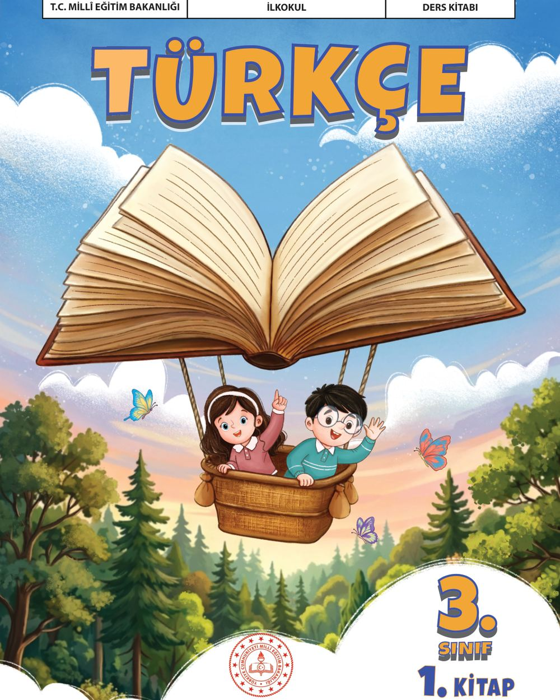

3. SINIF

<!-- sayfa 1 -->

# TÜRKÇE
## İLKOKUL
### 3. Sınıf

**DERS KİTABI**
**1. KİTAP**

Yazarlar

Ceyhun BORA
Mustafa Ferudun DEPE
Mutlu DEMİRARSLAN
Özgür KAYA

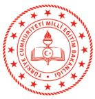

<!-- sayfa 2 -->

Millî Eğitim Bakanlığı Yayınları No .................................................................................................................................................: 10822
Ders Kitapları Dizisi No ...............................................................................................................................................................................: 2558

**Editör**
Prof. Dr. Sabri SİDEKLİ

**Dil Uzmanı**
Osman ERGİNÖZ

**Görsel Tasarımcı**
Nuray KAYA
Özlem GÜNEŞ
Tuba BURDURLU

**Çoklu Ortam Tasarımcısı**
Alev ATCI
Büşra YÜCE POLAT
Gamze KAYA
Gülşah İMANCI
Halil AKGÜL
Hürol YALÇIN
Saliha OKUR
Sezen Nur ACİ
Tuncay ÇALIŞKAN

**Program Geliştirme Uzmanı**
Saniye ÇOBAN

**Ölçme ve Değerlendirme Uzmanı**
Şerife ERTUĞRUL

**Rehberlik Uzmanı**
Meryem Betül KARAKEÇE

**ISBN 978-975-11-9918-8**

Millî Eğitim Bakanlığı, Talim ve Terbiye Kurulu Başkanlığının 15.06.2026 tarih ve 162027820 sayılı yazısı ile eğitim aracı olarak kabul edilmiştir.
Kurulca bu kitabın kabul edilmiş olması eğitim aracından yayınevi ve yazar/yazarların sorum-

<!-- sayfa 3 -->

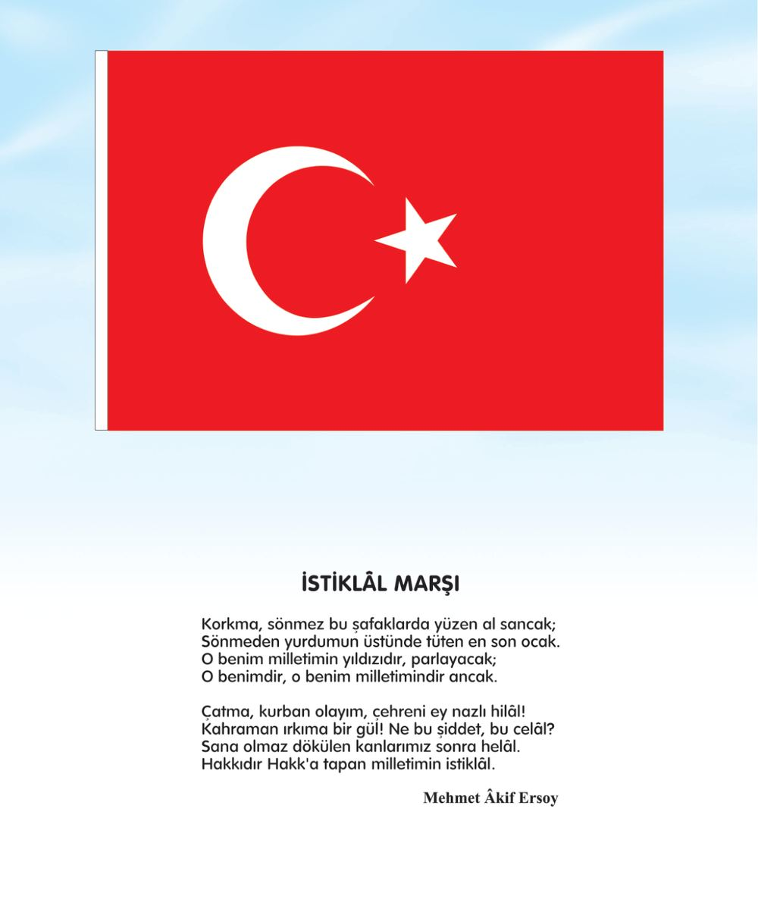

# İSTİKLÂL MARŞI

Korkma, sönmez bu şafaklarda yüzen al sancak;
Sönmeden yurdumun üstünde tüten en son ocak.
O benim milletimin yıldızıdır, parlayacak;
O benimdir, o benim milletimindir ancak.

Çatma, kurban olayım, çehreni ey nazlı hilâl!
Kahraman ırkıma bir gül! Ne bu şiddet, bu celâl?
Sana olmaz dökülen kanlarımız sonra helâl.
Hakkıdır Hakk'a tapan milletimin istiklâl.

Mehmet Âkif Ersoy

<!-- sayfa 4 -->

ANDIMIZ

Türküm, doğruyum, çalışkanım.

İlkem küçüklerimi korumak, büyüklerimi saymak; yurdumu, milletimi özümden çok sevmektir.
Ülküm yükselmek, ileri gitmektir.

Ey Büyük Atatürk!

Açtığın yolda, gösterdiğin hedefe durmadan yürüyeceğime ant içerim.

Varlığım Türk varlığına armağan olsun.

Ne mutlu Türküm diyene!

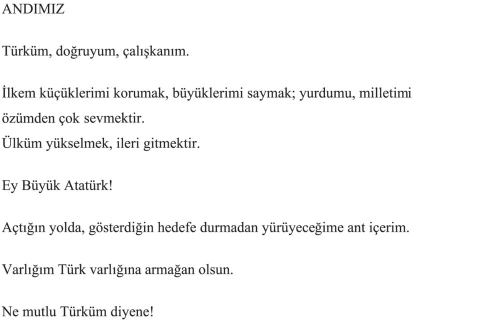
<!-- yer tutucu bulunamadı: sayfa sonuna eklendi -->

<!-- sayfa 5 -->

MUSTAFA KEMAL ATATÜRK

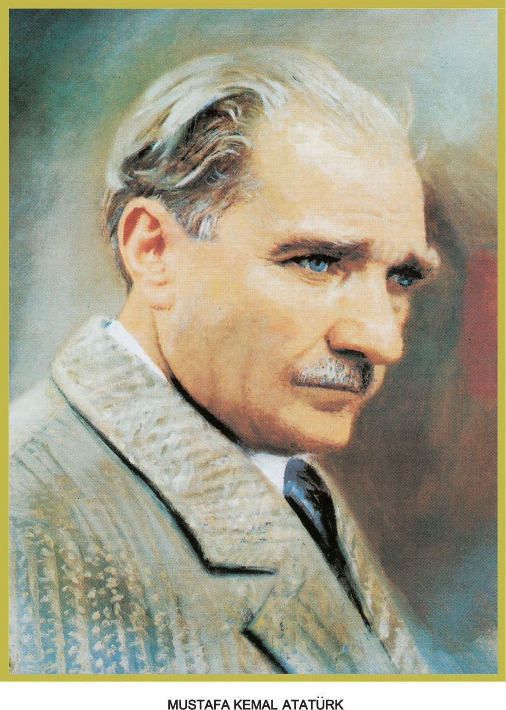
<!-- yer tutucu bulunamadı: sayfa sonuna eklendi -->

<!-- sayfa 6 -->

Henüz bir görsel veya PDF metin katmanı paylaşmadınız. Lütfen dönüştürülmesini istediğiniz sayfanın görüntüsünü veya metin katmanını `<<< >>>` işaretleri arasına ekleyin.

Veriyi paylaştığınızda, talimatlarınıza harfiyen uyarak (LaTeX kullanımı, şekil yerleşimi ve Markdown formatı dahil) çeviriyi gerçekleştireceğim.


<!-- yer tutucu bulunamadı: sayfa sonuna eklendi -->

<!-- sayfa 7 -->

# İÇİNDEKİLER

* Kitabımızı Tanıyalım ................................................................................................................... 9
* Hatırlatma Etkinlikleri ............................................................................................................... 14

## 1. Tema: DEĞERLERİMİZLE YAŞIYORUZ ........................................................................ 18

* Temaya Hazırlanalım ................................................................................................................. 20
* Kelebek ile Lavanta (Dinleme Metni) ..................................................................................... 22
* Ben Kimim? ................................................................................................................................ 28
* Köyde İlk Sabah .......................................................................................................................... 34
* Nermin Teyze Nerede? .............................................................................................................. 40
* Çam Ağacı .................................................................................................................................. 46
* Performans Görevi ..................................................................................................................... 53
* Tema Sonu Çalışması ................................................................................................................ 54

## 2. Tema: ATATÜRK VE KAHRAMANLARIMIZ ............................................................... 56

* Temaya Hazırlanalım ................................................................................................................. 58
* Kahverengi Ayakkabıları Siyaha Boyayan Ülkü (Dinleme Metni) ........................................... 60
* Atatürk Çok Kitap Okurmuş ...................................................................................................... 66
* Anadolu'nun Kadınları ............................................................................................................... 72
* Dün Gibi ...................................................................................................................................... 80
* Atatürk'ün Çocuk Sevgisi .......................................................................................................... 88
* Performans Görevi ..................................................................................................................... 95
* Tema Sonu Çalışması ................................................................................................................ 96

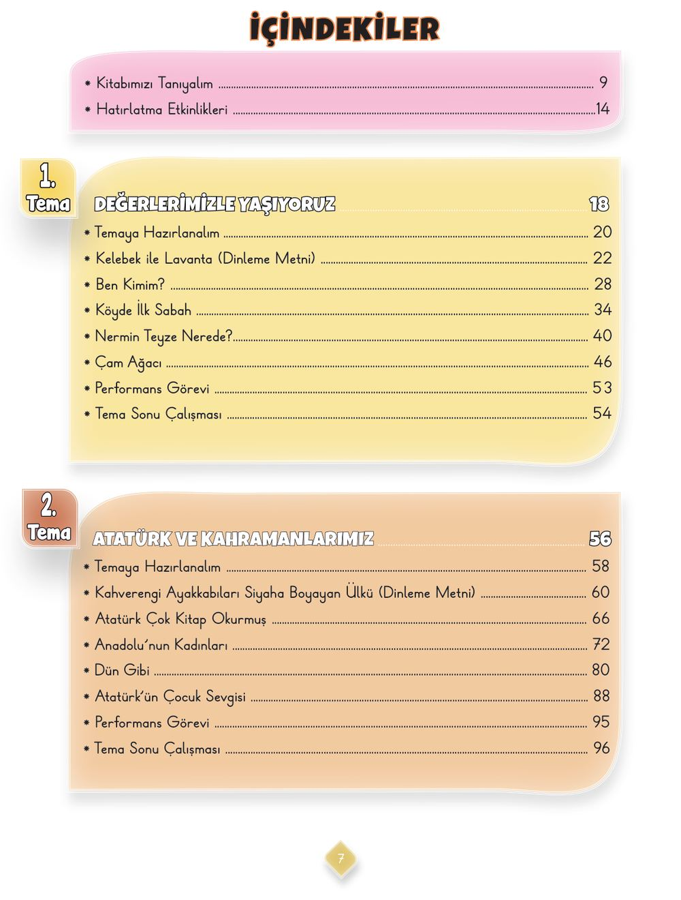
<!-- yer tutucu bulunamadı: sayfa sonuna eklendi -->

<!-- sayfa 8 -->

# 3. Tema DOĞAYI TANIYORUZ 98
* Temaya Hazırlanalım ........................................................................................................................ 100
* Bir Orman (Dinleme Metni) ........................................................................................................... 102
* Karıncalar .......................................................................................................................................... 108
* Orman ............................................................................................................................................... 116
* Fırtına ................................................................................................................................................ 122
* Küçük Su Damlası ........................................................................................................................... 130
* Performans Görevi .......................................................................................................................... 137
* Tema Sonu Çalışması ..................................................................................................................... 138

# 4. Tema BİLGİ HAZİNEMİZ 140
* Temaya Hazırlanalım ...................................................................................................................... 142
* Kütüphanemiz (İzleme Metni) ....................................................................................................... 144
* Kitap Sevgisi ..................................................................................................................................... 150
* Kitaplar Bize Ne Söyler? ................................................................................................................ 156
* Pusula ................................................................................................................................................ 162
* Ömer Seyfettin .................................................................................................................................. 168
* Performans Görevi .......................................................................................................................... 173
* Tema Sonu Çalışması ..................................................................................................................... 174
* Pekiştirme Etkinlikleri ..................................................................................................................... 176

* Sözlük ................................................................................................................................................. 180
* Kaynakça ........................................................................................................................................... 182
* Görsel ve Genel Ağ Kaynakçası ................................................................................................... 182
* Cevap Anahtarı ................................................................................................................................. 182
* Türkiye'nin Mülki İdare Bölümleri ile Kara ve Deniz Komşuları Haritası ............................ 183
* Türk Dünyası Haritası ..................................................................................................................... 184

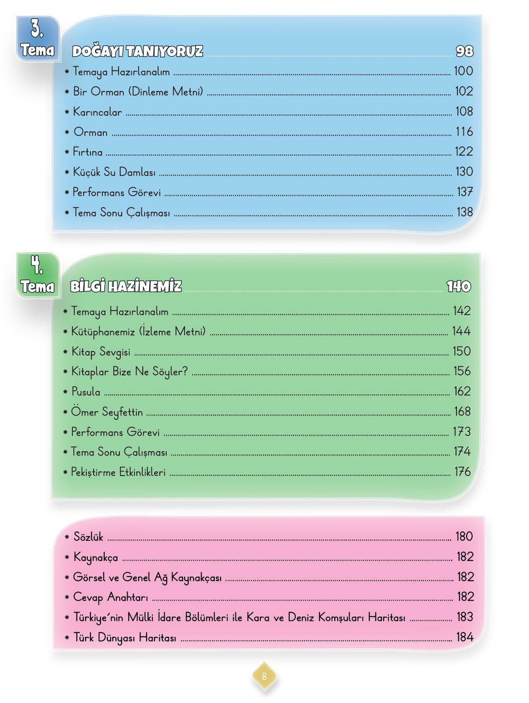
<!-- yer tutucu bulunamadı: sayfa sonuna eklendi -->

<!-- sayfa 9 -->

# KİTABIMIZI TANIYALIM

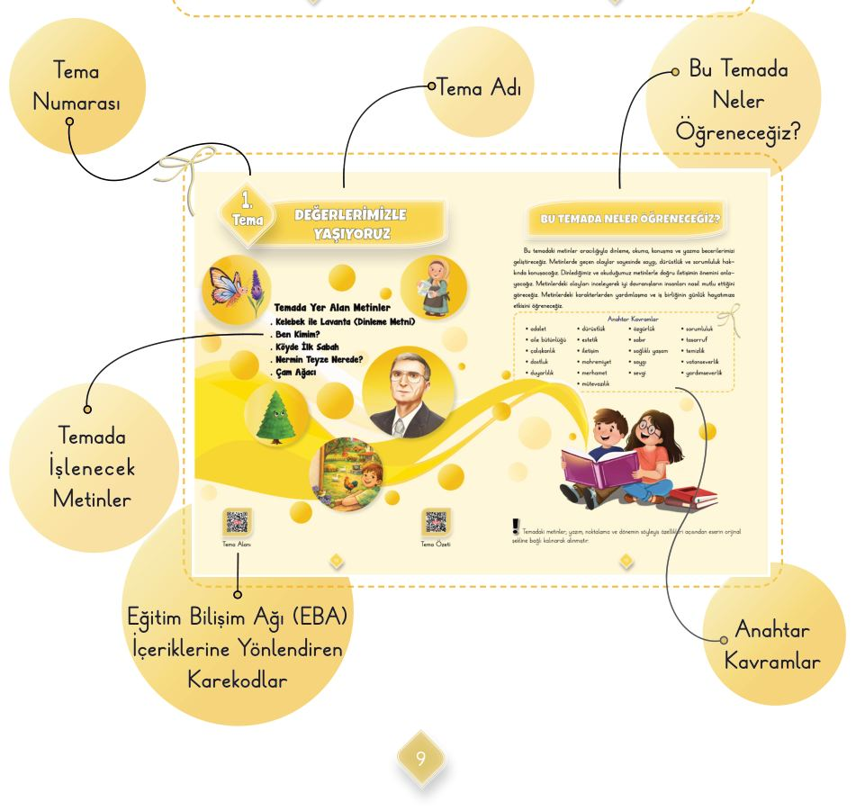

## HATIRLATMA ETKİNLİKLERİ

Öğretmenimiz metin türleri değerlerine uygun olarak dinleyiniz.

**Yaz Talimatı**
Murat yaz tatilini geçirmek üzere Antalya'ya gitmiştir. Denize kıyısı olan otelde konaklamaktadır. Murat plajda kumdan kaleler yapar, denizde oynar. Yaz sıcaklığı denizde yüzmek için çok uygundur. Akşamları ise arkadaşlarıyla oyunlar oynar. Murat'ın en sevdiği arkadaşı ise, kite uçurmayı seven Murat'tır. Uzun tatilin sonunda Murat ve en sevdiği arkadaşı, yaz tatilini birlikte geçirmekten çok mutlu olmuşlardır.
Bu kitapta şunlar gösterilmiştir:
Murat tatilini geçirmek üzere Antalya'ya gitmiştir. Akşamları tavşanları yemek yer, sabahları ise deniz kenarında oynar. Murat plajda kumdan kaleler yapar, denizde oynar. Yaz sıcaklığı denizde yüzmek için çok uygundur. Akşamları ise arkadaşlarıyla oyunlar oynar. Murat'ın en sevdiği arkadaşı ise, kite uçurmayı seven Murat'tır. Uzun tatilin sonunda Murat ve en sevdiği arkadaşı, yaz tatilini birlikte geçirmekten çok mutlu olmuşlardır.
Bu kitapta şunlar gösterilmiştir:

a) Metin türleri uygulandığında kuralları yarışla, uygulamalarla öğrenmeye çalışınız.
* Metni sesli dinleyiniz.
* Metni dikkatli dinleyiniz.
* Metni uygun duraklama noktalarında dinleyiniz.

b) Metinde geçen olayları belirleyerek iki tanesini aşağıdaki kolime yazınız.

c) Dinlediğiniz metnin konusunu yazınız.

Metin Konusu: ____________________

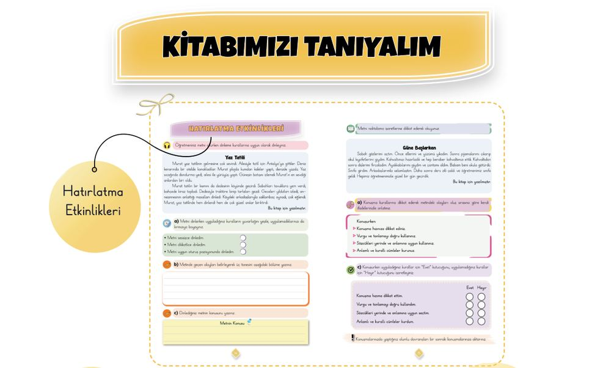

Metin noktalama işaretlerine dikkat ederek okuyunuz.

**Sena ve Arkadaşları**
Selam çocuklar! Bugün size bir hikâye anlatacağım. Sizin yaşamınızda olup okulda öğrendiğiniz konularla ilgili bir hikâye. Kahvaltıma hazırlık yaptım ve hep beraber kahvaltı ettik. Kahvaltıdan sonra fincanımı doldurdum. Arkadaşlarımla oyunlar oynadım ve sonra dinlenmek istedim. Şimdi size bir hikâye anlatacağım. Okula gitmeden önce ders çalışıp ödevlerimi yaptım. Okuldan gelince öğretmenime güzel bir gün dilerim.
Bu kitap sizi nasıllandır!

a) Konuşurken kurallara dikkat ederek metni okuyunuz.

Konuşurken:
* Konuşma tonuna dikkat edin.
* Vurgu ve tonlamaya doğru kullanın.
* Sözcükleri yerinde ve anlamına uygun seçin.
* Anlatımı ve kuralları düzenleyin.

b) Konuşmanız uyguladığınız kurallar için "Evet" kutucuğunu, uygulamadığınız kurallar için "Hayır" kutucuğunu işaretleyiniz.

| Konuşma kuralları | Evet | Hayır |
| :--- | :---: | :---: |
| Konuşma tonuna dikkat ettin. | ○ | ○ |
| Vurgu ve tonlamaya doğru kullandın. | ○ | ○ |
| Sözcükleri yerinde ve anlamına uygun seçtin. | ○ | ○ |
| Anlatımı ve kuralları düzenledin. | ○ | ○ |

! Konuşmalarınızda yaptığınız olumlu davranışları bir sonraki konuşmalarınıza aktarınız.

---

**Tema Numarası**
1. Tema

**Tema Adı**
DEĞERLERİMİZLE YAŞIYORUZ

**Temada İşlenecek Metinler**
Temada Yer Alan Metinler
* Kebaklık ile Lavanta (Dinleme Metni)
* Ben Kimim?
* Köyde İlk Sabah
* Nermin Teyze Nerede?
* Çan Ağacı

**Bu Temada Neler Öğreneceğiz?**
Bu temadaki metinler aracılığıyla dinleme, okuma, konuşma ve yazma becerilerinizi geliştireceğiz. Metinlerde geçen olaylar sayesinde sevgi, dürüstlük ve sorumluluk hakkında konuşacağız. Dinlediğine ve okuduğuna metinlerle doğru ulaşımı isteme gereksinimi, metinlerin içeriğini ve durumlarını metinlerle metinler arası ilişkileri ele almayı öğreneceğiz.
Metinlerdeki karakterlerin özelliklerini ve bir bütünlük sağlama yetisini ele alacağız.

**Anahtar Kavramlar**
* adalet
* dürüstlük
* dürüstlük
* dayanışma
* doğruluk
* dürüstlük
* eğitim
* esenlik
* mahremiyet
* metanet
* nezaket
* sabır
* sağlıklı yaşam
* sevgi
* sevgi
* sorumluluk
* saygı
* temizlik
* vatanseverlik
* yardımlaşma

**Eğitim Bilişim Ağı (EBA) İçeriklerine Yönlendiren Karekodlar**
Tema Alanı
Tema Çözümü

Metinlerde; yarat, noktalama ve dönemin özelliklerini yansıtan eserlerin orijinal şekline yakın olarak alınmıştır.

<!-- sayfa 10 -->

# 3. SINIF / TEMAYA HAZIRLANALIM
## 1. TEMA

**TEMAYA HAZIRLANALIM**

Metin amacı okumaya Metindeki doğal olaylara sıra gelme şekli ve anlatım sıra çeşitleri ile ilgili bilgiler sunmaktır. Tematik bağlamlar içerikleri ve anlatıma süreklilik kazandırır.

### EĞLENCE
Elif bir sabah okula gitmek için hazırlanırken Kahraman yatağına doğa ile ilgili bir öykü kitabı koydu. Kitabı kenardan kırarak bir öykü dikkat çekti. Dikkatlice bakınca çok ilginç bir konu gördü. Kitap çok ilginçti ve okumak çok istedi. Elif çok üzüldü. Elif'in bir an önce okumak ve kullanmak gerekiyordu. Kitap nerede diye "Elif nerede?" diye bağırdı. Elif çok üzüldü. Elif'in bir an önce okumak ve kullanmak gerekiyordu. Kitap nerede diye "Elif nerede?" diye bağırdı. Elif çok üzüldü. Elif'in bir an önce okumak ve kullanmak gerekiyordu. Kitap nerede diye "Elif nerede?" diye bağırdı. Elif çok üzüldü. Elif'in bir an önce okumak ve kullanmak gerekiyordu. Kitap nerede diye "Elif nerede?" diye bağırdı. Elif çok üzüldü. Elif'in bir an önce okumak ve kullanmak gerekiyordu. Kitap nerede diye "Elif nerede?" diye bağırdı. Elif çok üzüldü. Elif'in bir an önce okumak ve kullanmak gerekiyordu. Kitap nerede diye "Elif nerede?" diye bağırdı. Elif çok üzüldü. Elif'in bir an önce okumak ve kullanmak gerekiyordu. Kitap nerede diye "Elif nerede?" diye bağırdı. Elif çok üzüldü. Elif'in bir an önce okumak ve kullanmak gerekiyordu. Kitap nerede diye "Elif nerede?" diye bağırdı. Elif çok üzüldü. Elif'in bir an önce okumak ve kullanmak gerekiyordu. Kitap nerede diye "Elif nerede

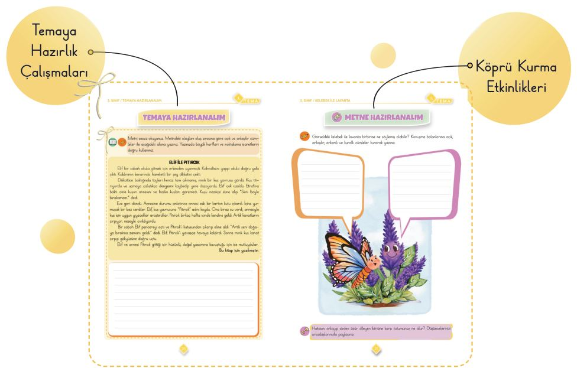
<!-- yer tutucu bulunamadı: sayfa sonuna eklendi -->

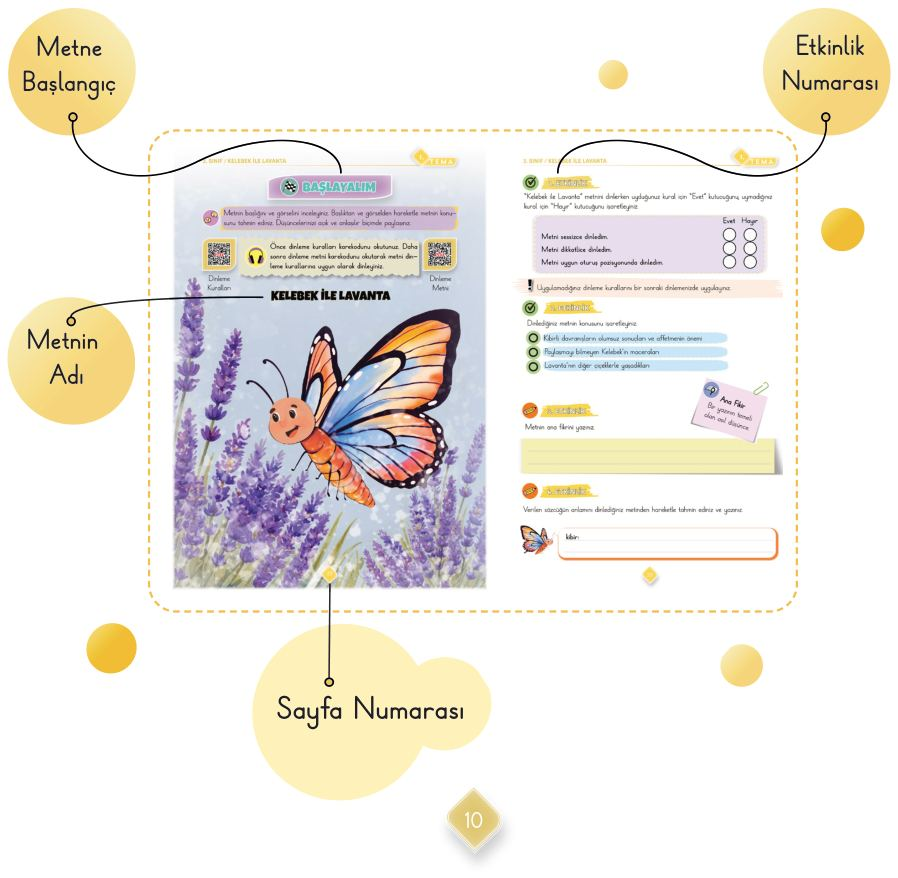
<!-- yer tutucu bulunamadı: sayfa sonuna eklendi -->

<!-- sayfa 11 -->

# Performans Görevi

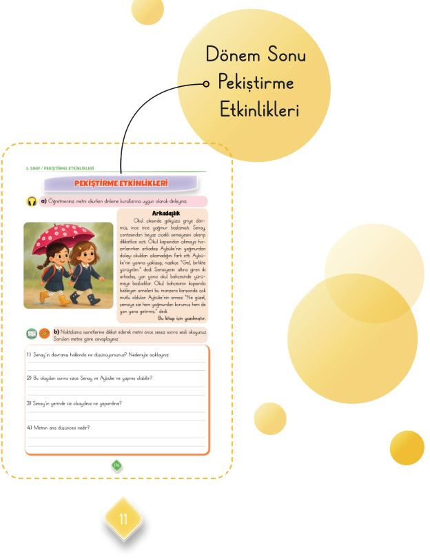

3. SINIF / PERFORMANS GÖREVİ
1. TEMA

## PERFORMANS GÖREVİ

* Performans görevi olarak verilen değerlerden en az üçünü seçiniz.
* Bu değerlerle ilgili bilgi içeren bir pano hazırlayınız.
* Hazırladığınız panoya aşağıdaki sınıf arkadaşlarından birini seçerek sunuş yapınız.

### DEĞERLER

| Saygı | Sorunlardaki | Yardımlaşma | Vatan Sevgisi | Dürüstlük |
| :--- | :--- | :--- | :--- | :--- |
| Saygı, başkalarının düşüncelerine, haklarına ve duygularına saygı göstermektir. Saygı gösteren kişiler, başkalarını kırmamak için konuşmaya dikkat ederler. | Sorunlardaki bir sorunu çözmek için çaba gösterir ve o sorunu çözmek için gerekli olan kurallara uymaya çalışırız. | Yardım eden, yardım edilen veya yardım etmeye çalışan bir durumu, bir olayı veya bir sorunu paylaşır, arkadaşlarına yardım ederek sorunları gidermelerine yardımcı olurlar. | Vatan sevgisi, ülkemizi, milletimizi, değerlerimizi, kültürümüzü, geleneklerimizi, bayrağımızı, dilimizi ve ona değer verenleri sevmek, onlara ve değerlerine sahip çıkmaktır. | Dürüstlük, insanların ve tüm canlıların haklarına saygı gösterip doğru davranmaktır. Örneğin; oyun oynarken arkadaşımızın da oyun oynamak istediğini gösterdiğimizde dürüst davranmış oluruz. |

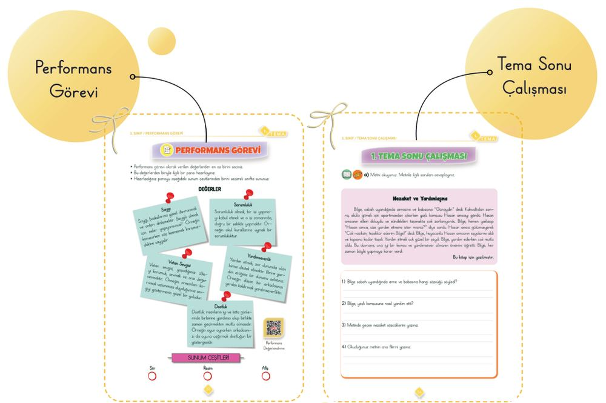

#### SUNUM ÇEŞİTLERİ

| Sıra | Yöntem | Adı |
| :--- | :---: | :--- |
| | O | |
| | O | |

Performans Değerlendirme

---

# Tema Sonu Çalışması


3. SINIF / TEMA SONU ÇALIŞMASI
1. TEMA

## 1. TEMA SONU ÇALIŞMASI

a) Metni okuyunuz. Metinde ilgili tüm soruları cevaplayınız.

### Nezaket ve Yardımlaşma

Bilge, sabah uyanığında anne ve babasına "Günaydın!" dedi. Kahvaltıda annesinin okula gitmesi gerektiğini, babasının ise işe gideceğini söyledi. Hemen amcası geldi. Hasan amcanın elleri titriyor ve titrediği için çatalı tutmakta zorlanıyordu. Bilge, hemen yardım etmeye karar verdi. "Hasan amcam, size yardım etmeyi ister misiniz?" diye sordu. Bilge, hemen yardım etmeye karar verdi. Hasan amcanın elleri titriyordu. Bilge, hemen yardım etmeye karar verdi. Bilge, Hasan amcaya yardım etti. Bilge, Hasan amcaya yardım ettiği için çok mutlu oldu. Bilge, yardım etmenin çok güzel bir şey olduğunu anladı. Bilge, her zaman yardım etmeye karar verdi.

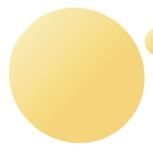

Bu kitap için yazılmıştır.

1) Bilge sabah uyanığında anne ve babasına hangi nezaket sözcüğü söyledi?
___________________________________________________________________________

2) Bilge, hangi konuda nazik bir yardım etti?
___________________________________________________________________________

3) Metinde geçen nezaket sözcüklerini yazınız.
___________________________________________________________________________

4) Okuduğunuz metni kendi cümlelerinle yazınız.
___________________________________________________________________________
___________________________________________________________________________
___________________________________________________________________________

---

# Dönem Sonu Pekiştirme Etkinlikleri


3. SINIF / PEKİŞTİRME ETKİNLİKLERİ

## PEKİŞTİRME ETKİNLİKLERİ

a) Öğretmeniniz metni okurken dinleme kurallarına uygun davranınız.

### Psikolojik

Okul, çocukların gelişimi, sosyal ve duygusal gelişimleri için çok önemli bir yerdir. Okul, çocukların öğrenmeye hazırlanması, yeni bilgiler edinmesi ve sosyal becerilerini geliştirmesi için çok önemlidir. Okul, çocukların öğrenmeye hazırlanması için çok önemlidir. Ayşegül, okulun ilk günlerinde çok heyecanlıydı. Okula gitmeye hazır değildi. Okulun ilk günlerinde çok heyecanlıydı. Ayşegül, okulun ilk günlerinde çok heyecanlıydı. Ayşegül, okulun ilk günlerinde çok heyecanlıydı. Ayşegül, okulun ilk günlerinde çok heyecanlıydı. Ayşegül, okulun ilk günlerinde çok heyecanlıydı. Ayşegül, okulun ilk günlerinde çok heyecanlıydı. Ayşegül, okulun ilk günlerinde çok heyecanlıydı. Ayşegül, okulun ilk günlerinde çok heyecanlıydı. Ayşegül, okulun ilk günlerinde çok heyecanlıydı. Ayşegül, okulun ilk günlerinde çok heyecanlıydı. Ayşegül, okulun ilk günlerinde çok heyecanlıydı. Ayşegül, okulun ilk günlerinde çok heyecanlıydı. Ayşegül, okulun ilk günlerinde çok heyecanlıydı. Ayşegül, okulun ilk günlerinde çok heyecanlıydı. Ayşegül, okulun

<!-- sayfa 12 -->

# KİTAPTA YER ALAN SEMBOLLER VE ANLAMLARI

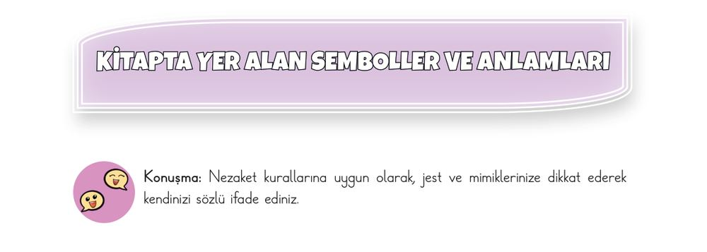 Konuşma: Nezaket kurallarına uygun olarak, jest ve mimiklerinize dikkat ederek kendinizi sözlü ifade ediniz.

 İşaretleme: Yönergeye uygun işaretleme yapınız.

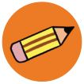 Yazma: Yazım ve noktalama kurallarını uygulayarak yazma çalışmaları yapınız.

 Dinleme: Dinleme kurallarına uygun olarak metni dinleyiniz.

 İzleme: Dikkatli bir şekilde izleyiniz.

 Boyama: Yönergeye uygun boyama yapınız.

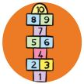 Oynama: Yönergeye uygun oyun oynayınız.


<!-- sayfa 13 -->

 **Canlandırma:** Yönergeye göre örnek durumu canlandırınız.

 **Eşleştirme:** Yönergeye uygun eşleştirme yapınız.

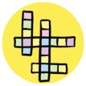 **Bulmaca Çözme:** Yönergeyi takip ederek bulmacayı çözünüz.

 **Okuma:** Metni noktalama işaretlerine, vurgu ve tonlamaya dikkat ederek sesli/sessiz okuyunuz.

 **Performans Görevi:** Yönergeye uygun olarak performans görevini tamamlayınız.

 **Metne Hazırlık:** Soruları cevaplayıp, etkinlikleri yaparak metne hazırlanınız.

 **Kısa Bilgi:** Kısa bilgileri dikkatlice okuyunuz.

 **Metne Başlangıç:** Metin öncesi etkinlikleri yaparak metni okuyunuz/dinleyiniz/izleyiniz.

<!-- yer tutucu bulunamadı: sayfa sonuna eklendi -->

<!-- sayfa 14 -->

# HATIRLATMA ETKİNLİKLERİ

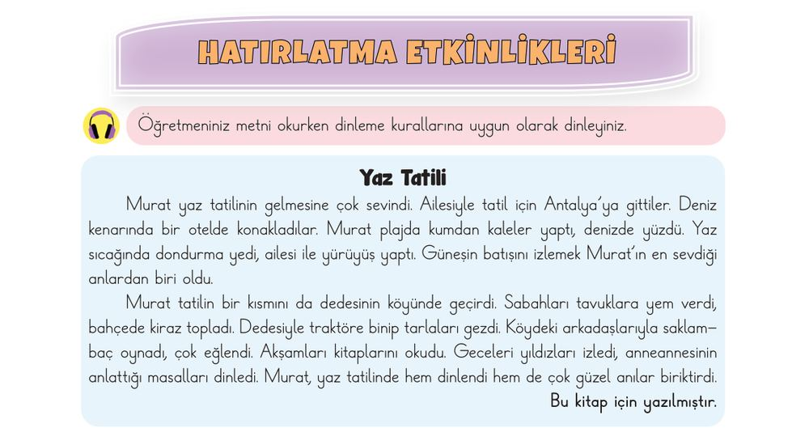 Öğretmeniniz metni okurken dinleme kurallarına uygun olarak dinleyiniz.

## Yaz Tatili

Murat yaz tatilinin gelmesine çok sevindi. Ailesiyle tatil için Antalya’ya gittiler. Deniz kenarında bir otelde konakladılar. Murat plajda kumdan kaleler yaptı, denizde yüzdü. Yaz sıcağında dondurma yedi, ailesi ile yürüyüş yaptı. Güneşin batışını izlemek Murat’ın en sevdiği anlardan biri oldu.

Murat tatilin bir kısmını da dedesinin köyünde geçirdi. Sabahları tavuklara yem verdi, bahçede kiraz topladı. Dedesiyle traktöre binip tarlaları gezdi. Köydeki arkadaşlarıyla saklam-baç oynadı, çok eğlendi. Akşamları kitaplarını okudu. Geceleri yıldızları izledi, anneannesinin anlattığı masalları dinledi. Murat, yaz tatilinde hem dinlendi hem de çok güzel anılar biriktirdi.
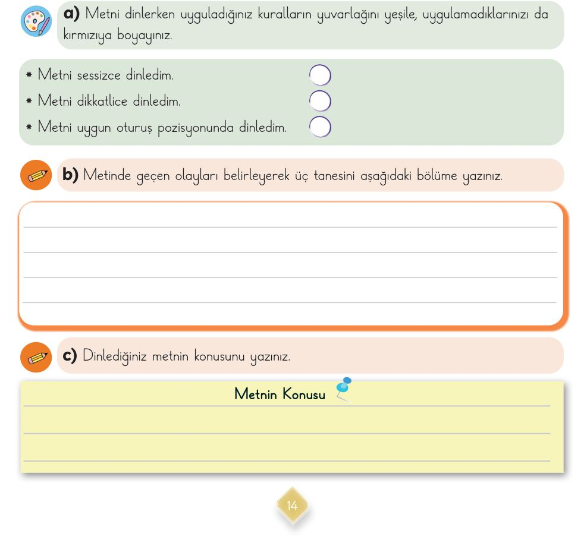 Bu kitap için yazılmıştır.

 a) Metni dinlerken uyguladığınız kuralların yuvarlağını yeşile, uygulamadıklarınızı da kırmızıya boyayınız.

* Metni sessizce dinledim. ○
* Metni dikkatlice dinledim. ○
* Metni uygun oturuş pozisyonunda dinledim. ○

 b) Metinde geçen olayları belirleyerek üç tanesini aşağıdaki bölüme yazınız.

__________________________________________________________________________
__________________________________________________________________________
__________________________________________________________________________
__________________________________________________________________________
__________________________________________________________________________

 c) Dinlediğiniz metnin konusunu yazınız.

### Metnin Konusu
__________________________________________________________________________
__________________________________________________________________________

<!-- sayfa 15 -->

📖 Metni noktalama işaretlerine dikkat ederek okuyunuz.

# Güne Başlarken

Sabah gözlerimi açtım. Önce ellerimi ve yüzümü yıkadım. Sonra pijamalarımı çıkarıp okul kıyafetlerimi giydim. Kahvaltımızı hazırladık ve hep beraber kahvaltımızı ettik. Kahvaltıdan sonra dişlerimi fırçaladım. Ayakkabılarımı giydim ve çantamı aldım. Babam beni okula götürdü. Sınıfa girdim. Arkadaşlarımla selamlaştım. Daha sonra ders zili çaldı ve öğretmenimiz sınıfa geldi. Hepimiz öğretmenimizle güzel bir gün geçirdik.

Bu kitap için yazılmıştır.

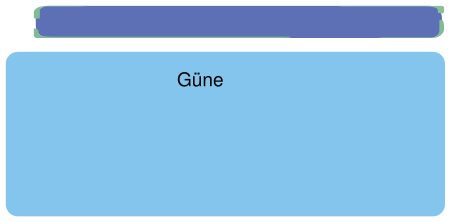 a) Konuşma kurallarına dikkat ederek metindeki olayları oluş sırasına göre kendi ifadelerinizle anlatınız.

> Konuşurken:
>  ▷ Konuşma hızınıza dikkat ediniz.
>  ▷ Vurgu ve tonlamayı doğru kullanınız.
>  ▷ Sözcükleri yerinde ve anlamına uygun kullanınız.
> 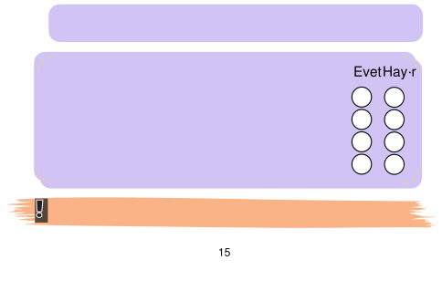 ▷ Anlamlı ve kurallı cümleler kurunuz.

 c) Konuşurken uyguladığınız kurallar için “Evet” kutucuğunu, uygulamadığınız kurallar için “Hayır” kutucuğunu işaretleyiniz.

| | Evet | Hayır |
| :--- | :---: | :---: |
| Konuşma hızıma dikkat ettim. | ○ | ○ |
| Vurgu ve tonlamayı doğru kullandım. | ○ | ○ |
| Sözcükleri yerinde ve anlamına uygun seçtim. | ○ | ○ |
| Anlamlı ve kurallı cümleler kurdum. | ○ | ○ |

⚠️ Konuşmalarınızda yaptığınız olumlu davranışları bir sonraki konuşmalarınıza aktarınız.

<!-- sayfa 16 -->

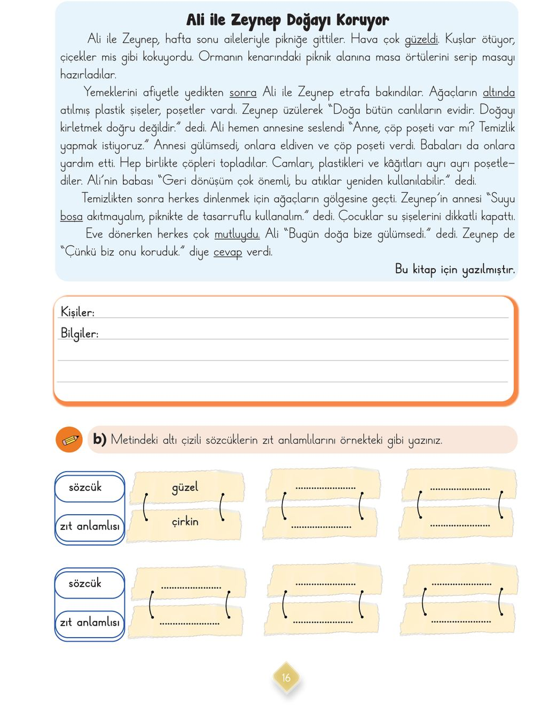 **a)** Metni okuma kurallarına uygun olarak okuyunuz. Metindeki kişileri ve metinden öğrendiğiniz bilgileri yazınız.


# Ali ile Zeynep Doğayı Koruyor

Ali ile Zeynep, hafta sonu aileleriyle pikniğe gittiler. Hava çok güzeldi. Kuşlar ötüyor, çiçekler mis gibi kokuyordu. Ormanın kenarındaki piknik alanına masa örtülerini serip masayı hazırladılar.

Yemeklerini afiyetle yedikten sonra Ali ile Zeynep etrafa bakındılar. Ağaçların altında atılmış plastik şişeler, poşetler vardı. Zeynep üzülerek “Doğa bütün canlıların evidir. Doğayı kirletmek doğru değildir.” dedi. Ali hemen annesine seslendi “Anne, çöp poşeti var mı? Temizlik yapmak istiyoruz.” Annesi gülümsedi, onlara eldiven ve çöp poşeti verdi. Babaları da onlara yardım etti. Hep birlikte çöpleri topladılar. Camları, plastikleri ve kâğıtları ayrı ayrı poşetlediler. Ali’nin babası “Geri dönüşüm çok önemli, bu atıklar yeniden kullanılabilir.” dedi.

Temizlikten sonra herkes dinlenmek için ağaçların gölgesine geçti. Zeynep’in annesi “Suyu boşa akıtmayalım, piknikte de tasarruflu kullanalım.” dedi. Çocuklar su şişelerini dikkatli kapattı.

Eve dönerken herkes çok mutluydu. Ali “Bugün doğa bize gülümsedi.” dedi. Zeynep de “Çünkü biz onu koruduk.” diye cevap verdi.

Bu kitap için yazılmıştır.

Kişiler:
__________________________________________________________________
Bilgiler:
__________________________________________________________________
__________________________________________________________________
__________________________________________________________________

 **b)** Metindeki altı çizili sözcüklerin zıt anlamlılarını örnekteki gibi yazınız.

| sözcük | | sözcük | | sözcük | | sözcük |
| :--- | :--- | :--- | :--- | :--- | :--- | :--- |
| | güzel | | ....................... | | ....................... | | ....................... |
| zıt anlamlısı | | zıt anlamlısı | | zıt anlamlısı | | zıt anlamlısı |
| | çirkin | | ....................... | | ....................... | | ....................... |

| sözcük | | sözcük | | sözcük | |
| :--- | :--- | :--- | :--- | :--- | :--- |
| | ....................... | | ....................... | | ....................... |
| zıt anlamlısı | | zıt anlamlısı | | zıt anlamlısı |
| | ....................... | | ....................... | | ....................... |

<!-- sayfa 17 -->

c) Yazma kurallarına uygun olarak yaz tatilinde neler yaptığınızı yazınız.

> Yazarken,
> 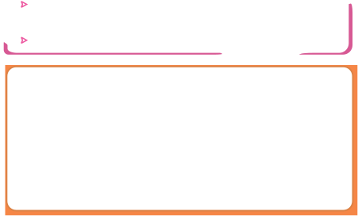 Sözcükleri yerinde ve anlamına uygun olarak kullanınız.
>  Yazınızı sayfaya uygun şekilde yerleştiriniz. (Paragraf başı yapınız, satır sonuna sığmayan sözcüklere dikkat ediniz, hizalama yapınız.)
> 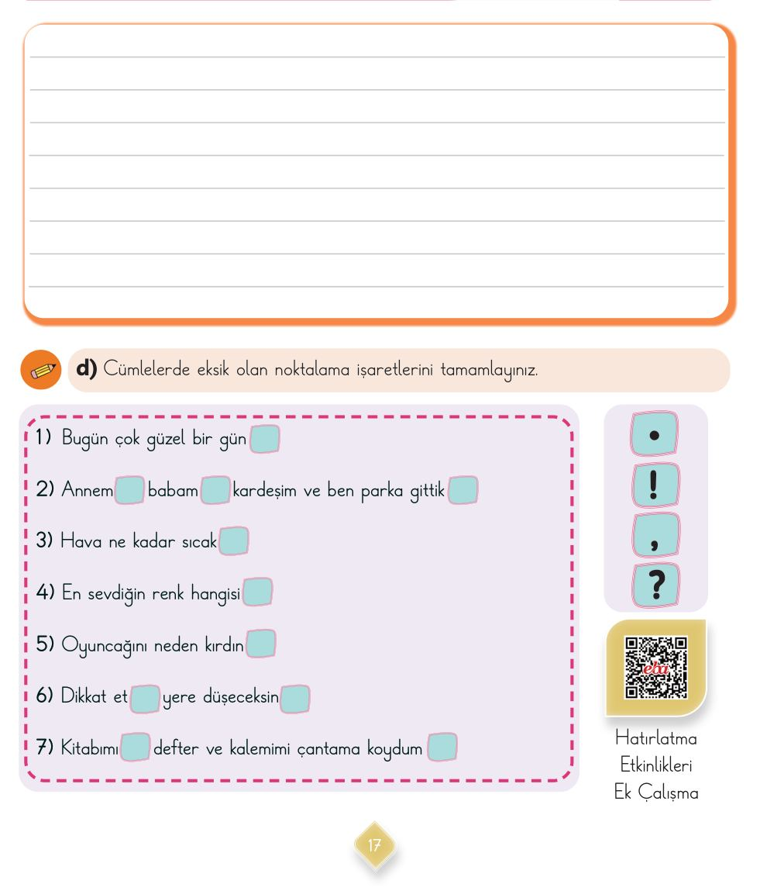 Noktalama işaretlerini kurallarına uygun kullanınız.

[Boş yazı alanı]

d) Cümlelerde eksik olan noktalama işaretlerini tamamlayınız.

1) Bugün çok güzel bir gün [ ]
2) Annem [ ] babam [ ] kardeşim ve ben parka gittik [ ]
3) Hava ne kadar sıcak [ ]
4) En sevdiğin renk hangisi [ ]
5) Oyuncağını neden kırdın [ ]
6) Dikkat et [ ] yere düşeceksin [ ]
7) Kitabımı [ ] defter ve kalemimi çantama koydum [ ]

| . |
|---|
| ! |
| , |
| ? |

[QR Kod]
Hatırlatma Etkinlikleri

<!-- sayfa 18 -->

# 1. Tema
# DEĞERLERİMİZLE YAŞIYORUZ

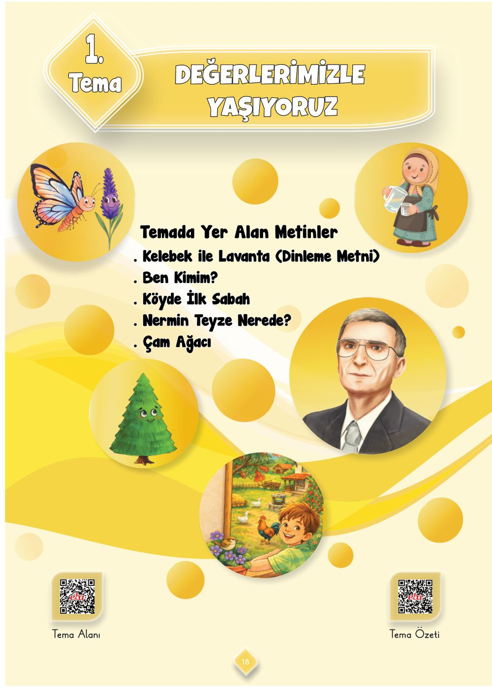

## Temada Yer Alan Metinler
. Kelebek ile Lavanta (Dinleme Metni)
. Ben Kimim?
. Köyde İlk Sabah
. Nermin Teyze Nerede?
. Çam Ağacı

<!-- sayfa 19 -->

# BU TEMADA NELER ÖĞRENECEĞİZ?

Bu temadaki metinler aracılığıyla dinleme, okuma, konuşma ve yazma becerilerimizi geliştireceğiz. Metinlerde geçen olaylar sayesinde saygı, dürüstlük ve sorumluluk hakkında konuşacağız. Dinlediğimiz ve okuduğumuz metinlerle doğru iletişimin önemini anlayacağız. Metinlerdeki olayları inceleyerek iyi davranışların insanları nasıl mutlu ettiğini göreceğiz. Metinlerdeki karakterlerden yardımlaşma ve iş birliğinin günlük hayatımıza etkisini öğreneceğiz.

## Anahtar Kavramlar

* adalet
* aile bütünlüğü
* çalışkanlık
* dostluk
* duyarlılık
* dürüstlük
* estetik
* iletişim
* mahremiyet
* merhamet
* mütevazılık
* özgürlük
* sabır
* sağlıklı yaşam
* saygı
* sevgi
* sorumluluk
* tasarruf
* temizlik
* vatanseverlik
* yardımseverlik

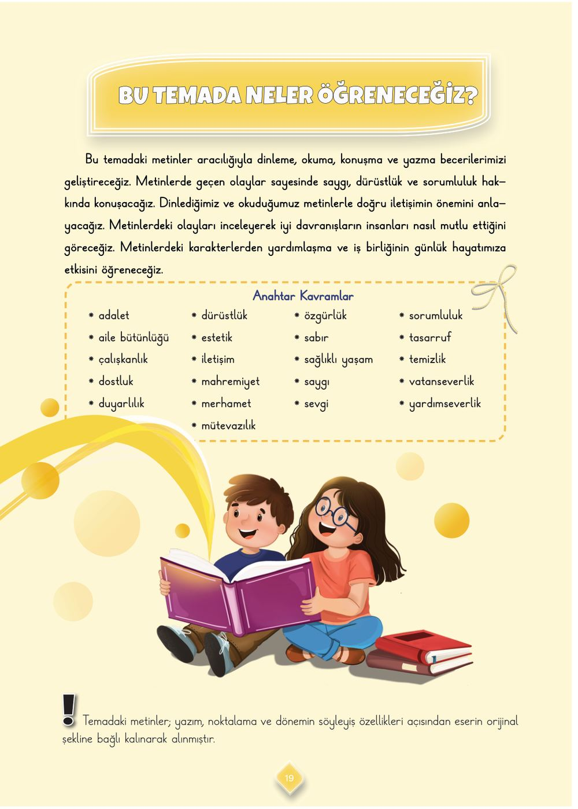

! Temadaki metinler; yazım, noktalama ve dönemin söyleyiş özellikleri açısından eserin orijinal haline bağlı kalınarak alınmıştır.

<!-- sayfa 20 -->

# TEMAYA HAZIRLANALIM

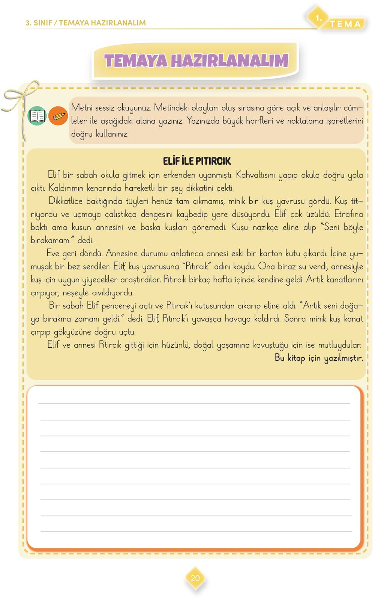

Metni sessiz okuyunuz. Metindeki olayları oluş sırasına göre açık ve anlaşılır cümleler ile aşağıdaki alana yazınız. Yazınızda büyük harfleri ve noktalama işaretlerini doğru kullanınız.

## ELİF İLE PITIRCIK

Elif bir sabah okula gitmek için erkenden uyanmıştı. Kahvaltısını yapıp okula doğru yola çıktı. Kaldırımın kenarında hareketli bir şey dikkatini çekti.

Dikkatlice baktığında tüyleri henüz tam çıkmamış, minik bir kuş yavrusu gördü. Kuş titriyordu ve uçmaya çalıştıkça dengesini kaybedip yere düşüyordu. Elif çok üzüldü. Etrafına baktı ama kuşun annesini ve başka kuşları göremedi. Kuşu nazikçe eline alıp “Seni böyle bırakamam.” dedi.

Eve geri döndü. Annesine durumu anlatınca annesi eski bir karton kutu çıkardı. İçine yumuşak bir bez serdiler. Elif, kuş yavrusuna “Pıtırcık” adını koydu. Ona biraz su verdi, annesiyle kuş için uygun yiyecekler araştırdılar. Pıtırcık birkaç hafta içinde kendine geldi. Artık kanatlarını çırpıyor, neşeyle cıvıldıyordu.

Bir sabah Elif pencereyi açtı ve Pıtırcık’ı kutusundan çıkarıp eline aldı. “Artık seni doğaya bırakma zamanı geldi.” dedi. Elif, Pıtırcık’ı yavaşça havaya kaldırdı. Sonra minik kuş kanat çırpıp gökyüzüne doğru uçtu.

Elif ve annesi Pıtırcık gittiği için hüzünlü, doğal yaşamına kavuştuğu için ise mutluydular.

*Bu kitap için yazılmıştır.*

__________________________________________________________________________
__________________________________________________________________________
__________________________________________________________________________
__________________________________________________________________________
__________________________________________________________________________
__________________________________________________________________________
__________________________________________________________________________
__________________________________________________________________________
__________________________________________________________________________
__________________________________________________________________________

<!-- sayfa 21 -->

# METNE HAZIRLANALIM

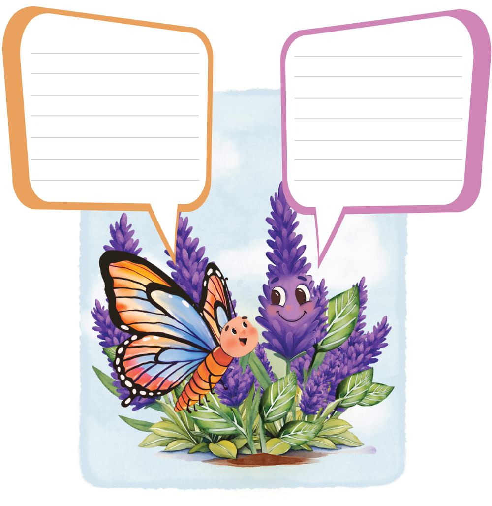 Görseldeki kelebek ile lavanta birbirine ne söylemiş olabilir? Konuşma balonlarına açık, anlaşılır, anlamlı ve kurallı cümleler kurarak yazınız.


(Boş konuşma balonları görseli)

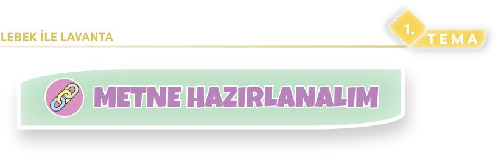 Hatasını anlayıp sizden özür dileyen birisine karşı tutumunuz ne olur? Düşüncelerinizi arkadaşlarınızla paylaşınız.

<!-- sayfa 22 -->

# BAŞLAYALIM

Metnin başlığını ve görselini inceleyiniz. Başlıktan ve görselden hareketle metnin konusunu tahmin ediniz. Düşüncelerinizi açık ve anlaşılır biçimde paylaşınız.

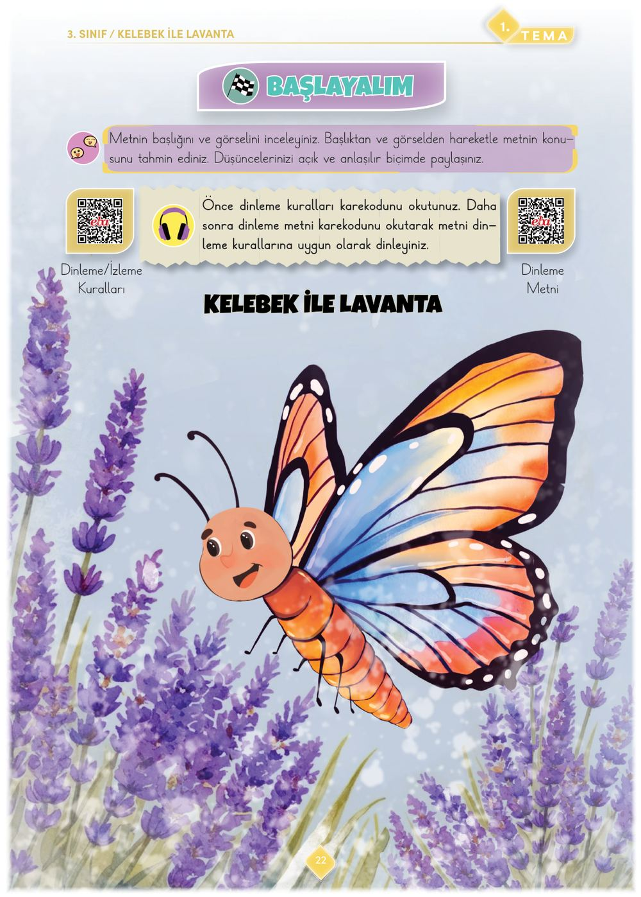 Önce dinleme kuralları karekodunu okutunuz. Daha sonra dinleme metni karekodunu okutarak metni dinleme kurallarına uygun olarak dinleyiniz.

Dinleme/İzleme Kuralları 

Dinleme Metni 

# KELEBEK İLE LAVANTA


<!-- sayfa 23 -->


# 1. ETKİNLİK

“Kelebek ile Lavanta” metnini dinlerken uyduğunuz kural için “Evet” kutucuğunu, uymadığınız kural için “Hayır” kutucuğunu işaretleyiniz.

| | Evet | Hayır |
| :--- | :---: | :---: |
| Metni sessizce dinledim. | ○ | ○ |
| Metni dikkatlice dinledim. | ○ | ○ |
| Metni uygun oturuş pozisyonunda dinledim. | ○ | ○ |

![!] Uygulamadığınız dinleme kurallarını bir sonraki dinlemenizde uygulayınız.

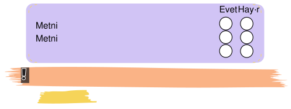
# 2. ETKİNLİK

Dinlediğiniz metnin konusunu işaretleyiniz.

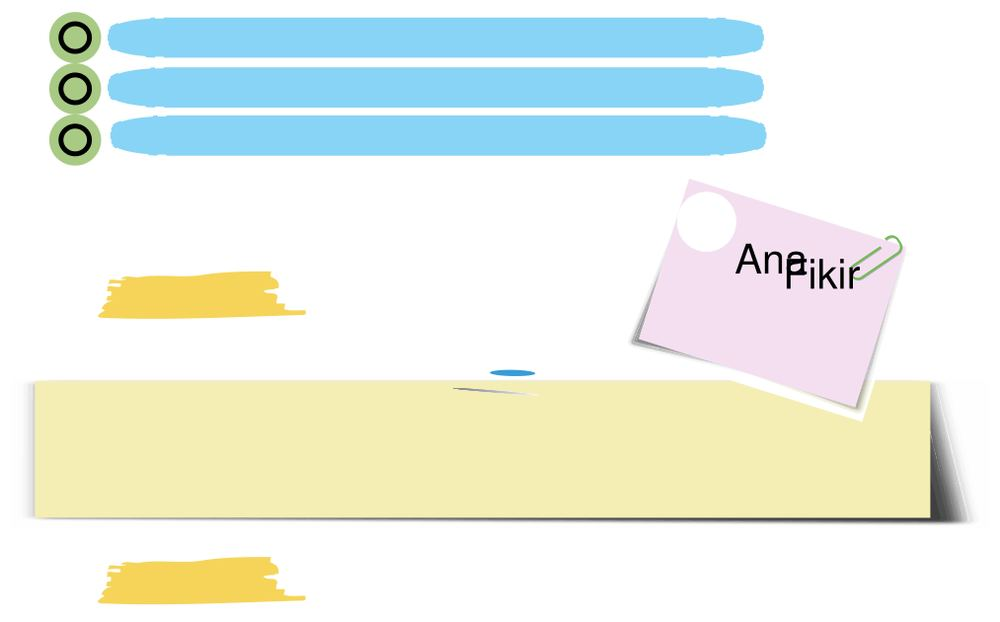
- Kibirli davranışların olumsuz sonuçları ve affetmenin önemi
- Paylaşmayı bilmeyen Kelebek’in maceraları
- Lavanta’nın diğer çiçeklerle yaşadıkları


# 3. ETKİNLİK

Metnin ana fikrini yazınız.

> **Ana Fikir**
> Bir yazının temeli olan asıl düşünce.

| |
| :--- |
| |

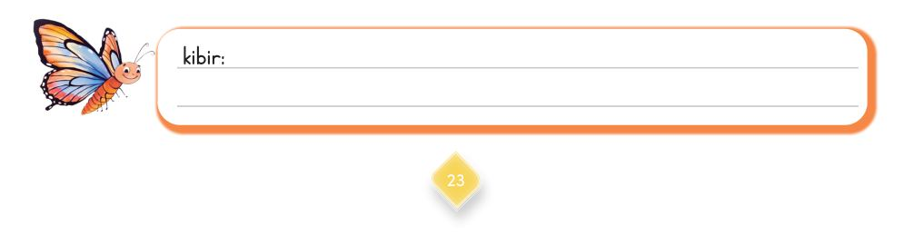
# 4. ETKİNLİK

Verilen sözcüğün anlamını dinlediğiniz metinden hareketle tahmin ediniz ve yazınız.

kibir: __________________________________________________________________

<!-- sayfa 24 -->


# 5. ETKİNLİK
Cümleleri tamamlayarak hikâyede geçen olaylarla ilgili düşüncelerinizi yazınız.

........................................................................................................................... için Kelebek, Lavanta'nın yardımını reddetti.
........................................................................................................................... için Lavanta'nın Kelebek'i affetmesi önemlidir.

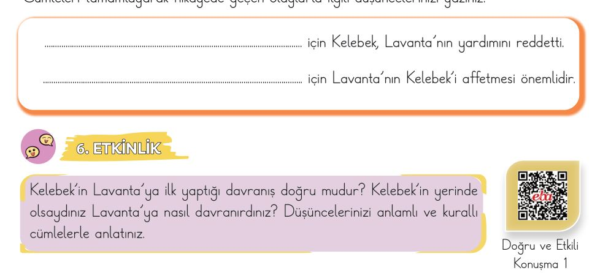
# 6. ETKİNLİK
Kelebeğin Lavanta'ya ilk yaptığı davranış doğru mudur? Kelebeğin yerinde olsaydınız Lavanta'ya nasıl davranırdınız? Düşüncelerinizi anlamlı ve kurallı cümlelerle anlatınız.

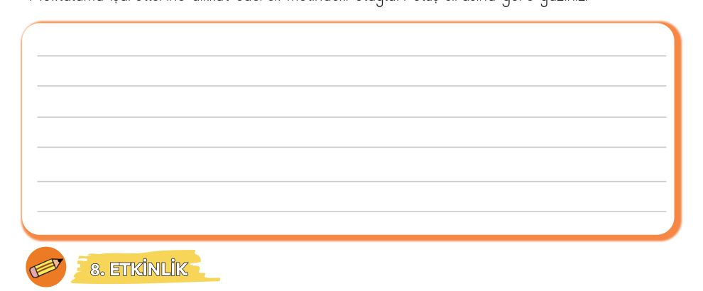
Doğru ve Etkili Konuşma 1

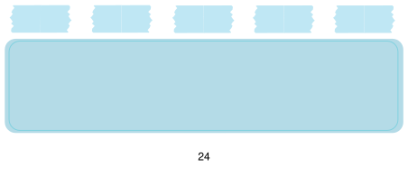
# 7. ETKİNLİK
Noktalama işaretlerine dikkat ederek metindeki olayları oluş sırasına göre yazınız.

________________________________________________________________________________________________________________________________________________________________________________________________________________________________________________________________________________________________________________________________________________________________________________________________________________________________________________________________________________________________________________________________________________________________________________________________________________________________________________________________________________________________________________________________________________________________________________________________________________________________________________________________________________________________________________________________________________________________________________________________________________________________

<!-- sayfa 25 -->


# 9. ETKİNLİK
Metinde geçen Kelebek ve Lavanta'nın özelliklerini yazınız.

| Özellikleri | Özellikleri |
| :--- | :--- |
| 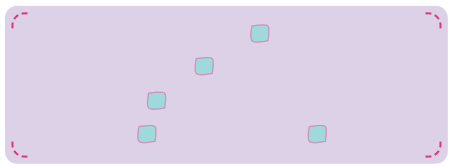 |  |

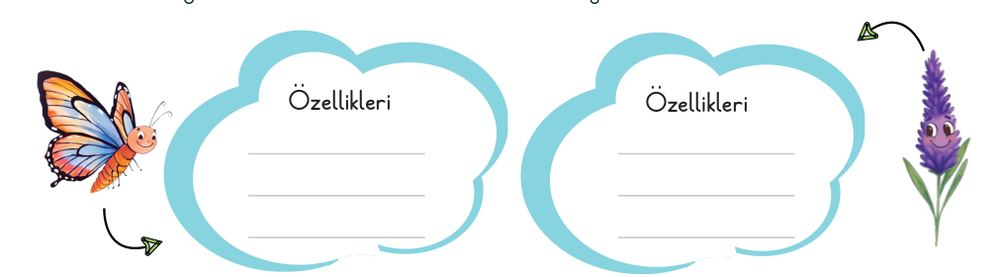
# 10. ETKİNLİK
Metinde geçen cümleleri uygun noktalama işaretleriyle tamamlayınız.

1) Kelebek kardeş ne kadar güzel kanatların var 
2) Neden konmama izin vermiyorsun 
3) Ben seni nasıl taşıyayım 
4) Aradan aylar geçmiş  havalar yavaş yavaş soğumuştu 

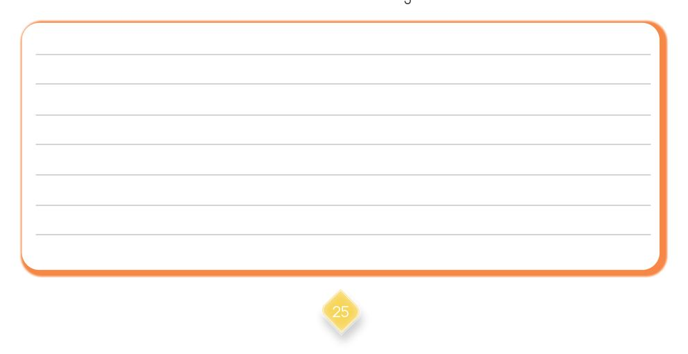
# 11. ETKİNLİK
"Kelebek ile Lavanta" metnini kendi ifadelerinizle kısaca yazınız.

__________________________________________________________________________
__________________________________________________________________________
__________________________________________________________________________
__________________________________________________________________________
__________________________________________________________________________

<!-- sayfa 26 -->


# 12. ETKİNLİK
“Kelebek ile Lavanta” metni ile ilgili iki soru yazınız. Soruları cevaplayınız.

1. Soru:
Cevap:
__________________________________________________________________
__________________________________________________________________

2. Soru:
Cevap:
__________________________________________________________________
__________________________________________________________________

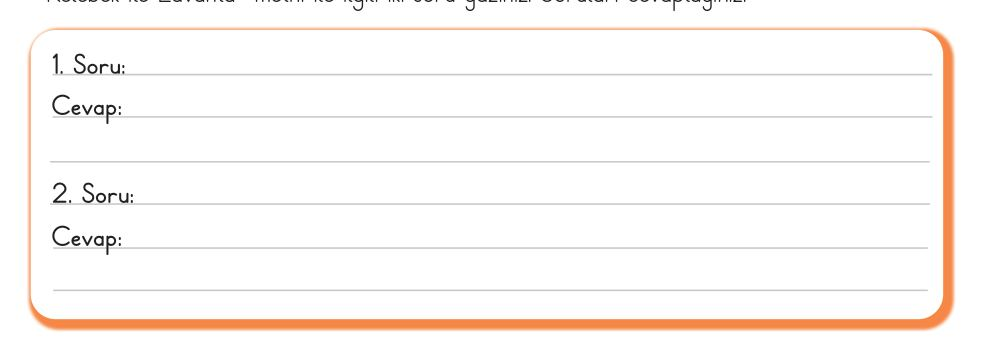
# 13. ETKİNLİK
Büyük harflerin kullanımı ile ilgili yanlışları düzeltip cümleleri tekrar yazınız.

1) Kelebek ve Lavanta Çiçek tarlasında yaşıyordu.
__________________________________________________________________

2) Lavanta türkiye’nin en güzel çiçeklerinden biridir.
__________________________________________________________________

3) Arda, Neşe ve Ben metni dikkatlice dinledik.
__________________________________________________________________

4) Türkçe Ders Kitabındaki çalışmaları tamamladık.
__________________________________________________________________

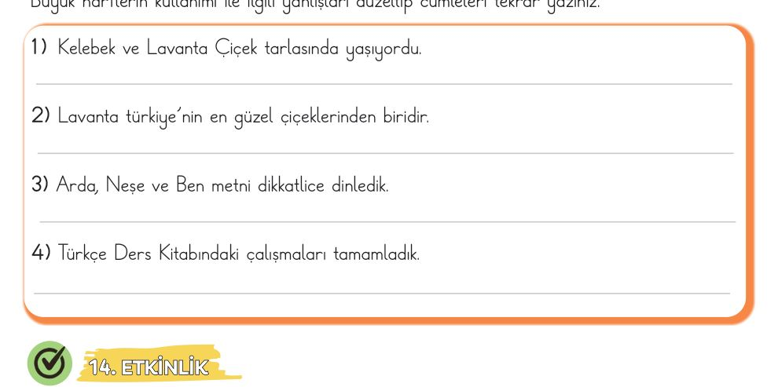
# 14. ETKİNLİK
Aşağıdaki cümleleri metinden hareketle doğruysa “Doğru” yuvarlağını, yanlışsa “Yanlış” yuvarlağını işaretleyiniz.

| | Doğru | Yanlış |
| :--- | :---: | :---: |
| Metinde mevsimler değişir ve yazdan sonra kış gelir. | ◯ | ◯ |
| Lavanta, soğuk havalarda diğer çiçekler gibi hemen solar. | ◯ | ◯ |
| Kelebekler soğuk havalarda uçmakta zorlanır. | ◯ | ◯ |

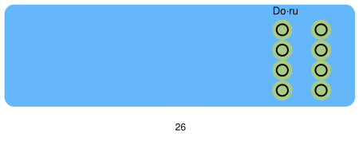

<!-- sayfa 27 -->

# METNE HAZIRLANALIM

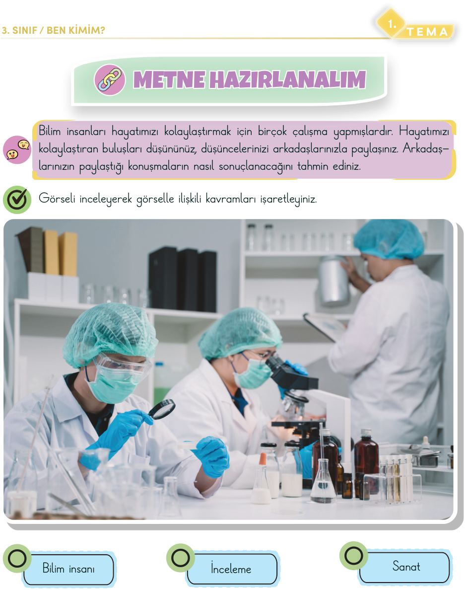 Bilim insanları hayatımızı kolaylaştırmak için birçok çalışma yapmışlardır. Hayatımızı kolaylaştıran buluşları düşününüz, düşüncelerinizi arkadaşlarınızla paylaşınız. Arkadaşlarınızın paylaştığı konuşmaların nasıl sonuçlanacağını tahmin ediniz.

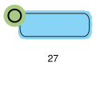 Görseli inceleyerek görselle ilişkili kavramları işaretleyiniz.

![Görselde laboratuvar ortamında çalışan bilim insanları görülmektedir.]

 
-  Bilim insanı
-  İnceleme
-  Sanat
-  Uzay bilimi
-  Kültür
-  Tiyatro
-  Sinema
-  Teknoloji
-  Deney

<!-- sayfa 28 -->

# BAŞLAYALIM

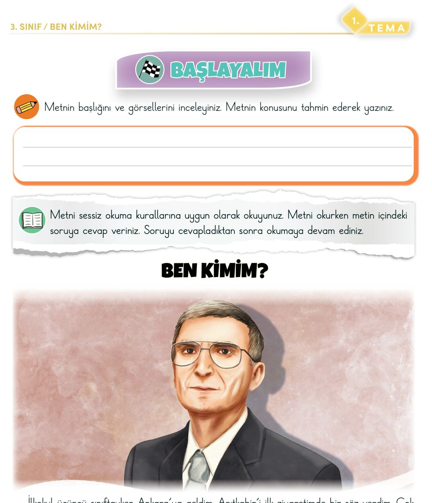 Metnin başlığını ve görsellerini inceleyiniz. Metnin konusunu tahmin ederek yazınız.

____________________________________________________________________________________________________
____________________________________________________________________________________________________

 Metni sessiz okuma kurallarına uygun olarak okuyunuz. Metni okurken metin içindeki soruya cevap veriniz. Soruyu cevapladıktan sonra okumaya devam ediniz.

# BEN KİMİM?

![Görsel: Aziz Sancar'ın portresi]

İlkokul üçüncü sınıftayken Ankara'ya geldim. Anıtkabir'i ilk ziyaretimde bir söz verdim. Çok çalışıp başarılı olacaktım. Ve çok sevdiğim ülkeme hizmet edecektim.
Kararımı vermiştim artık. Doktor olup ülkemdeki insanlara yardım edecektim. Tıp fakültesini birincilikle bitirdim.

 Aziz Sancar Anıtkabir'i ilk ziyaretinde neden çok çalışıp başarılı olacağına söz vermiş olabilir?
____________________________________________________________________________________________________
____________________________________________________________________________________________________

<!-- sayfa 29 -->


Ülkemin desteği ile eğitim için Amerika’ya gittim. Çok çalışıp birçok ödül kazandım, ülkemin bana sağladığı imkânları hiç unutmadım. Ben de bir vakıf kurarak Türk öğrencilere yardım ettim. Pek çok hastalığın tedavisi için çaba harcadım. Bilimsel çalışmalarım çok başarılı oldu. (...) 2015 (iki bin on beş) yılında Nobel Kimya Ödülü’nü aldım.

Sevgili çocuklar, çok çalıştım, hayallerimi gerçekleştirdim. Uzun yıllar Amerika’da yaşasam da ülkemi ve ülkemin bana kazandırdıklarını asla unutmadım. (...)

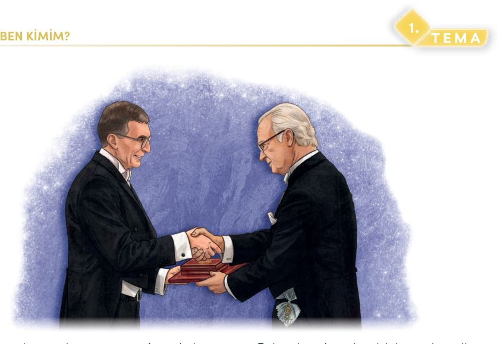
*Aile Çocuk dergisi*
*(Kısaltılmıştır.)*

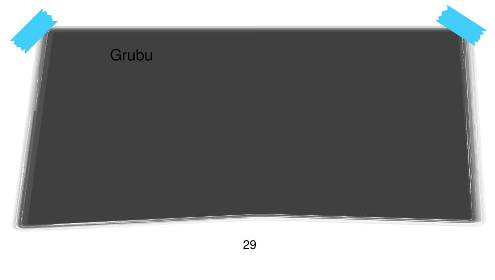
# 1. ETKİNLİK

“Ben Kimim?” metnini sesli okuyunuz. Anlamını bilmediğiniz sözcüklerin veya sözcük gruplarının altını çiziniz. Bu sözcük veya sözcük gruplarının anlamını metne göre tahmin ediniz. Tahminlerinizi TDK Güncel Türkçe Sözlük’ten kontrol ediniz ve sözcüklerin anlamını yazınız.

| Sözcük/Sözcük Grubu | Tahminim | Sözlük Anlamı |
| :--- | :--- | :--- |
| | | |
| | | |
| | | |
| | | |

<!-- sayfa 30 -->

 2. ETKİNLİK

Soruları uygun zamanda söz alarak cevaplayınız.

1) Bu metinde anlatılan kişi kimdir? Onun hayatındaki en önemli kararı neydi?
2) Anıtkabir ziyaretinde verdiği söz onun hayatını nasıl etkilemiştir?
3) Metindeki kişinin ülkesi hakkındaki düşünceleri nelerdir? Onun böyle düşünmesine sebep olan olaylar nelerdir?

 3. ETKİNLİK

a) Metnin konusunu yazınız. Metni okumadan önce yaptığınız tahminle karşılaştırınız.
[                                                                              ]
[                                                                              ]
[                                                                              ]

b) Metnin ana fikrini yazınız
[                                                                              ]
[                                                                              ]
[                                                                              ]

 4. ETKİNLİK

Aziz Sancar ile ilgili araştırma yapınız. Yaptığınız araştırma ile ilgili edindiğiniz bilgileri yazınız. Yazarken sözcükleri yerinde ve anlamına uygun kullanmaya dikkat ediniz.


[                                                                              ]
[______________________________________________________________________________]
[                                                                              ]
[______________________________________________________________________________]
[                                                                              ]
[______________________________________________________________________________]
[                                                                              ]
[______________________________________________________________________________]
[                                                                              ]
[______________________________________________________________________________]
[                                                                              ]
[________________

<!-- sayfa 31 -->


# 5. ETKİNLİK
Metinde geçen özel isimleri bularak birer cümle içinde kullanınız.

| Özel İsim | Cümle |
| :--- | :--- |
| | |
| | |
| | |
| | |
| | |


> Özel isimlerin ilk harfi her zaman büyük yazılır.


# 6. ETKİNLİK
Cümleleri uygun noktalama işaretleri ile tamamlayınız.

1) Aziz Sancar Nobel Ödülü $\square$ nü 2015 $\square$ iki bin on beş $\square$ yılında kazanmıştır $\square$
2) Ülkemin desteği ile eğitim için Amerika $\square$ ya gittim $\square$

# 7. ETKİNLİK
Büyük harf kullanımına dikkat ederek aşağıdaki sözcük ve sözcük gruplarıyla birer cümle kurunuz.

Ankara, güneş, Bilim Çocuk dergisi, lavanta, sokak, Ayşe

| |
| :--- |
| |
| |
| |
| |
| |
| |
| |

<!-- sayfa 32 -->


a) Aziz Sancar Nobel Ödülü kazanarak Türk bilim insanlarının ne kadar başarılı olduğunu gösterdi. Siz büyüyünce ülkemize nasıl katkıda bulunmak istersiniz? Yazınız.

__________________________________________________________________________
__________________________________________________________________________
__________________________________________________________________________

b) Aziz Sancar gibi siz de bir alanda çalışıp başarılı olmak isteseydiniz hangi alanı seçerdiniz? Seçtiğiniz alanı balığın gövdesine, bu alanda başarılı olmak için yapmanız gerekenleri birer sözcük ya da sözcük grubu ile örnekteki gibi balığın kılçıklarına yazınız.

sabırlı olmak  ..........................  ..........................
          \            /
           \          /
            \        /
             \      /
              \    /
               \  /
                \/
                /\
               /  \
              /    \
             /      \
            /        \
           /          \
          /            \
..........................  ..........................


Seçtiğim Alan: ..........................

<!-- sayfa 33 -->

# METNE HAZIRLANALIM

Selam vermenin iletişimdeki önemi nedir? Kendi yaşantınızdan örnekler vererek açıklayınız.

Yönergeler uygun olarak selam verme oyununu oynayınız.


1. Tüm öğrenciler ayakta bir çember oluşturur.
2. Öğretmen, oyunu başlatmak için bir öğrenciye selam verir. Örneğin “Merhaba Ayşe! Bugün nasılsın?”
3. Selam verilen öğrenci, önce selamı veren kişiye cevap verir: “Merhaba öğretmenim! Ben iyiyim, teşekkür ederim.”
4. Ardından öğrenci bir arkadaşına döner ve ona selam verir: “Selam Ahmet! Günün nasıl geçiyor?” 
5. Her öğrenci, selamlaşma sırasında farklı bir cümle kullanır. Selam verirken bir jest veya mimik eklenir.
6. Oyun, her öğrenci birbirine selam verene kadar devam eder.

Bu oyunu oynarken neler hissettiniz? Duygularınızı uygun ses tonu ile açıklayınız.

<!-- sayfa 34 -->

# BAŞLAYALIM

 Şiirin başlığını ve görselini inceleyiniz. Sizce başlık ve görsel birbiriyle uyumlu mudur? Nedeni ile yazınız.

___________________________________________________________________________
___________________________________________________________________________

 Şiiri vurgu ve tonlamalara dikkat ederek arkadaşlarınızla sesli okuyunuz.

## KÖYDE İLK SABAH

Ne güzel rüya görüyordum,
Bir serçe konuyordu avucuma.
“Günaydın” diyordu cıvıl cıvıl, şen şakrak;
“Uyan artık, gün doğdu bak!”

Gözlerimi açtım, gerindim neşeyle,
Kollarımı iki yana açarak.
Bir kuş ötüyor penceremde;
Demek sendin rüyamdaki serçe,
Sana da günaydın öyleyse!

Köyde ilk sabahım, hava mis gibi;
Selam veriyor ağacı, yaprağı, çiçeği.
Aynı dedemin dediği gibi,
Selamla gelir gönlümüzün neşesi.

Günaydın çilli horoz, günaydın nar çiçeği,
Sana da merhaba anneannemin mor menekşesi.
Selam vermek ne güzel güne;
Unutmadan, bir selam da kendime.
Haydi, başlayalım güzel bir güne!

<!-- sayfa 35 -->

 1. ETKİNLİK

**a)** Sözcük ve sözcük grubunun başındaki harfi tanımlarının başındaki kutucuğa yazarak eşleştirinizi.

| a) serçe | b) avuç | c) şen şakrak | ç) mis gibi |
| :---: | :---: | :---: | :---: |

○ Çok güzel olan.
○ Elin parmak uçlarıyla bilek arasındaki iç bölümü.
○ Çok neşeli.

**b)** Yukarıdaki sözcük ve sözcük gruplarının her biri ile anlamlı ve kurallı cümleler yazınız.


Yazma Öz Değerlendirme


 2. ETKİNLİK

Soruları noktalama işaretlerine dikkat ederek okuyunuz. Cevaplarınızı söylerken anlamlı ve kurallı cümleler kurunuz.

1) Çocuk rüyasında ne görmüştür?
2) Şiirde çocuğun dedesi nasıl bir öğüt vermiştir?
3) Şiirin bütününe hakim olan duygu nedir?

<!-- sayfa 36 -->

 3. ETKİNLİK

Şiirde çocuk kimlere ve nelere “günaydın” demektedir?

__________________________________________________________________________
__________________________________________________________________________
__________________________________________________________________________

  4. ETKİNLİK

Şiirden hareketle; aşağıdaki cümleler doğruysa “Doğru” yuvarlağını, yanlışsa “Yanlış” yuvarlağını işaretleyiniz.

| | Doğru | Yanlış |
| :--- | :---: | :---: |
| Çocuk rüyasında bir serçe görür. |  |  |
| Şiirde çocuk güne selam vermeden başlar. |  |  |
| Şiir, köyde geçirilen ilk sabahı anlatır. |  |  |

   5. ETKİNLİK

a) “Köyde İlk Sabah” şiirini sınıf arkadaşlarınızla koro hâlinde okuyunuz. Şiirde yer alan duyguları işaretleyiniz.

 huzur   öfke   üzüntü   minnettarlık
 korku   umut   sevinç   sevgi

b) İşaretlediğiniz duygulardan bir tanesini şiirden hareketle açıklayarak yazınız.

<!-- sayfa 37 -->


# 6. ETKİNLİK

Şiirde yaşananları oluş sırasını düşünerek kendi cümlelerinizle aşağıya yazınız.

| |
|---|
| |
| |
| |


# 7. ETKİNLİK

Günlük hayatta “selam vermek” gibi nezaket ifadelerini neden kullanmalıyız? Konuşma kurallarına uyarak arkadaşlarınıza anlatınız. Arkadaşlarınızın konuşmalarını dinlerken konuşmalarının nasıl sonuçlanacağını tahmin ediniz.


Konuşma Öz Değerlendirme


# 8. ETKİNLİK

Sabah uyandığınızda ya da pencereden dışarı baktığınızda kimlere veya nelere selam vermek istersiniz? Nedenleriyle yazım ve noktalama kurallarına dikkat ederek yazınız.

| |
|---|
| |
| |
| |
| |
| |


# 9. ETKİNLİK

Köyde bir sabah uyandığınızı düşününüz. Uyandığınızda ilk olarak ne yapmak isterdiniz? Düşüncelerinizi nedenleriyle birlikte yazınız.

<!-- sayfa 38 -->


# 10. ETKİNLİK
Şiirin konusunu ve ana duygusunu yazınız.

| Şiirin Konusu | Şiirin Ana Duygusu |
| :--- | :--- |
| | |
| | |
| | |


# 11. ETKİNLİK
Aşağıdaki sözcükleri kullanarak bir şiir yazınız. Şiiri yazarken noktalama işaretlerine ve yazım kurallarına dikkat ediniz.


Türkçemizi kurallarına uygun olarak kullanmamız duygu ve düşüncelerimizi doğru olarak aktarmamızı sağlar.

selam
günaydın
serçe
menekşe
mutluluk

| |
| :--- |
| |
| |
| |
| |
| |
| |
| |
| |
| |

Alfabetik Sıra

<!-- sayfa 39 -->

# METNE HAZIRLANALIM

: Görseli inceleyiniz. Görselden hareketle soruları cevaplayınız. Cevaplarınızı sözcükleri yerinde ve anlamına uygun kullanarak arkadaşlarınızla paylaşınız.

* Görseldeki çocuk ne yapıyor?
* Sizce komşular birbirine nasıl yardım eder?
* Yaşlı birine yardım etmek isteseydiniz neler yapardınız?

: (Bir çocuk ve yaşlı bir adamın meyvelerin döküldüğü bir poşeti toplarken resmedildiği görsel)

Yaptığınız bir iyiliği ve bu iyiliğin sonunda hissettiklerinizi yazınız.

__________________________________________________________________________
__________________________________________________________________________
__________________________________________________________________________

<!-- sayfa 40 -->

# BAŞLAYALIM


Metnin başlığını ve görselini inceleyiniz. Başlıktan ve görselden hareketle metinde geçen olayları tahmin edip yazınız.

__________________________________________________________________________
__________________________________________________________________________
__________________________________________________________________________

> **Olay**
> Ortaya çıkan, oluşan durum, ilgi çeken veya çekebilecek nitelikte olan her türlü iş.


Metni noktalama işaretlerine dikkat ederek sessiz okuyunuz. Metni okurken metindeki sorulara cevap veriniz. Soruları cevapladıktan sonra okumaya devam ediniz.

# NERMİN TEYZE NEREDE?

Ali ve Kemal benim en yakın arkadaşlarım. Sizin de böyle yakın arkadaşlarınız vardır eminim. Onlardan ayrı hiçbir şey yapmam. Sabahları beraber okula gideriz. Ödevlerimizi beraber yaparız. Oyunları beraber oynarız. Son zamanlarda hafta sonları kaykay yarışı yapıyoruz. En kısa sürede belirlediğimiz hedefe ulaşan birinci oluyor. Cumartesi günü o kadar çok kaykay sürdük ki bir ara çok susadık.


## 1

 Çocuklar su ihtiyaçlarını gidermek için nasıl bir çözüm bulmuş olabilirler?

__________________________________________________________________________

<!-- sayfa 41 -->

Nermin teyzeden su istemeye karar verdik. Nermin teyze de kim diyecek olursanız o bizim komşumuz. Çok tatlı bir teyzedir kendisi. Bahçe katında oturuyor ve ne zaman susasak bize su veriyor. Nermin teyzeee! Nermin teyzeee! diye bağırdık ama Nermin teyzeden ses seda yok. Bizim ev taaa 6. katta şimdi kim çıkıp su alıp gelecek. Kemal, bahçe kapısının açık olduğunu söyledi. Ben yine de kapıyı tıklatmasını söyledim. Arkadan Ali, kapı açık içeri girip hemen su alıp çıkalım diye sessizce bir teklifte bulundu.


2  Sizce, çocuklar bu teklif sonrasında ne yapmıştır?

<!-- sayfa 42 -->

Kapı açıkken tam önünde bile durmak doğru değilken içeri girmekten bahsettiği için çok ayıp olacağını söyleyip uyardım onları. Neyse ki Nermin teyze elinde bir sürahi suyla geldi. (...)


Evet Nermin teyze bizi çok seviyordu ama öyle evinin içine girmek olmazdı. Ev sahibinden izin almadan eve girmemiz hiç doğru değildi. Evde de ablamın odasına gittiğimde her zaman kapıyı tıklatırım o gel derse girerim. Ablam da aynısını benim odama girerken yapar. Nermin teyzenin verdiği sudan bir güzel içtik ve yarışımıza devam ettik. Kim mi kazandı? Eee söylememe gerek yok sanırım.

Diyanet Çocuk dergisi

<!-- sayfa 43 -->

# 1. ETKİNLİK

* “Nermin Teyze Nerede?” metnini sesli okuma kurallarına uygun olarak tekrar okuyunuz.
* Okuma sonunda tahminlerinizin doğruluğunu metne göre kontrol ediniz.
* Anlamını bilmediğiniz sözcük veya sözcük gruplarının altını çizerek metne göre tahmin ediniz.
* Tahminlerinizi TDK Güncel Türkçe Sözlük'ten kontrol ediniz ve sözcüklerin anlamını yazınız.
* Öğrendiğimiz sözcükleri cümle içinde kullanınız. Konuşma kurallarına uygun olarak arkadaşlarınızla paylaşınız.


| Sözcük/Sözcük Grubu | Tahminim | Sözlük Anlamı |
| :--- | :--- | :--- |
| | | |
| | | |
| | | |
| | | |

## 2. ETKİNLİK

Metnin konusunu yazınız. Metni okumadan önce yaptığınız tahminle karşılaştırınız.

[ ]

## 3. ETKİNLİK

Cümleleri uygun noktalama işaretleriyle tamamlayınız.

1) Nermin teyzeee [ ] Nermin teyzeee [ ] diye bağırdık [ ]
2) Kim mi kazandı [ ]
3) Kemal [ ] Bahçe kapısı açık [ ] dedi [ ]
4) Ali [ ] Kemal ve ben çok iyi arkadaşız [ ]
5) Ali [ ] Kapı açık [ ] içeri girip hemen su alıp çıkalım [ ]


<!-- sayfa 44 -->


# 4. ETKİNLİK
Cümleleri metindeki oluş sırasına göre örnekteki gibi numaralandırarak sıralayınız.

| | |
|---|---|
| ☐ | İçeri girmeyip onu bekledik. |
| ☐ | Su istemek için Nermin teyzenin kapısına gittik. |
| 1. | Arkadaşlarımla kaykay yarışı yapıyorduk. |
| ☐ | Nermin teyzenin kapısı açıktı. |
| ☐ | Nermin teyze kapıya gelip bize su verdi. |
| ☐ | Çok susadık. |


# 5. ETKİNLİK
Üç kişilik bir grup oluşturarak metindeki Ali, Kemal ve arkadaşlarının Nermin teyzenin açık kapısının önünde bekledikleri sahneyi canlandırınız. Canlandırmanızda karakterlerin duygu ve düşüncelerini yansıtınız.


# 6. ETKİNLİK
Metinde çocuklar neden Nermin teyzeden su istemeyi tercih ettiler? Nermin teyzenin yerinde siz olsaydınız nasıl davranırdınız? Arkadaşlarınızla tartışınız.


# 7. ETKİNLİK
Örnek olayı okuyunuz. Olayın devamını yazım kurallarına dikkat ederek yazınız.

Efe ve Damla, okuldan dönerken mahallenin köşesinde oturan Gülsüm teyzeyi fark ettiler. Gülsüm teyze; pazar arabasını güçlükle çekmeye çalışıyor, ara sıra durup soluklanıyordu. Damla, hemen Efe'ye dönüp "Baksana, Gülsüm teyze çok zorlanıyor. Ona yardım edelim mi?" dedi.

__________________________________________________________________________
__________________________________________________________________________
__________________________________________________________________________
__________________________________________________________________________
__________________________________________________________________________
__________________________________________________________________________
__________________________________________________________________________
__________________________________________________________________________

<!-- sayfa 45 -->

# METNE HAZIRLANALIM

 Görselleri verilen ağaçları inceleyiniz. Sizce kuşlar hangi ağaca yuva yapmayı tercih eder? Nedeniyle yazınız.

___________________________________________________________________________
___________________________________________________________________________

 Yaprakların üzerindeki sözcüklerin çağrıştırdığı sözcükleri diğer yapraklara yazınız.

(Yaprak görseli) güz ........................
(Yaprak görseli) ........................
(Yaprak görseli) ........................
(Yaprak görseli) ........................
(Yaprak görseli) ........................
(Yaprak görseli) ........................
(Yaprak görseli) ........................
(Yaprak görseli) yuva ........................
(Yaprak görseli) ........................
(Yaprak görseli) ........................
(Yaprak görseli) ........................
(Yaprak görseli) ........................

<!-- sayfa 46 -->

# BAŞLAYALIM


Metnin başlığını ve görsellerini inceleyiniz. Metnin konusunu ve ana fikrini tahmin ediniz. Metni okuma kurallarına uygun olarak sessiz okuyunuz. Metni okurken metnin içindeki soruları cevaplayınız.

## ÇAM AĞACI

(...) Bir dere kenarında yaşlı ve bilge bir çınar ağacı varmış. Yanında da genç bir çam ağacı. (...) Bir gün bakmış ki çam ağacı çok üzgün duruyormuş.
– Evlat, neyin var? diye sormuş. (...) Çam ağacı üzgün bir şekilde dallarını sallamış ve başlamış konuşmaya:
– Ormandaki kuşlar beni sevmiyor.(...) Gözyaşlarına hâkim olamayan çam ağacı:
– Sevmiyorlar işte, diye haykırmış.
Yaşlı çınar:
– Söyle bakalım, niye böyle düşünüyorsun, diye sormuş.

### 1


Çam ağacı, yaşlı çınarın sorusuna ne cevap vermiştir? Yazınız.
__________________________________________________________________
__________________________________________________________________


<!-- sayfa 47 -->


– Koca çınar, bu ormandaki herkes seni çok seviyor. Kuşlar, senin dallarına konup sana güzel şarkılar söylüyorlar. Ama benim yapraklarım iğne gibi sivri olduğu için dallarıma hiç konmuyorlar. Eğer beni sevselerdi dallarıma konarlardı, diye karşılık vermiş çam ağacı. (...)

– Onu sessizce dinleyen çınar ağacı konuşmaya başlamış:

– Bak sevgili çam ağacı, bir gün ne kadar yanıldığını anlayacaksın. İnan bana, bu üzüntün boşuna.

2  Bilge çınar, daha önce neler yaşamış olabilir ki genç çam ağacına “Boşa üzülüyorsun!” demektedir?

<!-- sayfa 48 -->

Çam ağacı, bilge çınarın kendisini rahatlatmak için böyle konuştuğunu düşünüyormuş. Ama yine de beklemeye karar vermiş.

Sonbahar gelip çatmış. Bilge çınarın yaprakları bir bir sararıp yere düşmeye başlamış. Ama çam ağacının dikenli yaprakları hiç dökülmüyormuş. (...)

Çınar ağacına yuva yapan ve şarkı söyleyen kuşlar birer birer kendilerine yer aramaya başlamışlar. Çünkü yapraksız kalan çınar ağacı, onları soğuktan ve kardan koruyamıyormuş. (...) Hemen çam ağacının genç dallarına konmaya başlamışlar. Çünkü kendilerini kardan ve soğuktan bu şekilde koruyabiliyorlarmış.

Küçük çam ağacı çok sevinmiş. (...) Bunun üzerine bilge çınar, çam ağacına şöyle demiş:

- Sana boşuna üzülüyorsun dememiş miydim? Bak, kuşları kardan ve soğuktan koruyorsun. Kuşlar ne güzel yuva yapıyorlar dallarına. Ne mutlu sana!

Çam ağacı da sevinçle dallarını sallayarak,

- Evet, ne mutlu bana, demiş. (...)

İsmail BİLGİN
Erdem Çocuk
(Kısaltılmıştır.)


# 1. ETKİNLİK

Metnin konusunu yazınız. Metni okumadan önce yaptığınız tahminle karşılaştırınız.

__________________________________________________________________
__________________________________________________________________
__________________________________________________________________


<!-- yer tutucu bulunamadı: sayfa sonuna eklendi -->

<!-- sayfa 49 -->

 2. ETKİNLİK

a) “Çam Ağacı” metnini sesli okuma kurallarına uygun olarak tekrar okuyunuz. Anlamını bilmediğiniz sözcük veya sözcük gruplarının altını çiziniz. Bu sözcük veya sözcük gruplarının anlamını metne göre tahmin ediniz. Tahminlerinizi TDK Güncel Türkçe Sözlük'ten kontrol ediniz ve sözcüklerin anlamını yazınız.


| Sözcük/Sözcük Grubu | Tahminim | Sözlük Anlamı |
| :--- | :--- | :--- |
| | | |
| | | |
| | | |

b) Öğrendiğiniz sözcükleri cümle içinde kullanınız. Konuşma kurallarına uygun olarak arkadaşlarınızla paylaşınız.

 3. ETKİNLİK

Aşağıdaki cümleleri metindeki olayların oluş sırasına göre örnekteki gibi numaralandırarak sıralayınız.

○ Çınar ağacının yaprakları sonbaharda döküldü.
○ Çam ağacı, kuşların kendisine konmasına çok sevindi.
○ Kuşlar kışın çam ağacının dallarına sığındı.
1. Kuşlar çam ağacının dallarına konmuyordu.

 4. ETKİNLİK

Sözcük gruplarının anlamını metinden hareketle tahmin edip yazınız.

gelip çatmak:
__________________________________________________________________
__________________________________________________________________

hâkim olamamak:
__________________________________________________________________
__________________________________________________________________

<!-- sayfa 50 -->

 5. ETKİNLİK


**Konuşma Üslubu Nedir?**
Konuşma üslubu, kişinin bir konuya veya duruma göre konuşma biçimini belirleyen ifadelerin, sözcüklerin ve ses tonunun bütünüdür. Konuşma üslubu, iletişimde hem nasıl bir izlenim bıraktığımızı hem de karşımızdaki kişiyle kurduğumuz ilişkiyi etkiler.

Metinden anlatılanlardan hareketle resim çiziniz. Resminizi konuşma üslubunuza dikkat ederek anlatınız.


 6. ETKİNLİK


**a)** Cümleleri dikkatlice okuyunuz. Kutucuklarla belirtilen yerlere uygun noktalama işaretlerini koyunuz.

$\square$ Sevmiyorlar işte $\square$ diye haykırmış $\square$
Yaşlı çınar $\square$
$\square$ Söyle bakalım $\square$ niye böyle düşünüyorsun $\square$ diye sormuş $\square$


**b)** Yazdığınız noktalama işaretlerinin doğruluğunu, cümlelerin “Çam Ağacı” metnindeki yerini bularak kontrol ediniz. Doğru yazdığınız her noktalama işareti için bir çiçeği boyayınız.


<!-- sayfa 51 -->

 7. ETKİNLİK

“Çam Ağacı” metnine göre “4 Soru 4 Cevap” etkinliğini tamamlayınız.


1) Çam ağacı kış mevsiminden önce neden üzgündür?


2) Bilge çınarın sözleri çam ağacının duygularını nasıl değiştirmiş olabilir?


3) Çam ağacının yerinde olsaydınız ne hissederdiniz?


4) Metnin sonunda kuşların davranışını nasıl değerlendiriyorsunuz?


 HATIRLA
 YORUMLA
 BAĞ KUR
 DEĞERLENDİR

<!-- sayfa 52 -->


Yönergeleri takip ederek verilen sunumu yapınız.

> “Fidan dikmek yurdumuza ve doğadaki diğer canlılara karşı gösterilen bir saygıdır.”
> 1) Yukarıdaki ifadeyi nedenleriyle açıklayacak bir sunum hazırlayınız.
> 2) Sunumunuzu dijital poster veya basılı poster olarak hazırlayınız.
> 3) Sunumunuzu arkadaşlarınızla paylaşınız.


<!-- sayfa 53 -->

# PERFORMANS GÖREVİ

* Performans görevi olarak verilen değerlerden en az birini seçiniz.
* Bu değerlerden biriyle ilgili bir pano hazırlayınız.
* Hazırladığınız panoyu aşağıdaki sunum çeşitlerinden birini seçerek sınıfta sununuz.

## DEĞERLER


> **Saygı**
> Saygı, başkalarına güzel davranmak ve onları dinlemektir. Saygılı olmak için neler yapıyorsunuz? Örneğin konuşurken söz kesmemek karşımızdakine saygıdır.

> **Sorumluluk**
> Sorumluluk almak, bir işi yapmayı kabul etmek ve o işi zamanında, doğru bir şekilde yapmaktır. Örneğin okul kurallarına uymak bir sorumluluktur.


> **Vatan Sevgisi**
> Vatan sevgisi, yaşadığımız ülkeyi korumak, sevmek ve ona değer vermektir. Örneğin ormanları korumak vatanımıza duyduğumuz sevgiyi göstermenin güzel bir yoludur.

> **Yardımseverlik**
> Yardım etmek, zor durumda olan birine destek olmaktır. Birine yardım ettiğiniz bir durumu anlatınız. Örneğin düşen bir arkadaşınızı yerden kaldırmak yardımseverliktir.

> **Dostluk**
> Dostluk, insanların iyi ve kötü günlerinde birbirine yardımcı olup birlikte zaman geçirmekten mutlu olmasıdır. Örneğin oyun oynarken arkadaşınızı da oyuna çağırmak dostluğun bir göstergesidir.

[QR Kod Görseli]
Performans Değerlendirme

## SUNUM ÇEŞİTLERİ

* Şiir
* Resim
* Afiş

<!-- sayfa 54 -->

# 1. TEMA SONU ÇALIŞMASI

 a) Metni okuyunuz. Metinle ilgili soruları cevaplayınız.


## Nezaket ve Yardımlaşma

Bilge, sabah uyandığında annesine ve babasına “Günaydın” dedi. Kahvaltıdan sonra, okula gitmek için apartmandan çıkarken yaşlı komşusu Hasan amcayı gördü. Hasan amcanın elleri doluydu ve elindekileri taşımakta çok zorlanıyordu. Bilge, hemen yaklaşıp “Hasan amca, size yardım etmemi ister misiniz?” diye sordu. Hasan amca gülümseyerek “Çok naziksin, teşekkür ederim Bilge!” dedi. Bilge, heyecanla Hasan amcanın eşyalarını aldı ve kapısına kadar taşıdı. Yardım etmek çok güzel bir şeydi. Bilge, yardım ederken çok mutlu oldu. Bu davranış, ona iyi bir komşu ve yardımsever olmanın önemini öğretti. Bilge, her zaman böyle yapmaya karar verdi.

 Bu kitap için yazılmıştır.

---

1) Bilge sabah uyandığında anne ve babasına hangi sözcüğü söyledi?
___________________________________________________________________________

2) Bilge, yaşlı komşusuna nasıl yardım etti?
___________________________________________________________________________

3) Metinde geçen nezaket sözcüklerini yazınız.
___________________________________________________________________________

4) Okuduğunuz metnin ana fikrini yazınız.
___________________________________________________________________________
___________________________________________________________________________

<!-- sayfa 55 -->


**b)** Cümlelerdeki koyu yazılmış sözcüklerin anlamını tahmin ediniz. Tahminlerinizi TDK Güncel Türkçe Sözlük'ten kontrol ediniz ve sözcüklerin anlamını yazınız.

Ali, düşen arkadaşını hemen kaldırarak ona **yardım** etti.


Tahminim:
__________________________________________________________________
__________________________________________________________________

Sözlük Anlamı:
__________________________________________________________________
__________________________________________________________________

Kütüphane o kadar sessizdi ki kalem yere düşünce çıkan sesi herkes duydu.


Annem mis gibi kokan çiçekleri vazoya yerleştirdi.


**c)** Cümlelerden doğru olanların yuvarlağına "D" yanlış olanların yuvarlağına "Y" harfi yazınız.

◯ Cümlelerin ilk harfi büyük yazılır.
◯ Soru cümlelerinin sonunda ünlem işareti kullanılır.
◯ Özel isimlerin ilk harfi büyük yazılır.
◯ Virgül cümle sonunda kullanılabilir.
◯ Cümle içinde sözcük ve sözcük grupları arasına virgül konulabilir.


1. Tema Sonu

<!-- sayfa 56 -->

# 2. Tema
# ATATÜRK VE KAHRAMANLARIMIZ

## Temada Yer Alan Metinler
* Kahverengi Ayakkabıları Siyaha Boyayan Ülkü (Dinleme Metni)
* Atatürk Çok Kitap Okurmuş
* Anadolu'nun Kadınları
* Dün Gibi
* Atatürk'ün Çocuk Sevgisi


<!-- sayfa 57 -->

# BU TEMADA NELER ÖĞRENECEĞİZ?

Bu temadaki metinler aracılığıyla dinleme, okuma, konuşma ve yazma becerilerimizi geliştireceğiz. Bu temada Atatürk’ü ve Millî Mücadele kahramanlarımızı daha yakından tanıyacağız. Millî Mücadele döneminde insanların nasıl cesurca davrandığını öğreneceğiz. Vatan sevgisi, kahramanlık, fedakârlık ve cesaret gibi kavramları anlayacağız. Kahramanlarımızın hayatlarından örnekler alarak kendimizi geliştireceğiz.

## Anahtar Kavramlar

* cesaret
* cumhuriyet
* Çanakkale Zaferi
* fedakârlık
* gazilik
* İstiklâl Marşı
* kahramanlık
* Kut’ül Amare
* millî bayramlar
* millî egemenlik
* millî irade
* millî kimlik
* Millî Mücadele
* Mustafa Kemal Atatürk
* Sarıkamış Harekâtı
* şehitlik
* vatanseverlik


! Temadaki metinler; yazım, noktalama ve dönemin söyleyiş özellikleri açısından eserin orijinal

<!-- sayfa 58 -->

# TEMAYA HAZIRLANALIM

## a) Kavramlarla anlamlarını eşleştiriniz.

fedakârlık $\bigcirc$ $\quad$ $\bigcirc$ Özverili olma durumu.
millî irade $\bigcirc$ $\quad$ $\bigcirc$ Bağımsızlık için yapılan savaş.
Millî Mücadele $\bigcirc$ $\quad$ $\bigcirc$ Yurdunu, milletini büyük bir tutku ile seven.
vatansever $\bigcirc$ $\quad$ $\bigcirc$ Milletçe kullanılan ve hiçbir gücün etkileyemeyeceği kuvvet.
$\quad$ $\quad$ $\quad$ $\quad$ $\quad$ $\bigcirc$ Bir yerde bulunan kimselerin bütünü.

## b) Soruların cevaplarını yazarak bulmacayı çözünüz.

1) Atatürk’e “Kemal” adını hangi dersin öğretmeni vermiştir?
2) Atatürk’ün kız kardeşinin adı nedir?
3) Atatürk’ün annesinin adı nedir?
4) Atatürk hangi şehirde doğmuştur?
5) Atatürk’ün babasının adı nedir?


| | | | | | | 1 | | | | | | |
|---|---|---|---|---|---|---|---|---|---|---|---|---|
| | | | | | | | | | 2 | | | |
| 3 | | | | | | | | | | | | |
| | | | | | | | | | | | | |
| | | | 4 | | | | | | | | | |
| | | | | | | | | | | | | |
| | | | | | | | | | | | | |
| 5 | | | | | | | | | | | | |


<!-- sayfa 59 -->

# METNE HAZIRLANALIM

 Ailenize ve arkadaşlarınıza hangi işlerde yardımcı oluyorsunuz? Yazınız. Konuşma kurallarına uygun olarak yazdıklarınızı paylaşınız. Beden dilinizi doğru kullanmaya dikkat ediniz.

__________________________________________________________________________
__________________________________________________________________________
__________________________________________________________________________
__________________________________________________________________________
__________________________________________________________________________
__________________________________________________________________________
__________________________________________________________________________

  Yukarıdaki paylaşımınız ile arkadaşlarınızın paylaşımları arasındaki benzerlik ve farklılıkları yazınız.

| Benzerlikler | Farklılıklar |
| :--- | :--- |
| ____________________________________ | ____________________________________ |
| ____________________________________ | ____________________________________ |
| ____________________________________ | ____________________________________ |
| ____________________________________ | ____________________________________ |
| ____________________________________ | ____________________________________ |
| ____________________________________ | ____________________________________ |

<!-- sayfa 60 -->

# BAŞLAYALIM

Metnin başlığını ve görselini inceleyiniz. Başlık ve görselden hareketle metnin konusunu tahmin edip yazınız.

[ ]

 Dinleme metni karekodunu okutunuz. Metni dinleme kurallarına uygun olarak dinleyiniz.

 Dinleme Metni

# KAHVERENGİ AYAKKABILARI SİYAHA BOYAYAN ÜLKÜ

 Dinleme Öz Değerlendirme

<!-- sayfa 61 -->


# 1. ETKİNLİK

Dinleme kurallarına göre kendinizi değerlendiriniz. Uyduğunuz kural için “Evet” kutucuğunu, uymadığınız kural için “Hayır” kutucuğunu işaretleyiniz.

| | Evet | Hayır |
| :--- | :---: | :---: |
| Metni sessizce dinledim. | ○ | ○ |
| Metni dikkatlice dinledim. | ○ | ○ |
| Metni uygun oturuş pozisyonunda dinledim. | ○ | ○ |
| Metni dinlerken başkasını rahatsız etmedim. | ○ | ○ |

! Uygulamadığınız dinleme kurallarını bir sonraki dinlemenizde uygulayınız.


# 2. ETKİNLİK


Soruları dinlediğiniz metne göre cevaplayınız.

1) Kahverengi ayakkabılar neden kapının önüne bırakılmıştı?
___________________________________________________________________________
___________________________________________________________________________

2) Ülkü’nün, ayakkabılarını boyadığını görünce Atatürk ne yaptı?
___________________________________________________________________________
___________________________________________________________________________

3) Atatürk, Ülkü’ye ne öğüt verdi?
___________________________________________________________________________
___________________________________________________________________________

4) Ülkü, boyama kitapları ve kalemleri aldıktan sonra ne yaptı?
___________________________________________________________________________
___________________________________________________________________________

<!-- sayfa 62 -->


# 3. ETKİNLİK

Dinlediğiniz metinden hareketle eksik bırakılan ifadeleri örnekteki gibi eşleştirerek tamamlayınız.

1) Ülkü’nün dikkatli olduğunu ................................................... 
2) Ülkü’nün yardım etmeyi sevdiğini ..............................
3) Atatürk’ün sabırlı biri olduğunu ...................................
4) Ülkü’nün Atatürk’e hayran olduğunu ....................
5) Atatürk’ün Ülkü’ye değer verdiğini ...........................

---

a) aklına bir şey gelmiş gibi gülümsemesinden anladım.
b) Ülkü’ye kızmayıp ona boya kalemleri vermesinden anladım.
c) ona güzel bir hediye verip resim yapmasını istemesinden anladım.
ç) ayakkabıları özenle boyamasından anladım.
d) ona yardım etmek için ayakkabılarını boyamak istemesinden anladım.
e) Atatürk’ün ayakkabılarını boyarken mutlu olmasından anladım.

---


# 4. ETKİNLİK


Dinlediğiniz metinde Ülkü, Atatürk’ün ayakkabılarını neden boyamak istiyordu? Düşüncelerinizi arkadaşlarınızla paylaşınız.

<!-- sayfa 63 -->


# 5. ETKİNLİK

Aşağıdaki ifadeleri, metni dinlemeden önce okuyunuz. Doğru ifadeler için dinleme öncesinde yer alan “D” kutucuğunu, yanlış ifadeler için “Y” kutucuğunu işaretleyiniz. Daha sonra karekodu okutup metni dinleyiniz. Aynı ifadeler için dinleme sonrasında yer alan “D” veya “Y” kutucuğundan uygun olanı işaretleyiniz.

| Dinleme Öncesi | İfadeler | Dinleme Sonrası |
| :---: | :---: | :---: | :---: | :---: | :---: | :---: |
| **D** | **Y** | | **D** | **Y** |
| **D** | **Y** | Mustafa Kemal Atatürk 1881 (bin sekiz yüz seksen bir) yılında doğmuştur. | **D** | **Y** |
| **D** | **Y** | Atatürk’ün babasının adı Ali Rıza Bey’dir. | **D** | **Y** |
| **D** | **Y** | Ona Kemal adını matematik öğretmeni vermiştir. | **D** | **Y** |
| **D** | **Y** | En büyük hayali doktor olmaktır. | **D** | **Y** |
| **D** | **Y** | 1920 (bin dokuz yüz yirmi) yılında cumhuriyeti ilan etmiştir. | **D** | **Y** |


Atatürk'ün Hayatı


# 6. ETKİNLİK

**a)** Metnin konusunu yazınız. Metni dinlemeden önce yaptığınız tahminle karşılaştırınız.
__________________________________________________________________________
__________________________________________________________________________

**b)** Metnin ana fikrini yazınız
__________________________________________________________________________
__________________________________________________________________________

# 7. ETKİNLİK

Verilen olaylardan metinde geçenleri işaretleyiniz.

( ) Küçük Ülkü, Atatürk’ün uyanmasını bekler.
( ) Atatürk ile Ülkü bahçede yürüyüş yapar.
( ) Ülkü ayakkabıları siyaha boyamaya karar verir ve boyar.
( ) Atatürk, Ülkü’ye bir masal anlatır.
( ) Ülkü’nün resim sevgisini fark eden Atatürk, ona boya kalemleri ve boyama kitapları hediye eder.

<!-- sayfa 64 -->

# 8. ETKİNLİK


Sözsüz iletişim; insanların konuşmadan beden dili, jestler (el hareketleri) ve mimikler (yüz ifadeleri) kullanarak iletişim kurma şeklidir. Örneğin birinin gülümsemesi mutlu olduğunu, kaşlarını çatması ise üzgün veya kızgın olduğunu gösterebilir. Sözsüz iletişim, duyguları ve düşünceleri ifade etmenin önemli bir yoludur.

a) Dinlediğiniz metni vurgu ve tonlamaya dikkat ederek, jest ve mimiklerinizle destekleyerek anlatınız.
b) Yapmış olduğunuz konuşmaya göre kendinizi değerlendiriniz. Uyduğunuz kural için “Evet” kutucuğunu, uymadığınız kural için “Hayır” kutucuğunu işaretleyiniz.

| | Evet | Hayır |
| :--- | :---: | :---: |
| Konuşmamda herkesin duyabileceği bir ses düzeyi kullandım. | ○ | ○ |
| Vurgu ve tonlamaya dikkat ettim. | ○ | ○ |
| Sözcükleri yerinde ve anlamına uygun kullandım. | ○ | ○ |
| Beden dilimi konuşmamla uyumlu şekilde kullandım. | ○ | ○ |

! Konuşmalarınızda yaptığınız olumlu davranışları bir sonraki konuşmalarınıza aktarınız.

# 9. ETKİNLİK


Dinlediğiniz metinden öğrendiğiniz bir bilgiyi resim çizerek ifade ediniz. Konuşma üslubunuzu seçerek anlatınız.

(Boş alan)

<!-- sayfa 65 -->

# METNE HAZIRLANALIM

Karekodu okutunuz. “Okuyun, Dünyanız Zenginleşsin!” videosunu izleyiniz.


Okuyun, Dünyanız Zenginleşsin!

“Okuyun, dünyanız zenginleşsin!” sözünden ne anlıyorsunuz? Sözcükleri yerinde ve anlamına uygun kullanarak arkadaşlarınıza anlatınız.

Kitap deyince aklınıza gelen dört sözcük yazınız. Yazdığınız sözcükleri yansıtan bir kitap kapağı tasarlayınız.


<!-- sayfa 66 -->

# BAŞLAYALIM

 Metnin başlığını ve görsellerini inceleyiniz. Başlıktan ve görsellerden hareketle metinde geçen bilgileri tahmin edip yazınız.

[ ]

 Metni okuma kurallarına uygun olarak sessiz okuyunuz. Metni okurken metin içindeki soruyu cevaplayınız. Cevapladıktan sonra okumaya devam ediniz.

# ATATÜRK ÇOK KİTAP OKUMUŞ


Atatürk’ün en önemli özelliklerinden biri çok kitap okumasıdır. Atatürk, kitap okumayı o kadar severmiş ki, eline birazcık para geçse bunun yarısıyla kitap alırmış. Atatürk’ün matematik dersine olan ilgisini hepimiz biliriz. Öyle ki, haftalık Çocuklara Rehber Dergisi’nde, matematik sorularına verdiği yanıtlar yayımlanırmış. Matematik kitapları dışında şiir, edebiyat, tarih ve bilim alanındaki kitaplara da ilgi duyan Atatürk, bir de Fransızca'ya merak sarmış.

 Atatürk, Fransızcaya merak sarınca neler yapmış olabilir?

<!-- sayfa 67 -->


Bu dili öğrenmeye ve Fransızca kitaplar okumaya başlamış.
    Atatürk, gittiği her yere kitaplarını da götürürmüş. Kitap okurken kağıtlara ya da kitapların üzerine notlar alırmış. Tüm yayınları izler, yurt dışından kitap sipariş edermiş.
    Ayrıca Atatürk askerlik, vatandaşlık, geometri gibi konularda kitaplar yazmış ve önemli birçok kitabın dilimize çevrilmesini sağlamış.
    Atatürk’ün özel kitaplığında 4289 (dört bin iki yüz seksen dokuz) kayıtlı kitap olduğunu biliyoruz. Atatürk, bu kitapları okuyarak, dünya tarihi, yenilikler ve gelişmeler hakkında bilgi sahibi olmuş. Böylece kendi kendini yöneten, bağımsız ve bilimsel düşünceden güç alan bir Türkiye Cumhuriyeti düşlemeye başlamış. En sonunda bu düş gerçekleşmiş. Bu düşün gerçekleşmesinde Atatürk’ün çok kitap okumasının da payı var, değil mi?

                                                                                Bilim Çocuk dergisi


<!-- yer tutucu bulunamadı: sayfa sonuna eklendi -->

<!-- sayfa 68 -->


# 1. ETKİNLİK

“Atatürk Çok Kitap Okurmuş” metnini sesli okuma kurallarına uygun olarak tekrar okuyunuz. Anlamını bilmediğiniz sözcük veya sözcük gruplarının altını çiziniz. Bu sözcük veya sözcük gruplarının anlamını metne göre tahmin ediniz. Tahminlerinizi TDK Güncel Türkçe Sözlük'ten kontrol ediniz ve sözcüklerin anlamını yazınız. Sözcükleri birer cümle içinde kullanıp uygun zamanda söz alarak söyleyiniz.

| Sözcük/Sözcük Grubu | Tahminim | Sözlük Anlamı |
| :--- | :--- | :--- |
| | | |
| | | |
| | | |
| | | |
| | | |

Okuma Öz Değerlendirme


# 2. ETKİNLİK

Metnin konusunu en iyi ifade eden görseli işaretleyiniz ve metnin konusunu yazınız.

[Görsel 1]
[Görsel 2]
[Görsel 3]

__________________________________________________________________
__________________________________________________________________


# 3. ETKİNLİK

Metnin ana fikrini yazınız.


<!-- sayfa 69 -->


# 4. ETKİNLİK

Atatürk'ün ilgi duyduğu kitap türlerinden bazıları verilmiştir. Kitap türlerini özelliklerine göre tabloda uygun yerlere yazınız.

| Matematik kitapları | Şiir kitapları | Tarih kitapları | Dil kitapları | Sanat kitapları |
| :---: | :---: | :---: | :---: | :---: |

| Kitap Türleri | Özellikleri |
| :--- | :--- |
| .............................<br>............................. | Sayılarla işlem yapmamızı, problem çözmemizi ve yeni bilgiler öğrenmemizi sağlar. |
| .............................<br>............................. | Yeni bir dili öğrenmemize yardımcı olur. |
| .............................<br>............................. | Geçmişteki olayları öğrenmemizi sağlar. |
| .............................<br>............................. | Güzel ve uyumlu sözlerle bize duygusal bir dünya sunar. |


# 5. ETKİNLİK

Soruları cevaplayınız.

1) Atatürk'ün okuduğu kitapların arasında matematik ve şiir kitapları vardır. Sizce matematik ve şiir kitapları arasındaki farklar neler olabilir?
__________________________________________________________________________________________
__________________________________________________________________________________________

2) Atatürk hangi konularda kitap yazmıştır?
__________________________________________________________________________________________
__________________________________________________________________________________________


Atatürk kitapları okurken neden not alıyor olabilir? Sizler de kitap okurken notlar alıyor musunuz? Arkadaşlarınızla paylaşınız.

<!-- sayfa 70 -->

# 6. ETKİNLİK

Cümlelerde geçen altı çizili sözcüklerin eş anlamını bulunuz. Bulduğunuz sözcüğü örnekteki gibi bulmacaya yazınız.

1) Bunu başaracağını $\underline{\text{düşünde}}$ <!-- KONTROL: Marker'da karşılığı yok, uydurma olabilir --> görmüş.
2) Atatürk’ün en $\underline{\text{önemli}}$ <!-- KONTROL: Marker'da karşılığı yok, uydurma olabilir --> özelliklerinden biri çok kitap okumasıdır.
3) Atatürk’ün matematik dersine olan $\underline{\text{ilgisi}}$ <!-- KONTROL: Marker'da karşılığı yok, uydurma olabilir --> hepimiz biliriz.
4) Atatürk, birçok kitabın $\underline{\text{dilimize}}$ <!-- KONTROL: Marker'da karşılığı yok, uydurma olabilir --> çevrilmesini sağlamıştır.
5) Böylece kendi kendini yöneten, bağımsız ve bilimsel düşünceden $\underline{\text{güç}}$ <!-- KONTROL: Marker'da karşılığı yok, uydurma olabilir --> alan bir Türkiye Cumhuriyeti düşlemeye başlamış.


<!-- sayfa 71 -->

# METNE HAZIRLANALIM

 Görselleri inceleyerek kadınlarımızın Millî Mücadele'ye nasıl destek verdiklerini sınıfça tartışınız.

 Millî Mücadele'ye kadınlarımızın verdiği destek çok önemlidir.

<!-- sayfa 72 -->

# BAŞLAYALIM

 Şiirin başlığını ve görselini inceleyiniz. Başlık ve görselden hareketle şiirin konusunu tahmin edip yazınız.

| |
|---|
| |
| |

 Şiiri vurgu ve tonlamalara dikkat ederek önce sessiz, sonra arkadaşlarınızla sesli okuyunuz.

# ANADOLU'NUN KADINLARI

Şerife Bacı yollara düşer,
Vatan için yorulmaz, gider.
Kış, soğuk ona değil engel,
Kalbi cesur, gönlü güzel.

Gördesli Makbule hep hazır,
Yiğitliği her yerde anılır.
Düşmana karşı durur sağlam,
O, unutulmaz bir kahraman.

Nene Hatun cesaretin simgesi,
Erzurum’da yankılanır sesi.
Mücadelesi özgürlük uğruna,
Savaşır cephede korkusuzca.

<!-- sayfa 73 -->

Nezahat Onbaşı küçük yaşta,
Cesareti var her adımda.
Askerlerle yürür önde,
Bayrağı taşır hep gönlünde.

Fatma Seher güçlü, cesur,
Her zorlukta dimdik durur.
Anadolu’nun kadınları yüce,
Onlarla vatan hep güvende.

Halide Edip cümleleriyle kalkan,
Düşman karşısında umudu arayan.
Her satırında yankılanır cesaret,
Bağımsızlık bizim için ilelebet.

*Bu kitap için yazılmıştır.*


<!-- sayfa 74 -->


# 1. ETKİNLİK

Anlamını bilmediğiniz sözcük veya sözcük gruplarının altını çiziniz. Bu sözcük veya sözcük gruplarının anlamını metne göre tahmin ediniz. Tahminlerinizi TDK Güncel Türkçe Sözlük'ten kontrol ediniz ve sözcüklerin anlamını yazınız. Sözcükleri birer cümle içinde kullanıp uygun zamanda söz alarak söyleyiniz.

| Sözcük/Sözcük Grubu | Tahminim | Sözlük Anlamı |
| :--- | :--- | :--- |
| | | |
| | | |
| | | |
| | | |
| | | |


# 2. ETKİNLİK

Şiirin temasını ve ana duygusunu yazınız.


| Şiirin Teması | Şiirin Ana Duygusu |
| :--- | :--- |
| | |
| | |
| | |


# 3. ETKİNLİK

Nezahat Onbaşı’nın yerinde olsaydınız böyle bir durumda ne yapardınız? Düşüncelerinizi arkadaşlarınızla paylaşınız.

Doğru ve Etkili

<!-- sayfa 75 -->


# 4. ETKİNLİK

Soruları şiire göre cevaplayınız.

1) Şerife Bacı'nın yorulmadan yola devam etme sebebi nedir?
__________________________________________________________________________
__________________________________________________________________________

2) Yazılarıyla halkımızı bilinçlendiren kadın kahramanımız kimdir?
__________________________________________________________________________
__________________________________________________________________________

3) Şiirde Fatma Seher'in hangi kişilik özelliklerinden bahsedilmektedir?
__________________________________________________________________________
__________________________________________________________________________

4) Şiirde ismi geçen kadın kahramanlarımızın ortak özellikleri nelerdir?
__________________________________________________________________________
__________________________________________________________________________

5) Bu şiiri siz yazsaydınız başlık olarak ne yazardınız?
__________________________________________________________________________
__________________________________________________________________________


# 5. ETKİNLİK

Şiirde vatanımızda özgürce yaşamamız için fedakârlık yapan kahraman kadınlarımızdan bahsedilmiştir. Onların bu fedakârlıkları karşısında hissettiğiniz duygu ve düşüncelerinizi yazınız.


__________________________________________________________________________
__________________________________________________________________________
__________________________________________________________________________
__________________________________________________________________________
__________________________________________________________________________

<!-- sayfa 76 -->

# 6. ETKİNLİK

**a) Verilen sözcüklerin eş anlamını “Anadolu’nun Kadınları” şiirinden bulunuz. Bulduğunuz sözcükleri yazınız.**


yurt
.......................


yiğit
.......................


seda
.......................


kuvvetli
.......................


yürek
.......................


ufak
.......................

**b) Bulduğunuz eş anlamlı sözcükleri yazıp cümle içinde kullanınız.**

| | |
| :--- | :--- |
| ....................... | __________________________________________________ |
| ....................... | __________________________________________________ |
| ....................... | __________________________________________________ |
| ....................... | __________________________________________________ |
| ....................... | __________________________________________________ |
| ....................... | __________________________________________________ |

<!-- sayfa 77 -->

# 7. ETKİNLİK


Halide Edip Adıvar, İstanbul’da yaptığı halka sesleniş konuşmalarında halkı bağımsızlık için mücadele etmeye çağırmıştır. Etkileyici konuşmalarıyla halkın moralini yükseltmiş bir yazardır.


Konuşma Öz Değerlendirme

**a)** Şimdi siz de Millî Mücadele’deymiş gibi halkın cesaretini artıracak bir konuşma yapınız. Konuşmanızda halkın birlik olması gerektiğini ve bunun sonucunda neler başarılabileceğini açıklayınız. Konuşmanızı hazırlarken aşağıdaki kurallara dikkat ediniz.

1) Dinleyicilerin sizi rahatça duyabileceği bir ses tonuyla konuşunuz.
2) Sesinizi vurgulu kullanarak duygularınızı dinleyicilere aktarınız.
3) Sözcükleri yerinde ve anlamına uygun şekilde kullanarak konuşmanızı güçlü hâle getiriniz.
4) Yüz ifadelerinizi ve el hareketlerinizi kullanarak konuşmanızı etkileyici hâle getiriniz.
5) Dinleyicilere bakarak güven veren bir duruş sergileyiniz.

<!-- sayfa 78 -->

**b)** Kendi konuşmanızı değerlendiriniz. Konuşmanızda uyguladığınız kural için “Evet” kutucuğunu, uymadığınız kural için “Hayır” kutucuğunu işaretleyiniz.


| | Evet | Hayır |
| :--- | :---: | :---: |
| Ses düzeyimi herkesin duyacağı biçimde ayarladım. | ○ | ○ |
| Konuşmamda vurgu ve tonlamaya dikkat ettim. | ○ | ○ |
| Sözcükleri anlamına uygun kullandım. | ○ | ○ |
| Konuşmamda beden dilimi doğru kullandım. | ○ | ○ |

! Konuşmalarınızda yaptığınız olumlu davranışları bir sonraki konuşmalarınıza aktarınız.


### 8. ETKİNLİK

Cümlelerde kesme işareti (') gelmesi gereken sözcükleri bulup, cümleleri düzelterek tekrar yazınız.


1) Nene Hatunun sesi Erzurumda yankılanır.
__________________________________________________________________

2) Anadolunun yüce kadınları sayesinde vatanımız hep güvendedir.
__________________________________________________________________

3) Halide Edipin sözcükleri cesaret ve umut aşılamıştır.
__________________________________________________________________

4) Gördesli Makbulenin yiğitliği Manisadan tüm Anadoluya yayılmıştır.
__________________________________________________________________

5) Nezahat Onbaşının cesareti herkese örnek olmuştur.
__________________________________________________________________

<!-- sayfa 79 -->

# METNE HAZIRLANALIM

 29 Ekim’i niçin bayram olarak kutlarız? Açıklayınız.

 Karekodu okutunuz, marşı dinleyiniz. Duygu ve düşüncelerinizi arkadaşlarınızla paylaşınız.
Cumhuriyet Marşı

Metni okuyunuz. Metinde anlatılanlarla ilgili bir resim çiziniz.

### Cumhuriyet Bayramı
Cumhuriyet Bayramı’nda birçok etkinlik yapılır. Evlerimize, okullarımıza bayraklar asarız. Törenlerde şiirler okuruz, marşlar söyleriz ve fener alaylarına katılırız. Ayrıca sınıfımızı ve okulumuzu rengârenk süsleriz. Sınıf panolarını Cumhuriyet Bayramı ile ilgili şiirler, yazılar ve resimlerle doldururuz. Bayramın coşkusunu her yerde hissederiz.

Bu kitap için yazılmıştır.

<!-- sayfa 80 -->

# BAŞLAYALIM


Metnin başlığını ve görsellerini inceleyiniz. Başlıktan ve görsellerden hareketle metnin konusunu tahmin edip yazınız.

___________________________________________________________________________
___________________________________________________________________________


Metni noktalama işaretlerine dikkat ederek sessiz okuyunuz. Metni okurken metin içinde sorulan sorulara cevap veriniz. Sorulara cevap verdikten sonra okumaya devam ediniz.

# DÜN GİBİ

Ben çocukken bayramlarımızın sevinci bayramlıklarımızda gizliydi. Coşkulu bir günde sınıfça oynanacak halk oyunu için dikilen yepyeni kıyafetler çocukluğumun en güzel anılarında kayıtlı. (...) Parlak kırmızı ayakkabılarım, beyaz dantel işlemeli çoraplarım, fırfırlı eteğim, kırmızı/beyaz gömleğim... Hayâllerimin ve bayramlıklarımın bahar dalı gibi çiçeklendiği o heyecanlı akşamüstü benim ilk bayram sevincimdi. Sınıfça sergileyeceğimiz oyunu bir ay boyunca okulda önlüklerimizle oynamıştık. Bayramın geleceği günü iple çekiyorduk. Sadece biz çocuklar heyecanlı değildik. Annemiz, babamız, akrabalarımız ve komşularımız da heyecanımıza ortak olmuşlardı. (...)


1. Öğrenciler, halk oyununa hazırlık çalışmalarında neler yaşamış olabilirler?

<!-- sayfa 81 -->

 Heyecanla beklediğiniz bir bayramın öncesinde rüyanızda neler görmüş olabileceğinizi yazınız.


<!-- yer tutucu bulunamadı: sayfa sonuna eklendi -->

<!-- sayfa 82 -->


Okulumuz, Cumhuriyet Bayramı’nın ahengiyle süslenmişti. Bembeyaz kasımpatılardan yapılan devasa çelenkler, bayraklar, flamalar... Bahçe, öğrencilerin sevinciyle dolup taşıyordu.

Hepimiz, tüm sınıf tüm okul sıra olup uygun adımlarla merkezdeki tören yerine yürümeye başladık. Yanımızda öğretmenimiz, elimizde bayraklarla caddelerin, sokakların, geçtiğimiz tüm yolların kenarlarına dizilen insanların coşkusuyla ilerliyorduk. Yürüdüğümüz her kilometrede insanların ellerinde bayraklarla sevincimize ortak olduğunu gördükçe asfalta daha bir sağlam basıyordu ayaklarımız. Cumhuriyet marşları okuyarak deniz kenarındaki kutlama yerine yaklaştık. Büyük kavşakta diğer okullar da bize katıldı. (...)

Tüm okullarla birlikte kutlama meydanında oyunumuzu sergiledik. Tanımadığımız yüzlerce, binlerce insan kıvançla bizi alkışlıyordu. Cumhuriyet'i alkışlıyordu. Yarınlarımızı alkışlıyordu.

Hepimizin yüreği bayram yeriydi, çünkü Cumhuriyet bizim dünümüz, bugünümüz ve yarınımızdı.

Özel Eğitim Çocuk dergisi
 (Kısaltılmıştır)

<!-- sayfa 83 -->

 1. ETKİNLİK

Metni öğretmeninizin vurgu ve tonlamasına dikkat ederek dinleyiniz. Dinlediğiniz metindeki çocuğun duyguları ile bayramlarda hissettiğiniz duyguları yazarak karşılaştırınız.

Metindeki çocuğun duyguları:
__________________________________________________________________________
__________________________________________________________________________

Bayramlarda benim duygularım:
__________________________________________________________________________
__________________________________________________________________________

Ortak duygularımız:
__________________________________________________________________________
__________________________________________________________________________

  2. ETKİNLİK

“Dün Gibi” metnini sesli okuyunuz. Anlamını bilmediğiniz sözcük ve sözcük gruplarının anlamını metne göre tahmin edip yazınız. Tahminlerinizi TDK Güncel Türkçe Sözlük'ten kontrol ediniz ve sözcüklerin anlamını yazınız. Sözcükleri birer cümle içinde kullanıp uygun zamanda söz alarak söyleyiniz.

| Sözcük/Sözcük Grubu | Tahminim | Sözlük Anlamı |
| :--- | :--- | :--- |
| ____________________ | ____________________ | ____________________ |
| ____________________ | ____________________ | ____________________ |
| ____________________ | ____________________ | ____________________ |
| ____________________ | ____________________ | ____________________ |
| ____________________ | ____________________ | ____________________ |

 3. ETKİNLİK

a) Metnin konusunu yazınız. Metni okumadan önce yaptığınız tahminle karşılaştırınız.
__________________________________________________________________________
__________________________________________________________________________

b) Metnin ana fikrini yazınız
__________________________________________________________________________
__________________________________________________________________________

<!-- sayfa 84 -->


# 4. ETKİNLİK

Metinde Cumhuriyet Bayramı'nın coşkuyla kutlandığı anlatılmaktadır. Bu coşkunun nedenleri neler olabilir? Yazınız.


__________________________________________________________________________
__________________________________________________________________________


# 5. ETKİNLİK

Metinde geçen olaylar verilmiştir. Olayları ilgili kutulara yazarak gruplandırınız.

| Olay Listesi | Hazırlık Olayları | Tören Olayları |
| :--- | :--- | :--- |
| * Saçını taratma | | |
| * Marş söyleme | | |
| * Kıyafet giyme | | |
| * Alkış alma | | |
| * Yürüyüş yapma | | |
| * Çiçek toplama | | |


# 6. ETKİNLİK

Okuduğunuz metinden zıt ve eş anlamlı sözcükler bulunuz. Bu sözcüklerin zıt ve eş anlamını yazınız.

| Zıt Anlamlı Sözcükler | Eş Anlamlı Sözcükler |
| :--- | :--- |
| | |
| | |
| | |


# 7. ETKİNLİK

Metinde çocuklar bayramlık kıyafetlerini giymek için neden sabırsızlanıyorlar? Bu kıyafetleri giyince nasıl hissediyorlar? Konuşmanızı jest ve mimiklerle destekleyerek açıklayınız.

<!-- sayfa 85 -->

 8. ETKİNLİK

**a)** Aşağıdaki metni okuyunuz. Altı çizili sözcüklerin zıt anlamlarını cümle içinde kullanınız.

### Millî Bayramlar

Millî bayramlar her zaman $\underline{\text{büyük}}$ <!-- KONTROL: Marker'da karşılığı yok, uydurma olabilir --> bir coşkuyla kutlanır. Okullar kırmızı ve $\underline{\text{beyaz}}$ <!-- KONTROL: Marker'da karşılığı yok, uydurma olabilir --> bayraklarla süsler. Genç yaşlı demeden herkes kutlamalara katılır. Sabah ilk gösterilerden son gösterilere kadar herkes neşelidir. Bayram boyunca yüzlerde sevinç vardır, üzüntüye hiç yer yoktur. Bu özel günler, hayatımıza $\underline{\text{güzel}}$ <!-- KONTROL: Marker'da karşılığı yok, uydurma olabilir --> anılar ve unutulmaz mutluluklar katar.

 (Bu kitap için yazılmıştır.)

__________________________________________________________________
__________________________________________________________________
__________________________________________________________________

**b)** Seçtiğiniz zıt anlamlı iki kelimeyi aynı cümle içerisinde kullanarak bir cümle yazınız.

__________________________________________________________________
__________________________________________________________________

**c)** Bu hikâyenin devamını kendi cümlelerinizle tamamlayınız.

 Tören bittikten sonra
__________________________________________________________________
__________________________________________________________________

 9. ETKİNLİK

 Aşağıdaki cümlelerde kısaltmalara gelen ekleri uygun şekilde yazınız.

1) Arkadaşım mektubunu PTT ............................ vermiş.
2) Tavukların ağırlığı genellikle $10\text{ kg}$ ............................ daha azdır.
3) Etkinlikler MEB ............................ yönergelerine uygun olarak düzenlendi.
4) Teyzem Antalya'ya gitmek için THY ............................ bilet almış.
5) Peynirler $250\text{ g}$ ............................ paketlere kondu.

<!-- sayfa 86 -->


# 10. ETKİNLİK

Bayram günlerinde hissettiğiniz duyguları düşününüz ve arkadaşlarınızla paylaşınız.


# 11. ETKİNLİK

Adınızı ve soyadınızı verilen alana yazınız. Adınız ya da soyadınızdan en az birini kullanarak imzanızı oluşturunuz.

| Adım | İmzam |
| :--- | :--- |
| \_\_\_\_\_\_\_\_\_\_\_\_\_\_\_\_\_\_\_\_ | |
| Soyadım | |
| \_\_\_\_\_\_\_\_\_\_\_\_\_\_\_\_\_\_\_\_ | |


# 12. ETKİNLİK

Sınıfça hazırladığınız resim sergisinin açılış töreni için velilere davetiye hazırlayınız. Bu davetiyeyi içeriğe uygun ifadeler ile tamamlayınız.

--------------------------------------------------------------------------------
........................................................... Veliler,

Okulumuzda ................................................................................................................................................. töreni yapılacaktır.
Bu güzel günde sizleri de ..........................................................................................................................................................................
....................................................................................................................................................................................................................................................

Tarih: .................................................
Saat: ..................................................
Yer: .....................................................
--------------------------------------------------------------------------------

<!-- sayfa 87 -->

# METNE HAZIRLANALIM

Görselin size çağrıştırdığı kavramları işaretleyiniz.


Atatürk'ün çocuk sevgisi hakkında ne düşünüyorsunuz? Düşüncelerinizi paylaşınız.

<!-- sayfa 88 -->

# BAŞLAYALIM

Metnin başlığını ve görsellerini inceleyiniz. Başlık ve görsellerden hareketle metinde geçen bilgileri tahmin edip yazınız.

[Boşluk alanı]

Metni okuma kurallarına uygun olarak sessiz okuyunuz. Metni okurken metindeki sorulara cevap veriniz. Soruları cevapladıktan sonra okumaya devam ediniz.

# ATATÜRK'ÜN ÇOCUK SEVGİSİ


Atatürk, yaşamı boyunca tüm sevdiklerine hangi yaşta olursa olsun “çocuk” diye seslenirdi. Onun sözlüğünde çocuk sevgi demekti. O’nun çocuğu yoktu ama içinde bitip tükenmeyen bir çocuk sevgisi vardı. Türk çocukları onun öz yavruları gibiydi. (...)

Atatürk bir gün çocuk balosuna gider. Ortalıkta bir şaşkınlık havası doğar. Küçük bir oğlan salonun orta yerinde kalır. Bu yavru hayranlıkla bir süre Atatürk’e baktıktan sonra: “Atatürk’üm, seni öpmek istiyorum.” der.

## 1
 Atatürk çocuğa ne demiş olabilir?

<!-- sayfa 89 -->


Ortalığa bir sessizlik dalgası yayılır. Bu derin sessizliği Atatürk'ün sesi bozar: "Öyleyse, gel öp!" der. Çocuk koşarak Atatürk'ün boynuna sarılır. O sırada diğer çocuklar da: "Biz de... Biz de..." diye bağırırlar. Böylece tüm çocuklar Ata'yı doya doya öperler. Bu görüntü çoğu kişiyi ağlatır. Büyük Atatürk de ağlar. Evet, Türk çocuklarının bu engin sevgisi için ağlar. Hem de sevinç gözyaşlarını dökerek. O gün çevresindekilere övünçle: "İşte benim kuşaklarım." der.


2  Atatürk "İşte benim kuşaklarım." sözüyle ne anlatmak istemiş olabilir?

<!-- sayfa 90 -->

![Görüntü]

Atatürk, 17 Ekim 1922 (bin dokuz yüz yirmi iki) tarihinde Bursa'da kendini karşılayan çocuklara aşağıdaki şekilde seslenerek nasıl bir gençlik istediğini belirtmiştir: "Küçük hanımlar, küçük beyler, sizler hepiniz geleceğin bir gülü, yıldızı ve ikbal ışığısınız. Memleketi asıl ışığa boğacak olan sizsiniz. Kendinizin ne kadar önemli, değerli olduğunuzu düşünerek ona göre çalışınız. Sizlerden çok şey bekliyoruz.”


Jandarma Çocuk dergisi


<!-- yer tutucu bulunamadı: sayfa sonuna eklendi -->

<!-- sayfa 91 -->

 1. ETKİNLİK

“Atatürk’ün Çocuk Sevgisi” metnini sesli bir şekilde okuyunuz ve metnin konusunu yazınız.

__________________________________________________________________________
__________________________________________________________________________
__________________________________________________________________________

 Eş ve Zıt Anlamlı Sözcükler

 2. ETKİNLİK

**a)** Metinde geçen bazı sözcükler aşağıda verilmiştir. Sözcüklerin anlamlarını metne göre tahmin edip yazınız. Tahminlerinizi TDK Güncel Türkçe Sözlük’ten kontrol ediniz ve sözcüklerin anlamını yazınız.

| Sözcük | Tahminim | Sözlük Anlamı |
| :--- | :--- | :--- |
| balo: | | |
| ikbal: | | |
| engin: | | |
| övünç: | | |
| kuşak: | | |

**b)** Yukarıdaki sözcüklerle birer cümle yazınız.

__________________________________________________________________________
__________________________________________________________________________
__________________________________________________________________________
__________________________________________________________________________

<!-- sayfa 92 -->


# 3. ETKİNLİK

Soruları metne göre cevaplayınız.

1) Atatürk, çocuklara neden çok değer veriyordu?
___________________________________________________________________________

2) Atatürk kimlere “çocuk” diye sesleniyordu?
___________________________________________________________________________

3) Atatürk, çocuklarla nerelerde buluşuyor?
___________________________________________________________________________

4) Küçük çocuk, Atatürk’e hayranlıkla baktıktan sonra ona ne demiştir?
___________________________________________________________________________

5) Metinde anlatılan baloda siz de olsaydınız Atatürk’e ne söylemek isterdiniz?
___________________________________________________________________________

6) Sizce Atatürk çocuklardan ne bekliyor olabilir? Düşüncelerinizi yazınız.
___________________________________________________________________________


# 4. ETKİNLİK

> ▷ Metnin ana fikrini düşününüz ve yazınız.
> ▷ Sınıfta bir çember oluşturunuz.
> ▷ Atık kâğıtları buruşturarak top hâline getiriniz.
> ▷ Çemberin ortasında bulunan öğretmenin kâğıttan topu attığı öğrencinin ana fikri söylemesiyle oyuna başlayınız.
> ▷ Ana fikri söyledikten sonra kâğıttan topu tekrar öğretmeninize atınız.
> ▷ Bu şekilde oyunu devam ettiriniz. Sınıfça ana fikre karar veriniz ve aşağıya yazınız.

Metnin ana fikri:
___________________________________________________________________________

<!-- sayfa 93 -->

5. ETKİNLİK

# Mektup Yazalım

a) Aşağıda verilen mektup yazma aşamalarını okuyunuz.


## Mektup Yazma Aşamaları
1. **Hitap:** Mektuba hitap ile başlanır.
2. **Giriş:** Bu bölümde mektubun yazılış nedeni birkaç cümleyle ifade edilir.
3. **Gelişme:** Bu bölümde mektubun konusu bütün ayrıntılarıyla ifade edilir.
4. **Sonuç:** Mektup güzel bir dilek veya hoşça kal ifadesiyle bitirilir.
5. **Adı soyadı ve imza:** Kâğıdın sağ alt bölümüne imza atılır ve imzanın altına da ad soyad yazılır.

b) Mektup yazma aşamalarına uygun olarak Mustafa Kemal Atatürk’e duygu ve düşüncelerinizi anlatan bir mektup yazınız. Mektubunuzu sesli okuma kurallarına dikkat ederek arkadaşlarınızla paylaşınız.


Türkçemizi kurallarına uygun kullanmak, duygu ve düşüncelerimizi hem daha etkili hem de daha estetik ifade etmemizi sağlar.

......../......../.............

<!-- sayfa 94 -->


# 6. ETKİNLİK

**a) Sözcükleri cümlelerdeki uygun yerlere yazınız.**

| uluslararası | büyük | ilk | okunuşu | son |
| :---: | :---: | :---: | :---: | :---: |


1) Kuruluşların ve ülke isimlerinin kısaltmaları her sözcüğün ilk harfinin ........................... yazılmasıyla yapılır.
2) Ölçü birimlerinin ............................................ kısaltmaları kullanılır.
3) Küçük harflerle yapılan kısaltmalara getirilen eklerde sözcüğün .......................................... esas alınır.
4) Büyük harflerle yapılan kısaltmalara getirilen eklerde kısaltmanın ......................................... harfinin okunuşu esas alınır.

**b) Kısaltmalara uygun ekleri ekleyerek cümleleri tamamlayınız.**


1) Evimiz Sevgi Mah. ....... yer alıyor.
2) Yeni kitabımı 150 TL' .......... aldım.
3) Kumaşın iki m' .......... kaç lira?
4) Kırtasiyeden TDK' .......... yeni çıkardığı yazım kılavuzunu aldım.
5) Karpuz üç kg' .......... daha fazla gibiydi.

**c) Aşağıdaki kısaltmalara getirilen ekler doğru yazılmışsa yandaki bölüme "D" harfi, yanlış yazılmışsa "Y" harfi**

| | | | |
| :---: | :---: | :---: | :---: |
| ( ) TDK'ya | ( ) kr.'ye | | |
| ( ) İng'nin | ( ) TL'de | |  |
| ( ) kg.'nin | ( ) TRT'den | | |


Küçük harflerle yapılan kısaltmalara getirilen eklerde sözcüklerin okunuşu esas alınır: cm'yi, kg'dan.
Büyük harflerle yapılan kısaltmalara getirilen eklerde ise kısaltmanın son harfinin okunuşu esas alınır: BDT'ye, TDK'den.

<!-- sayfa 95 -->

# PERFORMANS GÖREVİ

## Kahramanlara Mektup


Tarihimiz boyunca vatanımız birçok zorlukla karşılaşmıştır. Millî Mücadele yıllarında milletimiz el ele vermiş, askerlerimiz ve halkımız büyük bir cesaretle yurdumuzu korumuştur. O günlerdeki vatan sevgisi ve fedakârlık, bugün bizler için en güzel örnektir. Vatanımızı korumak, tarihimizin her anında en önemli görevimizdir. Sadece eskiden değil, yakın tarihimizde de vatanı için canını ortaya koyan kahramanlarımız vardır. Ömer Halisdemir de cesaretiyle hepimize örnek olan kahramanlardan biridir.

Ömer Halisdemir, Niğde’nin Çukurkuyu Beldesinde dürüstlük ve vatan sevgisiyle büyüdü. En büyük hayali olan askerlik mesleğini seçti ve kahraman bir bordo bereli oldu. 15 Temmuz gecesi vatanımız tehlikeye girdiğinde, kendisine verilen “vatanı koruma” görevini canı pahasına yerine getirdi. O, cesaretiyle tüm milletimize umut oldu. Bugün ülkemizin her köşesinde adı gururla anılıyor.

Yukarıdaki metinden hareketle Ömer Halisdemir’e duygu ve düşüncelerinizi yazınız.


......../......../.............

<!-- sayfa 96 -->

# 2. TEMA SONU ÇALIŞMASI

 a) Metni okuyunuz ve soruları metne göre cevaplayınız.


**KAHRAMAN HALKIMIZ**

Uzun yıllar önce güzel ülkemiz zor günler geçiriyordu. Düşmanlar vatanımızı ele geçirmek istiyordu. Ancak milletimiz buna izin vermedi. Mustafa Kemal, arkadaşları ve halk birlikte düşmana karşı çıktı. Mustafa Kemal, 19 Mayıs 1919’da (bin dokuz yüz on dokuz) Samsun’a giderek halkı bağımsızlık için birleşmeye çağırdı. Halk ve askerler büyük bir cesaretle vatanını savundu. Şerife Bacı, Kara Fatma, Sütçü İmam ve daha nice kahramanlar yurdun dört bir köşesinde düşmanlara karşı mücadele etti.

Türk milleti uzun süren bu çabanın sonunda zafer kazandı. Mustafa Kemal, 29 Ekim 1923’te (bin dokuz yüz yirmi üç) Türkiye Cumhuriyeti'ni kurdu ve o “Egemenlik kayıtsız şartsız milletindir!” diyerek halkın yönetimde söz sahibi olmasını sağladı.

Bugün özgür ve bağımsız bir ülkede birlik içinde yaşıyoruz. Bunu, vatanımızı seven cesur insanlara borçluyuz. Onları her zaman saygıyla anıyoruz.

 Bu kitap için yazılmıştır.

1) Mustafa Kemal Atatürk'ün Samsun'a gitme sebebi nedir?

2) Vatanımızı korumak için kimler mücadele etmiştir?

3) Metinde adı geçen kahramanlar kimlerdir?

4) Mustafa Kemal Atatürk “Egemenlik kayıtsız şartsız milletindir!” sözüyle ne demek istemiştir?

<!-- sayfa 97 -->

**b) Cümlelerde koyu yazılmış sözcüklerin anlamları tahmin ediniz. Tahminlerinizi TDK Güncel Türkçe Sözlük'ten kontrol ediniz ve sözcüklerin anlamını yazınız.**

Takımın başarısı için **birlik** içinde çalışmalıyız.
*Tahminim:*
*Sözlük Anlamı:*

Askerler büyük bir **cesaret** ile düşmana karşı savaştı.
*Tahminim:*
*Sözlük Anlamı:*

**c) Sözcüklerin zıt anlamlarını yazınız.**

| | |
| :--- | :--- |
| cesur $\longleftrightarrow$ ............................................. | güçlü $\longleftrightarrow$ .......................................... |
| bağımsız $\longleftrightarrow$ ............................................. | savaş $\longleftrightarrow$ .......................................... |
| özgür $\longleftrightarrow$ ............................................. | güzel $\longleftrightarrow$ ........................................... |
| zafer $\longleftrightarrow$ ............................................. | zor $\longleftrightarrow$ ............................................ |

**ç) Yukarıdaki sözcüklerden 3 tane seçiniz. Seçtiğiniz sözcükleri cümle içinde kullanarak yazınız.**

__________________________________________________________________________
__________________________________________________________________________
__________________________________________________________________________


2. Tema Sonu

<!-- sayfa 98 -->

# 5. Tema
# DOĞAYI TANIYORUZ


## Temada Yer Alan Metinler
. Bir Orman (Dinleme Metni)
. Karıncalar
. Orman
. Fırtına
. Küçük Su Damlası

<!-- sayfa 99 -->

# BU TEMADA NELER ÖĞRENECEĞİZ?

Bu temadaki metinler aracılığıyla dinleme, okuma, konuşma ve yazma becerilerimizi geliştireceğiz. Bu temada doğayı daha iyi tanıyacağız. Çevremizdeki canlıları, doğa olayları ve doğanın bize sunduğu güzellikleri keşfedeceğiz. Metinler aracılığıyla sorular soracağız, karşılaştırmalar yapacağız ve yeni bilgiler öğreneceğiz. Ayrıca doğayı korumak için neler yapmamız gerektiğini öğreneceğiz.

## Anahtar Kavramlar

* afetlere hazırlık
* canlılar
* çevre
* doğa
* doğal kaynaklar
* doğal miras
* doğa olayları
* tasarruf


! Temadaki metinler; yazım, noktalama ve dönemin söyleyiş özellikleri açısından eserin orijinal şekline bağlı kalınarak alınmıştır.

<!-- sayfa 100 -->

# TEMAYA HAZIRLANALIM

**DOĞAYI TANIYORUZ**

a) İfadelerin size çağrıştırdığı sözcükleri yazınız.


Doğal Kaynaklar
____________________
____________________

Canlılar
____________________
____________________

Doğal Afetler
____________________
____________________

Tasarruf
____________________
____________________

Çevre
____________________
____________________

b) Deprem çantasında olması gerekenleri örnekteki gibi çantaya taşıyınız.


<!-- sayfa 101 -->

# METNE HAZIRLANALIM


Karekodu okutunuz, şarkıyı dinleyiniz. Şarkıyı dinlerken notlar alınız. Aşağıdaki soruları arkadaşlarınızla tartışarak cevaplayınız.

Orman Şarkısı

1) Şarkıda orman nasıl tarif ediliyor?
2) Ormanda neler var?
3) Şarkıda hangi ağaç isimleri geçiyor?


Görseldeki varlıkların isimlerini örnekteki gibi yazarak bulmacayı tamamlayınız. Renkli kutulardaki harfleri birleştirerek şifreyi bulunuz.

(Bulmaca görseli)

ŞİFRE:
(Renkli kutular)

Görsellerin dinleyeceğiniz metinle nasıl bir bağlantısı olabileceğini tahmin edip söyleyiniz.

<!-- sayfa 102 -->


# BAŞLAYALIM


Görselleri inceleyiniz. Görsellerden hareketle metnin konusunu tahmin ediniz. Tahminlerinizi uygun ses tonuyla açık ve anlaşılır bir şekilde anlatınız.


Dinleme metni karekodunu okutunuz. Metni dinleme kurallarına uygun olarak dinleyiniz.


## BİR ORMAN


<!-- sayfa 103 -->

# 1. ETKİNLİK

“Bir Orman” metnini dinledikten sonra söz alarak aşağıdaki soruları cevaplayınız.

1) Dinlediğiniz metinde “Ormanda nereye bakarsan başka başka şeyler görürsün. Duyarsın, hissedersin, öğrenirsin.” diyor. Ormanda metinde söz edilenler dışında neler görebiliriz? 

2) Dinlediğiniz metinde “Toprağın üzerinde ormanda yaşayan canlıların bıraktığı izlerle; toprağın biraz altında, toprakta tüneller açan solucanlarla ve böceklerle tanışırsın.” diyor. Bahçede, parkta veya ormanda solucan veya böcek gördüğünüzde neler hissedersiniz.? 

3) Dinlediğiniz metinde anlatılan ormandaki ağaçlar nasıl oluşmuş olabilir? 

# 2. ETKİNLİK

Varlıkları canlı ve cansız varlıklar olarak sınıflandırarak tabloda uygun yerlere yazınız.

dürbün | salyangoz | mantar | toprak | örümcek ağı | karınca

| Canlı Varlıklar | Cansız Varlıklar |
| :--- | :--- |
|  |  |
| .............................  | .............................  |
| .............................  | .............................  |
| ............................. | ............................. |

<!-- sayfa 104 -->

 
# 3. ETKİNLİK

**a) Metnin konusunu yazınız. Metni dinlemeden önce yaptığınız tahminle karşılaştırınız.**

__________________________________________________________________________
__________________________________________________________________________
__________________________________________________________________________

**b) Metnin ana fikrini yazınız**

__________________________________________________________________________
__________________________________________________________________________


# 4. ETKİNLİK

**a) Dinleme kurallarına yönelik soruları cevaplayarak kendinizi değerlendiriniz.**

| | Evet | Hayır |
| :--- | :---: | :---: |
| • Dinleme esnasında sessiz ve dikkatli miydiniz? | ◯ | ◯ |
| • Metni dinlerken arkadaşlarınıza saygılı davrandınız mı? | ◯ | ◯ |
| • Metni dinlerken notlar aldınız mı? | ◯ | ◯ |

**b) Görselleri inceleyiniz. Aşağıdaki metinde noktalı yerlere görsellerin adlarından uygun olanı yazınız.**


# ORMANLAR

Ormanlar, sadece sayısız ............................. topluluğu değil binlerce canlının ortak evidir. Bu evde, daldan dala atlayan bir ............................., özgürce dolaşan bir ............................. ve kış uykusuna hazırlanan bir ............................gibi yüzlerce hayvan yaşar. Rengârenk bir ........................... üzerine konan .............................. ve vızıldayarak polen toplayan ............................... ise bu büyük ekosistemin vazgeçilmez birer parçasıdır. Tüm bu canlılar doğanın eşsiz dengesini oluşturur. Bu değerli yaşam alanını korumak hepimizin görevidir. Dikkatsizce yakılan bir .............................. bu ortak evi yok edebilirken geride bırakılan .............................. gibi bir atık toprağı ve suyu kirletir. Kullandığımız .............................., ............................ gibi ürünlerin ağaçlardan yapıldığını bilerek kaynakları tutumlu kullanmalıyız.


<!-- sayfa 105 -->

 5. ETKİNLİK

**a) Aşağıdaki bilgiyi okuyunuz.**

# Sözsüz İletişim


**b) Verilen ifadeleri ilgili oldukları görsellerle aynı harfi yazarak örnekteki gibi eşleştiriniz.**


(a) Bakın! Ağacın dalında bir sincap var! 
(b) Kelebek burnuma kondu, kahkaha duyunca uçtu.
(c) Ormanda gezerken çok mutlu oluyorum.
(ç) Kuşların cıvıltısını ilgiyle dinliyorum.
(d) Yere çöp atılmasına çok kızıyorum. 

<!-- sayfa 106 -->

 6. ETKİNLİK

**a) Aşağıdaki bilgileri okuyunuz.**

# Zaman İfadeleri

Konuşmalarda zaman kullanımı, olayların ne zaman olduğunu belirtir ve bu şekilde konuşmalarımız daha anlaşılır olur. Zaman ifadeleri üç ana gruba ayrılır: geçmiş zaman, şimdiki zaman ve gelecek zaman.


| Geçmiş Zaman | Şimdiki Zaman | Gelecek Zaman |
| :--- | :--- | :--- |
| Olayların daha önce olduğunu anlatır. Örneğin "Dün ormanda yürüdüm." Bu cümlede yürüyüşün daha önce yani dün yapıldığını anlarız. | Olayların şu anda olduğunu anlatır. Örneğin "Su anda ormanda yürüyorum." Bu cümleden, kişinin şimdi yani konuşma anında ormanda yürüdüğünü anlarız. | Olayların ileriki zamanda olacağını anlatır. Örneğin "Yarın ormana gideceğim." Bu cümlede kişinin ileride yani yarın ormana gideceğini anlarız. |

**b) Verilen cümlelerin belirttiği zamanları örnekteki gibi yazınız.**

 Şimdiki Zaman Ormanda şirin sincaplar ağaçtan ağaca zıplıyor.

......................................................... Geçen hafta ormanda piknik yaptık.

......................................................... Hafta sonu ormanda koşu yapacağım.

......................................................... Yarın ormandaki kuşlara yem vereceğim.

......................................................... Dün ormanda birçok kuş gördüm.

......................................................... Ormanda yürüyüş yapıyorum. 

**c) “Bir Orman” metninden hareketle ormanla ilgili düşüncelerinizi anlatınız.**
Konuşmanızda geçmiş, şimdiki ve gelecek zaman ifadelerini kullanmaya dikkat ediniz. Konuşmanızı jest ve mimiklerinizle destekleyiniz.


<!-- sayfa 107 -->

# METNE HAZIRLANALIM

 a) “Birlikten kuvvet doğar.” atasözünü yazarak açıklayınız. Bu atasözü ile ilgili düşüncelerinizi arkadaşlarınızla paylaşınız.

[ ]

 b) “Birlikten kuvvet doğar.” atasözü ile ilgili bir resim çizip boyayınız.

[ ]

<!-- sayfa 108 -->

# BAŞLAYALIM

Metnin başlığını ve görsellerini inceleyiniz. Metnin konusu hakkındaki görüşlerinizi söyleyiniz.

Metni noktalama işaretlerine dikkat ederek okuyunuz.

# KARINCALAR

10 bin adet farklı türü olan karınca, dünyada sayısı en fazla olan canlı olarak biliniyor. Yani dünyada insan sayısının yaklaşık yirmi milyon katı kadar karınca yaşıyor.

En çalışkan hayvanlardan biri olan karıncalar topluluklar hâlinde yaşar ve birbirlerine yardım ederler. Oldukça planlı ve programlı olarak çalışan karınca topluluklarından her karıncanın bir görevi ve hedefi vardır. Karıncaların toplu hâlde yaşamalarının bir diğer nedeni de dışarıdan gelebilecek tehlikelere karşı korunmaktır. Tehlikelere karşı hem kendilerini hem kraliçe karıncayı hem de yavrularını korurlar. (...)


<!-- sayfa 109 -->

Kendi ağırlıklarının 10 katını kaldırabilecek güce sahip olan karıncalar kendi boyutlarından çok daha büyük cisimleri parçalayabilir.


Karıncalar; işçi, asker ve üreme karıncası olarak farklı sınıflara ayrılırlar. Koloninin başı ise kraliçe karıncadır. Kraliçe karıncayı korumak ise çok önemlidir.


# Karıncalar İçin Neden Çalışkan Denir?

Gruplar hâlinde yaşayan karınca sürülerinde her karıncanın bir görevi bulunur ve hiç durmadan çalışırlar. İş bölümü yapan karıncalar kendi üstlerine düşen görevleri yapar ve sistem hiç bozulmaz. Aralarında rekabet olmadan bağlı oldukları grubun tüm işlerini eksiksiz bir şekilde yerine getirirler.

<!-- sayfa 110 -->

# Karıncalar Hep Çalışabilir mi?

Zaman kavramı olmayan karıncalar gece gündüz her an çalışabilir çünkü kokuları takip ederek ilerledikleri için ışığa ve göze ihtiyaçları yoktur.


# Karıncaların Vücut Yapısı Nasıldır?

Karıncalar; dirsekli antenler, düğümü andıran bel bölgesi, altı bacak ve iri kafadan oluşur. Bu, dünyadaki tüm karınca türlerinde aynıdır.


Tuzla Çocuk dergisi
(Kısaltılmıştır.)

<!-- sayfa 111 -->

# 1. ETKİNLİK

Betimleme ile ilgili verilen bilgiyi okuyunuz. Karıncanın fiziksel özelliklerini, davranışlarını betimleyen bir yazı yazınız.


> **Betimleme**
> Betimleme; bir varlığı, durumu veya olayı sözle veya yazıyla anlatmaktır. Betimleme, okuyucunun zihninde canlandırmasını sağlayan bir anlatım biçimidir. Betimlemede bir nesnenin, olayın veya kişinin nasıl göründüğü, koktuğu, sesi veya tadı detaylı bir şekilde aktarılır. Böylece okuyucu, anlatılanları doğrudan deneyimliyormuş gibi hisseder.


# 2. ETKİNLİK

Metinde karıncaların iş bölümü yaptığı anlatılıyor. Sınıfınızda yaptığınız iş bölümü ile karıncaların iş bölümünün benzer yönlerini söyleyiniz.

# 3. ETKİNLİK

Okuduğunuz metnin konusunu ve ana fikrini yazınız.

| Metnin Konusu | Metnin Ana Fikri |
| :--- | :--- |
| | |

<!-- sayfa 112 -->


# 4. ETKİNLİK


a) Karınca ve insanlarla ilgili verilen özellikleri okuyunuz. Özelliklerin numaralarını örnekteki gibi şemada uygun yerlere yazınız. Birer özellik de siz ekleyiniz. Şemayı doldurduktan sonra karıncalar ile insanların benzerliklerini ve farklılıklarını arkadaşlarınıza anlatınız.

1) Toplum içinde farklı meslek ve görevlere sahiptirler.
2) Kendi ağırlıklarının on katını kaldırabilirler ve dayanıklıdırlar.
3) İş bölümü yaparak birlikte çalışırlar.
4) Tehlikelere karşı korunma güdüleri vardır.
5) Teknoloji sayesinde yapılan işlerde verim sağlarlar.
6) Topluluk hâlinde çalışarak güçlü bir dayanışma gösterirler.


| Karıncaların Özellikleri | Ortak Özellikleri | İnsanların Özellikleri |
| :--- | :---: | ---: |
| ...... <br> ...... <br> ____________________ <br> ____________________ <br> ____________________ <br> ____________________ | **3** <br> ...... <br> ____________________ <br> ____________________ <br> ____________________ <br> ____________________ | ...... <br> ...... <br> ____________________ <br> ____________________ <br> ____________________ <br> ____________________ |


b) Sizce karıncalar ve insanlar arasında başka hangi benzerlik ve farklılıklar olabilir? Anlatınız. Konuşmanızda “küçük-büyük” ve “güçlü-zayıf” gibi zıt anlamlı sözcükleri kullanınız.

<!-- sayfa 113 -->


# 5. ETKİNLİK

Karıncaların toplu yaşamalarının ve iş bölümü yapmalarının yararları nelerdir? Sözcükleri yerinde ve anlamına uygun cümlelerle yazınız.

__________________________________________________________________________
__________________________________________________________________________
__________________________________________________________________________
__________________________________________________________________________
__________________________________________________________________________
__________________________________________________________________________


# 6. ETKİNLİK

Metinden alınan cümlelerdeki koyu yazılmış sözcüklerin eş anlamlılarını kullanarak cümleleri yeniden yazınız.

1) Her karıncanın bir **hedefi** vardır.
__________________________________________________________________________

2) **Zaman** kavramı olmayan karıncalar gece gündüz her an çalışabilir.
__________________________________________________________________________

3) İş bölümü yapan karıncalar kendi üstlerine düşen **görevleri** yapar.
__________________________________________________________________________

4) 10 bin **adet** farklı türü olan karınca, dünyada sayısı en fazla olan canlı olarak biliniyor.
__________________________________________________________________________

<!-- sayfa 114 -->


Verilen yazma planına uygun olarak “Çalışkanlık” ile ilgili bir yazı yazınız.

# Yazma Planı

## 1. Hazırlık Yapma:
* Yazacağınız konuyu seçiniz.
* Konuyla ilgili bildiklerinizi düşününüz ve aklınıza gelenleri not ediniz.
* Gerekli gördüğünüz yerde araştırma yapınız.

## 2. Plan Oluşturma:
* Yazınızı giriş, gelişme ve sonuç olarak üç bölüm hâlinde yazınız.
* Giriş bölümünde yazının konusunu kısaca tanıtınız.
* Gelişme bölümünde konuyla ilgili ayrıntılı bilgileri sıralayınız.
* Sonuç bölümünde yazdıklarınızı bir sonuca bağlayınız.

## 3. Taslak Yazma:
* Not ettiğiniz bilgileri kullanarak yazınızı taslak olarak yazınız.

## 4. Kontrol Etme:
* Yazınızı okuyarak hataları kontrol ediniz.
* Noktalama işaretlerine ve yazım kurallarına dikkat ederek metninizi yazınız.


__________________________________________________________________
__________________________________________________________________
__________________________________________________________________
__________________________________________________________________
__________________________________________________________________
__________________________________________________________________
__________________________________________________________________
__________________________________________________________________
__________________________________________________________________
__________________________________________________________________

<!-- sayfa 115 -->

# METNE HAZIRLANALIM

 Görselleri inceleyiniz. Görsellerde anlatılanları yazınız.


<!-- sayfa 116 -->

# BAŞLAYALIM


Siirin başlığını ve görselini inceleyiniz. Şiirin içeriği hakkındaki görüşlerinizi söyleyiniz.


Şiiri vurgu ve tonlamalara dikkat ederek arkadaşlarınızla sesli okuyunuz.

# ORMAN

Orman yurdun temelidir,
Nesillerin evvelidir,
Her sanatın ilk elidir,
Ormandaki varlığa bak.

Orman memleketin süsü,
Hem ufağı hem irisi,
Her dalında bir kuş sesi,
Ormandaki varlığa bak.

Çiçekler açar renk renk,
Dağları süsler gülerek,
Selleri önler emerek,
Ormandaki varlığa bak.

Gemi olur, suda yüzer,
Uçak olur, gökte gezer,
Kalem, kâğıt neler yazar,
Ormandaki varlığa bak. (...)

Âşık Veysel ŞATIROĞLU

Türküz Türkü Çağırırız
(Kısaltılmıştır)

<!-- sayfa 117 -->


# 1. ETKİNLİK
“Orman” şiirini tekrar okuyunuz. Şiirin içeriğine uygun bir kıta da siz yazınız. Yazdığınız kıtayı arkadaşlarınızla paylaşınız.

.........................................................................................................
.........................................................................................................
.........................................................................................................
.........................................................................................................


## 2. ETKİNLİK
Verilen soruları şiire göre cevaplayınız.

1) Şiirde ormanlarla ilgili hangi bilgiler verilmiştir?
___________________________________________________________________________

2) Şiirde belirtilenler dışında ormanlardan başka neler elde edilir?
___________________________________________________________________________

3) Ormanlar selleri nasıl önler?
___________________________________________________________________________

## 3. ETKİNLİK
Ormanla ilgili görseli boyayınız ve bir slogan yazınız.

.........................................................................................................

(Boyama alanı)

<!-- sayfa 118 -->


# 4. ETKİNLİK
Şiirin temasını ve ana duygusunu yazınız.

| Şiirin Teması | Şiirin Ana Duygusu |
| :--- | :--- |
| | |
| | |
| | |


# 5. ETKİNLİK
Şiirde geçen aşağıdaki sözcüklerin zıt anlamlarını yazınız. Yazdığınız sözcükleri aynı cümle içinde kullanarak arkadaşlarınızla paylaşınız.

**ilk** ............................ $\longleftrightarrow$ **son**

**ufak** $\longleftrightarrow$ **büyük** ............................


# 6. ETKİNLİK
Ormanları neden korumalıyız? Yazınız.


Türkçemizi kurallarına uygun olarak kullanmamız duygu ve düşüncelerimizi doğru olarak aktarmamızı sağlar.

**ORMANLARI KORUYALIM**

Çünkü .................................................................................................................................................................................................................................................................................................................................................................................................................................................................................................................................................................................................................................................................................................................................................................................................................................................................................................................................................................................................................


<!-- yer tutucu bulunamadı: sayfa sonuna eklendi -->

<!-- sayfa 119 -->


# KONUŞMA PLANI HAZIRLAMA

**a) Duygu, Âşık Veysel’in birçok şiirinde zıt anlamlı sözcükleri sıkça kullandığını fark etmiştir. Bu konuda da bir konuşma hazırlamıştır. Duygu’nun konuşmasını dikkatlice okuyunuz.**


> Sevgili arkadaşlar,
>
> Bugün sizlere Türk halk şiirinin büyük ustası Âşık Veysel’den bahsetmek istiyorum. Âşık Veysel, doğduğu küçük köyden tüm Türkiye’ye sesini duyuran değerli bir halk ozanıdır.
>
> Uzun ince bir yoldayım.
> Gidiyorum gündüz gece.
> Bilmiyorum ne haldeyim.
> Gidiyorum gündüz gece.

Bu dizelerde gördüğünüz gibi Âşık Veysel “gündüz” ve “gece” gibi zıt anlamlı sözcükleri kullanarak hayat yolculuğunun kesintisiz devam ettiğini anlatıyor. Ayrıca başka şiirlerinde de “ağlamak-gülmek”, “zengin-fakir”, “dost-düşman” gibi zıt anlamlı sözcükleri sıkça kullanmıştır. Âşık Veysel’in şiirlerinde sevgi ve hüzün bir aradadır. Onun sözleri hem geçmişe hem de geleceğe ışık tutuyor.
Dinlediğiniz için teşekkür ederim.

**b) Siz de doğa sevgisi ile ilgili bir konuşma hazırlayınız. Konuşmanızda zıt anlamlı sözcüklere de yer veriniz.**


**Konuşmanızda;**
* Ses tonunuza,
* Sözcükleri anlamına uygun kullanmaya,
* Açık ve anlaşılır cümleler kurmaya,
* İçeriğe uygun zaman ifadeleri kullanmaya,
* Zıt anlamlı sözcükleri kullanmaya dikkat ediniz.

<!-- sayfa 120 -->

# KONUŞMA PLANI

**c)** Seçtiğiniz konuyla ilgili bir konuşma taslağı hazırlayınız. İyi bir konuşma hazırlamak için önce kullanacağınız zıt anlamlı sözcükleri belirleyiniz. Sonra konuşmanızı giriş, gelişme ve sonuç bölümlerine ayırarak yazınız. Konuşma metnini hazırladıktan sonra konuşmanızı arkadaşlarınıza sununuz.

Seçtiğim Konu: ............................................................................................................................................................................................................................ 

## KONUŞMA METNİ


# KONUŞMA SÜRECİNİ DEĞERLENDİRME

Konuşmamda: 

◯ Konunun özelliğine uygun ses tonunu kullandım.
◯ Sözcükleri yerinde ve anlamına uygun kullandım.
◯ İletilerimi açık ve anlaşılır cümlelerle ifade ettim.
◯ İçeriğe uygun zaman ifadeleri kullandım.
◯ Zıt anlamlı sözcükleri konuşmamda etkili bir şekilde kullandım. 

Konuşmamda en iyi yaptığım ......................................................................................................................................................................................................................................................................................................................................................................................

<!-- sayfa 121 -->

# METNE HAZIRLANALIM

Fazla yağmur yağarsa hangi durumlar yaşanabilir? Konuşma kurallarına uyarak cevaplayınız.

Tanımları verilen doğal afetlerin isimlerini bulmacaya yerleştiriniz.

1) Çok şiddetli esen rüzgârlar.
2) Eğimli arazi üzerinde birikmiş kar örtüsünün yer çekimi etkisiyle kayması.
3) Genellikle koni biçiminde, tepesinde bir püskürme ağzı bulunan dağ, yanardağ.
4) Sürekli yağan yağmurdan kaynaklanan su taşkını.
5) Kayaların ve toprakların dik yamaçlardan kayması.
6) Zarara yol açan büyük ateş.


<!-- sayfa 122 -->

# BAŞLAYALIM

Metnin başlığını ve görsellerini inceleyiniz. Metnin konusunu tahmin ederek söyleyiniz.

Metni sessiz okuma kurallarına uygun olarak okuyunuz. Metni okurken metin içindeki sorulara cevap veriniz. Soruları cevapladıktan sonra okumaya devam ediniz.

# FIRTINA

Yüksek dağları, berrak nehirleri, bol ağaçları olan bir ormanda hayvanlar refah ve mutluluk içinde yaşarmış. (...)

Gün gelmiş kara bulutlar ormanın üstünde toplanmış. Rüzgâr hızla esmeye başlamış ve durmadan yağmur yağmış. Sonunda aslan tüm hayvanları mağarasına toplamış. Aslan, "Bildiğiniz gibi haftalardır durmadan yağmur yağıyor. Nehir taşmak üzere, eğer buna bir çözüm bulmazsak yakında evlerimizi su basacak." demiş. (...)

Herkes panik hâlinde konuşuyor, ormanı terk etmekten bahsediyormuş. O sırada ayı sert bir sesle gürlemiş. "Bu orman yıllardır bize ev sahipliği yaptı; ağaçlarında, mağaralarında yuva yaptık; nehrinde yüzdük. Şimdi onu bırakıp gidemeyiz." demiş.


1. Hikâyedeki karakterlerden önce bu orman daha önce kimlere ev sahipliği yapmış?

<!-- sayfa 123 -->

Hayvan topluluğu bu sözler üzerine susup ayıya hak vermiş. Kısa bir sessizlikten sonra kunduz öne çıkmış. “Benim bir fikrim var.” demiş.
Tüm hayvanlar merakla kunduza bakmış. Aslan umutsuz bir ses tonuyla, “Konuş bakalım,” demiş.
“Bilirsiniz ben ağaçları dişlerimle keserek nehirler, göller üstünde set yapar, evimi inşa ederim. Nehre de bir set yapabiliriz. Bir tarafına dallarla duvar öreriz. (...)
Aslan, “Bunu ağaçlara da danışmalıyız, onlar dallarının kesilmesine izin verecekler mi bakalım? (...) ” demiş.
Aslan başta olmak üzere tüm hayvanlar mağaradan çıkmış ve ağaçların lideri olan meşe ağacına gitmişler. (...) Meşe diğer ağaçlara danıştıktan sonra, “Ormanın güvenliği ve mutluluğu için dallarımızı size vereceğiz, ileride dallarımız tekrar büyüyecek nasılsa,” demiş.
Hayvanlar ağaçlara yardımları için teşekkür edip hemen işe koyulmuşlar. Kunduz tüm hayvanları yönetmeye başlamış. (...)
Tüm hayvanlar el birliği ile çalışmışlar. Günün sonunda su geçirmeyen bir set örmüşler. (...) İşleri bittiğinde aslan gülümseyerek hayvanlara, “Harika bir iş başardık. Şimdi biraz dinlenebiliriz.” demiş.

 Hayvanlar ormanı terk etselerdi hangi zorluklarla karşılaşabilirlerdi?

<!-- sayfa 124 -->

O gece büyük bir fırtına kopmuş. Yağmur hızını arttırmış, rüzgâr hiç esmediği kadar hızlı esmiş. (...)

Saatler sonra, “Kralım uyanın! Uyanın kralım!” diyen bir sesle gözlerini açmış ve karşısında tilkiyi görmüş. Panikle, “Ne oldu tilki? Yoksa nehir mi taştı?” diye sormuş. “Hayır kralım. Dün akşamki o korkunç fırtınadan sonra yağmur durdu, güneş açtı.” (...)

Aslan merakla nehre koşmuş. Nehrin yanına çektikleri set fırtınada epey hasar görmüş ama yine de suyun taşmasına engel olmuş. (...)


Aslan neşe içinde tilkiye sarılmış. “Başardık, tilki! Başardık! (...) Kunduzun plânı hepimizi kurtardı.”

Birkaç gün sonra tüm hayvanlar kutlama için bir araya gelmiş. Neşe içinde dans edip eğlenmişler. Kunduza yardımlarından dolayı defalarca teşekkür etmişler.

Editör Begüm KONYA

<!-- sayfa 125 -->

 1. ETKİNLİK

“Fırtına” metnini bir arkadaşınızla paylaşarak okuyunuz. Okuma sırasında birbirinizi dikkatlice dinleyiniz. Arkadaşınızın yaptığı okuma hatalarını nazik bir şekilde belirtiniz ve nasıl düzeltebileceğinizi söyleyiniz. Siz de arkadaşınızın geri bildirimlerini dikkatlice dinleyiniz ve hatalarınızı düzeltmeye çalışınız. Okumanız bittikten sonra başarılı olduğunuz davranışları konuşarak metni bir kez daha okuyunuz.

Okuma kurallarına göre kendinizi değerlendiriniz. Uyduğunuz kural için “Evet” kutucuğunu, uymadığınız kural için “Hayır” kutucuğunu işaretleyiniz.

| | Evet | Hayır |
| :--- | :---: | :---: |
| Sözcükleri doğru okudum. | ○ | ○ |
| Noktalama işaretlerine dikkat ederek okudum. | ○ | ○ |
| Sesimi duyulabilecek tonda ayarladım. | ○ | ○ |
| Metni uygun bir hızda okudum. | ○ | ○ |
| Vurgu ve tonlamaya dikkat ettim. | ○ | ○ |

 2. ETKİNLİK

Metinle ilgili düşüncelerinizi anlatınız. Arkadaşlarınıza konuşmanızla ilgili fikirlerini sorunuz.

 Konuşma kurallarına göre kendinizi değerlendiriniz. Uyduğunuz kural için “Evet” kutucuğunu, uymadığınız kural için “Hayır” kutucuğunu işaretleyiniz.

| | Evet | Hayır |
| :--- | :---: | :---: |
| Sözcükleri doğru telaffuz ettim. | ○ | ○ |
| Sesimi herkesin duyabileceği tonda ayarladım. | ○ | ○ |
| Konuşmamı uygun hızda yaptım. | ○ | ○ |
| Konuşmamı duraksamadan tamamladım. | ○ | ○ |
| Vurgu ve tonlamaya dikkat ederek konuşmamı daha etkili hâle getirdim. | ○ | ○ |

<!-- sayfa 126 -->


# 3. ETKİNLİK

**a) Metnin konusunu yazınız. Metni okumadan önce yaptığınız tahminle karşılaştırınız.**

[Boş alan]

**b) Metnin ana fikrini yazınız**

[Boş alan]


# 4. ETKİNLİK

**a) Metinden seçtiğiniz bir karakterin resmini yuvarlağa çizip etrafındaki bulutlara özelliklerini yazınız. Bu özellikleri arkadaşlarınıza okuyup metindeki hangi karakter olduğunu bulmalarını isteyiniz.**


**b) Metinde geçen olayları sırasıyla yazınız.**

[Boş alan]


# 5. ETKİNLİK

Metinden yaralanarak eksik bırakılan noktalama işaretlerini tamamlayınız.


Herkes panik hâlinde konuşuyor $\square$ ormanı terk etmekten bahsediyormuş $\square$ O sırada ayı sert bir sesle gürlemiş $\square$
Bu orman yıllardır bize ev sahipliği yaptı $\square$ ağaçlarında $\square$ mağaralarında yuva yaptık $\square$ nehrinde yüzdük $\square$ Şimdi onu bırakıp gidemeyiz $\square$ demiş $\square$

<!-- sayfa 127 -->


# 6. ETKİNLİK


**a) Metinde geçen bazı eş anlamlı sözcük çiftleri verilmiştir. Bu sözcükleri tanımları ile örnekteki gibi eşleştiriniz.**

| Kelime | Tanım | Kelime |
| :--- | :--- | :--- |
| hızlı $\bigcirc$ | İşlerin daha etkin ve verimli olabilmesi için sağlanan katkı. $\bigcirc$ | $\bigcirc$ sevinç |
| yardım $\bigcirc$ | Alışılandan veya gösterilenden daha kısa bir zamanda gerçekleşme durumu. $\bigcirc$ | $\bigcirc$ destek |
| yuva $\bigcirc$ | Mutlu olma durumu. $\bigcirc$ | $\bigcirc$ çabuk |
| mutluluk $\bigcirc$ | Kuşların ve başka hayvanların yaptıkları ve türlü biçimlerde hazırladıkları yer. $\bigcirc$ | $\bigcirc$ barınak |
| | Görünmez, belli olmaz bir durumda olan. $\bigcirc$ | |


**b) Yukarıda verilen eş anlamlı sözcük çiftlerinden birer tane sözcük seçerek sözcüklerle cümleler yazınız.**

.......................................................................................................................................................... :
__________________________________________________________________________________________
__________________________________________________________________________________________

................

<!-- sayfa 128 -->

 7. ETKİNLİK

Cümlelerde parantez içindeki sözcüklerden uygun olanı örnekteki gibi seçerek cümleyi tamamlayınız.

1) Aslan, ormanın en güçlü (hayvanı/bitkisi/suyu) idi.
2) Hayvanlar (oyun/toplantı/uyku) için aslanın mağarasına gittiler.
3) Kunduz, ağaçları (kazmak/koparmak/kesmek) için dişlerini kullanırdı.
4) Nehrin suyunu durdurmak için (köprü/set/yol) yaptılar.
5) Yağmur (durduğunda/başladığında/hızlandığında) hayvanlar kutlama yaptılar.
6) Meşe ağacı diğer ağaçlara (sormuş/bağırmış/koşmuş) ve yardım etmeye karar vermişler.
7) Aslan tilkiye (kızmış/sarılmış/gülmüş) çünkü çok mutluymuş.

 8. ETKİNLİK

Sözcükleri kullanarak anlamlı cümleler yazınız.

orman - hayvanlar - yaşamak
__________________________________________________________________
__________________________________________________________________

yağmur - nehir - taşmak
__________________________________________________________________
__________________________________________________________________

hayvanlar - birlikte - çalışmak
__________________________________________________________________
__________________________________________________________________

set - nehir - korumak
__________________________________________________________________
__________________________________________________________________

<!-- sayfa 129 -->

# METNE HAZIRLANALIM


Doğadaki su döngüsü şemasını inceleyiniz ve soruları sözlü olarak cevaplayınız. Konuşmanızı yaparken ses tonunuzu ayarlayınız.


a) Su canlılar için neden önemlidir?
b) Güneşin bu şemada nasıl bir görevi var?


<!-- sayfa 130 -->

# BAŞLAYALIM

Metnin başlığını ve görsellerini inceleyiniz. Metnin konusunu tahmin ederek açık ve anlaşılır şekilde söyleyiniz.

Metni okuma kurallarına uygun olarak okuyunuz.

# KÜÇÜK SU DAMLASI

Su damlası denizin içinde süzülüyordu. Öğleye doğru hava ısınmaya başladı. Isındı, ısındı, daha çok ısındı! Hava ısındıkça su damlası değişmeye başladı. "Sonunda sıra bana geldi!" dedi.

Artık eskisinden daha hafifti. Arkadaşlarıyla birlikte gökyüzüne doğru yükselmeye başladı. "Ooo, bu inanılmaz!" diye seslendi. Gerçekten de havadaydı ve gittikçe yukarı doğru yükseliyordu.

 Havanın ısınması ile su damlasında ne gibi değişiklikler olmuştur?
___________________________________________________________________________
___________________________________________________________________________
___________________________________________________________________________

<!-- sayfa 131 -->

Şimdi gökyüzündeydi. Beyaz bulutların bir parçası olmuştu. Her zaman hayal ettiği gibi bir yağmur damlası olacak ve yeryüzüne doğru inecekti ama bir terslik vardı sanki. Su damlasının yerleştiği bulut, rüzgârla beraber hareket etmeye başladı. Denizden gittikçe uzaklaşmaya başladılar. Merak etmeye başladı. “Acaba nereye gidiyoruz?” diye düşündü.

Bir bulutun içinden yeryüzüne bakmak çok ilginçti. Dünyayı daha önce hiç bu kadar uzaktan görmemişti! Her şey ne kadar da küçük gözüküyordu. Geçtiği her yerde buluta yeni su damlaları katılıyordu. Damlalar artık buluta sığmakta zorlanıyordu.

Gökyüzü iyice soğudu, bulut ağırlaştı. Su damlaları yeryüzüne doğru süzülmeye başladı.

2

 Bulutların nasıl oluştuğu hakkındaki fikirleriniz nelerdir?

<!-- sayfa 132 -->

Sonunda su damlasının hayâli gerçek oldu. Artık denizde değil yeni bir yere gelmişti. Önce toprağın üzerine düştü. Sonra toprağın derinliklerine doğru inmeye başladı. Orada onu bekleyen bir sürpriz vardı.

Küçük bir tohum, toprağın üstüne çıkmak için su damlasını bekliyordu. Suyla kucaklaşan tohum kök salmaya ve filizlenmeye başladı. Küçük tohum sonunda çiçek oldu.

Diğer su damlalarıyla buluşan tohumlar da birer çiçek oldu. Böylece hepsi çok güzel bir çiçek bahçesi oluşturdu.

Millî Eğitim Bakanlığı Yayınları

 1. ETKİNLİK

Metnin konusunu yazınız. Metni okumadan önce yaptığınız tahminle karşılaştırınız.

| |
|---|
| |

<!-- sayfa 133 -->


# 2. ETKİNLİK

Soruları metne göre cevaplayınız.

1) Su damlası gökyüzüne çıkarken neler hissetmiş olabilir? Bunu metnin hangi cümlesinden anladınız?
__________________________________________________________________________________________
__________________________________________________________________________________________

2) Su damlasının çıktığı yolculukta bulunduğu yerler sırasıyla nerelerdir?
__________________________________________________________________________________________
__________________________________________________________________________________________

3) Su damlası gökyüzüne neden çıkmıştır?
__________________________________________________________________________________________
__________________________________________________________________________________________

4) Su damlası tohuma yardım etmeseydi ne olurdu?
__________________________________________________________________________________________
__________________________________________________________________________________________

  
# 3. ETKİNLİK

**a) Okuduğunuz metinde geçen duyguları işaretleyiniz.**


sevinç | üzüntü | merak | heyecan | korku

**b) Bu duygulardan birinin yüz ifadesini çiziniz. Bu duygunun metnin hangi bölümünde geçtiğini yazınız.**

  


# 4. ETKİNLİK

Sizce küçük su damlası denizin içinde süzülmeden önce nerede ve ne yapıyor olabilir? Yazınız.
__________________________________________________________________________________________
__________________________________________________________________________________________


<!-- sayfa 134 -->


# 5. ETKİNLİK

## Su Damlası Deneyi

**a) Açıklamayı okuyunuz, görseli dikkatlice inceleyiniz.**


 (Görseldeki deney adımları: 1, 2, 3, 4, 5)

Deney İçin Gerekenler:
küçük bir plastik poşet (şeffaf),
bir miktar su,
güneşli bir yer.

<!-- sayfa 135 -->

**b) “Su Damlası” deneyinin yapılış amacını ve adımlarını okuyunuz.**

**Amaç:**
Bu deneyde, güneşin suyu nasıl buharlaştırdığını ve buharın nasıl küçük su damlacıklarına dönüştüğünü gözlemleyeceksiniz.
**1)** İlk olarak plastik bir poşetin içine biraz su koyun.
**2)** Ardından poşetin ağzını sıkıca kapatarak suyun poşetten çıkmasını engelleyin.
**3)** Poşeti, güneş alan bir yere koyun. Bu yer pencere kenarı veya dışarıdaki bir masa olabilir.
**4)** Bir süre bekleyin ve poşetin içini gözlemleyin.
**Deney Sonucu:**
Güneşin etkisiyle poşetin içindeki su buharlaşarak küçük damlacıklar oluşturacaktır. Su, güneşin ısısıyla buharlaşıp küçük su damlacıklarına dönüşecek ve tıpkı bulutlardaki su damlaları gibi görünecektir.

**c) Siz de istediğiniz bir konuda deney tasarlayıp deneyi dört adımda yazınız.**

1. Adım:
___________________________________________________________________________
___________________________________________________________________________

2. Adım:
___________________________________________________________________________
___________________________________________________________________________

3. Adım:
___________________________________________________________________________
___________________________________________________________________________

4. Adım:
___________________________________________________________________________
___________________________________________________________________________

**ç) Deneyi yapma amacınız nedir? Deneyden nasıl bir sonuç çıkardınız?**

___________________________________________________________________________
___________________________________________________________________________
___________________________________________________________________________
___________________________________________________________________________


<!-- yer tutucu bulunamadı: sayfa sonuna eklendi -->

<!-- sayfa 136 -->


# 6. ETKİNLİK

Verilen bilgiyi okuyunuz.


Su, dünyadaki tüm canlıların hayatta kalması için gereken en önemli kaynaklardan biridir. Tüm bitkiler, hayvanlar ve insanlar suya ihtiyaç duyar. Ancak dünyadaki su kaynakları sınırlıdır. Suyu dikkatli kullanmazsak tükenebilir ve birçok canlı için büyük bir sorun hâline gelebilir. Evde ve okulda suyu dikkatli kullanmak sadece bugünü değil geleceği de korumamıza yardımcı olur. Davranışlarımızdaki küçük değişikliklerle suyu israf etmekten kaçınabilir ve bir su kahramanı olabiliriz!

Okuduğunuz bilgiden hareketle su tasarrufunun önemini anlatan bir afiş tasarlayınız. Su tasarrufuyla ilgili bir konuşma hazırlayınız. Afişinizi, hazırladığınız konuşma ile sununuz.

<!-- sayfa 137 -->

# PERFORMANS GÖREVİ

## ÇEVREYE DUYARLI OLALIM


Geri dönüştürülebilir atıklar, doğaya zarar vermeden yeniden kullanılabilir. Kâğıt, plastik, cam ve metal gibi malzemeleri çöpe atmak yerine geri dönüşüm kutularına atarsak hem çevremizi koruruz hem de doğal kaynakların tükenmesini önleriz.

Geri Dönüşüm

Verilen adımları izleyerek geri dönüşüm kutusu hazırlayınız.


* Karton veya plastik bir kutu temin ediniz.
* Üzerine geri dönüşüm sembolleri veya eğitici yazılar yapıştırınız.
* Bu kutuya atılabilecek maddeleri kutunun üzerine yazınız.
* Kutuyu sınıfa getirip yapım sürecinizi ve kutunun kullanım amaçlarını arkadaşlarınıza anlatınız.


<!-- sayfa 138 -->

# 3. TEMA SONU ÇALIŞMASI


a) Metni okuyunuz. Soruları metne göre cevaplayınız.


## Doğayı Korumak ve Tasarruf

Doğa tüm canlıların evidir. Ağaçlar, nehirler, dağlar ve denizler doğanın birer parçasıdır. Bizler doğayı korumak ve doğal kaynakları bilinçli kullanmakla sorumluyuz. Doğayı korumak için suyu ve elektriği israf etmemeli, atıkları geri dönüşüm kutularına atmalıyız. Gereksiz enerji kullanımı doğal kaynakların tükenmesine neden olur. Doğayı koruyarak vatanımıza ve çevremize saygı göstermiş oluruz. Sorumluluk sahibi bireyler olarak tasarruf yapmalı, çevremizi temiz tutmalı ve doğal mirasımıza sahip çıkmalıyız.


1) Doğayı korumak için neler yapabiliriz?
___________________________________________________________________________
___________________________________________________________________________

2) Gereksiz enerji kullanımı ve bilinçsiz tüketim doğaya nasıl zararlar verebilir?
___________________________________________________________________________
___________________________________________________________________________

3) Doğayı korumak için doğal kaynakları kullanırken nelere dikkat etmeliyiz?
___________________________________________________________________________
___________________________________________________________________________

4) Geri dönüşüm yaparak doğayı nasıl korumuş oluruz?
___________________________________________________________________________
___________________________________________________________________________

5) Doğal kaynakları dikkatli kullanmadığımızda ne gibi sorunlarla karşılaşabiliriz?
___________________________________________________________________________
___________________________________________________________________________

<!-- sayfa 139 -->

 **b) Cümlelerdeki altı çizili sözcüklerin eş anlamını kullanarak cümleleri yeniden yazınız.**

1) Ayşe teyze <u>misafirlerine</u> çay ikram etti.
__________________________________________________________________
2) <u>Doğaya</u> saygı, vatana saygıdır.
__________________________________________________________________
3) Kardeşime çok güzel bir <u>hediye</u> aldım.
__________________________________________________________________

 **c) Verilen cümleleri yazım kurallarına dikkat ederek doğru yazılışını altına yazınız.**

1) sabah okuluma gittim.
__________________________________________________________________
2) bu kitabı yusuf serkan yazmış.
__________________________________________________________________
 3) ben çamlıvadi ilkokulunda öğrenciyim.
__________________________________________________________________

 **ç) Eksik bırakılan noktalama işaretlerini tamamlayınız.**

1) Bugün Ankara [ ]dan dayım gelecek [ ]
2) Marketten ekmek [ ] su ve süt aldım [ ]
3) Yaşasın [ ] kar yağıyor [ ]

3. Tema Sonu

<!-- sayfa 140 -->

# 7. Tema
# BİLGİ HAZİNEMİZ

## Temada Yer Alan Metinler
* Kütüphanemiz (İzleme Metni)
* Kitap Sevgisi
* Kitaplar Bize Ne Söyler?
* Pusula
* Ömer Seyfettin


<!-- sayfa 141 -->

# BU TEMADA NELER ÖĞRENECEĞİZ?

Bu temadaki metinler aracılığıyla dinleme, okuma, konuşma ve yazma becerilerimizi geliştireceğiz. Kitap okumanın ve yeni bilgiler öğrenmenin önemini keşfedeceğiz. Okuma sevgisini geliştireceğiz ve kitaplardan nasıl faydalanacağımızı öğreneceğiz. Kitapları ve kütüphaneleri tanıyıp kendi fikirlerimizi anlatacağız.

## Anahtar Kavramlar

* dil sevgisi
* edebî şahsiyetler
* kitaplar
* kütüphaneler
* okuma alışkanlığı
* okuma hakkı
* okuma sevgisi
* okur kimliği


! Temadaki metinler; yazım, noktalama ve dönemin söyleyiş özellikleri açısından eserin orijinal...

<!-- sayfa 142 -->

# TEMAYA HAZIRLANALIM

## BİLGİ HAZİNEMİZ

Soruları örnekler vererek sözlü olarak cevaplayınız.


* Bilgi nedir?
* Bilgiye nasıl ulaşırız?
* Bilgi edinmek neden önemlidir?
* Kitap sizlere bilgi dışında ne kazandırır?

---

Metinleri okuyunuz. Tablet ile kitabı karşılaştırarak ikisinin benzer ve farklı yönlerini anlatınız.

### Kitap

Kitaplar, kâğıttan yapılır ve elektriğe ihtiyaç duymaz. Sayfalarını parmağımızla çeviririz. Kitaplar sade ve rahat bir okuma deneyimi sunar. Sessiz bir ortamda okumak, kitapta yazılanları daha iyi anlamamızı sağlar. Kitapların birçok türü bulunur.

### Tablet

Tabletler elektronik cihazlardır. Elektrikle çalışırlar ve bellekleri sayesinde birçok kitabı bir arada taşıma imkânı sunarlar. Bunun yanı sıra video izlememize, genel ağda araştırma yapmamıza ve dijital içeriklere ulaşmamıza olanak tanırlar. Tabletler, daha fazla bilgiye hızlıca ulaşmamıza yardımcı olur.

<!-- sayfa 143 -->

# METNE HAZIRLANALIM

 Kütüphane sözcüğünün çağrıştırdığı sözcükleri yazınız.

| | |
| :---: | :---: |
| ____________________ | ____________________ |
| | |
| ____________________ | ____________________ |

<div align="center">
  <br>
  <br>
  <br>
  <br>
  <br>
  <br>
  <br>
  <br>
  <br>
  <br>
  <br>
  <br>
  <br>
  <br>
  <br>
  <br>
  <br>
  <br>
  <br>
  <br>
  <br>
  <br>
  <br>
  <br>
  <br>
  <br>
  <br>
  <br>
  <br>
  <br>
  <br>
  <br>
  <br>
  <br>
  <br>
  <br>
  <br>
  <br>
  <br>
  <br>
  <br>
  <br>
  <br>
  <br>
  <br>
  <br>
  <br>
  <br>
  <br>
  <br>
  <br>
  <br>
  <br>
  <br>
  <br>
  <br>
  <br>
  <br>
  <br>
  <br>
  <br>
  <br>
  <br>
  <br>
  <br>
  <br>
  <br>
  <br>
  <br>
  <br>
  <br>
  <br>
  <br>
  <br>
  <br>
  <br>
  <br>
  <br>
  <br>
  <br>
  <br>
  <br>
  <br>
  <br>
  <br>
  <br>
  <br>
  <br>
  <br>
  <br>
  <br>
  <br>
  <br>
  <br>
  <br>
  <br>
  <br>
  <br>
  <br>
  <br>
  <br>
  <br>
  <br>
  <br>
  <br>
  <br>
  <br>
  <br>
  <br>
  <br>
  <br>
  <br>
  <br>
  <br>
  <br>
  <br>
  <br>
  <br>
  <br>
  <br>
  <br>
  <br>
  <br>
  <br>
  <br>
  <br>
  <br>
  <br>
  <br>
  <br>
  <br>
  <br>
  <br>
  <br>
  <br>
  <br>
  <br>
  <br>
  <br>
  <br>
  <br>
  <br>
  <br>
  <br>
  <br>
  <br>
  <br>
  <br>
  <br>
  <br>
  <br>
  <br>
  <br>
  <br>
  <br>
  <br>
  <br>
  <br>
  <br>
  <br>
  <br>
  <br>
  <br>
  <br>
  <br>
  <br>
  <br>
  <br>
  <br>
  <br>
  <br>
  <br>
  <br>
  <br>
  <br>
  <br>
  <br>
  <br>
  <br


<!-- yer tutucu bulunamadı: sayfa sonuna eklendi -->


<!-- yer tutucu bulunamadı: sayfa sonuna eklendi -->


<!-- yer tutucu bulunamadı: sayfa sonuna eklendi -->


<!-- yer tutucu bulunamadı: sayfa sonuna eklendi -->


<!-- yer tutucu bulunamadı: sayfa sonuna eklendi -->


<!-- yer tutucu bulunamadı: sayfa sonuna eklendi -->


<!-- yer tutucu bulunamadı: sayfa sonuna eklendi -->

<!-- sayfa 144 -->

# BAŞLAYALIM


İzleyeceğiniz videonun görsellerini inceleyiniz. Videonun konusu hakkındaki tahminlerinizi konuşma kurallarına uygun olarak ifade ediniz.


Karekodu okutunuz.
Videoyu izleme kurallarına uygun olarak izleyiniz.

İzleme Metni

# KÜTÜPHANEMİZ


<!-- sayfa 145 -->

# 1. ETKİNLİK


1) İzlediğiniz videonun konusunu uygun bir konuşma üslubu belirleyerek konuşma kurallarına uyarak açıklayınız.

2) Metnin konusunu tahmininizle karşılaştırarak arkadaşlarınızla paylaşınız. Konuşurken uygun zamanda söz alınız.

## 2. ETKİNLİK

a) Neden-sonuç cümleleri ile ilgili açıklamayı okuyunuz.


### Neden-Sonuç Cümleleri

Neden-sonuç cümleleri, bir olayın veya durumun neden gerçekleştiğini ve bu olayın sonucunda ne olduğunu anlatır. Bu cümlelerde “için, çünkü, bu yüzden, bu nedenle” gibi ifadeler kullanılır.

*Örnek:*
Kitaplarını dikkatli kullandı **çünkü** onların temiz kalmasını istedi.
Defterini okulda unuttu **bu yüzden** ödevini tamamlayamadı.

b) Videoyu dikkatle izleyiniz ve izlediklerinizden hareketle neden-sonuç cümleleri yazınız.


<!-- sayfa 146 -->


# 3. ETKİNLİK

**a) Videonun konusunu yazınız. Videoyu izlemeden önce yaptığınız tahminle karşılaştırınız.**
__________________________________________________________________________________________
__________________________________________________________________________________________

**b) Videonun ana fikrini yazınız**
__________________________________________________________________________________________
__________________________________________________________________________________________


# 4. ETKİNLİK

Videoya göre kütüphanecinin görevlerini yazım kurallarına ve noktalama işaretlerine dikkat ederek yazınız.
__________________________________________________________________________________________
__________________________________________________________________________________________
__________________________________________________________________________________________
__________________________________________________________________________________________
__________________________________________________________________________________________


# 5. ETKİNLİK

İzlediğiniz videodaki gibi büyük bir kütüphaneye gitseydiniz nasıl davranırdınız? Yazınız.
__________________________________________________________________________________________
__________________________________________________________________________________________
__________________________________________________________________________________________
__________________________________________________________________________________________
__________________________________________________________________________________________

<!-- sayfa 147 -->

 6. ETKİNLİK

**a) Karekodu okutarak 2. videoyu izleyiniz.**

 1. Video
 Kütüphanemiz

 2. Video
Nane ile Limon
 (QR Kod görseli)

**b) Verilen iletilerin hangi videoya ait olduğunu bulup videonun ismini yazınız.**

| Emek harcamadan başarıya ulaşamayız. | Kitapların yıpranmasını istemiyorsak onları özenli kullanmalıyız. |
| :--- | :--- |
|  |  |

**c) Verilen iletilerden her iki videoda da yer alanları işaretleyiniz.**


- ( ) Kütüphaneler birçok bilgiye ulaşabildiğimiz önemli yerlerdendir.
- ( ) Kitaplar kütüphane raflarında belirli bir düzende yer alırlar.
- ( ) Kütüphaneler sessizce çalışılması gereken yerlerdir.
- ( ) Araştırma yapmak ve çalışmak başarı için çok önemlidir.
 

**ç) Verilen iletilerin sembollerini ilgili olduğu videonun kutusuna çiziniz.**


| Kütüphanelerde masal kitabı okunabilir. <br> ▲ | Ödev yapmak için kütüphaneye gidilebilir. <br> ● | Kitaplar raflara harf sırasına göre dizilebilir. <br> ■ | Kitapları alıp eve götürebilir ve okuyup geri getirebiliriz. <br> ♥ |
| :---: | :---: | :---: | :---: |
| | | | |
| **1. Video (Kütüphanemiz)** | | **2. Video (Nane ile Limon)** | |

<!-- sayfa 148 -->


# 7. ETKİNLİK


İzlediğiniz “Kütüphanemiz” videosunda öğretmen çocuklara “Çilli Tavuk ve Yavruları” masalını okumuştu. Bu masalı konuşmalarınızda neden-sonuç ilişkisi kurarak anlatınız. Konuşmanızda eş anlamlı sözcüklerin yer almasına dikkat ediniz.


## 8. ETKİNLİK

**a) Aşağıdaki açıklamayı okuyunuz.**


### Tek Başına Anlamı Olmayan Sözcükler
Bazı sözcükler tek başına bir anlam taşımaz ama başka sözcüklerle kullanıldığında cümleyi tamamlar. Örneğin “ve” sözcüğü tek başına bir şey ifade etmez ama “Elma ve armut aldım.” dediğimizde iki ifadeyi anlamca bağlar. Bu sözcükler cümlelerimizi daha güzel ve anlaşılır yapar.

**b) Verilen sözcükleri cümlelerdeki uygun boşluklara yazınız.**


| fakat | çünkü | ve | veya |


1) Burada çeşit çeşit kitaplık ........................... bu kitaplıkların raflarında da pek çok kitap var.
2) Kütüphanelerde sessiz oluruz .......................... kitap okuyan diğer insanları rahatsız etmek istemeyiz.
3) Çilli Tavuk, horozdan yardım istemiş ........................ o da yardım etmeyince “En iyisi ben yapayım.” demiş.

**c) İzlediğiniz “Kütüphanemiz” videosunu kendi cümlelerinizle oluş sırasına göre anlatınız. Konuşmanızda “ile, ve, veya, ya da, ama, çünkü” gibi bağlama ögelerini kullanmaya dikkat ediniz.**


<!-- yer tutucu bulunamadı: sayfa sonuna eklendi -->

<!-- sayfa 149 -->

# METNE HAZIRLANALIM

 Öğretmen sınıftaki öğrencilere “Niçin kitap okuruz?” sorusunu sordu. Konuşma balonlarına öğrencilerin cevaplarını yazınız.

(Konuşma balonları içinde noktalı çizgiler bulunmaktadır)
.................................................
.....................................................
.....................................................

.................................................
.....................................................
.....................................................

<!-- sayfa 150 -->

# BAŞLAYALIM


Şiirin başlığını ve görsellerini inceleyiniz. Şiirin konusunu tahmin ediniz. Tahminlerinizi arkadaşlarınızla paylaşınız.


Şiiri vurgu ve tonlamalara dikkat ederek okuma kurallarına uygun olarak okuyunuz.
Şiiri sınıf arkadaşlarınızla koro hâlinde okuyunuz.

## KİTAP SEVGİSİ

İyiliği bilmek için
Kitap okur öğrenciler.
Cehaleti silmek için
Kitap okur öğrenciler.

Gönül huzur bulsun diye,
Yarın güzel olsun diye,
Dünya temiz kalsın diye
Kitap okur öğrenciler.

Yaşa uygun eser seçip
Sayfayı sevgiyle açıp
Memlekete umut saçıp
Kitap okur öğrenciler.

<!-- sayfa 151 -->


Keloğlan'ın gül bağında,
Anka olup Kafdağı'nda,
Sanki bir masal çağında
Kitap okur öğrenciler.

Sınıfında heves ile
Evindeki herkes ile
Okul tatil olsa bile
Kitap okur öğrenciler.

Bazen şiir bazen roman,
Bir çırpıda biter destan.
Az sanmayın çoğu zaman
Kitap okur öğrenciler.

Somuncu Baba dergisi

<!-- sayfa 152 -->


# 1. ETKİNLİK

Verilen ifadeleri şiirdeki iletilerle karşılaştırarak aralarında benzerlik olanları işaretleyiniz.


- Kitap okumak insanları daha bilgili yapar.
- Kitap okumak uzun zaman alır.
- Kitaplar sayesinde cehalet azalır.
- Kitaplar sadece öğrenciler içindir.
- Kitap okumak insanlara umut verir ve dünyayı güzelleştirir.


# 2. ETKİNLİK

Şiirin temasını ve ana duygusunu yazınız.

| Şiirin Teması | Şiirin Ana Duygusu |
| :--- | :--- |
| | |
| | |
| | |


# 3. ETKİNLİK

Verilen soruları şiire göre cevaplayınız.

1) Şiirde hangi masal kahramanlarından bahsediliyor?
__________________________________________________________________
__________________________________________________________________

2) Şiire göre kitap okumak dünyayı nasıl daha iyi bir yer yapar?
__________________________________________________________________
__________________________________________________________________

3) Şiirde kitap türleri ile ilgili hangi örnekler verilmiştir?
__________________________________________________________________
__________________________________________________________________

<!-- sayfa 153 -->


Verilen görüşlere katılıp katılmadığınızı nedenleriyle yazınız. Kendi cevaplarınız ve arkadaşlarının cevaplarıyla ilgili konuşunuz.

“Kendi yaş seviyemize uygun olmayan kitapları da okumalıyız.”

Katılıyorum Katılmıyorum
( ) ( )
Nedeni:
__________________________________________________________________________
__________________________________________________________________________

“Çocuklar yalnızca ders kitaplarını okumamalıdır.”

Katılıyorum Katılmıyorum
( ) ( )
Nedeni:
__________________________________________________________________________
__________________________________________________________________________

“Kitap okumak yerine film izlemek daha eğlencelidir.”

Katılıyorum Katılmıyorum
( ) ( )
Nedeni:
__________________________________________________________________________
__________________________________________________________________________


Şiirden hareketle “çünkü” bağlacını kullanarak kitap okumanın faydalarını anlatan bir konuşma yapınız. Konuşmanızda bağlama öğelerini kullanmaya özen gösteriniz.

<!-- sayfa 154 -->


# 6. ETKİNLİK

Yönergelere uygun olarak etkinliği tamamlayınız.


> ▷ Metni dikkatlice okuyunuz ve yazım hatalarını bulunuz.
> ▷ Hatalı sözcüklerin altını çizerek belirleyiniz.
> ▷ Hataları düzelterek metni tekrar yazınız.
> ▷ Yazınızı gözden geçirerek eksik veya yanlış bir yer olup olmadığını kontrol ediniz.


> ### Kitapların önemi
> Öğrenciler kitaplara çok önem vermelidir. Çünkü kitap okumakhem bilgimizi arttırır hem de hayal gücümüzü geliştirir. Tatilgünlerinde de kitap okumaya devam etmeliyiz. Bir Masal okuduğumuzda kendimizi bir karaman gibi hissederiz ve bu bizimutlu eder. Şiyirler de insanlar duygularını anlatır, bazen mutlubazen de üzgün oluruz?
>  Bu kitap için yazılmıştır.


(Boş satırlar)

<!-- sayfa 155 -->

# METNE HAZIRLANALIM

 Görseli inceleyiniz. Görselin size çağrıştırdığı sözcükleri yazınız.


 Görselin size çağrıştırdığı sözcükleri de kullanarak bir hikâye yazınız.

__________________________________________________________________
__________________________________________________________________
__________________________________________________________________
__________________________________________________________________
__________________________________________________________________
__________________________________________________________________
__________________________________________________________________
__________________________________________________________________
__________________________________________________________________
__________________________________________________________________

<!-- sayfa 156 -->

# BAŞLAYALIM

Metnin başlığını ve görsellerini inceleyiniz. Metinde geçen bilgileri tahmin edip yazınız.

___________________________________________________________________________
___________________________________________________________________________
___________________________________________________________________________

Metni sessiz okuma kurallarına uygun olarak okuyunuz. Metni okurken metin içindeki soruya cevap veriniz. Soruyu cevapladıktan sonra okumaya devam ediniz.

## KİTAPLAR BİZE NE SÖYLER?


Birlikte oynamayı, sohbet etmeyi ve vakit geçirmeyi çok sevdiğimiz arkadaşlarımız vardır. Okulda onlarla birlikte olsak da okul bitince vedalaşırız. (...)

Peki her zaman ulaşabileceğimiz mesafede, istediğimizde vakit geçirebileceğimiz, bizi eğlendiren, hayaller kurduran o arkadaşlarımız nerededir? İşte onlar her zaman yanı başımızda kalırlar. Hatta biz uyurken bile!

Onlar kim mi? Tabii ki kitaplar! Peki bu kitapların arkadaşları var mı dersin? Var tabi, üstelik hepsinin bir arada çook kalabalık hâlde bulunduğu bir yer de var. Hiç kütüphaneye gittin mi? İşte orası... Bilirsin, üst üste bir sürü raf vardır. Üzerlerinde de yan yana dizilmiş kitaplar olur. (...) Belki evinde de bir kitaplık vardır. (...)

Metindeki bilgilerden ve görselden hareketle metnin devamında kitapla ilgili hangi bilgilerin verileceğini tahmin ediniz.
___________________________________________________________________________
___________________________________________________________________________

<!-- sayfa 157 -->

Herkes sana kitap okumak çok önemli diyor, öyle değil mi? Peki kitaplar neden bu kadar önemli? Bize aslında ne söylerler? Ben sana tane tane anlatayım: Çünkü kitaplar sayesinde; çok şaşırır ve çok eğlenirsin. Çünkü kitaplarda hep heyecanlı şeyler olur. Pek çok sözcük öğrenirsin. Böylece konuşurken durup düşünmezsin. (...) Daha kolay anlarsın.


Başkalarının sana anlattıklarını hemen anlarsın. Çünkü kitaplar seni daha dikkatli biri yapar. Daha iyi hayâl kurabilirsin. Çünkü kitaplarda hep ilginç olaylar olur. Ve karşına ilginç insanlar ya da hayvanlar çıkar. Bilgileri aklında tutabilirsin. Çünkü kitaplar hafızanı geliştirir. Beynin daha çok bilgiyi tutabilir. Çok şey öğrenirsin. Çünkü bazı kitaplar bilgi doludur. Ve son bir şey: Kitaplar bazen uykunu kaçırır. Bazen de uykunu getirir. İkisi de iyidir. Uyumadan önce dinlediğin ya da okuduğun kitaplar, rüyana girebilir. Böylece kitabın kahramanı sen olursun.


Ve hayâlindeki her şeyi yapabilirsin. Hımm, şimdi aklıma bir soru geldi. Peki sen uyurken okuduğun kitaba ne olur? O ne yapar? Bence başında durup uyanmanı bekler. Çünkü sana anlatacağı yeni maceralar vardır.

Bilge Minik dergisi


<!-- sayfa 158 -->


# 1. ETKİNLİK

“Kitaplar Bize Ne Söyler?” metnini arkadaşlarınızla paylaşımlı olarak sesli okuyunuz. Metinde verilen bilgilerden üç tanesini yazınız. Seçtiğiniz bir bilgiyi açıklayınız.

| |
|---|
| |
| |
| |
| |
| |
| |
| |


# 2. ETKİNLİK

Okuduğunuz metnin konusunu ve ana fikrini yazınız.

| Metnin Konusu | Metnin Ana Fikri |
|---|---|
| | |
| | |
| | |


# 3. ETKİNLİK

Verilen iletilerin harfini uygun tabloya yazınız.

a) Kitaplar bizi eğlendirir.
b) Kitaplar hafızamızı geliştirir.
c) Kitaplar sözcük dağarcığımızı arttırır.

ç) Kitaplar heyecanlı ve ilginç olaylar sunar.
d) Kitaplar iletişim becerilerimizi geliştirir.
e) Kitaplar bizi şaşırtır.

| Kitapların Eğlenceli Yanları | Kitapların Öğretici Yanları |
|---|---|
| | |
| | |

<!-- sayfa 159 -->


# 4. ETKİNLİK
Eksik bırakılan ifadeleri metinden yararlanarak neden-sonuç cümlesi olacak şekilde tamamla-yınız.

1) Başkalarının sana anlattıklarını hemen anlarsın çünkü..........................................................................................................
........................................................................................................................................................................................................................................................................

2) Daha iyi hayal kurabilirsin çünkü..................................................................................................................................................
........................................................................................................................................................................................................................................................................

3) Bilgileri aklında tutabilirsin çünkü....................................................................................................................................................
........................................................................................................................................................................................................................................................................

4) Çok şaşırır ve çok şey öğrenirsin çünkü .............................................................................................................................................
................................................................................................


<!-- yer tutucu bulunamadı: sayfa sonuna eklendi -->


<!-- yer tutucu bulunamadı: sayfa sonuna eklendi -->


<!-- yer tutucu bulunamadı: sayfa sonuna eklendi -->

<!-- sayfa 160 -->


# 7. ETKİNLİK

Verilen cümlelerde yazım yanlışı yapılmış sözcüklerin altını çiziniz. Daha sonra sözcükleri düzelterek cümleleri tekrar yazınız.

1) Kitaplar sayesinde beynimiz daha çok bilgiyi tuta bilir.
......................................................................................................................................................

2) Okurken çok şaşırır ve çok eyleniriz.
......................................................................................................................................................

3) Hayelimizdeki herşeyi yapabiliriz.
......................................................................................................................................................

4) Kütüpanede üstüste olan birsürü raf vardır.
......................................................................................................................................................


# 8. ETKİNLİK

Kitap yazarı olduğunuzu hayal ediniz. Kitabınızın kapağını çiziniz. Kitabınızı kimlerin okumasını istersiniz? Nedenleriyle yazınız.

Adım: ....................................................................................................................

(Kitap çizim alanı)

Beni ........................................................................
........................................................................................
........................................................................................
.......................................................................................
....................................................................................... okusun.

Çünkü ..................................................................
........................................................................................
........................................................................................
........................................................................................
........................................................................................ .

<!-- sayfa 161 -->

# METNE HAZIRLANALIM

  Bulutların içine kitapların size hissettirdiklerini yazınız veya kitaplarla hayallerinizi resmediniz.

![Görsel içeriği: Bir açık kitap üzerinde uçan kağıt uçaklar, büyüteç, nota sembolleri, fırça ve kalem gibi çeşitli nesnelerin bulunduğu, içinde yazı yazmak veya resim yapmak için boş bulut alanları olan bir çalışma sayfası.]

<!-- sayfa 162 -->

# BAŞLAYALIM

 Siirin başlığını ve görsellerini dikkatlice inceleyiniz. Şiirin konusunu tahmin edip söyle- yiniz. Konuşmanızın özelliğine göre ses düzeyinizi ayarlayınız.

 Şiiri noktalama işaretlerine dikkat ederek okuyunuz.

# PUSULA

Okursan düşer cemre
Havaya, suya, toprağa
Çiçekler gülücük açar
İlkbahar sabahına

Kitap, defter, dalgaların
Açılırsın deryasına
Gönlüne huzur dolar
Okuyup yazdığında

Yıldızların uyusa da
Gecene ışık saçar
Yolda komaz pusulasız
Varırsın Kafdağı’na

Kitaplığın yaz kış
Bırakmaz seni yalnız
Bilmediğin okunaksız
Kalmaz şu güzel dünya

Okursan sen yüzünü
Türlü türlü bilgilerin
Yeryüzünün, gökyüzünün
Kaynağı hepsi senin

Özel Eğitim Çocuk dergisi

<!-- sayfa 163 -->

```

*(Not: Paylaştığınız görsel bir çocuk kitabı illüstrasyonudur ve içerisinde herhangi bir metin, matematiksel ifade veya matematik ders kitabı içeriği bulunmamaktadır. Bu nedenle dönüştürülecek bir metin yoktur.)*


<!-- yer tutucu bulunamadı: sayfa sonuna eklendi -->

<!-- sayfa 164 -->


# 1. ETKİNLİK

“Pusula” şiirini vurgu ve tonlamaya dikkat ederek sınıf arkadaşlarınızla koro hâlinde okuyunuz.
Sizce kitaplar bir pusula gibi nasıl yol gösterici olabilir? Konuşmalarınızda sözcükleri yerinde ve anlamına uygun kullanarak açıklayınız.


# 2. ETKİNLİK

Sözcükleri cümlelerdeki uygun yerlere yazınız.

| pusula | cemre | okumak | yalnız |
| :---: | :---: | :---: | :---: |

1) Şiirde ............................. doğanın canlanmasını ifade ediyor.
2) Şiirde ........................... bilgiye yol göstericiliği ifade ediyor.
3) Kitaplığın seni ......................... bırakmadığını ifade ediyor.


# 3. ETKİNLİK

Şiirin temasını ve ana duygusunu yazınız.

| Şiirin Teması | Şiirin Ana Duygusu |
| :--- | :--- |
| | |
| | |
| | |
| | |


# 4. ETKİNLİK


Kitap okumak ile okula gitmek arasındaki benzerlik ve farklılıklar nelerdir? Örnekler vererek açıklayınız.

<!-- sayfa 165 -->


# 5. ETKİNLİK

Kutucuklardaki ifadelerle aşağıdaki numaralanmış ifadeleri tamamlayarak şiirdeki neden–sonuç ilişkilerini yazınız.

| | |
| :--- | :--- |
| insanlar kaybolmadan hedeflerine ulaşır. | doğa uyanır, bahar gelir. |
| insanlar bilgiye ulaşır ve huzur bulur. | leylekler göç etmeye başlar. |


1) Cemre düştüğünden dolayı .............................................................................................................................................................................. .
2) Kitaplar okunduğu için ........................................................................................................................................................................................... .
3) Pusula doğru yolu gösterdiği için .............................................................................................................................................................................. .


# 6. ETKİNLİK

Son okuduğunuz kitabın adını yazınız. Kitabın en sevdiğiniz veya ilginç bulduğunuz bölümünü ve size hissettirdiklerini açıklayınız. Kitabı başkalarına önerip önermeyeceğinizi nedenleriyle yazınız.


(QR Kod)
Dilekçe Yazma

| |
| :--- |
| |
| |
| |
| |
| |
| |
| |
| |
| |
| |

<!-- sayfa 166 -->


# 7. ETKİNLİK

Eksik bırakılan cümleleri uygun sözcüklerle tamamlayınız.


| ile | ve | ya da | ama | çünkü |


1) 3-A sınıfı ............. 3-B sınıfı "Pusula" şiirini birlikte okuyacak.
2) Kitapları çok seviyorum ............................... onlar bana yol gösteren bir pusuladır.
3) Dışarıda oynamak isterdim ............................. önce bu güzel şiiri bitirmeliyim.
4) Okuyarak Kafdağı'na ............................ bilgilerin deryasına ulaşabiliriz.


# 8. ETKİNLİK

Aşağıda bir öğrencinin yazdığı dilekçe örneği verilmiştir. Örneği inceleyerek siz de resmî bir kuruma isteğinizi belirten bir dilekçe yazınız.


> **Dilekçe:**
> Bir isteği, şikâyeti veya öneriyi resmî bir kuruma yazılı ve imzalı olarak bildirmek için yazılan resmî mektuptur.

ŞEHİT ÖĞRETMEN NECMETTİN YILMAZ İLKOKULU MÜDÜRLÜĞÜNE,

Okulunuzun 3/A sınıfı öğrencisiyim. Yarıyıl tatilinde okumak üzere okul kütüphanesinden kitap ödünç almak istiyorum. Kitapları zamanında ve yıpranmamış bir şekilde geri getireceğim.

Gereğini bilgilerinize arz ederim.

07. 01. 2026
Baturalp A
Baturalp AYDİLEK

Tel: 0(232) 290 57 41
Adres: Reisdere Mah. 6147 Sok. No:12
Çeşme/ İzmir

<!-- sayfa 167 -->

# METNE HAZIRLANALIM

# BİR YAZAR OLSAYDINIZ


 Hangi türde bir kitap yazardınız? İşaretleyiniz.
◯ Hikâye/Roman
◯ Şiir
◯ Macera
◯ Bilim Kurgu
◯ Tarih

 Yazacağınız kitabın adı ne olurdu? Kitabın üzerine yazınız.


 Kitabınızın ilk cümlesi ne olurdu? Sözcükleri yerinde ve anlamına uygun kullanarak yazınız.
__________________________________________________________________________
__________________________________________________________________________

 Yazarlar yazmak için nelerden ilham alıyor olabilirler? Size neler ilham kaynağı olurdu? Yazınız.
__________________________________________________________________________
__________________________________________________________________________

<!-- sayfa 168 -->

# BAŞLAYALIM


Metnin başlığını ve görsellerini inceleyiniz. Metnin içeriği hakkındaki tahminlerinizi konuşma kurallarına uyarak arkadaşlarınızla paylaşınız.


Metni okuma kurallarına uygun okuyunuz.

# ÖMER SEYFETTİN

![Ömer Seyfettin portresi]

(...) Ömer Seyfettin, hikâyeci, şair ve fikir adamıydı. Otuz altı yıllık kısa ömründen geriye her biri Türk dilinin incileri olan onlarca sayfa eser bıraktı. (...)

Ömer Seyfettin ile tanışmam, her Türk çocuğu gibi benim de ilkokul yıllarımda oldu. (...)

Ömer Seyfettin, asker bir baba ile asker kızı bir annenin çocuğuydu. Kendisi de Harbiye Mektebinde okudu. Orduda üsteğmen ve teğmen olarak görev yaptı. (...) Askerlikten istifası sonrası edebiyat öğretmenliği görevinde bulundu ve bütün bu süreçte, hiç durmadan, sayfalar dolusu yazdı. Ömer Seyfettin, kısacık ömründeki hatıralarını hikâyelerine yansıtmayı çok iyi başardı (...)

<!-- sayfa 169 -->


Ömer Seyfettin'i okumak, herhangi bir metni öylesine okumak demek değildir. Ömer Seyfettin'i okumak, Türkçenin engin denizlerinde yüzmek, onun binbir renkli çiçeklerinden doyumsuz tatlar almak demektir. Ömer Seyfettin'i okumak, vatan sevgisiyle dolmak, Türk'ü ve Türk tarihini sevmektir. Ömer Seyfettin'i okumak adil ve dürüst olmaktır. Ömer Seyfettin'i okumak duyarlı davranıp yardımsever olmaktır. Çalışkan olmaktır onu okumak. (...)

Türk çocukları, geçmişte Ömer Seyfettin'i çok sevdi. Bu sevgi bugün de eksilmeden devam ediyor. Hiç şüphe yok ki gelecek nesillerimiz de onun büyülü satırlarını okumaktan büyük zevk alacaklar. (...)

                                                                          Genel ağdan alınmıştır.
                                                                          (Kısaltılmıştır)


<!-- yer tutucu bulunamadı: sayfa sonuna eklendi -->

<!-- sayfa 170 -->


# 1. ETKİNLİK

**a)** Metnin konusunu yazınız. Metni okumadan önce yaptığınız tahminle karşılaştırınız.

[..........................................................................................................................................]
[..........................................................................................................................................]

**b)** Metnin ana fikrini yazınız


# 2. ETKİNLİK

Aşağıdaki kimlik kartını metne göre doldurunuz.

| Yazarın |
| :--- |
| Adı Soyadı: ......................................................................................... |
| Mesleği: ............................................................................................... |
| Yaşadığı Önemli Olaylar: ..................................................................... |


# 3. ETKİNLİK

Soruları metne göre cevaplayınız.

1) Ömer Seyfettin askerlikten sonra neler yapmıştır?
[..........................................................................................................................................]
[................................................................................

<!-- sayfa 171 -->


# 4. ETKİNLİK

Okul kütüphanenizde Ömer Seyfettin’in kitaplarının olmadığını fark ettiniz. Okul müdürlüğüne, bu kitapların alınmasını istediğinizi belirten bir dilekçe yazınız.

![Kağıt görseli]


# 5. ETKİNLİK

İlginizi çeken bir yazar veya şair belirleyiniz. Seçtiğiniz kişinin hayatı ve önemli eserleri hakkında kısa bir araştırma yapınız. Edindiğiniz bilgileri, noktalama işaretleri ve yazım kurallarına uygun olarak yazınız.


![Çizgili kutu görseli]

<!-- sayfa 172 -->

  # 6. ETKİNLİK

Metinde Türkçemiz, içinde rengârenk çiçeklerin olduğu bir bahçeye benzetiliyor. Türkçeyi güzel konuşmak, çevremize güzel kokular yayan bir çiçek olmak gibidir. Buna göre konuşurken kelimelerimizi nasıl seçmeliyiz? Seçerken nelere dikkat etmeliyiz? Arkadaşlarımızla konuşalım ve yazalım.

| |
|---|
| |
| |
| |
| |
| |
| |
| |
| |
| |
| |
| |
| |
| |
| |
| |
| |
| |
| |
| |
| |
| |
| |
| |
| |
| |
| |
| |
| |
| |
| |
| |
| |
| |
| |
| |
| |
| |
| |
| |
| |
| |
| |
| |
| |
| |
| |
| |
| |
| |
| |
| |
| |
| |
| |
| |
| |
| |
| |
| |
| |
| |
| |
| |
| |
| |
| |
| |
| |
| |
| |
| |
| |
| |
| |
| |
| |
| |
| |
| |
| |
| |
| |
| |
| |
| |
| |
| |
| |
| |
| |
| |
| |
| |
| |
| |
| |
| |
| |
| |
| |
| |
| |
| |
| |
| |
| |
| |
| |
| |
| |
| |
| |
| |
| |
| |
| |
| |
| |
| |
| |
| |
| |
| |
| |
| |
| |
| |
| |
| |
| |
| |
| |
| |
| |
| |
| |
| |
| |
| |
| |
| |
| |
| |
| |
| |
| |
| |
| |
| |
| |
| |
| |
| |
| |
| |
| |
| |
| |
| |
| |
| |
| |
| |
| |
| |
| |
| |
| |
| |
| |
| |
| |
| |
| |
| |
| |
| |
| |
| |
| |
| |
| |
| |
| |
| |
| |
| |
| |
| |
| |
| |
| |
| |
| |
| |
| |
| |
| |
| |
| |
| |
| |
| |
| |
| |
| |
| |
| |
| |
| |
| |
| |
| |
| |
| |
| |
| |
| |
| |
| |
| |
| |
| |
| |
| |
| |
| |
| |
| |
| |
| |
| |
| |
| |
| |
| |
| |
| |
| |
| |
| |
| |
| |
| |
| |
| |
| |
| |
| |
| |
| |
| |
| |
| |
| |
| |
| |
| |
| |
| |
| |
| |
| |
| |
| |
| |
| |
| |
| |
| |
| |
| |
| |
| |
| |
| |
| |
| |
| |
| |
| |
| |
| |
| |
| |
| |
| |
| |

<!-- sayfa 173 -->

# PERFORMANS GÖREVİ

## KİTAP OKUMANIN YARARLARI

Görseli inceleyiniz ve kitap okumanın yararları hakkında bir sunum hazırlayınız. Öncesinde sunum çeşitlerinden birini işaretleyerek sunumunuzu nasıl yapacağınızı belirleyiniz.


### SUNUM ÇEŞİTLERİ

Şiir
Resim
Afiş


<!-- sayfa 174 -->

# 4. TEMA SONU ÇALIŞMASI

 a) Metni okuyunuz. Soruları metne göre cevaplayınız.

> ## Kitaplarla Aydınlanan Dünya
>
> Dilimiz, düşüncelerimizi anlatmamızı sağlar. Güzel konuşmak, yazmak ve kendimizi ifade etmek için okumak çok önemlidir. Kitaplar hem bilgi kaynağımız hem de hayal gücümüzü geliştiren en iyi dostlarımızdır.
>
> Kütüphaneler, kitapların düzenli şekilde saklandığı ve okunduğu yerlerdir. Kütüphanelerde birçok farklı kitap bulunur ve herkes istediği kitabı okuyabilir. Okuma hakkı her insanın sahip olduğu değerli bir haktır. Kitap okuyarak yeni dünyalar keşfeder, farklı düşünceleri öğreniriz.
>
> Tarih boyunca pek çok edebî şahsiyet, güzel şiirler ve hikâyeler yazmıştır. Onların eserleri sayesinde dilimiz zenginleşmiş, edebiyatımız güçlenmiştir. Bu eserler bizlere hem geçmişi hem de geleceği anlatır.
>
> Okuma alışkanlığı kazanan kişiler, zamanla okur kimliği geliştirir. Düzenli okuyan insanlar; bilgili, duyarlı ve farklı bakış açılarına sahip bireyler olurlar. Kitap okumak insanın kendisini geliştirmesini sağlar ve ona yeni ufuklar açar.
>
>  Bu kitap için yazılmıştır.

1) Kitapların bize sağladığı faydalar nelerdir?
__________________________________________________________________
__________________________________________________________________

2) Kütüphaneler neden önemlidir?
__________________________________________________________________
__________________________________________________________________

3) Edebî şahsiyetler ne yaparak dilimizi zenginleştirmiştir?
__________________________________________________________________
__________________________________________________________________

4) Okuma alışkanlığı kazanan kişiler hangi özelliklere sahip olur?
__________________________________________________________________
__________________________________________________________________


<!-- yer tutucu bulunamadı: sayfa sonuna eklendi -->

<!-- sayfa 175 -->

 **b)** Paragrafta yazım yanlışları yapılmıştır. Yapılan yanlışları ve düzeltilmiş hâllerini aşağıya yazınız.


> Kütüpaneye gittiyimde raflarda dizili yüzlerce kitap görürüm. Her kitap farklı bir bilgi verir yada hikâye anlatır. Kitaplar, bizi farklı diyarlara götürür ve hayel gücümüzü geliştirir. Ancak, bazı insanlar okuma alışkanlığı kazanmanın zor olduğunu düşünür. Oysaki hergün biraz kitap okumak, bilgi birikimimizi artırır ve sözcük dağarcığımızı geliştirir.
> 
> Bu kitap için yazılmıştır.

| Yazım Yanlışları | Doğru Yazılışları |
| :--- | :--- |
| | |
| | |
| | |
| | |
| | |

 **c)** Yazım yanlışını düzelttiğiniz sözcüklerle cümleler kurunuz.

| |
| :--- |
| |
| |
| |
| |
| |
| |

4. Tema Sonu

<!-- sayfa 176 -->

# PEKİŞTİRME ETKİNLİKLERİ

a) Öğretmeniniz metni okurken dinleme kurallarına uygun olarak dinleyiniz.


> **Arkadaşlık**
>
> Okul çıkışında gökyüzü griye dönmüş, ince ince yağmur başlamıştı. Şenay, çantasından beyaz çiçekli şemsiyesini çıkarıp dikkatlice açtı. Okul kapısından çıkmaya hazırlanırken arkadaşı Aybüke’nin yağmurdan dolayı okuldan çıkamadığını fark etti. Aybüke’nin yanına yaklaşıp, nazikçe “Gel, birlikte yürüyelim.” dedi. Şemsiyenin altına giren iki arkadaş, yan yana okul bahçesinde yürümeye başladılar. Okul bahçesinin kapısında bekleyen anneleri bu manzara karşısında çok mutlu oldular. Aybüke’nin annesi “Ne güzel, şemsiye sizi hem yağmurdan korumuş hem de yan yana getirmiş.” dedi.
>
> *Bu kitap için yazılmıştır.*

b) Noktalama işaretlerine dikkat ederek metni önce sessiz sonra sesli okuyunuz. Soruları metne göre cevaplayınız.

1) Şenay’ın davranışı hakkında ne düşünüyorsunuz? Nedeniyle açıklayınız.
__________________________________________________________________________
__________________________________________________________________________

2) Bu olaydan sonra sizce Şenay ve Aybüke ne yapmış olabilir?
__________________________________________________________________________
__________________________________________________________________________

3) Şenay’ın yerinde siz olsaydınız ne yapardınız?
__________________________________________________________________________
__________________________________________________________________________

4) Metnin ana düşüncesi nedir?
__________________________________________________________________________
__________________________________________________________________________

<!-- sayfa 177 -->

Metni noktalama işaretlerine dikkat ederek okuyunuz.

# Küçük Mehmet ve Çanakkale Zaferi

Mehmet, tarihi çok seven meraklı bir çocuktu. En çok da dedesinden eski zaferleri dinlemeyi severdi. Bir gün “Dede, bana büyük bir zafer anlatır mısın?” diye sordu. Dedesi gülümseyerek “Sana Çanakkale Zaferi'ni anlatayım. Bu zafer, 1915 (Bin dokuz yüz on beş) yılında güçlü devletlere karşı kazanılmış bir zaferdir. Türk milleti, vatanını korumak için canla başla savaştı. Düşmana geçit vermedi.” dedi. Mehmet merakla sordu: “Dede bu savaş neden büyük?” Dedesi “Çünkü askerlerimiz çok zor şartlara rağmen yılmadı. Vatanı korumak için canlarını feda ettiler. Bu zafer, milletimizin birlik ve cesaretle neler başarabileceğini gösterdi.” dedi.

Mehmet’in gözleri parladı. “Ben de vatanımı çok seveceğim.” dedi. Dedesi gülümseyerek, “İşte bu söz, kahramanlarımızın emanetine en güzel cevaptır.” dedi.

Bu kitap için yazılmıştır.

**a) Okuduğunuz metnin konusunu yazınız.**

| Metnin Konusu |
| :--- |
| |

**b) Metinde altı çizili sözcüklerin eş anlamını yazınız.**

| |
| :--- |
| |

**c) Sözcüklerin anlamlarını metinden hareketle tahmin edip yazınız.**

zafer:
___________________________________________________________________________

düşman:
___________________________________________________________________________

**ç) Yay ayraç içerisinde verilen kısaltmalara uygun ekleri getirerek boşluklara yazınız.**

1) Öğretmenimiz okulumuz ................................................................................................... (MEB) bağlı bir okuldur, dedi.
2) Bugün ..................................................................................................... (TRT) çok güzel bir belgesel vardı.
3) Öğretmenimiz, derste ..................................................................................................... (TBMM) açılışını anlattı.
4) ......................................................................................................................................... (THY)


<!-- yer tutucu bulunamadı: sayfa sonuna eklendi -->

<!-- sayfa 178 -->

 a) Metni okuyunuz. Soruları metne göre cevaplayınız.

# Ece’nin Tasarruf Macerası

Ece okuldan eve geldiğinde annesini elektrik ve su faturalarını incelerken gördü. Annesi Ece’ye “Eğer tasarruf edersek kumbaranda daha çok para biriktirebilirsin.” dedi.

Ece hemen neler yapabileceğini düşündü. Odadan çıkarken ışığı kapattı. Dişlerini fırçalarken suyu boşa akıtmadı. Bu alışkanlıkları sürdürdüğü için de ay sonunda faturalar daha az geldi. Ece, kumbarasında daha çok para biriktirebilmişti. Uzun zamandır istediği boya kalemlerini aldı.

Ece tasarruf ederek çok mutlu oldu. Böylece hem ailesine yardımcı oldu hem de istediği şeyleri alabileceğini öğrendi.

*Bu kitap için yazılmıştır.*

1) Hikâyenin ana karakteri kimdir?
__________________________________________________________________

2) Ece tasarruf etmek için neler yaptı?
__________________________________________________________________

3) Ece ay sonunda biriktirdiği parayla ne aldı?
__________________________________________________________________

4) Hikâyenin sonunda Ece neden mutluydu?
__________________________________________________________________

6) Bu metinden çıkardığımız ana fikir nedir?
__________________________________________________________________

<!-- sayfa 179 -->

**b) Verilen eş anlamlı sözcük çiftlerinin her biriyle ayrı ayrı cümleler kurunuz. Cümlelerinizde noktalama işaretlerini doğru kullanınız.**

öykü: __________________________________________________________________________
hikâye: ________________________________________________________________________

hediye: _________________________________________________________________________
armağan: _______________________________________________________________________

düş: ___________________________________________________________________________
rüya: __________________________________________________________________________

fayda: __________________________________________________________________________
yarar: __________________________________________________________________________

---

**c) Cümlelerde yazım ve noktalama işareti hataları yapılmıştır. Hatalı kısmı bulup altını çiziniz ve cümlenin doğrusunu yazınız.**

1) arkadaşım can okula gelmedi.
________________________________________________________________________________

2) Eyvah, ödevimi evde unutum
________________________________________________________________________________

3) Kardeşim parkta top oynuyo
________________________________________________________________________________

4) Kitap okumayı çok seviyom çünki eylenceli.
________________________________________________________________________________

5) köpeyim karabaş bahçede uyuyor.
________________________________________________________________________________


Pekiştirme Etkinlikleri

<!-- sayfa 180 -->

# SÖZLÜK

## A

**atık:** Hastane, ev, fabrika vb. yerlerde kullanılmış, artık işlenemez veya çevre için zarar oluşturan her türlü madde.

## B

**balo:** Danslı ve özel giysili gece eğlencesi.
**bellek:** Bilgisayar, telefon, otomatik kumanda vb. aletlerde programları ve verileri barındıran ortam.
**birlik:** Bir arada olma durumu.

## C, Ç

**cehalet:** Bilgisiz olma veya bilgi yokluğu durumu.
**cemre:** Şubat ayında birer hafta arayla havada, suda ve toprakta oluştuğu sanılan sıcaklık yükselişi.
**cesaret:** Güç veya tehlikeli bir işe girişirken kişinin kendinde bulduğu güven.

## D

**derya:** Yer kabuğunun çukur bölümlerini kaplayan tuzlu su, deniz.
**destan:** Bir kahramanlık hikâyesini veya bir olayı anlatan halk şiiri.
**devasa:** Dev gibi, çok büyük.

## E

**engin:** Ucu bucağı görünmeyecek kadar geniş, çok geniş.

## F

**flama:** İki veya üç köşeli, küçük boyutlu bayrak.

## G, Ğ

**geometri:** Nokta, çizgi, açı, yüzey ve cisimlerin özelliklerini inceleyen matematik dalı.

## H


**hasar:** Herhangi bir olayın yol açtığı kırılma, dökülme, yıkılma gibi zarar.

## I, İ, J

**ikbal:** Baht açıklığı veya yüksek bir makama, duruma erişmiş olma durumu.
**ikram:** Sunulan şey.
**ilelebet:** Sonsuza değin, sonsuzluğa kadar.
**ilham:** Etkilenme, çağrışım veya içe doğmayla akla gelen yaratıcı duygu, düşünce; esin.


<!-- yer tutucu bulunamadı: sayfa sonuna eklendi -->

<!-- sayfa 181 -->

# K, L

**kafdağı:** Genellikle masallarda yer alan, dünyayı çevrelediğine inanılan hayalî bir yer.
**kibir:** Kendini başkalarından üstün tutma.
**koloni:** Birlik durumda yaşayan aynı türden canlıların oluşturduğu topluluk.
**kuşak:** Yaklaşık olarak aynı yıllarda doğmuş, aynı çağın şartlarını paylaşmış kişilerin topluluğu.
**kütüphane:** Kuruluş amaç ve görevine uygun kitap, film, plak vb. her türlü kayıtlı bilgi kaynağını toplayan, düzenleyen ve bilgi gereksinimi olan kullanıcının etkin biçimde hizmetine sunan kuruluş.

# M, N, O, Ö

**övünç:** Birinin veya bir şeyin iyiliklerini, üstünlüklerini söyleyerek değerini yüceltme işi.

# P, R, S, Ş, T

**refah:** Bolluk, rahatlık ve varlık içinde iyi yaşama.

# U, Ü, V

**vakıf:** Birçok kişi tarafından kurulan ve toplum yararına çalışmayı ilke edinen kuruluş.
**vazo:** Çiçek koymak için kullanılan, cam, toprak, porselen vb. maddelerden ve çeşitli madenlerden yapılan, türlü boyut ve biçimlerde olabilen kap.

# Y, Z


**yardım:** Kendi gücünü ve imkânlarını başka birinin iyiliği için kullanma.

<!-- sayfa 182 -->

# KAYNAKÇA


Alptekin, A. B. (2023). *Âşık Veysel Türküz türkü çağırırız*. Ankara: Akçağ Yayınları.
Benli, A. S. (2024). *Kitap sevgisi*. Somuncu Baba Çocuk Dergisi, (289), 33.
Bilgin, İ. (2019). *Masal ormanı*. İstanbul: Erdem Çocuk Yayınları.
Bostancı, M. S. (2017). *Atatürk’ün çocuk sevgisi*. Jandarma Çocuk Dergisi, (1), 3.
Bulut, İ. (2015). *Karıncalar*, Tuzla Çocuk Dergisi, (3), 13.
Bulut, S. (2023). *Büyük Atatürk’ten küçük öyküler 3*. İstanbul: Can Çocuk Yayınları.
Gürel, Ç. (2020). *Pusula*. Özel Eğitim Çocuk (2). Ankara: Millî Eğitim Bakanlığı Yayınları.
Konya, B. (2018 ). *Her güne yeni bir masal*. İstanbul: Yakamoz Çocuk Yayınları.
Onar, Z. (2024). *Nermin teyze nerede?*. Diyanet Çocuk Dergisi, (528), 18.
Oruç, Ç. (2022). *Ben kimim?*. Aile Çocuk Dergisi, (2), 12.
Özer, Z. (2007). *Atatürk çok kitap okurmuş*. Bilim Çocuk Dergisi, (119), 34.
Sezgin, G. (2024). *Kitaplar bize ne söyler?* Bilge Minik Dergisi, (94), 4-7.
Sözen Dağ, A. (2023). *Dün gibi*. Özel Eğitim Çocuk, (10), 18.
Millî Eğitim Bakanlığı Talim ve Terbiye Kurulu. (2024). *Türkçe dersi öğretim programı (1, 2, 3 ve 4. sınıflar)*. Ankara: Millî Eğitim Bakanlığı Yayınları.
Millî Eğitim Bakanlığı Talim ve Terbiye Kurulu. (2024). *Türkiye yüzyılı maarif modeli öğretim programları ortak metni*. Ankara: Millî Eğitim Bakanlığı Yayınları.
TDK. (2011). *Türkçe sözlük*. Türk Dil Kurumu Yayınları.
TDK. (2021). *Yazım kılavuzu*. Türk Dil Kurumu Yayınları.


Bu kitabın kaynakçası APA6 yöntemiyle yazılmıştır.

| GÖRSEL VE GENEL AĞ KAYNAKÇASI | CEVAP ANAHTARI |
| :---: | :---: |
|  |  |
| Görsel ve Genel Ağ | Cevap |

<!-- sayfa 183 -->

50°D


<!-- yer tutucu bulunamadı: sayfa sonuna eklendi -->

<!-- sayfa 184 -->


# TÜRK DÜNYASI HARİTASI

**Lejant:**
* **Bağımsız Türk Devletleri** (Koyu turuncu)
* **Türk Cumhuriyetleri, Türk Bölgeleri** (Turuncu)
* **Türk Toplulukları** (Sarı)

**Ölçek:**
0 250 500 1.000 1.500 2.000 km

---

### TÜRK CUMHURİYETLERİ, TÜRK BÖLGELERİ
1. GAGAVUZ YERİ
2. KARAÇAY-ÇERKESYA
3. KABARDİN-BALKARYA C.
4. DAĞISTAN C.
5. ÇUVAŞİSTAN C.
6. TATARİSTAN C.
7. BAŞKURT C.
8. KARAKALPAKİSTAN C.
9. ALTAY C.
10. HAKASYA C.

---

### TÜRK TOPLULUKLARI
**Avrupa'daki Türkler**
a. Kosova Türkleri
b. Yunanistan Türkleri
c. Bulgaristan Türkleri
ç. Romanya Türkleri

**Diğer Türk Toplulukları**
d. Suriye Türkmenleri
e. Irak Türkmenleri
f. İran Türkleri
g. Afganistan Türkmenleri
ğ. Pakistan Türkmenleri
h. Hindistan Türkmenleri
ı. Çin H. C. Türkleri
i. Moğolistan Türkleri
j. Rusya Federasyonu Türkleri

*(Not: Harita üzerindeki harf ve rakam eşleşmeleri lejantta belirtilmiştir)*

---

### ÜLKE KISALTMALARI
* ARN: ARNAVUTLUK
* BEL: BELÇİKA
* BH: BOSNA - HERSEK
* GKRY: GÜNEY KIBRIS RUM YÖNETİMİ
* HRV: HIRVATİSTAN
* İSV: İSVİÇRE
* KRD: KARADAĞ
* KKTC: KUZEY KIBRIS TÜRK CUMHURİYETİ
* KMKD: KUZEY MAKEDONYA
* KSV: KOSOVA
* LİH: LİHTENŞTAYN
* SRB: SIRBİSTAN

---

### HARİTA ÜZERİNDEKİ COĞRAFİ BİLGİLER (Örnek Veriler)

**Denizler ve Okyanuslar:**
* Barents Denizi
* Norveç Denizi
* Akdeniz
* Karadeniz
* Hazar Denizi
* Umman Denizi
* Kızıldeniz
* Baltık Denizi
* Adriyatik Denizi
* Ege Denizi
* Azak Denizi
* Bering Denizi
* Ohotsk Denizi
* Japon Denizi
* Güney Çin Denizi
* Doğu Çin Denizi
* Sarı Deniz
* Sulu Denizi

**Nehirler ve Göller:**
* Volga N.
* Ural N.
* Don N.
* Dicle N.
* Fırat N.
* Nil N.
* Amur N.
* Obi N.
* Yenisey N.
* Baykal G.
* Aral G.
* Ladoga G.
* Balkaş G.
* Onega G.
* Van G.
* Urumiye G.
* Hulun G.
* Tuz G.

**Ülkeler ve Bölgeler:**
* RUSYA FEDERASYONU
* TÜRKİYE
* AZERBAYCAN
* TÜRKMENİSTAN
* ÖZBEKİSTAN
* KAZAKİSTAN
* KIRGIZİSTAN
* TACİKİSTAN
* AFGANİSTAN
* PAKİSTAN
* HİNDİSTAN
* ÇİN HALK CUMHURİYETİ
* SİNCAN UYGUR ÖZERK BÖLGESİ
* MOĞOLİSTAN
* SAHA (YAKUT) C.
* TUVA C.
* İRAN
* IRAK
* SURİYE
* LÜBNAN
* İSRAİL
* ÜRDÜN
* SUUDİ ARABİSTAN
* KATAR
* B.A.E.
* KUVEYT
* YEMEN
* OMAN (UMMAN)
* MISIR
* LİBYA
* TUNUS
* CEZAYİR
* FAS
* İSPANYA
* FRANSA
* ALMANYA
* İTALYA
* YUNANİSTAN
* BULGARİSTAN
* ROMANYA
* UKRAYNA
* BELARUS
* POLONYA
* MACARİSTAN
* AVUSTURYA
* İSVEÇ
* NORVEÇ
* FİNLANDİYA

**Şehirler:**
* Moskova, İstanbul, Ankara, Bakü, Taşkent, Astana, Bişkek, Duşanbe, Aşkabat, Tahran, Bağdat, Şam, Kahire, Riyad, Pekin, Yeni Delhi, Londra, Paris, Berlin, Roma, Atina, Madrid, Moskova, Kiev, Varşova, Brüksel, Amsterdam, Stockholm, Helsinki, Oslo, Kopenhag, Ulanbator, İslamabad, Kâbil.

---

### KOORDİNATLAR VE ÖLÇEKLER
* Enlem: $50^\circ\text{K}, 40^\circ\text{K}, 30^\circ\text{K}, 20^\circ\text{K}, 10^\circ\text{K}, 10^\circ\text{G}, 20^\circ\text{G}, 30^\circ\text{G}, 40^\circ\text{G}, 50^\circ\text{G}$ <!-- KONTROL: Marker'da karşılığı yok, uydurma olabilir -->
* Boylam: $180^\circ, 170^\circ\text{D}, 160^\circ\text{D}, \dots, 0^\circ, \dots, 120^\circ\text{D}$ <!-- KONTROL: Marker'da karşılığı yok, uydurma olabilir -->

<!-- sayfa 185 -->

# Bu kitaba sığmayan daha neler var!

eba
www.eba.gov.tr


Karekodu okut, bu kitapla ilgili EBA içeriklerine ulaş!

## Teknoloji Yolculuğumuz

* İstanbul Havalimanı
* Mikro Uydu Fırlatma Sistemi
* TÜRKSAT
* KAAN
* İnsansız Hava Aracı
* Yerli ve Millî Otomobil
* TCG Anadolu
* GÖKMEN
* GÖKBEY
* Sondaj ve Sismik Arama Gemisi
* Yüksek Hızlı Tren
* Turbofan Motoru

**BU DERS KİTABI MİLLÎ EĞİTİM BAKANLIĞINCA ÜCRETSİZ OLARAK VERİLMİŞTİR. PARA İLE SATILAMAZ.**
