# Türkçe 3.Sınıf Ders Kitabı (2.Kitap)

<!-- sayfa 0 -->

T.C. MİLLÎ EĞİTİM BAKANLIĞI | İLKOKUL | DERS KİTABI

# TÜRKÇE

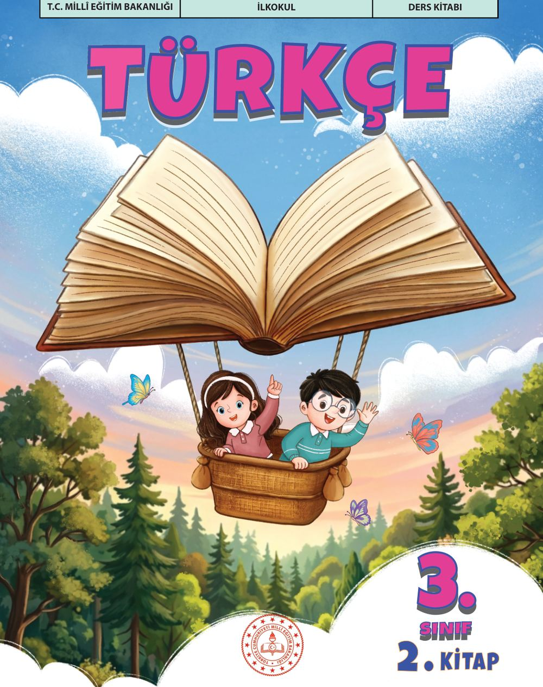

## 3. SINIF

<!-- sayfa 1 -->

# TÜRKÇE
## İLKOKUL
### 3. Sınıf

**DERS KİTABI**
**2. KİTAP**

Yazarlar

Ceyhun BORA
Mustafa Ferudun DEPE
Mutlu DEMİRARSLAN
Özgür KAYA

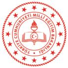

<!-- sayfa 2 -->

Millî Eğitim Bakanlığı Yayınları No ..................................................................................................................................: 10822
Ders Kitapları Dizisi No .....................................................................................................................................................: 2558

**Editör**
Prof. Dr. Sabri SİDEKLİ

**Dil Uzmanı**
Osman ERGİNÖZ

**Görsel Tasarımcı**
Nuray KAYA
Özlem GÜNEŞ
Tuba BURDURLU

**Çoklu Ortam Tasarımcısı**
Alev ATCI
Büşra YÜCE POLAT
Gamze KAYA
Gülşah İMANCI
Halil AKGÜL
Hürol YALÇIN
Saliha OKUR
Sezen Nur ACİ
Tuncay ÇALIŞKAN

**Program Geliştirme Uzmanı**
Saniye ÇOBAN

**Ölçme ve Değerlendirme Uzmanı**
Şerife ERTUĞRUL

**Rehberlik Uzmanı**
Meryem Betül KARAKEÇE

**ISBN 978-975-11-9918-8**

Millî Eğitim Bakanlığı, Talim ve Terbiye Kurulu Başkanlığının 15.06.2026 tarih ve 162027820 sayılı yazısı ile eğitim aracı olarak kabul edilmiştir.
Kurulca bu kitabın kabul edilmiş olması eğitim aracından yayınevi ve yazar/yazarların sorum-

<!-- sayfa 3 -->

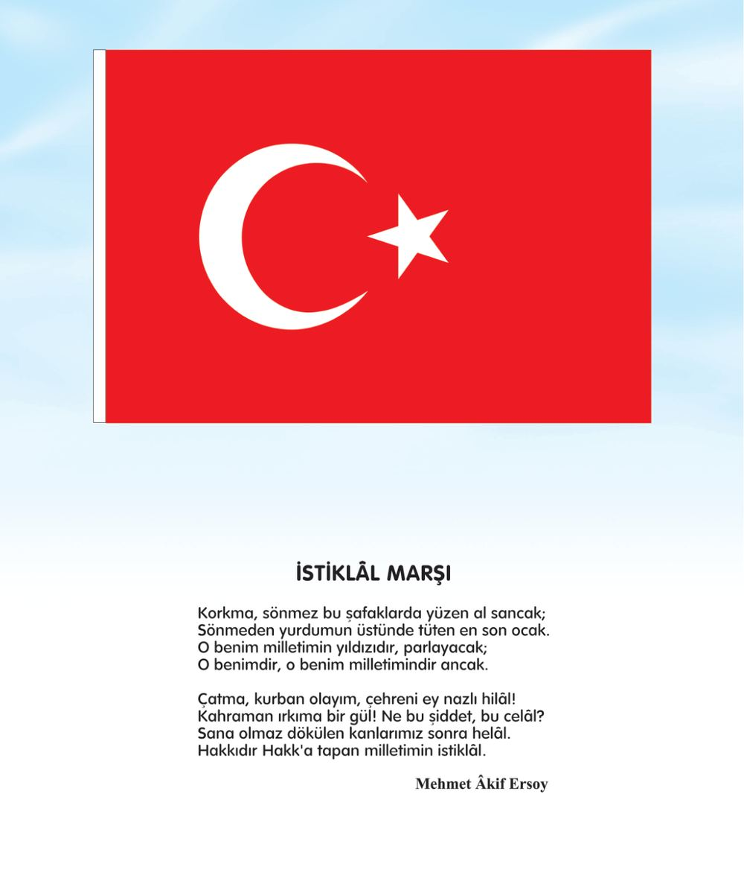

# İSTİKLÂL MARŞI

Korkma, sönmez bu şafaklarda yüzen al sancak;
Sönmeden yurdumun üstünde tüten en son ocak.
O benim milletimin yıldızıdır, parlayacak;
O benimdir, o benim milletimindir ancak.

Çatma, kurban olayım, çehreni ey nazlı hilâl!
Kahraman ırkıma bir gül! Ne bu şiddet, bu celâl?
Sana olmaz dökülen kanlarımız sonra helâl.
Hakkıdır Hakk'a tapan milletimin istiklâl.

Mehmet Âkif Ersoy

<!-- sayfa 4 -->

ANDIMIZ

Türküm, doğruyum, çalışkanım.

İlkem küçüklerimi korumak, büyüklerimi saymak; yurdumu, milletimi özümden çok sevmektir.
Ülküm yükselmek, ileri gitmektir.

Ey Büyük Atatürk!

Açtığın yolda, gösterdiğin hedefe durmadan yürüyeceğime ant içerim.

Varlığım Türk varlığına armağan olsun.

Ne mutlu Türküm diyene!

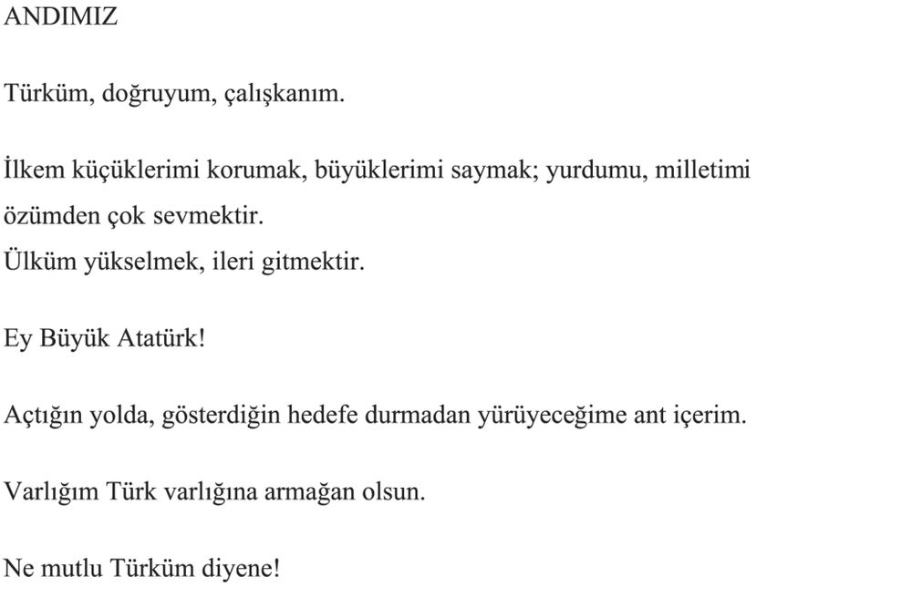
<!-- yer tutucu bulunamadı: sayfa sonuna eklendi -->

<!-- sayfa 5 -->

MUSTAFA KEMAL ATATÜRK

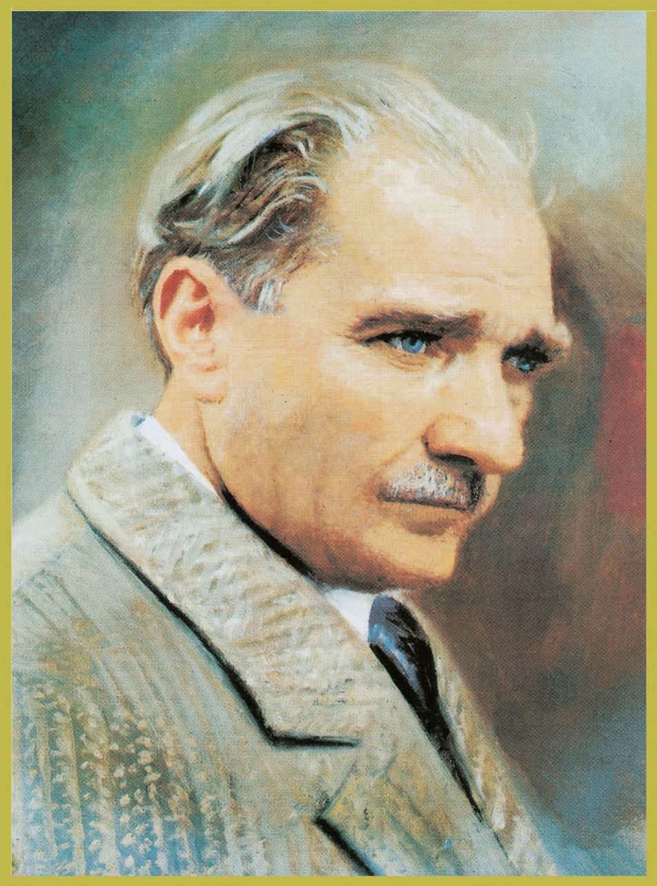
<!-- yer tutucu bulunamadı: sayfa sonuna eklendi -->

<!-- sayfa 6 -->

Verdiğiniz mesajda PDF metin katmanı boş görünüyor (`<<< >>>` arası boş). Lütfen dönüştürülmesini istediğiniz metni bu işaretlerin arasına yapıştırın veya ilgili sayfanın görüntüsünü paylaşın. Metni paylaştığınızda kurallara uygun şekilde Markdown formatına çevirebilirim.

<!-- sayfa 7 -->

# İÇİNDEKİLER

* Kitabımızı Tanıyalım ........................................................................................................................................ 9
* Hatırlatma Etkinlikleri ................................................................................................................................... 14

## 5. Tema: YETENEKLERİMİZİ KULLANIYORUZ ................................................................................ 18

* Temaya Hazırlanalım ..................................................................................................................................... 20
* Gölge Oyunu (İzleme Metni) ........................................................................................................................ 22
* Benim Ninem Işıldıyor.................................................................................................................................. 26
* Mete Gazoz ...................................................................................................................................................... 32
* Oyun Zamanı ................................................................................................................................................... 40
* Baliş'in Oyunları ............................................................................................................................................. 44
* Performans Görevi ......................................................................................................................................... 51
* Tema Sonu Çalışması .................................................................................................................................... 52

## 6. Tema: BİLİM YOLCULUĞU ............................................................................................................ 54

* Temaya Hazırlanalım ..................................................................................................................................... 56
* Penceremden Gökyüzü (Dinleme Metni) ................................................................................................... 58
* Elektronik Atıklar .......................................................................................................................................... 62
* Hayatımızı Kolaylaştıran Makineler............................................................................................................. 68
* Teknoloji ve Biz ............................................................................................................................................... 74
* Bu Meslekler Tarih Oldu ............................................................................................................................... 80
* Performans Görevi ......................................................................................................................................... 87
* Tema Sonu Çalışması .................................................................................................................................... 88

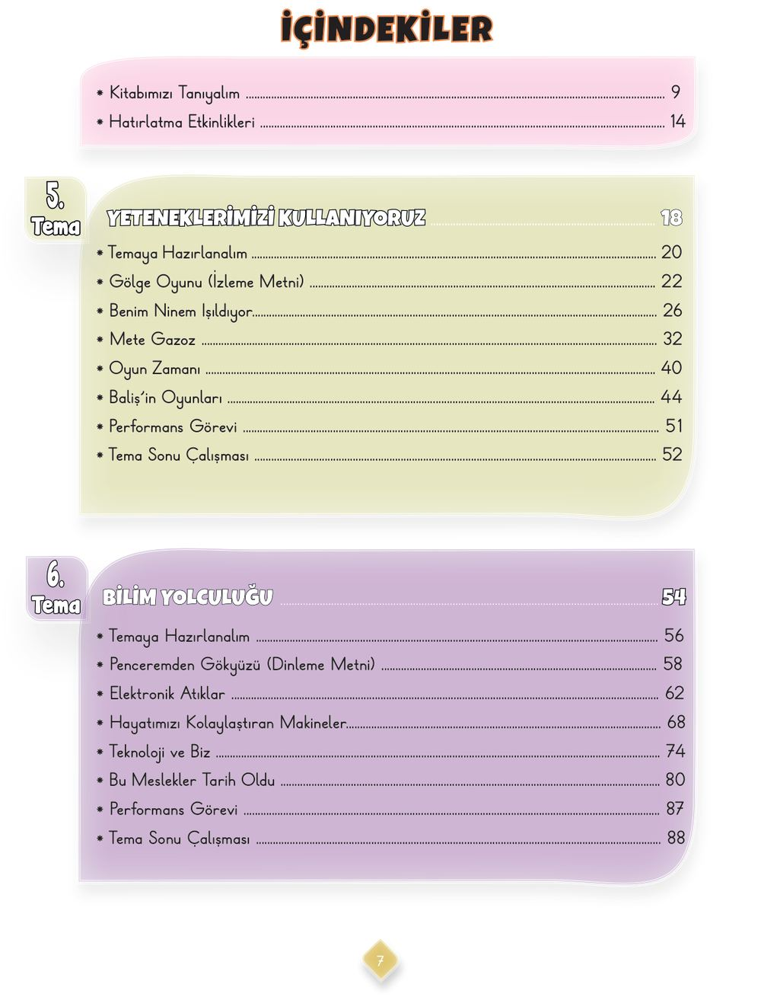
<!-- yer tutucu bulunamadı: sayfa sonuna eklendi -->

<!-- sayfa 8 -->

# 7. Tema MİLLÎ KÜLTÜRÜMÜZ 90

* Temaya Hazırlanalım ................................................................................................................... 92
* Ak Terek Gök Terek (İzleme Metni) ........................................................................................ 94
* Yeni Komşu ................................................................................................................................ 98
* Mehmet Âkif Ersoy ................................................................................................................... 106
* PTT Müzesi ............................................................................................................................... 112
* 23 Nisan ................................................................................................................................... 118
* Performans Görevi ................................................................................................................... 121
* Tema Sonu Çalışması .............................................................................................................. 122

# 8. Tema HAK VE SORUMLULUKLARIMIZ 124

* Temaya Hazırlanalım ................................................................................................................. 126
* Yapabileceğinin En İyisi Bu Mu? (Dinleme Metni) ............................................................. 128
* Çocuk Haklarına Yolculuk ....................................................................................................... 132
* Mevlânâ’nın Çocuklara Selamı ............................................................................................... 140
* Birlikte Güçlüyüz ...................................................................................................................... 148
* Mutluluk Hepimizin .................................................................................................................. 154
* Performans Görevi ................................................................................................................... 159
* Tema Sonu Çalışması .............................................................................................................. 160
* Pekiştirme Etkinlikleri .............................................................................................................. 162

* Sözlük .......................................................................................................................................... 166
* Kaynakça ................................................................................................................................... 168
* Görsel ve Genel Ağ Kaynakçası ............................................................................................ 168
* Cevap Anahtarı .......................................................................................................................... 168
* Türkiye'nin Mülki İdare Bölümleri ile Kara ve Deniz Komşuları Haritası ........................ 169
* Türk Dünyası Haritası .............................................................................................................. 170

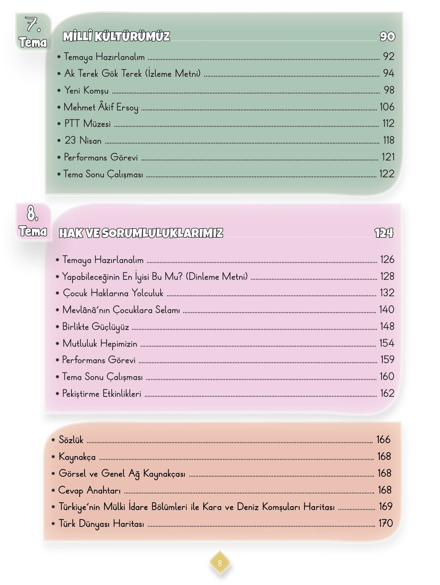
<!-- yer tutucu bulunamadı: sayfa sonuna eklendi -->

<!-- sayfa 9 -->

# KİTABIMIZI TANIYALIM

## HATIRLATMA ETKİNLİKLERİ

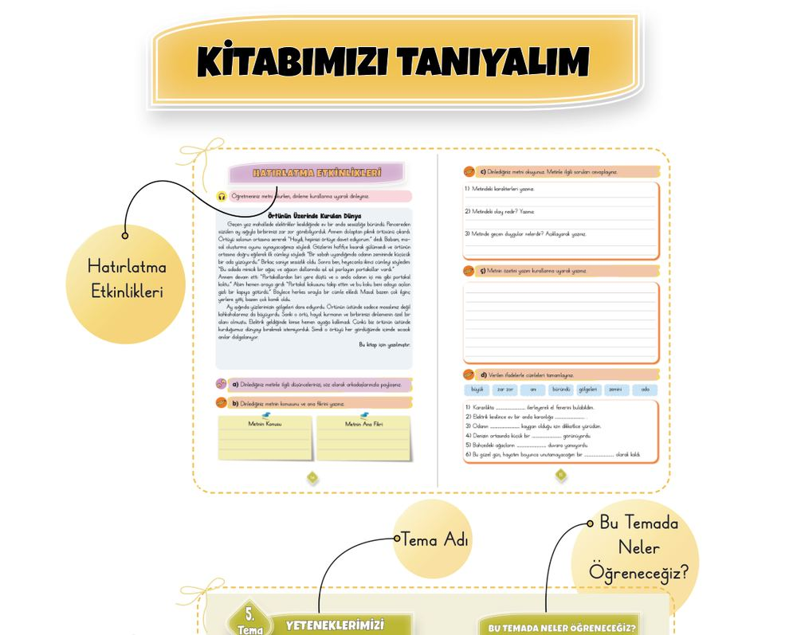

Öğretmenimizle metinleri, cümleleri kurallarına uygun değerlendirelim.

**Ortonun Bahçesinde Kurulan Düzen**

Oyun oynamak için metinleri okuduktan sonra bu metinde kurulan düzeni inceleyelim. Pencereden izlediğim ağaç ve kuşlarla birleşince bir oyun alanı kurulmuştu. Oyunun düzeni, parkın en üst kısmında oradaydı. Oyunun düzeni, parkın en üst kısmında oradaydı. Oyunun düzeni, parkın en üst kısmında oradaydı. Oyunun düzeni, parkın en üst kısmında oradaydı. Oyunun düzeni, parkın en üst kısmında oradaydı. Oyunun düzeni, parkın en üst kısmında oradaydı. Oyunun düzeni, parkın en üst kısmında oradaydı. Oyunun düzeni, parkın en üst kısmında oradaydı. Oyunun düzeni, parkın en üst kısmında oradaydı. Oyunun düzeni, parkın en üst kısmında oradaydı. Oyunun düzeni, parkın en üst kısmında oradaydı. Oyunun düzeni, parkın en üst kısmında oradaydı. Oyunun düzeni, parkın en üst kısmında oradaydı. Oyunun düzeni, parkın en üst kısmında oradaydı. Oyunun düzeni, parkın en üst kısmında oradaydı. Oyunun düzeni, parkın en üst kısmında oradaydı. Oyunun düzeni, parkın en üst kısmında oradaydı. Oyunun düzeni, parkın en üst kısmında oradaydı. Oyunun düzeni, parkın en üst kısmında oradaydı. Oyunun düzeni, parkın en üst kısmında oradaydı. Oyunun düzeni, parkın en üst kısmında oradaydı. Oyunun düzeni, parkın en üst kısmında oradaydı. Oyunun düzeni, parkın en üst kısmında oradaydı. Oyunun düzeni, parkın en üst kısmında oradaydı. Oyun

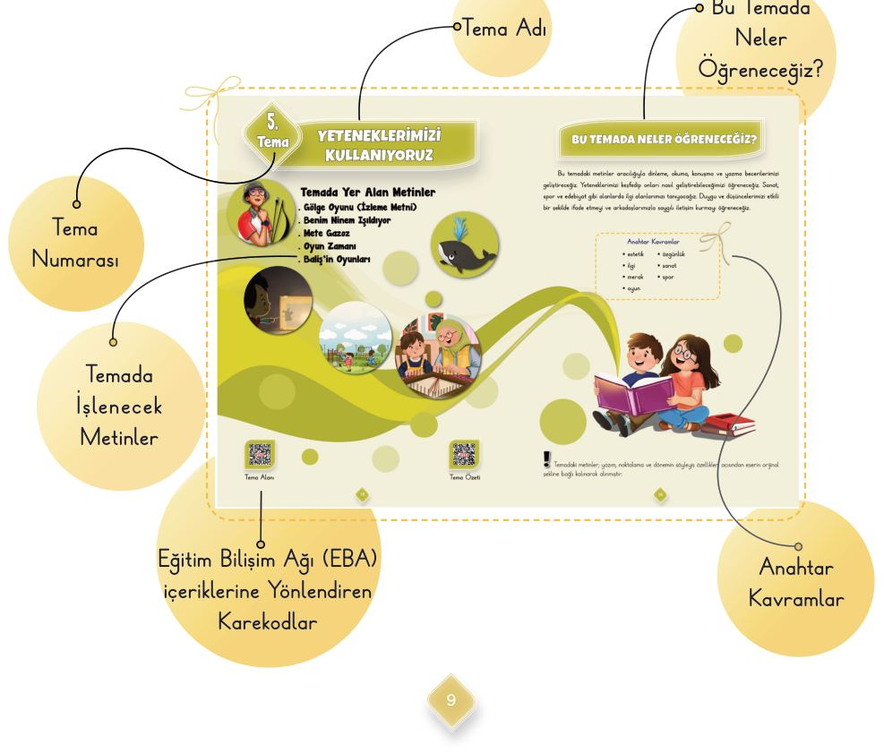
<!-- yer tutucu bulunamadı: sayfa sonuna eklendi -->

<!-- sayfa 10 -->

# TEMAYA HAZIRLANALIM

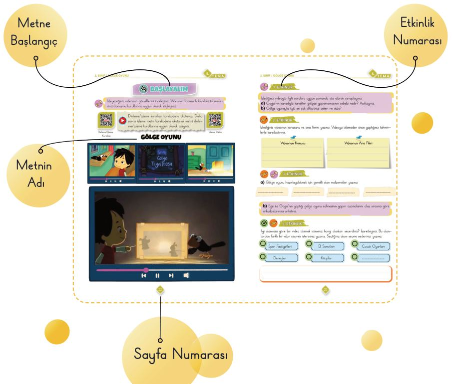

a) Görselleri inceleyiniz. Soruları konuşma kurallarına uygun şekilde cevaplayınız.

1) Çocuklar hangi etkinlikleri yapıyorlar?
2) Çocuklar bu etkinlikleri neden tercih etmiş olabilirler?
3) Çocuklar etkinlikleri yaparken hangi duygular hissediyor olabilirler?

b) Yeteneklerimizle ilgili soruları cevaplayınız.

1) Hangi konuda yetenekli olduğunu düşünüyorsun?
2) Yeteneklerini keşfedebilmek için nerelere yönelmelisin?
3) Yeteneklerini geliştirmek için neler yapabilirsin?

---

# METNE HAZIRLANALIM

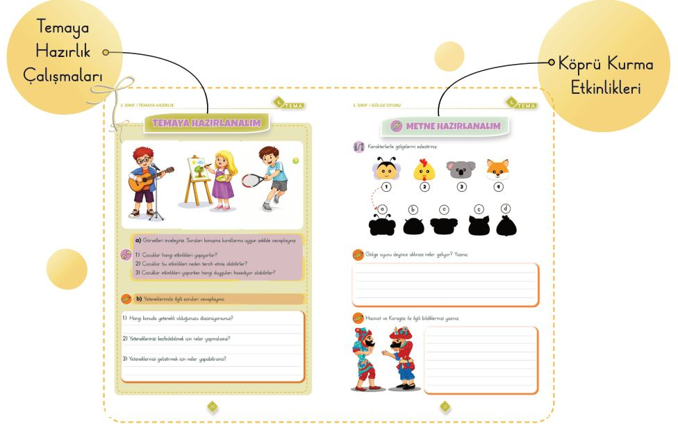

a) Karakterlerle eşleştirmeyi keşfediniz.

1 2 3 4
a b c d

b) Gölge oyunu deyince aklına neler gelir? Yazınız.

[Boş Satırlar]

c) Hayalet ve Karagöz ile ilgili bilgilerini yazınız.

[Boş Satırlar]

---

# BAŞLAYALIM


İzleyeceğiniz videonun görsellerini inceleyiniz. Videonun konusu hakkında tahminlerde bulununuz. Konu hakkında tahminlerinizi arkadaşlarınızla paylaşınız.

GÖLGE OYUNU

Düdüklü tencere kaldırılan otobusta duruyor. Daha sonra istasyona metre kartosu olarak otobusta duruyor. İstasyonla birlikte metro kartosu ile metro dolaylarında birlikte kullanıma uygun olarak izleyiniz.

[Video Ekran Görüntüsü]

---

# ETKİNLİK

a) İzlediğiniz videonun konuşma karakterleri giriş yapamamasına neden neydi? Açıklayınız.
b) Gölge oyunları ışık ve elektrik ile nasıl da ilişkilidir?

# ETKİNLİK

İzlediğiniz videonun konusu ve ana fikrini videoyu izlemeden önce tahmin etmeye çalışınız. Karakterlerle tahminlerinizi paylaşınız.

| Videonun Konusu | Videonun Ana Fikri |
| :--- | :--- |
| [Boşluk] | [Boşluk] |

# ETKİNLİK

a) Gölge oyunu konusunu araştırmak için genel olarak neler yapmalıyım? Yazınız.

[Boş Satırlar]

b) Efe de Gölge'yi takip edip gölge oyununun yapım aşamalarını nasıl araştıracağını keşfetmek istiyor.

# ETKİNLİK

İlgili alanlara göre farklı alanlara istenen seçenekleri belirleyiniz. Bu alanlardan fakat bir alan seçmek isterseniz seçtiğiniz alanı seçme nedenini yazınız.

- Spor Faaliyetleri
- El Sanatları
- Çocuk Oyunları
- Deneyler
- Kitaplar

<!-- sayfa 11 -->

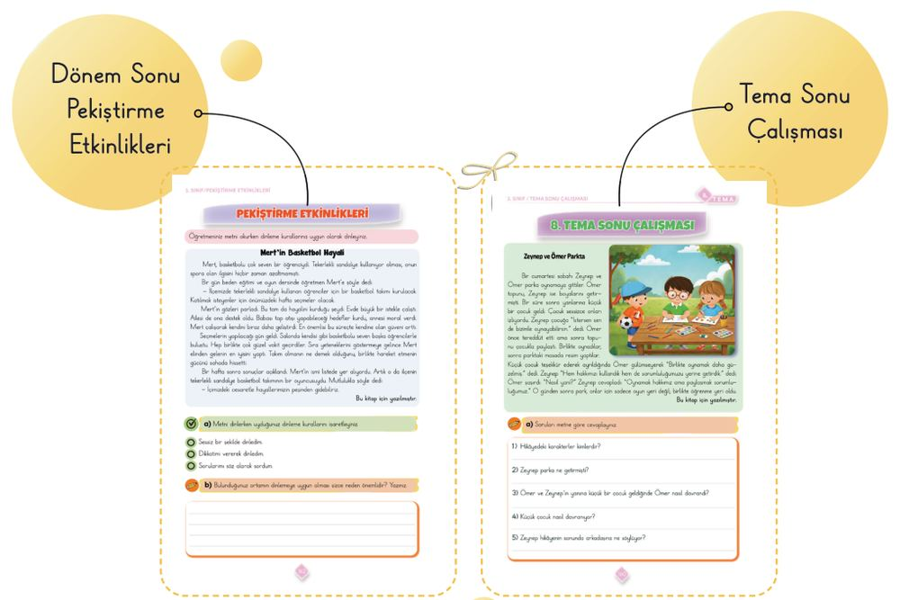

# Dönem Sonu Pekiştirme Etkinlikleri

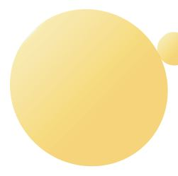

## 3. SINIF / PEKİŞTİRME ETKİNLİKLERİ

### PEKİŞTİRME ETKİNLİKLERİ

Öğretmeniniz metni okurken öğrenme duraklarına uygun olarak dinleyin.

**Mert'in Basketbol Heyecanı**

Mert, basketbolu çok seven bir öğrencidir. Sahnede kullanıyor olması, spora olan ilgisi için hazır olması anlamını taşır.
Bir gün arkadaşları ile bir spor alanında öğrenmek Mert'e çok şey kazandırdı.
- İnsanlarla iletişim kurarak öğrenmek Mert'e basketbol takımına katılmak konusunda cesaret verdi.
Mert'in içerisinde çok büyük bir heyecan vardı. Mert'in basketbol oynaması için çok çalışması gerekiyordu.
Katıldığı grup sayesinde yeni şeyler öğrendi. Bu sayede kendisini daha iyi hissediyordu.
Mert'in arkadaşları ile birlikte basketbol oynaması ona çok şey kattı.
Mert'in arkadaşları ile birlikte basketbol oynaması ona çok şey kattı.
Mert'in arkadaşları ile birlikte basketbol oynaması ona çok şey kattı.
Mert'in arkadaşları ile birlikte basketbol oynaması ona çok şey kattı.
Mert'in arkadaşları ile birlikte basketbol oynaması ona çok şey kattı.
Mert'in arkadaşları ile birlikte basketbol oynaması ona çok şey kattı.
Mert'in arkadaşları ile birlikte basketbol oynaması ona çok şey kattı.
Mert'in arkadaşları ile birlikte basketbol oynaması ona çok şey kattı.
Mert'in arkadaşları ile birlikte basketbol oynaması ona çok şey kattı.
Mert'in arkadaşları ile birlikte basketbol oynaması ona çok şey kattı.
Mert'in arkadaşları ile birlikte basketbol oynaması

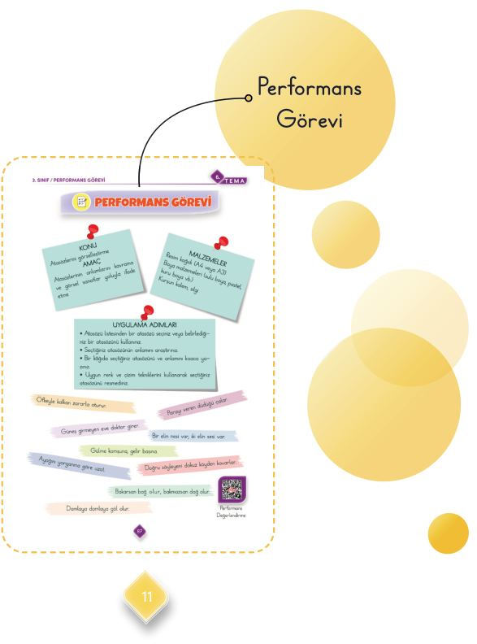
<!-- yer tutucu bulunamadı: sayfa sonuna eklendi -->

<!-- yer tutucu bulunamadı: sayfa sonuna eklendi -->

<!-- yer tutucu bulunamadı: sayfa sonuna eklendi -->

<!-- sayfa 12 -->

# KİTAPTA YER ALAN SEMBOLLER VE ANLAMLARI

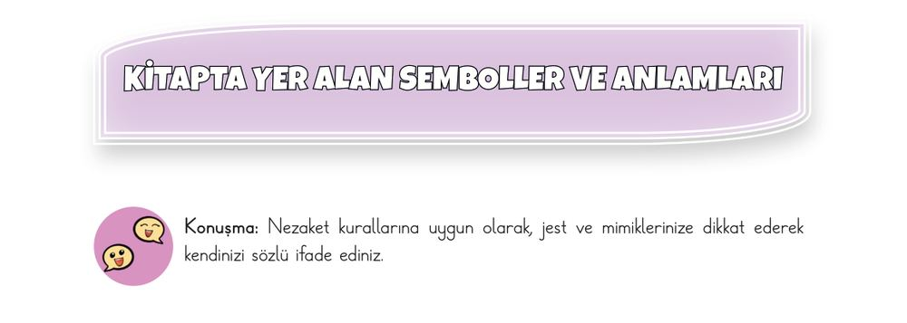 **Konuşma:** Nezaket kurallarına uygun olarak, jest ve mimiklerinize dikkat ederek kendinizi sözlü ifade ediniz.

 **İşaretleme:** Yönergeye uygun işaretleme yapınız.

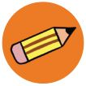 **Yazma:** Yazım ve noktalama kurallarını uygulayarak yazma çalışmaları yapınız.

 **Dinleme:** Dinleme kurallarına uygun olarak metni dinleyiniz.

 **İzleme:** Dikkatli bir şekilde izleyiniz.

 **Boyama:** Yönergeye uygun boyama yapınız.

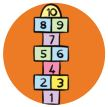 **Oynama:** Yönergeye uygun oyun oynayınız.

<!-- yer tutucu bulunamadı: sayfa sonuna eklendi -->

<!-- sayfa 13 -->

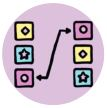 **Eşleştirme:** Yönergeye uygun eşleştirme yapınız.

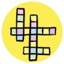 **Bulmaca Çözme:** Yönergeyi takip ederek bulmacayı çözünüz.

 **Okuma:** Metni noktalama işaretlerine, vurgu ve tonlamaya dikkat ederek sesli/sessiz okuyunuz.

 **Performans Görevi:** Yönergeye uygun olarak performans görevini tamamlayınız.

 **Metne Hazırlık:** Soruları cevaplayıp, etkinlikleri yaparak metne hazırlanınız.

 **Kısa Bilgi:** Kısa bilgileri dikkatlice okuyunuz.

 **Metne Başlangıç:** Metin öncesi etkinlikleri yaparak metni okuyunuz/dinleyiniz/izleyiniz.

<!-- yer tutucu bulunamadı: sayfa sonuna eklendi -->

<!-- sayfa 14 -->

# HATIRLATMA ETKİNLİKLERİ

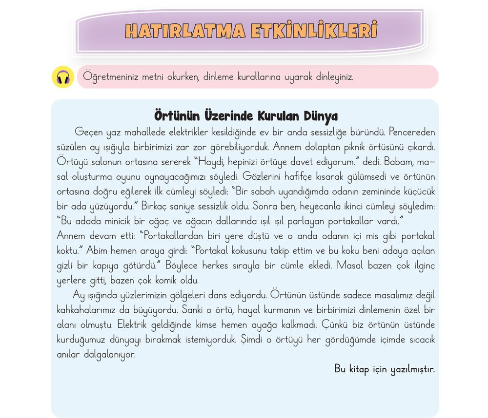 Öğretmeniniz metni okurken, dinleme kurallarına uyarak dinleyiniz.

## Örtünün Üzerinde Kurulan Dünya

Geçen yaz mahallede elektrikler kesildiğinde ev bir anda sessizliğe büründü. Pencereden süzülen ay ışığıyla birbirimizi zar zor görebiliyorduk. Annem dolaptan piknik örtüsünü çıkardı. Örtüyü salonun ortasına sererek “Haydi, hepinizi örtüye davet ediyorum.” dedi. Babam, masal oluşturma oyunu oynayacağımızı söyledi. Gözlerini hafifçe kısarak gülümsedi ve örtünün ortasına doğru eğilerek ilk cümleyi söyledi: “Bir sabah uyandığımda odanın zemininde küçücük bir ada yüzüyordu.” Birkaç saniye sessizlik oldu. Sonra ben, heyecanla ikinci cümleyi söyledim: “Bu adada minicik bir ağaç ve ağacın dallarında ışıl ışıl parlayan portakallar vardı.” Annem devam etti: “Portakallardan biri yere düştü ve o anda odanın içi mis gibi portakal koktu.” Abim hemen araya girdi: “Portakal kokusunu takip ettim ve bu koku beni adaya açılan gizli bir kapıya götürdü.” Böylece herkes sırayla bir cümle ekledi. Masal bazen çok ilginç yerlere gitti, bazen çok komik oldu.

Ay ışığında yüzlerimizin gölgeleri dans ediyordu. Örtünün üstünde sadece masalımız değil kahkahalarımız da büyüyordu. Sanki o örtü, hayal kurmanın ve birbirimizi dinlemenin özel bir alanı olmuştu. Elektrik geldiğinde kimse hemen ayağa kalkmadı. Çünkü biz örtünün üstünde kurduğumuz dünyayı bırakmak istemiyorduk. Şimdi o örtüyü her gördüğümde içimde sıcacık anılar dalgalanıyor.

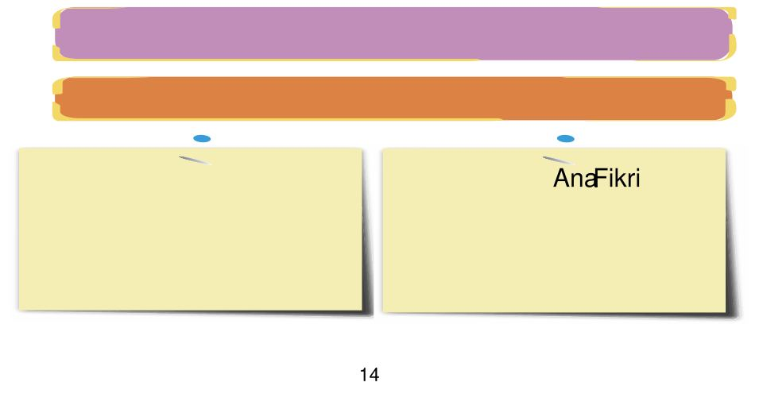 Bu kitap için yazılmıştır.

 a) Dinlediğiniz metinle ilgili düşüncelerinizi, söz alarak arkadaşlarınızla paylaşınız.

 b) Dinlediğiniz metnin konusunu ve ana fikrini yazınız.

| Metnin Konusu | Metnin Ana Fikri |
| :--- | :--- |
| | |
| | |
| | |

<!-- sayfa 15 -->

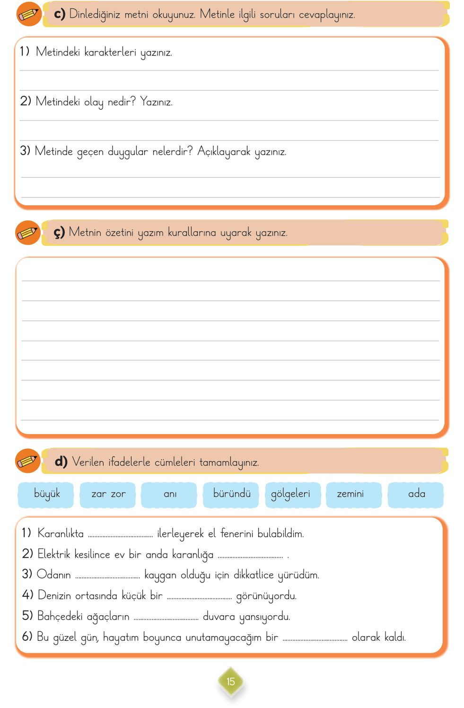 c) Dinlediğiniz metni okuyunuz. Metinle ilgili soruları cevaplayınız.

1) Metindeki karakterleri yazınız.
___________________________________________________________________________

2) Metindeki olay nedir? Yazınız.
___________________________________________________________________________

3) Metinde geçen duygular nelerdir? Açıklayarak yazınız.
___________________________________________________________________________

 ç) Metnin özetini yazım kurallarına uyarak yazınız.

___________________________________________________________________________
___________________________________________________________________________
___________________________________________________________________________
___________________________________________________________________________
___________________________________________________________________________

 d) Verilen ifadelerle cümleleri tamamlayınız.

| büyük | zar zor | anı | büründü | gölgeleri | zemini | ada |
| :---: | :---: | :---: | :---: | :---: | :---: | :---: |

1) Karanlıkta ........................................ ilerleyerek el fenerini bulabildim.
2) Elektrik kesilince ev bir anda karanlığa ........................................ .
3) Odanın ........................................ kaygan olduğu için dikkatlice yürüdüm.
4) Denizin ortasında küçük bir ........................................ görünüyordu.
5) Bahçedeki ağaçların ........................................ duvara yansıyordu.
6) Bu güzel gün, hayatım boyunca unutamayacağım bir ........................................ olarak kaldı.

<!-- sayfa 16 -->

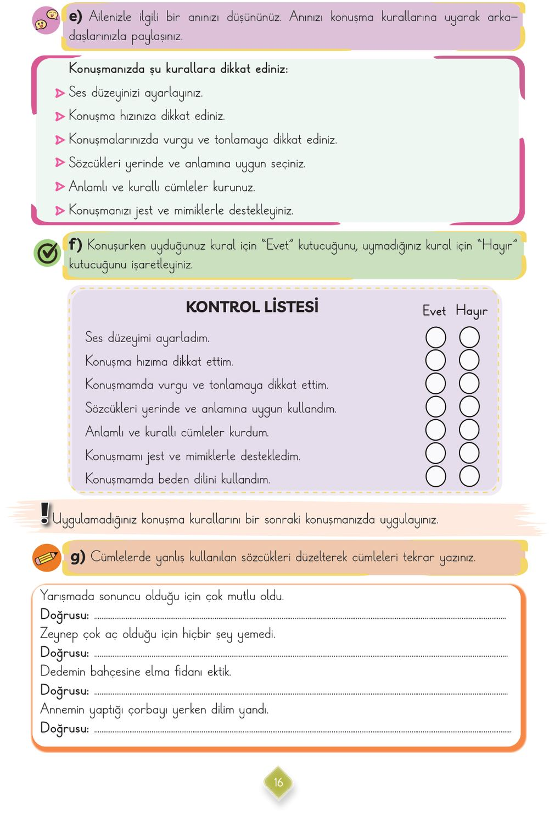 e) Ailenizle ilgili bir anınızı düşününüz. Anınızı konuşma kurallarına uyarak arkadaşlarınızla paylaşınız.

> Konuşmanızda şu kurallara dikkat ediniz:
> - Ses düzeyinizi ayarlayınız.
> - Konuşma hızınıza dikkat ediniz.
> - Konuşmalarınızda vurgu ve tonlamaya dikkat ediniz.
> - Sözcükleri yerinde ve anlamına uygun seçiniz.
> - Anlamlı ve kurallı cümleler kurunuz.
> - Konuşmanızı jest ve mimiklerle destekleyiniz.

 f) Konuşurken uyduğunuz kural için “Evet” kutucuğunu, uymadığınız kural için “Hayır” kutucuğunu işaretleyiniz.

| KONTROL LİSTESİ | Evet | Hayır |
| :--- | :---: | :---: |
| Ses düzeyimi ayarladım. | ○ | ○ |
| Konuşma hızıma dikkat ettim. | ○ | ○ |
| Konuşmamda vurgu ve tonlamaya dikkat ettim. | ○ | ○ |
| Sözcükleri yerinde ve anlamına uygun kullandım. | ○ | ○ |
| Anlamlı ve kurallı cümleler kurdum. | ○ | ○ |
| Konuşmamı jest ve mimiklerle destekledim. | ○ | ○ |
| Konuşmamda beden dilini kullandım. | ○ | ○ |

 Uygulamadığınız konuşma kurallarını bir sonraki konuşmanızda uygulayınız.

 g) Cümlelerde yanlış kullanılan sözcükleri düzelterek cümleleri tekrar yazınız.

Yarışmada sonuncu olduğu için çok mutlu oldu.
Doğrusu: .............................................................................................................................................................................................................................. 

Zeynep çok aç olduğu için hiçbir şey yemedi.
Doğrusu: ............................................................................................................................................................................................................................... 

Dedemin bahçesine elma fidanı ektik.
Doğrusu: ............................................................................................................................................................................................................................... 

Annemin yaptığı çorbayı yerken dilim yandı.
Doğrusu: ...............................................................................................................................................................................................................................

<!-- sayfa 17 -->

# h) Sözcüklerin eş anlamını yazarak bulmacayı tamamlayınız.

1) anı | 2) yaşlı | 3) doğa | 4) sözcük | 5) görev | 6) hediye | 7) doktor

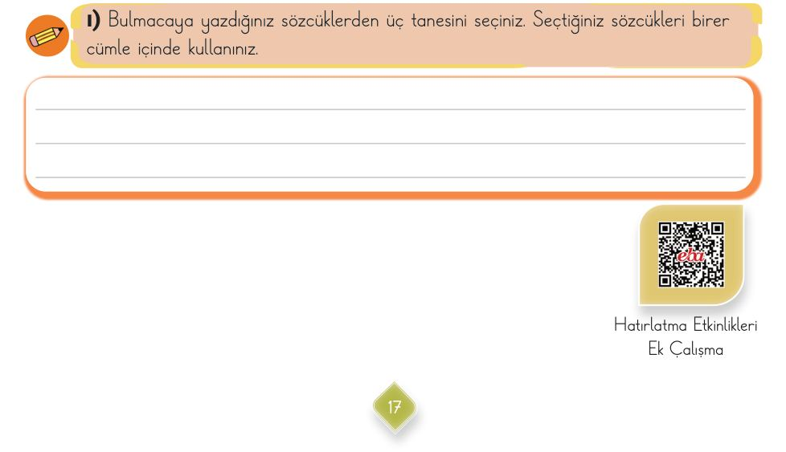

# ı) Bulmacaya yazdığınız sözcüklerden üç tanesini seçiniz. Seçtiğiniz sözcükleri birer cümle içinde kullanınız.

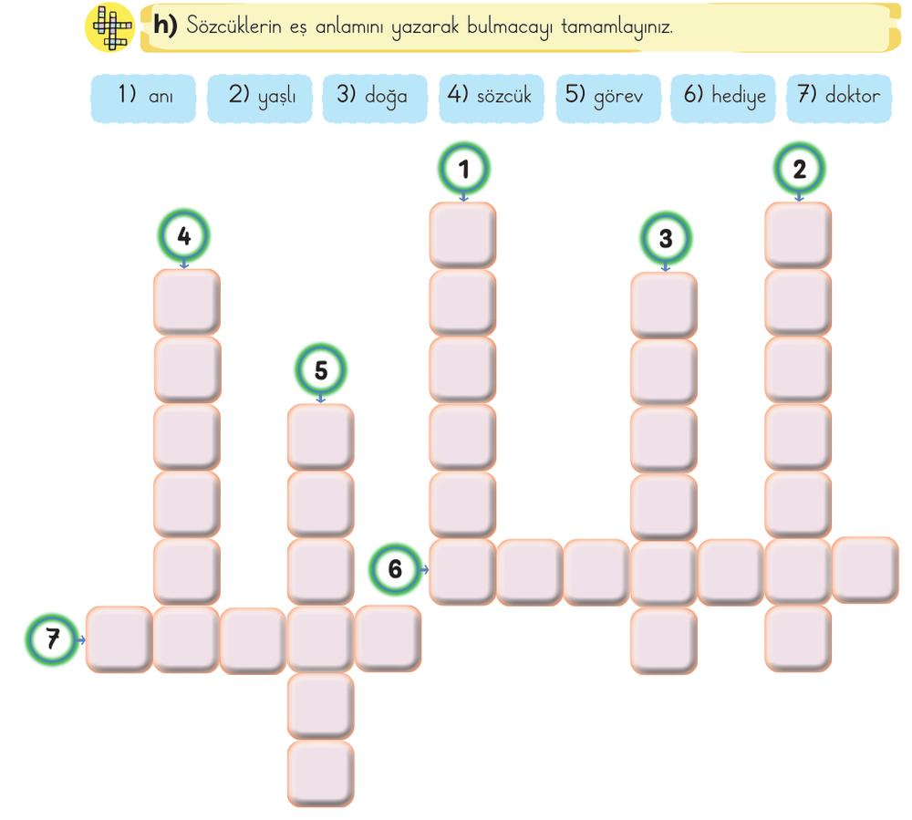

__________________________________________________________________
__________________________________________________________________
__________________________________________________________________

Hatırlatma Etkinlikleri

<!-- sayfa 18 -->

# 5. Tema
# YETENEKLERİMİZİ KULLANIYORUZ

## Temada Yer Alan Metinler
. Gölge Oyunu (İzleme Metni)
. Benim Ninem Işıldıyor
. Mete Gazoz
. Oyun Zamanı
. Baliş'in Oyunları

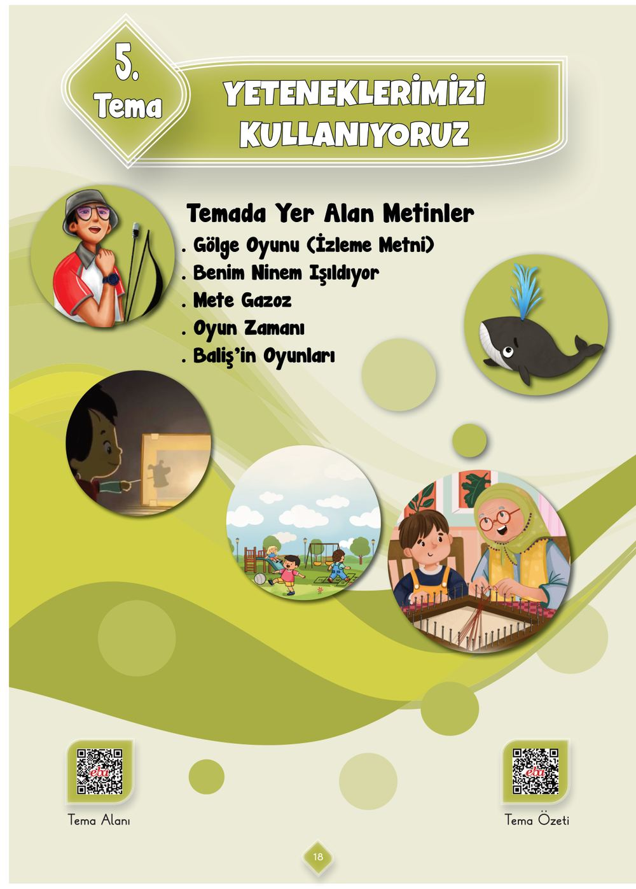
<!-- yer tutucu bulunamadı: sayfa sonuna eklendi -->

<!-- sayfa 19 -->

# BU TEMADA NELER ÖĞRENECEĞİZ?

Bu temadaki metinler aracılığıyla dinleme, okuma, konuşma ve yazma becerilerimizi geliştireceğiz. Yeteneklerimizi keşfedip onları nasıl geliştirebileceğimizi öğreneceğiz. Sanat, spor ve edebiyat gibi alanlarda ilgi alanlarımızı tanıyacağız. Duygu ve düşüncelerimizi etkili bir şekilde ifade etmeyi ve arkadaşlarımızla saygılı iletişim kurmayı öğreneceğiz.

## Anahtar Kavramlar

* estetik
* ilgi
* merak
* oyun
* özgünlük
* sanat
* spor

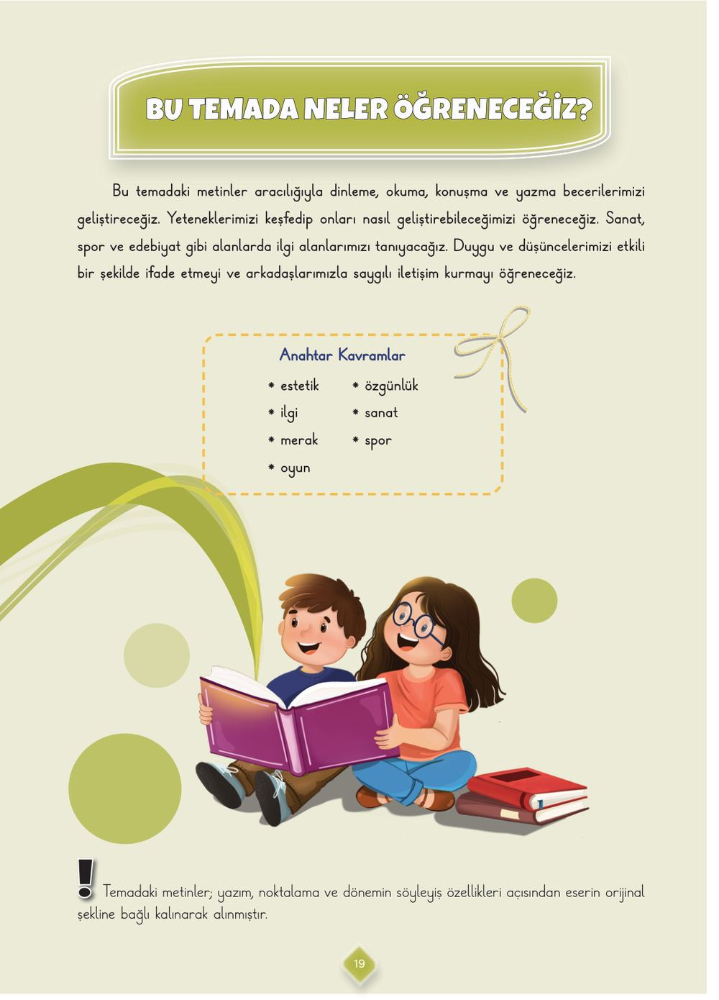

! Temadaki metinler; yazım, noktalama ve dönemin söyleyiş özellikleri açısından eserin orijinal

<!-- sayfa 20 -->

# TEMAYA HAZIRLANALIM

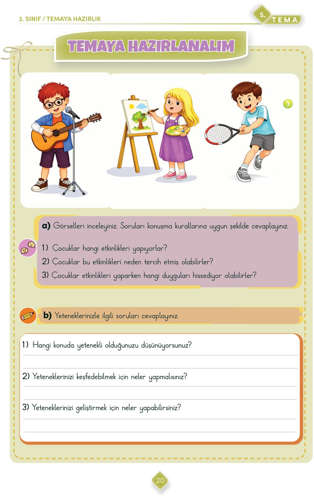

**a) Görselleri inceleyiniz. Soruları konuşma kurallarına uygun şekilde cevaplayınız.**

1) Çocuklar hangi etkinlikleri yapıyorlar?
2) Çocuklar bu etkinlikleri neden tercih etmiş olabilirler?
3) Çocuklar etkinlikleri yaparken hangi duyguları hissediyor olabilirler?

**b) Yeteneklerinizle ilgili soruları cevaplayınız.**

1) Hangi konuda yetenekli olduğunuzu düşünüyorsunuz?
__________________________________________________________________
__________________________________________________________________

2) Yeteneklerinizi keşfedebilmek için neler yapmalısınız?
__________________________________________________________________
__________________________________________________________________

3) Yeteneklerinizi geliştirmek için neler yapabilirsiniz?
__________________________________________________________________
__________________________________________________________________

<!-- sayfa 21 -->

# METNE HAZIRLANALIM

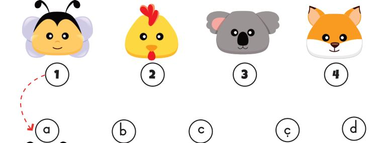 Karakterlerle gölgelerini eşleştiriniz.

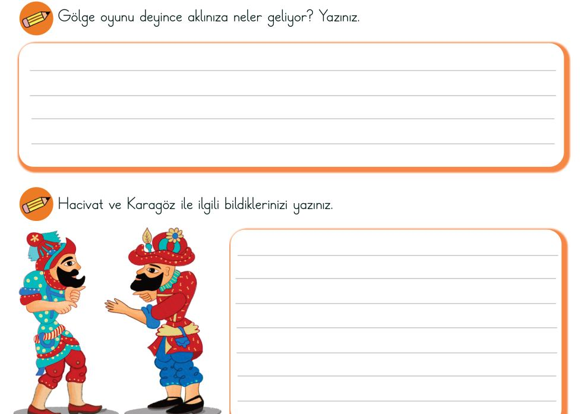
1 2 3 4
a b c ç d

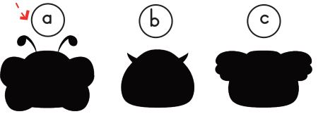 Gölge oyunu deyince aklınıza neler geliyor? Yazınız.

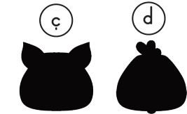
__________________________________________________________________
__________________________________________________________________
__________________________________________________________________

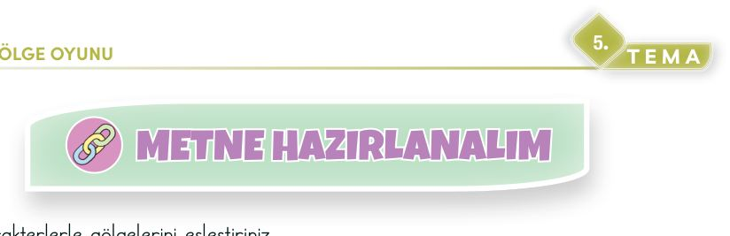 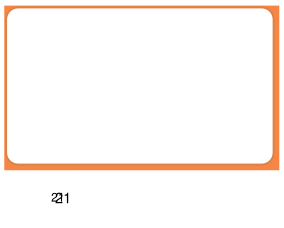 Hacivat ve Karagöz ile ilgili bildiklerinizi yazınız.

__________________________________________________________________
__________________________________________________________________
__________________________________________________________________

<!-- sayfa 22 -->

# BAŞLAYALIM

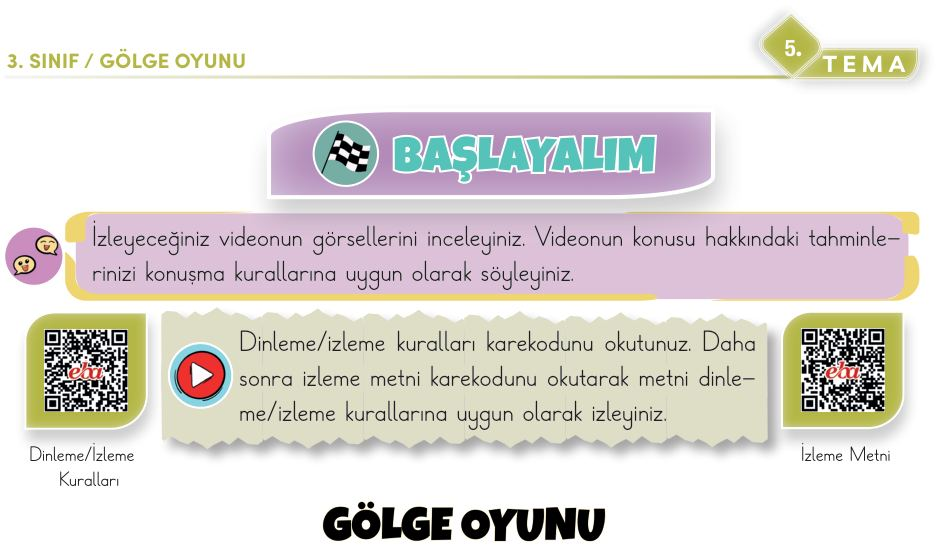

İzleyeceğiniz videonun görsellerini inceleyiniz. Videonun konusu hakkındaki tahminlerinizi konuşma kurallarına uygun olarak söyleyiniz.

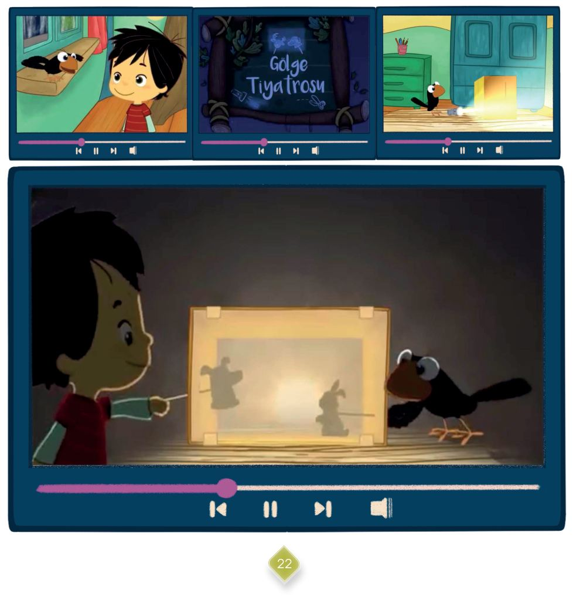

Dinleme/izleme kuralları karekodunu okutunuz. Daha sonra izleme metni karekodunu okutarak metni dinleme/izleme kurallarına uygun olarak izleyiniz.

İzleme Metni
Dinleme/İzleme Kuralları

# GÖLGE OYUNU

<!-- sayfa 23 -->

# 1. ETKİNLİK

İzlediğiniz videoyla ilgili soruları, uygun zamanda söz alarak cevaplayınız.

a) Gaga'nın kanadıyla karakter gölgesi yapamamasının sebebi nedir? Açıklayınız.
b) Gölge oyunuyla ilgili en çok dikkatinizi çeken ne oldu?

# 2. ETKİNLİK

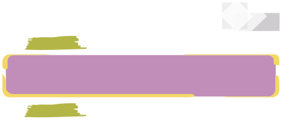
İzlediğiniz videonun konusunu ve ana fikrini yazınız. Videoyu izlemeden önce yaptığınız tahminlerle karşılaştırınız.

| Videonun Konusu | Videonun Ana Fikri |
| :--- | :--- |
| | |
| | |
| | |

# 3. ETKİNLİK

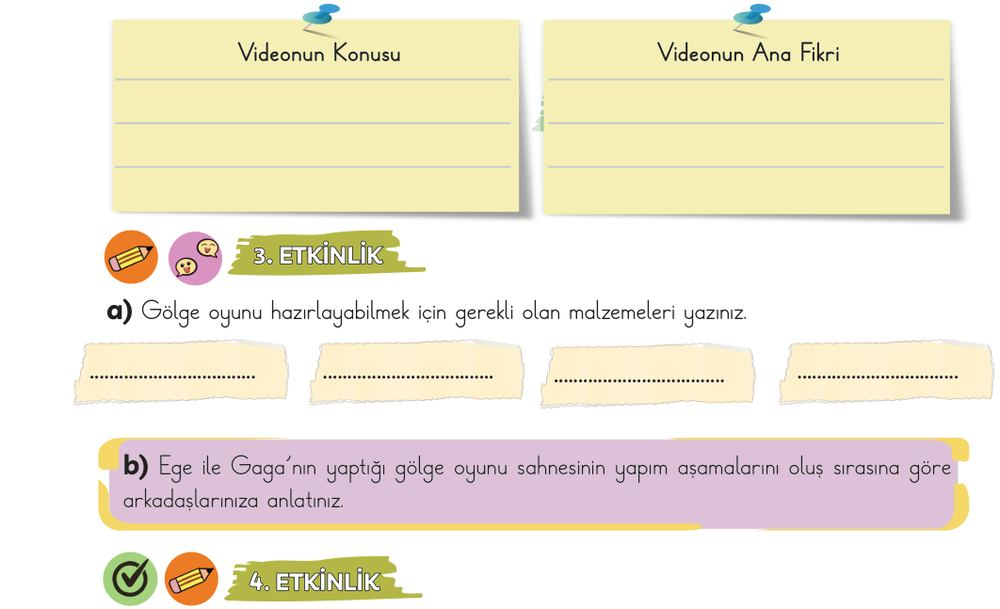
a) Gölge oyunu hazırlayabilmek için gerekli olan malzemeleri yazınız.

....................  ....................  ....................  ....................

b) Ege ile Gaga'nın yaptığı gölge oyunu sahnesinin yapım aşamalarını oluş sırasına göre arkadaşlarınıza anlatınız.

# 4. ETKİNLİK

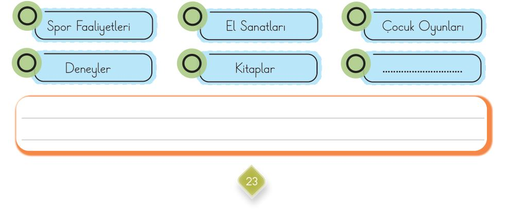
İlgi alanınıza göre bir video izlemek isteseniz hangi alanları seçerdiniz? İşaretleyiniz. Bu alanlardan farklı bir alan seçmek isterseniz yazınız. Seçtiğiniz alanı seçme nedeninizi yazınız.

( ) Spor Faaliyetleri
( ) Deneyler
( ) El Sanatları
( ) Kitaplar
( ) Çocuk Oyunları
( ) ........................................

..........................................................................................................................................
..........................................................................................................................................

<!-- sayfa 24 -->

# 5. ETKİNLİK

Görsellerle ilişkili olan ifadeleri aynı numarayı yazarak eşleştiriniz. Yaptığınız eşleştirmelerin nedenini videodan hareketle açıklayınız.

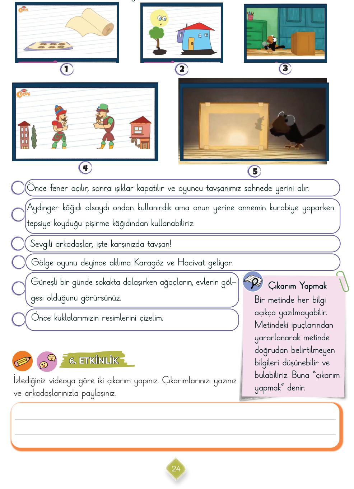

(1)
(2)
(3)
(4)
(5)

◯ Önce fener açılır, sonra ışıklar kapatılır ve oyuncu tavşanımız sahnede yerini alır.
◯ Aydınger kâğıdı olsaydı ondan kullanırdık ama onun yerine annemin kurabiye yaparken tepsiye koyduğu pişirme kâğıdından kullanabiliriz.
◯ Sevgili arkadaşlar, işte karşınızda tavşan!
◯ Gölge oyunu deyince aklıma Karagöz ve Hacivat geliyor.
◯ Güneşli bir günde sokakta dolaşırken ağaçların, evlerin gölgesi olduğunu görürsünüz.
◯ Önce kuklalarımızın resimlerini çizelim.

> 🔍 **Çıkarım Yapmak**
> Bir metinde her bilgi açıkça yazılmayabilir. Metindeki ipuçlarından yararlanarak metinde doğrudan belirtilmeyen bilgileri düşünebilir ve bulabiliriz. Buna "çıkarım yapmak" denir.

# 6. ETKİNLİK

İzlediğiniz videoya göre iki çıkarım yapınız. Çıkarımlarınızı yazınız ve arkadaşlarınızla paylaşınız.

___________________________________________________________________________
___________________________________________________________________________
___________________________________________________________________________

<!-- sayfa 25 -->

# METNE HAZIRLANALIM

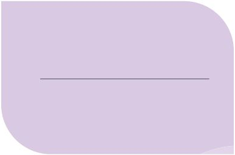 “Yetenek” deyince aklınıza gelen sözcükleri yazınız.

| | |
| :---: | :---: |
| \_\_\_\_\_\_\_\_\_\_ | \_\_\_\_\_\_\_\_\_\_ |
| | |
| \_\_\_\_\_\_\_\_\_\_ **Yetenek** \_\_\_\_\_\_\_\_\_\_ | |
| | |
| \_\_\_\_\_\_\_\_\_\_ | \_\_\_\_\_\_\_\_\_\_ |

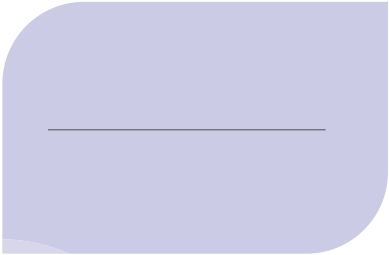
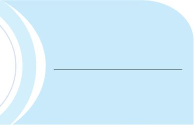
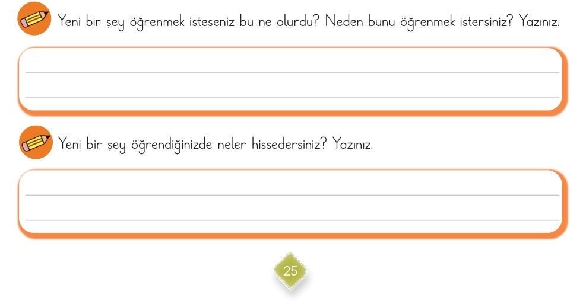

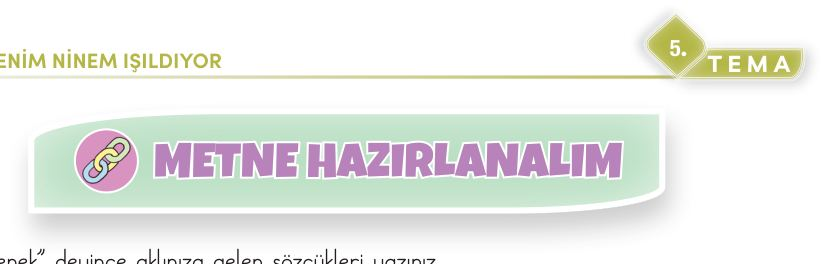 Yeni bir şey öğrenmek isteseniz bu ne olurdu? Neden bunu öğrenmek istersiniz? Yazınız.

| |
| :--- |
| |
| |

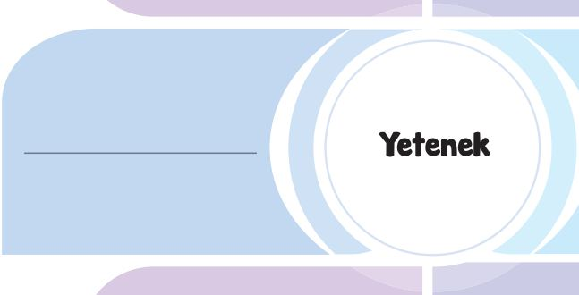
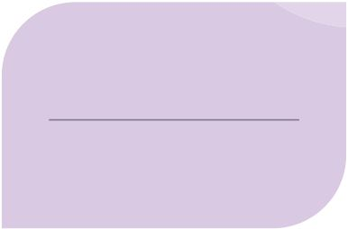
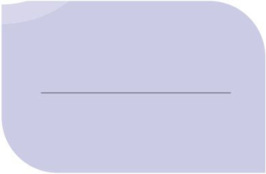

 Yeni bir şey öğrendiğinizde neler hissedersiniz? Yazınız.

| |
| :--- |
| |
| |

<!-- sayfa 26 -->

# BAŞLAYALIM

Metnin başlığını ve görsellerini inceleyiniz. Metinde geçen olayları tahmin edip söyleyiniz.

Metni noktalama işaretlerine dikkat ederek sessiz okuyunuz.

# BENİM NİNEM IŞILDIYOR

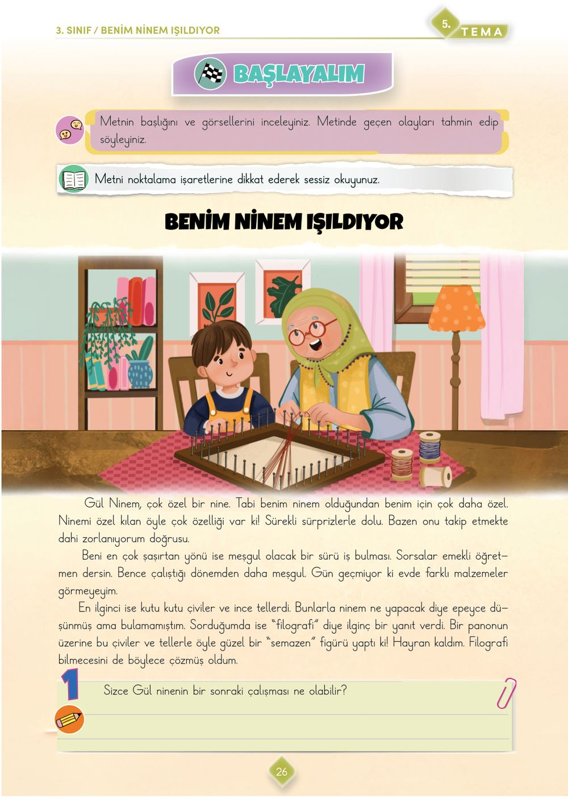

Gül Ninem, çok özel bir nine. Tabi benim ninem olduğundan benim için çok daha özel. Ninemi özel kılan öyle çok özelliği var ki! Sürekli sürprizlerle dolu. Bazen onu takip etmekte dahi zorlanıyorum doğrusu.

Beni en çok şaşırtan yönü ise meşgul olacak bir sürü iş bulması. Sorsalar emekli öğretmen dersin. Bence çalıştığı dönemden daha meşgul. Gün geçmiyor ki evde farklı malzemeler görmeyeyim.

En ilginci ise kutu kutu çiviler ve ince tellerdi. Bunlarla ninem ne yapacak diye epeyce düşünmüş ama bulamamıştım. Sorduğumda ise “filografi” diye ilginç bir yanıt verdi. Bir panonun üzerine bu çiviler ve tellerle öyle güzel bir “semazen” figürü yaptı ki! Hayran kaldım. Filografi bilmecesini de böylece çözmüş oldum.

1. Sizce Gül ninenin bir sonraki çalışması ne olabilir?

<!-- sayfa 27 -->

Ninemin kitap okuduğunu biliyordum. Ara sıra da okuduğu kitaplara göz gezdiririm. Bazıları ilgimi çeker. Ben de okurum. Geçen hafta ne okuyor diye merak ettim. Kitabı açtım. Ama okuyamadım. Farklı bir alfabe ile yazılmıştı. Meğer Gül Ninem Osmanlıcasını geliştirmeye karar vermiş.

Bu arada Gül Ninem sadece öğrenmeye devam etmiyor. Öğretmeye de devam ediyor. Mahallemizde okuma yazması olmayan birkaç teyze varmış. Tanışır tanışmaz onlara ders vermeye başladı. Sanırım öğretmenlik hiç emekliliği olmayan bir meslek. Ben ninemin yaşında bu kadar faal olabilir miyim? Hayal bile edemiyorum.

Dün akşam yemekte “ebru” sanatının ilgisini çektiğini söyledi. En kısa zamanda bir ebru teknesi alacakmış. Katılabileceği kursları araştırıyormuş. Artık daha fazla dayanamadım. “Nineciğim, sen hiç gerçekten emekli olmayacak mısın? Sürekli bir kurstan diğerine koşuyorsun. Yorulacaksın diye endişe ediyorum artık.” deyiverdim. “Can'ım, hayatın kendisinden emekli olunmaz ki. Ben öğrendikçe mutlu oluyorum. Yaşantım renkleniyor. Kendimi üretken, faydalı hissetmek yaşama sevincimi arttırıyor. Hem bu sayede zihnim de ışıldıyor. Bu atasözünü işitmiş olmalısın: İşleyen demir ışıldar...”

Gül Ninem, yine tatlı bir gülümsemesiyle sözün güzelini söylemiş oldu.

<!-- sayfa 28 -->

 1. ETKİNLİK

“Benim Ninem Işıldıyor” metnini arkadaşlarınızla paylaşımlı olarak sesli okuyunuz. Anlamını bilmediğiniz sözcük veya sözcük gruplarının altını çizerek anlamlarını metinden hareketle tahmin ederek yazınız.

__________________________________________________________________________
__________________________________________________________________________

Hikâye Unsurları

 2. ETKİNLİK

Metnin konusunu ve ana fikrini yazınız.

| Metnin Konusu | Metnin Ana Fikri |
| :--- | :--- |
| | |
| | |
| | |
| | |

 3. ETKİNLİK

a) Metindeki karakterler kimlerdir? Yazınız.

b) Aşağıda Can'ın kişilik özellikleri ve duygu durumları verilmiştir. Kişilik özelliklerinin yanına “K”, duygu durumu olanların yanına “D” yazınız.

○ Meraklıdır, ninesinin yaptıklarını ilgiyle takip eder.
○ Ninesine hayranlık duyar.
○ Öğrenmeye açık biridir.
○ Onun sürekli aktif olmasına şaşırır.
○ Bazen endişelidir: “Nineciğim, yorulacaksın diye endişe ediyorum.” diyerek endişesini dile
  tirdi.

<!-- sayfa 29 -->

# 4. ETKİNLİK

Metne göre yapılabilecek çıkarımları işaretleyiniz.

◯ Hayat boyu öğrenme, insanların yaşamını zenginleştirir.
◯ Bir şeyler öğrenmek sadece gençlere özgüdür.
◯ Her yaşta yeni şeyler öğrenmek mümkündür.
◯ Kültürel değerleri öğrenmek önemlidir.
◯ Öğretmenlik yalnızca okuldayken yapılan bir meslektir.
◯ Emekli olmak, artık çalışmayı ve öğrenmeyi bırakmak anlamına gelir.

# 5. ETKİNLİK

Metinden bir çıkarım yapınız. Çıkarımınızı ve bu çıkarım ile ilgili düşüncelerinizi aşağıdaki alana örnekteki gibi yazınız. Yazınızda yeni öğrendiğiniz sözcükleri kullanınız ve noktalama işaretlerine dikkat ediniz.

Çıkarım: *"Yaşamak, öğrenmekle güzeldir."*

Örnek Yazı:
Gül nine, yaşının ilerlemiş olmasına rağmen sürekli yeni şeyler öğreniyor ve üretmeye devam ediyor. Onun bu azmi, bana hayatın her yaşta öğrenerek güzelleştiğini gösteriyor. Osmanlıca öğrenmek istemesi veya ebru sanatına ilgi duyması, yaşlanmanın öğrenmeye engel olmadığını kanıtlıyor. Ayrıca, çivi ve tellerle semazen figürü yapması, üretmenin de ne kadar keyifli bir süreç olduğunu gösteriyor.

Çıkarımım:
__________________________________________________________________
__________________________________________________________________
__________________________________________________________________
__________________________________________________________________
__________________________________________________________________

<!-- sayfa 30 -->

# 6. ETKİNLİK

Ebru sanatı ile ilgili bir araştırma yapınız. Araştırmanızı dijital sunum şeklinde arkadaşlarınızla paylaşınız. Araştırma ve dijital sunumunuz için aşağıdaki planı uygulayınız.

### Araştırma Süreci:
* Ebru sanatının tarihini, nasıl yapıldığını ve yapımında kullanılan malzemeleri araştırınız.
* Farklı ebru türlerini (battal, gelgit, taraklı vb.) öğrenerek örnekler bulunuz.
* Araştırmalarınızı yaparken kaynaklarınızı (kitap, dergi, ansiklopedi, çevrim içi ortamlar) mutlaka not ediniz.

### Metin Yazımı:
* Araştırma sonuçlarını kullanarak açıklayıcı bir yazı hazırlayınız.
* Yazınızda benzetme ve örneklendirme kullanmaya dikkat ediniz.
* Noktalama işaretlerini kuralına uygun kullanmaya özen gösteriniz.

### Dijital Sunum:
* Yazınızı ve görsellerinizi bir sunum programı kullanarak dijital bir sunuma dönüştürünüz.
* Sunumunuzda yazının okunabilir ve görsellerin net olmasına dikkat ediniz.
* Sunumunuzu etkileyici hâle getirmek için başlıklar, renk uyumu ve animasyonlar kullanabilirsiniz.

### Görsellerin Kullanımı:
* Yazınızı uygun görsellerle destekleyiniz.
* Kullandığınız görsellerin yazıyla uyumlu olmasına dikkat ediniz.

### Bilgi Kaynaklarını Belirtme:
* Yazınızın sonuna ve sunumunuzun son slaytına kullandığınız tüm kaynakları yazınız.

### Sözlü Sunum:
* Konuşma kurallarına uygun olarak sunumunuzu arkadaşlarınızla paylaşınız.

<!-- sayfa 31 -->

# METNE HAZIRLANALIM

 Hedef tahtasına kaleminizi biraz yüksekten bırakarak üç atış yapınız. Kalemin ucunun geldiği puanları toplayınız. Arkadaşlarınızla puanınızı karşılaştırınız.

(Hedef Tahtası Görseli)

 Yukarıdaki oyuna benzer hangi spor dalları vardır? Bildiğiniz spor dallarını arkadaşlarınızla paylaşınız.

<!-- sayfa 32 -->

# BAŞLAYALIM

Metnin başlığını ve görsellerini inceleyiniz. Metinde geçen olaylarla ilgili tahmininizi söyleyiniz.

Metni noktalama işaretlerine dikkat ederek sessiz okuyunuz. Okurken metin içindeki soruları cevaplayınız.

# METE GAZOZ
## Zeki, Çevik, Ahlaklı

Merhaba arkadaşlar. Size Mete Gazoz adında inanılmaz bir sporcudan bahsetmek istiyorum. (...)

Mete Gazoz, 1999 (bin dokuz yüz doksan dokuz) yılında İstanbul'da doğmuş. Okçuluk yönünden şanslı olduğunu söyleyebiliriz çünkü babası da milli okçuymuş. Ancak Mete sadece okçuluk değil pek çok konuda eğitim almış: resim, piyano, basketbol, yüzme... Belki de okçuluktaki başarısı onun çok yönlü biri olmasından kaynaklanıyor. Dünya Mete Gazoz'u nasıl tanıdı biliyor musunuz?

1.
Mete Gazoz sizce hangi başarısı ile tanınmış olabilir?

<!-- sayfa 33 -->

Mete, 2021 (iki bin yirmi bir) yılında düzenlenen Tokyo Olimpiyatlarında altın madalya kazandı. Bir sporcunun hayattaki en büyük başarısı Olimpiyatlarda madalya kazanmaktır. Bu onun dünyanın en iyi okçusu olduğu anlamına geliyor! Olimpiyatlar haricinde pek çok uluslararası şampiyonada da önemli başarıları var. Millî gururumuz Mete'yi böylece tüm dünya tanıdı. Mete okçulukta bir gecede harika olmadı.

# 2

Mete Gazoz okçulukta başarılı olmak için sizce neler yapmıştır?

<!-- sayfa 34 -->

Çalışmaya çok küçük yaşlarda başladı. Her gün çok çalıştı, becerilerini geliştirdi. Ailesi ve antrenörleri de ona çok yardımcı oldu. Mete, her gün saatlerce pratik yaptı, yapıyor. Okçuluk çok fazla odaklanma ve sakinlik gerektiriyor. Mete oklarını atarken sakin ve sabit kalma konusunda gerçekten çok iyi. Dünya çapında pek çok çocuğa ve yetişkine okçuluğu denemeleri ve hayallerine ulaşmak için çok çalışmaları konusunda ilham veriyor. Mete Gazoz harika bir rol model, çünkü sıkı çalışma ve özveriyle sevdiğiniz bir şeyde dünyanın en iyilerinden biri olabileceğinizi gösteriyor. Ayrıca karşılaştığımız zorluklar ne olursa olsun bize odaklanmayı ve sakin kalmayı öğretiyor.

Tıpkı Mete gibi siz de çok çalışırsanız ve hayallerinizden vazgeçmezseniz inanılmaz şeyler başarabilirsiniz. İster bir okçu, ister bir bilim insanı, ister bir yazar ya da başka bir şey olmak isteyin, Mete'nin hikâyesini hatırlayın ve hedeflerinize odaklanın.

Öncü Çocuk dergisi

(Kısaltılmıştır.)

<!-- sayfa 35 -->

# 1. ETKİNLİK

Metni okurken altını çizdiğiniz sözcük veya sözcük gruplarının anlamlarını metinden hareketle tahmin ederek yazınız.

__________________________________________________________________________
__________________________________________________________________________
__________________________________________________________________________

# 2. ETKİNLİK

Mete Gazoz olimpiyatlarda altın madalya kazandıktan sonra duygularını beden dili ile nasıl ifade etmiştir? Arkadaşlarınıza beden dilinizi de kullanarak anlatınız.

(QR Kod görseli)
Etkili Konuşma

# 3. ETKİNLİK

Metnin konusunu ve ana fikrini yazınız.

| Metnin Konusu | Metnin Ana Fikri |
| :--- | :--- |
| ____________________ | ____________________ |
| ____________________ | ____________________ |
| ____________________ | ____________________ |

# 4. ETKİNLİK

Olayları oluş sırasına göre numaralandırarak sıralayınız.

○ Mete çok çalışmaya başladı.
○ Mete İstanbul’da doğdu.
○ Tokyo Olimpiyatları'nda altın madalya kazandı.
○ Pek çok alanda eğitim aldı.

<!-- sayfa 36 -->

# 5. ETKİNLİK
Mete'nin başarı hikâyesinden yola çıkarak hedefinize ulaşmak için neler yapılması gerektiğini yazınız.

__________________________________________________________________________
__________________________________________________________________________
__________________________________________________________________________
__________________________________________________________________________

# 6. ETKİNLİK
Bir kişinin birden fazla konuda yetenekli veya başarılı olması onun çok yönlü olduğunu gösterir. Mete Gazoz'un çok yönlü olduğunu gösteren örnekleri metinden bularak yazınız.

# 7. ETKİNLİK
Mete Gazoz'un başarısı ile kendi başarılarınızın benzetmelerini yazınız. Benzetme yaparken "gibi" veya "kadar" ifadelerini kullanabilirsiniz.

| Mete Gazoz'un başarısı, |
| :--- |
| Oklarını atarken o kadar sakin ki |
| |
| |

# 8. ETKİNLİK
Metinde yer alan bir bilgi verilmiştir. Bilginin kaynağını araştırıp yazınız.
"Mete Gazoz, Tokyo 2021 (iki bin yirmi bir) Olimpiyatları'nda Türkiye'ye okçulukta ilk altın madalyayı kazandırmıştır."

__________________________________________________________________________
__________________________________________________________________________
__________________________________________________________________________

<!-- yer tutucu bulunamadı: sayfa sonuna eklendi -->

<!-- sayfa 37 -->

<!-- yer tutucu bulunamadı: sayfa sonuna eklendi -->

<!-- yer tutucu bulunamadı: sayfa sonuna eklendi -->

<!-- yer tutucu bulunamadı: sayfa sonuna eklendi -->

<!-- yer tutucu bulunamadı: sayfa sonuna eklendi -->

<!-- yer tutucu bulunamadı: sayfa sonuna eklendi -->

<!-- yer tutucu bulunamadı: sayfa sonuna eklendi -->

<!-- yer tutucu bulunamadı: sayfa sonuna eklendi -->

<!-- yer tutucu bulunamadı: sayfa sonuna eklendi -->

<!-- sayfa 38 -->

# 11. ETKİNLİK
Metinden çıkardığınız sonuçları bir paragraf hâlinde yazınız.

[ ]

# 12. ETKİNLİK
“Mete oklarını atarken sakin ve sabit kalma konusunda gerçekten çok iyi.”
Metinde geçen bu cümle ile metnin üçüncü görselindeki karakterin beden dili uyumlu mu? Düşüncelerinizi nedenleriyle yazınız.

[ ]

# 13. ETKİNLİK
Mete Gazoz hakkında bilgilendirici bir afiş hazırlayınız.

[ ]

<!-- sayfa 39 -->

# METNE HAZIRLANALIM

 Parkta veya oyun alanında en çok hangi oyunları oynarsınız? Arkadaşlarınızla paylaşınız.

 Çocuk parkları için yeni bir oyun aracı tasarlayınız. Tasarımınıza bir isim verip görselini çiziniz. Nasıl kullanılacağını yazınız.

Oyun aracının ismi: 

Oyun aracının kullanımı:

<!-- sayfa 40 -->

# BAŞLAYALIM

Şiirin başlığını ve görselini inceleyiniz. Şiirde geçen olayları tahmin edip söyleyiniz.

Şiiri vurgu ve tonlamalara dikkat ederek okuyunuz.

# OYUN ZAMANI

Salıncakta sallanırken saçlar havalanır.
Kaydıraktan heyecanla kayılır.
Küçük eller kumdan kaleler yapar,
Parkta sesler neşeyle yankılanır.

Tahterevalli durmadan iner çıkar.
O vakit oyunda gülüşler başlar.
Çimenlerde top sektirir çocuklar,
Oyun oynarken büyür mutluluklar.

Biri çizgilere basmadan sek sek oynar,
Diğeri hızla koşarak mendil kapar.
Çocuklar heyecanla etrafa dağılır,
Her biri farklı yere saklanır.

Bu kitap için yazılmıştır.

<!-- sayfa 41 -->

# 1. ETKİNLİK

Anlamını bilmediğiniz sözcük veya sözcük gruplarının altını çiziniz. Bu sözcüklerin anlamını şiire göre tahmin edip yazınız.

| |
|---|
| |

# 2. ETKİNLİK

Soruları şiire göre cevaplayınız.

1) Şiirde hangi oyunlardan söz ediliyor?
__________________________________________________________________________
__________________________________________________________________________

2) Çocuklar kumla neler yapıyor?
__________________________________________________________________________
__________________________________________________________________________

3) Şiirde saklambaç oyunundan hangi ifadelerle bahsedilmiştir?
__________________________________________________________________________
__________________________________________________________________________

4) Şiirde sek sek oyununun hangi kuralı belirtiliyor?
__________________________________________________________________________
__________________________________________________________________________

# 3. ETKİNLİK

Şiirin konusu ve ana duygusunu yazınız.

| Şiirin Konusu |  |
| :--- | :--- |
| | Şiirin Ana Duygusu |
| | |
| | |
| | |

<!-- sayfa 42 -->

# 4. ETKİNLİK
Oyun oynamak bize neler öğretir ve bizi nasıl geliştirir? Düşüncelerinizi yazınız.

![Boş yazı alanı]

# 5. ETKİNLİK
Verilen adımları uygulayarak çocuk oyunları ile ilgili bir araştırma ödevi hazırlayınız. Çalışmanızda dijital araç ve materyal kullanmaya özen gösteriniz.

### Oyun Seçimi
İstediğiniz bir çocuk oyununu seçiniz.

### Araştırma:
Seçtiğiniz oyunun nasıl oynandığını, tarihçesini, kurallarını, çeşitli kaynaklardan araştırınız.

### Sunum Hazırlama:
Araştırma sonuçlarını kullanarak bir sunum hazırlayınız.
Sunumunuzda benzetme ve örneklendirmeler kullanmaya dikkat ediniz.
Noktalama işaretlerini kuralına uygun kullanmaya özen gösteriniz.
Araştırdığınız oyunla ilgili dijital bir sunum oluşturunuz.
Sunumunuzu hazırlarken seçtiğiniz oyunla ilgili görsellerden yararlanınız.

### Kaynak Listesi:
Kullandığınız kaynakları belirtiniz.
Kitap: .....................................................................................................................................................................
Genel ağ: ........................................................................................................................................................
Dergi: ..................................................................................................................................................................

### Sunumun paylaşılması:
Konuşma kurallarına uygun olarak ve konuşmalarınızda benzetmelere yer vererek sunumunuzu yapınız.

<!-- sayfa 43 -->

# METNE HAZIRLANALIM

Bulmacada oyunlarda önemli olan bazı etik değerler gizlenmiştir. Soldan sağa ve yukarıdan aşağıya verilen ipuçlarını dikkatlice okuyunuz. Mavi kutularda verilen sözcükleri kullanarak bulmacayı doğru şekilde doldurunuz.

SABIR | EMPATİ | NEZAKET | PAYLAŞMAK
---|---|---|---
DAYANIŞMA | DÜRÜSTLÜK | ADALET |

### Soldan Sağa
1) Sırasını bekleyebilmek.
2) Herkesin sırayla ve eşit şekilde oynamasına özen göstermek.
3) Grup oyunlarında birlikte hareket etmek, işbirliği yapmak.
4) Hile yapmadan, kurallara uygun oynamak.

### Yukarıdan Aşağıya
5) Kaybeden arkadaşının duygularını anlamaya çalışmak.
6) Oyuncakları ve oyun malzemelerini arkadaşlarıyla ortaklaşa kullanmak.
7) Nazik konuşmak, kırıcı sözlerden kaçınmak.

(Bulmaca görseli)

<!-- sayfa 44 -->

# BAŞLAYALIM

Metnin başlığını ve görsellerini inceleyiniz. Metnin içeriğini ve metinde geçen olaylar hakkındaki tahminlerinizi açık ve anlaşılır cümleler ile ifade ediniz.

Metni noktalama işaretlerine dikkat ederek sessiz okuyunuz.

# BALİŞ'İN OYUNLARI

Vaktiyle, Atlas Okyanusu'nda yaşayan bir yavru balina vardı. Annesiyle babası ona Baliş adını vermişlerdi.

Baliş, oyun ve eğlenceye bayılıyordu. Özellikle de havaya su fışkırtmak onun en büyük eğlencesiydi. (...) Baliş'in fışkırttığı su bazen o denli yükseğe çıkıyordu ki, yeniden okyanusa düştüğünde, kıyıya kadar uzanan dev dalgalar oluşturuyordu.

Baliş'in su fışkırtma oyunu, okyanustaki her canlının hoşuna gitmiyordu. Bundan şikayet edenler de vardı.

1. Okyanustaki canlılar Baliş'in bu oyunundan neden rahatsız olmuş olabilirler?

<!-- sayfa 45 -->

Örneğin balıklar, “Yeter artık Baliş! (...) Sen okyanusu dalgalandırırken bizim başımız dönüyor, oraya buraya savruluyoruz.” diye tepki gösteriyorlardı. (...)

Baliş’in oyunlarından keyif alan tek varlık, geceleri okyanusu yukarıdan izleyen bir yıldızcıktı. Deniz canlılarının o tarafa bu tarafa savrulduklarını gördükçe, kahkahalarla gülüyordu. Onun gözünde bu bir danstı. Ama bu dansın istekli mi, isteksiz mi olduğunu bilmiyordu.

Yine bir gün, Baliş bütün okyanusu birbirine katarken deniz canlıları ona çok, ama çok kızdılar: (...)

Baliş, o gece, surat asıp derin derin düşünürken, gökyüzünde beklenmedik bir şey oldu: Minik yıldız, ay ışığında salıncak kurmuş salınırken, salıncağın ipi koptu ve tepetaklak yuvarlanmaya başladı. Yuvarlandı, yuvarlandı, yuvarlandı... Sonra gelip okyanusun ortasına düşüverdi. Oradan da “gulug gulug” ederek dibe doğru inmeye başladı. Az kalsın boğulup ışıkları sönecekti.

Sizce okyanusun ortasına düşen yıldız nasıl kurtulabilir?

<!-- sayfa 46 -->

İşte tam o sırada, Baliş olayın farkına vardı. Yıldızı, önce bir kuyruk darbesiyle suyun yüzüne çıkarttı. Ardından da güçlü bir nefesle, onu fışkırttığı suyun önüne katıp gökyüzündeki yerine gönderdi. Yıldız kurtulmuştu. Gökyüzünden, göz kırparak Baliş'e teşekkür etti.

Baliş o günden sonra, yıldız kurtaran bir kahraman oldu. Okyanustaki dostlarının ona değer vermesi, onu birden olgunlaştırmıştı. Artık o okyanus canlılerinin şımarık çocuğu değil ünlü bir kahramandı. Eski şımarıklıkları unutulmuştu. Üstelik herkes onunla oynamaya can atıyordu.

                                                                    Sevgi Bir Kuş dergisi
                                                                    (K...l...t...)

<!-- sayfa 47 -->

# 1. ETKİNLİK

“Baliş’in Oyunları” metnini arkadaşlarınızla paylaşımlı olarak sesli okuyunuz. Anlamını bilmediğiniz sözcük veya sözcük gruplarının altını çiziniz.

# 2. ETKİNLİK

Metni okurken altını çizdiğiniz sözcük veya sözcük gruplarının anlamını metinden hareketle tahmin ediniz. Tahminlerinizi TDK Güncel Türkçe Sözlük’ten kontrol ediniz ve sözcüklerin anlamını yazınız.

| Sözcük/Sözcük Grubu | Tahminim | Sözlük Anlamı |
| :--- | :--- | :--- |
| | | |
| | | |
| | | |
| | | |
| | | |

# 3. ETKİNLİK

Anlamını öğrendiğiniz sözcükleri kullanarak cümleler oluşturunuz. Cümlelerinizi yazıp arkadaşlarınızla paylaşınız.

__________________________________________________________________________
__________________________________________________________________________
__________________________________________________________________________
__________________________________________________________________________
__________________________________________________________________________

<!-- sayfa 48 -->

# 4. ETKİNLİK

Soruları sözlü olarak cevaplayınız. Cevaplarınızı beden dilinizi yerinde kullanarak jest ve mimiklerinizle destekleyiniz.

**a)** Baliş'i şımarık bir yavru balinadan herkesin değer verdiği bir kahramana dönüştüren olay nedir?
**b)** Sizce fedâkarlık ve yardımseverlik, bireyi toplum içinde saygı gören ve sevilen biri hâline getirebilir mi? Ön bilgi ve yaşantılarınızı kullanarak cevaplayınız.

# 5. ETKİNLİK

Okuduğunuz metnin konusunu ve ana fikrini yazınız.

| Metnin Konusu | Metnin Ana Fikri |
| :--- | :--- |
| | |
| | |
| | |

# 6. ETKİNLİK

Metin ile ilgili istenilenleri ilgili kutulara yazınız.

| Olayın Geçtiği Yer | Bilgiler |
| :--- | :--- |
| | |
| | |
| | |
| | |

| Olay | Duygular |
| :--- | :--- |
| | |
| | |
| | |
| | |

<!-- sayfa 49 -->

# 7. ETKİNLİK

Olayları oluş sırasına göre numaralandırarak sıralayınız. Vurgu ve tonlamaya dikkat ederek arkadaşlarınızla paylaşınız.

◯ Baliş, yıldızı kurtardı ve gökyüzüne geri gönderdi.
◯ Baliş, herkesin sevdiği bir kahraman oldu.
◯ Baliş’in oynadığı su fışkırtma oyunu nedeniyle dev dalgalar oluştu.
◯ Minik yıldızın salıncak ipi koptu ve okyanusa düştü.
◯ Deniz canlıları Baliş’e çok kızdı.

# 8. ETKİNLİK

Soruları metne göre cevaplayınız.

1) Deniz canlılarının Baliş’e kızmasının nedeni nedir?
__________________________________________________________________________

2) Deniz canlıları, Baliş’e kızdıktan sonra Baliş neler hissetti?
__________________________________________________________________________

3) Baliş, yıldızı kurtardıktan sonra kendini nasıl hissetti?
__________________________________________________________________________

# 9. ETKİNLİK

Metinden istediğiniz bir bölümünü belirleyiniz. Bu bölümü kendi cümlelerinizle yazınız.

__________________________________________________________________________
__________________________________________________________________________
__________________________________________________________________________
__________________________________________________________________________
__________________________________________________________________________
__________________________________________________________________________
__________________________________________________________________________

<!-- sayfa 50 -->

# 10. ETKİNLİK

Cümle sonunda yay ayraç içinde verilen sözcüklerden uygun olanı kullanarak cümleleri tamamlayınız.

1) Baliş'in fışkırttığı su bazen o denli yükseğe çıkıyordu ki yeniden okyanusa .......................................... kıyıya kadar uzanan dev dalgalar oluşturuyordu. (düştüğünde/çıktığında )
2) Minik yıldız ay ışığında salıncak kurmuş .......................................... salıncağın ipi koptu. (sallanırken/dururken)
3) Yıldız "gulug gulug" ederek dibe doğru .......................................... başladı. (çıkmaya/inmeye)
4) Baliş yıldızı önce bir kuyruk darbesiyle suyun .......................................... çıkarttı. (dibine/yüzüne)

# 11. ETKİNLİK

Cümlelerdeki boşluklara uygun noktalama işaretini koyunuz.

1) Balıklar [ ] Yeter artık Baliş [ ] Sen okyanusu dalgalandırırken bizim başımız dönüyor [ ] oraya buraya savruluyoruz [ ] diye tepki gösteriyorlardı [ ]
2) Baliş [ ] in oyunlarından keyif alan tek varlık [ ] geceleri okyanusu yukarıdan izleyen bir yıldızcıktı [ ]
3) Deniz canlıları ona çok ama çok kızdılar [ ]
4) Minik yıldız [ ] ay ışığında salıncak kurmuş salınırken [ ] salıncağın ipi koptu ve tepetaklak yuvarlanmaya başladı [ ]

# 12. ETKİNLİK

Metni bir gazete haberi olarak yazınız. Haberinize uygun başlık yazmayı ve haber görseli çizmeyi unutmayınız. Yaptığınız haberi konuşma üslubuna dikkat ederek arkadaşlarınızla paylaşınız.

| | |
|---|---|
| | |
| | |
| | |
| | |
| | |
| | |
| | |
| | |
| | |
| | |
| | |
| | |
| | |
| | |
| | |
| | |
| | |
| | |
| | |

<!-- sayfa 51 -->

# PERFORMANS GÖREVİ

Yönergeleri takip ederek gölge oyunu sahnesi oluşturunuz.

## GÖLGE OYUNU PERFORMANS ÖDEVİ

### Araç ve Gereçler
* Büyük bir karton kutu
* Pişirme kâğıdı veya beyaz yarı saydam kâğıt
* Pipetler
* Yapıştırıcı ve makas
* Kukla yapımı için karton veya mukavva
* Boya kalemleri veya keçeli kalemler
* El feneri

### Kukla Yapımı
* İstediğiniz karakterlerin (hayvanlar, insanlar vb.) resimlerini çiziniz.
* Çizdiğiniz resimleri kartona aktarıp kesiniz. (Makas kullanırken öğretmeninizden izin alınız ve güvenlik kurallarına dikkat ediniz.)
* Her kuklanın arkasına bir pipet yapıştırınız.

### Sahne Hazırlama
* Karton kutunun kapağını çıkarınız.
* Kutunun iki ucunu açınız.
* Açık olan ön bölüme iki uzun şerit kesiniz. (kuklaları hareket ettirmek için)
* Ön kısmına pişirme kâğıdını gergin bir şekilde yapıştırınız.

### Sahne Düzeni
* Sahneyi masanın üzerine yerleştiriniz.
* El fenerini sahnenin arkasına koyunuz.
* Odanın ışıklarını kapatınız.
* Kuklaları perdenin arkasından şeritlerden geçirerek hareket ettiriniz.

<!-- yer tutucu bulunamadı: sayfa sonuna eklendi -->

<!-- sayfa 52 -->

# 5. TEMA SONU ÇALIŞMASI

a) Metnin başlığından hareketle konusunu ve ana fikrini tahmin ediniz. Tahminlerinizi konuşma kurallarına uyarak arkadaşlarınıza anlatınız.

b) Metni noktalama işaretlerine dikkat ederek okuyunuz.

> ### Bayrak Yarışı
>
> Okullar arası atletizm yarışması yaklaşıyordu. On okulun katılacağı bu yarışmaya bütün okullar canla başla hazırlanıyordu. Mevlana Ortaokulu da bu okullardan biriydi. Bu küçük okul, sabahın erken saatlerinde bile disiplinli bir şekilde antrenman yapmaya devam ediyordu.
> Takım kaptanı Seda, bu yarışın yalnızca hızlı koşmakla değil aynı zamanda fiziksel gücü artırmakla kazanılacağına inanıyordu. Antrenörleri Zeynep Hoca ise takım ruhuna önem veriyor, öğrencilerini hem fiziksel hem de zihinsel olarak yarışa hazırlıyordu.
> Yarış günü geldiğinde herkes çok heyecanlıydı. Önceki turlarda Mevlana Ortaokulu geride kaldı. Ancak sabırlı bir tempoyla yarışı sürdürdüler. Son turda Zeynep bayrağı Ahmet’e verdi. Ahmet tüm gücünü toplayarak koştu ve rakiplerini geçip yarışı kazandı.
> Sunucu coşkuyla duyurdu:
> – Mevlana Ortaokulu il birincisi oldu! Ülke finallerine gidiyor!
> Bu zafer; çalışmanın, inancın ve ekip ruhuyla hareket etmenin bir sonucuydu.
>
>  Bu kitap için yazılmıştır.

c) Metnin konusunu ve ana fikrini yazınız.

| Metnin Konusu | Metnin Ana Fikri |
| :--- | :--- |
| | |

ç) Metni okumadan önce yaptığınız tahmininizi değerlendiriniz.

Tahminim doğru $\quad$ Tahminim yanlış

<!-- sayfa 53 -->

✏️ d) Metindeki karakter, olay, duygu ve bilgileri yazınız.

| Karakterler: ........................................................................................... | Duygular: ............................................................................................ |
| :--- | :--- |
| Olay: ............................................................................................................. | Bilgiler: ................................................................................................... |
| ................................................................................................................................. | ............................................................................................................................ |
| ................................................................................................................................. | ............................................................................................................................ |
| ................................................................................................................................. | ............................................................................................................................ |
| ................................................................................................................................. | .................................................

<!-- yer tutucu bulunamadı: sayfa sonuna eklendi -->

<!-- yer tutucu bulunamadı: sayfa sonuna eklendi -->

<!-- sayfa 54 -->

# 6. Tema
# BİLİM YOLCULUĞU

## Temada Yer Alan Metinler
* Penceremden Gökyüzü (Dinleme Metni)
* Elektronik Atıklar
* Hayatımızı Kolaylaştıran Makineler
* Teknoloji ve Biz
* Bu Meslekler Tarih Oldu

<!-- sayfa 55 -->

# BU TEMADA NELER ÖĞRENECEĞİZ?

Bu temadaki metinler aracılığıyla dinleme, okuma, konuşma ve yazma becerilerimizi geliştireceğiz. Bilimin ne olduğunu, hayatımızdaki yerini ve önemini öğreneceğiz. Merak etmeyi, soru sormayı ve araştırmayı alışkanlık hâline getireceğiz. Bilim insanlarının çalışmalarını tanıyacak, gözlem yapmanın ve deneylerle öğrenmenin ne kadar eğlenceli olduğunu fark edeceğiz. Bilgiye ulaşmanın yollarını keşfedeceğiz.

## Anahtar Kavramlar

* araştırma
* bilim insanı
* bilişim ve kodlama
* deney
* icat
* keşif
* kıtalar
* merak
* mucit
* sorgulama
* ülkeler

! Temadaki metinler; yazım, noktalama ve dönemin söyleyiş özellikleri açısından eserin orijinal

<!-- sayfa 56 -->

# TEMAYA HAZIRLANALIM

a) Görseli dikkatlice inceleyiniz. Görsellerdeki kişiler ne yapıyor olabilir? Tahmininizi yazıp arkadaşlarınızla paylaşınız.

Tahminim:
___________________________________________________________________________

b) Soruları cevaplayınız. Cevaplarınızı arkadaşlarınızla paylaşınız.

1) Bir oyuncak icat etmek isteseydiniz nasıl bir oyuncak yapardınız?
___________________________________________________________________________
___________________________________________________________________________

2) Tatilde nereye gitmek ve orada ne yapmak isterdiniz?
___________________________________________________________________________
___________________________________________________________________________

3) Bir konuda araştırma yapmak isteseydiniz bu ne olurdu?
___________________________________________________________________________
___________________________________________________________________________

<!-- sayfa 57 -->

# METNE HAZIRLANALIM

Gece gökyüzüne baktığınızda neler gördüğünüzü yazınız.

Verilen ipuçlarının size neyi çağrıştırdığını yazınız.

| | |
| :--- | :--- |
| Gecenin siyah perdesinde Dans eden sarı noktalar. İnsan onlara baktıkça Hayallere dalar. | Gökyüzünde altın tepsi Sabah doğar akşam batar Aydınlatır herkesi |
|  |  |
| | |
| Gökyüzünde beyaz lamba, Yansıtır gece olunca. Bazen yuvarlak, bazen hilal İzlerken hayallere dal | Uzaklar onunla yakın Sadece merceğinden bakın Yıldızlar serilsin önüne Yol gösterir kâşife |
|  |  |

Sizce teleskobun icat edilmesi, uzay araştırmalarına nasıl katkı sağlamıştır? Açıklamanızdaki duygu ve düşüncelerinizi uygun zamanda söz alarak açıkça ifade ediniz.

Atasözlerimiz

<!-- sayfa 58 -->

# BAŞLAYALIM

Metnin başlığını ve görselini inceleyiniz. Metnin konusunu tahmin ediniz. Tahmininizi vurgu ve tonlamaya dikkat ederek, sözcükleri yerinde ve anlamına uygun kullanarak ifade ediniz. Konuşmanıza uygun olarak ses düzeyini ayarlayınız.

Açıklamaları verilen dinleme yöntemlerini inceleyiniz. Arkadaşlarınızla uygun zamanda söz alarak fikir alışverişinde bulununuz. Birbirinizin tercihlerine saygı göstererek ortak bir yöntem seçiniz. Seçtiğiniz yönteme uygun olarak metni dikkatli dinleyiniz.

| Katılımlı Dinleme | Katılımsız Dinleme | Not Alarak Dinleme |
| :--- | :--- | :--- |
| Dinleme esnasında öğretmeninize sorular sorabilir ve görüşlerinizi paylaşabilirsiniz. | Etkileşim olmadan sadece dinlemeye ve konuya odaklanıp konuyu anlamaya çalışabilirsiniz. | Dinleme sırasında not alabilirsiniz. Bu yöntemle izlediklerinizin önemli noktalarını belirleyebilir ve daha kolay hatırlayabilirsiniz. |

Dinleme Metni
(Karekod)

Dinleme metni karekodunu okutunuz.
Metni dinleme kurallarına uygun olarak dinleyiniz.

Dinleme Öz Değerlendirme
(Karekod)

<!-- sayfa 59 -->

 # 1. ETKİNLİK

Sizin seçtiğiniz dinleme yöntemi hangisiydi? Sınıfça seçtiğiniz ve kullandığınız yöntem hangisi oldu? Yazınız. Kullandığınız yöntemi yazarak açıklayınız.

| Seçtiğim Yöntem | |
| :--- | :--- |
| .............................. .............................. .............................. .............................. | |
| **Sınıfça Kullandığımız Yöntem** | |
| .............................. .............................. .............................. .............................. | |

 # 2. ETKİNLİK

Soruları arkadaşlarınızla sözlü olarak cevaplayınız. Daha sonra oluşturduğunuz ortak cevapları anlamlı ve kurallı cümleler hâlinde yazınız.

1) Karamel ve Çekirdek nerede duruyorlardı ve ne yapıyorlardı?
__________________________________________________________________

2) Lambalar sönünce Çekirdek neyi fark etti?
__________________________________________________________________

3) Karamel, Çekirdek'e ne anlatmaya başladı?
__________________________________________________________________

4) Şenlikte bu kadar çok yıldız görünmesinin sebebi neydi?
__________________________________________________________________

 # 3. ETKİNLİK

Metnin konusunu yazınız. Metni dinlemeden önce yaptığınız tahminle karşılaştırınız.

| |
| :--- |
| |
| |

<!-- yer tutucu bulunamadı: sayfa sonuna eklendi -->

<!-- sayfa 60 -->

# 4. ETKİNLİK

**a)** Ela radyo dinlemeyi çok seviyor, özellikle Bilim ve Teknik radyosundaki uzayla ilgili söyleşilere bayılıyor. Aşağıdaki radyo yayın akışını inceleyiniz. Ela'nın ilgisini çekecek programları adları ve saatleriyle yazınız.

> ## BİLİM VE TEKNİK RADYOSU YAYIN AKIŞI
>
> 09.00 – 10.00: **Uzaydan Haberler**
> * Uzay araştırmalarından en güncel haberler, keşifler ve ilginç bilgiler.
>
> 10.00 – 12.00: **Bilimin İzinde**
> * Fizik, kimya ve biyolojideki şaşırtıcı deneyler, buluşlar.
>
> 12.00 – 13.00: **Teknoloji Saatiniz**
> * Gelişen teknolojiler, yapay zekâ ve geleceğin icatları üzerine konuşmalar.
>
> 13.00 – 14.00: **Bilimle Yemek Molası**
> * Gündelik hayatta bilimin etkileri: Beslenme, sağlık ve yaşam kalitesi üzerine sohbet.
>
> 14.00 – 16.00: **Doğa ve Çevre Bilimi**
> * İklim değişikliği, doğal kaynakların korunması ve çevreyle ilgili bilimsel araştırmalar.
>
> 16.00 – 17.00: **Zaman Tünelinde Bilim**
> * Bilim tarihindeki en önemli olaylar, bilim insanlarının hikâyeleri ve geçmişten bugüne bilim.
>
> 17.00 – 18.00: **Galaksi Sohbetleri**
> * Yıldızlar, gezegenler, kara delikler ve daha fazlası. Uzayla ilgili ilgi çekici söyleşiler.
>
> 18.00 – 19.00: **Robotlar ve Gelecek**
> * Robotik, yapay zekâ ve otomasyonun dünyamıza etkileri.
>
> 19.00 – 22.00: **Geceye Doğru Bilim Hikâyeleri**
> * İlginç bilim hikâyeleri ve olayların bilimsel açıklamaları.

**b)** Yukarıdaki radyo programlarından birini seçiniz. Seçtiğiniz programda işlenen konuyla ilgili kısa bir araştırma yapınız. Araştırmanızdan edindiğiniz bilgileri açık ve anlaşılır şekilde arkadaşlarınıza sununuz.

<!-- sayfa 61 -->

# METNE HAZIRLANALIM

✏️ Evinizde geri dönüşüme gönderdiğiniz ürünler nelerdir? Yazınız.

__________________________________________________________________________
__________________________________________________________________________

✏️ Sizce hangi maddeler geri dönüştürülüp tekrar kullanılabilir? Bildiklerinizi yazınız.

✏️ Geri dönüşümün faydaları nelerdir? Yazınız.

| Doğal Kaynaklar Açısından | Enerji Tasarrufu Açısından |
| :--- | :--- |
| _________________________ | _________________________ |
| _________________________ | _________________________ |
| _________________________ | _________________________ |
|  | |

| Çevre Açısından | Ekonomik Açıdan |
| :--- | :--- |
| _________________________ | _________________________ |
| _________________________ | _________________________ |
| _________________________ | _________________________ |
|  | **Geri Dönüşümün Faydaları** |  |

| Gelecek Nesiller Açısından | Atık Miktarı Açısından |
| :--- | :--- |
| _________________________ | _________________________ |
| _________________________ | _________________________ |
| _________________________ | _________________________ |
|  | |

<!-- sayfa 62 -->

# BAŞLAYALIM

Metnin başlığını ve görsellerini inceleyiniz. Metinde anlatılanları tahmin edip söyleyiniz.

a) Okuma yöntemlerini inceleyiniz. Okuma amacınıza uygun bir yöntem seçiniz.
b) Yönteminize uygun olarak metni okuyunuz.

**Göz Atarak Okuma**
Metnin konusunu anlamak için hızlı bir şekilde, yüzeysel olarak yapılan okumadır.

**İşaretleyerek Okuma**
Okuma sırasında önemli olduğu düşünülen yerler renkli kalemlerle işaretlenir.

**Not Alarak Okuma**
Amaç, okunan metnin önemli yerlerinin akılda kalmasını sağlamaktır. Okuma sırasında önemli olduğu düşünülen yerler not alınır.

# ELEKTRONİK ATIKLAR

(...) Telefon, televizyon, bilgisayar ve beyaz eşya gibi birçok ürün bir süre sonra bozuluyor, kırılıyor ya da kullanım ömrünü tamamlamış oluyor. (...)

Biliyoruz ki e-atıkların doğada yüzyıllar boyunca erimesi ve kaybolması mümkün olmamaktır. Bu bizi çok sevdikleri ve bizden ayrılmak istemedikleri anlamına gelmiyor tabii ki. Olsa olsa onları geri dönüşüme kazandırmamız için gözümüzün içine bakıyorlardır. Çünkü bu atıkların içlerinde birçok zehirli madde bulunmaktadır.

<!-- sayfa 63 -->

Örneğin bilgisayar monitörleri ve televizyon ekranlarında 4 kiloya yakın kurşun yer alıyor. Bu atıklar çöpe veya toprağa atılırsa içlerindeki zararlı maddeler toprağa ve yer altı sularına karışıyor. Yakılarak yok edilmeye çalışılması durumunda ise zehirli gazların çıkmasına neden oluyor.

Yıllarca bizim emektaşlığımızı yapan ve onunla aramızda sevgi bağı geliştirdiğimiz atık bir elektronik eşyayı, arada eski günleri anarız diye evimizde tutmaya devam edemeyiz. Çünkü e-atıklar ısı, ışık ya da darbeye maruz kaldıklarında içlerindeki zehirli maddeleri bulundukları ortama bırakmaktadır.

Peki, ben şimdi eskiyen bilgisayarımı ne yapacağım? diye soruyorsan yanıtı basit. Tüm e-atıklarımızı belediyelere ve özel kurumlara haber vererek evimizden almalarını sağlayabiliriz. Böylece çevre ve doğal kaynaklar korunur, enerji verimliliği sağlanır ve atıkların yapısındaki değerli maddelerin yeniden işlenmesi sayesinde ülke ekonomisine katkı sağlanmış olur.

                                                                           Diyanet Çocuk dergisi
                                                                           (Kısaltılmıştır)

<!-- yer tutucu bulunamadı: sayfa sonuna eklendi -->

<!-- sayfa 64 -->

c) “Göz Gezdirerek Okuma” yöntemini seçtiyseniz metnin konusunu, “Not Alarak Okuma” yöntemini seçtiyseniz aldığınız notları, “İşaretleyerek Okuma” yöntemini seçtiyseniz işaretlediğiniz yerleri yazınız.

__________________________________________________________________________
__________________________________________________________________________
__________________________________________________________________________

 1. ETKİNLİK

a) Metni öğretmeninizden dinleyiniz. Dinlemeden önce ortamın fiziki açıdan dinlemeye uygun olup olmadığını kontrol ediniz. Kontrol listesini işaretleyiniz.

| | Evet | Kısmen | Hayır |
| :--- | :---: | :---: | :---: |
| • Sınıfın aydınlatılması yeterlidir. |  |  |  |
| • Sınıfın sessizliği dinleme için uygundur. |  |  |  |
| • Sınıfın sıcaklığı dinleme için uygundur. |  |  |  |
| • Oturma pozisyonum dinleme için uygundur. |  |  |  |

b) Sınıf ortamının duygu, düşünce ve davranışlarınızı nasıl etkilediğini açıklayınız.

__________________________________________________________________________

 2. ETKİNLİK

a) Metinle ilgili iletilere katılıyorsanız “katılıyorum” kutusunu, katılmıyorsanız “katılmıyorum” kutusunu boyayınız. Neden katılıp katılmadığınızı yazınız.

| İleti | Katılım Durumu | Neden? |
| :--- | :--- | :--- |
| Yıllarca kullandığımız elektronik eşyalarla aramızda bir bağ oluşur. | Katılıyorum   Katılmıyorum | Çünkü:   ____________________   ____________________ |
|  | Katılıyorum   Katılmıyorum | Çünkü:   ____________________   ____________________ |

b) Metinden bir ileti bulup yazınız. Bu iletiye katılıp katılmadığınızı nedeniyle yazınız.

__________________________________________________________________________
__________________________________________________________________________

<!-- yer tutucu bulunamadı: sayfa sonuna eklendi -->

<!-- sayfa 65 -->

# 3. ETKİNLİK

Metinde “Tüm e-atıklarımızı belediyelere ve özel kurumlara haber vererek evimizden almalarını sağlayabiliriz.” denmektedir. E-atıkların değerlendirilmesi ile ilgili sizin önerileriniz ne olurdu? Yazınız.

| |
|---|
| |
| |
| |
| |
| |
| |
| |
| |

# 4. ETKİNLİK

Bir öğrencinin belediyeye yazdığı çevrim içi bir yazının farklı bölümleri verilmiştir. İfadelerle uygun bölümleri eşleştiriniz.

( ) Zaman ayırıp sorularımı cevapladığınız için teşekkür ederim. İyi çalışmalar dilerim.

( ) Merhaba,
Sınıfımızda arkadaşlarımızla biriktirdiğimiz kâğıtların geri dönüşümleri ile ilgili size bir soru sormak istiyorum.

( ) Dur beni de bekle! Ben de seninle gelmek istiyorum.

( ) Bunları ne yapmamız gerektiği konusunda kararsız kaldık.

Yazışmayı Başlatma (a)
Yazışmayı Sürdürme (b)
Yazışmayı Sonlandırma (c)

<!-- sayfa 66 -->

**a)**  Türkiye’nin ilk astronotu Alper Gezeravcı’ya bir elektronik posta yazınız. Astronotlukla ilgili merak ettiğiniz bir soruyu net, anlaşılır ve nazik bir şekilde iletiniz. Yazışmayı saygılı bir şekilde başlatıp sürdürmeye ve sonlandırmaya dikkat ediniz.

[Yeni İleti]
Kime : _________________________________________________
Konu : _________________________________________________
________________________________________________________
________________________________________________________
________________________________________________________
________________________________________________________
________________________________________________________
________________________________________________________
________________________________________________________
________________________________________________________
________________________________________________________
________________________________________________________
[Gönder]

**b)**  Yapmış olduğunuz yazışmaya göre kendinizi değerlendiriniz.

| KONTROL LİSTESİ | Doğru | Yanlış |
| :--- | :---: | :---: |
| • Yazışmamı uygun bir hitap ifadesiyle başlattım. | ◯ | ◯ |
| • Yazışmamda hâl hatır sordum veya uygun bir giriş cümlesi kullandım. | ◯ | ◯ |
| • Kendimi tanıttım ve yazma amacımı açıkladım. | ◯ | ◯ |
| • İletilerimi birden çok cümleyle açık, net ve anlaşılır bir şekilde ifade ettim. | ◯ | ◯ |
| • Yazışmamda iyi dileklerimi ilettim ve nazik bir vedalaşma ifadesi kullandım. | ◯ | ◯ |
| • Yazım ve dil bilgisi kurallarına dikkat ettim. | ◯ | ◯ |

Yazışmalarınızda yaptığınız olumlu davranışları bir sonraki yazışmalarınıza aktarınız.

<!-- sayfa 67 -->

# METNE HAZIRLANALIM

Verilen görselleri karşılaştırınız. Kullanmayı tercih edeceğiniz görseli işaretleyiniz. Tercih etme nedeninizi sözlü olarak açıklayınız.

(At arabası ve kırmızı araba görselleri)
○          ○

(Daktilo ve dizüstü bilgisayar görselleri)
○          ○

(Kum saati ve dijital saat görselleri)
○          ○

<!-- sayfa 68 -->

# BAŞLAYALIM

> Başlıktan ve görsellerden hareketle metinde geçen bilgileri tahmin ediniz. Görüşlerinizi sözcükleri yerinde ve anlamına uygun kullanarak arkadaşlarınızla paylaşınız.

> Metni noktalama işaretlerine dikkat ederek sessiz okuyunuz.

# HAYATIMIZI KOLAYLAŞTIRAN MAKİNELER

“Heey, bu sesler de ne? Mutfaktan geliyor sanki. Yok yok banyodan, biraz da şu odadan. Neler oluyor?”
“Bir şey yok sakin ol. Robotlar görevlerini yapıyor sadece.”
“Neee robot mu, evde mi?”
“Evet. Sizin evde, bizim evde, sokağın önünde, biraz da şu caddede... Aslında onlar her yerde! Hadi, seninle minik bir geziye çıkalım.”
Tık tık tık! Vuu vuu vuu!
Şu çamaşırları yıkayan robota da bak, ne büyük kolaylaştırıcı.

### Evimizde
Öyle iki elli, iki ayaklı, filmlerden fırlamış da yanımıza gelmiş gibi bir robot arkadaş bekleme canım.
Robot dediysek kendi içerisinde robotik sistemi olan ve hayatımızı kolaylaştıran makinelerden bahsediyoruz. Bak; annen kek yapıyor ve elindeki robot çırpma konusunda ona yardımcı oluyor değil mi?
E, yerdeki dostumuzdan bahsetmiyorum bile. Bas düğmeye temizlensin yerler!

> Çamaşır makinesinden önce sizce kıyafetler nasıl yıkanıyordu?

<!-- sayfa 69 -->

# Fabrikalarda
Tabii ki akıllı mı akıllı robotlarımız hızlı üretim yapan fabrikalarda çok işe yarıyor. Sen evde bir kap keki çırpmak için yardım alırken bu fabrikalarda bazen binlerce kek üretilebiliyor! Otomotiv, cam, mobilya, gıda, kağıt gibi aklına gelen pek çok alanda yardımcı bu robotlarımız. (...)

## Sokaklarda
Bak, sadece karşıdan karşıya geçerken bile bu akıllı sistemlerin bir sürü örneğini keşfedeceğiz. Bas düğmeye de robot arkadaş sana ne zaman geçeceğin konusunda yardımcı olsun! Şu arabaya da bak. Ne müthiş sistem değil mi? Artık baktığın her yerde akıllı robotlarımızı görebilirsin. Bir de onlar olmasa ne yapardık, eskiden ne yapıyorlarmış, bir düşün bakalım! Haydi sana kolay gelsin ve tabii robotlara da!

Bilge Minik dergisi
(Kısaltılmıştır.)

<!-- sayfa 70 -->

# 1. ETKİNLİK
Metinde teknolojik aletlerin hayatımızı kolaylaştırdığı söyleniyor. Bu konudaki düşüncelerinizi yazınız.

[ ]

# 2. ETKİNLİK
Metnin konusunu ve ana fikrini yazınız.

| Metnin Konusu | Metnin Ana Fikri |
| :--- | :--- |
| [ ] | [ ] |

# 3. ETKİNLİK
Gelecekte robotların yapmasını istediğiniz bir görev belirleyiniz. Bu görevin insanlara ne gibi katkıları olacağını yazınız.

[ ]

# 4. ETKİNLİK
Deyimleri ve atasözünü, teknolojik aletlerin yararlarını ifade eden cümleler içinde kullanınız.

`vakit nakittir.` `bir taşla iki kuş vurmak` `rahatına bakmak`

Atasözleri ve Deyimler 1

[ ]

<!-- sayfa 71 -->

# 5. ETKİNLİK

**a) Soruları görsellerden yararlanarak cevaplayınız.**

Teknolojik aletlerden önce ev temizliği nasıl yapılırdı? Görselden yararlanarak yazınız.

**Teknolojik aletlerden önce**

[ ]

Teknolojik aletlerin gelişiminden sonra ev temizliği nasıl yapılıyor? Görselden yararlanarak yazınız.

**Teknolojik aletlerden sonra**

[ ]

**b) Bu iki durumu olumlu ve olumsuz yönleriyle karşılaştırarak düşüncelerinizi yazınız.**

[ ]

<!-- sayfa 72 -->

# 6. ETKİNLİK

Okulunuzdaki giriş kapısının harekete duyarlı olan kapıyla yenilenmesini istiyorsunuz. Bunun için uygun yazı türünü seçiniz. Seçtiğiniz yazı türü ile bu durumu okul idaresine yazınız.

Mektup
Anlık İleti
Dilekçe
Düz Yazı

__________________________________________________________________
__________________________________________________________________
__________________________________________________________________
__________________________________________________________________
__________________________________________________________________
__________________________________________________________________
__________________________________________________________________

# 7. ETKİNLİK

Görselleri verilen teknolojik aletler ile yapılan işleri birer cümle ile yazınız.

__________________________________________________________________
__________________________________________________________________

__________________________________________________________________
__________________________________________________________________

<!-- sayfa 73 -->

# METNE HAZIRLANALIM

Bulmacadaki örnek sözcüklerden yararlanarak diğer sözcükleri uygun kutucuklara yazınız.

ROKET | ROBOT | BİLGİSAYAR | TELEFON | YAPAY ZEKA
---|---|---|---|---
BİLİM | UÇAK | UYDU | YOLBUL | FESTİVAL

<!-- sayfa 74 -->

# BAŞLAYALIM

Şiirin başlığını ve görsellerini inceleyiniz. Başlıktan ve görsellerden hareketle şiirin konusunu tahmin ediniz. Tahmininizi söyleyiniz.

Şiiri vurgu ve tonlamalara dikkat ederek okuma kurallarına uygun okuyunuz.

# TEKNOLOJİ VE BİZ

Genel ağ icat oldu,
Bilgiler bize sunuldu.
Araştırmak daha kolay,
Kitaplar elektronik oldu.

Sesimizi, görüntümüzü,
İletir hep telefonlar.
Sevdiklerimize kavuşturur,
Yakın olur uzaklar.

Yapay zekâ ile işler,
Daha hızlı ilerler.
Yolbul yol gösterir,
Robotlar evi temizler.

Gökte uçaklarımız,
Uzayda uydularımız var.
Bilim festivali başlıyor,
Haydi, koşun çocuklar!

Geleceği düşleyince,
İçimizi ümit kaplar.
Ülkemizin çocukları,
Yüceltecek bu vatanı.

Bu kitap için yazılmıştır.

<!-- sayfa 75 -->

# 1. ETKİNLİK
Sınıfta gruplar oluşturarak “Teknoloji ve Biz” şiirini bir şarkıya dönüştürünüz. Şiirinizi oluşturduğunuz şarkının ritmine uygun olarak okuyunuz.

# 2. ETKİNLİK
Şiirde telefonların bizi sevdiklerimize kavuşturduğu ifade ediliyor. Teknolojinin yararlarını yaşantınızdan bir örnek ile açıklayınız.

[ ]

# 3. ETKİNLİK
Sözcüklerin anlamlarını metinden hareketle tahmin ediniz. Tahminlerinizi TDK Güncel Türkçe Sözlük'ten kontrol ediniz ve sözcüklerin anlamını yazınız.

| Sözcük | Tahminim | Sözlük Anlamı |
| :--- | :--- | :--- |
| yolbul | | |
| uydu | | |
| festival | | |

# 4. ETKİNLİK
Şiirle ilgili soruları cevaplayınız.

1) Şiirde hangi teknolojik araçlardan söz ediliyor?
__________________________________________________________________

2) Bilim festivaliyle ilgili şiirde ne söyleniyor?
__________________________________________________________________

3) Şiirin sonunda “Ülkemizin çocukları, yüceltecek bu vatanı.” dizesiyle hangi duygu ifade edilmiştir?
__________________________________________________________________

<!-- sayfa 76 -->

# 5. ETKİNLİK

Şiirin temasını ve ana duygusunu yazınız.

| Şiirin Teması | Şiirin Ana Duygusu |
| :--- | :--- |
| | |
| | |
| | |

# 6. ETKİNLİK

**a) Bilgileri ve metni okuyunuz. Bilgiler ve metinden yararlanarak soruları cevaplayınız.**

|  Gerçek Anlam: |  Mecaz Anlam: |
| :--- | :--- |
| Bir sözcüğün herkesçe bilinen, akla ilk gelen, yaygın ve genel anlamıdır. **soğuk:** Düşük sıcaklıkta olan. **Örnek:** Bugün hava çok soğuk. | Sözcüğün gerçek anlamından uzaklaşarak kazandığı yeni anlamdır. **soğuk:** İlgisiz, mesafeli, sevgi veya sıcaklık göstermeyen. **Örnek:** Arkadaşım Hamza bugün bana soğuk davrandı. |

### Elif'in Heyecanı

Elif sabahın ilk ışıklarıyla yatağından fırladı. Sevinçle “Bugün yıldızlara dokunacağım!” diye bağırdı. Çünkü dört gözle beklediği bilim ve teknoloji festivali başlıyordu. Gökyüzü, uzay, yıldızlar ve roketlere ilgi duyan Elif için bu festival bir rüyanın gerçekleşmesi demekti. Annesi de Elif’in bu coşkusuna karşılık ona küçük bir sürpriz yaparak kahvaltı tabağını roket şeklinde hazırladı. Elif bu sürprize çok sevindi ve annesine bu tabağa bayıldığını söyledi. Annesi gülümseyerek “Senin enerjinle bu roket Mars’a bile gider!” dedi.

*Bu kitap için yazılmıştır.*

**b) Cümlelerde altı çizili sözcükler gerçek anlamlıysa cümlenin başına “G”, mecaz anlamlıysa “M” yazınız.**

◯ Elif, sabahın ilk ışıklarıyla yatağından $\underline{\text{fırladı}}$ <!-- KONTROL: Marker'da karşılığı yok, uydurma olabilir -->.

◯ “Bugün yıldızlara $\underline{\text{dokunacağım!}}$ <!-- KONTROL: Marker'da karşılığı yok, uydurma olabilir -->” diye sevinçle bağırdı.

<!-- sayfa 77 -->

**c)** Altı çizili sözcükleri mecaz anlam olacak şekilde cümle içinde kullanınız.

| Mektup yazarken kaleminin ucunu ~~kırdı~~. |
| :--- |

| Çay çok ~~sıcak~~, biraz soğusun öyle içeceğim. |
| :--- |

# 7. ETKİNLİK

Yönergelerden birini seçerek kısa bir yazı yazınız. Yazınızda yazım kuralları ve noktalama işaretlerine dikkat ederek açık, anlaşılır bir dil kullanınız.

* Okul yönetimine kütüphaneye yeni teknoloji kitapları eklenmesini önerdiğiniz bir mektup yazınız.
* Çöpleri toplayan robotların çöpleri tam olarak toplayamadığına dair bir şikâyet içeren anlık ileti yazınız.
* Bilim festivalinde görev almak istediğinizi belirten kısa bir istek yazısı yazınız.

Yazınızı yazarken aşağıdaki kurallara uymaya dikkat ediniz:
* Cümleler açık ve anlaşılır olmalı.
* Sözcüklerin yerinde kullanılmalı.
* En az bir deyim veya atasözü kullanılmalı.
* Nokta, virgül, soru işareti gibi noktalama işaretleri doğru kullanılmalı.

| |
| :--- |
| |
| |
| |
| |
| |
| |
| |
| |
| |
| |
| |
| |
| |
| |

<!-- sayfa 78 -->

# 8. ETKİNLİK

Adımları takip ederek bir konuşma hazırlayınız ve konuşmanızı arkadaşlarınızla paylaşınız.

> **Bir soru seçiniz.**
> * Gelecekte nasıl bir robot tasarlamak isterdiniz?
> * Yapay zekâ hayatımızı nasıl etkiliyor?
> * Uzaya gitmek ile ilgili görüşleriniz nelerdir?

> **Konuşma amacınızı belirleyiniz.**
> Konuşmanızda bilgi vermek, hayal kurmak veya bir fikri savunmak mı istediğinize karar veriniz.

> **Konuşmanızın üslubunu belirleyiniz.**
> Konuya uygun olarak ciddi, samimi veya neşeli bir dil kullanınız.

> **Giriş, gelişme ve sonuç bölümlerini oluşturunuz.**
> * Giriş bölümünde konunuzu tanıtınız.
> * Gelişme bölümünde düşüncelerinizi açıklayınız.
> * Sonuç bölümünde düşüncenizi özetleyip konuşmanızı toparlayınız.

> **Konuşmanızda aşağıdaki kurallara dikkat ediniz:**
> * Ses düzeyinizi sınıfa uygun ayarlayınız.
> * Göz teması kurarak dinleyicilerle iletişim kurunuz.
> * Nezaket ifadeleri (lütfen, teşekkür ederim vb.) kullanınız.
> * Vurgu ve tonlamaya dikkat ediniz.
> * Sözcükleri yerinde ve anlamına uygun şekilde kullanınız.

> **Hazırlık yapınız.**
> Konuşmanızı prova ediniz ve konuşmanızı yapınız.

<!-- yer tutucu bulunamadı: sayfa sonuna eklendi -->

<!-- sayfa 79 -->

# METNE HAZIRLANALIM

 Hayalinizdeki mesleği ifade eden bir resim çiziniz.

[ ]

 Resmini çizdiğiniz mesleğin adını ve bu mesleği seçme nedenlerinizi yazınız. Düşüncelerinizi arkadaşlarınızla paylaşınız.

Mesleğimin adı
__________________________________________________________________

Bu mesleği seçme nedenlerim:
__________________________________________________________________
__________________________________________________________________
__________________________________________________________________
__________________________________________________________________
__________________________________________________________________

<!-- sayfa 80 -->

# BAŞLAYALIM

Metnin başlığını ve görsellerini inceleyerek metinde geçen bilgi ve olaylar hakkında tahminde bulununuz. Tahminlerinizi ifade ederken sözcükleri yerinde ve anlamına uygun kullanmaya dikkat ediniz.

Metni okuma kurallarına uygun, noktalama işaretlerine dikkat ederek ve anlamını bilmediğiniz sözcüklerin altını çizerek okuyunuz.

## BU MESLEKLER TARİH OLDU

Hep günümüzden, gelecekteki mesleklerden bahsediyoruz. “İleride ne olmak istersin?” diye sorulduğunda bildiğimiz mesleklerden birini söylüyoruz. Peki ya teknolojinin gelişmediği, işlerin hep insan gücü ile yapıldığı dönemlerde popüler olan meslekler nelerdi?

<!-- sayfa 81 -->

# UYANDIRMA SERVİSİ

Yatmadan önce birçoğumuzun yaptığı şey alarm kurmak. Sabah zamanında kalkmalıyız ki işe, okula, arkadaşımıza zamanında gidebilelim. Şimdi telefonumuzda bir iki tuşa basarak beş on tane alarm kurabiliyoruz. Birini duymazsak öbürünü duyabilelim de uyanalım diye. Eskiden bu işi yapan telefonlar yoktu tabii. Horoz desen sadece belli zamanlarda öter. Horoza güvenip de yatmak kolay mı? E o zaman ne olacak? İşte tam bu esnada uyandırıcılar devreye girerdi. Ne zaman uyanacağınızı onlara söylerdiniz ve onlar sizin camınıza, kapınıza vurup sizi uyandırırdı. İşte öyle!

# BUZ SATICILIĞI

Başlığı okuduğunuzda ne demek istediğimi anlamamanız çok normal. Çünkü buz sizin için her zaman ulaşılması kolay bir şey oldu. Peki ya evlerde elektriğin, buzdolabının olmadığı günleri düşündünüz mü hiç? İşte o günlerde buzlar kış aylarında dağların tepelerinden toplanır, yaz ayları için de kuyularda saklanırdı. İsteyenler de buz satıcılarına sipariş verir ve buzlar koca koca kalıplar şeklinde kesilerek isteyenlere teslim edilirdi. Evet, “Buuz gibi soğuk sudan içeeeen?” diye bağırıp su satan birini görürsek bu mesleği hatırlayabiliriz artık.

<!-- sayfa 82 -->

# SOKAK LAMBASI YAKICILARI

Dikkat ettiyseniz akşam olmak üzereyken sokak lambaları, trafik ışıkları, sitemizin bahçesindeki aydınlatmalar hep birlikte şak diye yanıverirler. Sabah ilk ışıklarla beraber de kendiliğinden sönerler. Ne kadar akıllılar değil mi? Saatleri kurulmuş, kendi kendilerine işleyip duruyorlar. Ne güzel. Elektrik icat edilmeden önce sadece belli sokaklarda gaz lambaları olurdu. Bu lambalar da kendi kendine yanamayacağı için belirli görevliler tarafından akşam olduğunda yakılırdı.

Teknoloji, hayatımızı ne kadar da kolaylaştırmış değil mi? Torunlarımız bizim yaptığımız işlere şaşıracak. “Dedelerimizin, nenelerimizin hayatları ne kadar da zormuş,” diyecekler. Merak ediyorum, acaba biz bu geleceğin baş döndüren mesleklerine, teknolojisine yetişebilecek miyiz?

<!-- sayfa 83 -->

<!-- yer tutucu bulunamadı: sayfa sonuna eklendi -->

<!-- yer tutucu bulunamadı: sayfa sonuna eklendi -->

<!-- yer tutucu bulunamadı: sayfa sonuna eklendi -->

<!-- yer tutucu bulunamadı: sayfa sonuna eklendi -->

<!-- sayfa 84 -->

# 4. ETKİNLİK
Cümleleri metinden hareketle uygun sözcüklerle tamamlayınız.

1) Telefonumuzda alarm kurmak yerine, eski zamanlarda ......................................................................... vardı.
2) Teknoloji sayesinde artık buzları ................................................................... saklayabiliyoruz.
3) Eskiden sokak lambalarını .................................................................................... yakardı.

# 5. ETKİNLİK
Deyimleri kullanarak cümleleri tamamlayınız.

tarih olmak | aklına gelmek | hayatı kolaylaştırmak | işleri zorlaştırmak

1) Elektriğin icadıyla gaz lambaları ......................................................................................................
2) Eski meslekler düşünüldüğünde bugün kullandığımız araçlar .............................................................................
3) Buz satıcılığı deyince .............................................................................................................

# 6. ETKİNLİK
Metindeki kutucuklara uygun noktalama işaretlerini getiriniz.

Teknoloji ne kadar da hızlı gelişiyor değil mi $\square$ Eskiden insanlar şu işleri yaparlardı $\square$ uyan-dırıcılık $\square$ buz satıcılığı $\square$ sokak lambası yakıcılığı $\square$ Şimdi ise bu mesleklerin hiçbirine ihtiyaç yok $\square$ Peki ya gelecekte bizim mesleklerimiz de böyle olacak mı $\square$ Merak ediyorum $\square$ acaba torunlarımız bizim zorluklarımıza şaşıracak mı $\square$ Muhtemelen şöyle diyecekler $\square$ Dedeleri-mizin nenelerimizin hayatları ne kadar da zormuş $\square$

# 7. ETKİNLİK
Metinden alınan cümlelerdeki uygun yerlere tırnak işareti ekleyiniz.

1) İleride ne olmak istersin? diye sorulduğunda bildiğimiz mesleklerden birini söylüyoruz.
2) Var mı buuz gibi soğuk sudan içeeeen? diye bağırıp su satan birini görürsek bu mesleği hatırlayabiliriz.
3) Çocuklar gelecekte Dedelerimizin, ninelerimizin hayatları ne kadar da zormuş. diyecekler.

<!-- sayfa 85 -->

# 8. ETKİNLİK

**a) Açıklamaları uygun olan atasözü ile aynı harfi yazarak eşleştiriniz.**

"Yaşayabilmek, harcayabilmek için çalışıp kazanmak gerekir." anlamında kullanılan bir söz.  **a**  $\bigcirc$ Er olan ekmeğini taştan çıkarır.

"Azimli kimse geçim yolunu bulmak için en güç işlerle bile uğraşmaktan yılmaz." anlamında kullanılan bir söz.  **b**  $\bigcirc$ Emek olmadan yemek olmaz.

Bir evlat babasının sanatını onun ölümünden sonra sürdürür.  **c**  $\bigcirc$ Bir elin nesi var, iki elin sesi var.

"Tembel tembel oturan kimse hantallaşır, iş yapma yeteneğini yitirir, çalışan kimse gittikçe açılır, daha yararlı işler yapar." anlamında kullanılan bir söz.  **ç**  $\bigcirc$ İşleyen demir ışıldar.

$\quad$ $\quad$ $\quad$ $\quad$ $\quad$ $\quad$ $\quad$ $\quad$ $\quad$ $\quad$ $\quad$ $\quad$ $\quad$ $\quad$ $\quad$ $\quad$ $\quad$ $\quad$ $\quad$ $\quad$ $\quad$ $\quad$ $\quad$ $\quad$ $\quad$ $\quad$ $\quad$ $\quad$ $\quad$ $\quad$ $\quad$ $\quad$ $\quad$ $\quad$ $\quad$ $\quad$ $\quad$ $\quad$ $\quad$ $\quad$ $\quad$ $\quad$ $\quad$ $\quad$ $\quad$ $\quad$ $\quad$ $\quad$ $\quad$ $\quad$ $\quad$ $\quad$ $\quad$ $\quad$ $\quad$ $\quad$ $\quad$ $\quad$ $\quad$ $\quad$ $\quad$ $\quad$ $\quad$ $\quad$ $\quad$ $\quad$ $\quad$ $\quad$ $\quad$ $\quad$ $\quad$ $\quad$ $\quad$ $\quad$ $\quad$ $\quad$ $\quad$ $\quad$ $\quad$ $\quad$ $\quad$ $\quad$ $\quad$ $\quad$ $\quad$ $\quad$ $\quad$ $\quad$ $\quad$ $\quad$ $\quad$ $\quad$ $\quad$ $\quad$ $\

<!-- yer tutucu bulunamadı: sayfa sonuna eklendi -->

<!-- yer tutucu bulunamadı: sayfa sonuna eklendi -->

<!-- yer tutucu bulunamadı: sayfa sonuna eklendi -->

<!-- yer tutucu bulunamadı: sayfa sonuna eklendi -->

<!-- yer tutucu bulunamadı: sayfa sonuna eklendi -->

<!-- sayfa 86 -->

 # 9. ETKİNLİK

 Bazı mesleklerle ilgili kitaplar verilmiştir. Bu kitaplardan ilgi alanınıza ve okuma amacınıza uygun olanı seçiniz. Neden bu kitabı seçtiğinizi yazınız.

 Şaşkın Aşçı ve Yamağı
 Zaman Mühendisi
 Kayıp Çömlek
 Bakkal Nuri Nerede?

Kitap İsmi: __________________________________________________________________
Nedeni: ______________________________________________________________________
______________________________________________________________________________

 # 10. ETKİNLİK

## Meslekleri Araştırıyorum

1) Merak ettiğiniz bir meslekle ilgili araştırma yapınız.

2) Araştırmanızdaki bilgileri arkadaşlarınıza anlatmak için bir konuşma hazırlayınız. Konuşmanızı hazırlarken şu noktalara dikkat ediniz:
* Konuşma amacınızı belirleyiniz. Amacınız bilgilendirmek, ilgi veya merak uyandırmak olabilir.
* Üslubunuzu belirleyiniz. Konuşmanızı ciddi, eğlenceli veya bilgilendirici bir şekilde yapabilirsiniz.
* Konuşma türüne uygun bir yapı oluşturunuz. Önce mesleği tanıtınız, sonra ilginç yönlerinden bahsediniz ve sonunda bu mesleği neden seçtiğinizi söyleyiniz.

3) Konuşmanız sırasında şu kurallara dikkat ediniz:
* Konuşma kurallarına uyunuz.
* Sık kullanılan atasözlerini konuşmanızda uygun bir şekilde kullanınız. Örneğin "Ağaç yaşken eğilir.", "Emek olmadan yemek olmaz." vb.

<!-- yer tutucu bulunamadı: sayfa sonuna eklendi -->

<!-- sayfa 87 -->

# PERFORMANS GÖREVİ

## KONU
Atasözlerini görselleştirme

## AMAÇ
Atasözlerinin anlamlarını kavrama ve görsel sanatlar yoluyla ifade etme

## MALZEMELER
Resim kağıdı (A4 veya A3)
Boya malzemeleri (sulu boya, pastel, kuru boya vb.)
Kurşun kalem, silgi

## UYGULAMA ADIMLARI
* Atasözü listesinden bir atasözü seçiniz veya belirlediğiniz bir atasözünü kullanınız.
* Seçtiğiniz atasözünün anlamını araştırınız.
* Bir kâğıda seçtiğiniz atasözünü ve anlamını kısaca yazınız.
* Uygun renk ve çizim tekniklerini kullanarak seçtiğiniz atasözünü resmediniz.

---

* Öfkeyle kalkan zararla oturur.
* Parayı veren düdüğü çalar.
* Güneş girmeyen eve doktor girer.
* Bir elin nesi var, iki elin sesi var.
* Gülme komşuna, gelir başına.
* Ayağını yorganına göre uzat.
* Doğru söyleyeni dokuz köyden kovarlar.
* Bakarsan bağ olur, bakmazsan dağ olur.
* Damlaya damlaya göl olur.

Performans

<!-- sayfa 88 -->

# 6. TEMA SONU ÇALIŞMASI

a) Metni vurgu ve tonlamaya dikkat ederek okuyunuz.

**Piri Reis**

Piri Reis, yüzyıllar önce yaşamış ünlü bir denizci, usta bir kaptan ve haritacıdır. Yeni yerler keşfetmiş, denizlerde yol almayı kolaylaştırmak için haritalar çizmiştir. Osmanlı denizcisi, Amerika'yı gösteren Dünya haritaları ve Kitâb-ı Bahriyye adlı denizcilik kitabıyla tanınmıştır.

Kâşifler, merak ettikleri yerleri tanımak ve başkalarına anlatmak için yola çıkarlar. Piri Reis denizleri keşfetmiş, bilgiler toplamış ve bu bilgileri bizlere miras bırakmıştır. Piri Reis, haritalarıyla <u>dünyaya ışık tutmuştur</u>.

Bu kitap için yazılmıştır.

b) Cümleleri dikkatlice okuyunuz. Doğru olanların başına “D”, yanlış olanlara “Y” yazınız.

*   Piri Reis ünlü bir kaptandır.
*   “Kitâb-ı Bahriyye” adlı bir kitap yazmıştır.
*   Piri Reis gökyüzündeki yıldızları keşfetmiştir.

c) Okuduğunuz metnin ana fikrini yazınız.

__________________________________________________________________________
__________________________________________________________________________
__________________________________________________________________________

ç) Metinde altı çizili söz grubunun gerçek anlamlı mı, mecaz anlamlı mı olduğunu işaretleyiniz.

Gerçek Anlam  &nbsp;&nbsp;&nbsp;&nbsp;&nbsp;&nbsp;&nbsp;&nbsp;&nbsp;&nbsp;&nbsp;&nbsp;&nbsp;&nbsp;&nbsp;&nbsp;&nbsp;&nbsp;&nbsp;&nbsp;&nbsp;&nbsp;&nbsp;&nbsp;&nbsp;&nbsp;&nbsp;&nbsp;&nbsp;&nbsp;&nbsp;&nbsp;&nbsp;&nbsp;&nbsp;&nbsp;&nbsp;&nbsp;&nbsp;&nbsp;&nbsp;&nbsp;&nbsp;&nbsp;&nbsp;&nbsp;&nbsp;&nbsp;&nbsp;&nbsp;&nbsp;&nbsp;&nbsp;&nbsp;&nbsp;&nbsp;&nbsp;&nbsp;&nbsp;&nbsp;&nbsp;&nbsp;&nbsp;&nbsp;&nbsp;&nbsp; Mecaz Anlam

<!-- sayfa 89 -->

 d) Eksik bırakılan atasözlerini tamamlayınız.

Ak akçe ...............................................................................................................................................................................................................................................
İşleyen demir ................................................................................................................................................................................................................................
Bugünün işini .................................................................................................................................................................................................................................
Komşu komşunun........................................................................................................................................................................................................................

 e) Verilen atasözlerinin anlamlarını kendi cümlelerinizle yazınız.

1) Ağaç yaşken eğilir.
____________________________________________________________________________________________________
____________________________________________________________________________________________________

2) Ayağını yorganına göre uzat.
____________________________________________________________________________________________________
____________________________________________________________________________________________________

3) Gülme komşuna, gelir başına.
____________________________________________________________________________________________________
____________________________________________________________________________________________________

<!-- sayfa 90 -->

# 7. Tema MİLLÎ KÜLTÜRÜMÜZ

## Temada Yer Alan Metinler

* Ak Terek Gök Terek (İzleme Metni)
* Yeni Komşu
* Mehmet Âkif Ersoy
* PTT Müzesi
* 23 Nisan

<!-- sayfa 91 -->

# BU TEMADA NELER ÖĞRENECEĞİZ?

Bu temadaki metinler aracılığıyla dinleme, okuma, konuşma ve yazma becerilerimizi geliştireceğiz. Millî kültürümüze ait olan değerleri öğreneceğiz. Öğrendiğimiz bu değerlerin günümüzde de yaşatıldığını göreceğiz. Gelenek ve göreneklerimizin önemini öğreneceğiz. Bu tema sonunda geçmiş ile günümüz arasında nasıl bir bağ olduğunu kavrayacağız.

## Anahtar Kavramlar

* bayrak
* insani ve kültürel değerler
* millî ve manevi değerler
* sürdürülebilirlik
* tarihî eserlerimiz
* Türkçe
* ülke varlıklarını korumak
* vatan
* yurdumuz

! Temadaki metinler; yazım, noktalama ve dönemin söyleyiş özellikleri açısından eserin orijinal

<!-- sayfa 92 -->

# TEMAYA HAZIRLANALIM

**"Millî Mücadele'de Kadınlar"**
**Fotoğraf Sergisi**

Ankara Üniversitesi arşivlerinden derlenen “Millî Mücadele’de Kadınlar” fotoğraf sergisi açıldı. Sergide, Millî Mücadele’ye katılan kadınlara ait ilk kez yayımlanan fotoğraflar yer aldı.

> Yukarıdaki haberi okuyup görseli inceleyiniz. Vatanımız için fedakârlık yapan bu kahraman kadınlara duyduğunuz saygıyı dile getirerek duygu ve düşüncelerinizi yazınız.

__________________________________________________________________
__________________________________________________________________
__________________________________________________________________
__________________________________________________________________
__________________________________________________________________
__________________________________________________________________

<!-- sayfa 93 -->

# METNE HAZIRLANALIM

İki arkadaş oyunlarındaki ebeyi seçmek için sayışma yapıyor. Siz de bildiğiniz bir sayışmayı yazınız.

...........................................................................
...........................................................................
...........................................................................
...........................................................................
...........................................................................

Görsellerin ilgili oldukları oyunları yazınız. Bu oyunlardan birini seçip arkadaşlarınızla teneffüste oynayınız.

...........................................................................

Bazı oyunlar bizim kültürümüzde çok eski zamanlardan beri oynanıyor. Seksek, ip atlama veya mendil kapmaca bunlardan bazılarıdır. Bu oyunlardan birini anlatınız.

<!-- sayfa 94 -->

# BAŞLAYALIM

Videonun başlığını ve görsellerini inceleyiniz. Videonun konusunu tahmin ediniz. Tahmininizi uygun zamanda söz alarak söyleyiniz.

Açıklamaları verilen izleme yöntemlerini okuyunuz. Tercihinizi söyleyerek sınıfça bir yöntemi seçiniz.

* **Katılımlı İzleme**
  İzleme esnasında öğretmeninize sorular sorabilir ve görüşlerinizi paylaşabilirsiniz.

* **Katılımsız İzleme**
  Etkileşim olmadan sadece izlediğinize ve konuya odaklanıp konuyu anlamaya çalışabilirsiniz.

* **Not Alarak İzleme**
  İzleme sırasında not alabilirsiniz. Bu yöntemle izlenenlerin ana noktalarını belirleyebilir ve daha kolay hatırlayabilirsiniz.

Videoyu izlemeden önce ortamın fiziki açıdan izlemeye uygun olup olmadığını kontrol ediniz. Bu ortamın duygu, düşünce ve davranışlarınızı nasıl etkilediğini açıklayınız. Videoyu izleme kurallarına uygun olarak izleyiniz.

# AK TEREK GÖK TEREK

İzleme Metni

<!-- sayfa 95 -->

# 1. ETKİNLİK
Seçtiğiniz yöntemi ve sınıfça uyguladığınız yöntemi yazarak açıklayınız.

| Seçtiğim Yöntem: | |
| :--- | :--- |
| .............................. .............................. .............................. .............................. | |
| Uyguladığımız Yöntem: | |
| .............................. .............................. .............................. .............................. | |

# 2. ETKİNLİK
**a)** Videonun konusunu yazınız. Videoyu izlemeden önce yaptığınız tahminle karşılaştırınız.
__________________________________________________________________________________________
__________________________________________________________________________________________

**b)** Videonun ana fikrini yazınız
__________________________________________________________________________________________
__________________________________________________________________________________________

# 3. ETKİNLİK
İzlediğiniz videoda dijital oyunlar ve geleneksel çocuk oyunlarının karşılaştırılması yapılıyor. Siz de dijital oyunlarla geleneksel çocuk oyunlarını karşılaştırarak düşüncelerinizi yazınız.

| Dijital Oyunlar | Geleneksel Çocuk Oyunları |
| :--- | :--- |
| __________________________ | __________________________ |
| __________________________ | __________________________ |
| __________________________ | __________________________ |
| __________________________ | __________________________ |
| __________________________ | __________________________ |
| __________________________ | __________________________ |
| __________________________ | __________________________ |
| __________________________ | __________________________ |

<!-- sayfa 96 -->

# 4. ETKİNLİK

İzlediğiniz videoda geçen “Birlikten kuvvet doğar.” atasözü ile ne ifade edilmektedir? Düşüncelerinizi konuşma kurallarına uygun olarak arkadaşlarınızla paylaşınız.

# 5. ETKİNLİK

Soruları izlediğiniz videoya göre cevaplayınız.

1) Oyuncular oyuna nasıl başlar?
__________________________________________________________________
__________________________________________________________________

2) Oyun en az kaç kişi ile oynanır?
__________________________________________________________________
__________________________________________________________________

3) Oyunun sonunda hangi grup kazanmış olur?
__________________________________________________________________
__________________________________________________________________

4) Oyunun en çok hangi kısmını eğlenceli buldunuz? Neden?
__________________________________________________________________
__________________________________________________________________

# 6. ETKİNLİK

İzlediğimiz oyun Kazakistan’da oynanıyor ama çocuklar Türkçe konuşuyorlar. Türkçenin başka ülkelerde de konuşulmasının sebebi ne olabilir? Düşüncelerinizi yazınız.

__________________________________________________________________
__________________________________________________________________
__________________________________________________________________
__________________________________________________________________

<!-- sayfa 97 -->

# METNE HAZIRLANALIM

 Görselleri verilen hayvanların yaşam alanını boş bırakılan yerlere çiziniz.

  

 Görsele ormanda yaşayan hayvanlardan birini çiziniz.

  

<!-- sayfa 98 -->

# BAŞLAYALIM

: Metnin başlığını ve görsellerini inceleyiniz. Buna göre metnin içeriği hakkındaki tahminlerinizi konuşma kurallarına uyarak arkadaşlarınızla paylaşınız.

: Metni okuma kurallarına uygun olarak sessiz okuyunuz.

## YENİ KOMŞU

![Bir ağaç dalında duran ağaçkakan resmi]

Ağaçkakan yeni yapacağı yuva için güzel bir köknar ağacı arıyordu. Henüz istediği gibi bir ağaç bulamamıştı. Ormanın üstünde bir süre uçtu. Koca koca köknar ağaçlarının bulunduğu bir alana geldi. Küçük bir dere gözüne çarptı. Derenin şırıltısı hoşuna gitti. Çevreyi incelemeye başladı. Burası gözden ırak, köye uzak bir bölgeydi. Buna sevindi. Orta yaşlı uzun bir köknarı gözüne kestirdi. Yeni yuvasını yapacağı yeri belirleyip başladı ağaca gagasıyla vurmaya. Tık tık

<!-- sayfa 99 -->

Köknar ağacının yan tarafında kocaman bir kestane ağacı vardı. Üzerinde Sincap ailesi yaşıyordu. Sincap ailesi tık tık seslerini duyup başlarını yuvadan dışarıya çıkardılar. Anne sincap;
- Sesleri çıkaran bir ağaçkakan. Anlaşılan yeni komşumuz ağaçkakanlar olacak. Yavru sincaplar merakla ağaçkakanı seyretmeye başladılar. Tık tık sesleri ormanın dört yanından duyuluyordu. Yavrulardan biri;
- Anne, tık tık sesleri kulaklarımı tırmalıyor. Biz nasıl uyuyacağız?
- Birkaç güne kadar yuvasını yapacaktır. Biz de bu seslere katlanacağız. Bu kadar yakınında bir sincap ailesinin yaşadığından belki de haberi yoktur. Yuvamız ortalıkta bir yerde değil ki görsün.
(...) İleride onların yavruları ile oyunlar oynamak istemez misiniz?
İsteriz elbette

<!-- sayfa 100 -->

Birkaç gün tık tık sesleri devam etti. Ağaçkakan yuvasını yapınca içine yerleşti. Bir ara gözü kestane ağacına ilişti. Baktı ki orada sincap ailesi var. Onlara seslendi;
– Ev yapma telaşından sizleri fark etmedim. İstemeden sizleri rahatsız ettim ise özür dilerim. Anne ve baba sincap;
– Hoş geldiniz yeni komşularımız. Birlikte bu güzel ormanda hep birlikte huzur içinde yaşayacağız.
– Hoş bulduk. (...) Anlayışınız için teşekkür ederiz.
Aradan haftalar geçti. Ağaçkakanın da yavruları oldu. Sincap yavruları, ağaçkakan yavrularını sık sık ziyarete gidip onlarla hoş vakit geçirdiler.

*Somuncu Baba Çocuk dergisi*

<!-- sayfa 101 -->

# 1. ETKİNLİK

Metni bir kez de öğretmeninizden dinleyiniz. Metni dinlerken uygulayacağınız dinleme yöntemi işaretleyiniz.

( ) Katılımlı dinleme
( ) Katılımsız dinleme
( ) Not alarak dinleme

# 2. ETKİNLİK

Metni dinlerken bulunduğunuz ortamın sizin duygu, düşünce ve davranışlarınıza olan etkilerini yazınız.

__________________________________________________________________________
__________________________________________________________________________
__________________________________________________________________________
__________________________________________________________________________
__________________________________________________________________________

# 3. ETKİNLİK

Metinle ilgili soruları cevaplayınız. Cevaplarınızı yazarken noktalama işaretlerine ve yazım kurallarına dikkat ediniz.

1) Sincaplar yeni komşularının ağaçkakan olacağını nasıl anlıyor?
__________________________________________________________________________

2) Ağaçkakan yuva yaparken yavru sincaplar hangi duyguları hissetti?
__________________________________________________________________________

3) Anne sincabın kişilik özellikleri nedir?
__________________________________________________________________________

<!-- yer tutucu bulunamadı: sayfa sonuna eklendi -->

<!-- sayfa 102 -->

# 4. ETKİNLİK
Metnin konusunu ve ana fikrini yazınız.

| Metnin Konusu | Metnin Ana Fikri |
| :--- | :--- |
| | |
| | |
| | |
| | |

# 5. ETKİNLİK
Yavru sincabın şikâyetini okuyunuz ve sorulara ait görüşlerinizi arkadaşlarınızla paylaşınız.

Yavru sincabın şikâyeti: “Tık tık sesleri kulaklarımı tırmalıyor. Biz nasıl uyuyacağız?”

* Yavru sincabın şikâyetine katılıyor musunuz? Neden?
* Sizce yavru sincap yaşadığı durum karşısında ne yapmalıydı?
* Böyle bir durumda siz ne hissederdiniz?

# 6. ETKİNLİK
Yavruldardan biri “Anne, tık tık sesleri kulaklarımı tırmalıyor. Biz nasıl uyuyacağız?” dedi. Anne sincap ise “Birkaç güne kadar yuvasını yapacaktır. Biz de bu seslere katlanacağız.” diye cevapladı. Anne sincabın bu sözüne katılıyor musunuz? Gerekçeleriyle yazınız ve arkadaşlarınızla paylaşınız.

| |
| :--- |
| |
| |
| |

# 7. ETKİNLİK
Cümleleri yay ayraç içindeki sözcüklerden uygun olanı ile tamamlayınız.

1) Ağaçkakan ..................................................................bir ağaç arıyordu. (güzel/çirkin/kötü)
2) Sincaplar .................................................................. davrandılar. (kaba/anlayışlı/sinirli)
3) Orman çok .................................................................. bir yerdi. (gürültülü/huzurlu/kalabalık)

<!-- sayfa 103 -->

<!-- yer tutucu bulunamadı: sayfa sonuna eklendi -->

<!-- yer tutucu bulunamadı: sayfa sonuna eklendi -->

<!-- yer tutucu bulunamadı: sayfa sonuna eklendi -->

<!-- yer tutucu bulunamadı: sayfa sonuna eklendi -->

<!-- sayfa 104 -->

# 11. ETKİNLİK

> **Konuşma Üslubu Nedir?**
> Konuşma üslubu, kişinin bir konuya veya duruma göre konuşma biçimini belirleyen ifadelerin, sözcüklerin ve ses tonunun bütünüdür. Konuşma üslubu, iletişimde hem nasıl bir izlenim bıraktığımızı hem de karşımızdaki kişiyle kurduğumuz ilişkiyi etkiler.

**a) Aşağıdaki durumlarla ilgili doğru konuşma üslubunu seçiniz.**

Bir büyüğünüzden bir şey isterken:
◯ “Çabuk ver!”
◉ “Alabilir miyim, lütfen?”

Öğretmeninize bir soru sorarken:
◯ “Niye böyle, anlamıyorum.”
◉ “Öğretmenim, bunu bana açıklar mısınız?”

Arkadaşınızla bir plan yaparken:
◯ “Sen hep sıkıcı şeyler söylüyorsun!”
◉ “Bugün ne yapmak istersin?”

Hata yaptığınızda özür dilerken:
◉ “Üzgünüm, hata yaptım, affedersiniz.”
◯ “Sen de hata yaptın ama olsun!”

**b) Ağaçkakan'ın yerinde olsaydınız yuva yaparken komşuları rahatsız etmemek için nasıl bir yol izlerdiniz? Düşüncelerinizi uygun konuşma üslubu ile arkadaşlarınızla paylaşınız.**

<!-- sayfa 105 -->

# METNE HAZIRLANALIM

**İSTİKLÂL MARŞI**

Korkma! Sönmez bu şafaklarda yüzen al sancak,
Sönmeden yurdumun üstünde tüten en son ocak.
O benim milletimin yıldızıdır, parlayacak;
O benimdir, o benim milletimindir ancak.

Çatma, kurban olayım, çehreni ey nazlı hilâl!
Kahraman ırkıma bir gül; ne bu şiddet, bu celâl?
Sana olmaz dökülen kanlarımız sonra helal...
Hakkıdır Hakk’a tapan milletimin istiklâl.

Mehmet Âkif ERSOY

İstiklâl Marşı’mızı okuyunuz. İstiklâl Marşı’nın ilk 6 kıtası karekodla verilmiştir. Karekodla verilen etkinliği yapınız.

İstiklâl Marşı

* Sizce bir ülkenin millî marşı neden vardır?
* İstiklâl Marşı’nı dinlediğinizde neler hissediyorsunuz?
* Sizce İstiklâl Marşı nasıl bir dönemde yazılmış olabilir?
* İstiklâl Marşı’nı yazan kişi nasıl biri olabilir?
* İstiklâl Marşı hangi duygu ve düşüncelerle yazılmış olabilir?

<!-- sayfa 106 -->

# BAŞLAYALIM

![ikon: emoji] Metnin başlığını ve görsellerini dikkatlice inceleyiniz. Metnin içeriği hakkında düşüncelerini, konuşma kurallarına uygun şekilde paylaşınız.

![ikon: kitap] Metni okuma kurallarına uygun olarak okuyunuz. Okurken noktalama işaretlerine dikkat ediniz. Metni okurken gerekli gördüğünüz yerleri not ediniz.

# MEHMET ÂKİF ERSOY

Arkadaşlar, bugün sizlere okullarımızda büyük bir gururla, saygı duruşunda söylediğimiz İstiklâl Marşımızın yazarı; büyük şair, büyük insan Mehmet Âkif Ersoy’u tanıtmak istiyoruz.

1873 (bin sekiz yüz yetmiş üç) yılında İstanbul’da doğan şairimizin başarılarla dolu bir yaşamı var. Önce Halkalı Baytarlık (Veterinerlik) ve Ziraat Okulunu bitiren millî şairimiz babasından Arapçayı, dedesinden de Farsçayı mükemmel bir biçimde öğrendi. (...) Birinci Türkiye Büyük Millet Meclisi’nde Burdur milletvekili olarak görev yapan şairimiz, İstiklâl Marşı’nı da Ankara’da görev yaptığı yıllarda yazdı. Mehmet Âkif yaşamının 10 yılını Mısır’da geçirdi. Burada kaldığı yıllarda Kahire Üniversitesi’nde Türkçe öğretmenliği yaptı. (...)

Çevresindeki insanlar onu hayırseverliğiyle, azmiyle, alçak gönüllülüğüyle tanıdı. 63 yıllık hayatına oldukça çok şey sığdırdı. Edebiyat dünyamıza damgasını vuran “Safahat” en önemli kitaplarından biridir. (...)

Notlarım:
__________________________________________________________________
__________________________________________________________________
__________________________________________________________________
__________________________________________________________________

<!-- sayfa 107 -->

Doğru bildiklerini söylemekten hiç çekinmedi. Millî mücadelenin ve halkın yanında oldu. Milletimizin karanlık günlerinden aydınlığa çıkmasında onun şiirlerinin sağladığı aydınlığın büyük katkısı oldu. (...)

İsmet İnönü’nün önerisiyle millî marşımızın belirlenmesi için bir şiir yarışması düzenlendi. 12 Mart 1921’de (bin dokuz yüz yirmi bir) Mehmet Âkif’in şiiri oy çokluğuyla birinci seçildi. Âkif bu şiir için ödül olarak verilen 500 lirayı “Kahraman Ordumuza” bağışlamıştır. İstiklâl Marşımız Osman Zeki Üngör tarafından da bestelenmiştir. Ölümüne yakın hasta yatan Mehmet Âkif’i ziyarete gelen misafirler şaire;

– Acaba yeniden bir İstiklâl Marşı yazılsa daha iyi olmaz mı? diye sormuşlar.

Hasta ve yorgun olarak yatağında yatan Mehmet Âkif başını birdenbire kaldırıp şu cevabı vermiştir:

– Allah bir daha bu millete İstiklâl Marşı yazdırmasın.
Hoşçakalın arkadaşlar.

                                                                                
Öncü Çocuk dergisi
(Kısaltılmıştır.)

<!-- sayfa 108 -->

# 1. ETKİNLİK

“Mehmet Âkif Ersoy” metnini arkadaşlarınızla paylaşımlı olarak sesli okuyunuz. Aldığınız notlardan da yararlanarak Mehmet Âkif Ersoy’u kendi cümlelerinizle yazınız.

---

# 2. ETKİNLİK

Soruları yazım kurallarına uyarak metne göre cevaplayınız.

1) Mehmet Âkif Ersoy nerede ve ne zaman doğmuştur?
2) Mehmet Âkif Ersoy hangi okullarda eğitim görmüş ve hangi dilleri öğrenmiştir?
3) İstiklal Marşımız kim tarafından bestelenmiştir?

---

# 3. ETKİNLİK

Okuduğunuz metnin konusunu ve ana fikrini yazınız.

| Metnin Konusu | Metnin Ana Fikri |
| :--- | :--- |
| | |

---

# 4. ETKİNLİK

Mehmet Âkif’in İstiklâl Marşı’nı yazmasının Millî Mücadele’ye nasıl bir katkı sağladığını düşünüyorsunuz? Bu konu hakkında bir konuşma planı hazırlayınız. Bu plana uygun olarak konuşmanızı arkadaşlarınızla paylaşınız.

<!-- sayfa 109 -->

# METİN SEÇİMİ VE OKUMA YÖNTEMLERİ

**a) Bir metin seçiniz ve okuma yöntemlerinizi belirleyiniz.**

> **1) Metin Seçimi:**
> Dinlemek, izlemek veya okumak istediğiniz bir metin seçiniz. Örneğin bir hikâye, bilgi metni, belgesel, şarkı gibi.
> Seçtiğiniz metin/içerik: ..................................................................

> **2) Metni seçme amacınız:**
> ○ Eğlenmek
> ○ Bilgilenmek
> ○ Hayal kurmak
> ○ Diğer: ................................................................................................

> **3) Okuma/Dinleme Öncesi Yöntemleriniz:**
> ○ Konu hakkında bildiklerimi gözden geçireceğim.
> ○ Tahminlerde bulunacağım.
> ○ Diğer: ......................................................................................................

> **4) Okuma/Dinleme Sırası Yöntemleriniz:**
> ○ Vurgu ve tonlamalara dikkat edeceğim.
> ○ Not alacağım.
> ○ Ön bilgilerimle karşılaştıracağım.
> ○ Ana konuyu belirleyeceğim.
> ○ Diğer: ..............................................................................................

> **5) Okuma/Dinleme Sonrası Yöntemleriniz:**
> ○ Özet çıkaracağım.
> ○ Değerlendirme yapacağım.
> ○ Sorular hazırlayacağım.
> ○ Kendi cümlelerimle anlatacağım.
> ○ Diğer: ............................................................................................

**b) Soruları yazarak cevaplayınız.**

> 1) Seçtiğiniz metin size neler kattı?
> __________________________________________________________________________
> 
> 2) Metinde seni en çok etkileyen bölüm hangisi? Neden?
> __________________________________________________________________________

**c) Metni okuduktan/dinledikten sonra öğrendiklerinizi bilgilendirici bir yazı ile anlatınız.**

__________________________________________________________________________
__________________________________________________________________________
__________________________________________________________________________

<!-- sayfa 110 -->

  6. ETKİNLİK

Millî Mücadele ile ilgili kısa bir öykü yazınız. Öykünüzde, canları pahasına vatanı savunan kahramanlara ve onların bıraktığı mirasa duyulan saygı, fedakârlık ve cesaret ana fikirlerine yer veriniz. Duygularınızı açıkça ifade ediniz. Yazınızı desteklemek için uygun bir görsel çiziniz.

__________________________________________________________________________
__________________________________________________________________________
__________________________________________________________________________
__________________________________________________________________________
__________________________________________________________________________
__________________________________________________________________________
__________________________________________________________________________
__________________________________________________________________________

<!-- sayfa 111 -->

# METNE HAZIRLANALIM

Görselleri inceleyiniz. Soruları söz alarak cevaplayınız.

Görseldeki aletin adını ve ne için kullanıldığını tahmin ediniz.

Görseldeki zarfların içinde neler olabilir? Tahminlerinizi arkadaşlarınızla paylaşınız.

Görselde yer alan mektuba yapıştırılan küçük kâğıdın adını ve ne işe yaradığını tahmin ediniz.

Sizce bu kişinin mesleği nedir? Çantasında neler taşıyor olabilir? Söyleyiniz.

Bir mektubun estetik olması (güzel yazılması, zarif bir pul kullanılması ve özenli hazırlanması) iletişimi nasıl etkiler? Yukarıdaki görsellerden de yararlanarak düşüncelerinizi arkadaşlarınızla paylaşınız. Konuşmanızda sözcükleri yerinde ve anlamına uygun kullanınız.

<!-- sayfa 112 -->

# BAŞLAYALIM

Metnin başlığını ve görsellerini inceleyiniz. Buna göre metnin içeriği hakkındaki tahminlerinizi vurgu ve tonlamaya dikkat ederek arkadaşlarınızla paylaşınız..

Metni okuma kurallarına uygun olarak okuyunuz.

## PTT MÜZESİ

PTT Müzesi tam bir zaman makinesi. Lakin sadece geçmişe gidiyor. Daha doğrusu misafirlerini geçmişe taşıyor. Daha kapıdan adımınızı attığınız anda kendinizi farklı bir zaman diliminde hissediyorsunuz. Hangi zaman diliminde mi? Bu, içine girdiğiniz bölüme göre değişiyor.
Çünkü müze dört farklı bölümden oluşuyor: Posta, telgraf, telefon ve pul.
Kapısında sizi on dokuzuncu asırdan kalma postacı mankenlerin karşıladığı bu bölümde, Osmanlı'dan günümüze postacı kıyafetleri sergileniyor. Eh tabii sergi bunlarla sınırlı değil. Bundan yıllar önce postaların develerle, atlarla ve katırlarla taşındığını hatırlatan şeyler de var.

<!-- sayfa 113 -->

(...) Telgraf bölümünün yer aldığı oda biraz hüzünlü. Nedenine gelince... 16 Mart 1920 (bin dokuz yüz yirmi) sabahı İstanbul'a işgal kuvvetleri ayak basınca, Manastırlı Hamdi Bey bu durumu Ankara'ya haber vermek için bu odada bulunan telgraf makinesini kullanır. (...)

Merak edenler PTT Müzesi'nin telefon bölümünün adını duymuş olabilir. İşte bu mekânı müzenin ikinci katı. Odaya girer girmez telefon soyunun büyükleri karşılıyor sizi. Sonra da sırasıyla büyük büyük dede Manyetolu Telefon, büyük dede Bataryalı Telefon, dedeler Kadransız ve Kadranlı telefonlar...

Üstelik yeni nesilden duvar ve masa telefonları da var. Şimdilerde cebinizde şıngırdayan minyatür telefoncukları çıkarıp bu dedelerinin yanına koyduğunuzda aradan geçen yılları satır satır okuyabiliyorsunuz. Dünyada yapılan ilk telefonun kopyası. Evet, Alexander Graham Bell'in (Alekzandır Greyım Bel) 1882'de (bin sekiz yüz seksen iki) yaptığı telefonun birebir kopyası bu bölümde ziyaretçileri bekliyor. (...)

Tuzla Çocuk dergisi

<!-- sayfa 114 -->

 1. ETKİNLİK

 Metni bir kez de öğretmeninizden dinleyiniz. Metni dinlerken uygulayacağınız dinleme yöntemini işaretleyiniz.

- Not alarak dinleme
- Empati kurarak dinleme
- Katılımlı dinleme
- Katılımsız dinleme

 2. ETKİNLİK

 Metinden edindiğiniz bilgilerden üç tanesini yazınız.

(Boş satırlardan oluşan kutu)

 3. ETKİNLİK

 Okuduğunuz metnin konusunu ve ana fikrini yazınız.

| Metnin Konusu | Metnin Ana Fikri |
| :--- | :--- |
| (Boş satırlardan oluşan kutu) | (Boş satırlardan oluşan kutu) |

<!-- sayfa 115 -->

# 4. ETKİNLİK
Cümlelerdeki altı çizili sözcükleri cümlede kullanınız.

| PTT Müzesi tam bir <u>zaman makinesi</u>. |
| :--- |
| |
| |
| Üstelik <u>yeni nesilden</u> duvar ve masa telefonları da var. |
| |
| |

# 5. ETKİNLİK
Müze posta, telgraf, telefon ve pul olmak üzere dört farklı bölümden oluşuyor. Müzeye bir bölüm daha eklemek isteseniz bu bölümün adı ne olurdu? Bu bölümde neler sergilenirdi? Yazınız.

| **Bölümün adı:** |
| :--- |
| **Bölümde sergilenenler:** |
| |

# 6. ETKİNLİK
Metinde geçen cümlelerde boş bırakılan kutucuklara uygun noktalama işaretlerini getiriniz.

| Çünkü müze dört farklı bölümden oluşuyor $\square$ Posta $\square$ telgraf $\square$ telefon ve pul $\square$ |
| :--- |
| |
| Sonra da sırasıyla büyük büyük dede Manyetolu Telefon $\square$ büyük dede Bataryalı Telefon $\square$ dedeler Kadransız ve Kadranlı telefonlar $\square$ |
| |
| Dünyada yapılan ilk telefonun kopyası $\square$ Evet $\square$ Alexander Graham Bell $\square$ in 1882 $\square$ de yaptığı telefonun birebir kopyası bu bölümde ziyaretçileri bekliyor $\square$ |
| |

<!-- yer tutucu bulunamadı: sayfa sonuna eklendi -->

<!-- sayfa 116 -->

7. ETKİNLİK

Belirlenen konu ile ilgili bir hikâye yazınız. Hikâyenize uygun görseller çizerek hikâyenizi arkadaşlarınızla paylaşınız.

Konu: Çevirmeli telefon ile dijital telefon arasında oluşan dostluk.

__________________________________________________________________

__________________________________________________________________
__________________________________________________________________
__________________________________________________________________
__________________________________________________________________
__________________________________________________________________
__________________________________________________________________
__________________________________________________________________
__________________________________________________________________
__________________________________________________________________
__________________________________________________________________
__________________________________________________________________

__________________________________________________________________
__________________________________________________________________
__________________________________________________________________
__________________________________________________________________

<!-- sayfa 117 -->

# METNE HAZIRLANALIM

 23 Nisan Ulusal Egemenlik ve Çocuk Bayramı ile ilgili bildiklerinizi yazınız.

[ ]

 Daha önce katıldığınız 23 Nisan gösterilerini düşününüz. Bu gösterilerde sırasıyla hangi görevleri aldığınızı ve aklınızda kalanları yazınız.

[ ]

 23 Nisan Ulusal Egemenlik ve Çocuk Bayramı ile ilgili bir görsel çiziniz.

[ ]

<!-- sayfa 118 -->

# BAŞLAYALIM

Şiirin başlığını ve görselini inceleyiniz. Şiirde yer alan bilgileri tahmin edip yazınız.

________________________________________________________________________________

Şiiri vurgu ve tonlamalara dikkat ederek okuyunuz.

# 23 NİSAN

Sabah gözümü açtığımda
Dışarıdan bando sesleri geliyordu.
Koştum hemen pencereye
Herkes çok güzel görünüyordu.

Çocuklar, uyanın hadi!
Bayraklar havada uçuyordu.
Herkes rengârenk giyinmiş
Bayramını kutlamaya gidiyordu.

Gün bizim günümüz
Çocuklar neşe doluyordu.
Baloncu, dondurmacı, oyuncakçı
Herkes bizi bekliyordu.

Çocuklar, koşalım hadi!
Gösteriler başlıyordu.
Halayı, horonu, roman havası
Hepsi bizim oyunumuzdu.

Bugün Atatürk’ten bir armağan
Bizim için kutlanıyordu.
Çocuklar şarkı söylerken
Yer gök inliyordu.

23 Nisan dergisi

<!-- sayfa 119 -->

 # 1. ETKİNLİK

Okuma kurallarına dikkat ederek şiiri tekrar okuyunuz. Uyduğunuz kural için “Evet” kutucuğunu, uymadığınız kural için “Hayır” kutucuğunu işaretleyiniz.

| | Evet | Hayır |
| :--- | :---: | :---: |
| Uygun oturuş pozisyonunda okudum. | ○ | ○ |
| Kitapla gözüm arasındaki mesafeyi ayarladım. | ○ | ○ |
| Noktalama işaretlerine dikkat ederek okudum. | ○ | ○ |
| Vurgu ve tonlamaya dikkat ettim. | ○ | ○ |

! Okumanızda yaptığınız olumlu davranışları bir sonraki okumalarınıza aktarınız.

 ## 2. ETKİNLİK

Şiirle ilgili soruları sözcükleri yerinde ve anlamına uygun olarak cevaplayınız.

**a) Şiirde çocukların bayram günü hangi duyguları yaşadığını düşünüyorsunuz? Yazınız.**

| |
| :--- |
| |
| |

**b) Şiirde hangi ifadeler bu duyguları anlatıyor? Yazınız.**

| |
| :--- |
| |
| |

 ## 3. ETKİNLİK

Şiirin temasını ve ana duygusunu yazınız.

| Şiirin Teması | Şiirin Ana Duygusu |
| :--- | :--- |
| | |
| | |
| | |

<!-- sayfa 120 -->

# 4. ETKİNLİK

**a)** Şiirdeki iletilerden biri aşağıda verilmiştir. Bu iletiye katılıp katılmadığınızı işaretleyerek nedenini açıklayınız. Açıklamanızı arkadaşlarınızla paylaşınız.

<i>İleti</i>

> Baloncu, dondurmacı ve oyuncakçının çocukları beklemesi, paylaşım ve eğlencenin bayram günlerinde ne kadar önemli olduğunu anlatıyor.

| Katılıyorum | Katılmıyorum |
| :---: | :---: |
| ○ | ○ |

| Çünkü | Çünkü |
| :--- | :--- |
|      |      |

**b)** Siz de şiirden bir ileti bulup yazınız. Bu iletiye katılıp katılmadığınızı nedenleriyle açıklayınız. Açıklamanızdaki duygu ve düşüncelerinizi ses düzeyinizi ayarlayarak açıkça ifade ediniz.

> ___________________________________________________________________________

<!-- yer tutucu bulunamadı: sayfa sonuna eklendi -->

<!-- sayfa 121 -->

# PERFORMANS GÖREVİ

## GÖRSELLERLE DESTEKLENMİŞ ÖYKÜ YAZMA

**Konu: Millî Kültür Öğelerimiz**

Millî kültürümüzle ilgili bir öykü yazınız. Öykünüzü uygun görsellerle destekleyiniz. Ailenize, arkadaşlarınıza ve öğretmeninize uygun iletişim dilini kullanarak sununuz. Öykünüzü yazarken aşağıdaki adımlardan yararlanabilirsiniz.

### 1. ADIM
**Öykünüzün konusunu seçiniz.**
Aşağıdaki konulardan birini seçebilir veya kendi hikâyenizi oluşturabilirsiniz.
* 23 Nisan günü köydeki bayram kutlaması
* Nasrettin Hoca ile eğlenceli bir gün
* Bir aile yemeğindeki geleneksel yemekler
* Hacivat ve Karagöz'ün eğlenceli atışması
* Göbeklitepe'de geçmişe yolculuk

### 2. ADIM
**Öykünüzü yazınız.**
Seçtiğiniz veya kendi bulduğunuz konuyla ilgili yazım kuralları ve noktalama işaretlerine dikkat ederek öykünüzü yazınız.

### 3. ADIM
**Görsellerinizi seçiniz.**
Yazdığınız öyküye görsel veya görseller ekleyiniz. Sunum dosyası hazırlayınız. (Görselleri kendiniz oluşturabileceğiniz gibi basılı kaynaklardan veya genel ağdan da yararlanabilirsiniz.)

### 4. ADIM
**Sunum**
Çalışmanızı ailenize, arkadaşlarınıza ve öğretmeninize uygun iletişim dilini kullanarak sununuz.

<!-- sayfa 122 -->

# 7. TEMA SONU ÇALIŞMASI

## 23 Nisan Heyecanı

Geçen yıl 23 Nisan sabahı hiç unutamayacağım bir olay yaşadım. O gün okulda tören vardı. Sabah erkenden kalktım, üzerime en sevdiğim beyaz gömleğimi giydim. Saçımı taradım, yakama Türk bayrağı rozetimi taktım.

Okula geldiğimizde herkes bahçede toplanmıştı. Törende görevli olan arkadaşlarımla okul koridoruna geçip son hazırlıkları yaptık. Törenimiz başladı. Sıra bana geldiğinde biraz heyecanlandım ama öğretmenimin bana güvenle bakması beni cesaretlendirdi. Mikrofonu elime aldım, şiirimim en güzel yerini yüksek sesle ve heyecanla okudum: “Bayrağımız, vatanımızın gökyüzündeki kalbidir. Onu sevmek, vatanı sevmektir.”

O anda bütün okuldan alkışlar yükseldi. Sonra öğretmenimiz “Son cümlen hepimizi çok etkiledi Erdem. Seni tebrik ederim.” dedi.

Bu kitap için yazılmıştır.

**a) Yukarıdaki metni okuyunuz. Soruları metne göre cevaplayınız.**

1) “Bayrağımız, vatanımızın gökyüzündeki kalbidir.” sözüyle anlatılmak istenen nedir? Düşüncelerinizi yazınız.
__________________________________________________________________________________________________
__________________________________________________________________________________________________

2) Metinde bayrağımız, vatanımızın gökyüzündeki kalbine benzetilmiş. Siz olsanız bayrağımızı neye benzetirdiniz?
__________________________________________________________________________________________________
__________________________________________________________________________________________________

 **b) Metnin konusunu ve ana fikrini yazınız.**

| Metnin Konusu | Metnin Ana Fikri |
| :--- | :--- |
| __________________________ | __________________________ |
| __________________________ | __________________________ |
| __________________________ | __________________________ |

<!-- sayfa 123 -->

# c) Metnin kahramanı Erdem’in aşağıdaki durumlarda yaşadığı duyguları yazınız.

| Durum | Duygu |
| :--- | :--- |
| Tören sabahı erkenden kalkması | |
| Şiirin en güzel yerini okurken | |
| Okuldan alkış seslerinin yükselmesi | |

# ç) Görseli inceleyiniz. Görselle ilgili düşüncelerinizi yazma kurallarına uygun olarak yazınız.

__________________________________________________________________
__________________________________________________________________
__________________________________________________________________
__________________________________________________________________
__________________________________________________________________
__________________________________________________________________

# d) Geçen yıl katıldığınız 23 Nisan Ulusal Egemenlik ve Çocuk Bayramı töreninde yaşadığınız duyguları konuşma kurallarına uygun olarak arkadaşlarınızla paylaşınız.

7. Tema Sonu

<!-- sayfa 124 -->

# 8. Tema
# HAK VE SORUMLULUKLARIMIZ

## Temada Yer Alan Metinler
* Yapabileceğinin En İyisi Bu Mu? (Dinleme Metni)
* Çocuk Haklarına Yolculuk
* Mevlânâ’nın Çocuklara Selamı
* Birlikte Güçlüyüz
* Mutluluk Hepimizin

<!-- sayfa 125 -->

# BU TEMADA NELER ÖĞRENECEĞİZ?

Bu temadaki metinler aracılığıyla dinleme, okuma, konuşma ve yazma becerilerimizi geliştireceğiz. Türkçeyi kurallarına uygun kullanmanın önemini öğreneceğiz. İşleyeceğimiz metinler ile çocukların da hak ve sorumluluklarının olduğunun farkına varacağız. Çocuklar arasındaki farklılıklar ne olursa olsun bu haklardan bütün çocukların yararlanabilmesi gerektiğinin önemini anlayacağız. Haklara saygı duymanın ve sorumluluklarımızı yerine getirmenin önemini kavrayacağız. Duyarlı ve bilinçli bireyler olmayı hedefleyeceğiz.

## Anahtar Kavramlar

* bilgilerini koruma
* çocuk hakları
* demokrasi
* dijital gizlilik
* eşitlik
* ifade özgürlüğü
* kişisel alan
* liyakat
* özgürlük
* sorumluluk
* temel hak ve özgürlükler

! Temadaki metinler; yazım, noktalama ve dönemin söyleyiş özellikleri açısından eserin orijinal

<!-- sayfa 126 -->

# TEMAYA HAZIRLANALIM

**a) Kavramları ilgili oldukları açıklamalar ile eşleştiriniz.**

| Kavramlar | Açıklamalar |
| :--- | :--- |
| 1) Çocuk hakları $\bigcirc$ | a) Ülkemizi sevmek ve korumak |
| 2) Vatanseverlik $\bigcirc$ | b) Bireyin görevini yerine getirmesi |
| 3) Saygı $\bigcirc$ | c) Tüm çocukların sahip olduğu haklar |
| 4) Sorumluluk $\bigcirc$ | d) Bir kimseye veya bir şeye değer verdiğimiz için dikkatli, özenli ve ölçülü davranmamıza neden olan sevgi duygusu. |
| | e) Bireylerin kendine güvenmesi |

**b) Davranışları ilgili oldukları sepete yazınız.**

* Oyun oynamak * Sınıfı temiz tutmak * Düşüncelerini söylemek * Trafik kurallarına uymak

(Sepet 1: SORUMLULUK)
..................................................................................

(Sepet 2: HAK)
..................................................................................

**c) Cümleleri okuyunuz. Cümleler doğru ise cümlelerin başına “D”, yanlış ise “Y” yazınız.**

$\bigcirc$ Başkalarının fikirlerine saygı göstermek bir sorumluluktur.
$\bigcirc$ Genel ağda adımı ve adresimi herkesle paylaşabilirim.
$\bigcirc$ Sınıfı temiz tutmak velilerin görevidir.
$\bigcirc$ Duygularımı ifade etme hakkım vardır.
$\bigcirc$ Bayrağımıza saygı duymak vatanseverliğin bir örneğidir.

<!-- sayfa 127 -->

# METNE HAZIRLANALIM

Sözcükleri ilgili oldukları alana yazınız. Usta ve çırak evine birer sözcük de siz ekleyiniz.

bilgelik | gelişim | tecrübesizlik | liderlik | deneme-yanılma | azim | yetkinlik | deneyim

Bir alanda usta olduğunuzu düşününüz. Hangi alanda usta olurdunuz? Çırağınıza nasıl yol gösterirdiniz? Düşüncelerinizi aşağıdaki alana yazınız.

<!-- sayfa 128 -->

# BAŞLAYALIM

Metnin görsellerini inceleyerek konusunu tahmin ediniz. Tahmininizi uygun zamanda söz alarak arkadaşlarınızla paylaşınız.

a) Metni dinlemeden önce ortamın fiziki açıdan dinlemeye uygun olup olmadığını kontrol ediniz. Kontrol listesini işaretleyiniz.

| | Evet | Kısmen | Hayır |
| :--- | :---: | :---: | :---: |
| * Sınıfın aydınlatılması yeterlidir. | ○ | ○ | ○ |
| * Sınıfın sessizliği dinleme için uygundur. | ○ | ○ | ○ |
| * Sınıfın sıcaklığı dinleme için uygundur. | ○ | ○ | ○ |

b) Ortamın duygu, düşünce ve davranışlarınızı nasıl etkilediğini açıklayınız.

Dinleme metni karekodunu okutunuz.
Metni dinleme kurallarına uygun olarak dinleyiniz.

Dinleme Metni

# YAPABİLECEĞİNİN EN İYİSİ BU MU?

<!-- sayfa 129 -->

# 1. ETKİNLİK

> “Başarı, azimle çalışmanın ve sabretmenin meyvesidir.”

1) Dinlediğiniz metinden hareketle yukarıdaki söz size ne anlatıyor?
2) Elde ettiğiniz bir başarı öncesinde karşılaştığınız zorlukları anlatınız.
3) Yukarıdaki sözü defterinize üç defa yazınız. Her seferinde daha iyi yazmaya çalışınız. İlk ve son yazdığınız cümleleri karşılaştırınız. Hangisi daha güzel oldu? Arkadaşlarınızla sözcükleri yerinde ve anlamına uygun kullanarak paylaşınız.

# 2. ETKİNLİK

a) Metnin konusunu yazınız. Metni dinlemeden önce yaptığınız tahminle karşılaştırınız. Karşılaştırma sonucunu arkadaşlarınızla paylaşınız.

[                                                                                                                                            ]

b) Metnin ana fikrini yazınız

[                                                                                                                                            ]

# 3. ETKİNLİK

Soruları, dinlediğiniz metne göre cevaplayınız.

1) Metindeki kalfa ne iş yapıyordu?
____________________________________________________________________________________________________

2) Kalfanın, ustasından isteği neydi?
____________________________________________________________________________________________________

3) Usta, kalfanın yaptığı çömleklere ilk başta neden bakmadı?
____________________________________________________________________________________________________

4) Kalfa, hangi olay sonunda usta oldu?
____________________________________________________________________________________________________

<!-- sayfa 130 -->

# 4. ETKİNLİK

## Dinleme ve İzleme Tercihlerimiz Neden Farklıdır?

Herkesin dinlemekten veya izlemekten hoşlandığı farklı türler vardır. Kimi masalları sever kimi belgeselleri izlemeyi tercih eder. Bazıları da hikâye dinlemeyi sever. Bu farklı tercihler; herkesin ilgi alanlarının, duygularının ve öğrenme biçimlerinin birbirinden farklı olmasından kaynaklanır.

**a)** Siz hangi türü dinlemeyi veya izlemeyi tercih ediyorsunuz? Neden bu türü daha çok seviyorsunuz? Düşüncelerinizi konuşmanızın özelliğine uygun olacak şekilde ses düzeyinizi ayarlayarak arkadaşlarınızla paylaşınız.

**b)** Aşağıdaki dinleme/izleme türlerinden hangisini tercih edersiniz? Seçtiğiniz türü işaretleyiniz ve neden bu türü tercih ettiğinizi yazınız.

| Tercihim | Bu türü tercih etme nedenim |
| :--- | :--- |
| ○ Hikâye | |
| ○ Masal | |
| ○ Fabl | |
| ○ Belgesel | |
| ○ Şiir | |
| ○ Çizgi film | |
| ○ Röportaj | |

# 5. ETKİNLİK

Sözcüklerin anlamlarını basılı veya dijital kaynaklardan araştırarak yazınız. Sözcükleri birer cümle içinde kullanınız.

| | |
| :--- | :--- |
| **zanaat:** | |
| **cümlem:** | |
| **çırak:** | |
| **cümlem:** | |

# 6. ETKİNLİK

Dinlediğiniz metnin devamında ne olmuş olabilir? Arkadaşlarınızla konuşunuz.

<!-- sayfa 131 -->

# METNE HAZIRLANALIM

 Karekodu okutunuz. Videoyu izleme kurallarına uygun olarak izleyiniz.
 Dünya Çocuk Hakları Günü

 Videoyu izledikten sonra çocuk hakları ile ilgili aklınıza gelen kavramları yazınız.

| | |
| :---: | :---: |
| ____________________ | ____________________ |
|  | |
| ____________________ | ____________________ |
| ____________________ | ____________________ |

<!-- sayfa 132 -->

# BAŞLAYALIM

Metnin başlığını ve görsellerini inceleyiniz. Metinle ilgili görüşlerinizi oluşturup içerikle ilgili tahminlerde bulununuz. Tahminlerinizi konuşma kurallarına ve sınıf ortamına uygun bir üslupla ifade ediniz.

Metni okuma kurallarına uygun olarak okuyunuz. Anlamını bilmediğiniz sözcüklerin altını çiziniz.

## ÇOCUK HAKLARINA YOLCULUK

Merhaba Arkadaşım,
Adını bilmiyorum. Kaç yaşında olduğunu da... Bu yazdıklarımı okuyabildiğine göre bence ilkokula başlamış olmalısın. Belki sekiz belki on... Hatta belki on beş yaşındasın. Daha da büyük olabilirsin tabii... Yaşını bilmiyorum, ama sana şu kadarını söyleyeyim: Eğer yaşın henüz on sekizin altındaysa sana “çocuk” diyeceğim.
Yazacaklarım, senin bu dünyada yaşarken sahip olduğun haklarla ilgili. Evet, senin bazı hakların var. (...)

<!-- sayfa 133 -->

(...) Benim sözünü ettiğim haklar senin sadece ve sadece “çocuk” olman nedeniyle sahip olduğun haklar. Hiçbir şey yapmasan da... Hiçbir şey yapmasan da eğer 18 yaşından küçüksen, yani çocuksan bu haklar senin sahip olduğun haklar Kendi aramızda bir isim verelim, “Çocuk Hakları” diyelim, olur mu?

2

Sizce çocukların sahip olması gereken en önemli hak hangisidir?

<!-- sayfa 134 -->

Dünyada birçok ülke var ve bu ülkelerde de çocuklar yaşıyor. İşte “Çocuk Hakları” adını verdiğimiz haklar bu ülkelerdeki çocuklar için de var. Tabii ki çocuklar da çeşit çeşit değil mi? (...) Çocukların bazıları kız, bazıları erkek. Bazıları Fransızca konuşuyor, bazıları Türkçe, bazıları Rusça. Bazı ülkeler krallıkla yönetiliyor, bazıları demokrasiyle. Bazı çocuklar yoksul, bazıları zengin. (...) İşte bu çocuk hakları bu çocukların tümü için geçerli olan haklardır.

İşte bu haklarımızı kullanmamızı güvence altına alabilmek için devletler bir araya gelmişler ve şöyle demişler: “Çocuklarımızın hakları var. Bu hakları kullanmalarının önünde hiçbir engel olmasın. Örneğin aramızdan birileri, hayır ben çocuklara haklarını kullandırmam! diyemesin. Bu konuda birbirimize söz verelim, hatta bu sözümüzü sonradan unutmamak için bir kâğıda yazıp hepimiz imzalayalım”. Böyle de yapmışlar. Çocukların haklarını bir kâğıda yazmışlar ve kâğıdın tepesine de “Çocuk Hakları Sözleşmesi” yazıp altını imzalamışlar. Kimler mi imzalamış? Hani “Birleşmiş Milletler” diye bir kuruluş var ya, işte ona üye olan bütün devletler. Türkiye tabii ki bizim ülkemiz de imzalamış.

                                                                    Genel ağdan alınmıştır.
                                                                    (Kısaltılmıştır.)

<!-- sayfa 135 -->

 1. ETKİNLİK

“Çocuk Haklarına Yolculuk” metnini, okuma yapacağınız ortamın uygunluğunu ve fiziksel özelliklerini dikkate alarak arkadaşlarınızla paylaşımlı bir şekilde sesli okuyunuz.

Okuma Süreci

 2. ETKİNLİK

Metni okurken belirlediğiniz sözcüklerin anlamını metindeki ipuçlarından yararlanarak tahmin ediniz. Tahminlerinizi TDK Güncel Türkçe Sözlük'ten kontrol ediniz ve sözcüklerin anlamını yazınız. Anlamını öğrendiğiniz sözcükleri cümle içinde kullanınız.

| Sözcük | Tahminim | Sözlük Anlamı |
| :--- | :--- | :--- |
| | | |
| | | |
| Cümlem: | | |

 3. ETKİNLİK

a) Metnin konusunu yazınız. Metni dinlemeden önce yaptığınız tahminle karşılaştırınız. Karşılaştırma sonucunu arkadaşlarınızla paylaşınız.

__________________________________________________________________________
__________________________________________________________________________

b) Metnin ana fikrini yazınız

<!-- sayfa 136 -->

# 4. ETKİNLİK

Çocuk haklarının neler olduğunu bir arkadaşınıza nasıl anlatırsınız? Yazınız.

__________________________________________________________________________
__________________________________________________________________________

# 5. ETKİNLİK

“Çocuk Haklarına Yolculuk” metnini okurken dikkat ettiğiniz kuralları düşününüz ve yazınız. Akıllı tahta, tablet, bilgisayar gibi çevrim içi ortamlarda metni okurken dikkat ettiğiniz kuralları düşününüz ve yazınız. Farklı okuma ortamlarına göre dikkat ettiğiniz okuma kurallarını karşılaştırarak arkadaşlarınızla paylaşınız.

| Basılı kitaptan okurken........................................................ | Çevrim içi ortamlarda okurken............................................... |
| :--- | :--- |
| __________________________________________________________________ | __________________________________________________________________ |
| __________________________________________________________________ | __________________________________________________________________ |
| __________________________________________________________________ | __________________________________________________________________ |
| __________________________________________________________________ | __________________________________________________________________ |

# 6. ETKİNLİK

1. sınıf öğrencilerine çocukların oyun hakkını anlatan kısa bir metin yazınız. Yay ayraç içindeki ipuçlarından yararlanarak yazma planınızı oluşturunuz. Yazınızda açık, anlaşılır, anlamlı ve kurallı cümleler kullanınız.

Hedef kitle özellikleri (1. sınıf öğrencileri) : ........................................................................................................................................................................
Kullanacağım sözcükler (anlaşılır, basit): ..............................................................................................................................................................
Cümlelerimin yapısı (kısa): ...................................................................................................................................................................................................
Örnek sayısı (bir veya birden fazla) : ................................................................................................................................................................................

__________________________________________________________________________
__________________________________________________________________________
__________________________________________________________________________
__________________________________________________________________________
__________________________________________________________________________
__________________________________________________________________________
__________________________________________________________________________
__________________________________________________________________________

<!-- yer tutucu bulunamadı: sayfa sonuna eklendi -->

<!-- sayfa 137 -->

# 7. ETKİNLİK

Metinde eksik bırakılan noktalama işaretlerini koyunuz.

> Merhaba Arkadaşım $\square$
> Adını bilmiyorum $\square$ Kaç yaşında olduğunu da $\square$ Bu yazdıklarımı okuyabildiğine göre bence ilkokula başlamış olmalısın $\square$ Belki sekiz $\square$ ya da on $\square$ Hatta belki on beş yaşındasın $\square$ Daha da büyük olabilirsin tabii $\square$ Yaşını bilmiyorum ama sana şu kadarını söyleyeyim $\square$ Eğer yaşın henüz on sekizin altındaysa sana $\square$ çocuk $\square$ diyeceğim $\square$

# 8. ETKİNLİK

Görseli inceleyiniz. Bu görselin başkası tarafından çizilebilmesi için adım adım yönergeler yazınız.

![Görsel: Bir ev, ağaç, güneş, bulutlar ve çayırda duran üç koyun resmi.]

---
(Boş çizgili alan)

<!-- sayfa 138 -->

Bir sözcüğe anlamını kuvvetlendirmek için ilaveler yapılmasına veya sözcüğün tekrarlanmasına **pekiştirme** denir.

# 9. ETKİNLİK
Metinde geçen bazı sözcükleri örnekteki gibi pekiştirmeli sözcük hâline getiriniz ve bu sözcükleri cümle içinde kullanınız.

| Sözcük–Pekiştirmeli Sözcük | Cümle |
| :--- | :--- |
| sarı – sapsarı | 23 Nisan Ulusal Egemenlik ve Çocuk Bayramı töreninde sapsarı bir kostüm giymiştik. |
| siyah – | |
| uzun – | |
| kuru – | |
| kocaman– | |
| bütün – | |

# 10. ETKİNLİK
Belirlenen konu ile ilgili içinde pekiştirmeli sözcüklerin bulunduğu bir yazı yazınız. Yazılarınızda sözcükleri yerinde ve anlamına uygun kullanarak noktalama işaretlerine dikkat ediniz. Pekiştirmeli sözcüklerin yazımına dikkat ediniz.

Konu: Çocuk Haklarının Önemi

__________________________________________________________________
__________________________________________________________________
__________________________________________________________________
__________________________________________________________________
__________________________________________________________________
__________________________________________________________________

<!-- sayfa 139 -->

# METNE HAZIRLANALIM

Aşağıdaki kutularda Mevlânâ’nın düşüncelerine uygun bazı sözcükler yer almaktadır. Bu sözcükleri, ipucundan yararlanarak bulmacadaki doğru yerlere yazınız. Renkli kutulara gelen harfleri, aşağıdaki aynı renkli kutulara yazarak şifreyi bulunuz.

SABIR | ANLAYIŞ | BİLGELİK | DOĞRULUK | ŞEFKAT
SAYGI | SEVGİ | BARIŞ | MERHAMET

S A B I R
(Bulmaca görseli)

ŞİFRE:
(Renkli kutular)

<!-- sayfa 140 -->

# BAŞLAYALIM

Metnin başlığını ve görsellerini inceleyiniz. Metin hakkında görüş oluşturup metinde geçen bilgiler hakkında tahminde bulununuz. Tahminlerinizi konuşma kurallarına uygun olarak ifade ediniz. Sınıf ortamının özelliğine göre konuşma üslubunuzu belirleyiniz.

Metni okuma kurallarına uygun olarak sessiz okuyunuz.

# MEVLANA’NIN ÇOCUKLARA SELAMI

Mevlana yüzyıllar evvel Konya’da yaşamış bilge biriymiş. Şefkatli, merhametli, zarif ve bilge bir zatmış. Onu büyükler de küçükler de sayar ve severlermiş. O, Mesnevi adlı eserindeki hikâyelerle yüzyıllar boyunca insanlara öğütler vermiş. (...)

Mevlana ne zaman sokakta oynayan çocuklarla karşılaşsa onlara selam verir ve hallerini hatırlarını sorarmış. Bu hürmet çocukların çok hoşuna gidermiş. Bu yüzden her gördüklerinde...

<!-- sayfa 141 -->

Bir gün Mevlana yine yolda mahallenin çocuklarına rastlamış. Çocuklar seksek oynarken sokağın başından dönen Mevlana’yı görmüşler. Güle oynaya Mevlana’nın selamını almışlar. Kendi oyunlarını bırakıp Mevlana ile muhabbete koyulmuşlar. Mevlana iltifatlarla, latifelerle onların gönüllerini hoş etmiş.

Çocuklardan biri ne oyunu bırakabilmiş ne de Mevlana’nın sohbetinden vazgeçebilmiş. İkisini de bırakmak istemeyen çocuk seslenmiş:

– Mevlana! Azıcık bekle, ben de elini öpeyim.

 Sizce Mevlana çocuklara nasıl iltifatlar etmiş olabilir?

<!-- sayfa 142 -->

İşi gücü başından aşan, boş vakti olmayan koskoca Mevlana, “Aman dostlar beni bekler, bugün yapacak bir dolu şey var. (...)” dememiş. Onlarca insana hocalık etmesine, kendi ailesine bakmasına ve onlarca yakın arkadaşıyla ilgilenmesinin gerekmesine rağmen o çocuğa zaman ayırmış ve oyunu bitene kadar beklemiş.

Çocuk, oyununu bitirince Mevlana’nın yanına koşmuş. Mevlana çocuğa ne sitem etmiş ne de nasihat. Diğerleriyle olduğu gibi onunla da gülüşüp sohbet etmiş.

Bir çocuğun göreceği nezaket, göstereceği hürmetin habercisiymiş.

Editör Merve OKÇU
Erdemler 2, Selam Veriyorum

<!-- sayfa 143 -->

# 1. ETKİNLİK

Soruları metne göre cevaplayınız. Cevaplarınızı yazarken noktalama işaretlerine ve yazım kurallarına dikkat ediniz.

1) Mevlânâ kimdir ve nerede yaşamıştır?
__________________________________________________________________________
__________________________________________________________________________

2) Mevlânâ'nın en önemli eseri nedir?
__________________________________________________________________________
__________________________________________________________________________

3) Mevlânâ sokakta çocuklarla karşılaştığında nasıl davranırmış?
__________________________________________________________________________
__________________________________________________________________________

4) Çocuklar Mevlânâ'yı görünce ne yaparlarmış?
__________________________________________________________________________
__________________________________________________________________________

5) Oyununu bitirmek isteyen çocuğa Mevlânâ nasıl karşılık vermiştir?
__________________________________________________________________________
__________________________________________________________________________

# 2. ETKİNLİK

Okuduğunuz metnin konusunu ve ana fikrini yazınız.

| Metnin Konusu | Metnin Ana Fikri |
| :--- | :--- |
| ____________________ | ____________________ |
| ____________________ | ____________________ |
| ____________________ | ____________________ |
| ____________________ | ____________________ |

<!-- sayfa 144 -->

# 3. ETKİNLİK

Aşağıdaki yönergelere dikkat ederek seksek oyununun kurallarını ve nasıl oynandığını ilgili alana yazınız. Yazarken adım adım açıklamalar yapmaya özen gösteriniz.

## Yönerge Yazma Etkinliği

### Seksek Nasıl Oynanır?

Yönergelerle yazınızı yazarken aşağıdakilere dikkat ediniz.

1) Oyun alanının nasıl çizildiğini anlatınız.
2) Oyuncuların hangi sırayla oynadığını belirtiniz.
3) Taşı nasıl atacağınızı ve taşın hangi karede olması gerektiğini açıklayınız.
4) Tek ayak ve çift ayak kuralını belirtiniz.
5) Taşı toplarken nelere dikkat edilmesi gerektiğini yazınız.
6) Oyunun nasıl tamamlanacağını anlatınız.

<!-- sayfa 145 -->

Yazma Öz Değerlendirme

Türkçemizi kurallarına uygun olarak kullanmamız duygu ve düşüncelerimizi doğru olarak aktarmamızı sağlar.

Seksek Nasıl Oynanır?
__________________________________________________________________
__________________________________________________________________
__________________________________________________________________
__________________________________________________________________
__________________________________________________________________
__________________________________________________________________
__________________________________________________________________
__________________________________________________________________
__________________________________________________________________
__________________________________________________________________

<!-- sayfa 146 -->

# 4. ETKİNLİK

Metinde geçen “Bir çocuğun göreceği nezaket, göstereceği hürmetin habercisiymiş.” cümlesi ile anlatılmak istenen nedir? Düşüncelerinizi arkadaşlarınızla paylaşınız.

# 5. ETKİNLİK

**a)** Noktalama işaretlerinin görevlerini cümlelerin başındaki yuvarlağa harfleri yazarak eşleştiriniz.

( ) “Çocuk seslenmiş: “Mevlana (!) Azıcık bekle, ben de elini öpeyim.”
( ) “Aman dostlar beni bekler, bugün yapacak bir dolu şey var. (...)”
( ) “Mevlana ne zaman sokakta oynayan çocuklarla karşılaşsa onlara selam verir (,) hâllerini hatırlarını sorarmış.”
( ) “Şefkatli (,) merhametli (,) zarif ve bilge bir zatmış.”
( ) “Çocuklar seksek oynarken sokağın başından dönen Mevlana'yı görmüşler (.)”

Ünlem işareti (!) duyguları, seslenmeleri ve güçlü ifadeleri vurgulamak için kullanılır.

**b)** Ünlem işaretinin metinde hangi vurguyu yapmak için kullanıldığını yazınız.

Metinde geçen örnek: “Mevlana! Azıcık bekle, ben de elini öpeyim.”
Görevi: 

<!-- sayfa 147 -->

# METNE HAZIRLANALIM

Herkesin rahatça kullanabileceği bir çevre nasıl olmalıdır? Yazınız.

__________________________________________________________________________
__________________________________________________________________________
__________________________________________________________________________
__________________________________________________________________________
__________________________________________________________________________

<!-- sayfa 148 -->

# BAŞLAYALIM

Metnin başlığını ve görsellerini inceleyiniz. Buna göre metnin içeriği hakkındaki tahminlerinizi konuşma kurallarına uyarak arkadaşlarınızla paylaşınız.

Metni okuma kurallarına uygun olarak sessiz okuyunuz.

# BİRLİKTE GÜÇLÜYÜZ

3-A sınıfında büyük bir coşku vardı. Uzun alkışlar ve neşeli tezahüratlar kesilince, Reyhan Öğretmen Ayşe’yi tahtaya davet etti. Ayşe, akülü arabasının düğmesine bastı ve bir solukta sınıfın önünde yerini aldı. Gözleri ışık saçıyordu. Çünkü Ayşe, 3. sınıf şubeler arası bilgi yarışmasında birinci olmuştu.

Bütün arkadaşları bu sevinci yürekten paylaşıyor, gülücükler, alkışlar eşliğinde onu kutluyorlardı.

<!-- sayfa 149 -->

– Gözlerindeki bu pırıltı bir ömür seninle olsun, seninle gurur duyuyoruz, dedi ve Ayşe’ye sımsıkı sarıldı. O sırada Ayşe söz aldı:
– Arkadaşlar öncelikle bu sevinci benimle paylaştığınız için hepinize çok teşekkür ederim. Her zaman her konuda yanımda oldunuz. Beni desteklediniz. Bu hepimizin başarısı. Hayatımı kolaylaştırmanız benim için büyük bir mutluluk. Sınıf tebrik için sıraya girdi. Hatıra fotoğrafı için poz vermeye başlayanlar olmuştu bile.
En çok da Erdem, Demet ve Kerim’in hareketleri dikkat çekiyordu. Çünkü onlar Ayşe’nin hizasına eğilip poz vermişlerdi. Reyhan Öğretmen bunu hemen fark etti, “Ne kadar ince bir davranış, nasıl saygı dolu bir yaklaşım, canlarım benim” diye sevgiyle mırıldandı. (...)
– Bu dönemin en saygılı bireyleri: Erdem, Demet ve Kerim, dedi.

Aile Çocuk dergisi
(Kısaltılmıştır)

<!-- sayfa 150 -->

  
# 1. ETKİNLİK
Metni bir kez de öğretmeninizden dinleyiniz. Metni dinlerken uygulayacağınız dinleme yöntemi işaretleyiniz.

 Not alarak dinleme
 Empati kurarak dinleme
 Katılımlı dinleme
 Katılımsız dinleme

## 2. ETKİNLİK
Metinde yer alan duygulardan üç tanesini yazınız.

| |
|---|
| |
| |
| |
| |
| |

## 3. ETKİNLİK
Okuduğunuz metnin konusunu ve ana fikrini yazınız.

| Metnin Konusu | Metnin Ana Fikri |
| :--- | :--- |
| | |
| | |
| | |
| | |

<!-- sayfa 151 -->

# 4. ETKİNLİK

Sözcüklerin anlamlarını basılı veya dijital kaynaklardan araştırınız. Sözcükleri birer cümle içinde kullanınız.

tezahürat: __________________________________________________________________
_____________________________________________________________________________

akü: ________________________________________________________________________
_____________________________________________________________________________

hatıra: _____________________________________________________________________
_____________________________________________________________________________

ödül: _______________________________________________________________________
_____________________________________________________________________________

# 5. ETKİNLİK

Aşağıdaki konulardan birini seçerek bir konuşma hazırlayınız. Hazırladığınız konuşmayı arkadaşlarınızla paylaşınız.

* Arkadaşlık kavramını kendi cümlelerinizle açıklayınız.
* İyi bir arkadaşın sahip olması gereken özellikleri anlatınız.

* Empati kavramını açıklayınız.
* Başkalarının duygularını anlamanın ve onlara destek olmanın neden önemli olduğunu örneklerle anlatınız.

* Metinden örnekler vererek Erdem, Demet ve Kerim'in davranışlarını değerlendiriniz.
* Siz olsaydınız Ayşe'ye nasıl destek olurdunuz?

<!-- sayfa 152 -->

# 6. ETKİNLİK

Konuşmanızı yaparken herkesin sizi kolayca duyup görebilmesi için ortam nasıl olmalıdır? Ortamda neler olmasını istersiniz? Yazınız.

![Boş satırlardan oluşan yazı alanı]

# 7. ETKİNLİK

**a) Konuşmanız sırasında arkadaşlarınız sizi dinlerken nasıl davrandılar? İşaretleyiniz.**

*   Konuşmamı ilgiyle dinlediler.
*   Merak ettiklerini sordular.
*   Kendi aralarında konuştular.
*   Söz alarak konuşmamı desteklediler.
*   Söz almadan konuşmamı böldüler.

**b) Yukarıda işaretlediğiniz davranışların sizin konuşma sürecinize etkileri nasıl oldu? Duygu ve düşüncelerinizi açıklayınız.**

# 8. ETKİNLİK

Konuşmanızı değerlendirdiğinizde bir sonraki konuşmanız için yapacağınız olumlu davranışlar neler olurdu? Yazınız.

<!-- sayfa 153 -->

# METNE HAZIRLANALIM

* Karekodu okutunuz.
* Videoyu izleme kurallarına uygun olarak izleyiniz.
* İzlediğiniz video ile ilgili düşüncelerinizi uygun zamanda söz alarak arkadaşlarınızla paylaşınız.

Çocuk Hakları

# ÇOCUK HAKLARI EL KİTABI

<!-- sayfa 154 -->

# BAŞLAYALIM

Siirin başlığını ve görselini inceleyiniz. Başlıktan ve görselden hareketle şiirinin konusunu tahmin edip yazınız.

__________________________________________________________________
__________________________________________________________________

Şiiri vurgu ve tonlamalara dikkat ederek okuma kurallarına uygun okuyunuz. Anlamını bilmediğiniz sözcüklerin altını çiziniz.

## MUTLULUK HEPİMİZİN

Dağların arkasında;
Adını bilmediğim kardeşim.
Kim olduğun önemli değil...
Mutluluk hepimizin.

Güneş sana da doğar,
Bahar sana da gelir.
Rengin ya da dilin mutluluğa engel değil...
Mutluluk hepimizin.

<!-- sayfa 155 -->

Çocukları güldürmek kolay aslında.
Palyaço, oyuncak, uçurtma.
Dünyanın neresine gidersek gidelim,
Mutluluk hepimizin.

Her çocuk birbirinden farklı;
Ama gülüşleri aynı.
Bu dünyanın çocuklarıyız biz.
Mutluluk hepimizin.

*Sevgi Bir Kuş dergisi*

<!-- sayfa 156 -->

# 1. ETKİNLİK

“Mutluluk Hepimizin” şiirini sınıf arkadaşlarınızla koro hâlinde okuyunuz. Belirlediğiniz sözcüklerinden birinin anlamını tahmin ediniz. Tahmininizi TDK Güncel Türkçe Sözlük'ten kontrol ediniz ve sözcüğün anlamını yazınız.

| Sözcük | Tahminim | Sözlük Anlamı |
| :--- | :--- | :--- |
| | | |
| | | |
| Cümlem | | |

# 2. ETKİNLİK

Şiirin temasını ve ana duygusunu yazınız.

| Şiirin Teması | Şiirin Ana Duygusu |
| :--- | :--- |
| | |
| | |

# 3. ETKİNLİK

Şiirde “Mutluluk Hepimizin” deniyor. Bu cümleyi duyduğunuzda aklınıza neler geliyor? Daha önce çok mutlu olduğunuz bir durum yaşadınız mı? Arkadaşlarınızla paylaşınız. Arkadaşlarınız konuşurken konuşmalarının nasıl sonuçlanacağını tahmin ediniz.

# 4. ETKİNLİK

Şiirin temasına uygun bir dörtlük yazınız.

| |
| :--- |
| |
| |
| |

<!-- sayfa 157 -->

  5. ETKİNLİK
Soruları şiire göre cevaplayınız.

1) Şair mutluluğun kime ait olduğunu söylüyor?
2) Şiire göre çocuklar ne ile güldürülür?
3) Şair şiirin son kıtasında çocukların hangi farklılıklarından bahsediyor olabilir?
4) Bu şiirin sonunda çocuklar birlikte bir oyun oynayacak olsaydı, bu oyun ne olurdu?

  6. ETKİNLİK
**Yazma Planı**

**a)** Yazmaya başlamadan önce Türkçeyi güzel kullanmanın önemini konuşarak arkadaşlarınızla paylaşınız. Daha sonra soruları cevaplayınız.

1) Sizi mutlu eden durumlar nelerdir?
2) Mutlu olduğunuzda neler hissedersiniz?
3) Size göre mutluluk ne demektir?

**b)** Sizi mutlu eden şeyleri yazmadan önce yazma ortamınızı değerlendiriniz.

1) Şu an nerede yazı yazıyorsunuz?

| | Evet | Kısmen | Hayır |
| :--- | :---: | :---: | :---: |
| 2) Ortamın ışığı yeterli mi? | ○ | ○ | ○ |
| 3) Ortamda rahatsız edici sesler var mı? | ○ | ○ | ○ |
| 4) Yazı masanız/alanınız düzenli mi? | ○ | ○ | ○ |

<!-- sayfa 158 -->

**c)** Verilen plana uyarak yazınızı yazınız.

**Giriş:** "Mutluluk benim için ..." cümlesiyle başlayarak mutluluğun sizin için ne anlama geldiğini birkaç cümleyle açıklayınız.

**Gelişme:** Sizi mutlu eden en az üç durumu/olayı bir paragrafta anlatınız.

**Sonuç:** Mutluluk hakkındaki düşüncelerinizi özetleyerek yazınızı bitiriniz.

**ç)** Yazma süreciniz ile ilgili soruları cevaplayınız. Cevaplarınızı arkadaşlarınızla açık bir şekilde paylaşınız.

1) Yazarken kendinizi nasıl hissettiniz? Neden?
___________________________________________________________________________
___________________________________________________________________________

2) Yazarken bulunduğunuz ortamın sizi nasıl etkilediğini düşünüyorsunuz?
___________________________________________________________________________
___________________________________________________________________________

3) Yazma sırasında zorlandığınız herhangi bir şey oldu mu?
___________________________________________________________________________
___________________________________________________________________________

4) Duygularınızı istediğiniz gibi ifade edebildiğinizi düşünüyor musunuz? Neden?
___________________________________________________________________________
___________________________________________________________________________

<!-- sayfa 159 -->

# PERFORMANS GÖREVİ

## Araştırma ve Paylaşım Etkinliği

**1. Adım:**
Nasrettin Hoca Fıkrası Araştırması

* Genel ağdan bir Nasrettin Hoca fıkrası bulunuz.
* Fıkranızı dikkatlice okuyunuz.
* Okuduğunuz fıkrayı yazınız.

Fıkranın Adı:
__________________________________________________________________
Fıkra:
__________________________________________________________________
__________________________________________________________________
__________________________________________________________________
__________________________________________________________________

**2. Adım:**
Fıkranın Kaynağını Yazma

Fıkranızı bulduğunuz genel ağ adresini yazınız.
__________________________________________________________________
__________________________________________________________________

**3. Adım:**
Sınıfta Paylaşım
Okuduğunuz fıkrayı arkadaşlarınızla paylaşınız.

**4. Adım:**
Öz Değerlendirme
Bir metni dijital bir kaynaktan okurken hangi okuma kurallarına uyduğunuzu işaretleyiniz.

* ○ Ekrana uygun mesafeden baktım.
* ○ Yazıları düzgün bir şekilde okudum.
* ○ Anlamadığım sözcükleri araştırdım.
* ○ Gözlerimi dinlendirerek okuma yaptım.
* ○ Metni anlamaya odaklandım.

Performans

<!-- sayfa 160 -->

# 8. TEMA SONU ÇALIŞMASI

**Zeynep ve Ömer Parkta**

Bir cumartesi sabahı Zeynep ve Ömer parka oynamaya gittiler. Ömer topunu, Zeynep ise boyalarını getirmişti. Bir süre sonra yanlarına küçük bir çocuk geldi. Çocuk sessizce onları izliyordu. Zeynep çocuğa “İstersen sen de bizimle oynayabilirsin.” dedi. Ömer önce tereddüt etti ama sonra topunu çocukla paylaştı. Birlikte oynadılar, sonra parktaki masada resim yaptılar. Küçük çocuk teşekkür ederek ayrıldığında Ömer gülümseyerek “Birlikte oynamak daha güzelmiş.” dedi. Zeynep “Hem hakkımızı kullandık hem de sorumluluğumuzu yerine getirdik.” dedi. Ömer şaşırdı: “Nasıl yani?” Zeynep cevapladı: “Oynamak hakkımız ama paylaşmak sorumluluğumuz.” O günden sonra park, onlar için sadece oyun yeri değil; birlikte öğrenme yeri oldu.

*Bu kitap için yazılmıştır.*

**a) Soruları metne göre cevaplayınız.**

1) Hikâyedeki karakterler kimlerdir?
__________________________________________________________________

2) Zeynep parka ne getirmişti?
__________________________________________________________________

3) Ömer ve Zeynep'in yanına küçük bir çocuk geldiğinde Ömer nasıl davrandı?
__________________________________________________________________

4) Küçük çocuk nasıl davranıyor?
__________________________________________________________________

5) Zeynep hikâyenin sonunda arkadaşına ne söylüyor?
__________________________________________________________________

<!-- sayfa 161 -->

 **b) Sözcüklere uygun pekiştirme ekleri getiriniz. Oluşan sözcükleri cümle içinde kullanınız.**

| Sözcük | Pekiştirme | Cümle |
| :--- | :--- | :--- |
| hızlı | hıphızlı | Alp hıphızlı adımlarla dışarı çıktı. |
| temiz | ................................... | ............................................................................................................................................................... |
| mavi | ................................... | ............................................................................................................................................................... |
| ıslak | ................................... | ............................................................................................................................................................... |
| ince | ................................... | ............................................................................................................................................................... |

 **c) Cümlelerde boş bırakılan kutucuklara uygun noktalama işaretlerini getiriniz.**

1) Zeynep $\square$ Ömer $\square$ e döndü ve dedi ki $\square$ Sen ne düşünüyorsun $\square$
2) Ömer bir süre düşündü sonra $\square$ Paylaşmak aslında eğlenceliymiş $\square$ dedi $\square$
3) Küçük çocuk gülerek $\square$ Teşekkür ederim $\square$ dedi ve parktan ayrıldı $\square$

 **ç) Cümlelerde geçen duyguları bulup yazınız.**

1) Küçük çocuk teşekkür ederek ayrıldı.
__________________________________________________________________________________________

2) Ömer önce tereddüt etti ama sonra topunu paylaştı.
__________________________________________________________________________________________

3) Ömer gülümsedi: “Birlikte oynamak daha güzelmiş.”
__________________________________________________________________________________________

8. Tema Sonu

<!-- sayfa 162 -->

# PEKİŞTİRME ETKİNLİKLERİ

 Öğretmeniniz metni okurken dinleme kurallarına uygun olarak dinleyiniz.

## Mert'in Basketbol Hayali

Mert, basketbolu çok seven bir öğrenciydi. Tekerlekli sandalye kullanıyor olması, onun spora olan ilgisini hiçbir zaman azaltmamıştı.
Bir gün beden eğitimi ve oyun dersinde öğretmen Mert'e şöyle dedi:
– İlçemizde tekerlekli sandalye kullanan öğrenciler için bir basketbol takımı kurulacak. Katılmak isteyenler için önümüzdeki hafta seçmeler olacak.
Mert'in gözleri parladı. Bu tam da hayalini kurduğu şeydi. Evde büyük bir istekle çalıştı. Ailesi de ona destek oldu. Babası top atışı yapabileceği hedefler kurdu, annesi moral verdi. Mert çalışarak kendini biraz daha geliştirdi. En önemlisi bu süreçte kendine olan güveni arttı.
Seçmelerin yapılacağı gün geldi. Salonda kendisi gibi basketbolu seven başka öğrencilerle buluştu. Hep birlikte çok güzel vakit geçirdiler. Sıra yeteneklerini göstermeye gelince Mert elinden gelenin en iyisini yaptı. Takım olmanın ne demek olduğunu, birlikte hareket etmenin gücünü sahada hissetti.
Bir hafta sonra sonuçlar açıklandı. Mert'in ismi listede yer alıyordu. Artık o da ilçenin tekerlekli sandalye basketbol takımının bir oyuncusuydu. Mutlulukla şöyle dedi:
– İçimizdeki cesaretle hayallerimizin peşinden gidebiliriz.

Bu kitap için yazılmıştır.

 a) Metni dinlerken uyduğunuz dinleme kurallarını işaretleyiniz.

◯ Sessiz bir şekilde dinledim.
◯ Dikkatimi vererek dinledim.
◯ Sorularımı söz alarak sordum.

 b) Bulunduğunuz ortamın dinlemeye uygun olması sizce neden önemlidir? Yazınız.

__________________________________________________________________________
__________________________________________________________________________
__________________________________________________________________________
__________________________________________________________________________
__________________________________________________________________________

<!-- sayfa 163 -->

c) Metnin konusunu ve ana fikrini yazınız.

| Metnin Konusu | Metnin Ana Fikri |
| :--- | :--- |
| | |
| | |
| | |

 ç) Sizin de Mert gibi bir hayaliniz olsaydı ona ulaşmak için neler yapardınız? Düşüncelerinizi yapacağınız konuşma planına uyarak arkadaşlarınıza anlatınız.

Konuşma Planım:

Giriş:
__________________________________________________________________________
__________________________________________________________________________

Gelişme:
__________________________________________________________________________
__________________________________________________________________________
__________________________________________________________________________

Sonuç:
__________________________________________________________________________
__________________________________________________________________________

d) Konuşmanızı yaparken uyduğunuz kuralları işaretleyiniz.

◯ Konuşurken dinleyenler ile göz teması kurdum.
◯ Duyulabilir bir ses tonuyla konuştum.
◯ Konuşurken beden dilini kullandım.
◯ Kibar ve saygılı bir dil kullanmaya özen gösterdim.

e) Cümlelerde boş bırakılan kutucuklara uygun noktalama işaretlerini getiriniz.

1) Ali geldin mi $\square$
2) Hey $\square$ Beni duymuyor musun $\square$
3) Doğum günüme arkadaşlarım Aslı $\square$ Zeynep $\square$ Murat ve Can $\square$ ı çağırdım $\square$

<!-- yer tutucu bulunamadı: sayfa sonuna eklendi -->

<!-- sayfa 164 -->

f) Metni vurgu ve tonlamaya dikkat ederek okuyunuz.

# Yardımseverlik

Efe, teneffüste arkadaşı Ömer Kerem’in kitaplarının yere düştüğünü fark etti. Kitapları yerden aldı, arkadaşının sırasına koydu. O sırada kitapların sahibi olan Ömer Kerem de sınıfa girmişti. Efe’nin kitapları yerden almasını ve sırasına koymasını memnuniyetle izledi. Arkadaşının yapmış olduğu bu ince davranış karşısında duygulandı. Yardımseverliğin her zaman böyle nazik ve sessiz bir şekilde yapılması gerektiğini düşündü. Sonunda o da gülümseyerek Efe’nin yanına gitti ve ona çok teşekkür etti.

Bu kitap için yazılmıştır.

g) Metnin konusunu ve ana fikrini yazınız.

| Metnin Konusu | Metnin Ana Fikri |
| :--- | :--- |
| | |

h) Bu metne uygun farklı bir başlık yazınız.

__________________________________________________________________
__________________________________________________________________

ı) Metnin devamında neler olmuş olabilir? Tahminlerinizi yazınız.

__________________________________________________________________
__________________________________________________________________
__________________________________________________________________

<!-- sayfa 165 -->

 i) Arkadaşınız soğuk bir günde size bahçede oynamayı teklif etti. Siz de hasta olabileceğinizi düşünüp çıkmak istemediniz. Bu durumu ona nazikçe nasıl ifade edersiniz? Yazınız.

________________________________________________________________________________________________________________________________________________________________________________________________________________________________________________________________________________________________________________________________________________________________________________________________________________________________________________________________________________________________________________________________________________________________________________________________________________________________________________________________________________________________________________________________________________________________________________________________________________________________________________________________________________________________________________________________________________________________________________________________________________________________________________________________________________________________________________________________________________________________________________________________________________________________________________________________________________________________________________________________________________________________________________________________________________________________________________________________________________________________________________________________________________________________________________________________________________

<!-- yer tutucu bulunamadı: sayfa sonuna eklendi -->

<!-- sayfa 166 -->

# SÖZLÜK

## A

**azim:** Bir işteki engelleri yenme kararlılığı.

## B

**bando:** Türlü üflemeli ve vurmalı çalgılardan oluşan ve genellikle geçit törenlerinde yer alan mızıkacılar topluluğu veya takımı.
**batarya:** Kimyasal enerjiyi elektrik enerjisine çeviren araç.

## C, Ç

**çevik:** Kolaylık ve çabuklukla davranan.
**çırak:** Zanaat öğrenmek için bir ustanın yanında çalışan kimse.
**çömlek:** Toprak tencere.

## D

**demokrasi:** Halkın egemenliği temeline dayanan yönetim biçimi.

## E

**ebru:** Kâğıt süslemeciliğinde yağlı boya damlatılarak yapılan ve kâğıda geçirilen süs.

## F, G, Ğ

**faal:** Hareket hâlinde olan, etkinlik gösteren.
**Farsça:** Farsların kullandığı dil.
**festival:** Dönemi, yapıldığı çevre, katılanların sayısı veya niteliği programla belirtilen ve özel önemi olan sanat gösterisi.
**figür:** Resim, heykel vb. sanatlarda varlıkların biçimi.
**filografi:** Ahşap zemin üzerine çakılan çivilere ip veya teller geçirilerek desen oluşturma sanatı.

## H

**hürmet:** Değeri, üstünlüğü, yaşlılığı, yararlılığı, kutsallığı dolayısıyla bir kimseye, bir şeye karşı dikkatli, özenli, davranmayı sağlayan duygu.

## I

**ırak:** Gidilmesi çok süren, çok ötelerde bulunan.

## İ

**ilham:** Etkilenme, çağrışım veya içe doğmayla akla gelen yaratıcı duygu, düşünce; esin.
**iltifat:** Birine güler yüz gösterme, hatırını sorma, tatlı davranma.

## J, K

**kadran:** Saat, pusula vb. araçlarda, üzerinde yazı, rakam bulunan düzlem.
**kalfa:** Aşaması çırakla usta arasında bulunan zanaatçı.

<!-- yer tutucu bulunamadı: sayfa sonuna eklendi -->

<!-- sayfa 167 -->

# L

**latife:** Güldürmek, eğlendirmek amacıyla karşısındakini kırmadan yapılan hareket veya söylenen söz.

# M, N

**monitör:** Televizyon, bilgisayar vb. aletlerde görüntüyü yayımlama işinde kullanılan alet.

# O

**Osmanlıca:** Anadolu’da ve Osmanlı Devleti’nin yayıldığı ülkelerde kullanılmış olan konuşma ve yazı dili.
**otomotiv:** Motorlu taşıt yapımıyla uğraşan sanayi kolu.

# Ö

**öğüt:** Bir kimseye yapması veya yapmaması gereken şeyler için söylenen söz.
**özveri:** Gerçekleştirilmesi istenen herhangi bir şey için kendi çıkarlarından vazgeçme.

# P

**popüler:** Herkesçe tanınan, bilinen.

# R

**robotik:** Birtakım işlevlerde insanın yerini alabilecek düzeneklerin hazırlanmasıyla ilgili çalışma ve tekniklerin bütünü.

# S

**semazen:** Sema gösterisinde kollarını iki yana açıp dönen kimse.
**sitem:** Bir kimseye, yaptığı bir hareketin veya söylediği sözün üzüntü uyandırdığını öfkelenmeden belirtme.

# Ş

**şampiyona:** Şampiyonluk yarışması.

# T

**telgraf:** İki merkez arasında, kararlaştırılmış işaretlerin yardımıyla yazılı haberlerin veya belgelerin iletimini sağlayan bir iletişim düzeni.

# U, Ü

**uydu:** Türlü amaçlarla yerden fırlatılan ve genellikle kapalı bir yörünge çizerek yer çevresinde dolanan araç.

# V, Y, Z

**yolbul:** Bir noktadan başka bir noktaya gitmek için en elverişli yolu tayin etme ve planlanan rota üzerinde yolculuğu gerçekleştirme.
**zarif:** Hoşa gider bir biçimde konuşan ve davranan.

<!-- sayfa 168 -->

# KAYNAKÇA

Aktaran, N. (2018). *Elektronik atıklar*. Diyanet Çocuk Dergisi, (453), 30-31.
Aydınoğlu, S. (2024). *23 Nisan*. Dijital Dergicilik Okulu 23 Nisan Dergisi, (5), 20-21.
Aytulun, İ. (2015). *Mutluluk hepimizin*. Sevgi Bir Kuş Dergisi, (1), 57.
Baltacı, M. (2024). *Bu meslekler tarih oldu*. Bilge Çocuk Dergisi, (97), 42-44.
Bulut, S. (2022). *101 kısa halk hikayesi*. İstanbul: Can Çocuk Yayınları.
Bulut, İ. (2015). *PTT müzesi*. Tuzla Çocuk Dergisi, (1), 14.
Demir, E. R. (2023). *Hayatımızı kolaylaştıran makineler*. Bilge Minik Dergisi, (84), 4-7.
Güler, N. (2023). *Birlikte güçlüyüz*. Aile Çocuk Dergisi, (9), 9.
Gündüz, Ü. (2015). *Baliş'in oyunları*. Sevgi Bir Kuş Dergisi, (1), 18-19.
Yenal Coşkun, M. (2007). *Penceremden gökyüzü*. TÜBİTAK Meraklı Minik Dergisi, (5), 2-7.
Yılmaz Dereci, E. (2024). *Yeni komşu*. Somuncu Baba Çocuk Dergisi, (288), 6-7.
Okçu, M. (2022). *Selam veriyorum*. İstanbul: Timaş Çocuk Yayınları.
Özdamar, H. (1998). *Mehmet Akif Ersoy*. TSE Öncü Çocuk Dergisi, (8), 5-6.
Aktuğ, G. (2024). *Benim ninem ışıldıyor*. Mavi Kırlangıç Dergisi, (295), 10-11.
Külah, D. (2024). *Mete Gazoz*. TSE Öncü Çocuk Dergisi, (109), 12-14.
Millî Eğitim Bakanlığı Talim ve Terbiye Kurulu. (2024). *Türkçe dersi öğretim programı (1, 2, 3 ve 4. sınıflar)*. Ankara: Millî Eğitim Bakanlığı Yayınları.
Millî Eğitim Bakanlığı Talim ve Terbiye Kurulu. (2024). *Türkiye yüzyılı maarif modeli öğretim programları ortak metni*. Ankara: Millî Eğitim Bakanlığı Yayınları.
TDK. (2011). *Türkçe sözlük*. Türk Dil Kurumu Yayınları.
TDK. (2021). *Yazım kılavuzu*. Türk Dil Kurumu Yayınları.

Bu kitabın kaynakçası APA6 yöntemiyle yazılmıştır.

**GÖRSEL VE GENEL AĞ KAYNAKÇASI**
[QR Kod]
Görsel ve Genel Ağ Kaynakçası

**CEVAP ANAHTARI**
[QR Kod]
Cevap Anahtarı

<!-- sayfa 169 -->

50°D 45°D 40°D 35°D 30°D 25°D
40°K 35°K

R U S Y A  F E D E R A S Y O N U
U K R A Y N A
HAZAR DENİZİ
AZERBAYCAN
ERMENİSTAN
NAHÇIVAN Ö.C. (AZERBAYCAN)
G Ü R C İ S T A N
Tiflis
Erivan
İ R A N
I R A K
Bağdat
S U R İ Y E
Şam
LÜBNAN
Beyrut
GÜNEY KIBRIS RUM YÖNETİMİ
KUZEY KIBRIS TÜRK CUMHURİYETİ
Lefkoşa
AKDENİZ
FİLİSTİN
Batı Şeria
Gazze Şeridi
İSRAİL
Tel Aviv
Kudüs
M I S I R
L İ B Y A
FİLİSTİN

KARADENİZ
Bükreş
ROMANYA
Sofya
BULGARİSTAN
YUNANİSTAN
Atina
EGE DENİZİ
MARMARA DENİZİ

Adana
Adıyaman
Afyonkarahisar
Ağrı
Amasya
Ankara
Antalya
Artvin
Aydın
Balıkesir
Bilecik
Bingöl
Bitlis
Bolu
Burdur
Bursa
Çanakkale
Çankırı
Çorum
Denizli
Diyarbakır
Edirne
Elâzığ
Erzincan
Erzurum
Eskişehir
Gaziantep
Giresun
Gümüşhane
Hakkâri
Hatay
Isparta
Mersin
İstanbul
İzmir
Kars
Kastamonu
Kayseri
Kırklareli
Kırşehir
Kocaeli
Konya
Kütahya
Malatya
Manisa
Kahramanmaraş
Mardin
Muğla
Muş
Nevşehir
Niğde
Ordu
Rize
Sakarya
Samsun
Siirt
Sinop
Sivas
Tekirdağ
Tokat
Trabzon
Tunceli
Şanlıurfa
Uşak
Van
Yozgat
Zonguldak
Aksaray
Bayburt
Karaman
Kırıkkale
Batman
Şırnak
Bartın
Ardahan
Iğdır
Yalova
Karabük
Kilis
Osmaniye
Düzce

Kızılırmak N.
Sakarya N.
Gediz N.
Büyük Menderes N.
Bakırçay N.
Küçük Menderes N.
Meriç N.
Fırat N.
Aras N.
Kura N.
Çoruh N.
Dicle N.
Asi N.
Seyhan N.
Ceyhan N.
Göksu N.
Nil N.
Süveyş K.

Van Gölü
Tuz Gölü
Urumiye Gölü

TÜRKİYE'NİN MÜLKİ İDARE BÖLÜMLERİ İLE KARA VE DENİZ KOMŞULARI HARİTASI

BAŞKENT ● Ankara
İL MERKEZİ ●
GOL ●
ÜLKE SINIRI ———
ÖZERK BÖLGE SINIRI - - - -
AKARSU ~~~~

0 50 100 200 300 400 km
Harita Genel Müdürlüğü tarafından üretilmiştir.

<!-- sayfa 170 -->

<!-- yer tutucu bulunamadı: sayfa sonuna eklendi -->

<!-- sayfa 171 -->

# Bu kitaba sığmayan daha neler var!

eba
www.eba.gov.tr

Teknoloji Yolculuğumuz

* GÖKBEY
* GÖKMEN
* Sondaj ve Sismik Arama Gemisi
* Yüksek Hızlı Tren
* Turbofan Motoru
* İstanbul Havalimanı
* Mikro Uydu Fırlatma Sistemi
* TÜRKSAT
* KAAN
* İnsansız Hava Aracı
* Yerli ve Milli Otomobil
* TCG Anadolu

BU DERS KİTABI MİLLÎ EĞİTİM BAKANLIĞINCA ÜCRETSİZ OLARAK VERİLMİŞTİR.
PARA İLE SATILAMAZ.
