# Türkçe 5.Sınıf Ders Kitabı (1.Kitap)

<!-- sayfa 0 -->

T.C. MİLLÎ EĞİTİM BAKANLIĞI ORTAOKUL VE İMAM HATİP ORTAOKULU DERS KİTABI

# TÜRKÇE
## 5. SINIF

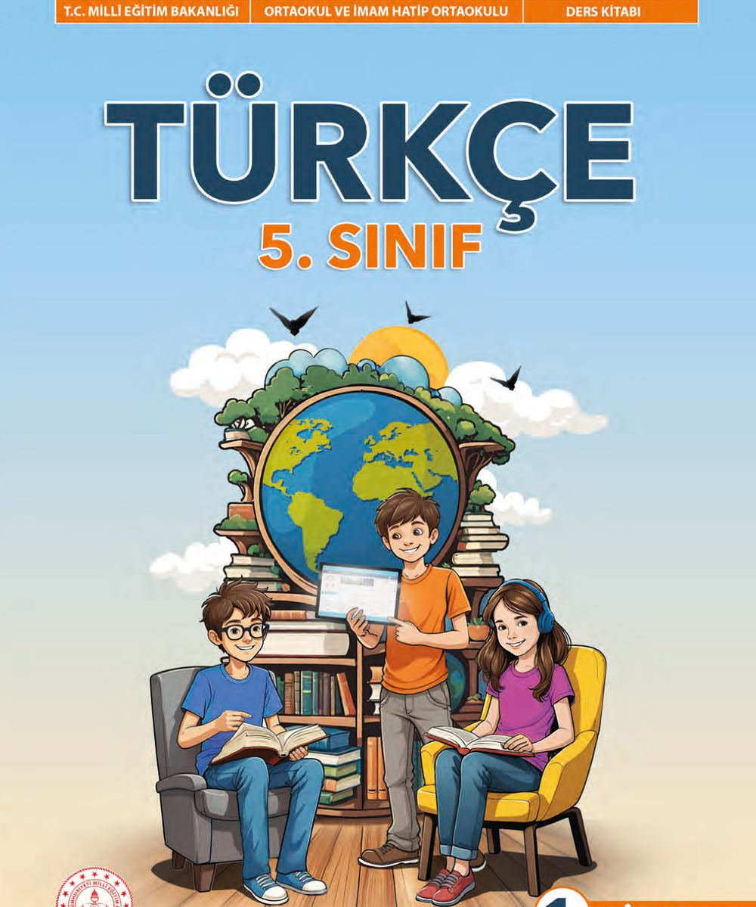
<!-- yer tutucu bulunamadı: sayfa sonuna eklendi -->

<!-- sayfa 1 -->

ORTAOKUL VE İMAM HATİP ORTAOKULU

# TÜRKÇE
## 5. SINIF
### DERS KİTABI

**Yazarlar**
Dr. Ali CİN
Dr. Sezgi DALİOĞLU
Arş. Gör. Mehmet KAVAS
Alev DÖNMEZ
Ceyda HAN
Fatih ŞENER
Gülşen AKYURT
Leyla ANGIN
Nuray HÜLÜR TAŞİN
Sinan SAYILIR
Tülin SAYILIR

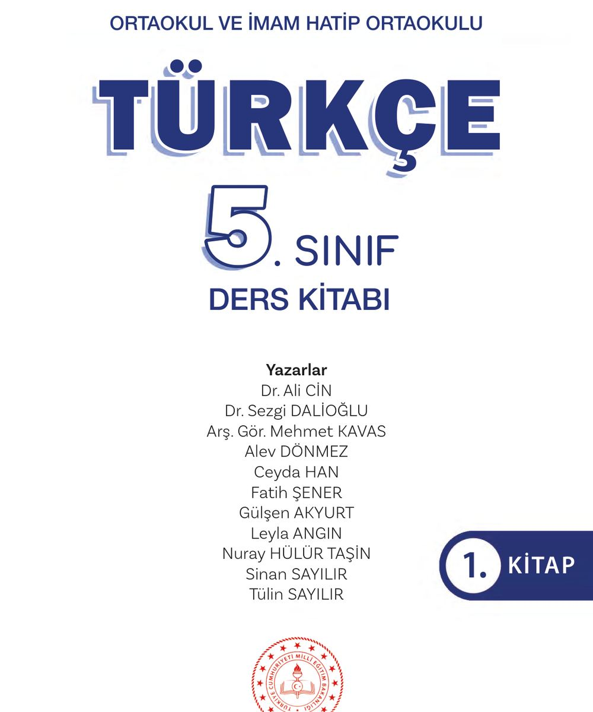 1. KİTAP

<!-- sayfa 2 -->

MİLLÎ EĞİTİM BAKANLIĞI YAYINLARI........................................................................................: 2019
DERS KİTAPLARI DİZİSİ...................................................................................................................: 9598
Her hakkı saklıdır ve Millî Eğitim Bakanlığına aittir. Kitabın metin, soru ve şekilleri kısmen de olsa hiçbir surette alınıp yayımlanamaz.

**Editör**
Prof. Dr. Yusuf UYAR
Doç. Dr. İsmail Yavuz ÖZTÜRK
Doç. Dr. Bilal ŞİMŞEK
Dr. Gülbike YILDIRIM

**Dil Uzmanı**
Esen BAYRAM GENÇ

**Görsel Tasarımcı**
Batuhan ÇELİK
Canan Özlem CANER
Derya AKIN
Enver ÜLKER
Erman YILMAZ
Esra ŞENOCAK
Fatma GENÇ
Mehmet ARI
Ozan ERTUĞRUL

**Çoklu Ortam Tasarımcısı**
Esra İLHAN-Gazanfer DİKER-
Olcay DOĞAN-Onur YILMAZ-Osman ÇELİK-
Pınar ERSAL-Seher KILIÇ-Ümit ARSLAN-
Vedat Ersin CEVİZ-Zekican YARDIMCI

**Program Geliştirme Uzmanı**
Doç. Dr. İsa YILDIRIM

**Ölçme ve Değerlendirme Uzmanı**
Prof. Dr. Gökhan ÇETİNKAYA
Erhan DÜZGÜN

**Rehberlik Uzmanı**
Dr. Özlem MENTEŞ YALÇIN

ISBN 978-975-11-8008-7
Millî Eğitim Bakanlığı Talim ve Terbiye Kurulunun 17.07.2026 tarih ve 110460159 sayılı yazısı ile eğitim aracı olarak kabul edilmiştir.

Kurulca bu kitabın kabul edilmiş olması ders kitabından yayınevi ve yazarın

<!-- sayfa 3 -->

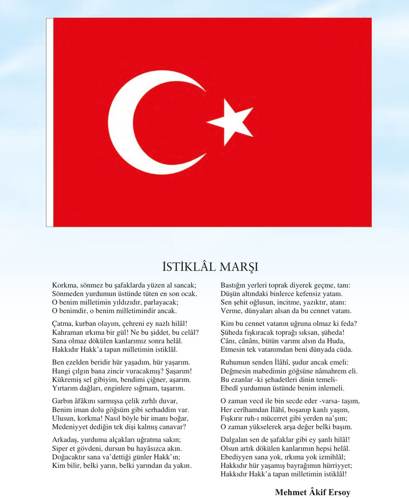

# İSTİKLÂL MARŞI

Korkma, sönmez bu şafaklarda yüzen al sancak;
Sönmeden yurdumun üstünde tüten en son ocak.
O benim milletimin yıldızıdır, parlayacak;
O benimdir, o benim milletimindir ancak.

Çatma, kurban olayım, çehreni ey nazlı hilâl!
Kahraman ırkıma bir gül! Ne bu şiddet, bu celâl?
Sana olmaz dökülen kanlarımız sonra helâl.
Hakkıdır Hakk'a tapan milletimin istiklâl.

Ben ezelden beridir hür yaşadım, hür yaşarım.
Hangi çılgın bana zincir vuracakmış? Şaşarım!
Kükremiş sel gibiyim, bendimi çiğner, aşarım.
Yırtarım dağları, enginlere sığmam, taşarım.

Garbın âfâkını sarmışsa çelik zırhlı duvar,
Benim iman dolu göğsüm gibi serhaddim var.
Ulusun, korkma! Nasıl böyle bir imanı boğar,
Medeniyet dediğin tek dişi kalmış canavar?

Arkadaş, yurduma alçakları uğratma sakın;
Siper et gövdeni, dursun bu hayâsızca akın.
Doğacaktır sana va'dettiği günler Hakk'ın;
Kim bilir, belki yarın, belki yarından da yakın.

Bastığın yerleri toprak diyerek geçme, tanı:
Düşün altındaki binlerce kefensiz yatanı.
Sen şehit oğlusun, incitme, yazıktır, atanı:
Verme, dünyaları alsan da bu cennet vatanı.

Kim bu cennet vatanın uğruna olmaz ki feda?
Şüheda fışkıracak toprağı sıksan, şüheda!
Cânı, cânânı, bütün varımı alsan da Huda,
Etmesin tek vatanımdan beni dünyada cüda.

Ruhumun senden ilâhî, şudur ancak emeli:
Değmesin mabedimin göğsüne nâmahrem eli.
Bu ezanlar -ki şehadetleri dinin temeli-
Ebedî yurdumun üstünde benim inlemeli.

O zaman vecd ile bin secde eder -varsa- taşim,
Her cerîhamdan ilâhî, boşanıp kanlı yaşım,
Fışkırır ruh-ı mücerret gibi yerden na'im;
O zaman yükselerek arşa değer belki başım.

Dalgalan sen de şafaklar gibi ey kanlı hilâl!
Olsun artık dökülen kanlarımın hepsi helâl.
Ebediyyen sana yok, ırkıma yok izmihlâl;
Hakkıdır hür yaşamış bayrağımın hürriyet;
Hakkıdır Hakk'a tapan milletimin istiklâl!

M. Akif Ersoy

<!-- sayfa 4 -->

# GENÇLİĞE HİTABE

Ey Türk gençliği! Birinci vazifen, Türk istiklâlini, Türk Cumhuriyetini, ilelebet muhafaza ve müdafaa etmektir.

Mevcudiyetinin ve istikbalinin yegâne temeli budur. Bu temel, senin en kıymetli hazinendir. İstikbalde dahi, seni bu hazineden mahrum etmek isteyecek dâhilî ve hâricî bedhahların olacaktır. Bir gün, istiklâl ve cumhuriyeti müdafaa mecburiyetine düşersen, vazifeye atılmak için, içinde bulunacağın vaziyetin imkân ve şeraitini düşünmeyeceksin! Bu imkân ve şerait, çok namüsait bir mahiyette tezahür edebilir. İstiklâl ve cumhuriyetine kastedecek düşmanlar, bütün dünyada emsali görülmemiş bir galibiyetin mümessili olabilirler. Cebren ve hile ile aziz vatanın bütün kaleleri zapt edilmiş, bütün tersanelerine girilmiş, bütün orduları dağıtılmış ve memleketin her köşesi bilfiil işgal edilmiş olabilir. Bütün bu şeraitten daha elîm ve daha vahim olmak üzere, memleketin dâhilinde iktidara sahip olanlar gaflet ve dalâlet ve hattâ hıyanet içinde bulunabilirler. Hattâ bu iktidar sahipleri şahsî menfaatlerini, müstevlîlerin siyasî emelleriyle tevhit edebilirler. Millet, fakr u zaruret içinde harap ve bîtap düşmüş olabilir.

Ey Türk istikbalinin evlâdı! İşte, bu ahval ve şerait içinde dahi vazifen, Türk istiklâl ve cumhuriyetini kurtarmaktır. Muhtaç olduğun kudret, damarlarındaki asil kanda mevcuttur.

Mustafa Kemal Atatürk

<!-- sayfa 5 -->

MUSTAFA KEMAL ATATÜRK

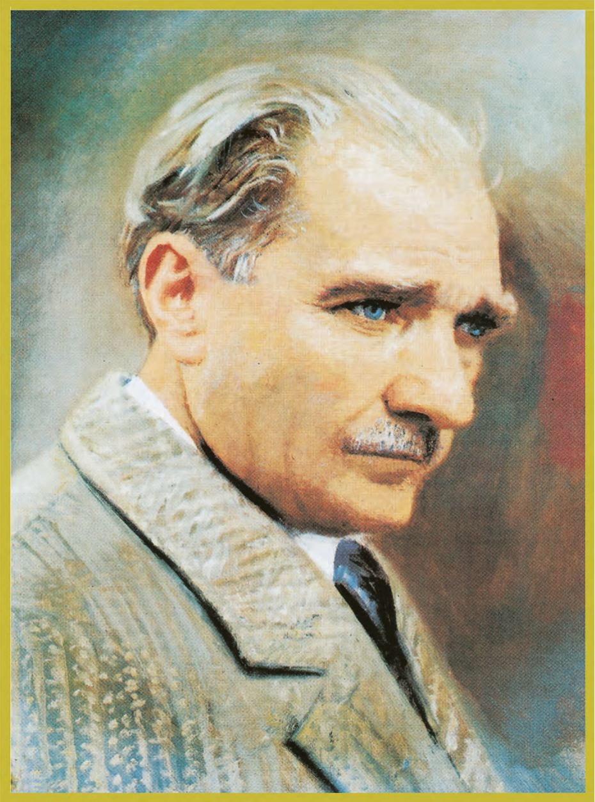
<!-- yer tutucu bulunamadı: sayfa sonuna eklendi -->

<!-- sayfa 6 -->

Verdiğiniz metin katmanı boş olduğu için (`<<< >>>` arası boş) dönüştürülecek herhangi bir içerik bulunmamaktadır. Lütfen metin katmanını içeren içeriği paylaşın, böylece talimatlarınıza uygun şekilde Markdown formatına çevirebilirim.

<!-- sayfa 7 -->

# İÇİNDEKİLER

## 1. TEMA - OYUN DÜNYASI
Oyun Durdu! (Dinleme) ........................................................................................................ 12
Topsuz Basketbol Oyunu ..................................................................................................... 26
Bir İp Bul, Oyuna Başla! ...................................................................................................... 35
Bir Güzel Hediye .................................................................................................................. 45
Çocukluk (Okuma Keyfi) ...................................................................................................... 58
Üretim Zamanı ..................................................................................................................... 59
Kontrol Noktası ..................................................................................................................... 61

## 2. TEMA - ATATÜRK'Ü TANIMAK
Mustafa (İzleme) ................................................................................................................ 68
Oğlu Hüseyin'den Emine Ana'ya Mektuplar ....................................................................... 76
Gazi Mustafa Kemal ve Sığırtmaç Mustafa .......................................................................... 89
Atatürk ve Çiftlik ............................................................................................................... 104
Toprağımız Temizdir (Okuma Keyfi) ................................................................................. 112
Üretim Zamanı .................................................................................................................. 113
Kontrol Noktası .................................................................................................................. 114

## 3. TEMA - DUYGULARIMI TANIYORUM
Duygularımız ..................................................................................................................... 122
Her Yüreğe Nakış Gerek .................................................................................................... 134
Korkuluk ............................................................................................................................ 143
Altı Üstü Bir Yarış (Dinleme) ............................................................................................ 154
Fahrünnisa (Okuma Keyfi) ................................................................................................ 165
Üretim Zamanı .................................................................................................................. 167
Kontrol Noktası .................................................................................................................. 169

Kaynakça ........................................................................................................................... 174
Cevap Anahtarı .................................................................................................................. 174
Görsel ve Genel Ağ Kaynakçası ........................................................................................ 174
Türkiye'nin Mülki İdare Bölümleri ile Kara ve Deniz Komşuları Haritası .......................... 175

<!-- sayfa 8 -->

# ORGANİZASYON ŞEMASI

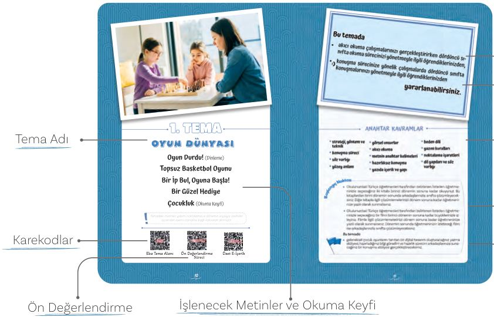

* Temaya İlişkin Temel Kabuller
* Köprü Kurma
* Anahtar Kavramlar
* Üretim, Film-Kitap Atölyelerine Dair Açıklama

---

* Tema Adı
* İşlenecek Metinler ve Okuma Keyfi
* Anahtar Kavramlar
* Karekodlar

**1. TEMA**
**OYUN DÜNYASI**
* Oyun Durdu! (Dinleme)
* Topsuz Basketbol Oyunu
* Bir İp Bul, Oyuna Başla!
* Bir Güzel Hediye
* Çocukluk (Okuma Keyfi)

* Eba Tema Alanı
* Özet E-İçerik
* Ön Değerlendirme Süreci

Temadaki metinler; yazım, noktalama ve dönemin söyleyiş özellikleri açısından eserin orijinaline bağlı kalınarak alınmıştır.

---

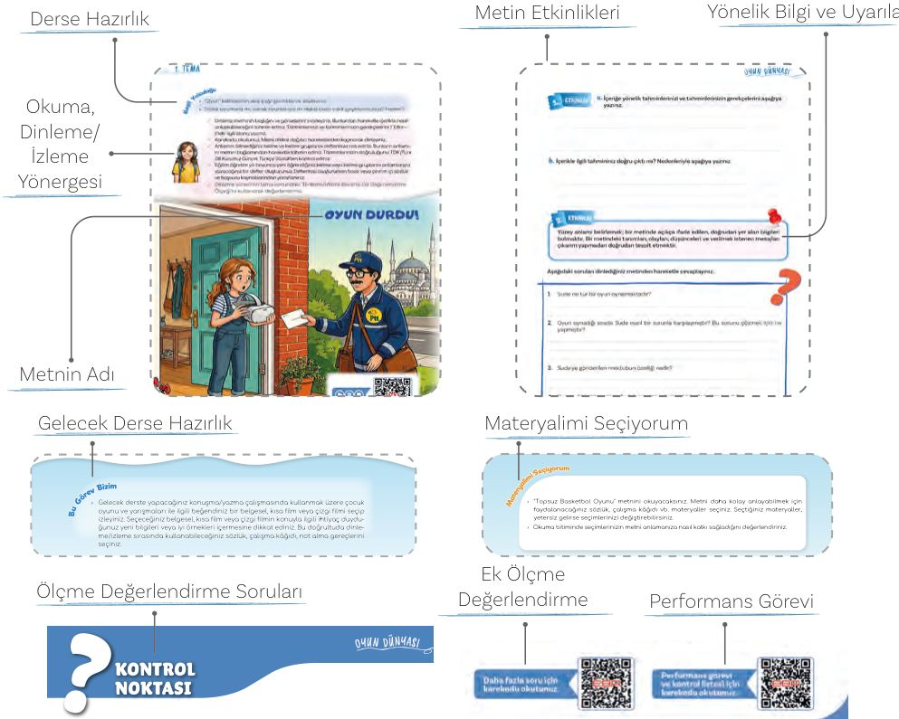

* Ön Değerlendirme
* Derse Hazırlık
* Okuma, Dinleme/ İzleme Yönergesi
* Metnin Adı
* Metin Etkinlikleri
* Temanın Kavramlarına Yönelik Bilgi ve Uyarılar

**OYUN DURDU!**

**Materyalimi Seçiyorum**
› "Topsuz Basketbol Oyunu" metnini okuyacaksınız. Metni daha kolay anlayabilmek için faydalanacağınız sözlük, çalışma kâğıdı vb. materyaller seçiniz. Seçtiğiniz materyaller, yetersiz gelirse seçimlerinizi değiştirebilirsiniz.
› Okuma bitiminde seçimlerinizin metni anlamanıza nasıl katkı sağladığını değerlendiriniz.

**Gelecek Derse Hazırlık**
› Gelecek derste yapacağınız konuşma/yazma çalışmasında kullanmak üzere çocuk oyunu ve yarışmaları ile ilgili beğendiğiniz bir belgesel, kısa film veya çizgi filmi seçip izleyiniz. Seçeceğiniz belgesel, kısa film veya çizgi filmin konuyla ilgili ihtiyaç duyduğunuz yeni bilgileri veya iyi örnekleri içermesine dikkat ediniz. Bu doğrultuda dinleme/izleme sırasında kullanabileceğiniz sözlük, çalışma kâğıdı, not alma gereçlerini seçiniz.

**Bizim Bu Görev**
**Performans Görevi**

**Bizim Ölçme Değerlendirme Soruları**
**Ek Ölçme Değerlendirme**

**KONTROL NOKTASI**
**OYUN DÜNYASI**

<!-- sayfa 9 -->

# Değerlendirme Ölçeklerinde Kullanılan Semboller

# Etkinliklerde Kullanılan Semboller

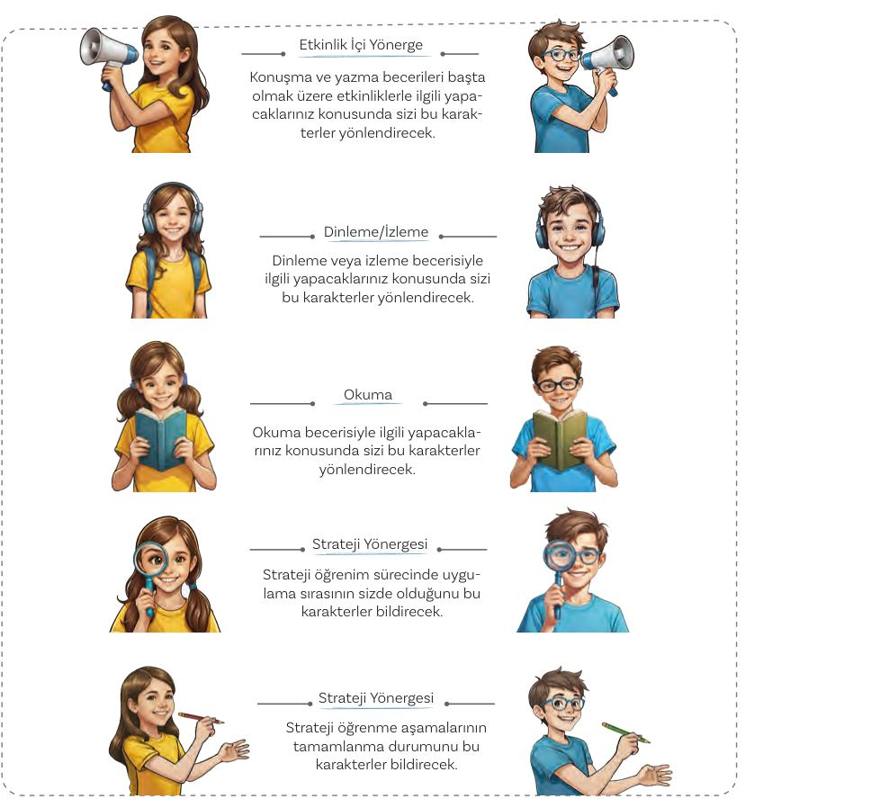

---

**Etkinlik İçi Yönerge**
Konuşma ve yazma becerileri başta olmak üzere etkinliklerle ilgili yapacaklarınız konusunda sizi bu karakterler yönlendirecek.

**Dinleme/İzleme**
Dinleme veya izleme becerisiyle ilgili yapacaklarınız konusunda sizi bu karakterler yönlendirecek.

**Okuma**
Okuma becerisiyle ilgili yapacaklarınız konusunda sizi bu karakterler yönlendirecek.

**Strateji Yönergesi**
Strateji öğrenim sürecinde uygulama sırasının sizde olduğunu bu karakterler bildirecek.

**Strateji Yönergesi**
Strateji öğrenme aşamalarının tamamlanma durumunu bu karakterler bildirecek.

---

Kitaptaki metinler; yazım, noktalama ve dönemin söyleyiş özellikleri açısından eserin orijinaline bağlı

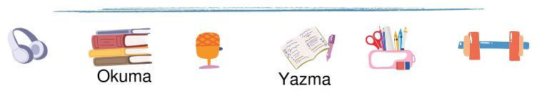
<!-- yer tutucu bulunamadı: sayfa sonuna eklendi -->

<!-- sayfa 10 -->

# 1. TEMA
## OYUN DÜNYASI

**Oyun Durdu!** *(Dinleme)*
**Topsuz Basketbol Oyunu**
**Bir İp Bul, Oyuna Başla!**
**Bir Güzel Hediye**
**Çocukluk** *(Okuma Keyfi)*

> Temadaki metinler; yazım, noktalama ve dönemin söyleyiş özellikleri açısından eserin orijinaline bağlı kalınarak alınmıştır.

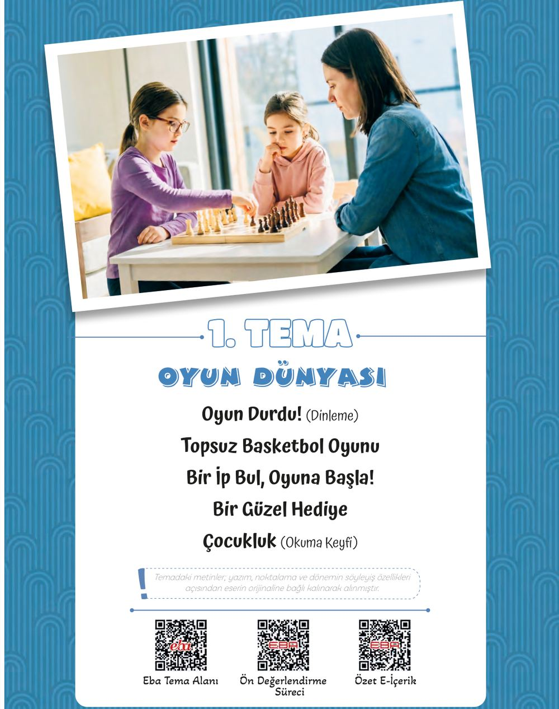
Eba Tema Alanı

Ön Değerlendirme Süreci

Özet E-İçerik

<!-- sayfa 11 -->

# Bu temada

* akıcı okuma çalışmalarınızı gerçekleştirirken dördüncü sınıfta okuma sürecinizi yönetmeyle ilgili öğrendiklerinizden,
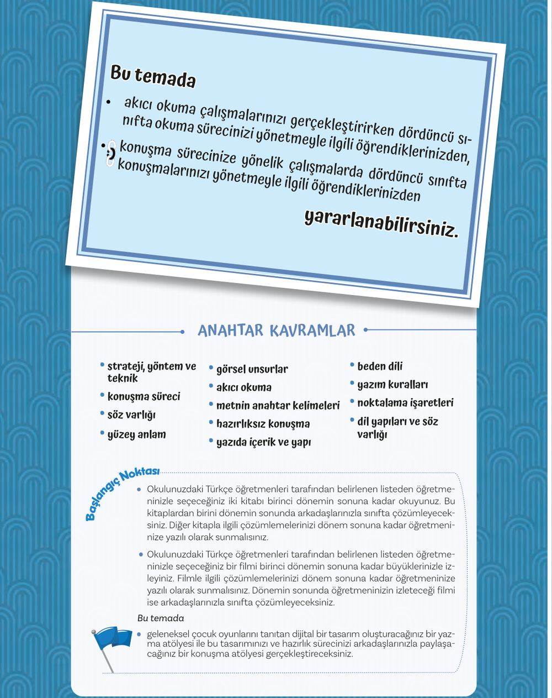 konuşma sürecinize yönelik çalışmalarda dördüncü sınıfta konuşmalarınızı yönetmeyle ilgili öğrendiklerinizden

**yararlanabilirsiniz.**

---

## ANAHTAR KAVRAMLAR

* strateji, yöntem ve teknik
* konuşma süreci
* söz varlığı
* yüzey anlam
* görsel unsurlar
* akıcı okuma
* metnin anahtar kelimeleri
* hazırlıksız konuşma
* yazıda içerik ve yapı
* beden dili
* yazım kuralları
* noktalama işaretleri
* dil yapıları ve söz varlığı

---

## Başlangıç Noktası

* Okulunuzdaki Türkçe öğretmenleri tarafından belirlenen listeden öğretmeninizle seçeceğiniz iki kitabı birinci dönemin sonuna kadar okuyunuz. Bu kitaplardan birini dönemin sonunda arkadaşlarınızla sınıfta çözümleyeceksiniz. Diğer kitapla ilgili çözümlemelerinizi dönem sonuna kadar öğretmeninize yazılı olarak sunmalısınız.
* Okulunuzdaki Türkçe öğretmenleri tarafından belirlenen listeden öğretmeninizle seçeceğiniz bir filmi birinci dönemin sonuna kadar büyüklerinizle izleyiniz. Filmle ilgili çözümlemelerinizi dönem sonuna kadar öğretmeninize yazılı olarak sunmalısınız. Dönemin sonunda öğretmeninizin izleteceği filmi ise arkadaşlarınızla sınıfta çözümleyeceksiniz.

### Bu temada

 * geleneksel çocuk oyunlarını tanıtan dijital bir tasarım oluşturacağınız bir yazma atölyesi ile bu tasarımınızı ve hazırlık sürecinizi arkadaşlarınızla paylaşacağınız bir konuşma atölyesi gerçekleştireceksiniz.

<!-- sayfa 12 -->

# Keşif Yolculuğu

› "Oyun" kelimesinin size çağrıştırdıklarını söyleyiniz.
› Dijital oyunlarla mı, sokak oyunlarıyla mı daha fazla vakit geçiriyorsunuz? Neden?

* Dinleme metninin başlığını ve görsellerini inceleyiniz. Bunlardan hareketle içerikte neler anlatılabileceğini tahmin ediniz. Tahminlerinizi ve tahminlerinizin gerekçelerini 1. Etkinlik'teki ilgili alana yazınız.
* Karekodu okutunuz. Metni dikkat dağıtıcı hareketlerden kaçınarak dinleyiniz.
* Anlamını bilmediğiniz kelime ve kelime gruplarını defterinize not ediniz. Bunların anlamını metnin bağlamından hareketle tahmin ediniz. Tahminlerinizin doğruluğunu TDK (Türk Dil Kurumu) Güncel Türkçe Sözlük'ten kontrol ediniz.
* Eğitim öğretim yılı boyunca yeni öğrendiğiniz kelime veya kelime gruplarını anlamlarıyla yazacağınız bir defter oluşturunuz. Defterinizi oluştururken basılı veya çevrim içi sözlük ve başvuru kaynaklarından yararlanınız.
* Dinleme sürecinizi tema sonundaki "Dinleme/İzleme Becerisi Öz Değerlendirme Ölçeği"ni kullanarak değerlendiriniz.

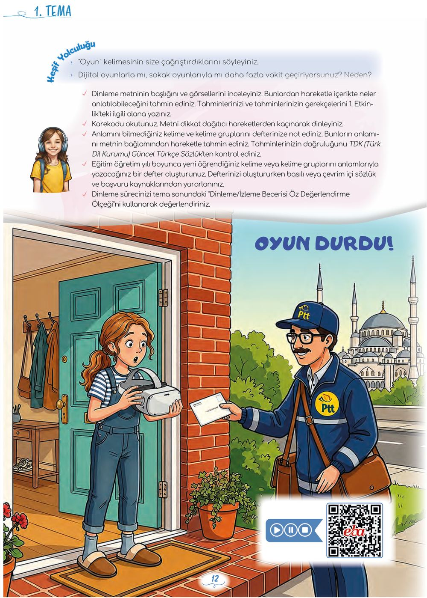

# OYUN DURDU!

<!-- sayfa 13 -->

# 1. ETKİNLİK

**a.** İçeriğe yönelik tahminlerinizi ve tahminlerinizin gerekçelerini aşağıya yazınız.

__________________________________________________________________________
__________________________________________________________________________
__________________________________________________________________________

**b.** İçerikle ilgili tahmininiz doğru çıktı mı? Nedenleriyle aşağıya yazınız.

# 2. ETKİNLİK

Yüzey anlamı belirlemek; bir metinde açıkça ifade edilen, doğrudan yer alan bilgileri bulmaktır. Bir metindeki tanımları, olayları, düşünceleri ve verilmek istenen mesajları çıkarım yapmadan doğrudan tespit etmektir.

Aşağıdaki soruları dinlediğiniz metinden hareketle cevaplayınız.

1. Sude ne tür bir oyun oynamaktadır?
__________________________________________________________________________

2. Oyun oynadığı sırada Sude nasıl bir sorunla karşılaşmıştır? Bu sorunu çözmek için ne yapmıştır?
__________________________________________________________________________
__________________________________________________________________________
__________________________________________________________________________

3. Sude'ye gönderilen mektubun özelliği nedir?
__________________________________________________________________________

4. Oyuna dönebilmesi için Sude'ye posta yoluyla gönderilen görev nedir?
__________________________________________________________________________
__________________________________________________________________________

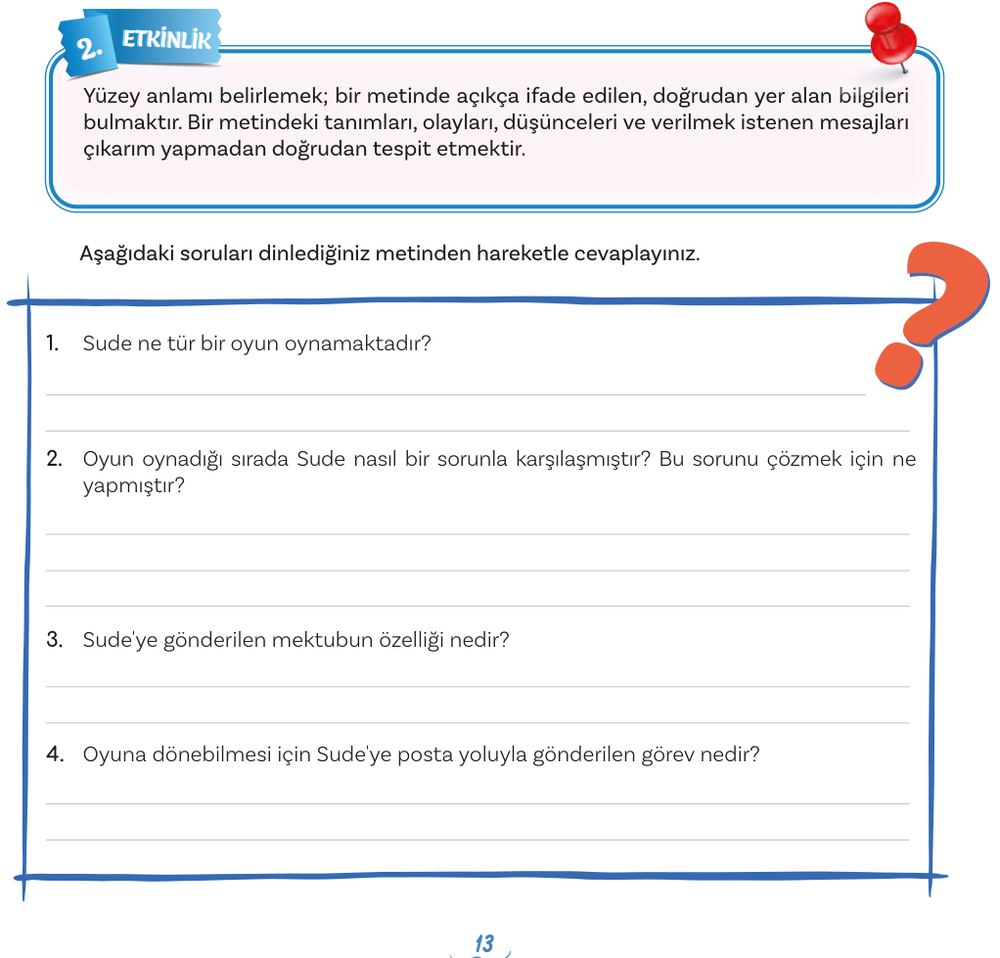
<!-- yer tutucu bulunamadı: sayfa sonuna eklendi -->

<!-- sayfa 14 -->

# 3. ETKİNLİK

**a.** Dinlediğiniz metinden seçilen aşağıdaki kelime veya kelime gruplarını inceleyiniz. İçlerinden “Oyun Dünyası” teması ile ilgili olanları belirleyerek örnekteki gibi daire içine alınız.

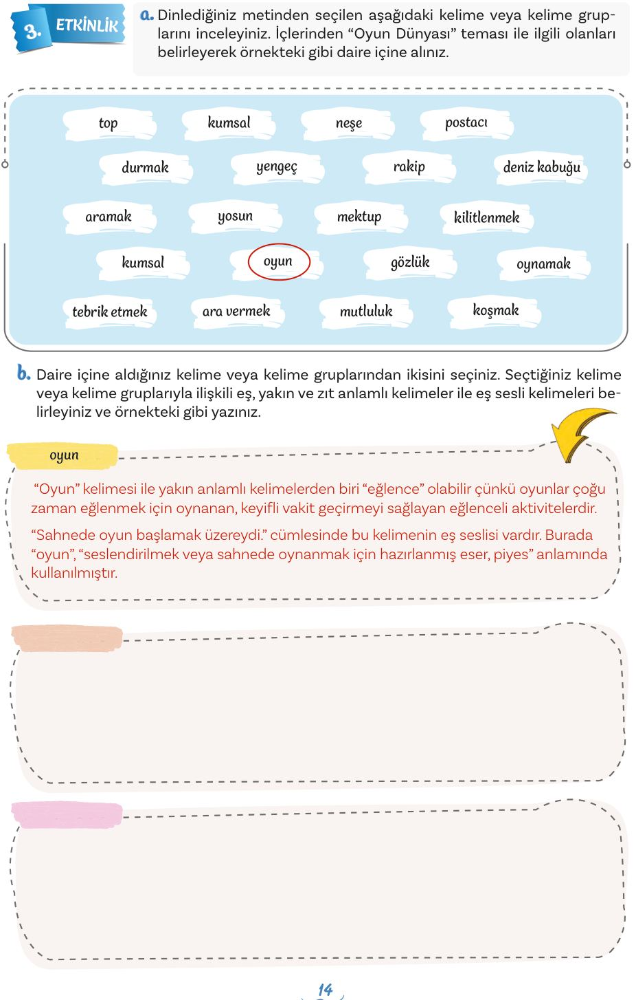

**b.** Daire içine aldığınız kelime veya kelime gruplarından ikisini seçiniz. Seçtiğiniz kelime veya kelime gruplarıyla ilişkili eş, yakın ve zıt anlamlı kelimeler ile eş sesli kelimeleri belirleyiniz ve örnekteki gibi yazınız.

oyun

“Oyun” kelimesi ile yakın anlamlı kelimelerden biri “eğlence” olabilir çünkü oyunlar çoğu zaman eğlenmek için oynanan, keyifli vakit geçirmeyi sağlayan eğlenceli aktivitelerdir.

“Sahnede oyun başlamak üzereydi.” cümlesinde bu kelimenin eş seslisi vardır. Burada “oyun”, “seslendirilmek veya sahnede oynanmak için hazırlanmış eser, piyes” anlamında kullanılmıştır.

<!-- sayfa 15 -->

# 4. ETKİNLİK

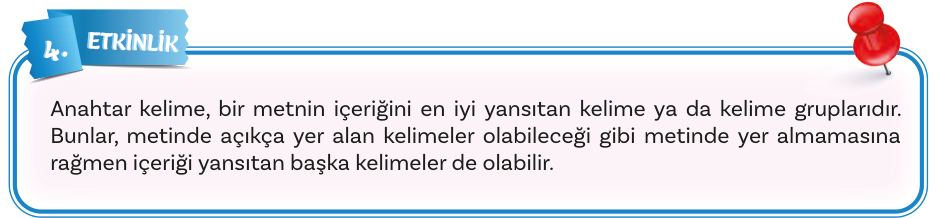

Anahtar kelime, bir metnin içeriğini en iyi yansıtan kelime ya da kelime gruplarıdır. Bunlar, metinde açıkça yer alan kelimeler olabileceği gibi metinde yer almamasına rağmen içeriği yansıtan başka kelimeler de olabilir.

**a.** Dinlediğiniz metnin içeriğini en iyi yansıtan üç kelime veya kelime grubu belirlemeniz gerekseydi bunlar hangileri olurdu? Söyleyiniz.

**b.** Belirlediğiniz anahtar kelimeleri seçme nedenlerinizi açıklayınız.

# KONUŞALIM

# 5. ETKİNLİK

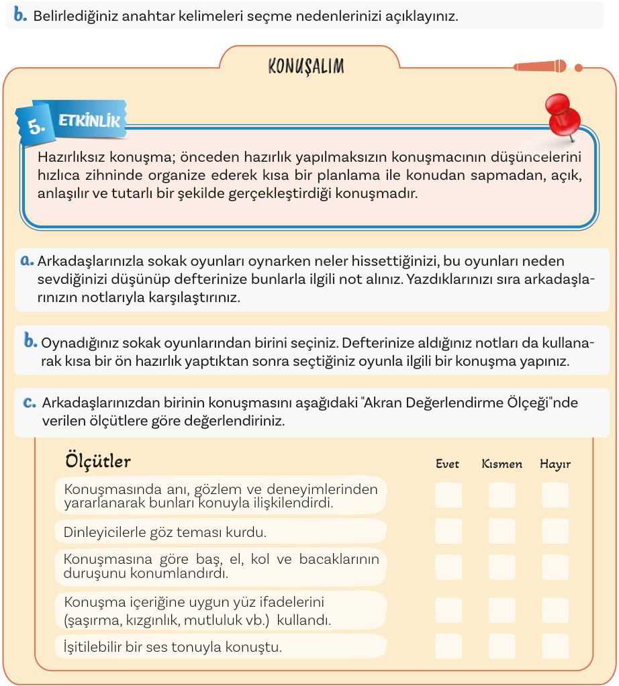

Hazırlıksız konuşma; önceden hazırlık yapılmaksızın konuşmacının düşüncelerini hızlıca zihninde organize ederek kısa bir planlama ile konudan sapmadan, açık, anlaşılır ve tutarlı bir şekilde gerçekleştirdiği konuşmadır.

**a.** Arkadaşlarınızla sokak oyunları oynarken neler hissettiğinizi, bu oyunları neden sevdiğinizi düşünüp defterinize bunlarla ilgili not alınız. Yazdıklarınızı sıra arkadaşlarınızın notlarıyla karşılaştırınız.

**b.** Oynadığınız sokak oyunlarından birini seçiniz. Defterinize aldığınız notları da kullanarak kısa bir ön hazırlık yaptıktan sonra seçtiğiniz oyunla ilgili bir konuşma yapınız.

**c.** Arkadaşlarınızdan birinin konuşmasını aşağıdaki "Akran Değerlendirme Ölçeği"nde verilen ölçütlere göre değerlendiriniz.

| Ölçütler | Evet | Kısmen | Hayır |
| :--- | :---: | :---: | :---: |
| Konuşmasında anı, gözlem ve deneyimlerinden yararlanarak bunları konuyla ilişkilendirdi. | | | |
| Dinleyicilerle göz teması kurdu. | | | |
| Konuşmasına göre baş, el, kol ve bacaklarının duruşunu konumlandırdı. | | | |
| Konuşma içeriğine uygun yüz ifadelerini (şaşırma, kızgınlık, mutluluk vb.) kullandı. | | | |
| İşitilebilir bir ses tonuyla konuştu. | | | |

<!-- sayfa 16 -->

# 6. ETKİNLİK

Görsel unsurlar; resim, fotoğraf, afiş, karikatür, grafik, tablo, harita, şema ve grafik simgeler gibi anlam ileten görsellerdir. Bu unsurlar, bazen kelime kullanmadan bazen de yazılı metni destekleyerek mesaj iletir.

Çocukların genel ağ kullanım amaçları ile ilgili aşağıdaki grafiği inceleyiniz. Grafikten hareketle doğru ifadelerin başına (D), yanlış ifadelerin başına (Y) yazınız.

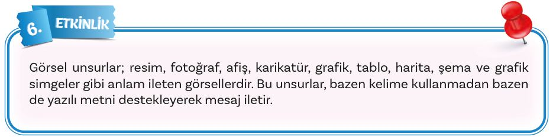

| Kullanım Amaçları | Kişi Sayısı |
| :--- | :--- |
| Oyun oynama veya oyun indirme | 65 |
| Mesajlaşma | 55 |
| E-posta gönderme ve alma | 15 |
| Paylaşım sitelerinden içerik izleme | 60 |
| Müzik dinleme veya indirme | 50 |
| Sosyal medya kullanma | 35 |
| Araştırma yapma | 80 |
| Ürün veya hizmetler hakkında bilgi edinme | 15 |

(Grafik verileri görselden yaklaşık olarak okunmuştur)

---

[ ] Çocuklar, en çok "araştırma yapma" için genel ağa başvurmuştur.

[ ] "Mesajlaşma" amacıyla kullanım "sosyal medya kullanma"dan daha fazladır.

[ ] Genel ağ kullanımında "oyun oynama veya oyun indirme", "paylaşım sitelerinde içerik izleme"nin önüne geçmiştir.

[ ] "E-posta gönderme ve alma" ile "ürün ve hizmetler hakkında bilgi edinme" amacıyla genel ağ kullanımının toplamı, "araştırma yapma" amacından daha yüksektir.

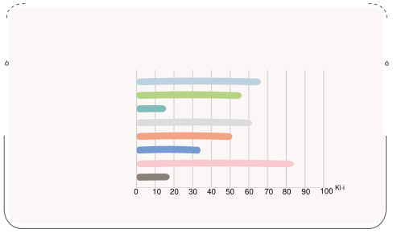
<!-- yer tutucu bulunamadı: sayfa sonuna eklendi -->

<!-- sayfa 17 -->

# YAZALIM

**7. ETKİNLİK**

**a.** Aşağıdaki cümleleri renklendirilmiş kelimelere dikkat ederek okuyunuz. Cümlelerdeki değişimi inceleyiniz.

* Begüm düşünüyor.
* Begüm satranç oynarken düşünüyor.
* Begüm okulda satranç oynarken düşünüyor.
* Begüm okulda Mete'yle satranç oynarken düşünüyor.
* Begüm okulda düzenlenen turnuvada Mete'yle satranç oynarken düşünüyor.
* Begüm okulda düzenlenen turnuvada Mete'yle satranç oynarken hamlesini yapmak için düşünüyor.

**b.** Yukarıdaki örnek cümlelerden hareketle siz de aşağıdaki cümleye her defasında bir kelime veya kelime grubu ekleyerek oluşturduğunuz cümleleri tekrar yazınız.

* Çocuk oynuyor.
* __________________________________________________________________________
* __________________________________________________________________________
* __________________________________________________________________________
* __________________________________________________________________________
* __________________________________________________________________________
* __________________________________________________________________________

**c.** Yazdığınız cümleleri arkadaşlarınızla paylaşınız.

**ç.** Yaptığınız etkinliğin yazma çalışmalarınızda size ne gibi katkıları olabilir? Düşüncelerinizi söyleyiniz.

---

# Bu Görev Bizim

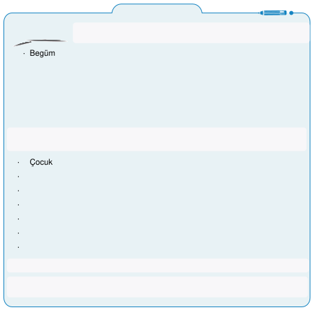
> Gelecek derste yapacağınız konuşma/yazma çalışmasında kullanmak üzere çocuk oyunu ve yarışmaları ile ilgili beğendiğiniz bir belgesel, kısa film veya çizgi filmi seçip izleyiniz. Seçeceğiniz belgesel, kısa film veya çizgi filmin konuyla ilgili ihtiyaç duyduğunuz yeni bilgileri veya iyi örnekleri içermesine dikkat ediniz. Bu doğrultuda dinleme/izleme sırasında kullanabileceğiniz sözlük, çalışma kâğıdı, not alma gereçlerini seçiniz.

> Belirlediğiniz materyal ve kaynakları; amaç, ilgi ve ihtiyaçlarınıza uygunluğu açısından değerlendiriniz. Gerekli görürseniz yeni kaynak ve materyallere ulaşabilirsiniz. İzleme sırasında konuşurken/yazarken kullanmak üzere notlar alınız.

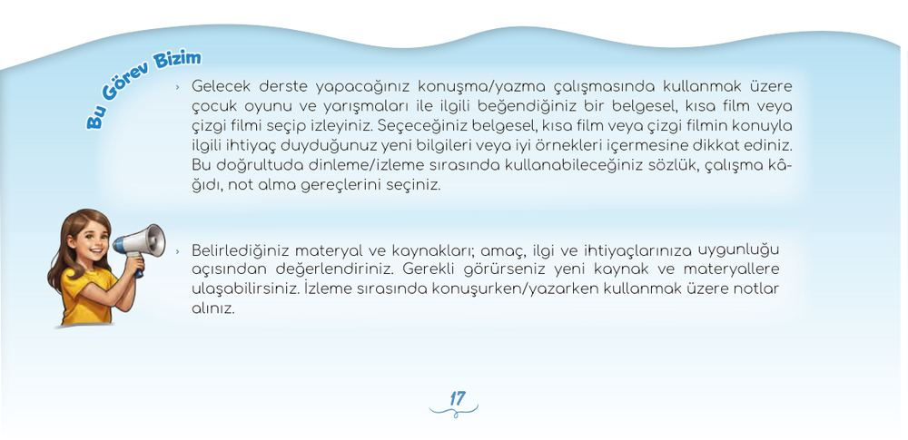
<!-- yer tutucu bulunamadı: sayfa sonuna eklendi -->

<!-- sayfa 18 -->

# İZLE UYGULA ÖĞREN
# TAHMİN ETME STRATEJİSİ

Yıl boyunca öğreneceğiniz stratejilerden ilki "tahmin etme" stratejisi. Bu strateji, metnin ilerleyen bölümlerinde neler olacağını veya hangi bilgiler verileceğini çeşitli ipuçlarını kullanarak tahmin etmeyi içerir. Okuma, dinleme veya izleme öncesinde ve sırasında kullanılabilir. Merakı artırır, böylece metne odaklanmayı sağlar.

Haydi, başlayınız!

> Önce öğretmeninizi izleyeceksiniz, ardından stratejiyi gruplar hâlinde iki kez uyguladıktan sonra kendiniz kullanabileceksiniz.

## Öğretmeninizi İzliyorsunuz

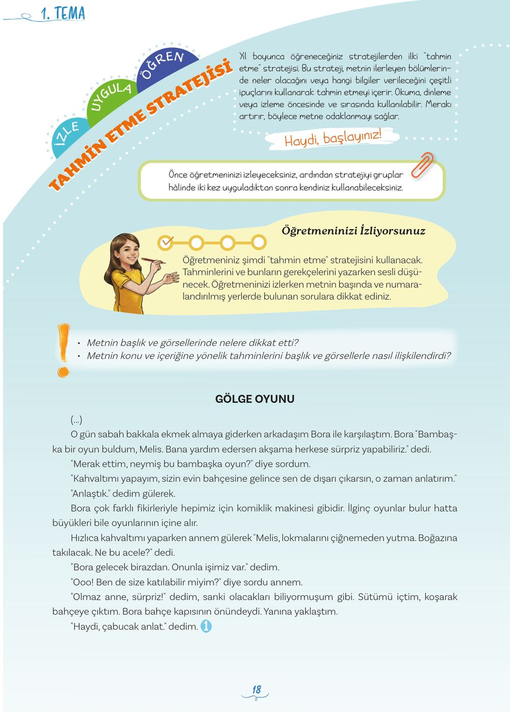

Öğretmeniniz şimdi "tahmin etme" stratejisini kullanacak. Tahminlerini ve bunların gerekçelerini yazarken sesli düşünecek. Öğretmeninizi izlerken metnin başında ve numaralandırılmış yerlerde bulunan sorulara dikkat ediniz.

* Metnin başlık ve görsellerinde nelere dikkat etti?
* Metnin konu ve içeriğine yönelik tahminlerini başlık ve görsellerle nasıl ilişkilendirdi?

# GÖLGE OYUNU

(...)

O gün sabah bakkala ekmek almaya giderken arkadaşım Bora ile karşılaştım. Bora "Bambaşka bir oyun buldum, Melis. Bana yardım edersen akşama herkese sürpriz yapabiliriz." dedi.
"Merak ettim, neymiş bu bambaşka oyun?" diye sordum.
"Kahvaltımı yapayım, sizin evin bahçesine gelince sen de dışarı çıkarsın, o zaman anlatırım."
"Anlaştık." dedim gülerek.
Bora çok farklı fikirleriyle hepimiz için komiklik makinesi gibidir. İlginç oyunlar bulur hatta büyükleri bile oyunlarının içine alır.
Hızlıca kahvaltımı yaparken annem gülerek "Melis, lokmalarını çiğnemeden yutma. Boğazına takılacak. Ne bu acele?" dedi.
"Bora gelecek birazdan. Onunla işimiz var." dedim.
"Ooo! Ben de size katılabilir miyim?" diye sordu annem.
"Olmaz anne, sürpriz!" dedim, sanki olacakları biliyormuşum gibi. Sütümü içtim, koşarak bahçeye çıktım. Bora bahçe kapısının önündeydi. Yanına yaklaştım.
"Haydi, çabucak anlat." dedim. 

<!-- sayfa 19 -->

* Öğretmeniniz metnin sonraki bölümleriyle ilgili tahminlerini yaparken odaklandığı bilgilerle ilgili neler söyledi?
* Tahminlerinin gerekçeleri neydi?
* Tahminde bulunurken metin dışında hangi bilgileri kullandı?

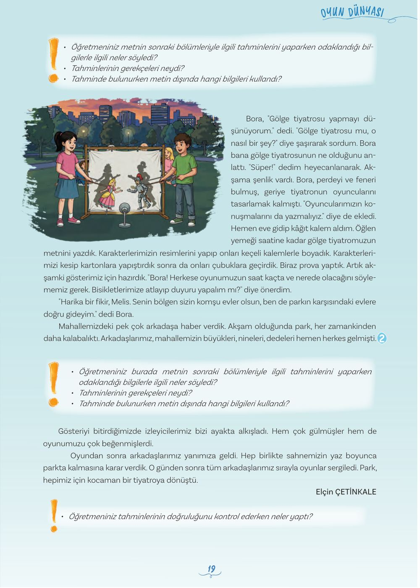

Bora, "Gölge tiyatrosu yapmayı düşünüyorum." dedi. "Gölge tiyatrosu mu, o nasıl bir şey?" diye şaşırarak sordum. Bora bana gölge tiyatrosunun ne olduğunu anlattı. "Süper!" dedim heyecanlanarak. Akşama şenlik vardı. Bora, perdeyi ve feneri bulmuş, geriye tiyatronun oyuncularını tasarlamak kalmıştı. "Oyuncularımızın konuşmalarını da yazmalıyız." diye de ekledi. Hemen eve gidip kâğıt kalem aldım. Öğlen yemeği saatine kadar gölge tiyatromuzun metnini yazdık. Karakterlerimizin resimlerini yapıp onları keçeli kalemlerle boyadık. Karakterlerimizi kesip kartonlara yapıştırdık sonra da onları çubuklara geçirdik. Biraz prova yaptık. Artık akşamki gösterimiz için hazırdık. "Bora! Herkese oyunumuzun saat kaçta ve nerede olacağını söylememiz gerek. Bisikletlerimize atlayıp duyuru yapalım mı?" diye önerdim.

"Harika bir fikir, Melis. Senin bölgen sizin komşu evler olsun, ben de parkın karşısındaki evlere doğru gideyim." dedi Bora.

Mahallemizdeki pek çok arkadaşa haber verdik. Akşam olduğunda park, her zamankinden daha kalabalıktı. Arkadaşlarımız, mahallemizin büyükleri, nineleri, dedeleri hemen herkes gelmişti. 2

* Öğretmeniniz burada metnin sonraki bölümleriyle ilgili tahminlerini yaparken odaklandığı bilgilerle ilgili neler söyledi?
* Tahminlerinin gerekçeleri neydi?
* Tahminde bulunurken metin dışında hangi bilgileri kullandı?

Gösteriyi bitirdiğimizde izleyicilerimiz bizi ayakta alkışladı. Hem çok gülmüşler hem de oyunumuzu çok beğenmişlerdi.

Oyundan sonra arkadaşlarımız yanımıza geldi. Hep birlikte sahnemizin yaz boyunca parkta kalmasına karar verdik. O günden sonra tüm arkadaşlarımız sırayla oyunlar sergiledi. Park, hepimiz için kocaman bir tiyatroya dönüştü.

Elçin ÇETİNKALE

* Öğretmeniniz tahminlerinin doğruluğunu kontrol ederken neler yaptı?

<!-- sayfa 20 -->

# Siz Uyguluyorsunuz

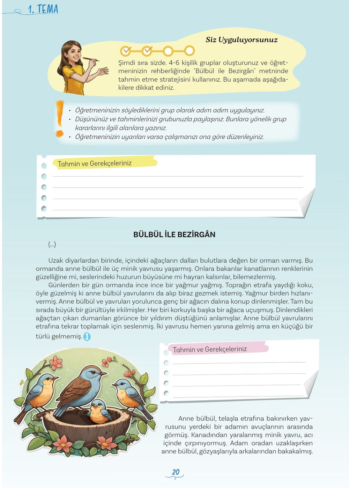

Şimdi sıra sizde. 4-6 kişilik gruplar oluşturunuz ve öğretmeninizin rehberliğinde "Bülbül ile Bezirgân" metninde tahmin etme stratejisini kullanınız. Bu aşamada aşağıdakilere dikkat ediniz.

* Öğretmeninizin söylediklerini grup olarak adım adım uygulayınız.
* Düşününüz ve tahminlerinizi grubunuzla paylaşınız. Bunlara yönelik grup kararlarını ilgili alanlara yazınız.
* Öğretmeninizin uyarıları varsa çalışmanızı ona göre düzenleyiniz.

### Tahmin ve Gerekçeleriniz

---

# BÜLBÜL İLE BEZİRGÂN

(...)

Uzak diyarlardan birinde, içindeki ağaçların dalları bulutlara değen bir orman varmış. Bu ormanda anne bülbül ile üç minik yavrusu yaşarmış. Onlara bakanlar kanatlarının renklerinin güzelliğine mi, seslerindeki huzurun büyüsüne mi hayran kalsınlar, bilemezlermiş.

Günlerden bir gün ormanda ince ince bir yağmur yağmış. Toprağın etrafa yaydığı koku, öyle güzelmiş ki anne bülbül yavrularını da alıp biraz gezmek istemiş. Yağmur birden hızlanıvermiş. Anne bülbül ve yavruları yorulunca genç bir ağacın dalına konup dinlenmişler. Tam bu sırada büyük bir gürültüyle irkilmişler. Her biri korkuyla başka bir ağaca uçuşmuş. Dinlendikleri ağaçtan çıkan dumanları görünce bir yıldırım düştüğünü anlamışlar. Anne bülbül yavrularını etrafına tekrar toplamak için seslenmiş. İki yavrusu hemen yanına gelmiş ama en küçüğü bir türlü gelmemiş. 1

Anne bülbül, telaşla etrafına bakınırken yavrusunu yerdeki bir adamın avuçlarının arasında görmüş. Kanadından yaralanmış minik yavru, acı içinde çırpınıyormuş. Adam oradan uzaklaşırken

<!-- sayfa 21 -->

Aradan biraz zaman geçmiş. Bülbüllerin sesiyle neşelenen orman sessizliğe bürünmüş. Anne bülbül, evlat hasretine dayanamayıp yavrularını da yanına alıp düşmüş yola. Hayatında hiç bu kadar hızlı uçmamış. Çünkü kanatlarını değil, yüreğini çırpıyormuş. Sonunda kocaman bir han kapısının önüne varmışlar. Kapıda ellerinde yüklerle bekleyen birkaç adam duruyormuş. Adamlar, yüklerini yere bırakıp kapıyı çalmışlar. İçlerinden biri seslenmiş:
— Aç kapıyı bezirgânbaşı!
Kapıyı bülbülün yavrusunu götüren adam açmış ve şöyle demiş:
— Hoş geldiniz. Sizi içeri alırım almasına da kapı hakkı ne verirsiniz, demiş.
Adam heybesinden küçük bir ipek kumaş çıkarıp uzatmış. Bizden sana yadigâr olsun demiş.
Anne bülbül olup bitenleri anlamaya çalışırken hanın etrafında şöyle bir dolaşmış ve pencereden bakınca bir de ne görsün? Minik yavrusu bir kafesin içinde uçuşuyormuş. 2

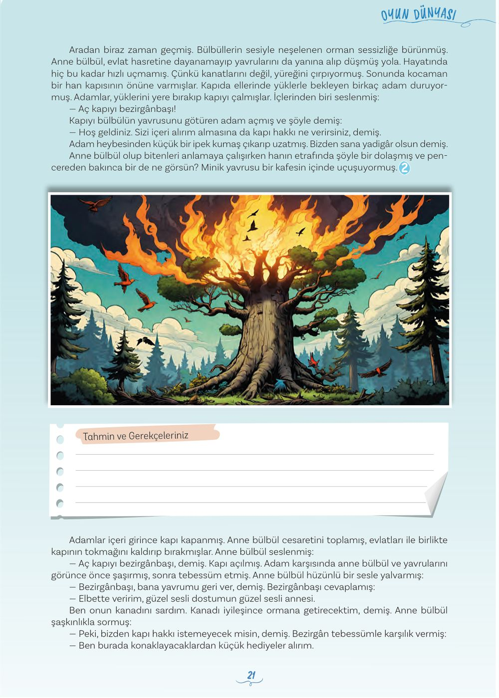

| Tahmin ve Gerekçeleriniz |
| :--- |
| __________________________________________________________________ |
| __________________________________________________________________ |
| __________________________________________________________________ |
| __________________________________________________________________ |

Adamlar içeri girince kapı kapanmış. Anne bülbül cesaretini toplamış, evlatları ile birlikte kapının tokmağını kaldırıp bırakmışlar. Anne bülbül seslenmiş:
— Aç kapıyı bezirgânbaşı, demiş. Kapı açılmış. Adam karşısında anne bülbül ve yavrularını görünce önce şaşırmış, sonra tebessüm etmiş. Anne bülbül hüzünlü bir sesle yalvarmış:
— Bezirgânbaşı, bana yavrumu geri ver, demiş. Bezirgânbaşı cevaplamış:
— Elbette veririm, güzel sesli dostumun güzel sesli annesi.
Ben onun kanadını sardım. Kanadı iyileşince ormana getirecektim, demiş. Anne bülbül şaşkınlıkla sormuş:
— Peki, bizden kapı hakkı istemeyecek misin, demiş. Bezirgân tebessümle karşılık vermiş:

<!-- sayfa 22 -->

Biz dostuz, siz bana o güzel sesinizi hediye edin ve yavru bülbül iyileşene kadar misafir olun yeter, demiş.
(...)
O gün bugündür şu sözlerle çocuklar bezirgânbaşı oyunu oynuyorlar:
Aç kapıyı, bezirgânbaşı, bezirgânbaşı!
Kapı hakkı ne verirsin?
Arkamdaki yadigâr olsun, yadigâr olsun...
Gökten üç elma düşmüş. Biri büllere, biri bezirgânbaşına, diğeri de oyun oynamayı seven bütün çocuklara...

**Mehtap TEKER**
(Kısaltılmıştır.)

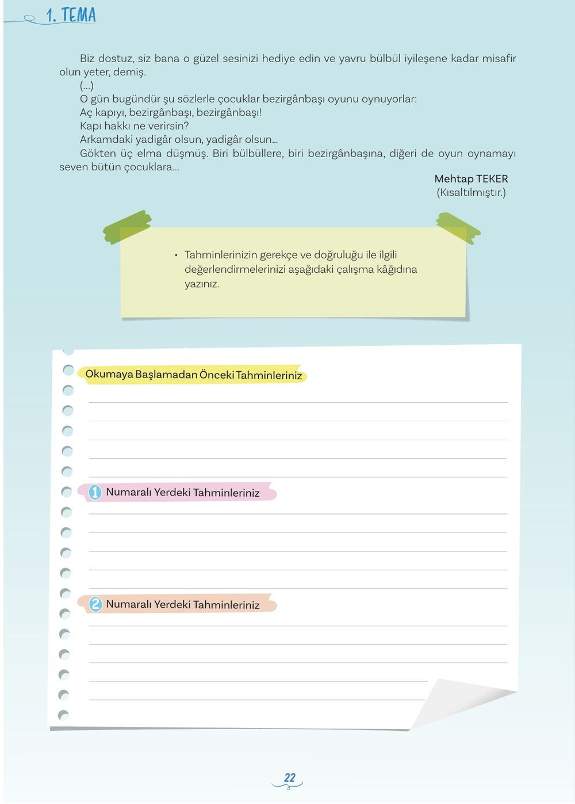
• Tahminlerinizin gerekçe ve doğruluğu ile ilgili değerlendirmelerinizi aşağıdaki çalışma kâğıdına yazınız.

---

Okumaya Başlamadan Önceki Tahminleriniz
__________________________________________________________________
__________________________________________________________________
__________________________________________________________________

1 Numaralı Yerdeki Tahminleriniz
__________________________________________________________________
__________________________________________________________________
__________________________________________________________________

2 Numaralı Yerdeki Tahminleriniz
__________________________________________________________________
__________________________________________________________________
__________________________________________________________________

<!-- sayfa 23 -->

# Yine Uyguluyorsunuz

Şimdi 2-3 kişilik gruplar oluşturunuz ve stratejiyi yeni metninizde kullanınız. Bu aşamada aşağıdakilere dikkat ediniz.

* Bu kez öğretmeniniz gerekmedikçe size müdahale etmeyecek.
* Önceki uygulamalardaki sırayı takip ediniz.
* Grup arkadaşlarınızla konuşup tartıştıktan sonra ortak karar veriniz ama tahmin ve gerekçelerinizi her biriniz kendi kitabınıza yazınız.

### Tahmin ve Gerekçeleriniz
__________________________________________________________________
__________________________________________________________________
__________________________________________________________________
__________________________________________________________________

## KANGURUNUN PARMAK UÇLARINDAKİ DÜNYA

Bir zamanlar iyilik güzellik ülkesinde tüm canlıların birlikte yaşadığı bir orman varmış. Bu ormanda çeşit çeşit hayvanlar, ağaçlar ve çiçekler bulunurmuş. (...)

Ormandaki hayvanlar her hafta toplanıp birbirinden eğlenceli oyunlar oynarlarmış. 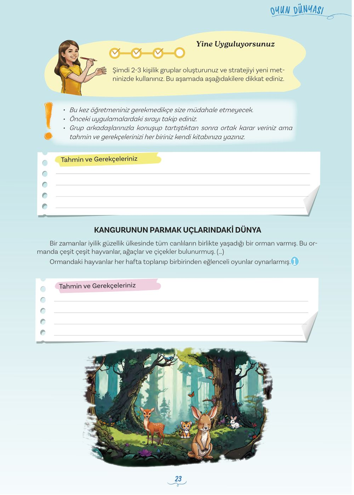

<!-- sayfa 24 -->

Saklambaç, körebe, seksek, koşmaca, zıplamaca... Ormandaki hayvan dostlar bazen gölün kıyısındaki ağaç parkında oyunlar kurarlar, yarışmalar yaparlarmış. Bu ağaç parkı onların en sevdiği yermiş.

Gökyüzünün berrak olduğu günlerin birinde minik kanguru, arkadaşları ile oyun oynamak için ağaç parkına gitmiş. Hep birlikte salıncakta sallanmışlar, zıplama tahtasında el ele zıplayarak gökyüzünden yıldızlar toplar gibi hayal kurmuşlar. Kaydıraktan göle kaymışlar. Balıklar bu oyuna pek sevinmiş, kurbağalar el çırpmış.

Bütün hayvanlar doyasıya oynadıktan sonra koşu yarışması yapmaya karar vermişler. Yarışmayı her zamanki gibi yine gri tavşan kazanmış, hak ettiği havuç ödülünü çıtır çıtır yiyerek evine gitmiş. Ertesi gün yine tüm hayvanlar toplanıp seksek oynamaya karar vermişler, minik kanguru bu seksek oyununu çok seviyormuş. Ama çok güzel zıplamasına rağmen gözleri görmediği için taşın olduğu kareyi bulamıyormuş. Yine de tüm gün arkadaşları ile keyifli vakit geçirmiş.

Kangurunun hayali yarışma oyunlarının birinde kazanan olmakmış. Kendisi gibi görme engelli başka hayvan olmadığı için o da arkadaşları ile aynı şartlarda yarışıyormuş. Aslında bu durum onu rahatsız etmiyormuş. Ona farklı olduğunu hiç belli etmiyorlar, onu olduğu gibi kabul ediyorlarmış. (...)

Yine derenin suyunun azaldığı bir yaz günü, karşıdan gelen hayvanlar ağaç parkına gitmişler. Minik kanguru ve arkadaşları da parka gitmiş, hep birlikte köşe kapmaca oynayıp eğlenmişler.

Derenin karşısından gelen hayvanlardan birisi "Bil Bakalım Bu Ne?" oyununu yarışma şeklinde oynamayı önermiş. Tüm hayvan dostları ilk kez oynayacakları bu oyun için heyecanlanmışlar. Ama içlerinde en heyecanlısı minik kanguru olmuş. Çünkü her şeyi dokunarak buluyor ve tanıyormuş. Parmak uçlarında kurduğu dünyanın gizemli büyüsünü bir yarışmada kullanacağından içi kıpır kıpır olmuş.

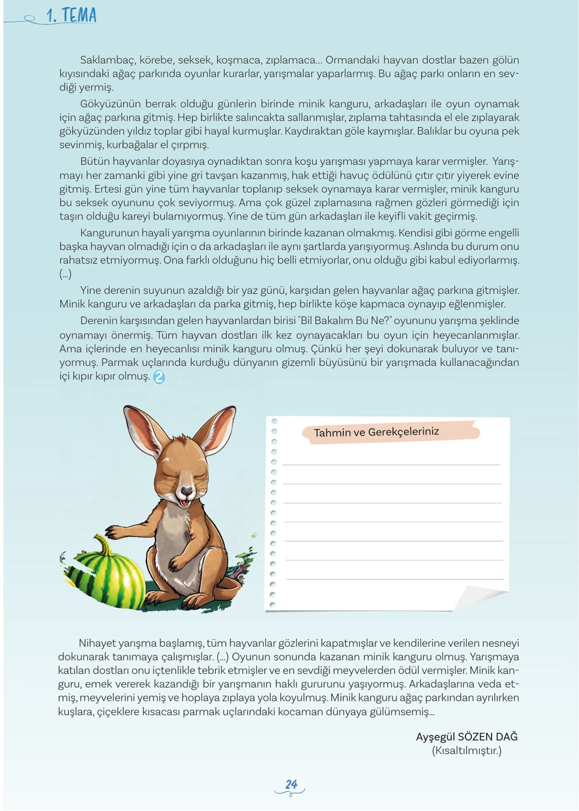

| Tahmin ve Gerekçeleriniz |
| :--- |
| |
| |
| |
| |
| |
| |
| |
| |
| |
| |
| |
| |
| |
| |
| |
| |
| |
| |
| |
| |

Nihayet yarışma başlamış, tüm hayvanlar gözlerini kapatmışlar ve kendilerine verilen nesneyi dokunarak tanımaya çalışmışlar. (...) Oyunun sonunda kazanan minik kanguru olmuş. Yarışmaya katılan dostları onu içtenlikle tebrik etmişler ve en sevdiği meyvelerden ödül vermişler. Minik kanguru, emek vererek kazandığı bir yarışmanın haklı gururunu yaşıyormuş. Arkadaşlarına veda etmiş, meyvelerini yemiş ve hoplaya zıplaya yola koyulmuş. Minik kanguru ağaç parkından ayrılırken kuşlara, çiçeklere kısacası parmak uçlarındaki kocaman dünyaya gülümsemiş...

Ayşegül SÖZEN DAĞ

<!-- sayfa 25 -->

• Tahminlerinizin gerekçe ve doğruluğu ile ilgili değerlendirmelerinizi aşağıdaki çalışma kâğıdına yazınız.

### Okumaya Başlamadan Önceki Tahminleriniz
__________________________________________________________________________
__________________________________________________________________________
__________________________________________________________________________

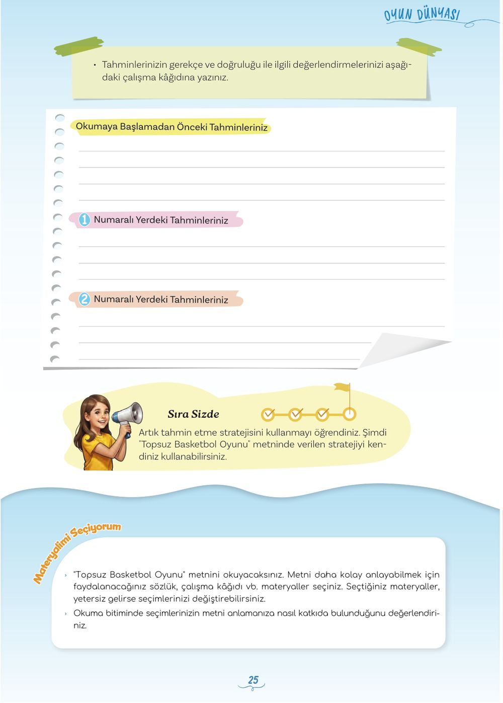 1 Numaralı Yerdeki Tahminleriniz
__________________________________________________________________________
__________________________________________________________________________
__________________________________________________________________________

 2 Numaralı Yerdeki Tahminleriniz
__________________________________________________________________________
__________________________________________________________________________
__________________________________________________________________________

**Sıra Sizde**
Artık tahmin etme stratejisini kullanmayı öğrendiniz. Şimdi "Topsuz Basketbol Oyunu" metninde verilen stratejiyi kendiniz kullanabilirsiniz.

# Materyalimi Seçiyorum

› "Topsuz Basketbol Oyunu" metnini okuyacaksınız. Metni daha kolay anlayabilmek için faydalanacağınız sözlük, çalışma kâğıdı vb. materyaller seçiniz. Seçtiğiniz materyaller, yetersiz gelirse seçimlerinizi değiştirebilirsiniz.
› Okuma bitiminde seçimlerinizin metni anlamanıza nasıl katkıda bulunduğunu değerlendiriniz.

<!-- sayfa 26 -->

# Keşif Yolculuğu

* Arkadaşlarınızla oynamaktan zevk aldığınız fiziksel oyunlar nelerdir?
* Oyun oynamak için hiçbir şeyiniz olmasaydı buna nasıl bir çözüm yolu bulurdunuz?

> Tahmin etme stratejisi, metnin ilerleyen bölümlerinde neler olacağını veya hangi bilgiler verileceğini çeşitli ipuçlarını kullanarak kestirmektir.

* Metni sessiz okurken numaralı yerlerde durarak tahmin etme stratejisini kendiniz uygulayınız. Tahmin ve gerekçelerinizi defterinize yazınız.
* Metindeki anlamadığınız cümle ya da bölümleri uygun zamanda öğretmen veya arkadaşlarınıza sormak üzere işaretleyiniz.

## TOPSUZ BASKETBOL OYUNU

Moni, oyunlarda karşılaştığı problemleri çok seviyordu. Ona göre oyunda bir sorun varsa bir öğrenme fırsatı da vardı. Bir problem varsa bir çözüm de vardı. Problemler onu yıldıramazdı. Pes etmek ona göre değildi. Her zaman, her yerde bir çözüm üretebileceğine inanıyordu.

Bir gün, kasabada basketbol maçı yaparken çocukların topları patladı. Oynayan herkes çok üzülmüştü.

— Keşke patlamasaydı, diyorlardı.

Moni o esnada "Ne yapabilirim acaba?" diye düşünüyordu.

Maçın en heyecanlı anında top patladı diye maçı bitiremezlerdi. Bu oyunun devam etmesi için bir çözüm bulmaları gerekiyordu. Aklına parlak bir fikir geldi. 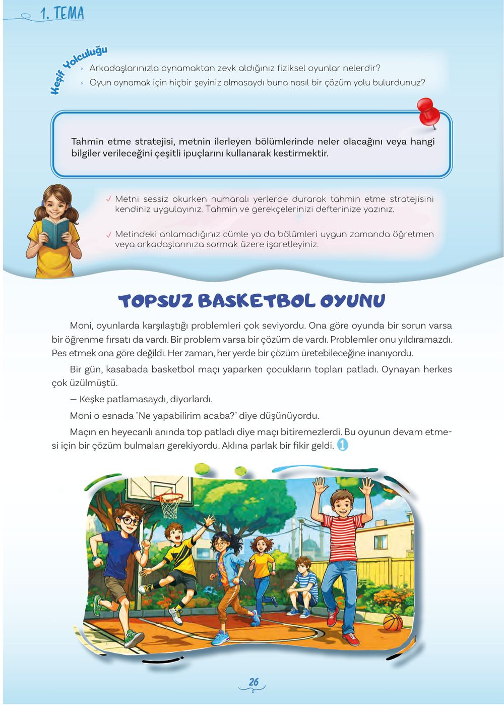

<!-- sayfa 27 -->

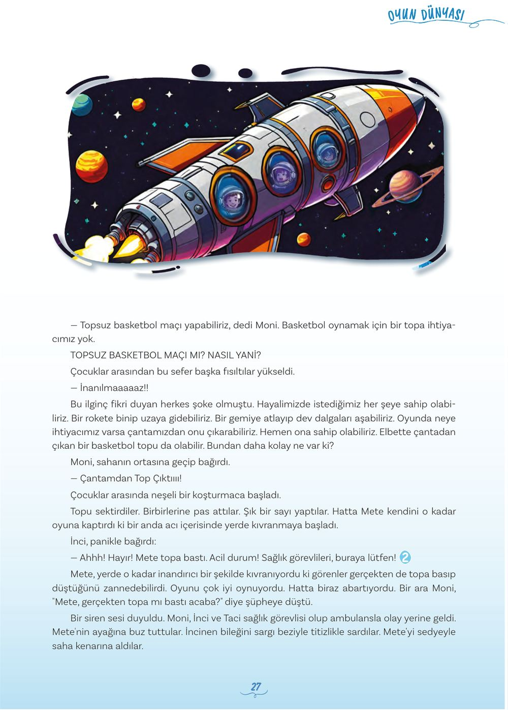

— Topsuz basketbol maçı yapabiliriz, dedi Moni. Basketbol oynamak için bir topa ihtiyacımız yok.

TOPSUZ BASKETBOL MAÇI MI? NASIL YANİ?

Çocuklar arasından bu sefer başka fısıltılar yükseldi.

— İnanılmaaaaaz!!

Bu ilginç fikri duyan herkes şoke olmuştu. Hayalimizde istediğimiz her şeye sahip olabiliriz. Bir rokete binip uzaya gidebiliriz. Bir gemiye atlayıp dev dalgaları aşabiliriz. Oyunda neye ihtiyacımız varsa çantamızdan onu çıkarabiliriz. Hemen ona sahip olabiliriz. Elbette çantadan çıkan bir basketbol topu da olabilir. Bundan daha kolay ne var ki?

Moni, sahanın ortasına geçip bağırdı.

— Çantamdan Top Çıktıııı!

Çocuklar arasında neşeli bir koşturmaca başladı.

Topu sektirdiler. Birbirlerine pas attılar. Şık bir sayı yaptılar. Hatta Mete kendini o kadar oyuna kaptırdı ki bir anda acı içerisinde yerde kıvranmaya başladı.

İnci, panikle bağırdı:

— Ahhh! Hayır! Mete topa bastı. Acil durum! Sağlık görevlileri, buraya lütfen! 2

Mete, yerde o kadar inandırıcı bir şekilde kıvranıyordu ki görenler gerçekten de topa basıp düştüğünü zannedebilirdi. Oyunu çok iyi oynuyordu. Hatta biraz abartıyordu. Bir ara Moni, "Mete, gerçekten topa mı bastı acaba?" diye şüpheye düştü.

Bir siren sesi duyuldu. Moni, İnci ve Taci sağlık görevlisi olup ambulansla olay yerine geldi. Mete'nin ayağına buz tuttular. İncinen bileğini sargı beziyle titizlikle sardılar. Mete'yi sedyeyle saha kenarına aldılar.

<!-- sayfa 28 -->

Elbette ortada bir buz, sargı bezi, sedye, ambulans falan yoktu. Siren sesini de Moni çıkarmıştı. Bu bir oyundu. Oyun oynamanın en keyifli yanı da sanki gerçekten varmış gibi yapmaktan geçiyordu. Bu, altın kuraldı.

Mete, gökyüzüne baktı.

— İstersem şimdi Satürn gezegeninde bir hastaneye gidip orada da tedavi olabilirim, dedi. Hayal etsenize; gezegenler arası yolculuk... Oyun oynamak muhteşem bir şey yahu!

Mete, saha kenarında keyifle gülümsüyordu. Oyun oynarken özgürdü çünkü. Bu, çooook eğlenceliydi. Mete de eğlencenin tadını doyasıya çıkarıyordu.

Elbette Satürn'de bir hastanede tedavi olmayı tercih edebilirdi. Çantasından bir gezegen çıkarabilirdi. O gezegene giderken karşısına Uzay Korsanları çıkabilirdi. Uzay Korsanları'yla heyecan dolu bir macera başlatabilirdi. Maceraya istediği gibi yön verebilirdi. Ya da okyanusun derinliklerinde tam teşekküllü bir Denizaltı Hastanesine gidebilirdi. Sarı bir köpek balığı onun doktoru olabilirdi. (...)

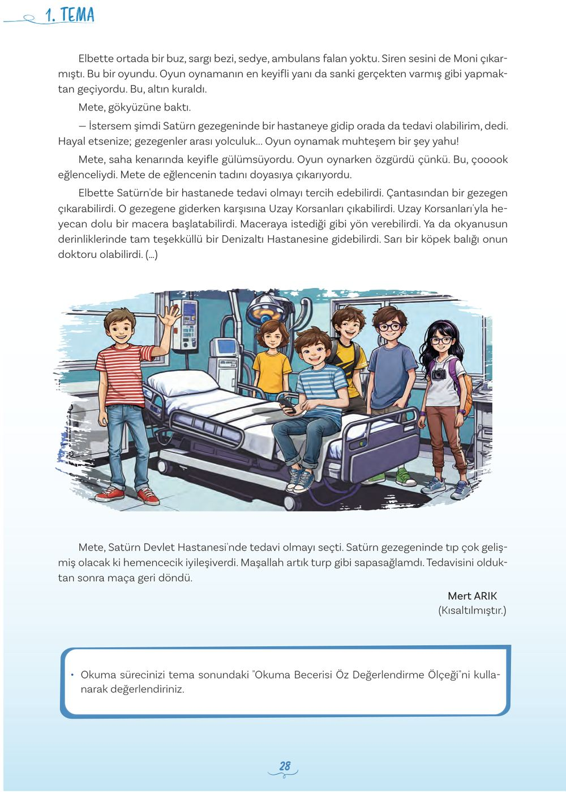

Mete, Satürn Devlet Hastanesi'nde tedavi olmayı seçti. Satürn gezegeninde tıp çok gelişmiş olacak ki hemencecik iyileşiverdi. Maşallah artık turp gibi sapasağlamdı. Tedavisini olduktan sonra maça geri döndü.

**Mert ARIK**
(Kısaltılmıştır.)

***

* Okuma sürecinizi tema sonundaki "Okuma Becerisi Öz Değerlendirme Ölçeği"ni kullanarak değerlendiriniz.

<!-- sayfa 29 -->

 **a.** Metinden alınan aşağıdaki cümlelerin ilişkili olduğu kavramları işaretleyiniz.

Problemler onu yıldıramazdı. $\rightarrow$ $\square$ sorumluluk
$\quad\quad\quad\quad\quad\quad\quad\quad\quad\quad\quad\quad\quad\quad\quad\quad\quad\quad\quad\quad\quad\quad\quad\quad\quad\quad\quad\quad\quad\quad\quad\quad\quad\quad\quad\quad\quad\quad\quad\quad\quad\quad\quad\quad\quad\quad\quad\quad\quad\quad\quad\quad\quad\quad\quad\quad\quad\quad\quad\quad\quad\quad\quad\quad\quad\quad\quad\quad\quad\quad\quad\quad\quad\quad\quad\quad\quad\quad\quad\quad\quad\quad\quad\quad\quad\quad\quad\quad\quad\quad\quad\quad\quad\quad\quad\quad\quad\quad\quad\quad\quad\quad\quad\quad\quad\quad\quad\quad\quad\quad\quad\quad\quad\quad\quad\quad\quad\quad\quad\quad\quad\quad\quad\quad\quad\quad\quad\quad\quad\quad\quad\quad\quad\quad\quad\quad\quad\quad\quad\quad\quad\quad\quad\quad\quad\quad\quad\quad\quad\quad\quad\quad\quad\quad\quad\quad\quad\quad\quad\quad\quad\quad\quad\quad\quad\quad\quad\quad\quad\quad\quad\quad\quad\quad\quad\quad\quad\quad\quad\quad\quad\quad\quad\quad\quad\quad\quad\quad\quad\quad\quad\quad\quad\quad\quad\quad\quad\quad\quad\quad\quad\quad\quad\quad\quad\quad\quad\quad\quad\quad\quad\quad\quad\quad\quad\quad\quad\quad\quad\quad\quad\quad\quad\quad\quad\quad\quad\quad\quad\quad\quad\quad\quad\quad\quad\quad\quad\quad\quad\quad\quad\quad\quad\quad\quad\quad\quad\quad\quad\quad\quad\quad\quad\quad\quad\quad\quad\quad\quad\quad\quad\quad\quad\quad\quad

<!-- yer tutucu bulunamadı: sayfa sonuna eklendi -->

<!-- yer tutucu bulunamadı: sayfa sonuna eklendi -->

<!-- yer tutucu bulunamadı: sayfa sonuna eklendi -->

<!-- yer tutucu bulunamadı: sayfa sonuna eklendi -->

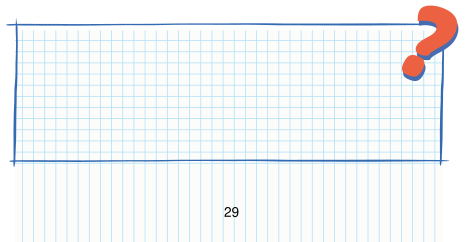
<!-- yer tutucu bulunamadı: sayfa sonuna eklendi -->

<!-- sayfa 30 -->

# 3. ETKİNLİK
Aşağıda metinden alınan iki cümle verilmiştir.

**a.** Bu cümlelerde ifade edilenlerin gerçekte yaşanıp yaşanmadığını belirleyiniz.

**b.** Siz de metni inceleyiniz ve belirlediğiniz benzer cümleleri uygun listeye ekleyiniz.

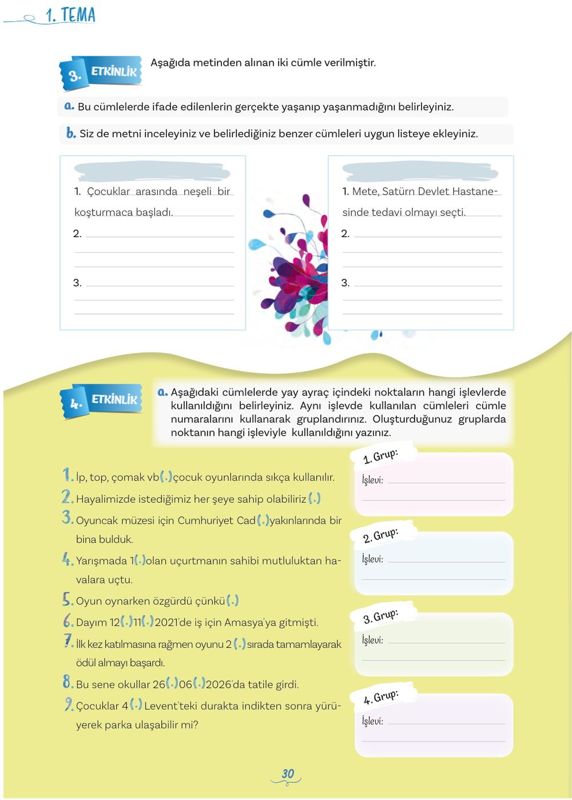

1. Çocuklar arasında neşeli bir koşturmaca başladı.
2. \_\_\_\_\_\_\_\_\_\_\_\_\_\_\_\_\_\_\_\_\_\_\_\_\_\_\_\_\_\_\_\_\_\_\_\_\_\_\_\_\_\_\_\_\_\_\_\_\_\_\_\_\_\_\_\_\_\_\_\_\_\_\_\_
3. \_\_\_\_\_\_\_\_\_\_\_\_\_\_\_\_\_\_\_\_\_\_\_\_\_\_\_\_\_\_\_\_\_\_\_\_\_\_\_\_\_\_\_\_\_\_\_\_\_\_\_\_\_\_\_\_\_\_\_\_\_\_\_\_

1. Mete, Satürn Devlet Hastanesinde tedavi olmayı seçti.
2. \_\_\_\_\_\_\_\_\_\_\_\_\_\_\_\_\_\_\_\_\_\_\_\_\_\_\_\_\_\_\_\_\_\_\_\_\_\_\_\_\_\_\_\_\_\_\_\_\_\_\_\_\_\_\_\_\_\_\_\_\_\_\_\_
3. \_\_\_\_\_\_\_\_\_\_\_\_\_\_\_\_\_\_\_\_\_\_\_\_\_\_\_\_\_\_\_\_\_\_\_\_\_\_\_\_\_\_\_\_\_\_\_\_\_\_\_\_\_\_\_\_\_\_\_\_\_\_\_\_

# 4. ETKİNLİK

**a.** Aşağıdaki cümlelerde yay ayraç içindeki noktaların hangi işlevlerde kullanıldığını belirleyiniz. Aynı işlevde kullanılan cümleleri cümle numaralarını kullanarak gruplandırınız. Oluşturduğunuz gruplarda noktanın hangi işleviyle kullanıldığını yazınız.

1. İp, top, çomak vb.(.) çocuk oyunlarında sıkça kullanılır.
2. Hayalimizde istediğimiz her şeye sahip olabiliriz (.)
3. Oyuncak müzesi için Cumhuriyet Cad.(.) yakınlarında bir bina bulduk.
4. Yarışmada 1(.) olan uçurtmanın sahibi mutluluktan havalara uçtu.
5. Oyun oynarken özgürdü çünkü (.)
6. Dayım $12$(.)$11$(.)$2021$'de iş için Amasya'ya gitmişti.
7. İlk kez katılmasına rağmen oyunu 2 (.) sırada tamamlayarak ödül almayı başardı.
8. Bu sene okullar $26$(.)$06$(.)$2026$'da tatile girdi.
9. Çocuklar $4$(.) Levent'teki duraktan indikten sonra yürüyerek parka ulaşabilir mi?

| 1. Grup: |
| :--- |
| İşlevi: \_\_\_\_\_\_\_\_\_\_\_\_\_\_\_\_\_\_\_\_\_\_\_\_\_\_\_\_\_\_\_\_\_\_\_\_\_\_\_\_\_\_\_\_\_\_\_\_\_\_\_\_\_\_\_\_\_\_\_\_\_\_\_\_ |

| 2. Grup: |
| :--- |
| İşlevi: \_\_\_\_\_\_\_\_\_\_\_\_\_\_\_\_\_\_\_\_\_\_\_\_\_\_\_\_\_\_\_\_\_\_\_\_\_\_\_\_\_\_\_\_\_\_\_\_\_\_\_\_\_\_\_\_\_\_\_\_\_\_\_\_ |

| 3. Grup: |
| :--- |
| İşlevi: \_\_\_\_\_\_\_\_\_\_\_\_\_\_\_\_\_\_\_\_\_\_\_\_\_\_\_\_\_\_\_\_\_\_\_\_\_\_\_\_\_\_\_\_\_\_\_\_\_\_\_\_\_\_\_\_\_\_\_\_\_\_\_\_ |

| 4. Grup: |
| :--- |
| İşlevi: \_\_\_\_\_\_\_\_\_\_\_\_\_\_\_\_\_\_\_\_\_\_\_\_\_\_\_\_\_\_\_\_\_\_\_\_\_\_\_\_\_\_\_\_\_\_\_\_\_\_\_\_\_\_\_\_\_\_\_\_\_\_\_\_ |

<!-- sayfa 31 -->

b. Noktanın belirlediğiniz işlevlerinden hareketle her grup için oluşturduğunuz kuralları ve örnek cümleleri yazınız.

__________________________________________________________________
__________________________________________________________________
__________________________________________________________________
__________________________________________________________________
__________________________________________________________________
__________________________________________________________________
__________________________________________________________________
__________________________________________________________________

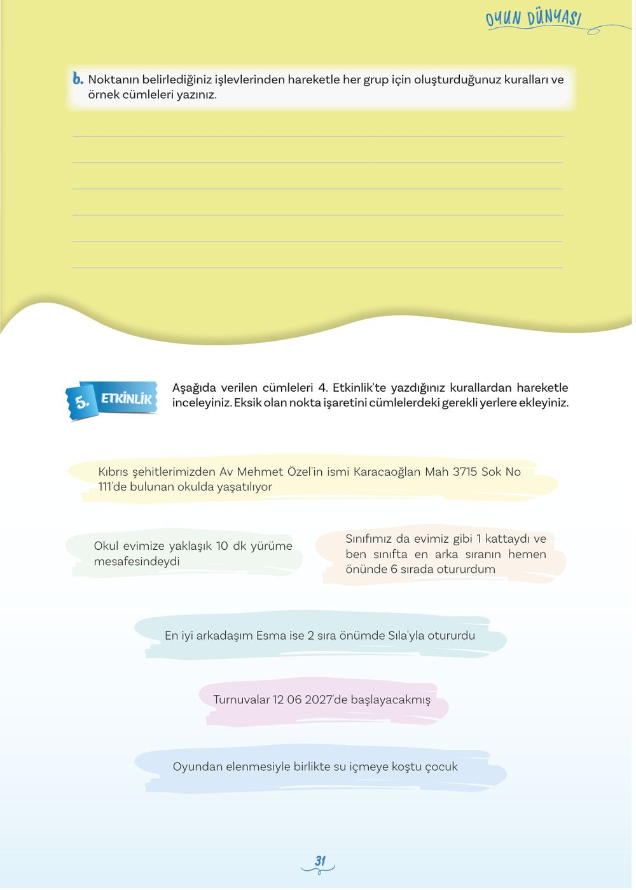 5. ETKİNLİK Aşağıda verilen cümleleri 4. Etkinlik'te yazdığınız kurallardan hareketle inceleyiniz. Eksik olan nokta işaretini cümlelerdeki gerekli yerlere ekleyiniz.

Kıbrıs şehitlerimizden Av Mehmet Özel'in ismi Karacaoğlan Mah 3715 Sok No 111'de bulunan okulda yaşatılıyor

Okul evimize yaklaşık 10 dk yürüme mesafesindeydi

Sınıfımız da evimiz gibi 1 kattaydı ve ben sınıfta en arka sıranın hemen önünde 6 sırada otururdum

En iyi arkadaşım Esma ise 2 sıra önümde Sıla'yla otururdu

Turnuvalar 12 06 2027'de başlayacakmış

Oyundan elenmesiyle birlikte su içmeye koştu çocuk

<!-- sayfa 32 -->

# 6. ETKİNLİK

**a. Diyafram nefesi etkinliğini yönergeler doğrultusunda tamamlayınız.**

Diyafram göğüs ve karın boşluğunu birbirinden ayıran bir kas dokusu tabakasıdır.

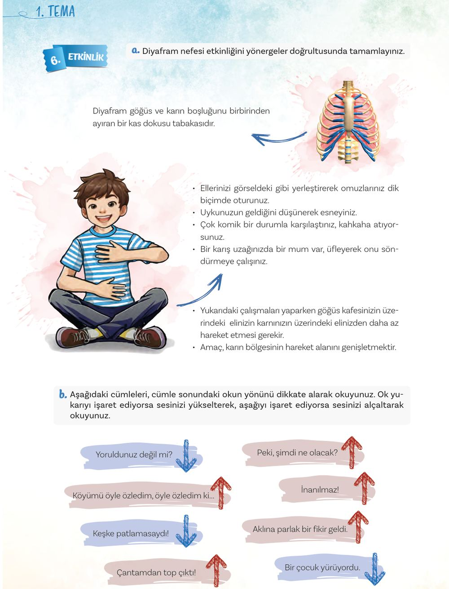

* Ellerinizi görseldeki gibi yerleştirerek omuzlarınız dik biçimde oturunuz.
* Uykunuzun geldiğini düşünerek esneyiniz.
* Çok komik bir durumla karşılaştınız, kahkaha atıyorsunuz.
* Bir karış uzağınızda bir mum var, üfleyerek onu söndürmeye çalışınız.

* Yukarıdaki çalışmaları yaparken göğüs kafesinizin üzerindeki elinizin karnınızın üzerindeki elinizden daha az hareket etmesi gerekir.
* Amaç, karın bölgesinin hareket alanını genişletmektir.

**b. Aşağıdaki cümleleri, cümle sonundaki okun yönünü dikkate alarak okuyunuz. Ok yukarıyı işaret ediyorsa sesinizi yükselterek, aşağıyı işaret ediyorsa sesinizi alçaltarak okuyunuz.**

| | |
| :--- | :--- |
| Yoruldunuz değil mi? $\downarrow$ | Peki, şimdi ne olacak? $\uparrow$ |
| Köyümü öyle özledim, öyle özledim ki... $\uparrow$ | İnanılmaz! $\uparrow$ |
| Keşke patlamasaydı! $\downarrow$ | Aklına parlak bir fikir geldi. $\uparrow$ |
| Çantamdan top çıktı! $\uparrow$ | Bir çocuk yürüyordu. $\downarrow$ |

<!-- sayfa 33 -->

# KONUŞALIM

### 7. ETKİNLİK

**a.** "Bu Görev Bizim" bölümündeki yönergeden hareketle izlediğiniz filmle ilgili defterinize aldığınız notları gözden geçiriniz.

**b.** İzlediğiniz sinema filmi veya çizgi filmi defterinize aldığınız notlardan hareketle olay akışına uygun olarak anlatınız. Anlatımınıza başlarken neden o filmi seçtiğinize de değinize.

* Konuşurken nefesinizi doğru ayarlayınız.
* Kelimeleri doğru telaffuz ediniz ve sesinizin şiddetini ayarlayınız.
* Doğru vurgu ve tonlamayla konuşunuz.

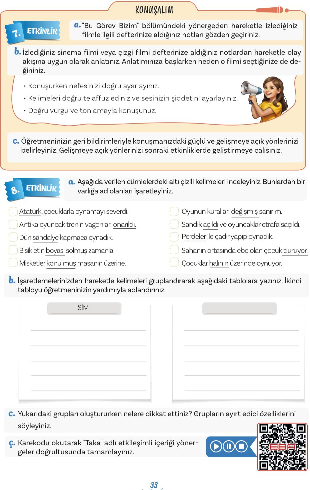

**c.** Öğretmeninizin geri bildirimleriyle konuşmanızdaki güçlü ve gelişmeye açık yönlerinizi belirleyiniz. Gelişmeye açık yönlerinizi sonraki etkinliklerde geliştirmeye çalışınız.

---

### 8. ETKİNLİK

**a.** Aşağıda verilen cümlelerdeki altı çizili kelimeleri inceleyiniz. Bunlardan bir varlığa ad olanları işaretleyiniz.

$\square$ Atatürk, çocuklarla oynamayı severdi.
$\square$ Antika oyuncak trenin vagonları onarıldı.
$\square$ Dün sandalye kapmaca oynadık.
$\square$ Bisikletin boyası solmuş zamanla.
$\square$ Misketler konulmuş masanın üzerine.
$\square$ Oyunun kuralları değişmiş sanırım.
$\square$ Sandık açıldı ve oyuncaklar etrafa saçıldı.
$\square$ Perdeler ile çadır yapıp oynadık.
$\square$ Sahanın ortasında ebe olan çocuk duruyor.
$\square$ Çocuklar halının üzerinde oynuyor.

**b.** İşaretlemelerinizden hareketle kelimeleri gruplandırarak aşağıdaki tablolara yazınız. İkinci tabloyu öğretmeninizin yardımıyla adlandırınız.

| İSİM | |
| :--- | :--- |
| | |
| | |
| | |
| | |
| | |

| | |
| :--- | :--- |
| | |
| | |
| | |
| | |
| | |

**c.** Yukarıdaki grupları oluştururken nelere dikkat ettiniz? Grupların ayırt edici özelliklerini söyleyiniz.

**ç.** Karekodu okutarak "Taka" adlı etkileşimli içeriği yönergeler doğrultusunda tamamlayınız.

<!-- sayfa 34 -->

# YAZALIM

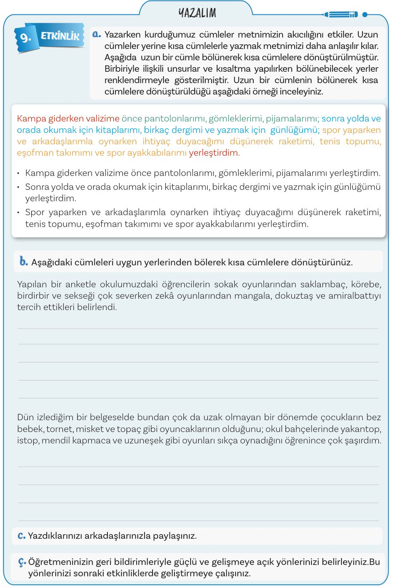

**9. ETKİNLİK**

**a.** Yazarken kurduğumuz cümleler metnimizin akıcılığını etkiler. Uzun cümleler yerine kısa cümlelerle yazmak metnimizi daha anlaşılır kılar. Aşağıda uzun bir cümle bölünerek kısa cümlelere dönüştürülmüştür. Birbiriyle ilişkili unsurlar ve kısaltma yapılırken bölünebilecek yerler renklendirmeyle gösterilmiştir. Uzun bir cümlenin bölünerek kısa cümlelere dönüştürüldüğü aşağıdaki örneği inceleyiniz.

> Kampa giderken valizime önce pantolonlarımı, gömleklerimi, pijamalarımı; sonra yolda ve orada okumak için kitaplarımı, birkaç dergimi ve yazmak için günlüğümü; spor yaparken ve arkadaşlarımla oynarken ihtiyaç duyacağımı düşünerek raketimi, tenis topumu, eşofman takımımı ve spor ayakkabılarımı yerleştirdim.

* Kampa giderken valizime önce pantolonlarımı, gömleklerimi, pijamalarımı yerleştirdim.
* Sonra yolda ve orada okumak için kitaplarımı, birkaç dergimi ve yazmak için günlüğümü yerleştirdim.
* Spor yaparken ve arkadaşlarımla oynarken ihtiyaç duyacağımı düşünerek raketimi, tenis topumu, eşofman takımımı ve spor ayakkabılarımı yerleştirdim.

**b.** Aşağıdaki cümleleri uygun yerlerinden bölerek kısa cümlelere dönüştürünüz.

Yapılan bir anketle okulumuzdaki öğrencilerin sokak oyunlarından saklambaç, körebe, birdirbir ve sekseği çok severken zekâ oyunlarından mangala, dokuztaş ve amiralbattıyı tercih ettikleri belirlendi.

__________________________________________________________________________________________
__________________________________________________________________________________________
__________________________________________________________________________________________

Dün izlediğim bir belgeselde bundan çok da uzak olmayan bir dönemde çocukların bez bebek, tornet, misket ve topaç gibi oyuncaklarının olduğunu; okul bahçelerinde yakantop, istop, mendil kapmaca ve uzuneşek gibi oyunları sıkça oynadığını öğrenince çok şaşırdım.

**c.** Yazdıklarınızı arkadaşlarınızla paylaşınız.

**ç.** Öğretmeninizin geri bildirimleriyle güçlü ve gelişmeye açık yönlerinizi belirleyiniz. Bu yönlerinizi sonraki etkinliklerde geliştirmeye çalışınız.

<!-- sayfa 35 -->

# Keşif Yolculuğu

> İp oyunlarından hangilerini biliyorsunuz? Bunlardan hangilerini oynamayı daha çok seviyorsunuz?
> Yazı yazarken büyük harfleri hangi amaçlarla kullanıyorsunuz? Söyleyiniz.

Akıcı okuma, metni uygun hızda ve anlamına uygun vurgu ile okumaktır. Akıcı okurken kelimeleri yanlış söylememeye özen gösterilir. Akıcı okumak, hızlı okumak anlamına gelmez.

* Metni öğretmeninizin okuma hızı, vurgu ve tonlamasına dikkat ederek dinleyiniz.
* Öğretmeninizi dinlerken anlamını bilmediğiniz kelime ve kelime gruplarını işaretleyiniz. Ardından bunlara ve anlamlarına yönelik tahminlerinizi 1. etkinlikteki ilgili alana yazınız.
* Okuma hızınızın, vurgu ve tonlamanızın öğretmeninizinki gibi anlamı yansıtacak biçimde olmasına özen göstererek metni sesli okuyunuz.

## BİR İP BUL, OYUNA BAŞLA!

Kimi zaman sizin de içiniz kıpır kıpır oluyor mu? Belki de oyunlar oynamak, hoplayıp zıplamak istiyorsunuz. Böyle durumlarda size yardımcı olacak birkaç oyun fikriyle geldik. Üstelik bahsedeceğimiz oyunların tümü için gerekli tek bir malzeme var: ip.

Atlama ipi, halat, örgü ipi ve daha nicesi... Bu iplerle oynanan oyunlardan bir ya da birkaçıını biliyorsunuzdur. Bu oyunları oynayıp eğlenceli zaman geçirmenin de hoşunuza gittiğini düşünüyoruz. Üstelik sadece oyunlar değil, bir iple yapabileceğiniz birçok aktivite var. İp baskı yapabilir, örgü örebilir, sağlam bir ağaç dalına basit bir salıncak kurarak sallanabilirsiniz.

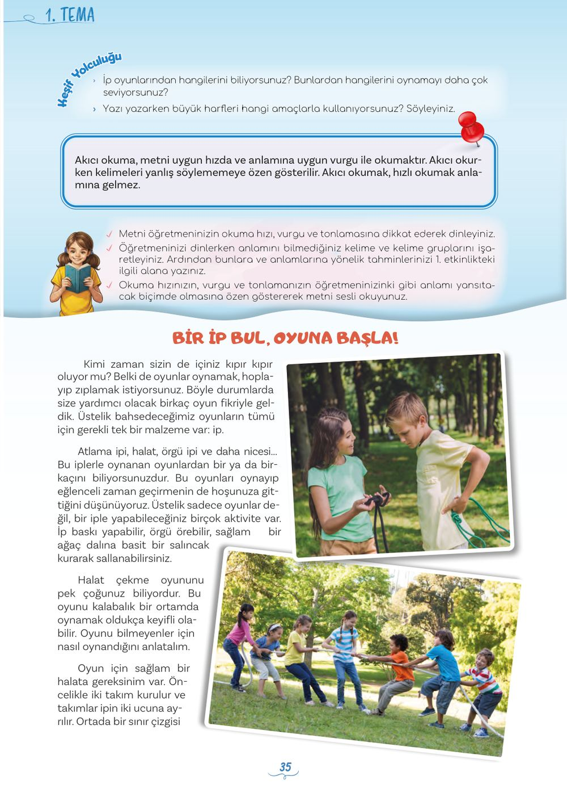

Halat çekme oyununu pek çoğunuz biliyordur. Bu oyunu kalabalık bir ortamda oynamak oldukça keyifli olabilir. Oyunu bilmeyenler için nasıl oynandığını anlatalım.

Oyun için sağlam bir halata gereksinim var. Öncelikle iki takım kurulur ve takımlar ipin iki ucuna ayrılır. Ortada bir sınır çizgisi...

<!-- sayfa 36 -->

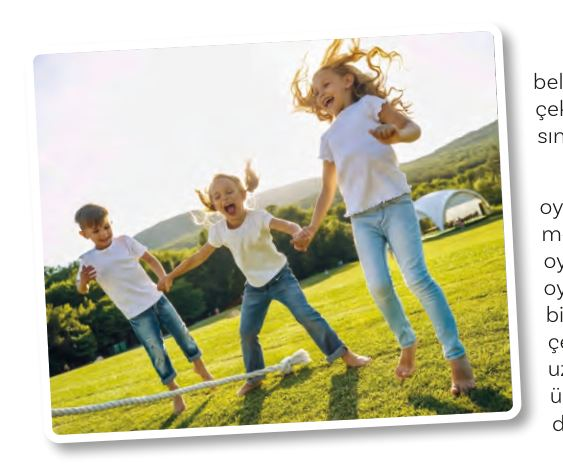

belirlenir. Amaç, takımların ipi kendi tarafına çekip rakip takımın tüm oyuncularının bu sınırı geçmesini sağlamak.

Hazır halattan bahsetmişken halatla oynayabileceğiniz bir diğer oyun: ip çevirme. Bu oyunu herhangi bir atlama ipiyle de oynayabilirsiniz. Oyunu en az 5 oyuncuyla oynamanızı öneririz. Ortada ipi çevirecek bir oyuncu belirlenir. Diğer oyuncular ip çeviricinin çevresinde, ipin yetişebileceği uzaklıkta bir çember oluşturur ve çember üzerinde yerleri işaretlenir. İp çevirici, elinde ipi tutarak bulunduğu yerde dönmeye başlar. Oyuncular, çevrilen ipe değmemek için olduğu yerde zıplar. Kim ipe değerse ortaya geçer ve ip çevirici olur.

Daha fazla hareket etmek, rekabeti biraz daha artırmak istiyorsanız ip atlamalı bayrak koşusunu deneyebilirsiniz. Tabii bu oyunda birbirinize bayrak yerine atlama ipi teslim edeceğiz.

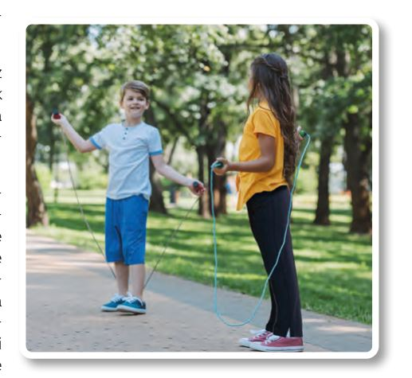

Önce eşit sayıda oyuncudan oluşan takımlar oluşturulur. Ardından yarış alanının sınırları belirlenir. Oyuncular, başlangıç çizgisinde takımlar hâlinde sıraya geçer. İşaretle birlikte ilk sıradaki oyuncular koşar adımlarla ip atlayarak yarış alanının diğer ucuna gidip başlangıca geri döner. Burada ipi, sıradaki takım arkadaşına teslim edip sıranın arkasına geçerler. İkinci oyuncular da karşıya gidip başlangıca döner ve oyun bu sırayla devam eder. İlk önce hangi takım koşuyu tamamlarsa o takım yarışı kazanır.

Şimdi biraz da engelleri aşarak hedefe ulaşmak isteyenler için lazer oyunundan bahsedelim. Lazer oyununda halat ya da atlama ipi değil, kalın örgü ipleri kullanılır. Ayrıca iplerin karşılıklı bağlanabileceği bir ortama gereksinim var. Bol ağaçlı bir bahçe bunun için uygun olabilir. Ağaçlara ipler karmaşık bir biçimde bağlanır. İplerin sonuna bir hedef konulur ve iplere değmeden aralarından geçerek hedefe ulaşmaya çalışılır.

Bu oyunu bir arkadaşınızla oynarken süre tutup hedefe kimin daha kısa sürede ulaştığını

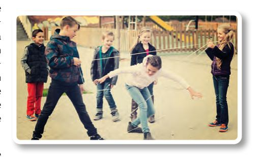

<!-- sayfa 37 -->

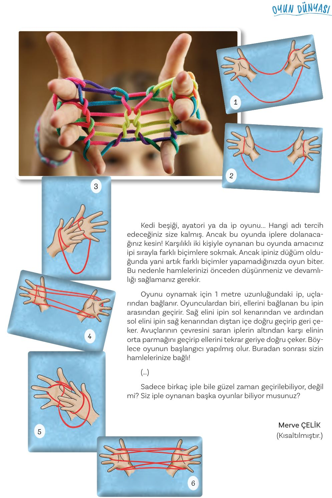

Kedi beşiği, ayatori ya da ip oyunu... Hangi adı tercih edeceğiniz size kalmış. Ancak bu oyunda iplere dolanacağınız kesin! Karşılıklı iki kişiyle oynanan bu oyunda amacınız ipi sırayla farklı biçimlere sokmak. Ancak ipiniz düğüm olduğunda yani artık farklı biçimler yapamadığınızda oyun biter. Bu nedenle hamlelerinizi önceden düşünmeniz ve devamlılığı sağlamanız gerekir.

Oyunu oynamak için $1$ metre uzunluğundaki ip, uçlarından bağlanır. Oyunculardan biri, ellerini bağlanan bu ipin arasından geçirir. Sağ elini ipin sol kenarından ve ardından sol elini ipin sağ kenarından dıştan içe doğru geçirip geri çeker. Avuçlarının çevresini saran iplerin altından karşı elinin orta parmağını geçirip ellerini tekrar geriye doğru çeker. Böylece oyunun başlangıcı yapılmış olur. Buradan sonrası sizin hamlelerinize bağlı!

(...)

Sadece birkaç iple bile güzel zaman geçirilebiliyor, değil mi? Siz iple oynanan başka oyunlar biliyor musunuz?

Merve ÇELİK
(Kısaltılmıştır.)

<!-- sayfa 38 -->

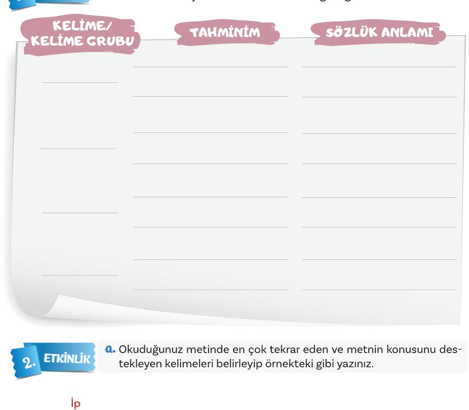
**1. ETKİNLİK** Belirlediğiniz kelime ve kelime gruplarının anlamlarını *TDK Güncel Türkçe Sözlük*'ten bularak yazınız. Tahminlerinizin doğruluğunu kontrol ediniz.

| KELİME / KELİME GRUBU | TAHMİNİM | SÖZLÜK ANLAMI |
| :--- | :--- | :--- |
| | | |
| | | |
| | | |
| | | |
| | | |

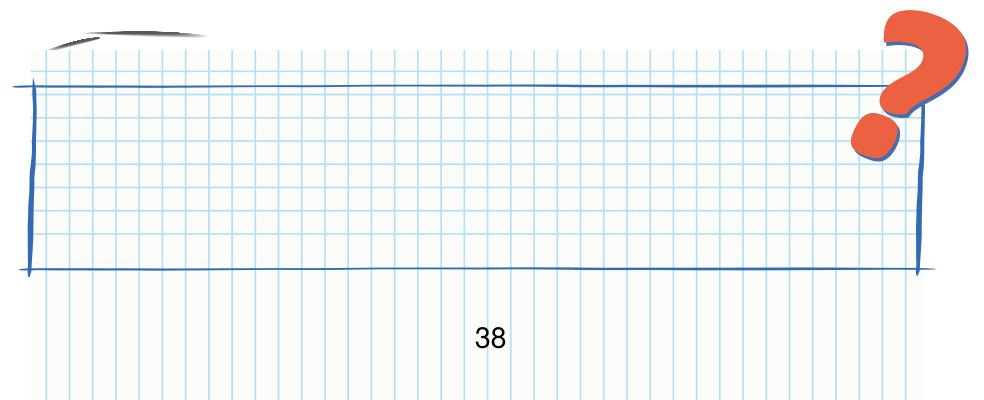
**2. ETKİNLİK**
**a.** Okuduğunuz metinde en çok tekrar eden ve metnin konusunu destekleyen kelimeleri belirleyip örnekteki gibi yazınız.

| İp | | |
| :--- | :--- | :--- |
| | | |
| | | |

**b.** Yazdığınız kelimelerin metnin içeriğiyle ilişkisini açıklayınız.

**3. ETKİNLİK** Okuduğunuz metinden ve deneyimlerinizden hareketle aşağıdaki soruları sözlü olarak cevaplayınız.

1. Metinde hangi oyunlardan bahsedilmektedir? Siz bunlardan hangilerini oynuyorsunuz?
2. "Kedibeşiği" adlı oyunda neden hamlelerimizi önceden düşünmeliyiz? Açıklayınız.
3. Metinde anlatılanlarla sizin oynadığınız ip oyunlarının benzer ve farklı yönleri nelerdir?

<!-- sayfa 39 -->

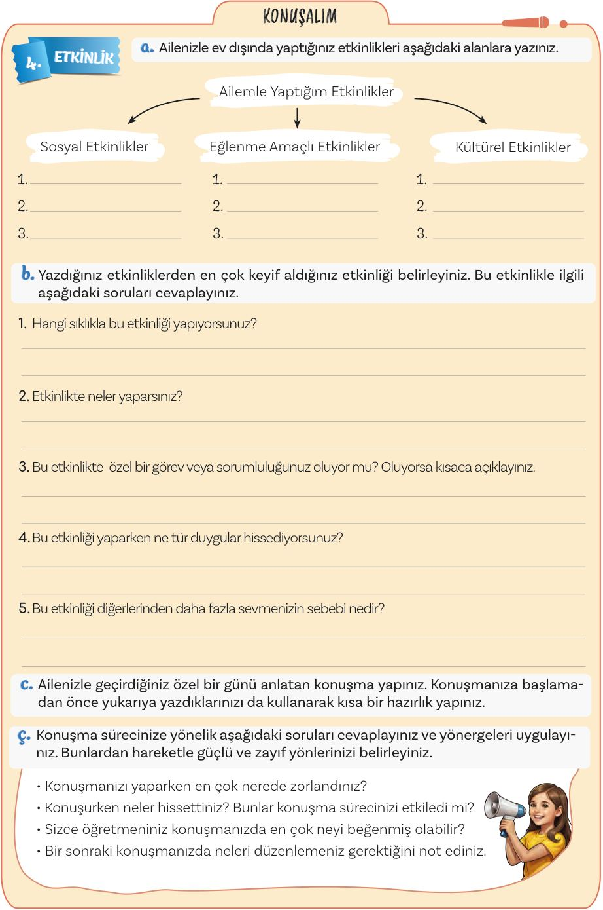
<!-- yer tutucu bulunamadı: sayfa sonuna eklendi -->

<!-- sayfa 40 -->

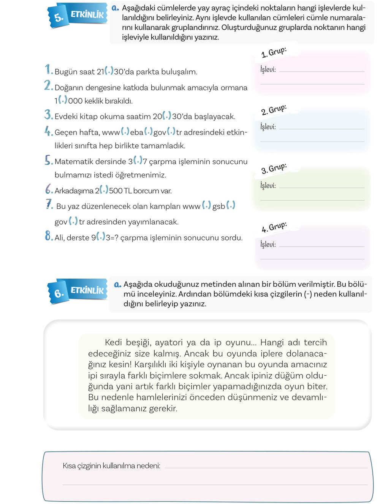
<!-- yer tutucu bulunamadı: sayfa sonuna eklendi -->

<!-- sayfa 41 -->

**b.** Satır sonuna sığmayan kelimelerin doğru bir şekilde ayrıldığı seçenekleri işaretleyiniz.

(ağaçlara)
◯ ............ ağ-
açlara
◯ ............ ağa-
çlara
◯ ............ ağaç-
lara

(sepetçi)
◯ ............ se-
petçi
◯ ............ sep-
etçi
◯ ............ sepe-
tçi

(oyuncak)
◯ ............ oy-
uncak
◯ ............ oyu-
ncak
◯ ............ oyun-
cak

(çocukluğum)
◯ ............ çoc-
ukluğum
◯ ............ çocuk-
luğum
◯ ............ çocukluğ-
um

**c.** Aşağıdaki kelimelerin satır sonuna sığmayacağını kabul edip kelimeleri kısa çizgi kul-
lanan olarak örnekteki gibi tekrar yazınız.

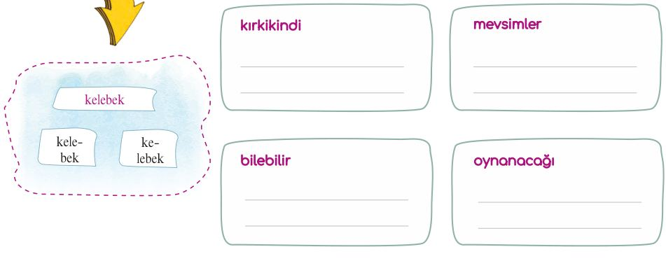

(kelebek)
............ kele-
bek
............ ke-
lebek

kırkikindi
____________________
____________________

mevsimler
____________________
____________________

bilebilir
____________________
____________________

oynanacağı
____________________
____________________

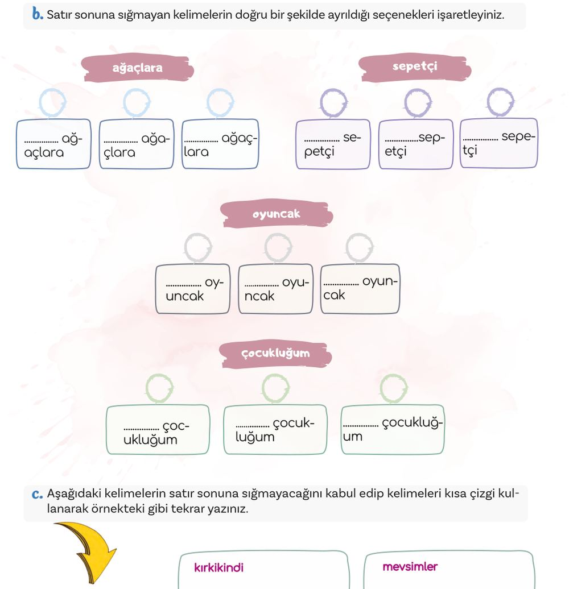

<!-- sayfa 42 -->

# 7. ETKİNLİK

**a.** Aşağıdaki cümlelerde altı çizili kelimelerin isim mi fiil mi olduğunu tespit ederek örnekteki gibi yazınız.

Geleneksel $\underbrace{\text{oyunların}}$ <!-- KONTROL: Marker'da karşılığı yok, uydurma olabilir --> daha çok tanıtılması $\underbrace{\text{gerekir}}$ <!-- KONTROL: Marker'da karşılığı yok, uydurma olabilir -->.
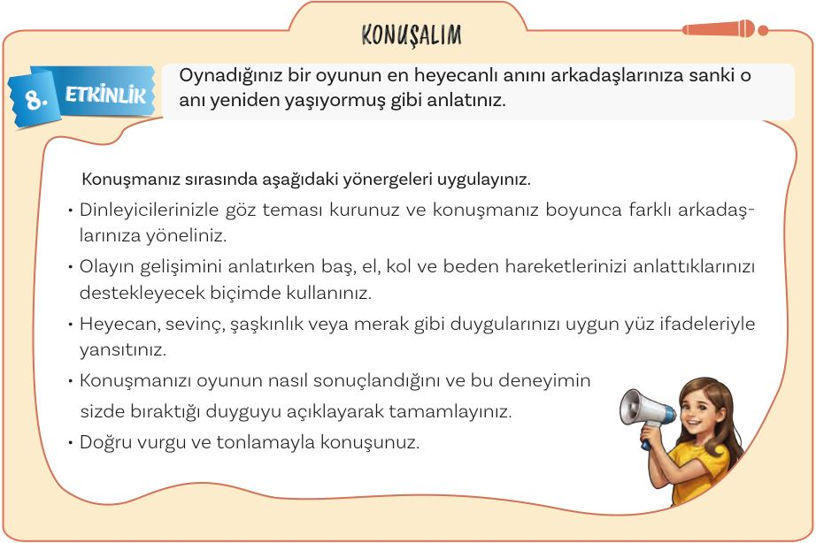
$\text{............}$ $\text{............}$

Oyuncaklar eğlence ile $\underbrace{\text{deneyimi}}$ <!-- KONTROL: Marker'da karşılığı yok, uydurma olabilir --> $\underbrace{\text{buluşturur}}$ <!-- KONTROL: Marker'da karşılığı yok, uydurma olabilir -->.

$\text{............}$ $\text{............}$

$\underbrace{\text{Kültürümüzü}}$ <!-- KONTROL: Marker'da karşılığı yok, uydurma olabilir --> korumak da vatan $\underbrace{\text{savunması}}$ <!-- KONTROL: Marker'da karşılığı yok, uydurma olabilir --> $\text{sayılır}$ <!-- KONTROL: Marker'da karşılığı yok, uydurma olabilir -->.
$\text{fiil}$ <!-- KONTROL: Marker'da karşılığı yok, uydurma olabilir -->
$\text{............}$ $\text{............}$

Takım oyunlarının $\underbrace{\text{önemini}}$ <!-- KONTROL: Marker'da karşılığı yok, uydurma olabilir --> $\underbrace{\text{vurgulamıştı}}$ <!-- KONTROL: Marker'da karşılığı yok, uydurma olabilir --> öğretmenimiz.
$\text{............}$ $\text{............}$

**b.** İsim olarak belirlediğiniz iki kelimeyi cümle içinde kullanınız.

__________________________________________________________________________

# KONUŞALIM

**8. ETKİNLİK**

Oynadığınız bir oyunun en heyecanlı anını arkadaşlarınıza sanki o anı yeniden yaşıyormuş gibi anlatınız.

Konuşmanız sırasında aşağıdaki yönergeleri uygulayınız.

* Dinleyicilerinizle göz teması kurunuz ve konuşmanız boyunca farklı arkadaşlarınıza yöneliniz.
* Olayın gelişimini anlatırken baş, el, kol ve beden hareketlerinizi anlattıklarınızı destekleyecek biçimde kullanınız.
* Heyecan, sevinç, şaşkınlık veya merak gibi duygularınızı uygun yüz ifadeleriyle yansıtınız.
* Konuşmanızı oyunun nasıl sonuçlandığını ve bu deneyimin sizde bıraktığı duyguyu açıklayarak tamamlayınız.
* Doğru vurgu ve tonlamayla konuşunuz.

<!-- sayfa 43 -->

9. ETKİNLİK Karekodu okutarak “Oyun Dünyamız” adlı etkileşimli içeriği yönergeler doğrultusunda tamamlayınız.
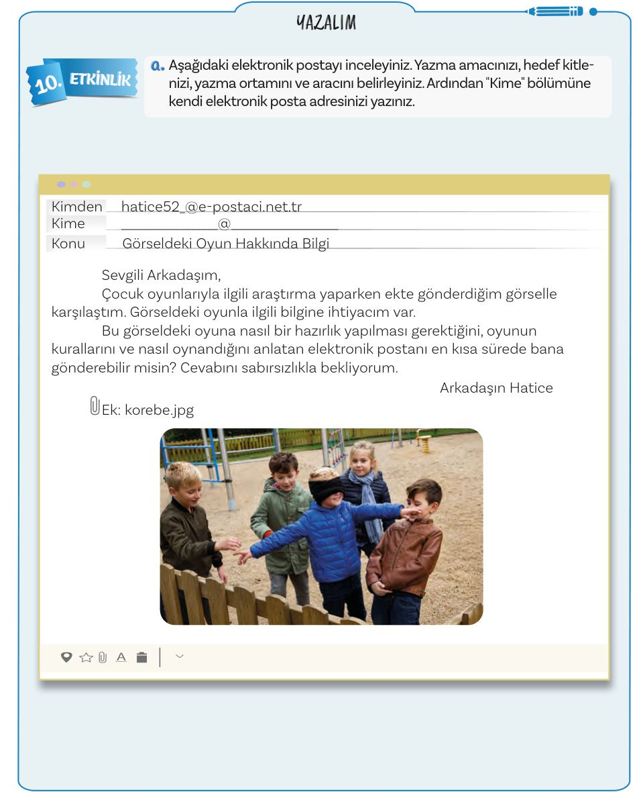

# YAZALIM

10. ETKİNLİK

a. Aşağıdaki elektronik postayı inceleyiniz. Yazma amacınızı, hedef kitlenizi, yazma ortamını ve aracınızı belirleyiniz. Ardından "Kime" bölümüne kendi elektronik posta adresinizi yazınız.

| | |
| :--- | :--- |
| Kimden | hatice52_@e-postaci.net.tr |
| Kime | \_\_\_\_\_\_\_\_\_\_\_\_\_\_\_\_\_\_@\_\_\_\_\_\_\_\_\_\_\_\_\_\_\_\_\_\_ |
| Konu | Görseldeki Oyun Hakkında Bilgi |

Sevgili Arkadaşım,

Çocuk oyunlarıyla ilgili araştırma yaparken ekte gönderdiğim görselle karşılaştım. Görseldeki oyunla ilgili bilgine ihtiyacım var.

Bu görseldeki oyuna nasıl bir hazırlık yapılması gerektiğini, oyunun kurallarını ve nasıl oynandığını anlatan elektronik postanı en kısa sürede bana gönderebilir misin? Cevabını sabırsızlıkla bekliyorum.

Arkadaşın Hatice

Ek: korebe.jpg

<!-- sayfa 44 -->

**b.** Arkadaşınız Hatice'den gelen bu elektronik postaya aşağıdaki yönergeleri göz önünde bulundurarak bir cevap yazınız.

* "Kimden" bölümüne kendi elektronik posta adresinizi yazınız.
* Yazınıza yazma ortamınızı da dikkate alarak uygun selam ve hitap ifadeleriyle başlayınız. Yazınızı uygun şekilde de sonlandırınız.
* Nezaket kurallarına uygun bir iletişim dili kullanınız.
* Vereceğiniz bilgilerin doğru ve güvenilir olmasına dikkat ediniz.
* Yazım ve noktalama kurallarına uyunuz.

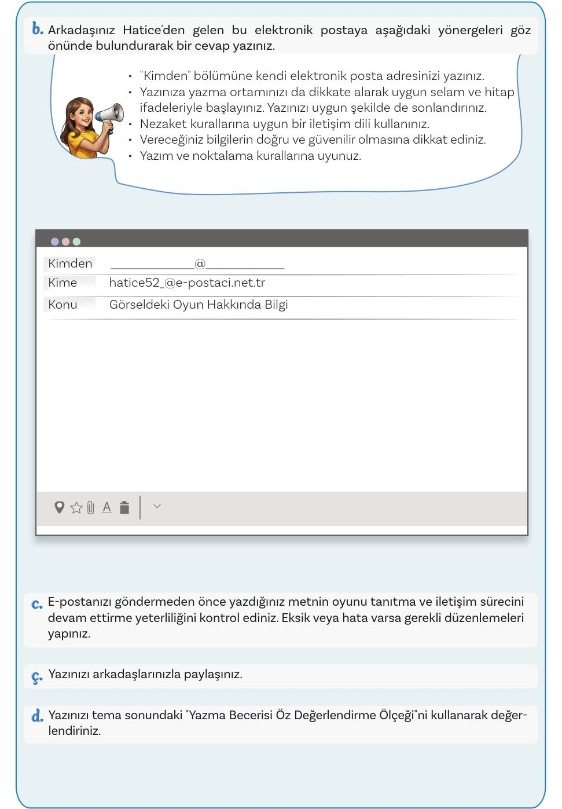

| | |
| :--- | :--- |
| Kimden | \_\_\_\_\_\_\_\_\_\_\_\_\_\_\_\_\_\_@\_\_\_\_\_\_\_\_\_\_\_\_\_\_\_\_\_\_ |
| Kime | hatice52\_@e-postaci.net.tr |
| Konu | Görseldeki Oyun Hakkında Bilgi |

| | |
| :--- | :--- |
| | |
| | |
| | |
| | |
| | |
| | |
| | |
| | |
| | |
| | |
| | |
| | |
| | |
| | |
| | |
| | |
| | |
| | |
| | |
| | |
| | |
| | |
| | |
| | |
| | |
| | |
| | |
| | |
| | |
| | |
| | |
| | |
| | |
| | |
| | |
| | |
| | |
| | |
| | |
| | |
| | |
| | |
| | |
| | |
| | |
| | |
| | |
| | |
| | |
| | |
| | |
| | |
| | |
| | |
| | |
| | |
| | |
| | |
| | |
| | |
| | |
| | |
| | |
| | |
| | |
| | |
| | |
| | |
| | |
| | |
| | |
| | |
| | |
| | |
| | |
| | |
| | |
| | |
| | |
| | |
| | |
| | |
| | |
| | |
| | |
| | |
| | |
| | |
| | |
| | |
| | |
| | |
| | |
| | |
| | |
| | |
| | |
| | |
| | |
| | |
| | |
| | |
| | |
| | |
| | |
| | |
| | |
| | |
| | |
| | |
| | |
| | |
| | |
| | |
| | |
| | |
| | |
| | |
| | |
| | |
| | |
| | |
| | |
| | |
| | |
| | |
| | |
| | |
| | |
|

<!-- sayfa 45 -->

# Keşif Yolculuğu

> İnsan ilişkilerinde hediyeleşmenin önemiyle ilgili ne düşünüyorsunuz?
> Bir arkadaşınıza ya da bir büyüğünüze hediye alırken nelere dikkat edersiniz? Ne alacağınıza nasıl karar verirsiniz?

* Öğretmeniniz metni okurken onu dikkatlice dinleyiniz.
* Metni vurgu ve tonlamaya dikkat ederek normal konuşma hızınıza yakın bir hızda sesli okuyunuz.

## BİR GÜZEL HEDİYE

Mahalleye yeni taşınmıştık. Okuluma yürüyerek on dakikada ulaşabiliyordum. Sevmiştim evimizi, sokağımızı. Bakkal, manav, kasap dükkânları yakındı bize. Okula giderken önünden geçtiğim bir oyuncakçı dükkânı vardı. Bazı zamanlar durur seyrederdim vitrinini süsleyen oyuncakları. İçeri girip yakından bakmak, dokunmak isterdim ama çekinirdim. Sonunda karşıma, oyuncakçı dükkânına çekinmeden girip onları yakından görebileceğim bir fırsat çıktı. Kuzenim doğum günü nedeniyle parti verecekti.

Ona hediye almak için harçlıklarımdan biriktirdiğim bir miktar param vardı ancak yeterli değildi. Bu yüzden babamdan biraz harçlık istedim. Onu şaşırtacak bir hediye seçmek istiyordum. Henüz ne alacağımı bilmiyordum ama nereden alacağımı biliyordum.

(...)

Aynı yaştaydık kuzenimle. İkimiz de dördüncü sınıfa gidiyorduk. Buse'nin çok oyuncağı vardı. Bu yüzden ona hediye seçmek hiç de kolay değildi. Bu dükkânda mutlaka değişik bir şeyler bulabileceğime yürekten inanıyordum.

Oyuncakçı dükkânının önündeydim işte. Kapıya yöneldim. Günlerdir sadece vitrinden seyrettiğim birbirinden güzel oyuncakları artık yakından görebilecektim. Yüreğimi heyecan kaplamıştı. Kapıyı aralayıp içeriye girdim. (...) Masanın arkasında yaşlı bir amca oturuyor-

<!-- sayfa 46 -->

bir şeylerle uğraşıyordu. Sanki bozuk bir oyuncağı tamir ediyor gibiydi. Gözlüklerinin 
üzerinden bana baktı. Gülümsedi.
"Hoş geldin Küçük Bey." dedi.
İlk defa birisi bana "bey" diyordu. Hoşuma gitmişti.
"Hoş bulduk. Şey... Ben oyuncaklara bakacaktım." 
"Tabii. İstediğin kadar bakabilirsin." dedikten sonra tekrar işiyle ilgilenmeye başladı.
Ne sevimli bir amcaydı. Üzerimden çekingenliğimi atmış, rahatlamıştım. Neredeyse 
bütün oyuncakları tek tek inceledim. Hepsi çok güzeldi ama benim istediğim gibi Buse'yi 
şaşırtacak bir hediye yoktu içlerinde. Bebekler, çay fincanları, makyaj setleri... Bunların 
benzerlerinden vardı kuzenimde. Daha farklı bir şey olmalıydı. Belki de bir kitap ya da saç 
tokası almalıydım. Dünyanın en zor işi hediye seçmek olmalıydı herhalde.
"Özellikle aradığın bir şey var mı Küçük Bey?" diye sordu Oyuncakçı Amca yerinden kalkıp 
yanıma gelerek.
"Evet. Buse için hediye seçmeye çalışıyorum." 
"Buse?"
"Kuzenim. Yarın doğum günü de."
"Anladım. Hiçbir şey beğenemedin mi bunca oyuncağın arasından?"
"Hepsi çok güzel ama ben öyle bir şey istiyorum ki... Onda olmayan... Paketi açınca 
şaşıracağı ve çok beğeneceği."
"Benimle gel Küçük Bey. Sanırım ilgini çekecek bir şey var burada?"
(...)
"Bunları tanıyor musun?"
"Karagöz ve Hacivat."
"Evet doğru. Sen geldiğinde bitirmek üzereydim." 
"Siz mi yaptınız bu kuklaları?"
"Evet, Küçük Bey."
"Ben bozulan bir oyuncağı tamir ettiğinizi sanmıştım."
"Oyuncak tamir ettiğim de oluyor ama çok uzun zamandır kukla yapıyorum."
"Kukla yapmak çok zevkli olmalı. Bana da öğretebilir misiniz nasıl yapıldığını?" 
"İstersen elbette öğretirim. Çok da sevinirim. Günümüzde kukla yapan ustalar kalmadı 
pek fakat önce ailenden izin alman gerekli."
"Alırım."

<!-- sayfa 47 -->

"O zaman ben de sana nasıl kukla yaptığımı öğretirim." dedikten sonra iplerinden çiviye asılmış olan tahtadan yapılmış ördeği göstererek "Böyle iplerle oynatılan kuklalar da var." dedi.

Tahta ördeği ipleri yöneterek yürütüyordu. Badi badi adım atıyordu ördek ve arada bir gagasını yere vurarak karnını doyuruyormuş gibi görünüyordu. Muhteşemdi.

"Bunlar da ele geçirilerek oynatılan kuklalar." dedi.

"Hepsi çok güzel."

"İstersen evde işe yaramayan, atılacak malzemelerden de kuklalar yapabilirsin."

"Nelerden yani?"

"Boş pet şişelerden, tuvalet kâğıdı rulolarından, tahta kaşıklardan, eldiven ya da çoraptan yararlanabilirsin. Sonra renkli ipliklerden, artık kumaşlardan saç, gazoz kapaklarından veya düğmelerden göz yapabilirsin."

Gözlerim ışıldadı. Ne çok şey öğrenmiştim şu kısacık zamanda.

"Söyle bakalım şimdi. Karar verdin mi Buse için hangi kuklayı seçeceğine?"

Başımı salladım.

"Karagöz ve Hacivat'ı." dedim.

"Gölge oyunu perdede oynatılır, biliyorsun değil mi?”

"Evet. Bir keresinde akşam yemeği için restorana gitmiştik. Orada bir sahne vardı. Çocuklar için kukla gösterileri yapılıyordu. Çok eğlenmiştim. Ben de karton kutudan bir sahne yapabilirim. Beyaz bir örtüyü raptiyelerle tuttururum üzerine."

"Çok güzel bir seçim Küçük Bey. O zaman güzel bir hediye paketi yapalım Buse için." dedi.

Teşekkür ettim. Kapıdan çıkarken seslendi Oyuncakçı Amca.

"Küçük Bey... İsmin neydi senin?”

"Orkun."

"Memnun oldum Orkun. Benim adım da Galip."

"İyi günler Galip Amca." diyerek el salladım.

Evimize doğru yürürken içim çok rahattı. Seçtiğim hediyenin çok değişik, çok özel ve güzel olduğunu biliyordum. Eğer kuzenimi biraz olsun tanıyorsam Karagöz ve Hacivat'a hem şaşıracak hem de sevincinden kanat takıp uçacaktı.

**Sibel UNUR ÖZDEMİR**
(Kısaltılmıştır.)

<!-- sayfa 48 -->

# 1. ETKİNLİK

**a.** Aşağıda metinde geçen bazı kelimeler ve bu kelimelerin anlamları verilmiştir. Bu kelimelerin metinde kullanılan anlamını örnekteki gibi işaretleyiniz.

| Kelime | Anlam Seçenekleri |
| :--- | :--- |
| çekinmek | 🔴 Saygı, korku, utanma vb. duygularla bir şey yapmak istememek, kaçınmak. ⚪ Bir şey sürünmek. |
| dükkân | ⚪ Görevli olarak çalışılan yer. ⚪ Esnafın perakende satış yaptığı, küçük zanaat sahiplerinin çalıştıkları yer; işletme, iş yeri. |
| seçmek | ⚪ Benzerleri arasında hoşa gideni seçip almak veya yararlanmak için ayırmak; saylamak. ⚪ Ne olduğunu anlamak, fark etmek. |
| armağan | ⚪ Bir kimsenin emek verdiği dalda onu anmak için hazırlanan ve başka kişilerin bilimsel makalelerini içeren eser. ⚪ Birini sevindirmek, mutlu etmek, onurlandırmak, kutlamak için veya anı olarak verilen şey. |
| vitrin | ⚪ Nesnelerin insanlara gösterilmek ve satılmak için sergilendiği camlı bölme veya yer. ⚪ İçine konan şeylerin görünmesi için yapılmış camlı dolap. |
| kukla | ⚪ Başkasının etkisinde olan, onun isteklerine göre davranan kimse. ⚪ Hareketli yerleri iplikle sanatçının parmaklarına bağlanarak veya eldiven gibi bir kesiti kullanarak bir perdenin üzerinden oynatılan, bez, karton vb. hafif nesnelerden yapılmış insan ve hayvan figürleri. |

**b.** Yukarıdaki kelimelerden hangisi okuduğunuz metnin konusuyla ilişkilidir? Neden?

**c.** Metinle ilişkili olduğunu belirlediğiniz yukarıdaki kelimelerle birlikte metindeki hangi kelimeler bu metnin anahtar kelimeleri olabilir? Belirleyip aşağıya yazınız.

___________________________________________________________________________
___________________________________________________________________________

**ç.** Anahtar kelime olarak belirlediğiniz kelimelerin varsa eş anlamlarını söyleyiniz.

___________________________________________________________________________

# 2. ETKİNLİK

Aşağıdaki soruları okuduğunuz metinden hareketle sözlü olarak cevaplayınız.

1. Orkun'un kuzeni Buse için farklı bir hediye aramasının sebebi nedir?
2. Oyuncakçı dükkânının vitrini ile içi arasında nasıl bir fark vardır?

<!-- sayfa 49 -->

# İZLE UYGULA ÖĞREN
# PLANLAMA, TASLAK (METİN) OLUŞTURMA, GÖZDEN GEÇİRME, PAYLAŞMA STRATEJİLERİ

**Planlama:**
Yazma öncesi hazırlık yapmaktır. Planlamada önce metnin konusunu seçersiniz, sonra konuyla ilgili bilgi toplarsınız. Metinde bu bilgilere nasıl ve hangi sırayla yer vereceğinizi belirlersiniz. Yazınızın dil ve anlatım özelliklerine karar verirsiniz. Artık taslağınızı oluşturmaya başlayabilirsiniz.

**Taslak (Metin) Oluşturma:**
Yazdığınız metni nasıl ve kimlerle paylaşacağınıza karar vererek gerekli çalışmaları yaptığınız stratejidir. Metninizi sınıf panosunda, okul gazetesinde, bir dergide yayımlayabilir; uygun çevrim içi ortamlarda da (okulun genel ağ sayfası vb.) paylaşabilirsiniz.

**Gözden Geçirme:**
Taslağınızı hem içerik hem yazım ve noktalama yönünden düzenlediğiniz aşamadır. Bu aşamada taslağınızı birkaç kez okumak önemlidir. Belirlediğiniz hataları düzeltip yazınızda gerekli gördüğünüz yerlerde ekleme ve çıkarmalar yapabilirsiniz. Taslağınıza son şeklini verdiniz. Artık metninizi paylaşmak için hazır mısınız?

**Paylaşma:**
Yazdığınız metni nasıl ve kimlerle paylaşacağınıza karar vererek gerekli çalışmaları yaptığınız stratejidir. Metninizi sınıf panosunda, okul gazetesinde, bir dergide yayımlayabilir; uygun çevrim içi ortamlarda da (okulun genel ağ sayfası vb.) paylaşabilirsiniz.

Haydi, başlayınız!

Önce örnekleri okuyunuz ve paragraflardaki renkli yazılmış bölümlere dikkat ediniz. Renklendirmenin neye göre yapıldığını belirlemeye çalışınız.

## Bağımsız Betimleme Paragrafı Örneği

 "Rafadan Tayfa" çizgi filminin önemli karakterlerinden biridir Basri amca. Yetmişli yaşlarda, zayıf ve orta boylu, beli de hafif büküktür. Saçlarının çoğu dökülmüştür, kafasının üst kısmında kırlaşmış az bir saçı kalmıştır. İri, kahverengi gözleri; yuvarlak bir burnu ve çenesine kadar inen kırlaşmış favorileri dikkat çeker. Kaşları genelde çatıktır. Alnında birkaç kırışıklık vardır. Çoğunlukla takım elbise giyer ve elinde hep bir baston taşısa da göründüğünden daha çeviktir. Mahalleli tarafından sevilen ve saygı duyulan Basri amca, sinirli biri gibi görünse de çocukları çok sever, onlara karşı cömert ve merhametlidir. Ayrıca ilerleyen yaşının verdiği olgunluk, sahip olduğu deneyim ve bilgi birikimi de dikkatlerden kaçmaz Tüm bu özellikleriyle Basri amca "Rafadan Tayfa"nın özgün karakter-

<!-- sayfa 50 -->

# Metin İçi Betimleme Paragrafı Örneği

"Rafadan Tayfa"nın huysuz ihtiyarı olarak bilinen Basri amca; yetmişli yaşlarda, orta boylu ve zayıf bir adam... Kafasının üstündeki kırlaşmış saçları ve eski Türk filmlerindeki oyuncuları andıran uzun favorileri, bir anda yaşını ele veriyor. Alnındaki iki çizginin altında duran çatık kaşları ise onun hep sinirli biriymiş gibi algılanmasına sebep oluyor. Basri amcanın bu algının aksine komşularını, özellikle de çocukları çok sevdiği, onlara karşı cömert ve merhametli olduğu hemen anlaşılabiliyor. Üstelik mahalleli de onu seviyor; bilgili, görmüş geçirmiş biri olduğu için ona saygı duyuyor.

> Paragraflardaki yeşil rengin fiziksel, kırmızı rengin kişilik özelliklerini anlattığını; mavi rengin ise giriş ve sonuç cümleleri olduğunu belirleyebildiniz mi?

## Öğretmeninizi İzliyorsunuz

Öğretmeniniz herkesin tanıyıp bildiği birini betimleyeceği paragrafın planını ve taslağını tahtaya yazarken onu dikkatlice izleyiniz. Bu sırada aşağıdaki sorulara da odaklanınız.

### Öğretmeninizin

#### Planlaması
a. Metnin içeriğini belirlerken nelere dikkat etti?
b. İçeriğin metindeki sırasını nasıl belirledi?
c. Metinde kullanacağı dil ve anlatım özelliklerini neye göre belirledi?

#### Taslak (Metin) Oluşturması
a. Planındaki kelime veya kelime gruplarını cümlelere nasıl dönüştürdü?
b. Planını taslak metin hâline dönüştürürken yazma dışında nelere (düşünme, araştırma, düzeltme vb.) zaman ayırdı?

<!-- sayfa 51 -->

# Siz Uyguluyorsunuz

4-6 kişilik gruplar oluşturunuz ve öğretmeninizin rehberliğinde "Nasrettin Hoca"yı betimleyecek bir paragraf planlayıp paragrafın taslağını yazınız. Stratejileri kullanırken aşağıdakilere dikkat ediniz.

* Öğretmeniniz ne yapacağınızı kendi uygulamasındaki sıraya göre söyledikten sonra paragrafınızı grubunuzla planlayınız.
* Grubunuzla düşünüp tartışınız, ortak bir karara varınız, sonra kararınızı aşağıdaki çalışma kâğıdına yazınız.
* İhtiyaç duyarsanız öğretmeninizden yardım alınız.
* Öğretmeninizin uyarılarına uygun biçimde düzenlemelerinizi yapınız.

(Temsilî)

---

## Planınız

__________________________________________________________________
__________________________________________________________________
__________________________________________________________________
__________________________________________________________________
__________________________________________________________________

## Taslak Metniniz

__________________________________________________________________
__________________________________________________________________
__________________________________________________________________
__________________________________________________________________
__________________________________________________________________
__________________________________________________________________
__________________________________________________________________
__________________________________________________________________
__________________________________________________________________
__________________________________________________________________
__________________________________________________________________
__________________________________________________________________
__________________________________________________________________
__________________________________________________________________
__________________________________________________________________
__________________________________________________________________
__________________________________________________________________
__________________________________________________________________
__________________________________________________________________
__________________________________________________________________

<!-- sayfa 52 -->

# Yine Uyguluyorsunuz

Şimdi 2-3 kişilik gruplar oluşturunuz ve "Keloğlan"ı betimleyecek bir paragraf planlayınız. Ardından taslak metninizi oluşturunuz. Aşağıdaki yönergeleri dikkate alarak ilerleyiniz.

* Önceki uygulamalardaki sırayı takip ediniz.
* İhtiyaç duyarsanız öğretmeninizden yardım isteyiniz.
* Stratejiyi uygularken grup arkadaşlarınızla konuşup tartışınız. Ardından her biriniz aşağıdaki yazma alanına planınızı ve taslağınızı bireysel olarak yazınız.

Planınız
__________________________________________________________________
__________________________________________________________________
__________________________________________________________________
__________________________________________________________________
__________________________________________________________________
__________________________________________________________________
__________________________________________________________________

Taslak Metniniz
__________________________________________________________________
__________________________________________________________________
__________________________________________________________________
__________________________________________________________________
__________________________________________________________________
__________________________________________________________________
__________________________________________________________________
________________________________

<!-- sayfa 53 -->

# Sıra Sizde

Artık stratejilerin kullanımını öğrendiniz. Okuduğunuz metindeki "oyuncakçı amca"yı betimleyecek bir paragraf planlayınız ve taslak metni kimseden yardım almadan yazınız.

Planınız
___________________________________________________________________________
___________________________________________________________________________
___________________________________________________________________________
___________________________________________________________________________
___________________________________________________________________________

Taslak Metniniz
___________________________________________________________________________
___________________________________________________________________________
___________________________________________________________________________
___________________________________________________________________________
___________________________________________________________________________
___________________________________________________________________________
___________________________________________________________________________
___________________________________________________________________________
___________________________________________________________________________
___________________________________________________________________________
___________________________________________________________________________
________________________________________________

<!-- sayfa 54 -->

# Öğretmeninizi İzliyorsunuz

Öğretmeniniz taslak metni düzenleyip paylaşmaya hazır hâle getirirken siz de onu dikkatlice izleyiniz. Bu sırada aşağıdaki sorulara odaklanınız.

## Gözden Geçiriyor
a. Öğretmenimiz taslağı incelerken neler yaptı?
b. Düzeltmelerini yaparken hangi açıklamalarda bulundu?
c. Cümlelerin kısalığı/uzunluğu ve kelime seçimleri ile ilgili neler söyledi?
ç. Yazım ve noktalama hatalarını nasıl düzeltti?

## Paylaşıyor
a. Metni paylaşacağı ortama karar verirken neleri göz önünde bulundurdu?
b. Metni seçtiği paylaşım ortamına göre nasıl hazırladı? Yazısını desteklemek için ne tür destekleyiciler (görsel, video, çizim vb.) kullandı?

# Siz Uyguluyorsunuz

Daha önceki 4-6 kişilik grupla yazdığınız "Nasrettin Hoca"yı betimleyen paragrafınızı öğretmeninizin rehberliğinde gözden geçirip paylaşım için hazırlayınız. Stratejileri kullanırken aşağıdakilere dikkat ediniz.

* "Nasrettin Hoca"yı betimleyen paragrafınızı gözden geçirip paylaşım için hazırlayınız.
* Öğretmeniniz sırasıyla ne yapacağınızı söyledikten sonra grubunuzla ortak karara varınız ve kararınızı metninizde uygulayınız.
* İhtiyaç duyarsanız öğretmeninizden yardım alınız.

# Yine Uyguluyorsunuz

Şimdi de "Keloğlan"ı betimleyen paragrafınızı gözden geçirip paylaşım için hazırlayınız. Aşağıdaki yönergelere dikkat ediniz.

* Önceki uygulamalardaki sırayı takip ediniz.
* İhtiyaç duyarsanız öğretmeninizden yardım isteyiniz.
* Stratejiyi uygularken grup arkadaşlarınızla konuşup tartışınız. Ardından her biriniz kitabınızdaki taslak metninizi bireysel olarak gözden geçiriniz ve paylaşmaya hazır hâle getiriniz.

# Sıra Sizde

Okuduğunuz metindeki "oyuncakçı amca" için yaptığınız betimlemeyi gözden geçirip düzenleyiniz. Ardından "Yazalım"

<!-- sayfa 55 -->

# YAZALIM

### 3. ETKİNLİK

Betimleme paragrafı; bir kişi, varlık, mekân, olay ya da durumun ayırt edici özelliklerini okuyucunun zihninde canlandıracak şekilde anlatan paragraftır. Betimleme paragrafında görme, işitme, dokunma, koklama veya tat alma duyularından yararlanılarak ayrıntılara yer verilir. Amaç, anlatılanın okuyucunun zihninde belirgin ve canlı bir biçimde canlanmasını sağlamaktır.

**a.** Okuduğunuz kitaplardaki kahramanlarla aranızda bir bağ kurar mısınız? Bağ kurma nedeninizi söyleyiniz.

**b.** Aşağıdaki olayın anlatıldığı hikâye için bir kahraman oluşturunuz. Kahramanınızın özelliklerini ilgili yerlere yazınız. Yazarken aşağıdaki yönergeleri dikkate alınız.
* Anlatmak istediklerinizi kullanacağınız kelimelerin eş ya da yakın anlamlılarını tercih ederek yazınız.
* Kelime ya da kelime gruplarını yazma konunuza uygun kullanınız.

> **Hikâyedeki olay:** Birbirinden farklı özelliklere sahip üç iyi arkadaş, mahallelerindeki parkta buluşup oyun oynamaya başlar. Bir süre sonra içlerinden biri çok sevdiği kolyesinin kaybolduğunu fark eder. Kolyeyi aramaya koyulmalarıyla bir macera başlar...

#### Benim Kahramanım

Adı: __________________________________________________________________________

Dış görünüşü: __________________________________________________________________

Korkuları: _____________________________________________________________________

Yetenekleri: ____________________________________________________________________

İlgi alanları: ___________________________________________________________________

Alışkanlıkları: __________________________________________________________________

**c.** Öğretmeninizin yönlendirmesiyle uygun ortamlarda (sınıf panosu, okul gazetesi, dijital ortamlar vb.) paylaşınız. Paylaşırken yazdıklarınızdan hareketle kahramanınızın görselini çiziniz.

<!-- sayfa 56 -->

# 4. ETKİNLİK

Tahmin işlevli söz varlığı, bir olayın ya da durumun gelecekte nasıl olacağını veya sonucunu önceden kestirmeye yarayan kelime ve ifadelerden oluşur. Dilimizde -Abil-, -mıştır, -mış olmalı, belki, belki de, sanki, galiba, tahminim, muhtemelen, bence, güya, acaba, dediğine bakılırsa, gördüğüm kadarıyla, umarım, herhâlde vb. ifadeler tahmin bildirir.

**a. Aşağıdaki metni okuyunuz ve metinde koyu yazılmış, tahmin bildiren ifadeleri inceleyiniz.**

İp atlama yarışması için herkes heyecanla sırasını bekliyor. Zeynep'in yüzündeki gülümsemeye bakılırsa bu yarışmayı kolayca **kazanabilir**. **Galiba** geçen yıl da aynı yarışmaya katılmış ve dereceye girmişti. Her gün evde çalışıyormuş. **Belki de** bu yüzden bu kadar hızlı ve dengeli. Sırada bekleyen Mert ise biraz endişeli, **sanki** daha önce hiç ip atlamamış gibi elleri titriyor. **Bence** herkes ilk defa bir şey denerken **heyecanlanabilir**, bu çok normal bir durum. Düdük sesiyle yarışma başladı. **Tahminim**, yarışmayı Zeynep kazanacak. Bazı öğrenciler, "Zeynep **muhtemelen** yine birinci olacak." diye fısıldaşıyor. **Acaba** bu yıl sonuç geçen yılkinden farklı olur mu? Yarışma bitiğinde dereceye girenler açıklanacak. Herkes birbirini tebrik edecek çünkü önemli olan kazanmak değil, birlikte eğlenmek!..

**b. Aşağıdaki diyaloğu tablo ile verilen tahmin işlevli söz varlığından uygun olanları yazarak tamamlayınız. Kullandığınız söz varlığını tekrar kullanmayınız.**

| bence | muhtemelen | sanki | galiba | acaba |
| :--- | :--- | :--- | :--- | :--- |
| anlaşılan | meğer | belki | belki de | dediğine bakılırsa |

**(Hacivat, Karagöz'ün evinin önüne gelir.)**

**HACİVAT:** Karagöz'üm, hayırlı günler! Yeni oyunun hayırlı olsun, \_\_\_\_\_\_\_\_\_\_\_\_\_\_\_\_ bu oyun seni çok eğlendirecek.

**KARAGÖZ:** Hoş geldin Hacivat! Eğlendirmesine eğlendirecek de piyonları nereye koyacağımı bir türlü çözemedim. \_\_\_\_\_\_\_\_\_\_\_\_\_\_\_\_ oyunun kurallarını kutunun içine koymayı unutmuşlar.

**HACİVAT:** İlahi Karagöz'üm! Kutunun içinde bir yerlerde olmalı. \_\_\_\_\_\_\_\_\_\_\_\_\_\_\_\_ telaşla baktığın için bulamamışsındır.

**KARAGÖZ:** Kuralları bir an evvel bulup okuyabilsem piyonları nasıl yerleştireceğimi anlayacağım. Hay Allah, nerede bu kurallar!

**HACİVAT:** Sakin ol Karagöz'üm. Satıcının \_\_\_\_\_\_\_\_\_\_\_\_\_\_\_\_ oyunun parçaları eksiksiz konulmuş. \_\_\_\_\_\_\_\_\_\_\_\_\_\_\_\_ kurallar başka bir kâğıda not edilmiştir.

**KARAGÖZ:** Eee, o kâğıt nerede o zaman? \_\_\_\_\_\_\_\_\_\_\_\_\_\_\_\_ yanlışlıkla çöpe mi attım?

**HACİVAT:** \_\_\_\_\_\_\_\_\_\_\_\_\_\_\_\_ kutunun gizli bir bölmesi vardır, oradadır.

**KARAGÖZ:** Dur bakayım, burada bir bölme var... Hah! Açıldı! \_\_\_\_\_\_\_\_\_\_\_\_\_\_\_\_ oyunun ustası olmuşum da haberim yokmuş!

**HACİVAT:** Görüyor musun Karagöz'üm? \_\_\_\_\_\_\_\_\_\_\_\_\_\_\_\_ biraz dikkatle her şeyin üstesinden...

<!-- sayfa 57 -->

c. Karekodu okutarak "Tahminde Bulunalım" adlı etkileşimli içeriği yönergeler doğrultusunda tamamlayınız. 

# KONUŞALIM

## 5. ETKİNLİK

a. Karekodu okutarak "Mehmet ve Dedesi" adlı metni dikkatlice dinleyiniz.

b. Mehmet'in dedesiyle geçirdiği bir günü, o günü özel kılan detayları dinlediniz. Siz de dinlediğiniz metindeki gibi aile büyüklerinizden biriyle geçirdiğiniz özel bir gününüzü anlatan bir konuşma yapınız. O günü özel kılan komik bir durum, öğrendiğiniz değerli bilgiler veya yaşadığınız bir olay olabilir.

* Konuşmayı başlatma, sürdürme ve sonlandırmaya yönelik uygun selam, hitap ve bitirme ifadelerini kullanınız.
* Olay, konu, durum ya da problemle ilgili size yöneltilen soruları cevaplayınız.
* Konuşmanızda bu temada öğrendiğiniz söz varlığını kullanınız.

c. Tema sonunda yer alan "Konuşma Becerisi Öz Değerlendirme Ölçeği"ni kullanarak konuşma sürecinizdeki güçlü ve gelişmeye açık yönlerinizi tespit ediniz. Sonraki etkinliklerde bu yönlerinizi geliştirmeye çalışınız.

ç. Konuşma sürecinize yönelik deneyiminizi (konuşmanın amacı, konusu, hedef kitleye uygunluğu; duygu ve düşünceleri aktarmada yeterliliği vb.) gözden geçiriniz. Konuşmanızda hangi aşamalarda zorluk çektiniz? Söyleyiniz.

# Bu Görev Bizim

› Geçmişte müzeler yalnız fiziki olarak ziyaret edilirken günümüzde sanal müze gezintileri yapılabilmektedir. Karekodu okutarak "Müzeleri Geziyorum" adlı etkileşimli içeriği tamamlayınız. İçerikten hareketle "Müze ziyaretleri gelecekte nasıl değişebilir?" sorusunun cevabına yönelik mantıklı tahminlerde bulununuz.

<!-- sayfa 58 -->

› Metni noktalama işaretlerine dikkat ederek okuyunuz.

# ÇOCUKLUK

Affan Dede'ye para saydım,
Sattı bana çocukluğumu.
Artık ne yaşım var, ne adım;
Bilmiyorum kim olduğumu.
Hiçbir şey sorulmasın benden;
Haberim yok olan bitenden.

Bu bahar havası, bu bahçe;
Havuzda su şırıl şırıldır.
Uçurtmam bulutlardan yüce,
Zıpzıplarım pırıl pırıldır.
Ne güzel dönüyor çemberim;
Hiç bitmese horoz şekerim!

Cahit Sıtkı TARANCI

<!-- sayfa 59 -->

# ÜRETİM ZAMANI

 Yazma

**a.** Tema boyunca öğrendiğiniz geleneksel çocuk oyunları ve bunların kurallarıyla ilgili aşağıdaki yönergeler doğrultusunda bir bilgi görseli oluşturunuz.

> Genel ağda güvenilir kaynaklardan bilgi görselinin ne olduğuna dair bir araştırma yapınız. Bilgi görseli örneklerini inceleyiniz.
> Dijital ortamları kullanırken kişisel bilgilerinizin başkalarının eline geçmemesi konusunda hassas davranınız.
> Tema boyunca ilginizi çeken çocuk oyunları ve özelliklerini belirleyiniz.
> Belirlediğiniz oyunların hepsi ya da bazıları için görseller bulunuz.
> İncelediğiniz bilgi görsellerini model alarak bilgisayar ortamında bilgi ve görselleri uygun şekilde bir araya getirip kendi tasarımınızı yapınız. Tasarım sırasında büyüklerinizden destek alınız.
> Tasarımda kullandığınız bilgi ve görsellerin kaynakçalarına çalışmanızda yer veriniz.
> Çalışmanızı yaparken yazım kuralları ve noktalama işaretlerine dikkat ediniz.
> Tasarladığınız bilgi görselinin baskısını alabilir ya da bilgi görselini dijital olarak kaydedebilirsiniz.
> Atölye çalışmanızı öğretmeninizin verdiği sürede tamamlamaya özen gösteriniz.

**b.** Yaptığınız çalışmayı aşağıdaki ölçekte verilen ölçütlere göre değerlendiriniz. Ölçeğin sonuçlarından hareketle güçlü yönlerinizi belirleyiniz. Geliştirilmesi gereken yönlerinizi öğretmeninizin geri bildirimleriyle sonraki yazma etkinliklerinde geliştirmeye çalışınız.

| Ölçütler | Evet | Kısmen | Hayır |
| :--- | :---: | :---: | :---: |
| Hazırlık öncesi genel ağ araştırması yaptım. | | | |
| İlgimi çeken oyunları ve onların özelliklerini araştırdım. | | | |
| Araştırmalarım sırasında bilgi güvenliği konusunda dikkatli davrandım. | | | |
| Noktalama ve yazım kurallarına dikkat ederek yazdım. | | | |
| Yazımda önceki bilgilerimden de yararlandım. | | | |
| Temada yeni öğrendiğim kelime ve kelime gruplarını yazımda kullandım. | | | |
| Atölye çalışmamı öğretmenimin verdiği süre içinde tamamladım. | | | |
| Yazımda bilgi ve görselleri bir arada uygun bir şekilde kullandım. | | | |
| Yazımda yararlandığım bilgi ve görsellerin kaynakçalarına yer verdim. | | | |

**c.** Hazırladığınız bilgi görselini sınıf panonuzda veya uygun dijital ortamlarda paylaşınız.

<!-- sayfa 60 -->

# Konuşma

**a.** Bilgi görselinizi hazırlama aşamalarını anlattığınız bir sunum yapınız. Sunumunuzda aşağıdaki yönergeleri dikkate alınız.

> Sunumunuza selam ve hitap ifadeleriyle başlayınız.
> Yaptığınız çalışma sırasındaki deneyimlerinizle birlikte çalışmanızın içeriğiyle ilgili bilgilendirme yapınız.
> Arkadaşlarınızın soru sormasına olanak tanıyınız.
> Temanın anahtar kelimelerini, yeni öğrendiğiniz kelime ve kelime gruplarını kullanmaya özen gösteriniz.
> Sesinizi tüm arkadaşlarınızın işiteceği biçimde ayarlayınız.

**b.** Sunumunuzu aşağıdaki ölçekte verilen ölçütlere göre değerlendiriniz. Ölçeğin sonuçlarından hareketle güçlü yönlerinizi belirleyiniz. Geliştirilmesi gereken yönlerinizi öğretmeninizin geri bildirimleriyle sonraki konuşma etkinliklerinde geliştirmeye çalışınız.

| Ölçütler | Evet | Kısmen | Hayır |
| :--- | :---: | :---: | :---: |
| Konuşmama selam ve hitap ifadeleriyle başladım. | ☐ | ☐ | ☐ |
| Konuşmamla beden dilimin birbiriyle uyumlu olmasına dikkat ettim. | ☐ | ☐ | ☐ |
| Temadan yeni öğrendiğim kelime ve kelime gruplarını konuşmamda kullandım. | ☐ | ☐ | ☐ |
| Temanın anahtar kelimelerini konuşmamda kullandım. | ☐ | ☐ | ☐ |
| Ses tonumu herkesin işitebileceği şekilde ayarladım. | ☐ | ☐ | ☐ |
| Konuşmamda çalışma sırasındaki deneyimlerime ve çalışmamın içeriğine yer verdim. | ☐ | ☐ | ☐ |
| Arkadaşlarımın sorduklarına nezaketle yanıt verdim. | ☐ | ☐ | ☐ |

<!-- yer tutucu bulunamadı: sayfa sonuna eklendi -->

<!-- sayfa 61 -->

# KONTROL NOKTASI

**MANGALA/GÖÇÜRME OYUNU**

Mangala/göçürme genellikle iki kişi tarafından oynanan, bunun yanı sıra iki grubun birlikte oynamasına da imkân sağlayan Türk strateji ve zekâ oyunudur.

Toprağa kazılan çukurlarda oynanabileceği gibi oyuna özel tasarlanmış tahtalarda da oynanabilir. Her yaştan oyuncunun oynayabileceği bu oyunda amaç, en çok taşı toplamaktır.

Oyunda taş yerine tohum ya da tane de kullanılabilir. Oyun, oyuncu sayısına ve oyunun çeşitlerine göre iki, üç ya da dört sıralı çukurlarda oynanabilir.

Taşlar oyunun kurallarına göre çukurlara dağıtılır ve en çok taşı toplayabilen oyuncu oyunu kazanır. Oyunun süresi de oyunculara ve oyunun kurallarına bağlı olarak değişir.

Osmanlı Dönemi'nde özellikle saraylarda, hanlarda ve cami avlularında oynanan mangala oyunu, sosyalleşme ve kültür paylaşımı araçlarından biri olarak görülmüştür. Bu durum Osmanlı Dönemi'ne ait pek çok tasvir ve resimde de izlenebilmektedir.

Bugün ise "mangala oyunu"; her yaştan oyuncunun ev, okul, kurs, geleneksel kutlama alanları gibi farklı mekânlarda her an oynanabilmesi bakımından sosyalleşme ve kültür paylaşımı işlevini sürdürmektedir.

Dîvânu Lugâti't-Türk'te Göçürme veya Köçürme adıyla anılan oyun Türkiye'nin pek çok yerinde "Göçürme", "Mankala", "Kümelek", "Dokuz Kuyu", "Dokuz Taş", "Emme", "Kale", "Mele", "Hane", "Kuyucuk Taşı", "Göçme" gibi farklı adlarla bilinir.

Geniş bir coğrafyada kendine yer bulan oyun; uygulayıcılarının bilişsel, duyuşsal ve motor becerilerini geliştiren, stratejik ve yaratıcı düşünme kabiliyetini arttıran bir yapıya sahiptir. Dünya üzerinde bu oyunun onlarca farklı çeşidi bulunmaktadır.

*(Genel ağdan alınmıştır.)*

1. **Okuduğunuz metinden hareketle aşağıdaki soruları cevaplayınız.**

   a) Aşağıdaki görsellerden hangisi mangala oyununu gösteriyor olabilir? İşaretleyiniz.

   b) Mangala oyunu nasıl oynanmaktadır?
   c) Sizce mangalanın sosyalleşme ve kültür paylaşımı araçlarından biri olarak görülmesinin sebebi nedir?

<!-- yer tutucu bulunamadı: sayfa sonuna eklendi -->

<!-- sayfa 62 -->

2. a) Metnin anahtar kelimelerini yazınız.
________________________________________________________________________________

b) Aşağıda anlamı verilen kelimelerin metnin anahtar kelimelerinden hangilerine ait olduğunu yazınız.
________________________________________________________________________________

**Anlam:** Yetenek ve zekâ geliştirici, belli kuralları olan, iyi vakit geçirmeye yarayan eğlence.
________________________________________________________________________________

**Anlam:** Kişinin yatkınlık ve öğrenime bağlı olarak bir işi başarma ve bir işlemi amaca uygun olarak sonuçlandırma yeteneği; maharet.
________________________________________________________________________________

3. a) Zekâ oyunlarından hangilerini oynadınız?
________________________________________________________________________________

b) Oynadığınız bir zekâ oyunundaki gözlem ve deneyimlerinizi anlatan bir konuşma yapınız. Konuşmanızı yaparken aşağıdaki yönergelere dikkat ediniz.
________________________________________________________________________________

> • Konuşmanıza selam ve hitap ifadeleriyle başlayınız.
> • Sesinizi mekâna uygun olarak tüm arkadaşlarınızın duyacağı şekilde ayarlayınız.
> • Konuşmanızı uygun sonlandırma ifadeleri ile bitiriniz.

c) Anlatımınızda güçlü ve gelişmeye açık yönlerinizi belirleyiniz. Öğretmeninizin geri bildirimleriyle bu yönlerinizi sonraki etkinliklerde geliştirmeye çalışınız.
________________________________________________________________________________

4. 
kutu | merak | hediye | sürpriz
---|---|---|---
çocuk | saklı | değerli | aile

________________________________________________________________________________
________________________________________________________________________________

Yukarıda verilen kelimeleri ve dinleyeceğiniz metnin başlığını inceleyiniz Metnin ne ile ilgili olduğuna yönelik tahminlerinizi yazınız.
________________________________________________________________________________
________________________________________________________________________________

Karekodu okutarak "Gizemli Kutu" adlı metni dikkatlice dinleyiniz.

<!-- yer tutucu bulunamadı: sayfa sonuna eklendi -->

<!-- yer tutucu bulunamadı: sayfa sonuna eklendi -->

<!-- yer tutucu bulunamadı: sayfa sonuna eklendi -->

<!-- sayfa 63 -->

5. Dinlediğiniz metinden hareketle aşağıdaki soruları cevaplayınız.

a) Köydeki insanların özellikleri nelerdir?
___________________________________________________________________________
b) Hikmet'in bulmacaları çözerken gösterdiği liderlik ve cesaret hakkında ne düşünüyor-
sunuz?
___________________________________________________________________________

6. a) Verilen görseldeki kişilerden birini seçiniz. Bu kişiyi betimlemek üzere bir paragraf
planlayınız. Planınıza uygun taslak metninizi yazınız.

| Planınız | Taslak Metniniz |
| :--- | :--- |
|       |       |

b) Yazmayı bitirdikten sonra paragrafınızı anlatılanların uygunluğu, büyük harflerin ve
noktalama işaretlerinin kullanımı açısından gözden geçirip düzenleyiniz.

| Daha fazla soru için karekodu okutunuz. [[SEKIL:QR_1]] | Performans görevi ve kontrol listesi için karekodu okutunuz. [[SEKIL:QR_2]] |
| :--- | :--- |

<!-- sayfa 64 -->

# DİNLEME/İZLEME BECERİSİ ÖZ DEĞERLENDİRME ÖLÇEĞİ

| Ölçütler | Evet | Kısmen | Hayır |
| :--- | :---: | :---: | :---: |
| Dikkat dağıtıcı davranışlardan kaçındım. | ☐ | ☐ | ☐ |
| Anlamını bilmediğim kelime ve kelime gruplarını not aldım. | ☐ | ☐ | ☐ |
| Anlamını bilmediğim kelime ve kelime gruplarının anlamlarıyla ilgili tahminde bulundum. | ☐ | ☐ | ☐ |
| Anlamını bilmediğim kelime ve kelime gruplarının anlamlarıyla ilgili tahminlerimi güvenilir bir kaynaktan kontrol ettim. | ☐ | ☐ | ☐ |

 **Geliştirmek istediğim becerilerim:**
1. __________________________________________________________________________
2. __________________________________________________________________________
3. __________________________________________________________________________

# OKUMA BECERİSİ ÖZ DEĞERLENDİRME ÖLÇEĞİ

| Ölçütler | Evet | Kısmen | Hayır |
| :--- | :---: | :---: | :---: |
| Metnin içeriğine yönelik tahminlerde bulundum. | ☐ | ☐ | ☐ |
| Sesimi mekâna ve dinleyiciye göre ayarladım. | ☐ | ☐ | ☐ |
| Akıcı bir şekilde okudum. | ☐ | ☐ | ☐ |
| Vurgu ve tonlamaya dikkat ettim. | ☐ | ☐ | ☐ |
| Anlamını bilmediğim kelime ve kelime gruplarının anlamlarıyla ilgili tahminde bulundum. | ☐ | ☐ | ☐ |

<!-- sayfa 65 -->

# KONUŞMA BECERİSİ ÖZ DEĞERLENDİRME ÖLÇEĞİ

| Ölçütler | Evet | Kısmen | Hayır |
| :--- | :---: | :---: | :---: |
| Uygun selam, hitap ve bitirme ifadelerini kullandım. | | | |
| Sesimi herkesin duyabileceği şekilde kullandım. | | | |
| Temada öğrendiğim kelime ve kelime gruplarını konuşmamın bağlamına uygun şekilde kullandım. | | | |
| Dinleyicilerle göz teması kurdum. | | | |
| Konuşurken gereksiz sesler (şey, ııı, eee vb.) kullanmadım. | | | |
| Anı, gözlem ve deneyimlerimi konuşmamla ilişkilendirdim. | | | |
| Yöneltilen soruları nezaketle cevapladım. | | | |

 Geliştirmek istediğim becerilerim:
1. ___________________________________________________________________________
2. ___________________________________________________________________________
3. ___________________________________________________________________________

# YAZMA BECERİSİ ÖZ DEĞERLENDİRME ÖLÇEĞİ

| Ölçütler | Evet | Kısmen | Hayır |
| :--- | :---: | :---: | :---: |
| Uygun selam, hitap ve bitirme ifadelerini kullandım. | | | |
| Temada öğrendiğim kelime ve kelime gruplarını yazımın bağlamına uygun şekilde kullandım. | | | |
| Verdiğim bilgilerin doğru ve güvenilir olmasına dikkat ettim. | | | |
| Nezaket kurallarına uygun bir iletişim dili kullandım. | | | |
| Türkçeyi doğru, güzel ve etkili kullandım. | | | |
| Yazım ve noktalama kurallarına uyarak yazdım. | | | |

 Geliştirmek istediğim becerilerim:
1. ___________________________________________________________________________
2. ___________________________________________________________________________
3. ___________________________________________________________________________

<!-- sayfa 66 -->

# 2. TEMA

## ATATÜRK'Ü TANIMAK

**Mustafa** (İzleme)

**Oğlu Hüseyin'den Emine Ana'ya Mektuplar**

**Gazi Mustafa Kemal ve Sığırtmaç Mustafa**

**Atatürk ve Çiftlik**

**Toprağımız Temizdir** (Okuma Keyfi)

> Temadaki metinler; yazım, noktalama ve dönemin söyleyiş özellikleri açısından eserin orijinaline bağlı kalınarak alınmıştır.

 Eba Tema Alanı
 Ön Değerlendirme Süreci
 Özet E-İçerik

<!-- sayfa 67 -->

# Bu temada

* yazılarınızı zenginleştirecek biçimde söz varlığınızı kullanırken birinci temadaki metinlerden hareketle söz varlığınızı geliştirmeye yönelik öğrendiklerinizden,
* konuşmanızda tahminlerinizden yararlanırken birinci temadaki yazılı üretim ve yazılı etkileşim çalışmalarında tahminlerinizden yararlanmayla ilgili öğrendiklerinizden **yararlanabilirsiniz.**

---

## ANAHTAR KAVRAMLAR

* materyal seçimi
* strateji yöntem ve teknik
* söz varlığı
* yüzey anlam
* şiir
* söz sanatları
* öyküleyici metin
* metnin bölümleri
* akıcı okuma
* yazıda içerik ve yapı
* konuşmada amaç ve içerik
* bağlantı ifadeleri
* yazım kuralları
* noktalama işaretleri
* dil yapıları ve söz varlığı

---

### Başlangıç Noktası

**Bu temada**

* Millî Mücadele'nin önemli dönüm noktalarını yazılı anlatım ve görsellerden yararlanarak bir sınıf panosuna dönüştüreceğiniz bir yazma atölyesi ve Atatürk'ün eğitime verdiği önem üzerine düşüncelerinizi paylaşacağınız bir konuşma atölyesi gerçekleştireceksiniz.

<!-- sayfa 68 -->

# Keşif Yolculuğu

› Sanal müze turunda ilginizi çeken unsurları ve sanal tur sayesinde neler öğrendiğinizi arkadaşlarınızla paylaşınız.
› Atatürk’ün çocuklara ve eğitime verdiği değerle ilgili düşüncelerinizi arkadaşlarınızla paylaşınız.

✓ Filmin başlığını ve görsellerini inceleyiniz. Bunlardan hareketle filmde neler anlatılabileceğini tahmin ediniz. Tahminlerinizi ve tahminlerinizin gerekçelerini 1. Etkinlik'teki ilgili alana yazınız.
✓ İzleme dosyasına ulaşmak için karekodu okutunuz.
✓ Anlamını bilmediğiniz kelime ve kelime gruplarını defterinize not ediniz. Bunların anlamını metnin bağlamından hareketle tahmin ediniz. Tahminlerinizin doğruluğunu *TDK Güncel Türkçe Sözlük*'ten kontrol ediniz.
✓ Filmi izlerken içeriğine odaklanarak anlamadığınız bölümleri not ediniz ve izleme bittikten sonra arkadaşlarınıza veya öğretmeninize sorunuz.

# MUSTAFA

<!-- sayfa 69 -->

 **1. ETKİNLİK**

**a.** Filmin içeriğine yönelik tahminlerinizi ve tahminlerinizin gerekçelerini aşağıya yazınız.

(Boş satırlı alan)

**b.** Filmin içeriğiyle ilgili tahmininiz doğru çıktı mı? Nedenleriyle aşağıya yazınız.

(Boş satırlı alan)

 **2. ETKİNLİK** Aşağıdaki soruları izlediğiniz filmden hareketle cevaplayınız.

1. Filmin başındaki çocuk kahramanın yaşadığı ikilem nedir?
2. Şemsi Efendi'nin Mustafa hakkındaki gözlemleri nelerdir?
3. Mustafa'nın hayali neydi? Mustafa hayallerini gerçekleştirmek için neler yaptı?

<!-- sayfa 70 -->

**3. ETKİNLİK**
İzlediğiniz içerikten üç farklı kelime veya kelime grubu seçiniz. Bunlardan birincisinin size çağrıştırdığı bir kelime veya kelime grubunu, ikincisinin pekiştirilmiş hâlini ve üçüncüsüyle oluşturduğunuz bir ikilemeyi ilgili alanlara yazınız.

| Seçtiğim kelime/kelime grubu | Seçtiğim kelime/kelime grubu | Seçtiğim kelime/kelime grubu |
| :--- | :--- | :--- |
| \_\_\_\_\_\_\_\_\_\_\_\_\_\_\_\_\_\_\_\_ | \_\_\_\_\_\_\_\_\_\_\_\_\_\_\_\_\_\_\_\_ | \_\_\_\_\_\_\_\_\_\_\_\_\_\_\_\_\_\_\_\_ |
| **Çağrıştırdığı kelime/kelime grubu** | **Pekiştirilmiş hâli** | **Oluşturduğum ikileme** |
| \_\_\_\_\_\_\_\_\_\_\_\_\_\_\_\_\_\_\_\_ | \_\_\_\_\_\_\_\_\_\_\_\_\_\_\_\_\_\_\_\_ | \_\_\_\_\_\_\_\_\_\_\_\_\_\_\_\_\_\_\_\_ |

**4. ETKİNLİK**
**a.** Mustafa'nın asker üniformalı öğrenciyi ve yanındaki askeri görüp selam verdiği bölümü tekrar izleyiniz. Bu bölümde Mustafa, asker üniformalı öğrenci ve askerin neler hissetmiş olabileceğine dair ipuçlarını bulup aşağıya yazınız.

| |
| :--- |
|        |

**b.** Bulduğunuz ipuçlarından yola çıkarak kahramanların o anda neler hissetmiş olabileceğini tartışınız.

<!-- sayfa 71 -->

# 5. ETKİNLİK

**a.** Aşağıdaki sorulara vereceğiniz cevaplardan hareketle filmin ana fikrini belirleyiniz.

* Mustafa’nın hayallerine olan bağlılığı yaşamını nasıl etkilemiştir? İzlediğiniz içerikten örneklerle açıklayınız.
* İzlediğiniz içerikte Mustafa’nın hangi kişilik özelliklerinin ön plana çıkarıldığını içerikten örnekler vererek açıklayınız.

**b.** Yaptığınız açıklamaları ve izlediğiniz içerikte bulduğunuz kanıtları bir araya getirerek bu videoyu hazırlayanların vermek istediği mesajı belirleyip aşağıya yazınız.

___________________________________________________________________________
___________________________________________________________________________
___________________________________________________________________________

# 6. ETKİNLİK

Aşağıdaki karekodları okutarak “Gizli Gazete” adlı metnin serim, düğüm, çözüm bölümlerini dinleyiniz. Bu bölümlerin neden bu şekilde adlandırıldığı üzerine düşünerek fikirlerinizi arkadaşlarınızla paylaşınız. Ardından ilgili bölümlerin yanında yer alan soruları sözlü olarak cevaplayınız.

**SERİM**

Metnin serim bölümünde olayın geçtiği yer, zaman ve kahramanlar hakkında hangi ipuçları verilmiştir?

**DÜĞÜM**

Olayların düğümlendiği bu bölümde, ilginizi çeken ve heyecanı artıran hangi detaylara yer verilmiştir?

**ÇÖZÜM**

Düğüm bölümünde çıkmaza giren olaylar, çözüm bölümünde nasıl bir sonuca bağlanmıştır?

<!-- sayfa 72 -->

# 7. ETKİNLİK

**a.** Aşağıdaki metinde yer alan soru işaretlerinin hangi amaçla kullanıldığını belirleyiniz. Soru işaretlerinin yanındaki yay ayraç içinde ifade edilen işlevi metnin altındaki ilgili alana yazınız.

Ömer, 23 Nisan sabahı erkenden uyandı. En güzel kıyafetlerini giyip eline bayrağını aldı. Tam kapıdan çıkacakken annesi arkasından seslendi:
— Törene ne zaman gideceksiniz? (I.işlev)
Ömer, "Birazdan arkadaşlarla okulda buluşacağız anneciğim." dedi. Babası da salondan seslendi:
— Şiirini iyice ezberledin mi? (I.işlev)
Ömer gülümseyerek "Ezberledim." dedi. Sokağa çıktığında arkadaşı Ali'yi gördü. Ali, Ömer'in elindeki süsleri görünce şaşırarak sordu:
— Sınıfı süslemek için? (II.işlev)
— Ömer heyecanla "Evet, sınıfımızı 23 Nisan için rengârenk yapacağız!" diye cevap verdi.

I. İşlev:  
__________________________________________________________________

II. İşlev:  
__________________________________________________________________

**b.** Soru işaretinin aşağıda verilen kullanım alanlarını ve bunlara ait örnekleri inceleyiniz. Bu kullanım alanlarına yönelik siz de defterinize örnek cümleler yazınız.

| | |
| :--- | :--- |
| • Soru eki veya sözü içeren cümle veya sözlerin sonuna konur. | Millî Mücadele'nin en önemli komutanları kimlerdir? |
| • Soru bildiren ancak soru eki veya sözü içermeyen cümlelerin sonuna konur. | Uzun uzun düşünüp birden başını kaldırdı:   — Yaşınız? |

**c.** Aşağıdaki cümlelerde altı çizili ifadelerde virgülün hangi amaçla kullanıldığını belirleyiniz. Ardından virgüllü aynı amaçla kullandığınız birer cümle yazınız.

Atalarımız bu vatan için $\underline{\text{canlarını, mallarını ve sevdiklerini}}$ <!-- KONTROL: Marker'da karşılığı yok, uydurma olabilir --> feda ettiler.

Cümlem: __________________________________________________________

En büyük bağımız; $\underline{\text{sevgi, sevgi, sevgi.}}$ <!-- KONTROL: Marker'da karşılığı yok, uydurma olabilir -->

<!-- sayfa 73 -->

Sevgili Çocuklar, haftaya 19 Mayıs töreni için hazırlıklarımızı tamamlayalım.

Cümlem: __________________________________________________________________

Türk bayrağının boyu, eninin tam $1,5$ katı uzunluğundadır.

# 8. ETKİNLİK KONUŞALIM

Konuşmada amaç ve içerik seçimi, konuşma yapmadan önce konuşmanın amacının ve konusunun belirlenmesi sürecidir. Konuşmacı bilgi vermek, bir olayı anlatmak veya mizahi bir dille dinleyicileri eğlendirmek gibi hedeflerden birini belirler. Bu hedefe uygun olarak konuşmada neleri anlatacağına karar verir. Sonrasında olaya dayalı, betimleyici, tanıtıcı veya sıralı kronolojik anlatım biçimlerinden uygun olanları seçer. Bu süreçte kişi kendi yaşantılarından, ilgi alanlarından veya duygularından yola çıkarak konuşma içeriğini oluşturur.

🔍 Aşağıdaki yönergeleri uyarak seçimlerinizden hareketle bir konuşma yapınız.

* Konuşma konunuzu belirleyiniz: Birine yardım ettiğiniz ya da birinin size yardım ettiği bir an/Size yapılan küçük ama unutamadığınız bir iyilik/Beklemediğiniz bir anda tanıştığınız, sizi etkileyen biri
* Konuşma amacınızı belirleyiniz: Dinleyiciye bir konuda bilgi vermek/Yaşadığınız ya da tanık olduğunuz bir olayı anlatmak/Dinleyicileri güldürüp neşelendirmek
* Anlatım biçimini seçiniz: Bir olayı kahramanları, yeri ve zamanıyla anlatmak/Bir kişiyi ya da mekânı dinleyicilerin gözünde canlanacak şekilde tarif etmek/Bir durumu, kişiyi veya yeri özelliklerini anlatarak tanıtmak/Olayları gerçekleşme sırasına göre anlatmak

**b.** Konuşmanızı tema sonundaki "Konuşma Becerisi Öz Değerlendirme Ölçeği"ni kullanarak değerlendiriniz. Güçlü ve gelişmeye açık yönlerinizi belirleyiniz. Sonraki etkinliklerde gelişmeye açık yönlerinizi güçlendirmeye çalışınız.

<!-- sayfa 74 -->

# YAZALIM

**9. ETKİNLİK**

**a.** Bir mekânın betimlendiği aşağıdaki paragrafı inceleyiniz. Farklı renklerle gösterilen cümlelerin nelere odaklandığını öğretmeninizin rehberliğinde tartışarak belirleyiniz. Daha önce öğrendiğiniz kişi betimlemesiyle mekân betimlemesinin benzerlik ve farklılıklarını söyleyiniz.

Savaş alanı, etrafını irili ufaklı tepelerin sardığı geniş bir düzlüktü. Tepelerin eteklerinde bodur ağaçların oluşturduğu bir örtü zar zor seçiliyordu. Gökyüzü patlayan topların ve tozun oluşturduğu gri bir dumanla kaplıydı. Toprak düşen top mermileri yüzünden delik deşik olmuştu. Kırık silahlar, boş mermi kovanları ve yırtık üniforma parçaları etrafa saçılmıştı. İnsan gözünün görebildiği her şey yaşanan savaşın ciddiyetini hissettiriyordu. Türk askerlerinin hücum sırasında mevzide bıraktığı mendiller, mektuplar ve daha nice özel eşya bir milletin vatanını korumak için neleri feda edebileceğinin kanıtlarını barındırıyordu. Arada sırada uzaktan işitilen top sesleri ve patlamaların seyrekliği düşmanın epey uzaklaştığını gösteriyor, savaşın bitmek üzere olduğunu müjdeliyordu. İlk bakışta hüzünlü gibi duran bu manzara, görenlere tarifi imkânsız birçok duyguyu bir arada yaşatıyordu.

**b.** Paragrafı okurken gözünüzde nasıl bir resim canlandı? Bu resmin gözünüzde canlanmasının sebebi ne olabilir? Düşüncelerinizi söyleyiniz.

**c.** "Müzeleri Geziyorum" adlı etkileşimli içerikten alınan aşağıdaki görseli kullanarak müzeyi betimleyen bir paragraf yazınız. Paragrafı yazarken yazma stratejilerini uygulayınız.

**Plan**
__________________________________________________________________________
__________________________________________________________________________
__________________________________________________________________________
__________________________________________________________________________
__________________________________________________________________________
__________________________________________________________________________
__________________________________________________________________________
__________________________________________________________________________

<!-- sayfa 75 -->

# Taslak Metin
___________________________________________________________________________
___________________________________________________________________________
___________________________________________________________________________
___________________________________________________________________________
___________________________________________________________________________

# Gözden Geçirilmiş Metin
___________________________________________________________________________
___________________________________________________________________________
___________________________________________________________________________
___________________________________________________________________________
___________________________________________________________________________

ç. Öğretmeninizin geri bildirimleriyle güçlü ve gelişmeye açık yönlerinizi belirleyiniz. Sonraki etkinliklerde güçlü yönlerinizi kullanmaya, gelişmeye açık yönlerinizi güçlendirmeye özen gösteriniz.

 Bu Görev Bizim
> Millî Mücadele yıllarında cephedeki askerlerimizin ailelerine yazdığı mektupları araştırınız. Ulaştığınız mektuplardan birini sınıfa getiriniz.

<!-- sayfa 76 -->

# Keşif Yolculuğu

> Millî Mücadele'de yer alan askerlerimizin vatan sevgileri, vatana karşı duydukları sorumluluk ve özgürlüğe olan inançları mektuplarına nasıl yansımıştır? Araştırmanızdan örnekler vererek düşüncelerinizi sınıfla paylaşınız.

* Metni okumadan önce 1. etkinliğin "a" bölümünü yapınız.
* Okuduğunuz metnin cümlelerinde uygun biçimde durmayı, anlam bütünlüğü oluşturmayı, vurgu ve tonlamanın ne zaman değiştirileceğini göstermek için renklendirme yapılmıştır. Metnin renkli yazılmış bölümünü öğretmeninizin nasıl okuduğuna dikkat ediniz.
* Öğretmeninizin ardından metni önce sesli, sonra sessiz okuyunuz. Okuma sırasında aynı renk kelime, kelime grubu ve cümleleri renk değişimine kadar duraklamadan okuyunuz.

# OĞLU HÜSEYİN'DEN EMİNE ANA'YA MEKTUPLAR

Mart 1920

Kıymetli Anacığım,

Evvela selam eder, senin ve Salih ağabeyimin ellerinden, kız kardeşimin gözlerinden hasretle öperim.

Sizlerden ayrılalı bir aydan fazla oldu ama Basmane İstasyonu'ndaki anınız hep gözümün önünde. Küçük Nevreste'nin bir bana, bir de kardeşim Hasan'a durup durup sarılması; Salih ağabeyimin hem gururlu, hem buruk bakışları; senin içine akıttığın gözyaşları hiç çıkmaz aklımdan anam.

<!-- sayfa 77 -->

Kim bilir ne çok ağladın arkamızdan... Ama üzülme anam. Kadınlar, çocuklar vatansız kalmasın diye gidiyoruz cepheye. Hem en iyi sen bilirsin vatansızlığın acısını. Doğduğun, büyüdüğün topraklardan düşmanın zulmü sürmedi mi seni? Ananı, babanı, telli duvaklı gelin gittiğin kocanın mezarını bırakıp da gelmedin mi Manastır'dan? Eteğinde dört küçük uşak; aç sefil, nasıl Selanik'e vardığımızı her anlatışında güzel gözlerin dolar. Biz küçüktük Hasan'la, her şey oyun gibi gelirdi bize, korku nedir bilemezdik. Nevreste daha bebekti bizim gözümüzde. Ama Salih ağabeyim, o birkaç günlük yolculukta koca bir adam oldu çıktı sanki. Birkaç günde on yıl büyüdü ağabeyim. Sana, bana, kardeşlerime sahip çıkma telaşı büyüttü onu Çanakkale'de kaybettiği bacağından önce. Şimdi babamızın yerinde o, içim rahat geldim bu yüzden savaşa, sen ve kız kardeşim emin ellerdesiniz. Sen de içini rahat tut ana, bizler de bu peygamber ocağında, vatanımızı zalimlerden kurtaracağımız günü iple çekmekteyiz. Hele bir çıksınlar karşımıza, bizi yurdumuzdan edenlere Anadolu'yu yar etmeyeceğimizi göstereceğiz. Vatansız kalmayacak, garip kuşlar gibi ordan oraya savrulmayacak bizim evlatlarımız.

Basmane'den ayrılıp Uşak'a yol almaya başladıkça kış yeniden geldi sanki. Oysa İzmir'de bahar çoktan yüzünü göstermiş, bademler çiçek açmaya başlamıştı bile. Geçtiğimiz her köy, her kasaba yokluk içinde. (...) Kış bir yandan, düşman bir yandan birlik olup kast etmişler sanki memlekete. Her istasyondan yeni erler ekleniyordu katarlarla bizim gibi. Üst baş perişan hepsinde, ama hepsinin yüreği vatan aşkıyla çarpar. Hepsinin gözleri ışıl ışıl, imanı tam. Ve her istasyonda gözü yaşlı analar, babalar, evlatlar... Hür bir memlekette yaşama özlemiyle dolu, cepheye uğurluyorlar sevdiklerini. Kimi elindeki testiden ayran dağıtıyor askerlere, kimi kendi 

<!-- sayfa 78 -->

pişirdiği saç ekmeğini. Belki elindeki son unla yaptı o ekmeği ama olsun. "VATAN SAĞ OLSUN!" diyor hepsi. Anadolu'nun bu cömert analarının doğurduğu Mehmetçiğin bileğini kimse bü- kemez ana, korkmayasın. Afyon İstasyonu'na geldiğimizde trenden indik hepimiz. Afyonlular buraya "İzmir İstasyonu" derlermiş, duyunca çok hoşuma gitti. Burda hepimizi bölük bölük ayırdılar, Hasan başka bir bölüğe düştü. Onların birliği trenle yola devam edip Doğu Cephesi'ne gidecekmiş. (…) Bizim birliği şimdilik İnönü'deki birliğe dahil ettiler. Her gün sabah ezanıyla bir- likte talime başlıyor, yatsıya kadar çalışıyoruz. Hava çok soğuk, her yer diz boyu kar. Geceleri çadırın içi bile o kadar soğuk olur ki, cephedeki kardeşlerimiz şimdi ne yapıyordur diye dü- şünmekten uyku girmiyor gözüme. Komutanlarımız bize evlatları gibi düşkünler. Talimlerden kalan zamanı hep bizim aramızda dolaşarak, halimizi hatırımızı sorarak geçiyorlar. Yemeklerini bizimle yiyorlar. Yemek dediğimiz de ya tarhana çorbası ya mercimek. Yine de boğazımızdan bir lokma sıcak aş geçiyor ya, Allah ordumuza zeval vermesin. Bizi burdan daha içerilere sevk edeceklermiş ama ne zaman olacağı belli değil anacığım. Ne zaman sorsak "Yakında." diyor komutanlar. İnşallah yakında vatanımızı kurtarmak için biz de üzerimize düşeni yapacağız. Be- nim için hiç kaygılanmayasın anacığım. İçini ferah tut, oğlun yakında Türk askerleriyle beraber bayrağı Sarıkışla'ya dikecek. Hepinize selam eder, senin ve ağabeyimin ellerinden, Nevreste'nin gözlerinden öperim.

Sağlıcakla kalın.

Oğlun Hüseyin
İnci KARAKAŞ KANBER
(Kısaltılmıştır.)

<!-- sayfa 79 -->

 1. ETKİNLİK Metinden alınan aşağıdaki bölümde duraksamadan okunması gereken kelime veya kelime gruplarını örnekteki gibi belirleyiniz. Yaptığınız ayrıma dikkat ederek metni yeniden okuyunuz. Öğretmeninizin geri bildirimleriyle ayrımlarınızı gözden geçiriniz.

Nevreste daha bebekti bizim gözümüzde. Ama Salih ağabeyim, o birkaç günlük yolculukta koca bir adam oldu çıktı sanki. Birkaç günde on yıl büyüdü ağabeyim. Sana, bana, kardeşlerine sahip çıkma telaşı büyüttü onu Çanakkale'de kaybettiği bacağından önce. Şimdi babamızın yerinde o, içim rahat geldim bu yüzden savaşa, sen ve kız kardeşim emin ellerdesiniz.

 2. ETKİNLİK

a. Aşağıdaki kelime veya kelime gruplarının okuduğunuz metinde nerelerde geçtiğini bulunuz ve bu kelime veya kelime gruplarının geçtiği cümlelerin öncesi ve/veya sonrasını tekrar okuyunuz. Bu kelime veya kelime gruplarının anlamını metnin bağlamından hareketle ön bilgilerinizle ilişkilendirerek tahmin ediniz.

| | | |
| :--- | :--- | :--- |
| birlik | zeval vermemek | uşak |
| sefil | talim | buruk |
| aklından çıkmak | Katar | sevk etmek |
| peygamber ocağı | iple çekmek | zulüm |
| düşkün | sürmek | emin |

b. Tahminlerinizi sözlü olarak paylaşınız ve öğretmeninizden yardım alarak doğrulayınız.

 3. ETKİNLİK Aşağıdaki soruların cevaplarını metinden hareketle defterinize cevaplayınız.

1. Okuduğunuz mektup kime ve neden yazılmıştır?
2. Hüseyin hangi gerekçeyle cepheye gitme kararı almıştır?
3. Hüseyin annesine geçmişiyle ilgili neleri hatırlatmıştır?

<!-- sayfa 80 -->

# 4. ETKİNLİK

**a.** Okuduğunuz metinden alınan aşağıdaki kelime ve kelime grupla- rını inceleyiniz. Bunlardan temayla ilgili olanları belirleyip işaretle- yiniz.

| | | | | |
| :--- | :--- | :--- | :--- | :--- |
| ☐ yurt | ☐ üst baş | ☐ soğuk | ☐ cephe | ☐ hal hatır |
| ☐ vatan | ☐ yeni | ☐ düşman | ☐ koca | ☐ telli duvaklı |
| ☐ küçük | ☐ ışıl ışıl | ☐ çocuk | ☐ yeni | ☐ bölük bölük |

**b.** İşaretlediğiniz kelime veya kelime gruplarından üçünü seçiniz. Seçtiğiniz kelime/kelime grubunu aşağıdaki yoncalardan birinin yaprağına yazınız. Diğer yapraklarına ise bu kelime/kelime grubunun pekiştirilmiş hâli, oluşturduğu ikileme veya çağrışım alanına giren kelimelerden uygun olanları yazınız. Daha sonra bunlardan seçtiğiniz birini bir cümlede kullanınız.

CÜMLEM: __________________________________________________________________

<!-- sayfa 81 -->

<!-- yer tutucu bulunamadı: sayfa sonuna eklendi -->

<!-- sayfa 82 -->

# KONUŞALIM

6. ETKİNLİK

**a.** Aşağıdaki görseli inceleyiniz ve metni okuyunuz.

CEPHEDEN MEKTUP

Hüseyin cephede bir ağacın altında dinlenmektedir. Elinde kâğıt ve kalem, anasına mektup yazmak niyetindedir. O sırada komutanı, Hüseyin'e yaklaşır. Hüseyin, tam karşısına gelip duruncaya kadar onu fark etmez. Komutanını görür görmez ayağa fırlar ve komutanına selam verir:

— Emret komutanım!
— Hüseyin, evladım, ne yazıyorsun, şiir mi?
— ...

**b.** Yukarıda verilen metindeki karşılıklı konuşmanın devamını bir arkadaşınızla kurgulayınız. Kurguladığınız karşılıklı konuşmayı arkadaşınızla aşağıdaki yönergeler doğrultusunda sınıfta canlandırınız.

* Konuşmanızda ekleme bildiren bağlantı ifadelerine (ayrıca, bir de, bundan başka, bunun dışında, hatta, hem ... hem ..., ile, üstelik, ve, ek olarak vb.) yer veriniz.
* Konuşma sürecinde uygun selam ve hitap ifadelerini kullanınız.
* Konuşmanızda uygun zamanda söz alıp vermeye özen gösteriniz.
* Karşılıklı konuşma sürecinde anlaşılmayan noktaları açıklığa kavuşturmak için soru sormaya özen gösteriniz.
* Canlandırmanızda konuşmanıza uygun yüz ifadelerini kullanınız ve arkadaşlarınızla göz teması kurunuz.
* Size sorulan soruları uygun biçimde cevaplayınız.

**c.** Karşılıklı konuşmanızı yukarıdaki yönergelere uygun bir şekilde gerçekleştirdiğinizi...

<!-- sayfa 83 -->

# 7. ETKİNLİK

**a.** Karekodu okutarak "Kastamonulu Şerife Bacı" adlı metni dikkatlice dinleyiniz. 

**b.** Aşağıdaki tabloyu dinlediğiniz hikâyeden hareketle doldurunuz.

| Kişiler | Zaman | Yer |
| :--- | :--- | :--- |
| | | |

| Olay Akışı |
| :--- |
| |

**c.** Kahramanın davranışları Millî Mücadele Dönemi'ni yansıtmakta mıdır? Nedenleriyle aşağıya yazınız.
____________________________________________________________________________________________________
____________________________________________________________________________________________________
____________________________________________________________________________________________________

**ç.** Kağnıların geçtiği buzlu dağ yolu, olayların gelişimini nasıl etkilemiştir? Yazınız.
____________________________________________________________________________________________________
____________________________________________________________________________________________________
____________________________________________________________________________________________________

**d.** Karekodu okutarak "Yazı Sandığı" adlı etkileşimli içeriği yö- 

<!-- sayfa 84 -->

# İZLE UYGULA ÖĞREN
## ÖYKÜLEYİCİ PARAGRAF YAZMA

Öyküleyici paragraflar, yaşanmış veya hayal ürünü olayların anlatıldığı paragraflardır. Bu paragraflarda olayın kimler tarafından nerede ve ne zaman yaşandığına yer verilir. Bu tür paragraflar tek başlarına kullanılabildikleri gibi birden fazla olayın yer aldığı masal, hikâye ve romanların içinde de kullanılabilir.

Haydi, başlayınız!

> Önce inceleyiniz, paragraftaki renklendirmenin neye göre yapıldığını belirlemeye çalışınız. Sonra da öyküleyici paragraf yazmayı uygulayarak öğreniniz.

## YÖRÜK MUSA

Yörük Musa kendisine verilen istihbarat görevini yerine getirmek üzere yola çıktığında ikindi vaktiydi. Kısa boyunun ve yıllardır süren savaşlar yüzünden zayıf kalan bedeninin düşman tarafından fark edilmeyeceği düşünülerek bu görev ona verilmişti. Hava kararmadan düşman siperlerine olabildiğince yaklaşacaktı. Gece yarısından sonra da siperlere sızıp düşmanın ne kadar silahı ve askeri olduğunu öğrenecekti. Musa önce düşman karargâhı ile kendileri arasında bulunan tepeyi aştı. Sık ağaçlar saklanmasına yardım etti. Tepenin eteklerine kadar inip düşman ordusuna oldukça yakın bir mağaranın girişine saklandı. Vakit gece yarısını geçerken düşman askerlerinin çoğunun uykuya daldığını fark etti. Yerinden ayrılıp yavaş hareketlerle düşmanın karargâhına sızdı. Birkaç saat boyunca çadırların arasında dikkatli bir şekilde gizlenerek dolaştı. Komutanının istediği tüm bilgileri topladığında havanın aydınlanmasına çok az kalmıştı. Artık oradan ayrılması gerektiğinin farkındaydı. Aynı şekilde dikkat ederek karargâhtan ayrılıyordu ki bir anda nöbetçi subaylardan biriyle burun buruna geldi. Tam silahına uzanacakken subayın "Merhaba asker!" dediğini duydu. Düşman askeri Musa'yı fark etmemişti. Musa hemen esas duruşa geçti ve subay yanından geçip gitti. Musa kalbinin atışlarını yavaşlatmak istercesine derin derin birkaç nefes aldıktan sonra geldiği gibi sık ağaçların arasında kayboldu. Komutanının yanına ulaştığında yüzünden, yorgunluğundan daha çok verilen görevi yerine getirmenin gururu okunuyordu.

<!-- sayfa 85 -->

# Öğretmeninizi İzliyorsunuz

Öğretmeniniz şimdi "Meclisin açılışını takip eden günlerde küçük bir çocuğun Mehmet Âkif ile tanışması"nı konu alan bir öyküleyici paragraf yazacak. Paragrafını planlarken, taslağını yazarken, yazdığı paragrafı gözden geçirip düzenlerken ve paylaşmak üzere hazırlarken sesli düşünecek. Nelere dikkat etmeniz gerektiğini size öğretecek. Öğretmeninizi izlerken aşağıdaki sorulara odaklanınız.

* Öğretmeniniz olay, yer, zaman, şahıs/varlık kadrosunu planlarken nelere dikkat etti; planlama sırasında neler söyledi?
* Taslağını yazarken bu unsurları nasıl bir araya getirdi? Bu sırada nelere dikkat ettiğini söyledi?
* Öğretmeniniz paragrafını gözden geçirip düzenlerken nelere odaklandı, neler söyledi ve yazısını paylaşmak üzere nasıl hazırladı?

# Siz Uyguluyorsunuz

4-6 kişilik gruplar oluşturunuz ve öğretmeninizin rehberliğinde "Bir Anadolu kadınının cepheye kağnısıyla mermi taşıması"nı konu alan bir paragrafı planlayıp taslağınızı yazınız. Ardından metninizi gözden geçirip düzenleyiniz ve sınıf panosunda paylaşınız. Çalışmanızı yaparken aşağıdakilere dikkat ediniz.

* Öğretmeniniz size kendi uygulamasındaki sıraya uygun olarak adım adım ne yapacağınızı söyledikten sonra siz de bunları uygulayınız.
* Grup olarak çalışırken önce birlikte düşünüp tartışınız, ortak bir karara varınız; sonra kararınızı görselden hareketle aşağıda tasarlanan ortak çalışma kâğıdına aktarınız.
* İhtiyaç duyarsanız öğretmeninizden yardım alınız.
* Öğretmeniniz siz çalışırken bir eksiklik fark ederse onun uyarılarını dikkate alınız.

## Planınız

Kişiler: __________________________________________________________________________

Yer: ______________________________________________________________________________

Zaman: ____________________________________________________________________________

Olay akışı: ________________________________________________________________________

__________________________________________________________________________________

## Taslak Metniniz

<!-- sayfa 86 -->

# Yine Uyguluyorsunuz

Şimdi 2-3 kişilik gruplar oluşturunuz ve aşağıdaki gibi bir çalışma kâğıdı tasarlayınız. "Bir öğrencinin Çanakkale şehitlerini anmak için düzenlenen törende okumak için şiir seçmesi"ni konu alan bir paragrafı planlayıp taslağınızı yazınız. Ardından metninizi gözden geçirip düzenleyiniz ve düzenlenmiş hâlini arkadaşlarınıza okumak üzere defterinize yazınız. Çalışmanızı yaparken aşağıdakilere dikkat ediniz.

* Paragraf yazma sürecinde grup arkadaşlarınızla konuşup tartışınız ama bu kez her biriniz kendi kitabınızdaki alanı ve defterlerinizi kullanınız.
* Önceki uygulamalardaki sırayı takip ederek (planlama, taslak yazma, gözden geçirme, paylaşma) paragrafınızı yazınız.
* Öğretmeniniz gerekmedikçe size müdahalede bulunmayacak ama ihtiyaç duyarsanız öğretmeninizden yardım isteyiniz.

### Planınız
**Kişiler:** __________________________________________________________________
**Yer:** ______________________________________________________________________
**Zaman:** ____________________________________________________________________
**Olay akışı:** ________________________________________________________________

### Taslak Metniniz
______________________________________________________________________________
______________________________________________________________________________
______________________________________________________________________________

Karekodu okutarak "Öyküleyici Paragraf Yazma" adlı elektronik içeriği dikkatlice inceleyiniz.

# Sıra Sizde

Artık "öyküleyici paragraf" yazmayı öğrendiniz. "Yazalım" etkinliğinde öğrendiğiniz bu stratejiyi uygulayınız.

<!-- sayfa 87 -->

# YAZALIM

### 8. ETKİNLİK

Öyküleyici paragraf; bir olayın kişi, yer ve zaman unsurları çerçevesinde belirli bir oluş sırasına göre anlatıldığı paragraftır. Öyküleyici paragrafın amacı, olayları akıcı bir şekilde aktararak okuyucunun ilgisini çekmek ve olayın gelişimini izlemesini sağlamaktır.

Aşağıda verilen çalışmaları inceleyiniz. İncelediğiniz bu çalışmalardan yola çıkarak bir hikâye planlayınız. Başlangıç olayını da içerecek şekilde en fazla birkaç paragraftan oluşan serim bölümünüzü yazınız.

* 83. sayfada verilen 7. Etkinlik'teki serim bölümünün örneğini ve açıklamalarını inceleyiniz.
* Birinci temada 49. sayfada Basri amcanın betimlendiği “metin içi betimleme paragrafı” örneğini inceleyiniz.
* 74. sayfada verilen yazma etkinliğindeki mekân betimleme örneğini inceleyiniz.

| Kişiler: | Eren (11 yaşında), Eren’in arkadaşı Ferhat, köylüler, düşman askerleri, Türk gözcü askeri, Atatürk |
| :--- | :--- |
| **Yer:** | Eren'in köyü, cephe hattı |
| **Zaman:** | Sıcak bir yaz günü |
| **Olaylar:** | Eren’in uyandığında Türk askerinin köylerinden geçmekte olduğunu görmesi, köylülerin askerlerimizin su ve yiyecek ihtiyacından bahsetmesi, Eren’in de cepheye su götürmek ve Atatürk’ü görmek istemesi, arkadaşı Ferhat’ı ikna edip yola koyulması, yolda konuşmaya dalıp düşman mevzilerine oldukça yaklaşmaları, yakalanma riski yaşamaları, her şeyin bittiğini düşünürken Türk gözcü askerleri tarafından fark edilip kurtarılmaları, Mustafa Kemal Atatürk’ün yanına götürülmeleri. |

____________________________________________________________________________________________________
____________________________________________________________________________________________________
____________________________________________________________________________________________________
____________________________________________________________________________________________________
____________________________________________________________________________________________________
____________________________________________________________________________________________________
________________

<!-- sayfa 88 -->

# 9. ETKİNLİK

Türkçede bazı kelimeler isimlerin önüne gelerek onları niteler ya da belirtir. Bu kelimeler isimlere renk, şekil, miktar, işaret gibi yönlerden anlamlar kazandırır.
**Örnek:** Kırmızı elma, yuvarlak masa, şu ev, o araba, üç kişi, yarım ekmek, birkaç öğrenci, bazı günler, kaç soru, hangi renk...

Aşağıdaki cümlelerde koyu yazılan kelimelerin cümleye kattığı anlamları söyleyiniz.

**Cesur** askerler vatan için canlarını verdi.

**Dört** kardeş birlikte **şu** evde büyüdü.

**Bu kutsal** topraklar bizim vatanımızdır.

**Hangi** cephede savaştığını yazdı mı?

Komutan **bazı mühim** kararlar almış.

---

# Materyalimi Seçiyorum

Topladığınız bilgileri gelecek derste arkadaşlarınızla paylaşmak üzere Atatürk'ün eğitime verdiği önemle ilgili bir araştırma yapınız. Araştırma sürecinizde aşağıdaki yönergeleri dikkate alınız:

* Ulaşabileceğiniz bilgi kaynaklarını (belgesel, kısa film veya çizgi film; ilgili konuda uzman bir kişi, bir büyüğünüz vb.) gözden geçiriniz.
* Hangi bilgi kaynaklarını ve materyalleri kullanacağınızı seçiniz.
* Seçeceğiniz kaynakların ve materyallerin konuyla ilgili ihtiyaç duyduğunuz yeni bilgileri veya iyi örnekleri içermesine dikkat ediniz.
* İhtiyaç duyarsanız seçiminizde değişiklik yapabilirsiniz.
* Dinleme veya izleme sırasında kullanmak üzere notlar alınız.
* Görüşme yapmanız durumunda karşınızdaki kişiyle göz teması kurmayı, duruşunuzu ayarlamayı, dikkat dağıtıcı davranışlardan kaçınmayı ve not almayı unutmayınız.
* Araştırmanızı sunduktan sonra seçimlerinizin araştırma sürecine etkisini olumlu ve ...

<!-- sayfa 89 -->

# Keşif Yolculuğu

> Atatürk'ün "En büyük savaş, cahilliğe karşı yapılan savaştır." sözüyle ilgili düşüncelerinizi söyleyiniz. Sizce Atatürk'ün cahillik ile yapılan savaşı "en büyük savaş" olarak ifade etmesinin sebebi ne olabilir?
> Atatürk'ün eğitime verdiği önem ile ilgili edindiğiniz bilgileri arkadaşlarınızla paylaşınız.

* Metni sessiz okuyunuz.
* Öğretmeniniz metni okurken onu dikkat dağıtıcı hareketlerden kaçınarak dinleyiniz.
* Metni işitilebilir bir ses tonuyla vurgu ve tonlamaya dikkat ederek türün özelliklerine uygun bir şekilde sesli okuyunuz.
* Arkadaşınız metni sesli okurken anlamını bilmediğiniz kelime ve kelime gruplarını defterinize not ediniz. Bunların anlamını metnin bağlamından hareketle tahmin ediniz. Tahminlerinizin doğruluğunu TDK Güncel Türkçe Sözlük'ten kontrol ediniz.

# GAZİ MUSTAFA KEMAL VE SIĞIRTMAÇ MUSTAFA

(...)

Yıl 1929'du. Güzel bir eylül sabahında, Mustafa erkenden uyandı. Sığırları otlatması gerekiyordu. Hemen elini yüzünü yıkayıp iş kıyafetlerini giydi. Bir parça kuru ekmekle açlığını giderdikten sonra yola koyuldu. Sığırları önde, kendisi arkada, mis kokulu otların yetiştiği dağa doğru ilerliyordu. Gökyüzünde pırıl pırıl bir güneş, yeryüzünde yemyeşil bir doğa vardı. Her yer, her şey eşsiz güzellikteydi. Ama Mustafa, bu güzellikleri fark edemeyecek kadar yorgundu. Çünkü o hastaydı. Sıtma olmuştu. Üstelik bugün kendini, her zamankinden daha halsiz hissediyordu. Tek isteği bir an önce sığırlarını otlatıp evine dönmekti.

Bu arada Gazi Mustafa Kemal Yalova'daydı. Çalışmalarını bitirdikten sonra Gazi, yöreyi daha iyi tanımak için kurmaylarıyla birlikte gezintiye çıkmıştı. Hava kararmaya başlayınca da çiftliğe dönmek üzere yola koyuldular. Fakat hiçbir yol onları çiftliğe götürmüyordu. Açık söylemek gerekirse kaybolmuşlardı. Gazi ve yanındakiler bir süre sesli düşündükten sonra, farklı bir yolu denemeye karar verdiler ve atlarını oraya sürdüler...

Derken atlılar kısa sürede Mustafa'nın yanına ulaştılar. Hepsi iyi giyimli ve önemli insanlara benziyordu. Mustafa, onların bu halini görünce, şüphesinin yersiz olduğunu anlayıp rahatladı.

En öndeki atlı, Mustafa Kemal'di. Gazi atından indi ve Mustafa'nın yanına yaklaşarak, "Çocuğum, çiftliğe nasıl gidilir?" diye sordu.

Mustafa, yolu elindeki sopayla göstererek "Yanlış yoldan gelmişsiniz. Çiftliğe şu gördüğünüz yoldan gidilir," dedi.

Gazi, çocuğa teşekkür ettikten sonra sevgiyle; "Senin adın ne?" diye sordu.

"Mustafa!" dedi çocuk. Sonra, "Ama burada bana Sığırtmaç Mustafa derler," diye ekledi.

<!-- sayfa 90 -->

Gazi, "Mustafa" ismini duyunca gülümsedi. Fakir olduğu her halinden belli olan çocuğa, sevgi ve şefkatle bakıyordu. Bu arada onun sararmış benzi ve şiş karnı dikkatini çekmişti. Çocuğun hasta olabileceğini düşündü.

"Öyle mi? Benim adım da Mustafa. Demek ki seninle adaşız. Ama adımın yanında bir de Kemal var," dedi. Sonra çocuğun, omzuna sevgi ile dokunup, "Gazi Mustafa Kemal'i tanır mısın?" diye sordu.

Sığırtmaç Mustafa, gün boyu dağlarda sığırlarını otlatan gariban bir çocuktu. Gazi, ismini büyüklerinden ve okula giden arkadaşlarından duymuştu ama kendisini nereden bilebilirdi ki?

(...)

Gazi, Sığırtmaç Mustafa'yla sohbet ederken çocuğun her hareketini dikkatle inceliyordu. Konuşmasını, davranışını ve samimiyetini çok beğenmişti. Öyle ki, onunla karşılaştığı için, çiftliğe giden yolu kaybetmesine bile seviniyordu. Aslında amacı onu daha iyi tanıyarak, yardımcı olmaktı. "Sığırtmaçlık yaparak ayda ne kadar para kazanıyorsun?"

"Üç lira."

"Aylık $3$ lira olunca, yıllık kazancın ne oluyor?"

Sekiz yaşındaki Sığırtmaç Mustafa bir an durakladı. Okur-yazarlığı olmadığı için nasıl hesaplayacağını şaşırmıştı. Kim bilir belki de, yılda $12$ ayın olduğunu bile bilmiyordu. O anda Mustafa Kemal, çocuğun okuma yazma bilmediğini anladı. Onun daha fazla zorlanmaması için yanındakilere işaret etti. Çocuk onların yardımıyla yıllık kazancının $36$ lira olduğunu hesaplayıp söyledi.

Gazi, çocuğa sevgiyle gülümseyerek yaklaştı ve cebinden bir miktar para çıkarttı. Çocuğun bir yıllık ücreti olan $36$ lirayı hesaplayıp ona uzattı.

Sığırtmaç Mustafa ilk kez böyle bir şeyle karşılaşıyordu. Hatta daha önce kimse onunla böyle içten ilgilenmemişti. Çok şaşkın ve mutluydu ama hak etmediği parayı alamazdı. Almadı da.

Mustafa Kemal'in, "Neden almıyorsun?" sorusu üzerine, "Bu para çok. Üstelik nereden aldın

<!-- sayfa 91 -->

diye bana hesap sorarlar," dedi.

Gazi, "Bu parayı ben sana bize yol gösterdiğin için veriyorum. Alacaksın!" deyince, çocuk düşündü. Sonra, "Yol göstermenin bedeli bu kadar çok olamaz. Fakat yanımda bir miktar cevizim var. Eğer siz onu alırsanız, ben de cevizin karşılığı olarak bu parayı almayı kabul ederim," dedi.

Bunun üzerine Mustafa Kemal, cevizleri almak zorunda kaldı. Çocukla vedalaşıp atını çiftliğe doğru sürerken, çocuğun onurlu davranışından etkilenmiş bir hali vardı.

(...)

Gazi, çiftliğe gelmişti ama aklı Sığırtmaç Mustafa'da kalmıştı. Onun hakkında güzel şeyler düşünüyordu. Ama öncesinde hakkında bilgi toplaması gerekiyordu. Kısa sürede onunla ilgili çok şey öğrendi ve ertesi gün Sığırtmaç Mustafa'yı yanına çağırtmaya karar verdi.

Bu arada Sığırtmaç Mustafa'nın içi içine sığmıyordu. Öyle ki o gece, mutluluktan sabaha kadar uyuyamamıştı. Hele bir de, Gazi Mustafa Kemal tarafından çağırıldığını öğrenince küçücük kalbi duracak gibi oldu. Çocukcağız, güzel bir düş gördüğünü düşünüyor, uyanmak istemiyordu. Hatta içinde, hayatının birden değişeceği, eski yaşadığı zorlukların yerini mutlu günlerin alacağı hissi vardı. Tüm bu duygularıyla bayramlık giysileri içinde çiftliğin kapısını çaldı.

Gazi onu bekliyordu, çocuğu sevgiyle karşıladı. Bir süre oturup karşılıklı sohbet ettiler. Daha sonra Mustafa Kemal, çocuğun hastalığının bir an önce tedavi edilmesi için onu, Şişli'deki Himaye-i Etfal Hastanesi'ne yolladı. Çocuğun hastalığı bayağı ilerlemişti. Hemen tedaviye alındı... Sonra ne mi oldu?

Uzun bir tedavi sonrasında sağlığına kavuşan Sığırtmaç Mustafa için güzel günler başladı. Yıllardır özlemini çektiği okuma-yazma isteğini Mustafa Kemal yerine getirecekti. Ailesinin onayını aldıktan sonra Beşiktaş'taki 19. İlk Mektep'e yolladı. Mustafa oldukça başarılı bir öğrenciydi. Burayı bitirince Gazi, onu Maçka'daki Fevziye Lisesi'ne gönderdi. Kuleli Askeri Lisesi'nde de eğitim aldıktan sonra Kara Harp Okulu'ndan Tankçı Teğmen rütbesiyle mezun olup, Türk Silahlı Kuvvetleri'ne katıldı. Orada başarılı ve mutlu bir yaşam sürdü...

**Hikmet ULUSOY**

# Materyalimi Seçiyorum

> "Atatürk ve çocuk" konulu metinler bulmak için bir araştırma yapınız. Önce genel ağdan metin adlarını belirleyebilirsiniz. Ardından halk veya okul kütüphanesinden ulaştığınız metinler arasından birini seçiniz. Seçtiğiniz metni inceleyiniz. Gerekirse farklı kaynaklara da başvurabilirsiniz. Elde ettiğiniz bilgileri sınıfta paylaşınız. Araş-

<!-- sayfa 92 -->

 1. ETKİNLİK

**a.** Aşağıdaki kelimelerin okuduğunuz metinde hangi anlamda kullanıldığını bulmak üzere yer aldıkları cümlenin öncesi ve/veya sonrasını inceleyiniz. Ardından metnin bağlamından hareketle kelimelerin hangi anlamda kullanıldığını belirleyip işaretleyiniz.

**Büyük**
* Yaşı ilerlemiş, belli bir yaşa gelmiş.
* Boyutları, benzerlerinden daha fazla olan somut nesne.

**Sürmek**
* Bir maddeyi bir yüzey üzerine ince bir tabaka olarak yaymak, dökmek, serpmek.
* Önüne katıp götürmek.

**İlerlemek**
* Daha güçlü, daha etkili duruma gelmek.
* Bulunduğu yerden daha ileriye gitmek, yol almak.

**Yol**
* Genellikle yerleşim alanlarını birbirine bağlamak için düzeltilerek açılmış ulaşım şeridi.
* Davranış, tutum, gidiş veya davranış biçimi.

**Kavuşmak**
* Yokluğu çekilen veya çok istenen bir şeye erişmek.
* Ayrı kalınan, sevilen bir kimseyle bir araya gelmek.

**Karşılık**
* Bir şey alınırken karşı tarafa verilen başka şey.
* Bir davranışın karşı tarafta uyandırdığı, gerektirdiği başka davranış.

**b.** Bu kelimeler dışında metinde anlamını bilmediğiniz bir kelime veya kelime grubu varsa aynı şekilde inceleme yaparak anlamlarını tahmin ediniz. Tahminlerinizin doğruluğunu öğretmeninizden yardım alarak kontrol ediniz.

<!-- sayfa 93 -->

# 2. ETKİNLİK Aşağıdaki soruları okuduğunuz metinden hareketle cevaplayınız.

1. Mustafa neden sığırtmaçlık yapmaktadır?
2. Gazi Mustafa Kemal Sığırtmaç Mustafa'nın neden hasta olabileceğini düşünmektedir?
3. Mustafa Kemal, hangi olay sonucunda Sığırtmaç Mustafa'nın okuryazar olmadığını anlamıştır?
4. Sığırtmaç Mustafa, kendisine verilen parayı kabul etmek için ne önermiştir?
5. Sığırtmaç Mustafa, hangi kurumlarda eğitim almıştır?

# 3. ETKİNLİK Okuduğunuz metnin kahramanlarının aşağıdaki davranışlarından hareketle hangi kişilik özelliklerine sahip olduğu söylenebilir? Yazınız.

| Davranış | Kişilik Özelliği |
| :--- | :--- |
| Sığırtmaç Mustafa, emeğinin karşılığından fazlasını almak istememiştir. | |
| Sığırtmaç Mustafa, kendisine verilen parayı ceviz karşılığında kabul etmeyi önermiştir. | |
| Mustafa Kemal, çocuğun hasta olduğunu fark ederek onu tedavi ettirmiştir. | |
| Mustafa Kemal, çocuğun eğitimini sürdürmesini sağlamıştır. | |
| Sığırtmaç Mustafa, kendini çok halsiz hissetmesine rağmen sığırları otlatmayı sürdürmüştür. | |

<!-- sayfa 94 -->

Şiir; duygu, düşünce, hayal ve izlenimlerin etkileyici bir anlatımla, dizeler hâlinde aktarıldığı edebî türdür. Şiirlerde ahenk, ritim, ses uyumu ve söz sanatlarından yararlanılır.

# 4. ETKİNLİK

**ATATÜRK İÇİN**

Tuttun elimizden çıktık sefere,
Kurtardık vatanı, milleti Atam.
Serdik kör denilen talihi yere,
Zaferdir savaşın nimeti Atam.

Dağlar altımızda at oldu bizim.
Sen dedin:-Uyan Türk! Açıldı gözüm.
Sakarya suyundan yununca yüzüm,
Bilindi Türklüğün kıymeti Atam.

(...)

Osman ATİLLA
(Kısaltılmıştır.)

---

**a.** “Atatürk İçin” şiirini biçim özellikleri bakımından inceleyiniz ve aşağıdaki tabloyu tamamlayınız.

| Metin Hakkında | |
| :--- | :--- |
| Şiirin adı | |
| Şairi | |
| Dörtlük sayısı | |
| Toplam dize sayısı | |
| Her dörtlükteki dize sayısı | |
| Şiirde sık tekrarlanan hitap sözü | |

**b.** Şiir eşit sayıdaki dizelerden oluşan dörtlükler hâlinde yazılması, görünüşünde nasıl bir düzen oluşturmuştur? Açıklayınız.

<!-- sayfa 95 -->

**c.** Biçim özelliklerinin şiirin düzeni, ritmi ve söyleyişine katkısını açıklayarak ilgili bölümleri eşleştiriniz.

| Biçim Özelliği | Katkısı |
| :--- | :--- |
| ①. Şiirin dörtlüklerden oluşması | ⓐ. Şiire seslenme, bağlılık ve saygı duygusu kazandırır. |
| ②. Dize sonlarındaki ses benzerlikleri | ⓑ. Düşüncelerin düzenli bölümler hâlinde sunulmasını sağlar. |
| ③. “Atam” sözünün tekrarlanması | ⓒ. Şiirin ahengini ve akılda kalıcılığını artırır. |

① ——— ② ——— ③

***

**5. ETKİNLİK**

Benzetme; aralarında benzerlik bulunan iki varlıktan birinin özelliğinin daha etkili anlatılması amacıyla diğerine benzetildiği söz sanatıdır. Benzetmede genellikle “gibi, kadar, sanki, âdeta” gibi ifadeler kullanılır.

***

**a.** Okuduğunuz “Atatürk İçin” adlı şiirden alınan aşağıdaki dizeye göre soruları cevaplayınız.

> “Dağlar altımızda at oldu bizim.”

Bu dizede dağlar hangi varlığa benzetilmiştir? Söyleyiniz.
__________________________________________________________________

Dağ ile at arasında hangi ortak özellik kurulmuş olabilir? İşaretleyiniz.

☐ İkisinin de canlı olması
☐ İkisinin de insanlarla konuşması
☐ İlerlemeyi ve yol almayı sağlaması
☐ İkisinin de aynı büyüklükte olması

Şairin “Dağları aştık.” demek yerine bu ifadeyi kullanması mücadeleyi nasıl göstermiştir? İşaretleyiniz.

☐ Sıradan ve önemsiz
☐ Güçlü ve destansı
☐ Sessiz ve neşesiz
☐ Kolay ve eğlenceli

**b.** Karekodu okutarak “Bilgi Yarışı” adlı etkileşimli içeriği yönergeler doğrultusunda tamamlayınız.

<!-- sayfa 96 -->

# 6. ETKİNLİK

**a.** Aşağıdaki metni koyu yazılmış ifadelere dikkat ederek okuyunuz.

Mustafa Kemal, **öğrenmeyi seven** bir çocuktu. Küçük yaşlardan itibaren **kitap okuyan**, **soran**, **araştıran** biri olarak dikkat çekiyordu. Arkadaşlarını **dikkatle dinleyen** ve farklı düşünceleri değerlendiren yapısı sayesinde çevresindeki insanların güvenini kazanıyordu. Yıllar sonra ülkesini bağımsızlığa götüren mücadelede de aynı özelliklerini korudu. **Milletine güvenen**, **zor zamanlarda yılmayan**, **çözüm üreten** bir lider olarak Türk milletine yol gösterdi. Bugün onun bıraktığı eserler, **geleceği aydınlatan** değerler arasında yer almaktadır.

**b.** Metinde Atatürk'ü veya başka bir adı betimleyen (niteleyen) kelimeleri örnekteki gibi gösteriniz.

| Betimleyen İfade | Kimi betimliyor? |
| :--- | :--- |
| öğrenmeyi seven | Mustafa Kemal |
| kitap okuyan | Mustafa Kemal |
| | |
| | |
| | |
| | |
| | |
| | |

**c.** Aşağıdaki soruların cevaplarını arkadaşlarınızla tartışınız.

* Bu kelimeler hareket mi anlatıyor, varlığa bir özellik mi kazandırıyor?
* "Okuyan çocuk" ile "çocuk okuyor" arasında nasıl bir fark vardır?
* Bu ifadeler olmasaydı Atatürk hakkında aynı ayrıntıları öğrenebilir miydik?

**ç.** Aşağıdaki kelimelerden en az üçünü kullanarak defterinize Atatürk'ü anlatan bir paragraf yazınız.

düşünen | çalışan | araştıran | dinleyen | üreten
---|---|---|---|---
öğrenen | geliştiren | planlayan | yol gösteren |

**d.** Karekodu okutarak "Doğrusunu Yakala" adlı etkileşimli içeriği yönergeler doğrultusunda tamamlayınız.

<!-- sayfa 97 -->

# YAZALIM

**7. ETKİNLİK**

**a.** "Oğlu Hüseyin'den Emine Ana'ya Mektuplar" metninin işlenişinde yer alan 83. sayfada verilen 7. Etkinlik'teki düğüm bölümü örneğini ve 87. sayfada verilen 8. etkinlikte yazdığınız serim bölümünü okuyunuz.

**b.** Aşağıda verilen yönergelerden hareketle düğüm bölümünü yazınız. Düğüm bölümünü yazarken aşağıdaki yönergelere dikkat ediniz.

* Yazdığınız serim bölümüne ve hikâyenizin planına uygun olarak olayları kurgulayınız.
* Olay örgüsünü oluştururken merak unsuru oluşturmaya özen gösteriniz.
* En az birkaç paragraftan oluşacak şekilde düğüm bölümünüzü yapılandırınız.
* Kahramanlarınızın karşılıklı konuşmalarına yer vermeyi unutmayınız.
* Yazınızda ekleme bildiren bağlantı ifadelerine (ayrıca, bir de, bundan başka, bunun dışında, hatta, hem ... hem ..., ile, üstelik, ve, ek olarak vb.) yer veriniz.

| Kişiler: | Eren (11 yaşında), Eren'in arkadaşı Ferhat, köylüler, düşman askerleri, Türk gözcü askeri, Atatürk |
| :--- | :--- |
| Yer: | Eren'in köyü, cephe hattı |
| Zaman: | Sıcak bir yaz günü |
| Olaylar: | Eren'in uyandığında Türk askerinin köylerinden geçmekte olduğunu görmesi, köylülerin askerlerimizin su ve yiyecek ihtiyacından bahsetmesi, Eren'in de cepheye su götürmek ve Atatürk'ü görmek istemesi, arkadaşı Ferhat'ı ikna edip yola koyulması, yolda konuşmaya dalıp düşman mevzilerine oldukça yaklaşmaları, yakalanma riski yaşamaları, her şeyin bittiğini düşünürken Türk gözcü askerleri tarafından fark edilip kurtarılmaları, Mustafa Kemal Atatürk'ün yanına götürülmeleri. |

____________________________________________________________________________________________________
____________________________________________________________________________________________________
____________________________________________________________________________________________________
____________________________________________________________________________________________________
____________________________________________________________________________________________________
____________________________________________________________________________________________________
____________________________________________________________________________________________________
____________________________________________________________________________________________________
____________________________________________________________________________________________________
____________________________________________________________________________________________________

**c.** Yazma sürecinizi tema sonundaki "Yazma Becerisi Öz Değerlendirme Ölçeği"ni kullanarak değerlendiriniz.

<!-- sayfa 98 -->

# 8. ETKİNLİK

**a.** Karekodu okutarak "Atatürk Kurtuluş Savaşı'nda" adlı şiiri dikkatlice dinleyiniz.

**b.** Geminin gelmesiyle kayık, taka ve tayfalar Atatürk'e neden selam durmuş olabilir?

**c.** Dinlediğiniz şiirden alınan aşağıdaki bölümlerle ilgili soruların cevaplarını yazınız.

> Bir gemi yanaştı Samsun'a sabaha karşı
> Selam durdu kayığı, çaparı, takası,
> Selam durdu tayfası.

Şiirin bu bölümünde insana ait olan hangi özellik cansız bir varlığa verilmiştir? Bu söz sanatı nedir? Açıklayınız.
____________________________________________________________________________________________________
____________________________________________________________________________________________________

> Bir duman tüterdi bu geminin bacasından bir duman
> Duman değildi bu!
> Memleketin uçup giden kaygılarıydı.

Geminin bacasından tüten dumanla ne arasında ilişki kurulmuştur? Bu söz sanatı nedir?
____________________________________________________________________________________________________
____________________________________________________________________________________________________

<!-- sayfa 99 -->

# KONUŞALIM

**9. ETKİNLİK** “Bir çocuğun hayali ile ailesinin beklentisi çatıştığında neler olabilir?” sorusunun cevabına yönelik bir konuşma yapınız.

| Empati Kurarak Konuşma | Soru-Cevap | Kelime ve Kavram Havuzundan Seçerek Konuşma |
| :--- | :--- | :--- |
| Kendini bir başkasının yerine koyup olayları onun gözünden anlatmaktır. | Konuyu, sorular sorup cevaplayarak anlatmaktır. | Verilen kelimelerden seçtiklerini kullanarak konuşmaktır. |
| 1 | 2 | 3 |

* Konuşmanızı yapmadan önce yukarıdaki yöntemlerden birini seçiniz.
1. “Ben Mustafa olsaydım...” ya da “Ben annesi Zübeyde Hanım olsaydım...” diyerek başlayınız. Seçtiğiniz rolün kimliğine bürününüz. O kişinin neler hissettiğini, neden öyle düşündüğünü anlatınız.
2. Konunuzla ilgili üç-dört soru hazırlayınız. Ardından bu soruları konuşmanız sırasında kendiniz cevaplayınız ya da arkadaşlarınıza sorarak cevaplara göre konuşmanıza devam ediniz.
3. Aşağıdaki havuzdan en az beş kelime seçiniz ve seçtiğiniz bu kelimeleri kullanacağınız bir konuşma yapınız.

| hayal | kararlılık | özlem | vazgeçmemek |
| :--- | :--- | :--- | :--- |
| sorumluluk | cesaret | eğitim | |
| azim | özlem | fedakârlık | |

* Seçtiğiniz yönteme göre konuşmanızı arkadaşlarınıza sununuz.

<!-- sayfa 100 -->

# İZLE UYGULA ÖĞREN
# ÖN BİLGİLERİ HAREKETE GEÇİRME VE KULLANMA STRATEJİSİ

Bir metni dinlemeye/izlemeye veya okumaya başlamadan önce bildiklerinizi hatırlama stratejisidir. Böylece yeni bilgileri daha kolay anlayabilirsiniz.

Haydi, başlayınız!

Hatırla: Dinleyeceğiniz/izleyeceğiniz veya okuyacağınız metnin konusuyla ilgili aklınıza gelenleri not ediniz.

Bağlantı Kur: Dinlerken/izlerken veya okurken eski bilgilerinizle yeni bilgilerinizi karşılaştırınız.

Kullanmaya Başla: Yeni öğrendiklerinizi de notlarınıza ekleyiniz ve hatırladıklarınızla birleştiriniz. Yaşamınızda (günlük yaşam, konuşma ve yazma çalışmaları hatta diğer dersler) bunları nasıl kullanabileceğinizi düşününüz.

## Öğretmeninizi İzliyorsunuz

Öğretmeniniz şimdi stratejinin nasıl kullanıldığını "Yeni Türk Harflerinin Kabulü" metninde gösterecek. Eski bilgileriyle metinden yeni öğrendiği bilgileri yazarken aşağıdaki noktalara odaklanınız.

* Önceki bilgilerini hatırlamaya çalışırken neleri (daha önce okudukları, dinleyip izledikleri, yaşadıkları) düşündü?
* Metinle ilgili hatırladığı hangi bilgilere (konusu, yazarı veya türü) yer verdi?
* Hatırladığı bilgileri, metni dinleyip izlerken nasıl kullandı?
* Yeni ve eski bilgilerini yaşamının hangi alanlarında kullanabileceğini söyledi?

# YENİ TÜRK HARFLERİNİN KABULÜ

Cumhuriyet Dönemi'nin en önemli inkılaplarından birisi de harf inkılabıdır. Türkler, tarih boyunca değişik alfabeler kullanmışlardır. Türklerin kullandığı ilk alfabe, Göktürk alfabesidir. Bu alfabe aynı zamanda ilk millî alfabemizdir. Bundan sonra Uygur Türkleri kendilerine mahsus bir alfabe kullandılar. İslamiyet'in kabulünden sonra Arap alfabesi kullanılmaya başlandı.

Okuryazarlığı yaymak için Atatürk'ün emriyle bir komisyon kurulup yeni Türk alfabesi hazırlandı. (...)

1 Kasım 1928'de yeni Türk harflerinin kabulüne ilişkin kanun, Türkiye Büyük Millet Meclisi tarafından kabul edildi. Kanunun kabul edilmesinden sonra geniş halk kitlelerine okuma yazma öğretmek üzere "Millet Mektepleri" açıldı.

Atatürk, "Millet Mektepleri Başöğretmeni" ilan edildi (24 Kasım 1928).

Böylece eğitim ve kültür hayatımızda yeni bir dönem başlamış oldu.

(Genel ağdan alınmış ve kısaltılmıştır.)

<!-- sayfa 101 -->

# Biz Uyguluyoruz

4-6 kişilik gruplar oluşturunuz ve "Atatürk'ün Öğrenim Hayatı" başlıklı metni okuyunuz. Okurken öğretmeninizin rehberliğinde ön bilgileri harekete geçirme ve kullanma stratejisini uygulayınız. Bu aşamada aşağıdakilere dikkat ediniz.

* Size sırasıyla ne yapacağınızı söyledikten sonra grup olarak öğretmeninizin söylediklerini uygulayınız.
* Grup olarak çalışırken önce birlikte düşünüp tartışınız, ortak bir karara varınız, sonra kararınızı çalışma kâğıdınıza yazınız.
* İhtiyaç duyarsanız öğretmeninizden yardım alınız.
* Öğretmeniniz siz çalışırken bir eksiklik fark ederse onun uyarılarına göre çalışmanızı düzenleyiniz.

## ATATÜRK'ÜN ÖĞRENİM HAYATI

Küçük Mustafa, Haziran 1887’de başladığı ilköğrenimine bir süre annesinin arzusuna uyarak Hafız Mehmet Efendi Mahalle Mektebi’nde devam etti. Fakat çok geçmeden babasının isteği ile Selanik'te çağdaş usullerle öğretim yapan Şemsi Efendi Mektebi'ne geçti ve ilkokulu burada bitirdi. Şemsi Efendi, yeni öğrencisinin yeteneklerini ve zekâsını takdir ettiğinden, küçük Mustafa'nın kendi okulunda bulunmasından son derece memnundu.

(...)

Küçük Mustafa, Şemsi Efendi Mektebi'nden sonra bir süre Selanik Mülkiye Rüştiyesi'ne devam etti ardından bu okuldan ayrıldı ve 1894 yılının Temmuz-Ağustos aylarında kendi kararı ile Askerî Rüştiye'ye müracaat ederek öğrenimine burada devam etti. Yazları, dayısı Hüseyin Efendi'nin yanına gider, okul zamanına kadar çiftlikte kalırdı. Mustafa, bu okulu gerçekten sevmişti. Arkadaşları arasında zekâsı ve üstün yetenekleri ile kısa zamanda kendisini gösterdi ve öğretmenlerinin sevgisini kazandı.

(...)

<!-- sayfa 102 -->

Mustafa Kemal, Selanik Askerî Rüştiyesini bitirdikten sonra 13 Mart 1896'da Manastır Askerî İdadisi'ne girdi. (...) Genç Mustafa Kemal, askerî öğreniminin yanı sıra yabancı dil öğrenimini de ihmal etmiyor; yazları izinli olarak Selanik'e döndüğü zaman Fransızca dersleri alıyordu.

Genç Mustafa Kemal, Manastır Askerî İdadisi'ni de başarı ile bitirerek 13 Mart 1899 tarihinde İstanbul'da Harp Okulu'na girdi. Üç senelik başarılı bir Harbiye öğreniminden sonra 10 Şubat 1902'de bu okulu teğmen rütbesiyle bitirdi ve öğrenimine Harp Akademisinde devam etti. 1903 yılında üsteğmen olmuştu. 11 Ocak 1905 tarihinde de kurmay yüzbaşı rütbesiyle Harp Akademisinden mezun oldu.

(Genel ağdan alınmış ve kısaltılmıştır.)

---

Metnin Adı
__________________________________________________________________
__________________________________________________________________

Önceden Bildikleriniz
__________________________________________________________________
__________________________________________________________________
__________________________________________________________________
__________________________________________________________________
__________________________________________________________________

Bu Metinden Öğrendikleriniz
__________________________________________________________________
__________________________________________________________________
__________________________________________________________________
__________________________________________________________________
__________________________________________________________________

<!-- sayfa 103 -->

# Yine Uyguluyorsunuz

Şimdi 2-3 kişilik küçük gruplar oluşturalım ve "Vatansever" başlıklı metni okuyalım. Okurken stratejiyi kullanalım. Bu aşamada aşağıdakilere dikkat edelim.

* Şimdi öğretmeniniz, gerekmedikçe size yardım etmeyecek.
* Önceki uygulamalardaki sırayı takip ederek stratejiyi kullanınız.
* Stratejiyi uygularken grup arkadaşlarınızla konuşup tartışınız, önceden bildiklerinizi ve yeni öğrendiklerinizi "Siz Uyguluyorsunuz" adımındaki çalışma kâğıdını örnek alarak oluşturduğunuz çalışma kâğıdınıza yazınız.

## VATANSEVER

(...)

Atatürk, vatan ve millet sevgisinin üstünlüğü ile tanınan, bu sevgisi sayesinde tarihi başarılara imza atmış bir lider, büyük bir devlet adamı idi. Gerek Millî Mücadele sırasında yaşanan büyük zaferlerin, gerekse bağımsızlığın kazanılmasının ardından ekonomide ve sosyal hayatta kat edilen ilerlemelerin temel kaynağı Atamızın vatanına duyduğu derin sevgi ve milletine karşı hissettiği güçlü bağlılıktı. Koşullar ne kadar zor, durum ne kadar umutsuz gibi gözükse de, vatanı ve milleti için her zaman yapacak bir şeyi olduğuna inanan büyük bir insandı. Atatürk'ün hayatı incelendiğinde tüm yaşamı boyunca en büyük amacının Türk milletini çağdaş uygarlık düzeyine çıkarmak olduğu ve bu yolda yapılan büyük mücadelenin derin bir vatan ve millet sevgisinden ilham aldığı açıkça görülmektedir. Gerçek sevgi ve bağlılık olmadan, böylesine büyük başarılar elde edilemeyeceği açıktır. Bir insan vatanını korumak ve kurtarmak için verdiği mücadelede hiçbir zorluktan yılmıyor, en içinden çıkılmaz gibi görünen durumlar karşısında dahi akılcı ve etkili çözümler üretebiliyor, zafere olan inancını ve azmini asla kaybetmiyor ise, bu, uğrunda mücadele verdiği değerlere sarsılmaz bir bağlılık duyduğunun en önemli göstergesidir.

(...)

(Genel ağdan alınmış ve kısaltılmıştır.)

## Sıra Sizde

Artık stratejiyi kullanmayı öğrendiniz. Şimdi kitabınızdaki "Atatürk ve Çiftlik" metnini okurken stratejiyi kendiniz kullanabilirsiniz.

## Görev Bizim

> Atatürk Orman Çiftliği hakkında araştırma yapınız. Araştırmanızla ilgili bulduğun-

<!-- sayfa 104 -->

*Keşif Yolculuğu*

> Sizce doğayı sevmemiz neden önemlidir? Doğayı korumamız gerektiğiyle ilgili neler düşünüyorsunuz?
> Atatürk Orman Çiftliği ile ilgili yaptığınız araştırmadan edindiğiniz bilgileri arkadaşlarınızla paylaşınız.

* Öğretmeniniz metni okurken onu dikkatlice dinleyiniz.
* Metni işitilebilir bir ses tonuyla anlamı yansıtacak şekilde doğru vurgu ve tonlamalarla okuyunuz.
* Anlamını bilmediğimiz kelime ve kelime gruplarını defterinize not ediniz. Bunların anlamını metnin bağlamından hareketle tahmin ediniz. Tahminlerinizin doğruluğunu TDK Güncel Türkçe Sözlük'ten kontrol ediniz.

# ATATÜRK VE ÇİFTLİK

(...)

Atatürk, yeşile olan tutkusunu ve özlemini, "Yeşili görmeyen gözler renk zevkinden yoksundur. Bu çiftliği öyle ağaçlandırınız ki göremeyen bir insan dahi yeşillikler arasında olduğunu fark etsin" sözcükleriyle dile getirmiş. Bu sözler, Atatürk'ün, Ankara'da neden bir çiftlik aldığını hemen anlamamızı sağlıyor. Atatürk, daha 1925 yılında tarımcılarına, bir çiftlik arazisi için yer araştırmaları emrini verdiğinde geleceği ve halkının mutluluğunu düşünüyordu. (...)

<!-- sayfa 105 -->

Atatürk'ün Ankara'da modern bir çiftlik kurmak isteği konusunda bir tarımcımız o günkü anılarını şöyle anlatıyor. "Çiftlik yeri için öyle uzun boylu dolaşmaya ve Ankara'nın çevresinde başka doğal özellikler araştırmaya gerek görmemiştik. Nedeni de basitti. Kıraç bir bozkırın ortasında bir ortaçağ şehri. Ağaç yok, su yok, hiçbir şey yok. Böyle bir noktada hazırlanmış ve uygun koşullar taşıyan yerler nasıl bulunabilir? İncelemelerimiz bittiği zaman sonucu büyük Şef'e arz ettik. Kendileri elleriyle bugünkü çiftlik yerinin bulunduğu yeri işaret ettiler ve sordular. 'Burayı gezdiniz mi?' Buranın bir çiftlik kurulması için gerekli olan niteliklerin hiçbirini taşımadığını, bataklık, çorak, fakir bir yer olduğu hakkındaki ortak görüşümüzü söyledik. Atatürk'ün bize cevabı şu oldu: İşte istediğim yer böyle olmalıdır. Ankara'nın kenarında, hem batak, hem çorak, hem de fena bir yer. Burayı biz ıslah etmezsek kim gelip ıslah edecektir?"

Atatürk, Atatürk Orman Çiftliği'nin şimdiki yerini seçtiği zaman, arazinin verimliliği hakkında yabancı uzmanların da görüşünü alır. Uzmanların verdikleri raporlarda bu toprakların üzerinde herhangi bir tarımsal etkinliğin asla yapılamayacağını ileri sürenler bile olur. Tarım Bakanlığı'nda uzman olarak çalışan bir Alman, Orman Çiftliği arazisi için, "Bu öyle bir girişimdir ki, elverişsiz toprak ve iklim koşulları altında burada ya sabır tükenir, yahut da para" demiştir.

Anlaşılıyor ki Atatürk, tarım uzmanlarından en iyi toprak için değil, en kötü toprak raporunu alabilmek için yararlanmış. Her zaman yaptığını yapmış ve en kötünün bile, çalışarak ve bilimsel yöntemleri kullanarak nasıl en iyiye dönüşebildiğini gözler önüne sermiş.

Çiftlik kurmak için ağacın bile yetişmediği bir yeri yeğleyen Atatürk, kuruluş çalışmalarıyla yakından ilgilenir. Ülke tarımına örnek olacak Gazi Orman Çiftliği'ni kurmak üzere, uzmanlarından hemen çalışmalara başlamalarını ister.

İlk olarak çiftliğin yönetim merkeziyle, parkların ve sebze bahçelerinin üzerinde bulunduğu 20.000 dönüm arazi, o günün koşullarında oldukça iyi bir fiyat karşılığında satın alınır. Bu yüksek fiyatı duyan, çevre arazi sahipleri de arazilerini satmak istediklerini söylerler. Böylece Etimesgut, Balgat, Çakırlar, Güvercinlik, Macun, Tahar ve Yağmur Baba çiftlikleri de satın alınır. Bu şekilde büyük ve modern bir tarım işletmesi için yeterli genişliğe ulaşan bir arazi varlığı üzerinde Gazi Orman Çiftliği doğar. Bu çalışma sonucunda Atatürk, halkına çocuklarıyla birlikte gezecekleri, eğlenecekleri ve bilgilenebilecekleri bir yeşil alan, Türk tarımına da modern tarım yöntemlerinin ilk örneklerinin uygulanabileceği bir çiftlik armağan eder.

(...)

**Gülgûn AKBABA**
(Kısaltılmıştır.)

> Okuma sürecinizi tema sonundaki "Okuma Becerisi Öz Değerlendirme Ölçeği"ni kullanarak değerlendiriniz.

<!-- sayfa 106 -->

 Aşağıdaki soruların cevaplarını metinden hareketle defterinize yazınız.

1. Atatürk'ün seçtiği çiftlik arazisinin özellikleri nelerdir? Niçin böyle bir araziyi tercih etmiştir?
2. Tarım uzmanlarının ve Alman uzmanın araziyle ilgili görüşleri nelerdir? Atatürk bu görüşleri nasıl değerlendirmiştir?
3. Atatürk çiftliği kurarken hangi adımları atmıştır? Çiftliğin genişlemesi için neler yapılmıştır?

 Okuduğunuz “Atatürk ve Çiftlik” metnindeki “yeşil” kelimesinden hareketle oluşturulan aşağıdaki tabloyu inceleyiniz. Daha sonra boş tabloları örneğe uygun şekilde doldurunuz.

*Metinden alıntı cümle:* “Yeşili görmeyen gözler renk zevkinden yoksundur.”

| ORTAK SÖZCÜK | PEKİŞTİRMELİ SÖZCÜK | İKİLEME | ÇAĞRIŞIM |
| :--- | :--- | :--- | :--- |
| YEŞİL | yemyeşil | yeşil yeşil | doğa |

*Örnek Cümle:* Atatürk, çiftliğin yemyeşil olmasını istemiştir.

*Benim Cümlem:* __________________________________________________________________

*Metinden alıntı cümle:* “ _________________________________________________________ ”

| ORTAK SÖZCÜK | PEKİŞTİRMELİ SÖZCÜK | İKİLEME | ÇAĞRIŞIM |
| :--- | :--- | :--- | :--- |
| ________________ | ________________ | ________________ | ________________ |
| ________________ | ________________ | ________________ | ________________ |

<!-- sayfa 107 -->

# 3. ETKİNLİK

**a.** Metnin anahtar kelimelerini belirleyiniz. Bu kelimelerin metinle ilişkisini örnekteki gibi açıklayınız.

 tarım
Atatürk'ün tarıma olan ilgisi ve bu alanda yaptığı yenilikler, metnin ana odak noktalarından biridir. Tarımı modernleştirip geliştirme düşüncesi metne hâkimdir.

__________________________________________________________________________
__________________________________________________________________________

**b.** Belirlediğiniz anahtar kelimelerle dilimizin doğru, güzel ve etkili kullanıldığı cümleler yazınız. Cümleleri gözden geçirip varsa cümlelerinizdeki gereksiz kelimeleri çıkarınız.

__________________________________________________________________________
__________________________________________________________________________
__________________________________________________________________________
__________________________________________________________________________
__________________________________________________________________________
__________________________________________________________________________

<!-- sayfa 108 -->

![4. ETKİNLİK] 4. ETKİNLİK Metinden alınmış aşağıdaki ifadeleri okuyunuz. Sizce bu ifadelerle anlatılmak istenen düşünce hangisidir? İşaretleyiniz.

| Metindeki İfade | Anlatılmak İstenen Düşünce |
| :--- | :--- |
| "Yeşili görmeyen gözler renk zevkinden yoksundur." | $\bigcirc$ Doğa ve yeşillik insan yaşamı için değerlidir. $\bigcirc$ Her yerde çok sayıda ağaç bulunmalıdır. |
| "İşte istediğim yer böyle olmalıdır." | $\bigcirc$ Atatürk, zor görünen işleri başarmayı amaçlamaktadır. $\bigcirc$ Atatürk yalnızca ucuz arazi satın almak istemektedir. |
| "Burayı biz ıslah etmezsek kim gelip ıslah edecektir?" | $\bigcirc$ Ülkenin sorunlarını çözmek için sorumluluk almak gerekir. $\bigcirc$ Zor görünen bu işi yapabilecek gönüllülere ihtiyaç vardır. |
| "En kötünün bile çalışarak ve bilimsel yöntemleri kullanarak nasıl en iyiye dönüşebildiğini göstermiştir." | $\bigcirc$ Bilim ve emek başarıya ulaşmada önemlidir. $\bigcirc$ Başarı büyük çoğunlukla şansa bağlıdır. |
| "Halkına çocuklarıyla birlikte gezecekleri, eğlenecekleri ve bilgilenebilecekleri bir yeşil alan armağan eder." | $\bigcirc$ Atatürk, toplumun yaşam kalitesini artırmayı önemsemektedir. $\bigcirc$ Atatürk, çiftliği daha çok insanların boş zamanlarını değerlendirmesi için kurmuştur. |

![5. ETKİNLİK] 5. ETKİNLİK a. Aşağıdaki düşüncelerden hangileri okuduğunuz metnin ana fikrine ulaşmanıza yardımcı olur? İşaretleyiniz.

$\bigcirc$ Toplumun yararı için uzun vadeli çalışmalar yapmak önemlidir.
$\bigcirc$ Verimsiz görülen yerler emek ve bilgiyle değerlendirilebilir.
$\bigcirc$ Uzmanların olumsuz görüşleri karşısında çalışmalardan vazgeçmek gerekir.
$\bigcirc$ Bir yerin değerli olması için doğal olarak verimli olması gerekir.
$\bigcirc$ Emek ve bilim, zor görünen koşulları değiştirebilir.
$\bigcirc$ Başarı için yalnızca uygun şartların oluşmasını beklemek gerekir.

b. İşaretlediğin ifadelerden yararlanarak metnin ana fikrini söyleyiniz.

<!-- yer tutucu bulunamadı: sayfa sonuna eklendi -->

<!-- sayfa 109 -->

# 6. ETKİNLİK

Aşağıdaki tanılayıcı dallanmış ağacı inceleyiniz. Buradaki bilgilerin doğru ya da yanlış olduğuna karar vererek yönlendirici okları okları (Doğru: D, Yanlış: Y) takip ediniz. Ardından ulaştığınız çıkışı işaretleyiniz.

"Cesur bir çocuk zorluklardan kaçmaz." cümlesinde "cesur" kelimesi "çocuk" ismini niteler.

$\downarrow$
(D) $\rightarrow$ "Nazik insanlar çevresine örnek olur." cümlesinde "nazik" kelimesi bir ismi nitelemektedir.
$\quad \quad \quad \quad \quad \quad \quad \quad \quad \quad \quad \quad \quad \quad \quad \quad \quad \quad \quad \quad \quad \quad \quad \quad \quad \quad \quad \quad \quad \quad \quad \quad \quad \quad \quad \quad \quad \quad \quad \quad \quad \quad \quad \quad \quad \quad \quad \quad \quad \quad \quad \quad \quad \quad \quad \quad \quad \quad \quad \quad \quad \quad \quad \quad \quad \quad \quad \quad \quad \quad \quad \quad \quad \quad \quad \quad \quad \quad \quad \quad \quad \quad \quad \quad \quad \quad \quad \quad \quad \quad \quad \quad \quad \quad \quad \quad \quad \quad \quad \quad \quad \quad \quad \quad \quad \quad \quad \quad \quad \quad \quad \quad \quad \quad \quad \quad \quad \quad \quad \quad \quad \quad \quad \quad \quad \quad \quad \quad \quad \quad \quad \quad \quad \quad \quad \quad \quad \quad \quad \quad \quad \quad \quad \quad \quad \quad \quad \quad \quad \quad \quad \quad \quad \quad \quad \quad \quad \quad \quad \quad \quad \quad \quad \quad \quad \quad \quad \quad \quad \quad \quad \

<!-- sayfa 110 -->

# 7. ETKİNLİK

 a. Okuduğunuz metinden alınan aşağıdaki bölümü inceleyiniz. İsmi niteleyen veya belirten kelimeleri bulup kelimelerin altını çiziniz.

> İlk olarak çiftliğin yönetim merkeziyle, parkların ve sebze bahçelerinin üzerinde bulunduğu 20.000 dönüm arazi, o günün koşullarında oldukça iyi bir fiyat karşılığında satın alınır. Bu yüksek fiyatı duyan, çevre arazi sahipleri de arazilerini satmak istediklerini söylerler. Böylece Etimesgut, Balgat, Çakırlar, Güvercinlik, Macun, Tahar ve Yağmur Baba çiftlikleri de satın alınır. Bu şekilde büyük ve modern bir tarım işletmesi için yeterli genişliğe ulaşan bir arazi varlığı üzerinde Gazi Orman Çiftliği doğar. Bu çalışma sonucunda Atatürk, halkına çocuklarıyla birlikte gezecekleri, eğlenecekleri ve bilgilenebilecekleri bir yeşil alan, Türk tarımına da modern tarım yöntemlerinin ilk örneklerinin uygulanabileceği bir çiftlik armağan eder.

b. Bulduğunuz kelimeleri ismi niteleyen ve belirten sözcükler olarak defterinizde gruplayınız.

---

# KONUŞALIM

# 8. ETKİNLİK

a. Cumhuriyet'in 200. yılında Türkiye'de eğitim, bilim, teknoloji ve günlük yaşamın nasıl olabileceğini tahmin ediniz. Ardından tahminlerinize ilişkin 2-3 dakikalık bir konuşma tasarlayınız. Konuşmanızı arkadaşlarınıza sununuz. Konuşmanızı yaparken aşağıdaki ölçütleri dikkate alınız.

b. Arkadaşlarınızdan birinin konuşmasını aşağıdaki "Akran Değerlendirme Ölçeği"nde verilen ölçütlere göre değerlendiriniz.

| Ölçütler | Evet | Kısmen | Hayır |
| :--- | :---: | :---: | :---: |
| Konuşmasında temayla ilgili kelime ve kelime gruplarını kullandı. | | | |
| Kullandığı kelimeleri gerektiğinde beden diliyle de yansıttı. | | | |
| Konuşmasında Cumhuriyet'in geleceğine ilişkin tahminlerine yer verdi. | | | |
| Özgün cümleler kullandı. | | | |
| Ses tonunu herkesin duyabileceği şekilde ayarladı. | | | |
| Bağlantı ifadelerini kullandı. | | | |
| Konuşmasını verilen sürede tamamladı. | | | |

<!-- sayfa 111 -->

# YAZALIM

**9. ETKİNLİK**

**a.** "Oğlu Hüseyin'den Emine Ana'ya Mektuplar" metninin işlenişinde 83. sayfada verilen 7. Etkinlik'teki çözüm bölümü örneğini 87 ve 97. sayfalarda yazdığınız serim ve düğüm bölümlerini okuyunuz. Aşağıda verilen yönergelerden hareketle olayın çözüm bölümünü yazınız.

* Düğüm bölümünde oluşturduğunuz merak unsurunu çözüme kavuşturunuz.
* Gerekiyorsa kahramanlarınızın karşılıklı konuşmalarına yer veriniz.
* Vermek istediğiniz mesajı ve çözüm bölümünün bu mesajı yansıtıp yansıtmadığını kontrol ediniz.
* Temada öğrendiğiniz kelime ve kelime gruplarını yazınızda kullanınız.

| | |
| :--- | :--- |
| Kişiler: | Eren (11 yaşında), Eren'in arkadaşı Ferhat, köylüler, düşman askerleri, Türk gözcü askeri, Atatürk |
| Yer: | Eren'in köyü, cephe hattı |
| Zaman: | Sıcak bir yaz günü |
| Olaylar: | Eren'in uyandığında Türk askerinin köylerinden geçmekte olduğunu görmesi, köylülerin askerlerimizin su ve yiyecek ihtiyacından bahsetmesi, Eren'in de cepheye su götürmek ve Atatürk'ü görmek istemesi, arkadaşı Ferhat'ı ikna edip yola koyulması, yolda konuşmaya dalıp düşman mevzilerine oldukça yaklaşmaları, yakalanma riski yaşamaları, her şeyin bittiğini düşünürken Türk gözcü askerleri tarafından fark edilip kurtarılmaları, Mustafa Kemal Atatürk'ün yanına götürülmeleri. |

**b.** "Yazalım" etkinliğindeki güçlü ve gelişmeye açık yönlerinizi öğretmeninizin geri bildirimleriyle belirleyiniz. Daha sonraki etkinliklerde güçlü yönlerinizi kullanmaya, gelişmeye açık yönlerinizi güçlendirmeye özen gösteriniz.

***

**Bu Görev Bizim**

> Atölye çalışmasında kullanmak üzere Atatürk ile ilgili görseller, Millî Mücadele'nin önemli olaylarıyla ilgili kısa bilgi, şiir, mektup vb. hazırlayınız. Ayrıca fon kartonu, yapıştırıcı, boya kalemleri vb. malzemeleri yanınızda bulundurunuz.

<!-- sayfa 112 -->

# Okuma Keyfi
> Metni noktalama işaretlerine dikkat ederek okuyunuz.

# TOPRAĞIMIZ TEMİZDİR

Dünyanın en geniş topraklarına sahip güçlü bir devlet olan İngiltere İmparatorluğu’nun kralı, Ata’mızın zaferlerine ve devrimlerine hayran olmuştu.

Kral 8. Edward, zaman zaman Ata’ya sevgi mektupları gönderiyor, hatırını soruyordu. Sevgili Ata’mıza yazdığı mektupların birinde, kendisini bir gün ziyaret edeceğini, geleceği günü, gelmeden önce bildireceğini yazmıştı.

Bir gün İngiliz Kralı, Ata’mıza ziyaret gününü yazdı. Mevsim yaz olduğu için Gazi Mustafa Kemal, İstanbul Dolmabahçe Sarayı’ndaydı. Büyük Millet Meclisi, yaz tatiline girince Ata, İstanbul’a geliyordu.

Bir savaş gemisiyle geziye çıkan Kral 8. Edward’ın zırhlısı, mektupla bildirdiği günde Dolmabahçe Sarayı önünde demirledi.

Zırhlının yedeğindeki deniz motoruna binen İngiltere İmparatoru, devletinin büyükleriyle birlikte, sarayın rıhtım kapısına çıktılar. Atatürk ve Türkiye Cumhuriyeti’nin ileri gelenleri, 8. Edward’ı tam rıhtımda karşıladılar. İki bölük deniz askeri, havaya karşılama atışı yaptı. Askerî deniz mızıkası, İngiliz millî marşını çalarken boğazdaki gemilerimiz düdük çaldılar...

Gazi Mustafa Kemal Paşa, 8. Edward’ın elini sıktı, koluna girerek saraya çıkan merdivenlerden saray bahçesine girdiler.

Toprak yoldan saraya girerken, ne oldu ise oldu, 8. Edward yere düştü. Herhalde, etrafına bakarken ayağı bir yere takılmıştı. Kapaklanan Kral, elleriyle vücudunu korudu. Ama bir avucunun içi, azıcık kanamıştı.

Atatürk, hemen misafirini yerden kaldırarak koluna girdi. Saraya girdiler.

Dolmabahçe Saray doktoru, bir sağlık memuru, bir hemşire, Kral’ın yanına gelerek elinin pansumanını yaptılar. Tentürdiyot sürerek sağ elini gazlı bez ve sargı ile bağladılar. 8. Edward utanmış ve üzülmüştü.

Atatürk:
“Ekselans sakın mikroptan korkmayınız. Bizim topraklarımız temizdir,” dedi.

Ata’mızın, “Topraklarımız temizdir,” demesi çok anlamlıydı!

Aydoğan YAVAŞLI

<!-- sayfa 113 -->

# ÜRETİM ZAMANI

 Yazma

**a.** Millî Mücadele ile ilgili bir sınıf panosu hazırlayınız. Panoyu hazırlarken aşağıdaki yönergeleri dikkate alınız.

> Sınıf panosunu nasıl hazırlayacağınızı, panoyu oluşturan unsurları fon kartonuna ne şekilde yerleştireceğinizi planlayınız.
> Oluşturacağınız panoda Millî Mücadele'nin önemli dönüm noktalarına yer veriniz.
> Panonuzun görsellerini ve bunlarla ilgili metinleri olayların oluş sırasına göre yerleştiriniz.
> Hazırlık aşamasında tema boyunca öğrendiklerinizden de yararlanınız.
> Atölye çalışmanızı öğretmeninizin verdiği sürede tamamlamaya özen gösteriniz.

**b.** Yaptığınız sınıf panosunu aşağıdaki ölçekte verilen ölçütlere göre değerlendiriniz. Ölçeğin sonuçlarından hareketle güçlü yönlerinizi belirleyiniz. Gelişmeye açık yönlerinizi öğretmeninizin geri bildirimleriyle sonraki yazma etkinliklerinde güçlendirmeye çalışınız.

### Ölçütler

| Ölçütler | Evet | Kısmen | Hayır |
| :--- | :---: | :---: | :---: |
| Panoyu hazırlamaya başlamadan önce bir planlama yaptım. | | | |
| Panoda Millî Mücadele'nin önemli dönüm noktalarına yer verdim. | | | |
| Görselleri ve yazıları kronolojik sıraya göre yerleştirdim. | | | |
| Panoyu hazırlarken tema boyunca öğrendiklerimden de yararlandım. | | | |
| Temada öğrendiğim yeni kelime ve kelime gruplarını yazımda kullandım. | | | |
| Atölye çalışmamı öğretmenimin verdiği süre içinde tamamladım. | | | |

 Konuşma

**a.** Atatürk'ün çocukların eğitimine önem vermesi toplumumuzun gelişmesine nasıl bir katkıda bulunmuş olabilir?

> Tema boyunca edindiğiniz bilgilerden hareketle Millî Mücadele sırasında milletimizin yaşadığı sıkıntılardan örnekler veriniz.
> Temanın anahtar kelimelerini, yeni öğrendiğiniz kelime ve kelime gruplarını kullanmaya özen gösteriniz.
> Sesinizi tüm arkadaşlarınızın işiteceği biçimde ayarlayınız.
> Beden dilinizi etkili kullanınız.

**b.** Arkadaşlarınızdan birinin konuşmasını tema sonundaki "Akran Değerlendirme Ölçeği" d...

<!-- sayfa 114 -->

# KONTROL NOKTASI

GÖZÜM ARKAMDA KALMAYACAK

Atatürk yeni cumhurbaşkanı seçilmişti. Bir sabah, kimi görevlilerle birlikte, Çankaya sırtlarında yürüyüşe çıkmıştı. Yolda karşıdan gelmekte olan küçük bir çocuk, onları görünce durdu, kenara çekildi.

Atatürk, çocuğu yanına çağırdı ve gülümseyerek sordu:
— Adın ne senin bakayım?
— Cemil.
(...)
— Cemil, büyüdüğün zaman ne olacaksın?
— Asker olacağım!
— Asker olup da ne yapacaksın?
— Düşman bu topraklara olur da bir daha ayak basarsa onu buradan kovacağım.

Atatürk hiçbir şey söylemedi. Küçük çocuğu kollarının arasına aldı, kaldırdı ve alnından öptü.

Sonra yanındakilere döndü, şöyle dedi:
— Evet, beyler... Görüyorsunuz, ulusun bağrından temiz bir kuşak yetişiyor. Bu eseri, cumhuriyeti, ben onlara bırakacağım ve gözüm arkamda kalmayacak.

**A. Ferhan OĞUZKAN**
(Kısaltılmıştır.)

1. a) Okuduğunuz metinde geçen bazı kelime ve kelime grupları aşağıdaki tabloda verilmiştir. Metnin bağlamından hareketle bu kelime ve kelime gruplarının anlamlarını tahmin edip yazınız. Metinde anlamını bilmediğiniz başka kelime veya kelime grubu varsa tabloya ekleyiniz.

| Kelime/Kelime Grubu | Tahminim | Sözlük Anlamı | Cümlem |
| :--- | :--- | :--- | :--- |
| Eser | | | |
| Ulus | | | |
| Cumhurbaşkanı | | | |
| Cumhuriyet | | | |

b) Tahminlerinizin doğruluğunu *TDK Güncel Türkçe Sözlük*'ten kontrol ediniz, tahmininiz isabetli değilse kelime veya kelime grubunun sözlük anlamını ilgili yere yazınız. Son...

<!-- yer tutucu bulunamadı: sayfa sonuna eklendi -->

<!-- sayfa 115 -->

2. Okuduğunuz metinden hareketle aşağıdaki soruları cevaplayınız.

a) Cemil, asker olduğunda ne yapacağını söylemiştir?
___________________________________________________________________________

b) Cemil'in sözleri karşısında Atatürk ne yapmıştır?
___________________________________________________________________________

c) Atatürk, "gözüm arkamda kalmayacak" sözüyle ne anlatmak istemiştir?
___________________________________________________________________________

3. Aşağıdaki cümlelerde hangi söz sanatlarına başvurulmuştur? Belirleyip karşılarına yazınız.

| Cümle | Söz Sanatı |
| :--- | :--- |
| Hasan Tahsin, aslan gibi cesur bir askerdi. | |
| Bayrak, "Beni daima yüksekte taşıyın çocuklar!" diye seslendi. | |
| Çankaya tepeleri o sabah buruk bir sevinçle gülümsedi. | |
| Cumhuriyet, bu güzel gençlerin ellerinde kendini güvende hissedecek. | |
| Cemil'in ışık gibi sözleri gönülleri aydınlattı. | |
| Vatan, "Beni koruyan gençlerle güçlüyüm." diyor. | |

: Karekodu okutarak "100. Yıl Marşı"nı dinleyiniz.

4. Aşağıdaki kelimelerin dinlediğiniz marşın hangi dizesinde geçtiğini belirleyip yazınız. Gerek duyarsanız marşı yeniden dinleyiniz.

| Kelime | Geçtiği Dize |
| :--- | :--- |
| çağlayan | |
| yazgı | |
| sema | |
| nefer | |
| kutlu | |

<!-- sayfa 116 -->

5. Aşağıdaki dairenin bölümlerine dair verilen açıklamaları okuyunuz. Buna göre dinlediğiniz 100. Yıl Marşı’nda yer alan kelimelerden birini seçiniz. Bu kelimeden hareketle dairenin bölümlerine istenilenleri yazınız.

Seçtiğim kelime $\rightarrow$
Bu kelimenin çağrıştırdıkları $\rightarrow$
Bu kelime ile oluşturulan ikileme ve pekiştirmeler $\rightarrow$

6. Atatürk’e teşekkür etmek amacıyla kısa bir konuşma hazırlayınız. Konuşmanızda aşağıdaki hususlara dikkat ediniz.

• Konuşmanıza dinleyicilere uygun bir selamlaşma ve hitap ifadesiyle başlayınız.
• Atatürk’e hangi nedenlerle teşekkür ettiğinizi kendi cümlelerinizle açıklayınız.
• Konuşmanız sırasında duygu ve düşüncelerinizi açık ve anlaşılır bir şekilde ifade ediniz.
• Uygun ses tonu ve beden dili kullanarak konuşmanızı sürdürünüz.
• Konuşmanızı teşekkür ve vedalaşma ifadeleriyle sonlandırınız.

7. Aşağıdaki cümlelerde altı çizili kelimelerin büyük harfle yazılma nedenini, ilgili kuralı belirterek yazınız.

<u>Cephedeki</u> asker abilerine yardım etmek isteyen Küçük Mehmet, 1919’da yollara düştü.

Kural
___________________________________________________________________________

Minik çocuk, günlüğüne şu cümleyi büyük bir heyecanla yazdı: “<u>Bizler</u> büyüyeceğiz ve bu güzel vatanı her zaman koruyacağız!”

Atalarımızdan emanettir bu topraklar,
<u>Dalgalansın</u> gökyüzünde şanlı bayraklar.

Millî Mücadele yıllarının en önemli pilot kahramanlarından biri de <u>Vecihi Hürkuş</u>’tur.

<!-- sayfa 117 -->

Dün akşam Doktor Murat Bey ve Avukat Nesrin Hanım bize misafir oldular.
Kural
__________________________________________________________________

Savaş bitip zafer kazanılınca orduyu yöneten Başkomutan tebrikleri kabul etti.
Kural
__________________________________________________________________

Toplantının açılış konuşmasını Sayın Vali yaptı.
Kural
__________________________________________________________________

Cepheye yardıma giden kafilede evimizin gözdesi, atımız Rüzgâr da vardı.
Kural
__________________________________________________________________

8. Aşağıdaki cümlelerde yay ayraçla ( ) belirtilen yerlere uygun noktalama işaretlerini (virgül veya soru işareti) koyunuz.

Kıymetli Arkadaşlar ( )
Bugün sınıfta yeni kulüp başkanını seçeceğiz.

Çantamıza defterlerimizi ( ) kitaplarımızı ( ) boya kalemlerimizi ve sözlüğümüzü özenle yerleştirdik.

Tarifteki pastayı yapmak için tam 2 ( ) 5 su bardağı un kullanmamız gerekiyormuş.

Danışmadaki görevli, gelen konuğa dönerek hafifçe gülümsedi:
— Memleketiniz ( )

Soğuk ( ) yine soğuk ( ) yine soğuk...

Okul bahçesinde kaybettiğin mavi hırkayı bulabildin mi ( )

 Daha fazla soru için karekodu okutunuz.
 Performans görevi ve kontrol listesi için karekodu okutunuz.

<!-- sayfa 118 -->

# DİNLEME/İZLEME BECERİSİ ÖZ DEĞERLENDİRME ÖLÇEĞİ 

| Ölçütler | Evet | Kısmen | Hayır |
| :--- | :---: | :---: | :---: |
| Dikkat dağıtıcı davranışlardan kaçındım. | | | |
| Anlamını bilmediğim kelime ve kelime gruplarını not aldım. | | | |
| Anlamadığım bölümlerle ilgili not aldım. | | | |
| İzleyeceğim filmin içeriğine yönelik tahminlerde bulundum. | | | |
| Tiyatrodaki olay, kişi, yer ve zaman ile ilgili çözümlemeler yaptım. | | | |

 Geliştirmek istediğim becerilerim:
1. __________________________________________________________________________
2. __________________________________________________________________________
3. __________________________________________________________________________

# OKUMA BECERİSİ ÖZ DEĞERLENDİRME ÖLÇEĞİ 

| Ölçütler | Evet | Kısmen | Hayır |
| :--- | :---: | :---: | :---: |
| Metnin içeriğine yönelik tahminlerde bulundum. | | | |
| Vurgu ve tonlamaya uygun olarak okudum. | | | |
| Sesimi mekâna ve dinleyiciye göre ayarladım. | | | |
| Öğretmenim metni okurken onu kitaptan takip ettim. | | | |

 Geliştirmek istediğim becerilerim:
1. __________________________________________________________________________
2. __________________________________________________________________________

<!-- sayfa 119 -->

# KONUŞMA BECERİSİ ÖZ DEĞERLENDİRME ÖLÇEĞİ

| Ölçütler | Evet | Kısmen | Hayır |
| :--- | :---: | :---: | :---: |
| Konumumu belirledim ve konu dışına çıkmadım. | | | |
| Konuşma amacımı gerçekleştirdim. | | | |
| Kelimeleri doğru ve anlaşılır söyledim. | | | |
| Sesimi herkesin duyabileceği şekilde ayarladım. | | | |
| Göz teması kurmaya özen gösterdim. | | | |
| Dinleyicilerin ilgisini çekebildim. | | | |
| Baş, el, kol hareketlerim ve duruşumla konuşmamı destekledim. | | | |

 **Geliştirmek istediğim becerilerim:**
1. __________________________________________________________________________
2. __________________________________________________________________________
3. __________________________________________________________________________

# YAZMA BECERİSİ ÖZ DEĞERLENDİRME ÖLÇEĞİ

| Ölçütler | Evet | Kısmen | Hayır |
| :--- | :---: | :---: | :---: |
| Serim bölümüne uygun bir düğüm bölümü yazdım. | | | |
| Olayları mantıklı bir sırayla ele aldım. | | | |
| Merak ve heyecan uyandıran olaylara yer verdim. | | | |
| Yazımı en az iki paragraf hâlinde düzenledim. | | | |
| Kahramanların karşılıklı konuşmalarına yer verdim. | | | |
| Ekleme bildiren bağlantı ifadelerini uygun şekilde kullandım. | | | |
| Noktalama işaretlerine ve yazım kurallarına dikkat ettim. | | | |

 **Geliştirmek istediğim becerilerim:**
1. __________________________________________________________________________
2. __________________________________________________________________________

<!-- sayfa 120 -->

# 3. TEMA

## DUYGULARIMI TANIYORUM

### Duygularımız
**Her Yüreğe Nakış Gerek**
**Korkuluk**
**Altı Üstü Bir Yarış** *(Dinleme)*
**Fahrünnisa** *(Okuma Keyfi)*

> Temadaki metinler; yazım, noktalama ve dönemin söyleyiş özellikleri açısından eserin orijinaline bağlı kalınarak alınmıştır.

Eba Tema Alanı | Ön Değerlendirme Süreci | Özet E-İçerik
--- | --- | ---

<!-- sayfa 121 -->

# Bu temada
* dinlediklerinizin/izlediklerinizin derin anlamını belirlerken ikinci temada dinlediklerinizin/izlediklerinizin yüzey anlamını belirlemeyle ilgili öğrendiklerinizden,
* yaratıcı yazılar yazarken ikinci temada yazılarınızı zenginleştirecek biçimde söz varlığınızı kullanmaya yönelik öğrendiklerinizden yararlanabilirsiniz.

## ANAHTAR KAVRAMLAR

* materyal seçimi
* strateji, yöntem ve teknik
* söz varlığı
* yüzey anlam
* derin anlam
* hikâye unsurları
* metnin bölümleri
* düşünceyi geliştirme yolları
* çoklu ortam ögeleri
* yaratıcı konuşma ve yazma
* yazıda içerik ve yapı
* soru sorma
* bağlantı ifadeleri
* yazım kuralları
* noktalama işaretleri
* dil yapıları ve söz varlığı

## Başlangıç Noktası

### Bu temada
* seçtiğiniz bir duyguyu şiir yoluyla ifade edeceğiniz yaratıcı bir yazma atölyesi ve mutlulukla ilgili düşüncelerinizi farklı bakış açılarıyla ifade edeceğiniz bir konuşma atölyesi gerçekleştirecek,
* birinci temada başladığınız kitap okuma ve film izleme süreçlerine yönelik çözümleme çalışmalarınızı tamamlayacaksınız.

<!-- sayfa 122 -->

# Keşif Yolculuğu

> Hangi durumlarda mutlu olursunuz? Söyleyiniz.
> Günlük yaşamınızda en çok hissettiğiniz duygular nelerdir? Söyleyiniz.

* Öğretmeniniz metni okurken siz de kitabınızdan takip ediniz.
* Metni dinlerken metinde söz edilen duygularla ilgili önceki yaşantılarınızı da hatırlamaya çalışınız.
* Anlamını bilmediğiniz kelime ve kelime gruplarını defterinize not ediniz. Bunların anlamını metnin bağlamından hareketle tahmin ediniz. Tahminlerinizin doğruluğunu *TDK Güncel Türkçe Sözlük*'ten kontrol ediniz.

# DUYGULARIMIZ

Belirli bir durumla karşılaştığımızda aklımızda canlanan düşüncelerin sonucu olarak verdiğimiz psikolojik tepkiler duygularımızdır. Sevdiğimiz bir arkadaşımızı görünce yüzümüzün gülmesi, bizi heyecanlandıran bir olay karşısında kalbimizin hızlı atması, sinirlendiğimizde kaşlarımızın çatılması gibi...

Duygularımızın bazıları doğuştan gelir ve temel duygular olarak adlandırılır. Mutluluk, üzüntü, şaşkınlık, korku, öfke, iğrenme ve şaşırılma gibi... Bazı duygularıysa yaşadığımız çevre sayesinde öğreniriz. Bunlar ikincil duygular olarak adlandırılır. Bu duygular temel duygularla ilişkilidir. Bir korkusundan dolayı alay edilen kişinin, aynı durumu tekrar yaşadığında utanç duyması gibi...

(...)

Bebekler ve küçük çocuklar duygularını yüz ifadeleriyle ya da gülmek, sarılmak, ağlamak gibi tepkilerle gösterirler ancak duygularını adlandıramaz ya da nedenini anlatamazlar. Büyüdükçe hissettiğimiz duyguları daha iyi anlar ve ifade edebiliriz.

<!-- sayfa 123 -->

Bu yetenekler çevremizdekilerle daha iyi ilişkiler kurmamıza yardımcı olur. 
Duygularınızı öfkelenince bağırmak ya da kıskanınca küsüp konuşmamak gibi yollarla 
gösterdiniz mi hiç? Hissettiğiniz şey hakkında konuşacak sözcükleri bulmak kimi zaman zor 
olabilir.

(...)

Duygularımızın altında yatan düşün-
celeri sözcüklerle ifade etmeyi öğrenmek 
ve yönetebilmek, ne hissettiğimizi anla-
mamıza yardımcı olabilir. İçinde bulundu-
ğumuz duruma göre olumlu ya da olum-
suz duygular içinde olmak normaldir ve 
önemli olan ne hissettiğimizi fark edebil-
mektir. Olumsuz duygulardan kaçmak ya 
da onları yok saymak yerine neden böyle 
hissettiğimizi anlamaya çalışırsak bu duy-
guların azalmasına yardımcı olabiliriz.

(...)

Önemli olan hislerimize yol açan ne-
denleri bularak duygusal farkındalığa sahip 
olmak ve duygularımızı ifade edebilmektir. 
Duygularımızı güvendiğimiz bir kişiyle pay-
laşmak da iyi bir fikir olabilir. Karşımızdaki 
kişiye bizi anlaması için ne hissettiğimizi 
söylediğimizde sorunlar daha kolay çözü-
lebilir. İzinsiz alınan bir eşyamız için "Bunu 
bana sormadan aldığın için sinirleniyorum. 
Bir dahaki sefere lütfen sor." diyerek bağır-
madan ne hissettiğimizi söylersek kavga 
etmeden bu olayı çözebiliriz.

**Gülnur GEÇMİŞ**
(Kısaltılmıştır.)

* Okuma sürecinizi tema sonundaki "Okuma Becerisi Öz Değerlendirme Ölçeği"ni kullanarak değerlendiriniz.

**Materyalimi Seçiyorum**

› "Duygularımız" adlı metinde ilginizi çeken bir konuyla ilgili araştırma yapınız. Araş-
tırmanızda kullanabileceğiniz kaynakları ve bilgiye ulaşım imkânlarını belirleyiniz. 
Araştırma sürecinizi olumlu ve olumsuz yönleriyle değerlendiriniz.

› Yararlandığınız kaynakların konuyu anlamanıza katkısını ve ek kaynaklara ihtiyaç

<!-- sayfa 124 -->

# 1. ETKİNLİK
Aşağıdaki soruları metinden hareketle sözlü olarak cevaplayınız.

1. Yazar, duyguları nasıl tanımlamıştır?
2. Temel duygular ve ikincil duygular arasındaki fark nedir?
3. Duyguların yönetilmesinin önemi nedir? Metinde hangi yöntemler önerilmiştir?

# 2. ETKİNLİK

Derin anlam, metinlerde açıkça söylenmeyen ancak metindeki ipuçlarından ve anı, gözlem, deneyim veya önceki bilgilerinizden yola çıkarak ulaşabileceğiniz anlamdır. Okuduğunuz veya dinlediğiniz/izlediğiniz metnin belirli bir bölümünden ya da bütününden kanıtlar toplayarak çıkarımlar yapabilirsiniz. Bu sayede olayların doğrudan verilmeyen nedenlerini, sonuçlarını, kahramanların anlık duygu ve düşüncelerini, belirli özelliklerini, amaçlarını vb.ni belirleyebilirsiniz.

## a. Metindeki görselleri inceleyiniz ve görsellerden elde ettiğiniz ipuçlarına göre aşağıdaki tabloyu doldurunuz.

| | Görselden Elde Ettiğim İpucu | Metindeki hangi düşünceyi destekliyor? |
| :--- | :--- | :--- |
| I. Görsel | | |
| II. Görsel | | |
| III. Görsel | | |
| IV. Görsel | | |
| V. Görsel | | |

## b. Tablonuzdan hareketle metnin vermek istediği mesajı söyleyiniz.

<!-- sayfa 125 -->

# 3. ETKİNLİK

**a.** Aşağıdaki kelime ve kelime gruplarının metinde geçtiği cümleleri yeniden okuyunuz. Kelime ve kelime gruplarının metnin bağlamındaki anlamına karşılık gelen en uygun ifadeyi işaretleyiniz.

| Kelime/Kelime Grubu | | | |
| :--- | :--- | :--- | :--- |
| İkincil | ☐ Sonradan öğrenilen | ☐ Önemsiz | ☐ Çok güçlü |
| Çözmek | ☐ Bir problemi ortadan kaldırmak | ☐ Bir şeyi parçalara ayırmak | ☐ Bir düğümü açmak |
| Atmak | ☐ Nabız vurmak, çarpmak | ☐ Bir şeyi yere doğru bırakmak | ☐ Bir işi ertelemek |
| Yönetebilmek | ☐ Kontrol edebilmek | ☐ Kaçınmak | ☐ Değiştirmek |

**b.** İşaretlemelerinizin doğruluğunu TDK Güncel Türkçe Sözlük’ten kontrol ediniz. Okuduğunuz metinde anlamını bilmediğiniz başka kelime veya kelime grubu varsa metnin bağlamından hareketle tahmin ediniz ve tahmininizi TDK Güncel Türkçe Sözlük’ten kontrol ediniz.

# 4. ETKİNLİK

**a.** Öfkelendiğiniz zaman vücudunuzda ne gibi değişimler gözlemliyorsunuz? Deneyimlerinizden hareketle açıklayınız.

**b.** Karekodu okutarak "Biraz Duygularımızdan Bahsedelim mi?" metnini dinleyiniz.

**c.** Dinlediğiniz metnin anahtar kelimelerini belirleyerek örnekteki gibi yazınız.

| öfke | | | | | |
| :--- | :--- | :--- | :--- | :--- | :--- |

**ç.** Belirlediğiniz anahtar kelimelerden ikisini seçiniz. Seçtiğiniz bu anahtar kelimelerin dinlediğiniz metnin içeriğiyle ilişkisini açıklayınız.

* ............................................................ kelimesi metnin içeriğini yansıtıyor çünkü .................................................................................................................................................................................................................................................................................................................................................................................................................................................................................................................................................................................................................................................................................................................................................................................................................................................................................

<!-- sayfa 126 -->

# 5. ETKİNLİK

Bilgi vermek amacıyla yazılan metinler giriş, gelişme ve sonuç bölümlerinden oluşur. Bu bölümler, anlatılan düşüncelerin anlamlı ve bütünlük oluşturacak şekilde aktarılmasına yardımcı olur. Bir olayı anlatan öyküleyici metinler ise serim, düğüm ve çözüm bölümlerinden oluşur. Bu bölümler sayesinde olaylar belirli bir sıra içinde gelişerek metnin olay örgüsü ortaya çıkar.

**a. Aşağıdaki metni okuyunuz. Paragraflarla ilgili soruları cevaplayınız.**

## MERHAMETLİ OLMAK

Merhamet, insanın derin duygularının bir yansımasıdır. Bir kişiye, bir hayvana ya da doğaya karşı beslenen en insani duygudur. Bu duygu, diğer tüm duyguların ötesinde bir kıymet taşır çünkü merhamet, insanlara yaşama umudu ve güven aşılayan bir güçtür.

> Bu bölümde yazının ne ile ilgili olduğu anlaşılmakta mıdır? Bu yazının konusu nedir?

Merhamet, insanların birbirine bağlanmasını sağlar ve dünyayı daha anlamlı kılar. İnsanları koruyucu bir katman gibi kuşatır, onu kötü duygu ve davranışlardan korur. Sokakta üşüyen bir sokak kedisi, yardıma muhtaç bir yaşlı ya da kardan eğilip kalmış körpe bir fidan gördüğünde ortaya çıkar. Merhamet de diğer iyi duygular gibi yaşamın en güzel ve en değerli armağanlarından biridir.

> Bu bölümde çeşitli örnek ve açıklamalarla konunun daha iyi anlaşılması sağlanmış mı? Hangi örnekler verilmiştir?

Merhamet duygusunu en kıymetli değerlerimizden biri olarak görmeliyiz çünkü merhamet, insanlığımızın temelini oluşturur ve dünyayı daha yaşanılır kılar. Her birimiz, merhametle dolu bir dünya kurmak için çaba göstermeli ve bu değerli duyguyu yaymaya devam etmeliyiz.

> Bu bölümde yazar, yazıyı yazma amacını belirtmiş midir? Yazarın yazıyı yazma amacı nedir?

**b. Metinde bir olay mı, düşünce mi anlatılmaktadır? Bunu nereden anlıyorsunuz?**

____________________________________________________________________________________________________

<!-- sayfa 127 -->

c. Okuduğunuz metin üç paragraftan oluşmaktadır. Birinci paragraf giriş, ikinci paragraf gelişme, üçüncü paragraf sonuç bölümlerini oluşturmaktadır. Siz de "Duygularımız" adlı metnin giriş, gelişme ve sonuç bölümlerini söyleyiniz.

ç. Karekodu okutarak "Stresi Tanıyalım" adlı etkileşimli içeriği yönergeler doğrultusunda tamamlayınız. 

# 6. ETKİNLİK

Düşünceyi geliştirme yolları; anlatılmak istenen düşüncenin daha anlaşılır, etkili ve inandırıcı olması için kullanılan anlatım yöntemleridir.

a. Düşünceyi geliştirme yollarıyla ilgili aşağıda verilen örnek cümleleri okuyunuz. Siz de "Merhametli Olmak" metninden düşünceyi geliştirme yollarına birer örnek cümle yazınız.

**Tanımlama**
Duygu; belirli nesne, olay veya bireylerin insanın iç dünyasında uyandırdığı izlenimlerdir.
__________________________________________________________________________________________
__________________________________________________________________________________________

**Örneklendirme**
İnsanın hoşuna giden duygular vardır: mutluluk, merak gibi. Bazı duygular ise can sıkıcıdır: korku ve öfke gibi.
__________________________________________________________________________________________
__________________________________________________________________________________________

**Benzetme**
Sevinç, içimizi aydınlatan bir güneş gibidir tıpkı bir bahar sabahının ferahlığı gibi.
__________________________________________________________________________________________
__________________________________________________________________________________________

**Karşılaştırma**
Sevgi içimizdeki en değerli duygudur. Diğer duyguların padişahıdır.
__________________________________________________________________________________________
__________________________________________________________________________________________

b. Karekodu okutarak "Karıncaların Dünyası" adlı etkileşimli içeriği yönergeler doğrultusunda tamamlayınız. 

<!-- sayfa 128 -->

# 7. ETKİNLİK

**a.** Aşağıda verilen cümlelerle duygu durumunu ifade eden görselleri eş-leştiriniz.

$\square$ Bugün içimde bir sevinç dalgası hissediyorum.
$\square$ Bugün içimde garip bir karmaşa var, neşeli olmak istiyorum ama bir yandan da endişelerim var.
$\square$ Doğanın güzellikleri içinde sonsuz bir huzur hissediyorum.
$\square$ Sevdiklerimle beraberken sohbetlerle, kahkahalarla vakit geçiriyorum.

**b.** Boşta kalan görselle ilgili bir cümle kurup yazınız.

________________________________________________________________________________

# 8. ETKİNLİK

Yazı, ses ve görsel gibi ögelerin bir arada kullanıldığı ortamlar, çoklu ortamlardır. Yazıyla birlikte kullanılan ses ve/veya görseller bazen yazının ilettiği mesajı destekler (anlamı destekleme) bazen yazı olmadan mesajı iletir (tek başına anlam oluşturma). Bazı durumlarda ise ses ve/veya görsellerin ilettiği mesaj, yazınınkiyle aynıdır (eş anlam oluşturma).

**a.** Karekodu okutarak içerikte kullanılan çoklu ortam öge-lerini belirleyip aşağıya yazınız.

**b.** Bu ögelerden ikisini seçip aralarındaki ilişkiyi açıklayınız.

<!-- sayfa 129 -->

# 9. ETKİNLİK

**a.** İsimler her zaman görebildiğiniz, dokunabildiğiniz varlıklara mı verilir? Açıklayınız.

____________________________________________________________________________________________________
____________________________________________________________________________________________________

**b.** "Merhamet" kavramını duyu organlarınızla algılayabilir misiniz? Niçin?

**c.** Aşağıdaki metni koyu yazılmış kelimelere dikkat ederek okuyunuz.

> Okuldan dönerken parkın yanından geçtim. Ağaçların arasında açan rengârenk **çiçekler**, gökyüzünde süzülen **bulutlar** ve dallarda ötüşen **kuşlar** dikkatimi çekti. Yavaşça yürüyüp boş bir **banka** oturdum. Hafifçe esen **rüzgâr** yüzüme dokunurken etrafı izlemeye başladım.
> O an içimi tarif etmesi zor bir **huzur** kapladı. Gün içinde yaşadığım **kaygı** yavaş yavaş yerini **umut** ve **sevince** bıraktı. Elimdeki **kitabı** açıp birkaç sayfa okudum. Okudukça yeni **hayaller** kuruyor, geleceğe dair güven duyuyordum. Yanımdan geçen küçük bir çocuğun neşeyle gülmesi de bana **mutluluk** verdi. **Eve** doğru yürürken **doğanın** güzelliklerinin insanın duygularını değiştirebildiğini düşündüm.

**ç.** Okuduğunuz metinde duyu organlarınızla algılayabildiğiniz ve algılayamadığınız isimleri bularak yazınız.

Duyu Organlarınızla Algılayabildiğiniz İsimler
____________________________________________________________________________________________________
____________________________________________________________________________________________________

<!-- yer tutucu bulunamadı: sayfa sonuna eklendi -->

<!-- sayfa 130 -->

# 10. ETKİNLİK

**a.** Aşağıdaki metni okuyunuz.

> Yumuşak yünleri ve sakin bakışlarıyla içimi ısıtan hayvanlardır koyunlar. Köydeki günlerimde belki de en çok özlem duyduğum şey doğada koyunlarımızı otlatmaktı. Dedemle sürünün arasında dolaşırken sohbet ettiğimiz o günleri hiç unutamam. Sürüdeki koyunlar arasında bir tanesi de doğdu doğalı benim koyunum olmuştu. Pamuk adını verdiğim bu pamuk gibi bembeyaz koyun, hem sürmeli gözleriyle etrafı meraklı meraklı süzer hem de heyecanla beni takip ederdi. Onu ellerimle beslediğim o günlere tekrar dönebilsem...

**b.** Okuduğunuz metinden alınan cümleyi inceleyiniz. Altı çizili kelimelerin karşıladığı anlamları yazınız.

> <u>Pamuk</u> adını verdiğim bu <u>pamuk</u> gibi bembeyaz koyun, hem sürmeli gözleriyle etrafı meraklı meraklı süzer hem de heyecanla beni takip ederdi.

___________________________________________________________________________
___________________________________________________________________________

**c.** Altı çizili kelimelerden hangisi aynı cinsten varlıkları karşılamak, hangisi eşi olmayan bir varlığı karşılamak için kullanılmıştır? Söyleyiniz.

**ç.** Okuduğunuz metinden aynı cinsten varlıkları karşılayan kelimeler bularak bu kelimeleri ilgili alana yazınız.

| Sıra | Metinden Bulduğum Tür İsim |
| :--- | :--- |
| 1 | |
| 2 | |
| 3 | |
| 4 | |

**d.** Sayı vermeden ismin birden fazla olduğunu nasıl ifade edebiliriz? Tartışınız.

**e.** Okuduğunuz metinde geçen aşağıdaki kelimelerin tür bakımından farkını açıklayınız.

| KOYUN | KOYUNLAR | SÜRÜ |
| :--- | :--- | :--- |
| | | |

<!-- sayfa 131 -->

# KONUŞALIM

11. ETKİNLİK

**a.** Aşağıdaki isim kartlarından üçünü seçiniz. Seçtiğiniz kartlarda yazılı olan isimleri tür özelliğine uygun olarak kullandığınız kısa bir konuşma yapınız.

* Konuşmanızın amaç, konu, tür ve süresini belirleyiniz.
* Konuşmanız için kısa süreli bir ön hazırlık yapınız.
* Anı, gözlem ve deneyimlerinizden yararlanarak doğaçlama bir konuşma yapınız.
* Konuşmanızda düşünceyi geliştirme yollarını konuşma içeriğinizle uyumlu şekilde kullanınız.
* Konuşmanızda uygun bağlantı ifadelerine yer veriniz.
* Konuşmanızı konu odağından sapmadan sonlandırınız.
* Yaptığınız seçimlerin uygun olup olmadığını konuşmanızın sonunda değerlendiriniz.

| Somut İsim | Soyut İsim | Özel İsim | Cins İsim |
| :--- | :--- | :--- | :--- |
| kâğıt | hayal | Boncuk | çiçek |
| koltuk | sevgi | Tekir | köpek |
| bilgisayar | öfke | Karabaş | kalem |

| Tekil İsim | Çoğul İsim | Topluluk İsmi |
| :--- | :--- | :--- |
| bere | halılar | ordu |
| çanta | arkadaşlar | sürü |
| kapı | duygular | orman |

**b.** Karekodu okutarak "Kavram Haritam" adlı etkileşimli içeriği yönergeler doğrultusunda tamamlayınız.

<!-- sayfa 132 -->

# YAZALIM

12. ETKİNLİK

Yaratıcı yazma çalışmalarında yazar, gözlem ve deneyimlerini hayal gücüyle birleştirerek olayları özgün bir kurguyla oluşturur. Böylece okuyucuyu şaşırtan, daha önce benzeri yazılmamış ve tamamen kişiye özgü bir metin meydana getirilir.

a. Aşağıda verilen duygulardan en az üçünü kullanarak yönergeler doğrultusunda bir hikâye yazınız.

| MAVİ | KIRMIZI | SİYAH | YEŞİL | BEYAZ | LACİVERT |
| :--- | :--- | :--- | :--- | :--- | :--- |
| Şaşkınlık | Öfke | Üzüntü | Mutluluk | Korku | Endişe |

* Hikâyenizi farklı bir bakış açısıyla kurgulayınız.
* Deneyim ve gözlemlerinizi hayal gücünüzle birleştiriniz.
* İsimleri tür özelliklerine uygun olarak yazınızda kullanınız.
* Alışılmışın dışında bir tarzla yazmaya çalışınız.
* Hikâyenize bir başlık koymayı unutmayınız.
* Uygun yazma stratejilerini kullanmayı unutmayınız.

__________________________________________________________________________
__________________________________________________________________________
__________________________________________________________________________
__________________________________________________________________________
__________________________________________________________________________
__________________________________________________________________________
__________________________________________________________________________
__________________________________________________________________________

<!-- sayfa 133 -->

[Boş çizgili alan]

**b.** Yazınızı tema sonundaki "Yazma Becerisi Öz Değerlendirme Ölçeği"ni kullanarak değerlendiriniz.

---

# Materyalimi Seçiyorum

Merhamet, vefa, yardımseverlikle ilgili araştırma yapmak için bilgi kaynaklarına erişim olanaklarınızı gözden geçiriniz.

* Erişebildiğiniz kaynaklardan konuyla ilgili belgesel, kısa film, çizgi film vb. materyallerden birini seçiniz.
* Araştırmanız sonucunda materyal seçiminizi olumlu ve olumsuz yönleriyle değerlendiriniz.
* Daha sonraki araştırmalarınızda bu değerlendirmenizi göz önünde bulundurunuz.

<!-- sayfa 134 -->

# Keşif Yolculuğu

* Uygun bilgi kaynakları ve materyallerden merhamet, vefa, yardımseverlik ile ilgili elde ettiğiniz bilgileri arkadaşlarınızla paylaşınız.
* Örgü ve dikiş gibi el işi yapan büyüklerinize bunları nasıl ve niçin yaptıklarını sorarak arkadaşlarınıza anlatınız.
* Siz hangi el işini yapmak isterdiniz? Niçin?

* Öğretmeniniz metni okurken onu dikkatlice dinleyiniz.
* Metni işitilebilir bir ses tonuyla anlamı yansıtacak şekilde vurgu ve tonlamaya dikkat ederek okuyunuz.

# HER YÜREĞE NAKIŞ GEREK

Ayşenur'ların evlerinin bahçesinde bir ıhlamur ağacı vardı. Çok büyük bir ağaçtı. Öylesine büyük bir ağaçtı ki, babası ve hattâ dedesi bu ağacın ne zaman dikildiğini bilmediklerini söylerlerdi.

İlkbaharın ılık günleri yavaş yavaş geride kalıyor, yerini yazın sıcak günlerine bırakıyordu.

<!-- sayfa 135 -->

Sıcak günlerde ıhlamur ağacının serin gölgesinde oturmak çok hoş oluyordu. Hele bir de ıhlamur ağacının çiçek açtığı günlere denk gelirse bambaşka bir güzellik ortaya çıkıyordu. Ihlamur çiçeğinin güzel kokusuna doyum olmuyordu.

Böyle bir yaz günü küçük Ayşenur ıhlamur ağacının altındaki sandalyelerden birine oturmuştu. Elinde nakış işlenen bezin gerildiği bir kasnak vardı. Ayşenur beze nakış yapıyordu. Nakışta kullandığı iplikler çok canlı renklere sahipti. Kırmızı, mavi, sarı hepsi birbirinden güzel renklerdi.

Ayşenur dalmış nakış işlerken dedesi, sokak kapısından içeri girdi. Ayşenur'u ağacın altında oturuyor görünce, ona doğru yöneldi. Yanına kadar geldi. Onu, siyah saçlarından okşadı.

— Benim küçücük kızım... Ne yapıyorsun bakayım?

Bunu söylerken sandalyelerden birine de o oturdu. Ayşenur, bakışlarını elindeki bezden dedesinin yüzüne çevirdi. Ona bakmaya başladı. Dedesinin yüzünde o hiç eksilmeyen gülümsemesi vardı. Ayşenur da, dedesine gülümsedi. Cıvıl cıvıl sesiyle dedesine cevap verdi:

— Nakış işliyorum dedeciğim.

Dedesi de Ayşenur'a bakıyordu. Yaşına rağmen güçlü bakışları vardı. Siyah gözleri yuvasında ışıl ışıldı.

— (...) Nakış işlemeyi nereden öğrendin? Senin yapabileceğin bir iş değil ki bu!..

Ayşenur, dedesinin yüzüne bakmaya devam ediyordu.

— Ablam öğretti dedeciğim. Zor bir şey değil ki...

— Öyle mi?... Ben de zor bir şey olduğunu sanırdım.

Ayşenur, oturduğu sandalyeden ayağa kalktı. Dedesinin yanına geldi. Yaptığı nakışı dedesine göstermek istiyordu. Yüzünde bir iş yapmanın verdiği sevinç ve mutluluk okunuyordu.

— Bak dedeciğim!... Yaptığım nakışlar bunlar.

<!-- sayfa 136 -->

Ayşenur, işlemekte olduğu bezi dedesinin yanındaki sehpanın üzerine bıraktı. Dedesi, merakla onun yaptığı işlemeye bakıyordu.

— Nedir bu yaptığın Ayşenur? Bana anlat bakalım.

Ayşenur, beze işlemekte olduğu tomurcukları gösterdi:

— Bak bunlar gül tomurcukları dedeciğim!... Henüz daha açmamışlar!... Açacaklar!...

— (...) Kendin gibi gül tomurcuğu!...

Dedesi, Ayşenur'u saçlarından okşamaya devam ediyordu. Yanaklarından da öptü onu.

— Bu tomurcuklar büyüyüp açacaklar değil mi çocuğum?

— Evet dedeciğim. Tomurcuklar büyüyüp gonca olacaklar. Sonra da açıp gül olacaklar.

— İşle yavrum işle!... Bu boş bezin üstüne tomurcuk işle!... Biraz daha büyümüş goncaları işle!... Açılmış gülleri işle!...

Ayşenur, dedesinin anlattıklarını dinliyordu. Dedesinin sesi çok duygulu idi.

— Ama, daha başka güzel şeyler de işle!... Bugün insanoğlu güzel duygulara muhtaç... Güzel hasletlere muhtaç… Elindeki beze, bu tomurcukları, goncaları, gülleri işlerken o küçücük yüreğine de bazı güzel duygu ve hasletleri işle...

Ayşenur, dedesinin anlattıklarından etkilenmişti.

— Ne gibi dedeciğim?

— İnsanın muhtaç olduğu, hasret kaldığı pek çok güzel duygu ve haslet var kızım. Bunları da yüreğine işle. Her çocuk bunları yüreğine işlesin. Geleceğin toplumunu sizler oluşturacaksınız. İşlesin ki, sizlerin yürekleri, kalpleri, gönülleri bu güzel duygu ve hasletlerle bezenmiş olsun.

Dedesi konuşmasını yavaşlattı. Yüzündeki gülümseme gitmiş yerini derin bir düşünce almıştı. Ayşenur'un yüzüne daha bir yoğun baktı.

— O güzel duygu ve hasletlerin bazılarını söyleyeyim sana kızım. Sevgi onların en başta gelenidir. İnsanları sevmek çok büyük bir meziyettir. Hattâ hayvanları bile sevmek gerekir kızım. Bundan başka daha bir çok güzel duygu vardır. Saygı, vefa, merhamet, yardımseverlik, alçak gönüllülük, etrafına ikramda bulunmak, hediyeleşmek bunlardan sadece bir kaçıdır. Temizliği sevmek ve temiz olmak, çevrenin güzelliğini korumak duygusu da bunlar arasındadır. Bu duygularla bezenmiş yüreklere sahip bir toplum düşün çocuğum!...

Ayşenur'un yüzünde imrenme duyguları belirmişti.

— Böyle bir toplum ne kadar güzel olur değil mi dedeciğim?!...

— Elbette... (...) Birbirini seven insanlardan meydana gelmiş bir toplum düşün. Birbirlerine, bazılarını saydığım bu güzel duyguları besleyen insanlardan meydana gelmiş bir toplum hayal et. Bunun nasıl bir toplum olabileceğini tasavvur et kızım. İnsan olarak bu duygu ve davranışlara ne kadar muhtaç olduğumuz ortadadır!... Benim güzel kızım!... Onun için, bezine gül tomurcuğunu, gül goncasını, açılmış gülleri işlerken, yüreğine de bu duyguları işle. Her çocuk yüreğine bu duyguları işlemeli. Çünkü her yüreğe nakış gerek.

**Mustafa AKGÜN**
(Kısaltılmıştır.)

<!-- yer tutucu bulunamadı: sayfa sonuna eklendi -->

<!-- sayfa 137 -->

# 1. ETKİNLİK

Aşağıdaki soruların cevaplarını metinden hareketle defterinize yazınız.

1. Ihlamur ağacı Ayşenur için ne ifade etmektedir?
2. Ayşenur'un nakış işlemesine dedesi nasıl tepki vermiştir?
3. Dedesi, Ayşenur'a hangi güzel duygu ve hasletleri beze işlemesini önermiştir? Neden?
4. Ayşenur'un dedesi, Ayşenur'a hangi toplumsal sorumlulukları hatırlatmıştır?
5. Nakışla hangi duygular arasında ilişki kurulmuştur? Niçin?

# 2. ETKİNLİK

Aşağıdaki adımları uygulayarak metnin içeriğini değerlendiriniz.

## Ölçüt Belirleme ve Ölçüte Uygun Özellikleri Sıralama

› Gelenek ve göreneklerimizin ölçütünüz olduğunu düşününüz. Bu ölçüte göre iyi insanın sahip olması gereken özelliklerden birkaçını aşağıya yazınız.

__________________________________________________________________________
__________________________________________________________________________
__________________________________________________________________________
__________________________________________________________________________
__________________________________________________________________________

## Metni İnceleme

› Ayşenur'un dedesinin ona verdiği öğütleri inceleyiniz. Bu öğütlerde hangi özellikler vurgulanıyor? Yazınız.

__________________________________________________________________________
__________________________________________________________________________
__________________________________________________________________________

## İncelemenizi Ölçütle Karşılaştırma

› Ayşenur'un dedesinin ona verdiği öğütler ile belirlediğiniz ölçütleri karşılaştırıp bu öğütlerin verilmesinin doğru olup olmadığını belirleyiniz.

__________________________________________________________________________
__________________________________________________________________________

## Ulaştığınız Sonucu Yazılı Olarak İfade Etme

› Metindeki olaylar ve kişilerin davranışlarının ölçütle uyumlu olup olmadığı konusunda ulaştığınız sonucu yazılı olarak ifade ediniz.

<!-- sayfa 138 -->

 3. ETKİNLİK Okuduğunuz metinde dedenin torununa nasihat verdiği bölümü yeniden okuyunuz. Bu nasihatleri aşağıdaki tabloda verilen ölçüte göre sınıflandırınız ve tablodaki boş kısımlara uygun ifadeleri yazınız.

| Yüreğe İşlenmesi Gereken Duygular | Davranışlarda Gösterilmesi Gerekenler |
| :--- | :--- |
| • saygı | • etrafına ikramda bulunmak |
| | |

 4. ETKİNLİK Bir hikâyeyi oluşturan temel yapı taşlarına hikâye unsurları denir. Bunlar; olay örgüsü, şahıs (veya varlık) kadrosu, mekân (yer) ve zamandır. Hikâyede anlatılan ve birbirine bağlı olarak gelişen durumlara olay örgüsü denir.

**a. Aşağıdaki soruları okuduğunuz metin doğrultusunda cevaplayınız.**

Yaşanan olay nedir?
__________________________________________________________________

Olayı yaşayanlar kimlerdir?
__________________________________________________________________

Olay ne zaman yaşanmıştır?
__________________________________________________________________

Olay nerede geçmektedir?
__________________________________________________________________

**b. Okuduğunuz hikâyede olayla kahramanların etkileşimi, okuyucuya iletilmek istenen mesajı güçlendirmiş midir? Neden? Açıklayınız.**
__________________________________________________________________

<!-- sayfa 139 -->

<!-- yer tutucu bulunamadı: sayfa sonuna eklendi -->

<!-- sayfa 140 -->

# KONUŞALIM

## 7. ETKİNLİK

Yaratıcı konuşma, hayal gücünün kullanılarak yeni ve özgün fikirlerin ortaya koyulduğu konuşmadır. Bu tür konuşmalarda konuşmacı; gerçek yaşamdan edindiği gözlemlerden yararlanabileceği gibi kendi hayal dünyasında oluşturduğu kişi, olay, yer ve zaman unsurlarını da kullanabilir. Böylece dinleyicinin ilgisini çeken, farklı ve etkileyici bir anlatım oluşturulur.

**a.** Aşağıdaki paragrafı okuyunuz.

> Rengârenk çiçekler, yemyeşil ağaçlarla dolu harika bir resim çizmeye başladınız. Resmi tamamlayıp resim defterinizi kapatırken çizdiğiniz ağacın üzerinde şöyle bir not belirdi: "Çizdiğin dünyayı daha yakından görmek ister misin? En yakın arkadaşınla bu dünyaya davetlisin!" Hemen en yakın arkadaşınızı aradınız ve evinize davet ettiniz. Bu renkli dünyada arkadaşınızla bir maceraya atıldınız.

**b.** Paragraftan hareketle arkadaşınızla yaşadığınız maceraları hayal gücünüzle birleştirerek anlatmaya çalışınız. Konuşmanızı yaparken aşağıdaki yönergeleri dikkate alınız.

* Kısa süreli zihinsel ön hazırlık yapınız.
* Anlatacağınız olayla ilgili deneyimlerinizi hayal gücünüzden yararlanarak zenginleştiriniz.
* Anlatımınızı alışılmışın dışında bir tarzla yapmaya çalışınız.
* Sesinizi duyguyu yansıtacak biçimde ayarlayınız.
* Konuşmanızı beden dilini ve mekânı etkili kullanarak yapınız.

**c.** Konuşmanızı tema sonundaki "Konuşma Becerisi Öz Değerlendirme Ölçeği"ni kullanarak değerlendiriniz.

<!-- sayfa 141 -->

# 8. ETKİNLİK

**a.** "Dostluk" sizin için ne ifade eder? "Kusursuz dost arayan dostsuz kalır." atasözüyle ilgili düşüncelerinizi yazınız.

____________________________________________________________________________________________________
____________________________________________________________________________________________________
____________________________________________________________________________________________________

**b.** "Kızgınlıklarını Kuma Yazan Dost" metnini dinlemek için karekodu okutunuz.

**c.** Dinlediğiniz metinde, arkadaşının davranışlarını kuma ve taşa yazan karakterin iç dünyası hakkında neler söylenebilir? Arkadaşlarınızla tartışınız.

# YAZALIM

# 9. ETKİNLİK

**a.** Aşağıda verilen "kavramlar" ve "kişilik özellikleri" tablolarını inceleyiniz.

| KAVRAMLAR | | |
| :--- | :--- | :--- |
| • Sevgi | • Mutluluk | |
| • Merhamet | • Alçak gönüllülük | |
| • Şefkat | • Dürüstlük | |

| KİŞİLİK ÖZELLİKLERİ | | |
| :--- | :--- | :--- |
| • Cesur | • Dürüst | |
| • Çekingen | • Yardımsever | |
| • Merhametli | • Vefalı | |

<!-- sayfa 142 -->

**b.** Aşağıdaki yönergeleri dikkate alarak bir hikâye yazınız.

* Kavramlar tablosundan bir kavram seçiniz.
* Ana karakteriniz için bir kişilik özelliği seçiniz. Bu özelliği ana karakterin belirli bir olay veya durumda nasıl göstereceğini düşününüz.
* Seçtiğiniz kavram ve kişilik özellikleriyle uyumlu bir olay örgüsü tasarlayınız.
* Serim, düğüm ve çözüm bölümleri arasındaki geçişleri ön bilgilerinizden de yararlanarak uygun bir şekilde yapınız.
* Duygu ve düşüncelerinizi hayal gücünüzle birleştirerek yazınızı zenginleştiriniz.
* Ana karakterin diğer karakterlerle diyaloglarına yer veriniz.

__________________________________________________________________________
__________________________________________________________________________
__________________________________________________________________________
__________________________________________________________________________
__________________________________________________________________________
__________________________________________________________________________
__________________________________________________________________________
__________________________________________________________________________
__________________________________________________________________________
__________________________________________________________________________
__________________________________________________________________________
__________________________________________________________________________

**c.** Hikâyenizi hem içerik hem de yazım ve noktalama yönünden gözden geçiriniz.

**ç.** Öğretmeninizin geri bildirimiyle güçlü ve gelişmeye açık yönlerinizi belirleyiniz. Bu yönlerinizi sonraki etkinliklerde geliştirmeye çalışınız.

**d.** Hikâyenizi arkadaşlarınızla paylaşınız.

<!-- sayfa 143 -->

# Keşif Yolculuğu

> Şiir okumayı sever misiniz? Neden?
> İnsanlar, duygularını ifade etmek için neden şiiri seçiyor olabilir? Düşüncelerinizi arkadaşlarınızla paylaşınız.

* Öğretmeniniz şiiri okurken siz de onu kitabınızdan takip ediniz.
* Şiiri tür özelliklerini de dikkate alarak işitilebilir bir ses tonuyla anlamı yansıtacak şekilde vurgu ve tonlamaya dikkat ederek okuyunuz.
* Arkadaşınız şiiri okurken anlamadığınız kelimeler olursa bunları ve anlamlarına yönelik tahminlerinizi 2. Etkinlik'teki uygun alanlara yazınız.

# KORKULUK

Güneş doğarken ufuktan,
İlk benle selamlaşır, uçan kuşların arasından.
Masallara, kitaplara konu olurum,
Ben bir korkuluğum.

Kollarımı iki yana açarım,
Saman sarısı saçlarım,
Şapkam kafamdan hiç eksik olmaz.
Bir tek insanlar benden korkmaz.

Korkulması mı gerekir hayatta,
Mutluluk, neşe varken etrafta?
Korkuyu üretir boş beyinler!
Hepsini yok eder, içten sevgiler...

"Korku-suz-luk" olsaydı keşke ismim,
Tüm korkuları siler geçerdim,
Varsa içinde korkudan bir eser,
İçten bir gülüver, hepsi geçer...

Korkularınızı korkuluklara teslim edin,
Siz çocuklar gününüzü gün edin...

Mürüvvet ADALI UYGUN

<!-- sayfa 144 -->

# 1. ETKİNLİK
Şiir üzerinde yapılmış renklendirme ile ilgili aşağıdaki cümleleri tamamlayınız.

Renklendirme, şiiri okumamı ve anlamamı sağladı çünkü .................................................................................................................................................................................................................................................................................................................................................................................................................................................................................................................................................................................................................................................................................................................................................................................................................................................................................................................................................................................................................................................................................................................................................................................................................................................................................................................................................................................................................................................................................................

<!-- yer tutucu bulunamadı: sayfa sonuna eklendi -->

<!-- sayfa 145 -->

<!-- yer tutucu bulunamadı: sayfa sonuna eklendi -->

<!-- sayfa 146 -->

# 6. ETKİNLİK

Karekodu okutarak "Anadolu" adlı metni dikkatlice dinleyiniz. Metni dinlerken aşağıdaki söz sanatlarının geçtiği cümleleri belirleyerek aşağıdaki alanlara yazınız.

**Kişileştirme** __________________________________________________________________

**Konuşturma** __________________________________________________________________

**Benzetme** ____________________________________________________________________

# 7. ETKİNLİK

Konuşturma; insan dışındaki canlılara, cansız varlıklara veya doğa unsurlarına insan gibi konuşma özelliği kazandırılarak yapılan söz sanatıdır. Kişileştirme ise insan dışındaki canlılara, cansız varlıklara ya da doğa olaylarına; insana özgü özellikler, davranışlar, duygular veya konuşma yeteneği kazandırma sanatıdır.

**a. Aşağıdaki şiiri okuyunuz.**

### UÇAN BALON

"Ben bir uçan balondum

Minik bir çocuğun sıcacık ellerinde,

Kaçıverdim fırsatını bulup

Uçtum göklerin maviliklerine, özgürlüğe.

Bir başımayım şimdi

Bulutların arasında

Hoplayıp zıplayacak

Dostum yok söyleşecek"

<!-- sayfa 147 -->

b. Okuduğunuz şiirden hareketle aşağıdaki ifadelerin doğruluk durumunu belirleyip uygun okları takip ediniz.

1. Şiir balonun ağzından yazılmıştır.
   - EVET $\rightarrow$ 2.
   - HAYIR $\rightarrow$ 3.

2. Şiirde insana ait bazı özellikler balona verilmiştir.
   - EVET $\rightarrow$ 4.
   - HAYIR $\rightarrow$ 5.

3. Şiirdeki çocuk kendisini bir balona benzetmektedir.
   - EVET $\rightarrow$ 1 numaralı soruya dönün.
   - HAYIR $\rightarrow$ 2 numaralı soruya dönün.

4. İnsan dışındaki varlıkların insanlar gibi konuşmasına "konuşturma sanatı" denir.
   - EVET $\rightarrow$ 6.
   - HAYIR $\rightarrow$ 4 numaralı soruya dönün.

5. Şiirde balon, bir dosta benzetilmiştir.
   - EVET $\rightarrow$ 2 numaralı soruya dönün.
   - HAYIR $\rightarrow$ 4 numaralı soruya dönün.

6. İnsan dışındaki varlıklara insana ait özellikler verilmesine "kişileştirme sanatı" denir.
   - $\rightarrow$ 4 numaralı soruya dönün.

<!-- sayfa 148 -->

# 8. ETKİNLİK

**a.** Büyük harflerin kullanıldığı yerler ile ilgili aşağıdaki tabloyu dikkatle inceleyiniz.

| | |
| :--- | :--- |
|  | Millet, boy, oymak adları büyük harfle başlar. |
|  | Dil ve lehçe adları büyük harfle başlar. |
|  | Devlet adları büyük harfle başlar. |
|  | Din ve mezhep adları ile bunların mensuplarını bildiren sözler büyük harfle başlar. |
|  | Din ve mitoloji ile ilgili özel adlar büyük harfle başlar. |
|  | Gezegen ve yıldız adları büyük harfle başlar. |
|  | Düşünce, hayat tarzı, politika vb. anlamlar bildirdiğinde doğu ve batı sözlerinin ilk harfleri büyük yazılır. |

**b.** Aşağıdaki cümlelerde büyük harflerin nerelerde kullanıldığına dikkat ediniz. Etkinliğin “a” maddesinde verilen ifadeleri dikkate alarak cümle başlarına örnekteki gibi uygun sayıda yaprak çiziniz.

| | |
| :--- | :--- |
|  | Bu yarışmada Türkiye Cumhuriyeti'ni temsil ettiğim için gururluyum. |
| ◯ | Sınıfımıza yeni gelen İspanyol arkadaşların heyecanı gözlerinden okunuyor. |
| ◯ | Kardeşim İtalyanca şarkılar dinlemekten büyük keyif alıyor. |
| ◯ | İslam inancında dört büyük melekten biri Cebrail'dir. |
| ◯ | Bayram sabahlarında bütün Müslümanlar camilere akın eder. |
| ◯ | Batı'nın çalışkanlığı ile Doğu'nun insan merkezli özellikleri bir araya gelmeli. |
| ◯ | Güneş'e en yakın gezegenin Merkür olduğunu duyunca şaşırdı. |

<!-- sayfa 149 -->

# KONUŞALIM

**9. ETKİNLİK**

**a.** En mutlu olduğunuz yer neresidir? Neden? Düşününüz.

**b.** En mutlu olduğunuz yeri ve orada mutlu olmanızın nedenlerini aşağıdaki yönergeler doğrultusunda anlatınız.

* Konuşma türünüz (sözlü üretim veya sözlü etkileşim), amacınız, süreniz, ilgi ve ihtiyaçlarınızı gözden geçiriniz. Buna göre kullanacağınız konuşma yöntemini (soru-cevap, güdümlü konuşma) belirleyiniz. Öğretmeninizin verdiği süre içinde konuyla ilgili hazırlıklarınızı yapınız.
* Konuşmanızda gözlem ve deneyimlerinizden yararlanınız.
* Anlatmak istediklerinizi açık ve anlaşılır biçimde ifade ediniz.
* Sesinizi tüm arkadaşlarınızın duyacağı şekilde ayarlayınız.
* Beden dilinizi etkili bir şekilde kullanınız.

**c.** Arkadaşlarınızdan birinin konuşmasını aşağıdaki "Akran Değerlendirme Ölçeği"nde verilen ölçütlere göre değerlendiriniz.

| Ölçütler | Evet | Kısmen | Hayır |
| :--- | :---: | :---: | :---: |
| Konuşma amacı, süresi ve dinleyici özelliklerine uygun konuşma yöntemini belirledi. | | | |
| Konuşma öncesinde konuşma türünü, amacını ve süresini göz önünde bulundurarak planlama yaptı. | | | |
| Ses tonunu herkesin duyabileceği şekilde ayarladı. | | | |
| Konuşmasında gözlem ve deneyimlerine yer verdi. | | | |
| Konuşması ve yüz ifadeleri (şaşırma, kızgınlık, mutluluk vb.) birbirleriyle uyumluydu. | | | |
| Konuşmasının içeriğiyle baş, el, kol ve bacaklarının hareketleri uyumluydu. | | | |

<!-- sayfa 150 -->

# 10. ETKİNLİK

**a.** Aşağıdaki cümleleri inceleyiniz. Altı çizili ifadelerden hangilerinin amaç, hangilerinin neden bildirdiğini söyleyiniz.

Yağmur yağdığı <u>için</u> pikniğe gidemedik.

Pikniğe gitmek <u>için</u> sabah erkenden uyandı.

**b.** Aşağıdaki metni koyu yazılmış ifadelerin cümleye kattığı anlama dikkat ederek okuyunuz.

Mert, bir akşam penceresinden ayı izlerken gökyüzüne karşı büyük bir merak duymaya başladı. Ayı ve gökyüzündeki diğer gök cisimlerini daha yakından incelemek **için** küçük bir teleskop aldı. Gözlemlerini unutmamak **ve** öğrendiklerini düzenli bir şekilde kaydetmek **amacıyla** bir gözlem defteri tuttu. Gezegenler, yıldızlar ve takımyıldızlar hakkında daha ayrıntılı bilgiler edinmek **hedefiyle** kitaplar okudu. Arkadaşları da gökyüzünü keşfetsin **diye** onlarla öğrendiklerini ve yaptığı gözlemleri paylaştı. Mert, evreni daha iyi tanımak **ve** yeni keşifler yapmak **üzere** her gece gökyüzünü izlemeye devam ediyor.

> Bir eylemin yapılma amacını ve bu eylem sonucunda ulaşılmak istenen hedefi belirtmek için amaç bildiren ifadelere başvurulur. Bu ifadelere "-mAk için, -mAk amacıyla, -mAsI için, -sIn diye; niye, amacıyla, niçin, diye, için, üzere vb." örnek gösterilebilir.

**c.** Aşağıdaki cümleleri amaç bildiren uygun ifadeleri yazarak tamamlayınız. Kullandığınız ifadeyi tekrar kullanmayınız.

Kütüphaneden ödünç kitap almak ........................................................... okula erken gitti.

Yağmurda ıslanmayayım ........................................................... yanıma şemsiye aldım.

Çevreyi temiz tutmak ........................................................... mahallece bir kampanya başlattık.

Yarın akşam geri vermek ........................................................... en sevdiği oyuncağını arkadaşına ödünç verdi.

Heyecanını paylaşmak ........................................................... koşarak yanına geldi.

<!-- sayfa 151 -->

# YAZALIM

**11. ETKİNLİK**

**a.** Metinden hareketle Alper GEZERAVCI’ya ait tanıtım kartını doldurunuz.

Alper GEZERAVCI 1979'da Mersin'in Silifke ilçesinde dünyaya geldi. 2001'de İstanbul Hava Harp Okulunda Elektronik Mühendisliğinde lisans eğitimini tamamladıktan sonra Amerika'da Hava Kuvvetleri Teknoloji Enstitüsünde yüksek lisans yapmıştır. Gezeravcı, 2023'te uzaya giden ilk Türk vatandaşı olarak tarihe geçmiştir. Ülkemizin üniversite ve araştırma kurumlarının hazırlamış olduğu uzay araştırmalarıyla ilgili 13 farklı deneyi uzay ortamında gerçekleştirmiştir. Alper Gezeravcı'nın uzay ortamında gerçekleştirdiği deneylerin verileri ülkemiz ve dünyamızın geleceğine ışık tutacaktır.

(Temsilî)

Adı Soyadı: __________________________________________________________

Doğum Yeri ve Tarihi: _________________________________________________

Eğitim Durumu: _______________________________________________________

Mesleği: _____________________________________________________________

Gördüğü Yerler: ______________________________________________________

**b.** Alper GEZERAVCI hakkındaki bilgilerden hareketle onun özelliklerini sınıflandırdığınız bir paragrafı defterinize yazınız. Paragrafınızı yazarken aşağıdaki yönergelere uyunuz.

* Alper GEZERAVCI'NIN özelliklerini neye göre sınıflandıracağınıza karar veriniz ve paragrafınızda yer vereceğiniz özellikleri buna göre ayırınız. Birbirinden ayırdığınız bilgileri gruplandırarak her bir grubu adlandırınız.
* Yazma şeklinizi (yazılı üretim ve yazılı etkileşim), amacınızı, bağlamı ve olanaklarınızı gözden geçiriniz. Ardından kullanacağınız yazma yöntemlerinden (not alma, yaratıcı yazma, duyulardan veya metinden hareketle yazma, grupla yazma, kontrollü yazma) uygun olanı veya olanları seçiniz.
* Yazma amacınıza uygun paragraf türünü belirleyiniz ve paragrafı buna uygun olarak yazınız.
* Paragrafınızda kullanacağınız çoklu ortam ögesini veya ögelerini (fotoğraf, resim, tablo, grafik, harita, ses, müzik, video vb.) belirleyiniz.
* Belirlediğiniz ögenin veya ögelerin işlevlerine (eş anlam oluşturma, destekleme, tek başına anlam verme) karar veriniz.
* İşlevini belirlediğiniz ögeyi veya ögeleri paragrafınızda kullanınız.

---

**Görev Bizim**

> "Keskin sirke küpüne zarar." ve "Bin nasihatten bir musibet iyidir." atasözlerinin...

<!-- sayfa 152 -->

# İZLE UYGULA ÖĞREN
# METİN YAPILARININ ANALİZİ VE BİLGİLERİ ORGANİZE ETME STRATEJİSİ

Hikâye ya da masal dinlemeyi/okumayı sever misiniz? Ya film izlemeyi? Bugün okumayı, dinlemeyi veya izlemeyi sevdiğiniz tüm bu hikâye, masal, fıkra, fabl gibi metinlerle film veya çizgi filmleri daha iyi anlamanızı, içerdikleri önemli bilgileri daha kolay bulmanızı sağlayacak bir strateji öğreneceksiniz. Hazır mısınız? Adı geçen metin ve filmlerin hepsi öyküleyici metin yapısını kullanır. Öyküleyici metin yapısını kullanan metin ve filmlerde farklı kahramanların başından geçen olaylar anlatılır. Peki, bu tür metin ve filmlerde önemli bilgiler nelerdir ve bunları bulmak ne işe yarar? Bu tür metinlerde önemli bilgiler; yaşanan olaylar, bu olayları yaşayan şahıs veya varlıklar, olayların yaşandığı yer ve zamandır. Bu bilgileri belirlediğinizde daha sonra hatırlamanız gereken kısımları sade bir şekilde ortaya çıkarmış olursunuz. Ayrıca öyküleyici metinleri özetlerken bu önemli bilgileri kullanırsınız. Kendiniz bir öyküleyici metin yazmak istediğinizde planınızı bu yapıyı kullanarak hazırlayabilirsiniz.

Haydi, başlayınız!

## Öğretmeninizi İzliyorsunuz

Öğretmeniniz şimdi stratejinin nasıl kullanıldığını gösterecek. Metindeki olay akışını, şahıs/varlık kadrosunu, yer ve zamanı yazarken sesli düşünecek. Stratejiyi kullanırken nelere dikkat etmeniz gerektiğini size öğretecek. Öğretmeninizin sunumunu dikkatle izlerken aşağıdaki noktalara dikkat ediniz.

* Öğretmeniniz öyküleyici metinlerdeki önemli bilgileri nasıl belirledi?
* Özellikle olay akışını yazarken yaşanan olayları kısa ve öz olarak nasıl ifade etti?

## Siz Uyguluyorsunuz

4-6 kişilik gruplar oluşturunuz ve karekodu okutarak filmi izleyiniz. İzleme sırasında öğretmeninizin rehberliğinde stratejiyi uygulayınız. Bu aşamada aşağıdakilere dikkat ediniz.

* Öğretmeniniz size kendi uygulamasındaki sıraya uygun olarak ne yapacağınızı söyledikten sonra söyleneni grup olarak uygulayınız.
* Grup olarak çalışırken önce birlikte düşünüp tartışınız, ortak bir karara varınız; sonra kararınızı çalışma kâğıdınıza yazınız.
* Çalışırken ihtiyaç duyarsanız öğretmeninizden yardım alınız.
* Öğretmeniniz siz çalışırken bir eksiklik fark ederse onun uyarılarına uygun olarak çalışmanızı düzenleyiniz.

<!-- sayfa 153 -->

# Şahıs/Varlık Kadrosu

Yer | Zaman

# Olay Akışı

## Yine Uyguluyorsunuz

Şimdi 2-3 kişilik küçük gruplar oluşturunuz ve karekodu okutarak filmi izleyiniz. Filmi izlerken stratejiyi kullanınız. Bu aşamada aşağıdakilere dikkat ediniz.

* Bu kez öğretmeniniz gerekmedikçe size müdahalede bulunmayacak.
* Önceki uygulamalardaki sırayı takip ederek stratejiyi kullanınız.
* Stratejiyi uygularken grup arkadaşlarınızla konuşup tartışınız, önceden bildiklerinizi ve yeni öğrendiklerinizi çalışma kâğıdınıza yazınız.

# Şahıs/Varlık Kadrosu

Yer | Zaman

# Olay Akışı

## Sıra Sizde

Artık stratejiyi kullanmayı öğrendiniz. Şimdi kitabınızdaki

<!-- sayfa 154 -->

*Keşif Yolculuğu*

> "Bu Görev Bizim" bölümünde verilen atasözlerinin anlamını arkadaşlarınızla paylaşınız.
> Daha önce hiç yarışa katıldınız mı? Katıldıysanız ne tür bir yarışa katıldığınızı söyleyiniz.
> Yarış öncesi, sırası ve sonrasında neler hissettiğinizi arkadaşlarınızla paylaşınız.

✓ Anlamını bilmediğiniz kelime ve kelime gruplarını işaretleyiniz. Ardından bunlara ve anlamlarına yönelik tahminlerinizi 1. Etkinlik'teki ilgili alana yazınız.
✓ Dinlemeye ayıracağınız süreyi ve dinleme şeklinizi belirledikten sonra dinleme esnasında kullanacağınız materyalleri seçiniz.
✓ Karekodu okutarak metni dinleyiniz.
✓ Dinleme sürecinizi tema sonundaki "Dinleme/İzleme Becerisi Öz Değerlendirme Ölçeği"ni kullanarak değerlendiriniz.

 ALTI ÜSTÜ BİR YARIŞ

<!-- sayfa 155 -->

# 1. ETKİNLİK

**a.** Metni dinlerken anlamını bilmediğiniz kelime ve kelime gruplarını aşağıya not ediniz. Bu kelime ve kelime gruplarının anlamlarını metnin bağlamından hareketle tahmin edip karşılarına yazınız.

| | |
|---|---|
| | |
| | |
| | |
| | |
| | |

**b.** Tahminlerinizi arkadaşlarınızla sözlü olarak paylaşınız ve öğretmeninizden yardım alarak doğrulayınız.

# 2. ETKİNLİK

Aşağıdaki soruların cevaplarını dinlediğiniz metinden hareketle defterinize yazınız.

1. Yiğit'in yarış öncesi, sırası ve sonrasında hangi duyguları yaşadığını ayrı ayrı belirtiniz.
2. Yiğit yarıştan eve gelince ne yaptı?
3. Yiğit'in bisikleti nasıl satın alınmıştır?
4. Babaannesi Yiğit'e hangi atasözü ile öğüt vermiştir?
5. Yiğit, yaşadıklarını ilk kez kiminle paylaşmıştır?

# 3. ETKİNLİK

Dinlediğiniz metinden hareketle aşağıda eksik bırakılan gerekçelendirme ifadelerini örnekteki gibi tamamlayınız.

Yiğit'in dürüst biri olduğunu babasına gerçekleri olduğu gibi anlatmasından anladım.
Yiğit'in hırslı davrandığını ............................................................................................................ anladım.
Yiğit'in arkadaşlarının onu sakinleştirmeye çalıştığını .................................................................... anladım.
Babaannesinin Yiğit'e karşı hoşgörülü olduğunu ............................................................................. anladım.
Yiğit'in yaşadığı olaydan ders çıkardığını ........................................................................................ anladım.

<!-- sayfa 156 -->

4. ETKİNLİK Dinlediğiniz metnin serim, düğüm ve çözüm bölümlerinde neler yaşan-
dığını yazınız.

 SERİM
___________________________________________________________________________
___________________________________________________________________________

 DÜĞÜM
___________________________________________________________________________
___________________________________________________________________________

 ÇÖZÜM
___________________________________________________________________________
___________________________________________________________________________

5. ETKİNLİK Q. Dinlediğiniz metinden alınan aşağıdaki cümlelerde yer alan söz varlı-
ğı unsurlarını (deyim, atasözü, kalıp söz) belirleyip örnekteki gibi yazı-
nız. Ardından bu söz varlığının anlamını işaretleyiniz.

| CÜMLE | SÖZ VARLIĞI | ANLAM |
| :--- | :--- | :--- |
| Eve dönene kadar hırsından kendini yiyip bitirdi. | kendini yiyip bitirmek | A) Çok acıkmak B) Açığa vurmadan içten içe üzülmek C) Yavaşça düşünmek D) Yemeği hızlıca bitirmek |
| Apartmanın giriş katında ne yapacağını bilemez hâlde dört döndü. | ____________________ | A) Telaş içinde çare aramak B) Dört kez kendi çevresinde dönmek C) Birini uzun süre beklemek D) Etrafı dikkatle incelemek |
| Babaannesine başından geçen her şeyi bir çırpıda anlattı. | ____________________ | A) Eksik bırakarak B) Yüksek sesle C) Çabucak D) Unutarak |
| Arkadaşları, “Altı üstü bir yarış, Yiğit.” diyerek onu teselli etti. | ____________________ | A) Yarışın ilk ve son bölümleri B) Çok zor ve önemli bir olay C) Yeniden yapılması gereken iş D) ... |

<!-- sayfa 157 -->

| CÜMLE | SÖZ VARLIĞI | ANLAM |
| :--- | :--- | :--- |
| Babaannesi, “Bir musibet bin nasihatten iyidir.” dedi. | \_\_\_\_\_\_\_\_\_\_ | A) Sorunlarımızı çözmenin en kolay yolu konuşmaktır. B) Yaşanan olaylar, öğütlerden çok daha etkilidir. C) Olumsuz olaylardan şikâyet etmek iyi değildir. D) Başarı için öğüt dinlemek ve çalışmak gerekir. |
| Babaannesi, “Öfkeyle kalkmayasın ki zararla oturmayasın.” dedi. | \_\_\_\_\_\_\_\_\_\_ | A) Öfkeyle davranmak kişiye bazen fayda getirir. B) Zarar gören kişinin öfkelenmesi olağan bir durumdur. C) Öfkeden sonra mutlaka sakinlik gelir. D) Öfkesine kapılarak iş gören sonunda güç duruma düşer. |

**b.** Bu söz varlığı unsurlarından temayla uyumlu olanları belirleyiniz ve belirlediğiniz söz varlığı unsurları ile ilgili başka atasözü, deyim, kalıp söz biliyorsanız arkadaşlarınızla paylaşınız.

---

**6. ETKİNLİK**  
**a.** Öfke kontrolünü sağlamak için başvurulan aşağıdaki yöntemleri okuyunuz.

# 3 ADIMDA ÖFKEYLE BAŞ EDELİM

### 1. Mola Verin!

Öfkelendiğinizi hissettiğinizde bir dakika durun ve derin nefes alın. Bu kısa kesinti, ani ve istenmeyen bir tepkinin önlenmesine yardımcı olabilir.

### 2. Hislerinizi İfade Edin!

Öfkenizi ifade etmenin sağlıklı yollarını bulun. Güvendiğiniz bir arkadaşınız veya aile üyenizle duygularınız hakkında konuşmak sizi rahatlatıp olaylara farklı bakış açısıyla bakmanızı sağlayabilir.

### 3. Hareket Edin!

Rahatlamanızı ve gevşemenizi sağlayacak etkinliklere katılın. Egzersiz yapmak, müzik dinlemek veya bir hobi edinmek vb. öfkenin artmasını önleyebilir.

**b.** Sağlıklı bir iletişim kurabilmek için öfkemizi kontrol altında tutmanın önemini kısaca...

<!-- sayfa 158 -->

# 7. ETKİNLİK

**a.** Ünlem ve uzun çizgi işaretlerinin aşağıda verilen işlevlerini ve bunlara ait örnekleri oklar yardımıyla eşleştiriniz. Bu işlevlere yönelik siz de defterinize birer örnek cümle yazınız.

| İşlevler | Örnekler |
| :--- | :--- |
| Duyguları anlatan cümle veya ibarelerin sonuna konmak | Dikkat, yol çalışması var! |
| Seslenme ve hitap cümlelerinin sonuna konmak | Yaşasın, kampa gidiyoruz! |
| Uyarı cümlelerinin sonuna konmak | Annesi, Ali'nin yanına gitti: — Bugün neden bu kadar mutsuz görünüyorsun? |
| Satır başına alınan konuşmaları göstermek | Ey Kahraman Türk Askeri! |

---

# KONUŞALIM

Soru sormak; kim, ne, nerede, ne zaman, neden, nasıl gibi soru ifadeleri yoluyla konuşmayı sürdürmek, bilgi öğrenmek, anlamadığımız bir şeyi açıklığa kavuşturmak veya karşımızdaki kişinin ne düşündüğünü öğrenmek amacıyla yaptığımız bir eylemdir.

---

# 8. ETKİNLİK

**a.** Aşağıda verilen örnek olayı inceleyiniz.

"Okullar arası bilgi yarışması için takım kurma görevi size verildi. Sınıfınızda sessiz ve içine kapanık ama yarışmada çok başarılı olacağına inandığınız bir arkadaşınız var. Onu cesaretlendirip takıma katılmaya ikna etmek için onunla konuşmanız gerekiyor."

**b.** Bir arkadaşınızla yukarıdaki olaydan hareketle doğaçlama bir konuşma yapınız. Konuşmanızda aşağıdaki yönergeleri dikkate alınız.

* Konuyla ilgili önceki deneyimlerinizden de yararlanarak kısa süreli bir ön hazırlık yapınız.
* İletişimi devam ettirmek amacıyla uygun sorular sorunuz.
* Konuşmanızı duygu ve düşüncelerinizi yansıtacak şekilde sonlandırınız.

**c.** Öğretmeninizin geri bildirimleriyle güçlü ve gelişmeye açık yönlerinizi sonraki etkinliklerde geliştirmeye çalışınız.

<!-- sayfa 159 -->

# İZLE UYGULA ÖĞREN
# ÖZETLEME STRATEJİSİ

Öğretmenleriniz bazen okuduklarınızı, dinleyip izlediklerinizi özetlemenizi ister. Bu derste okuduklarınızın, dinlediklerinizin veya izlediklerinizin nasıl özetleneceğini öğrenmeye ne dersiniz? Özetleme, okuma veya dinleme/izleme sonrasında metindeki önemli bilgileri bir araya getirip kendi cümlelerinizle bir paragraf hâlinde sunmaktır. Özetleme aynı zamanda bir stratejidir. Bu stratejiyi kullanırken önemli bilgi veya olayları diğer detaylardan ayırmanız ve bunları metinde verildiği şekliyle olay sırasına veya kavramlar arası bağlantılara dikkat ederek sunmanız gerekir. Ayrıca özetinizde metinde verilen mesaj net olarak görülebilmelidir.

Okuduklarınızda veya dinlediklerinizde/izlediklerinizde önemli bilgilerin metin yapısına bağlı olarak farklılaşabildiğini öğrenmiştiniz. Bu nedenle farklı metin yapılarını öğrendikçe her birinin özetinde yer alması gereken bilgilerin de farklılaştığını göreceksiniz. Bu derste öyküleyici metin yapısına sahip metinlerin özetlenmesini öğreneceksiniz. Bunun için öyküleyici metin yapısına göre bilgileri organize etmeyi öğrendiğiniz filmleri tekrar izleyiniz.

*Haydi, başlayınız!*

## Öğretmeninizi İzliyorsunuz

Öğretmeniniz şimdi stratejinin nasıl kullanıldığını gösterecek. Metindeki önemli bilgi ve olayları seçecek, önemsiz detayları ayıracak. Bu sırada sesli düşünecek ve neyin önemli neyin detay bilgi olduğunu size söyleyecek. Stratejiyi kullanırken nelere dikkat etmeniz gerektiğini size öğretecek. Öyküleyici metinlerde önemli bilgilerin olay akışı, şahıs/varlık kadrosu, yer ve zaman olduğunu öğrenmiştiniz. Bu bilgileri öğrendiğiniz filmi tekrar izleyiniz ve öğretmeniniz stratejiyi uygularken aşağıdaki noktalara dikkat ediniz.

* Öğretmeniniz öyküleyici metinlerdeki önemli bilgiler ile detay bilgileri nasıl ayırt etti?
* Özellikle olay akışını yazarken yaşanan olaylardan önemli olanlarını nasıl seçti?
* Belirlediği bilgi ve olayları özete dönüştürürken olay akışını paragrafına nasıl yansıttı?
* Filmi kendi cümleleri ile ifade ederken nelere dikkat etti?

<!-- sayfa 160 -->

# Siz Uyguluyorsunuz

4-6 kişilik gruplar oluşturunuz ve karekodu okutarak filmi izleyiniz. İzleme sırasında öğretmeninizin rehberliğinde stratejiyi uygulayınız. Bu aşamada aşağıdakilere dikkat ediniz.

* Öğretmeniniz size kendi uygulamasındaki sıraya uygun olarak ne yapacağınızı söyledikten sonra grup olarak söylenenı uygulayınız.
* Grup olarak birlikte düşünüp tartışınız, ortak bir karara varınız, sonra kararınızı bir kâğıda yazınız.
* Çalışırken ihtiyaç duyarsanız öğretmeninizden yardım alınız.
* Öğretmeniniz siz çalışırken bir eksiklik fark ederse onun uyarılarına uygun olarak çalışmanızı düzenleyiniz.

# Yine Uyguluyorsunuz

Şimdi 2-3 kişilik küçük gruplar oluşturunuz ve karekodu okutarak filmi izleyiniz. Filmi izlerken stratejiyi kullanınız. Bu aşamada aşağıdakilere dikkat ediniz.

* Bu kez gerekmedikçe öğretmeniniz size müdahale etmeyecek.
* Önceki uygulamalardaki sırayı takip ederek stratejiyi kullanınız.
* Stratejiyi uygularken grup arkadaşlarınızla konuşup tartışınız, önceden bildiklerinizi ve yeni öğrendiklerinizi defterinize yazınız.

# Sıra Sizde

Artık stratejiyi kullanmayı öğrendiniz. Bundan sonra okuduğunuz, dinlediğiniz veya izlediğiniz öyküleyici metin yapısına sahip metin ve filmleri özetleyebilirsiniz.

<!-- sayfa 161 -->

9. ETKİNLİK

Özetleme; bir metnin, konuşmanın ya da olayın ana düşüncesini ve önemli bilgilerini alıp gereksiz ayrıntıları çıkararak, kısa ve anlaşılır biçimde yeniden anlatmaktır.

a. Okuduğunuz metinden hareketle metin yapılarının analizi, bilgileri organize etme ve özetleme stratejilerini kullanarak aşağıdaki bölümleri doldurunuz.

# ÜÇ KARDEŞ

Zamanın birinde zengin mi zengin, yaşlı mı yaşlı bir adam yaşarmış. Malı mülkü çokmuş çok olmasına, ama ona sorsanızız en değerli hazinen nedir diye, size üç kızını gösterirmiş. Üç kızını da çok ama çok severmiş.

İhtiyar baba, tüm hazinesini üç kızına bırakacakmış. Ama nasıl pay edeceğini bir türlü bilemiyormuş. En küçüğe en azı, en büyüğe en çoğu mu versin? Kura mı çeksin? Hepsini toplasın üç parçaya mı bölsün?

Baba bunları düşündure dursun, bir gece rüyasında yaşlı bir adam görmüş. İhtiyar adam, bu kadar yaşlı birini ilk defa görüyormuş. Yaşlı adam, ona şöyle demiş:
— Kızlarına sor, seni ne kadar seviyorlarsa o kadar mal ver onlara.

O sabah uyandığında ihtiyar baba artık ne yapacağını biliyormuş. Önce en büyük kızını yanına çağırmış, sormuş:
— Kızım, beni ne kadar seviyorsun?
Büyük kız cevap vermiş:
— Babacığım, hazinenizdeki altınlar ne kadar çoksa seni o kadar çok seviyorum!

Çok beğenmiş bu cevabı ihtiyar baba, sıra ortanca kıza gelmiş. Ablasının cevabını duyan ortanca kız da şöyle bir cevap vermiş soruya:
— Babacığım, seni bu konak kadar çok seviyorum!

Pek memnunmuş ihtiyar baba aldığı cevaplardan. Sıra gelmiş küçük kıza. Laf aramızda, babacığını bu küçük kız bir başka severmiş. Beklenen soru gelmiş:
— Söyle bakalım küçük kızım, sen beni ne kadar seviyorsun?

Küçük kız ne diyeceğini bilememiş. Un değil çuvala girsin, yol değil arşınla gidilsin, sevgi bu, nasıl ölçsün? Gözüne pencereden gördüğü bahçe ilişmiş. Koşmuş bir avuç toprak alıp gelmiş, gözleri ışıl ışıl,
— İşte, demiş. Tam bu kadar seviyorum!

İhtiyar baba bu cevaba çok öfkelenmiş. Öyle ya, bir tarafta altınlar, konaklar kadar sevgi, bir tarafta bir avuç çamurlu toprak. Hemen oracıkta pay edivermiş malını. Büyük kıza altınlarını, ortancaya konaklarını. Küçük kızı da unutmamış elbet:
— Gönlüm seni de boş göndermeye razı değil. Madem toprak kadar seviyorsun, al sana bir avuç toprak, demiş ve ona da bir çorak tarla vermiş.

<!-- sayfa 162 -->

Gel zaman git zaman, baba kızlarını ziyarete gitmiş. Ziyarete önce en büyük kızından başlamış. Gidince bir de ne görsün! Kızı bir küçük kulübenin önünde düşünceli düşünceli oturuyor. Altınlardan, gümüşlerden eser yok, ara ki bulasın!
— Bu ne hâl kızım, ne oldu o kadar altına, diye sormuş.
— Sorma babacığım sorma. Ben o altınlar hiç bitmez sandım, hiç çalışmadım, hepsini bozdurdum, parayı da harcadım, hepsi bitti…
İhtiyar baba çok üzülmüş. Büyük kızını da yanına alıp ortanca kızına doğru yola koyulmuş. Kızına verdiği konağa varmışlar. Neyse ki konak sapasağlam yerinde duruyormuş. Ama bir bakmışlar ki içinde başkaları oturuyor!
Ortanca kız babasının kendini ziyarete geldiğini duyup gelmiş. İhtiyar baba sormuş:
— Beni konaklar, saraylar kadar seven kızım, neden konakta başkaları oturuyor?
— Sorma babacığım sorma, har vurdum harman savurdum, hepsini sattım harcadım. Hiçbir şeyim kalmadı.
İhtiyar baba hem şaşkın hem üzgünmüş. Küçük kızına hâlâ biraz kırgınmış ama bu kadar yol gelmişken bir de küçük kızını görmek istemiş. İki kızını alarak küçük kızına doğru yola koyulmuş. Kıza verdiği çorak toprağa varmışlar. Ama üçü de gözlerine inanamamış. O çorak tarlanın yerinde bir büyük konak, konağın etrafında da bir sürü meyve ağacı. Kayısılar, şeftaliler, vişneler, elmalar... Küçük kız, babasını ve kardeşlerini görür görmez koşarak yanlarına varmış. Babası sormuş küçük kıza,
— Kızım ben sana bir çorak tarla vermiştim, nasıl bu hâle geldi?
Kız cevap vermiş:
— Sorma babacığım sorma! Bir avuç toprağı aldım, işledim, fidan diktim, gözüm gibi baktım. O da bana ağaç verdi, meyve verdi. Onları sattım, zengin oldum. İşte ben seni bu toprak kadar çok seviyorum. Yıllar önce de bunu söylemek istemiştim, demiş.
Sonra yanındaki elma ağacından üç elma koparmış. Birini babasına vermiş. Birini kardeşlerine pay etmiş. Birini de bu masalı okuyan çocuklara göndermiş.

*(Genel ağdan alınmıştır.)*

# Şahıs/Varlık Kadrosu

| Yer | Zaman |
| :--- | :--- |
| | |

# Olay Akışı

1. 
2. 
3. 
4. 
5. 
6. 
7. 
8. 
9.

<!-- sayfa 163 -->

# 10. ETKİNLİK

Konuşurken ve yazarken duygularımızı daha açık anlatmak için bazı ifadelere başvururuz. Bu ifadelerle istek, şaşırma, merak, memnuniyet, üzüntü, pişmanlık ve küçümseme gibi duygularımızı daha kolay iletiriz.

**a.** Aşağıdaki metni koyu yazılmış ifadelere dikkat ederek okuyunuz.

> (Sınıftaki öğrenciler, kendilerini mutlu eden olayları küçük kâğıtlara yazıp “duygu kutusu”na atarlar. Ertesi sabah kutunun yerinde olmadığını görürler.)
>
> Elif: **İşe bak ki** dün burada duran kutu bugün ortadan kaybolmuş!
>
> Kerem: **Acaba** birisi kutuyu başka bir yere mi götürdü?
>
> Zeynep: **Yoksa** yazdıklarımızı birisi mi okudu?
>
> Mete: **Ya** kutu yanlışlıkla çöpe atıldıysa?
>
> Murat: **Güya** sınıftaki en önemli şey bu!
>
> Elif: Öyle deme Murat, hepimizin güzel anıları var içinde. **Keşke** dün dolaba koyup kilitleseydik.
>
> (Bir süre sonra öğretmen sınıfa girer. Kutuyu, kâğıtların düşmemesi için dolabın üzerine koyduğunu söyler.)
>
> Murat: **İyi ki** öğretmenimize sormuşuz.
>
> Elif: **Neyse ki** kutumuza bir şey olmamış. Boş yere telaşlanmışız.

**b.** Öğrenciler kutunun kaybolduğunu gördüklerinde hangi duyguları yaşamıştır? Yazınız.
___________________________________________________________________________

**c.** Metinde merak ve şüphe bildiren ifadelerin altını çiziniz, memnuniyet ve rahatlama bildiren ifadeleri ise daire içine alınız.
___________________________________________________________________________

**ç.** Kutunun gerçekten kaybolduğunu düşününüz. Metnin sonunu “maalesef, yazık ki, ne çare, ne fayda” ifadelerinden en az ikisini kullanarak yeniden yazınız.
___________________________________________________________________________

<!-- sayfa 164 -->

# YAZALIM

**11. ETKİNLİK**

**a.** Dinlediğiniz “Altı Üstü Bir Yarış” adlı metni öğrendiğiniz strateji ve aşağıdaki yönergeler doğrultusunda defterinize özetleyiniz.

* Yiğit'in hangi olaylar karşısında hangi duyguları yaşadığını belirleyiniz.
* Dinlediğiniz metindeki önemli gördüğünüz bilgileri alt alta yazınız.
* Önemli gördüğünüz bilgileri kendi cümlelerinizle olay sırasına uygun biçimde ifade ediniz.
* Özetleme yaparken eş, yakın veya zıt anlamlı kelimelerden yararlanınız.
* Yabancı dillerden alınan ve dilimizde henüz yaygınlaşmamış kelimelerin Türkçelerini kullanınız.
* Türkçeyi doğru, güzel ve etkili kullandığınız cümleler kurunuz.
* Duygu ifade eden [istek (en azından, keşke vb.), küçümseme (güya, sanki vb.), memnuniyet (iyi ki, neyse ki vb.), pişmanlık (keşke, bari vb.), şaşırma (işe bak ki, nasıl olmuşsa, ne hikmetse vb.), şüphe ve/veya merak (acaba, ya, yoksa vb.), üzüntü (maalesef, ne çare, ne fayda, yazık ki vb.)] bağlantı ifadelerinden yararlanınız.

**b.** Öğretmeninizin geri bildirimleriyle güçlü ve gelişmeye açık yönlerinizi belirleyiniz. Bu yönlerinizi sonraki etkinliklerde geliştirmeye çalışınız.

---

**Bu Görev Bizim**

> Aşağıdaki yönergeler doğrultusunda Nasrettin Hoca hakkında bir araştırma yapınız. Sınıfta anlatmak üzere bir de Nasrettin Hoca fıkrası öğreniniz.

> * Araştırmanızın amacını, neye ihtiyacınız olduğunu ve bilgiye nasıl erişeceğinizi düşünerek bir görüş oluşturunuz.
> * Araştırmanızda kullanacağınız metin, sözlük ve diğer kaynakları seçiniz.
> * Amacınıza ulaşıncaya kadar seçtikleriniz üzerinde değiştirme ve...

<!-- sayfa 165 -->

# Okuma Keyfi
> Metni noktalama işaretlerine dikkat ederek okuyunuz.

# FAHRÜNNİSA

Sınıfta ön sıralarda otururdu; fakat öyle iddiasız, öyle içine gömülü bir hâli vardı ki, ilk bakışta, dersleriyle pek dost olmadığını ve derse kaldırılmaktan hiç de hoşlanmayacağını sanabilirdiniz. En basit, en kolay konularda; bütün arka sıraların el kaldırdığı zamanlarda bile, o; önüne bakar, susardı.

Birkaç defa özellikle onun yüzüne bakmış:
— Kim bu konuyu anlatmak ister?.. diye sormuştum.
O, aynı suskun, ilgisiz tavrı muhafaza etmişti.

Bir seferinde:
— Siz anlatınız! dedim.

Gafil avlanmış gibi, birden hafifçe kızardı. Ürkek bir yüzle kalktı ve anlattı.
O anlattıkça şaşkınlığım ve sevincim artıyordu. Ömrümde bu kadar duyarak, kavrayarak, benimseyerek, ders anlatan öğrenci görmemiştim.

Haftalardan beri karşımda sessiz sessiz hatta cansız cansız oturan; sınıfta varlığıyla yokluğu eşit görülen; en heyecanlı derslerde bile yüzünün çizgileri kımıldamayan bu çocuk-genç kız, beni tam manasıyla şaşırtmıştı:

“Gafil avlanan” o değildi, bendim!

<!-- sayfa 166 -->

Yüzüne ilk defa dikkatle -ve sevmeye hazırlanarak- baktım.
(...)

Soluk, esmer bir yüz; hiçbir özelliği olmayan bir burun; kalınca, renksiz dudaklar... Fakat iri iri açılan kapkara gözlerinde güzellikten de fazla bir şey, sonsuz bir derinlik; insanı çekip götüren bir şey vardı.

Ona üç yıl hocalık ettim ve dostluğumuz günden güne arttı. Buna rağmen bir tek derste bile, onun, derse kalkmak için, ufacık bir arzu gösterdiğini görmek bana nasip olmadı.

Kaldırdığım derslerin hiçbirinde de en küçük bir ihmalini, yanlışını, bir tereddüdünü görmedim. Daima, o ilk günkü gafil avlanmış tavrı, pembeleşen ürkek yüzü ile kalkar ve muhakkak “çok iyi” bir ders anlatırdı.

Onun ürkek, iddiasız hâlinin: engin bir gururun maskesi olduğunu sonradan anladım. “En iyi” olamamak korkusu onu çekingen ve suskun yapıyordu.

Kendisine:

— Neden, derse kalkmak için hiçbir zaman istek göstermiyorsun? diye sorduğum zaman verdiği cevap, onun bu müthiş gururunu birden açığa vurmuştu.

— Buna nasıl cesaret edebilirim, hocam? Ya bir yanlışım çıkıverirse?..

— Ne olur Fahri?.. Öğrenci değil misin? Okula öğrenmek için, yanlışlarını düzeltmek için gelmiyor musun?..

— Fakat kendim kalkmak istersem, kendime tam manasıyla güveniyorum, karşımdakilere meydan okuyorum, demektir. Bu durumda biri eğer bir yanlış yaparsa gülünç olur, değil mi efendim? (...)

En hassas noktasını böylece anlamış olduktan sonra dostluğumuz daha derinleşti. O kadar ki, o; bana şiirlerini göstermeye başladı!

(...)

Fahrünnisa, lise gibi, edebiyat fakültesini de büyük bir başarı ile bitirdi.

Lisede benim, benden sonra da hocam Süleyman Şevket’in en değerli öğrencisi oldu.

Fakültede de, memleketin en yetkili profesörünün en iyi öğrencisi oydu.

Birkaç yıl sonra, onun güzel şiir kitabı beni Anadolu’nun bir köşesinde buldu; gözlerimi sevinç ve övünç yaşlarıyla doldurdu.

Daha sonra, önce de tahmin etmiş olduğum gibi, kendisini daha büyük, daha ciddi işlere verdi ve mesleğin “bilim yönü”nde derinleşme yolunu tuttu: Plânlı, devamlı, fakat son derece alçak gönüllü ve sessiz bir çalışma!..

Şimdi ben ondan, adını dünya edebiyat tarihlerinde sonsuzlaştıracak olan orijinal eserler bekliyorum.

**Halide Nusret ZORLUTUNA**
(Kısaltılmıştır.)

<!-- yer tutucu bulunamadı: sayfa sonuna eklendi -->

<!-- sayfa 167 -->

# ÜRETİM ZAMANI

 Yazma

**a.** Sevinç, hüzün, öfke, korku, umut gibi duygulardan birini seçiniz. Seçtiğiniz duyguyla ilgili aşağıdaki yönergeler doğrultusunda bir şiir yazınız.

> Şiirin yapısıyla ilgili öğrendikleriniz doğrultusunda şiirinizi yapılandırınız.
> Tema boyunca duygularla ilgili öğrendiklerinizi şiirinize yansıtınız.
> Deneyim ve gözlemlerinizi hayal gücünüzle birleştirerek ifadelerinizi zenginleştiriniz.
> Coşkulu bir şiir yazmaya çalışınız.
> Şiirinizde söz sanatlarına yer vermeye çalışınız.
> Temanın anahtar kavramlarını, yeni öğrendiğiniz kelime ve kelime gruplarını, atasözü, deyim vb. söz varlıklarını şiirinizde kullanmaya çalışınız.
> Atölye çalışmanızı öğretmeninizin verdiği sürede tamamlamaya özen gösteriniz.

__________________________________________________________________________
__________________________________________________________________________
__________________________________________________________________________
__________________________________________________________________________
__________________________________________________________________________
__________________________________________________________________________
__________________________________________________________________________
__________________________________________________________________________

**b.** Yazdığınız şiiri aşağıdaki ölçekte verilen ölçütlere göre değerlendiriniz. Ölçeğin sonuçlarından hareketle güçlü yönlerinizi belirleyiniz. Geliştirilmesi gereken yönlerinizi öğretmeninizin geri bildirimleriyle sonraki yazma etkinliklerinde geliştirmeye çalışınız.

### Ölçütler

| Ölçütler | Evet | Kısmen | Hayır |
| :--- | :---: | :---: | :---: |
| Tema boyunca duygularla ilgili öğrendiklerimi şiirime yansıttım. | | | |
| Deneyim ve gözlemlerimi hayal gücümle birleştirerek ifadelerimi zenginleştirdim. | | | |
| Söz sanatlarını kullandım. | | | |
| Duygularımı yansıtan bir şiir yazdım. | | | |
| Temanın anahtar kavramlarını, yeni öğrendiğim kelime ve kelime gruplarını şiirimde kullandım. | | | |
| Atölye çalışmamı öğretmenimin verdiği süre içinde tamamladım. | | | |

<!-- sayfa 168 -->

# Konuşma

**a.** Altı şapkalı düşünme tekniği ve aşağıdaki yönergeler doğrultusunda mutlulukla ilgili düşüncelerinizi içeren bir konuşma yapınız.

> Altı kişilik bir grup oluşturunuz.
> Hangi renk şapkaya göre düşüncelerinizi ifade edeceğinizi belirleyiniz.
> Kısa süreli bir zihinsel hazırlıkla şapkanın özelliğine ve şapkanın konusuna uygun biçimde söyleyeceklerinizi belirleyiniz.
> Temanın anahtar kelimelerini, yeni öğrendiğiniz kelime ve kelime gruplarını kullanmaya özen gösteriniz.

**Kırmızı şapka:** Duygusal şapkadır. Konuya duygusal açıdan yaklaşır.
**Siyah şapka:** Kötümser şapkadır. Konunun olumsuz yönlerine vurgu yapar.
**Sarı şapka:** İyimser şapkadır. Konunun olumlu yönlerini ele alır.
**Beyaz şapka:** Tarafsız şapkadır. Konuyu bilimsel açıdan değerlendirir.
**Yeşil şapka:** Yenilikçi şapkadır. Konuyla ilgili alternatifleri açıklama imkânı sağlar.
**Mavi şapka:** Yönetici şapkadır. Konuya genel bir bakış açısıyla bakarak konunun bütününü görür.

> **Beyaz Şapka:** Mutluluk hakkında bildiklerinizi ve bilmek istediklerinizi paylaşınız.
> **Kırmızı Şapka:** Mutluluk hakkında hissettiklerinizi paylaşınız.
> **Siyah Şapka:** Mutlulukla ilgili olumsuz düşünceleri söyleyiniz.
> **Sarı Şapka:** Mutluluğun faydalarını ve olumlu yönlerini ifade ediniz.
> **Yeşil Şapka:** Mutluluğun nasıl çoğaltılabileceği ile ilgili düşüncelerinizi söyleyiniz.
> **Mavi Şapka:** Tartışmayı özetleyiniz ve süreç hakkında geri bildirimde bulununuz.

**b.** Öğretmeninizin geri bildirimleriyle güçlü ve gelişmeye açık yönlerinizi belirleyiniz. Bu yönlerinizi sonraki etkinliklerde geliştirmeye çalışınız.

<!-- sayfa 169 -->

# KONTROL NOKTASI

## KENDİME GÜVENİYORUM

Sınıfta el kaldıracaksın veya bir sunum yapacaksın. Her şey için hazırsın. Tam o anda derinlerden gelen bir iç ses duyuyorsun. "Herkes seni eleştirecek, gülünç duruma düşeceksin, yetersizsin!" diyor. Peki ama kime ait o iç ses? Bu sesi duyduğunda ne hissediyorsun? Ellerin terliyor, kalp atışların hızlanıyor, dilin damağın birbirine geçiyor ve bayılacak gibi hissediyor musun kendini?

Bir bakalım, acaba sana neler oluyor?

"Özgüven" kelimesini daha önce pek çok kez duymuşsundur. Nedir ve ne işe yarar? Az evvel söylediklerimle bir ilgisi olabilir mi? Haydi, cevaplara geçelim.

Özgüven, insanın kendini olduğu gibi kabul edebilmesi ve çevresine bunu yansıtabilmesidir. Boynunla, kilonla, saçının ve gözünün rengiyle, sesinin inceliği kalınlığıyla, teninin rengi, burnunun şekliyle, aile yapın ve bütün sahip olduklarınla barışık olman, onları kabul etmen demektir. Bununla birlikte geliştirebileceğin bütün özelliklerini geliştirmen, kendini bilgi ve yetenek anlamında donatman, bunun farkında olman demektir.

O hâlde ne yapmalıyız ki özgüvenimiz gelişsin?

"Özgüven kazanılır mı, öğrenilir mi, yoksa doğuştan mıdır?" diye sorabilirsin. Hemen cevap vereyim. Özgüven doğuştan gelmez! Yavaş yavaş gelişen bir özelliktir. Tıpkı parçaları zamanla tamamlanan bir yap-boz gibi. İşte sana özgüven duygunu geliştirebileceğin bazı ipuçları:

Özgüvensizlik duygusu "yetersizlik" hissi yaşatır. Örneğin, Lionel Messi (Liyonel Mesi) kendini futbolda değil de teniste geliştirmeye çalışsaydı acaba neler olurdu? Yeteneksiz olduğunu düşünebilirdi öyle değil mi? O zaman özgüven, kişinin yeteneklerini dış dünyaya yansıtmasının sonucudur, diyebiliriz. O hâlde önce kendi yeteneklerini keşfetmelisin.

Nelere ilgi duyuyorsun sor kendine. Yaparken zevk aldığın etkinlikler nelerdir? İstersen eline kâğıt kalem alarak bunları yazabilirsin. Günlük tutmak iyi fikir olabilir.

(...)

Düşüncelerimiz duygularımızı etkiler. "Ya olmazsa!" yerine "Doğrusu ne olabilir ya da mümkün olan en iyi sonuç nedir, ne yaparsam hedefime ulaşabilirim?" gibi sorulara yanıt vermelisin. Sorularını sorarken kendine iyimser davranman ve kendini haksızca yargılamaman çok önemli!

**Nesrin ÖZARSLAN**
*(Kısaltılmıştır.)*

1. **Aşağıdaki soruların cevaplarını metinden hareketle defterinize yazınız.**

   a) Yazar öz güveni nasıl tanımlamaktadır? Siz olsanız nasıl tanımlardınız?
   b) Yazara göre yeteneklerimizi keşfetmek için neler yapmalıyız?
   c) Öz güven duygusunun yetersiz olması insanın günlük yaşamını nasıl etkileyebilir? Örneklerle açıklayınız.

<!-- yer tutucu bulunamadı: sayfa sonuna eklendi -->

<!-- sayfa 170 -->

2. "Boyunla, kilonla, saçının ve gözünün rengiyle... barışık olman, onları kabul etmen demektir."
    a) "barışık olmak" kelime grubunu, cümlede bu kelimeden hemen sonra geçen "kabul etmek" ifadesiyle birlikte değerlendirerek "barışık olmak" kelime grubunun anlamını tahmin ediniz.
    __________________________________________________________________________________________
    "Boyunla, kilonla, saçının ve gözünün rengiyle... barışık olman, onları kabul etmen demektir."
    b) "Donatmak" kelimesini, cümlede bu kelimeden hemen önce geçen "bilgi ve yetenek" kelimeleriyle birlikte değerlendirerek "donatmak" kelimesinin anlamını tahmin ediniz.
    __________________________________________________________________________________________
    c) Tahminlerinizin doğruluğunu *TDK Güncel Türkçe Sözlük* kullanarak kontrol ediniz.

3. a) Okuduğunuz metnin bölümlerini belirleyerek cümlelerdeki boşlukları doldurunuz.
    | | |
    | :--- | :--- |
    | Okuduğunuz metinde giriş bölümünde | _________________________________ tanıtılmıştır. |
    | Okuduğunuz metinde | _________________________________ paragrafları gelişme bölümüdür. |
    | Okuduğunuz metinde sonuç bölümünde | _________________________________ öğüdü verilmiştir. |

    b) Metnin bölümleri arasındaki geçişler uygun bir şekilde yapılmış mıdır? Bölümler arasında düşünce akışı tutarlı mıdır? Söyleyiniz.
    __________________________________________________________________________________________

4. Metinden alınan aşağıdaki cümlelerde yazar hangi düşünceyi geliştirme yollarından yararlanmıştır? Boş bırakılan yerlere yazınız.
    "Örneğin Lionel Messi kendisini futbolda değil de teniste geliştirmeye çalışsaydı acaba neler olurdu?" cümlesinde _________________________________ kullanılmıştır.
    "Tıpkı parçaları zamanla tamamlanan bir yapboz gibi." cümlesinde _________________________________ kullanılmıştır.
    "Öz güven, insanın kendini olduğu gibi kabul edebilmesi ve çevresine bunu yansıtabilmesi-dir." cümlesinde _________________________________ kullanılmıştır.

5. Aşağıdaki yarım bırakılmış cümleleri amaç bildiren ifadelerle tamamlayarak “Arkadaşlık ilişkilerinin güçlendirilmesi için neler yapılabilir.” konulu kısa bir konuşma yapınız.
    Aşağıda arkadaşlık ilişkileriyle ilgili 3 yarım cümle verilmiştir. Bu cümleleri amaç bildiren ifadelerden (-mAk için, -mAk amacıyla, -mAsı için, -sIn diye, niçin, niye, amacıyla, diye, için, üzere) en az birini kullanarak tamamlayınız. “Arkadaşlık ilişkilerinin güçlendirilmesi için neler yapılabilir.” konulu kısa bir konuşma yapınız. Konuşmanızda tamamladığınız cümlelerden en az birini kullanınız.
    • Arkadaşımın yanında olduğumu göstermek __________________________________________________
    • Arkadaşımın kendini yalnız hissetmemesi __________________________________________________
    • Arkadaşımın bana güvenmesi ___________________________________________________________

<!-- yer tutucu bulunamadı: sayfa sonuna eklendi -->

<!-- sayfa 171 -->

Karekodu okutarak "Yolculukta" metnini dikkatlice dinleyiniz. 

6. Aşağıdaki soruları dinlediğiniz metinden hareketle sözlü olarak cevaplayınız.

    a) Ebru'nun müzik dinleme eylemi ve etraftaki insanları gözlemlemeye başlaması onun iç dünyasında ne tür bir dönüşüm yaşadığının ipucunu vermektedir?

    b) Ebru'nun yerinde siz olsaydınız uçağın rötar yaptığı süre boyunca nasıl hissederdiniz ve duygularınızla nasıl başa çıkardınız?

7. a) Duygularınızı nasıl yönetiyorsunuz?

    b) Aşağıdaki yönergeleri inceleyiniz. Yönergelerden hareketle oluşturduğunuz karakterin "Duygu" şehrinde geçirdiği bir günü anlatan hikâyeyi aşağıda boş bırakılan alana yazınız.

    | Öfke Mahallesi | Mutluluk Mahallesi | Korku Mahallesi |
    | :---: | :---: | :---: |
    | Heyecan Mahallesi | Şaşkınlık Mahallesi | Üzüntü Mahallesi |

    > • Olay Duygu şehrinin mahallelerinde geçmelidir. Her mahalle farklı bir duyguyu temsil etmektedir.
    > • Her mahalleyi hayal ediniz. Bu mahallelerde neler yaşanmış olabilir? Düşününüz.
    > • Deneyim, duygu ve düşüncelerinizi hayal gücünüzle birleştirerek metni zenginleştirmeye çalışınız.
    > • Karakterinizin bir gün boyunca "Duygu" şehrinde yaşadığı macerayı planlayınız.

    __________________________________________________________________________
    __________________________________________________________________________
    __________________________________________________________________________
    __________________________________________________________________________
    __________________________________________________________________________
    __________________________________________________________________________

    c) Yazdığınız hikâyeyi içerik, yazım ve noktalama yönünden gözden geçiriniz.

| Daha fazla soru için karekodu okutunuz.  | Performans görevi ve kontrol listesi için karekodu okutunuz.  |
| :--- | :--- |

<!-- sayfa 172 -->

# DİNLEME/İZLEME BECERİSİ ÖZ DEĞERLENDİRME ÖLÇEĞİ

| Ölçütler | Evet | Kısmen | Hayır |
| :--- | :---: | :---: | :---: |
| Dinlemede materyal seçimini uyguladım. | | | |
| Dikkat dağıtıcı davranışlardan kaçındım. | | | |
| Metnin adından ve görselinden hareketle içeriğini tahmin ettim. | | | |
| Tahminlerimin doğruluğunu kontrol ettim. | | | |

 Geliştirmek istediğim becerilerim:
1. __________________________________________________________________________
2. __________________________________________________________________________
3. __________________________________________________________________________

# OKUMA BECERİSİ ÖZ DEĞERLENDİRME ÖLÇEĞİ

| Ölçütler | Evet | Kısmen | Hayır |
| :--- | :---: | :---: | :---: |
| Sesimi mekâna ve dinleyiciye göre ayarladım. | | | |
| Duygularla ilgili önceki bilgilerimi hatırladım. | | | |
| Akıcı bir şekilde okudum. | | | |
| Vurgu ve tonlamaya dikkat ettim. | | | |
| Anlamını bilmediğim kelime ve kelime gruplarının anlamlarıyla ilgili tahminde bulundum. | | | |

 Geliştirmek istediğim becerilerim:
1. __________________________________________________________________________
2. __________________________________________________________________________

<!-- sayfa 173 -->

# KONUŞMA BECERİSİ ÖZ DEĞERLENDİRME ÖLÇEĞİ

| Ölçütler | Evet | Kısmen | Hayır |
| :--- | :---: | :---: | :---: |
| Konuşmamdan önce zihinsel ön hazırlık yaptım. | | | |
| Konuşmamda sesimi duygularımı yansıtacak şekilde kullandım. | | | |
| Konuşmamla beden dilimin uyumlu olmasına dikkat ettim. | | | |
| Gereksiz sesler (şey, ııı, eee vb.) çıkarmaktan kaçındım. | | | |
| Sesimi herkesin duyabileceği şekilde kullandım. | | | |
| Konuşmamda yararlanacağım deneyimlerimi hayal gücümden hareketle zenginleştirdim. | | | |
| Ön bilgilerimden yararlandım. | | | |
| Kendime has bir konuşma biçimi geliştirdim. | | | |

 **Geliştirmek istediğim becerilerim:**

1. __________________________________________________________________________
2. __________________________________________________________________________
3. __________________________________________________________________________

# YAZMA BECERİSİ ÖZ DEĞERLENDİRME ÖLÇEĞİ

| Ölçütler | Evet | Kısmen | Hayır |
| :--- | :---: | :---: | :---: |
| Hikâyeme uygun bir başlık belirledim. | | | |
| Yazımdaki başkahraman seçtiğim renge uygundu. | | | |
| Yazımda diğer renklere uygun yardımcı kahramanlar belirledim. | | | |
| Verilen renklerle duyguları ilişkilendirerek hikâyemi oluşturdum. | | | |
| Deneyim ve gözlemlerimi hayal gücümle birleştirerek ifadelerimi zenginleştirdim. | | | |
| Hikâyemdeki isimleri tür özelliklerine uygun olarak kullandım. | | | |
| Hikâyemde gereksiz kelimelere yer vermedim. | | | |

1. __________________________________________________________________________
2. __________________________________________________________________________

<!-- sayfa 174 -->

# METİN KAYNAKÇASI

AK, B. (2023). *Postayla Gelen Deniz Kabuğu*, İstanbul, Günışığı Kitaplığı Yayıncılık.
AKBABA, G. (2001). *Atatürk ve Çiftlik*, Ankara, Bilim Çocuk Dergisi, S. 47 ss. 10-11.
AKGÜN, M. (2007). *Her Yüreğe Nakış Gerek*, Ankara, Akgün Yayıncılık.
AKYÜZ, K. (1985). *Batı Tesirinde Türk Şiiri Antolojisi*, İstanbul, İnkılâp Yayınları.
ARIK, M. (2023). *Çantamdan Fil Çıktı*, İstanbul, Timaş Yayınları.
BİLGİN, İ. (2004). *Kurtuluşa Koşanlar*, İstanbul, Erdem Yayınları.
ÇELİK, M. (2023). *Bir İp Bul, Oyuna Başla*, Ankara, Bilim Çocuk Dergisi, S. 304 ss. 34.
ÇETİNKALE, E. (2023). *Gölge Oyunu*, Ankara, Özel Eğitim Çocuk, S. 9 ss 14-15.
DAĞ, S. A. (2021). *Kangurunun Parmak Uçlarındaki Dünya*, Özel Eğitim Çocuk, S. 3 ss. 32-33.
KANBER, İ. K. ( 2017). *Cepheden Mektuplar*, İstanbul, Doğu Kitabevi.
Millî Eğitim Bakanlığı. Talim ve Terbiye Kurulu (2024). *Türkçe Dersi Öğretim Programı (5, 6, 7 ve 8 Sınıflar)*. Ankara.
Millî Eğitim Bakanlığı. Talim ve Terbiye Kurulu (2024). *Türkiye Yüzyılı Maarif Modeli Öğretim Programları Ortak Metni*. Ankara.
MÜRÜVVET, A. U. (2016). *Çocuk-su Şiirler*, İstanbul, Okuryazar Yayınevi.
NEYDİM, N. (2022). *Sen Islık Çalmayı Bilir misin?*, İstanbul, Günışığı Kitaplığı.
OĞUZKAN, A. F. (1998). *Anılarda Atatürk*, İstanbul, Bu Yayınları.
ÖZARSLAN, N. (2022). *Kendime Güveniyorum*, Ankara, TSE Öncü Çocuk Dergisi, S.101 ss. 8.
ÖZDEMİR, S. U. (2014). *Umutlarım Rengârenk*, Ankara, Ürün Yayınları.
SAYIN, Ö. (2023). *Hikâye Kumbaram*, Ankara, Diyanet Yayınları.
TARANCI, C. S. (2021). *Bütün şiirleri* (A. Bezirci, Der.), İstanbul, Can Yayınları.
TEKER, M. (2021). *Bülbül ile Bezirgân*, Özel Eğitim Çocuk, S. 3 ss. 39.
ULUSOY, H. (2019). *Atatürk Öyküleri*, İstanbul, Kırmızı Kedi Yayınevi.
YAVAŞLI, A. (2020). *Ben Mustafa Kemal*, İstanbul, Bulut Yayınları.
YÖNEY, D. (2019). *Meclis’te Yankılanan Hatıralar*, Diyanet Çocuk Dergisi, S. 464 ss. 18-19.
ZORLUTUNA, H. N. (2010). *Benim Küçük Dostlarım*, İstanbul, Timaş Yayınları.
(2022). *Biraz Duygularımızdan Bahsedelim mi?*, Aile Çocuk Dergisi, S. 2 ss. 16-17.
"Merhametli Olmak" adlı metin bu kitap için komisyon tarafından yazılmıştır.
"Yörük Musa" adlı metin bu kitap için komisyon tarafından yazılmıştır.

* Kaynakçada APA 6. sürüm atıf sistemi kullanılmıştır.

# CEVAP ANAHTARI

Cevap anahtarı için karekodu okutunuz.

# GÖRSEL VE GENEL AĞ KAYNAKÇASI

Görsel ve genel ağ kaynakçası için karekodu okutunuz.

<!-- sayfa 175 -->

50°D
45°D
40°D
35°D
30°D
25°D

0°K
5°K
35°K
40°K

: Türkiye'nin mülki idare bölümleri, kara ve deniz komşuları haritası.

# TÜRKİYE'NİN MÜLKİ İDARE BÖLÜMLERİ İLE KARA VE DENİZ KOMŞULARI HARİTASI

**İller:**
Adana, Adıyaman, Afyonkarahisar, Ağrı, Amasya, Ankara, Antalya, Artvin, Aydın, Balıkesir, Bilecik, Bingöl, Bitlis, Bolu, Burdur, Bursa, Çanakkale, Çankırı, Çorum, Denizli, Diyarbakır, Edirne, Elâzığ, Erzincan, Erzurum, Eskişehir, Gaziantep, Giresun, Gümüşhane, Hakkâri, Hatay, Isparta, Mersin, İstanbul, İzmir, Kars, Kastamonu, Kayseri, Kırklareli, Kırşehir, Kocaeli, Konya, Kütahya, Malatya, Manisa, Kahramanmaraş, Mardin, Muğla, Muş, Nevşehir, Niğde, Ordu, Rize, Sakarya, Samsun, Siirt, Sinop, Sivas, Tekirdağ, Tokat, Trabzon, Tunceli, Şanlıurfa, Uşak, Van, Yozgat, Zonguldak, Aksaray, Ardahan, Batman, Bartın, Bayburt, Bingöl, Bitlis, Diyarbakır, Elâzığ, Erzurum, Erzincan, Giresun, Gümüşhane, Hakkâri, Iğdır, Kars, Kırıkkale, Kilis, Konya, Malatya, Mardin, Muş, Siirt, Şanlıurfa, Şırnak, Tunceli, Van.

**Komşu Ülkeler ve Bölgeler:**
*   **Karadeniz:** KARADENİZ
*   **Ege Denizi:** EGE DENİZİ
*   **Akdeniz:** AKDENİZ
*   **Marmara Denizi:** MARMARA DENİZİ
*   **Hazar Denizi:** HAZAR DENİZİ
*   **Gürcistan:** GÜRCİSTAN (Tiflis)
*   **Ermenistan:** ERMENİSTAN (Erivan)
*   **Azerbaycan:** AZERBAYCAN
*   **Nahçıvan Ö.C.:** NAHÇIVAN Ö.C. (AZERBAYCAN)
*   **İran:** İRAN (Urumiye Gölü)
*   **Irak:** IRAK (Bağdat)
*   **Suriye:** SURİYE (Şam)
*   **Lübnan:** LÜBNAN (Beyrut)
*   **İsrail:** İSRAİL (Tel Aviv, Kudüs)
*   **Filistin:** FİLİSTİN (Gazze Şeridi, Batı Şeria)
*   **Kıbrıs:** KUZEY KIBRIS TÜRK CUMHURİYETİ, GÜNEY KIBRIS RUM YÖNETİMİ (Lefkoşa)
*   **Yunanistan:** YUNANİSTAN (Atina)
*   **Bulgaristan:** BULGARİSTAN (Sofya)
*   **Romanya:** ROMANYA (Bükreş)
*   **Ukrayna:** UKRAYNA
*   **Rusya Federasyonu:** RUSYA FEDERASYONU
*   **Mısır:** MISIR
*   **Libya:** LİBYA

**Akarsular ve Göller:**
*   **Nehirler:** Meriç N., Sakarya N., Kızılırmak N., Yeşilırmak N., Çoruh N., Aras N., Kura N., Fırat N., Dicle N., Seyhan N., Ceyhan N., Asi N.
*   **Göller:** Van Gölü, Tuz Gölü, Urumiye Gölü.

**Lejant:**
*   BAŞKENT
*   İL MERKEZİ
*   GÖL
*   AKARSU
*   ÜLKE SINIRI
*   ÖZERK BÖLGE SINIRI

**Ölçek:**
0 - 100 - 200 - 300 - 400 km

Harita Genel Müdürlüğü tarafından üretilmiştir.

<!-- sayfa 176 -->

# TÜRK DÜNYASI HARİTASI

**Lejant:**
* Bağımsız Türk Devletleri
* Türk Cumhuriyetleri, Türk Bölgeleri
* Türk Toplulukları

**Ölçek:**
0 250 500 1.000 1.500 2.000 km

---

### TÜRK CUMHURİYETLERİ, TÜRK BÖLGELERİ
1. GAGAVUZ YERİ
2. KARAÇAY-ÇERKESYA
3. KABARDİN-BALKARYA C.
4. DAĞISTAN C.
5. ÇUVAŞİSTAN C.
6. TATARİSTAN C.
7. BAŞKURT C.
8. KARAKALPAKİSTAN C.
9. ALTAY C.
10. HAKASYA C.

---

### TÜRK TOPLULUKLARI
**Avrupa'daki Türkler**
a. Kosova Türkleri
b. Yunanistan Türkleri
c. Bulgaristan Türkleri
d. Romanya Türkleri

**Diğer Topluluklar**
e. Suriye Türkmenleri
f. Irak Türkmenleri
g. İran Türkleri
h. Afganistan Türkmenleri
i. Pakistan Türkmenleri
j. Hindistan Türkmenleri
k. Çin H. C. Türkleri
l. Moğolistan Türkleri
m. Rusya Federasyonu Türkleri

---

### ÜLKE KISALTMALARI
* ARNAVUTLUK: ARN
* BELÇİKA: BEL
* BOSNA - HERSEK: BH
* BULGARİSTAN: BG (Haritada belirtilmemiş ancak listede var)
* GÜNEY KIBRIS RUM YÖNETİMİ: GKRY
* HIRVATİSTAN: HRV
* İSPANYA: ESP (Haritada belirtilmemiş)
* İSVİÇRE: İSV
* KARADAĞ: KRD
* KOSOVA: KSV
* KUZEY KIBRIS TÜRK CUMHURİYETİ: KKTC
* KUZEY MAKEDONYA: KMKD
* LİHTENŞTAYN: LİH
* SERBİSTAN: SRB

---

**Coğrafi Bilgiler (Harita Üzerinden):**

**Denizler ve Okyanuslar:**
* Bering Denizi
* Ohotsk Denizi
* Barents Denizi
* Norveç Denizi
* Kuzey Denizi
* Baltık Denizi
* Tiren Denizi
* Adriyatik Denizi
* Ege Denizi
* Akdeniz
* Karadeniz
* Azak Denizi
* Hazar Denizi
* Umman Denizi
* Kızıldeniz
* Umman Denizi
* Güney Çin Denizi
* Doğu Çin Denizi
* Japon Denizi
* Sarı Deniz
* Sulu Denizi

**Nehirler ve Göller:**
* Volga N.
* Ural N.
* Don N.
* Dicle N.
* Fırat N.
* Nil N.
* Obi N.
* Yenisey N.
* Amur N.
* Baykal G.
* Aral G.
* Ladoga G.
* Balkaş G.
* Onega G.
* Van G.
* Urumiye G.
* Hulun G.
* Tuz G.

**Koordinatlar:**
* Boylam: $180^\circ, 170^\circ\text{D}, 160^\circ\text{D}, \dots, 0^\circ, \dots, 120^\circ\text{D}$ <!-- KONTROL: Marker'da karşılığı yok, uydurma olabilir -->
* Enlem: $50^\circ\text{K}, 40^\circ\text{K}, 30^\circ\text{K}, 20^\circ\text{K}, 10^\circ\text{K}, 0^\circ, 10^\circ\text{G}, 20^\circ\text{G}, 30^\circ\text{G}$ <!-- KONTROL: Marker'da karşılığı yok, uydurma olabilir -->

<!-- sayfa 177 -->

# Bu kitaba sığmayan daha neler var!

Karekodu okut, bu kitapla ilgili EBA içeriklerine ulaş!

www.eba.gov.tr

## Teknoloji Yolculuğumuz

* İstanbul Havalimanı
* Mikro Uydu Fırlatma Sistemi
* TÜRKSAT
* KAAN
* İnsansız Hava Aracı
* Yerli ve Milli Otomobil
* TCG Anadolu
* Turbofan Motoru
* Yüksek Hızlı Tren
* Sondaj ve Sismik Arama Gemisi
* GÖKBEY
* GÖKMEN
