# Türkçe 5.Sınıf Ders Kitabı (2.Kitap)

<!-- sayfa 0 -->

T.C. MİLLÎ EĞİTİM BAKANLIĞI ORTAOKUL VE İMAM HATİP ORTAOKULU DERS KİTABI

# TÜRKÇE
## 5. SINIF

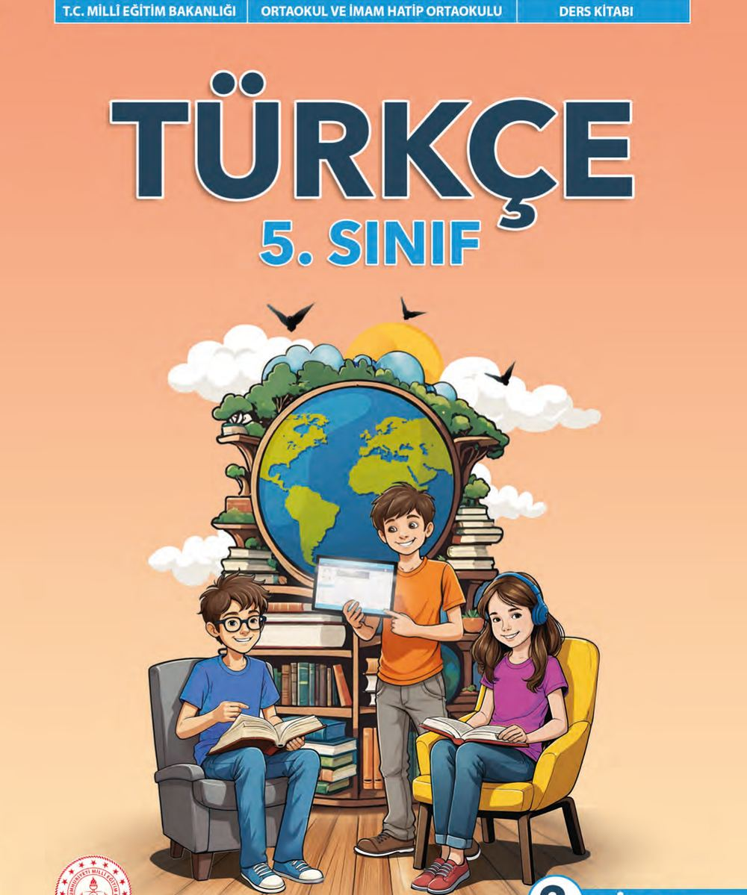
<!-- yer tutucu bulunamadı: sayfa sonuna eklendi -->

<!-- sayfa 1 -->

ORTAOKUL VE İMAM HATİP ORTAOKULU

# TÜRKÇE
# 5. SINIF
## DERS KİTABI

**Yazarlar**
Dr. Ali CİN
Dr. Sezgi DALİOĞLU
Arş. Gör. Mehmet KAVAS
Alev DÖNMEZ
Ceyda HAN
Fatih ŞENER
Gülşen AKYURT
Leyla ANGIN
Nuray HÜLÜR TAŞİN
Sinan SAYILIR
Tülin SAYILIR

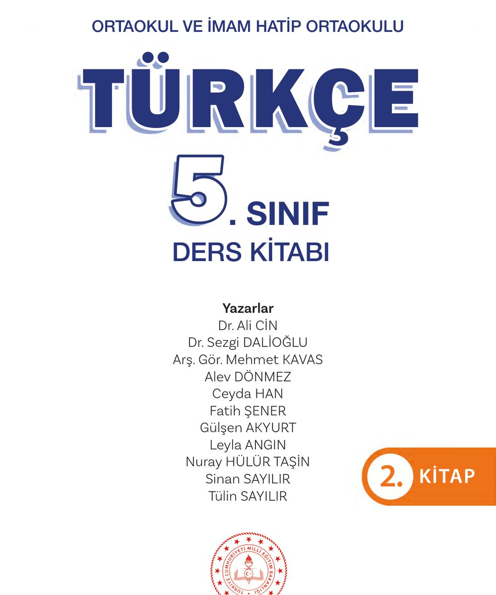 2. KİTAP

<!-- sayfa 2 -->

MİLLÎ EĞİTİM BAKANLIĞI YAYINLARI........................................................................................: 2019
DERS KİTAPLARI DİZİSİ...................................................................................................................: 9598
Her hakkı saklıdır ve Millî Eğitim Bakanlığına aittir. Kitabın metin, soru ve şekilleri kısmen de olsa hiçbir surette alınıp yayımlanamaz.

**Editör**
Prof. Dr. Yusuf UYAR
Doç. Dr. Bilal ŞİMŞEK
Doç. Dr. İsmail Yavuz ÖZTÜRK
Dr. Gülbike YILDIRIM

**Dil Uzmanı**
Esen BAYRAM GENÇ

**Görsel Tasarımcı**
Batuhan ÇELİK
Canan Özlem CANER
Derya AKIN
Enver ÜLKER
Erman YILMAZ
Esra ŞENOCAK
Fatma GENÇ
Mehmet ARI
Ozan ERTUĞRUL

**Çoklu Ortam Tasarımcısı**
Esra İLHAN-Gazanfer DİKER-
Olcay DOĞAN-Onur YILMAZ-Osman ÇELİK-
Pınar ERSAL-Seher KILIÇ-Ümit ARSLAN-
Vedat Ersin CEVİZ-Zekican YARDIMCI

**Program Geliştirme Uzmanı**
Doç. Dr. İsa YILDIRIM

**Ölçme ve Değerlendirme Uzmanı**
Prof. Dr. Gökhan ÇETİNKAYA
Erhan DÜZGÜN

**Rehberlik Uzmanı**
Dr. Özlem MENTEŞ YALÇIN

ISBN 978-975-11-8008-7
Millî Eğitim Bakanlığı Talim ve Terbiye Kurulunun 17.07.2026 tarih ve 110460159 sayılı yazısı ile eğitim aracı olarak kabul edilmiştir.

Kurulca bu kitabın kabul edilmiş olması ders kitabından yayınevi ve yazarın

<!-- sayfa 3 -->

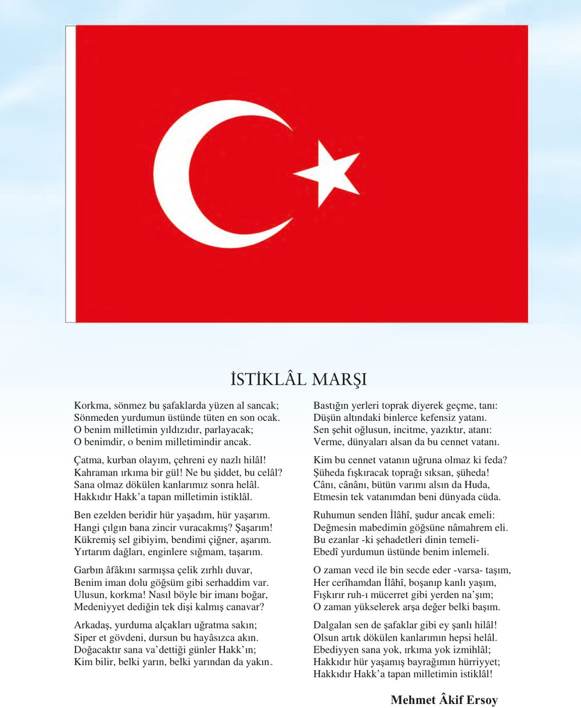

# İSTİKLÂL MARŞI

Korkma, sönmez bu şafaklarda yüzen al sancak;
Sönmeden yurdumun üstünde tüten en son ocak.
O benim milletimin yıldızıdır, parlayacak;
O benimdir, o benim milletimindir ancak.

Çatma, kurban olayım, çehreni ey nazlı hilâl!
Kahraman ırkıma bir gül! Ne bu şiddet, bu celâl?
Sana olmaz dökülen kanlarımız sonra helâl.
Hakkıdır Hakk'a tapan milletimin istiklâl.

Ben ezelden beridir hür yaşadım, hür yaşarım.
Hangi çılgın bana zincir vuracakmış? Şaşarım!
Kükremiş sel gibiyim, bendimi çiğner, aşarım.
Yırtarım dağları, enginlere sığmam, taşarım.

Garbın âfâkını sarmışsa çelik zırhlı duvar,
Benim iman dolu göğsüm gibi serhaddim var.
Ulusun, korkma! Nasıl böyle bir imanı boğar,
Medeniyet dediğin tek dişi kalmış canavar?

Arkadaş, yurduma alçakları uğratma sakın;
Siper et gövdeni, dursun bu hayâsızca akın.
Doğacaktır sana va'dettiği günler Hakk'ın;
Kim bilir, belki yarın, belki yarından da yakın.

Bastığın yerleri toprak diyerek geçme, tanı:
Düşün altındaki binlerce kefensiz yatanı.
Sen şehit oğlusun, incitme, yazıktır, atanı:
Verme, dünyaları alsan da bu cennet vatanı.

Kim bu cennet vatanın uğruna olmaz ki feda?
Şüheda fışkıracak toprağı sıksan, şüheda!
Cânı, cânânı, bütün varımı alsan da Huda,
Etmesin tek vatanımdan beni dünyada cüda.

Ruhumun senden ilâhî, şudur ancak emeli:
Değmesin mabedimin göğsüne nâmahrem eli.
Bu ezanlar -ki şehadetleri dinin temeli-
Ebedî yurdumun üstünde benim inlemeli.

O zaman vecd ile bin secde eder -varsa- taşim,
Her cerîhamdan ilâhî, boşanıp kanlı yaşım,
Fışkırır ruh-ı mücerret gibi yerden na'im;
O zaman yükselerek arşa değer belki başım.

Dalgalan sen de şafaklar gibi ey kanlı hilâl!
Olsun artık dökülen kanlarımın hepsi helâl.
Ebediyyen sana yok, ırkıma yok izmihlâl;
Hakkıdır hür yaşamış bayrağımın hürriyet;
Hakkıdır Hakk'a tapan milletimin istiklâl!

M. Akif Ersoy

<!-- sayfa 4 -->

# GENÇLİĞE HİTABE

Ey Türk gençliği! Birinci vazifen, Türk istiklâlini, Türk Cumhuriyetini, ilelebet muhafaza ve müdafaa etmektir.

Mevcudiyetinin ve istikbalinin yegâne temeli budur. Bu temel, senin en kıymetli hazinendir. İstikbalde dahi, seni bu hazineden mahrum etmek isteyecek dâhilî ve hâricî bedhahların olacaktır. Bir gün, istiklâl ve cumhuriyeti müdafaa mecburiyetine düşersen, vazifeye atılmak için, içinde bulunacağın vaziyetin imkân ve şeraitini düşünmeyeceksin! Bu imkân ve şerait, çok namüsait bir mahiyette tezahür edebilir. İstiklâl ve cumhuriyetine kastedecek düşmanlar, bütün dünyada emsali görülmemiş bir galibiyetin mümessili olabilirler. Cebren ve hile ile aziz vatanın bütün kaleleri zapt edilmiş, bütün tersanelerine girilmiş, bütün orduları dağıtılmış ve memleketin her köşesi bilfiil işgal edilmiş olabilir. Bütün bu şeraitten daha elîm ve daha vahim olmak üzere, memleketin dâhilinde iktidara sahip olanlar gaflet ve dalâlet ve hattâ hıyanet içinde bulunabilirler. Hattâ bu iktidar sahipleri şahsî menfaatlerini, müstevlîlerin siyasî emelleriyle tevhit edebilirler. Millet, fakr u zaruret içinde harap ve bîtap düşmüş olabilir.

Ey Türk istikbalinin evlâdı! İşte, bu ahval ve şerait içinde dahi vazifen, Türk istiklâl ve cumhuriyetini kurtarmaktır. Muhtaç olduğun kudret, damarlarındaki asil kanda mevcuttur.

Mustafa Kemal Atatürk

<!-- sayfa 5 -->

MUSTAFA KEMAL ATATÜRK

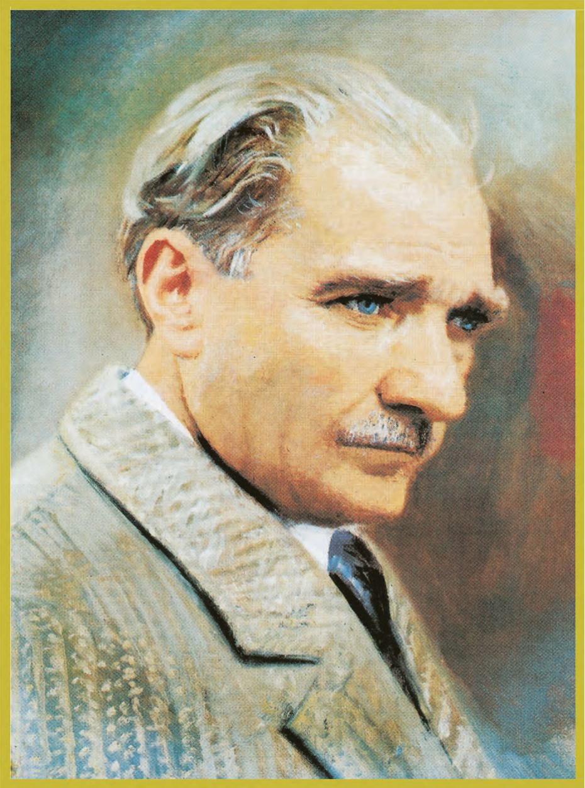
<!-- yer tutucu bulunamadı: sayfa sonuna eklendi -->

<!-- sayfa 6 -->

Verdiğiniz mesajda PDF metin katmanı boş görünüyor (`<<< >>>` arası boş). Lütfen dönüştürülmesini istediğiniz metni veya görseli paylaşın, böylece kurallara uygun şekilde Markdown formatına çevirebilirim.

<!-- sayfa 7 -->

# İÇİNDEKİLER

## 4. TEMA - GELENEKLERİMİZ
Nasreddin Hoca ................................................................................................................... 12
Bugün Bayram (İzleme) ..................................................................................................... 23
Misafir Odası ...................................................................................................................... 31
Çömlekçilik ........................................................................................................................ 46
Kırık At (Okuma Keyfi) ...................................................................................................... 61
Üretim Zamanı .................................................................................................................. 63
Kontrol Noktası .................................................................................................................. 64

## 5. TEMA - İLETİŞİM VE SOSYAL İLİŞKİLER
Ev ....................................................................................................................................... 72
Tatlı Günler ....................................................................................................................... 80
Gülü İncitme Gönül ............................................................................................................ 87
Komşumuz Nergis Teyze "Çiçek Dayanışması" (Dinleme) ............................................. 95
Herkes Önemli (Okuma Keyfi) .......................................................................................... 103
Üretim Zamanı .................................................................................................................. 104
Kontrol Noktası .................................................................................................................. 106

## 6. TEMA - SAĞLIKLI YAŞIYORUM
Haydi Doğa Yürüyüşüne! ................................................................................................. 114
Ne Olacak Bu Yemek Sorunu? .......................................................................................... 123
Benim Zamanım-Okçuluk (İzleme) .................................................................................. 132
Obezite .............................................................................................................................. 138
Atlı Cirit (Okuma Keyfi) .................................................................................................... 147
Üretim Zamanı .................................................................................................................. 150
Kontrol Noktası .................................................................................................................. 151

Kaynakça ........................................................................................................................... 156
Cevap Anahtarı .................................................................................................................. 156
Görsel ve Genel Ağ Kaynakçası ....................................................................................... 156
Türkiye'nin Mülki İdare Bölümleri ile Kara ve Deniz Komşuları Haritası ........................ 157

<!-- sayfa 8 -->

# ORGANİZASYON ŞEMASI

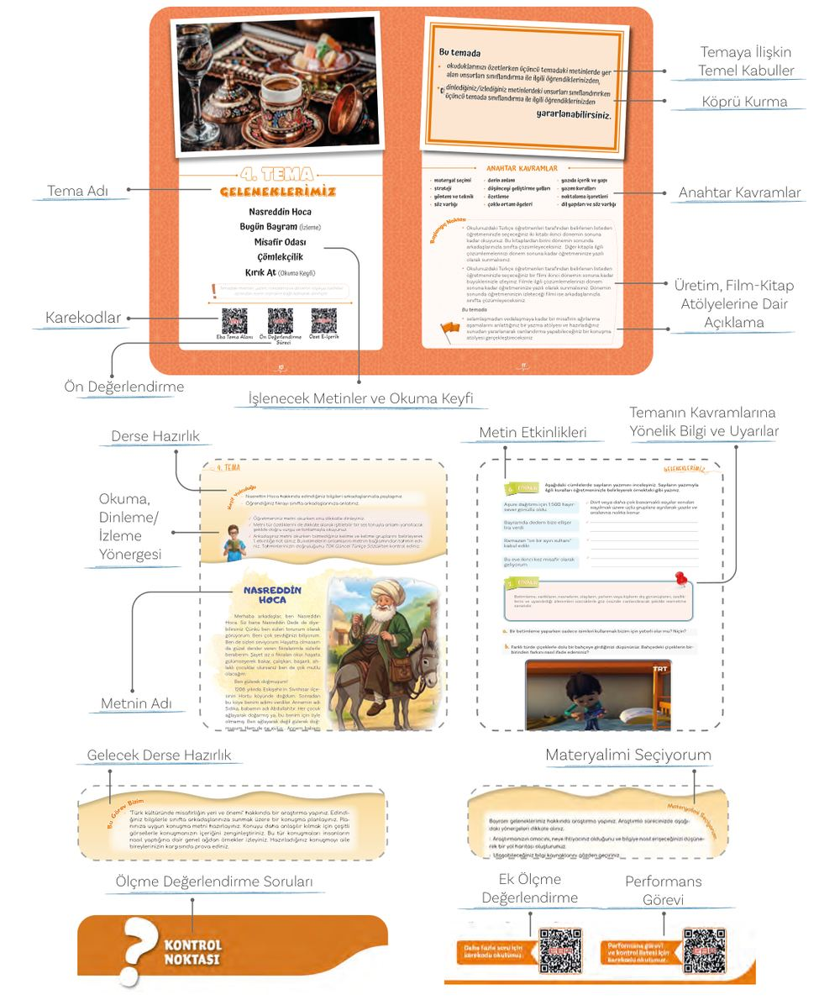

* Tema Adı
* Karekodlar
* Ön Değerlendirme
* Derse Hazırlık
* Okuma, Dinleme/ İzleme Yönergesi
* Metnin Adı
* Gelecek Derse Hazırlık
* Ölçme Değerlendirme Soruları
* İşlenecek Metinler ve Okuma Keyfi
* Metin Etkinlikleri
* Temanın Kavramlarına Yönelik Bilgi ve Uyarılar
* Temaya İlişkin Temel Kabuller
* Köprü Kurma
* Anahtar Kavramlar
* Üretim, Film-Kitap Atölyelerine Dair Açıklama
* Materyali Seçiyorum
* Ek Ölçme Değerlendirme
* Performans Görevi

---

# 4. TEMA
## GELENEKLERİMİZ

* Nasreddin Hoca
* Bugün Bayram (İzleme)
* Misafir Odası
* Çömlekçilik
* Kırık At (Okuma Keyfi)

**Karekodlar**
* Eba Tema Alanı
* Ön Değerlendirme Süreci
* Özet E-İçerik

**Bu temada**
* selamlaşmadan vedalaşmaya kadar bir misafirin ağırlanma aşamalarını anlattığınız bir yazma atölyesi ve hazırladığınız sunudan yararlanarak canlandırma yapabileceğiniz bir konuşma atölyesi gerçekleştireceksiniz.
* okuduklarınızı özetlerken üçüncü temadaki metinlerde yer alan unsurları sınıflandırma ile ilgili öğrendiklerinizden, dinlediğiniz/izlediğiniz metinlerdeki unsurları sınıflandırırken üçüncü temada sınıflandırma ile ilgili öğrendiklerinizden yararlanabilirsiniz.

**Anahtar Kavramlar**
* materyal seçimi
* strateji
* yöntem ve teknik
* söz varlığı
* derin anlam
* düşünceyi geliştirme yolları
* özetleme
* çoklu ortam ögeleri
* yazıda içerik ve yapı
* yazım kuralları
* noktalama işaretleri
* dil yapıları ve söz varlığı

**Temaya İlişkin Temel Kabuller**
* Temadaki metinler; yazım, noktalama ve dönemin söyleyiş özellikleri açısından eserin orijinaline bağlı kalınarak alınmıştır.

**Üretim, Film-Kitap Atölyelerine Dair Açıklama**
**Başlangıç Noktası**
* Okulunuzdaki Türkçe öğretmenleri tarafından belirlenen listeden öğretmeninizle seçeceğiniz iki kitabı ikinci dönemin sonuna kadar okuyunuz. Bu kitaplardan birini dönemin sonunda arkadaşlarınızla sınıfta çözümleyeceksiniz. Diğer kitapla ilgili çözümlemelerinizi dönem sonuna kadar öğretmenize yazılı olarak sunmalısınız.
* Okulunuzdaki Türkçe öğretmenleri tarafından belirlenen listeden öğretmeninizle seçeceğiniz bir filmi ikinci dönemin sonuna kadar büyüklerinizle izleyiniz. Filmle ilgili çözümlemelerinizi dönem sonuna kadar öğretmenize yazılı olarak sunmalısınız. Dönemin sonunda öğretmeninizin izleteceği filmi ise arkadaşlarınızla sınıfta çözümleyeceksiniz.

---

# 4. TEMA
## NASREDDİN HOCA

**Derse Hazırlık**
**Keşif / Keşif / Yolculuğu**
* Nasreddin Hoca hakkında edindiğiniz bilgileri arkadaşlarınızla paylaşınız.
* Öğrendiğiniz fıkrayı sınıfta arkadaşlarınıza anlatınız.

**Okuma, Dinleme/ İzleme Yönergesi**
* Öğretmeniniz metni okurken onu dikkatle dinleyiniz.
* Metni tür özelliklerini de dikkate alarak işitilebilir bir ses tonuyla anlamı yansıtacak şekilde doğru vurgu ve tonlamayla okuyunuz.
* Arkadaşınız metni okurken bilmediğiniz kelime ve kelime gruplarını belirleyerek 1. etkinliğe not alınız. Bu kelimelerin anlamlarını metnin bağlamından tahmin ediniz. Tahminlerinizin doğruluğunu TDK Güncel Türkçe Sözlük'ten kontrol ediniz.

**Metnin Adı**
### NASREDDİN HOCA
Merhaba arkadaşlar, ben Nasreddin Hoca. Siz bana Nasreddin Dede de diyebilirsiniz. Çünkü ben sizleri torunum olarak görüyorum. Beni çok sevdiğinizi biliyorum. Ben de sizleri seviyorum. Hayatta olmasam da güzel dersler veren fıkralarımla sizlerle beraberim. Şayet siz o fıkraları okur, hayata gülümseyerek bakar, çalışkan, başarılı, ahlaklı çocuklar olursanız ben de çok mutlu olacağım.
Ben gülerek doğmuşum!
1208 yılında Eskişehir'in Sivrihisar ilçesinin Hortu köyünde doğdum. Sonradan bu köye benim adımı verdiler. Annemin adı Sıdıka, babamın adı Abdullah'tır. Her çocuk ağlayarak doğarmış ya, bu benim için öyle olmamış. Ben ağlayarak değil gülerek doğmuşum. Hem de ne gülüş... Annem babam...

**Gelecek Derse Hazırlık**
**Görev Bizim / Bu Görev Bizim**
* "Türk kültüründe misafirliğin yeri ve önemi" hakkında bir araştırma yapınız. Edindiğiniz bilgilerle sınıfta arkadaşlarınıza sunmak üzere bir konuşma planlayınız. Planınıza uygun konuşma metni hazırlayınız. Konuyu daha anlaşılır kılmak için çeşitli görsellerle konuşmanızın içeriğini zenginleştiriniz. Bu tür konuşmaları insanların nasıl yaptığına dair genel ağdan örnekler izleyiniz. Hazırladığınız konuşmayı aile bireylerinizin karşısında prova ediniz.

---

# GELENEKLERİMİZ

**6. ETKİNLİK**
Aşağıdaki cümlelerde sayıların yazımını inceleyiniz. Sayıların yazımıyla ilgili kuralları öğretmeninizle belirleyerek örnekteki gibi yazınız.

a. Aşure dağıtımı için $1.500$ <!-- KONTROL: Marker'da karşılığı yok, uydurma olabilir --> hayırsever gönüllü oldu.
b. Bayramda dedem bize ellişer lira verdi.
c. Ramazan “on bir ayın sultanı” kabul edilir.
d. Bu eve ikinci kez misafir olarak geliyorum.

*Dört veya daha çok basamaklı sayılar sondan sayılmak üzere üçlü gruplara ayrılarak yazılır ve aralarına nokta konur.*

**7. ETKİNLİK**
**a.** Bir betimleme yaparken sadece isimleri kullanmak bizim için yeterli olur mu? Niçin?
**b.** Farklı türde çiçeklerle dolu bir bahçeye girdiğinizi düşününüz. Bahçedeki çiçeklerin birbirinden farkını nasıl ifade edersiniz?

**Betimleme;** varlıkların, nesnelerin, olayların, yerlerin veya kişilerin dış görünüşlerini, özelliklerini ve uyandırdığı izlenimleri sözcüklerle göz önünde canlandıracak şekilde resmetme sanatıdır.

**Metin Etkinlikleri**
**7. ETKİNLİK**
**a.** Bir betimleme yaparken sadece isimleri kullanmak bizim için yeterli olur mu? Niçin?
**b.** Farklı türde çiçeklerle dolu bir bahçeye girdiğinizi düşününüz. Bahçedeki çiçeklerin birbirinden farkını nasıl ifade edersiniz?

**TRT**
**a.** Bir betimleme yaparken sadece isimleri kullanmak bizim için yeterli olur mu? Niçin?
**b.** Farklı türde çiçeklerle dolu bir bahçeye girdiğinizi düşününüz. Bahçedeki çiçeklerin birbirinden fark

<!-- sayfa 9 -->

# Değerlendirme Ölçeklerinde Kullanılan Semboller

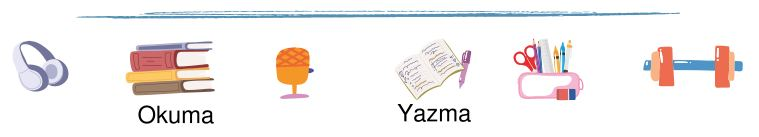

* Dinleme İzleme
* Okuma
* Konuşma
* Yazma
* Üretim Zamanı
* Geliştirilen Beceriler

## Etkinliklerde Kullanılan Semboller

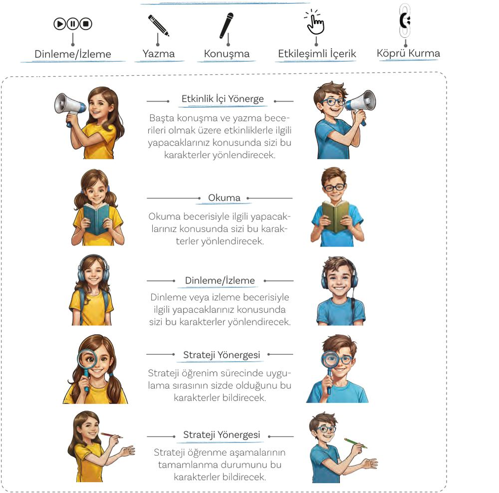

* Dinleme/İzleme
* Yazma
* Konuşma
* Etkileşimli İçerik
* Köprü Kurma

---

* **Etkinlik İçi Yönerge**
  Başta konuşma ve yazma becerileri olmak üzere etkinliklerle ilgili yapacaklarınız konusunda sizi bu karakterler yönlendirecek.

* **Okuma**
  Okuma becerisiyle ilgili yapacaklarınız konusunda sizi bu karakterler yönlendirecek.

* **Dinleme/İzleme**
  Dinleme veya izleme becerisiyle ilgili yapacaklarınız konusunda sizi bu karakterler yönlendirecek.

* **Strateji Yönergesi**
  Strateji öğrenim sürecinde uygulama sırasının sizde olduğunu bu karakterler bildirecek.

* **Strateji Yönergesi**
  Strateji öğrenme aşamalarının tamamlanma durumunu bu karakterler bildirecek.

---

Kitaptaki metinler; yazım, noktalama ve dönemin söyleyiş özellikleri açısından eserin orijinaline bağlı kalınarak alınmıştır.

<!-- sayfa 10 -->

# 4. TEMA
## GELENEKLERİMİZ

* Nasreddin Hoca
* Bugün Bayram *(izleme)*
* Misafir Odası
* Çömlekçilik
* Kırık At *(Okuma Keyfi)*

> Temadaki metinler; yazım, noktalama ve dönemin söyleyiş özellikleri açısından eserin orijinaline bağlı kalınarak alınmıştır.

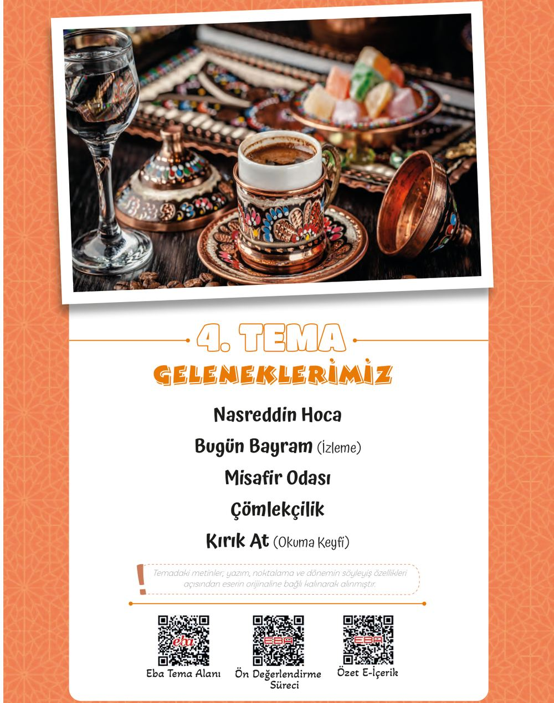

Eba Tema Alanı
Ön Değerlendirme Süreci
Özet E-İçerik

<!-- sayfa 11 -->

# Bu temada

* okuduklarınızı özetlerken üçüncü temadaki metinlerde yer alan unsurları sınıflandırma ile ilgili öğrendiklerinizden,
* dinlediğiniz/izlediğiniz metinlerdeki unsurları sınıflandırırken üçüncü temada sınıflandırma ile ilgili öğrendiklerinizden **yararlanabilirsiniz.**

---

## ANAHTAR KAVRAMLAR

* materyal seçimi
* strateji
* yöntem ve teknik
* söz varlığı
* derin anlam
* düşünceyi geliştirme yolları
* özetleme
* çoklu ortam ögeleri
* yazıda içerik ve yapı
* yazım kuralları
* noktalama işaretleri
* dil yapıları ve söz varlığı

### Başlangıç Noktası

* Okulunuzdaki Türkçe öğretmenleri tarafından belirlenen listeden öğretmeninizle seçeceğiniz iki kitabı ikinci dönemin sonuna kadar okuyunuz. Bu kitaplardan birini dönemin sonunda arkadaşlarınızla sınıfta çözümleyeceksiniz. Diğer kitapla ilgili çözümlemelerinizi dönem sonuna kadar öğretmeninize yazılı olarak sunmalısınız.
* Okulunuzdaki Türkçe öğretmenleri tarafından belirlenen listeden öğretmeninizle seçeceğiniz bir filmi ikinci dönemin sonuna kadar büyüklerinizle izleyiniz. Filmle ilgili çözümlemelerinizi dönem sonuna kadar öğretmeninize yazılı olarak sunmalısınız. Dönemin sonunda öğretmeninizin izleteceği filmi ise arkadaşlarınızla sınıfta çözümleyeceksiniz.

#### Bu temada

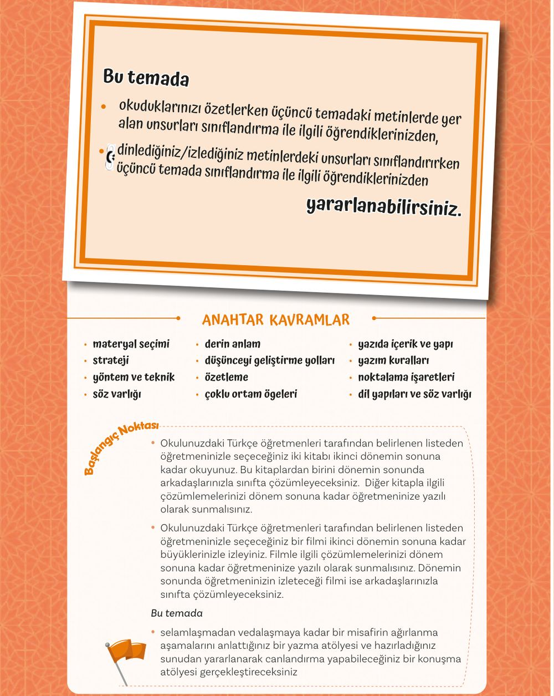 * selamlaşmadan vedalaşmaya kadar bir misafirin ağırlanma aşamalarını anlattığınız bir yazma atölyesi ve hazırladığınız sunudan yararlanarak canlandırma yapabileceğiniz bir konuşma atölyesi gerçekleştireceksiniz

<!-- sayfa 12 -->

# Keşif Yolculuğu

* Nasreddin Hoca hakkında edindiğiniz bilgileri arkadaşlarınızla paylaşınız.
* Öğrendiğiniz fıkrayı sınıfta arkadaşlarınıza anlatınız.

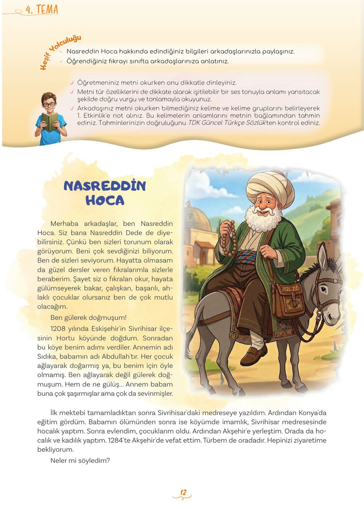

* Öğretmeniniz metni okurken onu dikkatle dinleyiniz.
* Metni tür özelliklerini de dikkate alarak işitilebilir bir ses tonuyla anlamı yansıtacak şekilde doğru vurgu ve tonlamayla okuyunuz.
* Arkadaşınız metni okurken bilmediğiniz kelime ve kelime gruplarını belirleyerek 1. Etkinlik'e not alınız. Bu kelimelerin anlamlarını metnin bağlamından tahmin ediniz. Tahminlerinizin doğruluğunu *TDK Güncel Türkçe Sözlük*'ten kontrol ediniz.

# NASREDDİN HOCA

Merhaba arkadaşlar, ben Nasreddin Hoca. Siz bana Nasreddin Dede de diyebilirsiniz. Çünkü ben sizleri torunum olarak görüyorum. Beni çok sevdiğinizi biliyorum. Ben de sizleri seviyorum. Hayatta olmasam da güzel dersler veren fıkralarımla sizlerle beraberim. Şayet siz o fıkraları okur, hayata gülümseyerek bakar, çalışkan, başarılı, ahlaklı çocuklar olursanız ben de çok mutlu olacağım.

Ben gülerek doğmuşum!

1208 yılında Eskişehir'in Sivrihisar ilçesinin Hortu köyünde doğdum. Sonradan bu köye benim adımı verdiler. Annemin adı Sıdıka, babamın adı Abdullah'tır. Her çocuk ağlayarak doğarmış ya, bu benim için öyle olmamış. Ben ağlayarak değil gülerek doğmuşum. Hem de ne gülüş... Annem babam buna çok şaşırmışlar ama çok da sevinmişler.

İlk mektebi tamamladıktan sonra Sivrihisar'daki medreseye yazıldım. Ardından Konya'da eğitim gördüm. Babamın ölümünden sonra ise köyümde imamlık, Sivrihisar medresesinde hocalık yaptım. Sonra evlendim, çocuklarım oldu. Ardından Akşehir'e yerleştim. Orada da hocalık ve kadılık yaptım. 1284'te Akşehir'de vefat ettim. Türbem de oradadır. Hepinizi ziyaretime bekliyorum.

Neler mi söyledim?

<!-- sayfa 13 -->

Yaşadığım zaman çok sıkıntılı bir zamandı. Savaşlar, işgaller, ekonomik sıkıntılar vardı. İnsanlar hayata küsmüş gibiydiler. Geleceğe dair umutları kaybolmuştu.

İşte bir hoca olarak bunları değiştirmek istedim. Halkın ve sosyal yaşamın içinde bulunduğum için sorunları biliyordum. Tembellik ve bilgisizlik vardı mesela. Hırsızlık, dilencilik, dedikodu çok artmıştı.

İnsanlara doğrudan şöyle yapın, böyle yapmayın, demek olmazdı. Eğitici bir yol bulmalıydım.

Fıkralar anlatmam böyle başladı. Nerede içinde yanlışlık olan bir olay görsem hemen bunu fıkra hâline getirip anlatıyordum. Bunlar, ilk bakışta komik sözlerdi. Bu yüzden dinleyenler kahkahalarla gülüyorlardı. Ama çok geçmeden "Hocamız bunu niye anlattı?" diye düşünmeye başlıyorlar ve bir ders çıkarıyorlardı.

Mesela Akşehir Gölü'ne yoğurt mayası dökerken beni görenler ne yaptığımı sorduklarında onlara "Göle maya çalıyorum." demiştim. Tabii bu olacak bir şey değildi. Bu yüzden "Hocam, göl maya tutar mı?" diye sormuşlardı. İşte tam sırasıydı ders vermenin. Hemen "Ya tutarsa!" demiştim.

Bunun anlamı "Hiçbir şartta umutsuz olmayın. Başarmak için her yolu deneyin." demekti.

İşte her fıkramın böyle bir mesajı vardır. Sonra fıkralarım dünyanın dört bir yanına yayıldı. Bütün bir dünyanın 'Nasreddin Hoca'sı oldum. Hâlâ da bu fıkralarla yaşamaya devam ediyorum.

Sizden beklentim şudur:

Bu fıkraları yaşatın. Hem okuyun hem de başkalarına anlatın ki hep sizlerle beraber olayım. Hem de herkes bunlardan bir ders çıkarsın. Anlayacağınız, gülerek düşünelim ve öğrenelim. Hepinizi çok seviyorum, hoşça kalın.

Mustafa ÖZÇELİK

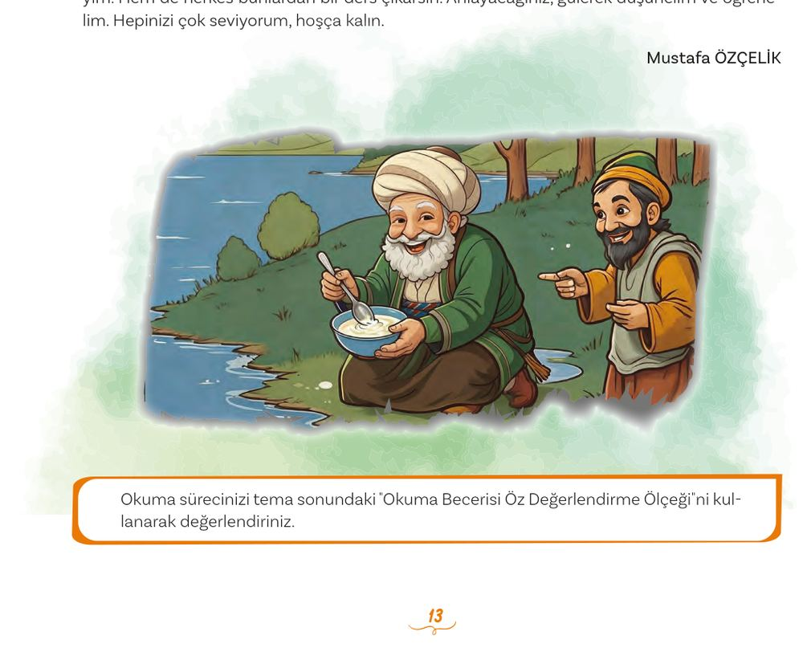

Okuma sürecinizi tema sonundaki "Okuma Becerisi Öz Değerlendirme Ölçeği"ni kullanarak değerlendiriniz.

<!-- sayfa 14 -->

# 1. ETKİNLİK

**a.** Metni okurken not aldığınız kelime veya kelime grupları ile bunların anlamlarına ilişkin tahminlerinizi aşağıya yazınız.

| Kelime veya Kelime Grubu | Tahminim |
| :--- | :--- |
| | |
| | |
| | |
| | |
| | |

**b.** Tahminlerinizin doğruluğunu *TDK Güncel Türkçe Sözlük*'ten kontrol ediniz.

# 2. ETKİNLİK

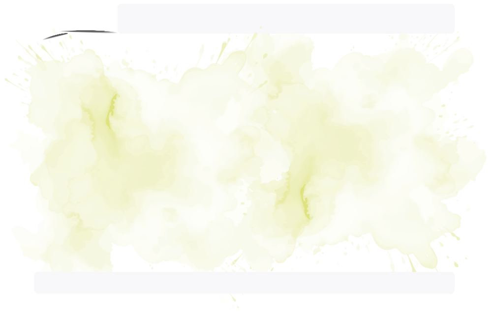 Aşağıdaki soruların cevaplarını metinden hareketle defterinize yazınız.

1. Nasreddin Hoca'nın mutlu olması için çocukların ne yapması gerekir?
2. Hoca'nın yaşadığı dönemde hangi sorunlar vardı?
3. Hoca, fıkra anlatmaya neden başlamıştır?
4. Onun fıkralarının dünyaya yayılmasının sebebi ne olabilir?

# 3. ETKİNLİK

**a.** Nasreddin Hoca, insanlara yanlış davranışlarını doğrudan söylemek yerine niçin fıkralar anlatmayı tercih etmiştir? Bu tercihinin nedenini metinden göstereceğiniz iki kanıtla açıklayınız.

**1. Kanıt:** __________________________________________________________________

**2. Kanıt:** __________________________________________________________________

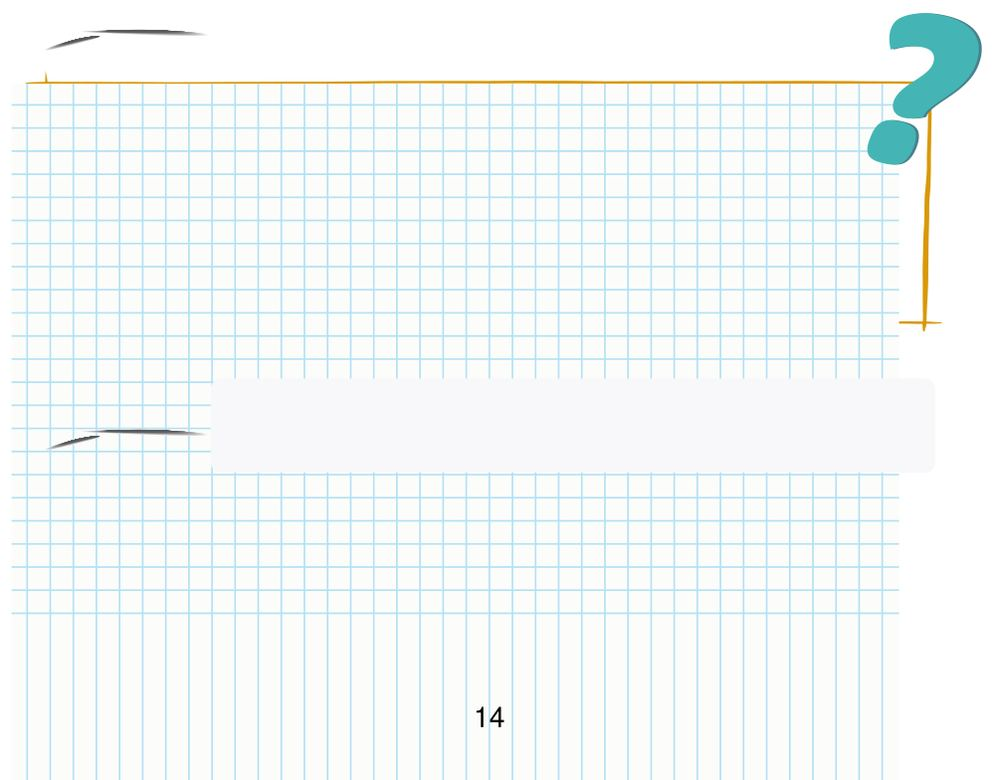
<!-- yer tutucu bulunamadı: sayfa sonuna eklendi -->

<!-- sayfa 15 -->

**b.** Nasreddin Hoca’nın bu tavrı sizce günlük hayatta sosyal ilişkilerimizi nasıl etkiler? Nedenleriyle açıklayınız.

4. **ETKİNLİK** Aşağıda verilen durumlarda yaşananları metinden ve önceki bilgilerinizden yola çıkarak ilgili yerlere yazınız.

| Fıkralarını İlk Anlattığında Yaşanan Durum | Fıkralarını Anlattıktan Sonra Yaşanan Durum |
| :--- | :--- |
| ____________________________________ | ____________________________________ |
| ____________________________________ | ____________________________________ |
| ____________________________________ | ____________________________________ |
| ____________________________________ | ____________________________________ |
| ____________________________________ | ____________________________________ |

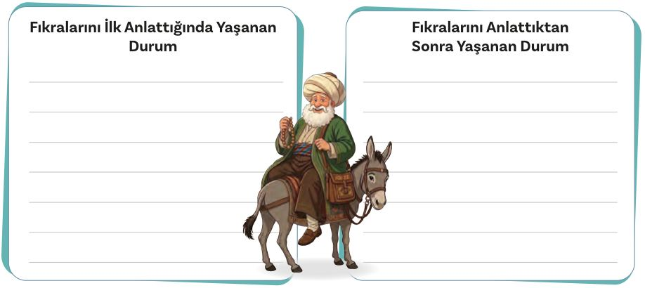

5. **ETKİNLİK** **a.** Okuduğunuz metnin içeriğini en iyi yansıtan kelime ve kelime grupları hangileridir? Aşağıya yazınız.

__________________________________________________________________________
__________________________________________________________________________
__________________________________________________________________________
__________________________________________________________________________
__________________________________________________________________________
__________________________________________________________________________

**b.** Bu kelimeleri seçmenizin nedenlerini söyleyiniz.

<!-- sayfa 16 -->

# 6. ETKİNLİK

**a.** Okuduğunuz metinde geçen bazı kelime veya kelime grupları aşağıda verilmiştir. Bu kelime ve kelime gruplarının metnin bağlamındaki ve sözlükteki anlamlarını belirleyiniz. Daha sonra bu kelimeleri anlam özelliklerine göre inceleyerek uygun kutulara yerleştiriniz.

| Mektep | Ders vermek | Sosyal |
| :---: | :---: | :---: |
| **Bilgisizlik** | **Fıkra** | **Yanlışlık** |
| **Olay** | **Komik** | **Tembellik** |

| Eş anlamlısı olan kelimeler | Zıt anlamlısı olan kelimeler |
| :--- | :--- |
| | |
| | |
| | |
| | |
| | |

**b.** Etkinliğin “a” bölümünde tabloya yerleştirdiğiniz kelimelerin eş ve zıt anlamlarını aşağıdaki tabloda ayrılan alanlara yazınız.

| Eş anlamlar | Zıt anlamlar |
| :--- | :--- |
| | |
| | |

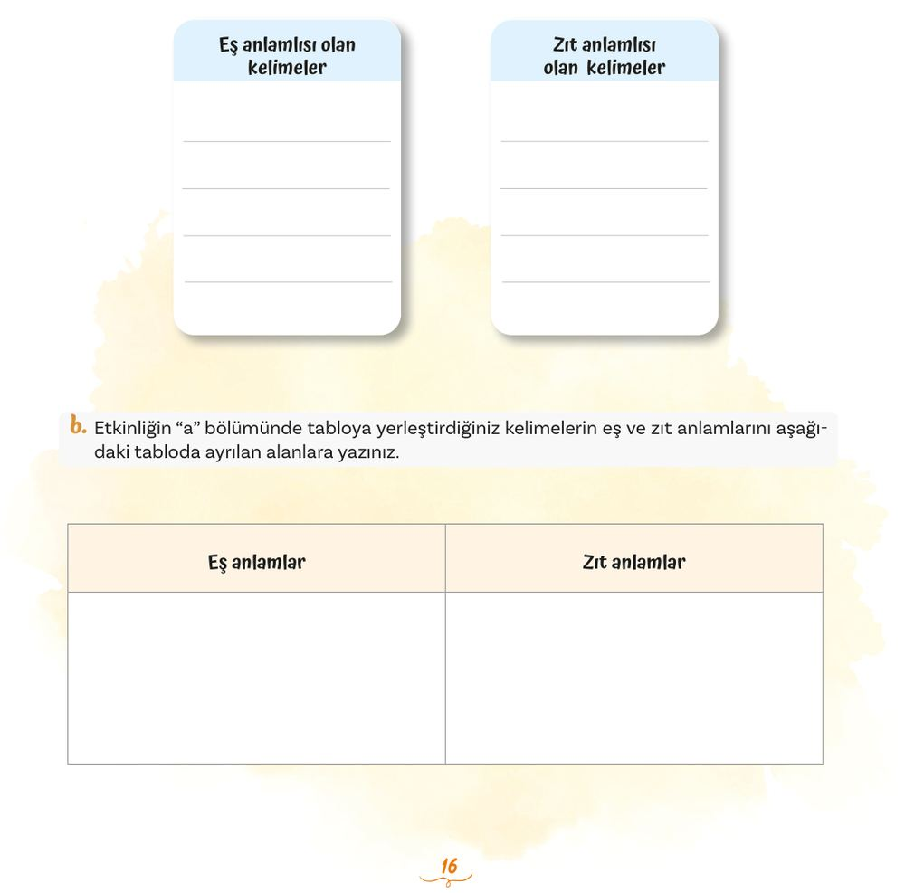
<!-- yer tutucu bulunamadı: sayfa sonuna eklendi -->

<!-- sayfa 17 -->

# 7. ETKİNLİK

Aşağıdaki cümlelerde karşılaştırılan unsurlarla bunların karşılaştırma yönünü örnekteki gibi yazınız.

| Cümleler | Karşılaştırılanlar | Karşılaştırma Yönü |
| :--- | :--- | :--- |
| Beni ondan çok seviyor. | ben ve o | sevmek |
| Nasreddin Hoca fıkralarını daha çok beğenirim. | | |
| Çay içmeyi severim fakat kahveden de vazgeçemem. | | |
| Türkiye, geleneklerine en bağlı ülkelerdendir. | | |
| O, ebru sanatını seviyor ama bence çömlekçilik daha eğlenceli. | | |
| Sergide çini sanatı, minyatür kadar ilgi görmedi. | | |

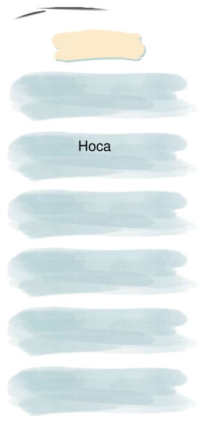
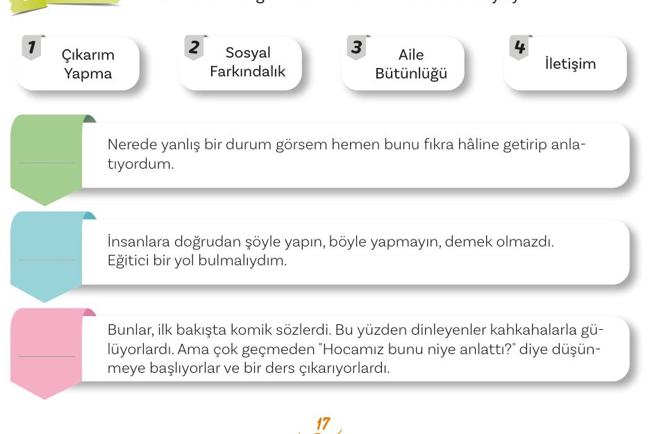

# 8. ETKİNLİK

Metinden alınan aşağıdaki cümleleri ilgili kavramlarla eşleştiriniz. Boşta kalan kavramla ilgili metinden bir cümle bularak söyleyiniz.

1. Çıkarım Yapma
2. Sosyal Farkındalık
3. Aile Bütünlüğü
4. İletişim

| | |
| :--- | :--- |
|  | Nerede yanlış bir durum görsem hemen bunu fıkra hâline getirip anlatıyordum. |
|  | İnsanlara doğrudan şöyle yapın, böyle yapmayın, demek olmazdı. Eğitici bir yol bulmalıydım. |
|  | Bunlar, ilk bakışta komik sözlerdi. Bu yüzden dinleyenler kahkahalarla gülüyorlardı. Ama çok geçmeden "Hocamız bunu niye anlattı?" diye düşün- |

<!-- sayfa 18 -->

9. ETKİNLİK 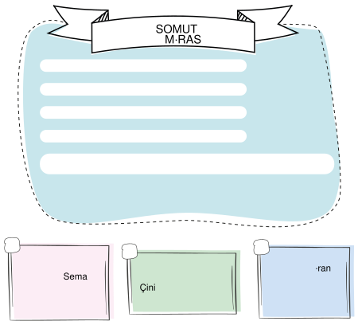

Aşağıda "İnsanlığın Somut Olmayan Kültürel Mirası Temsilî Listesi"nden alınmış bazı unsurlar verilmiştir. Listedeki bu unsurlarla ilgili verilen bilgilerden doğru olanların başına (D), yanlış olanların başına (Y) yazınız.

# UNESCO* SOMUT OLMAYAN KÜLTÜREL MİRAS LİSTESİ

1. Meddahlık Geleneği (2008)
2. Mevlevi Sema Törenleri (2008)
3. Karagöz (2009)
4. Türk Kahvesi ve Geleneği (2013)
5. Ebru: Türk Kâğıt Süsleme Sanatı (2014)
6. Geleneksel Çini Sanatı (2016)
7. Geleneksel Türk Okçuluğu (2019)
8. Minyatür Sanatı (Azerbaycan, İran ve Özbekistan ile Ortak Dosya) (2020)
9. Dede Korkut-Korkut Ata Mirası: Kültürü, Efsaneleri ve Müziği (Azerbaycan ve Kazakistan ile Ortak Dosya, 2018)
10. Nasreddin Hoca/Molla Nesreddin/Molla Ependi/Apendi/Afendi Kozhanasyr Fıkra Anlatma Geleneği (Azerbaycan, Kazakistan, Kırgızistan, Tacikistan, Türkmenistan, Özbekistan ile Ortak Dosya, 2022)

(Genel ağdan alınmıştır.)

"Meddahlık Geleneği" ve "Mevlevi Sema Törenleri" aynı yılda listeye girmiştir.

"Türk Kahvesi ve Geleneği", "Geleneksel Çini Sanatı"ndan sonra listeye girmiştir.

"Minyatür Sanatı" Azerbaycan, İran ve Özbekistan'ın somut olmayan ortak kültürel miras ögesidir.

"Nasreddin Hoca Fıkra Anlatma Geleneği" altı ülkenin somut olmayan kültürel miras ögesidir. 

"Türk Kahvesi Geleneği" ve "Dede Korkut-Korkut Ata Mirası" birkaç ülkenin ortak miras unsurudur. 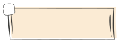

"Geleneksel Türk Okçuluğu" 2016'da listeye girmiştir. 

"Ebru: Türk Kâğıt Süsleme Sanatı", "Karagöz"den sonra "Geleneksel Türk Okçuluğu"ndan önce listeye girmiştir. 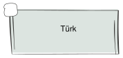

<!-- sayfa 19 -->

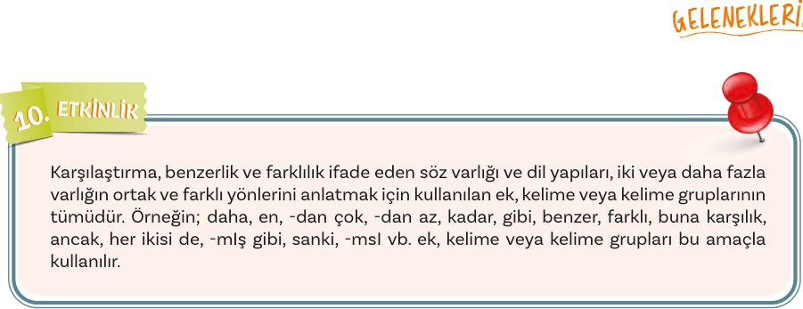
10. ETKİNLİK

Karşılaştırma, benzerlik ve farklılık ifade eden söz varlığı ve dil yapıları, iki veya daha fazla varlığın ortak ve farklı yönlerini anlatmak için kullanılan ek, kelime veya kelime gruplarının tümüdür. Örneğin; daha, en, -dan çok, -dan az, kadar, gibi, benzer, farklı, buna karşılık, ancak, her ikisi de, -mış gibi, sanki, -msı vb. ek, kelime veya kelime grupları bu amaçla kullanılır.

**a.** Aşağıdaki cümleleri okuyunuz. Cümlelerde geçen karşılaştırma, benzerlik ve farklılık ifade etme işlevli dil yapıları ve söz varlıklarının altını çiziniz.

* Minyatür sanatı bana diğer sanatlardan daha fazla keyif veriyor.
* Ninem masal anlatırken kendimizi sanki bir masal ülkesinde hissederdik.
* Ebru sanatı diğer resim türlerinden farklı bir teknikle yapılır.
* Uşak halılarının üzerindeki ilmek ilmek işlenmiş motifler tıpkı birer tabloya benziyordu.
* Her yörenin farklı düğün yemeği vardır.
* Dedem eski bayramların nasıl geçtiğini anlatırken o anları yeniden yaşıyormuş gibi gözleri dolardı.
* Gölge oyunları bizi güldürür, meddahlık ise hikâyeleriyle bizi bambaşka diyarlara götürür.

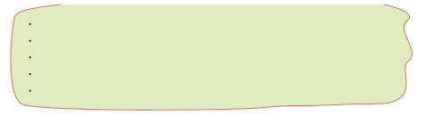
**b.** Aşağıdaki cümlelerde boş bırakılan yerleri karşılaştırma, benzerlik ve farklılık ifade etme işlevli dil yapıları ve söz varlıklarından uygun olanıyla tamamlayınız.

* Geleneksel çocuk oyunlarımız arasında oynamayı ............... çok sevdiğim oyun saklambaçtır.
* Mendil kapmaca oyunu, sınıf içi etkinlikler.......................................... bahçede oynanır.
* Çömlekçilik sanatı da ebru sanatı ....................... sabır gerektiren bir iştir.
* Kilim dokuyan kadınların parmak hızları birbirinden ........................................ seviyedeydi.
* Tarihî çarşıdaki bakırcı ustalarının çekiç sesleri .......................... tempolu bir müzik gibiydi.

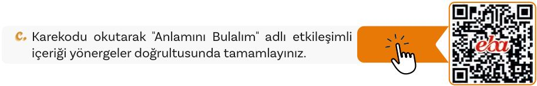
**c.** Karekodu okutarak "Anlamını Bulalım" adlı etkileşimli içeriği yönergeler doğrultusunda tamamlayınız.

<!-- sayfa 20 -->

# KONUŞALIM

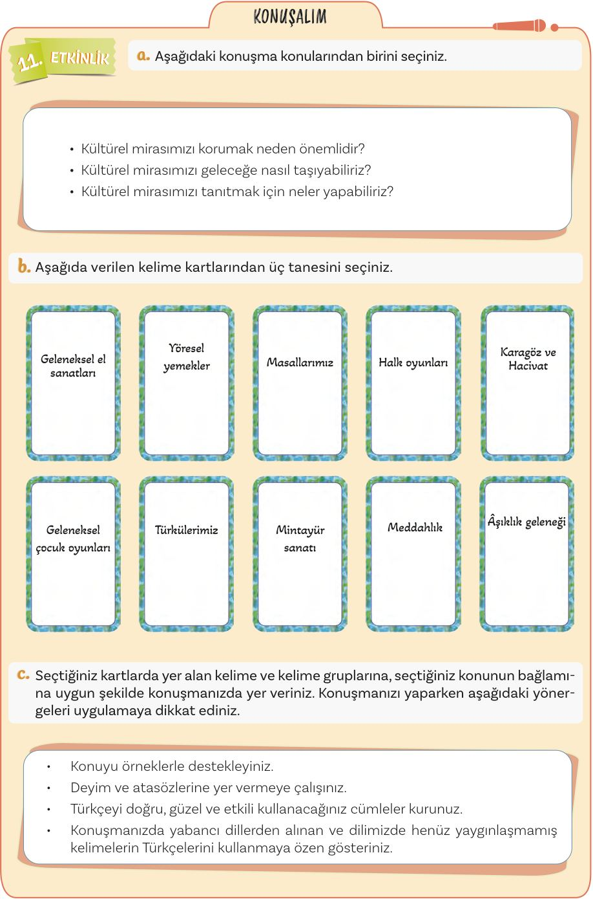

**11. ETKİNLİK**

**a. Aşağıdaki konuşma konularından birini seçiniz.**

* Kültürel mirasımızı korumak neden önemlidir?
* Kültürel mirasımızı geleceğe nasıl taşıyabiliriz?
* Kültürel mirasımızı tanıtmak için neler yapabiliriz?

**b. Aşağıda verilen kelime kartlarından üç tanesini seçiniz.**

| Geleneksel el sanatları | Yöresel yemekler | Masallarımız | Halk oyunları | Karagöz ve Hacivat |
| :---: | :---: | :---: | :---: | :---: |
| Geleneksel çocuk oyunları | Türkülerimiz | Mintayür sanatı | Meddahlık | Âşıklık geleneği |

**c. Seçtiğiniz kartlarda yer alan kelime ve kelime gruplarına, seçtiğiniz konunun bağlamına uygun şekilde konuşmanızda yer veriniz. Konuşmanızı yaparken aşağıdaki yönergeleri uygulamaya dikkat ediniz.**

* Konuyu örneklerle destekleyiniz.
* Deyim ve atasözlerine yer vermeye çalışınız.
* Türkçeyi doğru, güzel ve etkili kullanacağınız cümleler kurunuz.
* Konuşmanızda yabancı dillerden alınan ve dilimizde henüz yaygınlaşmamış kelimelerin Türkçelerini kullanmaya özen gösteriniz.

<!-- sayfa 21 -->

# YAZALIM

12. ETKİNLİK

a. Dede Korkut'la ilgili aşağıdaki paragrafı okuyunuz.

## DEDE KORKUT

Dede Korkut, Türk edebiyatının en önemli ve eski eserlerinden biri olan "Dede Korkut Hikâyeleri"nin bilge anlatıcısıdır. Oğuz Türklerinin destansı kahramanlık hikâyelerini anlatan Dede Korkut, aynı zamanda Türk kültürünün, geleneklerinin ve değerlerinin de taşıyıcısıdır. Dede Korkut; hikâyelerinde cesaret, sadakat, aile bağları ve adalet gibi evrensel temaları işlerken aynı zamanda Türk milletinin tarihsel yaşam biçimini, inançlarını ve sosyal yapısını da yansıtır. Hikâyelerdeki kahramanlar, zorluklar karşısında gösterdikleri dirayet ve erdemleriyle okuyuculara ilham verir. "Dede Korkut Hikâyeleri", günümüzde de Türk kültürünün ve edebiyatının temel taşlarından biri olarak değerini korumakta ve nesilden nesile aktarılmaya devam etmektedir.

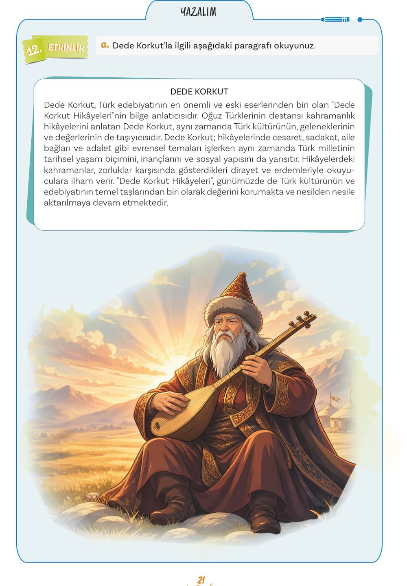

<!-- sayfa 22 -->

**b.** Okuduğunuz "Nasreddin Hoca" ve "Dede Korkut" metinlerindeki bilgilerden hareketle Türk kültürünün iki önemli ismini aşağıdaki yönergeler doğrultusunda karşılaştırdığınız bir yazı yazınız.

* Yazınızın amacı, hedef kitlesi, yazma aracı ve ortamını belirleyiniz.
* Yazma yöntem/tekniğinizi (not alma, grupla yazma, kontrollü yazma vb.) belirleyiniz.
* Nasreddin Hoca ve Dede Korkut'un özelliklerini belirleyiniz.
* Bunların benzerlik ve farklılıklarını listeleyiniz.
* Benzerlik ve farklılıklardan hareketle ulaştığınız yargıyla ilgili düşüncelerinize yazınızda yer veriniz.
* Yazınızda yazım ve noktalama kurallarını uygulayınız.
* Yazınıza başlık koymayı unutmayınız.
* Yazınızın içeriğini ve yazma sürecinizi gözden geçiriniz. Gerekirse yeni seçimler veya düzenlemeler yapınız.

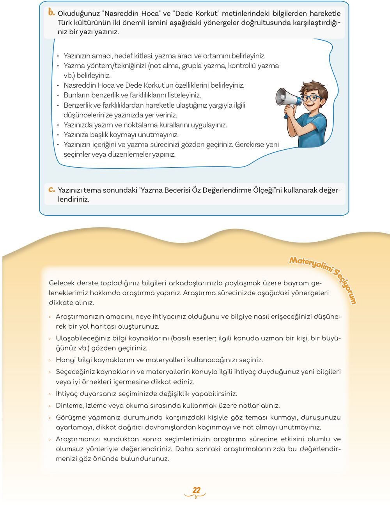

**c.** Yazınızı tema sonundaki "Yazma Becerisi Öz Değerlendirme Ölçeği"ni kullanarak değerlendiriniz.

---

*Materyalimi Seçiyorum*

Gelecek derste topladığınız bilgileri arkadaşlarınızla paylaşmak üzere bayram geleneklerimiz hakkında araştırma yapınız. Araştırma sürecinizde aşağıdaki yönergeleri dikkate alınız.

> Araştırmanızın amacını, neye ihtiyacınız olduğunu ve bilgiye nasıl erişeceğinizi düşünerek bir yol haritası oluşturunuz.
> Ulaşabileceğiniz bilgi kaynaklarını (basılı eserler; ilgili konuda uzman bir kişi, bir büyüğünüz vb.) gözden geçiriniz.
> Hangi bilgi kaynaklarını ve materyalleri kullanacağınızı seçiniz.
> Seçeceğiniz kaynakların ve materyallerin konuyla ilgili ihtiyaç duyduğunuz yeni bilgileri veya iyi örnekleri içermesine dikkat ediniz.
> İhtiyaç duyarsanız seçiminizde değişiklik yapabilirsiniz.
> Dinleme, izleme veya okuma sırasında kullanmak üzere notlar alınız.
> Görüşme yapmanız durumunda karşınızdaki kişiyle göz teması kurmayı, duruşunuzu ayarlamayı, dikkat dağıtıcı davranışlardan kaçınmayı ve not almayı unutmayınız.
> Araştırmanızı sunduktan sonra seçimlerinizin araştırma sürecine etkisini olumlu ve olumsuz yönleriyle değerlendiriniz. Daha sonraki araştırmalarınızda bu değerlendirmenizi göz önünde bulundurunuz.

<!-- sayfa 23 -->

# Keşif Yolculuğu

› Ülkemizde kutlanan dinî bayramları söyleyiniz.
› Dinî bayramlarda büyüklerinizi ziyaret eder misiniz? Ziyaret ettiğinizde büyükleriniz sizi nasıl karşılar?

✓ İzleme dosyasına ulaşmak için karekodu okutunuz.
✓ Filmi dikkat dağıtıcı hareketlerden kaçınarak nezaket kuralları içerisinde izleyiniz.
✓ Anlamadığınız bölümleri uygun zamanda öğretmeninize sormak üzere defterinize not ediniz.
✓ Filmi izlerken metnin anahtar kelimelerini belirleyip 1. Etkinlik'e yazınız.
✓ Metni dinlerken bilmediğiniz kelime ve kelime gruplarını belirleyerek defterinize not alınız. Bu kelimelerin anlamlarını metnin bağlamından tahmin ediniz. Tahminlerinizin doğruluğunu TDK Güncel Türkçe Sözlük'ten kontrol ediniz.
✓ İzleme sürecinizi tema sonundaki "Dinleme/İzleme Becerisi Öz Değerlendirme Ölçeği"ni kullanarak değerlendiriniz.

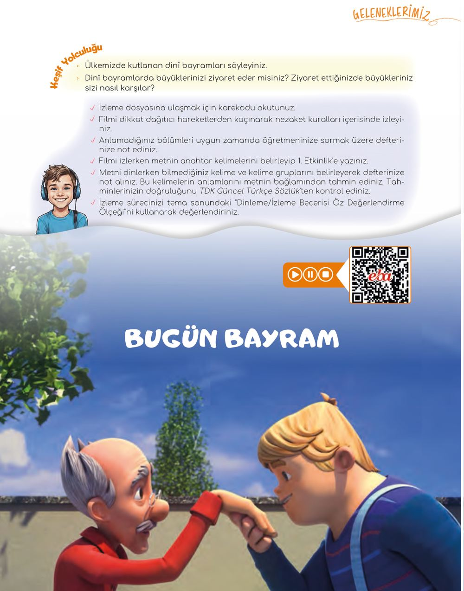

# BUGÜN BAYRAM

<!-- sayfa 24 -->

# 1. ETKİNLİK

**a.** "Bugün Bayram" adlı çizgi filmin içeriğini en iyi yansıtan, bu çizgi filmin konusuyla ilgili olan kelimeleri (anahtar kelimeler) belirleyerek aşağıya yazınız. Bu kelimelerin metinle ilişkisini açıklayınız.

**b.** Belirlediğiniz anahtar kelimelerin size çağrıştırdığı kelimeleri aşağıya yazınız. Yazdığınız kelimelerin anlam ilişkilerini inceleyiniz.


| Anahtar Kelime | Çağrıştırdığı Kelimeler |
| :--- | :--- |
| | |
| | |
| | |
| | |

# 2. ETKİNLİK

Aşağıdaki soruları izlediğiniz filmden hareketle sözlü olarak cevaplayınız.

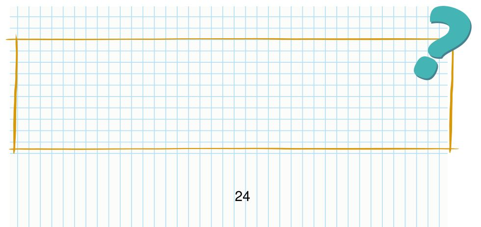

1. Mahalledeki çocuklar bayramlıklarını görünce ne yapmışlardır?
2. Kâmil'in kıyafetleri değiştirme fikri neden kabul edilmemiştir?
3. Çocuklar Basri amcadan neden kaçmaktadır?
4. Hayri, Sadettin Usta'ya şeker ikramını hatırlatmak için neler söylemektedir?

<!-- sayfa 25 -->

# 3. ETKİNLİK

**a.** Aşağıdaki örneği inceleyiniz. Siz de filmden bulduğunuz kalıplaşmış ifadeleri ve bunların hangi durumlarda kullanıldığını örnekteki gibi yazınız. Gerekirse filmi tekrar izleyiniz.

Ayağınıza sağlık | Eve gelen misafiri uğurlarken kullanılır.
--- | ---
(boşluk) | (boşluk)
(boşluk) | (boşluk)
(boşluk) | (boşluk)
(boşluk) | (boşluk)
(boşluk) | (boşluk)

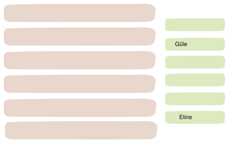

**b.** Aşağıda verilen diyalogları uygun kalıplaşmış ifadelerle örnekteki gibi tamamlayınız. Boşta kalan kalıplaşmış ifade için bir diyalog yazınız.

Sevda: Söyle bakalım bize iletmek istedikleri neymiş?
Kübra: Elçiye zeval olmaz. Ben anlatılanları aktarayım.

Ayşe: Seni arayamadım çünkü iki gündür gripten yatıyorum.
Beyza: _________________________________________________

Hakan: Biraz soluklan dedeciğim, su getirdim sana.
Veysel: _________________________________________________

Sultan: Yemekleri beğendin mi yavrum? Karnını iyice doyur.
Levent: _________________________________________________

Murat: Çok şükür, yıllardır yaptığımız birikimlerle bir ev alabildik.
Sabri: _________________________________________________

Cem: _________________________________________________

| |
| :--- |
| Elçiye zeval olmaz. |
| Güle güle oturun. |
| Geçmiş olsun. |
| Su gibi aziz ol. |
| Gözünüz aydın. |
| Eline sağlık. |

<!-- sayfa 26 -->

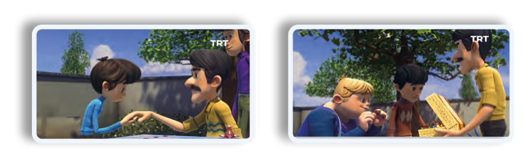

4. ETKİNLİK

İzlediğiniz filmden alınan aşağıdaki görselleri inceleyiniz. Bayram gelenekleriyle ilgili yaptığınız araştırmada elde ettiğiniz bilgilerden hareketle bu görsellerde yer alan karakterlerin o an neler hissettiklerini açıklayınız.

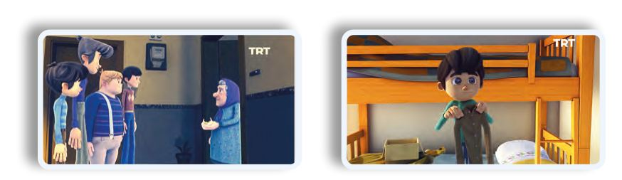

5. ETKİNLİK

**a.** İzlediğiniz videoda çocukların ziyaret ettiği mahalle sakinlerinde hangi davranışlar gözlenmektedir? Bu davranışlara iki örnek vererek davranışların sebeplerini videodan bulacağınız kanıtlarla aşağıya yazınız.

| Davranış | Davranışın Sebebi |
| :--- | :--- |
| | |
| | |

**b.** Sabri amcanın çocuklara bayram hediyesi alması sizce onun karakter özellikleriyle ilgili hangi ipuçlarını vermektedir? Açıklayınız.

**c.** Videonun sonunda çocukların bayramlıklarıyla ilgili aldıkları karar, sizce bayramların hangi yönüne vurgu yapmaktadır? Düşüncelerinizi kendi hayatınızdan örneklerle açıklayınız.

<!-- sayfa 27 -->

6. ETKİNLİK Aşağıdaki cümlelerde sayıların yazımını inceleyiniz. Sayıların yazımıyla ilgili kuralları öğretmeninizle belirleyerek örnekteki gibi yazınız.

Aşure dağıtımı için 1.500 hayırsever gönüllü oldu. $\checkmark$ Dört veya daha çok basamaklı sayılar sondan sayılmak üzere üçlü gruplara ayrılarak yazılır ve aralarına nokta konur.

Bayramda dedem bize ellişer lira verdi. $\checkmark$ __________________________________________________
__________________________________________________

Ramazan “on bir ayın sultanı” kabul edilir. $\checkmark$ __________________________________________________
__________________________________________________

Bu eve ikinci kez misafir olarak geliyorum. $\checkmark$ __________________________________________________
__________________________________________________

7. ETKİNLİK

a. Bir betimleme yaparken sadece isimleri kullanmak bizim için yeterli olur mu? Niçin?

b. Farklı türde çiçeklerle dolu bir bahçeye girdiğinizi düşününüz. Bahçedeki çiçeklerin birbirinden farkını nasıl ifade edersiniz?

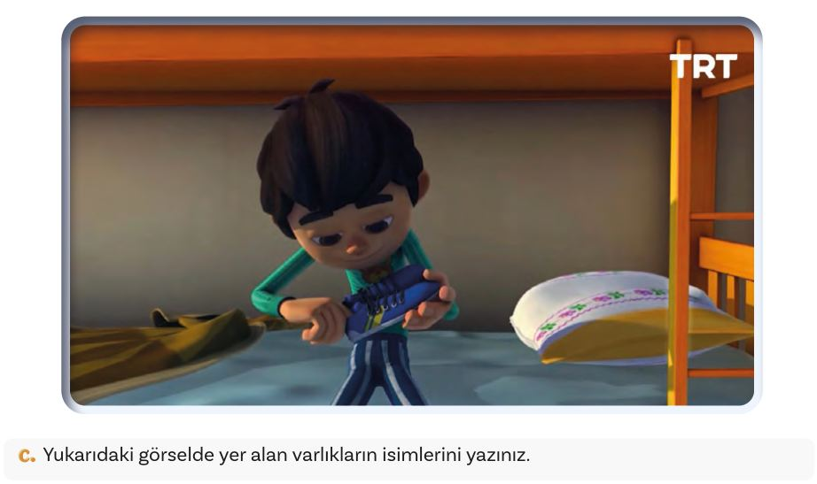

c. Yukarıdaki görselde yer alan varlıkların isimlerini yazınız.
__________________________________________________

<!-- sayfa 28 -->

ç. Yazdığınız isimlere niteleyici kelimeler ekleyerek betimleyici bir paragraf yazınız.

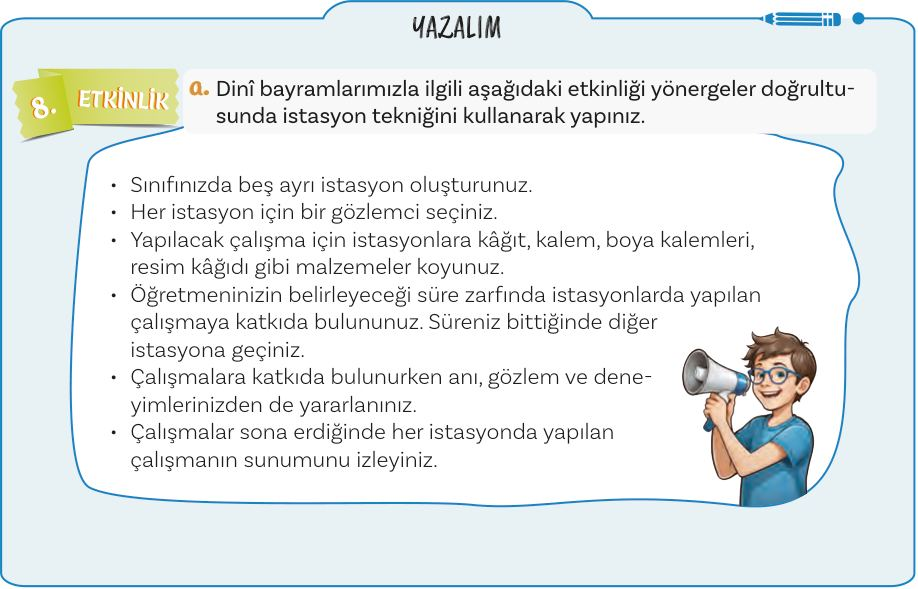

# YAZALIM

**8. ETKİNLİK**

**a. Dinî bayramlarımızla ilgili aşağıdaki etkinliği yönergeler doğrultusunda istasyon tekniğini kullanarak yapınız.**

* Sınıfınızda beş ayrı istasyon oluşturunuz.
* Her istasyon için bir gözlemci seçiniz.
* Yapılacak çalışma için istasyonlara kâğıt, kalem, boya kalemleri, resim kâğıdı gibi malzemeler koyunuz.
* Öğretmeninizin belirleyeceği süre zarfında istasyonlarda yapılan çalışmaya katkıda bulununuz. Süreniz bittiğinde diğer istasyona geçiniz.
* Çalışmalara katkıda bulunurken anı, gözlem ve deneyimlerinizden de yararlanınız.
* Çalışmalar sona erdiğinde her istasyonda yapılan çalışmanın sunumunu izleyiniz.

<!-- sayfa 29 -->

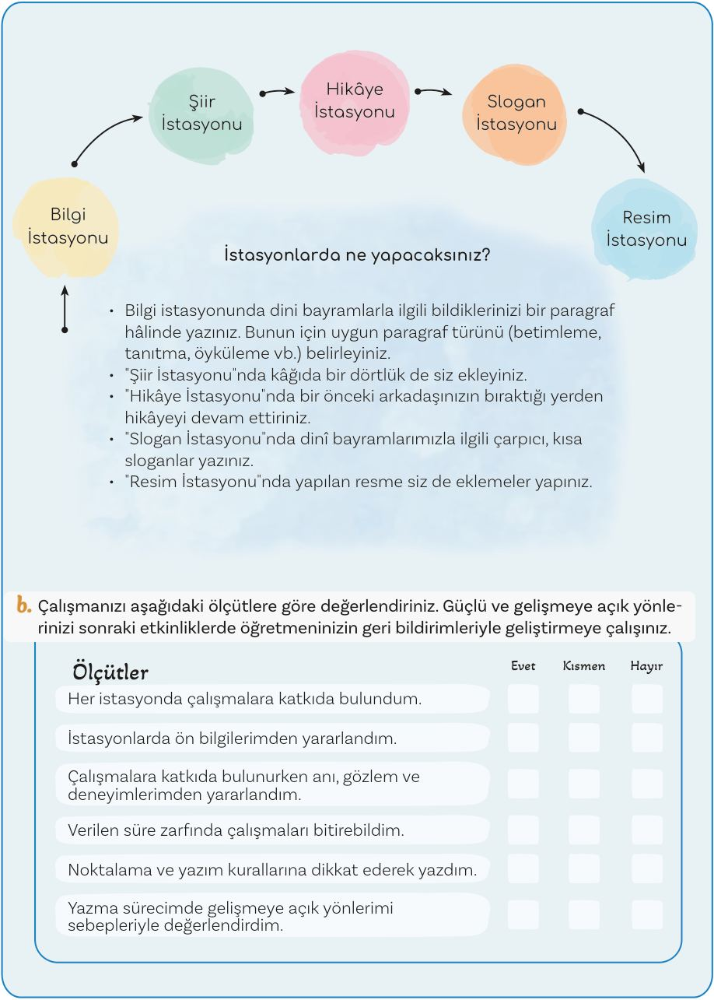

İstasyonlarda ne yapacaksınız?

* Bilgi istasyonunda dinî bayramlarla ilgili bildiklerinizi bir paragraf hâlinde yazınız. Bunun için uygun paragraf türünü (betimleme, tanıtma, öyküleme vb.) belirleyiniz.
* "Şiir İstasyonu"nda kâğıda bir dörtlük de siz ekleyiniz.
* "Hikâye İstasyonu"nda bir önceki arkadaşınızın bıraktığı yerden hikâyeyi devam ettiriniz.
* "Slogan İstasyonu"nda dinî bayramlarımızla ilgili çarpıcı, kısa sloganlar yazınız.
* "Resim İstasyonu"nda yapılan resme siz de eklemeler yapınız.

**b.** Çalışmanızı aşağıdaki ölçütlere göre değerlendiriniz. Güçlü ve gelişmeye açık yönlerinizi sonraki etkinliklerde öğretmeninizin geri bildirimleriyle geliştirmeye çalışınız.

| Ölçütler | Evet | Kısmen | Hayır |
| :--- | :---: | :---: | :---: |
| Her istasyonda çalışmalara katkıda bulundum. | | | |
| İstasyonlarda ön bilgilerimden yararlandım. | | | |
| Çalışmalara katkıda bulunurken anı, gözlem ve deneyimlerimden yararlandım. | | | |
| Verilen süre zarfında çalışmaları bitirebildim. | | | |
| Noktalama ve yazım kurallarına dikkat ederek yazdım. | | | |
| Yazma sürecimde gelişmeye açık yönlerimi sebepleriyle değerlendirdim. | | | |

<!-- sayfa 30 -->

# KONUŞALIM

**9. ETKİNLİK**

**a.** İzlediğiniz filmdeki çocuk kahramanların isimlerini belirleyiniz.

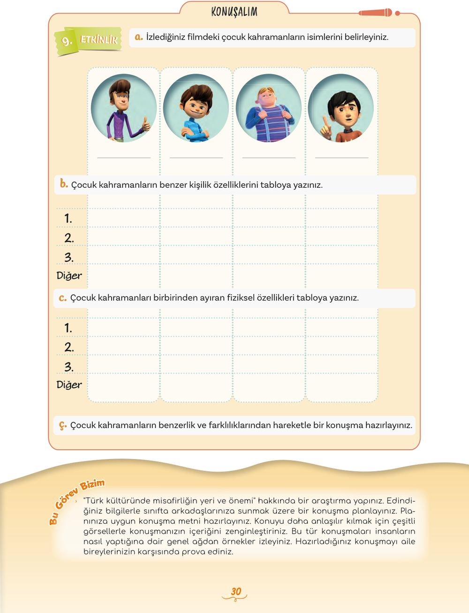

**b.** Çocuk kahramanların benzer kişilik özelliklerini tabloya yazınız.

| | | | |
| :--- | :--- | :--- | :--- |
| 1. | | | |
| 2. | | | |
| 3. | | | |
| Diğer | | | |

**c.** Çocuk kahramanları birbirinden ayıran fiziksel özellikleri tabloya yazınız.

**ç.** Çocuk kahramanların benzerlik ve farklılıklarından hareketle bir konuşma hazırlayınız.

---

**Bu Görev Bizim**

"Türk kültüründe misafirliğin yeri ve önemi" hakkında bir araştırma yapınız. Edindiğiniz bilgilerle sınıfta arkadaşlarınıza sunmak üzere bir konuşma planlayınız. Planınıza uygun konuşma metni hazırlayınız. Konuyu daha anlaşılır kılmak için çeşitli görsellerle konuşmanızın içeriğini zenginleştiriniz. Bu tür konuşmaları insanların nasıl yaptığına dair genel ağdan örnekler izleyiniz. Hazırladığınız konuşmayı aile bireylerinizin karşısında prova ediniz.

<!-- sayfa 31 -->

> Ailenizle arkadaş ve akraba ziyaretleri yapar mısınız? Bu tür ziyaretlerde neler sizi mutlu eder?
> Evinize gelen misafirleri nasıl ağırlıyorsunuz?
> Kimlere "misafirperver" denir? Örneklerle açıklayınız.

✓ Metnin başlık ve görselinden hareketle metnin konusu hakkındaki tahminlerinizi söyleyiniz. Tahmininizin doğruluğunu metni dinledikten sonra kontrol ediniz.
✓ Öğretmeniniz metni okurken onu dikkatlice dinleyiniz.
✓ Metni işitilebilir bir ses tonuyla anlamı yansıtacak şekilde doğru vurgu ve tonlamalarla okuyunuz.

# MİSAFİR ODASI

Bendim evin gözbebeği
Canım sıkılmazdı hiç
Çaylar kahveler içilirdi
Eksilmezdi yüzlerde sevinç.

Bir kanepe, en az üç koltuk
Perdelerim kadife kumaştan
Ortada bir halı yumuşak tüylü
Misafirlerim olurdu her yaştan.

Bir büfem vardı köşede
İçinde siyah beyaz fotoğraflar
Aile bireylerinin mahzun bakışları
Dedeler, nineler ve torunlar.

Bir duvar saati, içinde guguk kuşu
Dantelâlarla süslü orta sehpası
Bir vazo daima üstünde konsolun
Hoş geldiniz derdi, misafir kolonyası.
(...)

**Gökhan AKÇİÇEK**
(Kısaltılmıştır.)

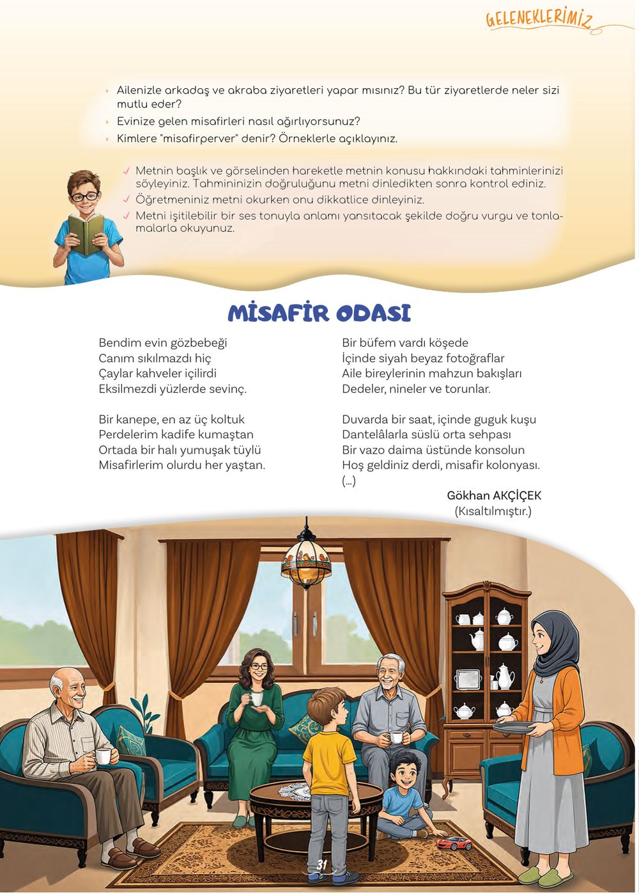

<!-- sayfa 32 -->

# 1. ETKİNLİK

**a.** Aşağıdaki kelime grubu ve kelimelerin şiirde geçtiği dizeleri tekrar okuyunuz. Bunların şiirdeki anlamlarını tahmin edip defterinize yazınız.

 göz bebeği
 kadife
 büfe
 konsol

**b.** Tahminlerinizin doğruluğunu *TDK Güncel Türkçe Sözlük*'ten kontrol ediniz.

**c.** Bu kelime grubu ve kelimelerin farklı anlamlarda kullanıldığı cümleler aşağıda verilmiştir. Kelime grubu ve kelimelerin şiirdeki anlamıyla kullanıldığı cümleleri işaretleyiniz.

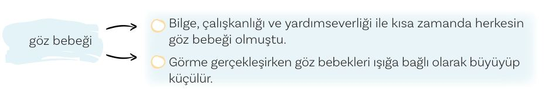 göz bebeği $\longrightarrow$ 
- Bilge, çalışkanlığı ve yardımseverliği ile kısa zamanda herkesin göz bebeği olmuştu.
- 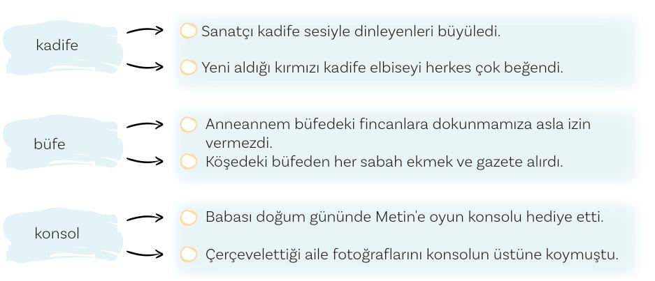 Görme gerçekleşirken göz bebekleri ışığa bağlı olarak büyüyüp küçülür.

 kadife $\longrightarrow$ 
- Sanatçı kadife sesiyle dinleyenleri büyüledi.
- Yeni aldığı kırmızı kadife elbiseyi herkes çok beğendi.

 büfe $\longrightarrow$ 
- Anneannem büfedeki fincanlara dokunmamıza asla izin vermezdi.
- Köşedeki büfeden her sabah ekmek ve gazete alırdı.

 konsol $\longrightarrow$ 
- Babası doğum gününde Metin'e oyun konsolu hediye etti.
- 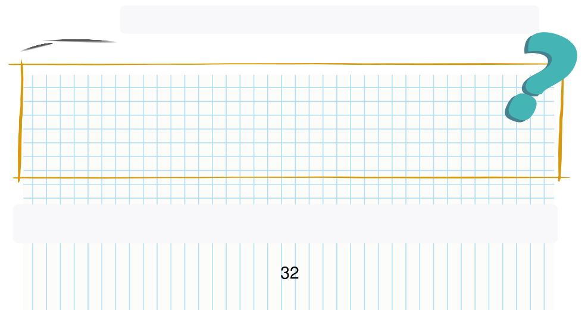 Çerçevelettiği aile fotoğraflarını konsolun üstüne koymuştu.

---

# 2. ETKİNLİK

**a.** Okuduğunuz şiirden hareketle aşağıdaki soruları sözlü olarak cevaplayınız.

1. Şiir hangi varlığın dilinden yazılmıştır?
2. Şiirde anlatılan odanın özellikleri nelerdir?
3. Misafir odasının canı neden hiç sıkılmamaktadır?

**b.** Şiiri yeniden okuyup başlığını ve görsellerini inceleyiniz. Elde ettiğiniz ipuçlarından ve...

<!-- sayfa 33 -->

# 3. ETKİNLİK

**a.** Aşağıda "misafirlik"le ilgili deyim ve kalıplaşmış sözler ile bunların anlamları verilmiştir. Deyim ve kalıplaşmış sözleri anlamlarıyla eşleştiriniz. Boşta kalan deyimin anlamını tahmin ederek yazınız.

| Deyim ve kalıplaşmış sözler | Anlamları |
| :--- | :--- |
| a misafir ağırlamak | Bulunduğu yerden her an ayrılacakmış gibi eğreti, üstünkörü oturmak. |
| b misafir gibi oturmak | Konuğa gerekli ilgiyi göstermek, ikramda bulunmak. |
| c misafir kalmak | |

**b.** Anlamını eşleştirdiğiniz ve tahmin ettiğiniz deyim ve kalıplaşmış sözleri gereksiz kelimelere yer vermeden cümle içinde kullanınız.

__________________________________________________________________________________________
__________________________________________________________________________________________
__________________________________________________________________________________________
__________________________________________________________________________________________

# 4. ETKİNLİK

Okuduğunuz şiirden alınan aşağıdaki bilgilerden ve önceki bilgilerinizden yararlanarak milletimizin hangi değerlere sahip olduğu söylenebilir? Yazınız.

| | |
| :--- | :--- |
| Büfelerin üzerinde siyah beyaz fotoğrafların bulundurulması | ____________________________________________________ |
| Dedeler, nineler ve torunlar gibi her yaştan misafirlerin olması | ____________________________________________________ |
| Misafirlere ikramlarda bulunulması | ____________________________________________________ |

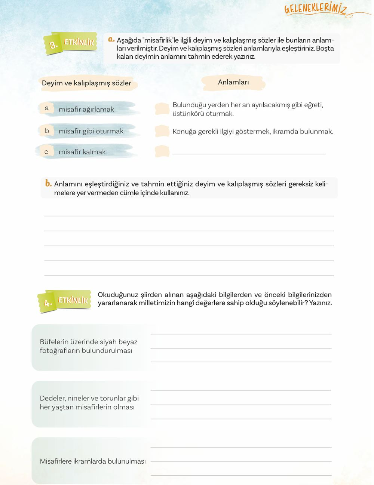
<!-- yer tutucu bulunamadı: sayfa sonuna eklendi -->

<!-- sayfa 34 -->

# 5. ETKİNLİK

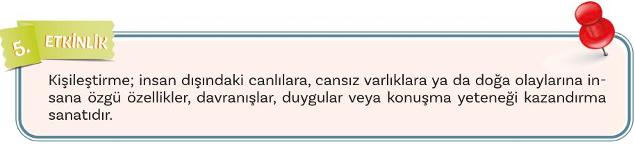

Kişileştirme; insan dışındaki canlılara, cansız varlıklara ya da doğa olaylarına insana özgü özellikler, davranışlar, duygular veya konuşma yeteneği kazandırma sanatıdır.

**a.** Günlük hayatta en çok karşılaştığınız bir hayvan, bitki ve nesneyi seçiniz. Bunları kişileştirdiğiniz cümleler yazınız.

____________________________________________________________________________________________________

**b.** Defterinize masadaki kitap ve kalemi konuşturduğunuz bir diyalog yazınız. Diyalog yazarken aşağıdaki yönergeleri dikkate alınız.

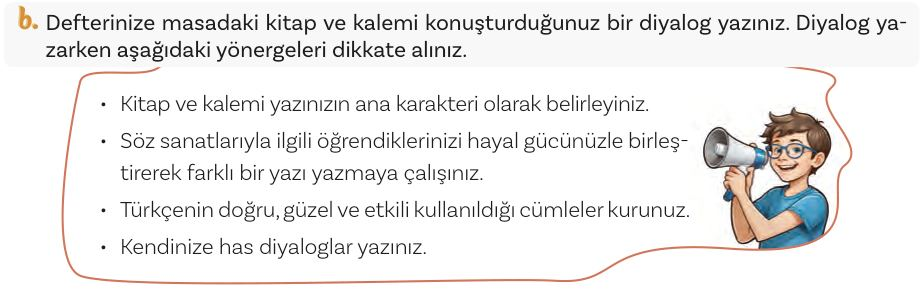

* Kitap ve kalemi yazınızın ana karakteri olarak belirleyiniz.
* Söz sanatlarıyla ilgili öğrendiklerinizi hayal gücünüzle birleştirerek farklı bir yazı yazmaya çalışınız.
* Türkçenin doğru, güzel ve etkili kullanıldığı cümleler kurunuz.
* Kendinize has diyaloglar yazınız.

# 6. ETKİNLİK

Aşağıda iki ayrı metin verilmiştir. Bunları inceleyiniz. Tabloda verilen özelliklerin bunlardan hangisine ait olduğunu örnekteki gibi işaretleyiniz.

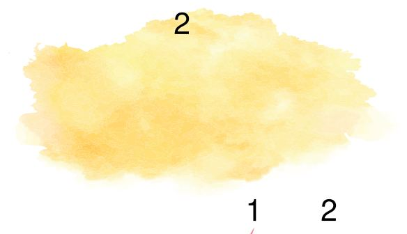
1
Bendim evin gözbebeği
Canım sıkılmazdı hiç
Çaylar kahveler içilirdi
Eksilmezdi yüzlerde sevinç.

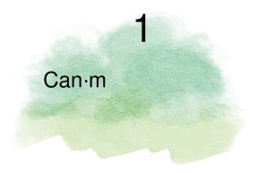
2
Eskiden evlerin en özen gösterilen bölümü misafir odasıydı. İnsanlar bu odaları sadece eve misafir geldiği zaman kullanırdı. Toplumumuzda misafirlere çok değer verilir, türlü türlü ikramlarda bulunulur, her zaman güler yüz gösterilirdi. Bu durum misafirleri de çok mutlu ederdi.

| | 1 | 2 |
| :--- | :---: | :---: |
| Dizelerden oluşmaktadır. | ✓ | |
| Paragraf hâlindedir. | | |
| Ses benzerlikleri yoluyla ahenk sağlanmıştır. | | |
| Anlam bütünlüğü oluşturan cümleler art arda sıralanmıştır. | | |
| Dizeler bir araya gelerek dörtlük oluşturmuştur. | | |

<!-- sayfa 35 -->

# KONUŞALIM

**7. ETKİNLİK**

**a.** Kültürümüzde misafirlere hangi ikramlarda bulunulmaktadır? Örnekler veriniz.

**b.** "Bu Görev Bizim" bölümünde planlayıp hazırladığınız, prova ettiğiniz "Türk kültüründe misafirperverliğin yeri ve önemi" konulu konuşmayı arkadaşlarınıza sununuz. Konuşmanız sırasında aşağıdaki yönergeleri dikkate alınız.

* Uygun selam ve hitap ifadelerini kullanınız.
* Konuşmanızda uygun zamanda söz alıp vermeye özen gösteriniz.
* Arkadaşlarınızdan konuşmanızla ilgili soru gelmesi durumunda öncelikle sorunun içeriğini ve yapısını çözümleyiniz. Daha sonra onlara vereceğiniz cevabı planlayınız (nasıl tepki vereceğinizi, hangi bilgi ve gerekçeleri kullanacağınızı vb.). Kişisel yorumunuzu ve değerlendirmenizi yansıtan cevabınızı nezaket kuralları çerçevesinde, yorumunuzu sözlü olarak ifade ediniz.
* Hazırladığınız görsellerle konuşmanızı destekleyiniz.
* Konuşmanızın güçlü ve gelişmeye açık bulduğunuz yönlerini belirleyiniz.
* Gelişmeye açık yönlerinizi desteklemek için ne gibi önlemler alabileceğinizi ifade ediniz.

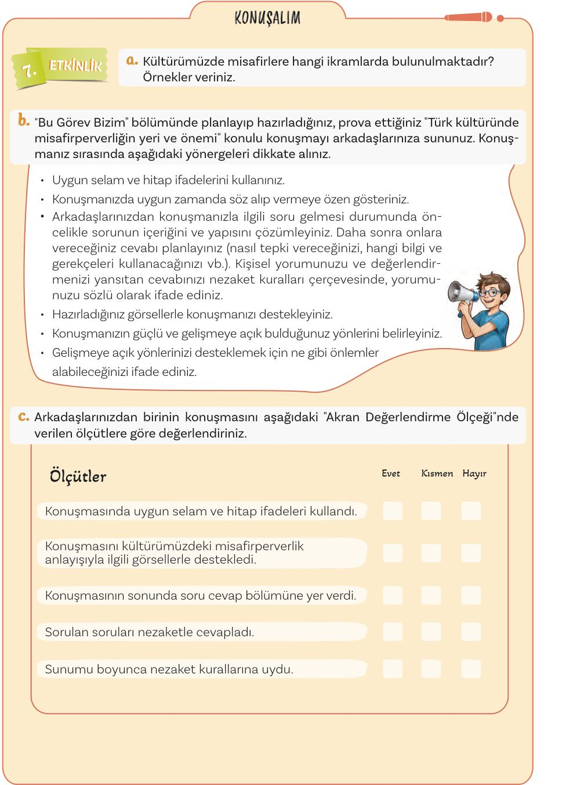

**c.** Arkadaşlarınızdan birinin konuşmasını aşağıdaki "Akran Değerlendirme Ölçeği"nde verilen ölçütlere göre değerlendiriniz.

| Ölçütler | Evet | Kısmen | Hayır |
| :--- | :---: | :---: | :---: |
| Konuşmasında uygun selam ve hitap ifadeleri kullandı. | | | |
| Konuşmasını kültürümüzdeki misafirperverlik anlayışıyla ilgili görsellerle destekledi. | | | |
| Konuşmasının sonunda soru cevap bölümüne yer verdi. | | | |
| Sorulan soruları nezaketle cevapladı. | | | |
| Sunumu boyunca nezaket kurallarına uydu. | | | |

<!-- sayfa 36 -->

# 8. ETKİNLİK

**a.** Aşağıdaki paragrafı okuyunuz. Kişilerin yerine kullanılan ve isimlerin yerini işaret yoluyla tutan kelimelerin altını örnekteki gibi çiziniz.

Bilgehan ve ailesi her bayram olduğu gibi bu bayram da dedelerine gitmek için yola çıktılar. Üç saat süren yolculuğun ardından köye varmışlardı. Köyün girişinde sağdaki beşinci ev dedesinin eviydi. Bu, ona göre köyün en güzel eviydi. Dedesi onları kapıda sevinçle karşıladı ve hemen "Şuraya geçelim de biraz dinlenin." dedi. Biraz sohbet ettikten sonra annesi Bilgehan'a arabadan "Deden için aldığımız o hediyeleri getirir misin?" dedi. Bilgehan hemen arabaya giderek onları alıp geldi. Dedesi hediyeleri çok beğendi ve hediyeler için teşekkür etti. "Ben fındıklı kurabiyelerden getireyim." dedi. Çocuklar kurabiyeleri çok beğendi. Üç günlük bayram tatili hızla geçmişti ve dönme vakti gelip çatmıştı.

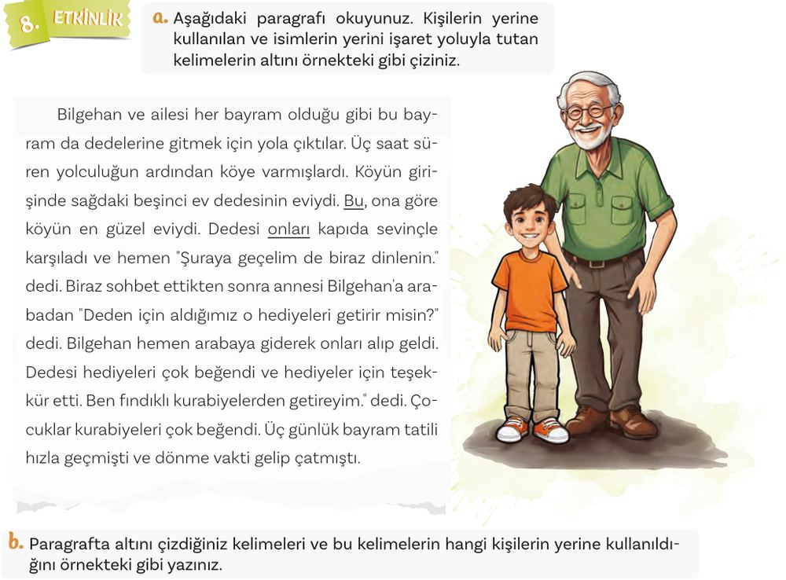

**b.** Paragrafta altını çizdiğiniz kelimeleri ve bu kelimelerin hangi kişilerin yerine kullanıldığını örnekteki gibi yazınız.

| | |
| :--- | :--- |
| onları | Bilgehan ve ailesi |
| \_\_\_\_\_\_\_\_\_\_ | \_\_\_\_\_\_\_\_\_\_\_\_\_\_\_\_\_\_\_\_ |
| \_\_\_\_\_\_\_\_\_\_ | \_\_\_\_\_\_\_\_\_\_\_\_\_\_\_\_\_\_\_\_ |

**c.** Paragrafta altını çizdiğiniz kelimeleri ve bu kelimelerin hangi ismin yerine kullanıldığını örnekteki gibi yazınız.

| | |
| :--- | :--- |
| bu | ev |
| \_\_\_\_\_\_\_\_\_\_ | \_\_\_\_\_\_\_\_\_\_ |
| \_\_\_\_\_\_\_\_\_\_ | \_\_\_\_\_\_\_\_\_\_ |

**ç.** Siz de kişilerin yerine kullanılan ve isimlerin yerini işaret yoluyla tutan kelimeler kullanarak...

<!-- sayfa 37 -->

# 9. ETKİNLİK

**a.** Aşağıdaki metinde "kesme işareti" ve "üç nokta"nın hangi işlevlerde kullanıldıklarını belirleyiniz.

Geçen yıl okulumuzla Uşak’ın tarihî sokaklarında unutulmaya yüz tutmuş meslekleri keşfedeceğimiz harika bir yolculuğa çıktık. Gezimiz sırasında geleneksel halıları kök boyalarla ilmek ilmek dokuyan Mehmet Bey’in atölyesine de uğradık. Kendisi bu değerli zanaata 1985’te dedesinin yanında çırak olarak başladığını söyledi. Biz de atölyede sergilenen ve 29 Ekim’de açılacak olan Cumhuriyet sergisi için hazırlanan o muhteşem halıları hayranlıkla inceledik. Bu güzel gezi sayesinde halıcılık zanaatının ayrıntılarını a’dan z’ye öğrenmiş olduk. Yeni bilgiler edineceğimiz nice kültürel gezilere...

**b.** Belirlediğiniz işlevlerden hareketle bu noktalama işaretlerinin kullanım kurallarını oluşturunuz. Oluşturduğunuz kuralları defterinize yazınız.

---

# 10. ETKİNLİK

**a.** Karekodu okutarak "Sevgili Günlük" adlı metni dinleyiniz.

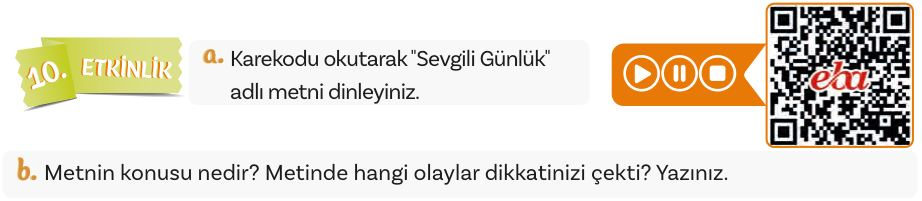

**b.** Metnin konusu nedir? Metinde hangi olaylar dikkatinizi çekti? Yazınız.

__________________________________________________________________________
__________________________________________________________________________
__________________________________________________________________________

**c.** Metindeki olayları aşağıdaki kişilerin bakış açısına göre örnekteki gibi yazınız.

**Aile üyesinin bakış açısı:** Aile üyesi, bu sohbetlerin aileyi daha da yakınlaştırdığını ve yapılan yardımların komşuluk ilişkilerini güçlendirdiğini düşünebilir.

**Komşuların bakış açısı:**
__________________________________________________________________________
__________________________________________________________________________

**Yazarın bakış açısı:**
__________________________________________________________________________
__________________________________________________________________________

**ç.** Metni yazarın ve ailesinin yardıma gittiği komşularının bakış açısıyla yeniden düzenleyip kısaca anlatınız.

<!-- sayfa 38 -->

# YAZALIM

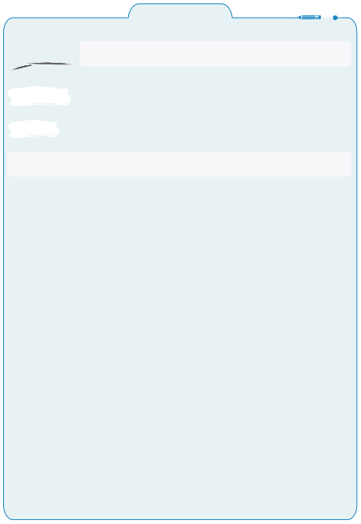

**11. ETKİNLİK**

**a.** "Sevgili Günlük" metninin hangi metin yapısında olduğunu nedenleriyle aşağıya yazınız.

**Metnin yapısı:** __________________________________________________________________

**Nedenleri:** _____________________________________________________________________

**b.** Metnin yapısından hareketle "Sevgili Günlük" metnindeki önemli ve detay bilgileri sınıflandırarak aşağıya yazınız.

____________________________________________________________________________________

________________

<!-- sayfa 39 -->

**C.** Belirlediğiniz önemli bilgileri kronolojik akışa veya düşünce akışına uygun olarak kendi cümlelerinizle ifade ederek metni özetleyiniz. Yazınızı oluştururken özet ifade etme işlevli söz varlıklarını (açıkçası, yani, özetle, kısacası, özet olarak, uzun lafın kısası, sonuç olarak vb.) kullanmaya özen gösteriniz.

**ç.** Öğretmeninizin geri bildirimleriyle güçlü ve gelişmeye açık yönlerinizi belirleyiniz. Bu yönlerinizi sonraki etkinliklerde geliştirmeye çalışınız.

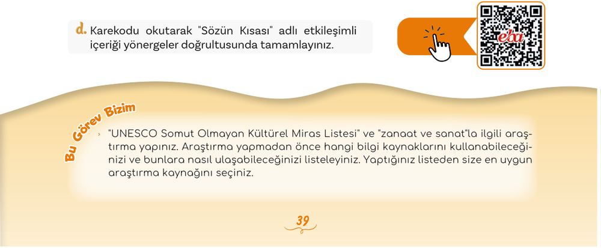

**d.** Karekodu okutarak "Sözün Kısası" adlı etkileşimli içeriği yönergeler doğrultusunda tamamlayınız.

***

**Bu Görev Bizim**

> "UNESCO Somut Olmayan Kültürel Miras Listesi" ve "zanaat ve sanat"la ilgili araştırma yapınız. Araştırma yapmadan önce hangi bilgi kaynaklarını kullanabileceğinizi ve bunlara nasıl ulaşabileceğinizi listeleyiniz. Yaptığınız listeden size en uygun araştırma kaynağını seçiniz.

<!-- sayfa 40 -->

# İZLE UYGULA ÖĞREN
# METİN YAPILARININ ANALİZİ VE BİLGİLERİ ORGANİZE ETME STRATEJİSİ

Bir önceki temada öyküleyici metin yapısını öğrenmiştiniz. Geleneklerimiz temasında da sevdiğiniz kahramanların yaşam öyküleri, bir uygulamanın işlem basamakları, bir olayın kronolojik akışı gibi içeriklerin anlatıldığı sıralı-kronolojik metin yapısını öğreneceksiniz. Bu yapıya, genellikle bir varlığın (kişi, bitki, hayvan, nesne vb.) yaşam öyküsünün işlendiği eserlerde bir şeyin nasıl yapıldığını anlatan metin veya belgesellerde, düğün veya bayram gibi merasimlerin aşamalarının anlatıldığı kaynaklarda sıkça rastlanır. Bu metinlerde doğrudan zaman ifadeleri veya “ilk olarak, önce, sonra, daha sonra, ardından, aynı anda, o esnada, nihayetinde, en son” gibi öncelik sonralık belirten ifadeler sıklıkla kullanılır. Önemli olaylar ve bilgiler genellikle doğrudan zaman ifadeleri veya öncelik-sonralık bildiren ifadelerin bulunduğu cümlelerde yer alır. Bu tür metinlerde olaylar ve bilgiler uygun sıraya konularak verilir. Aynı yapı paragraf düzeyinde de görülür. Örnek:

"Türk düğünlerinin ilk adımı kız isteme merasimidir. **Öncelikle** erkek tarafı, ailesi ve yakın akrabalarıyla kız evine gider. Bu ziyaret **sırasında** erkeğin ailesi, kızın ailesinden kızlarını oğullarına istemek için geleneklere uygun bir şekilde dileklerini iletir. **Devamında** kız tarafı olumlu yanıt verirse kahveler içilir. **Ardından** aileler arasında tatlı bir sohbet başlar. Böylece evliliğe giden ilk adım bu merasimle atılmış olur."

Paragraf örneğinde olduğu gibi sıralı-kronolojik metin yapısını öğrendiğinizde bu metinlerdeki önemli olay ve bilgileri daha kolay hatırlar ve belirleyebilirsiniz. Sıraya konularak sunulan olay ve bilgileri zaman çizelgesi, akış şeması, merdiven gibi grafik düzenleyicilere yerleştirmeniz anlamanızı kolaylaştıracak ve daha iyi hatırlamanızı sağlayacaktır. Şimdi öğretmeniniz size sıralı-kronolojik metin yapısını anlatacak.

Haydi, başlayınız!

## Öğretmeninizi İzliyorsunuz

Öğretmeniniz şimdi size stratejinin nasıl kullanıldığını gösterecek. Metinde, düğün merasimiyle ilgili aşamaların nasıl sıralandığını göstermek için sesli düşünecek. Stratejiyi kullanırken nelere dikkat etmeniz gerektiğini size öğretecek. Öğretmeninizin sunumunu dikkatle izlerken aşağıdaki noktalara odaklanınız.

* Metindeki önemli bilgilerin ve olayların belirli bir sırayla verildiğini nasıl fark etti? Bunu yaparken yuvarlak içine aldığı kelime veya kelime gruplarının sıralamayı belirlemede ne gibi katkısı oldu?
* Aşamaları anlatan paragraflardan hareketle düğün merasiminin aşamalarını zaman...

<!-- sayfa 41 -->

# HALI DOKUMACILIĞI

Anadolu’da halı dokumacılığı geleneksel yöntemlerin sabırla uygulandığı, kültürel zenginliği ve zanaatkârlığı bir araya getiren önemli bir el sanatıdır. Hem aile bütçesine katkıda bulunmak hem de günlük ihtiyaçları karşılamak amacıyla yapılan bu zanaatın belirli aşamaları vardır ve her aşama büyük bir özen gerektirir.

Öncelikle halı dokumada kullanılacak temel malzeme olan yün elde edilir. Bu işlem genellikle haziran ve eylül aylarında koyunların kırpılmasıyla gerçekleştirilir. Kırkılan yünler suyla tokaçlanarak iyice temizlenir ve ardından güneşte kurutulmaya bırakılır. Kuruma işlemi bittikten sonra yünler, tarakla çekilerek iplik yapımına uygun hâle getirilir. Bu aşamada çıkrık ve kirmen gibi geleneksel araçlar kullanılarak yün eğrilir. Eğrilmiş iplikler boyama işlemine hazırlanır.

Boyama aşamasına geçildiğinde önce boyama alanı ve malzemeler hazırlanır. Açık renkten başlayarak koyu renklere doğru boyama yapılır. Bu süreçte kullanılan boyalar, doğadaki çeşitli bitkilerden elde edilen kök boyalardır. Boyama tamamlandıktan sonra iplikler kurutulur ve yumak hâline getirilir.

İplikler hazırlandıktan sonra dokuma işlemine geçilir. Halı tezgâhında kullanılacak model belirlenir ve iplikler özenle yerleştirilir. Son aşamasında halı dokuma süreci ilmek ilmek yapılan düğümlerle tamamlanır. Her düğüm, halının desenini ve motifini oluşturur.

Bütün bu aşamaların ardından, Anadolu’nun estetik değerlerini ve kültürel zenginliğini yansıtan halılar ortaya çıkar. Hem sanatsal hem de işlevsel bir değer taşıyan bu eserler sadece ihtiyaçları karşılamakla kalmaz, aynı zamanda geçmişten günümüze taşınan bir mirasın simgesi hâline gelir.

Halı dokuma geleneği ekonomik ve kültürel açıdan korunması, yaşatılması ve gelecek kuşaklara aktarılması gereken önemli bir değerdir.

---

"Halı Dokumacılığı" Metni Çalışma Kâğıdı

Doğrudan Zaman veya Öncelik-Sonralık Bildiren Kelime/Kelime Grupları
__________________________________________________________________
__________________________________________________________________
__________________________________________________________________

Zaman Çizelgesi:

| 1. Aşama | 2. Aşama | 3. Aşama | 4. Aşama |
| :--- | :--- | :--- | :--- |
| | | | |
| | | | |
| | | | |

<!-- sayfa 42 -->

# Siz Uyguluyorsunuz

Şimdi 4-6 kişilik gruplar oluşturunuz ve aşağıdaki metni okuyunuz. Metni okurken öğretmeninizin rehberliğinde stratejiyi uygulayınız ve metnin devamındaki çalışma kâğıdını doldurunuz. Çalışmanızı yaparken aşağıdakilere dikkat ediniz.

* Öğretmeniniz size kendi uygulamasındaki sıraya uygun olarak ne yapacağınızı söyledikten sonra söyleneni grup olarak uygulayınız.
* Grup olarak çalışırken önce birlikte düşünüp tartışınız, ortak bir karara varınız sonra çalışma kâğıdınızı doldurunuz.
* Çalışırken ihtiyaç duyarsanız öğretmeninizden yardım alınız ve öğretmeniniz siz çalışırken bir eksiklik fark ederse onun uyarılarına uygun olarak çalışmanızı düzenleyiniz.

## KEÇE USTASI AHMET YAŞAR KOCATAŞ

Keçecilik, hayvan tüylerinin özel bir teknikle sıkıştırılarak keçeye dönüştürülmesi işlemidir. Geleneksel Türk el sanatları arasında önemli bir yere sahiptir ve tarih boyunca çeşitli kültürlerde kullanılmıştır. Giysiler, çadırlar, süs eşyaları ve zemin kaplamaları keçenin kullanıldığı bazı örneklerdir. Günümüzde keçecilik zanaatının yaşayan önemli temsilcilerinden biri, keçe ustası Ahmet Yaşar Kocataş'tır.

Ahmet Yaşar Kocataş 1950 yılında Afyonkarahisar’da dünyaya gelmiştir. Keçeciliğe olan ilgisi henüz altı yaşında babasının dükkânında çalışmaya başlamasıyla filizlenmiştir. 1961’de ilkokulu tamamladıktan sonra tamamen keçeciliğe yönelmeyi seçmiştir. Çocukluk yılları boyunca babasının yanında bu zanaatı öğrenmiş ve keçeciliğe dair tüm incelikleri kavramıştır.

1970-1972 yılları arasında askerlik hizmetini Ankara ve İzmir’de tamamlamıştır. Bu iki yılın ardından tekrar mesleğinin başına geçmiştir. Babasının sağlığında ondan öğrendikleriyle mesleğinde hızla ilerlemiş ve ustalık seviyesine ulaşmıştır. 1996’da babasının vefatından sonra tek başına keçecilik sanatını icraya devam etmiştir.

Ustalığı süresince yaptığı eserleri yurt içinde ve yurt dışında müze ve sergilerde sergilenmiştir. Ayrıca hakkında birçok belgesel çekilmiş ve Kültür Bakanlığı tarafından envantere alınmıştır. 2015 yılında UNESCO tarafından "Yaşayan İnsan Hazineleri" listesine alınarak onurlandırılmıştır. Bu unvan, onun mesleğine olan katkılarını ve kültürel mirası yaşatma konusundaki kararlılığını simgelemektedir.

Ahmet Yaşar Kocataş, geleneksel Türk el sanatlarından biri olan keçeciliği büyük bir ustalıkla sürdürmekte ve bu zanaatın gelecek nesillere aktarılmasında önemli bir rol oynamaya devam etmektedir. Mesleğinin örnek ustalarından biri olan Kocataş, hâlen Afyonkarahisar Keçeciler Çarşısı’nda mesleğini icra etmektedir.

<!-- sayfa 43 -->

“Keçe Ustası Ahmet Yaşar Kocataş” Metni Çalışma Kâğıdı

Doğrudan Zaman veya Öncelik-Sonralık Bildiren Kelime/Kelime Grupları

__________________________________________________________________
__________________________________________________________________
__________________________________________________________________
__________________________________________________________________
__________________________________________________________________
__________________________________________________________________

Akış Şeması

| 1950 | 1956 | İlkokulu tamamladıktan sonra |
| :---: | :---: | :---: |
| $\downarrow$ | $\downarrow$ | $\downarrow$ |
| Babasının vefatından sonra | 1972 | 1970 |
| $\uparrow$ | $\leftarrow$ | $\leftarrow$ |
| 2015 | | |

<!-- sayfa 44 -->

# Yine Uyguluyorsunuz

Şimdi 2-3 kişilik gruplar oluşturunuz ve aşağıdaki metni okuyunuz. Metni okurken stratejiyi uygulayınız ve metnin devamındaki çalışma kâğıdını doldurunuz. Çalışmanızı yaparken aşağıdakilere dikkat ediniz.

* Öğretmeniniz bu kez gerekmedikçe size müdahale etmeyecek.
* Önceki uygulamalardaki sırayı takip ederek stratejiyi kullanınız.
* Stratejiyi uygularken grup arkadaşlarınızla konuşup tartışınız.

## EBRU SANATI

Ebru, su yüzeyinde oluşturulan desenlerin kâğıda aktarılmasıyla yapılan geleneksel Türk sanatlarından biridir. Sabır ve dikkat gerektiren bu sanat, özel teknikleri ve malzemeleriyle benzersiz bir estetik sunar. Bu sanatın başarılı bir şekilde uygulanabilmesi için ön hazırlık aşamalarının titizlikle yapılması gerekir.

İlk olarak ebru yapılacak ortamın uygun sıcaklıkta olması sağlanır. Odanın sıcaklığı, boyaların kıvamını korumak için oldukça önemlidir. Sonrasında ebrunun temel malzemelerinden biri olan kitreli su hazırlanır. Kitre, suya yoğunluk kazandıran doğal bir maddedir. Bu madde suya eklenerek iyice karıştırılır ve uygun kıvama getirilir. Daha sonra karışım tülbentten geçirilerek temizlenir ve pürüzsüz bir sıvı elde edilir. Bir sonraki aşamada boyaların hazırlanması gereklidir. Ebru boyaları genellikle doğal toprak boyalardan yapılır. Önce boyalar ezilerek macun kıvamına getirilir. Ardından boyaların su yüzeyinde düzgünce yayılmasını sağlayan öd eklenir. Bu karışımın 10-15 gün dinlendirilmesi boyaların doğru şekilde çalışabilmesi için önemlidir. Dinlendirilen boyalar, gerektiğinde sulandırılarak kullanıma hazır hâle getirilir.

En sonunda ebru yapımına geçilir. Önce kitreli su, tekne adı verilen özel kaba dökülür. Sonra hazırlanan boyalar fırça yardımıyla su yüzeyine serpilir ve çeşitli desenler oluşturulur. Ardından çizilen şekiller çubuk veya tarak gibi araçlarla detaylandırılır. Son olarak oluşturulan desenlerin üzerine özel ebru kâğıdı dikkatlice yerleştirilir ve şekiller kâğıda aktarılır. Kâğıt tekneden kaldırıldıktan sonra düz bir zeminde kurumaya bırakılır.

Bu aşamaların tamamlanmasıyla ebru sanatı son bulur ve eşsiz bir eser ortaya çıkar. Her ebru çalışması, yapıldığı anda oluşan ve tekrarı olmayan özgün bir tasarımdır.

<!-- sayfa 45 -->

# “Ebru Sanatı” Metni Çalışma Kâğıdı

Doğrudan Zaman veya Öncelik-Sonralık Bildiren Kelime/Kelime Grupları

Merdiven:
1. Adım
2. Adım
3. Adım
4. Adım

# Sıra Sizde

Artık sıralı-kronolojik metin yapısını öğrendiniz. Şimdi kitabınızdaki "Çömlekçilik" metninde stratejiyi kendiniz kullanabilirsiniz.

<!-- sayfa 46 -->

# Keşif Yolculuğu

> "Zanaat ve sanat" ile ilgili araştırma sonuçlarınızı, bilgiye nasıl ulaştığınızı ve hangi materyallerden yararlandığınızı arkadaşlarınızla paylaşınız.
> Çevrenizde topraktan yapılmış eşyaları kullanan var mı? Bu eşyalar nelerdir ve hangi amaçla kullanılmaktadır?

* Ders saati içinde okumaya ayıracağınız süreyi öğretmeninizle belirleyiniz.
* Belirlediğiniz süreye göre sesli mi yoksa sessiz mi okuyacağınıza karar veriniz.
* Okumanız bittiğinde seçtiğiniz okuma yönteminin metni anlamanız için yeterli olup olmadığını kontrol ediniz.
* Eğer seçtiğiniz yöntemle metni anlamakta zorlandıysanız bir sonraki okumada farklı bir yöntem deneyiniz.

# ÇÖMLEKÇİLİK

## Kil ve Topraktan Doğan Güzellik

İnsanoğlunun en eski mesleklerindendir. Kazılarda çıkarılan eski eserler içerisinde çömlekler çoğunluktadır. Doğanın yıpratıcı etkisine en iyi dayanan yine topraktan yapılan ve ateşte pişirilerek sağlamlaştırılan kaplardır. Yemek kapları, su testileri, kışlık yiyecek saklamak için küpler, su küpleri bilinen çanak çömlek ürünleridir.

Kil ve toprak karışımından yapılmış pişirilebilir her türlü kaba çömlek denmektedir. Bu işi yapan kişiye de çömlekçi denir.

Çömlek, genellikle çark adı verilen ve ayakla döndürülen tezgâh üzerindeki çamurun maharetle şekillendirilmesiyle yapılır. İşlik denilen atölyelerde üretilen çömlekler önce güneşte, daha sonra da gölgede kurutulduktan sonra, saman ve talaşla yakılan fırınlarda $800$ dereceden başlayıp $1200$ derece sıcaklık arasında özenle pişirilir.

Çömlekçilik bir zamanlar ülkemizdeki en revaçta olan zanaatlardan biriydi. Daha çeyrek asır öncesine kadar mutfağında su küpü, turşu küpü, yağ küpü olmayan ev yoktu. Yemekler dahi topraktan yapılmış kaplarda pişerdi.

<!-- sayfa 47 -->

# Çömlek Çarkı Nedir

Bir mile takılmış iki yatay tekerlekten meydana gelir. Alttaki tekerlek çömlekçinin düzenli bacak hareketi ile döndürülür. Aynı mile bağlı olan üst tekerlek de dönmüş olur. Böylece üst tekerleğin üzerindeki çömlek hamuru da döner. Bundan sonra bütün iş çömlekçi ustasının maharetli ellerine kalmıştır.

# Çömlek Yapımı

Çömlek nasıl yapılıyor? Sanırım önce bu konuda kısa da olsa bir bilgi vermek gerekir. Pişirilecek olan karışımın çömleğe dönüşme safhasına gelmeden önce geçirdiği bir hazırlık dönemi vardır. Çömlek çamuru, ait olduğu yatağa göre silisli, killi, yumuşak, yağlı, sert veya gevşek olabilir. Çamur cinsi yapılacak kabın türünü de belirler. Çamur teknelerinde içine bazı organik maddeler ilave edilmiş hamur kıvamını bulması için belli bir süre bekletildikten sonra ustalar çıkrık adı verilen tezgâhlarda hamuru şekillendirirler. Hamurun içine katılan organik karışım yandığı zaman çömleklerdeki gözenekli yapıyı oluşturur. Böylece eşya hem hafifler hem de sağlıklı bir hale gelir.

Çömlek hamurunda kullanılan kilin yağı da kum kullanmak suretiyle alınır. İlkel çömlekçilikte hazırlanan hamur elle ya da tokmakla yoğrulurdu. Günümüzde ise bu işlemler için makineler kullanılmaktadır.

Çömlek hamuruna üç şekilde biçim verilir. Birincisi, çömlek hamuru topağının oyularak el veya tokaçla istenilen biçimin verilmesidir. İkincisi ise "kalıplama" tekniğidir. Kalıplama tekniğinin uygulamasına en güzel ve en bilinen örnek kiremittir. Üçüncü teknik "çekme" tekniğidir. Bu teknikte şekil verilecek olan çömlek hamuru dönen bir çarkın üzerine yerleştirilerek el ve çeşitli aletler yardımıyla şekillendirilir.

<!-- sayfa 48 -->

# Fırınlarda Pişirilen Çömlekler

Şekil verilen hamur kendi halinde güneşsiz ortamda kurumaya bırakılır. Kuruyan çömlekler fırınlara istiflenir, odun, talaş veya çalı çırpı yakılarak pişirilir. İlkel fırınlarda pişirme işlemi yüksek sıcaklıklarda yapılamadığından bu fırınlarda pişen malzemeler yeterince sert ve dayanıklı olamazlar. Bu fırınlarda sıcaklık ayarı da yapılamaz. Bu şekilde fırınlanmış çömlekler gözenekli ve mat olmalarının yanı sıra kolaylıkla çizilebilirler. Bu bağlamda "yumuşak çömlekçilik" en eski çömlekçilik türüdür ve kullanılan malzeme yüksek sıcaklıkta pişirilmeye dayanıksızdır.

Cilalı çömlekler ise hem ateşe dayanıklı hem de su geçirmezler. Bunun için kil, kireç, kurşun, çakmaktaşı, boraks, emaye tozu, reçine gibi maddeler karıştırılır, pişmiş bir çömleğin üzerine sulandırılmış karışım sürülür. Çömlek üzerine bir tabaka oluşturan bu sır kurumaya bırakılır. Tekrar fırınlandığında bu maddeler eriyerek ince cam gibi bir yüzey meydana getirir.

# Çömlekçilikte 7000 Yıl

Arkeolojik çalışmalar çömlekçiliğin geçmişinin Anadolu'da M.Ö. 7000 yıllarına kadar uzandığını göstermektedir. Hititler'den beri çarkla çanak-çömlek yapıldığı biliniyor. Örneğin Çatalhöyük kazılarının alt katmanlarında dahi çeşitli çanak ve çömleğe rastlanmaktadır. Süslemeleri basit olmakla birlikte teknikleri dikkat çekici düzeydedir. Bodrum müzesinde sergilenen dünyanın en zengin amfora koleksiyonundaki çeşitlilik de toprak kap işçiliğinin ne kadar eski ve gelişmiş bir uğraş olduğuna kanıttır.

(...)

# Toprak Kaplardan Madeni Kaplara

Günümüzde çömlekçilik mesleği Kütahya, İzmir, Gaziantep, Diyarbakır, Erzurum, Nevşehir, illerimiz ve bu illere bağlı ilçelerde dar bir kapsamda dahi olsa devam etmektedir. Bununla birlikte hayatımıza giren çelik, emaye vb. malzemelerden yapılan tencere, saklama kabı gibi eşyalar doğal olarak toprak kaplara olan talebi düşürmüştür. Mesleğin günümüzde ürün verdiği eşya tiplerine örnek olarak çömlekler, çanaklar, dolma kapakları, ibrikler, güveçler, toprak tencere ve kâseler, su testileri, saksılar ve vazolar gösterilebilir. Bu ürünler kullanımlarına göre sırlı ya da sırsız yapılırlar ve üretildikleri yöreye göre farklı isimler alırlar. Termosun ve buzdolabının yaygınlaşması testilerin de küplerin de pabucunu dama attı.

(...)

Dördüncü kuşağa ulaşamadan ömrünü dolduran çömlekçilik... Bu işi yapan ustalar, üzülmeyin... Yalnız değilsiniz. Sizinle birlikte kaybolan o kadar çok meslek var ki daha...

M. Ali DİYARBAKIRLIOĞLU

<!-- sayfa 49 -->

**a.** Okuduğunuz metinde geçen ve aşağıda sözlükteki anlamları verilen kelimeleri karşılarındaki anlamlarla eşleştiriniz.

$\square$ Türlü işlerde kullanılmak için yapılan ince ve uzun metal çubuk.

1. **küp** $\square$ Su koymaya yarayan kulplu, emzikli kap.

2. **talaş** $\square$ Bazı nesnelere parlaklık verme, dış etkilerden koruma, sızmalarını önleme vb. amaçlarla sürülen, saydam veya donuk vernik.

3. **mil** $\square$ Su, pekmez, yağ vb. sıvıları veya un, buğday gibi tahılları saklamaya yarayan geniş karınlı, dibi dar toprak kap.

4. **kil** $\square$ Islandığı zaman kolayca biçimlendirilebilen yumuşak ve yağlı toprak.

5. **sır** $\square$ Testere ile biçilen veya rende, matkap, törpü vb. araçlarla işlenen bir şeyden dökülen kırıntılar.

6. **ibrik** $\square$ Düzgün bir biçimde üst üste yığmak.

**b.** Tahminlerinizin doğruluğunu TDK Güncel Türkçe Sözlük'ten kontrol ediniz.

<!-- sayfa 50 -->

2. ETKİNLİK

**a.** Okuduğunuz metinde geçen aşağıdaki kelimelerin veya kelime gruplarının metindeki anlamını ve sözlükteki anlamını ilgili yerlere yazınız.

| | |
| :--- | :--- |
| **Çark** | Metindeki Anlamı:    Sözlükteki Anlamı: |
| **İlkel** | Metindeki Anlamı:    Sözlükteki Anlamı: |
| **Testi** | Metindeki Anlamı:    Sözlükteki Anlamı: |
| **Kuşak** | Metindeki Anlamı:    Sözlükteki Anlamı: |
| **Çıkrık** | Metindeki Anlamı:    Sözlükteki Anlamı: |
| **Pabucu dama atılmak:** | Metindeki Anlamı:    Sözlükteki Anlamı: |

**b.** Anlamını belirlediğiniz kelime veya kelime gruplarından içinde “çömlekçilik” mesleğiyle ilgili özel anlam ifade ettiğini düşündüğünüz kelimeler varsa aşağıya yazınız.

____________________________________________________________________________________________________

<!-- yer tutucu bulunamadı: sayfa sonuna eklendi -->

<!-- sayfa 51 -->

# 3. ETKİNLİK

Bilgileri organize etme stratejisi; bir metindeki önemli bilgileri veya olayları bulup bunları şema, tablo gibi araçlarla kâğıda geçirme stratejisidir. Bu strateji, bilgiler arasındaki ilişkiyi ya da olayların sırasını daha kolay görmenizi sağlar. Böylece hem metni daha iyi anlayabilir hem de öğrendiklerinizi daha uzun süre hatırlayabilirsiniz.

Öğrendiğiniz metin yapılarının analizi ve bilgileri organize etme stratejisini "Çömlekçilik" metni çalışma kâğıdına uygulayınız.

## Çalışma Kâğıdı

Doğrudan Zaman veya Öncelik-Sonralık Bildiren Kelime/Kelime Grupları
__________________________________________________________________________
__________________________________________________________________________
__________________________________________________________________________

Merdiven:
1. Adım
2. Adım
3. Adım
4. Adım

# 4. ETKİNLİK

 Okuduğunuz metinden hareketle aşağıdaki soruları sözlü olarak cevaplayınız.

1. Çömlekçiliğin çok eskilere dayandığını metindeki hangi cümlelerden anlıyorsunuz?
2. Çömlekler nasıl dayanıklı hâle getirilmektedir?
3. İlkel fırınlarda pişirilen çömlekler neden yeterince sert ve dayanıklı olamaz?
4. Modern malzemelerden yapılan eşyalar, çömlekçilik mesleğini nasıl etkilemiştir? Açıklayınız.

<!-- sayfa 52 -->

# 5. ETKİNLİK

**a.** Metindeki çömlek yapımı ile ilgili bölümü tekrar okuyunuz. Okurken önemli gördüğünüz bilgileri belirleyiniz.

**b.** Çömlek yapım aşamalarına ait önemli bilgileri ilgili yerlere yazınız.

Hazırlık
__________________________________________________________________________
__________________________________________________________________________
__________________________________________________________________________
__________________________________________________________________________

Şekil verme teknikleri
__________________________________________________________________________
__________________________________________________________________________
__________________________________________________________________________
__________________________________________________________________________

Çömleklerin kurutulması ve pişirilmesi
__________________________________________________________________________
__________________________________________________________________________
__________________________________________________________________________
__________________________________________________________________________

**c.** Belirlediğiniz önemli bilgilerden hareketle çömlek yapımını işlem sırasına göre kendi cümlelerinizle defterinize özetleyiniz.

# 6. ETKİNLİK

**a.** Metinde yer alan “Çömlekçilikte 7000 Yıl” isimli bölümü okuyunuz. Bu bölümde verilmek istenen mesajı arkadaşlarınızla paylaşınız.

**b.** Verilmek istenen mesajı desteklediğini düşündüğünüz bir cümleyi aşağıya yazınız.

<!-- sayfa 53 -->

 **7. ETKİNLİK**

**a.** Okuduğunuz metinde verilmek istenen ana fikri aşağıya yazınız.

__________________________________________________________________________
__________________________________________________________________________

**b.** Okuduğunuz metinde kullanılan başlığın metnin ana fikrini destekleyip desteklemediği ile ilgili düşüncenizi gerekçesiyle birlikte söyleyiniz.

**c.** Okuduğunuz metnin ana fikrini daha iyi yansıttığını düşündüğünüz bir başlık belirleyip arkadaşlarınızla paylaşınız.

 **8. ETKİNLİK**

**a.** Okuduğunuz metinden hareketle aşağıdakilerden hangileri sınıflandırma yapmaya uygundur? Bunlardan birini seçiniz.

*Çömlek yapım şekilleri* | *Kapların yapıldığı malzemeler*
*Çömlekten yapılan malzemelerin zamana göre değişimi*

**b.** Seçtiğiniz özelliğe göre aşağıdaki tablolara sınıflandırmanızı yapınız. Ardından tablolarınızı adlandırınız.

(Tablo 1)
____________________
____________________
____________________
____________________
____________________
____________________
____________________
____________________
____________________
____________________
____________________
____________________
____________________
____________________
____________________
____________________
____________________
____________________
____________________
____________________
____________________
____________________
____________________
____________________
____________________
____________________
____________________
____________________
____________________
____________________
________________

<!-- sayfa 54 -->

# KONUŞALIM

**9. ETKİNLİK**

**a.** Teknolojik gelişmeler üretimle ilgili hangi kolaylıkları sağlamıştır? Düşüncelerinizi arkadaşlarınızla paylaşınız.

**b.** Öğretmeninizin geri bildirimleriyle arkadaşınızla ikili grup oluşturunuz. Teknolojik gelişmelerin geleneksel sanatların sonunu getireceği ya da getirmeyeceği konularını aranızda paylaşınız. Sınıfta konuyu tartışarak arkadaşlarınıza sununuz. Yapacağınız etkileşimli konuşmada aşağıdaki yönergeleri dikkate alınız.

* Etkileşimli konuşmanızı yapmadan önce kısa süreli, zihinsel bir hazırlık yapınız.
* Konuşmanızı yaparken konuyla ilgili mantıklı gerekçeler sununuz.
* Arkadaşınızın öne sürdüğü görüşleri çürütmeye, varsa tutarsızlıkları ortaya koymaya çalışınız.
* Etkileşimli konuşma sırasında nezaket kurallarına uyunuz.

**c.** Arkadaşlarınızdan birini aşağıdaki "Akran Değerlendirme Ölçeği"nde verilen ölçütlere göre değerlendiriniz. Kendi konuşmanızı tema sonunda yer alan "Konuşma Becerisi Öz Değerlendirme Ölçeği"nde verilen ölçütlere göre değerlendiriniz.

| Ölçütler | Evet | Kısmen | Hayır |
| :--- | :---: | :---: | :---: |
| Konuşmasında teknolojik gelişmelerin geleneksel sanatlara etkisine yer verdi. | | | |
| Konuşmasında konuyla ilgili mantıklı gerekçelere yer verdi. | | | |
| Arkadaşının öne sürdüğü görüşleri çürütmeye çalıştı. | | | |
| Arkadaşının görüşlerindeki tutarsızlıkları ortaya koymaya çalıştı. | | | |
| Konuşması ile beden dili uyumluydu. | | | |
| Tartışma sırasında nezaket kurallarına uydu. | | | |

**10. ETKİNLİK**

**a.** Aşağıdaki paragrafı okuyunuz. Paragrafta büyük harflerin kullanımını inceleyiniz. Büyük harflerin kullanımıyla ilgili yanlışlık yapılan kelimelerin altını çiziniz.

Sevgili Kardeşim,

Hamza Dayının küçük oğlunu askere yolladık. Onunla beraber köyümüzden üç kişi daha askere gitti. Herkes okulun Batısındaki meydanda toplandı. Yüksekçe Köyünden davul zurna ekibi geldi. Bütün köy tek yürek olmuş, gururla köyün gençlerini uğurlamak için toplanmıştı. Annelerin gözyaşı mutlulukla nasıl birleşmişti? Bir yandan kazanlarda yemekler pişti. Canım Kardeşim, Batı’da bu güzelliklerden mahrum kaldığın için üzgünüm.

Hasretle gözlerinden öper, bir an önce gelmeni dilerim.

Ağabeyin Murat

**b.** Metinden hareketle büyük harflerin kullanımıyla ilgili kurallar oluşturunuz, defterinize bu...

<!-- sayfa 55 -->

# 11. ETKİNLİK

Türkçede isimlerin yerine tercih edilen bazı söz varlığı unsurları kullanılır. Aşağıdaki örneklerde isimler ile bunların yerine tercih edilen söz varlıkları ilişkilendirilmiştir. Örnekleri inceleyiniz.

Kardeşim geleneklerimizle ilgili bir araştırma yapıyordu. Dün akşam ona yardım ettim.

Gaziantep'in lezzetli geleneksel yemekleri, turistleri buraya çekiyor.

**a.** Aşağıdaki cümlelerde altı çizili söz varlığının hangi ismin yerine tercih edildiğini belirleyerek cümlenin yanına örnekteki gibi yazınız.

* Selim "Ben de bayramda büyüklerimi ziyaret edeceğim." dedi. \_\_\_\_\_\_\_\_\_\_\_\_\_\_\_\_\_\_\_\_\_\_ Selim
* Anneannem, bakır cezveyi bana gösterdi; onu yıllardır saklıyormuş. \_\_\_\_\_\_\_\_\_\_\_\_\_\_\_\_\_\_\_\_\_\_
* Bursa, benim doğduğum şehirdir. Buraya gelmeyi çok seviyorum. \_\_\_\_\_\_\_\_\_\_\_\_\_\_\_\_\_\_\_\_\_\_
* Köy halkı düğün meydanında toplandı, herkes çok mutluydu. \_\_\_\_\_\_\_\_\_\_\_\_\_\_\_\_\_\_\_\_\_\_
* Arkadaşım Ercan'a "Halk oyunları ekibine sen de katılmalısın." dedim. \_\_\_\_\_\_\_\_\_\_\_\_\_\_\_\_\_\_\_\_\_\_

**b.** Karekodu okutarak "Mirket" adlı etkileşimli içeriği yönergeler doğrultusunda tamamlayınız.

# 12. ETKİNLİK

**a.** Okuduğunuz metinde yer alan aşağıdaki unsurların karşılaştırılabilir özelliklerini belirleyiniz.

çömlek | modern kaplar

**b.** Belirlediğiniz özelliklerden hareketle "çömlek" ve "modern kaplar"ın benzerlik ve farklılıklarını aşağıdaki görselde uygun yerlere yazınız.

<!-- sayfa 56 -->

# 13. ETKİNLİK

**a.** Karekodu okutarak "Türkiye'de Somut Olmayan Kültürel Miras" adlı çoklu ortamı izleyiniz. İzlerken hangi kültürel unsurlardan bahsedildiğini ön bilgilerinizden de yararlanarak defterinize yazınız.

**b.** İzlediğiniz çoklu ortam dosyasında geçen somut olmayan kültürel miras ürünlerini belirleyiniz. Ardından aşağıdaki başlıkları inceleyiniz. Bu ürünlerin başlıklardan hangisine ait olabileceğine karar veriniz. Buna göre örnekteki gibi sınıflandırmanızı yapınız.

* El Sanatları
* Sözlü Anlatımlar
* Gösteri Sanatları
* Toplumsal Etkinlikler (Törenler, Festivaller)
* Mutfak Kültürü

| Toplumsal Etkinlikler (Törenler, Festivaller) | | |
| :--- | :--- | :--- |
| 1. Mevlevi Sema Törenleri | 1. | 1. |
| 2. | 2. | 2. |
| 3. | 3. | 3. |

| | |
| :--- | :--- |
| 1. | 1. |
| 2. | 2. |
| 3. | 3. |

**c.** Somut olmayan kültürel miras ürünlerini neden bu şekilde sınıflandırdığınızı arkadaşlarınıza açıklayınız ve sınıflandırmalarınızı da kullanarak somut olmayan kültürel miras ürünlerinin çeşitliliği hakkında bir konuşma yapınız.

> Düşünceyi geliştirme yolları, anlatılmak istenen düşüncenin daha anlaşılır, etkili ve inandırıcı olması için kullanılan anlatım yöntemleridir.

**ç.** İzlediğiniz çoklu ortamda düşünceyi geliştirme yollarından hangileri kullanılmıştır? Düşüncelerinizi arkadaşlarınızla paylaşınız.

**d.** Karekodu okutarak "Düşünce Balonu" adlı etkileşimli...

<!-- sayfa 57 -->

# İZLE UYGULA ÖĞREN
# TANITMA PARAGRAFI YAZMA

Tanıtma paragrafları bir kavramın tanımlanması veya kişi ve nesnelerin tanıtılması amacıyla yazılır. Bu paragraflar tek başlarına kullanılabildikleri gibi bilgilendirici metinlerde de karşımıza çıkabilirler. Eğer bir kavram tanımlanacak ise paragraf onun sözlük tanımıyla başlar. Sonrasında tanıma uygun bir örnekle devam edilir. Ardından tanıma uymayan, tanımlanan kavramla karıştırılabilecek durumların bir örneği verilir. Son olarak paragraf tanımlanan kavramın ayırt edici özelliği vurgulanarak bitirilir.

Eğer bir kişi veya nesne tanıtılacaksa paragrafa tanıtılan kişi veya nesne hakkındaki temel bilgilerle başlanır. Ardından kişi veya nesnenin ayırt edici ve ön plana çıkan özellikleri verilir. Son olarak da tanıtılan kişi veya nesnenin önem ve değerinden bahsedilerek paragraf sonlandırılır.

Kavramın Tanımlandığı Paragraf Örneği

Gelenekler bir toplumda eskiden kalmış olmaları dolayısıyla saygın tutulup kuşaktan kuşağa iletilen; kültürel kalıntı, alışkanlık, bilgi, töre ve davranışlardır. Bu köklü uygulamalar, geçmişle günümüz arasında bir köprü kurarak toplumsal bağları güçlendirir ve bireylerin ortak bir aidiyet duygusu geliştirmesine katkıda bulunur. Örneğin dinî bayramlarda küçüklerin büyüklerinin elini öpmesi ve büyüklerin de onlara hediye vermesi Türk toplumunda bir gelenektir. Buna karşın her bayramın bayram namazının kılınmasıyla başlaması ise bir gelenek değil dinî bir gerekliliktir. Sonuç olarak gelenek, kaynağını çoğunlukla yazılı kurallardan almayan ancak tüm toplumun benimseyip yaşatmaya devam ettiği uygulamalardır.

Kişi veya Nesnenin Tanıtıldığı Paragraf Örneği

Bindallı genellikle Anadolu kadınlarının düğün merasimlerinde giydikleri özel bir kıyafettir. Çoğunlukla koyu kırmızı, lacivert veya mor üzerine sırma ve sim ile kabartma dal, yaprak ve çiçek işlenmiş; uzun kollu, boyu yere kadar uzanan bir giysidir. Genellikle kadife, ipek gibi yumuşak ve gösterişli kumaşlardan yapılır ve el işlemeleriyle süslenir. Bindallılar, geleneksel giyim kültürünün bir parçası olarak günümüzde hâlâ değerini korumakta ve özel günlerde Türk kadınları tarafından tercih edilmektedir. Her bir bindallı, el işçiliği ve detaylarıyla zengin kültürel geçmişimizi yansıtan bir semboldür.

Haydi, başlayınız!

### Öğretmeninizi İzliyorsunuz

Öğretmeniniz şimdi "akraba" kavramını tanımlamaya yönelik bir paragraf yazacak. Paragrafını planlarken, taslağını yazarken, yazdığı paragrafı gözden geçirip düzenlerken ve paylaşmak üzere hazırlarken sesli düşünecek. Tanıtma paragrafını yazarken nelere dikkat etmeniz gerektiğini size öğretecek. Öğretmenimizi izlerken aşağıdaki noktalara odaklanınız.

* Öğretmeniniz paragrafı planlarken neler söyledi?
* Paragrafın ilk cümlesini yazarken hangi kaynaklardan faydalandı?
* Öğretmeniniz verdiği tanımı, tanıma uyan ve uymayan örneklerle nasıl ilişkilendirdi? Bunları yazarken neler söyledi?

<!-- sayfa 58 -->

# Siz Uyguluyorsunuz

4-6 kişilik gruplar oluşturunuz ve öğretmeninizin rehberliğinde "yörenize özgü bir kıyafet"i ele alan tanıtma paragrafı yazınız. Çalışmanızı yaparken aşağıdakilere dikkat ediniz.

* Öğretmeniniz size kendi uygulamasındaki sıraya uygun olarak adım adım ne yapacağınızı söyledikten sonra siz de stratejiyi uygulayınız.
* Grup olarak çalışırken önce birlikte düşünüp tartışınız, ortak bir karara varınız; sonra kararınızı ortak çalışma kâğıdınıza aktarınız.
* İhtiyaç duyarsanız öğretmeninizden yardım alınız.
* Öğretmeniniz siz çalışırken bir eksiklik fark ederse onun uyarılarını dikkate alınız.

| Plan | Taslak Metin |
| :--- | :--- |
| Giriş Cümlesi | _________________________________________________ |
| | _________________________________________________ |
| Örnekler | _________________________________________________ |
| | _________________________________________________ |
| | _________________________________________________ |
| Sonuç Cümlesi | _________________________________________________ |
| | _________________________________________________ |
| | _________________________________________________ |

<!-- sayfa 59 -->

# Yine Uyguluyorsunuz

Şimdi 2-3 kişilik gruplar oluşturunuz ve "millî bayram" kavramını ele alan bir tanıtma paragrafı yazınız. Çalışmanızı yaparken aşağıdakilere dikkat ediniz.

* Önceki uygulamalardaki aşamaları hatırlayarak paragrafınızı yazınız.
* Öğretmeniniz gerekmedikçe size müdahale etmeyecek ama ihtiyaç duyarsanız öğretmeninizden yardım isteyiniz.
* Paragraf yazma sürecinde grup arkadaşlarınızla konuşup tartışınız ama bu kez her biriniz kendi çalışma kâğıdınızı kullanınız.

| Plan | Taslak Metin |
| :--- | :--- |
| Giriş Cümlesi   ____________________   ____________________   ____________________ | ____________________   ____________________   ____________________   ____________________   ____________________   ____________________   ____________________   ____________________   ____________________   ____________________   ____________________   ____________________   ____________________   ____________________   ____________________   ____________________   ____________________   ____________________   ____________________ |
| Örnekler   ____________________   ____________________   ____________________   ____________________   ____________________   ____________________ | |
| Sonuç Cümlesi   ____________________   ____________________   ____________________   ____________________   ____________________   ____________________ | |

# Sıra Sizde

Artık tanıtma paragrafı yazmayı öğrendiniz. Şimdi 14. Etkinlik'i yönergeler doğrultusunda yapınız.

<!-- sayfa 60 -->

# YAZALIM

## 14. ETKİNLİK

Tanıtma paragrafı; bir kişi, yer, eser veya nesnenin özelliklerini ortaya koyarak okuyucuya bilgi veren paragraftır.

**a.** Ön bilgilerinizden hareketle somut olmayan kültürel miraslarımızdan olan Karagöz veya Hacivat'ı tanıtan bir paragrafı defterinize yazınız. Yazınızda, düşünceyi geliştirme yollarından yararlanınız.

**b.** Yazdığınız tanıtma paragrafını öğretmeninizle yazım, noktalama ve içerik yönlerinden gözden geçiriniz. Güçlü ve gelişmeye açık yönlerinizi öğretmeninizin geri bildirimleriyle sonraki yazma etkinliklerinde geliştirmeye çalışınız.

### Ölçütler

| Ölçütler | Evet | Kısmen | Hayır |
| :--- | :---: | :---: | :---: |
| Yazımda Karagöz veya Hacivat'ı tanıttım. | | | |
| Konuya uygun paragraf türünü seçerek yazdım. | | | |
| Düşünceyi geliştirme yollarından yararlandım. | | | |
| Noktalama ve yazım kurallarına dikkat ederek yazdım. | | | |

**c.** Yazınızı arkadaşlarınızla paylaşınız.

---

## 15. ETKİNLİK

Karekodu okutarak "Türk Kahvesi" adlı çoklu ortamı dinleyiniz. Öğrendiğiniz metin yapılarının analizi ve bilgileri organize etme stratejilerini kullanarak bu çoklu ortama ait aşağıdaki çalışma kâğıdını doldurunuz.

### Çalışma Kâğıdı

Doğrudan Zaman veya Öncelik-Sonralık Bildiren Kelime/Kelime Grupları
__________________________________________________________________
__________________________________________________________________
__________________________________________________________________

Merdiven:

1. Adım $\rightarrow$ 2. Adım $\rightarrow$ 3. Adım $\rightarrow$ 4. Adım

<!-- sayfa 61 -->

Okuma Keyfi › Metni noktalama işaretlerine dikkat ederek okuyunuz.

# KIRIK AT

Geçen hafta bayramdı ya,
Bir at verdi büyükbaba
Bayram hediyesi bana;
Hem at o hem de araba.
Onu kendim itiyorum,
Teker meker gidiyorum.
Dün benim at hastalandı,
-At mı, araba mı? Neyse!-
Evde lâkırdı uzandı:
Nalbanda, yok Avadis’e...
Avadis köy demircisi,
Herkes tanır Avadis’i.
Önce nalbanda götürdüm,
Dedi: "Götür demirciye."
Demirciyi gidip gördüm;
-Onu çok ustadır diye
Methederler işitmiştim.-
Dükkânına da gitmiştim.
Sürdü iş bir saat kadar,
Ben de oradan ayrılmadım;
Boş durmadım fakat, ne var
Ne yok, hep gördüm, anladım.
Dükkân epey geniş bir yer;
Kömür, demir bütün yerler.

<!-- sayfa 62 -->

Kocaman, siyah bir ocak,
Siyah, kocaman bir körük.
Demir dolu köşe bucak
Kimi sağlam, kimi çürük.
Külçe demir, çubuk demir,
Lâma, potrel..birçok demir
Ocağın yanıbaşında
İki ucu sivrilmiş,
Yere mıhlı bir koskoca
Çekiç gördüm: Bu örs imiş.
Yanında bir kucak eğe,
Çekiç, kıskaç ve sâire.
Usta ibtida ocağın
Ateşini körükledi,
Sonra kırılan ayağın
Demirlerini ekledi.
Ve benim at evvelkinden
İyi oldu hakîkaten.
Bu küçük iş birçok zahmet,
Birçok gayrete mâl oldu,
Adamcağız tam bir saat
Ateş başında yoruldu...
Demek, biraz iyi işler
Birçok alın teri ister.

Tevfik Fikret

# Bu Görev Bizim

› Empati ile ilgili çoklu ortam içerikleri izleyerek bilgi edineceğiniz bir araştırma yapınız.

› Araştırmanızın amacını, neye ihtiyacınız olduğunu ve bilgiye nasıl erişeceğinizi düşünerek izleyeceğiniz içerikleri seçiniz.

› Amacınıza ulaşıncaya kadar seçtikleriniz üzerinde değişim ve düzenlemeler yapınız.

<!-- sayfa 63 -->

# ÜRETİM ZAMANI

## Yazma

a. Selamlaşmadan vedalaşmaya kadar bir misafirin ağırlanma aşamalarını anlattığınız bir sunu hazırlayınız. Sununuzu hazırlarken aşağıdaki yönergeleri dikkate alınız.

> Aile büyüklerinizden misafirin ağırlanma aşamalarıyla ilgili bilgi toplayınız.
> Bir misafirin ağırlanma aşamalarına uygun görseller bulunuz.
> Görsel ve açıklamayı her sayfaya bir aşama gelecek biçimde yerleştiriniz.
> Sununuzu daha etkili kılmak için konuya uygun çoklu ortam (ses, müzik, geçiş efektleri vb.) kullanınız.
> Temanın anahtar kavramları, yeni öğrendiğiniz kelime ve kelime grupları, atasözü, deyim vb. söz varlıklarını sununuzda kullanmaya çalışınız.
> Atölye çalışmanızı öğretmeninizin verdiği sürede tamamlamaya özen gösteriniz.

b. Öğretmeninizin geri bildirimleriyle gelişmeye açık yönlerinizi sonraki etkinliklerde geliştirmeye çalışınız.

c. Hazırladığınız sunuyu uygun bir dijital ortamda paylaşınız.

## Konuşma

Hazırladığınız sunudan da yararlanarak selamlaşmadan vedalaşmaya kadar misafir ağırlamanın aşamalarını bir arkadaşınızla sınıfta canlandırınız.

> Misafirliğin aşamalarına uygun bir canlandırma senaryosu yazınız.
> Senaryonuzu canlandırmak için bir konuşma yöntem/tekniği seçiniz.
> Bir ya da birkaç arkadaşınızla rol paylaşımı yapınız.
> Sınıfınızdaki imkânlardan yararlanarak kostüm, dekor vb. unsurları kullanınız.
> Canlandırmanızı arkadaşlarınıza sununuz.
> Sesinizi tüm arkadaşlarınızın işiteceği biçimde ayarlayınız.
> Beden dilinizi etkili kullanınız.
> Konuşmanızda tema boyunca öğrendiğiniz kelime ve kelime gruplarını kullanarak konuşmanızı zenginleştiriniz.

<!-- sayfa 64 -->

# KONTROL NOKTASI

## OYALAR

Geleneksel Türk el sanatlarının renkli ve zengin örneklerinin belki en küçük, ama en anlamlısının "oya" olduğunu rahatlıkla söyleyebiliriz. Anadolu kadınının ve genç kızının duygu, düşünce ve hayal dünyasının bütün kıvrımlarını, (...) zekâsını, el ve göz zevkinin yüce noktalara ulaşmasını sadece oyalarda bulmaktayız. Yüzlerce yıllık bir geleneği ısrarla, inatla günümüzde de sürdüren genç kızlarımızın el emeği göz nuru dökerek ortaya çıkardığı oyalar, estetik bir (...) sanat eseri olduğu kadar, aynı zamanda, yapıldıkları yörenin doğasını, iklimini, ürünlerini, bitkilerinin özelliklerini, o yörede kullanılan araç gereci ve hatta aile içinde veya dışındaki sosyal hayatı kanıtlayan eserlerdir. Aynı motifin farklı bölgelerde değişik adlarla tanınması, yöredeki egemen duyguyu, inancı ve düşünceyi de ortaya koyması bakımından ilginçtir. Söz gelimi, Artvin'de "subay sırması" adı verilen oyanın Konya'daki adı "yılan kemiği", Balıkesir'deki adı ise "tren yolu"dur.

Daha çok işleme tekniği, kullanılan araç-gereç ve malzemeler oya türlerinin belirlenmesinde ayrımcı bir rol oynarlar. Bunlar; iğne, tığ, firkete, mekik, boncuk oyaları ile yün, koza, mum ve dokuma oyalarıyla birlikte dikişli, kumaş ve iplik artığı oyalar biçiminde ana gruplar içinde toplanırlar.

(...)

Genç kızın yakın çevresindeki çiçekler, hayvanlar, ev içi araçlar, organlarımız, gökyüzü yapılan oyalara ad olarak verilir. Gül, menekşe, papatya, karanfil, sümbül, çiğdem, küpe çiçeklerinin yanı sıra birçok sebze ve meyve, evcil hayvanlar bu renkli dünyanın zenginliklerini oluşturur. Bütün bunlar stilize ve sembolize edilerek ortaya çıkarılır.

(Genel ağdan alınmış ve kısaltılmıştır.)

1. Aşağıdaki soruları metinden hareketle cevaplayınız.

a) Anadolu kadınının duygu ve düşünce dünyasını oyalarda bulmamızın sebebi nedir?
___________________________________________________________________________
___________________________________________________________________________

b) Kültürel mirasımızın gelecek nesillere aktarılmasında oyaların katkısı nedir?
___________________________________________________________________________
___________________________________________________________________________

<!-- yer tutucu bulunamadı: sayfa sonuna eklendi -->

<!-- yer tutucu bulunamadı: sayfa sonuna eklendi -->

<!-- sayfa 65 -->

2. a) Metinden konuyu belirten ipuçları bulunuz. Bu ipuçlarını metinle ilgili ön bilgilerinizle ilişkilendirerek metnin konusunu yazınız.
____________________________________________________________________________________________________

b) Metinde iletilmek istenen mesajı yazınız.

____________________________________________________________________________________________________
____________________________________________________________________________________________________

c) Yörenizdeki bitkilerin hangilerini oyalarda görmekteyiz? Söyleyiniz.

3. a) Okuduğunuz metinden karşılaştırılabilir özellikler belirleyiniz.
b) Belirlediğiniz özelliklerden hareketle karşılaştırma yaparak benzerlik ve farklılıkları aşağıdaki tabloya listeleyiniz.

| Benzerlikler | Farklılıklar |
| :---: | :---: |
| | |
| | |

c) Karşılaştırma sonuçlarınızı anlatan bir konuşma yapınız.

> * Konuşmanıza hitap ifadeleriyle başlayınız.
> * Sesinizi herkesin duyabileceği şekilde ayarlayınız.
> * Beden dilinizi etkili bir şekilde kullanınız.
> * Konuşmanızı uygun sonlandırma ifadeleri ile bitiriniz.

4. a) Metnin anahtar kelimelerini yazınız.
____________________________________________________________________________________________________

b) Belirlediğiniz anahtar kelimelerin metnin içeriğiyle ilişkisini yazınız.

____________________________________________________________________________________________________
____________________________________________________________________________________________________

<!-- sayfa 66 -->

Karekodu okutarak "Karagöz" adlı metni dikkatlice dinleyiniz.

5. Aşağıdaki soruların cevaplarını dinlediğiniz metinden hareketle defterinize yazınız.

    a) Gölge oyunundaki figürlerin yapımında neler kullanılır?
    b) Hayalî'nin çok yönlü bir sanatçı olması hakkında ne düşünüyorsunuz?
    c) "Sonuçta hayal perdesinde gerçeğe dair çok şey bulursunuz." cümlesi ile anlatılmak istenen nedir?

6. a) Metinde geçen bilgileri önemli ve önemsiz olarak sınıflandırıp aşağıdaki alanlara yazınız.

| Önemli Bilgiler | Önemsiz Bilgiler |
| :--- | :--- |
|  |  |

b) Düşünce akışına uygun olarak metni kendi cümlelerinizle özetleyiniz.

<!-- sayfa 67 -->

7. a) Dinlediğiniz metinden hareketle Karagöz ve Hacivat'ın özelliklerini aşağıdaki tabloya yazınız.

| Özellik | Karagöz | Hacivat |
| :--- | :--- | :--- |
| Eğitim Durumları | | |
| Davranışları | | |
| Mizah Anlayışları | | |
| Tepkileri | | |

b) Belirlediğiniz özelliklerden hareketle Karagöz ve Hacivat'ın benzerlik ve farklılıklarını aşağıdaki görselde uygun yerlere yazınız.

c) Yaptığınız karşılaştırmadan ulaştığınız sonuçları bir paragraf hâlinde yazınız. Yazınızda Türkçeyi doğru, güzel ve etkili kullanmaya özen gösteriniz.

| |
| :--- |
| |
| |
| |

ç) Yazınızı öğretmeninizle değerlendiriniz.

| Daha fazla soru için karekodu okutunuz. | Performans görevi ve kontrol listesi için karekodu okutunuz. |
| :---: | :---: |
| [[QR KOD]] | [[QR KOD]] |

<!-- sayfa 68 -->

# DİNLEME/İZLEME BECERİSİ ÖZ DEĞERLENDİRME ÖLÇEĞİ

| Ölçütler | Evet | Kısmen | Hayır |
| :--- | :---: | :---: | :---: |
| Dikkat dağıtıcı davranışlardan kaçındım. | | | |
| Anlamını bilmediğim kelime ve kelime gruplarını not aldım. | | | |
| Anlamını bilmediğim kelime ve kelime gruplarının anlamlarıyla ilgili tahminde bulundum. | | | |
| Dinleme/izleme sırasında anahtar kelimeleri belirledim. | | | |

 **Geliştirmek istediğim becerilerim:**
1. ___________________________________________________________________________
2. ___________________________________________________________________________
3. ___________________________________________________________________________

# OKUMA BECERİSİ ÖZ DEĞERLENDİRME ÖLÇEĞİ

| Ölçütler | Evet | Kısmen | Hayır |
| :--- | :---: | :---: | :---: |
| Sesimi mekâna ve dinleyiciye göre ayarladım. | | | |
| Okuduklarımla ilgili önceki bilgilerimi hatırladım. | | | |
| Akıcı bir şekilde okudum. | | | |
| Vurgu ve tonlamaya dikkat ettim. | | | |
| Metindeki anlamını bilmediğim kelime ve kelime gruplarının anlamlarıyla ilgili tahminde bulundum. | | | |

<!-- sayfa 69 -->

# KONUŞMA BECERİSİ ÖZ DEĞERLENDİRME ÖLÇEĞİ

| Ölçütler | Evet | Kısmen | Hayır |
| :--- | :---: | :---: | :---: |
| Konuşmamda teknolojik gelişmelerin geleneksel sanatlara etkisine yer verdim. | | | |
| Konuşmamda konuyla ilgili mantıklı gerekçelere yer verdim. | | | |
| Arkadaşımın öne sürdüğü görüşleri çürütmeye çalıştım. | | | |
| Arkadaşımın görüşlerindeki tutarsızlıkları ortaya koymaya çalıştım. | | | |
| Konuşmam ile beden dilim uyumluydu. | | | |
| Tartışma sırasında nezaket kurallarına uydum. | | | |

 Geliştirmek istediğim becerilerim:
1. __________________________________________________________________________
2. __________________________________________________________________________
3. __________________________________________________________________________

# YAZMA BECERİSİ ÖZ DEĞERLENDİRME ÖLÇEĞİ

| Ölçütler | Evet | Kısmen | Hayır |
| :--- | :---: | :---: | :---: |
| Temada öğrendiğim kelime ve kelime gruplarını yazımın bağlamına uygun şekilde kullandım. | | | |
| Nasreddin Hoca ve Dede Korkut'un benzer ve farklı yönlerine yazımda yer verdim. | | | |
| Karşılaştırmayla ulaştığım sonuca yazımda yer verdim. | | | |
| Yazım ve noktalama kurallarına uyarak yazdım. | | | |
| Yazıma uygun bir başlık belirledim. | | | |

 Geliştirmek istediğim becerilerim:
1. __________________________________________________________________________
2. __________________________________________________________________________
3. __________________________________________________________________________

<!-- sayfa 70 -->

# 5. TEMA
## İLETİŞİM VE SOSYAL İLİŞKİLER

**Ev**
**Tatlı Günler**
**Gülü İncitme Gönül**
**Komşumuz Nergis Teyze**
**"Çiçek Dayanışması" (Dinleme)**
**Herkes Önemli (Okuma Keyfi)**

> ! Temadaki metinler; yazım, noktalama ve dönemin söyleyiş özellikleri açısından eserin orijinaline bağlı kalınarak alınmıştır.

 Eba Tema Alanı
 Ön Değerlendirme Süreci
 Özet E-İçerik

<!-- sayfa 71 -->

# Bu temada

* dinledikleriniz/izlediklerinizle ilgili özetleme yapmak için dördüncü temada okuduklarınızı özetlerken uyguladığınız aşamalardan,
* dinledikleriniz/izlediklerinizle ilgili karşılaştırma yapmak için dördüncü temada okuduklarınızı karşılaştırırken uyguladığınız aşamalardan **yararlanabilirsiniz.**

---

## ANAHTAR KAVRAMLAR

* materyal seçimi
* strateji
* yöntem ve teknik
* söz varlığı
* söz sanatları
* derin anlam
* soru sorma
* yazıda içerik ve yapı
* açık ve örtük ifade
* özetleme
* bağlantı ifadeleri
* yazım kuralları
* noktalama işaretleri
* dil yapıları ve söz varlığı

---

### Başlangıç Noktası

* Belirlenen ikinci dinleme/izleme materyalini büyüklerinizle dinleyerek/izleyerek çözümleme çalışmalarını sürdürünüz.
* Belirlenen iki kitabı okuyarak birinin sınıf içerisinde çözümlemesi ile ilgili çalışmalara devam ediniz.

#### Bu temada

 * Azerbaycanlı öğrencilerden e- posta yoluyla gelen bir iletiye cevap vereceğiniz bir yazma atölyesi ile arkadaşlarınızla çok eğlendiğiniz bir günü özetleyeceğiniz bir konuşma atölyesi gerçekleştireceksiniz.

<!-- sayfa 72 -->

# Keşif Yolculuğu

> Ev, insanlar için ne anlam ifade eder?
> Nasıl bir evde yaşamak istersiniz?

* Öğretmeniniz metni sesli okurken dikkatinizi dağıtacak hareketlerden kaçınınız.
* Metni işitilebilir bir ses tonuyla anlamı yansıtacak şekilde vurgu ve tonlamalara dikkat ederek okuyunuz.
* Arkadaşınız metni okurken anlamadığınız kelime, kelime grubu ve cümlelerin altını çiziniz. Anlamadığınız bölümleri uygun zamanda öğretmeninize sorunuz.

## EV

Çocukken izlediğim bütün mutlu filmlerde ortak bir detay vardı: mutfaktaki kurabiye kutusu... O filmlerde çocuklar sokakta oynar, koşarak eve gelir, öylece mutfağa dalıp kutudan bir kurabiye alıp kaçarlar, anneleri arkalarından gülerek bakardı. Kadın mutfakta arkadaşıyla sohbet eder, masanın üzerinde o kurabiye kutusu dururdu. Kadın akşam yemeğini hazırlarken baba mutfağa girer, önce karısını öper, sonra ağzına bir bütün kurabiye atardı. Bana göre o kurabiyeler mutluluğun sembolüydü. Gelecekteki mutlu evimin en önemli detayıydı.

Aslında hepimizin hayalinde bir ev vardı. İçinde kahkahaların yükseldiği, masanın üzerinde kurabiyelerin ya da canlı çiçeklerin durduğu, bazılarımızda şömine, bazılarımızda soba, bazılarımızda kalorifer peteği önünde kahvelerin yudumlandığı, pencere önünde begonyaların, sardunyaların olduğu, mum ışığında sevgi dolu yemeklerin yendiği, ışıklı, ferah, tarçın kokulu...

<!-- sayfa 73 -->

Peki, ne oldu da "dört duvara" dönüştü bu evler? Sığındığımız, sarıldığımız evler ne oldu da kaçtığımız, içine girmek istemediğimiz mekanlara dönüştü? Kim yaptı bunu?

Söylemek ağır ama cevabı şu: Biz...

Hayalindeki begonyalar, sardunyalar yoksa eğer evinde, sen dikmediğin için. Latif müzik sesleri yükselmiyorsa eğer bir odadan, sen açmadığın için. Kurabiye kokmuyorsa eğer mutfak, sen yapmadığın için.

"Ev" içi doldurulması gereken bir kelime. Biz onu sadece mekân olarak algıladık. İçini sonradan hepimize yük olacak eşyalarla doldurduk. Kıymet verdiğimiz şey, insan değil eşya oldu. Değerli bir vazonun kırılması mesele haline gelirken, insanın kırılmasını sıradan görür olduk. Eşya, duygunun, ruhun önüne geçti. Televizyon dizileri bize büyük, heybetli evleri gösterdi. Uzun yemek masasının bir ucunda bir kişinin, diğer ucunda bir kişinin oturduğu, şaşaalı sofralara özendik. Sandık ki güzellik orada, zenginlik masadaki portakal suyunda, mutluluk uzun ve görkemli yemek masasında...

Acilen eşyanın hâkimiyetinden kurtulup insana dokunmak lazım. Evimi seviyorum. Emlak ilanlarında gördüğüm "ultra lüks, işçiliği sağlam, modern ev" olduğu için değil, o eve sahip olduğum, bana ait olduğu için değil; "benim yuvam" olduğu için seviyorum. Her pazar kurabiye yapıp koyuyorum kurabiye kutumuza, kalp şeklinde kurabiyeler yapıyorum. Mutlu muyum? Çok şükür. Bunda kurabiyelerin payı var mı? Bilmem. Yine de o kutu dolu olunca, içinde bana bakan kalp şeklinde kurabiyeleri görünce, o koku mutfağa yayılınca, çocuklar koşup birer tane alıp kaçınca ben de o kadınlar gibi gülümsüyorum.

Şermin YAŞAR

<!-- sayfa 74 -->

 1. ETKİNLİK

 Q. Okuduğunuz metinde geçen bazı kelimeler aşağıdaki kutularda harfleri eksik olarak tanımlarıyla verilmiştir. Bu kelimeleri ipuçlarından hareketle tahmin ediniz.

| ş | | m | | | | : Odalarda, genellikle duvar kenarlarında tuğla veya taştan yapılmış, bacası olan yer; ocak.  |
|---|---|---|---|---|---|---|

| | | t | | f | | : Yumuşak, hoş, ince bir güzelliği olan. |
|---|---|---|---|---|---|---|

| h | | | b | | | i | : Görünüşü korku ve saygı uyandıran.  |
|---|---|---|---|---|---|---|---|

| f | | | | h | : Kalp, gönül, iç vb.nin sıkıntısız, tasasız olma durumu.  |
|---|---|---|---|---|---|---|

| | a | | r | | e | : Merkez ve depo durumunda olan bir kazandan çıkan sıcak havayı, suyu veya buharı borularla dolaştırarak bir yapının her yanını ısıtan araç veya tesisat.  |
|---|---|---|---|---|---|---|---|

| l | | | s | : Sıradan olmayıp pahalı zevkleri içinde barındıran.  |
|---|---|---|---|---|---|---|

 b. Tahminlerinizin doğruluğunu *TDK Güncel Türkçe Sözlük*'ten kontrol ediniz.

<!-- sayfa 75 -->

# 2. ETKİNLİK

a. Okuduğunuz metinde geçen aşağıdaki kelimelerin hangi anlamda kullanıldığını metnin bağlamından hareketle belirleyip ilgili yerlere yazınız.

sığınmak: __________________________________________________________________

mutlu: _____________________________________________________________________

yuva: ______________________________________________________________________

mekân: _____________________________________________________________________

hayal: _____________________________________________________________________

sofra: _____________________________________________________________________

b. Bu kelimelerin sözlükteki anlamını bulup ilgili yerlere yazınız.

c. Verilen kelimelerden birini seçip size çağrıştırdıklarını aşağıdaki alanlara yazınız.

<!-- sayfa 76 -->

### 3. ETKİNLİK
Aşağıdaki soruların cevaplarını okuduğunuz metinden hareketle defterinize yazınız.

1. Yazara göre mutluluğun simgesi nedir? Neden?
2. Metinde herkesin hayalindeki ev ortamı nasıl betimlenmiştir?

### 4. ETKİNLİK
**a.** Okuduğunuz metinden alınan aşağıdaki bölümü inceleyiniz.

“Hayalindeki begonyalar, sardunyalar yoksa eğer evinde, sen dikmediğin için. Latif müzik sesleri yükselmiyorsa eğer bir odadan, sen açmadığın için. Kurabiye kokmuyorsa eğer mutfak, sen yapmadığın için.”

**b.** Aşağıdaki cümleleri yukarıdaki bölümden hareketle kendi ifadelerinizle tamamlayınız.

• Evimizde hayal ettiğimiz begonya ve sardunyaların olması için ____________________________________

• Evimizde latif müzik seslerinin yükselmesi için __________________________________________________

• Mutfağımızın kurabiye kokması için ___________________________________________________________

**c.** Tamamladığınız cümlelerden hareketle yazarın anlatmak istediği düşünceyi aşağıya yazınız.

__________________________________________________________________________________________

### 5. ETKİNLİK
**a.** Okuduğunuz metinden sizi ana fikre ulaştıracak kanıtlar toplayınız.

**b.** Topladığınız kanıtları ev kavramıyla ilgili önceden bildiklerinizle ilişkilendirerek ana fikri belirleyip defterinize yazınız.

<!-- sayfa 77 -->

# 6. ETKİNLİK

a. Aşağıdaki cümlelerde yer alan bilgileri metne göre önemli veya önemsiz olma yönünden değerlendiriniz. Uygun kutucuğu işaretleyiniz.

b. Önemli olarak işaretlediğiniz bilgiler arasındaki ilişkiyi söyleyiniz.

# 7. ETKİNLİK

a. Aşağıdaki krokiyi inceleyiniz. Ön bilgilerinizden hareketle bu krokiyle ilgili neler söyleyebilirsiniz?

b. Krokiyle ilgili verilen bilgilerden doğru olanların başına (D), yanlış olanların başına (Y) yazınız.

___ Okul ile market arasında Lale Sokak bulunmaktadır.
___ Millet Bahçesi krokinin doğusunda yer almaktadır.
___ Aslı ve Ecelerin evleri Millet Bahçesi'nin doğusunda bulunmaktadır.
___ Krokideki evlerden Şehir Hastanesine gitmek için caddeyi geçmek gerekmektedir.
___ Yazarın Millet Bahçesi'ne gitmesi Aslı'nın gitmesinden daha kısa sürer.
___ Millet Bahçesi belediyeden iki sokak ötededir.
___ Market ve okul krokinin kuzeyindedir.

<!-- sayfa 78 -->

# 8. ETKİNLİK

**a.** Aşağıdaki paragrafı noktalama ve yazım kurallarına göre düzenleyerek defterinize yeniden yazınız.

Ailemle birlikte 14 kasım cumartesi günü okulumuzda düzenlenen iletişim seminerine katıldık. Salonun girişindeki aile destek merkezi tabelası hepimizin dikkatini çekti. Semineri veren uzmanın Birbirini dikkatle dinleyen ailelerde sorunlar daha kolay çözülür cümlesi çok hoşumuza gitti. Etkinliğin sonunda bize ailede etkili iletişim adlı kitap hediye edildi. Kitapta yer alan tablo 2: aile içi iletişim örnekleri bölümünü kardeşimle beraber okuduk. Birlikte katıldığımız bu etkinlik sayesinde aile içindeki etkili iletişimin ne kadar önemli olduğunu öğrendik.

**b.** Karekodu okutarak "Yaşamın Yankısı" adlı etkileşimli içeriği yönergeler doğrultusunda tamamlayınız.

# KONUŞALIM

# 9. ETKİNLİK

**a.** "Empati Dünyayı Renklendiren Güç" metnini öğretmeninizin rehberliğinde yeniden dinleyiniz.

**b.** Metni özetlemenize yönelik aşağıdaki yönergeler doğrultusunda bir konuşma yapınız.

* Metinde sunulan bilgileri çözümleyerek önemli bilgileri ortaya koyunuz.
* Önemli bilgileri düşünce akışına uygun olarak sıralayınız.
* Sıraladıklarınızı kendi cümlelerinizle konuşmanızda kullanınız.
* Konuşma sürecinde uygun selam, hitap ve sonlandırma ifadelerini kullanınız.
* Uygun bağlantı ifadelerinden; zaman (öncelik-sonralık, eş zamanlılık) ifade edenlerden (ilk olarak, ilk önce, önce, öncelikle; ardından, sonra, son olarak, sonunda; aynı anda, aynı zamanda, bu sırada, bir yandan ... bir yandan ..., derken, hem ... hem ... vb.) yararlanmaya özen gösteriniz.
* Uygun zamanlarda söz vererek size soru sorulmasını sağlayınız ve bu soruları uygun biçimde cevaplayınız.
* Arkadaşlarınızın konuşmalarında anlamadığınız kısımlar olursa uygun zamanlarda onlara soru sormayı unutmayınız.

<!-- sayfa 79 -->

# 10. ETKİNLİK

Bilgilendirici metin, bir konu hakkında okuyucuya bilgi vermek amacıyla yazılan metindir.

**a.** Aşağıdaki karekod bağlantısında empati konulu bilgilendirici bir metin vardır. Dinleme amacınızı belirleyerek uygun bir dinleme stratejisi ve yöntemi seçiniz.

**b.** Karekodu okutarak "Empati Dünyayı Renklendiren Güç" adlı metni dinleyiniz. Dinlerken önemli noktaları belirleyiniz.

**c.** Dinleme bittikten sonra seçtiğiniz strateji ve yöntemin işe yarayıp yaramadığını değerlendiriniz. Gerekirse metni tekrar dinleyip farklı bir strateji ve yöntem seçebilirsiniz. Son olarak öğrendiklerinizi ve düşüncelerinizi arkadaşlarınızla tartışınız.

# YAZALIM

## 11. ETKİNLİK

**a.** Yaşadığınız veya tanık olduğunuz, yanlış anlamadan kaynaklı bir iletişim kazasını düşününüz. Bununla ilgili hatırlayabildiğiniz önemli ve önemsiz bilgileri sınıflandırınız. Önemli bilgileri kronolojik akışa uygun biçimde özetleyerek aşağıya yazınız.

* Yazınızda kullanacağınız uygun stratejiye karar veriniz.
* Yazma amacınıza uygun paragraf türü ve metin yapısını belirleyiniz.
* Yazım ve noktalama kurallarına uygun şekilde yazmaya özen gösteriniz.
* Yazınızı tema sonunda yer alan “Yazma Becerisi Öz Değerlendirme Ölçeği” ile değerlendiriniz.

__________________________________________________________________________
__________________________________________________________________________
__________________________________________________________________________
__________________________________________________________________________
__________________________________________________________________________
__________________________________________________________________________
__________________________________________________________________________

**b.** Bir arkadaşınızın yazısını dikkatle okuyunuz. Anlatılan olayı kendi bakış açınızla yorumlayarak defterinize yazınız.

<!-- sayfa 80 -->

# Keşif Yolculuğu

> › Yaşadığınız yerde yaz ve kış mevsimleri nasıl geçiyor? Söyleyiniz.
> › Köy ve şehir hayatı arasındaki farklar nelerdir? Söyleyiniz.

> ✓ Okumaya başlamadan önce metnin konusunu tahmin edip uzunluğunu gözden geçiriniz. Okuma amacını düşününüz ve kendinize "Bu metni neden okuyorum?" diye sorunuz. Okurken önemli yerlerin (şahıs kadrosu, yer, zaman, olaylar vb.) altını çiziniz. Anlamadığınız yerler olursa dönüp bunları tekrar okuyunuz.

# TATLI GÜNLER

Ben, Doğu Anadolu'nun bir dağ köyünde doğdum. Köyümüz başı karlı ve dumanlı bir dağın eteklerindedir. Kışlarımız hep karlı geçer; kısa süren yazımıza da doyum olmaz. Bizler yazı sabırsızlıkla bekleriz; çünkü hepimiz yaza, o tatlı sıcağa hasretiz. Hele biz çocuklar! (...)

Kırlara ve oyunlara doyamaz, akşamları sofra başında yorgunluktan uyuyakalır; genellik ucakta yatağa taşındığımızın farkına bile varmayız. Toprak ve hayvancılık işlerinde ailelerimize yardımcı olduğumuz zamanların dışında, doyamadığımız yaz günlerimiz hep böyle geçer.

Babam inşaat işçisidir. Yazları ilçeye giderek çalışır; kışın iş olmadığı için evde oturur, genellikle yazın kazandığı para ile geçiniriz. O iri yarı, bıyıklı, yiğit bir adamdır. Herkesin yardımına koşan çok ama çok iyi bir insandır. Köyümüzde onu sevmeyen bir tek kişi bile yoktur. İlçeden eve gelirken bize şekerler, helvalar, köyümüzde olmayan yiyecekler getirir. Onun gelmesini sabırsızlıkla beklerim. Tabii yalnız getirdiği yiyecekler için değil, onu çok sevip özlediğimden...

Anam da çok iyi kalpli şefkatli, güler yüzlü ve tatlı sözlüdür. Yalnız bize karşı değil, herkese karşı böyledir. Bir komşumuzu hasta görmesin. Hemen eve koşar, alelacele duvardaki çividen indirdiği tavayı ocağın üzerine yerleştirir, bol yağlı bir çorba hazırlar. Bunu bakır tasa doldurarak, sıcak sıcak hasta komşumuza yollar.

Anamın elinden her iş gelir. (...) Anam ineklerimizi sağar, peynirimizi, yağımızı ve yoğurdumuzu yapar. Tavuklarımızı kuluçkaya yatırır.

Babamın kerpiçten yaptığı, üç göz odalı bir evde otururuz. İki ineğimiz ve on beş-yirmi tavuğumuz var. Tavuklarımız evimizin bitişiğindeki ahırın etrafında dolaşır, yem ararlar. Bahçemizin

<!-- sayfa 81 -->

Baharda, civcivler bahçemize başka bir hava getirir. Öteye beriye koşuşan sarı, beyaz ve kara civcivleri kardeşim Hatice ile pay ederiz:
— Şu beyaz ile şu kınalı benim!
— Hayıııııy! Benim!
Üç yaşındaki kardeşim, henüz bazı harfleri söyleyemez. Bu yüzden bazen ne söylediğini anlayamayız. Böyle durumlarda anlaşmamıza onun her söylediğini hemen anlayan annem yardımcı olur.
Sahi söylemeyi unuttum; benim adım Mehmet. (...) On bir yaşındayım. Dördüncü sınıfa gidiyorum. Okumayı çok severim. (...) Babam, akşamları kar yağarken "Haydi bakalım Mehmet! Oku kaldığımız yerden!" deyince bir gece evvel bıraktığımız yerden kitaba devam ederiz. Dışarıda rüzgâr uğuldayarak ve küçük evimizi sarsarak eserken köpek ulumaları duyulur, ocağın üstündeki çaydanlık fokurdarken ben okurum. Onlar da bütün dikkatleriyle beni dinlerler. Bazen babam kitaplardaki kötü kişilere kızar, söylenir. Anam da acıklı yerlerde ağlar; ama bize belli etmek istemez. Başörtüsünün ucuyla gizlice gözyaşlarını siler. Ördüğü kazaktan başını kaldırmaz. Babam kitabı uzandığı sedirde dinler. Kitabımız güzel bir şekilde bitince rahat bir nefes alırlar.

Sanki olay kendi başlarından geçmiş gibi sevinirler. Anam çok güzel bazlama açar. Babam doyamaz onun yaptığı bazlamalara. Neşe içinde karnımızı doyururken yoksulları da aç bırakmaması için yüce Allah'a dua ederiz hep birlikte.
(...)

Ahmet Yılmaz BOYUNAĞA
 (Kısaltılmıştır.)

> Okuma bittikten sonra metni anlamanızı kolaylaştıran ya da zorlaştıran uygulamalarınızı belirleyerek strateji ve yöntemin işe yarayıp yaramadığını değerlendiriniz. Gerekirse farklı bir strateji ve yöntem deneyiniz. Son olarak metinle ilgili öğrendiklerinizi ve düşüncelerinizi arkadaşlarınızla paylaşınız.

<!-- sayfa 82 -->

# 1. ETKİNLİK

**a.** Okuduğunuz metinde geçen ve aşağıda sözlükteki anlamları verilen kelimeleri tahmin ederek peteklere yerleştiriniz.

1. Civciv çıkarmak amacıyla yumurtaya yatmış veya yatmak üzere olan dişi kuş veya kümes hayvanı; gurk.
   K $\square$ $\square$ $\square$ Ç $\square$ A

2. Duvar örmekte kullanılmak için kalıplara dökülüp güneşte kurutulmuş saman ve balçık karışımı ilkel tuğla.
   $\square$ E $\square$ $\square$ İ $\square$

3. Kuyudan kovayı çekmeye yarayan ve el ile çevrilen araç.
   Ç $\square$ $\square$ $\square$ $\square$ K

4. Arkalıksız, üstü minderli ve yastıklı olabilen, oturmaya veya yatmaya yarayan ev eşyası; divan.
   $\square$ E $\square$ $\square$ R

**b.** Tahminlerinizin doğruluğunu *TDK Güncel Türkçe Sözlük*'ten kontrol ediniz.

# 2. ETKİNLİK

**a.** Okuduğunuz metinde anlatılanları yazarın babasının bakış açısıyla yeniden inceleyiniz.

**b.** Babası sizce neler söylerdi? Düşününüz ve düşüncelerinizi yazarın babasının bakış açısıyla, kendi cümlelerinizle yeniden defterinize yazınız.

# 3. ETKİNLİK

Aşağıdaki soruları, okuduğunuz metinden hareketle sözlü olarak cevaplayınız.

1. Çocuklar için köyde yaz günleri nasıl geçmektedir?
2. Mehmet'in anne ve babasının ortak kişilik özellikleri nelerdir?
3. Mehmet kitap okurken anne ve babası nasıl tepkiler veriyor?

<!-- sayfa 83 -->

# 4. ETKİNLİK

Okuduğunuz metinden aşağıdaki kelimelerin geçtiği cümleleri bulunuz. Ardından bu kelimelerin metnin bağlamında hangi anlamda kullanıldığını söyleyiniz.

acıklı | kır | alelacele
--- | --- | ---
yoksul | şirin |

## a. Bu kelimeleri aşağıdaki tabloda uygun yerlere yazınız.

| Kelime | Sözlük Anlamı |
| :--- | :--- |
| | Geçinmekte çok sıkıntı çeken, geçimini güçlükle sağlayan kimse, toplum, ülke. |
| | Sevimli. |
| | Acındıracak, acı verecek nitelikte olan; elim, dramatik. |
| | Şehir ve kasabaların dışında kalan, çoğu boş ve geniş yer; dağ bayır, sahra. |
| | Çabucak. |

## b. Bu kelimeler içinden sesteş olanı belirleyip iki farklı anlamıyla cümlede kullanınız.

**1. Cümle:**
___________________________________________________________________________

**2. Cümle:**
___________________________________________________________________________

<!-- sayfa 84 -->

# 5. ETKİNLİK

"Neşe içinde karnımızı doyururken yoksulları da aç bırakmaması için yüce Allah'a dua ederiz hep birlikte." cümlesinden çıkarılan aşağıdaki yargıları, kavramlarla örnekteki gibi eşleştiriniz. Boşta kalan cümleyle ilişkili kavramı siz yazınız.

$\square$ inanç $\quad$ $\boxed{1}$ <!-- KONTROL: Marker'da karşılığı yok, uydurma olabilir --> merhamet $\quad$ $\square$ mutluluk

$\square$

1. Bir kimsenin veya bir başka canlının karşılaştığı kötü durumdan dolayı duyulan üzüntü, acıma.
2. Allah'a inanma, iman.
3. Anlık bir duruma bağlı olarak duyulan sevinç veya alınan zevk.
4. Bir topluluğu oluşturanların duygu, düşünce ve ortak çıkarlarda birbirlerine bağlanması.

# 6. ETKİNLİK

**a.** Aşağıdaki tabloda metindeki kahramanlardan bazılarının isimleri verilmiştir. Bu kahramanların karakter özelliklerini metinden hareketle belirleyip tablodaki ilgili alanlara yazınız.

| Kahramanlar | Karakter Özellikleri |
| :--- | :--- |
| Mehmet | |
| Anne | |
| Baba | |

**b.** Metnin kahramanlarının birbiriyle kurdukları iletişim Mehmet'in ve ailesinin yaşamını nasıl etkilemektedir? Metinden bulduğunuz kanıtlarla açıklayınız.

__________________________________________________________________________
__________________________________________________________________________
__________________________________________________________________________
__________________________________________________________________________
__________________________________________________________________________

<!-- sayfa 85 -->

C. Metnin ana fikrini metinden elde ettiğiniz ipuçlarından ve ön bilgilerinizden hareketle aşağıya yazınız.
____________________________________________________________________________________________________
____________________________________________________________________________________________________

 7. ETKİNLİK
a. Aşağıda verilen paragraftaki söz sanatlarını belirleyiniz. Bu söz sanatlarının geçtiği cümleleri ve söz sanatlarını belirleyerek arkadaşlarınızla paylaşınız.

Asel, kısa bir yürüyüşün ardından ağacın altındaki banka oturup kitabını okumaya başladı. Birden yanında beliren Bilge Kağan, "Merhaba Asel, yine kitaplarınla mı sohbet ediyorsun?" dedi. Asel gülerek "Evet, onlar karanlık gecelerde parlayan ay gibidirler, her zaman yolumu aydınlatırlar." dedi. Bilge Kağan elindeki ayranı Asel'e uzatarak "Ama gerçek dostlarla yapılan sohbetin yerini hiçbir şey tutamaz." dedi. Bir yandan ayranlarını içerken bir yandan da ağaçtaki serçeleri izlemeye başladılar. Bilge Kağan "Serçeler bugün çok neşeli görünüyor." dedi. Asel de bu iki iyi dosta bakarak "Haklısın." dedi.

b. Aşağıdakilerden hangileri söz sanatlarının metnin anlamına olan katkılarındandır? İşaretleyiniz.

☐ Metni akılda daha kalıcı ve etkileyici hâle getirmiştir.
☐ Anlatımı sadeleştirmiştir.
☐ Metnin daha keyifli ve akıcı bir şekilde okunmasını sağlamıştır.
 ☐ Metnin belirli bölümlerine vurgu yaparak ifade gücünü artırmıştır.

 c. Karekodu okutarak "Söz Sanatlarını Dinleyelim" adlı etkileşimli içeriği yönergeler doğrultusunda tamamlayınız.

<!-- sayfa 86 -->

# KONUŞALIM

**8. ETKİNLİK**

**a.** Mehmet'in gözünden babasının yaz mevsiminde çalışması ve yanlarında olamaması nasıl bir durumdur? O dönemi anlatırken Mehmet neleri ön plana çıkarmaktadır?

**b.** Metindeki olayı Mehmet'in annesinin bakış açısıyla yeniden anlatınız.

**c.** Mehmet'in anlatımıyla annesinin anlatımını karşılaştıracağınız bir konuşma yapınız. Karşılaştırılabilir unsurlara ilişkin özellikleri belirleyiniz. Özellikler arasındaki benzerlik ve farklılıkları konuşmanızda kullanınız. Konuşmanızda uygun bağlantı ifadeleri kullanmaya özen gösteriniz.

| Ölçütler | Evet | Kısmen | Hayır |
| :--- | :---: | :---: | :---: |
| Mehmet'in bakış açısını inceledim. |  | | |
| Mehmet'in annesinin bakış açısıyla metni yeniden anlattım. | | | |
| Anlatımlar arasındaki benzerlik ve farklılıklara konuşmamda yer verdim. | | | |
| Konuşmamda uygun bağlantı ifadelerini kullandım. | | | |

# YAZALIM

**9. ETKİNLİK**

**a.** Karekodu okutarak "Mırnav Dostlar" adlı metni dikkatle dinleyiniz. Dinlediğiniz metni olay, konu, durum bakımından inceleyiniz. Ardından metindeki önemli ve önemsiz olayları defterinize listeleyiniz.

**b.** Metni defterinize özetleyiniz. Özetinizi yazarken aşağıdaki yönergelere dikkat ediniz.

* Metindeki önemli olayları oluş sırasına göre anlatınız.
* Kendi cümlelerinizle metni özetleyiniz.
* Özetleme işlevli söz varlığını/dil yapılarını kullanınız.
* Türkçeyi doğru, güzel ve etkili kullanmaya özen gösteriniz.

**c.** Yazdığınız özeti öğretmeninizle değerlendiriniz.

<!-- sayfa 87 -->

# Keşif Yolculuğu

› İnsanlar arası ilişkilerde kullandığımız dil neden önemlidir? Açıklayınız.
› "Gönül bir sırça saraydır, kırılırsa yapılmaz." atasözünden ne anlıyorsunuz? Söyleyiniz.

✓ Şiiri önce sessiz okuyunuz.
✓ Anlamadığınız ifadeleri uygun zamanda öğretmeninize sormak üzere defterinize not ediniz.
✓ Öğretmeniniz şiiri okurken onu dikkat dağıtıcı hareketlerden kaçınarak dinleyiniz.
✓ Metni tür özelliklerini de dikkate alarak işitilebilir bir ses tonuyla, anlamı yansıtacak şekilde doğru vurgu ve tonlamalarla okuyunuz.

# GÜLÜ İNCİTME GÖNÜL

Çiçeklerle hoş geçin,
Balı incitme gönül.
Bir küçük meyve için
Dalı incitme gönül.

Konuşmak bize mahsus,
Olsa da bir güzel süs,
'Ya hayır de, yahut sus.'
Dili incitme gönül.

Sevmekten geri kalma,
Yapan ol, yıkan olma,
Sevene diken olma,
Gülü incitme gönül.

Başın olsa da yüksek,
Gözün enginde gerek,
Kibirle yürüyerek
Yolu incitme gönül.

(...)

**Bestami YAZGAN**
(Kısaltılmıştır.)

Bir arkadaşınızın okuma sürecini tema sonundaki "Okuma Becerisi Akran Değerlendirme

<!-- sayfa 88 -->

# 1. ETKİNLİK

Aşağıdaki kelimelerin şiirde hangi anlamda kullanıldığını tahmin ederek işaretleyiniz. Tahmininizi öğretmeninizle doğrulayınız.

geçinmek 
- $\bigcirc$ Yaşamak için gerekeni sağlamak.
- $\bigcirc$ Uzlaşmak, anlaşmak.
- $\bigcirc$ Kendi gereksinimlerini başkalarından sağlamak.

mahsus 
- $\bigcirc$ Bilerek, isteyerek, kasten.
- $\bigcirc$ Birine, bir şeye ait olan; öze, has.
- $\bigcirc$ Biri veya bir şey için ayrılmış.

hayır 
- $\bigcirc$ "Yok, öyle değil, olmaz" anlamlarında onamama, inkâr bildiren bir söz.
- $\bigcirc$ İyilik, karşılık beklenmeden yapılan yardım.
- $\bigcirc$ İyi, hayırlı, yararlı olan.

engin 
- $\bigcirc$ Ucu bucağı görünmeyecek kadar geniş, çok geniş.
- $\bigcirc$ Yüksekte olmayan, alçak yer.
- $\bigcirc$ Değer ve fiyatı düşük olan.

# 2. ETKİNLİK

"Gönül" kelimesinin aşağıdaki atasözlerinde hangi anlamda kullanıldığını $\star$ ve $\blacktriangle$ şekillerini kullanarak belirtiniz.

**Gönül**

$\star$ Sevgi, istek, düşünüş, anma, hatır vb. duyguların kaynağı; içeri, yürek, dil, kalp.
$\blacktriangle$ Bir şeye karşı içten gelen yönelme duygusu, arzu, istek.

$\square$ Gözden ırak olan gönülden de ırak olur.
$\square$ Gönülsüz yenen aş, ya karın ağrıtır ya baş.
$\square$ Çobanın gönlü olursa tekeden yağ çıkarır. 
$\square$ Göz görmeyince gönül katlanır.

<!-- sayfa 89 -->

b. Aşağıdaki deyimleri, verilen anlamına uygun olarak birer cümlede kullanınız.

**gönül kırmak:** Birini çok üzecek bir davranışta bulunmak, gücendirmek.
Cümlem: __________________________________________________________________

**gönlünde kalmak:** Çok istediği hâlde ulaşamamak, elde edememek.
Cümlem: __________________________________________________________________

**gönlünden geçirmek:** Bir şeyin olmasını veya bir şey yapmayı istemek.
Cümlem: __________________________________________________________________

**gönül almak:** Kırılan bir kimseyi güzel bir davranışla hoşnut etmek.
Cümlem: __________________________________________________________________

c. Bu deyimlerden hangileri insan ilişkilerinde olumlu ve olumsuz davranışları ifade etmektedir? Söyleyiniz.

# 3. ETKİNLİK
Aşağıdaki soruları okuduğunuz metinden hareketle sözlü olarak cevaplayınız.

1. Şiirde incitilmemesi gerektiği söylenen şeyler nelerdir? Açıklayınız.
2. Şairin “güzel bir süs” olarak nitelendirdiği özellik nedir? Söyleyiniz.

<!-- sayfa 90 -->

4. ETKİNLİK

a. Şairin ikinci dörtlükte iletmek istediği mesaj nedir? Bu dörtlükte anlatılanlardan ve ön bilgilerinizden hareketle düşüncelerinizi aşağıya yazınız.

__________________________________________________________________________
__________________________________________________________________________
__________________________________________________________________________

b. Bu dörtlükteki hangi ifadelerden yola çıkarak bu fikre vardığınızı belirtiniz.

__________________________________________________________________________

5. ETKİNLİK

a. Şairin şiirde vermek istediği öğütler aşağıda listelenmiştir. Hangi öğüt şiirin hangi bölümünde verilmiştir? Örnekteki gibi eşleştiriniz. Boşta kalan dizelerin vermek istediği öğüdü de siz yazınız.

a
Çiçeklerle hoş geçin,
Balı incitme gönül.

c
Konuşmak bize mahsus,
Olsa da bir güzel süs,
'Ya hayır de, yahut sus.'
Dili incitme gönül.

b
Bir küçük meyve için
Dalı incitme gönül.

ç
Sevmekten geri kalma,
Yapan ol, yıkan olma,
Sevene diken olma,
Gülü incitme gönül.

d
Başın olsa da yüksek,
Gözün enginde gerek,
Kibirle yürüyerek
Yolu incitme gönül.

[a] İnsanların birbirleriyle ilişkilerinde nazik olmaları gerekir. Karşılıklı ilişkiler nazik ve anlayışlı olunursa sürdürülebilir.

[ ] Ne kadar makam ve mevki sahibi olsak da böbürlenme, büyüklenme gibi hoş olmayan davranışlardan kaçınıp insanlara karşı alçak gönüllü olmalıyız.

[ ] İnsanları sevmeli, onlarla kurduğumuz iletişimlerde incitici davranış ve sözler yerine yapıcı ifadeler kullanmalıyız. Bizleri seven insanları kırarak onları kendimizden uzaklaştırmamalıyız.

[ ] İnsanlar sözlerine dikkat etmelidir. İnsanları sözlerimizle incitmek yerine nazik ve yapıcı bir iletişim dili tercih etmeliyiz.

[ ]
__________________________________________________________________________

<!-- sayfa 91 -->

b. Şiirde verilmek istenen mesaj nedir? Aşağıya yazınız.
___________________________________________________________________________
___________________________________________________________________________
___________________________________________________________________________

6. ETKİNLİK
Aşağıdaki olayı arkadaşlarınızın karşısında sözlü olarak canlandırdığınızı düşününüz. Canlandırmanızı daha etkili kılmak için beden dilinizi kullanmanız gerekmektedir. Buna göre aşağıda verilen görsellerden hangisi bu canlandırmada yer almaz? İşaretleyiniz.

"Emre, kapıdan girdiğinde çok kızgındı. Böyle bir şey nasıl olabilirdi? Şaşkınlığı her hâline yansımıştı. Sonra sakince düşünmeye karar verdi. Uzun uzun düşündü. Sonra "Buldum!" diyerek sevinçten havalara uçtu. Sorun her neyse kafasında bir çözüm bulmuştu kendince. "Bu çözüm kesinlikle işe yarar." diye düşünmüş olacak ki göz kırparak "Tamam" dedi. Sanki az önce sinirli bir şekilde içeri giren kendisi değildi. Şimdi yüzü gülüyor, neşeli görünüyordu. Hemen telefona sarılarak birilerini aradı ve konuşmaya başladı."

<!-- sayfa 92 -->

# KONUŞALIM

7. ETKİNLİK

a. Aşağıdaki görseli inceleyiniz. Görseldeki çocukların hangisi ya da hangilerinin "Gülü İncitme Gönül" şiirinde verilen öğütlere uygun davrandığı söylenebilir? Neden?

b. Görseldeki çocukların arkadaşı olsaydınız arkadaşlık ilişkilerinizin daha iyi olabilmesi için onlara hangi tavsiyelerde bulunurdunuz? Aşağıdaki yönergeleri dikkate alarak bir konuşma yapınız.

* Konuşmanızı yaparken duygularınızı iletmek için beden dilinizi kullanınız.
* Konuşmanızı yapılandırırken deneyimlerinizden de yararlanınız.
* Konuşmanızı zenginleştirmek için açık ve örtük (söz sanatları, mecaz, deyim ve atasözleri vb.) ifadelerden yararlanınız.

c. Aşağıdaki ölçütler doğrultusunda bir arkadaşınızın yaptığı konuşmayı değerlendiriniz.

| Ölçütler | Evet | Kısmen | Hayır |
| :--- | :---: | :---: | :---: |
| Duygularını ifade ederken beden dilinden yararlandı. | | | |
| Konuşmasında deneyimlerinden örnekler verdi. | | | |
| Konuşmasında açık ve örtük ifadeleri kullandı. | | | |

<!-- sayfa 93 -->

# YAZALIM

**8. ETKİNLİK**  a. Aşağıdaki uygulama adımlarını takip ediniz.

* Arkadaşınızla iki kişilik bir grup oluşturunuz.
* Her biriniz aşağıda yer alan cümlelerden birini seçiniz.
Seçtiğiniz cümleye yönelik düşüncelerinizi açık ve örtük (söz sanatları, mecaz, deyim ve atasözleri vb.) ifadelerden yararlanarak yazınız.
* Ardından arkadaşınızla kitabınızı değiştiriniz.
* Şimdi de arkadaşınızın düşüncesine cevap yazınız.
* Yazarken önceki bilgilerinizden yararlanınız.
* Yazım ve noktalama işaretlerine dikkat ederek yazınız.
* Temanın anahtar kelimelerini, yeni öğrendiğiniz kelime ve kelime gruplarını cümlelerinizde kullanınız.

Köyde yaşayan çocukların arkadaşlık ilişkileri daha gelişmiştir çünkü...
__________________________________________________________________
__________________________________________________________________
__________________________________________________________________
__________________________________________________________________
__________________________________________________________________
__________________________________________________________________
__________________________________________________________________

Kentte yaşayan çocukların arkadaşlık ilişkileri daha gelişmiştir çünkü...
__________________________________________________________________
__________________________________________________________________
__________________________________________________________________
__________________________________________________________________
__________________________________________________________________
__________________________________________________________________
__________________________________________________________________

<!-- sayfa 94 -->

Arkadaşımın düşüncesine katılıyorum/katılmıyorum. Çünkü...
__________________________________________________________________________
__________________________________________________________________________
__________________________________________________________________________
__________________________________________________________________________
__________________________________________________________________________
__________________________________________________________________________
__________________________________________________________________________
__________________________________________________________________________

Materyalimi Seçiyorum

> Gelecek derste topladığınız bilgileri arkadaşlarınızla paylaşmak üzere Türk kültüründe komşulukla ilgili araştırma yapınız.
> Araştırmanızın amacını, neye ihtiyacınız olduğunu ve bilgiye nasıl erişeceğinizi düşünerek bir yol haritası belirleyiniz.
> Araştırmanızda genel ağ, sözlük ve kaynak kitapları kullanınız. Konuyla ilgili dinleme/izlemeye uygun materyaller belirleyiniz. Amacınıza ulaşıncaya kadar araştırmaya devam ediniz.
> Seçeceğiniz kaynakların ve materyallerin konuyla ilgili ihtiyaç duyduğunuz yeni bilgileri veya iyi örnekleri içermesine dikkat ediniz.
> İhtiyaç duyarsanız seçiminizde değişiklik yapabilirsiniz.
> Dinleme, izleme veya okuma sırasında kullanmak üzere notlar alınız.
> Görüşme yapmanız durumunda karşınızdaki kişiyle göz teması kurmayı, duruşunuzu ayarlamayı, dikkat dağıtıcı davranışlardan kaçınmayı ve not almayı unutmayınız.

<!-- yer tutucu bulunamadı: sayfa sonuna eklendi -->

<!-- sayfa 95 -->

# Keşif Yolculuğu

> "Türk kültüründe komşuluk" hakkında yaptığınız araştırma sonucunda edindiğiniz bilgileri arkadaşlarınızla paylaşınız. Araştırmanıza yeniden başlayacak olsaydınız kaynak seçimlerinize yönelik neleri değiştirmek ya da korumak isterdiniz? Söyleyiniz.
> Yaşadığınız yerdeki komşuluk ilişkileri nasıldır? Anlatınız.

* Dinleme dosyasına ulaşmak için karekodu okutunuz.
* Metni dikkat dağıtıcı hareketlerden kaçınarak nezaketle dinleyiniz.
* Dinleme sürecinizi tema sonundaki "Dinleme/İzleme Becerisi Öz Değerlendirme Ölçeği"ni kullanarak değerlendiriniz.

# KOMŞUMUZ NERGİS TEYZE "ÇİÇEK DAYANIŞMASI"

<!-- sayfa 96 -->

# 1. ETKİNLİK

**a.** Metinde geçen bazı kelimelerin harfleri karışık olarak verilmiştir. Bu kelimeleri numaralandırılmış anlamlarına göre tahmin ederek düzenleyiniz.

1. şemiy  
2. nerevidey  
3. diran  
4. uhmot

(Boş kutucuklar)

1. Bitkilerde çiçeğin döllenmesinden sonra yumurtalığın gelişmesiyle oluşan tohumları taşıyan, genellikle yenebilen organ; meyve.
2. Yılda birkaç kez meyve veren veya çiçek açan (asma, gül vb.).
3. Aralıklı olarak, aralıklı bir biçimde; binde bir.
4. Bitkilerde döllenme sonunda yumurtacıktan oluşan ve yeni bir bitki oluşmasını sağlayan tane; ekecek.

**b.** Tahminlerinizin doğruluğunu *TDK Güncel Türkçe Sözlük*'ten kontrol ediniz.

---

# 2. ETKİNLİK

Dinlediğiniz metinde geçen iletişim ve sosyal ilişkiler temasıyla ilgili dört kelime belirleyiniz. Bu kelimeleri ve anlam ilişkilerini aşağıdaki ilgili alanlara yazınız.

Kelime:

Metindeki Anlamı:

Sözlükteki Anlamı:

Çağrıştırdığı Kelimeler:

Kelime:

Metindeki Anlamı:

Sözlük Anlamı:

Çağrıştırdığı

<!-- sayfa 97 -->

Kelime:
Metindeki Anlamı:
Sözlükteki Anlamı:
Çağrıştırdığı Kelimeler:

3. ETKİNLİK
Aşağıdaki soruları dinlediğiniz metinden hareketle sözlü olarak cevaplayınız.

1. Ardıç Sokağı sakinleri mahallelerine yeni taşınanları nasıl karşılamaktadır?
2. İhsan ağabey mahallede çocuklar arasında nasıl bir rol üstlenmiştir?
3. Nergis teyze mahalleden taşınırken çocuklar ne hissetmiş, ne yaşamışlardır?

4. ETKİNLİK
Dinlediğiniz metinde hangi ifadeler Bahri amcanın kişilik özellikleriyle ilgilidir? Belirleyiniz. Belirlediğiniz kanıt ifadelerden hareketle Bahri amcanın kişilik özelliklerini örnekteki gibi yazınız. Gerekirse metni tekrar dinleyiniz.

Nergis teyze | yardımsever, düzenli ve titiz

Bahri amca |

<!-- sayfa 98 -->

**5. ETKİNLİK**

**a.** Dinlediğiniz metinde sizi ana düşünceye ulaştıracak hangi bilgiler bulunmaktadır? Nedenleriyle defterinize yazınız.

**b.** Yazarın aslında ne anlatmak istediğini, bu metni yazma amacının ne olabileceğini düşününüz. Düşüncelerinizi arkadaşlarınızla paylaşınız.

**c.** Edindiğiniz bilgilerden hareketle dinlediğiniz metnin ana düşüncesini aşağıya yazınız.

__________________________________________________________________

**6. ETKİNLİK**

Dinlediğiniz metni aşağıdaki yönergelere göre yazılı olarak özetleyiniz.

* Metindeki önemli ve önemsiz bilgileri sınıflandırınız.
* Önemli bilgiler arasındaki ilişkileri belirleyiniz.
* Önemli bilgileri kronolojik akışa uygun biçimde sıralayarak kendi cümlelerinizle ifade ediniz.

<!-- sayfa 99 -->

**a.** Daha önce dinlediğiniz Sevgili Günlük adlı hikâyeyi tekrar dinleyiniz. Sevgili Günlük ile Komşumuz Nergis Teyze "Çiçek Dayanışması" dinleme metninin karşılaştırılabilir unsurlarından (olaylar, kahramanlar, kahramanların davranış ve karakter özellikleri) birini belirleyiniz.

**b.** Belirlediğiniz unsurun metinlerdeki benzerlik ve farklılıklarını aşağıya yazınız.

| Benzerlikler | Farklılıklar |
| :--- | :--- |
| | |

**8. ETKİNLİK**
Aşağıdaki paragrafı okuyunuz. Furkan'ın paragrafta ifade edilen davranışları dijital ortamda bilgi güvenliğiyle ilgili hangi sorunlara yol açabilir? Yazınız.

Furkan, dijital ortamda hesaplarının gizlilik ayarlarına dikkat etmeden pek çok kişisel bilgisini paylaşır. Telefon numarası, e-posta adresi ve okul bilgileri gibi kişisel bilgilerinin yanı sıra günlük hayatına dair birçok detay da herkese açıktır.

__________________________________________________________________
__________________________________________________________________
__________________________________________________________________
__________________________________________________________________
__________________________________________________________________
__________________________________________________________________

<!-- sayfa 100 -->

# 9. ETKİNLİK

 **a.** Aşağıdaki tanılayıcı dallanmış ağacı inceleyiniz. Buradaki bilgilerin doğru ya da yanlış olduğuna karar vererek yönlendirici okları takip ediniz. Ardından ulaştığınız çıkışı işaretleyiniz.

"Açıkçası **ben** insanların mahremiyetine saygı gösteririm." cümlesinde altı çizili kelime insan isminin yerine kullanılmıştır.
  - D $\rightarrow$ "Doğru iletişim sosyal hayatın anahtarıdır." cümlesinde isimlerin yerine tercih edilen bir kelime vardır.
    - D $\rightarrow$ "Burada sevgi ve saygıyla birbirimize destek oluruz." cümlesinde altı çizili kelime isimdir.
      - D $\rightarrow$ Çıkış 1
      - Y $\rightarrow$ Çıkış 2
    - Y $\rightarrow$ "Ahmet büyüklerine her zaman saygılı olmuştur." cümlesinde "Ahmet" kelimesinin yerine "o" kelimesini kullanabiliriz.
      - D $\rightarrow$ Çıkış 3
      - Y $\rightarrow$ Çıkış 4
  - Y $\rightarrow$ "Merhamet, bizi insan yapan en önemli değerlerden biridir." cümlesinde ismin yerine kullanılmış bir kelime vardır.
    - D $\rightarrow$ "Bu köyde insanlar birbirlerine çok sıcak davranır." cümlesinde altı çizili kelime ismin yerine geçmiştir.
      - D $\rightarrow$ Çıkış 5
      - Y $\rightarrow$ Çıkış 6
    - Y $\rightarrow$ "Empati kurmak insanları anlamamızı sağlar." cümlesinde ismin yerine kullanılan bir kelime vardır.
      - D $\rightarrow$ Çıkış 7
      - Y $\rightarrow$ Çıkış 8

**b.** "Ben, sen, o, biz, siz, onlar" kelimelerini bir ismin yerine geçecek biçimde kullandığınız cümleler söyleyiniz.

<!-- sayfa 101 -->

# KONUŞALIM

**10. ETKİNLİK**

💬 "Türk kültüründe komşuluk" ile ilgili yaptığınız araştırmadan edindiğiniz bilgileri özetleyerek aşağıdaki yönergeler doğrultusunda konuşma yapınız.

* Arkadaşlarınızdan konuşmanızla ilgili soru gelmesi durumunda öncelikle sorunun içeriğini ve yapısını çözümleyiniz. Daha sonra onlara vereceğiniz cevabı planlayınız (nasıl tepki vereceğinizi, hangi bilgi ve gerekçeleri kullanacağınızı vb.). Kişisel yorumunuzu ve değerlendirmenizi yansıtan cevabınızı nezaket kuralları çerçevesinde, anlaşılır bir dille ifade ediniz.
* Konuşmanızda yabancı dillerden alınan ve dilimizde henüz yaygınlaşmamış kelimelerin yerine Türkçelerini kullanmaya özen gösteriniz.
* Konuşmanızın sonunda anlaşılmayan kısımları açıklığa kavuşturmak üzere bir soru cevap bölümüne yer veriniz. Sorularınızda bağlamı ve dinleyicilerin özelliklerini dikkate almaya özen gösteriniz.

**b.** Arkadaşlarınızdan birinin konuşmasını aşağıdaki "Akran Değerlendirme Ölçeği"nde verilen ölçütlere göre değerlendiriniz.

| Ölçütler | Evet | Kısmen | Hayır |
| :--- | :---: | :---: | :---: |
| Uygun selam, hitap ve bitirme ifadelerini kullandı. | | | |
| Sesini herkesin duyabileceği şekilde ayarladı. | | | |
| Kelime ve kelime gruplarına uygun bağlamlarda yer verdi. | | | |
| Dinleyicilerle göz teması kurdu. | | | |
| Konuşurken gereksiz sesler (şey, ııı, eee vb.) çıkarmadı. | | | |
| Konuşmasında anı, gözlem ve deneyimlerinden yararlandı. | | | |
| Kendisine yöneltilen soruları nezaketle cevapladı. | | | |

**c.** Tema sonunda yer alan "Konuşma Becerisi Öz Değerlendirme Ölçeği"ni kullanarak konuşma sürecinizdeki güçlü ve gelişmeye açık yönlerinizi tespit ediniz. Sonraki etkinliklerde bu yönlerinizi geliştirmeye çalışınız.

**ç.** Konuşma sürecinize yönelik deneyiminizi (konuşmanın amaç, konu ve hedef kitleye uygunluğu; duygu ve düşünceleri aktarmada yeterliliği vb.) gözden geçiriniz. Konuşmanızda hangi aşamalarda zorluk çektiniz? Söyleyiniz.

<!-- sayfa 102 -->

# YAZALIM

 11. ETKİNLİK

**a.** Bir gün içinde ailenizle geçirdiğiniz ve kendinize ayırdığınız zamanlarda neler yaptığınızı defterinize listeleyiniz.

**b.** Yazdığınız listeyi kendi içinde sınıflandırınız. Sınıflandırmanızı aşağıdaki tablolara yazarak tablolarınızı adlandırınız.

| | |
|---|---|
| | |
| | |
| | |
| | |

**c.** Yazmaya başlamadan önce yazma amacınıza uygun paragraf türünü (betimleme, tanıtma ve öyküleme) seçiniz.

__________________________________________________________________________________________
__________________________________________________________________________________________
__________________________________________________________________________________________
__________________________________________________________________________________________
__________________________________________________________________________________________
__________________________________________________________________________________________

**ç.** Öğretmeninizin yönlendirmesiyle güçlü ve gelişmeye açık yönlerinizi belirleyiniz. Sonraki yazma etkinliklerinde bu yönlerinizi geliştirmeye çalışınız.

---

**Bu Görev Bizim**

* Doğa sporlarını araştırınız. Araştırmanızın sonucunda edindiğiniz bilgileri defterinize yazınız.
* Bir sonraki metnin konuşma etkinliğinde kullanmak üzere "Sağlıklı Hayatların Sırrı" konulu bir konuşma için ses, video, grafik, resim, tablo vb. çoklu ortam ögeleri hazırlayınız.

<!-- sayfa 103 -->

*Okuma Keyfi*

> Metni noktalama işaretlerine dikkat ederek okuyunuz.

# HERKES ÖNEMLİ

Çok uzun yıllar önceydi. Bir kasabadaki öğretmenler, doktorlar, fırıncılar, işçiler, çiftçiler, polisler, şoförler, kısacası bütün çalışanlar bir tepede toplandılar. Hepsinin derdi ortaktı. Hep aynı şeyi söylüyorlardı: "Kimse bizim değerimizi bilmiyor." diyorlardı. O gün aralarında bir anlaşma yaptılar ve artık çalışmamaya karar verdiler.

Çok geçmeden bir öğretmen hastalanıp doktora gitti. Doktor ona: "Senin adına üzgünüm ama sana yardımcı olamam, anlaşmayı unuttun herhâlde." dedi. O gece doktorun evine hırsız girdi. Doktor polisi aradı. Polis, doktora: "Üzgünüm dostum, kendi başının çaresine bakmalısın çünkü ben de çalışmıyorum." dedi. Tabi polis de sabahleyin ekmek almak için fırına gidince aynı cevabı aldı. Çiftçi buğday ekmedi, şoför çiftçiyi taşımadı, motor ustası, şoförün arabasını tamir etmedi. Aşçı da motor ustasına yemek yapmadı. Öğretmen ise kimsenin çocuğunu okutmadı. Günler böyle geçti.

Zamanla kasabada hayat çekilmez oldu. İnsanlar dayanışmanın ne büyük bir ihtiyaç olduğunun farkına vardılar. Bu toplumdaki bütün bireylerin ayrı bir yeri ve önemi olduğunu anladılar. Bu durumu düzeltmek isteyen kasabalılar tekrar aynı tepede toplandılar. Orada bulunan herkes birbirinden özür diledi. Sonra kasabalılar hep beraber o yüksek tepeye şu sözü yazdılar: "Birimiz hepimiz, hepimiz birimiz için."

**Alper Tunga KUMTEPE**

<!-- sayfa 104 -->

# ÜRETİM ZAMANI

## Yazma

**a.** Uluslararası kültürel bir projede Türkiye ve Azerbaycan ortaktır. İki ülkeden öğrenciler projenin dijital topluluğunda tanışmış ve görüşmeye başlamışlardır. Azerbaycanlı öğrencinin gönderdiği aşağıdaki iletiyi inceleyiniz. Yönergeler doğrultusunda iletiye yanıt veren bir yazı yazınız.

> Selam ve hitap ifadesi kullandıktan sonra kendinizi tanıtınız.
> Yemekten önce, yemek sırasında ve sonrasında nelerin yapılması gerektiğine dair bilgiler veriniz.
> Yanıtınızı nezaket kuralları çerçevesinde yazınız.
> Yanıtınızı uygun sonlandırma cümleleriyle bitiriniz.
> Atölye çalışmanızı öğretmeninizin verdiği sürede tamamlamaya özen gösteriniz.

: E-posta arayüzü görselleri içeren iki adet ekran görüntüsü. İlk e-postada Aybala'dan Alper'e gelen mesaj yer almaktadır.

**Kimden:** aybala_az@e-postaci.net.tr
**Kime:** alpayer552_@e-postaci.net.tr
**Konu:** Cevap: Yemek Adabı

> Salam,
> Mən Aybala. Azərbaycandan sizə müraciət edirəm. Mən çox şadam ki, biz əyni layihədə tərəfdaş ölkələrik. Çünki biz Türkiyəni çox sevirik. Mədəniyyətlərimiz bir-birinə çox yaxındır. Xüsusilə yemək etiketimizin nə qədər oxşar olduğunu bilmək istəyirəm. Masa adəbiniz necədir? Hansı qaydalarınız var? Bu barədə mənə bir az məlumat verə bilərsiniz mi?
> Cavabınız üçün əvvəlcədən təşəkkür edirəm. Sonra görüşərik.

 (Devamı): Boş bir e-posta yanıt penceresi.

**Kimden:** alpayer552_@e-postaci.net.tr
**Kime:** aybala_az@e-postaci.net.tr
**Konu:** Cevap: Yemek Adabı

<!-- sayfa 105 -->

**b.** Yazdığınız e-postayı aşağıdaki ölçütlere göre değerlendiriniz. Güçlü ve gelişmeye açık yönlerinizi belirleyiniz. Sonraki yazma etkinliklerinde güçlü yönlerinizi sürdürmeye, gelişmeye açık yönlerinizi de geliştirmeye çalışınız.

| Ölçütler | Evet | Kısmen | Hayır |
| :--- | :---: | :---: | :---: |
| Yanıtıma selam ve hitap ifadesiyle başlangıç yaptım. | | | |
| Sofra adabımıza göre dikkat edilmesi gereken davranışlarla ilgili bilgi verdim. | | | |
| Yanıtımı sofra adabı konusunun dışına çıkmadan oluşturdum. | | | |
| Yanıtımı nezaket kuralları çerçevesinde yazdım. | | | |
| Yanıtımı uygun sonlandırma cümleleriyle tamamladım. | | | |
| Atölye çalışmamı öğretmenimin verdiği süre içinde tamamladım. | | | |

**c.** Yanıtınızı arkadaşlarınızla paylaşınız.

## Konuşma

**a.** Arkadaşlarınızla çok eğlendiğiniz bir günü hatırlayınız. Bu günü özetleyeceğiniz bir konuşma yapmak için aşağıdaki yönergeleri uygulayınız.

> Özetleyeceğiniz olay ve durumları çözümleyerek bunları önemli ve önemsiz olma niteliklerine göre sınıflandırınız.
> Önemli olay ve durumları kronolojik akışa uygun şekilde kendi cümlelerinizle ifade ediniz.
> Uygun bağlantı ifadelerinden; zaman (öncelik-sonralık, eş zamanlılık) ifade edenlerden (ilk olarak, ilk önce, önce, öncelikle; ardından, sonra, son olarak, sonunda; aynı anda, aynı zamanda, bu sırada, bir yandan ... bir yandan ..., derken, hem ... hem ... vb.) yararlanmaya özen gösteriniz.
> Sesinizi tüm arkadaşlarınızın işitebileceği biçimde ayarlayınız.
> Beden dilinizi etkili kullanınız.

**b.** Arkadaşlarınızdan birinin konuşmasını aşağıdaki "Akran Değerlendirme Ölçeği"nde verilen ölçütlere göre değerlendiriniz.

| Ölçütler | Evet | Kısmen | Hayır |
| :--- | :---: | :---: | :---: |
| Önemli olay ve durumları kronolojik akışa uygun şekilde kendi cümleleriyle ifade etti. | | | |
| Uygun bağlantı ifadelerini kullandı. | | | |
| Sesini tüm arkadaşlarının işitebileceği biçimde ayarladı. | | | |
| Beden dilini etkili kullandı. | | | |

<!-- sayfa 106 -->

# KONTROL NOKTASI

### SİZ OLSAYDINIZ...

Bazen kendimizi diğer insanların yerine koyabilir, onların düşüncelerini ve duygularını anlayabiliriz. Mutlu olmalarının, sinirlenmelerinin, kıskançlık etmelerinin ya da bir resmi tutkuyla çizmelerinin nedenini onların bakış açılarından görebiliriz. Yani onlarla empati kurabiliriz!

Birileriyle empati kurmamız onlara her durumda hak vermemiz ya da tamamen onlara katılmamız anlamına gelmez. Onları anlamamız demektir. Ancak bunu başarabilmemiz bilişsel ve duygusal gelişimimize bağlıdır. Gelin nasıl empati kurabildiğimizi daha yakından inceleyelim.

Empati kurabilmemiz için öncelikle her insanın kendi düşüncesi ve duygusu olduğunu ve bunların her zaman bizimkilerle aynı olamayabileceğini bilmemiz gerekir. Yani kendimizi ve karşımızdakileri ayrı bireyler olarak değerlendirebilmeliyiz. Çünkü karakterlerimiz ve yaşadıklarımız birbirinden farklıdır.

Eğer empati becerimiz yüksekse başkalarının duygularını daha kolay fark edebilir ve hatta neden böyle hissettiklerini de anlayabiliriz.

(...)

Bebeklerin yüz ve el hareketlerimizi taklit etmeye çalıştıklarını görmüşsünüzdür. Örneğin dilimizi çıkarırsak onlar da çıkarmaya çalışır. Üstelik biraz daha büyüdüklerinde iletişim kurdukları kişinin stresli bir durumda olduğunu anlayıp onu çeşitli mimikler ve seslerle rahatlatabilirler. Yani taklit etmeyi öğrenmek empati kurmanın öncüsüdür.

(...)

Peki empati kurmak ne işimize yarar? Gün içinde sürekli diğer insanlarla etkileşim içinde oluruz. Bazen keyifle sohbet eder bazen kendimizi bir tartışmanın içinde buluruz. Her iki durumda da olaylara onların bakış açılarından bakabilirsek neşelendikleri ya da sinirlendikleri şeyleri, korkularını ve tutkularını daha iyi anlayıp uygun tepkiler verebiliriz. Böylece ilişkilerimiz kuvvetlenir.

(...)

Nihan YAPICI
(Kısaltılmıştır.)

1. Aşağıdaki soruları metinden hareketle yazılı olarak cevaplayınız.

a) Empati kurmak için öncelikle hangi farkındalığa sahip olmamız gerekir?

b) Bebeklerin taklit etme davranışı empatiyle nasıl ilişkilendirilebilir?

c) Sizce hangi durumlarda empati kurmak zor olabilir? Açıklayınız.

<!-- sayfa 107 -->

2. Okuduğunuz metinden sizi ana fikre ulaştıracak ifadeleri belirleyiniz. Belirlediğiniz ifade-lerden hareketle metnin ana fikrini yazınız.
____________________________________________________________________________________________________
____________________________________________________________________________________________________

3. a) Metinde anlatılmak istenen düşünceleri inceleyiniz.
   b) Metinde anlatılanları kendi bakış açınızla yorumlayarak çıkardığınız sonucu yazınız.
____________________________________________________________________________________________________
____________________________________________________________________________________________________
____________________________________________________________________________________________________

4. a) Metnin içeriğini yansıtan anahtar kelimeleri belirleyiniz.
   b) Anahtar kelimelerin metinle olan ilişkisini yazınız.
____________________________________________________________________________________________________

5. a) Empati kuramamanın ne gibi olumsuz sonuçları olabilir?
   b) Aşağıdaki örnek olayı dikkatlice okuyunuz.

> ### Örnek Olay
> Nesrin ve Zeynep isimli iki arkadaş, bir proje üzerinde birlikte çalışmaktadırlar. Ancak son zamanlarda aralarında bir anlaşmazlık ve iletişim sorunu ortaya çıkmıştır. Nesrin, Zeynep'in fikirlerini dinlemediğini ve projede onun fikirlerine yer vermediğini düşünmektedir. Öte yandan Zeynep'in düşüncesi ise Nesrin'in projeye katkıda bulunmadığı ve önerilerini dikkate almadığı yönündedir.

   c) Nesrin ve Zeynep arasında yaşanan sorun nedir? İki tarafın da bu durumu nasıl algıladığını düşününüz. Onların yerinde olsaydınız ne hissederdiniz?
   ç) Nesrin ile Zeynep'in olay karşısındaki duygu, düşünce ve davranışlarını karşılaştırarak 2-3 dakikalık bir konuşma yapınız. Konuşmanızda iki tarafın benzer ve farklı yönlerini gerekçeleriyle açıklayınız, karşılaştırma ifadelerini (her ikisi de, buna karşılık, benzer şekilde, farklı olarak, daha...) kullanınız ve Türkçeyi doğru, etkili ve anlaşılır kullanmaya özen gösteriniz.

   d) Konuşmanızı öğretmeninizle değerlendiriniz.

<!-- yer tutucu bulunamadı: sayfa sonuna eklendi -->

<!-- sayfa 108 -->

Karekodu okutarak "Eskikaraağaç'ta Adem Amca ve Yaren Leylek Bereketi" adlı içeriği dikkatle izleyiniz. 

6. İzlediğiniz içerikten hareketle aşağıdaki soruları cevaplayınız.

   a) Adem amcayla Yaren Leylek'in tanışması ne zaman olmuştur?
   ___________________________________________________________________________

   b) Leyleğin köy halkı üzerindeki etkisini nasıl değerlendiriyorsunuz?
   ___________________________________________________________________________
   ___________________________________________________________________________
   ___________________________________________________________________________

   c) İnsanların canlılarla iletişimi niçin önemlidir?
   ___________________________________________________________________________
   ___________________________________________________________________________
   ___________________________________________________________________________

7. a) Aşağıdaki görseli inceleyiniz. 

   b) İzlediklerinizden ve ön bilgilerinizden de hareketle görselle iletilen mesajı söyleyiniz.

<!-- sayfa 109 -->

8. **Aşağıdaki yönergeler doğrultusunda etkinliği tamamlayınız.**

    a) İzlediğiniz haberdeki önemli ve önemsiz bilgileri belirleyiniz.

    b) Belirlediğiniz bilgilerden hareketle izlediklerinizi kronolojik akışa uygun olarak kendi cümlelerinizle özetleyiniz. 

    c) "Leylek konuşabilseydi balıkçıya neler söylerdi?" konusunu leyleğin bakış açısından değerlendirerek bir yazı yazınız. 

    > · Türkçeyi doğru, güzel ve etkili kullanmaya özen gösteriniz. 
    > · Noktalama ve yazım kurallarına dikkat ederek yazınız.

    __________________________________________________________________________
    __________________________________________________________________________
    __________________________________________________________________________
    __________________________________________________________________________
    __________________________________________________________________________
    __________________________________________________________________________
    __________________________________________________________________________
    __________________________________________________________________________
    __________________________________________________________________________
    __________________________________________________________________________

ç) Yazınızı öğretmeninizle değerlendiriniz.

| Daha fazla soru için karekodu okutunuz. | Performans görevi ve kontrol listesi için karekodu okutunuz. |
| :---: | :---: |
| [QR KOD] | [QR KOD] |

<!-- sayfa 110 -->

# DİNLEME/İZLEME BECERİSİ ÖZ DEĞERLENDİRME ÖLÇEĞİ

| Ölçütler | Evet | Kısmen | Hayır |
| :--- | :---: | :---: | :---: |
| Dikkat dağıtıcı davranışlardan kaçındım. | | | |
| Anlamını bilmediğim kelime ve kelime gruplarını not aldım. | | | |
| Anlamını bilmediğim kelime ve kelime gruplarının anlamlarıyla ilgili tahminde bulundum. | | | |
| Anlamını bilmediğim kelime ve kelime gruplarının anlamlarıyla ilgili tahminlerimi güvenilir bir kaynaktan kontrol ettim. | | | |

 **Geliştirmek istediğim becerilerim:**
1. __________________________________________________________________________
2. __________________________________________________________________________
3. __________________________________________________________________________

# OKUMA BECERİSİ AKRAN DEĞERLENDİRME ÖLÇEĞİ

| Ölçütler | Evet | Kısmen | Hayır |
| :--- | :---: | :---: | :---: |
| Metni okurken sesini ortama ve dinleyicilere göre ayarladı. | | | |
| Metni, arkadaşlarının duyabileceği bir sesle okuyup anlamı yansıtmaya dikkat etti. | | | |
| Metni okurken vurgu ve tonlamaya dikkat etti. | | | |
| Metinde geçen anlamını bilmediği kelime ve kelime gruplarının anlamlarıyla ilgili mantıklı tahminlerde bulundu. | | | |

 **Geliştirmek istediğim becerilerim:**
1. __________________________________________________________________________
2. __________________________________________________________________________
3. __________________________________________________________________________

<!-- sayfa 111 -->

# KONUŞMA BECERİSİ ÖZ DEĞERLENDİRME ÖLÇEĞİ

| Ölçütler | Evet | Kısmen | Hayır |
| :--- | :---: | :---: | :---: |
| Uygun selam, hitap ve bitirme ifadelerini kullandım. | | | |
| Sesimi herkesin duyabileceği şekilde ayarladım. | | | |
| Kelime ve kelime gruplarına uygun bağlamlarda yer verdim. | | | |
| Dinleyicilerle göz teması kurdum. | | | |
| Konuşurken gereksiz sesler (şey, ııı, eee vb.) çıkarmadım. | | | |
| Konuşmamda anı, gözlem ve deneyimlerimden yararlandım. | | | |
| Bana yöneltilen soruları nezaketle cevapladım. | | | |

 Geliştirmek istediğim becerilerim:
1. ___________________________________________________________________________
2. ___________________________________________________________________________
3. ___________________________________________________________________________

# YAZMA BECERİSİ ÖZ DEĞERLENDİRME ÖLÇEĞİ

| Ölçütler | Evet | Kısmen | Hayır |
| :--- | :---: | :---: | :---: |
| Önemli ve önemsiz bilgileri sınıflandırdım. | | | |
| Bilgileri kronolojik akışa uygun biçimde özetledim. | | | |
| Yazımda kullanacağım uygun stratejiye karar verdim. | | | |
| Yazma amacıma uygun paragraf türü ve metin yapısını belirledim. | | | |
| Yazım ve noktalama kurallarına uygun şekilde yazdım. | | | |

<!-- sayfa 112 -->

# 6. TEMA
# SAĞLIKLI YAŞIYORUM

* Haydi Doğa Yürüyüşüne!
* Ne Olacak Bu Yemek Sorunu?
* Benim Zamanım-Okçuluk (İzleme)
* Obezite
* Atlı Cirit (Okuma Keyfi)

> Temadaki metinler; yazım, noktalama ve dönemin söyleyiş özellikleri açısından eserin orijinaline bağlı kalınarak alınmıştır.

Eba Tema Alanı

Ön Değerlendirme Süreci

Özet E-İçerik

<!-- sayfa 113 -->

# Bu temada

* bilgilendirici metinlerde önemli bilgileri belirlemeye yönelik çözümleme yapabilmeniz için beşinci temadaki basit çıkarımlar yoluyla metnin derin anlamını belirlerken öğrendiklerinizden,
* yazınızı zenginleştirecek biçimde söz varlığınızı kullanırken beşinci temada yorumunuzu yazılı olarak ifade etmek için yaptığınız etkinliklerden

**yararlanabilirsiniz.**

## ANAHTAR KAVRAMLAR

* materyal seçimi
* strateji
* yöntem ve teknik
* bilgilendirici metin
* önemli bilgi
* söz varlığı
* derin anlam
* yazıda içerik ve yapı
* tartışma
* hazırlıklı konuşma
* bağlantı ifadeleri
* yazım kuralları
* noktalama işaretleri
* dil yapıları ve söz varlığı

### Başlangıç Noktası

* Belirlenen ikinci dinleme/izleme materyalini büyüklerinizle dinleyerek/izleyerek çözümleme çalışmalarını sonlandırınız.
Belirlenen iki kitabın birine yönelik çözümlemenizi sonlandırarak rapor hâlinde öğretmeninize sununuz. Siz ve aileniz tarafından yaz tatilinde okunacak kitabı belirleyerek süreci planlayınız.

#### Bu temada

* sağlıksız beslenen bir arkadaşınıza göndermek üzere sağlıklı beslenmenin önemini anlatan e-posta iletisi hazırlayacağınız bir yazma atölyesi ile sağlıklı yaşamanın ilkelerini anlatacağınız bir konuşma atölyesi gerçekleştirecek,
* dördüncü temada başladığınız kitap okuma ve film izleme süreçlerine yönelik çözümleme çalışmalarınızı tamamlayacaksınız.

#### Bu temada

yararlanabilirsiniz.

<!-- sayfa 114 -->

# Keşif Yolculuğu

> Sağlıklı bir yaşam sürdürmek için sizce neler yapmalıyız? Söyleyiniz.
> Doğada yapılacak sporlarla ilgili araştırmanızdan edindiğiniz bilgileri arkadaşlarınızla paylaşınız.

* Öğretmeniniz metni okurken onu sessizce dinleyiniz.
* Metni okuduktan sonra 1. Etkinlik'te verilen kelimelerin anlamlarını tahmin etmeniz istenecektir. Buna göre kullanmanız gereken okuma stratejisi, yöntem/tekniği seçiniz.
* Metni okurken metnin tür özellikleri ve içeriğini dikkate alınız. Okuma hızı, duraklama, vurgu, tonlama ve telaffuzu anlamı yansıtacak biçimde düzenleyiniz.
* İşitilebilir bir ses tonuyla okuyunuz.

# HAYDİ DOĞA YÜRÜYÜŞÜNE!

Yürümek başlı başına bir spor. Peki hem spor yapıp hem de doğadaki böcekleri, kuşları, ağaçları, çiçekleri ve pek çok canlıyı gözlemlemek daha eğlenceli olabilir mi, ne dersiniz? İşte, doğa yürüyüşü ya da hiking (hayking) adı verilen bu spor, uzun yürüyüşlerde sporla doğa gözlemini birleştirir. Doğa yürüyüşü nerelerde yapılır, bu yürüyüş için ne giyilir, nasıl hazırlanılır, yürüyüş sırasında nelere dikkat edilir hepsi bu yazımızda. İlginizi çektiyse haydi başlayın okumaya...

Doğa yürüyüşü yapmak için kentten biraz uzaklaşmak gerekir. Vadi, orman, dağ yamaçları gibi yerlerde ya da önceden belirlenmiş rotalarda yürünebilir. Bu sporu yaparken hem fiziksel bir etkinlik yapılır hem de aile ya da arkadaşlarla doğada güzel zaman geçirilir. Ancak elbette diğer sporlarda olduğu gibi doğa yürüyüşü öncesinde de dikkatli bir planlama ve bazı hazırlıklar

<!-- sayfa 115 -->

Doğa yürüyüşünü aşırı yağmur, rüzgâr, sis, tipi ya da yoğun kar yağışı gibi hava koşullarının olduğu zamanlar dışında her mevsimde yapmak mümkün. Yürüyüş boyunca giyilecek giysiler de dolayısıyla havaya uygun ve rahat seçilmeli. Yürüyüş rotasını önceden belirlemekse giysileri ve alınması gereken eşyaları doğru seçmeyi kolaylaştırır. Uzun bir yürüyüş için en önemlisi doğru ayakkabı seçimi. Bilekleri kapatan, ayaklara hava aldıran, su geçirmez ve kalın tabanlı ayakkabılar yürüyüş boyunca ayakları hem korur hem de rahat ettirir. Ayakkabı içine uzun çoraplar giymekse böcek ısırıklarına karşı alınan önlemlerdendir. Ayrıca yanınızda mevsime göre geniş kenarlı bir şapka, güneş kremi, güneş gözlüğü, yağmurluk, eldiven ve yedek giysiler bulundurmak hava koşullarına karşı sizi korur. Tabii ki bunları koymak için bir sırt çantası gerekli. Yürüyüş boyunca yetecek miktarda içme suyu, besin değeri yüksek, kolay taşınabilir ve az yer kaplayan kuruyemiş, kuru meyve ve sandviç gibi yiyecekler de unutulmamalı!

Yol boyunca geçirilecek güzel zamanların yanında bilek burkulması, düşme, küçük sıyrıklar, böcek ısırması ve alerji gibi bazı olumsuzluklar yaşanabilir. Bunun için bir ilk yardım çantasının yanınızda bulunması çok önemli!

Yürüyüş yaparken doğada gözlemlenebilecek ne kadar çok şey olduğunu fark ettiğinizde belki de şaşıracaksınız. Yanınızda fotoğraf makinesi, dürbün, büyüteç, gözlem defteri, bölgedeki bitki ve hayvanlarla ilgili bir kitapçık da olursa gördüklerinizin fotoğrafını çekebilir, onları inceleyebilir ya da onlarla ilgili bazı notlar alabilirsiniz.

Yürüyüşte daha rahat ve kontrollü bir biçimde ilerlemeye yardımcı olan yürüyüş batonu kullanılabilir. Tek ya da çift olarak batonları ellerinize alıp birer baston gibi yere koyarak yürümek hem dengenizi korumanıza yardım eder hem de taşlı ya da çamurlu yerlerde kaymanızı engeller.

(...)

Eğer doğa yürüyüşü konusunda çok deneyimli değilseniz ya da yürüyüş yolunu iyi bilmiyorsanız tek başınıza yürüyüşe çıkmak doğru değildir. Deneyimli bir rehberin eşliğinde grup olarak yürümek ve rotadan uzaklaşmamak güvenli bir yürüyüş yapmanızı sağlar.

(...)

Zeynep Betül KABATAŞ

<!-- yer tutucu bulunamadı: sayfa sonuna eklendi -->

<!-- sayfa 116 -->

# 1. ETKİNLİK
Okuduğunuz metindeki bazı kelimeler aşağıda verilmiştir. Bu kelimelerin anlamlarını metindeki bağlamından hareketle tahmin edip ilgili yerlere yazınız. Tahminlerinizin doğruluğunu *TDK Güncel Türkçe Sözlük*'ten kontrol ediniz.

**vadi:** __________________________________________________________________

**alerji:** _________________________________________________________________

**dürbün:** _________________________________________________________________

**yamaç:** _________________________________________________________________

**rota:** ___________________________________________________________________

**baton:** __________________________________________________________________

# 2. ETKİNLİK
Aşağıdaki soruları okuduğunuz metinden hareketle sözlü olarak cevaplayınız.

1. Metne göre doğa yürüyüşü yapmak için nasıl mekânlar tercih edilmelidir?
2. Doğa yürüyüşü hangi hava koşullarında yapılmamalıdır? Açıklayınız.
3. Yürüyüş sırasında yanımızda ilk yardım çantası bulundurmak niçin önemlidir?

# 3. ETKİNLİK

**a.** Okuduğunuz metinde verilmek istenen ana düşünce nedir? Aşağıya yazınız.
___________________________________________________________________________

**b.** Belirlediğiniz ana düşünceye metnin farklı bölümlerinden iki kanıt bularak aşağıya yazınız.

**1. Kanıt:** _______________________________________________________________

**2. Kanıt:** _______________________________________________________________

<!-- sayfa 117 -->

# 4. ETKİNLİK

**a.** Aşağıda okuduğunuz metinden alınan kelimeler verilmiştir. Bu kelimelerin anlamlarıyla ilgili özelliklerini belirleyip ilgili alanlara yazınız.

| Doğa | Metindeki Anlamı: |
| :--- | :--- |
| | Sözlük Anlamı: |
| | Eş Anlamlısı: |

| Rehber | Metindeki Anlamı: |
| :--- | :--- |
| | Sözlük Anlamı: |
| | Eş Anlamlısı: |

| Deneyim | Metindeki Anlamı: |
| :--- | :--- |
| | Sözlük Anlamı: |
| | Eş Anlamlısı: |

| Etkinlik | Metindeki Anlamı: |
| :--- | :--- |
| | Sözlük Anlamı: |
| | Eş Anlamlısı: |

**b.** Verilen kelimelerin metnin içeriği ile olan ilgisini açıklayarak aşağıdaki alana yazınız.

___________________________________________________________________________
___________________________________________________________________________
___________________________________________________________________________
___________________________________________________________________________

# 5. ETKİNLİK

Metnin son görselini inceleyiniz. İncelediğiniz görselden ve deneyimlerinizden hareketle “doğa yürüyüşü” ile ilgili ne söylenebilir? Açıklayınız.

<!-- yer tutucu bulunamadı: sayfa sonuna eklendi -->

<!-- sayfa 118 -->

# 6. ETKİNLİK

**a.** Aşağıdaki metni okuyunuz. Metnin yapısını nedenleriyle açıklayınız.

## SAĞLIK VE SPOR ROTASI

Doğa yürüyüşü, doğal güzelliklerle dolu bir rotada yapılan keyifli bir etkinliktir. Bu yürüyüşler genellikle sabahın erken saatlerinde başlar. Bu tür etkinlikler genellikle sabahın erken saatlerinde başlar. Katılımcılar, rehberleri eşliğinde belirlenen rotanın başlangıç noktasında bir araya gelirler. Rotanın zorluk derecesi ve uzunluğuna göre yürüyüş öncesinde katılımcılara rotanın detayları ve güvenlik önlemleri hakkında bilgi verilir. Ardından grup yola çıkar ve doğanın içinde unutulmaz bir macera başlar.

Yürüyüş sırasında katılımcılar etraflarındaki doğal güzellikleri keşfederler. Yemyeşil ormanlar, serin akan nehirler ve eşsiz manzaralar, yürüyüş rotasının vazgeçilmez unsurlarıdır. Grup, birlikte zorlu patikalarda yürürken birbirlerine destek olurlar. Rotanın zorlu kısımlarında, rehberlerin liderliğinde engelleri aşarlar. Yolda karşılaştıkları bitki ve hayvan türleri hakkında bilgi alır ve doğanın sessizliğinde huzurlu anlar yaşarlar.

Yürüyüş sırasında doğa koruma bilinci tüm katılımcıların hassasiyet gösterdiği bir konudur. Bu bilinç, doğaya ve canlılara zarar vermemeyi gerektirir. Çöp atmamak, ateş yakmamak, bitkilere zarar vermemek, hayvanları ve diğer insanları rahatsız etmemek, doğa koruma bilincine sahip olan her katılımcının çevreye karşı en önemli sorumluluğudur.

Rotanın sonuna ulaşıldığında grup üyeleri birlikte başarılarını kutlarlar ve unutulmaz bir günün ardından buluşma noktasına dönerler.

> Metnin anlaşılması için gerekli olan, çıkarıldığında metnin anlamının bozulacağı bilgilere "önemli bilgi" denir.

**b.** Metnin bölümlerindeki önemli gördüğünüz bilgileri ve önemli görme nedenlerinizi ilgili yerlere yazınız.

| Önemli Gördüğünüz Bilgi | Önemli Görme Nedeniniz |
| :--- | :--- |
| $\rightarrow$ | $\rightarrow$ |
| $\rightarrow$ | $\rightarrow$ |
| $\rightarrow$ | $\rightarrow$ |
| $\rightarrow$ | $\rightarrow$ |
| $\rightarrow$ | $\rightarrow$ |
| $\rightarrow$ | $\rightarrow$ |
| $\rightarrow$ | $\rightarrow$ |

**c.** Belirlediğiniz önemli bilgiler arasında nasıl bir ilişki var? Açıklayınız.

<!-- yer tutucu bulunamadı: sayfa sonuna eklendi -->

<!-- yer tutucu bulunamadı: sayfa sonuna eklendi -->

<!-- sayfa 119 -->

<!-- yer tutucu bulunamadı: sayfa sonuna eklendi -->

<!-- sayfa 120 -->

# YAZALIM

**9. ETKİNLİK**

**a.** Aşağıda verilenleri okuyunuz. Bilgilendirme amacınıza uygun olarak bir hedef kitle ve konu belirleyiniz. Ardından yazacağınız metnin türüne karar veriniz.

| Hedef Kitle | Konu |
| :--- | :--- |
| 1. Çocuklar | 1. Aşılar ve bağışıklık |
| 2. Genç yetişkinler | 2. Uyku düzeni |
| 3. Doktorlar | 3. Stres yönetimi |
| 4. Veliler | 4. Ruh sağlığı |

**Metin Türleri**
1. Afiş
2. Haber yazısı
3. Broşür
4. Sosyal medya mesajı

**b.** Seçimlerinizden hareketle defterinize bir metin oluşturunuz. Metninizi oluştururken türün özelliklerine uygun bölümlere yer vermeye dikkat ediniz.

**c.** Yazma şekliniz (yazılı üretim ve yazılı etkileşim), amacınız, ortamınız ve olanaklarınızı gözden geçirerek hangi yazma stratejilerini kullanacağınıza karar veriniz.

**ç.** Yazma amacınıza uygun, öğrendiğiniz metin yapılarından (öyküleyici, sıralı-kronolojik) birini seçerek metninizi yazınız.

**d.** Yazınızı kontrol ediniz. Gerektiğinde öğretmeninizden yardım alarak, metni düzenleyip değiştirebilirsiniz. 

 Tema sonunda yer alan "Yazma Becerisi Öz Değerlendirme Ölçeği"ni kullanarak yazma sürecinizdeki güçlü ve gelişmeye açık yönlerinizi tespit ediniz. Sonraki etkinliklerde bu yönlerinizi geliştirmeye çalışınız.

<!-- sayfa 121 -->

# KONUŞALIM

**10. ETKİNLİK**

**a.** "Bu Görev Bizim" bölümünde verilen görevle ilgili hazırladığınız çoklu ortam ögeleriyle sağlıklı yaşamı anlattığınız bir konuşma yapınız. Konuşmanızı yaparken aşağıdaki yönergelere dikkat ediniz.

* Konuşma amacınıza uygun çoklu ortam ögelerini kullanınız.
* Belirlediğiniz çoklu ortam ögelerini tek başına anlam oluşturma, anlamı destekleme ya da eş anlam oluşturma amacıyla kullanınız.
    * **Tek başına anlam oluşturma:** Kimi durumlarda çoklu ortamdaki ögelerden biri (örneğin görsel), diğer ögelerin hiçbirinin sahip olmadığı anlamı verir. Böylece görsel, tek başına anlam oluşturmuş olur.
    * **Anlamı destekleme:** Bazen çoklu ortamdaki ögelerden birinin (örneğin görsel) anlamı, başka bir ögenin (örneğin bir paragraf) sahip olduğu anlamın bir bölümüyle aynıdır. Bu durumda görsel, paragrafın anlamını desteklemiş olur.
    * **Eş anlam oluşturma:** Bazı durumlarda çoklu ortamdaki ögelerden biri (örneğin görsel), başka bir öge (örneğin bir kelime) ile aynı anlama gelir. Böyle durumlarda görsel, eş anlam oluşturma görevindedir.
* Çoklu ortam ögelerinin birbiriyle uyumunu konuşma bütünlüğü içinde sağlayınız.
* Konuşmanızda düşünceyi geliştirme yollarını da kullanınız.

**b.** Arkadaşlarınızdan birinin konuşmasını aşağıdaki "Akran Değerlendirme Ölçeği"nde verilen ölçütlere göre değerlendiriniz.

## Ölçütler

| Ölçütler | Evet | Kısmen | Hayır |
| :--- | :---: | :---: | :---: |
| Konuşma amacına uygun çoklu ortam ögelerini (fotoğraf, video vb.) kullandı. | | | |
| Belirlediği çoklu ortam ögelerinin birbiriyle etkileşimini dikkate alarak bunları konuşma içeriğinde kullandı. | | | |
| Karşısındakilerle göz teması kurdu. | | | |
| Temada yeni öğrendiği kelime ve kelime gruplarını kullandı. | | | |
| Ses tonunu herkesin duyabileceği şekilde ayarladı. | | | |
| Konuşmasında düşünceyi geliştirme yollarını (benzetme, karşılaştırma vb.) kullandı. | | | |

<!-- sayfa 122 -->

# YAZALIM

**11. ETKİNLİK**

a. "Futbolda Duyarlılık" adlı metni okuyunuz.

### FUTBOLDA DUYARLILIK

Arda ve mahalle arkadaşları futbol oynamayı çok severdi. Bir gün futbol maçı yapmaya karar verdiler. Mahalledeki arkadaşlarıyla iki takım kurdular. Herkes çok heyecanlıydı çünkü bu maçın sonunda kazanan takım mahalle şampiyonu ilan edilecekti. Maçın ilk dakikalarında Arda'nın takımı ilk golü filelere göndermişti bile. Mücadele devam ederken karşı takımın en iyi oyuncusu Ege yere düştü ve bileğini incitti. Arda hemen Ege'nin yanına koştu ve ona yardım etti. Takım arkadaşları, Arda'ya "O bizim takımda değil, ona neden yardım ediyorsun?" diye sordu. Arda ise "Takım arkadaşımız olmayabilir ancak o da arkadaşımız. Sporda sadece kazanmak değil, saygı ve nezaket de önemlidir." dedi. Ege, Arda'nın duyarlı yaklaşımı karşısında duygulandı ve oyuna devam etti. Sonunda Arda'nın takımı kazandı ama herkes en çok Arda'nın duyarlı davranışını konuşuyordu. O günden sonra mahalledeki tüm çocuklar, gerçek şampiyonların sadece maçın sonucunda değil kalplerde de kazananlar olduğunu öğrendiler.

b. Spor müsabakalarında önemli olduğunu düşündüğünüz bir değer belirleyiniz. Bu değer; duyarlılık, sağlıklı yaşam, tasarruf ve temizlik gibi değerlerden biri olabilir. Belirlediğiniz değeri aşağıya yazınız (Örneğin "Spor yaparken her zaman nezaketli olmalıyız.").

c. Metindeki olayları hatırlayınız. Bu olayların belirlediğiniz değere uygun olup olmadığını nedenleriyle defterinize yazınız (Örneğin "Arda, Ege ve diğer çocukların davranışları belirlediğiniz değere uyuyor mu?").
* Yazınızın amaç ve içeriğine uygun bir yazma stratejisi, yöntem/tekniği seçiniz.
* Yazınızı zenginleştirmek için daha önce öğrendiğiniz kelime veya kelime gruplarına yazınızda yer veriniz.
* Yazınızda uygun bağlantı ifadeleri kullanmaya özen gösteriniz.

---

> Hazırlıklı konuşma, belirli bir konu hakkında önceden araştırma yapılarak, bilgi toplanarak ve konuşma planı hazırlanarak gerçekleştirilen konuşmadır.

**Bu Görev Bizim**

Beslenme şekilleri hakkında hazırlıklı konuşma yapmak üzere aşağıdaki yönergeleri sırayla yapınız:

- Konuşma sürecinizi planlayarak hazırlıklarınızı tamamlayınız.
- Konuşma içeriğinize yönelik metin veya taslak hazırlayınız.
- Arkadaşlarınızdan gelebilecek sorulara yönelik tahminde bulununuz.
- Türkçeyi doğru, güzel ve etkili kullandığınız cümleler kurunuz.
- Yabancı dillerden alınan ve dilimizde henüz yaygınlaşmamış kelimelerin Türkçelerini kullanınız.
- Konuşmanızda farklı söz varlığı unsurlarına (eş, yakın, zıt, terim, gerçek, mecaz...

<!-- sayfa 123 -->

# Keşif Yolculuğu

Yeterli ve dengeli beslendiğinizi düşünüyor musunuz? Niçin?
Tadına hiç bakmadığınız hâlde sevmediğiniz yiyecekler var mı? Varsa adlarını söyleyiniz.

* Öğretmeniniz metni okurken onu dikkatlice dinleyiniz.
* Metni tür özelliklerini dikkate alarak işitilebilir bir ses tonuyla, anlamı yansıtacak şekilde, doğru vurgu ve tonlamalarla okuyunuz.
* Okuma hızınızın konuşma hızınıza yakın olmasına özen gösteriniz.

# NE OLACAK BU YEMEK SORUNU?

Off, yine yemek zamanı!
Annem mutfaktan bana sesleniyor. Haydi oğlum, yesene oğlum, yemezsen büyüyemezsin oğlum, çok zayıfsın artık neredeyse iskeletin görünüyor oğlum.
İyi tamam da, annem masaya ekmek getirmek için mutfağa gittiğinde bir baktım, sofrada hiçbir şey yok. Yani hiçbir şey yok dediysem benim sevdiğim hiçbir şey yok. Makarna bile yok mesela...
(...)
İyi de benim sevdiğim yemeklerden yokmuş ki bugün; yoğurt çorbası varmış, ıspanak varmış. Keşke bir makarna olsaydı dedim içimden, makarnadan hiç bıkmam, her gün yerim valla...
Benim ıspanağı beğenmediğimi hemen anlayan annem anlatmaya başladı: Ispanak çok faydalıymış, içinde vitaminler varmış, bolca demir varmış, her gün makarna yenir miymiş, hep aynı şeyleri yemek istiyormuşum, böyle sağlıklı beslenemezmişim, ama böyle olmazmış ki... Haa, bu arada adımı söylemeyi unuttum değil mi? Benim adım Tolga, yemek yemeyi sevmeyenlere kocaman bir merhaba.

(...)
Annemin söylediklerinden anladığınız gibi yemek yemeyi pek sevmiyorum. Aslında annemi üzmek istemiyorum. Benim iyiliğim için böyle konuştuğunu, sağlıklı büyümemi istediğini biliyorum. Ama elimde değil ne yapayım?
(...)
Sofrada sevmediğim yemekler olduğu zaman içimden. "Off ya, nereden çıkmış bu yemek?" diyorum. Ne kadar oflasam da bazen açlıktan bazen annemin zorlamasından sevmediğim şeyleri yemek zorunda kalıyorum. Eminim sizin başınıza da benzer şeyler gelmiştir. Yani siz de sevmeden, hatta hiç istemeden bazı şeyleri yemek zorunda kalmışsınızdır, öyle değil mi? Yoksa bu bir tek bana mı oluyor? Hayır, yani merak ettim de ondan soruyor-

<!-- sayfa 124 -->

(...)
Okulda da sürekli sağlıklı beslenme, büyüme, gelişme gibi konuları işleyip duruyoruz. Dersler iyi güzel de, bence bir haksızlık var. Bu haksızlık ne mi? Bakıyorum sevdiğim ne varsa ya zararlı yiyecekler kısmında ya da az tüketmemiz gereken yiyecekler arasında. Sevmediğim ne varsa sağlıklı yiyecekler arasında. Of, Allah'ım of!
(...)
Bir gün yine okulda sağlıklı beslenme konusunu işliyorduk. Dayanamayıp söz aldım. "Ama öğretmenim, ben bu saydığınız yiyecekleri hiç sevmiyorum, benim sevdiklerime de siz zararlı diyorsunuz. Ne yapayım şimdi ben, onları da mı yemeyeyim?" dedim. Tabii beni dinleyen bazı arkadaşlarım hemen destek verdi. Sınıfta bir kargaşa başladı.

Öğretmenimiz "Olur mu hiç öyle şey?" dedi hemen. "Biliyorsunuz ki yemezsek yaşamımızı sürdüremeyiz. Canlıların en önemli ihtiyaçlarından biridir beslenme ihtiyacı... Eğer yemek yemezsek gelişimimizi sağlayıp sürdüremeyiz, güç kazanamayız. Soğuğa, sıcağa, hastalıklara karşı dirençli olamayız. Vücudumuz hayatımızı devam ettirmemiz için gerekli olan enerjiyi sağlayamaz ve benzini biten bir arabanın yolda kalması gibi çalışmasını durdurur. Vücudumuzun doğru ve düzenli çalışabilmesi için protein, vitamin, karbonhidrat ve minerallere ihtiyacı vardır. Bunları da sebzelerden, et, balık, süt ürünlerinden ve meyvelerden sağlarız. Dengeli beslenme her bir besin grubundan yeteri kadar yemektir. Nasıl sadece şeker yiyerek doğru beslenemiyorsak sadece et yiyerek de doğru beslenemeyiz. Hem sizlerin sevdiği şeyler de faydalı aslında ama doğru miktarda yediğinizde."

"Biliyorum öğretmenim, ama annem yemeğe çağırdığında Bugün yemekte ne var? diye soruyorum, o da bana 'Patlıcan var, çorba var, türlü var.' filan diyor. Ben de annemi üzmek istemediğim için bir iki kaşık yedikten sonra doyduğumu söyleyip sofradan kalkıyorum. Ne yapayım? İçimden yemek gelmiyor onları... Hatta içimden 'Nereden çıkmış ki bu yemek, kimin aklına gelmiş bunu pişirmek?' diye sorup duruyorum."

"İlginç! Peki, gerçekten biliyor musun nerede, ne zaman, nasıl yapıldıklarını?"

"Efendim?"

"Yani 'Nereden çıkmış, kimin aklına gelmiş?' diye soruyormuşsun ya kendine, işte onu di-

<!-- sayfa 125 -->

"Anladım öğretmenim ama bilmiyorum."

"Doğrusu ben de merak ettim bu sorunun cevabını. Bu ünitemizin konularından biri sağlıklı beslenme. Performans ödevleriniz için bu konuyu araştırırsanız cevabı da öğrenebiliriz ne dersiniz?"

"Olur."

"Önce sevdiğiniz ve sevmediğiniz yemekleri düşünün. Bir liste yapıp nereden, nasıl, ne zaman çıktığını araştırın. Etrafınızdakilere sorun, konuyla ilgili kitaplar okuyun. İnternetten araştırın mesela. Seçtiğiniz yiyeceklerle ilgili anılarınız, büyüklerinizin anlattığı bir efsane, duyduğunuz bir fıkra ya da okuduğunuz bir masal varsa onları da ekleyebilirsiniz.

Sevmediğiniz yemekleri de en azından bir kere yiyip neler düşündüğünüzü yazın. Yani neden sevmediğinizi, tadının size nasıl geldiğini, yemeğin hikâyesini öğrendikten sonra fikrinizin değişip değişmediğini yazabilirsiniz. En sonuna da bu çalışma sonucunda neler öğrendiğinizi belirten bir liste hazırlayın. Hep beraber okuyup görelim, anlaşıldı mı?

Size üç hafta süre veriyorum. Üç hafta sonra hem herkesin sevdiği ve sevmediği yemekleri öğrenip nasıl beslendiğini anlayacağız hem de bu yemeklerin nereden çıktığını öğreneceğiz, tamam mı?"

(...)

İşte, benim gibi yemek yemeyi sevmeyen bir çocuğun başına gelenler bunlar. Ben yemekten kaçarken yemeklerin içine düştüm, Türkçe kitabımızdan öğrendiğim gibi yağmurdan kaçarken doluya tutuldum yani...

İş derse gelince hemen işe koyuldum. Sevdiğim ve sevmediğim yemekleri listeledim. Sonra da listemdeki yiyecekleri sırasıyla araştırmaya başladım. Bir yandan da merak etmeye başladım. "Acaba sınıftaki kaç arkadaşımla aynı şeyleri seviyoruz?" Bence çoğumuzun listesi birbirine benzeyecek!

(...)

NE Mİ OLDU BU YEMEK SORUNU?

Annem bu çalışmayı okuduğunda çok memnun oldu. Bazı yerlerinde çok güldü, bazı yerlerinde "Senin iyiliğin için öyle söylüyorum." dedi.

Sonuçta, sevmediğim yiyecekleri tattığım ve artık hiçbir yemeğe ön yargılı davranmadığım için çok mutlu. Hatta bu gün gidip öğretmenime teşekkür edecekmiş. Fakat "Daha bir sürü sevmediğin yemek var, onları da bir araştır bakalım." diyor.

Evet var ama bu kadar kısa zamana ancak bunları sığdırabildim. Büyüyüp bilim adamı olunca ben de yiyeceklerin yarar ve zararlarıyla ilgili çalışmalar yapacağım.

Tolunay SANDIKÇIOĞLU

(Kısaltılmıştır.)

***

Okuma sürecinizi tema sonundaki "Okuma Becerisi Öz Değerlendirme Ölçeği"ni kullanarak değerlendiriniz.

<!-- sayfa 126 -->

# 1. ETKİNLİK

a. Metinde geçen bazı kelimelerin anlamları aşağıda verilmiştir. Metinden yola çıkarak anlamları verilen bu kelimeleri tahmin ederek uygun boşluklara yazınız.

____________________ : İnsan ve hayvan bedeninin kemik çatısı.

____________________ : Kalabalık, düzensizlik vb.nin yol açtığı karışıklık; kaos, mahşer.

____________________ : Yaşamakta olan, yaşayan; diri.

____________________ : Organların çalışabilmesi ve vücut ısısının sürdürülebilmesini sağlayan besin ögelerinin oluşturduğu güç.

____________________ : Canlı hücrelerin ana maddesini oluşturan, genellikle sülfür, oksijen ve karbon ögeleri bulunan amino asit birleşiminden oluşmuş, yumurta akı, et, süt vb. yiyeceklerde bulunan, karmaşık yapılı doğal madde.

____________________ : Eski çağlardan beri söylenegelen, olağanüstü varlıkları, olayları konu edinen hayalî hikâye; söylence.

b. Tahminlerinizin doğruluğunu *TDK Güncel Türkçe Sözlük*'ten kontrol ediniz. Boşluklara yazdığınız kelimeler aşağıdaki karelerin içine yerleştirilmiştir. Sağa, sola, aşağı, yukarı, çapraz şekilde ilerleyerek bu kelimeleri bulunuz.

| İ | V | Ü |
|---|---|---|
| S | T | E |
| K | E | L |

| K | A | R |
|---|---|---|
| Ö | G | L |
| A | Ş | A |

| C | A | N |
|---|---|---|
| T | I | L |
| E | U | D |

| E | N | D |
|---|---|---|
| İ | E | H |
| J | R | A |

| L | Ş | P |
|---|---|---|
| İ | N | R |
| E | T | O |

| E | F | L |
|---|---|---|
| S | A | Ü |
| N | E | Z |

<!-- yer tutucu bulunamadı: sayfa sonuna eklendi -->

<!-- sayfa 127 -->

 **2. ETKİNLİK** Okuduğunuz metinde “Sağlıklı Yaşıyorum” temasıyla ilgili olduğunu düşündüğünüz kelimeleri belirleyip bunların anlam ilişkilerini aşağıdaki ilgili yerlere yazınız.

Kelime: 
* Metindeki Anlamı:
* Sözlük Anlamı:
* Çağrıştırdığı Kelimeler:

Kelime: 
* Metindeki Anlamı:
* Sözlük Anlamı:
* Çağrıştırdığı Kelimeler:

Kelime:
* Metindeki Anlamı:
* Sözlük Anlamı:
* Çağrıştırdığı Kelimeler:

 **3. ETKİNLİK** Aşağıdaki soruların cevaplarını metinden hareketle defterinize yazınız.

1. Tolga'nın beslenme alışkanlığı nasıldır?
2. Ispanağı beğenmeyen Tolga'ya annesi neler söylemiştir?
3. Proje görevi Tolga'nın yemek hakkındaki fikirlerini nasıl etkilemiştir?

<!-- sayfa 128 -->

4. ETKİNLİK

> "...Nasıl sadece şeker yiyerek doğru beslenemiyorsak sadece et yiyerek de doğru beslenemeyiz. Hem sizlerin sevdiği şeyler de faydalı aslında ama doğru miktarda yediğinizde..."

Yukarıda okuduğunuz metinden alınan bir bölüme yer verilmiştir. Bu bölümden ve deneyimlerinizden hareketle "beslenme" konusunda nelere dikkat etmemiz gerektiğini aşağıdaki boş alana yazınız.

__________________________________________________________________________
__________________________________________________________________________
__________________________________________________________________________
__________________________________________________________________________
__________________________________________________________________________

5. ETKİNLİK

a. Metnin başlığını ve görsellerini inceleyiniz.

b. Metinde anlatılan olayları ve varsa yaşadığınız benzer durumları düşününüz.

c. Metnin ana fikrini belirleyip aşağıdaki boş alana yazınız.

<!-- yer tutucu bulunamadı: sayfa sonuna eklendi -->

<!-- sayfa 129 -->

# 6. ETKİNLİK

**a.** Okuduğunuz metinden karşılaştırma işlevli söz varlıklarının (ama, fakat, daha, en, kadar, -dan çok, -dan az vb.) kullanıldığı cümleler belirleyip aşağıya yazınız.

__________________________________________________________________________
__________________________________________________________________________
__________________________________________________________________________
__________________________________________________________________________

**b.** Karşılaştırma işlevli söz varlıklarını kullandığınız sağlıklı beslenmeyle ilgili cümleler yazınız.

# 7. ETKİNLİK

**a.** Aşağıdaki paragrafı okuyunuz. Yazım yanlışı olan kelimelerin altını çiziniz.

> Sokağın başında durmuş, top oynayan çocukları izliyordum, ne kadar da sağlıklı görünüyorlardı. Takımlar 5'er kişiden oluşuyordu. maçı izlerken bisikletli bir adam bana yaklaştı. Elindeki kâğıdı uzatıp "şu spor salonunun adresine bakar mısın? bir türlü bulamadım." dedi. "tabii amcacığım." diyerek kâğıdı aldım. kâğıtta "çiçek mahallesi güneş sokak yıldız apartmanı birinci kat" yazıyordu. "Amcacığım, yirmibeş metre ileride Atatürk bulvarı var, karşıya geçince kurtuluş ortaokulunu göreceksin. Aradığın apartman okulun arkasında, doğa eczanesinin yanında. istersen seni götüreyim." dedim ama adam teşekkür ederek ağır adımlarla ilerledi.

**b.** Yazımı yanlış olan kelimeleri düzelterek aşağıya yeniden yazınız.

# 8. ETKİNLİK

 Karekodu okutarak "Hazırlıklı Konuşma Yapalım" adlı etkileşimli içeriği yönergeler doğrultusunda tamamlayınız.

<!-- sayfa 130 -->

# 9. ETKİNLİK

**a.** Metinden alınan aşağıdaki bölümde ismi niteleyen, belirten kelimelerle ismin yerini tutan kelimeleri belirleyerek altını çiziniz.

"Benim ıspanağı beğenmediğimi hemen anlayan annem anlatmaya başladı: Ispanak çok faydalıymış, içinde vitaminler varmış, bolca demir varmış, her gün makarna yenir miymiş, hep aynı şeyleri yemek istiyormuşum, böyle sağlıklı beslenememişim ama böyle olmazmış ki… Haa, bu arada adımı söylemeyi unuttum değil mi? Benim adım Tolga, yemek yemeyi sevmeyenlere kocaman bir merhaba." "Size üç hafta süre veriyorum. Üç hafta sonra hem herkesin sevdiği ve sevmediği yemekleri öğrenip nasıl beslendiğini anlayacağız hem de bu yemeklerin nereden çıktığını öğreneceğiz, tamam mı?"

**b.** Altını çizdiğiniz kelimeleri tabloda ait oldukları alana yazınız.

| İsmi Niteleyen ya da Belirten Kelimeler | İsmin Yerini Tutan Kelimeler |
| :--- | :--- |
| | |
| | |
| | |
| | |
| | |

# KONUŞALIM

# 10. ETKİNLİK

**a.** "Bu Görev Bizim" bölümünde yer alan beslenme çeşitleri ile ilgili görevinizden hareketle hazırlıklı konuşmanızı yapınız. Konuşmanız sırasında, aşağıdaki yönergelere dikkat ediniz.

* Konuşma sürecine uygun selam ve hitap ifadelerini kullanınız.
* Konuşmanızın sonunda anlaşılmayan kısımları açıklığa kavuşturmak için soru-cevap bölümüne yer veriniz.
* Konuşmanızda uygun zamanda söz alıp vermeye özen gösteriniz.

**b.** Konuşmanızı yeniden yapacak olsaydınız bu sürece yönelik neleri değiştirmek ve korumak isterdiniz? Neden?

<!-- sayfa 131 -->

# YAZALIM

**11. ETKİNLİK**

**a.** Tolga'nın sevdiği ve sevmediği yemekler nelerdir? Sizce Tolga neden bazı yemekleri severken bazılarını sevmemektedir?
____________________________________________________________________________________________________
____________________________________________________________________________________________________
____________________________________________________________________________________________________

**b.** Tolga'nın yemek seçme davranışı ile ilgili olumlu ya da olumsuz görüşünüzü nedenleriyle yazınız.
____________________________________________________________________________________________________
____________________________________________________________________________________________________
____________________________________________________________________________________________________
____________________________________________________________________________________________________
____________________________________________________________________________________________________
____________________________________________________________________________________________________

**c.** Öğretmen, Tolga'nın yemek seçmekten vazgeçmesini sağlamak için nasıl bir yol izlemiştir? Öğretmenin izlediği yol hakkında ne düşünüyorsunuz? Siz olsaydınız Tolga'ya hangi önerilerde bulunurdunuz? Düşüncelerinizi defterinize yazınız.
____________________________________________________________________________________________________
____________________________________________________________________________________________________
________________________________________________________________________________

<!-- yer tutucu bulunamadı: sayfa sonuna eklendi -->

<!-- sayfa 132 -->

# Keşif Yolculuğu

* Okçuluk ile ilgili yaptığınız araştırmayı arkadaşlarınızla paylaşınız.
* Boş zamanlarınızda ilgilendiğiniz bir hobiniz var mı? Bu hobiyle ilgilenmeye nasıl başladınız?
* Farklı ilgi alanlarına sahip olmanın yaşamınıza nasıl bir katkısı olur?

* Çoklu ortam öğesine ulaşmak için karekodu okutunuz.
* İzleme sırasında dikkat dağıtıcı hareketlerden kaçınınız.
* Anlamını bilmediğiniz kelimeleri 1. Etkinlik'e not alınız.
* İhtiyaç duymanız hâlinde çoklu ortam öğesini tekrar izleyiniz.
* İzleme sürecinizi tema sonundaki "Dinleme/İzleme Becerisi Öz Değerlendirme Ölçeği" ni kullanarak değerlendiriniz.

# BENİM ZAMANIM-OKÇULUK

<!-- sayfa 133 -->

# 1. ETKİNLİK

a. Metni okurken not aldığınız kelime veya kelime grupları ile bunların anlamlarına ilişkin tahminlerinizi aşağıya yazınız.

| Kelime veya Kelime Grubu | Tahminim |
| :--- | :--- |
| | |
| | |
| | |
| | |
| | |

b. Tahminlerinizin doğruluğunu *TDK Güncel Türkçe Sözlük*'ten kontrol ediniz.

# 2. ETKİNLİK

Aşağıdaki soruların cevaplarını izlediğiniz çoklu ortam ögesinden hareketle defterinize yazınız.

1. Ender’in okçuluğa merakı nasıl başlamıştır?
2. Okçuluk için kullanılan malzemeler nelerdir?
3. İyi bir atış için nasıl bir hazırlık gerekmektedir?
4. Eski zamanlarda insanlar okçuluğu hangi amaçlarla kullanmışlardır?
5. Düzenli spor yapmanın Ender’e katkıları neler olmuştur?

# 3. ETKİNLİK

a. İzlediğiniz metinden metnin içeriğiyle ilgili olduğunu düşündüğünüz üç kelime belirleyiniz. Bu kelimeleri ve anlamlarıyla ilgili özellikleri aşağıdaki ilgili alanlara yazınız.

| | |
| :--- | :--- |
| **Metindeki Anlamı:** | |
| **Sözlük Anlamı:** | |
| **Çağrıştırdıkları Kelimeler:** | |

<!-- sayfa 134 -->

Metindeki
Anlamı:

Sözlük
Anlamı:

Çağrıştırdıkları
Kelimeler:

b. Verilen kelimelerin metnin içeriği ile olan ilgisini sözlü olarak açıklayınız.

4. ETKİNLİK
a. “Ender Aras GÜMÜŞAY”ın “okçuluk” sporuna olan ilgisinin nasıl başladığını anlattığı bölümü yeniden izleyiniz. İzlediğiniz bölümden edindiğiniz bilgileri aşağıya yazınız.
__________________________________________________________________________
__________________________________________________________________________
__________________________________________________________________________

b. Bu bölümde anlatılmak istenen düşünceyi edindiğiniz bilgilerden ve deneyimlerinizden hareketle belirleyip aşağıya yazınız.
__________________________________________________________________________
__________________________________________________________________________
__________________________________________________________________________

5. ETKİNLİK
a. İzlediğiniz metinde verilmek istenen ana düşünce nedir?
__________________________________________________________________________

b. Belirlediğiniz ana düşünceye metnin farklı bölümlerinden iki kanıt bularak aşağıya yazınız.

1. Kanıt: ________________________________________________________________
2. Kanıt: ________________________________________________________________

<!-- sayfa 135 -->

**6. ETKİNLİK**

**a.** İzlediğiniz çoklu ortam ögesini metin yapısı bakımından inceleyerek çözümleyiniz. Ardından içerikteki önemli ve önemsiz bilgileri aşağıdaki alanlara yazınız. İhtiyaç duymanız hâlinde çoklu ortam ögesini tekrar izleyiniz.

**Önemli Bilgiler**
(Boş alan)

**b.** Belirlediğiniz önemli bilgiler arasındaki ilişkileri açıklayınız.

**c.** Sıraladığınız bilgileri de kullanarak "Benim Zamanım-Okçuluk" metninin içeriğini kendi cümlelerinizle defterinize özetleyiniz.

**7. ETKİNLİK**

**a.** Çoklu ortam ögesini tekrar izleyiniz. İzleme esnasında içerikte geçen "öncelikle, ilk sırada, en önemli, ondan sonra" ifadelerine odaklanınız. Bu ifadelerin hangi amaçla kullanıldığını açıklayınız.

**b.** Çoklu ortam ögesinde "öncelikle, ilk sırada, en önemli, ondan sonra" ifadelerinin geçtiği bölümler arasındaki ilişkiyi açıklayınız.

**c.** Aşağıda çoklu ortam ögesinden alınan görsellere yer verilmiştir. Daha önce okçuluk ile ilgili yaptığınız araştırmayı da göz önünde bulundurarak bu iki görsel arasındaki bağlantıyı açıklayınız.

<!-- sayfa 136 -->

# KONUŞALIM

![Kalem simgesi]

## 8. ETKİNLİK

a. "Bu Görev Bizim" bölümünde verilen çalışmadan edindiğiniz bilgilerden hareketle sporun insan sağlığı üzerindeki etkileri hakkında bir tartışma yapınız. Bu süreçte aşağıdaki yönergelere uyunuz:

* Görüşlerinizi açık ve tutarlı bir şekilde ifade ediniz. Düşüncelerinizi nedenleriyle ortaya koyarak savununuz.
* Karşıt görüşlerle karşılaştığınızda bunları önyargısız biçimde değerlendirerek tutarsız, geçersiz görüş ve bilgiyi belirleyiniz.
* Katıldığınız görüşleri onayladığınızı belirtiniz, tutarsız ve geçersiz olanlara neden katılmadığınızı ifade ediniz.
* Seçtiğiniz materyallerden (fotoğraf, resim, tablo, grafik, ses kaydı, müzik çoklu ortam vb.) tartışmanız sırasında yararlanınız.

b. Hazırladığınız materyallerin anlatımınıza nasıl bir katkıda bulunduğunu öğretmeninizle değerlendiriniz.

---

# YAZALIM

![Kalem simgesi]

## 9. ETKİNLİK

Sevdiğiniz ya da ilgilendiğiniz bir spor dalını tanıtan bilgilendirici bir yazı yazınız.

* Bu tema boyunca öğrendiğiniz söz varlıklarını kullanarak yazınızı zenginleştiriniz.
* Yazınızda uygun geçiş ve bağlantı ifadelerini kullanınız.
* Yazım ve noktalama işaretleri ile ilgili kuralları uygulayınız.

__________________________________________________________________________
__________________________________________________________________________
__________________________________________________________________________
__________________________________________________________________________
__________________________________________________________________________
__________________________________________________________________________
__________________________________________________________________________
__________________________________________________________________________

<!-- sayfa 137 -->

# Bu Görev Bizim

* Aşağıdaki yönergeler doğrultusunda "bağışıklık sistemini güçlendirmek için yapılması gerekenler" ile ilgili bir konuşma hazırlayınız.
* Konuşma sürecinizi planlayarak planınıza uygun hazırlık yapınız.
* Konuşmanızın içeriğine yönelik metin veya taslak hazırlayınız.
* Dinleyici/izleyici kitlesinden gelebilecek sorulara yönelik tahminlerde bulununuz.
* Konuşmanızda farklı söz varlığı unsurlarına (eş anlamlı, yakın anlamlı, zıt anlamlı, gerçek anlamlı, mecaz anlamlı, terim anlamlı ve eş sesli kelimeler; çağrışım ögeleri, atasözleri, deyimler, kalıp sözler, ikilemeler ve pekiştirmeler) yer veriniz.

<!-- sayfa 138 -->

# Keşif Yolculuğu

> Sağlıklı bir yaşam sürdürmek için sizce yeme içme dengeniz nasıl olmalıdır?
> Spor yapmanın obeziteyi önlemedeki rolü nedir? Düzenli spor yapmanın sağlığa faydalarını açıklayınız.

* Metni önce sessiz okuyunuz. Anlamadığınız bölümlerin altını çiziniz. Okumayı bitirdikten sonra anlamadığınız bölümleri öğretmeninize sorunuz.
* Öğretmeniniz metni okurken onu dikkat dağıtıcı hareketlerden kaçınarak dinleyiniz.
* Öğretmeniniz metni okurken bilmediğiniz kelime ve kelime gruplarını belirleyerek defterinize not alınız. Bu kelimelerin anlamlarını metnin bağlamından tahmin ediniz. Tahminlerinizin doğruluğunu TDK Güncel Türkçe Sözlük'ten kontrol ediniz.
* Metni işitilebilir bir ses tonuyla anlamı yansıtacak şekilde doğru vurgu ve tonlamalara dikkat ederek okuyunuz.

# OBEZİTE

"Obez", "aşırı kilolu", "fazla kilolu" gibi türlü tanımlamalar son zamanlarda daha sık duymaya başladığımız sözcükler arasına girdiler. Son zamanlarda üç katına çıktığı, kontrol altına alınması hatta önlenmesi gerektiği söylenen bu obezite de nedir? Vücudumuzun devamlılığı ve işleyişi, metabolik bir denge üzerine kuruludur. Farkında olmadığımız tüm yaşamsal fonksiyonların yanı sıra günlük aktivitelerimiz için gerekli enerjiyi beslenme yoluyla elde ederiz. Edindiğimiz enerji ile harcadığımız enerji arasında bir denge vardır. Matematiksel olarak düşünecek olursak, aldığımız enerji, harcadığımızdan fazla olursa arta kalan enerji, vücudumuzda yağ olarak depolanır ve kilo almaya başlarız. İşte bu dengenin ileri derecede bozulduğu durum obezite olarak tanımlanır. Obezite, masum bir yağ depolanmasının çok ötesinde, hastalık olarak tanımlanabilecek düzeyde önemli bir sağlık sorunudur. Çoğu toplumlarda olduğu gibi ülkemizde de obezite oranı giderek artış göstermekte olup Türkiye’de obezite sıklığı $\% 30,3$ olarak bildirilmiştir. Yani kabaca her 3 kişiden biri bu sorunla karşı karşıyadır.

**Peki Obeziteye yol açan nedir?**

Arada sırada yemeğin ölçüsünü kaçırmak bizleri obez kılmaz. Genetik olarak bazı insanların daha kolay kilo alması söz konusu olabilir. Fakat temel sorun, sağlıksız beslenme ve yetersiz aktivite durumudur. Sağlıksız yiyecekleri (başta fast food diye tanımladığımız grup) tüketmenin yanı sıra sağlıklı bile olsa aşırı miktarda gıda tüketimi obeziteye giden yolu açar. Uzun

<!-- sayfa 139 -->

süre bilgisayar ve televizyon karşısında veya masa başında zaman geçirmek vücudun enerji tüketimini azaltacağından obezite olasılığını artırır. Fazla kilolu olmak günlük yaşamımızı nasıl etkiliyor olabilir? Çabuk yorulmak ya da yorgun ve huzursuz hissetmek fazla kilolardan kaynaklanabilir. Vücudun genç yapısına göre yükünü artıran fazla kilolar, eklemleri ve kemikleri zor durumda bırakır, ağrı problemlerine yol açabilir. Astım gibi solunum problemlerinin obez çocuklarda daha sık görüldüğü ve günlük yaşam kalitesini önemli ölçüde azalttığı bilinmektedir. Obezite birden bire oluşmaz. Azar azar kilo almaya başlamak, obezite ile sonuçlanabilecek bir sürecin habercisi olabilir. Çünkü kilo aldıkça vücut sağlığı da adım adım bozulmaya başlar ve istemeyeceğimiz bir yapılanmaya girmiş olur. Obeziteyi engellemenin genel enerji dengemizi korumanın başlıca yollarını bilmeli ve dikkat etmeliyiz. Günlük yiyeceklerimizi doğru seçmek: Bu konuda büyüklerimizden yardım alarak karbonhidrat (şeker), yağ ve protein açısından dengeli içerikli bir öğün düzenimiz olmalıdır. Özellikle doymuş yağdan üretilen, dışarıdan satın aldığımız hazır yiyeceklerden mümkün olduğunca uzak durmalıyız. Gün içerisinde yeterince su içmeye dikkat etmeliyiz. Mümkün olduğunca ana ve ara öğünlerde lifli sebze ve meyve tüketimine özen göstermeliyiz. TV izlerken ya da ders çalışırken masamızda yiyecek bulundurmaktan ve atıştırmaktan kaçınmalıyız. Gün içerisinde daha çok egzersiz yapmanın, 1-2 saat, mümkünse açık havada hareketli olmanın yollarını aramalıyız.

Jandarma Çocuk

“Obezite” adlı metinde ilginizi çeken bir noktayı belirleyiniz ve bunu neden seçtiğinizi açıklayınız. Beslenme ile ilgili buna benzer metinler bulmak amacıyla bir araştırma yapınız. Araştırmanızda kullanabileceğiniz kaynakları ve imkânları belirleyiniz. Ulaştığınız metin ve kaynakları göz önüne aldığınızda araştırma sürecinizi bilgiye ulaşım, konuya ve amaca uygunluk açısından değerlendiriniz.

Yararlandığınız kaynakların konuyu anlamanıza katkısını ve ek kaynaklara ihtiyaç

<!-- sayfa 140 -->

# 1. ETKİNLİK

**a.** "Obezite" kelimesi metnin anahtar kelimelerinden olabilir mi? Nedenleriyle açıklayınız.

**b.** "Obezite" kelimesinin çağrıştırdıklarını yazınız.

**c.** Yazdıklarınızın insan sağlığına etkileri hakkında bildiklerinizi arkadaşlarınızla paylaşınız.

# 2. ETKİNLİK

**a.** Aşağıda, metinde geçen bazı kelimeler ile ilgili görseller verilmiştir. İpuçlarından yararlanarak görselleri karşılayan kelimeleri örnekteki gibi yazınız.

1.

k o n t r o l

2.

a _ i v _ t

3.

_ e n t _ k

4.

f s _ _ o d

5.

<!-- sayfa 141 -->

b. Bulduğunuz kelimelerin anlamlarını tahmin ederek karşılarına yazınız.

1. ___________________________________________________________________________
2. ___________________________________________________________________________
3. ___________________________________________________________________________
4. ___________________________________________________________________________
5. ___________________________________________________________________________

c. Tahminlerinizin doğruluğunu TDK Güncel Türkçe Sözlük’ten kontrol ediniz. Ardından keli-
melerin Türkçe karşılıklarını aşağıdaki örneğe göre yazınız.

kontrol: denetleme
____________________ _________________________________________________________
____________________ _________________________________________________________
____________________ _________________________________________________________
____________________ _________________________________________________________

3. ETKİNLİK Aşağıdaki soruları metinden hareketle sözlü olarak cevaplayınız.

1. Obezite nedir?
2. Obeziteye neden olan temel etkenler nelerdir?
3. Bilgisayar ve televizyon karşısında veya masa başında zaman geçirmek obezite olasılığını niçin artırır?
4. Obeziteyi engellemenin ve genel enerji dengemizi korumanın yolları nelerdir?

<!-- sayfa 142 -->

**a.** Okuduğunuz metnin son görselini inceleyiniz.

**b.** İncelediğiniz görselde verilmek istenen mesajı görselden elle ettiğiniz ipuçlarından ve ön bilgilerinizden hareketle aşağıya yazınız.
__________________________________________________________________________
__________________________________________________________________________
__________________________________________________________________________

**a.** Okuduğunuz metinde verilmek istenen ana fikri metinden elde ettiğiniz ipuçlarından ve ön bilgilerinizden hareketle aşağıya yazınız.
__________________________________________________________________________

**b.** Metinden ana fikre ulaşmanızı sağlayan iki kanıt bulup aşağıya yazınız.

| 1. Kanıt: | 2. Kanıt: |
| :--- | :--- |
| | |
| | |
| | |
| | |
| | |
| | |

<!-- sayfa 143 -->

a. Okuduğunuz metinden hareketle aşağıdaki boşlukları doldurunuz.

> Yazar, Türkiye’de obezite sıklığının arttığını söyleyerek aslında bizim ............................................................ dikkat etmemizi istiyor.
> Obez olmamak için ......................................................................................................................................................... gerektiğini anlıyorum.
> Yazar, uzun süre bilgisayar ve televizyon karşısında zaman geçirmenin obeziteyi artıracağını söyleyerek aslında bizden ........................................................................................................................................................................ yapmamızı istiyor.
> Bu durumda obez olmamak için sadece ................................................................................................................. değil aynı zamanda .......................................................................................................................................................................... da gerektiğini anlıyorum.

b. Okuduğunuz metni kendi bakış açınızla yorumlayan bir paragraf yazınız. Paragrafı yazarken yukarıda tamamladığınız cümlelerden de faydalanınız.

________________________________________________________________________________________________________________________________________________________________________________________________________________________________________________________________________________________________________________________________________________________________________________________________________________________________________________________________________________________________________________________________________________________________________________________________________________________________________________________________

<!-- yer tutucu bulunamadı: sayfa sonuna eklendi -->

<!-- yer tutucu bulunamadı: sayfa sonuna eklendi -->

<!-- sayfa 144 -->

# 7. ETKİNLİK

**a.** Aşağıda verilen paragraftaki yay ayraçların içine uygun noktalama işaretlerini yazınız. Noktalamalara ve büyük harflerin kullanımına dikkat ederek defterinize yazınız.

sağlıklı yaşam için dengeli beslenmenin ne kadar önemli olduğunu biliyor musunuz ( ) "günde en az birkaç porsiyon sebze ve meyve tüketmelisin ( )" diyor doktorum ( ) peki ( ) neden mi ( ) çünkü sebzeler ve meyveler vitamin ( ) mineral ve lif açısından zengindir ( ) üstelik bağışıklık sistemini güçlendirirler ( ) sağlıklı beslenmenin yanı sıra düzenli egzersiz ( ) sadece fiziksel değil zihinsel sağlığın için de gereklidir ( ) "sağlık her şeyin başıdır ( )" demiş büyüklerimiz ( ) gerçekten de öyle değil mi ( ) sağlığınızı korumak için bugünden itibaren haydi siz de bir adım atın ( )

**b.** Karekodu okutarak "Noktalama Denetimi" adlı etkileşimli içeriği yönergeler doğrultusunda tamamlayınız.

---

# KONUŞALIM

# 8. ETKİNLİK

**a.** "Bu Görev Bizim" kısmında bağışıklık sisteminin güçlendirilmesi için yapılması gerekenler ile ilgili hazırladığınız konuşmayı aşağıdaki yönergeler doğrultusunda yapınız.

* Türkçeyi doğru, güzel ve etkili kullandığınız cümleler kurunuz.
* Konuşmanızda yabancı dillerden alınan ve dilimizde henüz yaygınlaşmamış kelimelerin Türkçelerini kullanınız.
* Belirlediğiniz söz varlığı unsurlarına bağlama uygun şekilde konuşmanızda yer veriniz.

**b.** Konuşmanızı tema sonundaki "Konuşma Becerisi Öz Değerlendirme Ölçeği"ni kullanarak değerlendiriniz.

<!-- sayfa 145 -->

# 9. ETKİNLİK

**a.** Karekodu okutarak "Yeterli Uyuyun" adlı içeriği izleyiniz. 

**b.** İzlediğiniz içerikte yer alan çoklu ortam ögelerini belirleyerek bunlar arasındaki anlam ilişkilerini arkadaşlarınızla tartışınız.

# 10. ETKİNLİK

**a.** Çoklu ortamdan hareketle uykusunu alan ve alamayan bir insan arasındaki karşılaştırılabilir ögeleri örnekteki gibi belirleyerek defterinize yazınız.

## Hafıza

**b.** Çoklu ortamdan hareketle uykusunu alan ve alamayanların benzerliklerini ve farklılıklarını listeleyiniz.

| Uykusunu Alan İnsanların Ortak Özellikleri | Uykusunu Alamayan İnsanların Ortak Özellikleri |
| :--- | :--- |
| | |
| | |
| | |
| | |

“Uykusunu Alan ve Alamayan İnsanların Farklılıkları”

| |
| :--- |
| |
| |
| |

**c.** Belirlediğiniz benzer ve farklı özelliklerden hareketle defterinize örnekteki gibi uygun bağlantı ifadelerinden, örnek ifade edenlerden (örneğin, örnek olarak, örnek verecek olursak, mesela, söz gelimi, gibi vb.) cümleler yazınız.

Örneğin bilgisayar başında geçirilen uzun saatler, ışık, ses ve gürültü uyku bozukluğuna

<!-- sayfa 146 -->

# YAZALIM

**11. ETKİNLİK**

**a.** Temizlik ve sağlık arasındaki ilişkiyi açıklayınız.

**b.** Kendinizi bir virüsün yerine koyunuz. Bu virüsü tanıtan bir yazı yazınız. Yazınızda öğrencilere nasıl bulaşıp yayıldığınızdan bahsediniz. Aynı zamanda öğrencilerin sizden korunmak için hangi tedbirleri almaları gerektiğine ve bu tedbirlerin sizin yayılmanızı nasıl engellediğine yer veriniz. Yazınızı aşağıya yazarak öğretmeninizle kontrol ediniz.

---

**c.** Yazınızda daha önce öğrendiğiniz noktalama işaretleri ve yazım kurallarını uygulayınız.

<!-- sayfa 147 -->

› Metni noktalama işaretlerine dikkat ederek okuyunuz.

# ATLI CİRİT

(...)

Cirit, at üzerindeki binicinin mızrağını daha iyi ve isabetli kullanabilmesine dayanan bir oyun. Savaş gücünü geliştirmek için at üzerinde eğitim amacıyla oynanan bu oyun zaman içerisinde kurallı bir takım oyunu halini aldı.

Başlangıcı belli olmasa da $16.$ yüzyılda bir savaş oyunu olarak kabul edildiğini biliyoruz. Osmanlı döneminde en yaygın oyun oldu. Yakın zamana kadar düğün, bayram ve önemli günlerde her fırsatta oynanıyordu. Kent nüfusunun artması ve atın günlük yaşamdaki öneminin azalmasına bağlı olarak unutulup gitti.

Bugün çeşitli illerimizde kulüpler kurularak ata sporumuz canlandırılmaya çalışılıyor.

Cirit ya da diğer adı ile Çavgan, $120$ metreye $40$ metrelik beyaz çizgilerle bölünmüş bir alanda oynanır.

Takımın tek dizi halinde durduğu $6$ metre derinliğindeki bölgeye Alay Durağı denir. Alay durağı ile atış sahası arasında çizgilerle sınırlı orta sahaya $5$ metre derinliğindeki alan Yasak Alan'dır. Burada karşı takımdan $2$ atlı bulunabilir. Fazlasına eksi bir puan verilir.

Yasak alanın son çizgisinden oyun alanının ortasına $7$ metre derinliğindeki alan Atış Alanı'dır. Alaya hücum eden sporcu bu alana girip cirit atmak zorundadır.

Oyun süresi toplam $70$ dakikadır ve $35$ dakikalık iki devreden oluşur.

Cirit sopasının uzunluğu $110$ santimetredir. Oyunculara zarar vermemesi için ucu yuvarlaklaştırılmıştır.

Cirit genelde gösteri amaçlı oynanır.

Ciritçiler hakim yaka düğmeli gömlek üzerine, kolsuz cepken giyerler. Pantolonlarının üst kısmı geniş, dizden aşağısı dardır. Ayaklarına

<!-- sayfa 148 -->

5 kişilik takıma bölük, 7 kişilik takıma alay denir. Her takımın kolunda işaretle belirlenen bir kolbaşı vardır. Takımın oyun taktiğini veren kolbaşı, takımının tüm hareketlerinden sorumludur. Kolbaşı vakitsiz çıkan veya çift çıkan oyunculara engel olup, saftaki oyuncuların ileri ve geri 5 metrelik derinlikteki alay durağında durmasını sağlar. Her takımın bölük düzeninde 2, alay düzeninde 3 yedek oyuncusu bulunur. Yedek oyuncular saha hakeminin arkasında ve kendi sahasında açıkta beklerler.

Hakemler tarafından üzengiler kontrol edilerek oyun başlatılır.

Oyuncu değişiklikleri oyunun duraklama anında saha hakemi tarafından baş hakeme bildirilerek yapılır. Bir oyunda en fazla 3 değişiklik yapılabilir. Bütün oyuncuların arkasında ve atlarının üzerine serilen bezin iki tarafında numara bulunur. Binici ile atın numaraları aynıdır. Takımların formaları aynı renkte ise takım numaraları A takımında 1 ile 10 arası, B takımında 11 ile 20 arasında olur. Oyuna başlama ve ilk çıkış hakkı kura sonunda sahayı kaybeden takıma verilir. Alay çıkışları, alay durağında yapılır. Erken çıkış ihlali yasak saha olarak, çift çıkış ihlali ise atış sahasının dışından atış olarak değerlendirilir. Her iki durumda da ancak hatalı oyuncular alay durağına geldikten sonra başka bir oyuncu hamle yapabilir.

Ciritçi oyun sahasında rakip oyunculardan birine yarım ya da tam çark yaparak ciridini atar. iki kereden fazla tam çark yapılamaz.

Alay ortalarından, atış sahası dışından veya yasak alan içerisinden cirit atan biniciye bir eksi puan verilir. Bir ciritçi atış bölgesi içerisinde cirit atarak rakip takım oyuncusuna isabet ettirirse 3 puan alır. Ata vuruş isabet sayılmaz, ata kasıtlı vuruşlar 1 eksi puanla cezalandırılır. Aynı oyuncunun ikinci tekrarında 5 dakika dinlenmeye alınır. Üçüncü tekrarında oyundan çıkarılır.

Rakip oyuncunun atmış olduğu ciridi havada tutan ciritçi alay durağında tuttuğu cirit için takımına 3 puan kazandırır. Kesme anında rakibini yakalayan ciritçi (Rakip atın kuyruk hizasına

<!-- sayfa 149 -->

Rakip oyuncuyla arayı $3$ metreden fazla açmadan atarsa $3$ eksi puanla cezalandırılır. Aynı ciritçi ikinci tekrarında oyundan çıkartılır ve yerine oyuncu alınmaz. Kesme yapan ciritçi rakibini bağışladıktan sonra alaya gelerek ciridini atar. Ciridini atmazsa $1$ eksi puan alır. Oyun sırasında hakem kararını dinlemeyen ve kasıtlı hareket eden oyuncu oyundan atılır. Yerine oyuncu alınmaz

Bir oyuncunun attan düşmesine $3$ eksi puan verilir. ikinci düşmede $6$ ve üçüncü düşmede ise oyundan çıkarılır. Oyun sırasında ciritçilerin attan inmesi kesinlikle yasaktır, inmesi halinde $1$ eksi puan alır.

Oyun bitiminde eksi puanlar artı puanlardan çıkarılır. Toplam puanı yüksek olan takım galip sayılır.

Cirit, herkes tarafından ciridi iyi bildiği kabul edilen kişilerin hakemliğinde oynanır.

Arkadaşlar, ülkemizde çekilen tarihi filmler ve dizilerdeki atlı süvarilerin hemen hepsi aslında ciritçilerdir. Cirit oynamak için önce çok iyi at binebilmek şart. At binmeyi öğrenerek ilk adımı atmaya ne dersiniz?

**TSE Öncü Çocuk Dergisi**
(Kısaltılmıştır.)

<!-- sayfa 150 -->

# ÜRETİM ZAMANI

## Yazma

Aşağıdaki yönergeler doğrultusunda, sağlıksız beslenen bir arkadaşınıza göndermek üzere sağlıklı beslenmenin önemini anlatan bir e-posta iletisi yazınız.

> Yazışmayı başlatma, sürdürme ve sonlandırmayla ilgili uygun selam ve hitap ifadelerini kullanınız.
> Yazınızda bir olay, bilgi ya da duruma değinerek konuyla ilgili bir özelliği seçip sorgulayınız.
> Sorguladığınız bilgi, olay ya da durumun olumsuz yönlerini yazınızda belirtiniz.
> Sorguladığınız bilgi, durum ya da olaydan yola çıkarak ulaştığınız yargıya yazınızda yer veriniz.
> Yazınızda kullanmak üzere konuyla ilgili istatistiksel verilere dayalı bir grafik hazırlayınız.
> İletinizdeki ögelerin (metin, video, ses, grafik vb.) işlevlerine karar veriniz ve bu ögeleri, içerikle ilişkilendirerek iletinizde kullanınız.
> Sağlıksız gıdaların insan sağlığına olası zararlarına değininiz.
> Sağlıksız gıdalar yerine konabilecek sağlıklı alternatif gıda önerilerinde bulununuz.
> Atölye çalışmanızı öğretmeninizin verdiği sürede tamamlamaya özen gösteriniz.
> Yazınızı sınıf panosunda ve uygun dijital ortamlarda paylaşınız.

## Konuşma

**a.** Yandaki karekodu okutarak kamu spotunu izleyiniz. Aşağıdaki yönergeler doğrultusunda sağlıklı yaşamın ilkelerini anlattığınız bir sunum hazırlayınız.

> Sunumunuzu kamu spotundaki bilgileri kullanarak planlayınız.
> Gıdaların sağlığımız üzerindeki olumlu ve olumsuz yönlerini sorgulayınız.
> Konuşmanızda gıdaların olumlu ve olumsuz etkileriyle ilgili ulaştığınız yargıyı konuşmanızda belirtiniz.
> Zararlı gıdaların sağlığımız üzerindeki etkilerine değininiz.
> Sesinizi tüm arkadaşlarınızın işiteceği biçimde ayarlayınız.
> Beden dilinizi etkili kullanınız.

**b.** Arkadaşlarınızdan birinin sunumunu aşağıdaki "Akran Değerlendirme Ölçeği"nde verilen ölçütlere göre değerlendiriniz.

### Ölçütler

| Ölçütler | Evet | Kısmen | Hayır |
| :--- | :---: | :---: | :---: |
| Sunumunda sağlıksız beslenmenin zararlarına yer verdi. | | | |
| Sunumda kamu spotundaki bilgileri kullandı. | | | |
| Sağlıklı beslenmenin önemini çoklu ortam ögeleri kullanarak gösterdi. | | | |
| Temadan öğrendiği kelime ve kelime gruplarını konuşmasında kullandı. | | | |
| Konuşmasını beden dilini kullanarak destekledi. | | | |
| Ses tonunu herkesin işitebileceği şekilde ayarladı. | | | |

<!-- sayfa 151 -->

# KONTROL NOKTASI

## VİDEO OYUNU BAĞIMLILIĞI HASTALIK OLARAK KABUL EDİLDİ

Dünya Sağlık Örgütü tarafından geçtiğimiz haziran ayında güncellenen Uluslararası Hastalık Sınıflandırması'na video oyunu oynama bozukluğu eklendi.

(...)

Video oyunu oynama bozukluğu, video oyunların çevrimiçi veya çevrimdışı ortamda sürekli ve tekrarlayan şekilde oynanması olarak tanımlanıyor. Video oyunu oynama ile ilgili davranışlar (örneğin oyun oynama süresi, sıklığı, başlama ve sonlandırma) kontrol edilemiyorsa, video oyunu oynamaya günlük aktivitelerden ve günlük yaşamda ilgi duyulan diğer uğraşlardan daha fazla öncelik veriliyorsa, olumsuz sonuçlar ortaya çıkmasına rağmen video oyunu oynamaya devam ediliyor ve oynama sıklığı artırılıyorsa video oyunu oynama bir hastalık olarak kabul ediliyor. Bu belirtiler 12 ay ve daha fazla süredir görülüyorsa video oyun oynama bozukluğu tanısı konulabiliyor.

Video oyunu oynama bozukluğu bir bağımlılık türü olarak nitelendiriliyor. Video oyununu oynarken veya oyun sonunda kazanılan ödül ve hissedilen tatmin duygusunun, beyinde dopamin (sinir hücreleri arasında iletişimi sağlayan kimyasal bir madde) salgılanmasını tetikleyerek bağımlılığa neden olduğu düşünülüyor.

Uzun süreli video oyunu oynamak bağımlılığın yanı sıra farklı sağlık problemlerine neden olabiliyor. Bilgisayar, tablet, telefon ve oyun konsolu kullanarak uzun saatler boyunca video oyunu oynamak görme kusurlarına; el bileği, boyun ve omurgadaki eklemlerde hasarlara; uyku problemlerine; sosyal iletişim becerilerinde bozukluklara ve vücuttaki toplardamarlarda uzun süre hareketsiz kalma nedeniyle oluşan kan pıhtısının akciğer damarlarını tıkaması sonucu ciddi sağlık sorunlarına yol açabiliyor.

**M. Bünyamin YILDIRIM**
*(Kısaltılmıştır.)*

---

1. Aşağıda okuduğunuz metinden alınan bazı kelimelerin anlamı verilmiştir. Anlamı verilen kelimeleri tahmin ederek yazınız. Boşta kalan anlamı karşılayan kelimeyi metinden bulup yazınız.

| | | | |
| :--- | :--- | :--- | :--- |
| bağımlılık | tanı | video | |

| | Anlam |
| :--- | :--- |
| | Manyetik bantlar üzerinde yer alan veya sayısal olarak derlenmiş hareketli resimler dizisi. |
| | Hastalığın ne olduğunu araştırıp ortaya koyma; tanılama, teşhis. |
| | Bir şeye veya bir kimseye bağlı olma durumu. |
| | Etkinlik. |

<!-- sayfa 152 -->

2. Aşağıdaki soruları okuduğunuz metinden hareketle sözlü olarak cevaplayınız.
    a) Dünya Sağlık Örgütünün eklediği yeni hastalık hakkında ne düşünüyorsunuz?
    b) Video oyunu oynamanın hastalık olarak nitelenmesi için hangi koşulların gerçekleşmesi gerekir?
    c) Sizce bir eğlence olarak başlayan video oyunu oynamanın bir hastalığa dönüşmesi için neler yapılabilir? 

3. a) Okuduğunuz metinde konuyla ilgili verilen örnekleri inceleyiniz.
    b) Örnekler konuyu açıklamada yeterli mi? Olumlu ve olumsuz düşüncelerinizi söyleyiniz.
    c) Sizce metnin daha anlaşılır olması için neler yapılabilir? Önerilerinizi gerekçeleriyle yazınız.

| Öneri | |
| :--- | :--- |
| Gerekçe | |
| Öneri | |
| Gerekçe | |

4. a) Okuduğunuz metinde ileri sürülen görüşü inceleyiniz. 
    b) İleri sürülen görüşün sağlıklı yaşam hakkındaki temel bilgilere ve ön bilgilerinizle uygun olup olmadığını karşılaştırarak değerlendiriniz.
    c) Değerlendirmeyle ulaştığınız sonucu yazınız. 

| |
| :--- |
| |
| |
| |
| |
| |

5. a) Okuduğunuz metinde bahsedilen oyun bağımlılığının yol açtığı sağlık sorunlarını inceleyiniz.
    b) Metnin içeriğini kendi bakış açınızla yorumlayınız. 
    • Yorumlarınızı yaparken Türkçeyi doğru ve düzgün kullanmaya özen gösteriniz.
    c) Konuşmanızı öğretmeninizle değerlendiriniz.

<!-- sayfa 153 -->

Karekodu okutarak “Sağlık Okuryazarlığı” adlı çoklu ortamı izleyiniz. 

6. Aşağıdaki soruların cevaplarını izlediğiniz çoklu ortam ögesinden hareketle defterinize yazınız.
    a) Sağlık okuryazarlığı nedir?
    b) Sağlık okuryazarlığının yeterli seviyede olmasının faydaları nelerdir?
    c) Sizce arama motorlarına hastalık belirtileri yazarak kendimize tanı koymanın sakıncaları neler olabilir?

7. a) İzlediğiniz çoklu ortam ögesindeki yazı, anlatıcı ve örnek görseller sizce neden kullanılmıştır?
    b) Yazı, ses ve görseller birlikte değil de tek başına kullanılsaydı konuyu anlamanız güçleşir miydi? Niçin?
    c) İzlediğiniz çoklu ortamdaki ses, görsel, yazı ve anlatıcı arasındaki bağlantıyı açıklayınız.

8. a) İzlediğiniz çoklu ortam ögesini konusu ve ilettiği mesaj açısından tekrar inceleyiniz.
    b) İletilen mesajı kendi bakış açınıza göre kısaca ifade ediniz.

![Yazı alanı]

c. Yazınızı öğretmeninizle değerlendiriniz. 

Daha fazla soru için karekodu okutunuz. 

Performans görevi ve kontrol listesi için karekodu okutunuz. 

<!-- sayfa 154 -->

# DİNLEME/İZLEME BECERİSİ ÖZ DEĞERLENDİRME ÖLÇEĞİ

| Ölçütler | Evet | Kısmen | Hayır |
| :--- | :---: | :---: | :---: |
| Dikkat dağıtıcı davranışlardan kaçındım. | ☐ | ☐ | ☐ |
| Anlamını bilmediğim kelime ve kelime gruplarını not aldım. | ☐ | ☐ | ☐ |
| Anlamını bilmediğim kelime ve kelime gruplarının anlamlarıyla ilgili tahminde bulundum. | ☐ | ☐ | ☐ |
| Üst düzey çıkarımlar yoluyla dinlediğimin/izlediğimin derin anlamını belirledim. | ☐ | ☐ | ☐ |

 **Geliştirmek istediğim becerilerim:**
1. ___________________________________________________________________________
2. ___________________________________________________________________________
3. ___________________________________________________________________________

# OKUMA BECERİSİ ÖZ DEĞERLENDİRME ÖLÇEĞİ

| Ölçütler | Evet | Kısmen | Hayır |
| :--- | :---: | :---: | :---: |
| Vurgu ve tonlamaya dikkat ettim. | ☐ | ☐ | ☐ |
| Sesimi mekâna ve dinleyiciye göre ayarladım. | ☐ | ☐ | ☐ |
| Akıcı bir şekilde okudum. | ☐ | ☐ | ☐ |
| Okuma sürecimde başarıyla yaptığım yönlerimi değerlendirdim. | ☐ | ☐ | ☐ |
| Okuma sürecimdeki gelişmeye açık yönlerimi sebepleriyle değerlendirdim. | ☐ | ☐ | ☐ |

 **Geliştirmek istediğim becerilerim:**
1. ___________________________________________________________________________
2. ___________________________________________________________________________
3. ___________________________________________________________________________

<!-- sayfa 155 -->

# KONUŞMA BECERİSİ ÖZ DEĞERLENDİRME ÖLÇEĞİ

| Ölçütler | Evet | Kısmen | Hayır |
| :--- | :---: | :---: | :---: |
| Türkçeyi doğru, güzel ve etkili kullandığım cümleler kurdum. | | | |
| Konuşmamda yabancı dillerden alınan ve dilimizde henüz yaygınlaşmamış kelimelerin Türkçelerini kullandım. | | | |
| Söz varlığı unsurlarına bağlama uygun şekilde konuşmamda yer verdim. | | | |
| Konuşma sürecimi değerlendirdim. | | | |

 Geliştirmek istediğim becerilerim:
1. __________________________________________________________________________
2. __________________________________________________________________________
3. __________________________________________________________________________

# YAZMA BECERİSİ ÖZ DEĞERLENDİRME ÖLÇEĞİ

| Ölçütler | Evet | Kısmen | Hayır |
| :--- | :---: | :---: | :---: |
| Yazımda uygun bağlantı ifadelerini kullandım. | | | |
| Söz varlıklarını kullanarak yazımı zenginleştirdim. | | | |
| Yazma sürecimi değerlendirdim. | | | |
| Yazımda ve içeriği ve yapıyı belirledim. | | | |
| Yazım ve noktalama kurallarına dikkat ettim. | | | |

 Geliştirmek istediğim becerilerim:
1. __________________________________________________________________________
2. __________________________________________________________________________
3. __________________________________________________________________________

<!-- sayfa 156 -->

# METİN KAYNAKÇASI

AKÇİÇEK, G. (2017). *Alfabesiz Kuşlar*, İstanbul, Kumdanyazılar Kitaplığı.
BOYNUKALIN, H. (2018). *Komşumuz Nergis Teyze "Çiçek Dayanışması"*, İzmir, *Diyanet Çocuk Dergisi*, S. 452 ss. 23.
BOYUNAĞA, A.Y. (2011). *Yankılı Kayalar*, İstanbul, Timaş Yayınları.
BÖREKÇİ, Ç. F. (2021). *Mırnav Dostlar*, *Özel Eğitim Çocuk Dergisi*, S. 4 ss. 18,19.
COELHO, P. çev. İNCE Ö. (2017). *Simyacı*, İstanbul, Can Sanat Yayınları.
DİYARBAKIRLIOĞLU, M. A. (2019). *Kaybolan Meslekler ve Son Ustalar 1*, İstanbul, İstanbul Ticaret Odası Yayınları.
FİKRET, T. (2005). *Şermin*, İstanbul, Aden Yayıncılık.
KUMTEPE, A.T. (2019). *Yedi Renk Öyküler*, Ankara, Nilüfer Yayıncılık.
Millî Eğitim Bakanlığı. *Talim ve Terbiye Kurulu (2024). Türkçe Dersi Öğretim Programı (5, 6, 7 ve 8 Sınıflar)*. Ankara.
Millî Eğitim Bakanlığı. *Talim ve Terbiye Kurulu (2024). Türkiye Yüzyılı Maarif Modeli Öğretim Programları Ortak Metni*. Ankara.
ÖZÇELİK, M. (2022). *Nasreddin Hoca*, *Özel Eğitim Çocuk Dergisi*, S. 8 ss. 44,45.
SANDIKÇIOĞLU, T. (2014). *Nereden Çıktı Bu Yemek?*, İstanbul, Morpa Kültür Yayınları.
SAYIN, Ö.(2023). *Hikâye Kumbaram*, Ankara, Diyanet Yayınları.
TBM Sağlık Elinizden Kayıp Gitmeden, *Yeterli Uyuyun*, İstanbul, 2015, ss. 36,39.
UÇAK, G., UÇAK, E. (2018). *İyilik Avcıları*, İstanbul, AZ Yayıncılık.
YAŞAR, Ş. (2017). *Ev Yapımı Sihirli Değnek*, Ankara, Elma Yayınevi.
YAZGAN, B. (2013). *Gülü İncitme Gönül*, İstanbul, Nar Yayınları.
(2013). Atlı Cirit, *TSE Öncü Çocuk Dergisi*, S. 65 ss. 30,33.

"Gözlük Takmak" adlı metin bu kitap için komisyon tarafından yazılmıştır.
"Sağlık ve Spor Rotası" adlı metin bu kitap için komisyon tarafından yazılmıştır.
"Sağlık Ellerde Başlar" adlı metin bu kitap için komisyon tarafından yazılmıştır.

* Kaynakçada APA 6. sürüm atıf sistemi kullanılmıştır.

## CEVAP ANAHTARI

Cevap anahtarı için karekodu okutunuz.

## GÖRSEL VE GENEL AĞ KAYNAKÇASI

Görsel ve genel ağ kaynakçası için karekodu okutunuz.

<!-- sayfa 157 -->

25°D 30°D 35°D 40°D 45°D 50°D
35°K 40°K

ROMANYA
UKRAYNA
RUSYA FEDERASYONU
HAZAR DENİZİ
BULGARİSTAN
GÜRCİSTAN
AZERBAYCAN
ERMENİSTAN
NAHÇIVAN Ö.C. (AZERBAYCAN)
İRAN
IRAK
LÜBNAN
SURİYE
GÜNEY KIBRIS RUM YÖNETİMİ
KUZEY KIBRIS TÜRK CUMHURİYETİ
FİLİSTİN
İSRAİL
MISIR
LİBYA
FİLİSTİN
AZERBAYCAN
BAĞDAT
ATİNA
SOFYA
BÜKREŞ
TİFLİS
ERİVAN
LEFKOŞA
ŞAM
BEYRUT
TEL AVİV
KUDÜS
GAZZE ŞERİDİ
BATI ŞERİA
DOĞU

KARADENİZ
EGE DENİZİ
AKDENİZ

Kızılırmak N.
Sakarya N.
Gediz N.
Büyük Menderes N.
Bakırçay N.
Küçük Menderes N.
Meriç N.
Tuna N.
Aras N.
Kura N.
Çoruh N.
Fırat N.
Dicle N.
Seyhan N.
Ceyhan N.
Göksu N.
Asi N.
Nil N.
Süveyş K.

Van Gölü
Tuz Gölü
Urumiye Gölü

İstanbul
Edirne
Kırklareli
Tekirdağ
Çanakkale
Balıkesir
Bursa
Yalova
Kocaeli
Sakarya
Bilecik
Adapazarı
Düzce
Bolu
Zonguldak
Bartın
Karabük
Kastamonu
Sinop
Çorum
Amasya
Tokat
Samsun
Ordu
Giresun
Trabzon
Rize
Artvin
Ardahan
Kars
Iğdır
Ağrı
Erzincan
Erzurum
Bayburt
Gümüşhane
Sivas
Yozgat
Çankırı
Ankara
Kırıkkale
Kırşehir
Aksaray
Nevşehir
Niğde
Kayseri
Kırıkkale
Konya
Karaman
Mersin
Adana
Osmaniye
Hatay
Kahramanmaraş
Gaziantep
Kilis
Şanlıurfa
Mardin
Batman
Siirt
Bitlis
Van
Muş
Bingöl
Tunceli
Elâzığ
Malatya
Adıyaman
Diyarbakır
Şırnak
Hakkâri
Denizli
Afyonkarahisar
Uşak
Manisa
İzmir
Aydın
Muğla
Antalya
Burdur
Isparta
Konya
Karaman
Niğde
Aksaray
Kırşehir
Kırıkkale
Ankara
Eskişehir
Bursa
Balıkesir
Çanakkale
Tekirdağ
İstanbul
Kocaeli
Sakarya
Düzce
Bolu
Zonguldak
Bartın
Karabük
Bilecik
Bursa
Balıkesir
Manisa
İzmir
Aydın
Muğla
Denizli
Antalya
Isparta
Burdur
Konya
Karaman
Niğde
Aksaray
Kırşehir
Kırıkkale
Ankara
Eskişehir
Bursa
Balıkesir
Manisa
İzmir
Aydın
Muğla
Denizli
Antalya
Isparta
Burdur
Konya
Karaman
Niğde
Aksaray
Kırşehir
Kırıkkale
Ankara
Eskişehir
Bursa
Balıkesir
Manisa
İzmir
Aydın
Muğla
Denizli
Antalya
Isparta
Burdur
Konya
Karaman
Niğde
Aksaray
Kırşehir
Kırıkkale
Ankara
Eskişehir
Bursa
Balıkesir
Manisa
İzmir
Aydın
Muğla
Denizli
Antalya
Isparta
Burdur
Konya
Karaman
Niğde
Aksaray
Kırşehir
Kırıkkale
Ankara
Eskişehir
Bursa
Balıkesir
Manisa
İzmir
Aydın
Muğla
Denizli
Antalya
Isparta
Burdur
Konya
Karaman
Niğde
Aksaray
Kırşehir
Kırıkkale
Ankara
Eskişehir
Bursa
Balıkesir
Manisa
İzmir
Aydın
Muğla
Denizli
Antalya
Isparta

<!-- sayfa 158 -->

: TÜRK DÜNYASI HARİTASI

**TÜRK CUMHURİYETLERİ, TÜRK BÖLGELERİ**
1 GAGAVUZ YERİ
2 KARAÇAY-ÇERKESYA
3 KABARDİN-BALKARYA C.
4 DAĞİSTAN C.
5 ÇUVAŞİSTAN C.
6 TATARİSTAN C.
7 BAŞKURT C.
8 KARAKALPAKİSTAN C.
9 ALTAY C.
10 HAKASYA C.

**TÜRK TOPLULUKLARI**
**Avrupa'daki Türkler**
a Kosova Türkleri
b Yunanistan Türkleri
c Bulgaristan Türkleri
d Romanya Türkleri
e Suriye Türkmenleri
f Irak Türkmenleri
g İran Türkleri
h Afganistan Türkmenleri
ı Pakistan Türkmenleri
j Hindistan Türkmenleri
k Çin H. C. Türkleri
l Moğolistan Türkleri
m Rusya Federasyonu Türkleri

**LEJAND**
* Bağımsız Türk Devletleri (Turuncu)
* Türk Cumhuriyetleri, Türk Bölgeleri (Sarı)
* Türk Toplulukları (Açık Sarı/Bej)

**ÖLÇEK**
0 250 500 1.000 1.500 2.000 km

**ÜLKE KISALTMALARI**
ARN ARNAVUTLUK
BEL BELÇİKA
BH BOSNA - HERSEK
HRV HIRVATİSTAN
KARADAĞ KARADAĞ
KKTC KUZEY KIBRIS TÜRK CUMHURİYETİ
KMKD KUZEY MAKEDONYA
KRD KRD (Kıbrıs Rum Yönetimi/Kıbrıs)
KSV KOSOVA
LİH LİH (Lihtenştayn)
İSV İSVİÇRE
SRB SIRBİSTAN
GKRY GÜNEY KIBRIS RUM YÖNETİMİ

**COĞRAFİ BİLGİLER (HARİTA ÜZERİNDEKİLER)**

**Denizler ve Okyanuslar:**
Bering Denizi, Ohotsk Denizi, Japon Denizi, Doğu Denizi, Sarı Deniz, Güney Çin Denizi, Sulu Denizi, Umman Denizi, Yemen Denizi, Hint Okyanusu, Arap Denizi, Umman Denizi, Kızıldeniz, Akdeniz, Adriyatik Denizi, Tiren Denizi, Ege Denizi, Azak Denizi, Karadeniz, Baltık Denizi, Kuzey Denizi, Norveç Denizi, İzlanda, Manş Denizi, Atlantik Denizi.

**Nehirler ve Göller:**
Obi N., Yenisey N., Lena N., Amur N., İrtiş N., Sırderya N., Volga N., Don N., Ural N., Peçora N., Tuna N., Nil N., Dicle N., Fırat N., Ganj N., İndus N., Volga G., Ladoga G., Onega G., Balkaş G., Aral G., Baykal G., Van G., Urumiye G., Tuz G., Hulun G.

**Şehirler:**
Moskova, Kiev, Varşova, Berlin, Paris, Londra, Brüksel, Amsterdam, Madrid, Lizbon, Roma, Atina, Sofya, Bükreş, Kişinev, Ankara, İstanbul, Bakü, Tiflis, Tahran, Bağdat, Şam, Riyad, Kudüs, İslamabad, Yeni Delhi, Pekin, Ulanbator, Astana, Taşkent, Bişkek, Duşanbe, Aşkabat.

**Koordinatlar:**
$50^\circ\text{K}$ <!-- KONTROL: Marker'da karşılığı yok, uydurma olabilir -->, $40^\circ\text{K}$ <!-- KONTROL: Marker'da karşılığı yok, uydurma olabilir -->, $30^\circ\text{K}$ <!-- KONTROL: Marker'da karşılığı yok, uydurma olabilir -->, $20^\circ\text{K}$ <!-- KONTROL: Marker'da karşılığı yok, uydurma olabilir -->, $10^\circ\text{K}$ <!-- KONTROL: Marker'da karşılığı yok, uydurma olabilir -->
$180^\circ$ <!-- KONTROL: Marker'da karşılığı yok, uydurma olabilir -->, $170^\circ\text{D}$ <!-- KONTROL: Marker'da karşılığı yok, uydurma olabilir -->, $160^\circ\text{D}$ <!-- KONTROL: Marker'da karşılığı yok, uydurma olabilir -->, $150^\circ\text{D}$ <!-- KONTROL: Marker'da karşılığı yok, uydurma olabilir -->, $140^\circ\text{D}$ <!-- KONTROL: Marker'da karşılığı yok, uydurma olabilir -->, $130^\circ\text{D}$ <!-- KONTROL: Marker'da karşılığı yok, uydurma olabilir -->, $120^\circ\text{D}$ <!-- KONTROL: Marker'da karşılığı yok, uydurma olabilir -->, $110^\circ\text{D}$ <!-- KONTROL: Marker'da karşılığı yok, uydurma olabilir -->, $100^\circ\text{D}$ <!-- KONTROL: Marker'da karşılığı yok, uydurma olabilir -->, $90^\circ\text{D}$ <!-- KONTROL: Marker'da karşılığı yok, uydurma olabilir -->, $80^\circ\text{D}$ <!-- KONTROL: Marker'da karşılığı yok, uydurma olabilir -->, $70^\circ\text{D}$ <!-- KONTROL: Marker'da karşılığı yok, uydurma olabilir -->, $60^\circ\text{D}$ <!-- KONTROL: Marker'da karşılığı yok, uydurma olabilir -->, $50^\circ\text{D}$ <!-- KONTROL: Marker'da karşılığı yok, uydurma olabilir -->, $40^\circ\text{D}$ <!-- KONTROL: Marker'da karşılığı yok, uydurma olabilir -->, $30^\circ\text{D}$ <!-- KONTROL: Marker'da karşılığı yok, uydurma olabilir -->, $20^\circ\text{D}$ <!-- KONTROL: Marker'da karşılığı yok, uydurma olabilir -->, $10^\circ\text{D}$ <!-- KONTROL: Marker'da karşılığı yok, uydurma olabilir -->, $0^\circ$ <!-- KONTROL: Marker'da karşılığı yok, uydurma olabilir -->, $10^\circ\text{B}$ <!-- KONTROL: Marker'da karşılığı yok, uydurma olabilir -->, $20^\circ\text{B}$ <!-- KONTROL: Marker'da karşılığı yok, uydurma olabilir -->, $30^\circ\text{B}$ <!-- KONTROL: Marker'da karşılığı yok, uydurma olabilir -->

<!-- sayfa 159 -->

# Bu kitaba sığmayan daha neler var!

[eba logo]
www.eba.gov.tr

Teknoloji Yolculuğumuz

* GÖKMEN
* İstanbul Havalimanı
* Mikro Uydu Fırlatma Sistemi
* TÜRKSAT
* KAAN
* İnsansız Hava Aracı
* Yerli ve Milli Otomobil
* TCG Anadolu
* GÖKBEY
* Sondaj ve Sismik Arama Gemisi
* Yüksek Hızlı Tren
* Turbofan Motoru

BU DERS KİTABI MİLLÎ EĞİTİM BAKANLIĞINCA ÜCRETSİZ OLARAK VERİLMİŞTİR.
PARA İLE SATILAMAZ.
