# Matematik 10.Sınıf Ders Kitabı

<!-- sayfa 70 -->

6. Oluşturduğunuz önerme yardımıyla aşağıdaki problemi çözünüz.
Bir boya ustası üçgen şeklindeki bir zemini boyayacaktır. Zemin için gerekli boya miktarını hesaplayabilmek için $\frac{1}{20}$ oranında benzer bir üçgen zemin hazırlayıp bu zemini boyuyor. Boyacı hazırladığı benzer zemin için $300\text{ g}$ boya kullanıyor.
Buna göre
a) Boyacının yaptığı işlemin odanın boyanmasında harcayacağı boya miktarını hesaplamada nasıl bir etkisinin olacağını sınıf arkadaşlarınız ile tartışınız.
b) Tüm zeminin boyanması için kaç kg boyaya ihtiyaç olduğunu bulunuz.

---

# 17. Örnek
Tabletinde logo tasarımı yapan bir tasarımcı Görsel 1'de verilen dik üçgen biçimindeki logo taslağını hazırlamıştır. Tabletteki şekillerin kenar uzunluklarını gösteren bir uygulama ile dik üçgenin dik kenar uzunlukları $4\text{ cm}$ ve $6\text{ cm}$ olarak hesaplanmıştır.
Logoyu yeterince büyük bulmayan tasarımcı Görsel 1'de oluşturduğu logoyu döndürmeden $\%150$ oranında büyüterek Görsel 2'deki görüntüyü elde etmiştir.

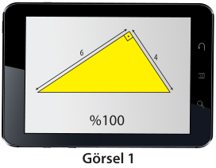
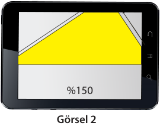

Buna göre
a) Soruda verilen kenar uzunlukları ve büyüme oranı kullanılarak Görsel 2'de bir kısmı görünen üçgenin tüm alanının nasıl hesaplanabileceğini yazarak açıklayınız.
b) Farklı çözüm yöntemleri ile Görsel 2'de bir kısmı görünen üçgenin tüm alanını hesaplayınız ve bulduğunuz sonuçları karşılaştırınız.

## Çözüm
a) Görsel 2'de verilen görsel, Görsel 1'de verilen görselin $\%150$ oranına çıkarılmış hâlidir. Başka bir deyişle Görsel 1 ile Görsel 2'deki üçgenler benzer üçgenlerdir.
Görsel 2'de oluşan üçgenin alanı "Benzer üçgenlerin kenar uzunlukları oranı benzerlik oranına eşittir." önermesi veya "Alanlar oranı benzerlik oranının karesine eşittir." önermeleri kullanılarak çözülebilir.

b) Görüntü $\%150$ oranına çıkarılmış olduğu için benzerlik oranı $\frac{150}{100}$ olur.
**1. Çözüm:**
Uzunluğu $4\text{ cm}$ olan kenar $4 \cdot \frac{150}{100} = 6\text{ cm}$ ve uzunluğu $6\text{ cm}$ olan kenar $6 \cdot \frac{150}{100} = 9\text{ cm}$ olur.
Buradan Görsel 2'deki üçgenin alanı $\frac{6 \cdot 9}{2} = 27\text{ cm}^2$ bulunur.

**2. Çözüm:**
Görsel 1'deki üçgenin alanı $\frac{4 \cdot 6}{2} = 12\text{ cm}^2$ dir.
Benzerlik oranı $\frac{150}{100}$ ise benzerlik oranının karesi $\left(\frac{150}{100}\right)^2 = \left(\frac{3}{2}\right)^2 = \frac{9}{4}$ olur.
Görsel 2'deki üçgenin alanı $12 \cdot \frac{9}{4} = 27\text{ cm}^2$ bulunur.

<!-- sayfa 71 -->

# 16. Sıra Sizde

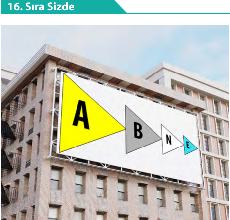

Asit Baz Nötr Enstitü adında bir araştırma şirketinin logosu yandaki şekilde görülmektedir. Logodaki her bir üçgen bir önceki üçgenin kenar uzunlukları $\frac{1}{3}$ oranında kısaltılarak elde edilmiş ve üçgenlerin her birinin içine enstitünün adının baş harfleri yerleştirilmiştir.
Şirket binasının dış cephesine logoda bulunan üçgensel bölgeler boyandıktan sonra A, B, N ve E harfleri görseldeki gibi üzerine yapıştırılıyor. Tüm renkler için $3\text{ m}^2$ <!-- KONTROL: Marker'da karşılığı yok, uydurma olabilir --> alanın boyanmasında $1\text{ litre}$ boya kullanılıyor.
Buna göre

a) Sarı üçgen için $6\text{ litre}$ boya kullanıldığına göre gri üçgenin alanının kaç metrekare olduğunu bulunuz.

b) Mavi üçgen için $1\text{ litre}$ boya kullanılmış ise beyaz üçgen için kaç litre boya kullanılacağını bulunuz.

---

# 20. Uygulama

**Farklı Bir Alan Bağıntısı Oluşturma**

Yanda $BC$ kenarına ait yüksekliği çizilmiş bir $ABC$ üçgeni verilmiştir. Bu çizimden yararlanarak aşağıda istenenleri gerçekleştiriniz.

1. Üçgenin herhangi bir yüksekliği sinüs yardımıyla ifade edildiğinde oluşabilecek alan bağıntısına ilişkin varsayımlarda bulununuz.

2. $ABC$ üçgeninden yararlanarak aşağıdaki adımları uygulayınız.

   1. adım: $BC$ kenarına ait yüksekliği sinüs yardımıyla ifade ediniz.

   2. adım: $ABC$ üçgeninin alanını $BC$ kenarı ve bu kenara ait yükseklik cinsinden ifade ediniz.

   3. adım: 1 ve 2. adımları dikkate alarak $ABC$ üçgeninin alanını sinüs yardımıyla ifade ediniz.

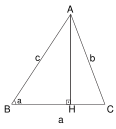

<!-- sayfa 72 -->

3. $ABC$ üçgeninin alanını sinüs yardımıyla ifade etmenizden hareketle üçgenin herhangi bir yüksekliği sinüs yardımıyla ifade edildiğinde bir alan bağıntısı oluştuğuna dair genellemenizi oluşturunuz.

4. Üçgenin herhangi bir yüksekliği sinüs yardımıyla ifade edildiğinde bir alan bağıntısı oluştuğuna dair genellemenizi varsayımlarınızla karşılaştırınız.

5. Elde ettiğiniz genellemeden yola çıkarak üçgenin herhangi bir yüksekliğinin sinüs yardımıyla ifade edilmesiyle bir alan bağıntısı oluştuğuna dair önermenizi ifade ediniz.

6. Oluşturduğunuz önerme yardımıyla aşağıdaki problemi çözünüz.
Bir mühendis yeni üretmiş olduğu termal kameranın taradığı üçgensel bölge şeklindeki görüş alanını hesaplayabilmek için araştırma yapmaktadır. Yandaki görselde kameranın görüş alanını gösteren üçgensel bölge verilmiştir. Mühendis, lazer mesafe ölçerle kameranın taradığı üçgenin iki kenarının uzunluğunu iki yüzer metre ve açıölçer ile bu iki kenar arasında kalan açının ölçüsünü $30^\circ$ olarak hesaplıyor. Buna göre termal kameranın taradığı üçgensel bölgenin kesit alanının kaç metrekare olduğunu bulunuz.

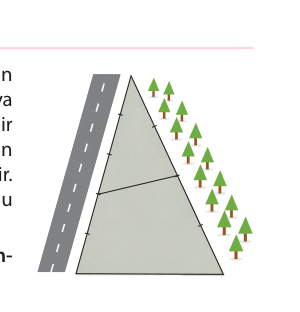

---

### 18. Örnek
Bir çiftçi $50$ dekarlık üçgen şeklindeki arazisinin yola komşu olan kenarını $5$ eş parçaya, ormana komşu olan kenarını $4$ eş parçaya ayırmıştır. Sonra araziyi görselde görünen noktalardan doğrusal bir çitle ikiye bölmüştür. Metrekare başına eşit miktarda ekim yapan bu çiftçi, böldüğü arazilerden birine buğday diğerine arpa ekmiştir. Çiftçinin ektiği buğday miktarının arpa miktarından fazla olduğu bilinmektedir.

Buna göre buğday ekili arazinin alanının arpa ekili arazinin alanından kaç dekar fazla olduğunu bulunuz.

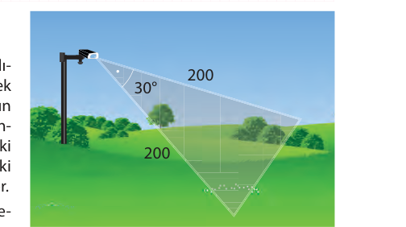

<!-- sayfa 73 -->

# Çözüm

Verilen görsele karşılık gelen eş parçalar harflendirildiğinde yandaki şekil elde edilir. Harflendirilen kenar uzunluklarından ve ortak açıdan faydalanılarak

$$A(\triangle ADE) = \frac{1}{2} \cdot 3a \cdot 2b \cdot \sin \alpha$$
ve
$$A(\triangle ABC) = \frac{1}{2} \cdot 5a \cdot 4b \cdot \sin \alpha$$

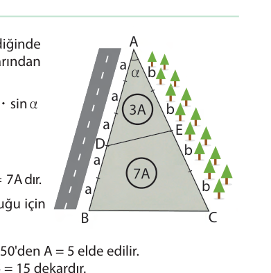

Buradan
$$\frac{A(\triangle ADE)}{A(\triangle ABC)} = \frac{3}{10}$$ bulunur.

Demek oluyor ki $A(\triangle ADE) = 3A$ ise $A(\triangle BCED) = 10A - 3A = 7A$ dır.

Buğday ektiği arazi, arpa ektiği araziden daha fazla olduğu için $BCED$ bölgesine buğday, $ADE$ bölgesine arpa ekmiştir.

Arazinin tamamı $50$ dekar olduğu için $A(\triangle ABC) = 10A = 50$'den $A = 5$ elde edilir.

Buğday ektiği arazi $7 \cdot 5 = 35$ dekar, arpa ektiği arazi $3 \cdot 5 = 15$ dekardır.
Buğday ekili arazinin alanı arpa ekili arazinin alanından $35 - 15 = 20$ <!-- KONTROL: Marker'da karşılığı yok, uydurma olabilir --> dekar fazladır.

# 17. Sıra Sizde

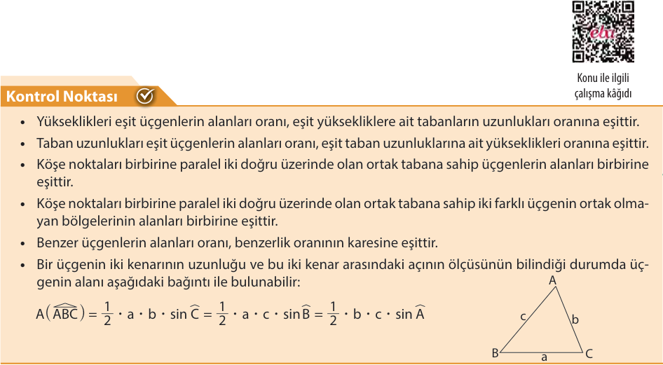

Elif Şekil 1'de verilen üçgen şeklindeki mavi ve sarı iki cam parçasını güvenli bir şekilde $[AB]$ ve $[DF]$ kenarları boyunca çakıştırdığında $A$ ve $D$ noktalarının üst üste geldiğini ve üst üste gelen cam parçalarının yeşil renge dönüştüğünü görmüştür.

$|AB| = 8\text{ cm}$, $|AC| = 3\text{ cm}$, $|DF| = 10\text{ cm}$ olmak üzere Şekil 2'de verilen mavi ve sarı üçgenlerin alanları birbirine eşit olduğuna göre $|DE|$ nun kaç santimetre olduğunu bulunuz.

# Kontrol Noktası ✅

* Yükseklikleri eşit üçgenlerin alanları oranı, eşit yüksekliklere ait tabanların uzunlukları oranına eşittir.
* Taban uzunlukları eşit üçgenlerin alanları oranı, eşit taban uzunluklarına ait yükseklikleri oranına eşittir.
* Köşe noktaları birbirine paralel iki doğru üzerinde olan ortak tabana sahip üçgenlerin alanları birbirine eşittir.
* Köşe noktaları birbirine paralel iki doğru üzerinde olan ortak tabana sahip iki farklı üçgenin ortak olmayan bölgelerinin alanları birbirine eşittir.
* Benzer üçgenlerin alanları oranı, benzerlik oranının karesine eşittir.
* Bir üçgenin iki kenarının uzunluğu ve bu iki kenar arasındaki açının ölçüsünün bilindiği durumda üçgenin alanı aşağıdaki bağıntı ile bulunabilir:

$$A(\triangle ABC) = \frac{1}{2} \cdot a \cdot b \cdot \sin \widehat{C} = \frac{1}{2} \cdot a \cdot c \cdot \sin \widehat{B} = \frac{1}{2} \cdot b \cdot c \cdot \sin \widehat{A}$$

Konu ile ilgili çalışma kağıdı

<!-- sayfa 74 -->

# Alıştırmalar

1. Aşağıda verilen dikdörtgen şeklindeki tente, doğrusal iki eş parçadan oluşan metal mekanizmanın hareketi ile açılıp kapanmaktadır.

Eni $6$ metre olan tente, Şekil 1'den Şekil 2'deki konuma getirildiğinde tentenin oluşturduğu mavi dikdörtgenin alanı Şekil 2'deki konumunda Şekil 1'deki konumuna göre iki katına çıkmıştır.
Her iki konumda da metal mekanizmaların oluşturduğu $ABC$ ve $DBE$ üçgenlerinin alanları birbirine eşit olduğuna göre Şekil 2'de $D$ noktasının tentenin sol kenarına olan en kısa uzaklığının kaç metre olduğunu bulunuz.

2. Aşağıda ön yüzü yeşil, arka yüzü mavi renkte üçgen şeklindeki bir karton Şekil 1'de gösterildiği gibi bir köşesi diğer kenar üzerine gelecek şekilde katlanarak Şekil 2'deki görsel elde ediliyor.

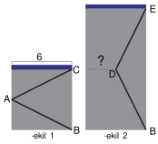

Şekil 1'de verilen üçgenin dik kenar uzunlukları $12\text{ cm}$ ve $15\text{ cm}$ olduğuna göre Şekil 2'de yeşil üçgenin görünen kısmının alanının kaç santimetrekare olduğunu bulunuz.

3. Bir fabrikada yanda görseli verilen, ortak tabana sahip iki ikizkenar üçgenden oluşan dörtgen şeklinde uçurtma üretimi yapılmaktadır. Uçurtma yapılırken iskelet için iki farklı uzunlukta çıta kullanılmakta, çıtaların etrafı gergin şekildeki bir iple bağlanarak uçurtmanın iskeleti oluşturulmaktadır.
Uçurtma iskeleti, üstteki ikizkenar üçgenin alanı alttaki ikizkenar üçgenin alanının $\frac{2}{5}$ <!-- KONTROL: Marker'da karşılığı yok, uydurma olabilir -->'i olacak şekilde tasarlanmaktadır.

Bir uçurtmanın üretiminde kullanılan yatay çıta $80\text{ cm}$, dikey çıta $105\text{ cm}$ olduğuna göre çıtaların etrafını sarmak için kullanılan ipin uzunluğunun en az kaç santimetre olduğunu bulunuz.
(Çıta kalınlıklarını ve çıtaların sarımında kullanılan ipi göz ardı ediniz.)

4. Yanda görseli verilen birbirine eş eşkenar üçgenlerden oluşan zeminin bir kısmı yeşil halı ile kaplanmıştır.
Tüm zeminin alanı $16\text{ m}^2$ <!-- KONTROL: Marker'da karşılığı yok, uydurma olabilir --> olduğuna göre yeşil halının alanının kaç metrekare olduğunu bulunuz.

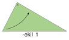
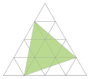

1. Tema alıştırma ek

<!-- sayfa 75 -->

# 1.4. SİNÜS VE KOSİNÜS TEOREMLERİ

## Konuya Başlarken

1. Okyanus dibi araştırmaları yapan bir grup bilim insanı, bir çukurun şeklini ortaya çıkarmak için yüzey tarayıcılarıyla donatılmış bir denizaltı kullanarak derin bir dalış gerçekleştiriyor. Denizaltıdan elde edilen veriler, okyanus yüzeyindeki gemide bulunan bir bilgisayara aktarılıyor ve burada özel bir program yardımıyla çukurun gerçek boyutlardaki şekli hakkında bilgi elde ediliyor. Bu bilgiler ışığında çukurun en dip noktası ile başlangıcındaki iki uç birleştirildiğinde yandaki görselde verildiği gibi bir $ABC$ üçgeninin oluştuğu görülüyor.
Buna göre
    a) $B$ ve $C$ açılarının ölçülerinin bilinmesi durumunda $AB$ ve $AC$ kenar uzunluklarının bulunabilmesi için hangi ek bilgilere ihtiyaç duyulur? Sınıf arkadaşlarınızla tartışarak belirleyiniz.
    b) $AB$ ve $BC$ kenar uzunluklarının bilinmesi durumunda $\frac{\sin \widehat{A}}{\sin \widehat{C}}$ değerini bulma yöntemlerini sınıf arkadaşlarınızla tartışarak belirleyiniz.
    c) $AB$ kenar uzunluğunun ve $\frac{\sin \widehat{B}}{\sin \widehat{C}}$ değerlerinin bilinmesi durumunda $AC$ kenar uzunluğu bulunmak istendiğinde uygulanacak adımları sınıf arkadaşlarınızla belirleyiniz.

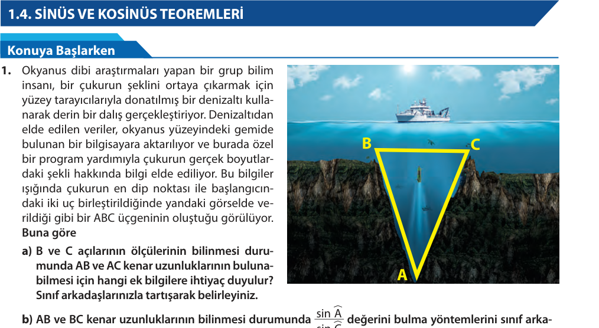

2. Çukurun giriş kısmında belirlenen $B$ ve $C$ köşelerinden çizilerek oluşturulacak $BC$ kenarının uzunluğu, denizaltının $BC$ kenarına dik açı ile giriş yapıp doğrultusunu değiştirmeden $A$ köşesine ulaştığı, denizaltının $BC$ kenarına dik giriş yaptığı noktanın ($H$) $C$ köşesine olan uzaklığı ($|CH|$) ve $AC$ kenar uzunluğu bilinmektedir. Bu durum yan tarafta görselleştirilmiştir.
Buna göre
    a) Çukurun bilinmeyen kenar uzunluğunun ($|AB|$) bulunabileceği yöntemi belirleyiniz.
    b) Verilen bilgilere göre $AB$ kenar uzunluğunun bulunmasındaki yönteme ulaşılmaya çalışılırken doğruluğundan emin olunan hangi ön bilgilerin kullanıldığını belirtiniz.

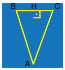

## Sinüs Teoremi

Bir cismin yüksekliğini, başka bir cisme mesafesini ya da üçgen şeklindeki arsanın sınırlarına çekilecek metal telin kaç metre olması gerektiğini belirlemek amacıyla çevre uzunluğunu hesaplamak gibi birçok günlük hayat problemi; belirli geometrik bilgilerin kullanılmasıyla çözülebilir. Örneğin bir üçgende iki açının ölçüleri ve bir kenar uzunluğu bilindiğinde diğer kenar uzunlukları ve üçgenin çevre uzunluğu trigonometrik yöntemlerle kolayca bulunabilir. Benzer şekilde bir açının karşısındaki kenar uzunluğunu veya yüksekliğini hesaplamak için açı ölçüleri ve diğer kenar uzunluklarıyla yapılan oranlar kullanılabilir. Bu tür yöntemler, karmaşık görünen soruların basit adımlarla çözülmesini sağlar.

<!-- sayfa 76 -->

# 21. Uygulama

**Ek Çizimler Yardımıyla Uzunluk Bulma ve Sinüs Teoremi**

Bir arsanın kenar uzunlukları veya arsa üzerinde ayrılacak bir parçanın kenar uzunlukları harita mühendisliğinde optik yöntem denen bir yöntem ile bulunabilir. Optik yöntemde teodolit adı verilen açı ölçme aleti kullanılarak belirlenen iki komşu sınır çizgileri arasındaki açı ölçüsü bulunabilir.

Yan tarafta şekli verilen bir arsanın içine $ABC$ üçgeni şeklinde bir çocuk parkı inşa edilmek isteniyor. Açıların ve kenar uzunluklarının belirlenmesi maksadıyla optik yöntem ile çocuk parkının kenar uzunlukları ve açılarının ölçüleri belirleniyor. İnşaat alanının sınırlandırılması için $A$, $B$ ve $C$ noktalarından işaret şeritleri çekiliyor. $A$ ile $B$ noktaları arası çekilen şeridin uzunluğu $200$ metre, $m(\widehat{A}) = 64^\circ$, $m(\widehat{C}) = 37^\circ$ olarak bulunuyor.

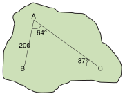

Buna göre $B$ ve $C$ noktaları arasına çekilecek şeridin uzunluğunun kaç metre olduğunun bulunması ile ilgili aşağıda verilen soruları cevaplayınız. ($\sin 64^\circ \approx 0{,}9$ ve $\sin 37^\circ \approx 0{,}6$ alınız.)

1. Sorunun çözümünün ek çizimler yardımıyla nasıl yapılabileceğine ilişkin fikirlerinizi sınıf arkadaşlarınızla üzerinde tartışınız.
2. Edindiğiniz bilgilerden yola çıkarak $B$ ve $C$ köşeleri arasına çekilecek şeridin uzunluğunun kaç metre olduğunu bulunuz.

3. Herhangi bir $ABC$ üçgeninde $|BC| = a$ birim, $|AC| = b$ birim, $|AB| = c$ birim olmak üzere üçgenin açı ölçüleri ve kenar uzunluklarından bazılarının verilmesi durumunda ek çizim yapmaya gerek kalmayacak şekilde diğer açı ölçülerinin değerleri veya kenar uzunlukları sinüs teoremi olarak adlandırılan
$$\frac{a}{\sin \widehat{A}} = \frac{b}{\sin \widehat{B}} = \frac{c}{\sin \widehat{C}}$$
eşitliğinden yararlanılarak bulunabilir.

Buna göre çocuk parkı inşaatı için $B$ ve $C$ noktaları arasına çekilecek şeridin uzunluğunun kaç metre olması gerektiğini verilen eşitlik yardımı ile bulunuz.

---

# 22. Uygulama

**Sinüs Teoreminin Üçgen Çeşitlerine Uygulanması**

Aşağıda verilen soruları cevaplayınız.

1. 

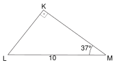

Yandaki $KLM$ dik üçgeninde
$m(\widehat{MKL}) = 90^\circ$
$m(\widehat{KML}) = 37^\circ$
$|LM| = 10$ <!-- KONTROL: Marker'da karşılığı yok, uydurma olabilir --> birim olarak verilmiştir.

Buna göre
a) Trigonometrik oranları kullanarak $KL$ ve $KM$ kenar uzunluklarını bulunuz. ($\sin 37^\circ \approx 0{,}6$ ve $\sin 53^\circ \approx 0{,}8$ alınız.)

<!-- sayfa 77 -->

b) Sinüs teoremini kullanarak $KL$ ve $KM$ kenar uzunluklarını bulunuz. ($\sin 37^\circ \approx 0{,}6$ ve $\sin 53^\circ \approx 0{,}8$ alınız.)

2.
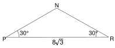
Yandaki $PNR$ üçgeninde
$m(\widehat{NPR}) = m(\widehat{NRP}) = 30^\circ$
$|PR| = 8\sqrt{3}$ birim olarak verilmiştir.

Buna göre
a) Ek çizimler yaparak $PN$ kenar uzunluğunu bulunuz.

b) Sinüs teoremini kullanarak $PN$ kenar uzunluğunu bulunuz.

3.
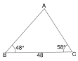
Yandaki $ABC$ üçgeninde
$m(\widehat{ABC}) = 48^\circ$
$m(\widehat{ACB}) = 58^\circ$
$|BC| = 48$ birim olarak verilmiştir.

Buna göre
a) Verilenleri dikkate alarak ek çizimler yardımıyla $AB$ ve $AC$ kenar uzunluklarını bulunuz. ($\sin 48^\circ \approx 0{,}74$, $\sin 58^\circ \approx 0{,}84$, $\sin 74^\circ \approx 0{,}96$ alınız.)

b) Sinüs teoremini kullanarak $AB$ ve $AC$ kenar uzunluklarını bulunuz. ($\sin 48^\circ \approx 0{,}74$, $\sin 58^\circ \approx 0{,}84$, $\sin 74^\circ \approx 0{,}96$ alınız.)

4. İlk üç maddede yapılanlar dikkate alındığında sinüs teoreminin her üçgen için geçerli olup olmadığını sınıf arkadaşlarınla tartışınız.

<!-- sayfa 78 -->

# 19. Örnek

Bir grup arkadaş doğa yürüyüşü yapmak amacıyla kurulan kamp alanında $A, B, C, D$ noktalarındaki çadırlara yerleşmiştir.

Yan tarafta görseli verilen kamp haritası üzerinde $A, B, C$ ve $D$ noktaları $[DA] \perp [BA]$; $B, P, C$ doğrusal olacak şekilde birleştirildiğinde $|AB| = 3$ birim, $|AP| = 2$ birim, $|DC| = 12$ birim, $|CP| = 2\sqrt{13}$ birim olarak ölçülüyor.

Buna göre

a) $DPC$ açısının sinüs değerini bulunuz.
b) $CDP$ açısının ölçüsünü sinüs teoremi yardımıyla bulunuz.
c) $CDP$ açısının ölçüsünü verilen kamp haritası üzerinde ek çizimler yardımıyla bulunuz.

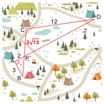

## Çözüm

a) $BAP$ dik üçgeninde Pisagor teoremi uygulandığında
$$|BP|^2 = 2^2 + 3^2$$
$$|BP| = \sqrt{13} \text{ olur.}$$
$m(\widehat{APB}) = m(\widehat{DPC})$ olacağından (ters açılar)
$$\sin(\widehat{APB}) = \sin(\widehat{DPC}) = \frac{3}{\sqrt{13}} \text{ bulunur.}$$

b) $CDP$ üçgeninde sinüs teoremi uygulandığında
$$\frac{12}{\sin(\widehat{DPC})} = \frac{2\sqrt{13}}{\sin(\widehat{CDP})} \Rightarrow \frac{12}{\frac{3}{\sqrt{13}}} = \frac{2\sqrt{13}}{\sin(\widehat{CDP})}$$
$$\sin(\widehat{CDP}) = \frac{1}{2} \text{ olur.}$$
$\sin 30^\circ = \frac{1}{2}$ olduğundan $m(\widehat{CDP}) = 30^\circ$ bulunur.

c) $BAP$ dik üçgeninde $m(\widehat{APB}) = \alpha$ olsun
$$\tan \alpha = \frac{3}{2} \text{ olur.}$$
$[CH] \perp [PD]$ olacak şekilde $C$ köşesinden dikme indirildiğinde
$m(\widehat{APB}) = m(\widehat{DPC})$ (ters açılar), $m(\widehat{DPC}) = \alpha$,
$\tan \alpha = \frac{3}{2}$ olduğundan $\tan \alpha = \frac{|CH|}{|PH|} = \frac{3 \cdot n}{2 \cdot n} \text{ olur.}$
$PHC$ dik üçgeninde Pisagor teoremi uygulandığında
$(2\sqrt{13})^2 = (3n)^2 + (2n)^2$
olduğundan $n = 2$ bulunur.
$|CH| = 3 \cdot n = 3 \cdot 2 = 6$
$CDH$ dik üçgeninde $\sin(\widehat{CDP}) = \frac{6}{12} = \frac{1}{2} \text{ olur.}$
$\sin 30^\circ = \frac{1}{2}$ olduğundan $m(\widehat{CDP}) = 30^\circ$ bulunur.

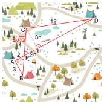

<!-- sayfa 79 -->

# 18. Sıra Sizde

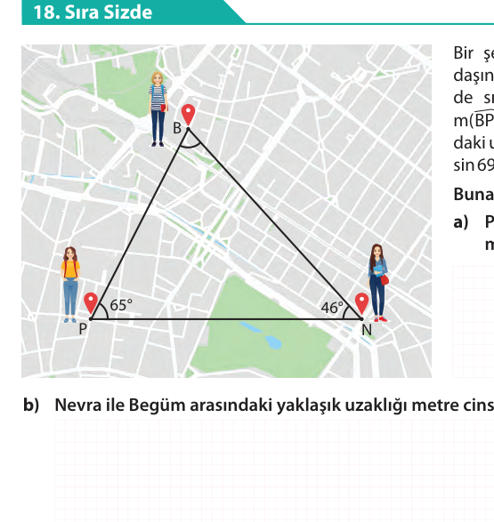

Bir şehirde Begüm, Piraye ve Nevra adlı üç arkadaşın bulunduğu konumlar şehir haritası üzerinde sırasıyla B, P ve N noktaları ile gösterilmiştir. $m(\widehat{BPN}) = 65^\circ$, $m(\widehat{BNP}) = 46^\circ$ ve Piraye ile Nevra arasındaki uzaklık $744$ metredir. ($\sin 46^\circ \approx 0{,}72$, $\sin 65^\circ \approx 0{,}91$, $\sin 69^\circ \approx 0{,}93$ alınız.)

**Buna göre**

a) Piraye ile Begüm arasındaki yaklaşık uzaklığı metre cinsinden bulunuz.

b) Nevra ile Begüm arasındaki yaklaşık uzaklığı metre cinsinden bulunuz.

---

# 23. Uygulama

**Sinüs Teoreminin İspatı**

Herhangi bir $ABC$ üçgeninde $|BC| = a$ birim, $|AC| = b$ birim, $|AB| = c$ birim olmak üzere sinüs teoremi olarak adlandırılan
$$\frac{a}{\sin \widehat{A}} = \frac{b}{\sin \widehat{B}} = \frac{c}{\sin \widehat{C}}$$
eşitliğini doğrulamak amacıyla aşağıdaki soruları cevaplayınız.

1. Sinüs kavramı hakkındaki önceki öğrenmelerinizden yararlanarak yandaki üçgende ne gibi eşitlikler yazılabileceğini düşününüz, fikirlerinizi sınıf arkadaşlarınız ile paylaşarak tartışınız.

2. Aşağıda verilen sinüs teoremi ispatında sinüs trigonometrik oranını içeren üçgende alan formülünden yararlanarak boş bırakılan yerleri uygun şekilde doldurunuz.

**İspat**

$ABC$ üçgeninin alanı

$A(ABC) = \dots \cdot \dots \cdot \dots \cdot \sin \widehat{A}$ <!-- KONTROL: Marker'da karşılığı yok, uydurma olabilir --> (I)

$= \dots \cdot a \cdot c \cdot \dots$ <!-- KONTROL: Marker'da karşılığı yok, uydurma olabilir --> (II)

$= \dots \cdot b \cdot \sin \widehat{C}$ <!-- KONTROL: Marker'da karşılığı yok, uydurma olabilir --> (III)

I ve II numaralı ifadelerin eşitliği kullanılarak ............................................ eşitliği bulunur.

I ve III numaralı ifadelerin eşitliği kullanılarak ............................................ eşitliği bulunur.

Sonuç olarak ................................................................... eşitlikleri elde edilir.

<!-- sayfa 80 -->

# 20. Örnek

Bir şehir haritası üzerinde evini, okulunu ve şehir kütüphanesinin konumlarını işaretleyen Berk belirlediği noktaları birleştirdiğinde EKN üçgeni oluştuğunu görüyor. Harita ölçeğini dikkate alarak yaptığı hesapta evinden başlayıp tekrar evine gelmesi için EKN üçgeninin kenarları üzerinde hareket etmesi hâlinde bu uzunluğun $930$ metre olduğunu ve $3 \cdot \sin \widehat{E} = 5 \cdot \sin \widehat{K} = 2 \cdot \sin \widehat{N}$ eşitliğinin sağlandığını görüyor.

**Buna göre ev ile okul arasındaki mesafenin kaç metre olduğunu bulunuz.**

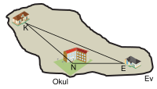

## Çözüm

$3 \cdot \sin \widehat{E} = 5 \cdot \sin \widehat{K} = 2 \cdot \sin \widehat{N}$ eşitliğinde $a \in \mathbb{R}^+$ için

$\sin \widehat{E} = 10 \cdot a$, $\sin \widehat{K} = 6 \cdot a$, $\sin \widehat{N} = 15 \cdot a$ olsun.

$e + k + n = 930$, $e + n = 930 - k$ olur. Sinüs teoremi yazılırsa

$$\frac{e}{\sin \widehat{E}} = \frac{k}{\sin \widehat{K}} = \frac{n}{\sin \widehat{N}} \Rightarrow \frac{k}{\sin \widehat{K}} = \frac{e + n}{\sin \widehat{E} + \sin \widehat{N}} \text{ (orantı özelliği)}$$

$$\Rightarrow \frac{k}{6 \cdot a} = \frac{930 - k}{10 \cdot a + 15 \cdot a}$$

$$\Rightarrow \frac{k}{6 \cdot a} = \frac{930 - k}{25 \cdot a} \Rightarrow 31 \cdot k = 6 \cdot 930$$

$$\Rightarrow k = |EN| = 180 \text{ metre bulunur.}$$

# 19. Sıra Sizde

Ordu–Giresun Havalimanı (OGU) üzerindeki hava yolu trafiğine ait anlık görüntü yandaki gibidir. Uçakların bulunduğu konumlar birleştirildiğinde ABC üçgeni şeklinin oluştuğu görülüyor.

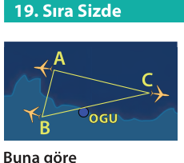

**Buna göre**

a) ABC üçgeninin tüm iç açılarının sinüs değerlerinin ve herhangi iki uçağın arasındaki uzaklığın bilinmesi durumunda üçüncü uçağın diğer uçaklar ile arasındaki uzaklığının nasıl bulunabileceğini gösteriniz.

b) ABC üçgeninin iç açılarının sinüs değerleri arasında $\sin^2(\widehat{A}) = \sin^2(\widehat{B}) + \sin^2(\widehat{C})$ eşitliğinin sağlandığı durumda ABC üçgeninin çeşidinin ne olacağını bulunuz.

<!-- sayfa 81 -->

# Kosinüs Teoremi

Üçgen şeklindeki bir cismin iki kenarının uzunluğu ve bu iki kenar arasındaki açı ölçüsü bilindiğinde üçüncü kenar uzunluğunu ölçmeye gerek kalmadan hesaplamak mümkündür. Örneğin doğa yürüyüşü yapmaya hazırlanan bir sporcu, harita üzerinde belirlediği üçgen şeklindeki bir parkurun tüm kenar uzunluklarını bildiğinde kenarlar arasındaki açıların ölçülerini dolayısıyla güzergâhın dönüş açılarının ölçülerini hesaplayabilir. Bu tür durumlarda, kenarlar ve açıların arasındaki ilişkileri kullanan matematiksel hesaplamalarla çözülebilir. Bu yöntemler pek çok geometri problemini kolaylaştırır; özellikle mesafe ölçümü, yön bulma, alan hesaplama gibi konularda pratik çözümler için önemli rol oynar.

## 24. Uygulama

### Ek Çizim Yardımıyla Uzunluk Bulma ve Kosinüs Teoremi

Göktürk 1 ve Göktürk 2 uyduları coğrafi kısıtlama olmaksızın Dünya üzerinde herhangi bir bölgeden askerî ve sivil amaçlı yüksek çözünürlüklü görüntü elde edilmesine imkân tanıyan, büyük oranda yerli imkânlar ile geliştirilip yörüngeye yerleştirilen iki yer gözlem uydusudur.

Sürekli hareket hâlinde olan uydulardan etkin şekilde yararlanmak için iki uydu arasındaki mesafenin $2300 - 2400\text{ km}$ <!-- KONTROL: Marker'da karşılığı yok, uydurma olabilir --> arasında olması istenmektedir. Her iki uydu Ankara’da bulunan yer istasyonu ile kontrol altında tutulmaktadır. Anlık bir görüntü alındığında Ankara’daki yer istasyonunun Göktürk 1 uydusu ile arasındaki mesafe $1200\text{ km}$, Göktürk 2 uydusu ile arasındaki mesafe $1500\text{ km}$ olarak ölçülmüştür. Oluşan ölçüm çizgileri arasındaki açının ölçüsü $120^\circ$ olarak belirlenmiştir. Aşağıda bu duruma ait bir görsele yer verilmiştir.

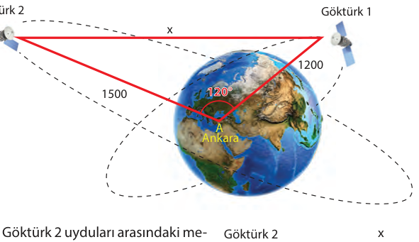

Buna göre Göktürk 1 ve Göktürk 2 uyduları arasındaki mesafenin istenen aralıkta olup olmadığını aşağıda istenenleri gerçekleştirip soruları cevaplayarak bulunuz.

1. Verilen $ABC$ üçgeninde $[CA]$ nı $A$ köşesinden uzatıp $B$ köşesinden bu uzantıya dik indirerek $[CK] \perp [BK]$ <!-- KONTROL: Marker'da karşılığı yok, uydurma olabilir --> olacak şekilde bir $AKB$ dik üçgeni oluşturunuz.
    a) $B$ köşesinden indirilen dikmenin hangi değerleri bulmaya yardımcı olabileceğini açıklayınız.
    b) $A$ veya $C$ köşelerinden indirilecek dikmenin problemin çözümüne katkısının olup olmadığını inceleyiniz.
2. $AKB$ dik üçgeninde $BK$ kenar uzunluğunun kaç $\text{km}$ <!-- KONTROL: Marker'da karşılığı yok, uydurma olabilir --> olduğunu bulunuz.
3. $AKB$ dik üçgeninde $AK$ kenar uzunluğunun kaç $\text{km}$ <!-- KONTROL: Marker'da karşılığı yok, uydurma olabilir --> olduğunu bulunuz.

<!-- sayfa 82 -->

4. Oluşan BKC dik üçgeninde BC kenar uzunluğunun kaç km olduğunu bulunuz.

5. Bulduğunuz sonuca göre Göktürk 1 ve Göktürk 2 uyduları arasındaki mesafenin istenen aralıkta olup olmadığını gösteriniz.

6. Herhangi bir ABC üçgeninde $|BC| = a$ birim, $|AC| = b$ birim, $|AB| = c$ birim olmak üzere bu üçgenin bir iç açısının ölçüsü ve iç açıyı oluşturan iki kenarının uzunluğu ile üçüncü kenarının uzunluğu kosinüs teoremi olarak adlandırılan
$$a^2 = b^2 + c^2 - 2 \cdot b \cdot c \cdot \cos \widehat{A}$$
$$b^2 = a^2 + c^2 - 2 \cdot a \cdot c \cdot \cos \widehat{B}$$
$$c^2 = a^2 + b^2 - 2 \cdot a \cdot b \cdot \cos \widehat{C}$$
eşitliklerinden yararlanılarak bulunabilir.
Buna göre
Göktürk 1 ve Göktürk 2 uyduları arasındaki mesafenin kaç kilometre olduğunu kosinüs teoremi kullanarak bulunuz.

---

### 21. Örnek

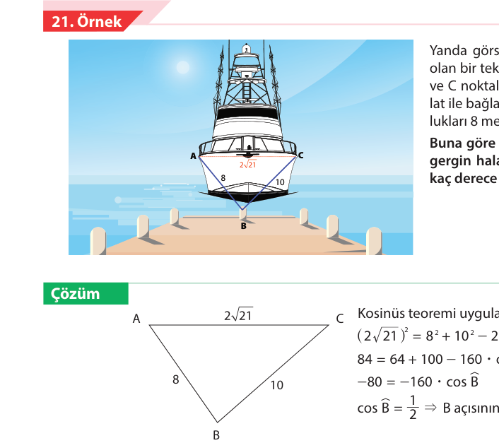

Yanda görselde verilen genişliği $2\sqrt{21}$ metre olan bir tekne, genişliğinin uç noktaları olan A ve C noktalarından iskeledeki B noktasına halat ile bağlanıyor. Halatın gergin hâldeki uzunlukları 8 metre ve 10 metre olarak ölçülüyor.
**Buna göre iskele ile tekne arasında bulunan gergin halatlar arasındaki açının ölçüsünün kaç derece olduğunu bulunuz.**

#### Çözüm

Kosinüs teoremi uygulanırsa
$$(2\sqrt{21})^2 = 8^2 + 10^2 - 2 \cdot 8 \cdot 10 \cdot \cos \widehat{B}$$
$$84 = 64 + 100 - 160 \cdot \cos \widehat{B}$$
$$-80 = -160 \cdot \cos \widehat{B}$$
$$\cos \widehat{B} = \frac{1}{2} \Rightarrow \text{B açısının ölçüsü } 60^\circ \text{ olarak bulunur.}$$

<!-- sayfa 83 -->

# 20. Sıra Sizde

Japonya’da bir grup adadan oluşan bölgedeki üç adanın görseli aşağıdaki gibidir.

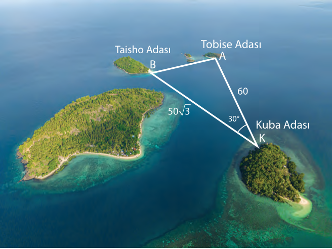

Kuba (Kuba) Adası'nda K noktasında bulunan Kenan, elindeki lazer metre ile Tobise (Tobise) Adası’nda bir A noktası belirleyip ölçüm yaptığında bulunduğu nokta ile arasındaki uzaklığı $60$ mil olarak ölçüyor. Lazer metreyi $30^\circ$ kadar saatin tersi yönünde çevirdiğinde Taisho (Taişo) Adası üzerindeki bir B noktasının bulunduğu noktaya uzaklığını $50\sqrt{3}$ <!-- KONTROL: Marker'da karşılığı yok, uydurma olabilir --> mil olarak ölçüyor. (Mil bir uzunluk birimidir, lazer metre uzaklığı istenen birimde ölçebilmektedir.)

**Buna göre**

**a)** Verilenler yardımıyla A ile B noktaları arasındaki uzaklığın lazer metre kullanılmadan bulunması istendiğinde uygulanması gereken yöntemleri yazınız.

 
 
 

**b)** A ile B noktaları arasındaki uzaklığın kaç mil olduğunu kosinüs teoremi yardımıyla bulunuz.

 
 
 

**c)** A ile B noktaları arasındaki uzaklığın kaç mil olduğunu verilen görsel üzerinde ek çizimler yardımıyla bulunuz.

<!-- sayfa 84 -->

# 25. Uygulama

## Teorem İspatı

Herhangi bir $ABC$ üçgeninde $|BC| = a$ birim, $|AC| = b$ birim, $|AB| = c$ birim olmak üzere kosinüs teoremi olarak adlandırılan $a^2 = b^2 + c^2 - 2 \cdot b \cdot c \cdot \cos \widehat{A}$ <!-- KONTROL: Marker'da karşılığı yok, uydurma olabilir --> eşitliği için aşağıda istenenleri gerçekleştirerek soruları cevaplayınız.

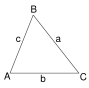

1. Verilen eşitliğe ulaşabilmek için ne tür bir ek çizim yapılması gerektiğine dair fikirlerinizi sınıf arkadaşlarınız ile paylaşarak tartışınız.

2. Pisagor teoremi ve trigonometrik oranlardan yararlanarak bu üçgende ne gibi eşitlikler yazılabileceğini düşününüz, fikirlerinizi sınıf arkadaşlarınız ile paylaşıp ortak bir sonuca ulaşmaya çalışınız. Verdiğiniz ortak kararı yazınız.

3. Kosinüs teoreminin ispatına yönelik verilen adımları takip ederek soruları cevaplayıp ispatı tamamlayınız.

**1. adım:** $[BH] \perp [AC]$ <!-- KONTROL: Marker'da karşılığı yok, uydurma olabilir --> olacak şekilde $B$ köşesinden dikme indiriniz.

**a)** Üçgenin $B$ köşesinden dikme indirilmesinin sebebini açıklayınız.

**b)** Dikme herhangi bir köşeden indirilebilir mi? Farklı köşelerden indirilen dikmeler teoremin ispatında ne tür bir değişikliğe yol açar? Açıklayınız.

**2. adım:** $|BH| = h$ birim, $|AH| = x$ birim şeklinde adlandırarak $|HC|$ nu $b$ ve $x$ türünden yazınız.

**3. adım:** $ABH$ dik üçgeninde $h^2$ <!-- KONTROL: Marker'da karşılığı yok, uydurma olabilir --> yi $c$ ve $x$ türünden elde ediniz.

**4. adım:** $BHC$ dik üçgeninde $h^2$ <!-- KONTROL: Marker'da karşılığı yok, uydurma olabilir --> yi $a$, $b$, $x$ türünden elde ediniz.

<!-- sayfa 85 -->

**5. adım:** 3 ve 4. adımda elde ettiğiniz eşitlikleri kullanarak $a^2$ yi $b$, $c$, $x$ türünden bulunuz.

**6. adım:** $AHB$ dik üçgeninde $x$ i $c$ ve $\cos \widehat{A}$ türünden bulunuz.

**7. adım:** 5 ve 6. adımda bulduklarınızı kullanarak $a^2$ yi $b$, $c$ ve $\cos \widehat{A}$ türünden bulunuz.

---

# 22. Örnek

Yan tarafta bir baz istasyonu direğinin bazı bağlantı çubuklarının görseli verilmiştir.
Direkteki bağlantı noktaları arasındaki uzunluklar $|AB| = 4\text{ m}$, $|BD| = 2\text{ m}$, $|AC| = 3\text{ m}$, $|CE| = 1\text{ m}$, $|BC| = 2\text{ m}$ ve $|DE| = x\text{ metredir}$.
**Buna göre D ve E noktaları arasındaki bağlantı çubuğunun uzunluğunun kaç metre olduğunu bulunuz.**

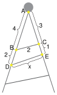

# Çözüm

$ABC$ üçgeninde kosinüs teoremi uygulanırsa
$$2^2 = 3^2 + 4^2 - 2 \cdot 3 \cdot 4 \cdot \cos \widehat{A}$$
$$4 = 25 - 24 \cdot \cos \widehat{A}$$
$$24 \cdot \cos \widehat{A} = 21$$
$$\cos \widehat{A} = \frac{21}{24} = \frac{7}{8}\text{ bulunur.}$$

$ADE$ üçgeninde kosinüs teoremi uygulanırsa
$$x^2 = 4^2 + 6^2 - 2 \cdot 4 \cdot 6 \cdot \cos \widehat{A}$$
$$x^2 = 52 - 2 \cdot 4 \cdot 6 \cdot \frac{7}{8}$$
$$x^2 = 52 - 42$$
$$x^2 = 10$$
$$x = \sqrt{10}\text{ metre bulunur.}$$

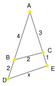

<!-- sayfa 86 -->

# 21. Sıra Sizde

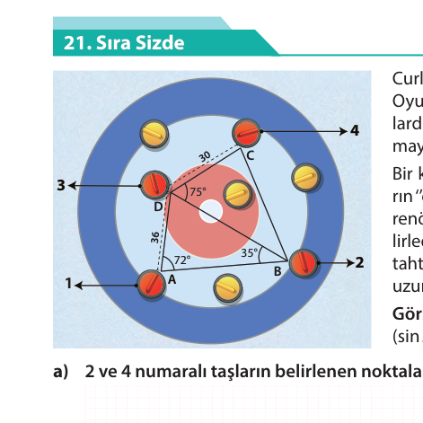

Curling (körling), buz bir pist üzerinde oynanan takım oyunudur. Oyunda iki farklı renkte taş kullanan takımlar iç içe geçmiş halkalardan oluşan "ev" adı verilen hedefin merkezinde taşları durdurmayı amaçlar.

Bir körling antrenmanı sırasında yapılan atışlar sonrasındaki taşların "ev" içinde durdukları son noktalar görselde veriliyor. Takım antrenörü atış analizi yapabilmek amacıyla kırmızı taşlar üzerindeki belirlediği noktalar arasındaki uzunlukları ölçerek kaydediyor. Taktik tahtasına görseldeki gibi taşların son konumlarını çizerek ölçtüğü uzunlukları $|AD| = 36\text{ cm}$, $|DC| = 30\text{ cm}$ ve bazı açı ölçülerini yazıyor.

**Görsel üzerinde verilenleri dikkate alarak soruları cevaplayınız.**
($\sin 35^\circ \approx 0{,}57$, $\sin 72^\circ \approx 0{,}95$, $\cos 75^\circ \approx 0{,}2$ alınız.)

**a)** 2 ve 4 numaralı taşların belirlenen noktaları arasındaki uzaklığının yaklaşık kaç cm olduğunu bulunuz.

**b)** 2 ve 4 numaralı taşların belirlenen noktaları arasındaki uzaklığı bulmak için uyguladığınız adımları, varsa kullandığınız özellik veya teoremi belirterek yazınız.

**c)** Sinüs ve kosinüs teoremlerinin hangi durumlarda kullanıldığı ile ilgili fikirlerinizi aşağıdaki alana yazınız.

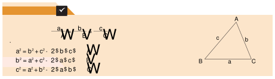

---

## Kontrol Noktası ✅

Herhangi bir $ABC$ üçgeninde $|BC| = a$ birim, $|AC| = b$ birim, $|AB| = c$ birim olmak üzere

* Sinüs teoremi $$\frac{a}{\sin \widehat{A}} = \frac{b}{\sin \widehat{B}} = \frac{c}{\sin \widehat{C}}$$
* Kosinüs teoremi
  $$a^2 = b^2 + c^2 - 2 \cdot b \cdot c \cdot \cos \widehat{A}$$
  $$b^2 = a^2 + c^2 - 2 \cdot a \cdot c \cdot \cos \widehat{B}$$
  $$c^2 = a^2 + b^2 - 2 \cdot a \cdot b \cdot \cos \widehat{C} \text{ dir.}$$

 (Üçgen Şekli)

---

## Farklı Kaydet 📝

Bu temada öğrendiğiniz bilgileri kendi hatırlayacağınız şekilde bu alana kısaca not edebilirsiniz.

<!-- sayfa 87 -->

# Alıştırmalar

1. Aşağıdaki görselde bir arkeoloji kazısında ortaya çıkarılan iki antik heykel kalıntısının üçgen şeklinde taş duvar ile çevrilmiş olduğu düşünülmektedir.

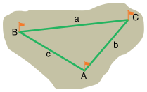

Taş duvarın bir kısmı kazı sırasında ortaya çıkarılmış, henüz kazı yapılmamış kısım kesik çizgilerle gösterilmiştir. Kazı sırasında ortaya çıkarılmış duvarların uzunlukları $|DA| = 10\text{ m}$, $|AB| = 24\text{ m}$, $|BE| = 12\text{ m}$ olup duvarlar arasındaki açıların ölçüleri $49^\circ$ ve $75^\circ$'dir. (Hesaplamalarınızda duvar kalınlığını göz ardı ediniz. $\sin 49^\circ \approx 0{,}7$ <!-- KONTROL: Marker'da karşılığı yok, uydurma olabilir -->, $\sin 56^\circ \approx 0{,}8$ <!-- KONTROL: Marker'da karşılığı yok, uydurma olabilir -->, $\sin 75^\circ \approx 0{,}9$ <!-- KONTROL: Marker'da karşılığı yok, uydurma olabilir --> alınız.)

**Buna göre**

a) Kazı yapılarak ortaya çıkarılması beklenen duvarlardan $DC$ kısmının uzunluğunun kaç metre olduğunu bulunuz.

b) Kazı yapılarak ortaya çıkarılması beklenen duvarlardan $CE$ kısmının uzunluğunun kaç metre olduğunu bulunuz.

c) Her $1\text{ metre}$ duvar kazısı için $4$ işçinin her birinin $8\text{ saat}$ çalışması gerekmekte ve her işçinin $1\text{ saatlik}$ çalışma ücreti $100\text{ TL}$'dir. Buna göre kazının kalan kısmının kaç saatte biteceğini ve kazının kalan kısmı için işçilere ödenecek ücretin kaç $\text{TL}$ olduğunu bulunuz.

2. **Jalon:** Arazi ölçümlerinde noktaların geçici olarak işaretlenmesi ve karşıdan görülmesini sağlayan metal veya tahta çubuklardır. Bitki örtüsünün rahat görüşü engellediği durumlarda jalonların üstüne flama asılır.

Bir harita mühendisi krokisini çıkarmak istediği arazide $A, B, C$ noktalarına jalonları yerleştirerek noktalar arasındaki birim cinsinden uzaklıkları ve iki doğru parçası arasındaki açıların ölçülerini tespit etmiştir. Ölçüm sonuçlarını bir kâğıda yazmış fakat kâğıdın bir kısmı yıpranarak bazı ölçüm sonuçları okunamaz hâle gelmiştir.

**Buna göre**

a) $B$ ve $C$ noktalarına yerleştirilen jalonlar arasındaki mesafenin bilinmemesi durumunda hangi açı ölçüleri ve kenar uzunlukları bilinirse $|BC| = a$ birim uzunluğu bulunabilir?
Kullanacağınız teoremi belirterek cevabınızı aşağıdaki alana yazınız.

| Açılar | Kenarlar | Teorem |
| :--- | :--- | :--- |
| ................... | ................... | ................... |
| ................... | ................... | ................... |
| ................... | ................... | ................... |

b) $B$ ve $C$ noktalarına yerleştirilen jalonlar arasındaki mesafenin bilinmemesi durumunda alanı bilinen $ABC$ üçgeninin hangi açı ölçüleri ve kenar uzunlukları bilinirse $|BC| = a$ birim uzunluğu bulunabilir? Kullanacağınız teoremi belirterek cevabınızı aşağıdaki alana yazınız.

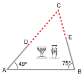

1. Tema alıştırma ek

<!-- sayfa 88 -->

# 1. Tema Ölçme ve Değerlendirme Soruları

Aşağıda temaya ait bilgi ve becerileri ölçen bağlam temelli toplam 14 soru verilmiştir.

1. 16 özdeş basamağı olan taşınabilir bir merdiven, alt ucu düz bir zemindeki $A$ noktasına; üst ucu zemine dik olan duvardaki $B$ noktasına temas edecek şekilde aşağıdaki gibi konumlandırılmıştır:

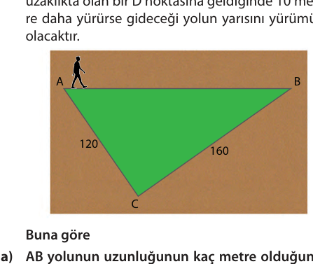

$A$ ile $B$ noktaları arasındaki uzaklık $8$ metre ve merdivenin zeminle yaptığı açının ölçüsü $\alpha$ olmak üzere $\tan \alpha = \frac{3}{4}$'tür.

**Buna göre merdivenin basamak genişliği ile basamak yüksekliğinin kaçar cm olduğunu hesaplayınız.**

2. $K$ noktasındaki kontrol kulesinde bulunan bir görevli, yerden belirli bir yükseklikte yere paralel uçan bir uçağın, $A$ noktasından $B$ noktasına kadar $12$ kilometrelik hareketini radarla izliyor. Aşağıda bu durumu temsil eden bir görsel verilmiştir.

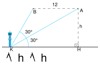

$m(\widehat{AKH}) = m(\widehat{AKB}) = 30^\circ$ olduğuna göre uçağın yerden yüksekliği olan $h$ değerinin kaç kilometre olduğunu bulunuz.

3. Aşağıdaki şekilde $|AC| = 120\text{ m}$ ve $|BC| = 160\text{ m}$ olan $ABC$ üçgeni biçiminde bir bahçe görseli verilmiştir. Bahçenin $A$ köşesinde bulunan Eren, bahçenin $AB$ kenarındaki yolu kullanarak $B$ köşesine doğru sabit hızla yürümeye başlıyor. Eren, $3$ dakika sonra bahçenin $AC$ ve $BC$ kenarlarına eşit uzaklıkta olan bir $D$ noktasına geldiğinde $10$ metre daha yürürse gideceği yolun yarısını yürümüş olacaktır.

Buna göre

a) $AB$ yolunun uzunluğunun kaç metre olduğunu bulunuz.

b) Eren'in $AB$ yolunu kaç dakikada yürüyeceğini hesaplayınız.

c) Aynı sabit hızla $A$ köşesinden $C$ köşesine doğru yürüdüğünde $AB$ ve $BC$ kenarlarına eşit uzaklıkta olan noktaya kaç saniyede ulaşacağını hesaplayınız.

<!-- sayfa 89 -->

4. Hakan'ın gerekli güvenlik önlemlerini alarak bir dağa yaptığı iki farklı tırmanışın görselleri aşağıda verilmiştir.

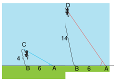
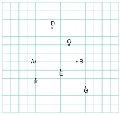

Hakan; bu dağın düz yamacına tırmanırken kullandığı kırmızı ve mavi renkteki halatların bir ucunu dağın B noktasına, diğer ucu 6 metre uzaklıktaki zeminde bulunan bir A noktasına sabitliyor. B noktasından tırmanmaya başlayan Hakan, 4 metre tırmandıktan sonra mavi halatın diğer ucunu C noktasına, 14 metre tırmandıktan sonra da kırmızı halatın diğer ucunu D noktasına sabitliyor.

Kırmızı halatın zeminle yaptığı açının ölçüsü, mavi halatın zeminle yaptığı açının ölçüsünün iki katı olduğuna göre kırmızı halatın uzunluğunun kaç metre olduğunu bulunuz.

5. Aşağıdaki şekilde bir yerleşim yerine ait taslak çizim verilmiştir.

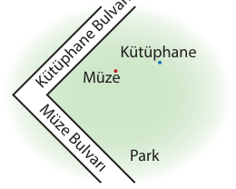

Belediye parkın içerisine Kütüphane ve Müze bulvarlarından eşit uzaklıkta olacak şekilde bir sosyal tesis kurmayı planlamaktadır. Şehirde yaşayanlar kurulacak sosyal tesisin müze ve kütüphaneye de eşit uzaklıkta olmasını istemektedir.

Buna göre taslak çizim üzerinde sosyal tesisin inşa edilmesi gereken noktayı belirleyip gerekçesini açıklayınız.

6. Aşağıdaki birimkareli kâğıtta A, B, C, D, E, F ve G noktaları işaretlenmiştir.

Kareli kâğıt üzerinde bir kenarı $[AB]$ ve diğer köşesi C, D, E, F ve G noktalarından biri seçilerek oluşturulan üçgenler çizilecektir.

Buna göre

a) Hangi nokta ile birleştirilerek oluşturulan üçgenin alanının en büyük olacağını bulunuz.

b) Ortak kenarı $[AB]$ olmak üzere diğer köşesi C, D, E, F ve G noktalarından biri olan farklı iki üçgen seçildiğinde hangi üçgenlerin alanlarının birbirine eşit olacağını bulunuz.

c) Ortak kenarı $[AB]$ olmak üzere diğer köşesi C, D, E, F ve G noktalarından biri olan farklı iki üçgen seçildiğinde hangi üçgenlerin alanları oranının $\frac{1}{3}$ <!-- KONTROL: Marker'da karşılığı yok, uydurma olabilir --> olacağını bulunuz.

<!-- sayfa 90 -->

7. Eş karesel bölgelere ayrılmış haritalı bir kâğıt üzerinde bir yerleşim yerindeki doğal gaz boru hattının geçtiği $[BC]$ ana hattı ile bir binayı temsil eden $A$ noktası aşağıda gösterilmiştir. Binaya doğal gaz bağlamak için ana hat ile bina arasına borular döşenecektir.

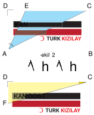

Buna göre

a) Boru maliyetinin en az olması için borunun döşeneceği hattın nasıl bir yol izlemesi gerektiğini açıklayınız ve bu hattı şekil üzerinde gösteriniz.

b) Borunun döşeneceği hattın uzunluğunu hesaplayabileceğiniz bir yol öneriniz. Şekil üzerinde çizdiğiniz hattın uzunluğunu cetvel ile ölçerek önerdiğiniz yol ile bulduğunuz sonucu karşılaştırınız.

8. Aşağıda kenarları birbirine paralel iki eşkenar üçgenden oluşan "YOL VER" trafik levhasının görseli verilmiştir.

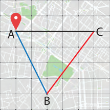

Levhayı oluşturan üçgenlerin çevreleri oranı $\frac{2}{3}$'tür. Levha üzerindeki kırmızı bölgeyi boyamak için kullanılan boya, beyaz bölgeyi boyamak için kullanılan boya miktarından $150\text{ ml}$ fazladır.

Buna göre tüm şekli boyamak için kullanılan beyaz ve kırmızı boya miktarı kaç mililitredir?

9. Aşağıda Türkiye Kızılay Derneğinin kan bağışlarını artırmak için yapılmış ve köşelerinde farklı renklerde ışık yayan ledlerle aydınlatılan dikdörtgen biçimindeki reklam panosunun görseli verilmiştir.

$|AD| = 6\text{ metre}$, $|CD| = 8\text{ metre}$

$A$ köşesindeki mavi ışık yayan led ile $C$ köşesinde sarı ışık yayan ledin aydınlattığı alanlar Şekil 2 ve Şekil 3'de verilmiştir.

$m(\widehat{DAE}) = m(\widehat{EAC})$

$|AF| = |FD|$

Buna göre $A$ ve $C$ köşelerindeki ledlerin reklam panosunda aydınlattığı ortak bölgenin alanı kaç metrekaredir?

<!-- sayfa 91 -->

**10.** Birbirine paralel ve eşit aralıklar ile çizilmiş doğrulardan oluşan aşağıdaki piramit, canlıların sınıflandırılma basamaklarını ve bu basamaklarda yer alan bireylerin dağılımını ifade etmektedir.

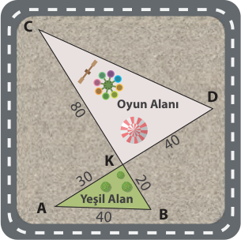

Piramidin her bölümü farklı renkler ile boyanarak oluşturulmuştur. Piramidin âlem, şube, sınıf bölümlerinin boyanması için $66$ desilitre boya kullanılmıştır.

**Buna göre piramitteki tür ve familya bölümleri için kaç desilitre boya kullanılmıştır?**

A) $10$
B) $12$
C) $15$
D) $16$
E) $20$

**11.** Aşağıda yeşil alan ve çocuk oyun alanı üçgensel bölge şeklinde tasarlanmış; $A, K, D$ ve $B, K, C$ noktaları doğrusal olan bir park görseli verilmiştir.

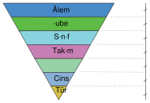

Bu parktaki oyun alanı ve yeşil alan çevresine çit yapmak isteyen belediye çalışanları $|AB| = 40\text{ m}$, $|BK| = 20\text{ m}$, $|AK| = 30\text{ m}$, $|KD| = 40\text{ m}$ ve $|KC| = 80\text{ m}$ olarak ölçüyor fakat $|CD|$ ölçülmeden acil bir iş için parktan ayrılmak zorunda kalıyorlar.

**Buna göre çiti yapacak firmanın bu bilgileri kullanarak $|CD|$ nu nasıl hesaplayabileceğini açıklayınız ve $|CD|$ nun kaç metre olduğunu bulunuz.**

<!-- sayfa 92 -->

**12.** Aşağıda $BAC$ dik üçgeni şeklindeki bir beton zemin görseli verilmiştir.

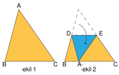

Zemin $B$ köşesinden $B$ açısının açıortayı olacak şekilde bir hat ile iki parçaya ayrılıyor. Kahverengi ile gösterilen $BCD$ üçgeni biçimindeki parça zemini kauçuk ile kaplanıyor. Bir zeminin kauçuk kaplamasının maliyeti metrekare başına $2500\text{ TL}$'dir.

$|AD| = 5\text{ metre}$, $|BC| = 12\text{ metre}$ olduğuna göre kahverengi bölgenin kauçuk kaplama maliyetinin kaç $\text{TL}$ olacağını bulunuz.

**13.** Mehmet Bey evinin verandasının üstünü aşağıdaki görselde planladığı şekilde birbirine eş ahşap blokları kesip birleştirerek kapatmak istemektedir.

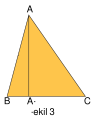

Ölçüp numaralandırdığı ahşap blokları marangozda kestiren Mehmet Bey, ödeme esnasında kesilen her bir parçanın alanına göre fiyatlandırılma yapıldığını öğrenmiştir.

$4$ numaralı parça için $2800\text{ TL}$ ödeyen Mehmet Bey'in tüm parçalar için ödeyeceği toplam tutar aşağıdakilerden hangisidir?

A) $10000$
B) $12000$
C) $14000$
D) $16000$
E) $18000$

**14.** Şekil 1'de ön yüzü turuncu, arka yüzü mavi renkli $ABC$ üçgeni biçimindeki bir kâğıt görseli verilmiştir.

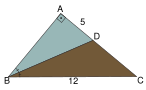

Bu kâğıt, $A$ köşesi $BC$ kenarı üzerindeki $A'$ noktasına gelecek biçimde Şekil 2'deki gibi katlanıyor.

Kâğıt tekrar açıldığında oluşan $DE$ katlama izinin $BC$ kenarına paralel olduğu görülüyor.

Buna göre

a) $BC$ kenarı üzerindeki $A'$ noktası ile $A$ noktası Şekil 3'teki gibi birleştirildiğinde elde edilen $[AA']$ nın üçgenin hangi yardımcı elemanı olduğunu belirleyiniz.

b) Katlama izinin uç noktaları olan $D$ ve $E$ noktaları ile $B$ ve $C$ noktaları, Şekil 4'teki gibi birleştirilerek $[BE]$ ile $[CD]$ çizilsin.

Bu iki doğru parçasının kesim noktası olan $K$ noktasının $ABC$ üçgeni için hangi özel noktaya karşılık geldiğini belirleyiniz.

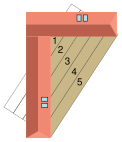

1. Tema ek ölçme ve değerlendirme soruları

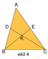
<!-- yer tutucu bulunamadı: sayfa sonuna eklendi -->

<!-- yer tutucu bulunamadı: sayfa sonuna eklendi -->

<!-- sayfa 93 -->

# 2. TEMA
# İSTATİSTİKSEL ARAŞTIRMA SÜRECİ

2.1. İki Kategorik Değişkenli Veriler
2.2. Başkaları Tarafından Oluşturulan İki Kategorik Değişkenli Verileri İnceleme

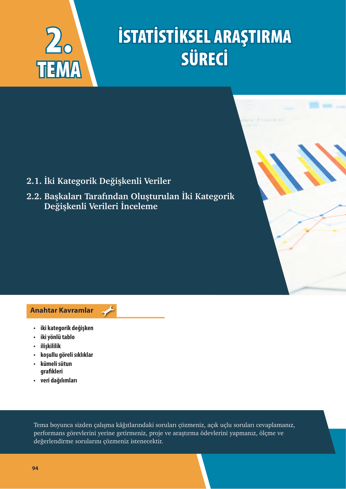

## Anahtar Kavramlar 🔧

* iki kategorik değişken
* iki yönlü tablo
* ilişkililik
* koşullu göreli sıklıklar
* kümeli sütun grafikleri
* veri dağılımları

Tema boyunca sizden çalışma kâğıtlarındaki soruları çözmeniz, açık uçlu soruları cevaplamanız, performans görevlerini yerine getirmeniz, proje ve araştırma ödevlerini yapmanız, ölçme ve değerlendirme sorularını çözmeniz istenecektir.

<!-- sayfa 94 -->

![QR Kod] 2. Tema Karekodu

![QR Kod] 2. Tema sunusuna ulaşmak için karekodu okutunuz.

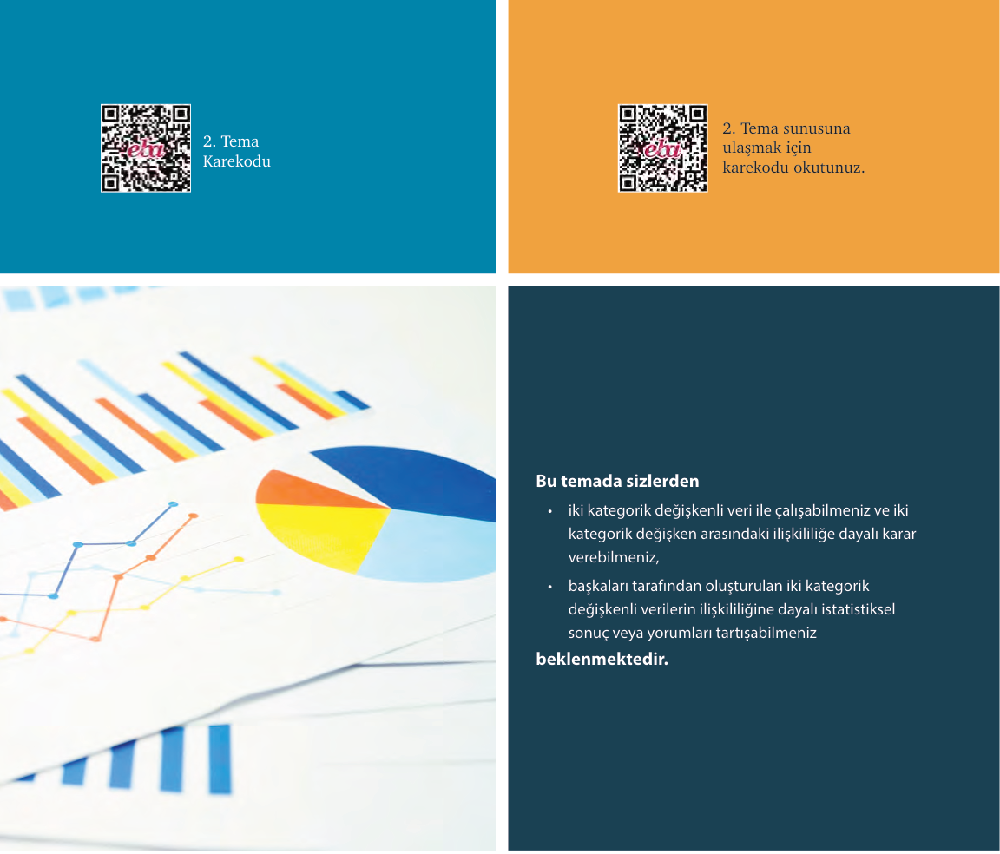

**Bu temada sizlerden**

* iki kategorik değişkenli veri ile çalışabilmeniz ve iki kategorik değişken arasındaki ilişkililiğe dayalı karar verebilmeniz,
* başkaları tarafından oluşturulan iki kategorik değişkenli verilerin ilişkililiğine dayalı istatistiksel sonuç veya yorumları tartışabilmeniz

**beklenmektedir.**

# Başlarken

İstatistiksel araştırma süreci; verilerin toplanması, analizi ve yorumlanması adımlarını içeren sistematik bir yaklaşımdır. Bu süreç belirli bir araştırma sorusuna yanıt bulunması için planlanır ve bilimsel yöntemlere dayalı yürütülür. Amaç, elde edilen bulguların güvenilir ve geçerli sonuçlar üretmesini sağlamaktır.

<!-- sayfa 95 -->

# Ön Değerlendirme

1. **İstatistiksel araştırma süreci aşamalarını aşağıda verilen döngüsel şemanın üzerine sırasıyla yazınız.**

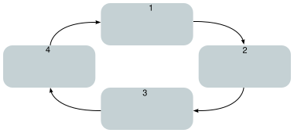

2. **Aşağıdaki tabloda verilen araştırma sorularının hangilerinin betimsel, hangilerinin karşılaştırma gerektiren araştırma soruları olduğunu ve hangileri için kategorik veri, hangileri için nicel veri toplanması gerektiğini tablodaki uygun kısımları işaretleyerek gösteriniz.**

| Araştırma Sorusu | Betimleyen | Karşılaştıran | Kategorik Verili | Nicel Verili |
| :--- | :---: | :---: | :---: | :---: |
| Okulumuzdaki 9. sınıf öğrencileri ile 12. sınıf öğrencilerinin en çok tercih ettikleri etkinlik türleri arasında bir ilişki var mıdır? | | | | |
| A kulübünün basketbol takımı ile voleybol takımı oyuncularının boyları arasında anlamlı bir fark var mıdır? | | | | |
| Bir fidanlıktaki ağaçların son bir yıldaki gövde çap uzunluğu artış miktarı ne kadardır? | | | | |
| Şehrimizdeki kütüphanelerde bir ay içinde en çok ödünç alınan kitap türleri hangileridir? | | | | |
| Müstakil evlerde yaşayanlar ile apartman dairelerinde yaşayanların aylık ortalama elektrik tüketim miktarları arasında anlamlı bir fark var mıdır? | | | | |
| Bir bölgedeki yerel işletmelerin en çok tercih ettiği kargo dağıtım yöntemleri nelerdir? | | | | |

3. **Bir fabrikadaki A ve B makinelerinin ürettiği dörder adet parçanın hata payları mm cinsinden ölçülmüş ve elde edilen verilere ait nokta grafikleri aşağıda verilmiştir.**


Hata payları (mm)
Grafik 1: $A$ makinesinin hata payları

Hata payları (mm)
Grafik 2: $B$ makinesinin hata payları

<!-- sayfa 96 -->

Buna göre aşağıdaki soruları cevaplayınız.

a) Verilere ait ortanca ve aritmetik ortalama değerlerine göre makinelerin performansları hakkında ne söylenebilir? Açıklayınız.

b) Verilere ait tepe değerlerine göre hangi makinenin üretiminin daha tutarlı ve homojen olduğu söylenebilir? Açıklayınız.

c) Verilere ait açıklık değerlerine göre makinelerin ürettiği parçaları standartlara uygunluk yönünden değerlendiriniz.

ç) A ve B makinelerinin verilerine ait ortalama mutlak sapma değerleri sırasıyla $1$ ve $0,375$ iken standart sapma değerleri sırasıyla $1$ ve $0,433$ tür. Bu değerlere göre hangi makinede üretilen parçaların ortalamaya daha yakın ve üretimin daha istikrarlı olduğu söylenebilir? Açıklayınız.

4. Aşağıda farklı görselleştirme araçları ile ifade edilen verileri ait olduğu bağlam içerisinde yorumlayınız.

Grafik 1: Öğrencilerin türlere göre okudukları kitap sayılarını gösteren sütun grafiği

Grafik 2: Bir ailenin aylık harcamalarına ait daire grafiği

Grafik 3: A ve B istasyonlarından yakıt alan araba sayılarına ait kutu grafikleri

Grafik 4: Bir ildeki 5 günlük tahmini hava sıcaklığını gösteren çizgi grafiği

<!-- sayfa 97 -->

# 2.1. İKİ KATEGORİK DEĞİŞKENLİ VERİLER

**Konuya Başlarken**

Kişilerin günlük hayatındaki farklı tercihleri ve alışkanlıkları arasında ya da dâhil oldukları gruplar ile belirli durumlar karşısındaki eğilimleri arasında bir ilişki olup olmadığını düşününüz. Örneğin “Kişilerin dinlediği müzik türü ile ilgilendiği spor branşları arasında bir ilişki var mıdır?” ya da “Öğrencilerin sınıf seviyeleri ile bağcıklı veya bağcıksız ayakkabı tercihleri arasında bir ilişki var mıdır?” sorularına nasıl cevap verilebileceğini düşününüz?

Bu tür sorulara yanıtlar ararken iki kategorik değişken arasındaki ilişkiyi analiz etmek gerekir ancak bu analizleri yaparken hangi görselleştirme araçlarının kullanılacağı büyük önem taşır. Genellikle sayısal verileri görselleştirmek için kullanılan çizgi grafiği, nokta grafiği, kök-yaprak gösterimi, histogram ve kutu grafiği gibi araçlar kategorik değişkenler arasındaki ilişkileri incelemek için de kullanılabilir mi? Sınıf arkadaşlarınızla bu konu üzerinde tartışınız.

Kategorik veri dağılımları ile yürütülecek istatistiksel araştırmalar, veri setindeki değişkenlerin özelliklerine göre sınıflandırıldığı durumları incelemeye odaklanır. Bu tür araştırmalar genellikle bir veya daha fazla kategorik değişkenin dağılımını anlamayı, bu değişkenler arasındaki ilişkiyi test etmeyi ve kategorik veriler arasındaki ilişkiye yönelik tahminler yapmayı amaçlar. Kategorik veri dağılımları ile yapılan araştırmalar özellikle anket çalışmaları, deneysel araştırmalar ve gözlemsel çalışmalar için kritik öneme sahiptir. Bu tür araştırmalarda kullanılan analizler verilerin yorumlanması ve anlamlı sonuçlar çıkarılması açısından güçlü araçlardır.

## İki Kategorik Değişkenli Veriye Dayalı İstatistiksel Araştırmalarda Bağlam

Grafik 2.1'de verilen iki kategorik değişkenli veri dağılımına yönelik kümeli sütun grafiğinde okul seviyelerindeki öğrenci sayılarının merdiven ve asansör kategorilerine göre dağılımı gösterilmektedir.

**Grafik 2.1: İki kategorik değişkenli bir veri dağılımına yönelik sütun grafiği**

Bu verilerden anlamlı bir bilgi elde edilemez çünkü verilerin dağılımını belirleyen gerçek yaşam durumunun hangi bağlam çerçevesinde incelendiği belirtilmemiştir.

İstatistiksel araştırmalarda iki kategorik değişken arasındaki ilişkiyi doğru şekilde analiz edebilmek için bağlamın açıkça belirlenmesi gerekmektedir. Bağlam verilerin hangi koşullar altında toplandığını, hangi değişkenlerin incelendiğini ve araştırmanın amacını anlamamıza yardımcı olur. Bağlamı belirlemeden yapılan analizler, yanlış yorumlamalara ve yanıltıcı sonuçlara yol açabilir.

## 1. Uygulama

### İstatistiksel Bağlam Oluşturma

Şema 2.1'de gerçek yaşam durumları ve bunlarla ilgili bağlamları içeren kutucuklar verilmiştir. Bu durumlardan yola çıkarak oluşturulan şemadaki iki kategorik değişkenli veriye dayalı istatistiksel bağlam örneklerini inceleyiniz.

<!-- sayfa 98 -->

**Şema 2.1: Gerçek Yaşam Durumları ve Bağlamları**

1. Sınıfta öğretmeniniz rehberliğinde gruplara ayrılarak verilen soruları cevaplayınız.
    a) Şemada verilen bağlamların iki kategorik değişkenli veri toplamayı gerektiren bağlamlar olmasının neden ile ilgili olarak grup arkadaşlarınızla tartışınız.
    b) Farklı istatistiksel bağlamları Şema 2.1'de boş bırakılan kutucuklara yazınız. Yazdığınız istatistiksel bağlamları sınıfta paylaşınız. Belirlediğiniz bu bağlamları veri toplamayı gerektirip gerektirmeme ölçütüne göre sınıf arkadaşlarınızla tartışınız.
2. Karekodlarda verilen akran değerlendirme formu ile grup arkadaşlarınızı, öz değerlendirme formu ile de kendinizi değerlendiriniz.

Öz değerlendirme formu

Akran değerlendirme formu

---

### 1. Örnek
Aşağıdaki gerçek yaşam durumları için iki kategorik değişkenli veri toplamayı gerektiren bağlamlar oluşturarak tablodaki ilgili alanlara yazınız.

| | |
| :--- | :--- |
| **Eğitim** | |
| **İş Hayatı** | |
| **Alışveriş** | |

### Çözüm
Araştırma yapılan konularda odaklanılan noktalar için iki kategorik değişkenli veri toplamayı gerektiren farklı bağlamlar oluşturulabilir. Örnekteki tabloda verilen gerçek yaşam durumları için iki kategorik değişkenli veri toplamayı gerektiren bazı bağlamlar aşağıda yer almaktadır:

**Eğitim**
* Öğrencilerin sosyal etkinliklere katılım durumu ile ders başarısı arasındaki ilişki
* Öğrencilerin okula ulaşım şekli ile okuduğu okul türü arasındaki ilişki

**İş Hayatı**
* Çalışma yeri ile çalışan verimliliği arasındaki ilişki
* Çalışanların eğitim seviyeleri ile iş tercihleri arasındaki ilişki

**Alışveriş**
* Cinsiyet ile alışveriş yapılan zaman dilimi arasındaki ilişki
* Yaş grupları ile tercih edilen ürün kategorisi arasındaki ilişki

<!-- sayfa 99 -->

# 1. Sıra Sizde

Aşağıdaki tabloyu verilen gerçek yaşam durumlarına yönelik iki kategorik değişkenli veri toplamayı gerektiren bağlamlar oluşturarak doldurunuz. Oluşturduğunuz bağlamların iki kategorik değişkenli veri toplamayı gerektiren bağlamlar olup olmadığını sınıf arkadaşlarınızla nezaket kuralları çerçevesinde tartışınız. Gerçek yaşam durumları sütununda boş bırakılan kısımlara merak ettiğiniz, ilgi duyduğunuz birer gerçek yaşam durumu ve bu gerçek yaşam durumuna yönelik iki kategorik değişkenli veri toplamayı gerektiren bağlamlar yazınız.

| Gerçek Yaşam Durumları | İki Kategorik Değişkenli Veri Toplamayı Gerektiren Bağlam |
| :--- | :--- |
| Tarım | |
| Spor | |
| | |
| | |

## İki Kategorik Değişkenin İlişkililiğini İçeren İstatistiksel Araştırma Sorusu Oluşturma

Grafik 2.2'deki kümeli sütun grafiğinde bir işletmede satılan giyim, elektronik ve gıda ürünlerini tercih eden müşteri sayılarının bazı kategorilere göre dağılımı gösterilmektedir.

**Grafik 2.2:** Bir işletmede satılan ürünlerin dağılımı

Yukarıda verilen grafik, farklı istatistiksel araştırma soruları sonucunda oluşturulmuş olabilir. Örneğin bu işletmeden alışveriş yapan erkeklerin ve kadınların belirli bir ürün kategorisindeki tercihlerinin nasıl farklılık gösterdiği ya da müşterilerin yaşları ile belirli ürünleri satın alma eğilimleri arasında nasıl bir ilişki olduğu sorularından hareketle elde edilmiş olabilir. Grafiğe uygun farklı araştırma sorularının neler olabileceğini arkadaşlarınızla tartışınız.

İki kategorik değişken arasındaki ilişkinin ortaya koyulmasına yönelik istatistiksel araştırma soruları oluşturulurken dikkat edilmesi gereken bazı temel ölçütler vardır. Bu sorularda bulunması gereken ölçütler aşağıda yer almaktadır. Bu ölçütler araştırmanın geçerliliğini, güvenilirliğini ve elde edilen verilerin anlamlılığını artırmayı hedefler.

1. **Amacı net olmalıdır.**
İstatistiksel araştırma sorularında amaç, net olarak belirtilmelidir. Araştırma sorusunun amacı sorunun "ilişkilendiren" türde olmasıdır.

**Uygun Örnek:** "Çalışanların cinsiyeti ile mesleki doyum arasında bir ilişki var mıdır?" (Soru iki kategorik değişken arasındaki ilişkiye odaklanmaktadır.)

**Uygun Olmayan Örnek:** "İşle ilgili bazı şeylerin çalışanlar üzerindeki etkisi nedir?" (Belirli bir ilişki tanımlanmamıştır.)

2. **Araştırmaya uygun olmalıdır.**
Araştırma sorusu; toplumsal, bilimsel veya pratik olarak anlamlı ve yararlı olmalıdır. Sorunun yanıtı belirli...
